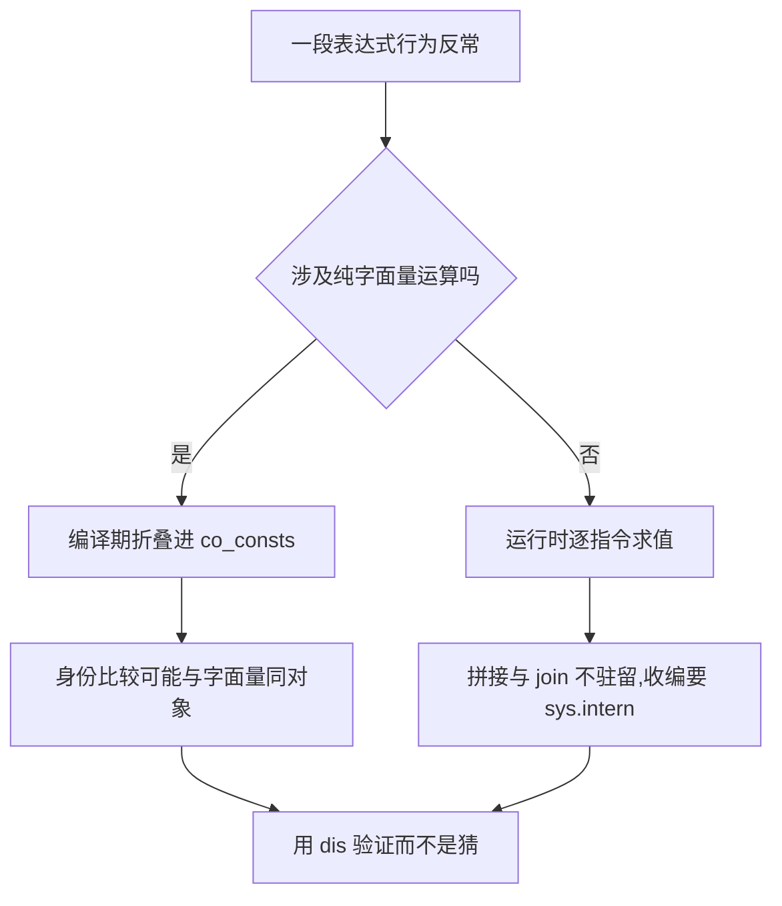
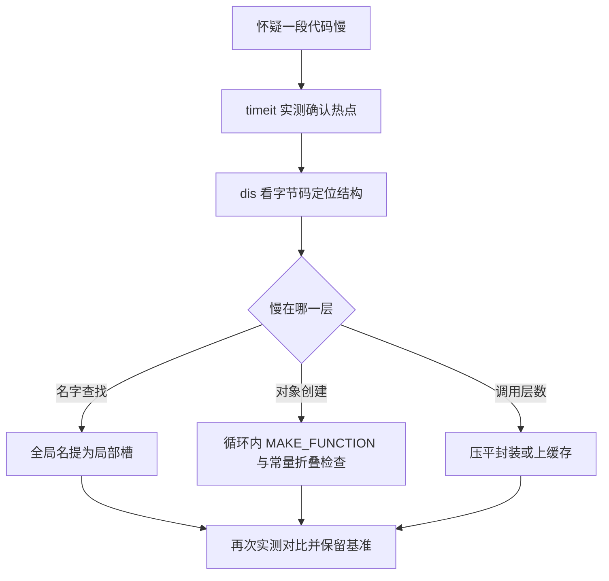
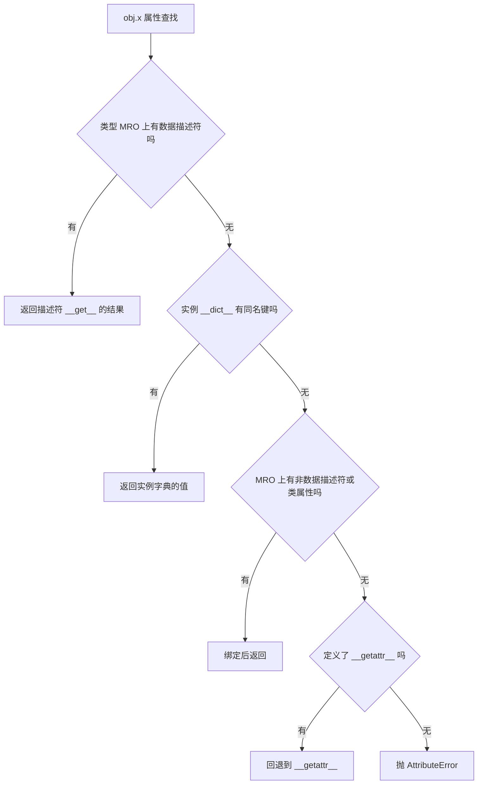
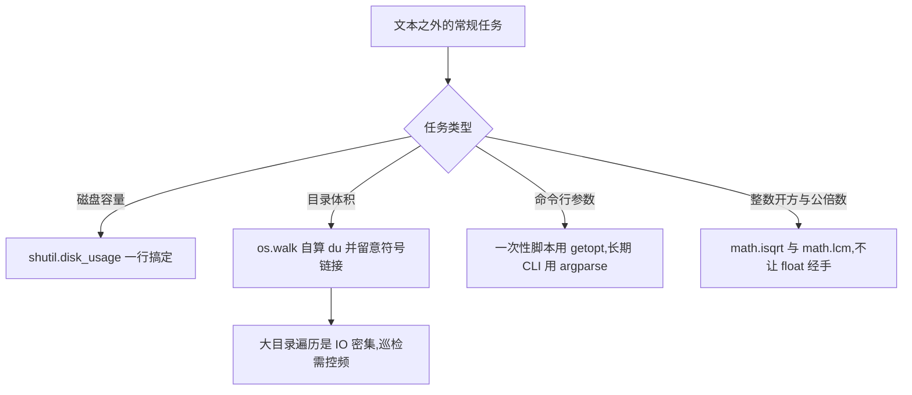
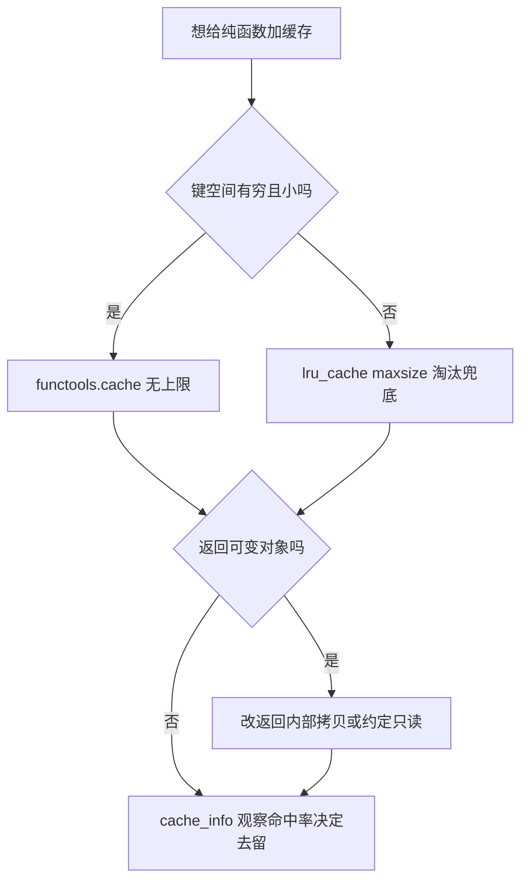
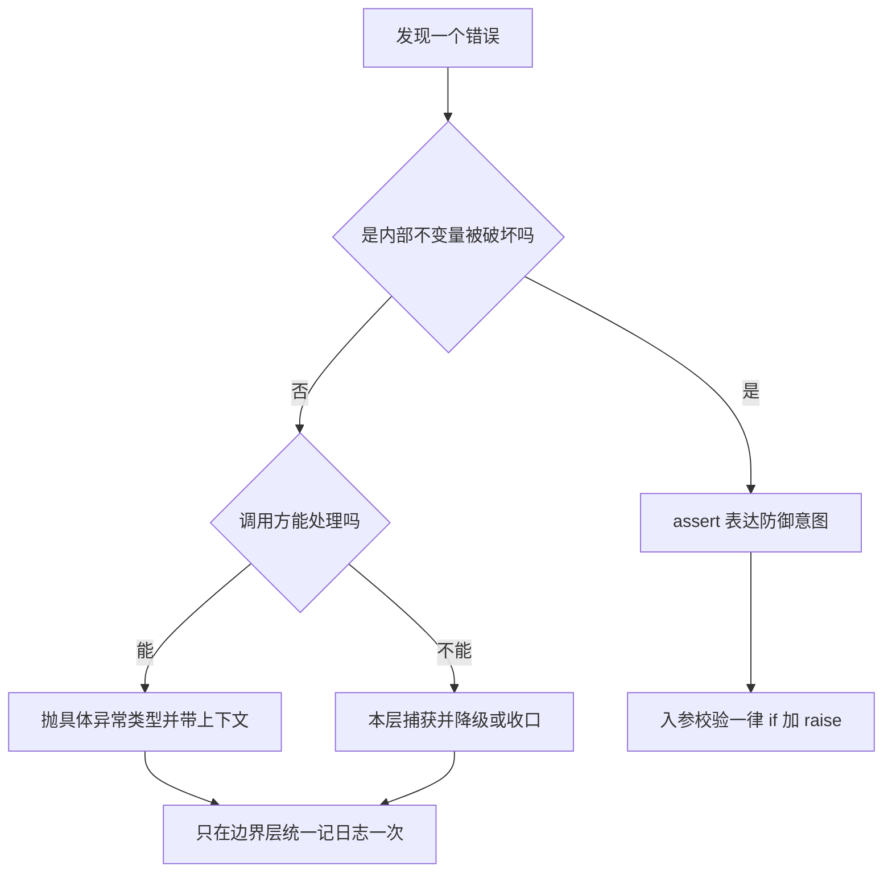
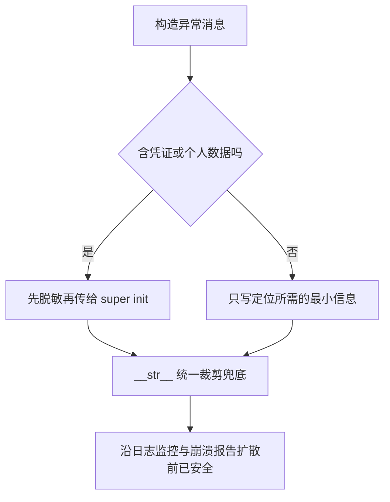
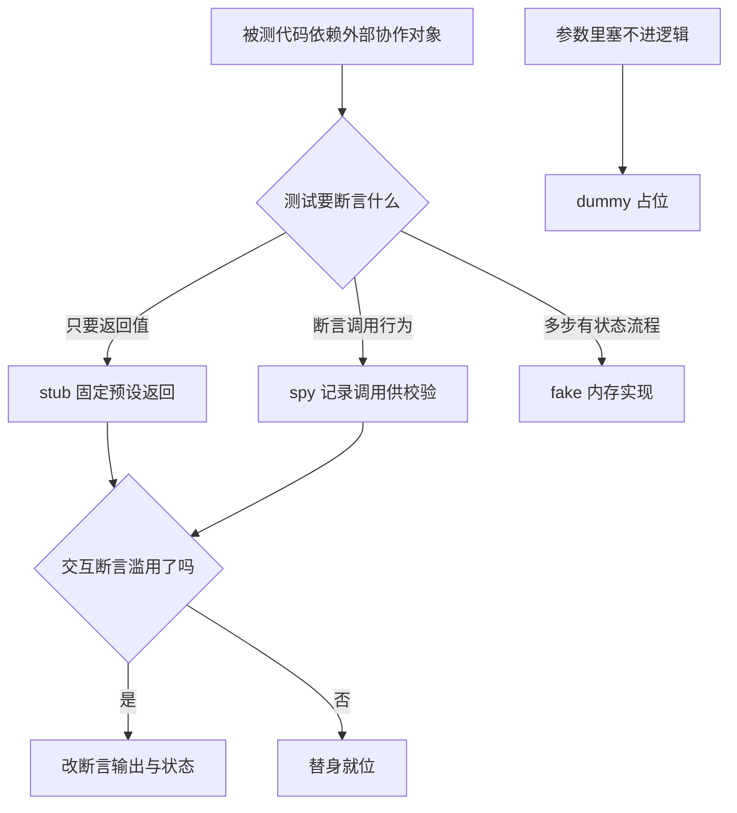

# 第 1 类 · 语言核心与底层(夜间扩产六)

> 本篇是语言核心的第六批夜间扩产(Q2606–Q2650):解释器行为补遗(常量折叠边界、运行时字符串驻留、循环内 MAKE_FUNCTION、名字查找阶梯、setrecursionlimit 的代价、pyc 失效判定、3.9 异常字节码、and/or 短路字节码、del 的字节码家族、调用开销)。
> 类型与描述符补遗(get_origin/get_args、描述符查找矩阵、类访问的 owner、Enum 的 _missing_、3.9 内置泛型、描述符状态存放、frozen 逃生门);标准库补遗(cmp_to_key、itemgetter、re 命名组与回溯爆炸、disk_usage、getopt 与 argparse、isqrt、lcm、functools.cache、zoneinfo、graphlib、accumulate、is_relative_to、nullcontext)。
> 错误工程(assert 元组陷阱、except Exception 的漏网之鱼、异常继承粒度、logger.exception、日志与异常的边界、traceback 滞留、敏感信息泄漏);测试与可维护(mock.patch 打桩位置、subTest、特征测试、纯函数分层、测试替身、setUp 时序)。
> 所有代码仅标准库、可直接运行;均已在本机 CPython 3.9.6 逐题实跑通过。

### Q2606 · 常量折叠的边界:大整数、元组与 f-string 实测

> 难度:★★★★☆ | 标签:字节码, 常量折叠, dis

**问**:都说 CPython 会做常量折叠,那到底哪些表达式在编译期就算完了?有没有折叠不了的情况?

**答**:常量折叠发生在编译期,只对「两个都是编译期常量」的二元运算生效:算术、字符串字面量拼接、常量元组构建都会折进 `co_consts`。实测三个边界:第一,折叠是「照单全收」的,`0.1 + 0.2` 在编译期就折成 `0.30000000000000004`,精度问题不会因为折叠而消失;第二,超大整数幂有安全阀,`2 ** 64` 会折叠,但 `2 ** 100000` 不折叠(`co_consts` 里保留 `2` 和 `100000` 两个操作数),这是防止编译期被恶意或手滑的超大数运算拖死的保护;第三,只有字面量参与折叠,含名字、函数调用的表达式一律等到运行时。用 `dis.dis` 看字节码是最直接的验证手段:折叠后只剩一条 `LOAD_CONST`。

```python
# file: code/01_语言核心与底层/q2606_const_fold.py
"""常量折叠的边界:哪些表达式在编译期算完,哪些留到运行时。"""
import dis


def folded():
    x = 1 + 2                 # 算术折叠
    y = "ab" "cd"             # 字面量拼接折叠
    z = 2 ** 64               # 中等规模幂折叠
    w = (1, "a", True)        # 全常量元组折叠
    f = 0.1 + 0.2             # 连精度问题一起折叠
    return x, y, z, w, f


def not_folded(a):
    n = 2 ** 100000           # 超大幂:安全阀拒绝折叠
    v = a + 1                 # 有名字参与,不折叠
    s = "ab" + a              # 运行时才拼接
    return n, v, s


if __name__ == "__main__":
    print("folded 的 co_consts:")
    for c in folded.__code__.co_consts:
        print("   ", repr(c))

    print("not_folded 的 co_consts(注意 2 和 100000 原样保留):")
    for c in not_folded.__code__.co_consts:
        print("   ", repr(c))

    print("\ndis 验证:folded 的每个赋值只有一条 LOAD_CONST")
    dis.dis(folded)
```

**追问**:1) 为什么折叠后的字符串字面量 `is` 比较经常为真?——折叠结果进入 `co_consts` 成为共享的同一个对象,但这是实现细节,跨代码对象不保证,身份比较仍只该用于 `None` 等哨兵。2) 折叠的安全阀边界?——超大整数幂(如 2 ** 100000)与过长折叠结果会被拒绝,防止编译期 DoS(Q549);「无副作用常量」才可折叠——0.1+0.2 连精度误差一起折(Q537 的根源)。3) 折叠的观测方法?——co_consts 看常量表、dis.dis 看是否只剩 LOAD_CONST;3.7 起常量折叠移到 AST 优化器、3.8 起整个窥孔优化器迁移到 AST 层(3.13 又将部分折叠移回 CFG),但结论一致。4) 生产陷阱?——在常量表达式上设断点期望执行;依赖「is 相等」;以为折叠会修复浮点精度。

### Q2607 · 运行时字符串驻留的条件边界:哪些拼接结果会被收编

> 难度:★★★★☆ | 标签:字符串驻留, intern, 身份比较

**问**:字符串驻留到底什么时候发生?运行时拼出来的 `"python"` 和字面量 `"python"` 是同一个对象吗?

**答**:CPython 的自动驻留基本只发生在编译期:所有字符串字面量、以及编译期折叠出的字符串常量,都会进入常量表并被 intern,所以同模块里两处相同字面量是同一个对象。运行时构造的字符串——变量参与的拼接、`join`、切片、`upper` 等结果——一律不自动驻留,即便内容长得完全像标识符。要在运行期收编只能显式调 `sys.intern`,收编后与等值的编译期常量共享。另一个实测细节:函数名、类名这类「名字」在创建时就是 intern 的,所以 `sys.intern("f1") is f1.__name__` 为真。结论落到工程上:`is` 比较字符串内容永远不可靠,驻留只是性能优化,不是语义契约。

```python
# file: code/01_语言核心与底层/q2607_intern_boundary.py
"""运行时字符串驻留的边界:编译期收编,运行期不收编。"""
import sys


def f1():
    return "hello world!"


def f2():
    return "hello" + " " + "world" + "!"   # 编译期折叠成同一个常量


def make_runtime(prefix):
    return prefix + "thon"                 # 运行时拼接,不驻留


if __name__ == "__main__":
    literal = "python"
    folded = "py" + "thon"                 # 编译期折叠
    print("字面量与折叠拼接同对象:", literal is folded)          # True

    runtime = make_runtime("py")
    print("运行时拼接同对象:  ", runtime is literal)              # False
    print("sys.intern 收编后:  ", sys.intern(runtime) is literal)  # True

    joined = "".join(["py", "thon"])
    print("join 结果同对象:    ", joined is literal)              # False

    print("跨函数相同字面量同对象:", f1() is f2())                # True
    print("函数名是 intern 的:  ", sys.intern("f1") is f1.__name__)  # True
```

**追问**:1) 既然运行时不自动驻留,为什么 `sys.intern` 还有存在价值?——大量重复字符串做字典键或集合成员时,intern 能让比较退化为指针比较并去重存储,解析器、路由表这类场景有实测收益。2) 驻留的条件边界?——标识符样字符串编译期自动;运行时拼接/切片/IO 读入不自动;intern 显式收编但要控制范围(驻留表永不回收,Q2069)。3) 观测陷阱?——「a == b 且 a is b」的实验要在同一编译单元做;is 结论跨实现不可移植(Q1798);对海量用户输入 intern 撑大驻留表。4) 生产陷阱?——把「常驻」当「自动」;依赖 is 比较;性能结论不做实测就写进文档。

### Q2608 · 循环里定义函数的创建开销:每次迭代都在做什么

> 难度:★★★☆☆ | 标签:MAKE_FUNCTION, 性能, 字节码

**问**:在循环体内 `def` 一个函数,每次迭代都会重新编译吗?开销有多大?

**答**:不会重新编译——代码对象在函数第一次被编译时就固定在 `co_consts` 里了,循环里每次迭代执行的只是 `MAKE_FUNCTION`:新建一个函数对象、绑定默认值元组和闭包单元。实测(本机 3.9.6)循环内定义比复用外部函数每迭代多约 90ns,创建本身是廉价的,真正的坑在语义:每次迭代得到的是不同函数对象但共享同一个 code 对象,且闭包捕获的是变量而非值,不加 `i=i` 默认参固化就会踩 late binding。所以判断标准不是性能而是语义:需要按迭代固化状态时用默认参或工厂函数;纯粹图省事写在循环里,开销可以忽略。

```python
# file: code/01_语言核心与底层/q2608_loop_make_function.py
"""循环内定义函数:MAKE_FUNCTION 的开销与 code 对象共享。"""
import dis
import timeit


def build_in_loop():
    out = []
    for i in range(200):
        def f(i=i):                # 每次迭代 MAKE_FUNCTION 一次
            return i
        out.append(f)
    return out


def build_predef():
    out = []
    def f(i):                      # 只 MAKE_FUNCTION 一次
        return i
    for i in range(200):
        out.append(f)              # 复用同一函数对象
    return out


if __name__ == "__main__":
    fns = build_in_loop()
    print("code 对象共享:", fns[0].__code__ is fns[1].__code__)   # True
    print("函数对象不同:  ", fns[0] is fns[1])                     # False
    print("默认参固化生效:", [f() for f in fns[:3]])               # [0, 1, 2]

    n = 2000
    t_loop = timeit.timeit(build_in_loop, number=n) / n / 200 * 1e9
    t_pre = timeit.timeit(build_predef, number=n) / n / 200 * 1e9
    print(f"循环内定义: {t_loop:.0f} ns/次, 复用外部函数: {t_pre:.0f} ns/次")

    print("\n循环体的字节码:MAKE_FUNCTION 在 FOR_ITER 之内")
    dis.dis(build_in_loop)
```

**追问**:1) 为什么默认值参数能「固化」循环变量?——`i=i` 在 MAKE_FUNCTION 时把当前值存进函数的 `__defaults__`,闭包捕获变成了值捕获,绕开了 late binding。2) 每次迭代的开销构成?——MAKE_FUNCTION 建 code+函数对象(共享 code)、创建默认值元组、闭包建 cell;热循环里成千上万个函数对象是真实的内存与分配成本——批量场景用工厂函数按需建或 partial 复用(Q2086)。3) 与工厂闭包的取舍?——默认参数快照最简单;工厂闭包可携带多状态;partial 复用现成函数;语义差异在「绑定时刻」(Q1530)。4) 生产陷阱?——循环内创建大量一次性函数对象堆积;晚绑定 bug(Q527);默认参数固化时机误解。

### Q2609 · 名字查找的耗时阶梯:LOAD_FAST、LOAD_DEREF、LOAD_GLOBAL 与内建

> 难度:★★★★☆ | 标签:名字查找, 性能实测, 字节码

**问**:局部变量、闭包变量、全局变量、内建函数,访问速度差多少?为什么?

**答**:四层名字的查找机制完全不同:局部变量是 `LOAD_FAST`,直接按编译期定死的槽位下标取数组元素;闭包变量是 `LOAD_DEREF`,解一层 cell 指针;全局变量是 `LOAD_GLOBAL`,要在模块 `__dict__` 里做一次哈希查找;内建名是全局查不到后回退到 builtins 字典再查一次。本机实测(含循环骨架开销):局部与闭包同档约 33-36ns/次,全局与内建同档约 49-51ns/次,热路径上把反复使用的全局名提为局部变量能省约 30%。3.11 的内联缓存会大幅压缩全局与属性查找成本,但「槽位快于字典」的层级关系不变。要点是:这是微优化,先测再改,别为 20ns 牺牲可读性。

```python
# file: code/01_语言核心与底层/q2609_name_lookup_ladder.py
"""名字查找阶梯:局部、闭包、全局、内建的耗时实测。"""
import timeit

N = 200000
x_global = 1234567


def use_local():
    x = x_global                   # 进入局部槽
    total = 0
    for _ in range(N):
        total = x                  # LOAD_FAST
    return total


def use_global():
    total = 0
    for _ in range(N):
        total = x_global           # LOAD_GLOBAL
    return total


def make_closure():
    y = 1234567

    def use_deref():
        total = 0
        for _ in range(N):
            total = y              # LOAD_DEREF
        return total
    return use_deref


def use_builtin():
    total = 0
    for _ in range(N):
        total = len                # LOAD_GLOBAL 未命中,回退 builtins
    return total


if __name__ == "__main__":
    for fn in (use_local, make_closure(), use_global, use_builtin):
        per_iter = timeit.timeit(fn, number=20) / 20 / N * 1e9
        print(f"{fn.__name__:12s} {per_iter:5.0f} ns/次")
```

**追问**:1) 为什么 `LOAD_DEREF` 和 `LOAD_FAST` 几乎一样快?——cell 是编译期确定的固定槽位,解引用只是一次指针跳转,没有哈希查找,所以闭包变量不必刻意「摊平」成局部变量。2) 完整阶梯的排序?——LOAD_FAST ≈ LOAD_DEREF < LOAD_GLOBAL(带 3.11 内联缓存)< LOAD_NAME(类体/顶层);LOAD_ATTR 特化后接近 LOAD_GLOBAL;结论到常数级,算法优先(Q548)。3) 与优化的关系?——循环不变量外提把 LOAD_GLOBAL 提到循环外仍是零成本习惯(Q2367);微基准用 timeit 取 min(Q2093)。4) 生产陷阱?——按「名字查找类型」做架构决策;热路径全局/属性访问不外提;以为 LOAD_DEREF 贵而重构闭包破坏封装。

### Q2610 · sys.setrecursionlimit 的代价:C 栈、线程栈与段错误

> 难度:★★★★☆ | 标签:递归, 递归限制, 线程栈

**问**:递归太深报 RecursionError,调高 `sys.setrecursionlimit` 不就行了?它有什么代价?

**答**:`setrecursionlimit` 只是调高解释器里的一个计数门闩,不会给 C 栈多分配一字节——而 CPython 的 Python 层函数调用在 3.9 里对应真实的 C 递归,每一层都要消耗线程栈。所以盲目调高限制,报错会从可控的 `RecursionError` 变成进程级段错误,连 traceback 都没有。正确姿势是两条腿:用 `threading.stack_size` 在创建线程前把栈开大,再在**那个线程里**调高限制,实测本机 256MB 栈 + 限制 300000 可以递归到约 30 万层后干净地抛出 RecursionError。另外注意两点:这个限制是解释器级全局状态,影响所有代码;每层 Python 帧本身在堆上要吃内存,深递归的内存成本也不会因为限制调高而消失。深层递归的根本解法仍然是显式栈迭代或分治改写。

```python
# file: code/01_语言核心与底层/q2610_recursion_limit.py
"""setrecursionlimit 的代价:门闩不等于栈,大栈线程里才能安全调高。"""
import sys
import threading


def count_depth_with_big_stack(limit, stack_bytes):
    """在指定栈大小的线程里递归到极限,返回达到的深度。"""
    result = {}

    def deep():
        sys.setrecursionlimit(limit)
        count = [0]

        def r():
            count[0] += 1
            r()

        try:
            r()
        except RecursionError:
            result["depth"] = count[0]

    threading.stack_size(stack_bytes)
    t = threading.Thread(target=deep)
    t.start()
    t.join()
    threading.stack_size(0)            # 恢复默认,避免影响后续线程
    return result.get("depth")


if __name__ == "__main__":
    # 主线程:默认限制下干净地抛 RecursionError
    sys.setrecursionlimit(1000)

    def boom(n):
        return boom(n + 1)

    try:
        boom(0)
    except RecursionError:
        print("主线程:限制 1000,RecursionError 被正常捕获")

    # 大栈线程:限制 300000 也能干净收场
    depth = count_depth_with_big_stack(300000, 256 * 1024 * 1024)
    print(f"256MB 栈线程:限制 300000,实际递归到 {depth} 层")
```

**追问**:1) 为什么在主线程直接 `setrecursionlimit(10**6)` 很危险?——主线程栈受 ulimit 约束通常只有 8MB,C 递归超栈直接段错误;而 `threading.stack_size` 会在 mmap 线程栈时真正分配空间。2) 限制的真实语义?——getrecursionlimit 是 Python 帧软上限;每次调用同时消耗 C 栈,3.11+ 有 C 栈溢出保护但仍非硬保证(Q553);真正安全线要按「限制 × 每帧 C 栈消耗 < 线程栈大小」估算。3) 工程正解?——深递归改显式栈/迭代(Q1531);要深递归的业务放到大栈子线程(threading.stack_size + 专线程);输入深度限制在校验层。4) 生产陷阱?——调大限制把崩溃推迟成段错误;子线程与主线程深度不同导致环境差异;深层 JSON 解析复现不出(输入深度不同)。



### Q2611 · pyc 的失效判定:mtime、size 与 PEP 552 头部

> 难度:★★★☆☆ | 标签:pyc, import, 字节码缓存

**问**:Python 怎么知道 `.pyc` 缓存还能不能用?缓存失效的判定依据是什么?

**答**:每个 pyc 文件开头有 16 字节头部(PEP 552):4 字节 magic number、4 字节 flags、4 字节源文件 mtime、4 字节源文件大小。默认 flags 为 0,走时间戳校验:import 时比较头部记录的 mtime 和 size 与源文件当前 `stat` 结果,任一不符就重新编译并回写,否则直接加载缓存字节码。这套机制解释了几个常见现象:只改文件内容但字节数恰好相同且 mtime 未变,理论上可能吃到陈旧缓存(mtime 精度问题,少见);`PYTHONDONTWRITEBYTECODE=1` 只是不写缓存,读取不受影响;顶层脚本永不走 pyc,只有被 import 的模块才缓存。若 flags 置位走 PEP 552 的 hash-based 校验,则直接比较源内容哈希,mtime 无关,适合 mtime 不可靠的构建系统。

```python
# file: code/01_语言核心与底层/q2611_pyc_header.py
"""pyc 失效判定:解析 16 字节头部,对照源文件 stat。"""
import importlib.util
import os
import py_compile
import struct
import tempfile


def read_pyc_header(pyc_path):
    raw = open(pyc_path, "rb").read(16)
    magic, flags, src_mtime, src_size = struct.unpack("<IIII", raw)
    return magic, flags, src_mtime, src_size


if __name__ == "__main__":
    tmp = tempfile.mkdtemp()
    src = os.path.join(tmp, "m.py")
    with open(src, "w") as f:
        f.write("VALUE = 1\n")

    pyc = py_compile.compile(src)
    magic, flags, src_mtime, src_size = read_pyc_header(pyc)
    st = os.stat(src)

    print("缓存路径:", pyc)
    print("magic 匹配解释器:",
          magic == struct.unpack("<I", importlib.util.MAGIC_NUMBER)[0])
    print("flags(0 即时间戳校验):", flags)
    print("mtime 一致:", src_mtime == int(st.st_mtime))
    print("size 一致:", src_size == st.st_size)

    # 模拟源文件变更:mtime 后移,头部立刻过期
    old = st.st_mtime
    os.utime(src, (old - 1000, old - 1000))
    _, _, src_mtime, _ = read_pyc_header(pyc)
    print("源文件回拨后 mtime 一致:",
          src_mtime == int(os.stat(src).st_mtime), "-> 触发重编译")
```

**追问**:1) 为什么 Python 不直接缓存哈希而默认用 mtime?——stat 一次比读全文算哈希便宜得多,对绝大多数工作流 mtime 已足够;hash-based 模式是给 mtime 不可信的场景(如可重现构建)留的开关。2) PEP 552 的三种模式?——默认 mtime+size;unchecked hash(源码哈希,信任输入);checked hash(每次导入验哈希,防篡改,用于只读部署/可重现构建);PYTHONDONTWRITEBYTECODE 禁写。3) 部署相关性?——同 mtime 部署(打 tar 保时间)会让旧 pyc 活着;CI 与生产的 PYTHONPYCACHEPREFIX 缓存分离;3.13 后 __pycache__ 加速更明显但机制不变。4) 生产陷阱?——mtime 相同的旧 pyc 被加载(诡异行为来源);只读容器没预编译 pyc 启动慢;checked-hash 开销误用于开发环境。

### Q2612 · 3.9 的异常字节码:SETUP_FINALLY 与块栈

> 难度:★★★★☆ | 标签:字节码, 异常, dis

**问**:3.9 里 `try/except/finally` 编译成什么样的字节码?为什么说它的异常处理不是零成本的?

**答**:3.9 用「块栈」实现异常处理:进入 try 时执行 `SETUP_FINALLY` 往内部块栈压一个记录,正常离开要 `POP_BLOCK`,捕获时要 `DUP_TOP` 复制异常、`JUMP_IF_NOT_EXC_MATCH` 做类型匹配、`POP_EXCEPT` 清块栈,finally 通过同一机制在块栈里挂清理入口,重抛用 `RERAISE`。这套结构的代价是:即使没有异常发生,进出 try 也要执行压栈弹栈两条指令——不像 3.11 的异常表方案把正常路径变成零开销。读懂这段字节码对排查很有用:比如 `finally` 里的 return 会提前 `RETURN_VALUE` 并吞掉挂起的异常,在字节码层面一目了然。

```python
# file: code/01_语言核心与底层/q2612_try_bytecode.py
"""3.9 的异常处理块栈:SETUP_FINALLY 到 RERAISE 的完整链路。"""
import dis


def tri(x):
    try:
        v = int(x)
    except ValueError:
        v = 0
    finally:
        print("done")
    return v


if __name__ == "__main__":
    tri("42")
    tri("x")
    dis.dis(tri)
```

**追问**:1) 3.11 的零成本异常改变了什么?——编译期生成静态异常表,正常路径不再有任何 SETUP/POP 指令,try 的常量开销归零,匹配异常改由表驱动跳转。2) 3.9 块栈的机制?——SETUP_FINALLY/POP_BLOCK 维护运行时块栈,进入 try 即付指令成本;异常表时代这些指令消失(Q1260 的故事);traceback 行号改由 linetable 提供。3) 与「异常做控制流」的关系?——3.11+ 的 EAFP 在热路径上不再有 try 税;真正抛异常仍贵(构造 traceback);跨版本性能结论要分开测。4) 生产陷阱?——按 3.9 的「try 有开销」写 if-else 优化;3.10- 部署仍是块栈;依赖异常字节码细节的 hack。

### Q2613 · and/or 的短路字节码:返回的是操作数不是 bool

> 难度:★★☆☆☆ | 标签:短路求值, 字节码, 布尔语义

**问**:`x and y` 的求值规则是什么?为什么 `0 and 1/0` 不会抛 ZeroDivisionError?

**答**:`and`/`or` 走短路求值,字节码上是条件跳转指令:`and` 编译为 `JUMP_IF_FALSE_OR_POP`(左值为假直接把它作为整个表达式的值跳走),`or` 对应 `JUMP_IF_TRUE_OR_POP`。关键语义是:表达式返回的是**决定结果的那个操作数本身**,不是转成 bool 之后的值——所以 `0 and 1/0` 返回 0,右边的除法根本不求值;`[] or "default"` 返回 "default" 而不是 True。这就是「默认值惯用法」的来源,但也要小心它的陷阱:`0 or ""` 返回空串,用 or 提供默认值会把合法的假值一起吞掉,明确「缺失」语义时应该用 `is None` 判断。

```python
# file: code/01_语言核心与底层/q2613_andor_bytecode.py
"""and/or 的短路字节码与操作数返回语义。"""
import dis


def pick(a, b):
    return a or b


if __name__ == "__main__":
    dis.dis(pick)                      # 看 JUMP_IF_TRUE_OR_POP

    print("0 and 1/0 =", 0 and 1 / 0)          # 0,右侧不求值
    print("[] or 'default' =", [] or "default")  # 返回操作数本身
    print("0 or '' =", repr(0 or ""))          # 空串,假值陷阱
    print("None or 0 =", repr(None or 0))      # 0

    x = None
    print("x is None 判缺失:", "default" if x is None else x)
```

**追问**:1) 链式 `a or b or c` 的短路点在哪里?——从左到右逐个判定,第一个真值立即成为整个表达式的值,右侧全部不求值,字节码上是多个跳转目标指向同一条 RETURN。2) 「返回操作数」的语义?——JUMP_IF_TRUE 按真值跳转,返回值是操作数对象本身(不是 bool),所以 `0 or "x"` 得 "x"、`"" or []` 得 [];这就是 or 默认值行为与陷阱的来源(Q2082)。3) 与 and 的对称?——and 在第一个假值处短路返回它;两者配合的「默认值链」与「守卫链」;is None 判断不可被 or 替代(0/空串合法时)。4) 生产陷阱?——or 默认覆盖 falsy 合法值;把 or 链当 bool 输出(得到操作数);依赖短路做副作用编排。

### Q2614 · del 的三种字节码:FAST、GLOBAL 与 DEREF 的删除语义

> 难度:★★★☆☆ | 标签:del, 字节码, 作用域

**问**:`del x` 删的是对象还是名字?不同作用域里的 del 在字节码上有什么区别?

**答**:`del` 删的是名字(或容器的槽位),不是对象;对象由引用计数和 GC 兜底回收。字节码上按名字所在层级分派四种指令:局部变量 `DELETE_FAST`(清槽位并标记未绑定)、模块级 `DELETE_NAME`(删模块字典键)、全局函数里删全局名 `DELETE_GLOBAL`、闭包变量 `DELETE_DEREF`(清 cell)。容器形态另有两条:`del lst[0]` 编译为删除下标加 `DELETE_SUBSCR`,`del obj.attr` 是 `DELETE_ATTR`。删未绑定的名字抛 UnboundLocalError 或 NameError,这常被用作「快速失败」的手段。理解 del 是删名字,才能解释 `del` 之后为什么别处引用的对象还活着。

```python
# file: code/01_语言核心与底层/q2614_del_bytecode.py
"""del 的字节码家族:DELETE_FAST、DELETE_NAME、DELETE_DEREF 与容器形态。"""
import dis

module_var = 1


def del_fast():
    a = 1
    del a                       # DELETE_FAST
    return a                    # 已未绑定


def make_closure():
    x = 10

    def inner():
        nonlocal x
        del x                   # DELETE_DEREF
    return inner


def del_global():
    global module_var
    del module_var              # DELETE_GLOBAL


if __name__ == "__main__":
    print("del 局部变量:")
    dis.dis(del_fast)

    print("del 闭包变量:")
    dis.dis(make_closure())

    lst = [1, 2, 3]

    class Box:
        pass

    b = Box()
    b.v = 1

    def del_container():
        del lst[0]              # DELETE_SUBSCR
        del b.v                 # DELETE_ATTR
    dis.dis(del_container)
```

**追问**:1) `except E as e` 结束后为什么 `e` 没了?——解释器在 except 块结束时会隐式 `DELETE` 这个名字,防止 traceback 通过 `e.__traceback__` 造成引用滞留。2) 三种 DELETE 的语义差异?——DELETE_FAST 拆局部槽、DELETE_GLOBAL 删全局名、DELETE_DEREF 拆闭包 cell;共同点:删名字不删对象(Q545);del 后同函数内再赋值回到普通局部。3) 隐式删除的工程含义?——块外用 e 必须「先转存」且注意 __traceback__ 引用链(Q2643);闭包捕获 e 同样失效。4) 生产陷阱?——日志函数闭包捕获 e 后 NameError;保留异常对象钉住整条调用链;以为 del 会立即释放(引用在别处)。

### Q2615 · 函数调用的开销构成:Python 层调用 vs C 层调用

> 难度:★★★★☆ | 标签:调用开销, 性能实测, 帧对象

**问**:调用一个 Python 函数比调用 C 实现的函数慢在哪?差多少?

**答**:每次 Python 层调用都要:创建新帧对象、压参数(3.9 在做参数链表/数组整理)、初始化局部槽、执行完后返回并释放帧——这一整套在 3.9 无法省略。而 C 实现的内建函数(如 `abs`)走的是 `cfunction` 快路径,没有帧分配,只有参数检查。本机实测:Python 函数调用约 160ns/次,内建约 120ns/次,差距 30% 左右;差距在 3.11 后明显缩小(帧对象延迟分配与内联调用)。工程含义有三:热循环里减少无谓的小函数封装层;回调接口尽量传内建或 C 实现的可调用对象;更大量的开销其实在「每次调用都做重复计算」,该上缓存时用 `functools.cache` 比抠调用方式有效得多。

```python
# file: code/01_语言核心与底层/q2615_call_overhead.py
"""调用开销:Python 层函数与 C 内建函数的每次调用成本。"""
import timeit


def py_id(v):
    return v                       # 一个什么都不做的 Python 函数


if __name__ == "__main__":
    n = 500000
    t_py = timeit.timeit(lambda: py_id(7), number=n) / n * 1e9
    t_bi = timeit.timeit(lambda: abs(-7), number=n) / n * 1e9
    print(f"Python 层调用: {t_py:5.0f} ns/次")
    print(f"C 内建调用:   {t_bi:5.0f} ns/次")
    print(f"差距:          +{(t_py - t_bi) / t_bi * 100:.0f}%")
```

**追问**:1) lambda 比普通函数调用更快吗?——不会,lambda 同样是 Python 层调用,机制与开销完全一致,「用 lambda 提速」是常见误解。2) 开销构成?——Python 层调用:建帧/参数打包/字节码执行/返回;C 层调用(list.append、sorted 的 C 路径)省帧;3.11 起内联 Python-to-Python 调用(去帧)让纯 Python 调用显著变快;kwargs 调用比位置参数贵。3) 优化方向?——把热路径回调换成 C 实现(operator.itemgetter,Q2624);减少调用层数;3.11+ 依赖特化;微优化先 profile。4) 生产陷阱?——拿 lambda「优化」;参数打包滥用(**kwargs 热路径);基准没测调用开销占比就重构。



### Q2616 · get_origin 与 get_args:泛型的运行时拆解

> 难度:★★★☆☆ | 标签:typing, 泛型, 运行时内省

**问**:`List[int]` 在运行时是个什么对象?怎么把它的下标参数拆出来?

**答**:泛型别名是 `typing._GenericAlias` 对象,标准库给的两个拆解入口是 `typing.get_origin` 和 `typing.get_args`:`get_origin(List[int])` 返回未参数化的 `list`,`get_args` 返回 `(int,)`;对联合类型,origin 是 `typing.Union`、args 是成员元组。3.9 起内置类型直接支持下标(PEP 585),`list[int]` 与 `typing.List[int]` 都能这样拆。重要边界:`isinstance(x, List[int])` 会直接抛 TypeError,因为运行时判定参数化泛型没有意义——正确做法是先用 `get_origin` 拿回裸类型再 isinstance。这套工具是写序列化框架、依赖注入容器时做「注解驱动」开发的标配。

```python
# file: code/01_语言核心与底层/q2616_get_origin_args.py
"""get_origin 与 get_args:把泛型别名拆回裸类型与参数。"""
import typing
from typing import Dict, List, Union, get_args, get_origin


def check_str_list(obj):
    """运行时校验 obj 是 list 且元素都是 str,不使用参数化泛型 isinstance。"""
    origin = get_origin(List[str])            # list
    if not isinstance(obj, origin):
        return False
    return all(isinstance(item, str) for item in obj)


if __name__ == "__main__":
    print("origin List[int]:", get_origin(List[int]))          # list
    print("args   List[int]:", get_args(List[int]))            # (int,)
    print("origin Dict[str, int]:", get_origin(Dict[str, int]))
    print("args   Dict[str, int]:", get_args(Dict[str, int]))
    print("origin Union[str, int]:", get_origin(Union[str, int]))
    print("args   Union[str, int]:", get_args(Union[str, int]))

    print("内置泛型 list[int]:", list[int], get_args(list[int]))

    try:
        isinstance([], List[int])
    except TypeError as exc:
        print("参数化泛型 isinstance 被拒:", exc)

    print("check_str_list(['a', 1]):", check_str_list(["a", 1]))
    print("check_str_list(['a', 'b']):", check_str_list(["a", "b"]))
```

**追问**:1) 为什么参数化泛型不能用于 isinstance?——运行时容器并不记录元素类型,`List[int]` 与 `List[str]` 的运行时对象没有区别,参数只是给静态检查器看的元数据。2) 拆解的实际用途?——框架读 `Optional[X]` 的 __origin__/__args__ 做运行时反射(pydantic/DRF);get_type_hints 配合解析字符串注解(Q499);GenericAlias 的本质是元数据壳。3) isinstance 的合法替代?——isinstance(x, list) 查容器 + 逐元素检查;类型变量化校验交给静态层或 pydantic;3.10+ 部分 GenericAlias 形式(如 list[int])可用 isinstance,但不含元素语义。4) 生产陷阱?——写 isinstance(x, List[int]) 直接 TypeError;期望运行时校验元素类型;把泛型别名传给需要真实类型的 API。

### Q2617 · 描述符查找顺序的完整矩阵:data、non-data 与实例字典

> 难度:★★★★☆ | 标签:描述符, 属性查找, 数据描述符

**问**:实例属性、数据描述符、非数据描述符同时存在时,`obj.x` 到底找到谁?

**答**:查找优先级由描述符是否定义 `__set__` 决定,形成清晰矩阵:**数据描述符**(定义了 `__get__` 和 `__set__`)永远压过实例字典——`property`、带 `__set__` 的自定义描述符、成员描述符都属于这类,这就是 property 永远拦截不了赋值失败原因的根源;**非数据描述符**(只有 `__get__`)则相反,会被实例字典里的同名属性覆盖——函数、`functools.cached_property` 是这类,所以往实例上写同名属性就能「顶掉」方法。类层面则沿 MRO 查找。这四层顺序是:类型 MRO 上的数据描述符 > 实例 `__dict__` > 类型 MRO 上的非数据描述符 > 类属性。读懂这张表,property、cached_property、方法绑定的行为差异全都能推出来。

```python
# file: code/01_语言核心与底层/q2617_descriptor_matrix.py
"""描述符查找矩阵:数据描述符压制实例字典,非数据描述符被压制。"""


class DataDesc:
    """数据描述符:定义了 __set__,永远优先于实例字典。"""

    def __get__(self, obj, owner=None):
        return "来自数据描述符"

    def __set__(self, obj, value):
        raise AttributeError("数据描述符拒绝写入")


class NonDataDesc:
    """非数据描述符:只有 __get__,会被实例字典同名属性覆盖。"""

    def __get__(self, obj, owner=None):
        return "来自非数据描述符"


class Host:
    dd = DataDesc()
    nd = NonDataDesc()


if __name__ == "__main__":
    h = Host()
    print("dd 实例访问:", h.dd)                  # 数据描述符
    print("nd 实例访问:", h.nd)                  # 非数据描述符

    h.__dict__["nd"] = "实例字典的值"
    print("nd 写入实例字典后:", h.nd)            # 被实例字典覆盖
    print("nd 类访问:", Host.nd)                 # 类访问仍走描述符

    try:
        h.dd = "试试写"
    except AttributeError as exc:
        print("dd 赋值被拦:", exc)

    print("dd 在实例 __dict__ 里塞值也无效:")
    h.__dict__["dd"] = "塞不进去的值"
    print("dd 仍是:", h.dd)
```

**追问**:1) 为什么 `cached_property` 是非数据描述符而不是数据描述符?——它只在首次访问时往实例 `__dict__` 写缓存,之后靠实例字典命中返回,定义为非数据描述符才能让缓存写入生效。2) 完整查找矩阵?——类 MRO 的数据描述符 > 实例 __dict__ > 类的非数据描述符/类属性 > __getattr__(Q451/452);slots 类没有实例 __dict__,cached_property 失效;self 写回让描述符「自我消亡」。3) 设计启示?——「可被实例字典覆盖」是非数据描述符的特征(方法可被实例属性遮蔽——同名实例属性盖方法);cached_property 并发行为分版本(3.8-3.11 类级写锁,3.12 起 gh-90459 移除,见 Q452)。4) 生产陷阱?——同名实例属性盖掉方法(隐蔽行为变化);slots + cached_property 组合崩;并发 miss 重复计算。

### Q2618 · 描述符的类访问路径:owner 为类时 __get__ 拿到什么

> 难度:★★★☆☆ | 标签:描述符, __get__, 绑定

**问**:`MyClass.attr` 访问一个描述符时会发生什么?`instance` 参数为什么是 None?

**答**:描述符 `__get__(self, instance, owner)` 的两个参数只在实例访问时才「双满」:`obj.attr` 时 instance 是 obj、owner 是 type(obj);而 `MyClass.attr` 时 instance 是 None、owner 是 MyClass 本身。`property` 在类访问时直接返回 property 对象自身(这就是 `@property` 装饰的方法在类上看到的是 property 而不是值的原因);函数描述符在类访问时返回普通函数(未绑定)。自定义描述符要利用这一点:类访问常用来返回描述符自身(便于内省)或做类级配置,实例访问才做真正的取值。写描述符库时必须把 instance is None 这个分支处理清楚,否则类访问会莫名崩溃。

```python
# file: code/01_语言核心与底层/q2618_descriptor_class_get.py
"""类访问描述符:instance 为 None、owner 为类时分派的两种姿势。"""


class Versioned:
    """实例访问返回值,类访问返回描述符自身便于内省。"""

    def __set_name__(self, owner, name):
        self.name = name

    def __get__(self, instance, owner=None):
        if instance is None:
            print(f"    [类访问] owner={owner.__name__}, 返回自身")
            return self
        print(f"    [实例访问] owner={owner.__name__}, 返回存储值")
        return instance.__dict__.get(self.name, "未设置")

    def __set__(self, instance, value):
        instance.__dict__[self.name] = value


class Service:
    version = Versioned()


if __name__ == "__main__":
    print("类访问:")
    desc = Service.version                # instance=None 分支
    print("    拿到:", type(desc).__name__)

    print("实例访问:")
    svc = Service()
    svc.version = "2.1"
    print("    拿到:", svc.version)

    print("property 的类访问返回 property 对象本身:")
    print("    ", type(Service.__dict__.get("version", None)) is Versioned)
```

**追问**:1) 函数在类访问时返回什么?——普通函数(未绑定),Python 3 没有未绑定方法概念;实例访问时才经描述符协议绑定成 method 对象。2) owner 为类的语义?——__get__(None, owner) 返回描述符自身(或裸函数),框架借此做「类级配置读取」(Q451 的 Typed 返回自身);classmethod/staticmethod 在类访问时同样解包(Q1813)。3) 与元编程的配合?——类访问拿描述符可调 invalidate(Q452 的缓存失效);__set_name__ 后名字已知;装饰器在类体完成装配。4) 生产陷阱?——以为类访问拿到「绑定方法」;文档里 Cls.attr 语义没写清;静态工具(如 mypy)对类访问类型的推断与运行时不一致。

### Q2619 · Enum 的 _missing_ 钩子:自定义 value 查找与容错

> 难度:★★☆☆☆ | 标签:Enum, _missing_, 容错解析

**问**:枚举按 value 查找失败就抛 ValueError,有没有官方的容错入口?

**答**:有——`Enum` 的类方法钩子 `_missing_(cls, value)`:按值查找 `Color("red")` 找不到成员时,解释器会先调它,返回成员则成功、返回 None 则照常抛 ValueError。这一个钩子就能覆盖最常见的三类容错:大小写归一、空白清洗、把字符串/数字混着解析。注意两条查找路径的区别:`Color("red")` 按 **value** 查(走 `_missing_`),`Color["RED"]` 按 **name** 查(抛 KeyError,不走 `_missing_`),报错信息也不同。3.11 起标准库还支持 `_missing_` 里用 `cls._member_map_` 做更多花活,但 3.9 用最朴素的遍历就够了。

```python
# file: code/01_语言核心与底层/q2619_enum_missing.py
"""Enum 的 _missing_ 钩子:大小写与空白容错的按值查找。"""
import enum


class Color(enum.Enum):
    RED = "red"
    GREEN = "green"
    BLUE = "blue"

    @classmethod
    def _missing_(cls, value):
        """按值查找失败时进入这里:归一化后重试,失败返回 None。"""
        if isinstance(value, str):
            normalized = value.strip().lower()
            for member in cls:
                if member.value == normalized:
                    return member
        return None


if __name__ == "__main__":
    print("标准查找:  ", Color("red"))
    print("容错查找:  ", Color("  RED "))
    print("按名字查找: ", Color["GREEN"])

    try:
        Color("purple")
    except ValueError as exc:
        print("value 查找失败:", exc)

    try:
        Color["PURPLE"]
    except KeyError as exc:
        print("name 查找失败:", exc)
```

**追问**:1) `_missing_` 里返回了非成员会怎样?——比如返回任意对象,解释器不做类型检查会把它当查找结果返回,所以钩子内要么返回真成员要么返回 None。2) _missing_ 的调用时机?——Color("red")/Color["red"] 查找失败时调用;可做大小写容错、别名映射、旧值迁移;不影响成员枚举与 __members__。3) 与 value/name 双查的关系?——默认按 value 查;_missing_ 补 name 查与自定义映射;查找路径的确定性要文档化。4) 生产陷阱?——钩子返回非成员的「幽灵值」;在 _missing_ 里做重 IO(高频查 Enum);容错映射掩盖数据错误(要记日志)。

### Q2620 · 3.9 的内置泛型:list[int] 的运行时形态与陷阱

> 难度:★★★☆☆ | 标签:PEP 585, 泛型, 3.9 新特性

**问**:3.9 里 `list[int]` 能直接写了吗?和 `typing.List[int]` 有什么区别,有什么坑?

**答**:能——PEP 585 让内置容器类型直接支持下标,`list[int]`、`dict[str, int]`、`tuple[int, ...]` 在 3.9 运行时都是合法表达式,产物是 `types.GenericAlias`,同样可以用 `get_origin`/`get_args` 拆解,与 `typing.List[int]` 在注解层面等价。三个坑要记住:第一,它仍然不能用于 `isinstance`;第二,不是所有内置类型都可参数化,`str[int]` 会直接 TypeError,因为 str 没有提供 `__class_getitem__` 的参数化支持;第三,老版本兼容代码或需要 `typing` 专属能力(如 `List` 在旧 3.7/3.8 里)时仍要回到 typing 双轨写法。工程建议:3.9 起新代码统一用内置泛型,少一层 import、序列化更直观。

```python
# file: code/01_语言核心与底层/q2620_builtin_generics.py
"""3.9 的内置泛型:PEP 585 的运行时形态、拆解与边界。"""
import types
import typing


def mean(values: list[float]) -> float:      # 3.9 合法注解
    return sum(values) / len(values)


if __name__ == "__main__":
    alias = list[int]
    print("list[int] 类型:", type(alias), isinstance(alias, types.GenericAlias))
    print("拆解:", typing.get_origin(alias), typing.get_args(alias))
    print("dict[str, int]:", dict[str, int])
    print("tuple[int, ...]:", tuple[int, ...])

    print("mean([1, 2, 3]):", mean([1.0, 2.0, 3.0]))

    try:
        str[int]
    except TypeError as exc:
        print("str 不可参数化:", exc)

    try:
        isinstance([], list[int])
    except TypeError as exc:
        print("isinstance 拒绝参数化泛型:", exc)
```

**追问**:1) 3.9 之前怎么做到「内置泛型」的效果?——只能 `typing.List[int]`,PEP 585 把参数化能力直接挂到了内置类型上,运行时不再依赖 typing 的别名体系。2) PEP 585 的收益面?——list[int]/dict[str, int] 直写;typing.List 等别名自 3.9 标记弃用(3.12+ 逐步移除路径);get_origin/get_args 对两类对象统一拆解(Q2616)。3) 与 PEP 604 的组合?——3.10 起 X | Y 替代 Union;`list[int | None]` 全新语法链;旧版本兼容用 from __future__ import annotations(Q2104)。4) 生产陷阱?——3.8 直接写 list[int] 语法错误(运行时注解求值);typing.List 与 list[int] 混用;isinstance 误用参数化泛型(Q2616)。

### Q2621 · 描述符的状态放哪里:类级共享陷阱与实例分存

> 难度:★★★☆☆ | 标签:描述符, 状态管理, __set_name__

**问**:自定义描述符需要记录状态(比如访问计数),状态存在 self 上为什么危险?

**答**:描述符实例是**类属性**,全类只有一份:把可变状态存在描述符的 `self.__dict__` 上,所有宿主实例看到的是同一份数据——计数器会串、缓存会互踩,这是描述符最常见的生产 bug。正确做法是 `__set_name__` 拿到属性名后,把状态按「实例 + 属性名」分存到每个宿主实例的 `__dict__` 里;若宿主可能没有 `__dict__`(如 `__slots__` 类),则退回用 `weakref` 建立宿主到状态的映射。判断标准一句话:与单个实例相关的状态进实例字典,真正全类共享的配置(类型校验器对象等)才放描述符自身。

```python
# file: code/01_语言核心与底层/q2621_descriptor_state.py
"""描述符状态存放:存 self 上是全类共享,存实例字典才是每实例一份。"""
import weakref


class SharedStateDesc:
    """反例:计数器存在描述符 self 上,所有实例共用一个数。"""

    def __init__(self):
        self.reads = 0

    def __get__(self, obj, owner=None):
        self.reads += 1
        return self.reads


class PerInstanceStateDesc:
    """正例:状态按实例分存到宿主 __dict__,支持 __slots__ 用 weakref 兜底。"""

    def __init__(self):
        self._states = weakref.WeakKeyDictionary()

    def __set_name__(self, owner, name):
        self.name = name

    def __get__(self, obj, owner=None):
        if obj is None:
            return self
        state = self._states.get(obj)
        if state is None:
            state = {"reads": 0}
            self._states[obj] = state
        state["reads"] += 1
        return state["reads"]


class Page:
    shared = SharedStateDesc()
    per_instance = PerInstanceStateDesc()


if __name__ == "__main__":
    a, b = Page(), Page()
    a.shared; a.shared
    print("a 读两次后 b.shared =", b.shared, "(被 a 污染,共享 bug)")

    a.per_instance
    a.per_instance
    print("a 读两次后 b.per_instance =", b.per_instance, "(各自独立)")
    print("a.per_instance =", a.per_instance)
```

**追问**:1) 为什么用 WeakKeyDictionary 而不是普通 dict?——普通 dict 会以宿主实例为键钉住对象导致无法回收,弱引用字典让状态随宿主一起消亡。2) 状态存放的选型矩阵?——实例 __dict__(常规);slots 槽(省内存);描述符自身属性(全局共享——陷阱);WeakKeyDictionary(描述符类级挂载 + 每实例状态);按「生命周期与共享面」选。3) 与 Q453 的联动?——__set_name__ 给出存储键;类级单例描述符必须避免在 self 上存 per-instance 状态;多字段共享状态用统一弱表。4) 生产陷阱?——描述符实例属性被所有实例共享(本题核心);弱表遍历竞态(Q2068);slots 类无 __dict__ 时弱表也救不回(需要 __weakref__ 槽,Q2074)。



### Q2622 · frozen dataclass 的逃生门:object.__setattr__ 与 __dict__ 直写

> 难度:★★★☆☆ | 标签:dataclass, frozen, 不变性

**问**:frozen dataclass 真的不可变吗?`object.__setattr__` 为什么能绕过去?

**答**:frozen dataclass 的不变性靠的是生成的 `__setattr__`/`__delattr__` 抛 `FrozenInstanceError`,属于「约定级」保护而非语言级只读。两条公认逃生门:`object.__setattr__(obj, name, value)` 直接调 object 层的赋值逻辑,绕过被重写的 `__setattr__`;或者干脆改 `obj.__dict__`。这不是 bug——标准库自己就这么用:dataclass 的 `__post_init__` 处理 frozen 字段、以及 `dataclasses.replace` 的内部实现都依赖 `object.__setattr__`。工程边界:frozen 的目的是防止**意外修改**与提供可哈希性,不是安全边界;真需要不可变防御时用 `__slots__` + 覆盖 `__setattr__` 抛错,或把状态设计成「创建后只派生新对象」的函数式风格。

```python
# file: code/01_语言核心与底层/q2622_frozen_escape.py
"""frozen dataclass 的保护机制与两条逃生门。"""
from dataclasses import dataclass


@dataclass(frozen=True)
class Config:
    host: str
    port: int


if __name__ == "__main__":
    cfg = Config("db1", 5432)

    try:
        cfg.port = 1
    except Exception as exc:
        print("常规赋值被拦:", type(exc).__name__, exc)

    object.__setattr__(cfg, "port", 15432)     # 逃生门一:object 层赋值
    print("object.__setattr__ 后:", cfg.port)

    cfg.__dict__["port"] = 15433               # 逃生门二:直写实例字典
    print("__dict__ 直写后:", cfg.port, cfg)

    try:
        hash(cfg)
        print("frozen 实例可哈希:", hash(cfg) is not None)
    except TypeError as exc:
        print("不可哈希:", exc)
```

**追问**:1) 为什么 frozen dataclass 默认可哈希?——frozen 生成 `__eq__` 时同步生成 `__hash__`,不可变前提成立才允许哈希;非 frozen 的可变对象被显式排除出可哈希阵营。2) 逃生门的边界?——object.__setattr__(self, name, v) 只该出现在 __post_init__;直写 __dict__ 绕过全部校验(Q2071);frozen 是 Python 层拦截,不是 C 层只读(Q468)——逃生门同样对数据类外的代码敞开。3) replace 派生是正道?——dataclasses.replace 走 __init__ 重跑校验(Q1830);逃生门仅限「构造期补字段」;热更新用「重建+原子替换」。4) 生产陷阱?——逃生门滥用让 frozen 名存实亡;__dict__ 直写绕过 slots/key-sharing 假设;哈希可用的对象字段混入可变容器(Q468)。

### Q2623 · functools.cmp_to_key 的复杂排序:比较器思维的正确出口

> 难度:★★★☆☆ | 标签:排序, cmp_to_key, functools

**问**:key 函数表达不了的排序规则怎么办?cmp_to_key 什么时候用?

**答**:Python 3 删掉了 cmp 参数,`functools.cmp_to_key` 是官方桥:把「返回负数/零/正数」的两两比较器包成可做 key 的对象,`sorted` 内部对每个元素包一层 K 实例,用 `__lt__` 委托回比较器。适用场景是 key 函数无法表达的**非全序或跨字段耦合**规则:比如「部门升序、同部门内工号降序」虽然能用多级 key(取负数)技巧实现,但字符串无法取负,就得用比较器;再如字典序里混着数字需要数值序的场景。注意成本:每对元素一次 Python 层比较器调用,比 C 级 key 快排慢一个量级,数据量大时优先想办法把规则拆成可 key 的元组(借助 `sorted` 的稳定性做多次排序是零成本的替代)。

```python
# file: code/01_语言核心与底层/q2623_cmp_to_key.py
"""cmp_to_key:比较器排序与「多次稳定排序」替代方案的对照。"""
import functools

rows = [("dev", "10"), ("qa", "9"), ("dev", "2"), ("ops", "100")]


def by_dept_then_num(a, b):
    """部门升序;同部门内按数值降序(字符串没法取负,必须比较器)。"""
    if a[0] != b[0]:
        return -1 if a[0] < b[0] else 1
    return int(b[1]) - int(a[1])


if __name__ == "__main__":
    print("cmp_to_key:", sorted(rows, key=functools.cmp_to_key(by_dept_then_num)))

    # 替代方案:利用 sorted 稳定性,从次要键到主要键排两遍
    staged = sorted(rows, key=lambda r: -int(r[1]))
    staged = sorted(staged, key=lambda r: r[0])
    print("稳定排序:", staged)

    # 数值序排字符串,key 一层就够,不必上比较器
    nums = ["10", "9", "2"]
    print("数值序:", sorted(nums, key=int))
```

**追问**:1) cmp_to_key 包装后的对象支持什么比较?——它生成一个实现 `__lt__`/`__gt__` 等全 family 的 K 类,把每个比较都翻译成对原比较器的调用,所以任何依赖比较的函数都能吃它。2) 何时才该用?——比较逻辑无法表达成 key(非对称规则、跨字段复杂裁决)时;能写 key 的一律 key(decorate-sort-undecorate,每元素算一次);cmp 每对比较都调 Python 函数,数量级更贵。3) 与 stability 的关系?——sorted 稳定性在 cmp_to_key 下仍然成立;多级裁决可在比较器内完成;与 itemgetter 组合按需降级(Q2624)。4) 生产陷阱?——能用 key 的用 cmp(性能);比较器不满足全序(NaN/不一致规则)让排序结果不可预测;比较器抛异常中断排序。

### Q2624 · operator.itemgetter 与 attrgetter:多键排序去 lambda

> 难度:★☆☆☆☆ | 标签:operator, 排序, 可读性

**问**:`key=lambda r: (r["dept"], r["age"])` 为什么要换成 itemgetter?

**答**:`operator.itemgetter("dept", "age")` 生成一个 C 实现的可调用对象,对输入依次取键返回元组,语义与 lambda 完全一致但更快、更短、无变量遮蔽风险;`attrgetter` 对属性做同样的事。二者还能接受下标(`itemgetter(0, 2)`)与点路径(`attrgetter("addr.city")`),配合 `sorted`、`min`、`groupby` 的 key 使用是标准搭配。它读起来更像「按什么排」的声明,代码评审时一眼可懂。边界:需要在取值时做转换(如 `int(r["age"])`)就得回 lambda 或先用 `map` 预处理。

```python
# file: code/01_语言核心与底层/q2624_itemgetter.py
"""itemgetter 与 attrgetter:多键排序的标准写法。"""
from operator import attrgetter, itemgetter

rows = [
    {"dept": "b", "age": 30},
    {"dept": "a", "age": 40},
    {"dept": "a", "age": 20},
]


class Person:
    def __init__(self, name, age):
        self.name = name
        self.age = age


if __name__ == "__main__":
    print("多键排序:", sorted(rows, key=itemgetter("dept", "age")))
    print("单键取值:", itemgetter("dept")(rows[0]))

    people = [Person("bob", 30), Person("amy", 25)]
    print("attrgetter:", [p.name for p in sorted(people, key=attrgetter("age"))])
    print("点路径:", attrgetter("age")(people[0]))

    # 需要转换时才回 lambda
    print("转换型 key:", sorted(rows, key=lambda r: -r["age"]))
```

**追问**:1) itemgetter 对缺键会怎样?——直接抛 KeyError,与 `r["key"]` 行为一致;想要缺省值就得写 lambda 用 `.get`。2) 两兄弟的分工?——itemgetter 取序列/映射项(C 快路径,多键返回元组);attrgetter 取属性链(obj.a.b)与调用(callable);排序 key 的 C 层实现在大数据上比 lambda 快一个量级(Q514/2092)。3) 与 operator 模块的组合?——itemgetter(1, 3) 多索引、attrgetter("x", "y") 多属性、methodcaller 调方法;SortSpec 化的多级排序。4) 生产陷阱?——缺键想容错却拿到 KeyError;itemgetter 拿属性但对象嵌套层级变;过度追求 C 路径牺牲可读性。

### Q2625 · re 的命名组与回引:可维护正则的基础设施

> 难度:★★★☆☆ | 标签:re, 命名分组, 回引

**问**:正则里的 `(?P<name>...)` 系列语法都有哪些?比位置分组好在哪?

**答**:命名组三件套:`(?P<name>pattern)` 定义、`m.group("name")`/`m.groupdict()` 取值、`(?P=name)` 在同一模式内回引、`\\g<name>` 在 `re.sub` 替换串里引用。相比位置分组,命名组让模式与取值解耦——插入新分组不会打乱既有编号,复杂模式可读性质变,这是生产代码里位置分组应被逐步替换的原因。搭配建议:解析类正则一律命名组 + `groupdict()` 直接得到字典;替换时用 `\\g<name>` 避免 `\\1` 与后续数字粘连的歧义。注意 `groupdict()` 只包含命名组,无名组不会出现,这让「对内暴露什么字段」变得显式。

```python
# file: code/01_语言核心与底层/q2625_re_named_groups.py
"""re 命名组:定义、groupdict、模式内回引与替换引用。"""
import re

LOG = re.compile(
    r"(?P<level>INFO|WARN|ERROR) (?P<ts>\d{4}-\d{2}-\d{2}) (?P<msg>.*)"
)

if __name__ == "__main__":
    m = LOG.match("ERROR 2026-11-05 db connection lost")
    print("groupdict:", m.groupdict())
    print("单组取值:", m.group("level"), m.group("ts"))

    # 模式内回引:匹配重复单词
    dup = re.compile(r"(?P<word>\w+) (?P=word)")
    print("回引命中:", dup.search("hello hello world").group("word"))

    # 替换串里引用命名组
    print("日期换位:",
          re.sub(r"(?P<y>\d{4})-(?P<m>\d{2})-(?P<d>\d{2})",
                 r"\g<d>/\g<m>/\g<y>", "2026-11-05"))

    # 无命名组不进 groupdict
    plain = re.match(r"(\w+) (?P<last>\w+)", "Ada Lovelace")
    print("groupdict 只含命名组:", plain.groupdict())
```

**追问**:1) 两个命名组能同名吗?——3.9 不行会报 re.error;Python 3.12 起允许同名分组共存,匹配时取最后参与的值,但在 3.9 里要靠不重叠的分支模式绕开。2) 命名组的完整语法?——(?P<name>...) 定义、(?P=name) 回引、\g<name> 替换引用、m.group("name")/groupdict() 提取;与 match 语句命名捕获(PEP 634)配合直接解构。3) 可维护性实践?——复杂模式拆 named section + re.VERBOSE 注释;模式编译一次复用(re.compile);校验型正则给超时/长度防御(Q2626)。4) 生产陷阱?——跨版本同名组行为不一致;回引用在替换串里转义错误;贪婪/非贪婪边界吃错内容;未编译的 pattern 串重复解析。

### Q2626 · 正则回溯爆炸:嵌套量词的实测与防御

> 难度:★★★★☆ | 标签:re, 回溯, ReDoS

**问**:`(a+)+$` 这样的模式为什么会让匹配时间爆炸?怎么防?

**答**:嵌套量词让引擎在失败时进入指数级回溯:外层每分配一次字符,内层还要重新穷举所有切分方式,实测 24 个字符加一个不匹配尾缀就要约 1 秒,每加 2 个字符耗时约翻 4 倍——这就是 ReDoS 攻击的原型,恶意输入可直接打挂服务。3.9 的防御手段:重写模式消除嵌套(`a+$` 线性)、用占有语义的等价改写(把 `(a+)+` 换成 `a+`)、缩小回溯空间(明确字符类、用 `[^x]` 代替 `.`)、以及对不可信输入限制长度。3.11 才引入原子分组 `(?>...)` 与占有量词 `a++`,3.9 里只能靠模式纪律与输入护栏。上线前用最坏样例对正则做基准,应成为正则代码的验收项。

```python
# file: code/01_语言核心与底层/q2626_re_backtracking.py
"""回溯爆炸实测:嵌套量词的耗时曲线与线性改写。"""
import re
import time

EVIL = re.compile(r"(a+)+$")     # 嵌套量词:指数回溯
GOOD = re.compile(r"a+$")        # 线性改写


def timed(match, s):
    t0 = time.perf_counter()
    result = bool(match(s))
    return (time.perf_counter() - t0) * 1000, result


if __name__ == "__main__":
    for n in (18, 20, 22, 24):
        s = "a" * n + "!"
        evil_ms, hit = timed(EVIL.match, s)
        good_ms, _ = timed(GOOD.match, s)
        print(f"len={n:2d}  (a+)+$: {evil_ms:8.1f} ms   a+$: {good_ms:.3f} ms")

    print("结论:每加 2 个字符耗时约翻 4 倍,改写后恒为微秒级")
```

**追问**:1) 为什么 `a+$` 没有回溯爆炸?——单层量词对失败只有一条失败路径,回溯是线性的;爆炸的根源是「两种方式分配同一批字符」的嵌套结构。2) 爆炸模式与防御?——嵌套量词 (a+)+、交替歧义 (a|a)* 是典型;防御:possessive 思路(3.11 支持 atomic group (?>...)? — Python 3.11 added possessive quantifiers a++ and atomic groups)。3) 工程防线?——输入长度上限;re.sub 超时用外部库(regex/re2);code review 把嵌套量词列红旗;CI 用已知恶意样本回归。4) 生产陷阱?——用户可控正则/输入的组合(ReDoS);一次危险模式拖死整个 worker;「本地测过没事」但长输入触发。

### Q2627 · shutil.disk_usage 与目录体积:du 的最小实现

> 难度:★★☆☆☆ | 标签:shutil, 磁盘, 运维

**问**:怎么用标准库拿磁盘剩余空间、算一个目录占了多少字节?

**答**:`shutil.disk_usage(path)` 返回 `usage(total, used, free)` 三元组,直接读文件系统统计,是「磁盘快满了吗」检查的标准做法。目录体积标准库没有现成的 `du`,惯用实现是 `os.walk` 累加 `os.path.getsize`:注意 `os.walk` 默认不跟进目录符号链接(`followlinks=False`),避免重复计数与环;硬链接会重复计入,严格对齐 `du` 需要用 `os.stat` 的 `st_ino` 去重。大目录遍历是 IO 密集操作,放在巡检脚本里要控制频率,或考虑缓存结果。

```python
# file: code/01_语言核心与底层/q2627_disk_usage.py
"""磁盘用量:disk_usage 与最小 du 实现。"""
import os
import shutil
import tempfile


def du(path):
    """目录总字节数:walk 累加,不跟随目录符号链接。"""
    total = 0
    for root, _dirs, files in os.walk(path):
        for name in files:
            try:
                total += os.path.getsize(os.path.join(root, name))
            except OSError:
                pass
    return total


if __name__ == "__main__":
    usage = shutil.disk_usage("/")
    print(f"磁盘: 总 {usage.total / 2**30:.0f} GiB, "
          f"已用 {usage.used / 2**30:.0f} GiB, "
          f"余 {usage.free / 2**30:.0f} GiB")

    tmp = tempfile.mkdtemp()
    with open(os.path.join(tmp, "a.bin"), "wb") as f:
        f.write(b"\0" * 4096)
    print("临时目录体积:", du(tmp), "字节")
```

**追问**:1) disk_usage 传文件路径会怎样?——合法,它取该文件所在文件系统的统计,语义是「这个路径所在的盘」而不是这个文件的大小。2) du 的最小实现要点?——os.scandir 递归(entry.stat 缓存在 DirEntry,比 stat 快);follow_symlinks=False 防环;硬链接去重(按 inode);分块统计避免长任务无反馈。3) 与监控的关系?——disk_usage 做阈值告警(total/used/free);目录体积审计配合 stat 的 st_size 与 du 算法;注意 sparse 文件(逻辑大小≠占用)。4) 生产陷阱?——递归统计无 symlink 防护死循环;重复硬链接重复计数;大目录阻塞主线程(放线程池)。



### Q2628 · getopt vs argparse 的取舍:小脚本与正式 CLI 的分界

> 难度:★★★☆☆ | 标签:getopt, argparse, CLI 设计

**问**:标准库里 getopt 和 argparse 都能解析参数,选型标准是什么?

**答**:`getopt` 是 C `getopt` 的直译,只做「切分选项与值」这一件事,返回 `(opts, args)` 后全靠手写处理——没有帮助文本、没有类型转换、没有错误提示,解析失败还要自己捕获 `getopt.GetoptError`。`argparse` 则是声明式:加参数即自动生成 `-h` 帮助、类型校验、默认值、缺参报错(自带 SystemExit 和 usage 信息),还支持子命令与互斥组。选型一句话:一次性内部脚本、选项不超过两三个且格式简单,`getopt` 十几行搞定;任何要活过一个月、给别人用的 CLI,直接 `argparse`,它省下的错误处理代码远超声明的几行。两者混用的唯一理由是移植遗留代码。

```python
# file: code/01_语言核心与底层/q2628_getopt_vs_argparse.py
"""getopt 与 argparse 的同一需求两种写法对照。"""
import argparse
import getopt
import sys


def run_getopt(argv):
    """getopt:手动切分,手写错误。"""
    try:
        opts, args = getopt.getopt(argv, "vo:", ["verbose", "output="])
    except getopt.GetoptError as exc:
        return f"解析失败: {exc}"
    out = {"verbose": False, "output": None}
    for opt, val in opts:
        if opt in ("-v", "--verbose"):
            out["verbose"] = True
        elif opt in ("-o", "--output"):
            out["output"] = val
    return out, args


def build_argparse():
    """argparse:声明即文档。"""
    p = argparse.ArgumentParser(description="演示")
    p.add_argument("-v", "--verbose", action="store_true")
    p.add_argument("-o", "--output")
    p.add_argument("files", nargs="*")
    return p


if __name__ == "__main__":
    argv = ["-v", "--output=out.txt", "f1", "f2"]
    print("getopt:", run_getopt(argv))

    ns = build_argparse().parse_args(argv)
    print("argparse:", ns.verbose, ns.output, ns.files)
```

**追问**:1) argparse 遇到非法参数会直接退出吗?——会打印 usage 与错误信息后抛 SystemExit(退出码 2),适合 CLI 顶层;库代码里要可编程式处理时应先 parse_known_args 或自建 parser 捕获。2) 取舍的分界?——getopt:C 风格、极简、几行脚本;argparse:子命令/类型校验/help 自动生成;click/typer:组合式与类型注解风格;正式 CLI 不手写 usage 文本。3) 退出码协议?——argparse 错误 exit 2;业务错误自定 1;0 成功(Q1560);SystemExit 在测试中要 pytest.raises。4) 生产陷阱?——库代码 import argparse 直接退出(把 CLI 行为带进库);getopt 手写 usage 维护烂;--version/help 没有接 dest/退出语义。

### Q2629 · argparse 子命令与互斥组:CLI 的树形结构

> 难度:★★★☆☆ | 标签:argparse, 子命令, CLI 设计

**问**:`git style` 的子命令 CLI 用 argparse 怎么搭?互斥选项怎么做?

**答**:子命令用 `add_subparsers`:每个子命令是一个独立 parser,共享顶层 `-h`;给 `dest="cmd"` 并设 `required=True`(3.7+)保证裸调用时报错;惯用法是 `set_defaults(func=handler)` 把处理函数挂进命名空间,主逻辑按 `args.func(args)` 分发,避免 if-elif 链。互斥组用 `add_mutually_exclusive_group`,组内选项同给会报错退出;`required=True` 的互斥组表示必选其一。这套结构是 pip、docker 同款,扩展时只需注册新 subparser,不动主流程。

```python
# file: code/01_语言核心与底层/q2629_argparse_subcommands.py
"""argparse 子命令 + 互斥组 + set_defaults 分发。"""
import argparse


def cmd_train(args):
    print(f"train epochs={args.epochs}")


def cmd_sync(args):
    mode = "force" if args.force else "dry-run" if args.dry_run else "normal"
    print(f"sync mode={mode}")


def build():
    parser = argparse.ArgumentParser(prog="tool")
    sub = parser.add_subparsers(dest="cmd", required=True)

    p_train = sub.add_parser("train", help="训练")
    p_train.add_argument("--epochs", type=int, default=10)
    p_train.set_defaults(func=cmd_train)

    p_sync = sub.add_parser("sync", help="同步")
    group = p_sync.add_mutually_exclusive_group()
    group.add_argument("--force", action="store_true")
    group.add_argument("--dry-run", action="store_true")
    p_sync.set_defaults(func=cmd_sync)
    return parser


if __name__ == "__main__":
    build().parse_args(["train", "--epochs", "3"]).func
    build().parse_args(["sync", "--dry-run"]).func

    try:
        build().parse_args(["sync", "--force", "--dry-run"])
    except SystemExit:
        print("互斥冲突 -> SystemExit(2)")
```

**追问**:1) 子命令还想再挂子命令可以吗?——可以,subparser 上继续 add_subparsers 即可形成任意深度树,`dest` 各层不同就不会互相覆盖。2) 子命令的机制要点?——add_subparsers(dest="command", required=True) 拿到下发命令;sub.set_defaults(func=handler) 让 args.func(args) 统一分发;嵌套树逐层挂 dest。3) 互斥组与默认值?——add_mutually_exclusive_group 防冲突组合;required 可选;默认值与 dest 命名冲突是高频坑。4) 生产陷阱?——顶层 dest 重名覆盖嵌套命令;required=False 时漏命令静默;嵌套 help 文本与版本号;子命令参数在父级拿不到。

### Q2630 · math.isqrt:整数平方根与浮点 sqrt 的精度陷阱

> 难度:★★★☆☆ | 标签:math, isqrt, 精度

**问**:`int(math.sqrt(n))` 有什么坑?isqrt 是怎么解决的?

**答**:`math.sqrt` 返回 float,超出 2**53 的整数无法精确表示,开方结果的舍入方向不可控,`int(math.sqrt(n))` 会差 1——实测 `(10**8 + 1)**2 - 1` 的真平方根是 `10**8`,而 float 开方舍入后 `int` 得到 `10**8 + 1`。`math.isqrt`(3.8+)是整数域精确解:返回不超过 n 的最大整数平方根,对任意大整数都正确,大数场景(密码学、数论、坐标整除)必须用它。判断完全平方数的正确姿势也由此而来:`isqrt(n) ** 2 == n`,不要用 `sqrt` 后比较。记忆口诀:整数进整数出,别让 float 当搬运工。

```python
# file: code/01_语言核心与底层/q2630_isqrt.py
"""isqrt 与 sqrt 的精度分界:一个实测的 off-by-one 反例。"""
import math


def is_perfect_square(n):
    r = math.isqrt(n)
    return r * r == n


if __name__ == "__main__":
    x = (10**8 + 1) ** 2 - 1
    print("真值 isqrt:      ", math.isqrt(x))
    print("float 开方 int:  ", int(math.sqrt(x)), "(错了 1)")
    print("完全平方判定:", is_perfect_square(x), is_perfect_square(x + 1))

    big = 10**18 + 1
    print("大整数 isqrt:", math.isqrt(big), "精确无误差")

    try:
        math.isqrt(10**18 + 0.5)
    except TypeError as exc:
        print("isqrt 只收整数:", exc)
```

**追问**:1) isqrt 对负数会怎样?——抛 ValueError,平方根在整数域对负数无定义;float 的 sqrt 会返回复数域报错同样,两者都要求非负。2) isqrt 的意义?——大整数平方根的精确整数结果;float sqrt 超过 2^53 后精度丢失,isqrt 永远精确;配合 pow 的模平方根(crypto)场景。3) 与 math.trunc(sqrt()) 的差异?——trunc(sqrt(10**30)) 有浮点误差,isqrt 精确;floor 语义与 isqrt 一致(非负整数);边界 0/1。4) 生产陷阱?——用 float sqrt 处理大数(精度);负数入参;以为 sqrt 返回整数类型;大数乘法溢出认知(int 无溢出但 str 转换有限制,Q557)。

### Q2631 · math.lcm 与多元 gcd:3.9 的一次成型

> 难度:★☆☆☆☆ | 标签:math, lcm, 3.9 新特性

**问**:求最小公倍数以前为什么要手写?3.9 变了什么?

**答**:3.9 起 `math.lcm` 直接内置,而且和 `math.gcd` 一样支持任意多个参数:`math.lcm(4, 6, 10)` 一步得到 60。此前只能手写 `a * b // math.gcd(a, b)` 再自己叠 reduce,还要小心 a*b 溢出——Python 整数无所谓溢出,但手写终究是重复代码。典型用途:多个周期的对齐时间点、分母通分、调度任务的最小公共间隔。与 `math.gcd` 一样,参数为 0 时 lcm 定义为 0,负数按绝对值处理,与数学约定一致。

```python
# file: code/01_语言核心与底层/q2631_math_lcm.py
"""math.lcm:3.9 的多元最小公倍数。"""
import math
from functools import reduce


def lcm_old(*nums):
    """3.9 之前的手写姿势,留作对照。"""
    return reduce(lambda a, b: a * b // math.gcd(a, b), nums)


if __name__ == "__main__":
    print("math.lcm(4, 6, 10):", math.lcm(4, 6, 10))
    print("lcm_old(4, 6, 10): ", lcm_old(4, 6, 10))
    print("math.gcd(12, 18):  ", math.gcd(12, 18))

    periods = [3, 5, 7]
    print("三个周期对齐:", math.lcm(*periods), "个单位后重合")

    print("含 0 的约定:", math.lcm(0, 5), "含负数:", math.lcm(-4, 6))
```

**追问**:1) lcm 参数很多时会怎样?——多元 lcm 是逐对归约实现的,结果可能非常大,Python 大整数直接扛住,不存在溢出问题。2) lcm/gcd 的语义?——math.gcd/lcm(3.9 起 lcm)接受任意多参;gcd(0,n)=n;lcm 结果位数 = 各参数质因数并集;与 fractions.gcd(旧)的区别。3) 与 pow 的组合?——模运算场景 pow(a, b, m) 模幂(Q1292);lcm/gcd 常用于周期归并与对齐;functools.reduce(math.gcd, xs) 与多参等价。4) 生产陷阱?——自己写 gcd 循环(标准库有);lcm 爆炸后的 str 转换触发 3.11+ 位数限制(Q557);0 参与 lcm 语义误解。

### Q2632 · functools.cache:无界缓存的适用与风险

> 难度:★★★☆☆ | 标签:functools, 缓存, lru_cache

**问**:`functools.cache` 和 `lru_cache` 有什么区别?什么时候不能用它?

**答**:`functools.cache`(3.9+)就是 `lru_cache(maxsize=None)` 的语义化别名:无上限、永不淘汰。适合**键空间有穷且小**的纯函数——枚举值、状态机转移表、固定参数组合;风险是键空间无界时缓存只涨不清,长驻进程里就是内存泄漏,这时该用 `lru_cache(maxsize=N)` 让 LRU 淘汰兜底。与所有按参数哈希的缓存一样有三条通用禁忌:参数必须可哈希;函数必须纯(参数相同结果必须相同);返回可变对象时要意识到缓存把同一对象发给了所有调用方,改它就是改缓存。`cache_info()` 能看到命中率,是判断缓存是否有效的第一手数据。

```python
# file: code/01_语言核心与底层/q2632_functools_cache.py
"""functools.cache:无界缓存的命中、风险与 lru 对照。"""
import functools


@functools.cache
def square(n):
    hits[0] += 1
    return n * n


hits = [0]


@functools.lru_cache(maxsize=2)
def small_lru(n):
    return n * n


if __name__ == "__main__":
    square(4)
    square(4)
    square(5)
    print("实际计算次数:", hits[0], "缓存信息:", square.cache_info())

    small_lru(1); small_lru(2); small_lru(3)   # 挤掉 1
    print("lru(2) 命中:", small_lru.cache_info())
    print("1 已被淘汰,重新计算后:", small_lru(1), small_lru.cache_info())

    # 风险演示:返回可变对象,缓存会被调用方改掉
    @functools.cache
    def default_list():
        return []

    default_list().append("污染")
    print("第二次拿到:", default_list(), "(同一对象被改)")
```

**追问**:1) 怎么给 lru_cache 加过期时间?——它不支持 TTL,需要过期就自己包一层时间戳判断,或用第三方 cachetools;Q444 有手写 TTL 装饰器的完整实现。2) cache 与 lru_cache 的取舍?——cache(maxsize=None):纯 memoization,无淘汰,长进程内存只增(Q478);lru_cache:maxsize 淘汰 + 统计;TTL/过期:自写或 cachetools;缓存键可哈希性是共同前提。3) 并发语义?——两者用线程安全的锁保护字典;并发 miss 会重复计算(锁在检查之后);单飞(single-flight)要另做。4) 生产陷阱?——cache 在长寿命进程泄漏;方法缓存钉住 self(Q478);TTL 语义误解(没有就是永不过期)。



### Q2633 · zoneinfo:标准库时区与跨时区换算

> 难度:★★★☆☆ | 标签:zoneinfo, 时区, datetime, 3.9 新特性

**问**:3.9 之前处理时区要装 pytz,现在标准库怎么用?

**答**:`zoneinfo.ZoneInfo("Asia/Shanghai")` 用 IANA 时区名构造 tzinfo 对象,数据源优先系统 tz 数据库(macOS/Linux 自带),Windows 装官方 `tzdata` 包兜底。与 pytz 最大的区别:ZoneInfo 是「正确」的 tzinfo——直接 `datetime.replace(tzinfo=ZoneInfo(...))` 即可,不需要 pytz 的 `localize` 魔法。跨时区换算就是 `astimezone`, aware 时间比较与运算都按绝对时刻进行。两条铁律:naive 与 aware 的 datetime 不可比较,混用会抛 TypeError;跨过 DST 边界做「加小时」运算时,aware datetime 加 timedelta 保持钟面时间,涉及歧义时刻要留意 `fold` 属性,换算到 UTC 再加才符合直觉。

```python
# file: code/01_语言核心与底层/q2633_zoneinfo.py
"""zoneinfo:标准库时区的构造、换算与比较规则。"""
from datetime import datetime
from zoneinfo import ZoneInfo

SH = ZoneInfo("Asia/Shanghai")
NY = ZoneInfo("America/New_York")

if __name__ == "__main__":
    naive = datetime(2026, 1, 15, 9, 0)
    sh = naive.replace(tzinfo=SH)
    ny = sh.astimezone(NY)
    print("上海:", sh, "offset", sh.utcoffset())
    print("纽约:", ny, "offset", ny.utcoffset())

    print("aware 比较按绝对时刻:", sh < datetime(2026, 1, 15, 23, 0, tzinfo=SH))

    try:
        sh < naive
    except TypeError as exc:
        print("naive 与 aware 不可比较:", exc)

    utc = sh.astimezone(ZoneInfo("UTC"))
    print("统一到 UTC 再运算:", utc)
```

**追问**:1) 系统没有 tz 数据时 ZoneInfo 会怎样?——抛 ZoneInfoNotFoundError,官方 tzdata pip 包是最小修复,生产镜像里建议预装。2) 跨时区换算的正解?——aware datetime 的 astimezone 互相转换(Q504);DST 歧义/不存在时间靠 fold 参数;PyTZ 式的 localize 不再需要(zoneinfo 原生 aware)。3) 与 naive 数据的迁移?——存量 naive 数据要按「业务所属时区」补 tzinfo;UTC 存储是正解;zoneinfo 缓存(ZoneInfo 键值缓存)注意测试隔离。4) 生产陷阱?——精简镜像没 tzdata;DST 切换日的本地时间比较;缓存 ZoneInfo 对象被测试污染;用固定 offset 表达时区(忽略 DST)。

### Q2634 · graphlib.TopologicalSorter:依赖排序与循环检测

> 难度:★★★☆☆ | 标签:graphlib, 拓扑排序, 3.9 新特性

**问**:标准库能做依赖排序吗?检测到循环依赖会怎样?

**答**:3.9 的 `graphlib.TopologicalSorter` 是标准答案:传入「节点 -> 前置集合」的字典,`static_order()` 一次给出合法顺序;存在环时抛 `CycleError`,环本身可以用 `exception.args[1]` 拿到(3.9 起提供参与环的节点)。做并行调度时用增量 API 更合适:`prepare()` 锁定图,循环 `get_ready()` 拿当前可执行节点、`done(node)` 标记完成,天然表达「就绪即可并发」;同一层的就绪集合可以放心丢给线程/进程池。图必须是有向无环的,`static_order` 内部先 `prepare` 再逐层输出,重复调用会报错,要保存结果列表。

```python
# file: code/01_语言核心与底层/q2634_graphlib_topo.py
"""graphlib:拓扑排序、并发就绪层与环检测。"""
from graphlib import CycleError, TopologicalSorter

deps = {
    "install": set(),
    "migrate": {"install"},
    "test": {"migrate"},
    "deploy": {"test"},
    "docs": {"install"},
}

if __name__ == "__main__":
    sorter = TopologicalSorter(deps)
    print("线性顺序:", list(sorter.static_order()))

    # 增量 API:按就绪层输出,适合并行调度
    sorter = TopologicalSorter(deps)
    sorter.prepare()
    layer = 0
    while sorter.is_active():
        ready = sorter.get_ready()
        print(f"第 {layer} 层可并发:", sorted(ready))
        for node in ready:
            sorter.done(node)
        layer += 1

    try:
        TopologicalSorter({"a": {"b"}, "b": {"a"}}).prepare()
    except CycleError as exc:
        print("环检测:", exc)
```

**追问**:1) get_ready 返回的节点顺序稳定吗?——不保证,集合语义,业务上要确定性就自行 sorted,图的输出顺序本就不唯一。2) TopologicalSorter 的用法要点?——prepare() 检环(循环引用抛 CycleError 并给出环);get_ready()/done() 流水式并行执行;static_order() 一次性顺序。3) 与任务调度的结合?——get_ready 返回的并行批次交给线程池/异步任务,done 后继续;这是「依赖图调度器」的标准骨架(构建系统、DAG 工作流)。4) 生产陷阱?——不清 done 导致卡死;环检测后才报错(入口要 prepare);顺序依赖未 sorted 的输出;并行批次共享状态竞态。

### Q2635 · itertools.accumulate 的 func 与 initial:前缀聚合一把梭

> 难度:★★★☆☆ | 标签:itertools, accumulate, 流式计算

**问**:accumulate 除了前缀和还能干什么?initial 参数解决什么问题?

**答**:`accumulate` 是惰性的「流式折叠并输出每一步」:默认累加,传 `func` 可换 `max`、`min`、`operator.mul` 等,得到「到此为止的最值/累积乘积」;`initial`(3.8+)给聚合加初值,输出以初值开头,「前缀和含空段」的语义就靠它表达,比如账户流水加期初余额。与 `reduce` 的分工:reduce 只要最终值,accumulate 要全过程中间值,监控曲线、回放审计这类需求天然属于后者。流式两字是重点:配合生成器可以在 O(1) 内存里对无限流持续输出运行聚合。

```python
# file: code/01_语言核心与底层/q2635_accumulate.py
"""accumulate:运行聚合、自定义 func 与 initial 初值。"""
import operator
from itertools import accumulate

if __name__ == "__main__":
    data = [3, 1, 4, 1, 5]

    print("前缀和:  ", list(accumulate(data)))
    print("前缀最大: ", list(accumulate(data, max)))
    print("前缀最小: ", list(accumulate(data, min)))
    print("累积乘:   ", list(accumulate(data, operator.mul)))
    print("带期初余额:", list(accumulate([-100, 50, -20], initial=1000)))

    # 惰性:可与生成器组合处理流
    stream = (x * 2 for x in data)
    print("流式前缀和首项:", next(accumulate(stream)))
```

**追问**:1) accumulate 与 reduce 的复杂度差异?——都是 O(n) 一遍扫,差别只在是否物化中间结果,accumulate 不列表化时内存 O(1)。2) func 与 initial 的语义?——默认累加;func 是二元函数(op.add/max/自定义);initial(3.8+)表达单位元且让空输入有定义(Q1553 reduce 的 initial 同理)。3) 前缀聚合的应用?——前缀和/滑动统计、累计余额、运行动画帧;消费其中一项即「第 n 个前缀值」。4) 生产陷阱?——物化全量前缀(大序列内存);initial 与首元素重复计算;把 accumulate 当流式监控(应配生成器管道,Q435)。

### Q2636 · Path.is_relative_to 与 commonpath:路径包含判定

> 难度:★★★☆☆ | 标签:pathlib, 路径安全, 3.9 新特性

**问**:判断「某路径在不在指定目录之下」,为什么不能用 startswith?

**答**:字符串 `startswith` 会把 `/var/log/app2` 误判为 `/var/log/app` 的子路径——组件边界没对齐。3.9 的 `Path.is_relative_to` 按路径组件做前缀判定,语义正确且不用 `os.path.commonpath` 那样先统一绝对化;老式写法 `os.path.commonpath([base, p]) == base` 仍然可用,但要求两个都是绝对路径或都是相对路径,混用抛 ValueError。这个判定的安全用途是「路径逃逸校验」:处理用户上传的文件名、解压 zip 条目前,先归一化再校验是否仍在目标目录内,挡住 `../` 穿越。注意 `resolve()` 归一化符号链接后再判定才是真正防穿越的姿势。

```python
# file: code/01_语言核心与底层/q2636_path_is_relative.py
"""路径包含判定:is_relative_to、commonpath 与穿越校验。"""
import os
from pathlib import Path

if __name__ == "__main__":
    base = Path("/var/log/app")
    print("组件级包含:", base.joinpath("a.log").is_relative_to(base))
    print("字符串前缀误判:", "/var/log/app2".startswith("/var/log/app"))

    print("commonpath:", os.path.commonpath(["/var/log/app", "/var/log/app/x"]))
    try:
        os.path.commonpath(["/var/log/app", "relative/thing"])
    except ValueError as exc:
        print("混用绝对相对:", exc)

    # 穿越 校验:归一化后再判定
    suspicious = Path("/var/log/app/../..").resolve()
    print("归一化后仍在基目录内:", suspicious.is_relative_to(base))
```

**追问**:1) is_relative_to 需要两个路径都存在吗?——不需要,纯字符串/组件级运算,不碰文件系统,存在性是调用方的另一层检查。2) 与 commonpath 的分工?——is_relative_to 判定「A 在 B 之下」(3.9+ Path 方法,链式友好);os.path.commonpath 求公共祖先(可抛 ValueError 混盘);安全路径校验(防 ../ 逃逸)两者皆可用但要 resolve 后再判(Q2098)。3) 与 resolve 的配合?——比较前 resolve 消解 .. 与 symlink;否则攻击者用 .. 绕过判定;严格安全场景再 realpath。4) 生产陷阱?——未 resolve 就判包含(路径逃逸);跨盘混用 commonpath 崩;把相对路径直接判包含。

### Q2637 · contextlib.nullcontext 与 closing:占位与收尾的两个小工具

> 难度:★★☆☆☆ | 标签:contextlib, 资源管理, 设计模式

**问**:一个函数有时有上下文有时没有,怎么避免两套 with 分支?

**答**:`contextlib.nullcontext` 是「什么都不做」的上下文管理器,可选资源场景的万能占位:有锁就用 `lock`,没有就给 `nullcontext()`,主流程只有一条 with;它还能带值(`nullcontext(42)` 进 as),用于「可选默认值」的统一。`contextlib.closing` 补另一半:对象有 `close()` 但不是上下文管理器(老式句柄、第三方对象),closing 负责退出时兜底 close。两者都让「控制流归一」:调用方不必知道资源是否存在,异常路径的清理也由 with 结构保证。搭配 ExitStack(见 Q448)可把任意多个可选资源摊平成一组 with。

```python
# file: code/01_语言核心与底层/q2637_nullcontext_closing.py
"""nullcontext 占位与 closing 收尾:控制流归一。"""
import contextlib


class OldHandle:
    """有 close 但不是上下文管理器的老式对象。"""

    def __init__(self):
        self.closed = False

    def close(self):
        self.closed = True
        print("    OldHandle.close 被调用")


def work(lock):
    """lock 可为 None:nullcontext 统一分支。"""
    with contextlib.nullcontext() if lock is None else lock:
        return "done"


def use_handle():
    with contextlib.closing(OldHandle()) as h:
        return h


if __name__ == "__main__":
    print("带锁:", work(contextlib.nullcontext()))
    print("无锁:", work(None))

    h = use_handle()
    print("退出 with 后 closed =", h.closed)

    with contextlib.nullcontext(42) as v:
        print("nullcontext 带值:", v)
```

**追问**:1) nullcontext 支持重入吗?——支持,它每次进入原样返回构造时的值,可同时用于多个 with,没有状态冲突。2) 两工具的定位?——nullcontext:可选上下文的占位(配置开关时有/无真实 CM 统一写法);closing:只要 close 不要 with 体值(x.close() 兜底);两者都是「接口占位」让代码无分支。3) 与 ExitStack 的组合?——动态选择 CM(None→nullcontext)后统一进栈(Q448);closing 处理非 CM 资源(fd/socket)。4) 生产陷阱?——nullcontext 返回值被误用;closing 的对象没有 close 也会被调用(要求有);占位 CM 掩盖「忘了真资源」的 bug。

### Q2638 · assert 带括号的陷阱:非空元组恒真

> 难度:★☆☆☆☆ | 标签:assert, 陷阱, 语法

**问**:`assert (x > 0, "x 必须为正")` 为什么永远不触发?正确的断言消息怎么写?

**答**:`assert` 是语法结构不是函数,带括号的写法把 `(cond, "msg")` 整体当成了**断言条件**——一个非空元组永远为真,断言形同虚设,而消息永远不会被看到,CPython 甚至会直接发 SyntaxWarning 提醒「assertion is always true」。正确写法是 `assert cond, "msg"`(逗号在 assert 关键字层面)。这个坑还有个隐蔽推论:有人为了多行写断言加了括号,同样中招。另外复习 `-O` 语义:优化模式下断言连同消息全部被剥掉(`__debug__` 为 False),所以断言只能表达「内部不变量」,对外部输入的校验必须用显式 `if + raise`,这是断言的第一纪律。

```python
# file: code/01_语言核心与底层/q2638_assert_tuple.py
"""assert 元组陷阱与 -O 模式实测。"""
import subprocess
import sys


def check(x):
    assert (x > 0, "x 必须为正")      # 陷阱:非空元组恒真,永不触发
    # 正确写法:assert x > 0, "x 必须为正"(逗号在 assert 语法层,不在括号里)
    return x * 2


if __name__ == "__main__":
    print("check(-5) 竟然通过:", check(-5))

    code = "assert False, 'gone'\nprint('survived')"
    r_off = subprocess.run([sys.executable, "-O", "-c", code],
                           capture_output=True, text=True)
    r_on = subprocess.run([sys.executable, "-c", code],
                          capture_output=True, text=True)
    print("-O 模式退出码:", r_off.returncode, "输出:", r_off.stdout.strip())
    print("默认模式退出码:", r_on.returncode, "消息:", r_on.stderr.strip().splitlines()[-1])
```

**追问**:1) 多行断言想换行怎么办?——用反斜杠或把条件提为临时变量,绝不能用括号包裹;`assert (\n  cond,\n  msg\n)` 就是恒真陷阱。2) 陷阱的机制?——括号把 (cond, msg) 变成非空元组,元组恒真,__bool__ 不看内容(Q532/539);-O 下 assert 又整体消失(Q470)——双重陷阱叠加。3) 防御手段?——ruff/pylint 的 assert-on-tuple 检查;复杂条件提为命名变量;团队 lint 禁多元素断言括号。4) 生产陷阱?——换行书写触发恒真,断言形同虚设;配合 -O 连测试保护都消失;把 assert 当校验层(Q1278)。



### Q2639 · except Exception 的漏网之鱼:BaseException 直系亲属

> 难度:★☆☆☆☆ | 标签:异常, BaseException, 异常层次

**问**:为什么「包住一切」的 `except Exception` 还是会漏?漏掉的是谁,该不该接?

**答**:继承树顶端是 `BaseException`,它的直系子类里 `KeyboardInterrupt`(Ctrl+C)、`SystemExit`(sys.exit)与 `GeneratorExit`(生成器关闭)刻意**不是** Exception 的子类——设计意图就是让 `except Exception` 不拦截用户主动退出与控制流信号,否则 CLI 无法退出、生成器无法清理。所以 `except Exception` 是「业务异常兜底」而非「绝对兜底」;真要在最外层收口一切(守护进程主循环、提交崩溃报告)才用 `except BaseException`,而且必须重新抛出(`raise`)而非吞掉。写兜底时先想清楚:这个 handler 的存在是为了处理、翻译还是记录——只有翻译层有权不重新抛。

```python
# file: code/01_语言核心与底层/q2639_except_exception.py
"""except Exception 拦不住 BaseException 直系子类。"""


def risky():
    raise KeyboardInterrupt          # 模拟 Ctrl+C


if __name__ == "__main__":
    # except Exception 放行 KeyboardInterrupt
    try:
        try:
            risky()
        except Exception:
            print("不会打印:Exception 接不住")
    except KeyboardInterrupt:
        print("KeyboardInterrupt 穿透了 except Exception")

    # 最外层收口:必须重新抛出
    try:
        risky()
    except BaseException as exc:
        print("BaseException 收口:", type(exc).__name__, "-> 应该 raise")
        # 正确姿势是 raise,演示进程不退出这里选择不重抛
```

**追问**:1) GeneratorExit 为什么也绕开 Exception?——生成器被 close 时从挂起的 yield 点抛入,若被普通 except 吞掉,生成器无法正常结束,协议要求它继续向外传。2) 漏网名单的完整机制?——KeyboardInterrupt/SystemExit/GeneratorExit 继承 BaseException;CancelledError(3.8+)同样——它们是控制流信号,不是程序错误;except Exception 兜不住,裸 except 才兜(那是更大的错误)。3) 与 except* 的关系?——except* 不允许整组捕 BaseException(Q469);ExceptionGroup(含普通异常)会被 except Exception 捕获但语义要拆包。4) 生产陷阱?——裸 except 吞 KeyboardInterrupt;async 任务里 except Exception 误吞 CancelledError 破坏取消传播;try/finally 收尾不重抛。

### Q2640 · 异常继承树的粒度设计:except 该接哪一层

> 难度:★★★★☆ | 标签:异常设计, 继承, API 演化

**问**:自定义异常该建多深的继承树?调用方的 except 会不会因为加类而失效?

**答**:异常继承树是 API 契约的一部分:树太浅,调用方只能 `except AppError` 全收,无法区分处理;太深,每个调用点都要穷举分支。经验结构是三层:根基类(带 code、可序列化上下文)、按**处理方式**而非按模块分类的中层(NotFound、Conflict、Transient)、叶子具体异常。关键演化性质:except 按 isinstance 匹配,**在中间插入新父类不会破坏既有 handler**——只要新异常挂在调用方已捕获的祖先之下,老代码照常工作;反之把异常改挂到另一个分支才是破坏性变更。所以设计时先想「调用方会以哪几种方式反应」,再让继承树与反应方式对齐。

```python
# file: code/01_语言核心与底层/q2640_exception_tree.py
"""异常树粒度:三层结构、演化安全性与 handler 匹配。"""


class AppError(Exception):
    """根:所有业务异常的祖先,携带机器可读 code。"""
    code = "APP_ERROR"


class NotFound(AppError):
    code = "NOT_FOUND"


class UserNotFound(NotFound):
    code = "USER_NOT_FOUND"


class Transient(AppError):
    """中层的另一种维度:可重试。"""
    code = "TRANSIENT"


class RateLimited(Transient):
    code = "RATE_LIMITED"


def handle_user_missing(err):
    return f"按 NotFound 处理: {err.code}"


if __name__ == "__main__":
    err = UserNotFound("user 42")
    print(isinstance(err, NotFound), isinstance(err, AppError))
    print(handle_user_missing(err))

    # 演化:后来插入的中间类不破坏老 handler
    try:
        raise UserNotFound("still fine")
    except AppError as exc:                       # 老代码只认识 AppError
        print("老 handler 仍然接住:", exc.code)

    # 重试维度独立于存在维度,同一个异常可双重归类吗
    print("RateLimited 是 Transient:", issubclass(RateLimited, Transient))
    print("RateLimited 不是 NotFound:", not issubclass(RateLimited, NotFound))
```

**追问**:1) 一个异常能同时属于两个处理分支吗?——可以,多继承异常类(如 `class X(NotFound, Transient)`)让它被两类 handler 接住,但会模糊「该按哪种方式反应」,慎用。2) 粒度设计的原则?——异常继承树反映「处理方式的差异」而不是「错误语义的细分」;能同方式处理的合并、要不同反应的分层;底层异常保留语义信息,边界翻译(Q1558)。3) 与 except* 的配合?——ExceptionGroup 拆包时按类型分支,粒度决定拆分路径;嵌套组(Q469)要防「类型藏在子组」。4) 生产陷阱?——为每个错误码建类(爆炸)或一个 GodException(无差别);多继承异常让 except 顺序敏感;粒度与错误码映射(Q1817)脱节。

### Q2641 · logger.exception 与 exc_info:把 traceback 记进日志的正确姿势

> 难度:★★☆☆☆ | 标签:logging, 异常记录, 排障

**问**:`logger.error(str(e))` 为什么是反模式?记录 traceback 的标准写法是什么?

**答**:在 except 块里,`logger.exception("msg")` 与 `logger.error("msg", exc_info=True)` 等价,都会把**当前正在处理的异常**连同完整 traceback 记成 ERROR——这是排障时的第一手信息:类型、消息、完整调用栈,缺一不可。`logger.error(str(e))` 只留一行消息,丢掉栈,基本等于销毁现场。两个变体:不在 except 块内又想记某个异常对象,用 `exc_info=err` 显式传入(会把该异常的 traceback 展开);想记 WARNING 但附栈,同样 `exc_info=True`。延迟格式化纪律依然适用:消息用 `%s` 占位,让字符串拼接只在真正输出时发生。

```python
# file: code/01_语言核心与底层/q2641_logger_exception.py
"""logger.exception 与 exc_info 的三种用法。"""
import logging
import sys

logging.basicConfig(
    stream=sys.stdout,
    level=logging.INFO,
    format="%(levelname)s %(name)s: %(message)s",
)
log = logging.getLogger("demo")


def load(path):
    raise FileNotFoundError(path)


if __name__ == "__main__":
    task_id = "job-7"

    try:
        load("/etc/missing.conf")
    except FileNotFoundError:
        log.exception("任务 %s 加载配置失败", task_id)     # 等价 exc_info=True

    try:
        load("/etc/missing.conf")
    except FileNotFoundError as err:
        log.warning("任务 %s 可跳过: %s", task_id, err, exc_info=True)

    saved = None
    try:
        load("/etc/missing.conf")
    except FileNotFoundError as err:
        saved = err
    if saved is not None:
        log.error("延迟记录: %s", saved, exc_info=saved)
```

**追问**:1) logger.exception 能在 except 块外用吗?——能调用但没有「当前异常」可挂,栈信息会缺失或不准;块外想带栈必须 exc_info=异常对象。2) 正确姿势全家桶?——except 块内 logger.exception("...") 等价 error(exc_info=True);块外 error("...", exc_info=e) 或 error(..., exc_info=(t,v,tb));debug 也支持 exc_info 供细粒度排查。3) 与日志重复的治理?——每层都 exception 会重复输出;约定只在边界记录一次(Q2642);exc_info 与 traceback 文本分离交给 formatter。4) 生产陷阱?——块外裸 exception 没栈;exc_info=True 在无异常上下文;同一异常多层记录三次。

### Q2642 · 日志 vs 异常的选择边界:该抛的别吞,该记的别抛

> 难度:★★★★☆ | 标签:错误工程, logging, 异常设计

**问**:遇到错误到底该记日志还是抛异常?同一条错误会不会既被日志又被上抛,反复刷屏?

**答**:分界线是**责任**:异常表达「本层无法处理,请上层决策」,日志表达「已做出的决策与现场留档」;同一层对同一错误**只做其一**——记了日志又 re-raise,上层再记一次,同一条错误就出现两遍,这是日志刷屏的头号来源。经验法则:库与底层模块只抛不记(它们不知道调用语境);应用边界(入口、任务顶层)统一 catch、记日志、转换成对外响应;中间层只在「决定吞掉并降级」时记,吞掉的前提是有真实恢复动作。判断口诀:能处理就处理,不能处理就抛,处理了才配记。

```python
# file: code/01_语言核心与底层/q2642_log_vs_raise.py
"""日志与异常的分层:库层只抛,边界层记并收口,中间层有恢复才记。"""
import logging
import sys

logging.basicConfig(stream=sys.stdout, level=logging.INFO,
                    format="%(levelname)s %(name)s: %(message)s")
log = logging.getLogger("app")


class Repo:
    """库层:只抛,不记——它不知道上层想怎么办。"""

    def fetch(self, key):
        raise ConnectionError(f"repo 不可达: {key}")


def get_user(repo, key):
    """中间层:能降级才有资格记日志。"""
    try:
        return repo.fetch(key)
    except ConnectionError:
        log.warning("主库不可达, 降级为默认用户 key=%s", key)
        return {"name": "guest"}


class BrokenRepo(Repo):
    """故障超出中间层的降级能力:只能上抛,由边界层收口。"""

    def fetch(self, key):
        raise RuntimeError("未知故障")


def main(repo):
    """应用边界:统一收口未处理异常,只记一次。"""
    try:
        return get_user(repo, "u1")
    except Exception:
        log.exception("任务失败")
        return None


if __name__ == "__main__":
    print(main(Repo()))
    print(main(BrokenRepo()))
```

**追问**:1) log-and-rethrow 什么情况下是合理的?——几乎只在「链路中段需要留追踪点且上层确认不再重复记录」的显式约定里,否则宁可抛出让唯一边界记录。2) 选择边界的原则?——该抛的别吞:错误影响调用方决策时向上传;该记的别抛:旁路失败(遥测、清理)记录后继续;「记一次」原则:边界统一记录,中间层 log-and-rethrow 是噪音源。3) 与异常翻译层的配合?——翻译层在边界把底层异常转成业务异常(Q1558),记录发生在翻译点;cause 链保留根因。4) 生产陷阱?——每层 log-and-rethrow 让一条错误刷屏 N 次;边界忘记记录(错误无声消失);记录后吞掉不再抛。

### Q2643 · 保存异常对象的后患:__traceback__ 引用链与内存滞留

> 难度:★★★★☆ | 标签:内存泄漏, traceback, 引用链

**问**:把 except 里的异常对象存进列表做「错误收集」,为什么会内存泄漏?

**答**:异常对象的 `__traceback__` 指向整条帧链:每一帧又持有其局部变量,于是「一个错误对象」实际钉住了抛出路径上所有函数的全部局部状态——大列表、大 buffer 全部滞留。实测:在抛异常的帧里造一个大对象,用弱引用观察,只要异常对象活着它就不被回收,`del` 异常对象后立刻回收。规则有三:except 块结束后 `sys.exc_info()` 会被清空,但**自己存下来的引用不会**;必须长期保存错误时,保存提炼后的信息(类型、消息、格式化后的 traceback 字符串)而不是异常对象本身;确需保留对象,至少 `exc.__traceback__ = None` 掐断帧链。这与 Q1294 的隐式 del 是同一机制的两面。

```python
# file: code/01_语言核心与底层/q2643_traceback_retention.py
"""保存异常对象会钉住整条帧链的局部变量。"""
import gc
import weakref


class Payload:
    pass


def failing():
    payload = Payload()                 # 大对象,本函数结束后应可回收
    marker = weakref.ref(payload)
    try:
        raise ValueError("boom")
    except ValueError as exc:
        return exc, marker


if __name__ == "__main__":
    exc, marker = failing()
    gc.collect()
    print("异常对象活着时,帧内 payload 仍被钉住:", marker() is not None)

    exc.__traceback__ = None            # 掐断帧链
    gc.collect()
    print("掐断 __traceback__ 后回收:", marker() is None)

    # 对照:保存提炼信息才是长存姿势
    exc2, marker2 = failing()
    brief = f"{type(exc2).__name__}: {exc2}"
    del exc2
    gc.collect()
    print("只存摘要后可回收:", marker2() is None, "| 摘要:", brief)
```

**追问**:1) traceback.format_exc 之后再删异常还有风险吗?——格式化字符串只含文本,与帧链脱钩,是安全的;风险全部来自对异常对象本身的存活引用。2) __traceback__ 引用链的机制?——异常对象持 tb 链,tb 每帧持 frame,frame 持局部变量——一个没处理的异常对象把整条调用链钉在内存(Q1256);全局 list 存异常对象是经典泄漏。3) 正确姿势?——格式化成文本后丢弃对象;需要结构化信息提取 e.args/属性后丢弃;聚合错误用文本/摘要而不是对象列表。4) 生产陷阱?——errors.append(e) 的全局收集器;日志系统缓存异常对象;pytest last failed 之外的插件长期持有。

### Q2644 · 异常消息里的敏感数据:str(e) 的信息泄漏面

> 难度:★★★☆☆ | 标签:安全, 异常消息, 数据脱敏

**问**:异常消息里为什么不能随手拼用户输入和凭证?泄漏发生在哪几个环节?

**答**:异常消息的生命周期远比一行 str(e) 长:它可能进日志系统、监控聚合、崩溃报告、API 错误响应,甚至被上游原样透传给浏览器。密码、令牌、连接串(含口令)、身份证号一旦拼进消息,等于沿这条链全量扩散,而且日志系统通常没有字段级脱敏。工程规则:异常消息只含**定位问题所需的最小信息**(哪个操作、哪个资源的非敏感标识);凭证在构造消息前先脱敏或哈希化;自定义异常类在 `__str__` 里做统一裁剪;连接数据库/外部服务的错误要特别小心,驱动抛出的消息可能内嵌 DSN,记录前过一遍 scrub。安全边界之外的额外收益:干净的消息也是可检索的。

```python
# file: code/01_语言核心与底层/q2644_sensitive_message.py
"""异常消息的脱敏:自定义异常在 __str__ 统一裁剪。"""
import re

SECRET_RE = re.compile(r"(token|password|secret)=(\S+)", re.IGNORECASE)


def scrub(text):
    """把键值对形态的凭证替换为占位。"""
    return SECRET_RE.sub(r"\1=***", text)


class ApiError(Exception):
    """对外异常:__str__ 强制脱敏,原始消息不出境。"""

    def __init__(self, message, status):
        super().__init__(scrub(message))
        self.status = status


def call_api(url, token):
    raise ApiError(
        f"POST {url} 失败 token={token} status=401", status=401)


if __name__ == "__main__":
    try:
        call_api("https://api.example.com/v1/user", "s3cr3t-token")
    except ApiError as exc:
        print("对外消息:", exc)
        print("状态码:", exc.status)
```

**追问**:1) 异常的 args 里存了原始未脱敏字符串怎么办?——脱敏必须在 `super().__init__` 之前完成,链路上任何 `repr(e)`/日志都读 args,事后裁剪救不回已出境的副本。2) 泄漏面盘点?——str(e)/repr(e) 进日志、traceback 进监控、HTTP 错误详情回传客户端、异常进消息队列;敏感面:SQL 参数、连接串、令牌、PII。3) 防御设计?——异常构造时脱敏(Q1277 消息设计);错误详情分级(内部详单/外部摘要);全局日志过滤器兜底 + 评审检查 str(e) 直出。4) 生产陷阱?——外层 Exception(str(e)) 把内层敏感消息带出;调试端点直接回传 repr(e);args 带原始值的自定义异常进第三方监控。



### Q2645 · mock.patch 的打桩位置:在被使用处打,不是定义处

> 难度:★★★★☆ | 标签:mock, 测试, 打桩

**问**:`patch("module_a.get_data")` 打了桩,被测代码却调了原函数,为什么?

**答**:`from module_a import get_data` 把名字**复制**进了使用方模块的命名空间,之后两个模块各持一份引用;patch 替换的是「某个命名空间里的名字」,打在定义处(module_a)不影响使用方已有的那份,必须打在**被使用的命名空间**上(`patch("module_b.get_data")`),这正是「在哪里使用就在哪里打桩」的口诀。推论:被测代码若用 `import module_a; module_a.get_data()`,打桩 module_a 就有效,因为使用方每次都通过模块属性查找。所以库的 import 风格直接影响可测性:模块属性访问风格对 patch 最友好,from-import 风格则要求精确知道打桩点。

```python
# file: code/01_语言核心与底层/q2645_mock_patch_site.py
"""mock.patch 的打桩位置:from-import 复制名字 vs 模块属性访问。"""
import sys
import types
from unittest import mock

# 构造两个演示模块:a 定义,b 用 from-import 引入
mod_a = types.ModuleType("fake_a")
mod_a.get_data = lambda: "real"
sys.modules["fake_a"] = mod_a

mod_b = types.ModuleType("fake_b")
exec("from fake_a import get_data\ndef use():\n    return get_data()",
     mod_b.__dict__)
sys.modules["fake_b"] = mod_b

if __name__ == "__main__":
    print("未打桩:", mod_b.use())

    # 打在定义处:使用方手里的旧引用不受影响
    with mock.patch("fake_a.get_data", return_value="stubbed-a"):
        print("patch 定义处:", mod_b.use(), "(仍是 real)")

    # 打在使用处:生效
    with mock.patch("fake_b.get_data", return_value="stubbed-b"):
        print("patch 使用处:", mod_b.use())

    # 属性访问风格:定义处打桩有效
    mod_c = types.ModuleType("fake_c")
    exec("import fake_a\ndef use():\n    return fake_a.get_data()",
         mod_c.__dict__)
    sys.modules["fake_c"] = mod_c
    with mock.patch("fake_a.get_data", return_value="stubbed-c"):
        print("属性访问风格:", mod_c.use())
```

**追问**:1) 怎么避免这种坑在团队里反复发生?——约定被测模块统一 `import mod` 属性访问,或测试里只 patch 使用方命名空间;code review 时核对 patch 路径与被测代码的 import 语句。2) 打桩位置的原理?——from m import f 把 f 绑进使用者命名空间,patch m.f 不影响已绑定的名字;patch "使用方.f" 或统一 import mod 后 mod.f 才生效(Q1812)。3) 与注入的取舍?——patch 是「别人的库」工具(Q1565);自家代码统一属性访问让 patch 路径可预测;或者干脆依赖注入免 patch。4) 生产陷阱?——patch 定义处(本题核心);patch 泄漏(用 fixture 自动还原);patch 私有函数路径升级即断。

### Q2646 · unittest.subTest:一个测试方法内的参数化

> 难度:★★★☆☆ | 标签:unittest, subTest, 测试设计

**问**:不用 pytest,unittest 怎么做到「一个用例里多个子场景,失败互不影响」?

**答**:`with self.subTest(**标记):` 把一段断言包成子用例:某个子用例失败会被记录并**继续执行后续子用例**,结束时一次性报告所有失败场景,而不是断言失败立刻终止整个方法。这就是 3.9 时代 unittest 的参数化姿势:配合循环覆盖多组输入,失败信息里带上子用例参数(如 `case=2`),定位比裸循环精确得多。注意边界:subTest 的失败计入同一个测试方法的结果(显示为该方法的失败,列出各子用例),setUp/tearDown 只执行一次,子用例之间共享实例状态——需要互相隔离的场景仍应拆成独立测试方法或用 `load_tests` 动态生成。

```python
# file: code/01_语言核心与底层/q2646_subtest.py
"""subTest:循环参数化,失败逐个记录互不阻断。"""
import io
import unittest


def slugify(text):
    """带一个已知瑕疵的实现,供特征对照。"""
    return text.strip().lower().replace(" ", "-")


class SlugifyTest(unittest.TestCase):
    CASES = [
        ("Hello World", "hello-world"),
        ("  Trim  ", "trim"),
        ("Multiple   Spaces", "multiple-spaces"),      # 当前实现会失败
    ]

    def test_cases(self):
        for text, expected in self.CASES:
            with self.subTest(text=text):
                self.assertEqual(slugify(text), expected)


if __name__ == "__main__":
    stream = io.StringIO()
    runner = unittest.TextTestRunner(stream=stream, verbosity=0)
    result = runner.run(unittest.TestLoader().loadTestsFromTestCase(SlugifyTest))
    print("失败数:", len(result.failures), "(失败场景已逐个列出,循环未中断)")
    for _, tb in result.failures:
        print(tb.splitlines()[0])
```

**追问**:1) subTest 失败后同方法内实例状态还可靠吗?——不可靠,所有子用例共享同一个 self,前一个失败可能污染后续断言,有状态用例必须拆方法。2) subTest 的定位?——同方法内参数化:失败逐一报告、其余继续跑;与 pytest.mark.parametrize 等价(报告粒度不同);无状态纯函数场景最合适。3) 与 setUp 的关系?——setUp 每「方法」一次不是每 subTest 一次;子用例需要独立初始化就在 subTest 内重建局部状态。4) 生产陷阱?——有状态用例共享 self(失败传染);subTest 内 try/except 吞失败(应让它自然上报);参数生成器耗尽问题(列表化)。

### Q2647 · 特征测试守护重构:先锁死现状,再动刀子

> 难度:★★★★☆ | 标签:重构, 特征测试, 遗留代码

**问**:没有测试的遗留函数要改,第一步为什么是写「锁死现有行为」的测试而不是重构?

**答**:特征测试(characterization test)记录代码**现在**的行为——包括缺陷和怪癖——作为重构期间的对照基准;它回答的不是「应该是什么」而是「现在是什么」,这正是改遗留代码最需要的安全网。流程三步:用足够多、覆盖分支的输入跑现状,把输出原样固化为期望表;重构实现;新旧实现对同一输入表输出逐项一致则重构成立。若重构**有意**改变某行为,先改期望表、单独评审那个差异,让行为变化成为显式决策而不是重构的副产品。注意期望表要覆盖边界输入,否则守护是漏的;纯函数最适合这套流程,有 IO 的先用 Q1565 的接缝改造。

```python
# file: code/01_语言核心与底层/q2647_characterization.py
"""特征测试:固化现状 -> 重构 -> 新旧实现输出一致。"""

INPUTS = [0, 1, 59, 60, 61, 89, 90, 91, 100, 105, -5]


def grade_legacy(score):
    """遗留实现:怪癖是 105 与负数也不报错,按边界硬算。"""
    if score < 60:
        return "F"
    return "ABCDF"[(100 - score) // 10] if score <= 100 else "A+"


def grade_refactored(score):
    """重构版:结构更清晰,但行为必须与 legacy 完全一致。"""
    if score < 60:
        return "F"
    if score > 100:
        return "A+"
    return "ABCDF"[(100 - score) // 10]


if __name__ == "__main__":
    golden = {s: grade_legacy(s) for s in INPUTS}   # 第一步:固化现状
    print("固化的怪癖:", {k: v for k, v in golden.items() if k in (105, -5)})

    mismatches = [(s, golden[s], grade_refactored(s))
                  for s in INPUTS if grade_refactored(s) != golden[s]]
    print("重构后与现状不一致的输入:", mismatches, "(应为空,守护通过)")
```

**追问**:1) 特征测试把 bug 也锁死了怎么办?——先锁死再重构,重构完成后单独提交「修 bug + 更新期望表」的变更,让缺陷修复与结构变更在历史里可区分。2) 特征测试的方法?——对无测试的存量代码:用现有行为生成期望(录制),锁死后再重构;等价类/黄金文件;与快照测试同思路。3) 流程纪律?——锁行为(不评判对错)→ 重构(测试不动)→ 修 bug(改期望,单独提交);golden 文件的 diff 审查。4) 生产陷阱?——重构与修 bug 混在一个提交;黄金文件盲目更新(掩盖回归);无文档的「为什么这样期望」。

### Q2648 · 纯函数与副作用的分层:IO 推到边缘

> 难度:★★★☆☆ | 标签:纯函数, 副作用, 可测试性

**问**:怎么组织代码让核心逻辑天然可测?「副作用边界」指什么?

**答**:把系统切成两层:**纯函数层**(同样输入永远同样输出,不碰网络、文件、时钟、随机数、全局量)承载全部决策逻辑;**副作用边缘**(IO、DB、发请求)只做薄薄的适配。收益立竿见影:纯函数测试不需要 mock、不需要 setUp、可以在 REPL 里直接验证,组合与复用也更自由。落地手法:函数签名即边界声明——参数里出现 `db`、`session`、`now` 而函数又只读不写时,优先把它们变成**传入的值**;副作用函数应当「编排」纯函数而不是夹杂决策。判断纯度的一个实用检验:这个函数能不能直接搬进测试文件跑——能,就是纯的。

```python
# file: code/01_语言核心与底层/q2648_pure_layering.py
"""纯函数分层:决策在纯函数,副作用只在边缘薄薄一层。"""
from datetime import datetime, timezone


def calc_shipping(weight_kg, express, base_fee, now_hour):
    """纯函数:所有规则在这里,可离线穷举测试。"""
    fee = base_fee + weight_kg * 5
    if express:
        fee += 20
    if now_hour >= 22 or now_hour < 6:      # 深夜加急费
        fee += 10
    return round(fee, 2)


def ship_order(order, gateway):
    """边缘:只负责取时钟、调外部,不写规则。"""
    now_hour = datetime.now(timezone.utc).hour
    fee = calc_shipping(order["weight"], order["express"],
                        base_fee=8, now_hour=now_hour)
    gateway.charge(order["id"], fee)
    return fee


class FakeGateway:
    def __init__(self):
        self.charged = []

    def charge(self, order_id, amount):
        self.charged.append((order_id, amount))


if __name__ == "__main__":
    # 核心规则:直接测纯函数,无 mock 无环境
    cases = [(1, False, 10, 13), (1, True, 10, 13), (2, False, 10, 13), (1, True, 10, 23)]
    for weight, express, base, hour in cases:
        print(f"calc_shipping({weight}, {express}, h={hour}) =",
              calc_shipping(weight, express, base, hour))

    fake = FakeGateway()
    fee = ship_order({"id": "o1", "weight": 2, "express": True}, fake)
    print("边缘层编排结果:", fee, fake.charged)
```

**追问**:1) 时钟这类「隐形输入」怎么处理最干净?——作为参数显式传入纯函数(Q1566 的时钟注入),边缘层负责取真实时间,决策逻辑保持无状态。2) 分层的完整形态?——核心:纯函数(输入→输出,可测);边缘:IO/时钟/随机源/配置读取;测试:核心 100% 覆盖,边缘用替身(Q2649); Hexagonal/端口适配器思想的最小版本。3) 判定纯函数的标准?——同输入同输出、无 IO、不改全局/参数;隐式输入(now/random/config/env)全部参数化。4) 生产陷阱?——核心函数里偷偷 print/log(副作用);配置读取散落核心;随机/时钟导致测试 flaky 而不是先参数化。

### Q2649 · 测试替身的四类:dummy、stub、spy、fake 的最小实现

> 难度:★★★☆☆ | 标签:测试替身, mock, 测试设计

**问**:测试里总说 mock,但 dummy、stub、spy、fake 有什么区别?各自解决什么问题?

**答**:测试替身按「提供什么」分四类:**dummy** 只是填参数位,从不被真正使用;**stub** 对调用返回固定预设值,解决「依赖返回值」;**spy** 在转发之余记录调用(次数、参数),解决「断言交互行为」;**fake** 是轻量可用实现(内存版仓库),解决「多步有状态流程」。选型看断言对象:断言**状态/输出**优先 stub 与 fake,断言**交互**才用 spy——滥用 spy 会把测试焊死在实现细节上,重构即碎。unittest.mock 的 `MagicMock` 一物多用能扮演全部四类,但手写这几个十行的小类能让学生与新人一眼看懂替身的本质:替身是实现依赖接口的普通对象,没有任何魔法。

```python
# file: code/01_语言核心与底层/q2649_test_doubles.py
"""四类测试替身的手写最小实现与选用场景。"""


class Mailer:
    """被替换的依赖接口。"""

    def send(self, to, subject):
        raise NotImplementedError


class DummyMailer(Mailer):
    """dummy:占位,预期不会被调用。"""

    def send(self, to, subject):
        raise AssertionError("不应发信")


class StubMailer(Mailer):
    """stub:返回固定值,供被测代码走分支。"""

    def send(self, to, subject):
        return True


class SpyMailer(Mailer):
    """spy:转发并记录,断言交互。"""

    def __init__(self):
        self.calls = []

    def send(self, to, subject):
        self.calls.append((to, subject))
        return True


class FakeMailer(Mailer):
    """fake:内存实现,可多步查询。"""

    def __init__(self):
        self.outbox = []

    def send(self, to, subject):
        self.outbox.append((to, subject))
        return True


def notify_user(mailer, user):
    """被测函数:依赖 Mailer 接口。"""
    return mailer.send(user["email"], "welcome")


if __name__ == "__main__":
    user = {"email": "a@b.c"}

    print("stub 返回:", notify_user(StubMailer(), user))

    spy = SpyMailer()
    notify_user(spy, user)
    print("spy 记录:", spy.calls)

    fake = FakeMailer()
    notify_user(fake, user)
    notify_user(fake, user)
    print("fake 收件箱条数:", len(fake.outbox))

    print("dummy 正常情况下不应触发 send")
```

**追问**:1) 什么时候必须用真 fake 而不是 stub?——被测代码对同一依赖有多次有状态交互(写入后再读取)时,stub 的无状态返回无法支撑,内存 fake 才能表达会话语义。2) 四类的最小定义?——dummy:占位参数;stub:固定返回;spy:记录调用供断言;fake:可用的内存实现(dict 当 repo、FakeClock);mock 只是实现这些角色的工具,角色才是设计。3) 取舍?——交互断言(spy)是「实现耦合」应克制;状态断言(通过被测接口查 fake)更稳;mock 库的自动 spec 防接口漂移。4) 生产陷阱?——过度 spy 断言调用次数(重构即碎);fake 与真实实现行为漂移(配契约测试);用 MagicMock 全家桶掩盖接口设计问题。



### Q2650 · setUp/tearDown 的时序契约:资源生命周期与 addCleanup

> 难度:★★☆☆☆ | 标签:unittest, fixture, 资源管理

**问**:setUp 和 tearDown 在什么时机执行?tearDown 一定会跑吗?

**答**:unittest 对每个测试方法执行完整的「setUp -> test -> tearDown」周期:多个测试方法时 setUp/tearDown **各执行多次**,方法之间互不共享实例状态,这保证了测试独立性。tearDown 的契约是:只要 setUp 成功返回,即使测试断言失败,tearDown 也会执行——它承担资源兜底;但 setUp 本身抛错时 tearDown 不会跑,setUp 里已创建的资源要靠 `self.addCleanup(fn)` 注册的清理函数收尾(addCleanup 的清理在 tearDown 之后仍会全部执行,按注册逆序)。实践建议:易抛错的初始化放 setUp,但对应清理用 addCleanup 双保险;跨方法共享的昂贵资源不要放 setUp,用模块级或 `setUpClass`。

```python
# file: code/01_语言核心与底层/q2650_setup_teardown.py
"""setUp/tearDown 时序:addCleanup 兜底 setUp 中途失败。"""
import io
import unittest


class ResourceTest(unittest.TestCase):
    def setUp(self):
        print("  setUp")
        self.log = ["open"]
        self.addCleanup(self._close)      # 逆序执行,先于 tearDown 收尾注册的资源

    def _close(self):
        print("  addCleanup: close")
        self.log.append("closed")

    def tearDown(self):
        print("  tearDown, log =", self.log)

    def test_first(self):
        print("  test_first")

    def test_second(self):
        print("  test_second")
        self.assertEqual(1, 2)            # 失败也不影响清理


if __name__ == "__main__":
    stream = io.StringIO()
    runner = unittest.TextTestRunner(stream=stream, verbosity=0)
    result = runner.run(unittest.TestLoader().loadTestsFromTestCase(ResourceTest))
    print("测试数:", result.testsRun, "失败数:", len(result.failures))
    print("清理函数全部执行,失败用例也完成了资源兜底")
```

**追问**:1) setUp 里创建了两个资源,第一个成功第二个失败怎么办?——tearDown 不会执行,但 setUp 中已通过 addCleanup 注册的清理仍会运行,所以「创建一个、立刻 addCleanup 一个」是安全模式。2) 时序契约?——setUp → 测试 → addCleanup(LIFO)→ tearDown;setUp 失败时只有已注册 cleanup 跑;cleanup 逆序执行(Q448 同理)。3) 与 pytest fixture 的对照?——fixture yield 后代码等价 cleanup;yield 前失败同样要部分清理(fixture 内 try/finally);addCleanup 比 tearDown 更细粒度。4) 生产陷阱?——tearDown 没跑资源泄漏(未 addCleanup);cleanup 顺序错(依赖先后);setUp 部分失败被吞成测试错误。
