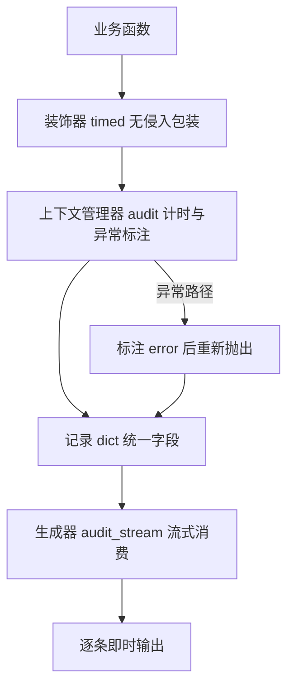
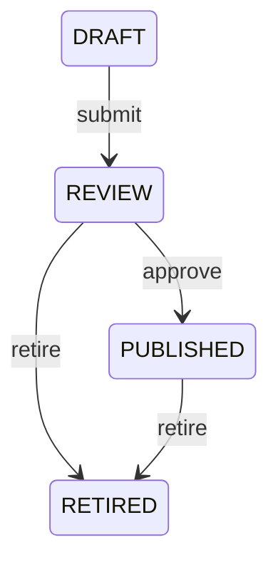
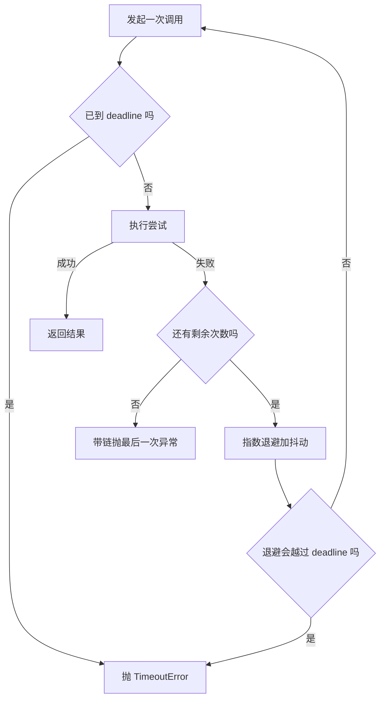
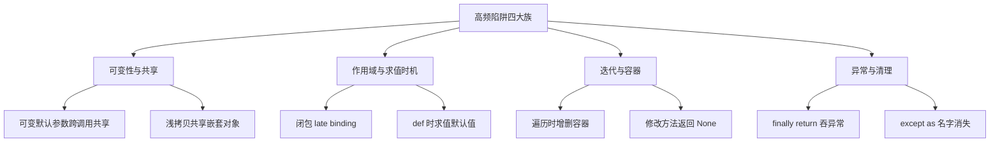

# 第 1 类 · 语言核心与底层(收官扩产)

> 本篇是语言核心类的收官批扩产(Q2876–Q2896),主题是综合应用与查漏补缺:装饰器、上下文管理器与生成器的组合实战,自定义容器的迭代协议全家桶,异常安全的资源注册表,weakref.finalize 级联清理链。
> 双层校验设计、frozen dataclass 的转换、枚举驱动的状态机、string.Template 安全替换、列表分块三式对比、字典合并的版本兼容、super 混入协作、__init_subclass__ 插件注册、contextvars 任务隔离、可失效的惰性属性缓存、deadline 感知的重试原语。
> 工程习惯收尾:可变默认参数的替代方案、json 往返一致性测试、代码 golf 反模式与命名自查清单;最后上下两题把全类高频面试陷阱收拢成可运行的总结。
> 所有代码仅标准库、可直接运行;均已在本机 CPython 3.9.6 逐题实跑通过。

### Q2876 · 装饰器 + 上下文管理器 + 生成器的组合实战:流式审计计时器

> 难度:★★★☆☆ | 标签:装饰器, 上下文管理器, 生成器, 组合设计

**问**:三种机制各自都会写,但真实项目里更常见的是组合使用。请现场设计一个小工具把装饰器、上下文管理器和生成器串起来,并说清楚每一层各负责什么。

**答**:划分职责是关键:**装饰器**负责「无侵入地进入」——`@timed` 把函数调用包起来,业务代码一行不改;**上下文管理器**负责「有保证的收尾」——`audit` 用 try/finally 保证无论成功还是抛错都会完成记录并上报;**生成器**负责「流式的消费」——`audit_stream` 逐条接收记录、边收边打印,不必攒完整报告才开始输出。三层叠加后,新增一个被审计函数只需要加一个装饰器,换一种输出方式只需要换掉 sink。组合的纪律是单向依赖:装饰器知道上下文管理器,上下文管理器知道生成器,反向谁也不依赖谁,这样每一层都能单独测试和复用。

```python
# file: code/01_语言核心与底层/q2876_combo_toolkit.py
"""装饰器 + 上下文管理器 + 生成器的组合实战:流式审计计时器。"""
import time
from contextlib import contextmanager
from functools import wraps


def audit_stream():
    """生成器:逐条接收审计记录并即时打印,体现惰性消费。"""
    while True:
        record = yield
        status = "OK " if record["ok"] else "ERR"
        tail = record["error"] or ""
        print(f"[{status}] {record['section']:<6} {record['elapsed']:.4f}s {tail}")


@contextmanager
def audit(section, sink):
    """上下文管理器:负责计时与异常标注,退出时把记录交给 sink。"""
    start = time.perf_counter()
    record = {"section": section, "ok": True, "error": None, "elapsed": 0.0}
    try:
        yield record
    except Exception as exc:
        record["ok"] = False
        record["error"] = type(exc).__name__
        raise
    finally:
        record["elapsed"] = time.perf_counter() - start
        sink.send(record)


def timed(sink):
    """装饰器工厂:把函数调用包进 audit 上下文。"""
    def decorator(func):
        @wraps(func)
        def wrapper(*args, **kwargs):
            with audit(func.__name__, sink):
                return func(*args, **kwargs)
        return wrapper
    return decorator


stream = audit_stream()
next(stream)                      # 预激生成器


@timed(stream)
def work(n):
    time.sleep(0.01)
    return n * 2


@timed(stream)
def boom():
    raise ValueError("boom")


if __name__ == "__main__":
    print("返回值:", work(21))
    try:
        boom()
    except ValueError as e:
        print("捕获业务异常:", e)
    stream.close()
```

**追问**:1) 为什么计时与上报放 finally 而不是放在 yield 之后?——异常路径上 yield 之后的代码不会执行,只有 finally 对成功与异常两路都有保证;先标注再 send 的顺序让记录不会因为异常而丢失。2) 组合的依赖方向为什么单向?——装饰器→上下文管理器→生成器逐层依赖、反向无依赖,每层可独立测试与替换(Q476 的 CM 实现原理是中间层地基);双向耦合会让「换 sink」波及装饰器。3) 与结构化日志/遥测的关系?——这是手写教学版;生产可用 OpenTelemetry/structured logging,但分层职责(无侵入进入、保证收尾、流式消费)是通用的。4) 生产陷阱?——生成器 sink 未被消费导致 send 阻塞;在装饰器里捕获异常不 re-raise;finally 里 sink 抛错顶掉业务异常(Q526)。

### Q2877 · 迭代协议的自定义容器:__iter__ 全家桶

> 难度:★★★☆☆ | 标签:迭代协议, 容器, 魔法方法

**问**:让你实现一个自定义容器类,除了存取还要支持 for、in、reversed 和 len,你会实现哪些方法?各自的语义要点是什么?

**答**:最小迭代面是四个魔法方法:`__len__` 报告大小、`__iter__` 返回独立迭代器、`__contains__` 自定义成员判定、`__reversed__` 自定义逆序。三个要点:第一,`__iter__` 用生成器实现时每次调用都创建新的迭代器,两个循环互不干扰,这是「容器」与「一次性迭代器」的分界线;第二,`__contains__` 不写也能工作——`in` 会回退到 `__iter__` 逐元素比较,显式实现可以换成更快的算法或不同语义;第三,`__reversed__` 同理,`reversed()` 的回退路径是 `__getitem__` 从尾部倒序索引,自己实现后容器就不需要支持下标访问。没实现 `__getitem__` 时 `pl[0]` 会明确抛 TypeError,这是「最小接口」的自觉:不承诺的能力就让它报错,而不是顺手全实现一遍。

```python
# file: code/01_语言核心与底层/q2877_custom_container.py
"""自定义容器的迭代协议全家桶:__iter__、__len__、__contains__、__reversed__。"""


class Playlist:
    """一个只进不改的播放列表:演示容器该实现的最小迭代面。"""

    def __init__(self, title):
        self.title = title
        self._tracks = []

    def add(self, name):
        self._tracks.append(name)
        return self            # 链式添加

    def __len__(self):
        return len(self._tracks)

    def __iter__(self):
        # 每次调用返回独立生成器:多个循环互不干扰
        index = 0
        while index < len(self._tracks):
            yield self._tracks[index]
            index += 1

    def __reversed__(self):
        yield from reversed(self._tracks)

    def __contains__(self, name):
        return name in self._tracks

    def __repr__(self):
        return f"Playlist({self.title!r}, {len(self)} tracks)"


if __name__ == "__main__":
    pl = Playlist("面试歌单").add("Map").add("Filter").add("Reduce")
    print(pl)
    print("顺序:", list(pl))
    print("倒序:", list(reversed(pl)))
    print("Filter 在列表里:", "Filter" in pl)     # 走 __contains__
    print("Zip 不在列表里:", "Zip" in pl)

    it1, it2 = iter(pl), iter(pl)
    next(it1)
    print("两个独立迭代器互不干扰:", next(it1), next(it2))

    try:
        pl[0]
    except TypeError as e:
        print("未实现 __getitem__ 时的下标访问:", e)
```

**追问**:1) 什么时候容器反而应该只支持一次迭代?——流式数据(文件行、网络包)天然只能消费一遍,此时 `__iter__` 返回 self 与同一个生成器,第二次 for 会静默拿到空,这正是 Q1296 讲过的事故来源。2) 全家桶的完整矩阵?——__iter__(可重复迭代的核心)、__next__(迭代器)、__len__/__getitem__/__contains__/__reversed__;实现了 __iter__ 返回新迭代器,其余多可由 Mixin(Sequence)或自动回退获得。3) 与生成器实现的取舍?——容器类要「可重复 + 协议齐全」;一次性流用生成器函数;两者按生命周期语义选(Q437)。4) 生产陷阱?——把生成器当容器返回(二次为空);__getitem__ 旧协议混入新代码;__len__ 与实际产出不一致破坏 len 语义。

### Q2878 · 异常安全的资源注册表:注册即事务

> 难度:★★★★☆ | 标签:异常安全, 注册表, 事务回滚

**问**:一个注册表的 register 要连续执行校验、入表、挂钩子好几步,中途任何一步抛异常怎么办?怎么保证不留下半成品状态?

**答**:思路是「注册即事务」:进入 register 时先对内部状态做浅快照(对 dict 和 list 各复制一层容器本身,不深拷贝资源对象),后续任何一步抛异常,就在 except 里把快照写回去再重新 raise。三个要点:第一,快照必须覆盖所有会被写的容器,漏一个就会出现「校验过了但没入表」之类的半注册状态;第二,except 捕 BaseException 而不只是 Exception——KeyboardInterrupt 打断注册同样不能留下脏状态,拦完必须 raise,绝不吞;第三,浅快照够用的前提是注册过程不原地改写共享对象的历史,如果会改,就得深拷贝或改用逆向操作回滚。校验失败、重复注册、副作用阶段失败三类异常实测之后,注册表始终与注册前完全一致。

```python
# file: code/01_语言核心与底层/q2878_safe_registry.py
"""异常安全的资源注册表:注册即事务,任一步失败整体回滚。"""


class Registry:
    """资源注册表:register 里的每一步都成功才生效,否则回滚到快照。"""

    def __init__(self):
        self._items = {}          # name -> 资源描述
        self._hooks = []          # name -> 附加副作用记录

    def register(self, name, resource, validate):
        snapshot = (dict(self._items), list(self._hooks))   # 浅快照:容器历史不被原地改写
        try:
            if name in self._items:
                raise KeyError(f"重复注册:{name}")
            validate(name, resource)          # 第一步:校验,可能抛异常
            self._items[name] = resource      # 第二步:入表
            if resource.startswith("net:"):   # 第三步:附加副作用,模拟可能失败
                self._hooks.append((name, "keepalive"))
            if name == "bad":                 # 模拟第三步失败
                raise RuntimeError("副作用阶段失败")
        except BaseException:
            self._items, self._hooks = snapshot
            raise
        return self

    def __repr__(self):
        return f"Registry(items={sorted(self._items)}, hooks={self._hooks})"


def validate_nonempty(name, resource):
    if not name:
        raise ValueError("名字不能为空")
    if not isinstance(resource, str) or not resource:
        raise ValueError("资源必须是非空字符串")


if __name__ == "__main__":
    reg = Registry()
    reg.register("db", "sqlite:mem", validate_nonempty)
    reg.register("net", "net:host", validate_nonempty)
    print("两次成功后:", reg)

    try:
        reg.register("db", "mysql:xx", validate_nonempty)   # 重复注册
    except KeyError as e:
        print("重复注册被拒:", e)

    try:
        reg.register("bad", "net:x", validate_nonempty)     # 第三步失败
    except RuntimeError as e:
        print("副作用失败被拒:", e)

    try:
        reg.register("", "", validate_nonempty)             # 校验失败
    except ValueError as e:
        print("校验失败被拒:", e)

    print("所有失败后注册表保持一致:", reg)
```

**追问**:1) 快照回滚与逆向操作回滚怎么选?——快照实现简单、正确性直观,代价是每次注册复制容器,适合小注册表;逆操作省内存但要为每一步写 undo,undo 自身失败还得处理,复杂度高一档。2) 「注册即事务」的完整语义?——全部校验通过才动手(Q1287 validate-then-commit);失败恢复原状(快照 restore 或逆序 undo);并发下注册表操作要锁保护。3) 与 ExitStack 事务式交接的对照?——ExitStack 管资源清理路径(pop_all,Q1816);注册表管数据状态回滚;两者可组合(状态回滚 + 资源清理)。4) 生产陷阱?——半注册状态残留(异常路径);undo 链中途失败的语义未定义;锁外读快照导致脏读。

### Q2879 · weakref.finalize 的清理链:对象消亡触发的级联释放

> 难度:★★★★☆ | 标签:weakref, finalize, 资源清理

**问**:对象持有临时文件、连接这类外部资源,想让它「死的时候」自动清理,为什么推荐 weakref.finalize 而不是 __del__?

**答**:`weakref.finalize(obj, func, *args)` 注册一个「对象消亡后执行」的回调,比 `__del__` 安全在三点:第一,回调与参数由 finalize 注册表**强引用**,只要不把 self 或绑定方法传进去,对象就能正常回收——本例用 staticmethod 把 path 和 user 变成普通数据再闭包,这是最常见的正确姿势;第二,回调至多执行一次,显式 close 与对象消亡两条清理路径天然幂等,`alive` 属性还能查询状态;第三,回调里的异常只会打到 stderr,不会像 `__del__` 那样在解释器退出或半析构状态下制造不可预测的二次伤害,并且解释器退出时自带 atexit 兜底。级联的思路是把「该清理什么」编码成回调参数链:文件路径、注销句柄都作为参数闭包进 finalize,对象一死整条链依次执行,本机实测 bob 的临时文件在引用归零后立即被删除。

```python
# file: code/01_语言核心与底层/q2879_finalize_chain.py
"""weakref.finalize 清理链:对象消亡触发的级联资源释放。"""
import gc
import os
import tempfile
import weakref


class Session:
    """持有临时文件;对象消亡时由 finalize 回调清理,回调不持有 self。"""

    def __init__(self, user):
        self.user = user
        fd, path = tempfile.mkstemp(prefix="sess_")
        os.close(fd)
        self.path = path
        # 关键:回调与参数必须是普通函数和数据,一旦引用 self 对象就永远不死
        self._finalizer = weakref.finalize(self, Session._cleanup, path, user)

    @staticmethod
    def _cleanup(path, user):
        os.unlink(path)
        print(f"  finalize 触发:{user} 的临时文件已删除")

    def close(self):
        """显式关闭:finalize 至多执行一次,重复调用是安全的。"""
        if self._finalizer.alive:
            self._finalizer()
        print(f"  close {self.user}:alive={self._finalizer.alive}")


if __name__ == "__main__":
    sessions = [Session("alice"), Session("bob")]
    paths = [s.path for s in sessions]
    print("临时文件存在:", all(os.path.exists(p) for p in paths))

    print("alice 走显式 close:")
    sessions[0].close()
    print("重复 close:")
    sessions[0].close()

    print("bob 走对象消亡触发的隐式清理:")
    del sessions[1]
    gc.collect()                 # CPython 引用归零即触发,collect 只是兜底

    print("bob 的临时文件已不存在:", not os.path.exists(paths[1]))
```

**追问**:1) 如果把 self 当参数传给了 finalize 会怎样?——回调持有对象强引用,对象永远到不了引用计数零,finalize 永远不触发,资源静默泄漏,这是 finalize 最经典的误用。2) 级联清理链的机制?——资源对象 A finalize 触发时释放它持有的 B,B 的 finalize 再触发下一层——清理链按引用关系自然级联;或显式管理「关闭组」。3) finalize 的正确参数?——传「资源句柄/标识」(fd、连接对象)而不是宿主 self(Q488);回调不能引用目标;detach 显式注销。4) 生产陷阱?——self 进回调(永不回收);回调里抛异常被吞(Q1561 unraisable);级联链中某层清理失败卡住下游;fork 后 finalize 注册表重复触发。

### Q2880 · 类型注解与运行时校验的双层设计

> 难度:★★★☆☆ | 标签:typing, 运行时校验, 边界

**问**:既然有 mypy 这类静态检查,运行时还需要校验吗?如果需要,校验应该加在哪些位置?

**答**:两层各管一段:**静态层**覆盖全部内部调用,注解让 mypy 与 IDE 在开发期拦截类型错误,运行时零开销;**运行层**只守「不可信边界」——HTTP 入参、CLI 参数、外部服务返回值这些静态分析够不到的地方。实测两万次调用,带校验路径明显慢于纯调用,所以原则是「边界校验一次,内部裸奔」:`get_type_hints` 在入口把注解转成可执行检查,内部函数保持只写注解、不写 isinstance 噪音。这样代码不会出现「每个函数开头五行检查」的灾难,也不会因为加了运行时校验而顶掉静态检查的价值。分工口诀:注解是给人与静态工具的契约,边界校验是给运行时数据的地界,不要让任何一层越界干活。

```python
# file: code/01_语言核心与底层/q2880_two_layer_validation.py
"""类型注解与运行时校验的双层设计:静态层管全程,运行层只守边界。"""
import timeit
from typing import get_type_hints


def create_user(name: str, age: int) -> dict:
    """内部函数:只靠注解给静态检查,不做任何运行时检查。"""
    return {"name": name.title(), "age": age, "adult": age >= 18}


def validate_call(func, *args):
    """边界校验器:入口处按注解做一次运行时检查,再放行。"""
    hints = get_type_hints(func)
    param_names = func.__code__.co_varnames[:func.__code__.co_argcount]
    for value, pname in zip(args, param_names):
        expected = hints.get(pname)
        if expected is not None and not isinstance(value, expected):
            raise TypeError(f"参数 {pname} 期望 {expected.__name__},实际 {type(value).__name__}")
    return func(*args)


if __name__ == "__main__":
    print("合法调用:", validate_call(create_user, "alice", 30))

    try:
        validate_call(create_user, "bob", "30")
    except TypeError as e:
        print("边界拦截:", e)

    # 内部调用路径不做校验:正确性交给静态检查,性能留给运行时
    cost_checked = timeit.timeit(lambda: validate_call(create_user, "alice", 30), number=20000)
    cost_plain = timeit.timeit(lambda: create_user("alice", 30), number=20000)
    print(f"2 万次:带校验 {cost_checked:.3f}s vs 纯调用 {cost_plain:.3f}s")
    print("结论:校验只放在边界,内部调用保持零开销")
```

**追问**:1) isinstance 校验拦不住什么?——bool 冒充 int(isinstance(True, int) 为真)、容器内元素的类型(只查外壳不查内容)、鸭子类型对象,严格边界要靠 pydantic 这类带类型收敛的校验器或手写字段级检查。2) 双层设计的职责切分?——静态层(mypy/pyright)管「代码内部的类型正确」;运行时层管「边界不可信输入」(pydantic/Q467);运行时校验成本只在边界付一次。3) 运行时校验的实现层级?——顶层 isinstance 快筛 → 字段级断言(值域/元素类型)→ pydantic 完整 schema;按风险选深度,不做「全量反射校验」的过度工程。4) 生产陷阱?——bool 冒充 int 進数值运算(Q539);嵌套容器只查外壳;校验层与注解两套口径漂移。



### Q2881 · dataclass 的冻结与转换:from_dict、to_dict 与 replace

> 难度:★★★☆☆ | 标签:dataclass, frozen, 不可变对象

**问**:frozen dataclass 怎么和 dict 世界打交道?想「改」一个冻结对象时正确姿势是什么?

**答**:frozen=True 之后的核心姿势是「转换而非修改」:`from_dict` 作为 classmethod 承接外部输入并完成归一化,比如字符串 "1.5" 转 float;`to_dict` 或 `dataclasses.asdict` 负责输出;`replace` 负责派生——moved 返回一个全新对象,原对象原封不动。这组 API 把可变性赶出类型边界:对象构造完成即不可变,所有「变化」都表达为新对象,因此天然可哈希、可进集合、可作 dict 键、可安全共享给并发代码。实测里 `p.x = 99` 抛 FrozenInstanceError,而集合去重后 p 与 p.moved() 因为值相等只算一个元素。一个性能注意点:`asdict` 是递归深转换,嵌套 dataclass、list、dict 全部展开,大结构频繁转换时自写只取所需字段的 to_dict 更快。

```python
# file: code/01_语言核心与底层/q2881_frozen_dataclass.py
"""frozen dataclass 的冻结与转换:from_dict、to_dict 与 replace 组合。"""
import dataclasses
from dataclasses import dataclass, replace


@dataclass(frozen=True)
class Point:
    x: float
    y: float

    @classmethod
    def from_dict(cls, raw):
        """外部输入到冻结对象:入口处完成归一化。"""
        return cls(x=float(raw["x"]), y=float(raw["y"]))

    def to_dict(self):
        return dataclasses.asdict(self)

    def moved(self, dx=0.0, dy=0.0):
        """派生修改:replace 返回新对象,原对象不变。"""
        return replace(self, x=self.x + dx, y=self.y + dy)


if __name__ == "__main__":
    p = Point.from_dict({"x": "1.5", "y": 2})
    print(p, "|", p.to_dict())

    q = p.moved(dx=1.0)
    print("派生新对象:", q, "| 原对象不变:", p)

    try:
        p.x = 99
    except dataclasses.FrozenInstanceError as e:
        print("冻结保护:", e)

    print("冻结对象可哈希,集合去重后:", len({p, q, p.moved()}))
```

**追问**:1) replace 能改 frozen 对象的原理是什么?——它内部用 object.__setattr__ 绕过冻结保护构造新实例再返回,逃生门只存在于 dataclasses 的实现里,业务代码不该模仿这个写法。2) from_dict/to_dict 的设计要点?——from_dict 在边界做校验与类型收敛(配合 Q2880 双层);to_dict 决定序列化字段(排除内部状态);嵌套结构递归转换;round-trip 测试保证一致(Q2892)。3) 与 replace 的分工?——replace 管字段级派生(Q1830,重跑 __post_init__);from_dict 管外部输入;两者都走 __init__ 才能保持不变式。4) 生产陷阱?——业务代码模仿 object.__setattr__ 绕冻结;from_dict 不校验(信任边界失守);嵌套对象浅转换共享内层可变状态。

### Q2882 · 枚举驱动的状态机:事件表迁移与非法迁移防护

> 难度:★★★★☆ | 标签:状态机, Enum, 设计模式

**问**:对象有一组合法状态和迁移规则,怎么用枚举把状态机写得既防错又好维护?

**答**:骨架是两个 Enum 加一张迁移表:`State` 枚举状态、`Event` 枚举事件、`TRANSITIONS` 用「当前状态,事件」元组作键映射到目标状态。`fire` 只做三件事:查表、查不到抛 ValueError、查到就迁移并记入 history。三个工程收益:第一,非法迁移在运行期立刻报错,而不是把错误状态悄悄带进业务;第二,迁移表本身是可遍历的数据,写测试可以穷举全表、画图可以全表导出(见 Q2885 之后的迁移图),不会漏分支;第三,加状态加事件只改数据和表,fire 的逻辑永远不动。元组键优于字典套字典的地方是全表一眼看全、便于做穷尽性检查;嵌套字典只在迁移需要挂大量附加动作时才值得引入。

```python
# file: code/01_语言核心与底层/q2882_enum_state_machine.py
"""枚举驱动的状态机:事件表迁移、非法迁移防护与历史轨迹。"""
from enum import Enum


class State(Enum):
    DRAFT = "draft"
    REVIEW = "review"
    PUBLISHED = "published"
    RETIRED = "retired"


class Event(Enum):
    SUBMIT = "submit"
    APPROVE = "approve"
    RETIRE = "retire"


TRANSITIONS = {
    (State.DRAFT, Event.SUBMIT): State.REVIEW,
    (State.REVIEW, Event.APPROVE): State.PUBLISHED,
    (State.REVIEW, Event.RETIRE): State.RETIRED,
    (State.PUBLISHED, Event.RETIRE): State.RETIRED,
}


class Document:
    def __init__(self, title):
        self.title = title
        self.state = State.DRAFT
        self.history = [State.DRAFT]

    def fire(self, event):
        key = (self.state, event)
        if key not in TRANSITIONS:
            raise ValueError(f"状态 {self.state.value} 不接受事件 {event.value}")
        self.state = TRANSITIONS[key]
        self.history.append(self.state)
        return self.state


if __name__ == "__main__":
    doc = Document("设计文档")
    for ev in (Event.SUBMIT, Event.APPROVE):
        doc.fire(ev)
        print(f"事件 {ev.value:<8} -> 状态 {doc.state.value}")

    try:
        doc.fire(Event.SUBMIT)
    except ValueError as e:
        print("非法迁移被拒:", e)

    doc.fire(Event.RETIRE)
    print("完整轨迹:", " -> ".join(s.value for s in doc.history))
```

**追问**:1) 状态迁移要不要支持带条件的 guard?——把谓词函数放进表里,fire 依次匹配第一个 guard 为真的迁移;条件一多说明该拆状态或上规则引擎,别让表退化成嵌套 if。2) 状态机的完整工程要点?——表驱动(状态×事件→目标);非法迁移显式拒绝(可配置「静默/抛错」);迁移钩子(进/出动作);与 Enum 成员身份配合(Q512/2882)。3) 与并发的关系?——状态变更要锁保护(check-then-act);幂等重试(同一事件重复到同一状态);对外事件流(状态变更通知)。4) 生产陷阱?——条件分支藏在业务代码里没有状态机口径;非法迁移被静默吞掉;迁移动作抛错后状态不一致(要事务式:先校验后迁移)。

### Q2883 · 字符串模板的安全替换:string.Template 与 safe_substitute

> 难度:★★☆☆☆ | 标签:string.Template, 模板, 安全

**问**:要让用户编辑一段带占位符的模板文本再渲染,用 str.format 安全吗?标准库有什么更合适的选择?

**答**:用户可编辑的模板不要用 `str.format`——format 的占位符支持属性路径与下标,`{0.__class__}` 这类写法能从格式串触达对象内部,历史上是真实的模板注入漏洞。标准库的正确答案是 `string.Template`:占位符只有 `$name` 与 `${name}` 两种形式,不解析任何属性访问,用户写不出逃逸路径。两种渲染模式分工明确:`substitute` 严格模式缺变量就抛 KeyError,适合程序内模板,错了立刻暴露;`safe_substitute` 缺啥留啥,适合草稿渲染;`$$` 是字面美元符的转义。缺变量的 KeyError 还可以在自己的 render 里拦下来翻译成业务可读的提示,如本例所示。一句话总结:模板来源越不可信,越要选表达能力更弱的模板引擎,「弱」在这里是安全属性。

```python
# file: code/01_语言核心与底层/q2883_string_template.py
"""string.Template 的安全替换:substitute 与 safe_substitute 的分工。"""
from string import Template

WELCOME = Template("你好 $name,你的订单 $order_id 已${action}。")


def render(template_text, mapping):
    """渲染用户可编辑的模板:缺变量时给出可读的错误。"""
    try:
        return Template(template_text).substitute(mapping)
    except KeyError as e:
        raise KeyError(f"模板缺少变量 {e},请检查上游数据") from None


if __name__ == "__main__":
    print("完整映射:", WELCOME.substitute(name="小明", order_id="A1024", action="发货"))

    try:
        WELCOME.substitute(name="小明")
    except KeyError as e:
        print("substitute 严格模式:", e)

    print("safe 模式缺啥留啥:", WELCOME.safe_substitute(name="小明"))

    user_typed = "你好 $name,余额 $$balance"
    print("用户输入模板:", render(user_typed, {"name": "小红", "balance": "100"}))
```

**追问**:1) safe_substitute 会不会把错误藏起来?——会,占位符原样出现在输出里就是「数据没配上」的信号,最好在渲染后用正则扫一遍残留的占位符并报警,而不是默默发出去。2) Template 与 format 的安全分界?——Template 只做 $identifier 纯替换、无属性链穿越;format 可被 {0.__init__.__globals__} 攻击(Q520);外部可控模板只用 Template/沙箱引擎。3) 替换缺失的三档语义?——substitute 抛 KeyError(严格)、safe_substitute 保留原样(宽容)、渲染后扫描(兜底检测)——严格与宽容按场景显式选择。4) 生产陷阱?——safe 输出直接发给用户(残留占位符);模板与数据键漂移无检测;i18n 模板混用 format。

### Q2884 · 列表分块的三种实现对比:切片、islice 与步进生成器

> 难度:★★★☆☆ | 标签:itertools, islice, 分块

**问**:把序列按固定大小分块,至少能写出三种实现,各自的适用边界是什么?

**答**:三种实现代表三个流派:**切片法**一行出列表,依赖 len 与下标,只吃序列,但对 list 输入速度最快;**islice 法**把 `iter(iterable)` 包住,循环里 `list(islice(it, size))` 直到取空,是唯一能吃任意迭代器(生成器、文件、网络流)的版本,数据不必先进内存;**步进生成器**与切片法等价但惰性产出,适合「是序列但很大」的场景。实测一万元素分块,切片法略快于 islice 法,差距来自 islice 的调用开销与块构造方式,量级上可以忽略。选型口诀:手里是 list 就切片,手里是流就 islice,要惰性就包一层生成器。islice 法还有一个语义细节:它每次消费的都是同一个迭代器,游标位置由 islice 自己推进,这正是它能处理无长度流的原因。

```python
# file: code/01_语言核心与底层/q2884_chunk_list.py
"""列表分块的三种实现对比:切片、islice 与步进生成器。"""
import timeit
from itertools import islice


def chunk_slice(seq, size):
    """切片法:简单直观,每次产生新列表,仅接受序列。"""
    return [seq[i:i + size] for i in range(0, len(seq), size)]


def chunk_islice(iterable, size):
    """islice 法:吃任意迭代器,惰性产出块,流式友好。"""
    it = iter(iterable)
    while True:
        block = list(islice(it, size))
        if not block:
            return
        yield block


def chunk_step(seq, size):
    """步进生成器:仅适合序列,切片语义与切片法一致但惰性。"""
    for i in range(0, len(seq), size):
        yield seq[i:i + size]


if __name__ == "__main__":
    data = list(range(10))
    print("切片法:", chunk_slice(data, 3))
    print("islice 法:", [b for b in chunk_islice(data, 3)])
    print("步进法:", list(chunk_step(data, 3)))

    print("islice 能吃生成器:", [b for b in chunk_islice((x * x for x in range(7)), 3)])
    print("尾部不足一块:", chunk_slice(data, 4))

    t1 = timeit.timeit(lambda: chunk_slice(list(range(10000)), 100), number=50)
    t2 = timeit.timeit(lambda: list(chunk_islice(list(range(10000)), 100)), number=50)
    print(f"1 万元素 50 次:切片 {t1:.3f}s,islice {t2:.3f}s")
```

**追问**:1) islice 版为什么不能改写成推导式?——推导式里没有地方保存「上一次消费到哪里」的游标,islice 的分块必须依赖同一个被反复消费的迭代器,这正是它与切片法的本质差别。2) 三种实现的取舍?——切片法:仅适用 list/序列(可下标);islice 法:任意迭代器,游标隐藏在迭代器状态;步进生成器:range(i, len, n) 取样式分块;数据形态决定选型。3) 流式场景的意义?——文件/网络流不能 materialize,islice 分块是「固定批次消费」的标准姿势;配合 chunked 上传/批处理。4) 生产陷阱?——对生成器用切片法(TypeError);最后一块不足静默(要显式校验);islice 在循环外复用同一迭代器的并发竞态。

### Q2885 · 字典合并的版本兼容写法:管道、解包与 update

> 难度:★★☆☆☆ | 标签:dict, 版本兼容, PEP 584

**问**:合并两个字典有几种写法?如果库要兼容 3.8 甚至更老的 Python,应该用哪种?

**答**:三种主流写法按版本排:`base | extra` 是 3.9 引入的管道运算符(PEP 584),语义最直白;`{**base, **extra}` 从 3.5 起可用,解包重建新字典,是跨老版本的首选;`dict(base).update(extra)` 任何版本都能跑,复制后原地改。三者都是**右优先**:键冲突时 extra 的值胜出,且都不动入参。兼容性之外的必讲陷阱是**浅合并**:任何一种写法遇到嵌套 dict 都是整个子字典被右值替换,而不是递归合并,配置合并场景这是高频事故源。工程建议:库代码用 `{**a, **b}` 写到最低支持版本淘汰为止,应用代码在 3.9+ 直接用管道运算符,嵌套配置老老实实写递归合并函数,别指望运算符替你深合并。

```python
# file: code/01_语言核心与底层/q2885_dict_merge.py
"""字典合并的版本兼容写法:管道运算符、解包与 update 的取舍。"""
import sys


def merge_pipe(base, extra):
    """3.9+ 可用:新增的 | 运算符,右优先,返回新字典。"""
    return base | extra


def merge_unpack(base, extra):
    """3.5+ 可用:解包重建新字典,跨老版本的首选写法。"""
    return {**base, **extra}


def merge_update(base, extra):
    """update 法:复制后原地改,语义与上面两种等价。"""
    out = dict(base)
    out.update(extra)
    return out


if __name__ == "__main__":
    base = {"a": 1, "b": 2}
    extra = {"b": 20, "c": 30}

    print("管道法:", merge_pipe(base, extra))
    print("解包法:", merge_unpack(base, extra))
    print("update 法:", merge_update(base, extra))

    print("base 未被修改:", base)
    print("右优先覆盖:", merge_unpack(base, extra)["b"])
    print("本机版本:", f"{sys.version_info.major}.{sys.version_info.minor}")

    # 常见坑:合并是浅的,嵌套结构被整体替换而不是递归合并
    nested_a = {"db": {"host": "a", "port": 1}}
    nested_b = {"db": {"port": 2}}
    print("浅合并覆盖整个子字典:", {**nested_a, **nested_b})
```

**追问**:1) 标准库有现成的深合并吗?——没有,核心团队多次拒绝加入;自己写十几行递归(两边都是 dict 才下钻,否则右覆盖),或用第三方 deepmerge 类小库。2) 三种合并的语义边界?——| 与 {**} 浅合并(右覆盖),update 原地(Q480);深合并递归下钻;列表是覆盖还是拼接要显式决策——语义歧义正是「标准库不收」的原因。3) 深合并的实现纪律?——只对「两边都是 dict」下钻;冲突策略可配置;环引用防死递归;配置合并建议显式分层(ChainMap,Q1534)而不是深合并。4) 生产陷阱?——深合并把列表当 dict 递归崩;环引用死递归;「覆盖 vs 合并」语义与调用方预期不一致;为深合并引入重依赖。



### Q2886 · super 在多继承混入中的协作:MRO 接力与默认落地

> 难度:★★★★☆ | 标签:super, 多继承, Mixin, MRO

**问**:写 Mixin 有一条铁律「方法里必须调用 super」,为什么?不调会怎样?

**答**:Mixin 的方法不知道自己最终被排进什么 MRO,`super().fetch(key)` 不是「调父类」,而是「调 MRO 里的下一个类」——可能是另一个 Mixin,也可能一路传到核心实现。本例 Client 的执行序是缓存 miss 到日志到核心取数,每一层做一件事再交棒。三个要点:第一,混入方法要**无条件**调 super,少调一次就把链条后面的实现整段吞掉,这是多继承最隐蔽的 bug;第二,`__init__` 同样要接力并用 `*args, **kwargs` 透传参数,否则 MRO 上某个类的初始化会被跳过;第三,接力必须有终点——终点类的方法不再调 super,链条断在 object 上时 `super().fetch` 会抛 AttributeError,本例的 Lone 演示了这条路。缺一层混入并不可怕,BrokenClient 照常工作,MRO 只要求终点存在。

```python
# file: code/01_语言核心与底层/q2886_cooperative_mixin.py
"""super 在多继承混入中的协作:MRO 接力与 object 默认落地。"""


class Fetcher:
    """核心实现:混入链最终接力到这里,object 是隐式终点。"""

    def fetch(self, key):
        return f"data:{key}"


class LoggingMixin:
    def fetch(self, key):
        print(f"  [log] 进入 {type(self).__name__}.fetch key={key}")
        return super().fetch(key)


class CacheMixin:
    def __init__(self, *args, **kwargs):
        super().__init__(*args, **kwargs)      # 参数沿 MRO 继续传递
        self.cache = {}

    def fetch(self, key):
        if key in self.cache:
            print(f"  [cache] 命中 {key}")
            return self.cache[key]
        value = super().fetch(key)
        self.cache[key] = value
        return value


class Client(CacheMixin, LoggingMixin, Fetcher):
    pass


class BrokenClient(LoggingMixin, Fetcher):
    """少一层混入也能工作:MRO 跳过缺失能力,只要终点存在。"""
    pass


if __name__ == "__main__":
    print("MRO:", [cls.__name__ for cls in Client.__mro__])
    c = Client()
    print("第一次:", c.fetch("user:1"))
    print("第二次:", c.fetch("user:1"))

    b = BrokenClient()
    print("缺 CacheMixin 的客户端:", b.fetch("user:1"))

    # 反例:混入链上没有可接力的终点,super 停在 object
    class LoneMixin:
        def fetch(self, key):
            return super().fetch(key)

    class Lone(LoneMixin):
        pass

    try:
        Lone().fetch("x")
    except AttributeError as e:
        print("接力断在 object:", e)
```

**追问**:1) 怎么在开发期发现「忘了调 super」的混入?——单元测试断言整条链的组合行为(缓存命中不该再打日志之类),或用 inspect 遍历 MRO 静态检查每个中间类的方法体里有 super 调用。2) MRO 接力的完整纪律?——每个混入方法第一行 super().method(**kwargs)(转发不认领的参数,Q1808);基类实现兜底落地;默认值冲突由 MRO 序决定——「mixin 在前、基类在后」。3) 转发协议?——认领自己的 kwargs、原样转发其余;耗尽到 object.__init__ 必须为空;**kwargs 转发链的签名漂移要 review(Q2373)。4) 生产陷阱?——某层不调 super 截断链(本题);object 收到残留 kwargs TypeError;菱形继承重复初始化。

### Q2887 · __init_subclass__ 的插件自动注册:声明即注册

> 难度:★★★★☆ | 标签:__init_subclass__, 插件注册, 元编程

**问**:实现一个插件系统,要求子类定义出来就自动进注册表、重名立刻报错、缺方法立刻报错,用标准库怎么做到?

**答**:`__init_subclass__` 是比 metaclass 轻得多的钩子:基类定义一次,每个子类**在 class 语句执行的那一刻**被回调,拿到类对象与 class 语句传来的关键字(name=、priority=)。注册逻辑三步:键名取显式 name 或类名小写;重名抛 ValueError;按 required 元组检查必需方法,缺失抛 TypeError。对比装饰器注册器(Q442),它的优势是**注册无法被忘记**——写对了继承就一定注册,import 即生效,漏写装饰器这类静默事故在结构上不可能发生,而且错误在定义期暴露,比运行期首次调用才发现早得多。注意注册表是类属性 dict,测试之间要清空或重载模块做隔离,否则前一个测试注册的插件会漏到后一个测试里。

```python
# file: code/01_语言核心与底层/q2887_plugin_registry.py
"""__init_subclass__ 的插件自动注册:声明即注册,重名即报错。"""


class PluginBase:
    registry = {}

    def __init_subclass__(cls, name=None, priority=100, **kwargs):
        super().__init_subclass__(**kwargs)
        key = name or cls.__name__.lower()
        if key in PluginBase.registry:
            occupied = PluginBase.registry[key].__name__
            raise ValueError(f"插件名重复:{key} 已被 {occupied} 占用")
        required = getattr(cls, "required", ())
        missing = [m for m in required if not callable(getattr(cls, m, None))]
        if missing:
            raise TypeError(f"插件 {cls.__name__} 缺少必需方法:{missing}")
        cls.priority = priority
        PluginBase.registry[key] = cls

    @classmethod
    def sorted_plugins(cls):
        return sorted(cls.registry.items(), key=lambda kv: kv[1].priority)


class Cleaner(PluginBase, name="clean", priority=10):
    required = ("run",)

    def run(self):
        return "cleaning"


class Report(PluginBase, name="report", priority=50):
    required = ("run",)

    def run(self):
        return "reporting"


if __name__ == "__main__":
    for key, cls in PluginBase.sorted_plugins():
        print(f"插件 {key:<7} priority={cls.priority:<4} run -> {cls().run()}")

    try:
        class Dup(PluginBase, name="clean"):
            def run(self):
                return "dup"
    except ValueError as e:
        print("重名拦截:", e)

    try:
        class HalfDone(PluginBase, name="half"):
            required = ("run",)
    except TypeError as e:
        print("缺方法拦截:", e)
```

**追问**:1) 和 ABC 的 abstractmethod 有什么分工?——abstractmethod 拦的是「实例化时缺方法」,运行到实例化才报;__init_subclass__ 拦的是「定义时缺方法」,还能顺带做注册、改名、优先级这类 ABC 管不了的事,两者可以叠加使用。2) 声明即注册的完整链?——子类定义时 __init_subclass__ 校验 + 注册(Q455);cls.__dict__ 检查防止继承误判;kwargs 携带声明式配置;与 __set_name__ 管字段级互补(Q1834)。3) 与元类的取舍?——90% 场景 __init_subclass__ 足够且无元类冲突;需要控制类创建全程(__prepare__/__call__)才上元类。4) 生产陷阱?——钩子抛错让 import 失败(报错要带类名);注册表被子类覆盖(Q455);校验用 dir(cls) 误放行。

### Q2888 · 上下文变量的任务隔离:ContextVar 的传播边界

> 难度:★★★☆☆ | 标签:contextvars, asyncio, 线程

**问**:要在协程和线程里分别存「当前请求 ID」,threading.local 有什么问题?ContextVar 是怎么解决任务隔离的?

**答**:`threading.local` 以**线程**为隔离边界,协程场景下同一个线程串行跑成百上千个任务,前一个任务 set 的值会泄漏给后一个任务,这正是 Q1281 讲过的请求上下文串号事故。`ContextVar` 以**上下文**为边界:每个 asyncio Task 启动时复制当前上下文,任务里 set 只改自己的副本,await 之后读到的仍是本任务的值——三个并发任务各自拿到 A-req、B-req、C-req,任务之外仍是默认值。线程场景 ContextVar 同样成立,每个线程有独立上下文,线程里的 set 不影响主线程。传播方向是单向的:父上下文复制给任务,子任务写不回父;这正是日志 trace、请求 ID、事务标记想要的语义。

```python
# file: code/01_语言核心与底层/q2888_contextvar_isolation.py
"""上下文变量的任务隔离:ContextVar 在协程与线程里的传播边界。"""
import asyncio
import threading
from contextvars import ContextVar

request_id = ContextVar("request_id", default="-")


async def handle(tag):
    request_id.set(f"{tag}-req")
    await asyncio.sleep(0.01)
    # await 之后仍看到本任务 set 的值:任务启动时复制了上下文
    return request_id.get()


async def main():
    results = await asyncio.gather(handle("A"), handle("B"), handle("C"))
    print("协程任务各自隔离:", results)
    print("任务外仍是默认值:", request_id.get())


def thread_worker(tag, out):
    out[tag] = request_id.get()          # 线程读自己上下文里的值
    request_id.set(f"{tag}-req")         # 只影响本线程


if __name__ == "__main__":
    asyncio.run(main())

    out = {}
    threads = [threading.Thread(target=thread_worker, args=(t, out)) for t in ("T1", "T2")]
    for t in threads:
        t.start()
    for t in threads:
        t.join()
    print("线程各自读到默认值:", out)
    print("主线程不受影响:", request_id.get())
```

**追问**:1) 把协程里的活儿丢进线程池,上下文还跟过去吗?——不跟,run_in_executor 在新线程里跑新上下文;需要时用 contextvars.copy_context 拿到副本,再以 ctx.run(func) 显式带过去。2) 传播边界的完整清单?——Task 创建拷贝快照(Q1281);线程池/子进程不带;第三方库回调可能丢上下文——横切信息(请求 id)显式传参比依赖隐式传播更稳。3) 与 threading.local 的对照?——contextvars 是协程粒度、Task 隔离;threading.local 是线程粒度、同线程协程共享(Q1281);混用两者的代码要明确边界。4) 生产陷阱?——日志/链路追踪 id 在线程池里丢失;依赖「隐式传播」跨边界;忘记 reset 污染下一请求。

### Q2889 · 惰性求值的属性缓存:可失效的 cached_property

> 难度:★★★☆☆ | 标签:cached_property, 惰性求值, 缓存

**问**:一个属性算起来很贵,想第一次访问才算、之后走缓存,数据变了还要能重算,有几种实现?怎么失效?

**答**:两条路线:**手写版**用 `@property` 加一个 `_stats = None` 的缓存槽,首次计算后写入,`invalidate()` 置 None 触发重算,失效时机完全自己掌控,适合知道「什么变化该失效什么」的领域对象;**cached_property 版**把结果直接写进实例 `__dict__`,同名键遮蔽类上的描述符,后续访问零开销,失效就是 `del instance.attr`,删除后下次访问自动重算。选型看失效语义:数据被原地修改时两个版本都不会自动感知,必须显式失效——这是缓存属性的共性,不存在免费的自动失效。线程维度上,functools.cached_property 的 3.8-3.11 版本自带类级写锁,并发首次访问不会重复计算(但争用高);3.12 起 gh-90459 移除了锁,并发首次访问可能重复计算(最后写入者胜);手写版要么接受偶发的重复计算,要么自己加锁。

```python
# file: code/01_语言核心与底层/q2889_lazy_cached_attr.py
"""惰性求值的属性缓存:手写可失效的缓存属性与 cached_property 对比。"""
import functools


class Report:
    """手写版:显式缓存槽 + invalidate 方法,失效时机自己掌控。"""

    def __init__(self, rows):
        self.rows = rows
        self._stats = None

    @property
    def stats(self):
        if self._stats is None:
            print("  -> Report 计算一次")
            total = sum(self.rows)
            self._stats = {"total": total, "mean": total / len(self.rows)}
        return self._stats

    def invalidate(self):
        self._stats = None


class Dataset:
    """cached_property 版:缓存藏在实例 __dict__,删除键即失效。"""

    def __init__(self, rows):
        self.rows = rows

    @functools.cached_property
    def summary(self):
        print("  -> Dataset 计算一次")
        return {"total": sum(self.rows), "count": len(self.rows)}


if __name__ == "__main__":
    r = Report([3, 1, 2])
    print(r.stats)
    print(r.stats)                 # 第二次读缓存,不再打印计算
    r.rows.append(100)
    r.invalidate()
    print("失效后重算:", r.stats)

    d = Dataset([1, 2, 3])
    print(d.summary)
    print("缓存在实例字典里:", "summary" in vars(d))
    del d.summary                  # 删除键即失效,下次访问重算
    print("删除键后重算:", d.summary)
```

**追问**:1) 为什么 cached_property 敢把缓存写进实例 __dict__?——属性查找顺序里实例 __dict__ 优先于类上的非数据描述符,首次经由描述符计算后,同名实例键从此短路掉描述符调用,这正是 Q452 那套「用完即拆」的机制。2) 可失效缓存的实现面?——invalidate 方法 pop 实例字典键(Q452);或主动重算后写回;失效点要明确(数据变更处);多线程并发首次访问有重复计算(缓存击穿最小模型)。3) 与 slots/frozen 的兼容?——slots 无 __dict__ 不适用(Q2074);frozen 不可变字段缓存要另找容器;3.12 前类级锁在嵌套访问时可能死锁(Q452)。4) 生产陷阱?——缓存值引用 self 的对象图滞留;失效逻辑遗漏(数据变了缓存没变);fork 前已缓存状态被子进程复制。

### Q2890 · 重试与超时的统一原语:deadline 感知的 run_with_retry

> 难度:★★★★☆ | 标签:重试, 超时, 指数退避

**问**:重试装饰器和超时控制经常各写各的,怎么把它们设计成一个统一原语?谁是第一公民?

**答**:统一的关键是让**整体 deadline 优先于重试次数**:`run_with_retry` 用 time.monotonic 记起点,每次尝试前查 deadline,失败后的退避延迟如果会越过 deadline 就直接放弃——宁可少试也不超时,比「试满 N 次再看」的写法体验好得多。退避用 `base_delay * 2 ** (i-1)` 指数增长加随机抖动,避免下游恢复瞬间被重试风暴再次打垮。三个设计点:第一,可重试异常用 retry_on 参数声明,默认只认自定义的 AttemptFailed,不盲目吞所有异常;第二,deadline 与 attempts 是「先到为准」的关系,次数耗尽抛最后一次异常并带 from exc 异常链,deadline 到点抛 TimeoutError;第三,用 monotonic 而不是 time.time,防止系统改墙钟把等待时间算错。本机实测三次抖动的下游在第 3 次成功,无恢复的下游被 deadline 在 0.09 秒截停。

```python
# file: code/01_语言核心与底层/q2890_retry_timeout.py
"""重试与超时的统一原语:deadline 感知的 run_with_retry。"""
import random
import time


class AttemptFailed(Exception):
    pass


def run_with_retry(func, args=(), kwargs=None, *, attempts=5,
                   base_delay=0.01, deadline_s=1.0, retry_on=(AttemptFailed,)):
    """统一原语:整体 deadline 优先于重试次数,指数退避加抖动。"""
    kwargs = kwargs or {}
    started = time.monotonic()
    last_exc = None
    for i in range(1, attempts + 1):
        if time.monotonic() - started >= deadline_s:
            raise TimeoutError(f"deadline 已到,共尝试 {i - 1} 次")
        try:
            return func(*args, **kwargs)
        except retry_on as exc:
            last_exc = exc
            if i == attempts:
                break
            delay = base_delay * 2 ** (i - 1) + random.uniform(0, base_delay)
            if time.monotonic() - started + delay > deadline_s:
                raise TimeoutError(f"退避将越过 deadline,放弃于第 {i} 次后") from exc
            time.sleep(delay)
    raise AttemptFailed(f"{attempts} 次尝试全部失败,最后一次:{last_exc!r}")


class Flaky:
    """模拟前几次必失败的下游调用。"""

    def __init__(self, fail_times=2):
        self.fail_times = fail_times
        self.calls = 0

    def __call__(self):
        self.calls += 1
        if self.calls <= self.fail_times:
            raise AttemptFailed(f"第 {self.calls} 次抖动")
        return "ok"


if __name__ == "__main__":
    random.seed(7)
    flaky = Flaky(fail_times=2)
    print("重试成功:", run_with_retry(flaky), "实际调用", flaky.calls, "次")

    always = Flaky(fail_times=99)
    try:
        run_with_retry(always, attempts=3, base_delay=0.005)
    except AttemptFailed as e:
        print("次数耗尽:", e)

    started = time.monotonic()
    try:
        run_with_retry(Flaky(fail_times=99), attempts=50, base_delay=0.05, deadline_s=0.12)
    except TimeoutError as e:
        print("deadline 截停:", e, f"耗时 {time.monotonic() - started:.2f}s")
```

**追问**:1) 整体 deadline 与单次调用超时的区别是什么?——deadline 是调用链共享的时间预算,层层传递逐段消耗;单次超时只约束一次调用,叠加重试可能远超用户耐心,所以统一原语必须以 deadline 为第一公民。2) run_with_retry 的设计要点?——每次重试前检查剩余预算;退避加抖动(Q443);只重试瞬时错误;预算耗尽抛聚合异常(带尝试次数);与单次超时取 min。3) 与 asyncio 的对接?——wait_for 单次、loop.time() 算剩余;gRPC deadline propagation 同构(Q1285)。4) 生产陷阱?——重试不查预算拖垮下游;单次超时×次数无界;退避无抖动的同步风暴;非幂等操作重试(Q443)。



### Q2891 · 可变默认参数的替代方案:None 哨兵、不可变收编与有意共享

> 难度:★★☆☆☆ | 标签:默认参数, 可变对象, 惯用法

**问**:可变默认参数是经典陷阱,替代方案有哪几类?可变默认值有没有「正确用法」?

**答**:三条正路对应三种意图:**None 哨兵**是默认首选——`tags=None` 在体内 `tags = [] if tags is None else list(tags)`,顺带用 list() 复制防御外部传入的共享引用;**不可变默认值**适合确实要「预先带着点东西」的场景,元组、frozenset、字符串天然安全;**default_factory** 是 dataclass 世界的对应解法,`field(default_factory=list)` 保证每实例新建容器。「反例转正」的第三条路也存在:`_registry={}` 这种共享默认值是进程内登记与记忆化的最小实现,前提是命名带下划线、注释声明意图,让评审知道这是特性不是手滑。判别标准一句话:默认值是否跨调用累积状态?是且非故意,改;是且故意,写清楚。

```python
# file: code/01_语言核心与底层/q2891_mutable_default.py
"""可变默认参数的替代方案:None 哨兵、不可变收编与有意共享。"""
import dataclasses


def add_tag(item, tags=None):
    """方案一:None 哨兵 + 体内新建;list(tags) 顺带防御外部共享引用。"""
    tags = [] if tags is None else list(tags)
    tags.append("new")
    return item, tags


def collect_point(x, y, seen=()):
    """方案二:不可变序列当默认值,天然无跨调用副作用。"""
    return x + y, seen


@dataclasses.dataclass
class Cart:
    """方案三:dataclass 的 default_factory,每实例新建。"""
    items: list = dataclasses.field(default_factory=list)
    meta: dict = dataclasses.field(default_factory=dict)


def registry_default(box, _registry={}):
    """反例转正用:刻意利用共享默认值做进程内登记,必须注释声明意图。"""
    _registry[box] = box
    return _registry


if __name__ == "__main__":
    _, ta = add_tag("apple")
    _, tb = add_tag("pear")
    print("两次调用互不影响:", ta, tb)

    shared = ["x"]
    _, t1 = add_tag("a", shared)
    print("外部列表未被污染:", shared, "| 返回的是副本:", t1)

    print("不可变默认值:", collect_point(1, 2, seen=("keep",)))

    cart = Cart()
    cart.items.append("book")
    other = Cart()
    print("default_factory 每实例新建:", cart.items, other.items)

    registry_default("first")
    print("有意共享的登记表:", list(registry_default("second").values()))
```

**追问**:1) 为什么 None 哨兵里还要 list(tags) 而不是直接用传入的列表?——调用方传进来的列表会被函数 append 污染,违背最小惊讶;除非契约明确「就地修改入参」,否则函数只动自己的副本。2) 三种替代的适用面?——None 哨兵:通用(每调用新对象);不可变收编 tuple:防修改但调用方要改类型;有意共享:文档化「就地修改」的 API(如 list.sort)。3) 与 Q2085/2374 的闭环?——None 双语义升级哨兵;默认参数求值时机;工厂思想(dataclass default_factory)——同一主题的完整决策树。4) 生产陷阱?——可变默认参数共享(经典);函数污染调用方列表(本题);把「收编 tuple」的 API 又传回 list 混用。

### Q2892 · 序列化往返的一致性测试:json 往返会丢什么

> 难度:★★★☆☆ | 标签:json, 序列化, 往返测试

**问**:怎么给序列化写「往返一致性」测试?json 的 dumps 与 loads 走一圈,哪些东西会变、哪些直接报错?

**答**:往返测试的骨架是 `json.loads(json.dumps(x))` 后与原值比较,把结果分三类处理:**无变形**的(dict、list、str、int、float、bool、None)直接断言相等,实测连 0.1+0.2 的精度都能保住,json 用 repr 最短表示法,浮点往返无损;**已知变形**的做白名单断言——tuple 变 list、int 键变字符串、NaN 因 nan 不等于自身而在相等性意义上「变形」但值语义无损;**直接失败**的(TypeError:set、datetime)说明这些类型根本不允许出现在 json 边界。最值得演示的坑是**键碰撞静默丢数据**:`{1: "int", "1": "str"}` 序列化成两个 "1" 键,load 回来只剩最后一个,数据无声丢失。工程顺序是先定义序列化契约——键统一字符串、类型白名单,再让测试对契约外类型 fail-fast。

```python
# file: code/01_语言核心与底层/q2892_json_roundtrip.py
"""序列化往返的一致性测试:json 往返会丢什么、改什么。"""
import json
from datetime import datetime


def roundtrip(obj):
    return json.loads(json.dumps(obj))


def check(label, original, expect_equal=True):
    try:
        back = roundtrip(original)
    except (TypeError, ValueError) as e:
        print(f"{label:<18} 序列化直接失败:{type(e).__name__}")
        return
    same = back == original
    note = "往返相等" if same else f"往返变形 {original!r} -> {back!r}"
    flag = "符合预期" if same == expect_equal else "预期外"
    print(f"{label:<18} {note} [{flag}]")


if __name__ == "__main__":
    check("dict 与 list", {"a": [1, 2, {"b": None}]})
    check("tuple 变 list", (1, 2), expect_equal=False)
    check("int 键变字符串", {1: "x"}, expect_equal=False)
    check("键碰撞静默丢数据", {1: "int", "1": "str"}, expect_equal=False)
    check("float 精度", 0.1 + 0.2)
    check("NaN 的往返", float("nan"), expect_equal=False)
    check("set 不受支持", {1, 2})
    check("datetime 不受支持", datetime(2026, 1, 1))

    # 一致性测试的工程写法:规范化负载先断言无变形,已知变形白名单化
    payload = {"id": 7, "tags": ["a", "b"], "score": 0.25}
    assert roundtrip(payload) == payload
    print("规范化负载往返相等:断言通过")
```

**追问**:1) 键碰撞这么危险为什么很少被发现?——它需要「int 键与内容相同的 str 键同时存在」这种少见构造而且不抛任何错;防御手段是序列化前统一把键转成字符串并做冲突检测。2) 往返会丢什么的全清单?——int 键转 str(冲突)、tuple 键变字符串、float/int 边界(大整数精度)、datetime 需要 default、None/NaN 键变 "null"/"NaN";round-trip 测试是唯一的信任来源。3) 一致性测试的设计?——构造覆盖所有边界类型的样本;dumps→loads→相等断言;冲突检测(统一键后查重复);按 schema 演进补样本。4) 生产陷阱?——带 int 键的 dict 直接进 JSON(静默合并);NaN 进 JSON(非标准,前端解析崩);往返测试只有 happy path。

### Q2893 · 代码 golf 的反模式:一行流省掉了什么

> 难度:★★☆☆☆ | 标签:可读性, 代码风格, 反模式

**问**:同样的功能,golf 版和可读版摆在一起,你怎么说服团队不要 golf?golf 到底省掉了什么?

**答**:golf 省掉的是**概念与意图的命名**,代价分三层:第一层是语义绕路,`sorted(names, key=lambda t: -t[1])` 用负数表达降序,读者要反推一次,而 `reverse=True` 把意图写在脸上;第二层是外来概念,`sum(score for _, score in names)` 一行能解决的事,`reduce(lambda acc, t: acc + t[1], names, 0)` 引入函数式折叠的概念负担且性能更差;第三层最危险——**副作用藏进表达式**,`seen.append(name) or name.upper()` 利用 append 返回 None 再 or 出值,行为正确但 review 时几乎必然漏看,这是真正的反模式而不只是风格问题。判定标准:省掉的是**字符**还是**概念**?推导式、解包、sum 生成器这些惯用法本来就是 Python 的「短」,省字符不省概念;为短而叠 lambda、嵌三元、塞副作用,省掉的是下一位维护者的理解成本。

```python
# file: code/01_语言核心与底层/q2893_golf_antipattern.py
"""代码 golf 的反模式:一行流省掉的是可读性与可维护性。"""
from functools import reduce

data = [("alice", 88), ("bob", 45), ("carol", 92), ("dan", 60)]


def golf_pass(names):
    """golf 版:负数键排序 + 嵌套三元,意图要靠读者反推。"""
    return {k: ("及格" if v >= 60 else "补考") for k, v in sorted(names, key=lambda t: -t[1])}


def clear_pass(names):
    """可读版:命名的中间步骤与显式的 reverse 方向。"""
    ranked = sorted(names, key=lambda item: item[1], reverse=True)
    return {name: ("及格" if score >= 60 else "补考") for name, score in ranked}


def golf_total(names):
    """reduce + lambda 求和:绕远路,还引入一个不必要的外来概念。"""
    return reduce(lambda acc, t: acc + t[1], names, 0)


def clear_total(names):
    return sum(score for _, score in names)


def golf_side_effect(names):
    """把 append 副作用藏进推导式:能跑,review 时极易漏看。"""
    seen = []
    return [seen.append(name) or name.upper() for name, _ in names if len(seen) < 3]


def clear_take(names, limit=3):
    return [name.upper() for name, _ in names[:limit]]


if __name__ == "__main__":
    print("golf 版:", golf_pass(data))
    print("可读版:", clear_pass(data))
    print("两者一致:", golf_pass(data) == clear_pass(data))
    print("reduce 求和:", golf_total(data), "| sum 生成器:", clear_total(data))
    print("副作用藏进推导式:", golf_side_effect(data))
    print("等价的可读写法:", clear_take(data))
```

**追问**:1) 什么时候一行流是对的?——表达式与意图一一对应、没有隐藏状态、reviewer 一眼能复述行为时;一条实用的测试:把代码念出来像不像一句描述行为的话。2) golf 的代价清单?——嵌套推导/三元嵌套让「求值顺序」难复述;省掉的中间变量让调试无法单步观察(Q2109);性能未必更好(可读性差的实现常绕路)。3) 团队防线?——lint 复杂度阈值(嵌套深度/行长);评审标准「能念出来」;重构手法:提临时变量、拆函数、卫语句(Q2077)。4) 生产陷阱?——一行流隐藏副作用(推导里的函数调用);调试时中间值不可观测;新人维护成本高于「省下的行数」。

### Q2894 · 命名规范的自查清单:用程序检查命名红线

> 难度:★★★☆☆ | 标签:PEP 8, 命名规范, 静态检查

**问**:命名规范背起来容易,review 靠肉眼抓太慢。能不能把命名红线写成可执行的清单?

**答**:可以,五十行就够:用 inspect.isclass 与 isfunction 给命名空间里的对象分类,类查 PascalCase,函数与变量查 snake_case,再用一条 camelCase 正则抓「小写开头中途大写」的混合风格,外加 PEP 8 点名禁用的 l、O、I 单字母。清单本身比程序更重要,九条红线值得记住:类 PascalCase、函数与变量 snake_case、常量 UPPER_SNAKE、受保护成员单下划线、双下划线 mangling 慎用、禁用 l/O/I、布尔量 is_ 或 has_ 前缀、函数动词开头、模块名小写不用连字符。程序化自查的价值在**前移**:违规在 CI 里被拦下,而不是在 review 里消耗人的注意力;flake8 的 pep8-naming 插件是同一思路的工业版,手写一遍清单是为了理解规则为什么存在。

```python
# file: code/01_语言核心与底层/q2894_naming_checklist.py
"""命名规范的自查清单:用程序检查模块内名字的几条红线。"""
import inspect
import re

SNAKE = re.compile(r"^[a-z_][a-z0-9_]*$")
PASCAL = re.compile(r"^_?[A-Z][a-zA-Z0-9]*$")
CAMEL = re.compile(r"^[a-z]+[A-Z]")


def check_names(namespace):
    """对给定命名空间跑一遍清单,返回违规列表。"""
    problems = []
    for name, obj in sorted(namespace.items()):
        if name.startswith("__"):
            continue
        if inspect.isclass(obj):
            if not PASCAL.match(name):
                problems.append(f"类 {name}:应为 PascalCase")
        elif inspect.isfunction(obj):
            if not SNAKE.match(name):
                problems.append(f"函数 {name}:应为 snake_case")
        elif CAMEL.match(name):
            problems.append(f"变量 {name}:驼峰混用,应为 snake_case 或 UPPER")
        elif name in {"l", "O", "I"}:
            problems.append(f"变量 {name}:易与数字 1 和 0 混淆,PEP 8 禁用")
    return problems


GOOD_CONSTANT = 10
badPrivate = 1             # 变量用了驼峰:演示违规


def good_function():
    return 1


def BadFunction():
    """函数用了 PascalCase:演示违规。"""
    return 2


class GoodClass:
    pass


class badClass:
    """类名用了小写开头:演示违规。"""
    pass


if __name__ == "__main__":
    current = dict(globals())
    for problem in check_names(current):
        print("违规:", problem)
    print("清单检查完成,违规数:", len(check_names(current)))
```

**追问**:1) 双下划线开头的 mangling 什么时候真的该用?——只在多继承基类里保护「不希望被子类无意覆盖」的属性时;它会把名字改写成 _类名__属性,子类与测试访问都要绕,能用单下划线约定就不用双。2) 命名红线的自查面?——单下划线(内部约定)、双下( mangling,慎用)、dunder(只有协议方法)、大写常量、模块级私有 _x;程序化检查(ruff 命名规则)替代人眼(Q2894)。3) mangling 的边界?——只对类体内双下前缀生效;getattr(_Cls__x) 可绕;测试访问私有要「通过公开接口」而不是 mangling 绕行。4) 生产陷阱?——双下开头让子类/测试莫名 AttributeError;dunder 自造(__mything__)不触发协议还添乱;测试大量绕私有暴露设计问题。

### Q2895 · 常见面试题的陷阱总结(上):可变性、作用域与迭代

> 难度:★★★☆☆ | 标签:面试陷阱, 作用域, 可变性

**问**:语言核心类的高频陷阱题可以归纳成哪几族?每一族的「为什么」是什么?

**答**:收官前把本类散落的高频坑收拢成五连测,跑一遍胜过背十遍:**陷阱一** list.sort 这类修改方法是原地操作返回 None,同族还有 append、update、add,「返回值思维」踩空;**陷阱二** 闭包 late binding,lambda 捕获的是变量不是值,循环结束 i 停在 2,i=i 默认参固化是标准解;**陷阱三** 遍历字典时增删键,下一次 next 触发 RuntimeError,同族还有遍历列表跳元素,正解是遍历副本或先收集后修改;**陷阱四** 默认参数在 def 时求值一次,可变默认值跨调用共享同一列表,两次调用滚成 [1, 1];**陷阱五** is 与 == 的边界,常量折叠让字面量拼接共享对象,运行时构造绝不保证,身份比较只该用于 None 等哨兵。每族陷阱的答题框架相同:先说语义(谁在什么时机求值),再落到可验证实验,最后给防御写法。

```python
# file: code/01_语言核心与底层/q2895_traps_part1.py
"""常见面试陷阱总结(上):可变性、作用域与迭代的高频坑。"""


def trap_return_of_mutator():
    """陷阱一:list.sort 这类修改方法是原地操作,返回 None。"""
    lst = [3, 1, 2]
    result = lst.sort()
    return result, lst


def trap_late_binding():
    """陷阱二:闭包捕获变量本身,循环结束 i 停在 2。"""
    funcs = [lambda: i for i in range(3)]
    fixed = [lambda i=i: i for i in range(3)]
    return [f() for f in funcs], [f() for f in fixed]


def trap_mutate_while_iterate():
    """陷阱三:遍历字典时增删键,下一次 next 立刻炸。"""
    d = {"a": 1, "b": 2, "c": 3}
    try:
        for k in d:
            if k == "a":
                del d[k]
    except RuntimeError as e:
        return str(e)[:20] + "..."
    return "未触发,行为随版本有差异"


def trap_mutable_default(acc=[]):
    """陷阱四:默认值在 def 时求值一次,跨调用共享同一列表。"""
    acc.append(1)
    return acc


def trap_is_vs_eq():
    """陷阱五:常量折叠的对象可能相同,运行时构造绝不该赌 is。"""
    a = "hello world!"
    b = "hello" + " " + "world" + "!"            # 编译期折叠
    c = "".join(["hello", " ", "world", "!"])    # 运行时构造
    return a is b, a is c, a == c


if __name__ == "__main__":
    print("陷阱一 sort 返回值与原列表:", trap_return_of_mutator())
    print("陷阱二 late binding 与固化:", trap_late_binding())
    print("陷阱三 遍历时删键:", trap_mutate_while_iterate())
    print("陷阱四 默认参数跨调用共享:", trap_mutable_default(), trap_mutable_default())
    print("陷阱五 is 与 == 的三个结果:", trap_is_vs_eq())
```

**追问**:1) 陷阱题怎么准备最有效?——把每个坑亲手跑一遍而不是背结论,理解「为什么」之后,陷阱换件马甲(append 换 add、dict 换 list)依然能答对。2) 上篇陷阱的完整链?——可变默认参数→+= 语义→遍历中修改(Q2366)→可变 key 漂移(Q1297)→闭包晚绑定(Q527)→[[0]*3]*3(Q529)→字符串拼接假设(Q1293);每条都有「机制解释」而不仅是「现象」。3) 答题策略?——先给结论、再给机制、最后给防御写法;主动提「这是实现细节/这是协议保证」的分类;引用实测(id、dis)作为证据。4) 生产陷阱?——背结论不懂机制,换壳即错;把 CPython 细节当语言保证;只答「现象」不答「防线」。



### Q2896 · 常见面试题的陷阱总结(下):拷贝、相等与异常

> 难度:★★★☆☆ | 标签:面试陷阱, 拷贝, 异常

**问**:接着上一题,拷贝、相等性与异常处理这三块的高频陷阱怎么归纳?

**答**:五连测收尾:**陷阱六** 浅拷贝只复制外层,shallow[0].append(99) 直接改到源数据的嵌套行,deepcopy 才真正隔离,同族还有 list(src)、切片、字典复制,全是浅的;**陷阱七** except as 的名字在块尾被隐式删除,块外访问 e 抛 NameError,要留存就先 message = str(e),这个删除是为了切断 traceback 引用链防内存滞留;**陷阱八** finally 里的 return 会**覆盖在飞的异常**,被吞的 RuntimeError 消失无踪,finally 只该放清理不放 return;**陷阱九** bool 是 int 子类,True 与 1 相等且同哈希,d[True] = "bool" 会覆盖 1 键,同族还有 1、1.0、True 作 dict 键只算一个;**陷阱十** except Exception 接不住 KeyboardInterrupt 和 SystemExit,它们直接继承 BaseException,业务代码不该捕获它们。异常粒度原则:接住能处理的最低层,让控制流异常传播。

```python
# file: code/01_语言核心与底层/q2896_traps_part2.py
"""常见面试陷阱总结(下):拷贝、相等与异常的高频坑。"""
import copy


def trap_shallow_copy():
    """陷阱六:浅拷贝只复制外层,嵌套列表仍然共享。"""
    src = [[1, 2], [3, 4]]
    shallow = copy.copy(src)
    shallow[0].append(99)                 # 影响到 src
    deep = copy.deepcopy(src)
    deep[1].append(88)                    # 只影响 deep 自己
    return src, shallow, deep


def trap_except_name():
    """陷阱七:except as 的名字在块尾被隐式删除。"""
    try:
        raise ValueError("boom")
    except ValueError as e:
        message = str(e)                  # 想块外用,必须先留存
    try:
        print(e)
    except NameError:
        return "块外访问 e 抛 NameError,要用 message 留存", message


def trap_finally_return():
    """陷阱八:finally 里的 return 会覆盖 try 中在飞的异常。"""
    try:
        raise RuntimeError("被吞的异常")
    finally:
        return "finally 的 return 覆盖了一切"


def trap_bool_int():
    """陷阱九:bool 是 int 子类,True 与 1 相等且同哈希。"""
    d = {1: "int"}
    d[True] = "bool"
    return 1 == True, d, isinstance(True, int)


def trap_except_granularity():
    """陷阱十:except Exception 接不住 KeyboardInterrupt。"""
    results = []
    for exc in (ValueError("v"), KeyError("k"), KeyboardInterrupt()):
        try:
            raise exc
        except Exception as e:
            results.append(f"Exception 捕获 {type(e).__name__}")
        except KeyboardInterrupt:
            results.append("KeyboardInterrupt 要单独接")
    return results


if __name__ == "__main__":
    for row in trap_shallow_copy():
        print("陷阱六 浅拷贝联动:", row)
    print("陷阱七 except as 的隐式 del:", trap_except_name())
    print("陷阱八 finally return 吞异常:", trap_finally_return())
    print("陷阱九 bool 是 int 子类:", trap_bool_int())
    print("陷阱十 异常粒度:", *trap_except_granularity(), sep="\n  ")
```

**追问**:1) 答异常类陷阱题的总原则是什么?——异常是控制流,优先回答「谁负责处理」而不是「怎么不报错」;finally 只清理、except 尽量窄、留存必要上下文,裸 except 只允许出现在进程最外层兜底。2) 下篇陷阱的完整链?——拷贝(Q515/1562)、相等与哈希(Q2066)、finally 控制流(Q526/2365)、except as 作用域(Q1294)、异常链(Q1558)、BaseException 家族(Q2639);与上篇合并构成完整「陷阱地图」。3) 复习策略?——陷阱题按「语义层/机制层/工程防线」三层组织;亲手跑 demo 留证据;把同类坑(可变、拷贝、迭代)串成主题复习。4) 生产陷阱?——只记结论不记防线;把异常当错误码用(字符串匹配异常消息);兜底 except 在中间层滥用。
