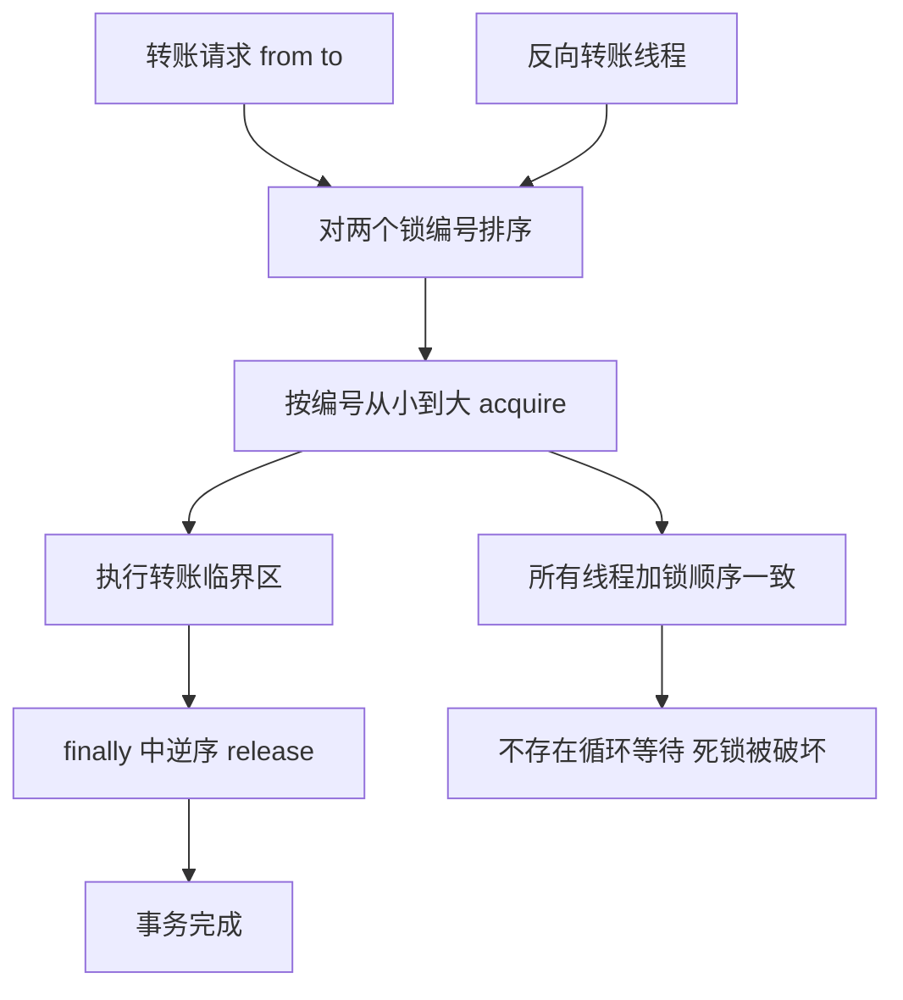
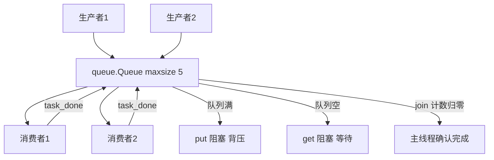
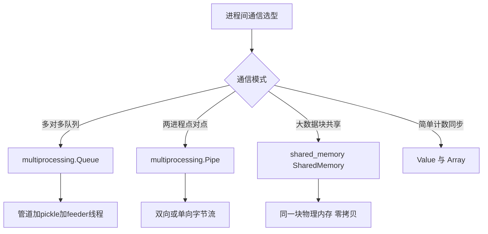
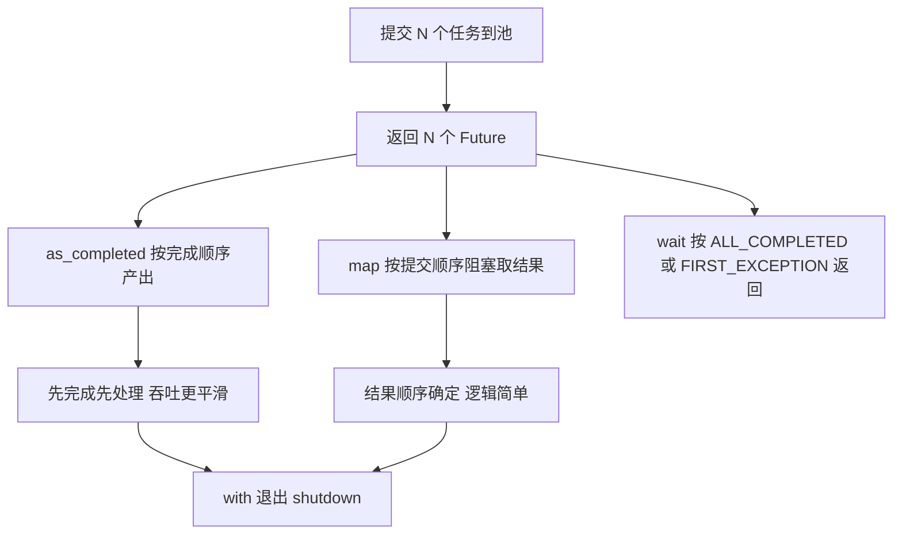

# 第 2 章 · 并发与异步编程

> 本章覆盖 Python 并发面试的核心:threading 同步原语、GIL 与多线程适用边界、multiprocessing 与进程间通信、concurrent.futures 线程池/进程池,以及 asyncio 的事件循环、协程、任务编排与取消模型。
> 面试中常考的不只是 API 用法,而是"为什么":为什么 CPU 密集用进程、IO 密集可用线程或协程,协程泄漏如何发生,死锁如何形成与避免。
> 每题配一段完整可运行的标准库代码,建议边读边跑。本章不涉及算法题,专注工程原理与实战陷阱。

---

### Q046 · threading 基础:创建与启动线程

> 难度:★☆☆ | 标签:threading, 基础

**问**:Python 里如何创建并启动一个线程?Thread 的 start 和直接调用 run 有什么区别?

**答**:两种常用方式:传入 target 函数,或继承 Thread 重写 run。`start()` 会向操作系统申请新线程并由其执行 run;直接调用 `run()` 只是在当前线程里执行普通函数,没有任何并发。主线程结束默认不等子线程,需要 `join()` 等待。

```python
# file: code/02_并发与网络工程/q046_thread_basic.py
import threading
import time


def worker(name: str) -> None:
    print(f"线程 {name} 启动, thread_id={threading.get_ident()}")
    time.sleep(0.2)
    print(f"线程 {name} 结束")


class MyThread(threading.Thread):
    def run(self) -> None:
        worker(self.name)


if __name__ == "__main__":
    t1 = threading.Thread(target=worker, args=("t1",), name="worker-1")
    t2 = MyThread(name="worker-2")
    t1.start()
    t2.start()
    t1.join()
    t2.join()
    print(f"活跃线程数: {threading.active_count()}")
```

**追问**:
- 子线程抛出的异常会影响主线程吗?——不会直接让主线程退出,异常只在子线程内打印 traceback;可用 `threading.excepthook` 全局接管。
- `start()` 和直接调用 `run()` 差在哪?——start 请求操作系统创建线程并异步执行 run;直接调 run 是当前线程里的普通函数调用,毫无并发。
- threading.excepthook 怎么用?——接收 (args) 含 exc_type/exc_value/thread,统一打日志上报,替代在每个线程里手写 try/except。
- 线程启动顺序可控吗?——不可控,start 之后由 OS 调度;需要顺序就靠 join、Event 或队列编排。
### Q047 · 守护线程 daemon 的行为

> 难度:★★☆ | 标签:threading, daemon

**问**:什么是守护线程?主线程退出时守护线程和非守护线程分别是什么命运?

**答**:设置 `daemon=True` 的线程是后台线程,主进程退出时不等待它们,直接终止(相当于被强行截断);非守护线程则会被主线程 join,进程必须等它们全部结束才退出。因此守护线程里不要持有文件、数据库连接等需要干净释放的资源。

```python
# file: code/02_并发与网络工程/q047_daemon_thread.py
import threading
import time


def heartbeat() -> None:
    while True:
        print("心跳...")
        time.sleep(0.1)


def task() -> None:
    time.sleep(0.5)
    print("task 完成")


if __name__ == "__main__":
    d = threading.Thread(target=heartbeat, daemon=True)
    t = threading.Thread(target=task, daemon=False)
    d.start()
    t.start()
    time.sleep(0.2)
    print("主线程即将退出, 守护线程被丢弃, 非守护线程会被 join")
    # 主线程结束时: task 线程会跑完, heartbeat 循环被直接终止
```

**追问**:
- 如何在主线程退出前优雅停掉守护线程?——用 `threading.Event`,`event.wait(timeout)` 作为循环条件,退出前 `event.set()`。
- 守护线程被截断时会发生什么?——finally 不保证执行、缓冲可能未刷盘;涉及事务与文件收尾的线程不要设 daemon。
- daemon 能中途修改吗?——必须在 start() 之前设置,启动后再改抛 RuntimeError。
- 不用守护线程怎么实现「主退出子也退」?——Event 通知 + 子线程定期检查,或把工作放队列由消费者感知哨兵退出。
### Q048 · join 与线程生命周期

> 难度:★☆☆ | 标签:threading, join

**问**:join 的作用是什么?join 不加超时有什么风险?

**答**:`t.join()` 让当前线程阻塞直到 t 结束,可传 timeout。多线程程序收尾时通常对所有 worker join,保证结果完整;若不加超时且 worker 死循环,主线程会永久卡死,工程上建议带超时 join 并检查 `is_alive()`。

```python
# file: code/02_并发与网络工程/q048_join_timeout.py
import threading
import time


def worker(seconds: float) -> None:
    time.sleep(seconds)
    print(f"耗时 {seconds}s 的任务完成")


if __name__ == "__main__":
    threads = [threading.Thread(target=worker, args=(s,)) for s in (0.3, 0.6)]
    for t in threads:
        t.start()
    for t in threads:
        t.join(timeout=0.5)
        if t.is_alive():
            print(f"{t.name} 超时仍未结束, 不再等待")
    print("主线程收尾")
```

**追问**:
- 不带超时的 join 卡死怎么办?——传 `timeout` 并循环检查 `is_alive()`,超时后记录线程名并走降级,收尾逻辑不能允许永久阻塞。
- 对没 start 的线程 join 会怎样?——抛 RuntimeError: cannot join thread before it is started;start/join 必须成对出现,代码评审按对检查。
- 主线程不 join 直接退出,子线程的输出会丢吗?——非守护线程会等子线程结束,守护线程被截断、finally 不保证执行,所以关键落盘要在子线程内完成或显式 join。

---

### Q049 · Lock 与互斥

> 难度:★★☆ | 标签:threading, Lock, 竞态条件

**问**:演示一个没有加锁导致的竞态条件,并说明 Lock 如何解决。

**答**:如 `counter += 1` 并非原子操作,包含读、加、写三步,多线程交错执行会丢失更新。用 `threading.Lock` 把临界区包起来,同一时刻只有一个线程能进入。注意必须用 `with lock` 或 try/finally 保证释放。

```python
# file: code/02_并发与网络工程/q049_lock.py
import threading

counter = 0
N_THREADS = 8
N_INCR = 100_000


def unsafe_increment() -> None:
    global counter
    for _ in range(N_INCR):
        counter += 1  # 非原子: 读-加-写


lock = threading.Lock()


def safe_increment() -> None:
    global counter
    for _ in range(N_INCR):
        with lock:
            counter += 1


if __name__ == "__main__":
    threads = [threading.Thread(target=unsafe_increment) for _ in range(N_THREADS)]
    for t in threads:
        t.start()
    for t in threads:
        t.join()
    print("无锁结果(通常小于期望值):", counter)

    counter = 0
    threads = [threading.Thread(target=safe_increment) for _ in range(N_THREADS)]
    for t in threads:
        t.start()
    for t in threads:
        t.join()
    print("加锁结果:", counter)
```

**追问**:
- 为什么推荐 `with lock:` 而不是手动 acquire/release?——异常路径也能保证释放,等价 try/finally;手动 release 一旦临界区抛异常,锁永远不释放,后面所有线程饿死。
- Lock 能解决所有竞态吗?——只解决互斥;check-then-act 这类跨调用的复合逻辑即使每段都加锁,两段之间仍可能被插队,要把整个判断包进同一临界区。
- `acquire(timeout=1)` 用在什么场景?——有限等待后走降级/上报,是防「锁挂起拖垮整组线程」的最小手段。

---

### Q050 · RLock 与可重入锁

> 难度:★★★ | 标签:threading, RLock, 可重入

**问**:RLock 和 Lock 的区别是什么?什么场景必须用 RLock?

**答**:Lock 不可重入,同一线程在持有期间再次 acquire 会死锁;RLock 记录持有线程与重入次数,同线程可多次 acquire,需对应次数的 release。典型场景是递归函数或 A 方法内部调用同类的 B 方法,两者都要拿同一把锁。

```python
# file: code/02_并发与网络工程/q050_rlock.py
import threading

rlock = threading.RLock()


def inner() -> None:
    with rlock:  # 同一线程再次进入, RLock 允许
        print("inner 拿到锁")


def outer() -> None:
    with rlock:
        print("outer 拿到锁")
        inner()
        print("outer 释放前 depth 正确")


if __name__ == "__main__":
    outer()

    plain = threading.Lock()
    got = plain.acquire()
    result = {}
    def try_reacquire() -> None:
        result["got"] = plain.acquire(timeout=0.1)
    t = threading.Thread(target=try_reacquire)
    t.start()
    t.join()
    print("Lock 同线程再次 acquire 是否成功:", bool(result.get("got")), "(False 表示死锁被超时解除)")
    plain.release()
```

**追问**:
- RLock 开销比 Lock 大吗?——略大,因为要记录 owner 和计数,但差异很小;只有需要重入时才用。
- 什么信号说明需要 RLock 而不是重构?——递归遍历持锁结构、公有方法内部调用同样加锁的私有方法;更干净的做法是把加锁收敛到唯一入口。
- RLock 重入有上限吗?——没有固定上限,受递归深度限制;release 次数必须与 acquire 严格配对,否则锁永远不归还。
- `with` 语句对 RLock 有效吗?——有效,上下文协议就是 acquire/release,重入语义不变。
### Q051 · Semaphore 限流

> 难度:★★☆ | 标签:threading, Semaphore, 限流

**问**:Semaphore 的典型用途是什么?举一个限制并发数的例子。

**答**:Semaphore 维护一个计数器,acquire 减一,release 加一,减到 0 就阻塞。最常见的用途是资源池/并发限流,比如最多同时 3 个线程访问下游服务。注意 `BoundedSemaphore` 在 release 超过初始值时报错,能捕获过度释放的 bug。

```python
# file: code/02_并发与网络工程/q051_semaphore.py
import threading
import time

sem = threading.BoundedSemaphore(3)  # 最多 3 个并发


def access(i: int) -> None:
    with sem:
        print(f"任务 {i} 获得名额, 当前并发上限内")
        time.sleep(0.2)
    print(f"任务 {i} 释放名额")


if __name__ == "__main__":
    threads = [threading.Thread(target=access, args=(i,)) for i in range(8)]
    for t in threads:
        t.start()
    for t in threads:
        t.join()
    print("全部任务完成")
```

**追问**:
- Semaphore 和 BoundedSemaphore 怎么选?——优先 Bounded:release 超过初始值会抛 ValueError,能立刻暴露「多放令牌」的 bug;裸 Semaphore 会静默抬高并发上限。
- acquire 能带 timeout 吗?——可以,拿到许可返回 True、超时返回 False,适合「抢不到就走降级」的限流分支。
- 并发数设成多少合理?——按下游容量而不是本机,通常等于下游并发上限或连接池大小;设得比下游大等于没限流,下游先被打挂。

---

### Q052 · Condition 条件变量

> 难度:★★★ | 标签:threading, Condition, 等待通知

**问**:Condition 解决什么问题?wait 和 notify 为什么必须持有锁?

**答**:Condition 用于线程间等待"某条件成立",经典模型是生产者消费者。`wait()` 会先释放锁再挂起,被 notify 唤醒后重新抢锁,因此调用 wait/notify 前必须持有同一把锁;条件判断要用 while 而不是 if,防止虚假唤醒和唤醒后条件又失效。

```python
# file: code/02_并发与网络工程/q052_condition.py
import threading
import time

items: list[int] = []
cond = threading.Condition()


def consumer() -> None:
    with cond:
        while not items:
            print("consumer 无数据, 等待")
            cond.wait()
        print("consumer 取到", items.pop())


def producer() -> None:
    time.sleep(0.3)
    with cond:
        items.append(42)
        print("producer 放入 42")
        cond.notify()


if __name__ == "__main__":
    c = threading.Thread(target=consumer)
    p = threading.Thread(target=producer)
    c.start()
    p.start()
    c.join()
    p.join()
```

**追问**:
- notify 和 notify_all 的区别?——notify 只随机唤醒一个等待者,条件对所有线程都成立时用 notify_all,否则可能漏唤醒。
- 虚假唤醒是什么,while 怎么防?——等待者可能在未 notify 时醒来或条件又被改变;while 复查谓词,不满足继续 wait。
- Condition 能复用外部锁吗?——可以,`Condition(lock)` 传入已有 Lock/RLock,多条件共享一把锁协调。
- wait(timeout) 的返回值有什么用?——True 被通知、False 超时;超时分支同样要复查条件再决定行动。
### Q053 · Event 事件通知

> 难度:★☆☆ | 标签:threading, Event

**问**:Event 和 Condition 的区别?举一个 Event 的典型用法。

**答**:Event 是一个全局布尔开关:`set()` 置位、`clear()` 复位、`wait()` 阻塞到置位。它比 Condition 简单,适合"一次性广播"场景,如优雅停机信号、初始化完成通知;需要复杂条件判断时才用 Condition。

```python
# file: code/02_并发与网络工程/q053_event.py
import threading
import time

stop_event = threading.Event()
ready_event = threading.Event()


def worker() -> None:
    print("worker 启动, 等待就绪信号")
    ready_event.wait(timeout=2)
    print("worker 收到就绪信号, 开始干活")
    while not stop_event.is_set():
        time.sleep(0.1)
    print("worker 收到停止信号, 退出")


if __name__ == "__main__":
    t = threading.Thread(target=worker)
    t.start()
    time.sleep(0.2)
    ready_event.set()
    time.sleep(0.5)
    stop_event.set()
    t.join()
```

**追问**:
- Event 和 Condition 的本质区别?——Event 只有一个布尔状态、面向「发生了没」;Condition 管理任意条件谓词和等待队列。一次性广播用 Event,复杂条件用 Condition。
- `event.wait(timeout)` 的返回值怎么用?——True 表示被置位,False 表示超时;循环体里用它实现「等退出信号 + 周期巡检」。
- Event 自身线程安全,业务还用加锁吗?——加不加取决于业务:单次读写状态安全,但「检查 Event 再修改共享数据」的复合逻辑仍要锁。

---

### Q054 · 死锁的成因

> 难度:★★★ | 标签:threading, 死锁

**问**:死锁的四个必要条件是什么?用代码演示一个两线程互相持锁的死锁。

**答**:四个条件:互斥、持有并等待、不可剥夺、循环等待。下面的例子中线程 A 先拿 lock1 再要 lock2,线程 B 相反,形成循环等待。工程上最直接的预防手段是破坏后两个条件:统一加锁顺序、用 acquire 的 timeout。

```python
# file: code/02_并发与网络工程/q054_deadlock_demo.py
import threading
import time

lock1 = threading.Lock()
lock2 = threading.Lock()


def thread_a() -> None:
    with lock1:
        time.sleep(0.1)  # 制造交错窗口
        got = lock2.acquire(timeout=0.5)
        print("thread_a 获取 lock2:", bool(got))


def thread_b() -> None:
    with lock2:
        time.sleep(0.1)
        got = lock1.acquire(timeout=0.5)
        print("thread_b 获取 lock1:", bool(got))


if __name__ == "__main__":
    a = threading.Thread(target=thread_a)
    b = threading.Thread(target=thread_b)
    a.start()
    b.start()
    a.join()
    b.join()
    # 用 timeout 后不会永久卡死, 两个 acquire 都会失败; 去掉 timeout 则真死锁
```

**追问**:
- 如何排查线上死锁?——`py-spy dump` 或 faulthandler 打出所有线程栈,找互相等待的锁;代码层可给所有锁编号并按序加锁。
- faulthandler 怎么开?——`faulthandler.enable()` 或环境变量 PYTHONFAULTHANDLER=1,收到致命信号时 dump 全部线程栈。
- 锁排序工具函数长什么样?——`acquire_many(*locks)` 内部按 id 排序依次 acquire,finally 逆序释放,调用方不再关心顺序。
- timeout 重试会不会引入活锁?——会,大家同时退避又同时重试;加随机抖动打破同步。
### Q055 · 死锁的避免策略

> 难度:★★★ | 标签:threading, 死锁, 锁排序

**问**:有哪些工程上可行的死锁避免策略?

**答**:常用四招:1) 锁排序——给锁全局编号,所有线程按同一顺序加锁,破坏循环等待;2) 尽量缩小临界区,一次性申请所有需要的锁再执行;3) acquire 带 timeout,失败后释放已持有的锁重试;4) 减少锁的数量,能用一个对象封装的临界区不要拆成多把锁。

```python
# file: code/02_并发与网络工程/q055_deadlock_avoid.py
import threading
import time

lock1 = threading.Lock()
lock2 = threading.Lock()
locks = {1: lock1, 2: lock2}


def acquire_sorted(ids: list[int]):
    # 统一按编号排序加锁, 破坏循环等待
    ordered = sorted(ids)
    for i in ordered:
        locks[i].acquire()
    return ordered


def release_all(ordered: list[int]) -> None:
    for i in reversed(ordered):
        locks[i].release()


def transfer(from_id: int, to_id: int) -> None:
    ordered = acquire_sorted([from_id, to_id])
    try:
        print(f"从账户 {from_id} 转到 {to_id}, 持锁顺序 {ordered}")
        time.sleep(0.05)
    finally:
        release_all(ordered)


if __name__ == "__main__":
    threads = [
        threading.Thread(target=transfer, args=(1, 2)),
        threading.Thread(target=transfer, args=(2, 1)),  # 反向转账也安全
    ]
    for t in threads:
        t.start()
    for t in threads:
        t.join()
    print("无死锁完成")
```

**追问**:
- 统一加锁顺序在工程上怎么落地?——给锁分配全局序号,封装 `acquire_many(*locks)` 按序获取、finally 逆序释放,评审禁止绕过工具函数直接拿锁。
- 活锁和死锁的区别?——活锁是线程不断让出重试、谁也前进不了但没有阻塞;用随机退避打破同步重试。
- 数据库死锁和应用层死锁处理有什么不同?——InnoDB 有死锁检测会回滚一个事务(1213 错误,应用捕获重试);threading 死锁没人替你检测,只能预防加 dump 定位。

---



---

### Q056 · GIL 是什么

> 难度:★★★ | 标签:GIL, CPython

**问**:解释 GIL 的作用。为什么多线程无法利用多核做 CPU 计算?

**答**:GIL 是 CPython 解释器中的全局互斥锁,保证同一时刻只有一个线程执行 Python 字节码。因此 CPU 密集任务在多线程下无法并行,多核只用于 IO 等待时释放 GIL 的场景。注意:GIL 只存在于 CPython 实现(历史上 PyPy 同样有,Jython/IronPython 没有);C 扩展如 NumPy 在计算时可主动释放 GIL。

```python
# file: code/02_并发与网络工程/q056_gil.py
import threading
import time

N = 10_000_000


def cpu_task() -> None:
    x = 0
    for i in range(N):
        x += i


def run_threads(n: int) -> None:
    threads = [threading.Thread(target=cpu_task) for _ in range(n)]
    start = time.perf_counter()
    for t in threads:
        t.start()
    for t in threads:
        t.join()
    return time.perf_counter() - start


if __name__ == "__main__":
    t1 = run_threads(1)
    t2 = run_threads(4)
    print(f"1 线程: {t1:.2f}s")
    print(f"4 线程: {t2:.2f}s  (受 GIL 限制, 几乎不加速甚至更慢)")
```

**追问**:
- PEP 703 / free-threaded Python 是什么?——CPython 3.13 起提供可关闭 GIL 的实验性构建,移除 GIL 后靠细粒度锁和偏置引用计数保证线程安全。
- GIL 什么时机释放?——每 5ms 解释器检查点、阻塞系统调用之前、NumPy/hashlib 等大块 C 计算进出时;这解释了「多线程在 IO 场景仍有效」。
- free-threading 构建下写扩展要注意什么?——不能再依赖 GIL 的隐式串行,扩展内部状态自己加锁;3.13 起单独安装实验构建验证。
- 怎么判断程序受 GIL 限制?——对比单线程与多线程吞吐:CPU 密集多线程无增益甚至更慢,就是 GIL 限制,应转进程池或 C 扩展。
### Q057 · IO 密集与 CPU 密集的选型

> 难度:★★★ | 标签:GIL, 架构选型

**问**:CPU 密集和 IO 密集任务分别选什么并发模型?

**答**:CPU 密集:用 multiprocessing 或 ProcessPoolExecutor,绕开 GIL 获得真并行;也优先检查 NumPy/Pandas 这类能释放 GIL 的 C 扩展。IO 密集:线程(threading/ThreadPoolExecutor)或协程(asyncio)都行,连接量大(成百上千)时协程内存和切换开销远小于线程。混合型任务可拆分:CPU 部分进进程池,IO 部分进线程或协程。

```python
# file: code/02_并发与网络工程/q057_io_cpu.py
import time
from concurrent.futures import ProcessPoolExecutor, ThreadPoolExecutor


def io_task(i: int) -> int:
    time.sleep(0.2)  # 模拟网络 IO
    return i


def cpu_task(n: int) -> int:
    return sum(i * i for i in range(n))


if __name__ == "__main__":
    start = time.perf_counter()
    with ThreadPoolExecutor(max_workers=8) as pool:
        list(pool.map(io_task, range(8)))
    print(f"IO 密集 + 线程池: {time.perf_counter() - start:.2f}s")

    start = time.perf_counter()
    with ThreadPoolExecutor(max_workers=4) as pool:
        list(pool.map(lambda n: cpu_task(n), [2_000_000] * 4))
    print(f"CPU 密集 + 线程池: {time.perf_counter() - start:.2f}s (GIL 下串行)")

    start = time.perf_counter()
    with ProcessPoolExecutor(max_workers=4) as pool:
        list(pool.map(cpu_task, [2_000_000] * 4))
    print(f"CPU 密集 + 进程池: {time.perf_counter() - start:.2f}s (真并行)")
```

**追问**:
- 怎么判断瓶颈到底是 CPU 还是 IO?——看 CPU 利用率、iowait、上下文切换次数,再用 profile 定位;先测量后选模型,不凭感觉。
- 进程池开多大?——CPU 密集约等于物理核数,IO 混合可到 2 倍核;再大只增加调度和序列化开销。
- 协程里跑 CPU 密集会发生什么?——事件循环被占住,所有协程停摆;要么拆分让出(`await asyncio.sleep(0)`),要么丢进程池。

---

### Q058 · threading.local 线程局部存储

> 难度:★★☆ | 标签:threading, threading.local

**问**:threading.local 的作用是什么?典型使用场景?

**答**:threading.local 为每个线程提供独立的变量副本,写入互不可见,天然线程安全。典型场景是每线程复用一个数据库连接、请求上下文。注意它不隔离协程——asyncio 里所有任务共享同一线程,需要用 contextvars.ContextVar。

```python
# file: code/02_并发与网络工程/q058_thread_local.py
import threading
import time

local_data = threading.local()


def worker(name: str) -> None:
    local_data.value = name  # 每个线程写自己的副本
    time.sleep(0.1)
    print(f"{threading.current_thread().name} 读到自己的 value: {local_data.value}")


if __name__ == "__main__":
    threads = [threading.Thread(target=worker, args=(f"worker-{i}",)) for i in range(3)]
    for t in threads:
        t.start()
    for t in threads:
        t.join()
```

**追问**:
- threading.local 的实现原理?——内部以线程为 key 的字典,每个线程首次访问时初始化自己的副本,访问互不可见。
- 为什么协程下要换 ContextVar?——asyncio 所有任务在同一线程轮转,threading.local 变成全体共享;`contextvars.ContextVar` 按上下文隔离,任务切换时正确生效。
- threading.local 有什么内存坑?——副本随线程存活,线程池里长期存放大对象会驻留整个池生命周期;只放连接、请求上下文这类轻量资源。

---

### Q059 · 线程安全与原子性

> 难度:★★★ | 标签:线程安全, 原子性

**问**:哪些 Python 操作是原子的?"线程安全"到底指什么?

**答**:受 GIL 保护,单个字节码序列如 `list.append`、`dict[key] = value`、`dict.get` 是原子的,不会中途切换线程;但 `counter += 1`、`d[k] = d[k] + 1` 这类"读-算-写"复合操作不是原子的。线程安全指对象在多线程并发访问下仍维持不变量,复合操作必须用锁或改用 queue.Queue 这类自身带锁的结构。

```python
# file: code/02_并发与网络工程/q059_atomicity.py
import threading

results: list[int] = []
lock = threading.Lock()


def append_is_atomic() -> None:
    for i in range(10_000):
        results.append(i)  # list.append 原子, 无锁也安全


counter = 0


def compound_not_atomic() -> None:
    global counter
    for _ in range(10_000):
        counter += 1  # 复合操作, 有竞态


if __name__ == "__main__":
    threads = [threading.Thread(target=append_is_atomic) for _ in range(4)]
    for t in threads:
        t.start()
    for t in threads:
        t.join()
    print("append 无锁结果:", len(results), "(正确)")

    threads = [threading.Thread(target=compound_not_atomic) for _ in range(4)]
    for t in threads:
        t.start()
    for t in threads:
        t.join()
    print("+= 无锁结果:", counter, "(期望 40000, 可能偏小)")
```

**追问**:
- `dict[key] = value` 为什么是原子的?——CPython 中它是单段字节码且 GIL 不在 C 层中途切换;这是实现细节不是语言承诺,跨解释器不可依赖。
- 常见「伪原子」写法有哪些?——`if k not in d: d[k] = []` 的 check-then-act、`counter += 1`、先读后写,都是复合操作,必须整体加锁。
- queue.Queue 为什么线程安全?——内部用 deque + Lock/Condition 把同步封装进数据结构;优先复用自带同步的结构,而不是每处手写锁。

---

### Q060 · 生产者消费者:queue.Queue 实现

> 难度:★★☆ | 标签:queue, 生产者消费者

**问**:用标准库实现一个多线程生产者消费者,如何控制背压?

**答**:queue.Queue 内部自带锁和条件变量,线程安全且开箱即用;构造时传 maxsize 即可实现有界队列,队列满时 put 阻塞,形成自然背压。用 `q.task_done()` 配合 `q.join()` 判断消费完成,或放 None 哨兵让消费者退出。注:哨兵类型用 `Optional[int]` 标注更兼容——`int | None` 这种 PEP 604 联合类型写法运行时求值要到 Python 3.10 才支持(配合 `from __future__ import annotations` 可提前用于纯注解场景)。

```python
# file: code/02_并发与网络工程/q060_producer_consumer_queue.py
import queue
import threading
import time
from typing import Optional

q: "queue.Queue[Optional[int]]" = queue.Queue(maxsize=5)


def producer(pid: int, count: int) -> None:
    for i in range(count):
        item = pid * 100 + i
        q.put(item)  # 队列满时阻塞, 形成背压
        print(f"生产者 {pid} 生产 {item}")
    q.put(None)  # 哨兵


def consumer(cid: int) -> None:
    while True:
        item = q.get()
        if item is None:
            q.task_done()
            break
        print(f"消费者 {cid} 消费 {item}")
        time.sleep(0.05)
        q.task_done()


if __name__ == "__main__":
    producers = [threading.Thread(target=producer, args=(p, 3)) for p in range(2)]
    consumers = [threading.Thread(target=consumer, args=(c,)) for c in range(2)]
    for t in producers + consumers:
        t.start()
    for t in producers:
        t.join()
    q.join()
    print("所有任务处理完成")
```

**追问**:
- maxsize 满了 put 会怎样?——默认阻塞形成背压;`put_nowait` 抛 queue.Full,要 try 处理或带 timeout,按业务选「等」还是「丢」。
- task_done 和 join 的配对规则?——每个 get 出来的任务处理完必须 task_done 一次,次数不齐 `q.join()` 永久阻塞,这是排查高频点。
- 多消费者怎么优雅退出?——放与消费者等量的哨兵,或 q.join 等清空再退出;只放一个 None 会让其余消费者永久阻塞。

---



---

### Q061 · 生产者消费者:Condition 手写实现

> 难度:★★★ | 标签:Condition, 生产者消费者

**问**:不使用 queue,用 Condition 手写一个有界缓冲的生产者消费者,考察对底层机制的理解。

**答**:核心是两个条件:缓冲区不满(生产者可放)和不空(消费者可取)。用一个 Condition 和 while 循环分别 wait/notify,放完 notify 消费者,取完 notify 生产者。这题面试官想看 while 判断条件、notify 对象是否正确。

```python
# file: code/02_并发与网络工程/q061_producer_consumer_cond.py
import threading
import time

buffer: list[int] = []
MAX_SIZE = 3
cond = threading.Condition()


def producer(pid: int, count: int) -> None:
    for i in range(count):
        with cond:
            while len(buffer) >= MAX_SIZE:
                cond.wait()  # 缓冲区满, 等消费者
            item = pid * 100 + i
            buffer.append(item)
            print(f"生产者 {pid} 放入 {item}, 缓冲区 {buffer}")
            cond.notify_all()
        time.sleep(0.05)


def consumer(cid: int, total: int) -> None:
    consumed = 0
    while consumed < total:
        with cond:
            while not buffer:
                cond.wait()  # 缓冲区空, 等生产者
            item = buffer.pop(0)
            consumed += 1
            print(f"消费者 {cid} 取出 {item}, 缓冲区 {buffer}")
            cond.notify_all()


if __name__ == "__main__":
    ps = [threading.Thread(target=producer, args=(p, 3)) for p in range(2)]
    cs = [threading.Thread(target=consumer, args=(c, 3)) for c in range(2)]
    for t in ps + cs:
        t.start()
    for t in ps + cs:
        t.join()
    print("完成, 缓冲区剩余:", buffer)
```

**追问**:
- 为什么条件判断必须用 while 而不是 if?——notify 后条件可能被其他线程抢先改变,或存在虚假唤醒;while 保证醒来后复查谓词。
- notify 应该在持锁时还是释放后调用?——标准做法持锁 notify;先释放再 notify 有丢失唤醒窗口,是初学者高频错误。
- 缓冲区选 list 还是 deque?——deque 的 append/popleft 是 O(1) 且单操作线程安全;list 的 pop(0) 是 O(n),数据量大时性能差一个量级。

---

### Q062 · multiprocessing 基础

> 难度:★★☆ | 标签:multiprocessing, 进程

**问**:multiprocessing 和 threading 的本质区别?为什么子进程代码要放在 if __name__ == "__main__" 里?

**答**:每个子进程有独立的解释器和内存空间,绕开 GIL 获得真并行,代价是创建开销大、数据要序列化传递。在 Windows/macOS 的 spawn 启动方式下,子进程会重新 import 主模块,不加 `if __name__ == "__main__":` 保护会无限递归创建进程。进程间共享状态需显式使用 Queue、Pipe 或共享内存。

```python
# file: code/02_并发与网络工程/q062_multiprocessing_basic.py
import multiprocessing
import os
import time


def worker(seconds: float) -> None:
    time.sleep(seconds)
    print(f"子进程 pid={os.getpid()} 完成耗时 {seconds}s 任务")


if __name__ == "__main__":
    print("主进程 pid =", os.getpid())
    procs = [multiprocessing.Process(target=worker, args=(0.3 + i * 0.1,)) for i in range(3)]
    for p in procs:
        p.start()
    for p in procs:
        p.join()
    print("所有子进程退出, exitcode:", [p.exitcode for p in procs])
```

**追问**:
- fork 和 spawn 启动方式有什么区别?——fork 复制父进程内存,快但仅 Unix 且与多线程程序不兼容;spawn 重启解释器并重新 import 主模块,慢但跨平台,macOS/Windows 默认 spawn。
- 子进程能「继承」全局变量吗?——fork 下是写时复制副本,修改互不可见;spawn 下变量要靠参数 pickle 传过去,共享状态一律走 Queue/Pipe/共享内存。
- 缺 `if __name__ == "__main__":` 会怎样?——spawn 模式下子进程 import 主模块,再次执行创建进程的代码,递归创建进程直至爆掉,入口必须保护。

---

### Q063 · 进程池 multiprocessing.Pool

> 难度:★★☆ | 标签:multiprocessing, Pool

**问**:multiprocessing.Pool 的 map/apply_async 有什么区别?进程池大小怎么定?

**答**:`map` 是批量阻塞式,语义贴近内置 map;`apply_async` 提交单个任务返回 AsyncResult,可用回调,配合 close+join 收尾。池大小经验值:CPU 密集聚到 CPU 核数,IO 密集可放宽。注意传入子进程的参数和返回值必须可 pickle。

```python
# file: code/02_并发与网络工程/q063_pool.py
import multiprocessing
import os
import time


def square(n: int) -> int:
    return n * n


def slow_square(n: int) -> int:
    time.sleep(0.1)
    print(f"子进程 {os.getpid()} 处理 {n}")
    return n * n


if __name__ == "__main__":
    with multiprocessing.Pool(processes=4) as pool:
        results = pool.map(square, range(10))
        print("map 结果:", results)

        async_results = [pool.apply_async(slow_square, (i,)) for i in (3, 5, 7)]
        print("异步提交后可先做别的事")
        print("apply_async 结果:", [r.get() for r in async_results])
    print("with 退出即 pool.close + join")
```

**追问**:
- map、imap、imap_unordered 的区别?——map 阻塞返回全量有序结果;imap 惰性按提交序产出,imap_unordered 按完成序,大任务流用后者控内存、先到先处理。
- Pool 的回调在哪个线程执行?——结果处理线程,回调里抛异常只会打印不影响任务;回调里不要做重活或再碰池。
- 池内任务抛异常在哪里暴露?——`apply_async(...).get()` 与 map 迭代时重新抛出;不取结果就无人知晓,收尾必须统一 get。

---

### Q064 · 进程间通信:Queue

> 难度:★★★ | 标签:multiprocessing, Queue, IPC

**问**:multiprocessing.Queue 和 queue.Queue 的区别?为什么它能在进程间传数据?

**答**:multiprocessing.Queue 底层通过管道 + pickle + 一个 feeder 线程把对象序列化后在进程间搬运,是进程安全的;queue.Queue 只在进程内的线程间共享。注意子进程里 get 到的是父进程数据的深拷贝(经 pickle),修改不会回传;大量数据用共享内存更高效。

```python
# file: code/02_并发与网络工程/q064_mp_queue.py
import multiprocessing


def producer(q: multiprocessing.Queue) -> None:
    for i in range(5):
        q.put(f"item-{i}")
    q.put(None)


def consumer(q: multiprocessing.Queue) -> None:
    while True:
        item = q.get()
        if item is None:
            break
        print(f"消费 {item}")


if __name__ == "__main__":
    q: multiprocessing.Queue = multiprocessing.Queue()
    p = multiprocessing.Process(target=producer, args=(q,))
    c = multiprocessing.Process(target=consumer, args=(q,))
    p.start()
    c.start()
    p.join()
    c.join()
    print("IPC 完成")
```

**追问**:
- 子进程修改从 Queue 拿到的对象,父进程能看到吗?——看不到,pickle 反序列化是副本;需要回传就 put 回去,或用 shared_memory。
- feeder 线程是什么,有什么坑?——put 的对象先进内部缓冲,由 feeder 线程序列化写管道;put 后立即 join 子进程可能因缓冲未刷而死锁,需先处理缓冲或 cancel_join_thread。
- 大对象走 Queue 的瓶颈在哪?——pickle 序列化加管道带宽;大数组改 shared_memory 或写文件传路径。
- qsize() 可靠吗?——macOS 上 NotImplementedError,Unix 上也只是近似值;不能拿它做同步与背压判断。
### Q065 · 进程间通信:Pipe

> 难度:★★☆ | 标签:multiprocessing, Pipe, IPC

**问**:Pipe 和 Queue 的区别?各自适合什么场景?

**答**:Pipe 是两个端点间的双向(默认)连接,只适合两个进程点对点通信,速度通常比 Queue 快、开销小;Queue 是多生产者多消费者安全的队列。Pipe 同一端同时被两个进程读写不保证安全;`duplex=False` 时一端只能发另一端只能收。

```python
# file: code/02_并发与网络工程/q065_pipe.py
import multiprocessing


def child(conn) -> None:
    conn.send({"pid_cmd": "hello from child"})
    reply = conn.recv()
    print("child 收到:", reply)
    conn.close()


if __name__ == "__main__":
    parent_conn, child_conn = multiprocessing.Pipe()
    p = multiprocessing.Process(target=child, args=(child_conn,))
    p.start()
    msg = parent_conn.recv()
    print("parent 收到:", msg)
    parent_conn.send("hello from parent")
    p.join()
```

**追问**:
- Pipe 和 Queue 怎么选?——两点之间低延迟双向通信用 Pipe;多生产者多消费者、需要缓冲公平性用 Queue。
- Pipe 同一端并发读写会怎样?——数据流可能交错损坏,每个进程独占一端,或对该端加锁。
- Connection 有什么独门能力?——除了可 pickle 对象,还能经 reduction 直接传文件描述符,这是 Queue 做不到的。

---



---

### Q066 · shared_memory 共享内存

> 难度:★★★ | 标签:multiprocessing, shared_memory, 零拷贝

**问**:multiprocessing.shared_memory 如何使用?和 Queue 传数据相比优势在哪?

**答**:SharedMemory 在操作系统层面开一块命名共享内存,多个进程通过名字 attach,数据不经 pickle 序列化,适合传大块二进制数据(如图像帧)。通常配 NumPy 的 `np.ndarray(buffer=shm.buf)` 使用;用完必须 close 并由最后一方 unlink 释放——否则退出时 resource_tracker 会报 "leaked shared_memory objects" 警告。缺点是不自带同步,需配 Lock 使用。注意 memoryview 切片赋值要求左右字节数完全一致,短一截都会抛 ValueError。

```python
# file: code/02_并发与网络工程/q066_shared_memory.py
import multiprocessing
import multiprocessing.shared_memory as shm


def child(name: str, size: int) -> None:
    existing = shm.SharedMemory(name=name)
    try:
        # 读取父进程写入的数据
        data = bytes(existing.buf[:size])
        print("child 读到:", data.decode())
        existing.buf[:5] = b"CHILD"  # 回写(切片长度必须与数据等长)
    finally:
        existing.close()


if __name__ == "__main__":
    block = shm.SharedMemory(create=True, size=10)
    try:
        block.buf[:10] = b"PARENTDATA"  # 10 字节, 与切片等长
        p = multiprocessing.Process(target=child, args=(block.name, 10))
        p.start()
        p.join()
        print("parent 读回:", bytes(block.buf[:10]).decode())
    finally:
        # close + unlink 成对出现, 避免 resource_tracker 报泄漏
        block.close()
        block.unlink()  # 最后由创建者释放
```

**追问**:
- 为什么必须有人 unlink?——共享内存块由操作系统管理,进程全退出也不自动回收;约定「最后一个使用者 unlink」,否则泄漏到重启,resource_tracker 会报 leaked 警告。
- 怎么和 NumPy 零拷贝配合?——`np.ndarray(shape, dtype, buffer=shm.buf)` 直接映射;形状和 dtype 等元数据要另外传,通常走 Pipe/Queue 一起发。
- shared_memory 的同步怎么做?——本身不带锁,配 `multiprocessing.Lock` 保护写侧;只读共享(单写多读)可以不加。

---

### Q067 · ThreadPoolExecutor

> 难度:★★☆ | 标签:concurrent.futures, 线程池

**问**:ThreadPoolExecutor 相对手动 Thread 的优势?submit 和 map 的区别?

**答**:线程池复用线程、统一管理生命周期,返回 Future 对象,可拿结果、异常和回调。`submit` 逐个提交,立即返回 Future,可乱序取结果;`map` 按提交顺序阻塞式产出结果,写法简洁。务必用 with 管理池,退出时自动 shutdown(wait=True)。

```python
# file: code/02_并发与网络工程/q067_thread_pool.py
import time
from concurrent.futures import ThreadPoolExecutor


def fetch(url: str) -> str:
    time.sleep(0.2)  # 模拟网络请求
    return f"内容 of {url}"


if __name__ == "__main__":
    urls = [f"https://example.com/page{i}" for i in range(5)]

    with ThreadPoolExecutor(max_workers=3) as pool:
        # map: 按顺序返回
        for result in pool.map(fetch, urls):
            print("map:", result)

        # submit: 返回 Future, 可乱序处理
        futures = [pool.submit(fetch, u) for u in urls]
        for fut in futures:
            print("submit:", fut.result(timeout=5))
```

**追问**:
- submit 和 map 怎么选?——要逐个 Future、自定义异常与重试用 submit;简单批量按序消费用 map,注意 map 迭代中遇异常会中断。
- shutdown(wait=False) 会怎样?——不再接新任务但已提交的继续执行;Python 3.9+ 的 `cancel_futures=True` 能清空未开始的任务,收尾更快。
- Future 的异常什么时候暴露?——只有调用 result()/exception() 或在回调里检查才可见;不观察的失败就是静默失败。

---

### Q068 · ProcessPoolExecutor

> 难度:★★☆ | 标签:concurrent.futures, 进程池

**问**:ProcessPoolExecutor 和 multiprocessing.Pool 该用哪个?有什么坑?

**答**:新代码推荐 ProcessPoolExecutor:API 与线程池一致,便于在池间切换。坑:提交的函数与参数、返回值都必须可 pickle;函数必须是模块顶层定义(lambda 和闭包会报错);Windows/macOS 的 spawn 启动要求主模块有 `if __name__ == "__main__":` 保护;某任务抛异常会在 result() 时重新抛出。

```python
# file: code/02_并发与网络工程/q068_process_pool.py
import math
from concurrent.futures import ProcessPoolExecutor


def is_prime(n: int) -> bool:
    if n < 2:
        return False
    for i in range(2, int(math.isqrt(n)) + 1):
        if n % i == 0:
            return False
    return True


def count_primes(limit: int) -> int:
    return sum(1 for n in range(limit) if is_prime(n))


if __name__ == "__main__":
    limits = [100_000, 150_000, 200_000, 250_000]
    with ProcessPoolExecutor(max_workers=4) as pool:
        for limit, count in zip(limits, pool.map(count_primes, limits)):
            print(f"<{limit} 的素数个数: {count}")
```

**追问**:
- lambda 为什么不能提交给进程池?——pickle 按模块限定名序列化函数,lambda/闭包没有可导入名字;必须用模块顶层 def。
- worker 卡死怎么办?——`future.result(timeout=...)` 有限等待,但卡死的 worker 杀不掉,只能重建池;`max_tasks_per_child`(3.11+)可按任务数回收进程防内存膨胀。
- 池大小怎么定?——默认 os.cpu_count();IO 混合可放宽,但进程内存开销大,通常不超过 2 倍核,配合压测确认。

---

### Q069 · Future 与回调

> 难度:★★★ | 标签:concurrent.futures, Future

**问**:Future 对象承载了什么信息?add_done_callback 在哪个线程执行?

**答**:Future 是"一个尚未完成的结果"的占位:保存执行状态、返回值、异常,提供 result/get、done、cancel、add_done_callback 等接口。回调在任务完成的线程里执行(线程池是 worker 线程,进程池是结果处理线程),因此回调里不要再做重活或直接更新 UI。result() 会阻塞并重新抛出任务异常。

```python
# file: code/02_并发与网络工程/q069_future_callback.py
import time
from concurrent.futures import ThreadPoolExecutor


def slow_task(n: int) -> int:
    time.sleep(0.2)
    if n == 2:
        raise ValueError("任务 2 故意失败")
    return n * 10


def on_done(fut) -> None:
    if fut.exception() is not None:
        print(f"回调: 任务失败 {fut.exception()!r}")
    else:
        print(f"回调: 任务成功, 结果 {fut.result()}")


if __name__ == "__main__":
    with ThreadPoolExecutor(max_workers=3) as pool:
        futures = [pool.submit(slow_task, i) for i in range(4)]
        for fut in futures:
            fut.add_done_callback(on_done)
        # 阻塞等待全部结束
        results = [fut.result() if fut.exception() is None else None for fut in futures]
        print("收集结果:", results)
```

**追问**:
- add_done_callback 的回调里抛异常会怎样?——被 Future 吞掉,GC 时才打印;回调内必须自己 try/except 并记录。
- Future.cancel 什么时候成功?——任务还没开始执行才可取消;线程池里已在运行的任务无法强停,只能协作式检查退出标志。
- 回调在哪个线程执行,要注意什么?——完成它的 worker 线程(或结果处理线程);回调里访问共享数据要加锁,别再做重活。

---

### Q070 · as_completed 与顺序性

> 难度:★★★ | 标签:concurrent.futures, as_completed

**问**:as_completed 解决什么问题?和 wait 的 FIRST_EXCEPTION 参数有什么配合?

**答**:`as_completed(futures)` 按任务"完成顺序"产出 Future,先完成先处理,避免 map 的队头阻塞;配合超时参数可整体限时。`concurrent.futures.wait` 则一次等待多个条件(ALL_COMPLETED/FIRST_COMPLETED/FIRST_EXCEPTION),两种都优于手动轮询。

```python
# file: code/02_并发与网络工程/q070_as_completed.py
import random
import time
from concurrent.futures import ThreadPoolExecutor, as_completed


def task(i: int) -> int:
    delay = random.uniform(0.1, 0.5)
    time.sleep(delay)
    return i


if __name__ == "__main__":
    with ThreadPoolExecutor(max_workers=5) as pool:
        futures = {pool.submit(task, i): i for i in range(5)}
        for fut in as_completed(futures):
            print(f"任务 {futures[fut]} 先完成, 结果 {fut.result()}")
    print("注意完成顺序与提交顺序无关")
```

**追问**:
- as_completed 配整体超时怎么用?——`as_completed(futures, timeout=...)` 超时抛 TimeoutError,已完成结果已产出;未完成任务还在跑,要显式 cancel。
- wait 的 FIRST_EXCEPTION 有什么用?——任一任务抛异常立即返回,适合「快速失败」的批处理:发现失败就取消剩余。
- 结果乱序后怎么对应输入?——给 future 挂 key 属性或用 `{future: key}` 字典映射,完成时按 future 取回业务键。

---



---

### Q071 · asyncio 事件循环原理

> 难度:★★★ | 标签:asyncio, 事件循环

**问**:事件循环是怎么工作的?单线程如何实现并发?

**答**:事件循环是单线程调度器:维护就绪回调队列和定时器堆,反复执行"取一个就绪的回调执行到下一个 await 点、向 selector 注册感兴趣的 IO、阻塞等 IO 事件、把完成的 IO 唤醒为就绪回调"这一循环。并发来自协程在 await 处主动让出控制权,本质是协作式调度,任何一个协程长时间不让出,整个循环都会卡住。

```python
# file: code/02_并发与网络工程/q071_event_loop.py
import asyncio


async def worker(name: str, delay: float) -> str:
    print(f"{name} 开始")
    await asyncio.sleep(delay)  # 让出控制权给事件循环
    print(f"{name} 结束")
    return f"{name} 的结果"


async def main() -> None:
    # 三个协程在同一个线程里交错执行
    results = await asyncio.gather(
        worker("A", 0.3),
        worker("B", 0.2),
        worker("C", 0.1),
    )
    print(results)
    print("运行线程:", __import__("threading").current_thread().name)


if __name__ == "__main__":
    asyncio.run(main())
```

**追问**:
- 协程和线程的调度差异?——协程是协作式,切换点由 await 显式声明,无锁竞争;线程是抢占式,随时可能被打断,需要锁。
- 事件循环一帧具体做什么?——执行就绪回调到下一个 await、向 selector 注册 IO、阻塞等事件、把完成事件转成回调;理解它才能解释阻塞调用的危害。
- 协程会被抢占吗?——不会,只在 await 处让出;没有 await 的死循环无法被打断,这是协作式调度的根本约束。
- 怎么测量事件循环延迟?——后台协程周期性 `await asyncio.sleep(dt)` 并比较实际耗时与 dt,差值即延迟,可上报为监控指标。
### Q072 · coroutine / Task / Future 的区别

> 难度:★★★ | 标签:asyncio, coroutine, Task, Future

**问**:coroutine、Task、Future 三者是什么关系?什么时候需要把协程包成 Task?

**答**:coroutine 是用 async def 定义的、可暂停恢复的函数,自身不执行,调用只产生协程对象;Task 继承自 Future,是把协程"排入事件循环立即执行"的载体,创建即调度;Future 是更底层的"结果占位",一般由库代码完成并 set_result。需要并发运行一个协程时用 `asyncio.create_task`,只 await 它则只是顺序执行。

```python
# file: code/02_并发与网络工程/q072_coro_task_future.py
import asyncio


async def job(name: str) -> str:
    await asyncio.sleep(0.2)
    return f"{name} done"


async def main() -> None:
    coro = job("裸协程")          # 不会执行
    task = asyncio.create_task(job("任务"))  # 创建即调度

    # 裸协程需要 await 才执行: 顺序执行
    print("await 裸协程:", await coro)
    print("await Task:", await task)

    # 更底层的 Future 手动控制完成
    fut: asyncio.Future[str] = asyncio.get_running_loop().create_future()
    fut.set_result("future 完成")
    print("await Future:", await fut)


if __name__ == "__main__":
    asyncio.run(main())
```

**追问**:
- create_task 后不保存引用会怎样?——事件循环只持弱引用,任务可能被 GC 静默回收;官方文档要求保存引用(集合 + done_callback 清理)。
- ensure_future 和 create_task 的区别?——ensure_future 接受任意 awaitable 并包装,历史 API;create_task 只接受协程、语义更明确,新代码用它。
- Task 什么时候真正开始跑?——create_task 只是 call_soon 排入就绪队列,当前协程让出控制权(遇到 await)后才开始执行。

---

### Q073 · async/await 执行模型

> 难度:★★★ | 标签:asyncio, async, await

**问**:await 到底做了什么?为什么 async 函数里同步调用阻塞函数会毁掉并发?

**答**:await 把控制权交还事件循环并挂起当前协程,直到等待的对象(另一个协程、Task、Future、IO)完成再从暂停点恢复;恢复时局部变量栈完好,类似生成器的 send。若在协程里直接调用 time.sleep、requests.get 这类同步阻塞函数,整个事件循环线程被占住,所有并发协程全部停摆。

```python
# file: code/02_并发与网络工程/q073_async_model.py
import asyncio
import time


async def blocking_way() -> float:
    start = time.perf_counter()
    for i in range(3):
        time.sleep(0.3)  # 错误: 同步阻塞事件循环
        print(f"阻塞式 第 {i} 次")
    return time.perf_counter() - start


async def async_way() -> float:
    start = time.perf_counter()
    await asyncio.gather(*(asyncio.sleep(0.3, result=i) for i in range(3)))
    print("异步式 三次等待重叠")
    return time.perf_counter() - start


async def main() -> None:
    t1 = await blocking_way()
    t2 = await async_way()
    print(f"阻塞式耗时 {t1:.2f}s, 异步式耗时 {t2:.2f}s")


if __name__ == "__main__":
    asyncio.run(main())
```

**追问**:
- await 一个普通同步函数会怎样?——同步函数不会被挂起,直接在事件循环线程里跑完,这就是「假异步」阻塞的常见来源。
- 协程里的异常去哪了?——沿 await 链向上传播;由 Task 承载时异常保留到被 await/观察时抛出,不观察则 GC 时打印 "Task exception was never retrieved"。
- `await asyncio.sleep(0)` 是干什么的?——主动让出一次控制权,给事件循环处理其他回调的机会,CPU 长段分片的惯用手法。

---

### Q074 · gather / wait / as_completed 对比

> 难度:★★★ | 标签:asyncio, gather, wait, as_completed

**问**:asyncio 的 gather、wait、as_completed 各适合什么场景?

**答**:`gather` 按提交顺序返回结果列表,默认一个异常会导致整体取消(可 return_exceptions=True),适合"全部完成取全部结果";`wait` 返回 done/pending 两个集合,支持 FIRST_COMPLETED 等触发条件,适合"任一完成就行动";`as_completed` 按完成顺序逐个产出,适合流式处理和整体超时。

```python
# file: code/02_并发与网络工程/q074_gather_wait_as_completed.py
import asyncio
import random


async def fetch(i: int) -> str:
    await asyncio.sleep(random.uniform(0.1, 0.4))
    if i == 2:
        raise ValueError(f"任务 {i} 失败")
    return f"result-{i}"


async def main() -> None:
    coros = [fetch(i) for i in range(4)]

    # gather: 顺序对应, 容忍异常
    results = await asyncio.gather(*coros, return_exceptions=True)
    print("gather:", results)

    # wait: 任一完成即处理
    tasks = [asyncio.create_task(fetch(i)) for i in range(4)]
    done, pending = await asyncio.wait(tasks, return_when=asyncio.FIRST_COMPLETED)
    for t in done:
        print("wait 首个完成:", t.result() if not t.exception() else t.exception())
    for t in pending:
        t.cancel()

    # as_completed: 按完成顺序
    tasks2 = [asyncio.create_task(fetch(i + 10)) for i in range(4)]
    for fut in asyncio.as_completed(tasks2):
        try:
            print("as_completed:", await fut)
        except ValueError as e:
            print("as_completed 异常:", e)


if __name__ == "__main__":
    asyncio.run(main())
```

**追问**:
- gather(return_exceptions=True) 的结果怎么判断成败?——成功值与异常对象混排在结果列表里,逐个 `isinstance(x, Exception)` 分类处理。
- 什么场景必须用 wait?——需要 FIRST_COMPLETED/FIRST_EXCEPTION 触发的竞赛与快速失败模式,gather 表达不了。
- gather 会不会创建 Task?——传入协程会被包装成 Task;传入已有 Task 时,取消 gather 也会取消它们,生命周期要心里有数。

---

### Q075 · 超时与取消 CancelledError

> 难度:★★★★ | 标签:asyncio, 超时, 取消, CancelledError

**问**:asyncio 如何给操作加超时?取消时 CancelledError 该如何处理?

**答**:用 `asyncio.timeout`(3.11+)或 `wait_for` 限时,超时会向协程注入 CancelledError。处理取消的规则:捕获 CancelledError 后必须重新抛出(或用 shield 保护关键清理),在 finally 里释放资源;`asyncio.shield` 可让"不可中断的收尾操作"不被取消波及。吞掉 CancelledError 是常见反模式,会破坏上层取消传播。注意 `asyncio.timeout` 是 3.11 新增 API,低版本直接 AttributeError,应按版本分流:3.11+ 用 timeout 上下文管理器,老版本用 wait_for 等价演示。

```python
# file: code/02_并发与网络工程/q075_timeout_cancel.py
import asyncio
import sys


async def slow_io() -> str:
    try:
        print("开始慢 IO")
        await asyncio.sleep(10)
        return "完成"
    except asyncio.CancelledError:
        print("收到取消, 做清理")
        await asyncio.shield(asyncio.sleep(0.05))  # 保护关键清理不被再次取消
        print("清理完成")
        raise  # 必须重新抛出


async def demo_wait_for() -> None:
    # wait_for 等价老写法, 3.8+ 全版本可用
    try:
        await asyncio.wait_for(slow_io(), timeout=0.3)
    except asyncio.TimeoutError:
        print("整体超时(wait_for 等价演示)")


async def main() -> None:
    if sys.version_info >= (3, 11):
        try:
            async with asyncio.timeout(0.3):  # 3.11+ 写法
                result = await slow_io()
                print(result)
        except TimeoutError:
            print("整体超时")
    else:
        print(
            f"asyncio.timeout 需要 Python 3.11+, "
            f"当前 {sys.version_info.major}.{sys.version_info.minor}, "
            f"演示跳过, 改用 wait_for 等价演示"
        )
        await demo_wait_for()

    # wait_for 超时语义再单独演示一次
    try:
        await asyncio.wait_for(asyncio.sleep(5), timeout=0.2)
    except asyncio.TimeoutError:
        print("wait_for 超时")


if __name__ == "__main__":
    asyncio.run(main())
```

**追问**:
- Task.cancel 和给 Future set_exception 的区别?——cancel 会向协程在当前 await 点抛 CancelledError,是协作式中断;它返回的 Future 状态变为 cancelled。
- CancelledError 在 3.8 前后有什么变化?——3.8 起改为继承 BaseException,`except Exception` 不再误吞取消,但仍可能被裸 except 吞掉。
- shield 的正确用法?——只保护「必须完成的清理段」,外层仍捕获 CancelledError;整段 shield 等于拒绝取消。
- 超时之后任务还活着吗?——wait_for 超时会 cancel 内部任务;asyncio.timeout 只是注入取消,任务必须 re-raise 才真正终止。
### Q076 · asyncio 的 Lock / Semaphore / Queue

> 难度:★★★ | 标签:asyncio, Lock, Semaphore, Queue

**问**:asyncio.Lock 和 threading.Lock 能混用吗?asyncio.Queue 适合什么场景?

**答**:不能混用:threading.Lock 的 acquire 是阻塞线程的,会卡死事件循环;asyncio.Lock 在协程内 await 加锁,排队时不阻塞线程。同理,协程间通信用 asyncio.Queue(put/get 都是协程),跨线程投递任务则用 `loop.call_soon_threadsafe` 或 run_coroutine_threadsafe。典型场景是限制对下游的并发请求数、单飞(single-flight)缓存。

```python
# file: code/02_并发与网络工程/q076_async_lock_sem_queue.py
import asyncio


async def limited_call(i: int, sem: asyncio.Semaphore) -> int:
    async with sem:  # 最多 2 个并发
        print(f"请求 {i} 发出")
        await asyncio.sleep(0.2)
        return i * 2


async def single_flight(key: str, lock: asyncio.Lock, cache: dict) -> str:
    async with lock:
        if key not in cache:
            print(f"计算 {key}")
            await asyncio.sleep(0.2)
            cache[key] = f"value-{key}"
        return cache[key]


async def main() -> None:
    sem = asyncio.Semaphore(2)
    results = await asyncio.gather(*(limited_call(i, sem) for i in range(5)))
    print("限流结果:", results)

    lock = asyncio.Lock()
    cache: dict[str, str] = {}
    vals = await asyncio.gather(*(single_flight("k1", lock, cache) for _ in range(3)))
    print("单飞结果:", vals)

    q: asyncio.Queue[int] = asyncio.Queue(maxsize=2)
    await q.put(1)
    await q.put(2)
    print("队列已满, 再 put 会等待, 当前 qsize:", q.qsize())
    print("get:", await q.get(), await q.get())


if __name__ == "__main__":
    asyncio.run(main())
```

**追问**:
- asyncio.Lock 能跨线程用吗?——不能,它是事件循环内的协程同步原语;跨线程唤醒要 `loop.call_soon_threadsafe` 投递回循环线程。
- asyncio.Semaphore 的典型用法?——`async with sem:` 把对下游的并发限制在 N 以内,超出排队而非报错,是爬虫/网关标配。
- 在协程里误用 threading.Lock 会怎样?——acquire 阻塞整个事件循环线程,所有协程停摆;这是异步代码的第一类事故。

---

### Q077 · 异步生成器与 async for

> 难度:★★☆ | 标签:asyncio, 异步生成器

**问**:什么是异步生成器?它和普通生成器的区别?

**答**:在 async def 中使用 yield 即定义异步生成器,用 `async for` 消费,每个 yield 之间可以 await 做 IO。适合逐块产出数据的场景,如分页拉取、逐行读大文件。注意异步生成器不能用 for 直接迭代,关闭时由事件循环调用其 athrow/aclose,常配 `async with aclosing(...)` 或在 finally 中清理。

```python
# file: code/02_并发与网络工程/q077_async_generator.py
import asyncio


async def paginated_fetch(total_pages: int) -> int:
    for page in range(total_pages):
        await asyncio.sleep(0.1)  # 模拟请求一页
        yield page * 100


async def consume() -> None:
    async for item in paginated_fetch(3):
        print("拿到一页数据:", item)


async def main() -> None:
    gen = paginated_fetch(2)
    print("异步生成器对象:", gen)
    await consume()


if __name__ == "__main__":
    asyncio.run(main())
```

**追问**:
- 异步生成器和异步迭代器什么关系?——异步迭代器是实现 `__aiter__/__anext__` 的对象;异步生成器是含 yield 的 async def,自动满足异步迭代器协议。
- 异步生成器怎么保证清理执行?——用 `contextlib.aclosing(gen)` 包住 async for,退出时调用 aclose;否则依赖 GC 触发,时机不定。
- 它支持 yield from 吗?——不支持,异步生成器不能 yield from,委托要用 async for 循环转发。

---

### Q078 · 异步上下文管理器

> 难度:★★☆ | 标签:asyncio, async with

**问**:async with 和 with 的区别?自己如何实现一个异步上下文管理器?

**答**:async with 用于 `__aenter__`/`__aexit__` 是协程的资源,如数据库连接、锁;进入和退出都可以 await。可用类实现这两个方法,或用 `contextlib.asynccontextmanager` 装饰 async 生成器函数,后者写法更简洁,是封装"带清理的异步资源"的惯用法。

```python
# file: code/02_并发与网络工程/q078_async_context.py
import asyncio
from contextlib import asynccontextmanager


class AsyncConnection:
    async def __aenter__(self) -> "AsyncConnection":
        await asyncio.sleep(0.1)  # 模拟建连
        print("连接建立")
        return self

    async def __aexit__(self, exc_type, exc, tb) -> bool:
        await asyncio.sleep(0.05)  # 模拟关闭
        print("连接关闭, 异常:", exc_type.__name__ if exc_type else None)
        return False  # 不吞异常


@asynccontextmanager
async def timer(label: str):
    start = asyncio.get_running_loop().time()
    try:
        yield
    finally:
        elapsed = asyncio.get_running_loop().time() - start
        print(f"[{label}] 耗时 {elapsed:.2f}s")


async def main() -> None:
    async with AsyncConnection() as conn, timer("业务块"):
        await asyncio.sleep(0.2)
        print("业务执行中")


if __name__ == "__main__":
    asyncio.run(main())
```

**追问**:
- __aexit__ 能吞异常吗?——与同步协议一致:返回 True 表示已处理;清理代码一般返回 None 让异常继续传播。
- asynccontextmanager 的生成器要注意什么?——yield 必须包在 try/finally 里,否则异常路径跳过清理,资源泄漏。
- 异步锁和 async with 怎么配合?——`async with lock:` 原子获取与释放;等待期间只挂起当前协程,不阻塞事件循环线程。

---

### Q079 · time.sleep vs asyncio.sleep

> 难度:★★☆ | 标签:asyncio, 阻塞陷阱

**问**:在协程里误用 time.sleep 会发生什么?如何发现和规避这类阻塞?

**答**:time.sleep 阻塞整个事件循环线程,期间所有协程、所有定时器都停摆;asyncio.sleep 只挂起当前协程,循环继续跑别的任务。排查手段:开启 `loop.set_debug(True)`(慢回调警告)、Python 3.12+ 的 asyncio debug 工具,或监控中告警事件循环延迟。规避:换 async 库(aiohttp 而非 requests),无法替换的阻塞调用丢进线程池 `run_in_executor`。

```python
# file: code/02_并发与网络工程/q079_sleep_trap.py
import asyncio
import time


async def ticker() -> None:
    for i in range(6):
        print(f"tick {i}")
        await asyncio.sleep(0.1)


async def bad_blocker() -> None:
    print("坏例子: time.sleep 0.3s, ticker 应该卡住")
    time.sleep(0.3)


async def good_blocker() -> None:
    print("好例子: run_in_executor, ticker 继续跳")
    loop = asyncio.get_running_loop()
    await loop.run_in_executor(None, time.sleep, 0.3)


async def main() -> None:
    await asyncio.gather(ticker(), bad_blocker())
    await asyncio.gather(ticker(), good_blocker())


if __name__ == "__main__":
    asyncio.run(main())
```

**追问**:
- 怎么自动发现协程里的阻塞调用?——`loop.set_debug(True)` 配合 `slow_callback_duration` 阈值,超过的回调打警告;线上再加事件循环延迟指标。
- asyncio.to_thread 和 run_in_executor 的区别?——to_thread(3.9+)用默认线程池的便捷封装;run_in_executor 可指定自定义池、控制大小与生命周期。
- 哪些「看似无害」的调用实际阻塞?——requests、time.sleep、大文件同步读写、CPU 密集 pandas/正则回溯;要么换 async 库,要么下放线程/进程池。

---

### Q080 · 协程泄漏与任务生命周期

> 难度:★★★★ | 标签:asyncio, 协程泄漏

**问**:什么是协程泄漏?create_task 创建的任务没人引用会怎样?

**答**:泄漏常见两种:一是 create_task 后不保存引用也不 await,任务可能被垃圾回收而悄悄消失(文档明确要求保存引用);二是异常无人观察,Task 挂着永不完成或异常延迟到 GC 时才打印。规范做法:集中保存任务集合,`task.add_done_callback` 里 discard 并检查异常;退出前 gather 或 cancel 所有遗留任务。

```python
# file: code/02_并发与网络工程/q080_task_leak.py
import asyncio


async def background_work(n: int) -> int:
    await asyncio.sleep(0.3)
    if n == 1:
        raise RuntimeError("后台任务 1 出错")
    return n


async def main() -> None:
    tasks: set[asyncio.Task] = set()

    def on_done(task: asyncio.Task) -> None:
        tasks.discard(task)
        if not task.cancelled() and task.exception() is not None:
            print("后台任务异常:", repr(task.exception()))

    for i in range(3):
        t = asyncio.create_task(background_work(i))
        tasks.add(t)               # 保存引用, 防止被 GC
        t.add_done_callback(on_done)  # 观察异常

    await asyncio.sleep(0.5)
    if tasks:
        print("仍有未完成任务, 统一取消")
        for t in tasks:
            t.cancel()
        await asyncio.gather(*tasks, return_exceptions=True)
    print("退出, 无泄漏")


if __name__ == "__main__":
    asyncio.run(main())
```

**追问**:
- 为什么不 await 的裸协程会有 RuntimeWarning?——协程对象从未被调度执行,解释器在 GC 时发出 "coroutine was never awaited" 提示,这是最典型的笔误泄漏。
- create_task 的返回值为什么要保存?——循环只持弱引用,不保存可能被 GC 回收,任务无声消失;官方文档明确要求保存引用。
- 后台任务怎么集中管理?——维护 set:创建时 add,add_done_callback 里 discard 并检查异常,退出时统一 cancel + gather。
- fire-and-forget 的安全封装要点?——保存引用 + done_callback 记录异常 + 给任务命名(create_task(..., name=)),出问题能定位。
### Q081 · TaskGroup 与结构化并发

> 难度:★★★★ | 标签:asyncio, TaskGroup, 结构化并发

**问**:什么是结构化并发?TaskGroup 相比 gather 好在哪?

**答**:结构化并发要求子任务的生命周期被限定在父作用域内:进入时创建、退出前全部结束,不遗留后台任务。Python 3.11 的 asyncio.TaskGroup 在一个子任务失败时会取消其余所有子任务,最后抛 ExceptionGroup 汇总错误,比 gather 的"部分失败即泄漏或需手动取消"更安全。异常分组用 `except*` 处理。注意 TaskGroup、ExceptionGroup、`except*` 都是 3.11 才引入的(且 `except*` 是语法级特性),demo 必须加版本守卫:低版本打印提示并跳过,用 gather 等价演示,3.11+ 专属代码放字符串按需编译,否则老解释器连语法检查都过不了。

```python
# file: code/02_并发与网络工程/q081_task_group.py
import asyncio
import sys


async def fetch(i: int) -> str:
    await asyncio.sleep(0.2)
    if i == 1:
        raise ValueError(f"任务 {i} 失败")
    return f"result-{i}"


# TaskGroup/except* 是 3.11+ 语法级特性, 放字符串按需编译
TASKGROUP_DEMO = '''
async def main() -> None:
    try:
        async with asyncio.TaskGroup() as tg:
            tasks = [tg.create_task(fetch(i), name=f"fetch-{i}") for i in range(4)]
            # 出 with 时: 要么全部成功, 要么取消全部并抛 ExceptionGroup
        print("全部成功:", [t.result() for t in tasks])
    except* ValueError as eg:
        print("捕获 ExceptionGroup 中的 ValueError:", [str(e) for e in eg.exceptions])
        # 失败时其余任务已被自动取消
    except* RuntimeError as eg:
        print("RuntimeError:", eg.exceptions)
'''


async def main_compat() -> None:
    # 3.11 以下等价演示: gather + return_exceptions 汇总全部异常
    tasks = [asyncio.create_task(fetch(i), name=f"fetch-{i}") for i in range(4)]
    results = await asyncio.gather(*tasks, return_exceptions=True)
    errors = [r for r in results if isinstance(r, Exception)]
    if errors:
        print("等价演示捕获异常:", [str(e) for e in errors], "(TaskGroup 会同时取消其余任务)")
    else:
        print("全部成功:", results)


if __name__ == "__main__":
    if sys.version_info >= (3, 11):
        exec(compile(TASKGROUP_DEMO, "<taskgroup_demo>", "exec"), globals())
        asyncio.run(main())  # noqa: F821  由 TASKGROUP_DEMO 动态定义
    else:
        print(
            f"TaskGroup/except*/ExceptionGroup 需要 Python 3.11+, "
            f"当前 {sys.version_info.major}.{sys.version_info.minor}, "
            f"演示跳过, 改用 gather 等价演示"
        )
        asyncio.run(main_compat())
```

**追问**:
- gather 一个失败时其他任务会怎样?——默认被取消但异常只报第一个(return_exceptions=False);return_exceptions=True 则互相不影响,谁都不会被取消,需要自己善后。
- except* 和 except 的区别?——except* 按 ExceptionGroup 内异常类型分组匹配,可同时命中多组;普通 except 只捕获第一个。
- 低版本怎么兼容 TaskGroup?——3.11 起才有;兼容层要么退回 gather+手动取消,要么引入 anyio 的任务组,入口处做版本守卫。
### Q082 · 线程池爬虫实现

> 难度:★★☆ | 标签:ThreadPoolExecutor, 爬虫

**问**:用线程池写一个并发爬虫,要点是什么?(不用第三方库,模拟抓取)

**答**:要点:线程数有限(比如 8)防止打爆对方;用 executor.map 或 submit 收集结果;处理单页异常避免整批失败;共享的去重集合要加锁或用 Queue。下面用 urllib 标准库风格模拟,重点展示池的编排。

```python
# file: code/02_并发与网络工程/q082_thread_crawler.py
import time
from concurrent.futures import ThreadPoolExecutor, as_completed

visited: set[str] = set()
lock = __import__("threading").Lock()


def crawl(url: str) -> str:
    with lock:  # 去重集合加锁
        if url in visited:
            return f"{url} 已爬过"
        visited.add(url)
    time.sleep(0.2)  # 模拟网络请求
    if "bad" in url:
        raise ConnectionError(f"{url} 无法连接")
    return f"{url} 抓取成功, 长度 1024"


def run(urls: list[str]) -> None:
    with ThreadPoolExecutor(max_workers=8) as pool:
        futures = {pool.submit(crawl, u): u for u in urls}
        for fut in as_completed(futures):
            url = futures[fut]
            try:
                print(fut.result())
            except ConnectionError as e:
                print("失败:", e)
    print("共爬取:", len(visited))


if __name__ == "__main__":
    start = time.perf_counter()
    run([f"https://example.com/page{i}" for i in range(10)]
        + ["https://example.com/bad1", "https://example.com/bad2"])
    print(f"总耗时 {time.perf_counter() - start:.2f}s")
```

**追问**:
- 去重集合为什么要在锁内操作?——`if url not in seen: seen.add(url)` 是复合操作,set 单操作虽原子但两步之间会被插队,造成重复抓取。
- 失败页怎么重试?——收集 Future,失败的重新 submit,带最大次数与指数退避;无限重试等于打爆对方。
- 线程数怎么调?——按 IO 等待比与压测 P99 调,常见 8-32;过大触发对方限流、本机文件描述符耗尽,并发不是越大越好。

---

### Q083 · 异步爬虫实现

> 难度:★★★ | 标签:asyncio, 爬虫

**问**:用 asyncio 实现同样的爬虫,和线程池版本的核心差异?

**答**:不依赖第三方 HTTP 库时,可用 asyncio.open_connection 做原生 HTTP GET。差异:单线程跑成百上千并发连接,没有线程栈开销,没有锁(单线程无数据竞态);信号量替代线程数做并发上限。真正的生产中用 aiohttp/httpx,思路一致。

```python
# file: code/02_并发与网络工程/q083_async_crawler.py
import asyncio


async def fetch(host: str, port: int, path: str) -> str:
    reader, writer = await asyncio.open_connection(host, port)
    request = f"GET {path} HTTP/1.1\r\nHost: {host}\r\nConnection: close\r\n\r\n"
    writer.write(request.encode())
    await writer.drain()
    data = await reader.read(4096)
    writer.close()
    try:
        await writer.wait_closed()
    except ConnectionResetError:
        pass
    status = data.split(b"\r\n", 1)[0].decode(errors="replace")
    return status


async def bounded_fetch(i: int, sem: asyncio.Semaphore) -> str:
    async with sem:
        try:
            return await fetch("example.com", 80, f"/page{i}")
        except OSError as e:
            return f"page{i} 失败: {e!r}"


async def main() -> None:
    sem = asyncio.Semaphore(5)  # 并发上限, 等价线程数
    results = await asyncio.gather(*(bounded_fetch(i, sem) for i in range(8)))
    for r in results:
        print(r)


if __name__ == "__main__":
    asyncio.run(main())
```

**追问**:
- Semaphore 为什么是爬虫标配?——asyncio 轻松开几千并发,不加限流会打爆对方或耗尽本机文件描述符;`async with sem:` 控制并发窗口。
- 原生 open_connection 怎么设超时?——用 `asyncio.wait_for` 包裹整个请求;生产直接用 aiohttp/httpx 的 ClientTimeout,分层控制连接/读取超时。
- 单个请求失败影响整批吗?——不会,每请求独立 Task;用 gather(return_exceptions=True) 或 TaskGroup 收集,失败的记入重试队列。

---

### Q084 · uvloop 与性能

> 难度:★★☆ | 标签:uvloop, 事件循环, 性能

**问**:uvloop 是什么?为什么快?有什么限制?

**答**:uvloop 是基于 libuv 的 asyncio 事件循环替代实现,把 selector、定时器、回调调度全部下沉到 C 层,吞吐和延迟通常比默认循环好 2-4 倍。用法是 `uvloop.install()` 或把 EventLoopPolicy 传入 asyncio.run。限制:只支持 Unix 平台(macOS/Linux),Windows 不可用;它是标准循环的替代品,API 完全兼容,代码无需改动。

```python
# file: code/02_并发与网络工程/q084_uvloop.py
import asyncio
import time


async def workload(n: int) -> int:
    total = 0
    for i in range(n):
        await asyncio.sleep(0)  # 频繁让出, 压测循环调度
        total += i
    return total


async def bench(label: str) -> None:
    start = time.perf_counter()
    await asyncio.gather(*(workload(2000) for _ in range(100)))
    print(f"{label} 耗时 {time.perf_counter() - start:.2f}s")


def run_with_uvloop() -> None:
    try:
        import uvloop  # 第三方库, 未安装则跳过演示
    except ImportError:
        print("uvloop 未安装, 跳过 (pip install uvloop)")
        return
    uvloop.install()
    asyncio.run(bench("uvloop"))


if __name__ == "__main__":
    asyncio.run(bench("默认事件循环"))
    run_with_uvloop()
```

**追问**:
- uvloop 为什么快?——libuv 把 selector、定时器、缓冲管理下沉到 C,减少 Python 层对象操作与系统调用开销,并发模型本身没变。
- 生产上启用要注意什么?——API 兼容但调试特性与堆栈信息略有差异;预发压测对比、灰度开启、保留环境变量开关可回退。
- 怎么和现有框架组合?——脚本用 `uvloop.run(main)`;uvicorn/FastAPI 用 `--loop uvloop` 或 UvicornWorker,配置一行完成。

---

### Q085 · 线程池爬虫 vs 异步爬虫选型

> 难度:★★★ | 标签:架构选型, ThreadPoolExecutor, asyncio

**问**:同样是 IO 密集,什么时候选线程池,什么时候选 asyncio?

**答**:线程池胜在简单:同步代码零改造、生态全(任何阻塞库都能用),但每线程占约 MB 级栈内存,千级并发就吃力。asyncio 胜在高并发上限和单线程无锁模型,但整个依赖链必须都是 async 库,一处同步阻塞全盘卡死。经验法则:几十到几百并发用线程池;成千上万长连接(网关、IM、爬虫)用 asyncio;团队不熟 asyncio 时,别为了"先进"引入复杂度。

```python
# file: code/02_并发与网络工程/q085_compare_models.py
import asyncio
import time
from concurrent.futures import ThreadPoolExecutor


def sync_io(i: int) -> int:
    time.sleep(0.05)  # 模拟阻塞 IO
    return i


async def async_io(i: int) -> int:
    await asyncio.sleep(0.05)
    return i


N = 200


def bench_threads() -> float:
    start = time.perf_counter()
    with ThreadPoolExecutor(max_workers=50) as pool:
        list(pool.map(sync_io, range(N)))
    return time.perf_counter() - start


async def bench_async() -> float:
    start = time.perf_counter()
    await asyncio.gather(*(async_io(i) for i in range(N)))
    return time.perf_counter() - start


if __name__ == "__main__":
    t_thread = bench_threads()
    t_async = asyncio.run(bench_async())
    print(f"线程池 {N} 个任务: {t_thread:.2f}s")
    print(f"asyncio {N} 个任务: {t_async:.2f}s")
    print("结论: 任务量大时 asyncio 内存与调度开销更优, 线程池胜在生态兼容")
```

**追问**:
- 混合负载(CPU + IO)怎么办?——用 run_in_executor 把 CPU 段丢进程池、IO 段留在事件循环,或 asyncio + multiprocessing 组合,别在协程里做重计算。
- 线程池与进程池混合怎么编排?——IO 段留事件循环或线程池,CPU 段 `run_in_executor(process_pool, fn)`;两个池分别按 IO/CPU 规律定大小。
- 协程里必须做 CPU 计算怎么办?——分片 + `await asyncio.sleep(0)` 让出,或整段丢进程池;监控事件循环延迟验证没有长回调。
- 怎么验证并发模型选对了?——同压测对比线程池与 asyncio 的吞吐、P99、CPU 占用,用数据决策,而不是「哪个新用哪个」。
