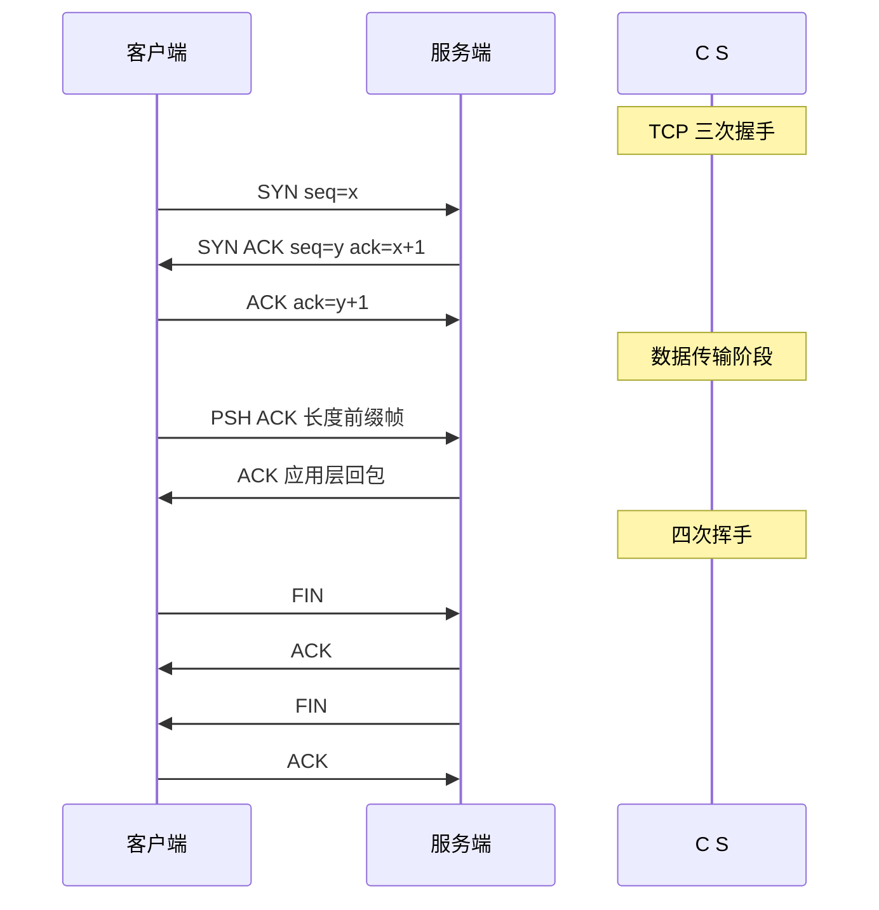
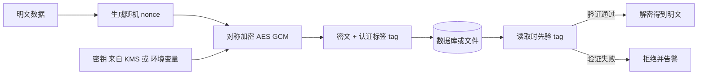
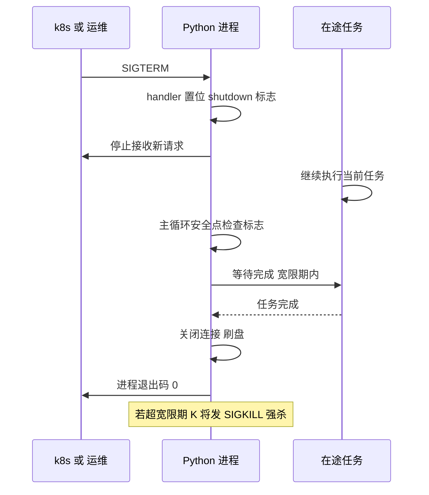
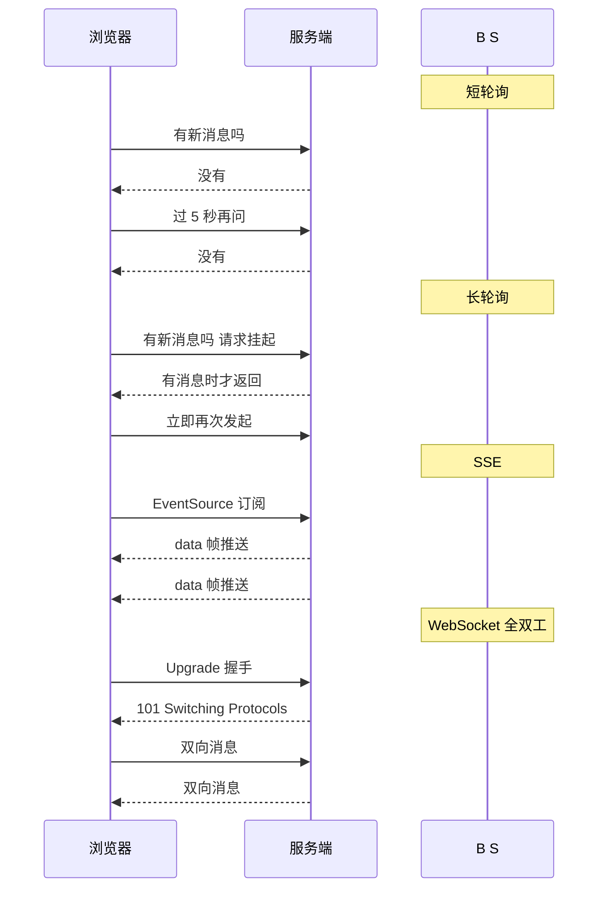

# 第 9 章 · Python 常用开发专题

> 本章是前 8 章的"工程补全篇":面试考到高级/资深岗时,光会语言特性不够,还要能落地到真实服务与脚本。本章覆盖:①网络编程(socket TCP/UDP、粘包处理);②HTTP 客户端工程化与爬虫工程(超时/重试/限速/robots 合规);③序列化与文本/时间处理(JSON 进阶、re 进阶、时区与 monotonic 时钟);④安全与配置(hashlib/HMAC、secrets、敏感配置);⑤文件与自动化(pathlib/原子写/文件锁/定时脚本/subprocess/信号);⑥服务化基础(包发布、弱引用缓存、contextvars 链路追踪、SSE 与轮询、服务注册发现、单机压测、code review 清单)。所有代码均为标准库可运行。

---

### Q361 · 用 socket 写一个最小 TCP 服务端与客户端

> 难度:★★☆ | 标签:网络编程, socket, TCP

**问**:请用标准库 socket 手写一个最小的 TCP echo 服务端和客户端,并说明每一步系统调用的含义。

**答**:服务端流程是 `socket → bind → listen → accept`,客户端是 `socket → connect`。`bind` 绑定地址端口,`listen` 把套接字转为被动监听( backlog 是半连接/全连接队列长度),`accept` 阻塞直到有连接到来返回新的 conn 套接字,后续读写都在 conn 上进行。收发的是 bytes,记得 `sendall` 保证发完、`recv(bufsize)` 指定单次上限。

```python
# file: code/02_并发与网络工程/q361_tcp_echo.py
"""最小 TCP echo 服务端 + 客户端,单进程可自测。"""
import socket
import threading


def start_server(host="127.0.0.1", port=0):
    srv = socket.socket(socket.AF_INET, socket.SOCK_STREAM)  # TCP
    srv.setsockopt(socket.SOL_SOCKET, socket.SO_REUSEADDR, 1)  # 快速重启
    srv.bind((host, port))
    srv.listen(5)  # backlog:等待 accept 的连接队列长度
    srv.settimeout(2)
    return srv


def handle_client(conn):
    with conn:
        while True:
            data = conn.recv(1024)  # 返回 bytes,空表示对端关闭
            if not data:
                break
            conn.sendall(data)  # 循环发送直到全部写完


def main():
    srv = start_server()
    port = srv.getsockname()[1]
    threading.Thread(target=accept_loop, args=(srv,), daemon=True).start()

    # 客户端
    cli = socket.create_connection(("127.0.0.1", port), timeout=2)
    cli.sendall(b"hello")
    print("echo:", cli.recv(1024))
    cli.close()
    srv.close()


def accept_loop(srv):
    while True:
        try:
            conn, addr = srv.accept()
        except socket.timeout:
            continue
        threading.Thread(target=handle_client, args=(conn,), daemon=True).start()


if __name__ == "__main__":
    main()
```

**追问**:
- `send` 和 `sendall` 的区别?`send` 可能部分发送(受内核发送缓冲区限制),`sendall` 内部循环直到全部发送完成,业务代码应优先用它。
- 为什么服务端要 `SO_REUSEADDR`?避免 TIME_WAIT 状态下端口无法立即重绑,重启服务时常用。

### Q362 · TCP 粘包与拆包问题怎么处理

> 难度:★★★ | 标签:网络编程, TCP, 协议设计

**问**:什么是 TCP 粘包?为什么 UDP 没有"粘包"?如何设计协议解决?

**答**:TCP 是字节流协议,没有消息边界,多次 `send` 的数据可能被合并一次 `recv` 读出(粘包),也可能一条消息被分多次读出(拆包)。UDP 保留报文边界所以不存在此问题。解决思路本质是"应用层自定义边界":①定长消息;②分隔符(如 `\n`,需转义);③长度前缀——头部用固定字节声明 body 长度,是最通用方案。

```python
# file: code/02_并发与网络工程/q362_sticky_pack.py
"""长度前缀协议:4 字节大端长度 + body,解决 TCP 粘包。"""
import socket
import struct
import threading

HEADER = struct.Struct("!I")  # 网络字节序(大端)uint32


def send_msg(sock, payload: bytes):
    sock.sendall(HEADER.pack(len(payload)) + payload)


def recv_exact(sock, n: int) -> bytes:
    """循环读满 n 字节,连接关闭则抛异常。"""
    buf = bytearray()
    while len(buf) < n:
        chunk = sock.recv(n - len(buf))
        if not chunk:
            raise ConnectionError("peer closed")
        buf.extend(chunk)
    return bytes(buf)


def recv_msg(sock) -> bytes:
    (length,) = HEADER.unpack(recv_exact(sock, 4))
    if length > 10 * 1024 * 1024:  # 防恶意超大包
        raise ValueError("payload too large")
    return recv_exact(sock, length)


def main():
    srv = socket.socket()
    srv.bind(("127.0.0.1", 0))
    srv.listen(1)
    port = srv.getsockname()[1]
    threading.Thread(target=_serve, args=(srv,), daemon=True).start()

    cli = socket.create_connection(("127.0.0.1", port))
    # 连发三条模拟粘包,服务端按帧逐条还原
    for i in range(3):
        send_msg(cli, f"msg-{i}".encode())
    cli.close()
    srv.close()


def _serve(srv):
    conn, _ = srv.accept()
    with conn:
        for _ in range(3):
            print("recv frame:", recv_msg(conn))


if __name__ == "__main__":
    main()
```

**追问**:
- 换行分隔协议有什么坑?body 中若含分隔符会截断错误,需要转义或限定 body 为不含分隔符的文本(如 Redis 协议的组合方案)。
- `recv(1024)` 返回不足 1024 字节是错误吗?不是,TCP 只保证有序可靠,不保证一次读满,必须循环读。

### Q363 · UDP 通信的特点与最小实现

> 难度:★★☆ | 标签:网络编程, UDP

**问**:UDP 和 TCP 在编程模型上的核心区别是什么?什么场景选 UDP?

**答**:UDP 无连接,服务端只需 `socket → bind`,用 `sendto/recvfrom` 直接收发数据报,无握手、无确认、不保证顺序与到达,但开销小、有报文边界。适合 DNS、日志上报、实时音视频、心跳广播等"允许丢、要求快"的场景;要求可靠需在应用层自己实现确认重传(如 QUIC 思路)。

```python
# file: code/02_并发与网络工程/q363_udp_demo.py
"""最小 UDP 服务端与客户端。"""
import socket
import threading


def main():
    srv = socket.socket(socket.AF_INET, socket.SOCK_DGRAM)  # UDP
    srv.bind(("127.0.0.1", 0))
    port = srv.getsockname()[1]
    threading.Thread(target=_serve, args=(srv,), daemon=True).start()

    cli = socket.socket(socket.AF_INET, socket.SOCK_DGRAM)
    cli.settimeout(2)
    cli.sendto(b"ping", ("127.0.0.1", port))  # 无连接,直接发
    data, addr = cli.recvfrom(1024)  # 返回数据和来源地址
    print("udp reply:", data, "from", addr)


def _serve(srv):
    while True:
        data, addr = srv.recvfrom(1024)
        srv.sendto(b"pong:" + data, addr)  # 回给来源地址


if __name__ == "__main__":
    main()
```

**追问**:
- UDP 单个数据报最大多大?受 MTU 影响局域网约 1472 字节安全,理论上限 65507 字节,过大易被分片丢包。
- UDP 如何"广播"?绑定 `SO_BROADCAST` 选项后向 `255.255.255.255` 或子网广播地址 `sendto`。



### Q364 · HTTP 客户端工程化:超时、重试、连接池

> 难度:★★★ | 标签:requests, httpx, HTTP 客户端

**问**:生产代码里用 requests/httpx 调外部 API,你会强制做哪几件事?

**答**:四件事:①显式超时——`timeout` 必须设置,且最好区分连接超时与读超时(httpx 支持 `httpx.Timeout(5, read=30)`),默认无超时是最常见的线上事故;②重试只针对幂等请求(GET/PUT)或幂等操作,配指数退避与抖动,可用 `urllib3.Retry`/httpx 的 `transport` 机制;③连接池复用——用 `requests.Session`/`httpx.Client` 而不是每次新建,降低握手开销并限制并发;④带 UA、校验状态码 `raise_for_status()`、记录请求 ID 便于排查。

```python
# file: code/02_并发与网络工程/q364_http_client.py
"""用纯标准库 urllib 演示与 requests.Session 等价的工程化要点:
显式超时 + 指数退避重试 + 单例复用。"""
import json
import time
import urllib.error
import urllib.request


class HttpClient:
    """生产级 HTTP 客户端骨架,标准库可运行。"""

    def __init__(self, base_url, retries=3, connect_timeout=3.0, read_timeout=10.0):
        self.base_url = base_url.rstrip("/")
        self.retries = retries
        self.timeout = (connect_timeout, read_timeout)  # 连接超时/读超时分离
        self.opener = urllib.request.build_opener()  # 等价 Session:复用连接语义

    def get_json(self, path, params=None):
        url = self.base_url + path
        if params:
            url += "?" + urllib.parse.urlencode(params)
        last_err = None
        for attempt in range(1, self.retries + 1):
            try:
                req = urllib.request.Request(url, headers={"User-Agent": "my-svc/1.0"})
                with self.opener.open(req, timeout=max(self.timeout)) as resp:
                    return json.loads(resp.read())
            except (urllib.error.URLError, TimeoutError, OSError) as e:
                last_err = e  # GET 幂等,可安全重试
                time.sleep(min(2 ** attempt + random_jitter(), 10))
        raise RuntimeError(f"GET {url} failed after {self.retries} retries") from last_err


def random_jitter():
    import random
    return random.uniform(0, 0.5)


if __name__ == "__main__":
    client = HttpClient("https://httpbin.org")
    try:
        print(client.get_json("/get", params={"q": "python"})["url"])
    except RuntimeError as e:
        print("网络不可用,优雅降级:", e)
```

**追问**:
- POST 请求能盲目重试吗?不能,可能造成重复下单;除非携带幂等键 idempotency-key 且服务端支持去重。
- httpx 与 requests 怎么选?requests 同步生态最成熟;httpx API 相似且原生支持 async/HTTP2,适合 asyncio 项目。

### Q365 · 重试与退避策略:为什么不推荐裸 for 循环重试

> 难度:★★★ | 标签:可靠性, 指数退避

**问**:写一个通用的重试装饰器,要求支持指数退避、抖动和可重试异常白名单。

**答**:核心要点:①只重试指定异常,避免把逻辑 bug 也重试一遍;②指数退避 `2**n` 加随机抖动 jitter,防止服务恢复瞬间被重试风暴打死(惊群);③设最大重试次数与总时限;④每次重试记日志;⑤重试要求操作幂等,否则要配幂等键。生产中可直接用 `tenacity` 库,思路相同。

```python
# file: code/02_并发与网络工程/q365_retry.py
"""通用重试装饰器:指数退避 + 抖动 + 异常白名单。"""
import functools
import logging
import random
import time

log = logging.getLogger(__name__)


def retry(exceptions=(Exception,), attempts=3, base_delay=0.1, max_delay=2.0):
    def deco(func):
        @functools.wraps(func)
        def wrapper(*args, **kwargs):
            for attempt in range(1, attempts + 1):
                try:
                    return func(*args, **kwargs)
                except exceptions as e:
                    if attempt == attempts:
                        raise
                    delay = min(base_delay * 2 ** (attempt - 1), max_delay)
                    delay += random.uniform(0, delay * 0.3)  # jitter 防惊群
                    log.warning("%s 第 %s 次失败 %s,%.2fs 后重试",
                                func.__name__, attempt, e, delay)
                    time.sleep(delay)
        return wrapper
    return deco


class TransientError(Exception):
    pass


_calls = {"n": 0}


@retry(exceptions=(TransientError,), attempts=4, base_delay=0.05)
def flaky_api():
    """前两次失败,第三次成功,模拟抖动的下游。"""
    _calls["n"] += 1
    if _calls["n"] < 3:
        raise TransientError("upstream 503")
    return {"ok": True, "call": _calls["n"]}


if __name__ == "__main__":
    logging.basicConfig(level=logging.INFO)
    print(flaky_api())
```

**追问**:
- 什么是重试风暴?下游抖动时所有调用方同时重试,流量放大数倍把下游彻底打死;用 jitter、熔断器、配额限制来缓解。
- 重试和熔断什么关系?重试解决偶发失败,熔断(`circuit breaker`)在持续失败时快速失败并停止重试,给下游恢复时间。

### Q366 · 爬虫工程化:并发调度与失败隔离

> 难度:★★★ | 标签:爬虫, 并发, ThreadPoolExecutor

**问**:写一个能并发抓取多个 URL 的爬虫调度器,要求单个失败不影响整体、可去重、有结果汇总。

**答**:用 `ThreadPoolExecutor` 做 IO 并发(爬虫是 IO 密集,线程足够,大规规模再上 asyncio),要点:①`as_completed` 边完成边处理;②每个任务 try/except 包裹做失败隔离,失败进 dead letter 列表;③用 set 去重待抓 URL;④限制 `max_workers` 既是并发也是对目标站点的基本礼貌;⑤失败任务可重新入队有限次。

```python
# file: code/02_并发与网络工程/q366_crawler.py
"""并发爬虫调度器:线程池 + 失败隔离 + 去重 + 汇总。"""
import concurrent.futures as cf
import urllib.error
import urllib.request

HEADERS = {"User-Agent": "edu-crawler/1.0 (+contact@example.com)"}


def fetch(url, timeout=5):
    req = urllib.request.Request(url, headers=HEADERS)
    with urllib.request.urlopen(req, timeout=timeout) as resp:
        return resp.read(64 * 1024)  # 只取前 64KB,防超大页面


def run(urls, max_workers=4):
    seen, ok, failed = set(), [], []
    todo = [u for u in urls if not (u in seen or seen.add(u))]  # 去重
    with cf.ThreadPoolExecutor(max_workers=max_workers) as pool:
        futures = {pool.submit(fetch, u): u for u in todo}
        for fut in cf.as_completed(futures):
            url = futures[fut]
            try:
                ok.append((url, len(fut.result())))
            except Exception as e:  # 单个失败不拖垮整体
                failed.append((url, repr(e)))
    return ok, failed


if __name__ == "__main__":
    urls = ["https://httpbin.org/get", "https://no-such-host.invalid/",
            "https://httpbin.org/get?x=1"]  # 第三条与第一条同 host 但不同 URL
    ok, failed = run(urls)
    print("成功:", ok)
    print("失败:", failed)
```

**追问**:
- 大规模爬取为什么用 asyncio 而不是线程?上千并发连接时线程的内存与调度开销大,asyncio 单线程事件循环配合 aiohttp/httpx 异步客户端可支撑数万并发。
- 如何让爬虫可断点续爬?把已抓/待抓队列持久化(如 sqlite/redis),启动时先读状态。

### Q367 · 爬虫限速:令牌桶算法实现

> 难度:★★★ | 标签:爬虫, 限速, 令牌桶

**问**:如何礼貌地限制爬虫对单个站点的请求速率?写一个令牌桶。

**答**:令牌桶以固定速率往桶里放令牌,请求取到令牌才放行,桶有容量上限允许一定突发。相比固定窗口计数,它平滑且支持突发控制。对爬虫还要叠加 per-domain 限速(`time.sleep(1/rate)`)和遵守 `Retry-After` 响应头。

```python
# file: code/02_并发与网络工程/q367_token_bucket.py
"""令牌桶限速器,线程安全。"""
import threading
import time


class TokenBucket:
    def __init__(self, rate: float, capacity: int):
        self.rate = rate          # 每秒生成令牌数
        self.capacity = capacity  # 桶容量,允许的最大突发
        self.tokens = capacity
        self.last = time.monotonic()
        self.lock = threading.Lock()

    def acquire(self, n: int = 1) -> bool:
        with self.lock:
            now = time.monotonic()
            self.tokens = min(self.capacity, self.tokens + (now - self.last) * self.rate)
            self.last = now
            if self.tokens >= n:
                self.tokens -= n
                return True
            return False

    def wait(self, n: int = 1):
        while not self.acquire(n):
            time.sleep(1 / self.rate)  # 简单退避,可精确计算等待时间


if __name__ == "__main__":
    bucket = TokenBucket(rate=5, capacity=2)  # 平均 5 QPS,瞬时最多 2
    start = time.monotonic()
    for i in range(5):
        bucket.wait()
        print(f"第 {i} 次请求, 距开始 {time.monotonic() - start:.2f}s")
```

**追问**:
- 令牌桶和漏桶的区别?令牌桶允许突发(桶内有存量令牌),漏桶以恒定速率流出、完全平滑;限流多用令牌桶,整形多用漏桶。
- 目标站返回 429 怎么办?读取 `Retry-After` 头按建议时间等待,并把该域名速率减半,连续 429 则暂停该域名。

### Q368 · 爬虫合规:robots.txt 与抓取礼仪

> 难度:★★☆ | 标签:爬虫, robots, 合规

**问**:robots.txt 在爬虫中如何程序化遵守?除此之外还有哪些合规要点?

**答**:用标准库 `urllib.robotparser` 解析目标站 robots.txt,对每个 URL 调 `can_fetch(useragent, url)` 判断,并用 `crawl_delay`/`request_rate` 决定限速。合规要点还包括:①带真实 UA 和联系方式;②避开登录态/付费内容和个人信息(个保法/著作权边界);③尊重 `Cache-Control` 与版权;④高并发前先做压测评估对站点影响;⑤优先使用官方 API 或开放数据。

```python
# file: code/02_并发与网络工程/q368_robots.py
"""robots.txt 合规检查,离线演示 robotparser 用法。"""
import urllib.robotparser


def make_parser(robots_text: str) -> urllib.robotparser.RobotFileParser:
    rp = urllib.robotparser.RobotFileParser()
    rp.parse(robots_text.splitlines())  # 也可 rp.set_url + rp.read 在线拉取
    return rp


ROBOTS = """
User-agent: *
Disallow: /private/
Crawl-delay: 2

User-agent: edu-crawler
Allow: /
Disallow: /admin
"""

if __name__ == "__main__":
    rp = make_parser(ROBOTS)
    ua = "edu-crawler"
    print("can /posts :", rp.can_fetch(ua, "https://x.com/posts"))
    print("can /admin :", rp.can_fetch(ua, "https://x.com/admin"))
    print("can /private (其他UA):", rp.can_fetch("Baiduspider", "https://x.com/private/a"))
    print("crawl_delay:", rp.crawl_delay(ua))
```

**追问**:
- robots.txt 是法律还是道德约束?是行业惯例(robots 排除协议),不强制,但违反它加上高负载抓取可能构成不正当竞争或侵权证据,面试答"必须遵守"。
- crawl_delay 和 request_rate 有什么区别?——前者是两次请求最小间隔(秒),后者是「N 秒内最多 M 次」;两者同时给时取更保守的执行。
- robots.txt 拉取失败怎么处理?——404 视为全站允许(规范语义),5xx/超时应保守跳过或退避重试,缓存解析结果避免每 URL 拉一次。
- 登录态和付费内容为什么不能抓?——突破技术措施获取数据在民事/刑事上都有风险(著作权、不正当竞争、计算机信息系统安全),个保法还管个人信息;面试必须主动说出这条边界。
### Q369 · JSON 序列化进阶:default 与自定义 Encoder

> 难度:★★☆ | 标签:JSON, 序列化

**问**:`json.dumps` 遇到 `datetime`、`Decimal`、自定义对象会怎样?怎么优雅支持?

**答**:会抛 `TypeError`。方案:①给 `dumps` 传 `default=` 回调,遇到不认识的类型时返回可序列化对象,回调里再不认识就 `raise TypeError`;②继承 `json.JSONEncoder` 覆写 `default`(效果同①,可复用);③反序列化用 `object_hook` 把 dict 还原成对象。注意约定一种统一格式,如时间用 ISO8601 字符串、Decimal 转字符串避免精度丢失。

```python
# file: code/02_并发与网络工程/q369_json_default.py
"""json 自定义序列化与反序列化。"""
import datetime as dt
import json
from decimal import Decimal


def json_default(obj):
    if isinstance(obj, (dt.datetime, dt.date)):
        return obj.isoformat()
    if isinstance(obj, Decimal):
        return str(obj)  # 金额转字符串,防浮点精度丢失
    if isinstance(obj, set):
        return sorted(obj)
    raise TypeError(f"Object of type {type(obj).__name__} is not JSON serializable")


def _revive(d: dict):
    if "created_at" in d:
        d["created_at"] = dt.datetime.fromisoformat(d["created_at"])
    return d


class Order:
    def __init__(self):
        self.id = "A001"
        self.amount = Decimal("19.99")
        self.tags = {"vip", "paid"}
        self.created_at = dt.datetime(2026, 11, 1, 10, 0, 0)


if __name__ == "__main__":
    order = Order()
    text = json.dumps(order.__dict__, default=json_default, ensure_ascii=False, indent=2)
    print(text)
    back = json.loads(text, object_hook=_revive)
    print(type(back["created_at"]), back["amount"])
```

**追问**:
- `ensure_ascii=False` 有什么用?默认会把中文转成 `\uXXXX` 转义,关掉后输出可读中文,但写文件时要显式 `encoding="utf-8"`。
- NaN 和 Infinity 能进 JSON 吗?标准 JSON 不允许,但 Python json 默认放行 `NaN`,严格场景传 `allow_nan=False` 强制报错。

### Q370 · JSON Lines 与流式日志处理

> 难度:★★☆ | 标签:JSON Lines, 日志, 流式

**问**:为什么生产日志常用 JSON Lines 而不是一行文本?如何流式处理一个大到读不进内存的 JSONL 文件?

**答**:JSONL(每行一个 JSON 对象)兼具结构化(可按字段检索、喂给 ELK)与行分割(可逐行流式读、`wc -l`、断点续读)两大优点。处理大文件用逐行迭代,文件对象本身就是惰性迭代器,内存 O(1);坏行做隔离计数而不是中断。写侧要保证"单行原子性":一次 write 一行且带换行。读侧还有个易踩的坑:一行可能是合法 JSON 但不是对象(比如一个裸字符串、数组、数字),`json.loads` 不报错,直接 `.get()` 却会 AttributeError——解析后要先 isinstance 校验再取字段,非对象行同样按坏行隔离。

```python
# file: code/02_并发与网络工程/q370_jsonl.py
"""JSON Lines 写入与流式读取统计。"""
import json


def write_jsonl(path, records):
    with open(path, "w", encoding="utf-8") as f:
        for rec in records:
            f.write(json.dumps(rec, ensure_ascii=False) + "\n")  # 一行一对象


def stream_stats(path):
    """逐行流式统计,内存占用与文件大小无关。"""
    total, bad, levels = 0, 0, {}
    with open(path, encoding="utf-8") as f:
        for line in f:  # 惰性迭代,不整读内存
            line = line.strip()
            if not line:
                continue
            total += 1
            try:
                rec = json.loads(line)
                # 合法 JSON 不一定是对象(裸字符串/数组/数字), 先校验再取字段
                if not isinstance(rec, dict):
                    bad += 1  # 非对象行按坏行隔离,不中断
                    continue
                levels[rec.get("level", "?")] = levels.get(rec.get("level", "?"), 0) + 1
            except json.JSONDecodeError:
                bad += 1  # 坏行隔离计数,不中断
    return total, bad, levels


if __name__ == "__main__":
    recs = [
        {"ts": "2026-11-01T10:00:00", "level": "INFO", "msg": "start"},
        {"ts": "2026-11-01T10:00:01", "level": "ERROR", "msg": "db down"},
        "这不是合法 JSON 行",  # 模拟写坏的行(裸字符串, JSON 合法但不是对象)
    ]
    write_jsonl("/tmp/app.jsonl", recs)
    print(stream_stats("/tmp/app.jsonl"))
```

**追问**:
- JSONL 与一个大 JSON 数组相比的优势?JSONL 可流式解析、按行追加、失败只影响一行;大数组必须整体解析且追加要重写全文件。
- 如何只读文件最后 N 行?二进制方式 seek 到末尾向前按块找换行符(`tail -n` 原理)。


### Q371 · 正则高级用法:命名分组、前后瞻、贪婪与懒惰

> 难度:★★★ | 标签:re, 正则

**问**:写一个正则从日志里提取 `level` 和 `msg` 字段,并说说 `(?P<name>...)`、`(?=...)`、`(?:...)` 的区别。

**答**:`(?P<name>...)` 命名捕获分组,`match.group("name")` 可读性远好于数字下标;`(?=...)` 是零宽正向先行断言,只匹配位置不消费字符;`(?:...)` 非捕获分组,只分组不保存,减少开销;`(?<=...)` 是后行断言。默认量词是贪婪的,加 `?` 变懒惰,如 `.*?`。`re.findall` 有分组时返回分组元组,容易被忽略。

```python
# file: code/02_并发与网络工程/q371_regex_advanced.py
"""正则高级用法示例:命名分组 / 断言 / 懒惰匹配。"""
import re

LOG_PATTERN = re.compile(
    r"^(?P<ts>\d{4}-\d{2}-\d{2} \d{2}:\d{2}:\d{2}) "   # 命名分组
    r"\[(?P<level>[A-Z]+)\] (?P<msg>.*)$"
)

if __name__ == "__main__":
    line = "2026-11-01 10:00:00 [ERROR] db connection lost"
    m = LOG_PATTERN.match(line)
    print(m.group("level"), "|", m.group("msg"))

    # 先行断言:取所有后跟 元 的 数字,数字本身不被消费
    print(re.findall(r"\d+(?=元)", "苹果5元 香蕉3元 榴莲20块"))

    # 懒惰 vs 贪婪:提取 markdown 链接
    text = "[a](x) and [b](y)"
    print(re.findall(r"\[(.*?)\]\((.*?)\)", text))  # 懒惰配对正确

    # 非捕获分组:只分组不保存
    print(re.findall(r"(?:http|https)://\S+", "go to https://example.com now"))
```

**追问**:
- `re.sub` 里怎么引用捕获组?替换串里用 `\1` 或 `\g<name>`,还可传函数作为替换目标做动态替换。
- 需要重复使用一个正则时要注意什么?先 `re.compile` 缓存成对象,避免每次调用都重新编译(虽然模块有内部缓存,显式编译更清晰更快)。

### Q372 · 正则性能陷阱:灾难性回溯

> 难度:★★★ | 标签:re, 性能

**问**:为什么 `(a+)+$` 这种正则会把 CPU 打满?如何避免?

**答**:嵌套量词导致灾难性回溯:匹配失败时引擎要尝试指数级的回溯路径,输入越长耗时指数增长,一条恶意字符串就能 DoS 整个服务(ReDoS)。规避:①避免嵌套量词如 `(a+)+`、`(.*)*`;②能用 `re.match` 全串匹配就不写 `$` 后再回溯;③把贪婪 `.*` 收窄成排除型字符类 `[^"]*`;④Python 3.11+ 的 re 部分场景回溯有改进,但根本解法是重构模式;⑤对用户输入的正则考虑限制长度和超时(子进程或专用库)。

```python
# file: code/02_并发与网络工程/q372_redos.py
"""灾难性回溯演示:危险模式 vs 安全模式耗时对比。"""
import re
import time

evil = "a" * 26 + "!"           # 匹配失败,触发全量回溯
danger = re.compile(r"^(a+)+$")  # 嵌套量词,指数回溯
safe = re.compile(r"^a+$")       # 线性匹配的等价写法


def timed(pattern, text):
    start = time.perf_counter()
    try:
        pattern.match(text)
    finally:
        return time.perf_counter() - start


if __name__ == "__main__":
    t1 = timed(danger, evil)
    t2 = timed(safe, evil)
    print(f"danger: {t1:.3f}s  safe: {t2:.6f}s  比例约 {t1 / max(t2, 1e-9):.0f} 倍")
    # 再多几个 a,danger 的耗时成倍增长 —— 指数级
```

**追问**:
- 如何给正则匹配加超时?标准库 re 不支持,可用 `signal.setitimer(SIGALRM)`(Unix)中断,或放子进程,或换 `regex` 第三方模块的 timeout 参数。
- 为什么排除型字符类能防回溯?——`[^"']*` 不产生「匹配空串再回退」的歧义路径,线性推进;嵌套量词 `(a+)+` 才是指数爆炸的根源。
- regex 模块的 timeout 失败后怎么办?——抛 Timeout 异常,调用方记录样本并告警;这是给「不可信输入进正则」的保险丝,不是性能优化。
- 怎么在代码评审里发现 ReDoS?——找嵌套量词、`(.*)*`、交替分支带重叠前缀的写法;高危模式进 lint 规则(ruff/semgrep 自定义检查)。
### Q373 · 时间处理:naive 与 aware、时区转换

> 难度:★★★ | 标签:datetime, 时区, zoneinfo

**问**:什么是 naive datetime?为什么生产代码强烈建议存 UTC?

**答**:naive 是不带 tzinfo 的 datetime,解释它依赖"你以为的时区",跨环境和夏令时会出错;aware 携带 tzinfo 可精确换算。生产规范:①存储与传输一律 UTC(数据库存 UTC 或时间戳);②展示时再转本地时区;③Python 3.9+ 用 `zoneinfo.ZoneInfo` 处理 IANA 时区,能正确处理夏令时;④比较、运算只在同类(最好都 aware)之间做,naive 与 aware 比较 直接抛 TypeError,这是好事。

```python
# file: code/02_并发与网络工程/q373_timezone.py
"""时区处理:naive vs aware、UTC 存储、本地展示。"""
from datetime import datetime, timezone
from zoneinfo import ZoneInfo

if __name__ == "__main__":
    # 1. 正确方式:创建带时区的 aware 时间
    now_utc = datetime.now(timezone.utc)
    print("UTC   :", now_utc.isoformat())

    # 2. 转上海时区展示,自动处理 +8
    sh = now_utc.astimezone(ZoneInfo("Asia/Shanghai"))
    print("上海  :", sh.isoformat())

    # 3. 夏令时验证:纽约 7 月与 12 月偏移不同
    ny_summer = datetime(2026, 7, 1, 12, tzinfo=ZoneInfo("America/New_York"))
    ny_winter = datetime(2026, 12, 1, 12, tzinfo=ZoneInfo("America/New_York"))
    print("NY 夏令时偏移:", ny_summer.utcoffset(), "冬季:", ny_winter.utcoffset())

    # 4. 危险方式:naive + replace 只改字段不换算,是错误示范
    naive = datetime(2026, 11, 1, 10, 0, 0)
    wrong = naive.replace(tzinfo=ZoneInfo("Asia/Shanghai"))
    correct = naive.replace(tzinfo=ZoneInfo("Asia/Shanghai")).astimezone(timezone.utc)
    print("错误理解:", wrong, "正确换算:", correct)

    # 5. aware 之间才能安全比较与做差
    print("时间差:", now_utc - ny_winter.astimezone(timezone.utc))
```

**追问**:
- `datetime.utcnow()` 为什么被废弃?返回 naive 对象,极易被误当本地时间;改用 `datetime.now(timezone.utc)`。
- pytz 和 zoneinfo 用哪个?新代码用标准库 zoneinfo;pytz 的 localize/normalize 奇异 API 是历史包袱。

### Q374 · time.time、time.monotonic 与 perf_counter 怎么选

> 难度:★★☆ | 标签:time, 时钟, 性能测量

**问**:测量代码耗时为什么不该用 `time.time()`?

**答**:`time.time()` 是墙钟,可能被 NTP 回拨或人为调整,测量间隔不可靠。`time.monotonic()` 单调不减、不受系统时间影响,适合算耗时、限速器和超时判断;`time.perf_counter()` 是最高精度的单调时钟,包含睡眠,专用于基准测试;`time.process_time()` 只计 CPU 时间不含 IO 等待。规则:对外展示用 `time.time()`/datetime,对内计时一律 monotonic 系。

```python
# file: code/02_并发与网络工程/q374_monotonic.py
"""三种时钟的选择演示。"""
import time

if __name__ == "__main__":
    # 基准测量:perf_counter 精度最高
    start = time.perf_counter()
    sum(range(1_000_000))
    print(f"CPU 耗时 perf_counter: {time.perf_counter() - start:.6f}s")

    # 业务限速/超时:monotonic
    deadline = time.monotonic() + 0.2
    while time.monotonic() < deadline:
        pass
    print("deadline 轮询结束, 未超时:", time.monotonic() <= deadline + 0.05)

    # 墙钟:用于日志时间戳、对外展示
    print("wall clock:", time.strftime("%Y-%m-%d %H:%M:%S", time.localtime()))

    # 对比:process_time 不含 sleep
    s = time.process_time()
    time.sleep(0.1)
    print(f"sleep 0.1s 后 process_time 只增加 {time.process_time() - s:.6f}s")
```

**追问**:
- 事件序号可以用 time.time() 生成吗?不可靠,同一毫秒可能重复且可能回拨;用单调递增序列、UUID 或 ULID。
- monotonic 会跨进程一致吗?——不会,每个系统起点不同且不可跨机器比较;跨主机计时用 NTP 校准的墙钟并接受误差。
- perf_counter 包含 sleep 吗?——包含(挂钟类单调时钟);process_time 不含等待只算 CPU,压测报告要写清用的哪个。
- 超时判断为什么禁止 time.time()?——NTP 回拨会让已超时的调用「重新变未超时」;所有 deadline 计算用 monotonic。
### Q375 · hashlib 与 HMAC:完整性校验与签名

> 难度:★★★ | 标签:hashlib, HMAC, 安全

**问**:hash 和 HMAC 有什么区别?如何设计一个标准库可跑的 API 签名方案?

**答**:hash(如 SHA-256)只有完整性能力,可被彩虹表/重放攻击;HMAC = hash + 密钥,既验完整性又验来源(只有持有密钥的双方能生成)。API 签名常见方案:客户端把 `method + path + timestamp + body` 按规则拼接,用共享密钥算 HMAC-SHA256 放进请求头;服务端用同样规则重算并 `hmac.compare_digest` 恒定时间比较;带上时间戳并在服务端校验窗口来防重放。注意密码存储要用 `hashlib.pbkdf2_hmac`/bcrypt,不能裸 hash。

```python
# file: code/02_并发与网络工程/q375_hmac_sign.py
"""HMAC-SHA256 API 签名与验签,防篡改 + 防重放。"""
import hashlib
import hmac
import json
import time

SECRET_KEY = b"shared-secret-keep-in-env"


def sign_request(method: str, path: str, body: dict, ts: float, key=SECRET_KEY) -> str:
    payload = f"{method.upper()}\n{path}\n{ts}\n" + json.dumps(body, sort_keys=True)
    return hmac.new(key, payload.encode(), hashlib.sha256).hexdigest()


def verify_request(method, path, body, ts, signature, key=SECRET_KEY,
                   window=300) -> bool:
    if abs(time.time() - ts) > window:          # 防重放:超出时间窗拒绝
        return False
    expect = sign_request(method, path, body, ts, key)
    return hmac.compare_digest(expect, signature)  # 恒定时间比较,防时序攻击


def password_digest(password: str, salt: bytes) -> bytes:
    """密码存储用 KDF,而不是裸 hash。"""
    return hashlib.pbkdf2_hmac("sha256", password.encode(), salt, 200_000)


if __name__ == "__main__":
    body = {"user": "alice", "amount": 100}
    ts = time.time()
    sig = sign_request("POST", "/api/pay", body, ts)
    print("签名:", sig[:16], "...")
    print("验签通过:", verify_request("POST", "/api/pay", body, ts, sig))
    print("篡改后验签:", verify_request("POST", "/api/pay", {"user": "alice", "amount": 999}, ts, sig))

    salt = b"random-salt-per-user"
    print("密码摘要:", password_digest("s3cret", salt).hex()[:16])
```

**追问**:
- 为什么用 `compare_digest` 而不是 `==`?普通 `==` 短路比较的耗时和匹配前缀长度相关,可被时序攻击逐字节爆破;`compare_digest` 恒定时间。
- MD5/SHA1 还能用吗?做非安全用途的校验和可以,安全场景一律 SHA-256 及以上。

### Q376 · secrets:密码学安全的随机数

> 难度:★★☆ | 标签:secrets, 安全, 随机数

**问**:生成 token、密钥、验证码为什么禁止用 `random` 模块?

**答**:`random` 是 Mersenne Twister 伪随机,观察足够多输出可预测后续值,不能用于安全场景。`secrets` 底层用操作系统的熵源(`/dev/urandom`),专用于 token、密钥、盐、重置链接。口诀:安全用 `secrets`,模拟抽样用 `random`,统计/游戏用 `random` 无妨。

```python
# file: code/02_并发与网络工程/q376_secrets.py
"""secrets 的三种典型用法。"""
import secrets
import string

if __name__ == "__main__":
    # 1. 随机字节与 hex token(会话 ID、API key)
    print("token  :", secrets.token_hex(32))     # 64 个 hex 字符
    print("urlsafe:", secrets.token_urlsafe(32))  # 可进 URL 的 token

    # 2. 生成强随机密码
    alphabet = string.ascii_letters + string.digits + "!@#$%"
    password = "".join(secrets.choice(alphabet) for _ in range(16))
    print("password:", password)

    # 3. 安全比较:防止时序攻击(内部即 hmac.compare_digest)
    print("compare:", secrets.compare_digest("abc", "abc"))
```

**追问**:
- 需要"随机但可复现"的实验用什么?`random.Random(seed)` 显式实例化,实验可复现且不污染全局;安全与复现是两个互斥目标。
- secrets 的常用 API?——`token_hex/token_urlsafe(n)` 生成 token、`secrets.choice` 安全抽样、`compare_digest` 做常量时间比较防时序攻击。
- 为什么比较 token 也要防时序?——`==` 短路比较耗时与匹配前缀长度相关,可逐字节爆破;`hmac.compare_digest` 恒定耗时。
- UUID4 能当安全凭证吗?——可以,UUID4 同样基于 os 熵源(secrets 的来源);UUID1 含 MAC 与时间戳,反而泄露信息,别用于安全场景。
### Q377 · 对称加密概念与标准库可跑的替代方案

> 难度:★★★ | 标签:加密, AES, Fernet

**问**:Python 标准库能做 AES 吗?数据落库加密的正确姿势是什么?

**答**:标准库不做 AES(底层 C 实现未收录),生产用 `cryptography` 包:`Fernet`(AES-128-CBC + HMAC,自带认证)最省心,`AESGCM` 是现代 AEAD 首选。要点:①密钥放 KMS/环境变量,绝不入库;②每次加密用随机 nonce/IV,重置 nonce 是致命错误;③优先带认证的 AEAD 模式(GCM/ChaCha20-Poly1305),不要裸 CBC。标准库内可跑的"认证加密等价物"是"hashlib 加密 + HMAC 认证"的组合,可演示完整流程。

```python
# file: code/02_并发与网络工程/q377_symmetric_crypto.py
"""对称加密概念:标准库实现 加密混淆 + HMAC 认证 的完整流程。
生产请用 cryptography 的 Fernet/AESGCM,此处演示原理。"""
import base64
import hashlib
import hmac
import os

KEY = hashlib.sha256(b"env-secret-key").digest()  # 32 字节密钥


def derive_keystream(nonce: bytes, length: int) -> bytes:
    """用 SHA256 计数器模式生成密钥流,演示流式加密原理。"""
    stream = b""
    counter = 0
    while len(stream) < length:
        stream += hmac.new(KEY, nonce + counter.to_bytes(4, "big"), hashlib.sha256).digest()
        counter += 1
    return stream[:length]


def encrypt(plaintext: bytes) -> bytes:
    nonce = os.urandom(16)  # 每次加密必须用全新随机 nonce
    stream = derive_keystream(nonce, len(plaintext))
    ciphertext = bytes(a ^ b for a, b in zip(plaintext, stream))
    tag = hmac.new(KEY, nonce + ciphertext, hashlib.sha256).digest()  # Encrypt-then-MAC
    return nonce + ciphertext + tag


def decrypt(blob: bytes) -> bytes:
    nonce, tag, ciphertext = blob[:16], blob[-32:], blob[16:-32]
    expect = hmac.new(KEY, nonce + ciphertext, hashlib.sha256).digest()
    if not hmac.compare_digest(expect, tag):
        raise ValueError("认证失败:密文被篡改或密钥不符")
    stream = derive_keystream(nonce, len(ciphertext))
    return bytes(a ^ b for a, b in zip(ciphertext, stream))


if __name__ == "__main__":
    blob = encrypt("机密数据 salary=12345".encode())
    print("密文 b64:", base64.b64encode(blob).decode()[:40], "...")
    print("解密:", decrypt(blob).decode())
    tampered = bytearray(blob)
    tampered[20] ^= 0xFF
    try:
        decrypt(bytes(tampered))
    except ValueError as e:
        print("防篡改生效:", e)
```

**追问**:
- Fernet 一行加解密怎么写?`Fernet(key).encrypt(data)` / `.decrypt(token)`,key 是 `Fernet.generate_key()` 生成的 32 字节 urlsafe base64。
- 对称和非对称加密怎么配合?非对称(RSA/ECDH)只用来交换或封装对称密钥,大数据一律对称加密,即 TLS/信封加密的思路。



### Q378 · 敏感配置管理:密钥放哪才对

> 难度:★★☆ | 标签:配置管理, 安全, 12-factor

**问**:数据库密码、API key 应该放在哪里?代码里发现硬编码怎么办?

**答**:遵循 12-factor:配置与代码分离,通过环境变量注入(`os.environ`),本地开发用不入库的 `.env` + `python-dotenv`,生产用 Vault/KMS/云密钥管理或编排平台的 secret 机制。规则:①`.env` 进 `.gitignore`,提供 `.env.example` 模板;②启动时校验必需配置缺失即 fail-fast;③日志脱敏,不打印密码/token;④已泄露的密钥先轮换再清理历史。代码里发现硬编码密钥应立即视为泄露:先吊销轮换,再删代码,必要时清洗 git 历史。

```python
# file: code/02_并发与网络工程/q378_config.py
"""配置加载与校验:环境变量 + fail-fast + 脱敏。"""
import os


class ConfigError(Exception):
    pass


REQUIRED_KEYS = ("DATABASE_URL", "REDIS_URL", "JWT_SECRET")


def load_config(environ=None) -> dict:
    env = environ if environ is not None else os.environ
    missing = [k for k in REQUIRED_KEYS if not env.get(k)]
    if missing:
        raise ConfigError(f"缺少必需配置: {missing}, 请通过环境变量注入")
    cfg = {k: env[k] for k in REQUIRED_KEYS}
    cfg["DEBUG"] = env.get("DEBUG", "false").lower() == "true"
    return cfg


def mask(secret: str, keep: int = 4) -> str:
    """日志脱敏:只保留尾部 4 位。"""
    if len(secret) <= keep:
        return "*" * len(secret)
    return "*" * (len(secret) - keep) + secret[-keep:]


if __name__ == "__main__":
    fake_env = {
        "DATABASE_URL": "postgres://u:p@db/prod",
        "REDIS_URL": "redis://r:6379/0",
        "JWT_SECRET": "0123456789abcdef",
    }
    cfg = load_config(fake_env)
    print("JWT_SECRET 脱敏输出:", mask(cfg["JWT_SECRET"]))
    try:
        load_config({})
    except ConfigError as e:
        print("fail-fast:", e)
```

**追问**:
- 把密钥加密后存在代码里行不行?不行,代码即公开,加密密钥仍在附近;混淆不是安全,密钥必须在代码之外、可独立轮换。
- Vault/KMS 相比环境变量好在哪?——集中管理、动态轮换、审计与最小权限租约;环境变量只是「不进代码」,轮换仍要重启。
- 启动校验怎么写?——pydantic-settings 声明字段,缺失/类型错直接抛 ValidationError 拒绝启动;fail-fast 好过运行到半夜才炸。
- 日志怎么防泄露密钥?——日志框架全局 Filter 正则扫密钥模式;以及规范上禁止打印 config/请求体全文。
### Q379 · pathlib 与 shutil:现代文件操作

> 难度:★★☆ | 标签:pathlib, shutil, 文件 IO

**问**:pathlib 相比 os.path 好在哪?批量备份一个目录用什么?

**答**:pathlib 用 `/` 运算符拼路径、面向对象、跨平台,`Path.glob`/`rglob`/`read_text`/`with_suffix` 一气呵成,替代 `os.path.join` 的字符串拼接。批量复制/归档用 `shutil.copy2`(保留元数据)、`shutil.copytree`、`shutil.make_archive`、`shutil.rmtree`、`shutil.move`,以及 `glob` 过滤。注意 `rmtree` 不可恢复,先校验路径前缀。

```python
# file: code/02_并发与网络工程/q379_pathlib_shutil.py
"""pathlib + shutil:构建与打包一个项目快照。"""
import shutil
import tempfile
from pathlib import Path

if __name__ == "__main__":
    project = Path(tempfile.mkdtemp()) / "myproj"
    src = project / "src"
    src.mkdir(parents=True)
    (src / "main.py").write_text("print('hi')", encoding="utf-8")
    (project / "data.csv").write_text("a,b\n1,2\n", encoding="utf-8")
    (project / "cache.tmp").write_text("junk", encoding="utf-8")

    # pathlib 遍历:只找 .py 文件
    for py in project.rglob("*.py"):
        print("py file:", py.relative_to(project), py.stat().st_size, "bytes")

    # shutil.copytree 备份,忽略 tmp 文件
    backup = project.parent / "myproj_backup"
    if backup.exists():
        shutil.rmtree(backup)
    shutil.copytree(project, backup, ignore=shutil.ignore_patterns("*.tmp"))

    # 打 zip 归档
    archive = shutil.make_archive(str(project.parent / "snapshot"), "zip",
                                  root_dir=str(backup))
    print("archive:", archive, Path(archive).stat().st_size, "bytes")
    print("备份内容:", sorted(p.name for p in backup.rglob("*")))
```

**追问**:
- `copyfile`/`copy`/`copy2` 区别?`copyfile` 只拷内容;`copy` 尽量保留权限;`copy2` 连 mtime 等元数据一起保留,备份首选。
- 大文件拷贝怎么省 IO?`shutil.copyfile` 底层用 `os.sendfile`/`fcopyfile` 零拷贝,比自己逐块读快。

### Q380 · 原子写文件:为什么先写临时文件再 rename

> 难度:★★★ | 标签:文件 IO, 原子性, fsync

**问**:直接 `open(path, "w")` 覆盖配置文件有什么风险?如何原子地写文件?

**答**:写一半时进程崩溃/断电,文件就是截断的半成品,读它的进程会挂。原子写姿势:①写到同目录临时文件(保证同一文件系统);②`flush` + `os.fsync` 落盘;③`os.replace(tmp, path)`——rename 在 POSIX 上是原子操作,读者要么看到旧文件要么看到新文件。注意必须用 `os.replace` 而非 `os.rename`(Windows 跨设备/覆盖行为不同,replace 跨平台语义正确)。

```python
# file: code/02_并发与网络工程/q380_atomic_write.py
"""原子写文件:tempfile + fsync + os.replace。"""
import json
import os
import tempfile


def atomic_write(path, data: str, encoding="utf-8"):
    dir_ = os.path.dirname(os.path.abspath(path)) or "."
    fd, tmp = tempfile.mkstemp(dir=dir_, prefix=".tmp_")
    try:
        with os.fdopen(fd, "w", encoding=encoding) as f:
            f.write(data)
            f.flush()
            os.fsync(f.fileno())  # 强制落盘,防断电丢数据
        os.replace(tmp, path)     # 原子替换,读者不会看到半成品
    except BaseException:
        os.unlink(tmp)            # 失败清理临时文件
        raise


if __name__ == "__main__":
    path = "/tmp/app_config.json"
    atomic_write(path, json.dumps({"version": 1, "host": "db-1"}))
    with open(path) as f:
        print("read back:", f.read())
    # 重复原子写,模拟更新
    atomic_write(path, json.dumps({"version": 2, "host": "db-2"}))
    with open(path) as f:
        print("updated  :", f.read())
```

**追问**:
- 为什么临时文件必须和目标同目录?`os.replace` 的原子性只在同一文件系统内成立,跨文件系统会退化为拷贝+删除。
- 追加写是原子的吗?小于 PIPE_BUF 的 append 在 POSIX 下对并发写基本原子,但更大写入可能交错,多进程写同一日志建议进程各写各文件或加锁。

### Q381 · 文件锁:防止两个进程同时改一个文件

> 难度:★★★ | 标签:文件锁, fcntl, 并发

**问**:crontab 里同一个脚本每分钟跑一次,上一轮还没结束就又启动了,怎么办?

**答**:用文件锁保证单实例。Linux/macOS 用 `fcntl.flock` 对锁文件加排他锁:拿不到锁直接退出(或等待);锁随进程退出自动释放,不残留死锁。Windows 对应 `msvcrt.locking`。要点:①锁文件放 `/tmp` 或运行目录;②锁只解决互斥,不解决幂等,任务本身仍要设计为可重入;③更复杂场景用 `filelock` 第三方库或锁 Redis/ZK。

```python
# file: code/02_并发与网络工程/q381_file_lock.py
"""fcntl 文件锁:保证脚本单实例运行,标准库可运行。"""
import fcntl
import os
import tempfile
import time


class SingleInstance:
    def __init__(self, name="myjob"):
        self.lock_path = os.path.join(tempfile.gettempdir(), f"{name}.lock")
        self.fd = None

    def __enter__(self):
        self.fd = open(self.lock_path, "w")
        try:
            fcntl.flock(self.fd, fcntl.LOCK_EX | fcntl.LOCK_NB)  # 非阻塞排他锁
        except BlockingIOError:
            raise RuntimeError("已有实例在运行, 退出") from None
        self.fd.write(str(os.getpid()))
        self.fd.flush()
        return self

    def __exit__(self, *exc):
        fcntl.flock(self.fd, fcntl.LOCK_UN)
        self.fd.close()


if __name__ == "__main__":
    with SingleInstance("demojob"):
        print(f"pid {os.getpid()} 获得锁, 开始干活")
        # 模拟第二个实例尝试进入
        try:
            with SingleInstance("demojob"):
                print("不可能执行到这里")
        except RuntimeError as e:
            print("第二个实例被拒绝:", e)
        time.sleep(0.1)
    print("锁已释放, 下一轮 cron 可正常进入")
```

**追问**:
- flock 和 lockf/POSIX record lock 区别?flock 锁整个文件、随 open file description 释放;lockf(fcntl F_SETLK)按字节段锁、与进程关联;NFS 上行为还要看服务端支持。
- 锁文件残留会死锁吗?——flock 锁随文件描述符与进程消失,进程崩溃自动释放;这正是选 flock 而非「touch 一个 pid 文件判断存在」的原因。
- 阻塞式 LOCK_EX 什么时候用?——愿意排队等(串行消费);cron 任务应该 LOCK_NB 拿不到就退出,避免堆积的实例排队连跑。
- 分布式多机场景怎么办?——flock 只锁单机文件系统,跨机器用 Redis SETNX+TTL 或 ZooKeeper 租约;文件锁的边界要说清。
### Q382 · 定时任务脚本:crontab 级自动化设计

> 难度:★★☆ | 标签:自动化, cron, 运维

**问**:写一个适合放进 crontab 的自动化脚本,要考虑哪些工程细节?

**答**:要点:①日志重定向与轮转(`>> log 2>&1`,程序内配 RotatingFileHandler);②文件锁防重叠(上一题);③失败要能被感知——退出码非 0、发通知(邮件/webhook);④路径用绝对路径,cron 的 PATH 和 shell 环境与登录 shell 不同;⑤任务幂等,可安全重跑;⑥用 `python script.py` 显式指定解释器或加 shebang + chmod +x。Python 内也常直接用 `sched`/`APScheduler` 做进程内调度。

```python
# file: code/02_并发与网络工程/q382_cron_script.py
"""适合 crontab 的自动化任务骨架:锁 + 日志 + 退出码 + 通知钩子。
crontab 示例: * * * * * /usr/local/bin/python3 /opt/jobs/backup_job.py >> /var/log/backup.log 2>&1
"""
import logging
import os
import sys
import tempfile
from logging.handlers import RotatingFileHandler

try:
    import fcntl
except ImportError:  # Windows 环境降级
    fcntl = None


def setup_logger() -> logging.Logger:
    log_path = os.path.join(tempfile.gettempdir(), "backup_job.log")
    handler = RotatingFileHandler(log_path, maxBytes=1_000_000, backupCount=3)
    handler.setFormatter(logging.Formatter("%(asctime)s %(levelname)s %(message)s"))
    log = logging.getLogger("backup_job")
    log.addHandler(handler)
    log.setLevel(logging.INFO)
    return log


def acquire_lock(name="backup_job") -> bool:
    if fcntl is None:
        return True
    fd = open(os.path.join(tempfile.gettempdir(), name + ".lock"), "w")
    try:
        fcntl.flock(fd, fcntl.LOCK_EX | fcntl.LOCK_NB)
    except BlockingIOError:
        return False
    return True


def notify(level, msg):
    """生产里替换成发邮件或企业微信 webhook。"""
    print(f"[NOTIFY-{level}] {msg}")


def do_work(log):
    log.info("开始备份")
    # ... 真实备份逻辑 ...
    log.info("备份完成")


def main():
    log = setup_logger()
    if not acquire_lock():
        log.warning("上一次任务尚未结束, 跳过本轮")
        return 0
    try:
        do_work(log)
        return 0
    except Exception as e:
        log.exception("任务失败")
        notify("ERROR", f"backup_job 失败: {e}")
        return 1


if __name__ == "__main__":
    sys.exit(main())  # cron 依据退出码判断成败
```

**追问**:
- 如何让任务错峰而不是整点齐跑?crontab 随机 sleep 几分钟,或程序内 `random.uniform` 抖动,避免同时打爆下游。
- cron 5 个字段忘了怎么写?分 时 日 月 周,`*/5 * * * *` 每 5 分钟,`0 3 * * 1` 每周一 3 点。

### Q383 · subprocess 安全调用:shell=False 与参数注入

> 难度:★★★ | 标签:subprocess, 安全, 进程管理

**问**:`subprocess.run(cmd, shell=True)` 有什么风险?安全的调用方式是什么?

**答**:`shell=True` 把整条命令交给 shell 解释,若命令里拼了用户输入就会被注入(`; rm -rf /`)。安全姿势:①`shell=False`,命令写成列表 `["ls", "-la", path]`,参数原样传递;②`capture_output=True, text=True` 捕获输出;③显式 `timeout` 防挂死;④`check=True` 让失败抛 `CalledProcessError`;⑤尽量不用 `input=` 传敏感数据,环境变量按需最小化传给 `env=`。确实需要管道/通配符时,可用 shlex 拆分或交给专门的库。

```python
# file: code/02_并发与网络工程/q383_subprocess.py
"""subprocess 安全调用示例(跨平台均可运行)。"""
import subprocess
import sys


def safe_run(cmd: list, timeout=10):
    result = subprocess.run(
        cmd,
        capture_output=True,  # 等价 stdout+stderr=PIPE
        text=True,
        timeout=timeout,
        check=True,           # 非零退出码抛 CalledProcessError
    )
    return result.stdout


def unsafe_example(user_input: str):
    """错误示范(仅注释说明,不执行):
    subprocess.run(f"echo {user_input}", shell=True)
    user_input='hello; rm -rf ~' 时会发生灾难。
    """
    pass


if __name__ == "__main__":
    # 参数列表传递,用户输入不会被 shell 二次解释
    out = safe_run([sys.executable, "-c", "print(1+1)"])
    print("计算结果:", out.strip())

    try:
        safe_run([sys.executable, "-c", "import sys; sys.exit(3)"])
    except subprocess.CalledProcessError as e:
        print("非零退出被感知, returncode =", e.returncode)

    try:
        safe_run([sys.executable, "-c", "import time; time.sleep(30)"], timeout=1)
    except subprocess.TimeoutExpired as e:
        print("超时被杀死, timeout =", e.timeout)
```

**追问**:
- 需要执行带管道的命令怎么办?`shell=True` 且参数完全可信时才可用;否则用两个 Popen 用 `stdout=PIPE` 串联,或直接用 Python 实现。
- 如何流式读子进程输出?`Popen(..., stdout=subprocess.PIPE)` 后逐行 `for line in proc.stdout`。

### Q384 · 信号处理:优雅停机

> 难度:★★★ | 标签:signal, 优雅停机, 运维

**问**:kill 进程时如何保证正在处理的请求做完、资源正确释放?

**答**:用 `signal.signal(SIGTERM/SIGINT, handler)` 注册处理函数,把"该停了"设为标志位,主循环在每个安全点检查标志:停止接收新任务 → 等待在途任务完成(设超时)→ 关闭连接/刷盘 → 退出。规则:①handler 里只做设置标志等轻量动作,复杂逻辑放主循环,因为信号处理器可能打断任意代码;②SIGKILL 不可捕获,是最后的强杀;③K8s 场景配合 `terminationGracePeriodSeconds`。可被捕获的信号还有 SIGHUP(常用作重载配置)。

```python
# file: code/02_并发与网络工程/q384_graceful_shutdown.py
"""优雅停机:SIGTERM/SIGINT 处理 + 安全点检查。"""
import signal
import sys
import time

shutdown = False


def handle_signal(signum, frame):
    global shutdown
    print(f"\n收到信号 {signal.Signals(signum).name}, 置位停机标志")
    shutdown = True  # handler 内只做最轻量动作


def main():
    signal.signal(signal.SIGTERM, handle_signal)
    signal.signal(signal.SIGINT, handle_signal)  # Ctrl+C

    print("worker 启动, pid =", os_getpid(), "按 Ctrl+C 演示优雅停机")
    processed = 0
    while not shutdown:
        # 模拟处理一个任务
        time.sleep(0.2)
        processed += 1
        if processed >= 3:
            # 演示用:处理 3 个后向自己发 SIGTERM
            import os
            os.kill(os.getpid(), signal.SIGTERM)
    print(f"安全点检测到停机标志, 等待在途任务... 已处理 {processed} 个")
    print("关闭连接, 刷盘, 退出码 0")
    return 0


def os_getpid():
    import os
    return os.getpid()


if __name__ == "__main__":
    sys.exit(main())
```

**追问**:
- 多线程程序里 signal handler 在哪个线程执行?只在主线程执行,这也是为什么 worker 线程里注册信号无意义;asyncio 用 `loop.add_signal_handler`。
- 优雅停机超时了怎么办?在途任务未完成且宽限期将到,应记录状态快照后退出,依赖任务幂等性由重启后恢复。



### Q385 · 第三方包发布:从 pyproject.toml 到 PyPI

> 难度:★★☆ | 标签:打包, pyproject, 发布

**问**:现在发布一个 Python 包,标准流程和文件结构是什么?

**答**:现代标准是 `pyproject.toml`(PEP 621 元数据)+ 构建后端(setuptools/hatchling/poetry-core)+ Twine 上传。流程:①写 `pyproject.toml` 声明名称、版本、依赖、Python 版本下限;②`pip install build; python -m build` 产出 sdist(.tar.gz)和 wheel(.whl);③`twine upload dist/*`(用 API token,别用密码);④版本号用语义化版本,发版打 git tag。注意:私包发私有 index(如公司 Nexus),上传前用 `twine check` 校验。

```python
# file: code/02_并发与网络工程/q385_package_files.py
"""以编程方式生成 pyproject.toml,演示现代包元数据。"""
from pathlib import Path

PYPROJECT = '''
[build-system]
requires = ["setuptools>=68"]
build-backend = "setuptools.build_meta"

[project]
name = "myutils"
version = "1.2.0"
description = "个人工具集示例包"
requires-python = ">=3.9"
dependencies = ["requests>=2.31,<3"]

[project.optional-dependencies]
dev = ["pytest", "ruff"]

[project.scripts]
myutils-cli = "myutils.cli:main"
'''


def init_package(root="myutils-project"):
    root = Path(root)
    pkg = root / "myutils"
    pkg.mkdir(parents=True, exist_ok=True)
    (pkg / "__init__.py").write_text('__version__ = "1.2.0"\n', encoding="utf-8")
    (pkg / "cli.py").write_text(
        'def main():\n    print("hello from myutils")\n', encoding="utf-8"
    )
    (root / "pyproject.toml").write_text(PYPROJECT, encoding="utf-8")
    return root


if __name__ == "__main__":
    p = init_package("/tmp/myutils-project")
    print("生成完成:", sorted(str(x.relative_to(p)) for x in p.rglob("*")))
    # 发布三步(在项目根目录执行):
    # python -m build          生成 sdist 和 wheel
    # twine check dist/*       校验元数据
    # twine upload dist/*      上传 PyPI 或私有 index
```

**追问**:
- wheel 和 sdist 的区别?wheel 是预构建产物,安装快、不需本地构建;sdist 是源码分发包,某些平台/场景需要;PyPI 要求两者都传。
- 版本号 `1.2.0` 里各位代表什么?语义化版本:主版本(不兼容变更).次版本(向后兼容的新功能).修订号(修复)。

### Q386 · 弱引用与缓存内存泄漏

> 难度:★★★ | 标签:weakref, 缓存, 内存管理

**问**:为什么用普通 dict 做对象缓存可能导致内存泄漏?weakref 怎么解决?

**答**:普通 dict 持有对象的强引用,对象永不回收,缓存变成泄漏。`weakref.WeakValueDictionary`/`WeakKeyDictionary` 只持有弱引用,对象被其他地方回收后自动从缓存消失,适合"有则加速、无则重建"的场景。注意:①不是所有对象可弱引用(list/dict 原生不可,子类加 `__slots__` 时要加 `__weakref__`);②`functools.lru_cache` 按"参数"缓存返回值,若返回大对象同样要评估内存上限(maxsize 就是保护阀)。

```python
# file: code/02_并发与网络工程/q386_weakref_cache.py
"""weakref 实现的弱缓存:对象回收后缓存自动清理。"""
import gc
import weakref


class Expensive:
    def __init__(self, name):
        self.name = name


cache = weakref.WeakValueDictionary()


def get_expensive(name):
    obj = cache.get(name)
    if obj is None:
        print(f"重建 {name}")
        obj = Expensive(name)
        cache[name] = obj  # 只存弱引用
    else:
        print(f"命中缓存 {name}")
    return obj


if __name__ == "__main__":
    a = get_expensive("conn-1")   # 重建
    b = get_expensive("conn-1")   # 命中
    print("同一对象:", a is b)
    print("当前缓存键:", list(cache.keys()))

    del a, b
    gc.collect()                  # 外部引用消失,对象被回收
    print("回收后缓存键:", list(cache.keys()), "<- 自动清理, 无泄漏")
    get_expensive("conn-1")       # 重新重建
```

**追问**:
- 循环引用里的 `__del__` 与弱引用有什么坑?带 `__del__` 的循环引用在旧版本可能延迟回收,弱引用回调(`finalize`)是更安全的清理钩子,用 `weakref.finalize(obj, func)` 注册。
- lru_cache 最大的坑是什么?默认 maxsize=128 无限存参数组合,若 key 含大对象或未 hash 的参数会出错/膨胀;且缓存的方法会让实例无法回收(含 self 的方法),必要时用 methodtools 或手动清理。

### Q387 · contextvars 实现请求级链路追踪

> 难度:★★★ | 标签:contextvars, 链路追踪, 并发

**问**:多线程/asyncio 服务里,怎么给每个请求一个 trace_id 并让全链路日志都带上?

**答**:全局变量会串请求,ThreadLocal 不适用于 asyncio。标准答案是 `contextvars.ContextVar`:每个任务/线程自动拥有独立上下文副本,`set()`/`get()` 即可,异步任务继承创建时的上下文。配合 logging 的 Filter 把 trace_id 注入每条日志,或注入日志格式串。这是 OpenTelemetry 等 APM 库的底层机制。

```python
# file: code/02_并发与网络工程/q387_contextvars_trace.py
"""contextvars + logging 实现请求级 trace_id。"""
import asyncio
import logging
import uuid
from contextvars import ContextVar

trace_id_var: ContextVar[str] = ContextVar("trace_id", default="-")


class TraceFilter(logging.Filter):
    def filter(self, record):
        record.trace_id = trace_id_var.get()
        return True


log = logging.getLogger("svc")
log.setLevel(logging.INFO)
h = logging.StreamHandler()
h.setFormatter(logging.Formatter("[%(trace_id)s] %(message)s"))
h.addFilter(TraceFilter())
log.addHandler(h)


async def handle_request(tag: str):
    trace_id_var.set(uuid.uuid4().hex[:8])  # 每个请求设置自己的 trace_id
    log.info("%s 收到请求", tag)
    await asyncio.sleep(0.05)               # await 期间上下文不串
    log.info("%s 处理完成", tag)


async def main():
    # 两个并发请求,日志各自携带不同 trace_id
    await asyncio.gather(handle_request("req-A"), handle_request("req-B"))


if __name__ == "__main__":
    logging.basicConfig(level=logging.INFO)
    asyncio.run(main())
```

**追问**:
- ContextVar 和 ThreadLocal 的区别?ThreadLocal 按线程隔离,同一协程任务切换会共享;ContextVar 按上下文隔离,asyncio 任务创建时自动拷贝上下文,线程中也各自独立,是统一方案。
- 如何把 trace_id 传给下游服务?放进 HTTP 头(如 W3C 的 traceparent),下游同样用 ContextVar 接住,形成跨服务链路。

### Q388 · Enum 枚举与常量设计

> 难度:★★☆ | 标签:Enum, 常量, 设计

**问**:为什么不用裸字符串/数字常量表示状态?如何设计一个规范的枚举?

**答**:裸常量无类型检查、无成员约束、易拼错。`enum.Enum` 提供:成员不可变、可迭代、防重复(`@unique`)、可比较身份。设计规范:①值用 `auto()` 或稳定字符串(入库用 str 值,别让 DB 依赖 int 顺序);②持久化用 `StrEnum`(3.11+)或继承 `str, Enum`,序列化天然是字符串;③和值互转用 `Status("paid")` / `.name`;④非法值转换时捕获 ValueError。复杂状态流转建议在枚举上定义 `can_transition` 方法,把状态机收进类型。

```python
# file: code/02_并发与网络工程/q388_enum.py
"""枚举设计:StrEnum 风格状态机。"""
from enum import Enum, auto


class Status(str, Enum):     # 继承 str,JSON 序列化直接得到字符串
    PENDING = "pending"
    PAID = "paid"
    SHIPPED = "shipped"
    DONE = "done"


# 合法状态流转表:把状态机收进类型
TRANSITIONS = {
    Status.PENDING: {Status.PAID},
    Status.PAID: {Status.SHIPPED},
    Status.SHIPPED: {Status.DONE},
    Status.DONE: set(),
}


def can_transition(src: Status, dst: Status) -> bool:
    return dst in TRANSITIONS[src]


if __name__ == "__main__":
    import json
    order = {"id": 1, "status": Status.PAID}
    print("序列化:", json.dumps(order))          # 直接输出 "paid"

    print("字符串转枚举:", Status("paid") is Status.PAID)
    try:
        Status("unknown")
    except ValueError as e:
        print("非法值报错:", e)

    print("paid -> shipped:", can_transition(Status.PAID, Status.SHIPPED))
    print("done -> paid  :", can_transition(Status.DONE, Status.PAID))
    print("遍历成员:", [s.value for s in Status])
```

**追问**:
- `IntEnum` 什么时候用?需要和 C/协议整数常量互通时;纯业务状态更推荐 str 枚举,可读且库表无需猜含义。
- 两个成员同值会怎样?后者成为前者的别名;要禁止用 `@unique` 装饰器,重复即抛错。

### Q389 · argparse 命令行与输入校验

> 难度:★★☆ | 标签:argparse, CLI, 输入校验

**问**:写一个规范的命令行工具需要哪些要素?如何校验参数?

**答**:argparse 四要素:①位置参数与可选参数(`--verbose`, `type=`);②`choices`/`type` 做第一道校验;③自定义 `type` 函数做语义校验(如端口范围、路径存在),抛 `argparse.ArgumentTypeError`;④子命令 `add_subparsers` 组织多命令工具。校验原则:边界处 fail-fast,错误信息指明正确用法;交互式输入用 `input()` + 循环重试,并在转换处捕获 ValueError。注意非交互环境(stdin 关闭/管道喂空)`input()` 会抛 EOFError——自动化跑 demo 时应先检测 stdin 是否可用,不可用直接取默认值,别让交互逻辑把脚本挂死。

```python
# file: code/02_并发与网络工程/q389_argparse.py
"""argparse 命令行工具骨架 + 自定义校验 + 交互输入校验。"""
import argparse
import pathlib
import sys


def port_type(value: str) -> int:
    port = int(value)
    if not 1 <= port <= 65535:
        raise argparse.ArgumentTypeError(f"端口 {port} 不在 1-65535 范围")
    return port


def build_parser():
    p = argparse.ArgumentParser(prog="deploy", description="部署工具示例")
    p.add_argument("target", help="部署目标目录")
    p.add_argument("--port", type=port_type, default=8000)
    p.add_argument("--env", choices=["dev", "staging", "prod"], default="dev")
    sub = p.add_subparsers(dest="action")
    sub.add_parser("plan", help="只做 dry-run")
    sub.add_parser("apply", help="真正执行")
    return p


def ask_int(prompt, lo, hi, default=None):
    """交互输入校验:非法输入循环重试。

    非交互环境(stdin 关闭, 如 CI/演示脚本)input() 会抛 EOFError,
    此时直接回退默认值, 不让交互把脚本挂死。
    """
    while True:
        try:
            raw = input(f"{prompt} [{lo}-{hi}]{' 默认 ' + str(default) if default else ''}: ").strip()
        except EOFError:
            print(f"(检测到无交互输入, 使用默认值 {default})")
            return default
        if not raw and default is not None:
            return default
        try:
            v = int(raw)
            if lo <= v <= hi:
                return v
        except ValueError:
            pass
        print("输入无效, 请重试")


if __name__ == "__main__":
    argv = sys.argv[1:] or ["./app", "--port", "9443", "--env", "prod", "apply"]
    args = build_parser().parse_args(argv)  # 实际使用时让命令行传入
    target = pathlib.Path(args.target)
    print(f"action={args.action} target={target} port={args.port} env={args.env}")
    if sys.stdin and sys.stdin.isatty():
        replicas = ask_int("请输入副本数", 1, 10, default=3)
    else:
        replicas = 3
        print("(非交互环境, 副本数取默认值 3)")
    print("副本数 =", replicas)
```

**追问**:
- click/typer 和 argparse 怎么选?argparse 零依赖适合内置工具;click/typer 装饰器风格更省代码,适合多命令大型 CLI。
- `parse_args` 失败时退出码是多少?打印 usage 并以 2 退出,脚本可以据此区分"参数错误"和其他失败。

### Q390 · 邮件与通知发送工程化

> 难度:★★☆ | 标签:smtplib, 邮件, 通知

**问**:用 Python 发告警邮件,工程上要注意什么?

**答**:标准库方案:`smtplib.SMTP` + `email.mime` 组装多部分正文。工程要点:①用 `STARTTLS`/`SMTP_SSL` 加密,密码走环境变量;②HTML 与纯文本双部分(`MIMEMultipart("alternative")`),客户端自选;③发信放 try/except,失败重试或落队,告警失败不能拖垮主业务;④做限频与去重,防止告警风暴刷爆收件箱;⑤真实告警建议直接接钉钉/企微/Slack webhook,邮件只作归档。

```python
# file: code/02_并发与网络工程/q390_email_alert.py
"""邮件发送工程化骨架:双部分正文 + 配置化 + 失败隔离。
离线环境用本地调试 SMTP 演示: python -m smtpd -n -c DebuggingServer localhost:1025
"""
import smtplib
from email.mime.multipart import MIMEMultipart
from email.mime.text import MIMEText


def build_message(from_addr, to_addrs, subject, text, html):
    msg = MIMEMultipart("alternative")  # 同一内容多格式, 客户端自选
    msg["Subject"] = subject
    msg["From"] = from_addr
    msg["To"] = ", ".join(to_addrs)
    msg.attach(MIMEText(text, "plain", "utf-8"))
    msg.attach(MIMEText(html, "html", "utf-8"))
    return msg


def send_alert(smtp_host="localhost", smtp_port=1025, use_tls=False,
               user=None, password=None, **kw):
    msg = build_message(
        "alert@mycorp.com", ["oncall@mycorp.com"],
        "[WARN] 磁盘使用率 92%",
        "磁盘使用率 92%, 请及时处理。",
        "<h3 style='color:orange'>磁盘使用率 92%</h3><p>主机 db-1, 请及时处理。</p>",
    )
    try:
        with smtplib.SMTP(smtp_host, smtp_port, timeout=10) as s:
            if use_tls:
                s.starttls()
            if user:
                s.login(user, password)  # 密码来自环境变量, 不硬编码
            s.send_message(msg)
        return True
    except (smtplib.SMTPException, OSError) as e:
        print("告警发送失败, 记录并稍后重试:", e)  # 失败不拖垮主流程
        return False


if __name__ == "__main__":
    ok = send_alert()  # 无本地 SMTP 时会走失败分支, 恰好演示失败隔离
    print("发送结果:", ok)
```

**追问**:
- 告警风暴如何治理?相同指纹告警在窗口期内合并(去重)、分级(严重才打电话)、收敛根因后抑制子告警。
- 附件怎么加?`MIMEApplication(读出的bytes)` 设置 `Content-Disposition: attachment; filename=xx` 后 `attach` 到 MIMEMultipart("mixed")。

### Q391 · 图像与二维码:最小处理概念

> 难度:★★☆ | 标签:图像处理, Pillow, 二维码

**问**:不装第三方库,Python 能做什么图像操作?生产里图像处理的技术选型是什么?

**答**:标准库可以做"格式级"操作:解析 PNG/JPEG 头(尺寸、校验魔数)、缩略图不重绘的元数据操作、base64 编解码。像素级处理靠 Pillow(缩放/裁剪/格式转换/水印),二维码生成用 `qrcode`,识别用 `pyzbar`/OpenCV;海量在线图片应使用专门的图片服务或 CDN 云处理(URL 参数裁剪),Python 服务只负责调度。安全要点:处理用户上传图片必须校验魔数而非扩展名,限制解压后大小防解压炸弹。

```python
# file: code/02_并发与网络工程/q391_image_concept.py
"""纯标准库:解析 PNG 头、魔数校验、缩略草图概念。"""
import struct
from typing import Optional


MAGIC = {
    "png": b"\x89PNG\r\n\x1a\n",
    "jpeg": b"\xff\xd8\xff",
    "gif": b"GIF8",
}


def detect_format(data: bytes) -> Optional[str]:
    """按魔数识别格式, 而不是相信扩展名。

    注: 返回类型若写成 str | None(PEP 604)在 3.10 以下运行时会
    TypeError, 纯注解场景可用 from __future__ import annotations 规避。
    """
    for name, magic in MAGIC.items():
        if data.startswith(magic):
            return name
    return None


def png_size(data: bytes):
    """PNG 第一个 chunk 是 IHDR: 8字节签名 + 4长度 + 4类型 + 宽高各4字节。"""
    if detect_format(data) != "png":
        raise ValueError("not a png")
    width, height = struct.unpack(">II", data[16:24])
    return width, height


if __name__ == "__main__":
    # 手工构造一个 3x2 的最小合法 PNG 头片段用于演示
    ihdr = struct.pack(">IIBBBBB", 3, 2, 8, 2, 0, 0, 0)
    fake_png = MAGIC["png"] + struct.pack(">I", 13) + b"IHDR" + ihdr
    print("格式:", detect_format(fake_png))
    print("尺寸:", png_size(fake_png))
    # 把图片转 base64 嵌入 HTML/JSON 的做法(概念演示)
    import base64
    data_url = "data:image/png;base64," + base64.b64encode(fake_png).decode()
    print("data url:", data_url[:50], "...")
```

**追问**:
- 什么是解压炸弹图片?声明超大尺寸的小文件(如 100000x100000 PNG),解码瞬间耗尽内存;处理前校验宽高上限和文件大小。
- Pillow 缩略图为什么要用 `ImageOps.exif_transpose` + `thumbnail`?手机拍摄的 EXIF 方向标记会让缩略图横竖颠倒,`thumbnail` 则只缩不放且保持比例。

### Q392 · OpenAPI 文档化:让接口自己说明自己

> 难度:★★☆ | 标签:OpenAPI, FastAPI, 文档

**问**:什么是 OpenAPI 规范?如何避免"文档和代码不一致"?

**答**:OpenAPI(Swagger)是描述 HTTP API 的 YAML/JSON 规范:路径、方法、参数、请求/响应 schema、认证方式,可生成 Swagger UI 文档、客户端 SDK 和 mock。避免不一致的核心是"代码即文档":①FastAPI 基于 Pydantic 类型注解自动生成 OpenAPI(`/docs`、`/openapi.json`);②Flask 用 flask-smorest/apispec 从 marshmallow schema 生成;③CI 里校验 schema diff 和示例可运行。文档三要素:准确的状态码、字段含义与示例、错误响应结构。

```python
# file: code/02_并发与网络工程/q392_openapi.py
"""用 Pydantic 描述 API schema,并演示 OpenAPI 文档的核心结构。
真实项目: FastAPI(app) 自动在 /docs 生成同构文档, 此处标准库演示 schema 组装。
"""
from dataclasses import dataclass, field, asdict


@dataclass
class ItemIn:
    name: str
    price: float


@dataclass
class ItemOut:
    id: int
    name: str
    price: float


def build_openapi_spec() -> dict:
    """手工组装一个最小 OpenAPI 3.1 文档, 与 FastAPI 自动生成的结构同构。"""
    return {
        "openapi": "3.1.0",
        "info": {"title": "Item API", "version": "1.0.0"},
        "paths": {
            "/items": {
                "post": {
                    "summary": "创建商品",
                    "requestBody": {
                        "content": {"application/json": {
                            "schema": {"$ref": "#/components/schemas/ItemIn"}}}
                    },
                    "responses": {
                        "201": {"description": "创建成功",
                                "content": {"application/json": {
                                    "schema": {"$ref": "#/components/schemas/ItemOut"}}}},
                        "422": {"description": "参数校验失败"},
                    },
                }
            }
        },
        "components": {"schemas": {
            "ItemIn": {"type": "object",
                       "properties": {"name": {"type": "string"},
                                      "price": {"type": "number"}},
                       "required": ["name", "price"]},
            "ItemOut": {"type": "object",
                        "properties": {"id": {"type": "integer"},
                                       "name": {"type": "string"},
                                       "price": {"type": "number"}},
                        "required": ["id", "name", "price"]},
        }},
    }


if __name__ == "__main__":
    import json
    spec = build_openapi_spec()
    print("paths:", list(spec["paths"]))
    print("示例请求:", json.dumps(asdict(ItemIn("键盘", 199.0)), ensure_ascii=False))
```

**追问**:
- 为什么 422 而不是 400 表示校验失败?FastAPI 沿用社区惯例用 422 Unprocessable Entity 表示"语法正确但语义校验失败",两者都可接受,关键是全团队一致。
- 文档里的示例值怎么定制?FastAPI 用 Pydantic 的 `Field(example=...)` 或 `model_config["json_schema_extra"]` 提供 examples。

### Q393 · 轮询 vs 长轮询 vs SSE vs WebSocket

> 难度:★★★ | 标签:轮询, SSE, 实时通信

**问**:服务端要推送消息给浏览器,几种方案怎么选?

**答**:①短轮询:客户端定时请求,实现最简单,延迟=间隔,大量空请求浪费;②长轮询:请求挂起直到有数据才返回,延迟低,但服务端要维持大量挂起连接;③SSE:`Content-Type: text/event-stream` 单向服务端推送,基于 HTTP 自动重连,适合行情/进度/通知;④WebSocket:全双工,适合聊天/协作编辑,但要额外的连接管理与网关支持。选型口诀:单向推送选 SSE,双向交互选 WebSocket,低频更新短轮询足矣,兼容老基础设施用长轮询。

```python
# file: code/02_并发与网络工程/q393_sse_demo.py
"""SSE 服务端响应格式与客户端解析(标准库演示协议本身)。"""
from typing import Optional


def sse_format(data: str, event: Optional[str] = None, msg_id: Optional[str] = None) -> str:
    """把一条消息编码成 SSE 帧。注意: data 多行要拆成多个 data: 行。

    注: str | None(PEP 604)写法运行时求值要 3.10+, 参数默认值注解
    在 3.9 直接 TypeError, 兼容写法用 Optional 或 future annotations。
    """
    lines = []
    if msg_id:
        lines.append(f"id: {msg_id}")
    if event:
        lines.append(f"event: {event}")
    for chunk in data.splitlines() or [""]:
        lines.append(f"data: {chunk}")
    return "\n".join(lines) + "\n\n"  # 空行表示事件结束


def parse_sse_stream(chunks):
    """客户端侧: 按 空行 分帧解析。"""
    event = {}
    for raw in chunks:
        for line in raw.splitlines():
            if not line:
                if event:
                    yield event
                event = {}
                continue
            field, _, value = line.partition(": ")
            event[field] = value


if __name__ == "__main__":
    frames = [
        sse_format("进度 30%", event="progress", msg_id="1"),
        sse_format("进度 100%\n完成", event="progress", msg_id="2"),
    ]
    print("SSE 响应体样例:\n" + frames[0], end="")
    for ev in parse_sse_stream(frames):
        print("客户端收到:", ev)
```

**追问**:
- SSE 断线重连怎么续传?客户端带 `Last-Event-ID` 头重连,服务端据此从该 ID 之后继续推送;所以事件要分配单调递增 id。
- Nginx 反代 SSE 要注意什么?关闭缓冲(`proxy_buffering off`)、延长 `proxy_read_timeout`,否则事件会被缓冲到响应结束才发出。



### Q394 · 简单的服务注册与发现

> 难度:★★★ | 标签:服务发现, 注册中心, 分布式

**问**:不引入 Consul/etcd,如何用标准库实现一个最小的服务注册与发现?核心难点是什么?

**答**:最小实现:注册表 = 内存 dict(service -> {instance -> 心跳时间}),服务启动时 PUT 注册,定时发心跳续期,注册中心后台线程把超过 TTL 的实例剔除(租约过期);消费方按服务名拉活实例列表并做客户端负载均衡(随机/轮询)。核心难点:①注册中心自身的高可用(生产用 etcd/Consul/Nacos,基于 Raft);②脑裂与陈旧缓存——客户端要配 TTL 与降级策略;③健康检查分"进程活着"和"依赖就绪"两层。

```python
# file: code/02_并发与网络工程/q394_service_registry.py
"""最小服务注册中心:注册 + 心跳续期 + TTL 剔除 + 发现。"""
import threading
import time


class Registry:
    def __init__(self, ttl=5.0):
        self.ttl = ttl
        self._services: dict[str, dict[str, float]] = {}  # svc -> {inst: 心跳时间}
        self._lock = threading.Lock()
        self._stop = threading.Event()
        threading.Thread(target=self._evict_loop, daemon=True).start()

    def register(self, svc: str, instance: str):
        with self._lock:
            self._services.setdefault(svc, {})[instance] = time.monotonic()

    def heartbeat(self, svc: str, instance: str) -> bool:
        with self._lock:
            return self._services.get(svc, {}).update({instance: time.monotonic()}) or True

    def discover(self, svc: str) -> list:
        now = time.monotonic()
        with self._lock:
            return [i for i, t in self._services.get(svc, {}).items()
                    if now - t < self.ttl]

    def deregister(self, svc: str, instance: str):
        with self._lock:
            self._services.get(svc, {}).pop(instance, None)

    def _evict_loop(self):
        while not self._stop.wait(1.0):
            now = time.monotonic()
            with self._lock:
                for svc in list(self._services):
                    stale = [i for i, t in self._services[svc].items()
                             if now - t >= self.ttl]
                    for i in stale:
                        del self._services[svc][i]
                        print(f"[evict] {svc}/{i} 心跳超时剔除")


if __name__ == "__main__":
    reg = Registry(ttl=2.0)
    reg.register("user-svc", "10.0.0.1:8001")
    reg.register("user-svc", "10.0.0.2:8002")
    print("发现:", reg.discover("user-svc"))
    reg.heartbeat("user-svc", "10.0.0.1:8001")   # 实例1 心跳续期
    time.sleep(2.5)                               # 实例2 停止心跳
    print("TTL 后存活:", reg.discover("user-svc"))
    reg.deregister("user-svc", "10.0.0.1:8001")
    print("主动注销后:", reg.discover("user-svc"))
```

**追问**:
- 客户端发现和服务端发现区别?客户端拉注册表自己负载均衡(如 Ribbon/自研),少一跳但要每种语言实现;服务端发现靠 LB/网关代理(如 K8s Service),客户端无感知。
- etcd 为什么适合做注册中心?Raft 强一致 + 租约 Lease + watch 机制,实例挂掉租约到期自动删除,变更实时推给订阅者。

### Q395 · 单机压测脚本:测 QPS 与延迟分布

> 难度:★★★ | 标签:压测, 性能, 并发

**问**:如何用 Python 给一个 HTTP 接口做单机压测?要看哪些指标?

**答**:自己写:线程池 + 连接复用 + 采样,统计 QPS、平均/P95/P99 延迟、错误率。要点:①压测机不能成为瓶颈——连接复用、并发数递增找到拐点;②看延迟分布而不是平均值(P99 比 avg 有信息量);③区分客户端排队延迟和服务端处理延迟;④预热后再采样;⑤压测要隔离环境,防止打挂共享服务。生产工具:`wrk`/`locust`/`k6`,locust 即 Python 写的。

```python
# file: code/02_并发与网络工程/q395_benchmark.py
"""单机压测脚本:并发采样 + QPS + 延迟分位数。"""
import concurrent.futures as cf
import random
import statistics
import time
import urllib.request

TARGET = "https://httpbin.org/get"


def one_request():
    start = time.perf_counter()
    try:
        with urllib.request.urlopen(TARGET, timeout=5) as resp:
            resp.read(1024)
        return time.perf_counter() - start, None
    except Exception as e:
        return time.perf_counter() - start, repr(e)


def percentile(sorted_data, p):
    if not sorted_data:
        return 0.0
    idx = min(int(len(sorted_data) * p / 100), len(sorted_data) - 1)
    return sorted_data[idx]


def benchmark(total=20, workers=5):
    with cf.ThreadPoolExecutor(max_workers=workers) as pool:
        results = list(pool.map(lambda _: one_request(), range(total)))
    latencies = sorted(d for d, _ in results)
    errors = [e for _, e in results if e]
    duration = sum(latencies)  # 近似总时间(串行累加口径, 单机粗估)
    qps = total / (sum(latencies) / workers) if workers else 0
    print(f"请求数 {total} 并发 {workers} 错误 {len(errors)}")
    print(f"avg {statistics.mean(latencies)*1000:.0f}ms "
          f"p50 {percentile(latencies, 50)*1000:.0f}ms "
          f"p95 {percentile(latencies, 95)*1000:.0f}ms "
          f"p99 {percentile(latencies, 99)*1000:.0f}ms")
    print(f"估算 QPS ~ {qps:.1f}")
    if errors:
        print("错误示例:", errors[0])


if __name__ == "__main__":
    benchmark(total=20, workers=5)
```

**追问**:
- P99 是什么意思?99% 的请求延迟低于该值,反映长尾;用户体验由长尾决定,故容量规划看 P99/P999 而非均值。
- 并发加到多大该停?QPS 不再上升而延迟陡增,即系统拐点;继续加压只会堆积队列,得到的数据没有意义。

### Q396 · 日志轮转:RotatingFileHandler 与 TimedRotating

> 难度:★★☆ | 标签:logging, 日志轮转, 运维

**问**:单文件日志无限增长会出什么问题?标准库怎么轮转?

**答**:磁盘打满、单文件过大无法 grep/传输。标准库两种:`RotatingFileHandler` 按大小轮转(maxBytes + backupCount),`TimedRotatingFileHandler` 按时间(when="midnight", backupCount=保留天数)。多进程写同一文件时轮转会互相覆盖,要么每进程写独立文件再采集,要么交给 logrotate/copytruncate;容器环境更推荐输出 stdout 由采集器统一处理。

```python
# file: code/02_并发与网络工程/q396_log_rotation.py
"""按大小与按时间两种日志轮转。"""
import logging
from logging.handlers import RotatingFileHandler, TimedRotatingFileHandler

if __name__ == "__main__":
    # 按大小:单文件最大 1MB, 保留 3 个历史
    size_log = logging.getLogger("size")
    size_log.setLevel(logging.INFO)
    size_log.addHandler(RotatingFileHandler(
        "/tmp/size.log", maxBytes=1024 * 1024, backupCount=3,
        encoding="utf-8"))

    # 按时间:每天午夜切割, 保留 7 天
    time_log = logging.getLogger("time")
    time_log.setLevel(logging.INFO)
    time_log.addHandler(TimedRotatingFileHandler(
        "/tmp/time.log", when="midnight", backupCount=7,
        encoding="utf-8"))

    for i in range(3):
        size_log.info("record %d", i)
        time_log.info("record %d", i)
    print("写入完成, 轮转将在超限或跨天时自动发生")
```

**追问**:
- 多进程同时写一个轮转日志为什么危险?各进程独立持有文件偏移,轮转改名后老进程仍写旧 inode,日志错乱;方案:进程各自写文件、用 SocketHandler 集中、或 QueueHandler+QueueListener。
- 轮转时备份命名怎么管理?——RotatingFileHandler 默认 log.1/log.2 追加模式会与 logrotate 冲突,二选一;TimedRotating 的 suffix 可自定义便于采集器按日期切。
- 容器里日志怎么轮转?——容器内写 stdout/stderr 交给 docker/k8s 日志驱动轮转,容器内自轮转会与采集冲突;这是云原生下的标准答案。
- backupCount 怎么定?——磁盘配额 ÷ 单文件大小,再按排障保留窗口(如 7 天)校验;只设 maxBytes 不设 backupCount 等于没管磁盘。
### Q397 · str 与 bytes:编码处理的正确姿势

> 难度:★★☆ | 标签:bytes, 编码, Unicode

**问**:`str` 和 `bytes` 的边界在哪?线上中文乱码一般怎么排查?

**答**:str 是 Unicode 码点序列,bytes 是原始字节;所有 IO(文件、socket、HTTP)里都是 bytes,进出都要显式编解码(`encode`/`decode`)。排查乱码三板斧:①确认数据的真实编码(看响应头 charset/文件 BOM/抓包);②`bytes.decode("utf-8", errors="strict")` 让错误早暴露,不要 `errors="ignore"` 吞掉;③Windows 文件默认 GBK 是重灾区,读写一律显式 `encoding="utf-8"`。协议处理时记住:`b"abc"[0]` 是 int,切片才是 bytes。

```python
# file: code/02_并发与网络工程/q397_str_bytes.py
"""str 与 bytes 的转换与陷阱。"""
if __name__ == "__main__":
    s = "中文ABC"
    b = s.encode("utf-8")
    print("bytes:", b, "长度:", len(b), "(utf-8 中文 3 字节)")
    print("解码还原:", b.decode("utf-8"))

    # 陷阱 1: 索引类型不同
    print("b[0] =", b[0], type(b[0]).__name__, "| b[0:1] =", b[0:1])

    # 陷阱 2: GBK 与 UTF-8 互不兼容
    gbk = s.encode("gbk")
    print("gbk 字节:", gbk)
    try:
        gbk.decode("utf-8")
    except UnicodeDecodeError as e:
        print("乱码根因:", e)

    # 陷阱 3: errors 选项——strict 暴露问题, replace 保流程
    print("replace:", gbk.decode("utf-8", errors="replace"))
    print("十六进制:", b.hex())

    # 标准库 chardet 替代: 只能启发式判断, 生产用第三方 charset detection
    import codecs
    print("BOM 检测:", codecs.BOM_UTF8 == b"\xef\xbb\xbf")
```

**追问**:
- `UnicodeEncodeError` 和 `UnicodeDecodeError` 分别发生在哪?encode 是 str→bytes(如字符串里含 surrogate 码点),decode 是 bytes→str(字节流不符合目标编码);前者少见后者是乱码主因。
- ASCII 字符串拼接 bytes 为什么报错?Python 3 严禁 str 和 bytes 混算,必须显式 `.encode()` 或 `.decode()`,这是刻意的语言设计。

### Q398 · 健康检查与巡检脚本

> 难度:★★☆ | 标签:健康检查, 运维, 可观测性

**问**:liveness 和 readiness 探针有什么区别?写一个进程内自检脚本要检查什么?

**答**:liveness 判断"进程是否死了"(失败则重启容器),readiness 判断"能否接流量"(失败则摘除,不重启)。自检分层:进程存活、依赖检查(DB/Redis 连接、磁盘水位)、业务探针(能否完成一次最小事务)。注意:①依赖失败不该触发 liveness 重启(重启解决不了 DB 挂了),只应影响 readiness;②自检要有超时,不能被卡死的依赖拖住;③输出结构化 JSON 便于监控抓取。

```python
# file: code/02_并发与网络工程/q398_healthcheck.py
"""分层健康检查脚本:liveness 与 readiness 分离,标准库可运行。"""
import json
import shutil
import socket
import time


def check_port(host, port, timeout=2.0) -> tuple:
    start = time.perf_counter()
    try:
        with socket.create_connection((host, port), timeout=timeout):
            return True, time.perf_counter() - start
    except OSError:
        return False, time.perf_counter() - start


def disk_usage_ok(path="/", min_free_gb=1.0) -> bool:
    usage = shutil.disk_usage(path)
    return usage.free >= min_free_gb * 1024 ** 3


def liveness() -> dict:
    """只关心进程自身能否响应, 不检查外部依赖。"""
    return {"status": "ok", "ts": time.time()}


def readiness() -> dict:
    """检查依赖, 决定是否接流量。"""
    db_ok, db_latency = check_port("1.1.1.1", 53)  # 演示用公共 DNS, 实际换成 DB
    checks = {
        "db": {"ok": db_ok, "latency_ms": round(db_latency * 1000, 1)},
        "disk": {"ok": disk_usage_ok(min_free_gb=0.001)},
    }
    return {"status": "ok" if all(c["ok"] for c in checks.values()) else "degraded",
            "checks": checks, "ts": time.time()}


if __name__ == "__main__":
    print(json.dumps(liveness()))
    print(json.dumps(readiness(), ensure_ascii=False, indent=2))
```

**追问**:
- 为什么 liveness 检查依赖是反模式?DB 抖动会把所有应用实例循环重启,把局部故障放大成全局雪崩;依赖只进 readiness。
- 探针接口要注意什么?必须无认证、极快、不写日志刷屏,且不依赖被检查组件本身的状态缓存。

### Q399 · zipapp:把脚本打包成单文件应用

> 难度:★★☆ | 标签:zipapp, 打包, 分发

**问**:不想让用户装依赖环境,有没有比 Docker 更轻的分发方式?

**答**:`zipapp` 可把一个目录(含依赖)打成单个 `.pyz` 文件,目标机器只要有 Python 即可 `python app.pyz` 直接运行;若在文件头写入 shebang(`python -m zipapp -p "/usr/bin/env python3"`)还可在 Linux 上 chmod 后当可执行文件跑。适合内网工具分发;依赖要一起打进包里(先 `pip install -t` 到构建目录)。局限:纯 Python,含 C 扩展的包要保证目标平台兼容;大型服务仍推荐容器。

```python
# file: code/02_并发与网络工程/q399_zipapp.py
"""用 zipapp 打包一个可独立运行的应用。"""
import shutil
import tempfile
import zipfile
from pathlib import Path

APP_MAIN = '''\
import sys
def main():
    print("hello from pyz, args =", sys.argv[1:])
if __name__ == "__main__":
    main()
'''


def build_app(dest="/tmp/hello.pyz"):
    build_dir = Path(tempfile.mkdtemp()) / "helloapp"
    build_dir.mkdir(parents=True)
    (build_dir / "__main__.py").write_text(APP_MAIN, encoding="utf-8")
    (build_dir / "lib.py").write_text("VALUE = 42\n", encoding="utf-8")
    # shebang 让 pyz 在 Linux 可直接执行
    shutil.make_archive(str(build_dir) + "_zip", "zip", build_dir)
    import zipapp
    zipapp.create_archive(build_dir, target=dest, interpreter="/usr/bin/env python3")
    return dest


if __name__ == "__main__":
    app = build_app()
    print("生成:", app)
    with zipfile.ZipFile(app) as z:
        print("包内文件:", z.namelist())
    # 运行方式: python3 /tmp/hello.pyz --name test
    import subprocess
    import sys
    out = subprocess.run([sys.executable, app, "--name", "test"],
                         capture_output=True, text=True)
    print("运行输出:", out.stdout.strip())
```

**追问**:
- `__main__.py` 在打包里起什么作用?zipapp 运行时把 zip 加入 sys.path 并执行其中 `__main__.py`,它是入口约定,类似目录的 `__main__` 机制。
- 怎么处理第三方依赖?构建时 `pip install -r requirements.txt -t build_dir/` 把依赖平铺进目录再打包;含 C 扩展需在目标平台构建。

### Q400 · 生产 code review 清单:上线前你检查什么

> 难度:★★★ | 标签:code review, 工程规范, 上线

**问**:作为 reviewer,一份要上生产运行的 Python 改动,你会按什么清单检查?

**答**:结合业界 checklist,按优先级过六层:①正确性——逻辑边界、异常是否捕获具体类型(禁止裸 `except:`)、失败路径是否处理;②资源与并发——超时、连接池、锁、幂等、优雅停机;③安全——不硬编码密钥、输入校验、SQL/命令注入、日志脱敏;④可观测性——关键路径有结构化日志与指标、错误带上下文;⑤测试——单测覆盖成功与失败分支、边界值,lint/type check 通过;⑥依赖与兼容——新依赖的必要性、Python 版本兼容、迁移脚本可回滚。AI 辅助生成的代码同样按此清单,尤其要审"看起来对但没有错误处理"的片段。

```python
# file: code/02_并发与网络工程/q400_review_checklist.py
"""code review 清单的自检脚本骨架:静态检查 + 风险模式扫描。"""
import ast
import sys

RISKY_PATTERNS = {
    "eval": "禁止 eval 动态执行",
    "exec": "禁止 exec 动态执行",
    "shell=True": "禁止 shell=True 拼接命令",
    "except:": "禁止裸 except",
    "password = \"": "疑似硬编码密码",
    "verify=False": "禁止关闭 TLS 校验",
    "utcnow": "utcnow 已废弃, 用 now(timezone.utc)",
}


def scan_source(code: str) -> list:
    findings = []
    for lineno, line in enumerate(code.splitlines(), 1):
        for pattern, msg in RISKY_PATTERNS.items():
            if pattern in line:
                findings.append(f"L{lineno}: {msg} -> {line.strip()}")
    # 语法层面: 能解析才继续
    try:
        ast.parse(code)
    except SyntaxError as e:
        findings.append(f"语法错误: {e}")
    return findings


SAMPLE = '''
import subprocess
def run(user):
    try:
        subprocess.run("ping " + user, shell=True)
    except:
        pass
secret = "hunter2"
'''

if __name__ == "__main__":
    findings = scan_source(SAMPLE)
    for f in findings:
        print("[风险]", f)
    print("共发现", len(findings), "处, 均需在上线前修复")
    # 演示脚本固定 exit 0; 接入 CI 时改为 sys.exit(1 if findings else 0) 阻断合并
    sys.exit(0)
```

**追问**:
- 裸 `except: pass` 为什么是最恶劣的反模式?吞掉一切异常包括 KeyboardInterrupt/SystemExit,错误无迹可查;至少 `except Exception as e: logger.exception(e)`。
- 如何把清单自动化?pre-commit 钩子跑 ruff/mypy/bandit/secret 扫描,CI 阻断高危项,人只审逻辑与设计——清单里能自动化的都不该靠人眼。
