# 第 2 类 · 并发与网络工程(55)

> 本篇是并发进阶篇:在 02a 基础同步原语之上,深入读写锁、分段锁、饱和策略、进程池异常传递等线程/进程工程问题,并下探 asyncio 源码级机制——Future 状态机、select 驱动的事件循环、定时器堆、取消树与背压。
> 同时覆盖异步与线程混用的选型、优雅关闭分层、并发测试方法(竞态复现、不变量压测、TSAN 思想)。
> 每题代码完整可运行、仅用标准库,建议亲手跑一遍再对照结论,面试时能说出"我测过"远胜于背概念。

---

### Q561 · 读写锁:标准库没有怎么办

> 难度:★★★☆ | 标签:读写锁, threading, Condition

**问**:Python 标准库没有读写锁,如果面试官让你实现一个,你怎么设计?如何避免写者饥饿?

**答**:核心思想是用一个 Condition 维护三个状态:当前读者数、是否有写者持锁、等待中的写者数。读共享、写互斥:允许多个读者同时进入,写者独占。避免写饥饿的关键是"写者优先":一旦有写者在等待,新读者就不再放行,等现有读者退出后写者先上。注意 release_read 要在读者数归零时 notify_all,把机会同时给等待的写者和读者。

```python
# file: code/02_并发与网络工程/q561_rwlock.py
import threading
import time


class RWLock:
    """写者优先的读写锁:写者到达后阻止新读者进入,避免写饥饿。"""

    def __init__(self) -> None:
        self._cond = threading.Condition()
        self._readers = 0
        self._writer = False
        self._waiting_writers = 0

    def acquire_read(self) -> None:
        with self._cond:
            while self._writer or self._waiting_writers > 0:
                self._cond.wait()
            self._readers += 1

    def release_read(self) -> None:
        with self._cond:
            self._readers -= 1
            if self._readers == 0:
                self._cond.notify_all()

    def acquire_write(self) -> None:
        with self._cond:
            self._waiting_writers += 1
            while self._writer or self._readers > 0:
                self._cond.wait()
            self._waiting_writers -= 1
            self._writer = True

    def release_write(self) -> None:
        with self._cond:
            self._writer = False
            self._cond.notify_all()


data = {"value": 0}
rw = RWLock()


def reader(idx: int) -> None:
    for _ in range(100):
        rw.acquire_read()
        _ = data["value"]  # 只读, 多个读者可同时进入
        time.sleep(0.0005)
        rw.release_read()


def writer() -> None:
    for _ in range(50):
        rw.acquire_write()
        v = data["value"]
        time.sleep(0.0005)  # 若实现错误, 读者会在此期间并发读写
        data["value"] = v + 1
        rw.release_write()


if __name__ == "__main__":
    threads = [threading.Thread(target=writer) for _ in range(2)]
    threads += [threading.Thread(target=reader, args=(i,)) for i in range(6)]
    for t in threads:
        t.start()
    for t in threads:
        t.join()
    print("最终值:", data["value"], "期望: 100")
    assert data["value"] == 100, "读写互斥被破坏"
    print("读写锁工作正常")
```

**追问**:1) 读写锁什么情况下反而比普通 Lock 慢?——读临界区极短时,读写锁内部的 Condition/计数开销超过并发收益,还可能让写者等待过久,此时简单 Lock 更好。2) 写者饥饿是怎么发生的、怎么防?——读者持续到达会让写者永远等不到「读计数归零」;写者优先(到达即拦新读者)或公平队列是标准防线(Q561 的 waiting_writers 字段就是为它存在)。3) 实现变体的取舍?——读优先(易写饥饿)、写优先(易读饥饿)、公平排队(吞吐降);CPython 下还可以评估「不可变快照 + 原子替换」直接免锁(Q611)。4) 生产陷阱?——release_read 忘 notify_all 让等待者全卡死;递归读锁(同线程二次 acquire)自锁;把读写锁用于单写场景浪费一层状态。

---

### Q562 · 分段锁思想:分片降低锁竞争

> 难度:★★★☆ | 标签:分段锁, 性能, ConcurrentHashMap

**问**:Java 的 ConcurrentHashMap 用分段锁,Python 里这个思想怎么落地?能带来多少提升?

**答**:把一个大字典/计数器拆成 N 个分片,每个分片一把锁,key 经 hash 映射到分片,不同 key 的写操作落在不同锁上,竞争概率约降为 1/N。Python 里用 `list` 存分片,分片是 `(Lock, dict)` 对即可。要点:分片数取 2 的幂便于用位运算取模;聚合读(如求总和)要逐片加锁或接受弱一致性快照;GIL 下这个优化对"减少唤醒与争抢开销"仍然有效,实测能看到数倍差距。

```python
# file: code/02_并发与网络工程/q562_sharded_lock.py
import threading
import time

SHARDS = 16


class ShardedCounter:
    def __init__(self, shards: int = SHARDS) -> None:
        self._shards = [{"lock": threading.Lock(), "data": {}} for _ in range(shards)]

    def _idx(self, key: str) -> int:
        return hash(key) % len(self._shards)

    def incr(self, key: str) -> None:
        shard = self._shards[self._idx(key)]
        with shard["lock"]:
            shard["data"][key] = shard["data"].get(key, 0) + 1

    def total(self) -> int:
        n = 0
        for shard in self._shards:  # 逐片快照, 结果可能略有延迟但不会错
            with shard["lock"]:
                n += sum(shard["data"].values())
        return n


class SingleLockCounter:
    def __init__(self) -> None:
        self._lock = threading.Lock()
        self._data = {}

    def incr(self, key: str) -> None:
        with self._lock:
            self._data[key] = self._data.get(key, 0) + 1

    def total(self) -> int:
        with self._lock:
            return sum(self._data.values())


def bench(counter, n_threads=4, n_iter=50000) -> float:
    keys = [f"k{i % 64}" for i in range(n_iter)]

    def work(tid: int) -> None:
        for k in keys[tid::n_threads]:
            counter.incr(k)

    ts = [threading.Thread(target=work, args=(i,)) for i in range(n_threads)]
    t0 = time.perf_counter()
    for t in ts:
        t.start()
    for t in ts:
        t.join()
    return time.perf_counter() - t0


if __name__ == "__main__":
    s = ShardedCounter()
    o = SingleLockCounter()
    t_shard = bench(s)
    t_single = bench(o)
    print(f"分段锁: {t_shard:.3f}s, 单锁: {t_single:.3f}s")
    print("计数校验:", s.total(), o.total())
```

**追问**:1) 分片数怎么选?——一般取 CPU 核数或其 2~4 倍,2 的幂;分片太多浪费内存且聚合读变慢,太少降竞争不明显。2) 分段的完整设计要点?——hash(key) % shards 选片(2 的幂可用位运算);每片独立锁;跨片操作(全局快照/统计)要拿全部片锁(按固定序防死锁,Q572);片内仍要保证原子复合操作。3) 与无锁结构的对比?——分段锁实现简单、竞争随片数线性下降;RCU/原子引用(Q611)读端零锁但写端复杂;按读多写少选型。4) 生产陷阱?——跨片聚合漏锁;hash 不均匀让热点全压一片;分片对象本身成为共享热点(初始化竞争)。

---

### Q563 · 用双条件变量实现有界阻塞队列

> 难度:★★★☆ | 标签:Condition, 阻塞队列, 生产者消费者

**问**:queue.Queue 是怎么实现 put/get 阻塞语义的?手写一个有界阻塞队列,说说为什么需要两个条件变量。

**答**:两个条件变量共享同一把互斥锁:`not_full` 在队列满时让 put 方等待,`not_empty` 在队列空时让 get 方等待。关键在于唤醒的精确性——put 成功后只 notify not_empty(有东西可取了),get 成功后只 notify not_full(有空位了),避免无效唤醒。等待必须放在 `while` 而不是 `if` 里,防止虚假唤醒和"被唤醒时条件又失效"的竞态。

```python
# file: code/02_并发与网络工程/q563_blocked_queue.py
import threading


class BoundedBlockingQueue:
    def __init__(self, capacity: int) -> None:
        self._lock = threading.Lock()
        # 两个条件变量共享一把锁: 状态只有一个 self._items
        self._not_full = threading.Condition(self._lock)
        self._not_empty = threading.Condition(self._lock)
        self._items: list = []
        self._capacity = capacity

    def put(self, item) -> None:
        with self._not_full:
            while len(self._items) >= self._capacity:  # while 防虚假唤醒
                self._not_full.wait()
            self._items.append(item)
            self._not_empty.notify()  # 精确唤醒: 通知等待取的消费者

    def get(self):
        with self._not_empty:
            while not self._items:
                self._not_empty.wait()
            item = self._items.pop(0)
            self._not_full.notify()  # 通知等待放的消费者
            return item

    def qsize(self) -> int:
        with self._lock:
            return len(self._items)


if __name__ == "__main__":
    q = BoundedBlockingQueue(capacity=3)
    produced, consumed = [], []
    out_lock = threading.Lock()  # 保护统计列表(append 虽原子, 显式加锁更清晰)

    def producer(pid: int) -> None:
        for i in range(10):
            item = pid * 10 + i  # 两个生产者产出互不重叠的 0..19
            q.put(item)
            with out_lock:
                produced.append(item)

    def consumer() -> None:
        for _ in range(10):
            item = q.get()
            with out_lock:
                consumed.append(item)

    pts = [threading.Thread(target=producer, args=(p,)) for p in range(2)]
    cts = [threading.Thread(target=consumer) for _ in range(2)]
    for t in pts + cts:
        t.start()
    for t in pts + cts:
        t.join()
    print("生产 20 条:", sorted(produced) == list(range(20)))
    print("消费 20 条:", sorted(consumed) == list(range(20)))
    assert sorted(produced) == sorted(consumed) == list(range(20))
    print("有界阻塞队列工作正常, 峰值未超容量约束")
```

**追问**:1) 为什么 notify 不用 notify_all?——因为队列状态每变一格只解锁一个名额,notify 一个等待者即可;notify_all 会造成惊群,被唤醒又睡回去,浪费调度。2) 双条件的分工?——not_empty 条件保护消费者(等「有元素」),not_full 保护生产者(等「有空位」);谓词检查必须用 while(唤醒后状态可能已被别人改掉,虚假唤醒防线)。3) 与 queue.Queue 的关系?——生产实现就是这个模型 + 统计/关闭语义;理解双条件就能读懂 Queue 源码;FIFO 语义靠 deque/list 两端操作。4) 生产陷阱?——if 代替 while 检查谓词(虚假唤醒崩);notify 在锁外调用;close 哨兵与条件变量语义混用(Q1282)。

---

### Q564 · 线程池饱和策略:队列满了怎么办

> 难度:★★★★ | 标签:线程池, 饱和策略, 容量设计

**问**:Java 线程池有 Abort、CallerRuns、Discard 等饱和策略,Python 的 ThreadPoolExecutor 没有内置队列上限,你怎么实现等价物?

**答**:ThreadPoolExecutor 的内部队列是无界的,提交永远成功,过载时会内存堆积、延迟无限上涨。工程做法是自己包一层:用有界 `queue.Queue` 做任务缓冲,满了以后按策略处理——Abort 策略直接抛异常让调用方感知过载;CallerRuns 策略让提交线程自己执行任务,天然形成背压,提交速度被拉慢;DiscardOldest 丢掉最老的等位任务保住新任务。选择依据:宁可失败可见(Abort)也不可静默堆积,CallerRuns 适合允许降低吞吐的批处理。

```python
# file: code/02_并发与网络工程/q564_saturation_policy.py
import queue
import threading
import time


class PolicyPool:
    """带饱和策略的线程池: Abort / CallerRuns / DiscardOldest。"""

    def __init__(self, workers: int, queue_size: int, policy: str) -> None:
        self._q: queue.Queue = queue.Queue(maxsize=queue_size)
        self._policy = policy
        self._workers = [
            threading.Thread(target=self._run, daemon=True) for _ in range(workers)
        ]
        for w in self._workers:
            w.start()

    def submit(self, fn) -> None:
        try:
            self._q.put_nowait(fn)
        except queue.Full:
            if self._policy == "abort":
                raise RuntimeError("队列已满, Abort 策略: 拒绝任务")
            elif self._policy == "caller_runs":
                print("[饱和] CallerRuns: 提交线程自己执行")
                fn()  # 背压: 提交被拖慢
            elif self._policy == "discard_oldest":
                try:
                    self._q.get_nowait()  # 丢最老的
                    self._q.put_nowait(fn)
                    print("[饱和] DiscardOldest: 丢弃旧任务")
                except queue.Empty:
                    pass

    def _run(self) -> None:
        while True:
            fn = self._q.get()
            if fn is None:
                return
            fn()


def job(i: int) -> None:
    time.sleep(0.05)  # 模拟耗时任务


if __name__ == "__main__":
    for policy in ("abort", "caller_runs", "discard_oldest"):
        print(f"--- 策略: {policy} ---")
        pool = PolicyPool(workers=2, queue_size=2, policy=policy)
        ok = 0
        for i in range(8):
            try:
                pool.submit(lambda i=i: job(i))
                ok += 1
            except RuntimeError as e:
                print(f"[饱和] Abort: 第 {i} 个任务被拒绝 ({e})")
        time.sleep(0.8)
        pool._q.put(None)
        print(f"提交成功 {ok}/8, 队列剩余 {pool._q.qsize()}")
```

**追问**:1) 为什么说不加界的任务队列是事故隐患?——过载时队列无限堆积,内存增长且每个任务的延迟都在涨,等发现时已经积压几十万条,只能重启丢弃;有界队列 + 策略让过载在第一时间暴露。2) 饱和策略家族?——Abort(抛错让上游决策)、CallerRuns(调用线程自己执行,天然背压)、Discard/DiscardOldest(丢新/丢旧)、阻塞 put(慢速但有界);按「丢得起丢什么」选。3) 与背压的关系?——CallerRuns 是最朴素的背压;HTTP 层等价物是 503 + Retry-After(Q593);监控要盯队列水位与拒绝率。4) 生产陷阱?——无界队列默认值(unbounded)直接上生产;丢弃策略不记日志(丢得无声);shutdown 未排空(Q614)。

---

### Q565 · 线程池异常去哪了:submit 异常的捕获

> 难度:★★☆ | 标签:线程池, 异常处理, Future

**问**:线程池里任务抛了异常,主流程为什么毫无感觉?正确的异常处理姿势是什么?

**答**:submit 返回的 Future 会把异常存起来,只有调用 `future.result()` 时才重新抛出;如果没人 result、也没加回调,异常就被静默吞掉,只剩线程默认 excepthook 打一行(甚至因解释器版本而静默)。三种工程姿势:一是所有 submit 的地方必须 result 或用 as_completed 遍历;二是用 `add_done_callback` 统一检查 `future.exception()`;三是封装一个 safe_submit,在 worker 内部 try/except 记日志。批量任务一定要在 finally 里收割,否则失败的任务就"蒸发"了。

```python
# file: code/02_并发与网络工程/q565_pool_exception.py
from concurrent.futures import ThreadPoolExecutor, as_completed
import threading


def bad_task(i: int) -> int:
    if i == 3:
        raise ValueError(f"任务 {i} 失败")
    return i * 10


def safe_submit(pool, fn, *args):
    """包装 submit: worker 内部先记日志, 异常继续存入 Future。"""

    def inner():
        try:
            return fn(*args)
        except Exception as e:
            print(f"[worker {threading.current_thread().name}] 捕获异常: {e!r}")
            raise

    return pool.submit(inner)


if __name__ == "__main__":
    with ThreadPoolExecutor(max_workers=3) as pool:
        # 姿势一: as_completed 遍历时 result() 重新抛出
        futures = {pool.submit(bad_task, i): i for i in range(5)}
        for fut in as_completed(futures):
            try:
                print("结果:", fut.result())
            except ValueError as e:
                print("as_completed 收割到异常:", e)

    with ThreadPoolExecutor(max_workers=2) as pool:
        # 姿势二: done callback 统一检查
        def on_done(fut):
            exc = fut.exception()
            if exc is not None:
                print("回调发现异常:", repr(exc))

        fut = pool.submit(bad_task, 3)
        fut.add_done_callback(on_done)
        # 注意: result() 会把存入 Future 的异常原地重新抛出, 必须 try/except,
        # 否则演示脚本直接崩; 就算不收割, 回调里也会提前暴露。
        try:
            fut.result()
        except ValueError as e:
            print("主线程收割到异常:", e)
```

**追问**:1) ProcessPoolExecutor 的异常和线程池行为一致吗?——一致地通过 Future 传递,但异常对象要从子进程 pickle 回来,不能 pickle 的异常(如携带 lambda/连接句柄上下文的)会退化成 Secondary 异常(re-raised 时原 traceback 信息丢失),这点经常踩坑。2) submit 模式的纪律?——提交后必须有人拿结果:future.result()/add_done_callback;fire-and-forget 要显式收集 Future 列表统一收尾(Q603);worker 内部兜底把异常转成带上下文的业务异常(Q1558)。3) 与 callback 的边界?——回调在完成时同步执行,回调抛错只进 Future 不影响其他任务;回调里再做阻塞操作会拖慢 worker。4) 生产陷阱?——提交后丢弃 Future(异常静默,Q1561);回调里取结果自锁;裸 except 吞 KeyboardInterrupt。

---

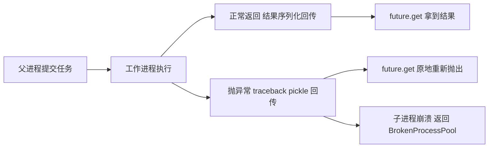

---

### Q566 · 进程池异常传递与子进程崩溃

> 难度:★★★☆ | 标签:进程池, 异常传递, BrokenProcessPool

**问**:子进程抛的异常如何传回父进程?如果子进程直接被 kill 掉会发生什么?

**答**:multiprocessing 的池会把子进程的异常 traceback 序列化后通过管道传回父进程,`get()`/`result()` 在父进程原地重新抛出,类型和消息都保留——前提是异常对象可 pickle。若子进程非正常死亡(被 kill -9、os._exit、段错误),concurrent.futures 会给所有在途 Future 设置 BrokenProcessPool,multiprocessing.Pool 则可能表现为永久卡死,所以进程池任务里绝不能裸调 os._exit 或被外部随意 kill。`apply_async` 还支持 `error_callback`,让失败不阻塞主流程。

```python
# file: code/02_并发与网络工程/q566_process_exception.py
from multiprocessing import Pool


def divide(a: float, b: float) -> float:
    return a / b


def on_error(e: BaseException) -> None:
    print("error_callback 收到:", repr(e))


if __name__ == "__main__":
    with Pool(processes=2) as pool:
        r = pool.apply_async(divide, (10, 2))
        print("正常结果:", r.get())

        bad = pool.apply_async(divide, (1, 0), error_callback=on_error)
        try:
            bad.get()
        except ZeroDivisionError as e:
            print("子进程异常透传到父进程:", repr(e))

        # 进程池仍然可用: 异常不会杀死 worker
        print("恢复后继续:", pool.apply_async(divide, (9, 3)).get())
```

**追问**:1) 怎么区分"任务业务失败"和"worker 崩溃"?——业务失败抛的是你定义的异常类型;worker 崩溃表现为 BrokenProcessPool 或无限等待,监控上应给 get() 加超时并对 BrokenProcessPool 整池重建。2) 崩溃的常见根因?——C 扩展段错误、OOM kill、sys.exit/os._exit 在任务里、递归爆栈(Q2610);spawn/fork 差异影响崩溃后状态(Q574)。3) 池的恢复策略?——BrokenProcessPool 后整池重建(新 ProcessPoolExecutor);任务重试要幂等(Q443);崩溃现场留 faulthandler 转储(Q1836)。4) 生产陷阱?——无限等待(无超时 get);崩溃任务静默丢;单池单点(一崩全停,按业务分组多池)。

---

### Q567 · 共享内存的原子性:Value 与 get_lock

> 难度:★★★☆ | 标签:multiprocessing, shared_memory, 原子性

**问**:multiprocessing.Value 是线程安全的吗?为什么锁了以后计数还是可能不对?

**答**:`Value` 单次读写由内部的 sysV/共享内存保证,但 `x.value += 1` 是"读-改-写"三步,进程之间随时可能被打断,所以必须用 `get_lock()` 把复合操作包成临界区。默认 `Value(typecode, lock=True)` 自带一把锁;若显式 `lock=False` 拿到的是纯共享内存,速度更快但要自己配锁。真正跨进程的"原子指令"在 Python 层没有暴露接口,工程上要么 Value+锁,要么改用单进程聚合后一次性写入。

```python
# file: code/02_并发与网络工程/q567_shared_atomic.py
import multiprocessing as mp

N = 20000  # 演示规模: 跨进程锁粒度重, 规模控制在 25s 内跑完


def unlocked_worker(val) -> None:
    for _ in range(N):
        v = val.value      # 读
        val.value = v + 1  # 写: 读-改-写之间可能被其他进程插入


def locked_worker(val) -> None:
    for _ in range(N):
        with val.get_lock():   # Value 自带的进程锁
            val.value += 1


def run(target, lock: bool) -> int:
    val = mp.Value("i", 0, lock=lock)
    ps = [mp.Process(target=target, args=(val,)) for _ in range(4)]
    for p in ps:
        p.start()
    for p in ps:
        p.join()
    return val.value


if __name__ == "__main__":
    lost = run(unlocked_worker, lock=False)
    print(f"无锁结果: {lost} / 期望 {4 * N} (丢失 {4 * N - lost})")
    ok = run(locked_worker, lock=True)
    print(f"加锁结果: {ok} / 期望 {4 * N}")
    assert ok == 4 * N
```

**追问**:1) threading.Lock 能保护跨进程的 Value 吗?——不能,线程锁只在进程内有效,跨进程必须用 multiprocessing 提供的锁(基于信号量/文件锁实现)。2) Value/Array 的原子边界?——Value(typecode, lock=True) 的 get/set 是原子(带信号量);但「读改写」(v.value += 1)不是原子,要 with v.get_lock();Array 类似,整体修改靠锁。3) 与 Manager 的取舍?——Value/Array 共享内存快(零 IPC);Manager 代理慢(Q573)但支持任意对象;大块数据上 shared_memory(3.8+)。4) 生产陷阱?——裸 += 丢更新(经典);线程锁跨进程用;共享内存对象携带不可 pickle 状态;忘记 acquire 超时导致死等。

---

### Q568 · 锁竞态压测:如何复现一个竞态条件

> 难度:★★★★ | 标签:竞态, 压测, 调试

**问**:测试环境跑不出并发 bug,怎么系统地复现竞态条件?

**答**:三个手段:一是提高碰撞概率——让多个线程在 `threading.Barrier` 上集合后同时起跑,并跑足够多轮次;二是放大竞态窗口——在"检查"与"执行"之间故意插入 sleep 或随机延迟(故障注入),让原本微秒级的窗口变成毫秒级;三是降低调度随机性干扰——调小 `sys.setswitchinterval` 强制更频繁的线程切换。复现后先用锁修掉,再保留这个压测用例作为回归。原则:竞态测试的目标是"必现",而不是"碰运气跑一遍没出错"。

```python
# file: code/02_并发与网络工程/q568_race_stress.py
import threading

counter = 0
lock = threading.Lock()
barrier = threading.Barrier(4)


def worker(use_lock: bool, n_iter: int = 200000) -> None:
    global counter
    barrier.wait()  # 4 线程集合后同时起跑, 最大化碰撞
    for _ in range(n_iter):
        if use_lock:
            with lock:
                counter += 1
        else:
            counter += 1  # 读-改-写非原子


def stress(use_lock: bool) -> int:
    global counter
    counter = 0
    ts = [threading.Thread(target=worker, args=(use_lock,)) for _ in range(4)]
    for t in ts:
        t.start()
    for t in ts:
        t.join()
    return counter


if __name__ == "__main__":
    expected = 4 * 200000
    for attempt in range(3):
        got = stress(use_lock=False)
        print(f"无锁 第{attempt + 1}轮: {got} / {expected} (丢失 {expected - got})")
    got = stress(use_lock=True)
    print(f"加锁: {got} / {expected}")
    assert got == expected
```

**追问**:1) 加锁压测通过了,能保证没有竞态吗?——不能,只能说明该窗口下未复现;正确性要靠"临界区划分是否完整"的代码审查,压测只是兜底。2) 复现竞态的方法?——Barrier 同步起跑(Q568/1280);窗口放大(sleep/慢操作);故障注入(Q606);TSAN 式轨迹分析(Q607);压测轮次要统计「断言失败率」而不是只看通过。3) 修复后的验证?——同一注入开关下不复现(Q606)+ 回归守护测试;静态审查锁覆盖面。4) 生产陷阱?——「压测通过=安全」的错觉;压测只测 happy path;修复后删掉复现脚本(失去守护)。

---

### Q569 · 双重检查锁定与延迟初始化

> 难度:★★★☆ | 标签:DCL, 单例, 内存模型

**问**:什么是 double-checked locking?Python 里它和 Java 相比有什么微妙差别?

**答**:DCL 先无锁检查实例是否存在(快速路径),不存在才加锁做第二次检查并创建,避免每次访问都抢锁。Java 里 DCL 曾因指令重排失效,需要 volatile;Python 里赋值是原子且 GIL 串行化了字节码,`cls._instance = obj` 对其他线程可见时对象已构造完成,所以 Python 的 DCL 比 Java 安全。但仍有细节:对象的初始化逻辑必须放进锁内、放在赋值之前完成;更 Pythonic 的替代是模块级惰性(模块导入本身有锁)或直接在锁内缓存。

```python
# file: code/02_并发与网络工程/q569_lazy_init.py
import threading


class Config:
    _instance = None
    _lock = threading.Lock()

    def __new__(cls):
        if cls._instance is None:  # 第一次检查: 无锁快速路径
            with cls._lock:
                if cls._instance is None:  # 第二次检查: 持锁确认
                    inst = super().__new__(cls)
                    inst.data = {"mode": "prod", "retries": 3}  # 先完成初始化
                    cls._instance = inst  # 最后才发布引用
        return cls._instance


results = []
start_gate = threading.Barrier(8)


def grab() -> None:
    start_gate.wait()
    results.append(Config())


if __name__ == "__main__":
    ts = [threading.Thread(target=grab) for _ in range(8)]
    for t in ts:
        t.start()
    for t in ts:
        t.join()
    ids = {id(r) for r in results}
    print(f"8 个线程拿到 {len(ids)} 个实例, data 都已初始化:",
          all(r.data for r in results))
    assert len(ids) == 1
```

**追问**:1) 模块级单例为什么天然线程安全?——import 系统对模块初始化有 import lock,首次导入完成前其他线程会阻塞在 import 上,导入完成后对象已就绪。2) 双检锁在 CPython 的边界?——GIL 保证单条字节码原子,但 check-then-act 复合仍需锁(Q489);模块级初始化走 import 锁所以简单;懒初始化在函数内仍要双检。3) 与 import 期初始化的取舍?——import 期做重活有死锁/副作用风险(Q550/2106);懒初始化要处理异常路径(Q1280);折中是「显式 init 入口 + Event 门闩」。4) 生产陷阱?——双检漏第二重检查;初始化异常后标志已置(Q1280);把 import 锁当万能防护(嵌套导入死锁)。

---

### Q570 · Barrier 栅栏:分阶段并行计算

> 难度:★★☆ | 标签:Barrier, 同步, 并行

**问**:Barrier 和 Event/Condition 有什么区别?什么场景必须用栅栏?

**答**:Barrier 是"集合点":n 个线程都调 wait 后才一起放行,适合多阶段流水线——每阶段所有线程完成后才进入下一阶段,例如并行模拟里"所有体素更新完才交换边界"。Event 是单向广播开关,Condition 是围绕共享状态的等待/通知,都不表达"凑齐 n 个"的语义。Barrier 还带超时和 `abort()`:任何一个线程 wait 超时,栅栏进入 broken 状态,所有等待者立刻抛 `BrokenBarrierError`,避免整组永久卡死,这正是它比手动 CountDownLatch 更适合错误处理的地方。

```python
# file: code/02_并发与网络工程/q570_barrier.py
import random
import threading
import time

barrier = threading.Barrier(3, timeout=1.0)  # 3 个线程一组, 最多等 1 秒


def phase_worker(name: str, slow: bool = False) -> None:
    for phase in range(3):
        delay = 2.0 if slow and phase == 1 else random.uniform(0.05, 0.15)
        time.sleep(delay)
        print(f"{name} 完成阶段 {phase}")
        try:
            barrier.wait()  # 集合点: 全员到齐才进下一阶段
        except threading.BrokenBarrierError:
            print(f"{name} 阶段 {phase} 栅栏失效, 整组退出")
            return


if __name__ == "__main__":
    print("--- 正常场景 ---")
    ts = [threading.Thread(target=phase_worker, args=(f"w{i}",)) for i in range(3)]
    for t in ts:
        t.start()
    for t in ts:
        t.join()

    print("--- 超时场景: w9 太慢, 全组 broken ---")
    barrier2 = threading.Barrier(3, timeout=0.5)

    def worker2(name: str, slow: bool) -> None:
        try:
            for phase in range(2):
                if slow:
                    time.sleep(1.5)  # 远超栅栏超时
                barrier2.wait()
            print(f"{name} 全部完成")
        except threading.BrokenBarrierError:
            print(f"{name} 检测到栅栏失效, 中止")

    ts = [
        threading.Thread(target=worker2, args=("a", False)),
        threading.Thread(target=worker2, args=("b", False)),
        threading.Thread(target=worker2, args=("slow", True)),
    ]
    for t in ts:
        t.start()
    for t in ts:
        t.join()
```

**追问**:1) Barrier 和 CountDownLatch 的本质区别?——latch 是一次性倒计数(等事件),Barrier 是可复用的集合点(等人),且 broken 语义让整组能协同失败。2) broken 的传播机制?——一方超时/退出→ barrier 置 broken → 其他等待者全部 BrokenBarrierError 抛出;reset() 恢复新代;这让「部分成员失联」不会永久卡死全组(Q572 的回退思想)。3) 分阶段并行的工程要点?——每阶段 barrier(action) 汇总;action 要短(长动作拖全员,Q582 呼应);阶段间数据交换用锁内共享结构。4) 生产陷阱?——成员数与 parties 不匹配永久等待;broken 后不 reset 复用;action 里做重活;超时为零死等。

---

### Q571 · 死锁现场勘查:线程栈 dump 与 faulthandler

> 难度:★★★★ | 标签:死锁排查, faulthandler, 运维

**问**:线上程序卡死了,怀疑死锁,怎么在不重启的情况下拿到证据?

**答**:向进程发 `SIGABRT` 之外的首选是 faulthandler:启动时注册 `faulthandler.register(signal.SIGUSR1)`,卡死时 `kill -USR1 <pid>` 就会把所有线程的 Python 栈打到日志,能看到每个线程停在哪个 acquire 上;配合 py-spy dump 可以看到 C 层。没有预留信号处理时,`faulthandler.dump_traceback_later(timeout, exit=True)` 当兜底保险丝。拿到栈后按"两个线程互相持有对方需要的锁"的模式比对即可定位锁对。预防端:锁排序 + acquire 超时 + 全局锁注册表。

```python
# file: code/02_并发与网络工程/q571_deadlock_dump.py
import faulthandler
import threading
import time

lock_a = threading.Lock()
lock_b = threading.Lock()


def t1() -> None:
    with lock_a:
        time.sleep(0.2)      # 给 t2 时间拿到 lock_b
        with lock_b:         # 死锁点
            print("t1 不可能到这里")


def t2() -> None:
    with lock_b:
        time.sleep(0.2)
        with lock_a:
            print("t2 不可能到这里")


if __name__ == "__main__":
    faulthandler.enable()
    a = threading.Thread(target=t1, name="T1")
    b = threading.Thread(target=t2, name="T2")
    a.start()
    b.start()
    time.sleep(1.0)  # 此刻两个线程已互相卡死
    print("=== 模拟 kill -USR1: dump 所有线程栈 ===")
    with open("/tmp/q571_dump.txt", "w") as f:
        faulthandler.dump_traceback(file=f, all_threads=True)
    print(open("/tmp/q571_dump.txt").read())
    print("栈里能看到 T1 停在 lock_b.acquire, T2 停在 lock_a.acquire")
    import os
    os._exit(0)  # 演示结束, 真实场景这一步由运维强制重启替代
```

**追问**:1) dump 里两把锁名字一样怎么区分?——栈帧会显示 acquire 的调用行号,结合锁 ID(threading.Lock 对象地址)与代码行对照即可分清是哪一对锁构成的环。2) 现场勘查工具链?——faulthandler.dump_traceback_later 定时(Q1836)/SIGUSR1 触发;py-spy dump 无侵入;sys._current_frames 编程式抓取;每帧的锁持有信息结合日志。3) 死锁的四要素与对应解?——互斥/持有等待/不可剥夺/循环等待;破坏「持有等待」(一次性拿全)或「循环等待」(全局锁序,Q572)。4) 生产陷阱?——死锁只重启不归因;锁对象无名字(日志不可读);等待无超时让死锁变成「卡死」而不是「报错」。

---

### Q572 · 锁排序与 try-acquire 回退:消除死锁的两个工程手段

> 难度:★★★☆ | 标签:死锁预防, 锁排序, Lock

**问**:业务上必须同时持有两把锁,除了"小心写代码"还有什么系统性的防死锁办法?

**答**:两个正交手段。锁排序:给所有锁定一个全局序(比如按对象 id 或业务命名),所有线程都按升序获取,循环等待条件从根上不成立——这是 Coffman 条件的釜底抽薪。try-acquire 回退:获取第二把锁用 `acquire(timeout=...)`,失败就释放已持有的锁退避重试,破坏"持有并等待"条件。排序适合锁集合固定的场景,回退适合锁集合动态的场景;两者可以叠加。注意回退策略要有退避,否则会活锁(不断抢、不断让)。

```python
# file: code/02_并发与网络工程/q572_lock_order.py
import threading
import time

lock_a = threading.Lock()
lock_b = threading.Lock()
lock_a_id, lock_b_id = id(lock_a), id(lock_b)  # 固定全局顺序的依据


def transfer_ordered(amount: float) -> None:
    """手段一: 永远先拿 id 较小的锁。"""
    first, second = (lock_a, lock_b) if lock_a_id < lock_b_id else (lock_b, lock_a)
    with first:
        time.sleep(0.05)
        with second:
            pass  # 临界区: 转账


def transfer_fallback(amount: float) -> bool:
    """手段二: try-acquire 失败则回退重来, 破坏持有并等待。"""
    while True:
        if lock_a.acquire(timeout=0.05):
            try:
                if lock_b.acquire(timeout=0.05):
                    try:
                        return True
                    finally:
                        lock_b.release()
            finally:
                lock_a.release()
        time.sleep(0.01)  # 退避, 防活锁加剧


if __name__ == "__main__":
    # 反例: 固定顺序 vs 乱序 — 乱序版本会死锁, 这里用超时探测证明
    def t_bad_1() -> None:
        with lock_a:
            time.sleep(0.1)
            got = lock_b.acquire(timeout=0.3)
            if not got:
                print("bad_1: 拿 lock_b 超时 → 若无超时这里就是死锁")
            else:
                lock_b.release()

    def t_bad_2() -> None:
        with lock_b:
            time.sleep(0.1)
            got = lock_a.acquire(timeout=0.3)
            if not got:
                print("bad_2: 拿 lock_a 超时 → 构成循环等待")
            else:
                lock_a.release()

    t1 = threading.Thread(target=t_bad_1)
    t2 = threading.Thread(target=t_bad_2)
    t1.start(); t2.start()
    t1.join(); t2.join()

    ts = [threading.Thread(target=transfer_ordered, args=(1,)) for _ in range(4)]
    ts += [threading.Thread(target=transfer_fallback, args=(1,)) for _ in range(4)]
    t0 = time.perf_counter()
    for t in ts:
        t.start()
    for t in ts:
        t.join()
    print(f"排序+回退版本 8 个任务全部完成, 耗时 {time.perf_counter() - t0:.2f}s")
```

**追问**:1) 锁排序中 id() 做序有什么坑?——CPython 对象 id 是地址,同一对象被回收后地址可能复用,序会变;应该用业务层稳定键(账户号、资源名)而不是内存地址。2) try-acquire 回退的设计?——拿不到第二把就释放第一把、退避重试;超时上限防活锁;与全局锁序二选一或并用(排序兜底 + 回退保吞吐,Q1852 的公平性思想)。3) 跨进程锁排序?——分布式锁同样要全局序(资源路径序);DB 行锁按主键序;不同层(线程/进程/分布式)各管各的循环。4) 生产陷阱?——动态创建资源的锁(无稳定键);回退无退避变成活锁风暴;嵌套调用链中序被中间层破坏。

---

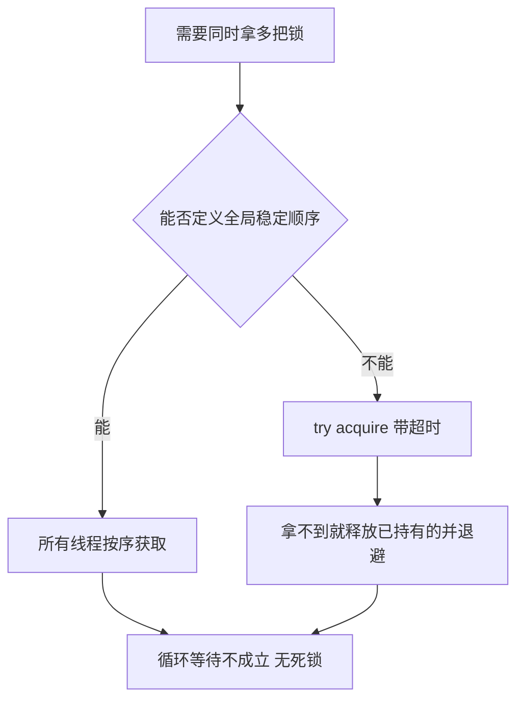

---

### Q573 · multiprocessing.Manager 与代理对象的陷阱

> 难度:★★★☆ | 标签:Manager, 代理对象, IPC

**问**:Manager 和 shared_memory/Value 有什么本质区别?Manager 的 dict 是不是就线程/进程安全了?

**答**:Manager 起了一个独立的服务进程,其他进程拿到的是 Proxy 对象,每次操作都通过 socket/pickle 转发给服务进程,所以单个操作(如 `d[k] = v`)是原子的;但它慢一个数量级,且"复合操作"(`d[k] = d.get(k, 0) + 1`)依然是读-改-写两步,必须配合 `manager.Lock()`。另一个大坑:嵌套对象——往 proxy dict 里放一个普通 dict,读出来的副本是反 pickle 的新对象,原地修改不会同步回去,要用 `m.dict()` 做嵌套。Manager 的价值是任意 Python 对象的跨进程共享,代价是性能。

```python
# file: code/02_并发与网络工程/q573_manager.py
import multiprocessing as mp

N = 300  # Manager 每次操作都是一次 IPC 往返, 且 macOS spawn 子进程很慢,
         # 进程数与规模都要小, 保证 25s 内跑完


def race_worker(d) -> None:
    """复合操作不加锁: 演示丢失更新。"""
    for _ in range(N):
        d["count"] = d.get("count", 0) + 1


def safe_worker(d, lock) -> None:
    for _ in range(N):
        with lock:
            d["count"] = d.get("count", 0) + 1


def nested_worker(d) -> None:
    inner = d["inner"]        # 反 pickle 出来的本地副本(普通 dict)!
    inner["hit"] = inner.get("hit", 0) + 1  # 改的是副本, 不回传


if __name__ == "__main__":
    with mp.Manager() as mgr:
        d1 = mgr.dict()
        ps = [mp.Process(target=race_worker, args=(d1,)) for _ in range(2)]
        for p in ps:
            p.start()
        for p in ps:
            p.join()
        print(f"无锁复合操作: {d1['count']} / 期望 {2 * N}")

        d2 = mgr.dict()
        lk = mgr.Lock()
        ps = [mp.Process(target=safe_worker, args=(d2, lk)) for _ in range(2)]
        for p in ps:
            p.start()
        for p in ps:
            p.join()
        print(f"加锁复合操作: {d2['count']} / 期望 {2 * N}")
        assert d2["count"] == 2 * N, "加锁复合操作不允许丢失更新"

        d3 = mgr.dict()
        d3["inner"] = {}  # 普通嵌套 dict
        # 注意: 传给子进程的只能是 Proxy/可 pickle 对象, Manager 本体
        # 持有 weakref 与进程句柄, 传 mgr 会 TypeError: cannot pickle 'weakref'
        p = mp.Process(target=nested_worker, args=(d3,))
        p.start()
        p.join()
        print("嵌套普通 dict 修改丢失:", d3["inner"] == {})

        d4 = mgr.dict()
        d4["inner"] = mgr.dict()  # 嵌套也要用代理
        p = mp.Process(target=nested_worker, args=(d4,))
        p.start()
        p.join()
        print("嵌套 Manager dict 生效:", d4["inner"].get("hit"))
        assert d4["inner"].get("hit") == 1
```

**追问**:1) Manager 的性能瓶颈在哪,怎么优化?——每次操作一次 IPC 往返 + pickle;优化方向是批量读写(一次取回大对象本地处理)、或换成 Value/Array+锁、或重新设计为消息传递。2) 代理对象的边界?——proxy 方法转发 IPC;嵌套 proxy(m_list[i].append)一次调用多轮往返;Proxy 不可 pickle 传递给孙进程;比较/切片语义与本地对象有差。3) 与 shared_memory 的分工?——Manager 管「结构同步」(dict/list 语义);shared_memory 管「大块字节」(零拷贝,Q567);消息传递管「松耦合」。4) 生产陷阱?——循环里逐元素改 proxy(万次 IPC);proxy 对象长期持有(管理进程状态膨胀);Manager 进程崩溃全代理失效。

---

### Q574 · fork 与 spawn:进程启动方式的差别与陷阱

> 难度:★★★☆ | 标签:multiprocessing, fork, spawn

**问**:fork 和 spawn 两种进程启动方式有什么区别?为什么"多线程程序里 fork"是著名的坑?

**答**:fork 复制父进程整个地址空间,启动快、天然继承所有对象,但只复刻调用线程,其他线程(以及它们持有的锁)消失——如果 fork 瞬间某线程正持有锁,子进程里这把锁永远没人释放,直接死锁,这就是日志库/数据库连接在子进程里卡死的标准剧情。spawn 重新启动解释器、通过 pickle 传参数,慢但干净安全,是 macOS(3.8+)和 Windows 的默认。原则:有守护线程/持锁资源的程序用 spawn;fork 模式下必须在进入多线程之前创建进程池。

```python
# file: code/02_并发与网络工程/q574_fork_spawn.py
import multiprocessing as mp
import os


def child(name: str) -> None:
    ctx = mp.get_start_method()
    print(f"[{name}] pid={os.getpid()} 启动方式={ctx}")


def run_with(ctx_name: str) -> None:
    ctx = mp.get_context(ctx_name)  # 显式选择启动方式
    p = ctx.Process(target=child, args=(ctx_name,))
    p.start()
    p.join()


def fork_demo_with_thread() -> None:
    """演示 fork 只复制当前线程: 子进程看到的线程数是 1。"""
    ctx = mp.get_context("fork")

    def background() -> None:
        pass

    t = threading.Thread(target=background, name="phantom")
    t.start()
    # fork 发生时 phantom 线程存在, 但子进程里它不存在
    p = ctx.Process(target=lambda: print("子进程 threading.active_count =",
                                         threading.active_count()))
    p.start()
    p.join()
    t.join()


if __name__ == "__main__":
    import threading  # 放在模块层避免 spawn 重复执行时缺名字

    available = mp.get_all_start_methods()
    print("平台支持:", available, "当前默认:", mp.get_start_method())
    for m in available:
        run_with(m)
    if "fork" in available:
        fork_demo_with_thread()
```

**追问**:1) 为什么 macOS 从 Python 3.8 起默认 spawn?——Apple 的 fork+exec 之外混用系统库(尤其 Objective-C runtime)在多线程下不安全,频繁导致子进程崩溃,官方改成 spawn 规避。2) fork 的隐患清单?——fork 只复制调用线程,其他线程持有的锁(含 import 锁,Q550)在子进程成死锁;连接/缓冲区状态复制后双写;gc/信号状态混乱;3.12 引入 os.register_at_fork 缓解部分。3) spawn 的代价与适配?——启动慢(重新 import);入口必须可导入(无 __main__ 副作用,Q2106);Windows 只支持 spawn——跨平台代码按 spawn 设计。4) 生产陷阱?——fork 后日志重复/连接复用;spawn 下模块级重初始化拖慢启动;forkserver 与预加载资源的配合误解。

---

### Q575 · 进程池 initializer:每进程一次的初始化资源

> 难度:★★☆ | 标签:进程池, initializer, 资源复用

**问**:每个子进程都需要一个数据库连接/大模型句柄,怎么避免每个任务都重新建?

**答**:用池的 `initializer` + `initargs`:worker 进程启动时执行一次初始化函数,把资源挂到进程全局变量上,该进程后续处理的任务全部复用。关键认知:initializer 在每个 worker 各跑一次,资源是"每进程一份"而不是"每任务一份";配合 `maxtasksperchild` 可以控制资源周期性重建(防泄漏)。在 initializer 里要做失败处理——抛异常会让 worker 起不来,池会反复重试,应该快速失败并让上层感知。

```python
# file: code/02_并发与网络工程/q575_pool_initializer.py
from multiprocessing import Pool
import os

_CONN = None  # 每个 worker 进程各自的全局"连接"


def init_worker() -> None:
    global _CONN
    _CONN = {"pid": os.getpid(), "opened_at": "startup", "queries": 0}
    print(f"[init] worker {os.getpid()} 建立连接")


def query(sql: str) -> dict:
    _CONN["queries"] += 1  # 同一 worker 的多个任务复用同一连接
    return {"sql": sql, "conn_pid": _CONN["pid"], "queries": _CONN["queries"]}


if __name__ == "__main__":
    with Pool(processes=2, initializer=init_worker) as pool:
        results = pool.map(query, [f"SELECT {i}" for i in range(8)])
    conn_pids = {r["conn_pid"] for r in results}
    print(f"8 个任务只用了 {len(conn_pids)} 个连接 (pid: {conn_pids})")
    for r in results[:4]:
        print(r)
```

**追问**:1) initializer 里抛异常会怎样?——worker 初始化失败并退出,池会尝试拉起新 worker 再次失败,提交的任务卡住或抛 PoolNotRunning,所以初始化要幂等、快速、可诊断。2) initializer 的设计纪律?——每 worker 一次的昂贵资源(连接、模型加载)放这里;幂等 + 快速 + 失败可诊断(日志带 worker id);不依赖「worker 数」全局状态;与 gc.freeze 配合降低 fork COW(Q561 相关,Q1b 故事)。3) 与 initializer_args 的配合?——配置经参数传入而不是全局变量;每 worker 独立连接(容量×N,注意上限,Q1280)。4) 生产陷阱?——初始化连共享资源被打爆;初始化失败循环拉起;任务依赖「全局 import 时初始化」在 spawn 下失效。

---

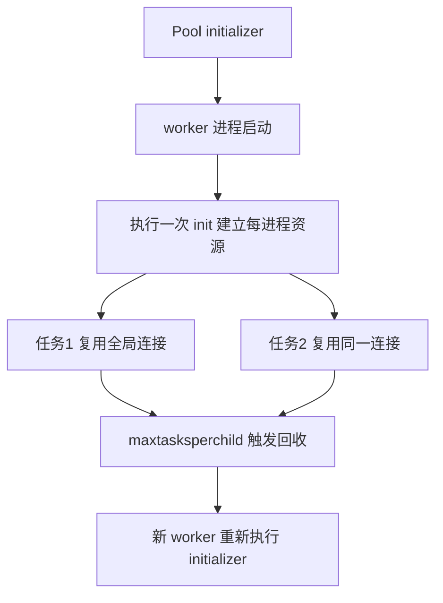

---

### Q576 · GIL 的切换时机:setswitchinterval 实验

> 难度:★★★☆ | 标签:GIL, 调度, 性能

**问**:GIL 什么时候释放?sys.setswitchinterval 调大调小会怎样?

**答**:GIL 在三种时机让出:IO 调用(文件、socket、sleep)前主动释放;每执行约 `sys.getswitchinterval()`(默认 5ms)后由当前线程检查并强制让出;C 扩展显式释放。调小 switchinterval,线程切换更频繁,"响应性"更好但上下文切换开销上升,竞态窗口变多;调大则单线程跑得更久、吞吐略升,但其他线程延迟变大。纯 CPU 多线程在 GIL 下总吞吐不会提升,实验里还能直观看到丢失更新随切换频率变化。

```python
# file: code/02_并发与网络工程/q576_switch_interval.py
import sys
import threading
import time

counter = 0


def spin(n: int) -> None:
    global counter
    for _ in range(n):
        counter += 1  # 读-改-写, 依赖 GIL 切换时机决定竞态程度


def run(n_iter: int) -> tuple:
    global counter
    counter = 0
    ts = [threading.Thread(target=spin, args=(n_iter,)) for _ in range(4)]
    t0 = time.perf_counter()
    for t in ts:
        t.start()
    for t in ts:
        t.join()
    dt = time.perf_counter() - t0
    return counter, dt


if __name__ == "__main__":
    n = 100000
    for interval in (0.005, 0.001, 0.00005):
        sys.setswitchinterval(interval)
        got, dt = run(n)
        expected = 4 * n
        print(f"switchinterval={interval:<8} 结果 {got}/{expected} "
              f"丢失 {expected - got:>6} 耗时 {dt:.3f}s")
    sys.setswitchinterval(0.005)  # 恢复默认
```

**追问**:1) 为什么 IO 密集多线程仍然有效?——线程在执行 IO 调用时释放 GIL,其他线程立刻可以拿到 GIL 执行,"等待"被并行化了,这正是 IO 密集场景多线程能提速的原因。2) setswitchinterval 的实验能告诉我们什么?——默认 5ms 切换间隔影响「纯 Python 轮转」的公平性与粒度;调大让 CPU 密集线程少切换、调小让 IO 线程响应更快;但它是全局权衡,不是调优旋钮。3) 释放 GIL 的三类点?——IO 系统调用、C 扩展显式释放(Py_BEGIN_ALLOW_THREADS)、部分大整数运算;纯 Python 计算不释放(Q577)。4) 生产陷阱?——按「GIL 存在」否定一切多线程;CPU 密集硬塞线程池(Q599 选型);调 switchinterval 掩盖设计问题。

---

### Q577 · C 扩展与释放 GIL:ctypes 实验

> 难度:★★★★ | 标签:GIL, ctypes, C 扩展

**问**:都说"用 C 扩展绕过 GIL",到底什么才算绕过?

**答**:关键不是"用 C 写",而是 C 代码在执行期间是否释放 GIL。ctypes 的默认调用约定是 `release_gil=True`(CDLL),调用 libc 的阻塞函数时其他 Python 线程可以继续跑;而 PyDLL 则持有 GIL。所以:包一层 release GIL 的 C 计算(如 numpy 的 BLAS、zlib 压缩大块数据)能真并行;调一个不释放 GIL 的 C 函数再快也帮不了并发。验证方法很直接:一个线程跑长 C 调用,主线程同时跑纯 Python 循环,看循环是否推进。

```python
# file: code/02_并发与网络工程/q577_release_gil.py
import ctypes
import ctypes.util
import threading
import time

path = ctypes.util.find_library("c") or ("libc.so.6" if sys.platform != "darwin" else "libc.dylib")
libc = ctypes.CDLL(path or "libc.so.6")  # CDLL: 调用期间释放 GIL
libc.usleep.argtypes = [ctypes.c_uint]

SPIN_SECONDS = 0.5
iterations = [0]
stop = threading.Event()


def python_spin() -> None:
    """纯 Python 忙循环, 用来探测 GIL 是否可用。"""
    while not stop.is_set():
        iterations[0] += 1


if __name__ == "__main__":
    import sys
    if sys.platform == "darwin":
        path = ctypes.util.find_library("libc.dylib") or "/usr/lib/libc.dylib"
    else:
        path = ctypes.util.find_library("c") or "libc.so.6"
    libc = ctypes.CDLL(path)
    libc.usleep.argtypes = [ctypes.c_uint]

    spinner = threading.Thread(target=python_spin, daemon=True)
    spinner.start()

    iterations[0] = 0
    t0 = time.perf_counter()
    libc.usleep(300000)  # 0.3s 的 C 阻塞调用: 释放 GIL
    c_blocking = iterations[0] / (time.perf_counter() - t0)

    iterations[0] = 0
    t0 = time.perf_counter()
    n = 3000000
    libc.rand.restype = ctypes.c_int
    for _ in range(n):  # 大量微小 C 调用: 每次调用都要抢 GIL
        libc.rand()
    c_many = iterations[0] / (time.perf_counter() - t0)

    stop.set()
    spinner.join()
    print(f"C 阻塞调用期间 Python 循环推进率: {c_blocking:,.0f} 次/秒")
    print(f"海量微小 C 调用期间推进率:      {c_many:,.0f} 次/秒")
    print("结论: 单次长 C 调用释放 GIL, 频繁短调用反而加剧 GIL 争抢")
```

**追问**:1) 那 CPU 密集任务正确的并行姿势是什么?——multiprocessing/ProcessPoolExecutor 每个进程一份 GIL,或选 numpy/BLAS 这类在 C 层已释放 GIL 的库,或等 free-threaded 构建成熟。2) 释放 GIL 的边界?——只有包装了 Py_BEGIN_ALLOW_THREADS 的 C 代码释放;ctypes 调用默认释放(这是 ctypes 快的关键);numpy 多数运算释放但小数组开销可能反噬。3) 验证方法?——ctypes time.sleep 实验(Q577 本题)、对比纯 Python 等价循环的墙钟时间;用 time.process_time 分辨 CPU 等待。4) 生产陷阱?——期望「C 扩展自动并行」;进程池数据序列化成本吃掉收益(Q565);free-threaded 实验版当生产默认(3.13 实验期,3.14 PEP 779 后仍非默认)。

---

### Q578 · asyncio.Future 状态机:源码级拆解

> 难度:★★★★ | 标签:asyncio, Future, 状态机

**问**:asyncio.Future 内部有哪几个状态?set_result 之后到底发生了什么?

**答**:核心状态三个:_PENDING、_CANCELLED、_FINISHED,外加 result/exception 两个槽位。`set_result()` 做四件事:校验状态必须 PENDING 且非 done;存结果;置 _FINISHED;调用 `__schedule_callbacks()` 把每个回调用 `loop.call_soon` 排进就绪队列——注意回调不是立刻执行,而是下一轮循环才跑,这保证了单线程内的顺序性。`await future` 的本质是:Task 把自己的唤醒函数 add_done_callback 上去然后挂起,Future 完成时 call_soon 唤醒 Task 从 await 处继续。下面手写一个同构的迷你 Future 验证状态机与回调调度语义。注意一个关键差异:自定义 Future 不能直接被 asyncio.Task `await`——Task.__step 只认 asyncio.Future 和 None,yield 自定义对象会直接 `RuntimeError: Task got bad yield`,所以状态机部分用"回调 + 让出循环"驱动,挂起唤醒语义改用真 Future 演示。

```python
# file: code/02_并发与网络工程/q578_mini_future.py
import asyncio

PENDING = "PENDING"
CANCELLED = "CANCELLED"
FINISHED = "FINISHED"


class MiniFuture:
    """复刻 asyncio.Future 的状态机与回调调度语义。

    教学同构体, 刻意不实现 __await__: 若 yield self 交给 asyncio.Task,
    Task.__step 无法识别会抛 RuntimeError("Task got bad yield");
    要真正接入事件循环必须实现完整的 Future 协议(如 _asyncio.Future)。
    """

    def __init__(self, loop) -> None:
        self._state = PENDING
        self._result = None
        self._exception = None
        self._callbacks = []
        self._loop = loop

    def set_result(self, value) -> None:
        assert self._state == PENDING, "已完成状态不可再 set_result"
        self._result = value
        self._state = FINISHED
        self.__schedule_callbacks()

    def set_exception(self, exc: Exception) -> None:
        assert self._state == PENDING
        self._exception = exc
        self._state = FINISHED
        self.__schedule_callbacks()

    def cancel(self) -> bool:
        if self._state != PENDING:
            return False
        self._state = CANCELLED
        self.__schedule_callbacks()
        return True

    def __schedule_callbacks(self) -> None:
        cbs, self._callbacks = self._callbacks, []
        for cb in cbs:  # 关键: 经 call_soon 排队, 下一轮循环执行
            self._loop.call_soon(cb, self)

    def add_done_callback(self, cb) -> None:
        if self._state != PENDING:
            self._loop.call_soon(cb, self)
        else:
            self._callbacks.append(cb)

    def result(self):
        """读取结果: 带 exception 时原地重抛(同真 Future 语义)。"""
        if self._exception is not None:
            raise self._exception
        return self._result


async def main() -> None:
    loop = asyncio.get_running_loop()
    order = []

    # 1) 回调经 call_soon 排队: set 的下一轮才执行
    fut = MiniFuture(loop)
    fut.add_done_callback(lambda f: order.append("callback"))
    loop.call_soon(lambda: (order.append("set"), fut.set_result(42)))
    await asyncio.sleep(0)  # 让出一次: 排队的 set 执行(并继续把回调排进队列)
    await asyncio.sleep(0)  # 再让出一次: 回调这一轮才真正执行
    print("状态:", fut._state, "结果:", fut.result(), "顺序:", order)
    assert order == ["set", "callback"], "回调在 set 之后的下一轮循环执行"

    # 2) 已完成的 Future 拒绝再次 set
    try:
        fut.set_result(1)
    except AssertionError as e:
        print("重复 set 被拒绝:", e)

    # 3) set_exception / cancel 语义
    fut2 = MiniFuture(loop)
    fut2.set_exception(ValueError("boom"))
    try:
        fut2.result()
    except ValueError as e:
        print("set_exception 后取结果重抛:", e)
    fut3 = MiniFuture(loop)
    print("cancel 返回:", fut3.cancel(), "状态:", fut3._state)

    # 4) 挂起-唤醒语义用真 Future 演示(Task 只认 asyncio.Future)
    real = loop.create_future()
    loop.call_soon(lambda: real.set_result(99))
    print("真 Future await 唤醒:", await real)


if __name__ == "__main__":
    asyncio.run(main())
```

**追问**:1) 为什么 set_result 里要用 call_soon 而不是直接执行回调?——直接执行会在"发起者的调用栈里"运行别人注册的回调,深度嵌套且状态可能不一致;排队执行让所有回调都在事件循环的确定时机跑,维持单线程不变量。2) Future 状态机的完整转移?——PENDING→CANCELLED/CANCELLED_AND_NOT_FINISHED(3.8+ 取消语义)→FINISHED(RESULT/EXCEPTION);add_done_callback 在已完成时立即 call_soon 调度;result()/exception() 在未完成时阻塞(异步 Future 用 await)。3) 与 Task 的关系?——Task 是「驱动协程的 Future 子类」;__step 与 __wakeup 构成调度闭环(Q584)。4) 生产陷阱?——回调里抛异常没人管(内部记录);循环外 set_result(线程安全要用 call_soon_threadsafe,Q600);await 已取消 Future 的语义。

---

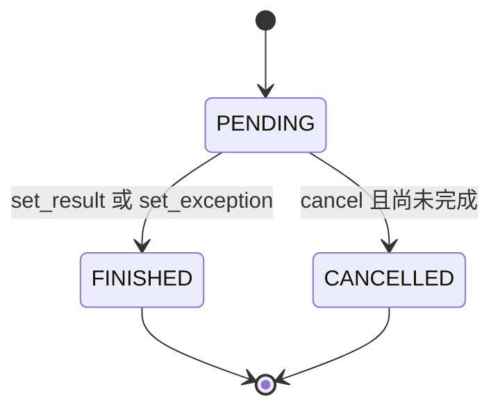

---

### Q579 · 事件循环的 select 实现原理:手写迷你循环

> 难度:★★★★ | 标签:事件循环, select, 原理

**问**:事件循环一轮到底做了什么?为什么 IO 多路复用能同时等几万个连接?

**答**:每轮迭代做三件事:计算最近的定时器到期时间作为 select 超时;调用 `selectors.select()` 阻塞等待 fd 就绪(没有定时任务且没有就绪 fd 时才真的阻塞);把就绪 fd 的回调、到点定时器、call_soon 队列的回调依次执行。select/epoll 的价值是把"等 N 个 fd"压缩成一次系统调用,内核负责睡眠与唤醒,Python 层只处理就绪的那几个,所以连接数增加不增加等待成本(epoll)。下面用 selectors + 定时器堆 + 生成器任务写一个 80 行的迷你循环,跑通"写 socket 的任务"和"等 socket 的任务"。

```python
# file: code/02_并发与网络工程/q579_mini_loop.py
import heapq
import selectors
import socket
import time
from collections import deque


class MiniLoop:
    def __init__(self) -> None:
        self._ready: deque = deque()
        self._timers = []  # 堆: (deadline, seq, task)
        self._seq = 0
        self._sel = selectors.DefaultSelector()
        self._fd_task = {}  # fd -> task

    def spawn(self, gen) -> None:
        self._ready.append({"gen": gen, "value": None})

    def sleep(self, delay: float):
        return ("sleep", delay)  # 生成器 yield 这个元组表示 trap

    def read(self, sock):
        return ("read", sock)

    def _step(self, task: dict) -> None:
        try:
            trap = task["gen"].send(task["value"])
        except StopIteration:
            return
        op = trap[0]
        if op == "sleep":
            self._seq += 1
            heapq.heappush(self._timers, (time.monotonic() + trap[1], self._seq, task))
        elif op == "read":
            sock = trap[1]
            sock.setblocking(False)
            self._sel.register(sock, selectors.EVENT_READ, task)
            self._fd_task[sock.fileno()] = sock

    def run(self) -> None:
        while self._ready or self._timers or self._fd_task:
            timeout = None
            if not self._ready:
                if self._timers:
                    timeout = max(0.0, self._timers[0][0] - time.monotonic())
                for key, _ in self._sel.select(timeout):
                    sock = self._fd_task.pop(key.fd)
                    self._sel.unregister(sock)
                    task = key.data
                    task["value"] = sock.recv(1024)  # 内核代劳读取后回传
                    self._ready.append(task)
            now = time.monotonic()
            while self._timers and self._timers[0][0] <= now:
                task = heapq.heappop(self._timers)[2]
                task["value"] = None
                self._ready.append(task)
            if self._ready:
                self._step(self._ready.popleft())
            elif self._timers:
                continue  # 没有就绪任务, 回去 select 等最近定时器


def producer(sock: socket.socket, loop: MiniLoop) -> None:
    for i in range(3):
        sock.sendall(f"msg{i} ".encode())
        yield loop.sleep(0.1)
    print("producer 结束")


def consumer(sock: socket.socket, loop: MiniLoop) -> None:
    got = b""
    for _ in range(3):
        chunk = yield loop.read(sock)  # 挂起等 fd 就绪, 恢复时拿到数据
        got += chunk
        print("consumer 收到:", chunk.decode())
    print("consumer 汇总:", got.decode())


if __name__ == "__main__":
    a, b = socket.socketpair()
    loop = MiniLoop()
    loop.spawn(consumer(b, loop))
    loop.spawn(producer(a, loop))
    t0 = time.perf_counter()
    loop.run()
    print(f"迷你事件循环跑完, 耗时 {time.perf_counter() - t0:.2f}s")
```

**追问**:1) epoll 相比 select 的两个关键改进是什么?——fd 集合放内核红黑树避免每次全量拷贝,就绪列表让返回值只含就绪 fd,把每轮 O(n) 降为 O(就绪数)。2) 迷你循环的核心结构?——selector.register(fd, EVENT, data) 注册;select(timeout) 取就绪;回调分发;data 携带 handler——这就是 selectors 模块封装的模型,asyncio 的 proactor/selector 事件循环同构。3) LT 与 ET 的区别?——level-triggered:就绪状态持续上报(默认,好写);edge-triggered:状态变化时一次(要一次读干净,配非阻塞);Python selectors 用 LT 简化。4) 生产陷阱?——阻塞 socket 混入循环卡死全部;注册后忘 unregister 泄漏;timeout=0 自旋烧 CPU。

---

### Q580 · call_later 与定时器堆的实现

> 难度:★★★☆ | 标签:asyncio, 定时器, heapq

**问**:asyncio 的 call_later 是怎么组织上千个定时器的?取消一个定时器是 O(1) 还是 O(n)?

**答**:所有定时器放在一个最小堆里,元素是 `(deadline, 序号, TimerHandle)`,序号保证同时到期的按插入顺序弹出(FIFO),取堆顶 O(1)、插入 O(log n)。取消并不从堆里物理移除,而是把 TimerHandle 标记 `_cancelled=True`,事件循环弹堆时跳过已取消的句柄——所以取消是 O(1),垃圾留在堆里直到到期被弹出丢弃,这是典型的惰性删除。到期判断用单调时钟 `loop.time()`,不受系统时间回拨影响。

```python
# file: code/02_并发与网络工程/q580_timer_heap.py
import asyncio
import heapq


class TimerHeap:
    """复刻 asyncio 定时器堆: 惰性删除 + seq 保证同时到期 FIFO。"""

    def __init__(self) -> None:
        self._heap = []
        self._seq = 0

    def call_later(self, delay: float, callback, *args):
        deadline = asyncio.get_running_loop().time() + delay
        self._seq += 1
        handle = {"cancelled": False, "cb": callback, "args": args}
        heapq.heappush(self._heap, (deadline, self._seq, handle))
        return handle

    def cancel(self, handle) -> bool:
        if handle["cancelled"]:
            return False
        handle["cancelled"] = True  # 惰性删除: 只标记
        return True

    def fire_due(self, now: float) -> int:
        fired = 0
        while self._heap and self._heap[0][0] <= now:
            deadline, _seq, handle = heapq.heappop(self._heap)
            if not handle["cancelled"]:  # 已取消的直接丢弃
                handle["cb"](*handle["args"])
                fired += 1
        return fired


async def main() -> None:
    loop = asyncio.get_running_loop()
    fired = []

    heap = TimerHeap()
    # 乱序注册: 0.15 最晚注册却最先到期
    h1 = heap.call_later(0.15, lambda: fired.append("0.15s"))
    heap.call_later(0.05, lambda: fired.append("0.05s-a"))
    heap.call_later(0.05, lambda: fired.append("0.05s-b"))
    heap.call_later(0.10, lambda: fired.append("0.10s"))
    heap.cancel(h1)  # 取消 0.15 那个

    start = loop.time()
    while heap._heap:
        loop_time = loop.time()
        if heap._heap[0][0] > loop_time:
            await asyncio.sleep(heap._heap[0][0] - loop_time)
        heap.fire_due(loop.time())
    print("手写堆触发顺序:", fired)
    assert fired == ["0.05s-a", "0.05s-b", "0.10s"], "同时到期应 FIFO, 已取消应跳过"

    # 对照: 真实 loop.call_later 行为一致
    order = []
    loop.call_later(0.05, lambda: order.append("a"))
    loop.call_later(0.05, lambda: order.append("b"))
    cancel_me = loop.call_later(0.01, lambda: order.append("never"))
    cancel_me.cancel()
    await asyncio.sleep(0.1)
    print("asyncio.call_later 顺序:", order)
    assert order == ["a", "b"]


asyncio.run(main())
```

**追问**:1) 为什么 deadline 相同时需要 seq?——堆比较元组时若 deadline 相等会继续比较第二个元素,没有 seq 就会比较 handle dict 直接 TypeError,同时它保证了同刻定时器的 FIFO 语义。2) 定时器堆的工程细节?——(deadline, seq, handle) 元组;取消用「标志位 + 惰性弹出」(取消不物理删除);heapq 不支持线程安全,跨线程要锁(Q581 层次)。3) 与 call_at 的关系?——call_later(delay) = call_at(now + delay);loop.time() 是单调钟(Q505);最小堆顶 = 最近到期。4) 生产陷阱?——比较元组含不可比对象 TypeError;取消不惰性让堆退化;用墙钟 time.time() 算 deadline 被回拨坑(Q505)。

---

### Q581 · call_soon / call_at / call_later 的调度层次

> 难度:★★★☆ | 标签:asyncio, 事件循环, 调度

**问**:call_soon、call_later、call_at、call_soon_threadsafe 之间是什么关系?事件循环每轮怎么消费它们?

**答**:call_soon 把回调放进 `_ready` 双端队列,下一轮迭代立即执行,是最快的;call_later 是 call_at 的语法糖(绝对时间 = now + delay),进 `_scheduled` 最小堆;每轮循环开始时把堆里已到期的搬到 _ready 尾部。执行顺序因此是:先清 _ready(含上一轮搬进来的),再 select 阻塞一小段,再处理到期定时器。`call_soon_threadsafe` 是唯一能从其他线程调用的版本,因为它在入队后会向自管道写一个字节唤醒可能正在 select 里睡眠的事件循环。写断言时注意:线程投递回调的落点是竞争条件,断言"第 N 个位置是谁"必然偶发失败,只能对确定性维度(_ready FIFO、到期时间顺序、同到期入堆顺序)做相对顺序断言。

```python
# file: code/02_并发与网络工程/q581_call_soon_layers.py
import asyncio
import threading

order = []


async def main() -> None:
    loop = asyncio.get_running_loop()

    # 三种调度全部注册, 观察消费顺序
    loop.call_soon(lambda: order.append("1.call_soon"))
    loop.call_later(0.05, lambda: order.append("4.call_later_0.05"))
    loop.call_at(loop.time() + 0.05, lambda: order.append("5.call_at_0.05"))
    loop.call_later(0.02, lambda: order.append("3.call_later_0.02"))
    loop.call_soon(lambda: order.append("2.call_soon"))

    # 从其他线程投递: 必须 threadsafe 版本
    def from_thread() -> None:
        loop.call_soon_threadsafe(lambda: order.append("6.threadsafe"))

    t = threading.Thread(target=from_thread)
    t.start()

    await asyncio.sleep(0.2)
    t.join()  # 回收投递线程, 避免悬挂
    for item in order:
        print(item)
    # _ready 是 FIFO: 两个 call_soon 保持注册顺序
    assert order.index("1.call_soon") < order.index("2.call_soon")
    # 定时器堆按到期时间消费: 0.02 先于两个 0.05
    assert order.index("3.call_later_0.02") < order.index("4.call_later_0.05")
    assert order.index("3.call_later_0.02") < order.index("5.call_at_0.05")
    # 同到期时间按入堆序号: 4 注册在 5 之前
    assert order.index("4.call_later_0.05") < order.index("5.call_at_0.05")
    # threadsafe 回调的落点是竞争条件, 不能断言位置, 只要求最终送达
    assert "6.threadsafe" in order
    print("调度层次验证通过")


if __name__ == "__main__":
    asyncio.run(main())
```

**追问**:1) 在普通线程里直接调 loop.call_soon 会怎样?——不保证唤醒正在 select 的循环,回调可能延迟到下次循环被别的事件唤醒才执行,甚至一直睡着;必须用 call_soon_threadsafe。2) 调度三层的层次?——call_soon:就绪队列立即(下一迭代);call_later/call_at:定时器堆;call_soon_threadsafe:跨线程安全(写自管道唤醒 select,Q600);回调执行顺序分层保证。3) 与 Future.set_result 的关系?——跨线程 set_result 内部就是 call_soon_threadsafe;同线程内是 call_soon(Q578)。4) 生产陷阱?——工作线程直接 call_soon「偶尔生效」的隐性 bug;跨线程改循环状态无防护;回调内抛异常无人接收(Q1561)。

---

### Q582 · Task 的创建流程:create_task 之后发生了什么

> 难度:★★★☆ | 标签:asyncio, Task, 调度

**问**:asyncio.create_task 返回时,协程运行了吗?ensure_future 和 create_task 到底什么关系?

**答**:没有。create_task 把协程包成 Task,Task.__init__ 里 call_soon(self.__step) 把第一次执行排进就绪队列,然后立刻返回 Task 对象——真正开始跑要等当前协程让出控制权(遇到 await 或 main 结束当前迭代)。ensure_future 是更老更泛化的 API:传协程就转 Task(等价 create_task),传 Future 就原样返回,传 awaitable 就包装;新代码统一用 create_task。推论:创建后必须保存引用并尽快 await,否则任务可能被 GC 或异常无人收割(见 Q603)。

```python
# file: code/02_并发与网络工程/q582_task_create.py
import asyncio

trace = []


async def job(name: str) -> str:
    trace.append(f"run:{name}")
    return name.upper()


async def main() -> None:
    t = asyncio.create_task(job("A"))
    trace.append("created")
    print("创建后 Task 状态:", "已调度未运行" if not t.done() else "?")

    await asyncio.sleep(0)  # 让出控制权: Task 的第一步 __step 此时才执行
    print("sleep(0) 后 trace:", trace)

    result = await t
    trace.append(f"awaited:{result}")
    print("最终 trace:", trace)

    # ensure_future 对三种输入的行为
    coro = job("B")
    t2 = asyncio.ensure_future(coro)   # 协程 → Task
    fut = asyncio.ensure_future(t2)    # Task → 原样返回
    print("ensure_future(Task) 返回同一对象:", fut is t2)
    print("ensure_future 结果:", await t2)


asyncio.run(main())
```

**追问**:1) 为什么 async 函数直接调用(不 await)只会得到警告而不执行?——调用 async 函数只是创建协程对象,不进入函数体;没人 await 它就会触发 "coroutine was never awaited" 警告并泄漏。2) create_task 的完整流程?——loop.create_task(coro):包装 Task→call_soon(__step)→进入就绪队列;Task 持强引用(必须自己再存,Q603 的 GC 陷阱);异常在 result 收取或 Task 异常处理器(Q1561)。3) ensure_future 与 create_task?——ensure_future 接受 awaitable(Future 直接返回,协程包 Task);create_task 只接协程(3.10+ 起推荐)。4) 生产陷阱?——未 await 的协程(无声丢弃);create_task 后不持引用被 GC;在非异步上下文调 create_task RuntimeError。

---

### Q583 · 异步生成器底层:asend / athrow / aclose

> 难度:★★★☆ | 标签:异步生成器, 协议, async for

**问**:async for 在底层是怎么驱动异步生成器的?手动控制它有哪些原语?

**答**:三个原语对应同步生成器的 send/throw/close:`asend(None)` 启动或恢复生成器拿到下一个值(本身是 awaitable,可能涉及 IO);`athrow(exc)` 在挂起点注入异常,常用于提前中断;`aclose()` 注入 GeneratorExit 让生成器执行清理。async for 语句编译后就是循环调 `__anext__`(= asend(None)),捕获 StopAsyncIteration 结束。理解这点就能解释"异步生成器必须在 with/事件循环存活期间关闭",否则关闭时的 await 没有循环可跑会报警告。

```python
# file: code/02_并发与网络工程/q583_async_gen_protocol.py
import asyncio


async def numbers(n: int):
    for i in range(n):
        await asyncio.sleep(0.01)  # 异步生成器: 产出前可能做 IO
        yield i


async def manual_drive() -> None:
    gen = numbers(3)
    print("手动 asend:", await gen.asend(None))  # 启动
    print("手动 asend:", await gen.asend(None))
    try:
        await gen.asend(None)
        await gen.asend(None)
    except StopAsyncIteration:
        print("耗尽: StopAsyncIteration")

    gen2 = numbers(10)
    await gen2.asend(None)
    try:
        await gen2.athrow(ValueError("提前中止"))
    except ValueError as e:
        print("athrow 注入并透出:", e)
    await gen2.aclose()  # 触发 GeneratorExit 执行清理


async def for_loop() -> None:
    async for i in numbers(3):  # 语法糖: 循环调用 __anext__
        print("async for:", i)


async def main() -> None:
    await manual_drive()
    await for_loop()


asyncio.run(main())
```

**追问**:1) 异步生成器和异步迭代器什么关系?——异步生成器是实现异步迭代器的便捷方式(带 yield 的 async def 自动获得 __anext__/aclose),任何实现 `__aiter__/__anext__` 的类都是异步迭代器,不一定要生成器。2) 三方法的协作?——asend 驱动产出、athrow 注入异常、aclose 触发清理;清理本身是协程,靠 loop.shutdown_asyncgens 兜底(Q441);StopAsyncIteration 是结束信号(独立于同步版)。3) 与 asend(None) 的关系?——首次驱动用 asend(None) 或 __anext__;非 None 注入是「值进入 yield 表达式」(Q431 的异步版)。4) 生产陷阱?——事件循环外丢弃未 aclose 的异步生成器;清理代码做同步 IO 阻塞循环;把同步 for 用在异步生成器(Q441)。

---

### Q584 · await 的本质:__await__ 协议与 yield from 血统

> 难度:★★★★ | 标签:await, 协议, 事件循环

**问**:await 一个对象时解释器做了什么?为什么说 async/await 是 yield from 的语法糖?

**答**:await x 要求 x 实现 `__await__`,返回一个迭代器;解释器对这个迭代器做 `yield from`,把内部 yield 出来的值(通常是 Future)一路抛给最外层的 Task,Task 看到的是 Future 就把自己挂到它的 done_callback 上,看到 None 就重新调度。协程对象本身也有 `__await__`(它的 `send/throw/close` 与生成器同源),所以 await 协程就是嵌套的 yield from 委托。这就是"用户态调度"的全部:挂起点 = yield 出 Future,恢复 = send 回结果。

```python
# file: code/02_并发与网络工程/q584_await_protocol.py
import asyncio


class Sleep:
    """自定义 awaitable: 手工实现 asyncio.sleep 的语义。"""

    def __init__(self, delay: float) -> None:
        self.delay = delay

    def __await__(self):
        # yield from 一个协程: 其中的 yield(Future) 会穿透到 Task 层
        return _sleep_impl(self.delay).__await__()


async def _sleep_impl(delay: float) -> None:
    loop = asyncio.get_running_loop()
    fut = loop.create_future()
    loop.call_later(delay, fut.set_result, None)  # 到点唤醒
    return await fut


async def main() -> None:
    print("开始")
    await Sleep(0.2)  # await 一个普通对象, 只要它有 __await__
    print("0.2 秒后继续")

    # 验证协程与生成器同源
    coro = _sleep_impl(0.05)
    print("协程有 send/close:", hasattr(coro, "send"), hasattr(coro, "close"))
    print("协程有 __await__:", hasattr(coro, "__await__"))
    coro.close()  # 不想跑完就手动关闭

    # Future 的 __await__ 会 yield 自身 — 这就是挂起机制的核心
    loop = asyncio.get_running_loop()
    fut = loop.create_future()
    agen = fut.__await__()
    yielded = next(agen)  # 手动驱动一步
    print("__await__ yield 出的是 Future 自身:", yielded is fut)
    fut.set_result("done")
    try:
        agen.send(None)
    except StopIteration as e:
        print("send 后得到结果:", e.value)


asyncio.run(main())
```

**追问**:1) Task 是怎么消费这些 yield 出来的 Future 的?——Task.__step 里捕获 yield 值,若是 Future 就 `future.add_done_callback(self.__wakeup)` 后返回;__wakeup 再 call_soon(__step) 恢复执行。2) __await__ 与 yield from 的血统?——await 编译为 GET_AWAITABLE + SEND,语义是带类型校验的 yield from(Q440);Future.__await__ yield self 是最底层挂起点;事件循环是唯一驱动者。3) 与 yield 的差异?——yield 纯迭代、yield from 委托、await = yield from + 协议校验;「穿透到最底层驱动者」是三者统一的模型。4) 生产陷阱?——在 __await__ 里 yield 循环不认识的对象(永久挂起);手动驱动协程(next)TypeError(Q439);理解错 await 阻塞的是「整个循环」(只挂起当前 Task)。

---

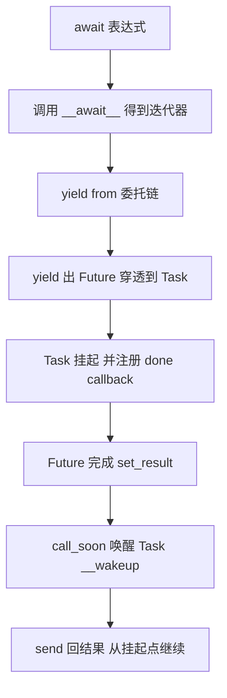

---

### Q585 · 异步 DNS 解析:getaddrinfo 并发与阻塞本质

> 难度:★★★☆ | 标签:DNS, asyncio, getaddrinfo

**问**:asyncio 里怎么并发解析大量域名?它真的是"异步"的吗?

**答**:`loop.getaddrinfo` 在默认事件循环里是把阻塞的 `socket.getaddrinfo` 丢进线程池执行的,所以并发靠的是线程池并行调用 libc 解析器,不是单线程 IO 复用。批量解析用 `asyncio.gather` 收集即可,吞吐受默认 executor 线程数(通常 min(32, cpu+4))限制,必要时换更大的 ThreadPoolExecutor。工程要点:解析结果自己做 TTL 缓存(getaddrinfo 本身通常不缓存);hostname 传 IP 字面量时 libc 快速返回不查 DNS;IPv6 环境下双栈解析可能拖慢,可指定 family=socket.AF_INET(注意 AF_INET 常量在 socket 模块,asyncio 里没有这个名字)。

```python
# file: code/02_并发与网络工程/q585_async_dns.py
import asyncio
import socket
import time

HOSTS = ["localhost"] * 8 + ["127.0.0.1"] * 8  # 本机可解析, 不依赖外网


async def resolve_all_sequential() -> None:
    loop = asyncio.get_running_loop()
    for host in HOSTS:
        await loop.getaddrinfo(host, 80, family=socket.AF_INET)


async def resolve_all_concurrent() -> None:
    loop = asyncio.get_running_loop()
    await asyncio.gather(
        *[loop.getaddrinfo(host, 80, family=socket.AF_INET) for host in HOSTS]
    )


async def inspect_result() -> None:
    loop = asyncio.get_running_loop()
    infos = await loop.getaddrinfo("localhost", 80, family=socket.AF_INET)
    print("getaddrinfo 返回结构示例:", infos[0])
    # (family, type, proto, canonname, sockaddr) — 建连接时直接喂给 open_connection


async def main() -> None:
    await inspect_result()
    t0 = time.perf_counter()
    await resolve_all_sequential()
    t_seq = time.perf_counter() - t0

    t0 = time.perf_counter()
    await resolve_all_concurrent()
    t_con = time.perf_counter() - t0
    print(f"串行 {len(HOSTS)} 次: {t_seq:.3f}s, 并发: {t_con:.3f}s")
    print("并发来自线程池中的并行 getaddrinfo, 而非单线程复用")


asyncio.run(main())
```

**追问**:1) 为什么解析 IP 字面量也要小心?——getaddrinfo 对 "127.0.0.1" 走快速路径,但带端口号的字符串或非法字面量仍会走到解析分支;热路径上应显式用 `family` + 数值化预处理。2) 异步 DNS 的本质?——asyncio 的 getaddrinfo 走线程池(run_in_executor),不是真异步;阻塞的是池线程不是循环,但池饱和会排队(Q599);真异步 DNS 要 aioredis 风格的专用解析库或 c-ares。3) 解析的工程优化?——TTL 缓存结果;并发预解析(Q585 本题);负缓存防解析风暴;上游 DNS 故障的降级(失败快、重试退避)。4) 生产陷阱?——以为 getaddrinfo 不阻塞;DNS 慢导致连接超时链放大(配 deadline,Q1285);每请求重复解析。

---

### Q586 · 异步连接池:acquire/release 的完整实现

> 难度:★★★★ | 标签:连接池, asyncio, 资源管理

**问**:自己实现一个 asyncio 连接池,要处理哪些问题?

**答**:四个关键点:上限控制用 Semaphore(拿不到许可就排队,而不是无限新建);空闲连接用 asyncio.Queue 存放,acquire 优先取空闲、没有才新建,release 归还;连接有效性要校验——空闲期间的断连要能检测(简单的做法是归还时标记年龄,取出时超龄就丢弃重建);生命周期收尾要在池关闭时排空并关闭所有连接。生产级还要加:按目标地址分池、健康检查、获取超时。下面实现核心版并配合 echo 服务验证"复用而不是新建"。

```python
# file: code/02_并发与网络工程/q586_async_pool.py
import asyncio
import time


class AsyncConnPool:
    def __init__(self, host: str, port: int, size: int = 3) -> None:
        self._host, self._port, self._size = host, port, size
        self._idle: asyncio.Queue = asyncio.Queue()
        self._sem = asyncio.Semaphore(size)  # 上限控制
        self._created = 0
        self._reused = 0

    async def acquire(self):
        await self._sem.acquire()
        try:
            conn = self._idle.get_nowait()
            self._reused += 1
            return conn
        except asyncio.QueueEmpty:
            reader, writer = await asyncio.open_connection(self._host, self._port)
            self._created += 1
            return reader, writer

    def release(self, conn) -> None:
        self._idle.put_nowait(conn)
        self._sem.release()

    def discard(self, conn) -> None:
        _reader, writer = conn
        writer.close()
        self._sem.release()

    async def close_all(self) -> None:
        while not self._idle.empty():
            _r, w = self._idle.get_nowait()
            w.close()
            await w.wait_closed()


async def echo_server(reader, writer) -> None:
    try:
        while True:
            data = await reader.read(100)
            if not data:
                break
            writer.write(data)
            await writer.drain()
    finally:
        writer.close()
        try:
            await writer.wait_closed()
        except Exception:
            pass


async def do_request(pool: AsyncConnPool, msg: str) -> str:
    conn = await pool.acquire()
    try:
        reader, writer = conn
        writer.write(msg.encode())
        await writer.drain()
        data = await asyncio.wait_for(reader.read(100), 1.0)
        pool.release(conn)
        return data.decode()
    except Exception:
        pool.discard(conn)  # 出错的连接不回池
        raise


async def main() -> None:
    server = await asyncio.start_server(echo_server, "127.0.0.1", 0)
    port = server.sockets[0].getsockname()[1]
    pool = AsyncConnPool("127.0.0.1", port, size=3)

    results = await asyncio.gather(*[do_request(pool, f"req{i}") for i in range(10)])
    print("请求结果:", results)
    print(f"新建连接 {pool._created} 次, 复用 {pool._reused} 次 (10 个请求)")
    await pool.close_all()
    server.close()
    await server.wait_closed()


asyncio.run(main())
```

**追问**:1) 怎么发现"池里的连接已被对端断开"?——取出时做轻量探活(非阻塞 peek 或发 ping),或对 read 抛 ConnectionResetError 的连接静默重建一次再失败上抛。2) 池的完整契约?——acquire 超时(防饿死)、归还校验(reset)、坏连接销毁、空闲回收(存活期)、池上限背压;租借计数与泄漏检测(Q1284)。3) 与异步的配合?——Semaphore 限并发窗口(Q595);acquire 等待队列;shutdown 排空(Q614)。4) 生产陷阱?——忘记归还(池耗尽);归还脏连接污染下家;无空闲回收被 NAT/防火墙断链;探活本身阻塞循环。

---

### Q587 · anyio 的思想:后端无关的异步抽象

> 难度:★★★☆ | 标签:anyio, asyncio, trio

**问**:anyio 解决什么问题?它和直接写 asyncio 有什么区别?

**答**:anyio 是"异步后端无关"的高层库:同一套代码可以跑在 asyncio 或 trio 上,提供统一的 TaskGroup、同步原语、流和内存对象通道。三个思想值得借鉴:一是结构化并发是原生语义(nursery 模型,任务不会逃逸出作用域);二是取消是"作用域级"的——cancel scope 进入异常即取消该作用域内全部任务,而非逐个 task.cancel;三是 Level 触发的事件语义(如 Event.set 是持久的,不依赖唤醒顺序)。面试重点是能对比:裸 asyncio 的任务可以 fire-and-forget 导致失控,anyio/trio 从类型系统上 discourages 这种写法。下面用纯 asyncio 模拟 nursery 的核心行为。注意内置 ExceptionGroup 是 3.11+ 才有,低版本直接 NameError——模拟实现要按版本分流:3.11+ 抛原生 ExceptionGroup,老版本用普通异常携带 `.exceptions` 列表聚合,捕获侧统一用 `getattr(e, "exceptions", [e])` 展开。

```python
# file: code/02_并发与网络工程/q587_nursery_sim.py
import asyncio
import sys
from contextlib import asynccontextmanager


class Nursery:
    """用纯 asyncio 模拟 trio nursery 的核心语义。"""

    def __init__(self) -> None:
        self._tasks: set = set()
        self._errors: list = []

    async def start_soon(self, coro) -> None:
        t = asyncio.create_task(self._wrap(coro))
        self._tasks.add(t)

    async def _wrap(self, coro) -> None:
        try:
            await coro
        except BaseException as e:  # 子任务异常全部收集, 不逃逸
            self._errors.append(e)

    async def join(self) -> None:
        if self._tasks:
            await asyncio.gather(*self._tasks)  # 等全部子任务退出
        if self._errors:
            if sys.version_info >= (3, 11):
                raise ExceptionGroup("nursery 子任务失败", self._errors)  # 3.11+ 原生聚合
            # 3.9/3.10 没有内置 ExceptionGroup: 用普通异常携带列表聚合
            agg = RuntimeError(f"nursery 子任务失败: 共 {len(self._errors)} 个")
            agg.exceptions = self._errors  # 模拟 ExceptionGroup.exceptions
            raise agg


@asynccontextmanager
async def open_nursery():
    n = Nursery()
    try:
        yield n
    finally:
        await n.join()


async def child(name: str, delay: float, fail: bool = False) -> None:
    await asyncio.sleep(delay)
    if fail:
        raise ValueError(f"{name} 失败")
    print(f"{name} 完成")


async def main() -> None:
    try:
        async with open_nursery() as n:
            await n.start_soon(child("fast", 0.05))
            await n.start_soon(child("slow", 0.15))
            await n.start_soon(child("bad", 0.08, fail=True))
    except BaseException as eg:  # 原生 ExceptionGroup 与模拟聚合都能接住
        for e in getattr(eg, "exceptions", [eg]):
            print("nursery 收集到:", repr(e))
    print("作用域结束: 所有子任务已被等待, 无任务逃逸")


if __name__ == "__main__":
    asyncio.run(main())
```

**追问**:1) anyio 的 cancel scope 和 asyncio.wait_for 的区别?——wait_for 只取消单个 await;cancel scope 是一个词法块,块内启动的所有任务(包括再嵌套的)都会被取消,并能区分"超时取消"与"外部取消"。2) 后端无关的价值?——同一代码跑 asyncio/trio;标准化的任务组、信号量、流抽象;框架层(anyio 作为 asyncio 高层封装)与直接 asyncio 的取舍。3) 与 TaskGroup 的关系?——asyncio.TaskGroup(3.11+)借了 trio nursery 思想;anyio 的 TaskGroup 更早且跨后端;取消树传播(Q589)是共同内核。4) 生产陷阱?——混用两套高层 API 语义;cancel scope 外捕获取消继续跑;假设 wait_for 能取消嵌套任务。

---

### Q588 · trio/curio 的内核思想:checkpoint 与显式调度

> 难度:★★★★ | 标签:trio, curio, 调度

**问**:curio/trio 这类"新一代"异步库和 asyncio 最本质的设计差异是什么?

**答**:两点。第一,取消必须显式配合:trio 的取消只在 checkpoint(如 `await sleep(0)`)处发生,库作者能明确指出"这里可中断",避免 asyncio 里"任意 await 都可能被取消"的隐式炸弹;第二,内核极简:curio 坚持调度器只做调度,所有 IO/同步原语都是显式 trap,性能开销更可预测。结构化并发(nursery)就诞生于 trio。下面实现一个 curio 风格的迷你内核:任务用生成器 yield trap,内核统一处理 sleep 与唤醒,展示"调度权完全在内核"的模型。

```python
# file: code/02_并发与网络工程/q588_curio_kernel.py
import heapq
import time
from collections import deque


class Kernel:
    """curio 风格内核: 任务是生成器, yield trap 请求内核服务。"""

    def __init__(self) -> None:
        self._ready: deque = deque()
        self._sleeping = []  # (deadline, seq, task)
        self._seq = 0
        self._results = {}

    def add(self, tid: int, gen) -> None:
        self._ready.append((tid, gen))

    def run(self) -> dict:
        current_time = time.monotonic
        while self._ready or self._sleeping:
            # 1. 唤醒到期任务
            now = current_time()
            while self._sleeping and self._sleeping[0][0] <= now:
                _, _, (tid, gen) = heapq.heappop(self._sleeping)
                self._ready.append((tid, gen))
            # 2. 跑一个就绪任务直到它 yield trap
            if not self._ready:
                if self._sleeping:
                    delay = max(0.0, self._sleeping[0][0] - current_time())
                    time.sleep(min(delay, 0.01))  # 真实内核会 epoll 等待
                continue
            tid, gen = self._ready.popleft()
            try:
                trap = gen.send(None)
            except StopIteration as e:
                self._results[tid] = e.value
                continue
            # 3. 内核裁决 trap
            if trap[0] == "sleep":
                self._seq += 1
                heapq.heappush(
                    self._sleeping, (current_time() + trap[1], self._seq, (tid, gen))
                )
            elif trap[0] == "checkpoint":
                self._ready.append((tid, gen))  # 立即重新排队
        return self._results


def task_a(kernel: Kernel) -> int:
    for i in range(3):
        yield ("sleep", 0.03)
        print(f"task_a 步骤 {i}")
    return "a-done"


def task_b(kernel: Kernel) -> str:
    for i in range(2):
        yield ("checkpoint",)  # 显式可取消点: 换其他任务跑
        print(f"task_b 步骤 {i}")
    return "b-done"


if __name__ == "__main__":
    k = Kernel()
    k.add(1, task_a(k))
    k.add(2, task_b(k))
    t0 = time.perf_counter()
    results = k.run()
    print("结果:", results, f"耗时 {time.perf_counter() - t0:.2f}s")
```

**追问**:1) trio 为什么坚持"取消必须到达 checkpoint"?——它把"哪里可能被打断"变成代码里可见的事实,审查者只需检查 checkpoint 分布,而不是推理任意 await 点的状态一致性。2) checkpoint 与 asyncio 的差异?——asyncio 任意 await 都可能取消;trio 要求显式 checkpoint(或裸 await 点);内核级保护结构(nursery/cancel scope)让取消可组合。3) 显式调度的收益?——可读性与可审计性(取消语义字面可见);shield 的显式变体(Protect);与结构化并发完全自洽(Q589)。4) 生产陷阱?——长 CPU 段无 checkpoint(取消饿死);把 checkpoint 当性能税删掉;混用 asyncio 心智写 trio 代码。

---

### Q589 · 取消树:TaskGroup 如何传播取消

> 难度:★★★☆ | 标签:TaskGroup, 取消, 结构化并发

**问**:TaskGroup 里一个任务抛异常,其他任务是什么命运?取消是怎么一层层传播的?

**答**:TaskGroup 是结构化并发的 asyncio 实现:进入时记录父任务,子任务出错时调用 `_abort()` 取消同组所有兄弟任务,父任务退出 `async with` 块时等待全部子任务终结,再把收集到的异常打包成 ExceptionGroup 抛出。传播是"向下一整层"的:外层取消 → 当前 Task 的 await 点抛 CancelledError → 该 Task 是 TaskGroup 的宿主,组内所有子任务一起被 cancel → 子任务 finally 清理后重新抛出。嵌套 TaskGroup 自然形成取消树,父收子、不跨层。注意 TaskGroup/`except*` 是 3.11+ 语法级特性,低版本连解析都过不了,demo 要用 exec 按需编译;3.9 用 gather 宿主 + 手动 cancel 等价演示(gather 的宿主被取消时会连带取消全部子任务)。

```python
# file: code/02_并发与网络工程/q589_cancel_tree.py
import asyncio
import sys


async def leaf(name: str, delay: float) -> str:
    try:
        await asyncio.sleep(delay)
        print(f"{name} 正常完成")
        return name
    except asyncio.CancelledError:
        print(f"{name} 被取消, 执行清理")
        await asyncio.sleep(0)  # 清理中也要给循环让位
        raise                    # 必须重新抛出


async def middle_branch_compat() -> None:
    """3.11 以下等价: gather 宿主被取消时会连带取消所有子任务。"""
    leaves = [
        asyncio.create_task(leaf("leaf-1", 0.05)),
        asyncio.create_task(leaf("leaf-2", 5.0)),   # 长任务: 会被连带取消
        asyncio.create_task(leaf("leaf-3", 5.0)),
    ]
    await asyncio.gather(*leaves)


# TaskGroup/except* 是 3.11+ 语法级特性, 放字符串按需编译
CANCEL_TREE_DEMO_311 = '''
async def middle_branch() -> None:
    async with asyncio.TaskGroup() as tg:
        tg.create_task(leaf("leaf-1", 0.05))
        tg.create_task(leaf("leaf-2", 5.0))   # 长任务: 会被连带取消
        tg.create_task(leaf("leaf-3", 5.0))


async def main() -> None:
    try:
        async with asyncio.TaskGroup() as outer:
            outer.create_task(middle_branch())
            outer.create_task(asyncio.sleep(10, result="root-slow"))
            await asyncio.sleep(0.1)
            raise RuntimeError("根任务主动失败, 触发整树取消")
    except* RuntimeError as eg:
        print("捕获根因:", eg.exceptions[0])
    except* asyncio.CancelledError:
        print("不应出现: 根任务自己不会收到取消")
    print("main 结束: 所有嵌套任务已退出")
'''


async def main_compat() -> None:
    # 3.9 等价演示: 手动逐层 cancel, 观察"向下一整层"的传播
    root = asyncio.create_task(middle_branch_compat())
    slow = asyncio.create_task(asyncio.sleep(10, result="root-slow"))
    await asyncio.sleep(0.05)
    print("根任务失败(以 cancel 模拟), 触发整树取消")
    root.cancel()
    slow.cancel()
    for name, t in (("middle_branch", root), ("root-slow", slow)):
        try:
            await t
        except asyncio.CancelledError:
            print(f"{name} 子树已随取消退出")
    print("main 结束: 所有嵌套任务已退出")


if __name__ == "__main__":
    if sys.version_info >= (3, 11):
        exec(compile(CANCEL_TREE_DEMO_311, "<cancel_tree_311>", "exec"), globals())
        asyncio.run(main())  # noqa: F821  由 CANCEL_TREE_DEMO_311 动态定义
    else:
        print(
            f"TaskGroup/except* 需要 Python 3.11+, "
            f"当前 {sys.version_info.major}.{sys.version_info.minor}, "
            f"演示跳过, 改用 gather+cancel 等价演示"
        )
        asyncio.run(main_compat())
```

**追问**:1) 子任务里吞掉 CancelledError 不抛会怎样?——它会"违抗"取消,TaskGroup 的 join 会等它跑完(或超时后再次 cancel),整棵树的退出时间被这个任务绑架;清理代码要么 finally 要么 catch 后 re-raise。2) 取消树传播的机制?——父取消→所有子 cancel→TaskGroup 等全退出→聚合异常抛出(Q604 的 ExceptionGroup);兄弟任务被连带取消(快速失败);3.11 uncancel 计数(Q590)。3) 与 shield 的组合?——不可中断段用 shield(Q590);但 shield 只护 await 点、finally 清理仍要短;取消嵌套深度不影响传播。4) 生产陷阱?——except Exception 误吞 CancelledError(它继承 BaseException,Q2639);吞掉后继续 await;long-running 任务不响应取消。

---

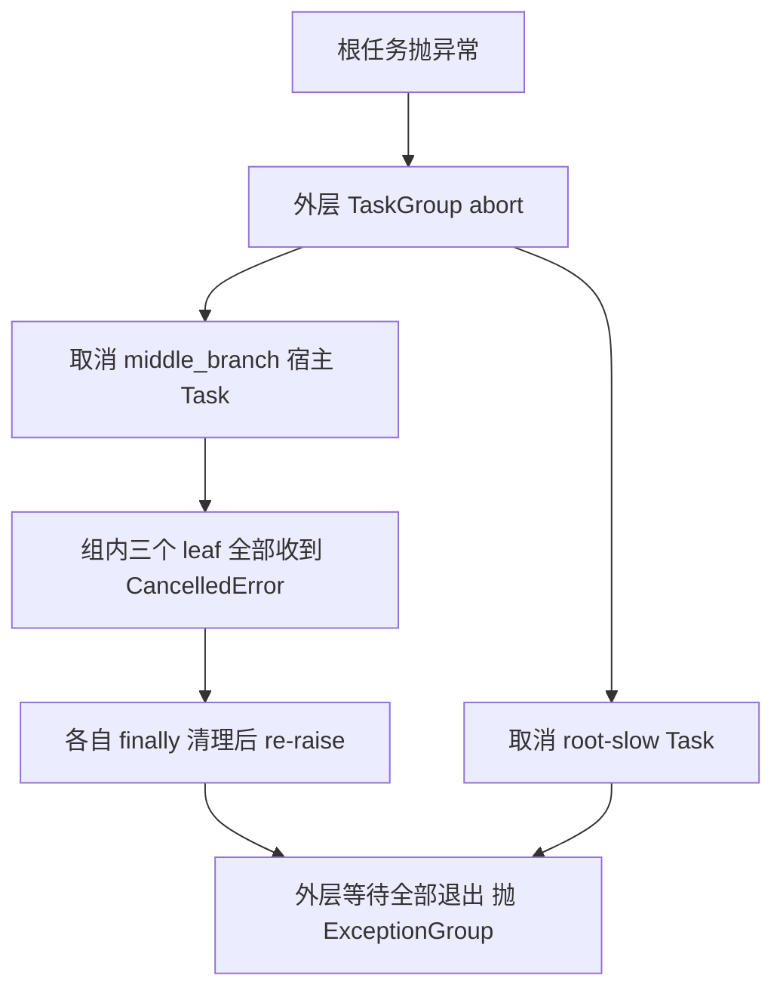

---

### Q590 · shield:保护不可中断的操作

> 难度:★★★☆ | 标签:shield, 取消, asyncio

**问**:取消风暴里,怎么保证"写审计日志"这类必须完成的操作不被打断?

**答**:`asyncio.shield(inner)` 给内部任务加一层壳:取消打到 shield 所在的外层 await 点,CancelledError 在外层抛出,但 inner 任务继续运行不受影响。要理解两个细节:shield 保护的是 inner 这个 task 对象,如果你 cancel 的是 inner 本身,shield 挡不住;外层被取消后想拿 inner 的结果,要继续 await inner。典型用途:优雅关闭时把"落盘/提交事务"包进 shield,或者反向——超时放弃等待但让任务在后台继续。

```python
# file: code/02_并发与网络工程/q590_shield.py
import asyncio


async def critical_flush() -> str:
    await asyncio.sleep(0.3)  # 模拟不可中断的落盘
    print("critical_flush: 状态已落盘")
    return "saved"


async def main() -> None:
    inner = asyncio.create_task(critical_flush())

    async def outer() -> None:
        # 正确姿势: 在外层 await 点 await shield(...)。
        # 注意 shield 返回的是 Future 不是协程, 不能再丢给 create_task
        # (TypeError: a coroutine was expected); 传 Task 或裸协程都可以。
        return await asyncio.shield(inner)

    outer_task = asyncio.create_task(outer())
    await asyncio.sleep(0.05)
    outer_task.cancel()  # 取消外层
    try:
        await outer_task
    except asyncio.CancelledError:
        print("outer 被取消, 但 inner 仍在跑")

    result = await inner  # 继续等受保护任务
    print("最终结果:", result)

    # 对照: 直接 cancel inner 则 shield 无能为力
    inner2 = asyncio.create_task(critical_flush())

    async def outer2() -> None:
        return await asyncio.shield(inner2)

    shielded = asyncio.create_task(outer2())
    inner2.cancel()
    try:
        await shielded
    except asyncio.CancelledError:
        print("cancel inner: shield 也挡不住 (保护的是外层取消)")


if __name__ == "__main__":
    asyncio.run(main())
```

**追问**:1) uncancel() 是干嘛的?——Python 3.11 给 Task 加了取消计数,在捕获 CancelledError 后做不含 await 的清理时调用 `task.uncancel()` 可避免外层把"本次取消"误记,但要非常谨慎,通常直接 re-raise 才是对的。2) shield 的真实边界?——只保护「这个 await 点」:外层取消仍会在 shield 完成后把外层协程取消;shield 内启动的新任务不在保护范围;清理段要短且幂等(Q589)。3) 与 TaskGroup 的配合?——TaskGroup 取消树下,shield 段内的异常仍会进组;uncancel 用于「接管取消」的高级场景(服务器连接处理);3.11 前 cancelling 计数没有,行为靠协议。4) 生产陷阱?——shield 包整个长任务(等于吞取消);uncancel 后不 re-raise 让取消凭空消失;清理段里再 await 无 shield。

---

### Q591 · 异步超时分层:总预算与阶段预算

> 难度:★★★★ | 标签:超时, asyncio, SLA

**问**:一个请求要经历连接、读取、处理三段,怎么设计超时才不会"每段 5 秒、总计 15 秒"?

**答**:用"总预算 + 阶段扣减":先定总 deadline(monotonic 时钟),每个阶段用 `deadline - now` 作为自己的 wait_for 超时,阶段花得少,后面阶段就分得多;任一阶段超时或总预算耗尽都立刻失败。这与 HTTP 客户端的 connect timeout/read timeout 分离是同一思想:连接超时管建连,读超时管两次数据之间的间隔,而总预算兜底整条链路。实现上注意用 `loop.time()` 而非 time.time,避免系统时间跳变。

```python
# file: code/02_并发与网络工程/q591_layered_timeout.py
import asyncio

TOTAL_BUDGET = 0.6  # 总预算 600ms


async def phase(name: str, cost: float) -> str:
    await asyncio.sleep(cost)  # 模拟阶段耗时
    return name


async def request(phases, budget: float = TOTAL_BUDGET) -> list:
    loop = asyncio.get_running_loop()
    deadline = loop.time() + budget
    results = []
    for name, coro in phases:
        remaining = deadline - loop.time()
        if remaining <= 0:
            raise TimeoutError(f"总预算耗尽, 无法进入阶段 {name}")
        try:
            results.append(await asyncio.wait_for(coro, remaining))
        except asyncio.TimeoutError:
            raise TimeoutError(
                f"阶段 {name} 超出剩余预算 {remaining * 1000:.0f}ms"
            ) from None
    return results


async def main() -> None:
    ok_phases = [
        ("connect", phase("connect", 0.1)),
        ("read", phase("read", 0.2)),
        ("process", phase("process", 0.2)),
    ]
    print("正常:", await request(ok_phases))

    slow_phases = [
        ("connect", phase("connect", 0.1)),
        ("read", phase("read", 0.4)),    # 单段不超预算, 但会吃光总预算
        ("process", phase("process", 0.4)),
    ]
    try:
        await request(slow_phases)
    except TimeoutError as e:
        print("按预期失败:", e)


asyncio.run(main())
```

**追问**:1) read timeout 通常指"整次读"还是"两次包之间"?——主流 HTTP 库是后者(两次数据到达的间隔),所以慢速滴流的响应不会触发 read timeout,必须靠总预算兜底,这就是分层的意义。2) 分层的完整结构?——连接超时(TCP/握手)→ 单次操作超时(read/write 间隔)→ 总预算(deadline,Q1285);每层都有且逐层收窄;重试消耗总预算(Q2890)。3) 服务端对应物?——请求级 deadline 中间件、上游预算传递 header;客户端 deadline 与服务端 deadline 对齐,差值是处理余量。4) 生产陷阱?——只有 connect timeout(read 默认 None);滴流攻击;超时不区分「连接慢」与「处理慢」导致误扩容。

---

### Q592 · wait_for 与 timeout 上下文:两代超时 API

> 难度:★★☆ | 标签:asyncio, timeout, API

**问**:asyncio.wait_for 和 Python 3.11 的 asyncio.timeout 有什么区别?分别适合什么场景?

**答**:wait_for 是函数式:把一个 awaitable 包起来,超时返回时内部任务已被取消,粒度是"这一个调用"。timeout 是作用域式:async with 块内所有 await 共享一个 deadline,超时时块内当前挂起的那一个 await 收到取消,适合"一段逻辑整体限时"以及多步操作共享预算;并且 timeout.expired() 能区分是超时还是外部取消。wait_for 的历史坑:超时时任务被取消但完成时机不确定,旧版本存在"返回结果与 TimeoutError 竞争"的 bug,3.8+ 已修复但语义上 timeout 上下文更清晰。

```python
# file: code/02_并发与网络工程/q592_timeout_api.py
import asyncio
import sys


async def slow(job: str = "job") -> str:
    try:
        await asyncio.sleep(5)
    except asyncio.CancelledError:
        print(f"{job} 收到取消, 清理后退出")
        raise
    return "done"


async def demo_wait_for() -> None:
    try:
        await asyncio.wait_for(slow("wait_for 里的任务"), 0.1)
    except asyncio.TimeoutError:
        print("wait_for: 超时, 内部任务已被取消")


async def demo_timeout_ctx() -> None:
    if sys.version_info < (3, 11):
        print("timeout 需要 3.11+, 跳过")
        return
    try:
        async with asyncio.timeout(0.1):
            await slow("作用域内任务")
            await slow("作用域内第二个任务")  # 多个 await 共享同一个 deadline
    except TimeoutError:
        print("timeout 上下文: 块内整体超时")


async def main() -> None:
    await demo_wait_for()
    await demo_timeout_ctx()


asyncio.run(main())
```

**追问**:1) wait_for 传 None 会怎样?——等价于不设超时,直接 await;所以"可选超时"场景写 wait_for(op, timeout or None) 是安全的,但绝不能传 0(立即取消)。2) 两代 API 的差别?——wait_for 包一层 Task 取消;asyncio.timeout(3.11+)是上下文管理器,块内所有 await 共享预算、超时抛 TimeoutError(内层 Canc 困惑减少)、与 TaskGroup 组合更自然。3) 迁移建议?——新代码用 asyncio.timeout;wait_for 的「取消已发但任务可能完成」竞态(timeout 后 result 仍可能取到)要理解。4) 生产陷阱?——wait_for(op, 0) 立即取消;timeout 块内吞 CancelledError 混淆超时与外部取消(Q589);嵌套 wait_for 预算叠加。

---

### Q593 · 背压 backpressure:有界队列的限速本质

> 难度:★★★☆ | 标签:背压, asyncio.Queue, 流控

**问**:什么是背压?asyncio.Queue 的 maxsize 是怎么把"下游慢"传导给"上游快"的?

**答**:背压指下游处理能力不足时,压力沿着调用链向上游逐级传导,最终让数据源头减速,而不是在中途无限堆积。asyncio.Queue(maxsize=N) 的机制:`put` 在队列满时挂起,生产者自然被拖慢,消费速度成为整条管道的速率上限。没有背压的系统表现是"内存涨爆或延迟爆炸后才崩溃";有背压的系统表现为"吞吐稳定、延迟可控"。观察指标:队列水位(maxsize 的占比)、put 等待时长。逐级连接(源→队列→处理→队列→出口)时,每一跳都要有界。

```python
# file: code/02_并发与网络工程/q593_backpressure.py
import asyncio
import time

MAXSIZE = 5


async def producer(q: asyncio.Queue, stats: dict) -> None:
    for i in range(20):
        t0 = time.perf_counter()
        await q.put(i)  # 队列满时挂起: 背压发生点
        wait = time.perf_counter() - t0
        stats["max_wait"] = max(stats["max_wait"], wait)
        stats["max_size"] = max(stats["max_size"], q.qsize())
    stats["done"] = True


async def consumer(q: asyncio.Queue) -> None:
    while True:
        item = await q.get()
        await asyncio.sleep(0.03)  # 下游处理速度: 上游被它拖慢
        q.task_done()


async def main() -> None:
    q: asyncio.Queue = asyncio.Queue(maxsize=MAXSIZE)
    stats = {"max_wait": 0.0, "max_size": 0, "done": False}
    prod = asyncio.create_task(producer(q, stats))
    cons = asyncio.create_task(consumer(q))

    await asyncio.wait_for(prod, 5)  # 生产者完成(被拖慢后仍完成)
    await q.join()
    cons.cancel()
    print(f"maxsize={MAXSIZE}, 队列峰值 {stats['max_size']}, "
          f"put 最长等待 {stats['max_wait'] * 1000:.0f}ms")
    assert stats["max_size"] <= MAXSIZE, "有界队列封顶生效"


asyncio.run(main())
```

**追问**:1) 无界队列 + 限速器是不是等价于有界队列?——不等价,限速只约束生产速率不感知下游状态,下游卡死时数据照样堆积;背压必须由下游状态驱动。2) 背压的完整链路?——下游慢→队列满→生产者 put 阻塞/拒绝→上游减产;每一跳都要传递(消费者 credit、HTTP 503、TCP 窗口);任何一跳「吞下压力」(无界缓冲)链路就断。3) 实现手段?——有界 Queue put 阻塞;Semaphore 窗口(Q595);.credit/token bucket 配合水位监控;stream writer drain(Q594)。4) 生产陷阱?——无界队列伪装背压;限速器在错误层(限了应用没限协议);监控缺队列水位告警(Q564)。

---

### Q594 · StreamWriter 的 drain:TCP 层的背压

> 难度:★★★★ | 标签:drain, asyncio, TCP 背压

**问**:asyncio 里 writer.write 不是立即发送,那缓冲区爆了怎么办?drain 到底在等什么?

**答**:write 只是把数据放进传输层写缓冲,由事件循环异步刷到 socket;如果对端读得慢,内核发送缓冲和 Python 写缓冲都会积压。`await writer.drain()` 在缓冲区超过高水位(`set_write_buffer_limits`)时挂起,降到低水位以下才返回——这就是 asyncio 给你的 TCP 背压阀门:push 大文件时每次 write 后 drain,客户端不读你的发送速率就自动降下来。不 drain 的后果是内存里缓冲无限增长,大文件传输必须配对使用。写完最后一块还要 `writer.close()` + `wait_closed()` 收尾。

```python
# file: code/02_并发与网络工程/q594_drain.py
import asyncio


async def handle(reader: asyncio.StreamReader, writer: asyncio.StreamWriter) -> None:
    transport = writer.transport
    transport.set_write_buffer_limits(high=2048, low=1024)  # 观察背压阈值
    try:
        for i in range(8):
            writer.write(f"chunk-{i}-".encode())
            buffered = transport.get_write_buffer_size()
            await writer.drain()  # 客户端读得慢时, 这里挂起
            print(f"服务端发出 chunk {i}, 写前缓冲 {buffered} 字节")
            await asyncio.sleep(0.02)
    finally:
        writer.close()
        try:
            await writer.wait_closed()
        except Exception:
            pass


async def slow_client(port: int) -> None:
    reader, writer = await asyncio.open_connection("127.0.0.1", port)
    for i in range(8):
        await asyncio.sleep(0.1)  # 故意慢读: 触发服务端 drain 挂起
        data = await reader.read(100)
        print("客户端收到:", data.decode())
    writer.close()
    await writer.wait_closed()


async def main() -> None:
    server = await asyncio.start_server(handle, "127.0.0.1", 0)
    port = server.sockets[0].getsockname()[1]
    await slow_client(port)
    server.close()
    await server.wait_closed()


asyncio.run(main())
```

**追问**:1) get_write_buffer_size 一直涨说明什么?——对端不读而你没 drain,数据全堆在用户态缓冲里;修复是每次 write 后 await drain,并检查高水位设置是否合理(默认 64KB)。2) drain 的语义?——「写缓冲超过高水位时挂起,降回低水位恢复」;它不是「数据已发出」,而是「缓冲可控」;漏 drain = 放弃 TCP 层背压。3) 与协议层的配合?——pause_writing/resume_writing 协议回调是 drain 的底层;写大文件分块 write+drain;限流窗口与水位联动(Q593)。4) 生产陷阱?——大响应一次 write(OOM 面);drain 在 no-await 回调里没法用(协议层用 pause);把「write 返回」当「对端收到」。

---

### Q595 · 异步信号量限流:并发窗口控制

> 难度:★★☆ | 标签:Semaphore, 限流, asyncio

**问**:要给外部 API 发 100 个请求,对方限 5 并发,怎么写既不超限又不浪费并发额度?

**答**:用 `asyncio.Semaphore(5)` 包住每个请求的临界区:100 个协程全部启动,同时最多 5 个真正在发请求,第 6 个在 `async with sem` 处排队,完成一个补位一个,窗口保持满负荷。要点:信号量要包住"整个请求生命周期"(发请求到读响应),而不是只包发;窗口内记录当前并发数可以验证限流生效;如果还要限 QPS 而非并发数,叠加令牌桶(Q367 的异步版)更精确。

```python
# file: code/02_并发与网络工程/q595_async_semaphore.py
import asyncio
import time


async def api_call(i: int, sem: asyncio.Semaphore, meter: dict) -> int:
    async with sem:  # 临界区: 整个请求生命周期
        meter["current"] += 1
        meter["peak"] = max(meter["peak"], meter["current"])
        await asyncio.sleep(0.05)  # 模拟外部 API 延迟
        meter["current"] -= 1
        return i * 2


async def main() -> None:
    sem = asyncio.Semaphore(5)  # 并发窗口 = 5
    meter = {"current": 0, "peak": 0}

    t0 = time.perf_counter()
    results = await asyncio.gather(*[api_call(i, sem, meter) for i in range(30)])
    dt = time.perf_counter() - t0

    print(f"30 个请求, 峰值并发 {meter['peak']} (上限 5), 耗时 {dt:.2f}s")
    assert meter["peak"] <= 5
    print("结果前 5 个:", results[:5])

    # 对照: 无限流会同时打满 30 个并发
    meter2 = {"current": 0, "peak": 0}
    await asyncio.gather(*[api_call(i, asyncio.Semaphore(100), meter2)
                           for i in range(30)])
    print("无限制峰值并发:", meter2["peak"])


asyncio.run(main())
```

**追问**:1) Semaphore(0) 有什么用途?——初始为 0 时所有 acquire 都阻塞,等持有方 release 放行,可以用来做"闸门":资源就绪前统一堵住,就绪后一次性放行或按节奏放行。2) 限流窗口的形态?——Semaphore 管并发数(同时 N 个);令牌桶管速率;两者组合(并发窗口 + QPS);with sem: 包临界资源。3) 与有界队列的关系?——Semaphore(0) 初始 = 关闸;队列水位 + 信号量 = 背压双保险(Q593);asyncio.Semaphore 不跨线程(Q596)。4) 生产陷阱?——with 体里异常导致信号量泄漏(with 自动释放,不会;但手动 acquire/release 会); Semaphore 值被动态改( release 超发);限流粒度错(全局 vs 每下游)。

---

### Q596 · 协程的并发安全边界:哪些地方不需要锁,哪些必须加

> 难度:★★★★ | 标签:并发安全, asyncio.Lock, 原子性

**问**:事件循环是单线程的,还有必要用 asyncio.Lock 吗?到底什么操作在协程间不安全?

**答**:单线程事件循环保证了"两个 await 之间的纯同步代码"不会被切走,所以不含 await 的读-改-写序列是天然原子的,不需要锁。但只要读写之间夹了 await,控制权就可能交给其他协程,经典 check-then-act 就会坏:读到旧值 → await → 别的协程改了 → 写回覆盖。因此判断标准只有一条:从"读"到"写"之间有没有 await(或任何 yield 点)。有,就 asyncio.Lock;没有,就别加锁白付开销。这条边界也解释了为什么 `dict[k] += 1` 在协程里安全、跨线程就不安全。另外注意 asyncio 锁与事件循环的绑定:3.10 起原语改为首次 await 时惰性绑定当前运行中的循环(loop 参数也在 3.10 弃用、3.12 移除),在 import 期创建通常可行;但在某个循环下用过一次的锁再到另一个 asyncio.run 的新循环里 await,仍会报 "got Future attached to a different loop"——锁的创建与使用要圈定在同一循环内,工程惯例是在事件循环运行期间创建。

```python
# file: code/02_并发与网络工程/q596_async_atomic.py
import asyncio

counter = 0
# asyncio 锁与循环的绑定: 3.10 起原语在首次 await 时惰性绑定运行中的循环,
# import 期创建通常可行; 但在循环 A 用过的锁拿到循环 B(asyncio.run 新开)里
# await 仍会报 "got Future attached to a different loop"。
# 稳妥做法: 在事件循环运行期间创建(本例在 main 里创建)。
lock = None


async def unsafe_increment(n: int) -> None:
    global counter
    for _ in range(n):
        v = counter       # 读
        await asyncio.sleep(0)  # 中断点: 其他协程插入执行
        counter = v + 1   # 写回旧值 → 丢失更新


async def safe_increment(n: int) -> None:
    global counter
    for _ in range(n):
        async with lock:
            v = counter
            await asyncio.sleep(0)  # 即使有中断点, 临界区内没有竞争者
            counter = v + 1


async def atomic_without_await(n: int) -> None:
    global counter
    for _ in range(n):
        counter += 1  # 无 await: 事件循环保证原子, 不需要锁


async def run(target, n: int, label: str) -> None:
    global counter
    counter = 0
    await asyncio.gather(*[target(100) for _ in range(n)])
    print(f"{label}: {counter} / 期望 {n * 100}")


async def main() -> None:
    global lock
    lock = asyncio.Lock()  # 在运行中的循环里创建
    await run(unsafe_increment, 10, "含 await 无锁(丢失更新)")
    await run(safe_increment, 10, "含 await 加锁")
    assert counter == 10 * 100, "加锁路径不允许丢失更新"
    await run(atomic_without_await, 10, "无 await 裸写(天然原子)")
    assert counter == 10 * 100, "无 await 路径天然原子"


if __name__ == "__main__":
    asyncio.run(main())
```

**追问**:1) asyncio.Lock 为什么不能跨线程用?——它依赖当前循环的 call_soon 唤醒等待者,别的线程调用 release 时没有循环上下文;跨线程要用 run_coroutine_threadsafe 或 threading.Lock。2) 不需要锁的场景?——单线程循环内「await 点之间」的操作原子(无 await 的读改写序列);dict/list 单操作;循环内计数器。3) 必须锁/协调的场景?——跨 await 的 check-then-act;共享外部资源(连接池、限流);与线程混合;跨线程共享(Q598)。4) 生产陷阱?——循环内无 await 序列当「可能被切走」过度加锁;跨线程误用 asyncio 锁(Q600);把「单线程」当「无并发」(await 交错仍是并发)。

---

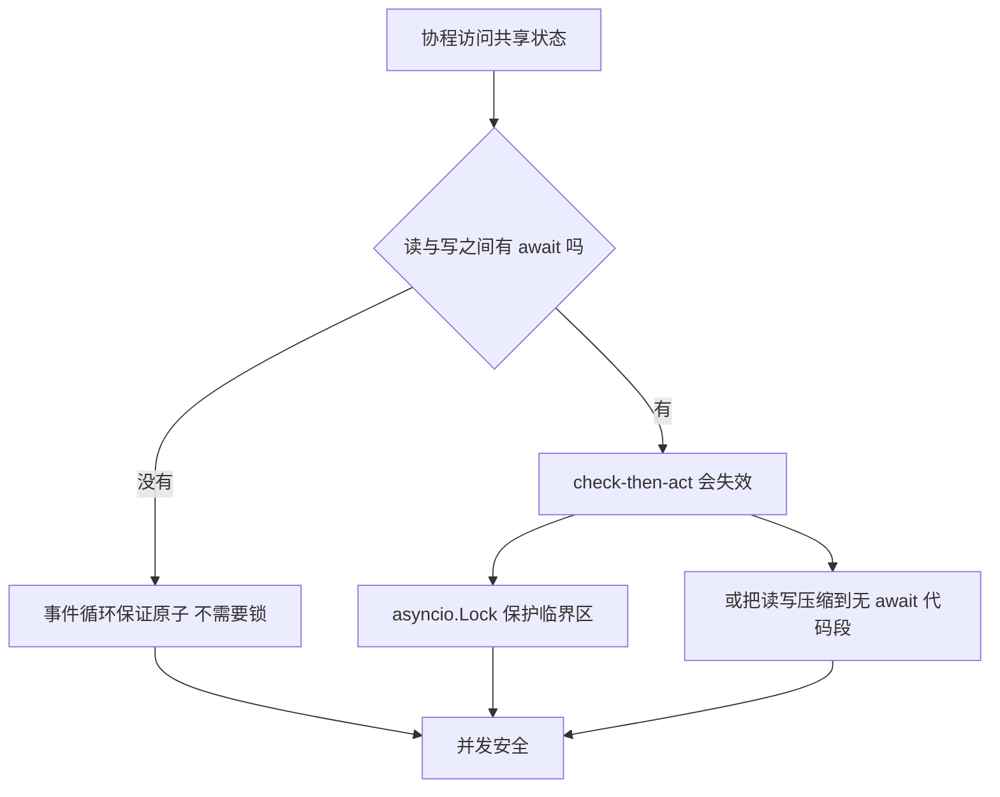

---

### Q597 · 阻塞库混入协程:run_in_executor 的正确姿势

> 难度:★★★☆ | 标签:run_in_executor, 阻塞, 混合栈

**问**:手头只有一个同步 SDK(阻塞 50ms),在 async 服务里直接调用会怎样?怎么改造成本最低?

**答**:直接调用会阻塞整个事件循环 50ms,期间所有协程(包括心跳、其他请求)全部冻结,这是 async 服务最常见的性能事故。改造成本最低的方案是 `loop.run_in_executor`:把阻塞调用丢进线程池,协程 await 它,循环继续跑别的任务;SDK 线程安全性未知时,给每个调用加 threading.Lock 或用单线程 executor 串行化。对于 CPU 密集的同步代码,换 ProcessPoolExecutor。判断口诀:阻塞 IO → to_thread,CPU → process pool,能改异步原生 → 最好。

```python
# file: code/02_并发与网络工程/q597_blocking_in_async.py
import asyncio
import threading
import time


class LegacySDK:
    """模拟只提供同步接口的第三方 SDK。"""

    def __init__(self) -> None:
        self._lock = threading.Lock()  # 线程安全性未知时按不安全处理
        self.calls = 0

    def blocking_query(self, key: str) -> str:
        with self._lock:
            time.sleep(0.05)  # 阻塞 50ms
            self.calls += 1
            return f"value-of-{key}"


async def main() -> None:
    sdk = LegacySDK()
    loop = asyncio.get_running_loop()

    # 错误姿势: 直接调用, 冻结事件循环 — 用心跳协程观察
    heartbeat_ticks = [0]

    async def heartbeat() -> None:
        while True:
            heartbeat_ticks[0] += 1
            await asyncio.sleep(0.01)

    hb = asyncio.create_task(heartbeat())
    t0 = time.perf_counter()
    sdk.blocking_query("direct")  # 阻塞 50ms, 心跳完全停止
    direct_dt = time.perf_counter() - t0
    ticks_during_direct = heartbeat_ticks[0]
    print(f"直接调用 {direct_dt * 1000:.0f}ms, 期间心跳仍在: {ticks_during_direct > 0}")

    # 正确姿势: run_in_executor + 显式线程池 (线程安全未知时按串行化处理)
    from concurrent.futures import ThreadPoolExecutor
    executor = ThreadPoolExecutor(max_workers=3, thread_name_prefix="sdk")
    t0 = time.perf_counter()
    results = await asyncio.gather(
        *[loop.run_in_executor(executor, sdk.blocking_query, f"k{i}")
          for i in range(3)]
    )
    par_dt = time.perf_counter() - t0
    hb.cancel()
    print(f"executor 并行 3 次: {par_dt * 1000:.0f}ms (约等于单次耗时)")
    print("结果:", results)
    executor.shutdown()


asyncio.run(main())
```

**追问**:1) to_thread 和 run_in_executor 选哪个?——to_thread 是 3.9+ 的一步到位封装(用默认 executor),简单场景首选;需要自定义线程数/命名/复用池时用 run_in_executor + 显式 ThreadPoolExecutor。2) 正确姿势的完整清单?——默认 executor 线程数有限(min(32, cpu+4),Q599);阻塞调用永远不裸放进循环;CPU 密集用进程池;混用线程要处理 GIL 对纯 Python 的限制(Q576);异常经 Future 回传(Q565)。3) 与取消的边界?——线程内任务无法真正取消(await 取消只是不等它);长期阻塞调用要有自身超时。4) 生产陷阱?——默认 executor 被长任务占满饿死其他 to_thread;阻塞库(ORM 同步驱动)直接 await;线程内再操作循环对象。

---

### Q598 · 跨线程投递协程:run_coroutine_threadsafe

> 难度:★★★★ | 标签:asyncio, 线程混用, 线程安全

**问**:一个普通线程拿到了计算结果,怎么安全地交给 asyncio 侧处理并拿到返回值?

**答**:用 `asyncio.run_coroutine_threadsafe(coro, loop)`:它把协程包装后通过 `call_soon_threadsafe` 投递到事件循环线程执行,返回 concurrent.futures.Future(不是 asyncio.Future),普通线程可以直接 `.result(timeout=)` 阻塞等待。方向反过来是 `loop.call_soon_threadsafe` 调普通函数。铁律有三:绝不能在其他线程直接调 loop 的非 threadsafe 方法;协程对象只能在所属循环里驱动,跨线程传递的是"待执行的协程"而不是"执行中的协程";主协程绝不能 `t.join()` 干等投递线程——join 会阻塞事件循环线程,线程侧 `result()` 又要等 loop 派发结果,自己把自己锁死到超时,循环侧要用 `while t.is_alive(): await sleep` 让出控制权。另外 3.9 里 `concurrent.futures.TimeoutError` 与内建 `TimeoutError` 是两个类,except 写错会漏接直接炸线程(3.11 才合并)。典型场景:回调式 SDK 的回调线程与主循环交互。

```python
# file: code/02_并发与网络工程/q598_threadsafe.py
import asyncio
import concurrent.futures
import threading

table: dict = {}


async def update_and_read(key: str) -> int:
    await asyncio.sleep(0.01)  # 模拟异步处理
    table[key] = table.get(key, 0) + 1
    return table[key]


def callback_thread(loop, n: int) -> None:
    """模拟第三方 SDK 的回调线程。"""
    for i in range(n):
        fut = asyncio.run_coroutine_threadsafe(update_and_read(f"k{i % 3}"), loop)
        try:
            value = fut.result(timeout=2)  # concurrent.futures.Future
            print(f"[thread] 回调 {i} 处理完成, 值={value}")
        except concurrent.futures.TimeoutError:
            # 3.9 里它不是内建 TimeoutError, 捕错类型会漏接并炸掉线程
            print("[thread] 投递超时: loop 卡死或未运行")


async def main() -> None:
    loop = asyncio.get_running_loop()
    t = threading.Thread(target=callback_thread, args=(loop, 6))
    t.start()
    # 同时 loop 自己也在跑别的协程, 证明共享同一个循环。
    # 不能直接 t.join(): join 阻塞事件循环线程, 线程侧 fut.result()
    # 就永远等不到派发, 自我死锁到超时; 循环侧必须让出控制权轮询。
    while t.is_alive():
        await asyncio.sleep(0.01)
    t.join()
    print("最终 table:", table)
    assert all(v == 2 for v in table.values()), "每个 key 被处理 2 次"


if __name__ == "__main__":
    asyncio.run(main())
```

**追问**:1) futures.Future 和 asyncio.Future 能互相转吗?——asyncio.wrap_future 可以把前者包成后者,反之用 asyncio.futures._chain_future;日常记"跨线程边界用 futures.Future,循环内用 asyncio.Future"即可。2) run_coroutine_threadsafe 的契约?——从线程投递协程到循环,返回 concurrent.futures.Future(线程侧可 result(timeout));循环侧正常执行;这是线程→异步的唯一正门(Q600)。3) 结果回传的双 Future 设计?——线程侧等 concurrent Future;循环侧 asyncio Future 由 _chain_future 桥接;超时与取消的语义差异(线程侧 cancel 不一定能停循环内任务)。4) 生产陷阱?——在线程里 await(语法/语义都不成立);拿 asyncio.Future 跨线程 result() 死等;取消语义误解。

---

### Q599 · to_thread 与 run_in_executor 选型

> 难度:★★☆ | 标签:to_thread, run_in_executor, 选型

**问**:asyncio.to_thread 和 loop.run_in_executor 功能重叠,工程上怎么选?

**答**:to_thread(3.9+)是高层封装:自动用 loop 的默认执行器、支持 kwargs、自动传播 contextvars,写起来最省事,适合"偶发的阻塞调用"。run_in_executor 是底层接口:接受任意 concurrent.futures.Executor,能自定义线程数、命名、池复用,适合要精细控制并发的场景(比如把所有 DB 调用固定在一个 5 线程池里限流)。语义差异:to_thread 用的默认池随 loop 存活,run_in_executor 的池生命周期由你管理;混用时注意默认池线程数(min(32, cpu+4))可能撑不起高并发阻塞调用。

```python
# file: code/02_并发与网络工程/q599_to_thread.py
import asyncio
import time
from concurrent.futures import ThreadPoolExecutor


def blocking_io(n: int, factor: int = 2) -> int:
    time.sleep(0.1)  # 模拟阻塞 IO
    return n * factor


async def main() -> None:
    # 场景一: 偶发调用 → to_thread 简洁
    t0 = time.perf_counter()
    r1 = await asyncio.to_thread(blocking_io, 10, factor=3)  # 支持 kwargs
    print(f"to_thread 单次: {r1}, {time.perf_counter() - t0:.2f}s")

    # 场景二: 大量并发 → 默认池够用性检查
    t0 = time.perf_counter()
    rs = await asyncio.gather(*[asyncio.to_thread(blocking_io, i) for i in range(10)])
    print(f"to_thread 10 并发: 完成 {len(rs)}, {time.perf_counter() - t0:.2f}s")

    # 场景三: 需要限流 → 自定义 2 线程池, 10 个任务分 5 批
    pool = ThreadPoolExecutor(max_workers=2, thread_name_prefix="db")
    try:
        loop = asyncio.get_running_loop()
        t0 = time.perf_counter()
        rs = await asyncio.gather(
            *[loop.run_in_executor(pool, blocking_io, i) for i in range(10)]
        )
        print(f"run_in_executor(max_workers=2): {len(rs)} 个, "
              f"{time.perf_counter() - t0:.2f}s (被 2 线程限流)")
    finally:
        pool.shutdown()


asyncio.run(main())
```

**追问**:1) 默认 executor 的线程数在哪看、怎么改?——`loop.get_default_executor()` 可查看;Python 3.8+ 默认 min(32, os.cpu_count() + 4),要改就在循环启动后 `loop.set_default_executor(ThreadPoolExecutor(...))`。2) 选型的完整决策树?——阻塞 IO/库调用:to_thread(默认池);重阻塞高频:自定义线程池(命名线程、独立上限,隔离长任务);CPU 密集:ProcessPoolExecutor;常驻并发服务:自管池 + 队列水位(Q564)。3) 与默认池的风险?——默认池共享,一个慢库占满饿死别人;线程命名便于 dump 排查(Q571);线程数不是越大越好(上下文切换+GIL)。4) 生产陷阱?——所有阻塞共享默认池;池无上限任务堆积;线程池被取消语义误解(无法真取消)。

---

### Q600 · call_soon_threadsafe:跨线程唤醒事件循环

> 难度:★★★☆ | 标签:call_soon_threadsafe, 自唤醒管道, asyncio

**问**:为什么事件循环要专门提供 threadsafe 版本的 call_soon?它内部靠什么立刻唤醒?

**答**:事件循环空闲时阻塞在 select/epoll 上,普通线程往 _ready 队列塞回调,循环并不知道,可能继续睡。`call_soon_threadsafe` 做两件事:线程安全地入队(内部有自旋锁),然后向"自唤醒管道"(self-pipe socket)写一个字节——这个管道 fd 也在被 select 监听,字节一到循环立刻醒来处理回调。这就是经典的 self-pipe trick:把"线程间的信号"转成"内核可监听的 IO 事件"。asyncio 的 stop() 也是靠这个机制实现的。

```python
# file: code/02_并发与网络工程/q600_self_pipe.py
import asyncio
import threading
import time

fired_at: list = []


async def main() -> None:
    loop = asyncio.get_running_loop()

    async def idle_waiter() -> None:
        # 循环此刻没有任何 IO, 正阻塞在 select 上
        await asyncio.sleep(1.0)

    t0 = time.perf_counter()

    def fire_from_thread() -> None:
        time.sleep(0.2)  # 确保 loop 已进入空闲 select
        fired_at.append(time.perf_counter() - t0)
        loop.call_soon_threadsafe(
            lambda: fired_at.append(time.perf_counter() - t0)
        )

    threading.Thread(target=fire_from_thread).start()
    await asyncio.sleep(0.5)  # 期间 loop 空闲, 靠 self-pipe 被唤醒处理回调
    print("各时间点:", [f"{t:.2f}s" for t in fired_at])
    print("threadsafe 回调无需 IO 事件即可唤醒循环")


asyncio.run(main())
```

**追问**:1) loop.stop() 与 add_signal_handler 之间的关系是什么?——信号处理回调本质上也是通过 call_soon_threadsafe(信号处理由信号线程或自管道转入)排队的,统一走"事件入队→循环消费"模型。2) 跨线程唤醒的机制?——call_soon_threadsafe 写 self-pipe 的写端,select 立即唤醒读端处理;信号 handler(set_wakeup_fd)走同通道(Q551 的 self-pipe 故事);这是「信号→IO」的统一抽象。3) 使用纪律?——跨线程只能用 _threadsafe 版;handler 里只做轻排队、重活转 Task;信号只投主线程。4) 生产陷阱?——普通 call_soon 跨线程(Q581);handler 里做阻塞清理;优雅关闭依赖信号但没配 fallback(超时强杀)。

---

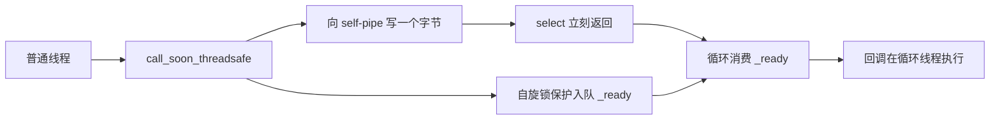

---

### Q601 · asyncio 与 subprocess:异步跑外部命令

> 难度:★★☆ | 标签:subprocess, asyncio, 进程管理

**问**:asyncio 里怎么跑外部命令、读输出、超时杀进程?

**答**:`asyncio.create_subprocess_exec`(参数列表,不经过 shell,无注入风险)创建子进程,返回的 Process 提供 `communicate()` 并发读 stdout/stderr 并等待退出。超时控制用 wait_for 包住 communicate,超时后 `proc.kill()` 再 `wait()` 收尸,否则留僵尸进程。exec 与 shell 版本的选择:命令行里有重定向/管道语法才需要 shell 版,且必须把输入当不可信数据处理。注意 Process 的管道默认有 64KB 缓冲,大输出必须 communicate 而不是直接读属性。

```python
# file: code/02_并发与网络工程/q601_async_subprocess.py
import asyncio
import sys


async def run_quick() -> None:
    proc = await asyncio.create_subprocess_exec(
        sys.executable, "-c", "print(sum(range(1000)))",
        stdout=asyncio.subprocess.PIPE,
        stderr=asyncio.subprocess.PIPE,
    )
    out, err = await proc.communicate()
    print("正常命令 stdout:", out.decode().strip(), "returncode:", proc.returncode)


async def run_with_timeout() -> None:
    proc = await asyncio.create_subprocess_exec(
        sys.executable, "-c", "import time; print('start', flush=True); time.sleep(30)",
        stdout=asyncio.subprocess.PIPE,
    )
    try:
        await asyncio.wait_for(proc.communicate(), timeout=0.5)
    except asyncio.TimeoutError:
        proc.kill()          # SIGKILL
        await proc.wait()    # 收尸避免僵尸进程
        print("超时进程已 kill, returncode:", proc.returncode)


async def main() -> None:
    await run_quick()
    await run_with_timeout()


asyncio.run(main())
```

**追问**:1) communicate 超时后再调用会发生什么?——原 communicate 已被取消,重新调用可能读到不完整数据;超时 kill 后应改用 proc.wait() 等退出码,输出当作不可信丢弃。2) 异步 subprocess 的要点?——create_subprocess_exec(shell=False 优先防注入);communicate 收 stdout/stderr 防管道满死锁;超时 kill 用 proc.kill() 后 wait;大输出流式读而不是全收。3) 与线程版 subprocess 的差异?——异步版每个子进程三条 fd 都注册进循环;shell=True 的注入面同样存在;进程组 kill(os.killpg)防孤儿。4) 生产陷阱?——管道满死锁(不 communicate 直读);kill 后不 wait(僵尸进程);超时后重试 communicate 拿半截数据。

---

### Q602 · 异步服务优雅关闭的完整分层

> 难度:★★★★ | 标签:优雅关闭, 信号, asyncio

**问**:一个 asyncio TCP 服务收到 SIGTERM,从信号到进程退出要经过哪几步?每一步的失败模式是什么?

**答**:标准四层:1) 信号→控制流:loop.add_signal_handler 注册 SIGTERM/SIGINT,handler 设置 stop future,绝不直接 exit;2) 停止接受:`server.close()` + wait_closed,新连接被拒,存量连接不受影响;3) 排空:等在途任务完成,给一个上限(grace period),期间可以拒绝新请求只处理旧的;4) 回收:排空超时的任务 cancel 掉,等它们完成清理(处理 CancelledError),最后关闭连接池等资源。跳过第 3 步会掐断用户请求,跳过第 4 步会卡住退出或丢任务,K8s 的 terminationGracePeriodSeconds 就是给这套流程的时间预算。

```python
# file: code/02_并发与网络工程/q602_graceful_shutdown.py
import asyncio
import os
import signal
import threading

active: set = set()


async def handle(reader: asyncio.StreamReader, writer: asyncio.StreamWriter) -> None:
    task = asyncio.current_task()
    active.add(task)
    try:
        data = await asyncio.wait_for(reader.readline(), timeout=5)
        await asyncio.sleep(0.3)  # 模拟业务处理
        writer.write(b"processed:" + data)
        await writer.drain()
    except asyncio.CancelledError:
        writer.write(b"server-closing\n")  # 尽力通知
        try:
            await asyncio.wait_for(writer.drain(), 0.1)
        except (asyncio.TimeoutError, ConnectionError):
            pass
        raise
    finally:
        active.discard(task)
        writer.close()
        try:
            await writer.wait_closed()
        except Exception:
            pass


async def main() -> None:
    loop = asyncio.get_running_loop()
    stop: asyncio.Future = loop.create_future()
    for sig in (signal.SIGINT, signal.SIGTERM):
        loop.add_signal_handler(sig, stop.set_result, sig.name)

    # 模拟运维在 0.8s 后发 SIGTERM
    threading.Timer(0.8, lambda: os.kill(os.getpid(), signal.SIGTERM)).start()

    server = await asyncio.start_server(handle, "127.0.0.1", 0)
    port = server.sockets[0].getsockname()[1]
    print(f"[1] 服务启动 port={port}")

    async def client() -> None:
        r, w = await asyncio.open_connection("127.0.0.1", port)
        w.write(b"hello\n")
        await w.drain()
        print("client 收到:", (await r.readline()).decode().strip())
        w.close()
        await w.wait_closed()

    client_task = asyncio.create_task(client())

    sig = await stop
    print(f"[2] 收到 {sig}: 停止接受新连接")
    server.close()
    await server.wait_closed()

    print("[3] 排空在途任务 (grace=2s)")
    if active:
        done, pending = await asyncio.wait(list(active), timeout=2)
        if pending:
            print(f"[4] 强制取消 {len(pending)} 个残留任务")
            for t in pending:
                t.cancel()
            await asyncio.gather(*pending, return_exceptions=True)

    await client_task
    print("[5] 资源回收完毕, 退出")


asyncio.run(main())
```

**追问**:1) 排空期间 LB 还在发新请求怎么办?——先从服务发现摘除自己(或向 LB 发健康检查失败),再开始关闭,否则新连接会持续涌来导致永远排不空。2) 优雅关闭的完整分层?——摘除流量(健康检查失败/服务发现下线)→ 停止接新 → 排空在途请求(deadline 兜底,Q1285)→ 关依赖(连接池 flush)→ 退出;K8s preStop + terminationGracePeriod 是运维层对应。3) 与信号处理的对接?——SIGTERM handler 触发分层关闭(Q551/600);清理不能阻塞 handler 本体;超时强杀兜底(supervisor)。4) 生产陷阱?——直接 exit 让在途请求全断;健康检查仍通过导致排不完;连接池强杀丢事务;日志未 flush。

---

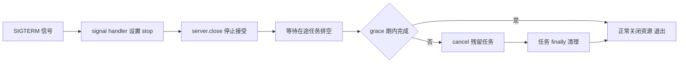

---

### Q603 · fire-and-forget 的 GC 陷阱:任务引用必须持有

> 难度:★★★☆ | 标签:Task, GC, 生命周期

**问**:`asyncio.create_task(coro())` 不接收返回值会怎样?官方文档为什么警告这一点?

**答**:事件循环只通过弱引用(以及调度中的临时引用)持有 Task,如果没有任何强引用,GC 可能在任务执行中途把它回收,协程"人间蒸发",异常也无人收割——文档明确要求保存 create_task 的返回值。工程模式:维护一个 `set` 存后台任务,任务完成回调里 `tasks.discard(t)` 自动清理;或集中到一个 TaskManager 统一 await/cancel。另外"没引用但侥幸跑完"的行为依赖 GC 时机,所以这个 bug 表现是偶发的,极难排查——评审时 fire-and-forget 必须有引用或有注释说明。

```python
# file: code/02_并发与网络工程/q603_task_ref.py
import asyncio
import gc
import weakref

log: list = []


async def background_job() -> None:
    await asyncio.sleep(0.05)
    log.append("job-done")  # 如果 Task 被 GC, 这行永远不会执行


async def main() -> None:
    # 陷阱: 创建后立刻丢弃唯一引用
    weak = weakref.ref(asyncio.create_task(background_job()))
    gc.collect()  # 触发一轮回收, 观察无强引用任务的命运
    alive = weak() is not None
    await asyncio.sleep(0.1)
    print(f"无引用任务: 存活={alive}, 日志={log}")
    print("(能否侥幸跑完取决于 GC 时机与 await 对象的引用链, 不能依赖 —— 这正是文档警告的原因)")

    # 正确姿势: 引用集合 + done callback 自清理
    bg_tasks: set = set()
    for i in range(3):
        t = asyncio.create_task(background_job())
        bg_tasks.add(t)
        t.add_done_callback(bg_tasks.discard)
    await asyncio.sleep(0.1)
    print(f"受保护任务: 完成 {len(log)} 个, 集合剩 {len(bg_tasks)} 个已自动清理")
    assert log.count("job-done") >= 3


asyncio.run(main())
```

**追问**:1) gather 里的任务需要额外持引用吗?——gather 内部会持有,但 gather 本身要是没人 await 也一样有整个 Future 被回收的问题;规则是"任何并发执行的东西都要有归属"。2) 持引用的工程模式?——模块级/类级任务集合 + done 回调自删(discard);asyncio.all_tasks() 巡检;TaskGroup 的树形归属(Q589);fire-and-forget 三宗罪(Q603 正文):不可取消、异常无人取、内存滞留。3) 与取消的关系?——持有的集合要在 shutdown 时统一 cancel 并 gather(return_exceptions=True);引用持有让 cancel 有对象可找。4) 生产陷阱?——create_task 后不存引用(运行中被 GC);任务集合忘记清理(完成不 discard 泄漏);异常处理器未配(Q1561)。

---

### Q604 · ExceptionGroup 与 except*:并发异常的聚合表达

> 难度:★★★☆ | 标签:ExceptionGroup, except star, TaskGroup

**问**:Python 3.11 的 ExceptionGroup 解决什么问题?except* 和普通 except 有什么区别?

**答**:并发场景下一个操作可能产生多个异常(3 个子任务各自失败),传统异常模型一次只能抛一个,信息全丢。ExceptionGroup 把多个异常打包,except* 可以按类型拆分捕获:每个 except* 分支拿到匹配类型的子组,且一个 try 可以有多个 except* 各自匹配。与 except 的区别:except* 会遍历组内所有异常分别匹配(可能有多个分支都触发);匹配的是组内元素的类型;重新抛出未捕获的部分。TaskGroup、asyncio.gather(return_exceptions=True 后手工检查)、anyio 都用它承载"批量失败"。注意 ExceptionGroup/`except*` 是 3.11+ 语法级特性,3.9 连解析都过不了,demo 用 exec 按需编译,低版本打印提示并用 gather(return_exceptions=True) 等价演示。

```python
# file: code/02_并发与网络工程/q604_exception_group.py
import asyncio
import sys

# ExceptionGroup/except* 是 3.11+ 语法级特性, 放字符串按需编译
DEMO_311 = '''
async def worker(name: str, delay: float, exc: Exception | None) -> str:
    await asyncio.sleep(delay)
    if exc:
        raise exc
    return f"{name}-ok"


async def main() -> None:
    try:
        async with asyncio.TaskGroup() as tg:
            tg.create_task(worker("db", 0.05, ValueError("db 连接失败")))
            tg.create_task(worker("cache", 0.06, TimeoutError("cache 超时")))
            tg.create_task(worker("api", 0.07, ValueError("api 500")))
    except* ValueError as eg:
        print(f"ValueError 子组 ({len(eg.exceptions)} 个):",
              [str(e) for e in eg.exceptions])
    except* TimeoutError as eg:
        print("TimeoutError 子组:", [str(e) for e in eg.exceptions])

    print("三个失败都被独立捕获, 没有信息丢失")
'''


async def main_compat() -> None:
    """3.11 以下等价演示: gather(return_exceptions=True) 收集全部异常。"""
    from typing import Optional

    async def worker(name: str, delay: float, exc: Optional[Exception]) -> str:
        await asyncio.sleep(delay)
        if exc:
            raise exc
        return f"{name}-ok"

    results = await asyncio.gather(
        worker("db", 0.05, ValueError("db 连接失败")),
        worker("cache", 0.06, TimeoutError("cache 超时")),
        worker("api", 0.07, ValueError("api 500")),
        return_exceptions=True,
    )
    errors = [r for r in results if isinstance(r, Exception)]
    print(f"等价演示收集到 {len(errors)} 个异常:", [str(e) for e in errors])
    print("按类型子组拆分捕获要等 3.11+ 的 except*")


if __name__ == "__main__":
    if sys.version_info >= (3, 11):
        exec(compile(DEMO_311, "<exception_group_311>", "exec"), globals())
        asyncio.run(main())  # noqa: F821  由 DEMO_311 动态定义
    else:
        print(
            f"ExceptionGroup/except* 需要 Python 3.11+, "
            f"当前 {sys.version_info.major}.{sys.version_info.minor}, "
            f"演示跳过, 改用 gather(return_exceptions=True) 等价演示"
        )
        asyncio.run(main_compat())
```

**追问**:1) raise ExceptionGroup 里嵌套子组合法吗?——合法,组可以嵌套(except* 匹配会递归下钻),这正是"扇出再扇出"的并发树表达失败时的自然结构。2) TaskGroup 与 gather 的选择?——TaskGroup:失败即取消兄弟、聚合抛出(结构化并发默认);gather(return_exceptions=True):全部跑完按序返回、不取消;按「失败传播语义」选(Q589)。3) except* 的工程要点?——多分支独立匹配、嵌套组递归下钻(Q469);分支内 break/continue/return 禁用;低版本 SyntaxError 要版本门控。4) 生产陷阱?——把 ExceptionGroup 当单异常记日志丢子异常;except Exception 兜不到 BaseExceptionGroup(含取消);gather 与 TaskGroup 混用语义混乱。

---

### Q605 · 异步压测:并发爬坡与延迟分位数

> 难度:★★★☆ | 标签:压测, p99, asyncio

**问**:怎么给一个 TCP/HTTP 服务写压测工具?除了 QPS 还必须看什么?

**答**:核心是受控并发:固定并发窗口(Semaphore)而非无限并发,统计每个请求的端到端延迟,输出 p50/p95/p99/max 和 QPS。只看 QPS 会被平均数骗——p99 飙高说明有长尾(可能 GC、锁竞争、连接池排队),对 SLA 才是关键。专业压测还要:预热期数据丢弃、爬坡(逐步加并发找拐点)、记录错误率、压测机自身不能成为瓶颈(asyncio 单机打几万并发没问题)。结论表述:"500 并发下 QPS 8000,p99 45ms,错误率 0"这种三元组才有意义。

```python
# file: code/02_并发与网络工程/q605_async_bench.py
import asyncio
import statistics
import time


async def handle(reader: asyncio.StreamReader, writer: asyncio.StreamWriter) -> None:
    try:
        data = await reader.read(100)
        await asyncio.sleep(0.02)  # 模拟后端处理 20ms
        writer.write(data)
        await writer.drain()
    finally:
        writer.close()
        try:
            await writer.wait_closed()
        except Exception:
            pass


async def worker(port: int, sem: asyncio.Semaphore, latencies: list) -> None:
    async with sem:  # 并发窗口
        t0 = time.perf_counter()
        r, w = await asyncio.open_connection("127.0.0.1", port)
        w.write(b"ping")
        await w.drain()
        await r.read(100)
        w.close()
        await w.wait_closed()
        latencies.append(time.perf_counter() - t0)


async def bench(port: int, concurrency: int, total: int) -> None:
    latencies: list = []
    sem = asyncio.Semaphore(concurrency)
    t0 = time.perf_counter()
    await asyncio.gather(*[worker(port, sem, latencies) for _ in range(total)])
    dt = time.perf_counter() - t0
    latencies.sort()
    n = len(latencies)
    print(f"并发={concurrency:>3} QPS={total / dt:7.0f} "
          f"p50={latencies[n // 2] * 1000:5.1f}ms "
          f"p95={latencies[int(n * 0.95)] * 1000:5.1f}ms "
          f"p99={latencies[int(n * 0.99)] * 1000:5.1f}ms")


async def main() -> None:
    server = await asyncio.start_server(handle, "127.0.0.1", 0)
    port = server.sockets[0].getsockname()[1]

    # 爬坡: 逐步加并发, 观察延迟拐点。
    # 规模注意: 每个请求都完整建连/断连, 本机连接 churn 开销大,
    # total 控制在 200、并发取两档, 保证 25s 内跑完
    for conc in (10, 50):
        lats: list = []
        await asyncio.gather(*[worker(port, asyncio.Semaphore(conc), lats)
                               for _ in range(20)])  # 预热
        await bench(port, conc, total=200)

    server.close()
    await server.wait_closed()


asyncio.run(main())
```

**追问**:1) 压测时被测服务的 CPU 还没满,QPS 就不涨了,瓶颈可能在哪?——压测机自身(默认 executor、fd 上限、临时端口耗尽)、连接建立握手、或被测服务的单锁串行点;用 netstat/ss 看连接状态,分机压测分离压测端与被测端。2) 压测方法论?——并发爬坡(阶梯找拐点)、延迟分位数(p99/p999 比均值重要)、瓶颈定位分层(客户端→网络→LB→服务→下游);压测环境与生产形态一致。3) 分位数工程?——HdrHistogram/桶直方图;尾部延迟与 GC/锁抖动的关联分析;饱和策略观察(Q564)。4) 生产陷阱?——单机压测自己打自己;只看均值;压测期间改代码;用 sync 客户端线程数不够。

---

### Q606 · 竞态复现方法论:故障注入与窗口放大

> 难度:★★★★ | 标签:竞态, 故障注入, 测试

**问**:一个只在生产偶现的并发 bug,回到开发环境怎么复现?

**答**:三板斧:一是窗口放大——在可疑的检查与动作之间注入 sleep(环境变量/测试钩子控制),把纳秒级窗口放大到毫秒级,让每轮碰撞必中;二是高轮次随机化——压测循环几千轮并随机化线程启动顺序(Barrier 集合点 + 随机延迟);三是参数扫描——调小 sys.setswitchinterval、增减线程数,覆盖不同的打断模式。复现的本质是把"概率性"变成"确定性":注入点选对了,bug 从偶现变必现,修复后还能当回归测试。要点:注入代码必须能被测试开关干净地移除,不能进生产路径。

```python
# file: code/02_并发与网络工程/q606_race_repro.py
import os
import threading
import time
from typing import Optional

# 故障注入开关: RACE_HOOK=1 时放大竞态窗口
HOOK = os.environ.get("RACE_HOOK") == "1"


def transfer(accounts: dict, src: str, dst: str, amount: int) -> bool:
    if accounts[src] >= amount:          # 检查
        if HOOK:
            time.sleep(0.001)            # 注入: 放大 check 与 act 之间的窗口
        accounts[src] -= amount          # 动作
        accounts[dst] += amount
        return True
    return False


def one_round(threads: int = 3) -> Optional[dict]:  # 3.9 需 Optional, dict | None 运行时 TypeError
    accounts = {"a": 100, "b": 0}
    ts = [
        threading.Thread(target=transfer, args=(accounts, "a", "b", 100))
        for _ in range(threads)
    ]
    # 随机延迟启动, 增加打断模式多样性
    for t in ts:
        t.start()
        time.sleep(0.0001 if not HOOK else 0)
    for t in ts:
        t.join()
    if accounts["a"] < 0 or accounts["b"] > 100:
        return accounts  # 不变量被破坏: 余额为负 = 复现超取
    return None


def stress(rounds: int = 300) -> tuple:
    for i in range(rounds):
        bad = one_round()
        if bad is not None:
            return i, bad
    return None, None


if __name__ == "__main__":
    print(f"注入开关: {HOOK}")
    round_no, accounts = stress()
    if round_no is None:
        print("未复现 (多跑几轮或开启 RACE_HOOK=1)")
    else:
        print(f"第 {round_no} 轮复现! 账户状态: {accounts} → 超取竞态实锤")
    print("修复方法: transfer 全程持锁, 消除 check 与 act 之间的窗口")
```

**追问**:1) 修复后怎么证明真的修好了?——保留注入开关跑同样的压测轮次,开关打开也不复现;再加一个加锁版本的长期回归用例,把复现脚本变成守护测试。2) 复现方法论的完整闭环?——现象→假设(数据窗口/时序)→注入放大(Q568 Barrier/慢操作)→稳定复现→修复→注入验证→回归测试;每步只改一个变量。3) 注入手段?——sleep 注入关键窗口、异常注入(失败路径)、网络延迟注入、时钟注入(Q1566);开关用配置控制,生产关闭。4) 生产陷阱?——修了不复现的(假设错了);注入开关进生产未关;复现脚本一次用后丢弃。

---

### Q607 · TSAN 思想:向量时钟检查 happens-before

> 难度:★★★★ | 标签:TSAN, happens-before, 形式化

**问**:ThreadSanitizer 的原理是什么?能不能在 Python 里用一个简化版分析锁的行为?

**答**:TSAN 的核心是 vector clock happens-before 分析:每个线程维护逻辑时钟向量,锁的释放"发布"时钟、获取"同步"时钟,两个内存访问若不满足 happens-before 且至少一个是写,就报数据竞争。这个思想完全可以在 Python 里做成离线分析器:程序运行时记录 (线程, 操作, 对象) 事件轨迹,事后重放时钟规则检查竞争。它比"压测"强在确定性:不需要真的并发碰撞,只要轨迹里存在竞争就会报。局限:只分析走过的路径(轨迹覆盖问题),且 Python 层大部分竞争被 GIL 遮掩,更适合分析"逻辑锁协议"是否正确。实现有两个易错点:事件的时间戳必须在事件发生时先递增再记快照;"未见过某线程"的时钟要用 -1 兜底而不是 0,否则 0>=0 会把完全未同步的访问误判成 happens-before,竞争全部漏报。另外注意:T2 持锁写、T1 却不持锁读,依然是竞争——锁只保护临界区内的访问,读侧不加锁照样违例。

```python
# file: code/02_并发与网络工程/q607_happens_before.py
"""极简 happens-before 检查器: 输入事件轨迹, 输出数据竞争。"""

Clock = dict[str, int]


def analyze(events: list[tuple[str, str, str]]) -> list[tuple]:
    vc: dict[str, Clock] = {}     # thread -> 向量时钟
    release_vc: dict[str, Clock] = {}  # lock -> 最近 release 发布的时钟
    last_access: dict[str, tuple] = {}  # var -> (thread, 时钟快照, 是否写)
    races = []

    for thread, op, obj in events:
        v = vc.setdefault(thread, {thread: 0})
        v[thread] += 1  # 事件发生先走一格时钟, 访问快照必须携带事件时间戳
        if op == "acquire":
            if obj in release_vc:          # 与上次释放者建立同步
                for t, c in release_vc[obj].items():
                    v[t] = max(v.get(t, 0), c)
        elif op == "release":
            release_vc[obj] = dict(v)      # 发布当前时钟
        elif op in ("read", "write"):
            if obj in last_access:
                prev_t, prev_v, prev_w = last_access[obj]
                if prev_t != thread and (prev_w or op == "write"):
                    # prev 是否 happens-before 当前: 当前线程必须"见过"
                    # prev 的事件时间戳。未见过用 -1 兜底, 0 表示"见过 0 号
                    # 事件", 拿 0 兜底会把未同步误判成同步, 竞争全漏报。
                    hb = v.get(prev_t, -1) >= prev_v.get(prev_t, -1)
                    if not hb:
                        races.append((prev_t, prev_w, thread, op, obj))
            last_access[obj] = (thread, dict(v), op == "write")
    return races


def show(label: str, events: list) -> None:
    races = analyze(events)
    print(f"--- {label}: {len(races)} 个数据竞争")
    for t1, w1, t2, op2, obj in races:
        print(f"  {t1} 的写 与 {t2} 的 {op2} 竞争同一变量 {obj}")


if __name__ == "__main__":
    # 有竞争轨迹: T1 写 x 后 T2 无同步写 x
    racy = [
        ("T1", "write", "x"),
        ("T2", "write", "x"),
        ("T1", "read", "x"),
    ]
    show("无锁轨迹", racy)

    # 无竞争轨迹: 每次访问都在临界区内(T1 的读也要持锁, 不持锁照样竞争)
    safe = [
        ("T1", "acquire", "L"), ("T1", "write", "x"), ("T1", "release", "L"),
        ("T2", "acquire", "L"), ("T2", "write", "x"), ("T2", "release", "L"),
        ("T1", "acquire", "L"), ("T1", "read", "x"), ("T1", "release", "L"),
    ]
    show("加锁轨迹", safe)
    assert len(analyze(safe)) == 0 and len(analyze(racy)) > 0
    print("向量时钟判定与直觉一致")
```

**追问**:1) 为什么 TSAN 用 shadow memory 而 Python 版只需要轨迹?——TSAN 要在线拦截每次访存,需要 O(内存/8) 的影子表做到近零开销;离线分析没有性能约束,轨迹重放即可,代价是丢掉未执行路径。2) 向量时钟的原理?——每线程本地计数器+发送携带时钟,接收取 max 并自增;事件对比较可得 happens-before;无偏序的并发访问就是候选竞态。3) 工程落地?——轨迹插桩只在测试/压测期开;候选竞态要人工确认(锁覆盖审查);与不变量压测(Q608)互为补充。4) 生产陷阱?——轨迹全量收集性能崩;只信工具不读锁协议;误报当真修(路径依赖未确认)。

---

### Q608 · 不变量压测:并发正确性的守护测试

> 难度:★★★☆ | 标签:不变量, 压测, 正确性

**问**:怎么为一段并发代码设计"跑不坏"的测试?

**答**:核心是找系统的不变量——无论怎么并发都必须成立的性质,然后高强度压测断言它:转账系统"总额守恒"、缓存"读到的值要么旧要么新不撕裂"、限流器"任一秒放行数不超阈值"。写法:多线程随机操作 + 定期快照断言 + 结束时终检,持续几十秒抓小概率;配合 Q606 的注入钩子放大窗口。不变量测试与单元测试互补:单测验证单步逻辑,不变量测试验证"组合行为下系统仍守恒"。选对不变量是关键——它应该业务可解释,而不是实现细节。

```python
# file: code/02_并发与网络工程/q608_invariant_stress.py
import random
import threading
import time


def run_system(locked: bool, seconds: float = 0.5) -> int:
    accounts = {"a": 100000, "b": 100000}
    lock = threading.Lock()
    violations = [0]

    def check_invariant() -> None:
        while not stop.is_set():
            if locked:
                with lock:
                    total = accounts["a"] + accounts["b"]
            else:
                total = accounts["a"] + accounts["b"]  # 无锁读可能撕裂
            if total != 200000:
                violations[0] += 1
            time.sleep(0.001)

    def mover() -> None:
        rng = random.Random(threading.get_ident())
        while not stop.is_set():
            amount = rng.randint(1, 50)
            if locked:
                with lock:
                    accounts["a"] -= amount
                    accounts["b"] += amount
            else:
                # 无锁: 读-改-写被 GIL 切换打散, 总额读数漂移
                a = accounts["a"]
                if a >= amount:
                    accounts["a"] = a - amount
                    accounts["b"] += amount

    stop = threading.Event()
    checker = threading.Thread(target=check_invariant)
    movers = [threading.Thread(target=mover) for _ in range(4)]
    checker.start()
    for m in movers:
        m.start()
    time.sleep(seconds)
    stop.set()
    checker.join()
    for m in movers:
        m.join()
    return violations[0]


if __name__ == "__main__":
    bad = run_system(locked=False)
    good = run_system(locked=True)
    print(f"无锁版本: 检测到 {bad} 次不变量破坏")
    print(f"加锁版本: 检测到 {good} 次不变量破坏")
    assert good == 0
```

**追问**:1) 不变量测试通过了能宣布线程安全吗?——不能宣布,只能增强信心;它受限于轮次与路径覆盖,配合代码审查(锁协议)与 TSAN 式轨迹分析才构成完整证据链。2) 不变量的选取?——业务不变量(余额非负、唯一 id)、结构不变量(树高、链表长度)、统计不变量(总量守恒);断言失败要留下失败现场(Q568)。3) 与故障注入的组合?——随机延迟+并发压测让不变量频繁受检;失败样本自动留存;轮次与并发度按 CI 时长权衡。4) 生产陷阱?——不变量太弱(恒真);压测 flaky 未定位就重跑;证据链只有压测一层。

---

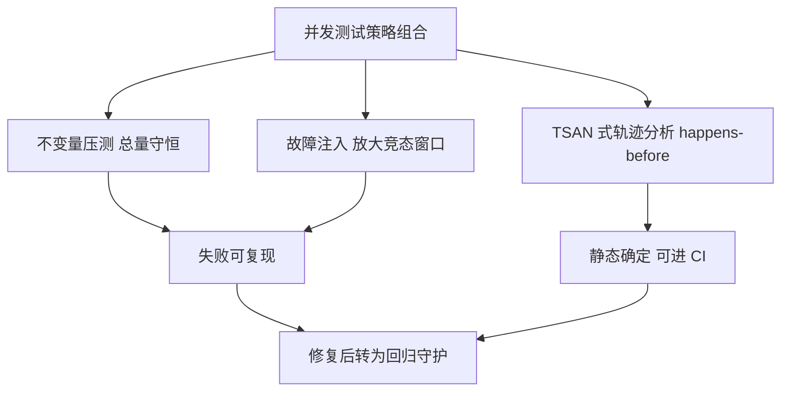

---

### Q609 · asyncio 调试模式:揪出慢回调与未 await

> 难度:★★★☆ | 标签:asyncio debug, 诊断, 慢回调

**问**:async 服务时不时卡一下,怎么用 asyncio 自带的调试设施定位?

**答**:三件套:1) `loop.set_debug(True)`(或环境变量 PYTHONASYNCIODEBUG=1)开启:未 await 的协程、跨线程误用、非阻塞 fd 上跑阻塞调用等都会告警;2) 慢回调检测:`loop.slow_callback_duration = 0.1` 后,任何超过 100ms 的回调(包括忘了 await 的阻塞调用)会打日志并给出创建时的 traceback——这依赖 debug 模式记录协程创建点;3) `loop.get_debug()` + logging 配置让告警可见。配合 `asyncio.all_tasks()` 在卡顿瞬间打印所有任务栈,基本能锁定卡源头。

```python
# file: code/02_并发与网络工程/q609_asyncio_debug.py
import asyncio
import logging
import time

logging.basicConfig(level=logging.WARNING, format="%(levelname)s %(message)s")


async def suspicious_task() -> None:
    time.sleep(0.3)  # 错误: async 函数里的阻塞调用


async def fast_task() -> None:
    await asyncio.sleep(0.01)


async def main() -> None:
    loop = asyncio.get_running_loop()
    loop.set_debug(True)                 # 打开 asyncio 调试
    loop.slow_callback_duration = 0.1    # 超过 100ms 的回调告警

    # 未 await 的协程: debug 模式会记录创建点并告警
    asyncio.ensure_future(fast_task())   # 有引用? ensure_future 返回值被丢弃 — 演示告警
    coro = fast_task()                   # 创建但从未 await
    del coro

    await suspicious_task()  # 触发 "Executing <Task ...> took 0.3s" 告警
    await fast_task()

    # 卡顿现场排查: 打印所有任务栈
    for t in asyncio.all_tasks():
        if t is not asyncio.current_task():
            print(f"任务 {t.get_name()} 状态 {t._state}")
    print("调试输出应包含 Executing ... took 与 never awaited 告警")


asyncio.run(main())
```

**追问**:1) 生产环境开 debug 模式安全吗?——有额外内存与 CPU 开销(记录协程创建栈),建议灰度/压测环境开,或只在收到卡顿告警时对单个实例临时开启。2) debug 模式检测的四类问题?——回调超 slow_callback_duration(默认 0.1s)、未 await 协程、callback 未从 yield、非线程安全 API 误用(跨线程);loop.slow_callback_duration 可调。3) 诊断工作流?——告警→单实例开 debug→复现→看日志定位慢回调/未 await→修复→关;与 py-spy/aiomonitor 配合(Q475/571)。4) 生产陷阱?——生产常开(成本);debug 日志被日志级别吞掉;只修症状不找「为什么回调慢」。

---

### Q610 · uvloop 为什么快:源码级对比

> 难度:★★★★ | 标签:uvloop, libuv, 性能

**问**:uvloop 比默认事件循环快 2-4 倍,快在哪些具体机制上?

**答**:四点:1) 用 Cython + libuv 把热路径(回调分发、fd 事件)编译成 C,省掉 Python 层每轮循环的解释开销;2) 数据结构更高效——定时器堆、句柄队列都是 C 结构,内存局部性好;3) 系统调用批处理:一次 epoll_wait 返回的事件批量分发,减少 syscall 次数与 Python↔C 边界穿越;4) 省掉了纯 Python 实现里的防御性检查与 logging 钩子。API 完全兼容(asyncio 的策略接口),`uvloop.install()` 一行切换。注意:Python 3.12 的 asyncio 也吸收了部分优化(C 加速的 Task/事件循环),差距在收窄。

```python
# file: code/02_并发与网络工程/q610_uvloop_bench.py
import asyncio
import time

try:
    import uvloop  # 第三方, 演示环境没有则退化为纯 asyncio 对比
    HAVE_UVLOOP = True
except ImportError:
    HAVE_UVLOOP = False

N = 10000   # 调度量级适中, 保证低配/高负载机器也能在实跑超时预算内跑完


def micro_bench() -> float:
    """测事件循环调度开销: N 个立即到期回调。"""
    loop = asyncio.new_event_loop()
    t0 = time.perf_counter()

    async def run() -> None:
        done = loop.create_future()
        counter = [0]

        def tick():
            counter[0] += 1
            if counter[0] >= N:
                done.set_result(None)
                return
            loop.call_soon(tick)

        loop.call_soon(tick)
        await done

    loop.run_until_complete(run())
    dt = time.perf_counter() - t0
    loop.close()
    return dt


async def http_like_bench() -> float:
    """测 IO 路径: 本机回环 N 次小请求。"""

    async def handle(r, w):
        try:
            await r.read(64)
            w.write(b"ok")
            await w.drain()
        finally:
            w.close()
            try:
                await w.wait_closed()
            except Exception:
                pass

    server = await asyncio.start_server(handle, "127.0.0.1", 0)
    port = server.sockets[0].getsockname()[1]
    t0 = time.perf_counter()

    sem = asyncio.Semaphore(64)   # 限流并发连接, 避免 500 个 connect 同时打满 listen backlog

    async def one():
        async with sem:
            r, w = await asyncio.open_connection("127.0.0.1", port)
            w.write(b"x")
            await w.drain()
            await r.read(10)
            w.close()
            try:
                await w.wait_closed()
            except Exception:
                pass

    await asyncio.gather(*[one() for _ in range(500)])
    dt = time.perf_counter() - t0
    server.close()
    await server.wait_closed()
    return dt


if __name__ == "__main__":
    if HAVE_UVLOOP:
        uvloop.install()
        print("uvloop 已启用:", type(asyncio.new_event_loop()).__name__)
    else:
        print("未安装 uvloop, 展示默认循环基线 (安装后重跑对比)")
    print(f"回调调度 {N} 次: {micro_bench():.3f}s")
    print(f"回环 IO 500 次: {asyncio.run(http_like_bench()):.3f}s")  # 协程必须跑进事件循环再计时
```

**追问**:1) uvloop 有什么不兼容代价?——它是独立实现,极端依赖 asyncio 私有 API 的库可能踩差异;调试工具(如基于循环内部结构的)需要适配;Windows 不支持 libuv 移植受限。2) 快的来源?——libuv 的 C 实现事件循环、更少 Python 层调度、更紧凑的 handle 结构;3.11 起 CPython 自身优化缩小差距(特化+内联缓存);基准要按「IO 模式」分场景。3) 采用策略?——pip 依赖 + asyncio.set_event_loop_policy(uvloop.EventLoopPolicy);灰度验证兼容性;监控与调试工具先适配。4) 生产陷阱?——预期「换 uvloop 立即快 10 倍」(瓶颈在业务的场景无感);私有 API 依赖库崩;Windows 部署缺失兜底。

---

### Q611 · 双缓冲与原子引用交换:读者的无锁读

> 难度:★★★☆ | 标签:双缓冲, copy-on-write, 无锁读

**问**:配置中心这种"写极少、读极多"的共享数据,怎么做才能读者零锁?

**答**:双缓冲(快照交换)模式:写者构建一个全新的不可变快照(完整副本),最后一步用单个赋值原子地替换引用;读者每次只读引用,拿到的是某个完整版本的快照,永远不会看到半成品。Python 里不可变对象(tuple/frozenset/浅拷贝 dict 的代理)保证快照内容不被篡改,赋值原子性由 GIL/引用语义保证,读者侧完全无锁。写者之间仍需一把锁串行化,避免丢更新。代价是写时的复制开销和读者拿到的可能是旧版本——对配置场景恰好正确。

```python
# file: code/02_并发与网络工程/q611_double_buffer.py
import threading
import time

store = {"snapshot": tuple()}  # 只做原子引用替换
writer_lock = threading.Lock()  # 仅写者互斥
inconsistencies = [0]


def writer() -> None:
    for i in range(200):
        new_snapshot = tuple(range(i % 64))  # 构建完整新版本
        with writer_lock:
            store["snapshot"] = new_snapshot  # 原子发布
        time.sleep(0.001)


def reader(idx: int) -> None:
    for _ in range(2000):
        snap = store["snapshot"]  # 无锁读引用
        # 不可变快照: 一致性由构造完整性保证
        if len(snap) > 1 and list(snap) != list(range(len(snap))):
            inconsistencies[0] += 1  # 理论上不可能
        time.sleep(0)


if __name__ == "__main__":
    ts = [threading.Thread(target=writer)]
    ts += [threading.Thread(target=reader, args=(i,)) for i in range(6)]
    for t in ts:
        t.start()
    for t in ts:
        t.join()
    print(f"读者读到不一致快照的次数: {inconsistencies[0]} (期望 0)")
    print(f"最终版本大小: {len(store['snapshot'])}")
```

**追问**:1) 这个模式和 RCU 有什么关系?——RCU(Read-Copy-Update)是同思想的内核级实现,额外解决"旧版本何时安全释放"(宽限期);Python 靠 GC 引用计数自动处理,所以实现更简单。2) 双缓冲的完整契约?——读端:拿快照(原子引用读)后全程无锁;写端:构建新版本 + 原子替换引用;发布顺序:先构建完再替换(写时复制);更新频率高时复制成本主导,要改增量版本。3) Python 层的原子性?——单属性赋值是原子(GIL);跨属性多字段要用不可变快照对象(tuple/dataclass frozen)一次替换。4) 生产陷阱?——半更新状态(多字段分次赋值);读者持有快照太久(旧数据语义);快照构建成本被低估。

---

### Q612 · 无锁计数:per-thread 分片聚合

> 难度:★★★☆ | 标签:无锁, 计数器, 性能

**问**:高频指标计数(每秒百万次)怎么做才不成为锁瓶颈?

**答**:per-thread 缓冲聚合:每个线程只写自己的本地计数(threading.local,无任何竞争),读取方聚合所有分片求和——写路径零锁零竞争,读路径 O(线程数)。这正是 metrics 库(Prometheus client)和数据库统计的经典做法。对比实验里,全局单锁版本随线程数线性恶化,分片版本基本平坦。注意点:分片发现需要注册表(新线程首次写时登记);读到的总和允许毫秒级滞后(弱一致),监控场景完全可接受。

```python
# file: code/02_并发与网络工程/q612_per_thread_counter.py
import threading
import time


class PerThreadCounter:
    def __init__(self) -> None:
        self._local = threading.local()
        self._shards: list = []
        self._reg = threading.Lock()  # 只在首次注册时竞争

    def incr(self) -> None:
        shard = getattr(self._local, "shard", None)
        if shard is None:
            shard = self._local.shard = [0]
            with self._reg:
                self._shards.append(shard)
        shard[0] += 1  # 本地计数: 无锁无竞争

    def total(self) -> int:
        return sum(s[0] for s in self._shards)  # 弱一致快照


class LockedCounter:
    def __init__(self) -> None:
        self._lock = threading.Lock()
        self._n = 0

    def incr(self) -> None:
        with self._lock:
            self._n += 1

    def total(self) -> int:
        return self._n


def bench(counter, n_threads=4, n_iter=300000) -> float:
    ts = [
        threading.Thread(
            target=lambda: [counter.incr() for _ in range(n_iter)]
        )
        for _ in range(n_threads)
    ]
    t0 = time.perf_counter()
    for t in ts:
        t.start()
    for t in ts:
        t.join()
    return time.perf_counter() - t0


if __name__ == "__main__":
    p, l = PerThreadCounter(), LockedCounter()
    tp = bench(p)
    tl = bench(l)
    print(f"per-thread: {tp:.3f}s, 单锁: {tl:.3f}s, 提速约 {tl / tp:.1f}x")
    print("计数校验:", p.total(), l.total(), "(期望均 1200000)")
    assert p.total() == l.total() == 4 * 300000
```

**追问**:1) 本地分片会不会丢数据?——线程活着就不会;线程退出前不 flush 的话其分片仍在 _shards 里可被聚合,除非你按线程生命周期清理,这时的取舍要写进文档。2) per-thread 分片的实现?——threading.local 或按 thread ident 的 dict;聚合时遍历分片求和(读端加锁或快照);与全局锁计数对比:写端零竞争、读端聚合 O(分片数)。3) 与 Q612 场景的适配?——高频写(计数、指标)收益大;需要强一致单值时不用;聚合的「瞬间一致性」语义要文档化。4) 生产陷阱?——分片随线程创建无限增长(线程池固定则可控);聚合与写并发时轻微误差;监控拿「聚合值」当「实时值」。

---

### Q613 · 支持优先级的任务队列:PriorityQueue 防比较坑

> 难度:★★☆ | 标签:优先级队列, 线程池, heapq

**问**:线程池想让"VIP 任务插队",PriorityQueue 直接放函数为什么不行?

**答**:PriorityQueue 内部用堆比较元素,如果元素是 (priority, fn),两个 fn 无法比较会 TypeError;标准解法是三元组 (priority, seq, item),seq 是单调递增序号,既打破比较又提供同优先级 FIFO。进阶:支持优先级抢占的"工作 stealing"或动态优先级(等待越久优先级越高,防饿死 VIP 之外的普通任务)。注意优先级队列解决的是"未入队的先来后到",不能抢占正在执行的任务——要抢占只能协作式(检查取消标志),所以 demo 里 VIP 只能插到"还在队列里"的任务之前。另外关停顺序是高频竞态点:必须先 `q.join()` 排空、再 set 停止标志;反过来 worker 会留下未处理任务直接退出,`q.join()` 等不到 task_done 永久阻塞。

```python
# file: code/02_并发与网络工程/q613_priority_pool.py
import itertools
import queue
import threading
import time

results: list = []
executed_order: list = []


class PriorityWorkerPool:
    def __init__(self, workers: int = 2) -> None:
        self._q: queue.PriorityQueue = queue.PriorityQueue()
        self._seq = itertools.count()
        self._stop = threading.Event()
        self._workers = [
            threading.Thread(target=self._run, daemon=True) for _ in range(workers)
        ]
        for w in self._workers:
            w.start()

    def submit(self, priority: int, name: str, fn) -> None:
        self._q.put((priority, next(self._seq), name, fn))  # seq 防函数比较

    def _run(self) -> None:
        while not self._stop.is_set():
            try:
                prio, seq, name, fn = self._q.get(timeout=0.5)
            except queue.Empty:
                continue
            executed_order.append(name)
            fn()
            self._q.task_done()

    def shutdown(self) -> None:
        # 先排空队列再停机: 若先 set stop, worker 可能在两次 get 之间
        # 直接退出, 队列里留下未处理任务, join() 永久阻塞(经典关停竞态)
        self._q.join()
        self._stop.set()


def job(name: str) -> None:
    time.sleep(0.05)
    results.append(name)


if __name__ == "__main__":
    pool = PriorityWorkerPool(workers=1)  # 单 worker 顺序清晰
    # 先提交低优先级, 再提交 VIP: VIP 只能插队"还在队列里"的任务
    for i in range(5):
        pool.submit(priority=10, name=f"normal-{i}", fn=lambda n=f"normal-{i}": job(n))
    # 等 worker 取走第一个任务(取走即脱离队列, VIP 抢不过它)
    deadline = time.monotonic() + 2
    while len(executed_order) < 1 and time.monotonic() < deadline:
        time.sleep(0.001)
    pool.submit(priority=1, name="vip", fn=lambda: job("vip"))
    pool.shutdown()
    print("执行顺序:", executed_order)
    assert executed_order[0] == "normal-0", "已被 worker 取走的任务无法被抢占"
    assert executed_order[1] == "vip", "VIP 应插队到队列中剩余任务之前"
    assert executed_order[2:] == [f"normal-{i}" for i in range(1, 5)]
    print("PriorityQueue 语义验证通过")
```

**追问**:1) 怎么防止低优先级任务被永久饿死?——老化(aging):入队时间越久优先级值越小,定期给等待任务提权;或按比例保留配额(每 N 个 VIP 插 1 个普通)。2) 防比较坑的完整姿势?——(priority, count, item) 三元组:count 自增保证 FIFO 平局且挡住 dict 不可比(Q495/2095);item 不可比时 count 必须先拦住;PriorityQueue 线程安全版供生产者消费者。3) 优先级反转?——低优持锁高优等;缓解:锁内不做重活、优先级继承(内核级)或拆锁;Python 层主要是「锁内任务拆小」。4) 生产陷阱?——元组第二元素不可比 TypeError;动态改已入队优先级(堆不变式破坏,Q495);饿死无监控。

---

### Q614 · 可排空的工作池:优雅关闭的通用形态

> 难度:★★★☆ | 标签:drain, 优雅关闭, 工作池

**问**:一个线程池要下线,但队列里还有几百个任务,怎么做到"能排的排完、排不完的明确丢弃"?

**答**:shutdown 分三态:1) 停止 intake——接受标志置 false,新的 submit 立刻失败,调用方能感知;2) 排空——在 drain_timeout 内等队列清空(workers 继续消费),定期报告进度;3) 收尾——超时则统计剩余并清空(明确丢弃,记日志),然后给每个 worker 发毒丸(None)令其退出并 join。关键工程价值是"丢弃要有数":宁可显式丢弃并报警,也不能静默卡死或丢得不明不白。这个形态适用于任何"生产者-队列-消费者"结构的下线。

```python
# file: code/02_并发与网络工程/q614_drain_pool.py
import queue
import threading
import time


class DrainablePool:
    def __init__(self, workers: int = 3) -> None:
        self._q: queue.Queue = queue.Queue()
        self._accepting = True
        self._processed = 0
        self._lock = threading.Lock()
        self._ws = [
            threading.Thread(target=self._run, daemon=True) for _ in range(workers)
        ]
        for w in self._ws:
            w.start()

    def submit(self, fn) -> None:
        if not self._accepting:
            raise RuntimeError("pool closed: 拒绝新任务")
        self._q.put(fn)

    def _run(self) -> None:
        while True:
            fn = self._q.get()
            if fn is None:  # 毒丸
                return
            fn()
            with self._lock:
                self._processed += 1

    def shutdown(self, drain_timeout: float = 0.5) -> dict:
        self._accepting = False
        deadline = time.monotonic() + drain_timeout
        while self._q.qsize() > 0 and time.monotonic() < deadline:
            time.sleep(0.02)
        dropped = 0
        while True:  # 清空剩余并计数
            try:
                self._q.get_nowait()
                dropped += 1
            except queue.Empty:
                break
        for _ in self._ws:
            self._q.put(None)
        for w in self._ws:
            w.join(timeout=2)
        return {"processed": self._processed, "dropped": dropped}


def job(i: int) -> None:
    time.sleep(0.01)


if __name__ == "__main__":
    pool = DrainablePool(workers=3)
    for i in range(300):
        pool.submit(lambda i=i: job(i))
    t0 = time.monotonic()
    stats = pool.shutdown(drain_timeout=0.4)
    print(f"完成 {stats['processed']}, 明确丢弃 {stats['dropped']}, "
          f"关闭耗时 {time.monotonic() - t0:.2f}s")
    assert stats["processed"] + stats["dropped"] == 300
```

**追问**:1) 排空时新任务不断进来永远排不完怎么办?——intake 已关就不会有新任务;若是外部生产者绕过 submit,排空逻辑要基于"队列水位连续 X 秒不再下降"的判断而不是单纯超时。2) 可排空工作池的契约?——submit 前检查 intake 标志;close() 关 intake;join() 等 queue.join(task_done);worker 收哨兵退出(Q1282);shut_down(timeout) 兜底。3) 与 ThreadPoolExecutor 的对照?——executor.shutdown(wait=True, cancel_futures=True) 内置此形态(Q614 正文);cancel 只清排队不杀在跑(Q564);理解手动版才能读懂库版。4) 生产陷阱?——先杀 worker 再排空;join 无超时卡死;哨兵数量与 worker 数不匹配(Q563 呼应)。

---

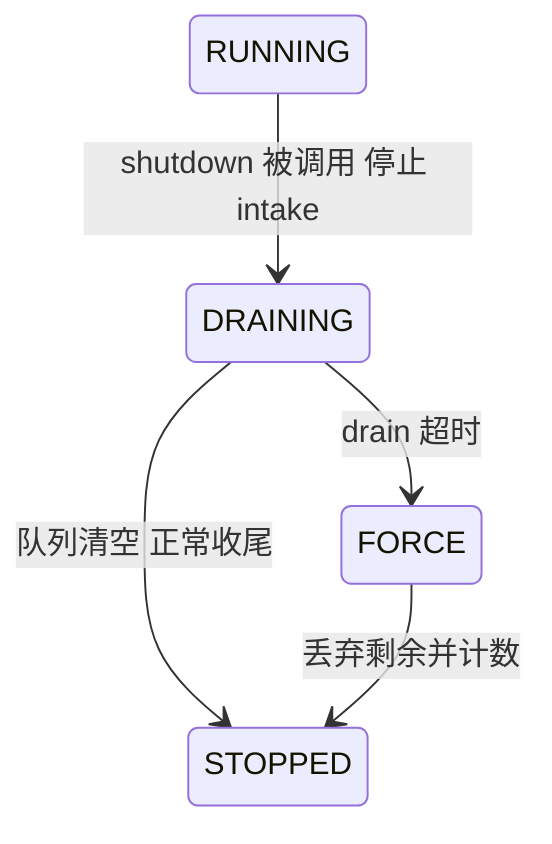

---

### Q615 · 并发代码评审清单:AST 写一个并发 linter

> 难度:★★★★ | 标签:code review, AST, 静态检查

**问**:review 并发代码时你按什么清单看?能不能把部分检查自动化?

**答**:人工清单:锁的粒度与临界区是否完整(check-then-act 有没有被切开)、锁顺序是否全局一致、await/sleep 是否混入错误位置、异常路径上锁是否释放、共享可变状态的归属是否清晰。可自动化部分用 AST 检查:async 函数里出现 time.sleep、acquire 与 release 不配对、裸 except 吞掉 CancelledError 等,做成 CI linter 拦截在合并前。自动检查的价值不是替代审查,而是把"低级但高危"的模式挡在人工审查之前,让审查聚焦协议设计。

```python
# file: code/02_并发与网络工程/q615_concurrency_lint.py
import ast

SAMPLE = '''
import asyncio
import threading
import time

lock = threading.Lock()

async def bad_sleep():
    time.sleep(1)          # L1: async 内阻塞
    async with lock:       # L2: asyncio.Lock 与 threading.Lock 混用 (示例简化)
        pass

def unbalanced():
    lock.acquire()
    if True:
        return             # L3: acquire 后无 release
    lock.release()

def lock_pair():
    lock.acquire()
    try:
        pass
    finally:
        lock.release()
'''


def lint(source: str) -> list[str]:
    issues: list[str] = []
    tree = ast.parse(source)
    for node in ast.walk(tree):
        if isinstance(node, ast.AsyncFunctionDef):
            for sub in ast.walk(node):
                if isinstance(sub, ast.Call):
                    name = ast.unparse(sub.func)
                    if name == "time.sleep":
                        issues.append(
                            f"第 {sub.lineno} 行: async 函数 {node.name} 内调用 time.sleep 会阻塞事件循环, 应改用 await asyncio.sleep")
        if isinstance(node, ast.FunctionDef):
            acquires = sum(
                1 for n in ast.walk(node)
                if isinstance(n, ast.Call) and isinstance(n.func, ast.Attribute)
                and n.func.attr == "acquire"
            )
            releases = sum(
                1 for n in ast.walk(node)
                if isinstance(n, ast.Call) and isinstance(n.func, ast.Attribute)
                and n.func.attr == "release"
            )
            if acquires > releases and not any(
                isinstance(n, ast.Try) for n in ast.walk(node)
            ):
                issues.append(
                    f"第 {node.lineno} 行: 函数 {node.name} 中 acquire {acquires} 次但 release {releases} 次, 且无 try/finally 保护")
    return issues


if __name__ == "__main__":
    for msg in lint(SAMPLE):
        print("[lint]", msg)
    print("人工清单补充项: 锁顺序 / 临界区完整性 / CancelledError 不得吞掉")
```

**追问**:1) 为什么"裸 except 吞 CancelledError"值得进 linter?——async 任务里 `except Exception` 捕不到 CancelledError(它继承 BaseException)是对的,但 `except BaseException` 或裸 except 会吞取消,任务杀不死,这类模式静态可查,危害极大。2) 并发 linter 的检查面?——裸 except、time.sleep in async def、create_task 不持引用(启发式)、锁内 await、阻塞调用进循环;AST 检查的边界:跨文件调用链查不到,靠约定+评审(Q615 正文)。3) 规则的落地?——ruff 自定义规则或项目 lint(Q511);每条规则给修复建议;误报高的降为 warning。4) 生产陷阱?——linter 只查本文件漏 from-import 别名;规则太严被绕过;静态检查替代不了压测(Q608)。
