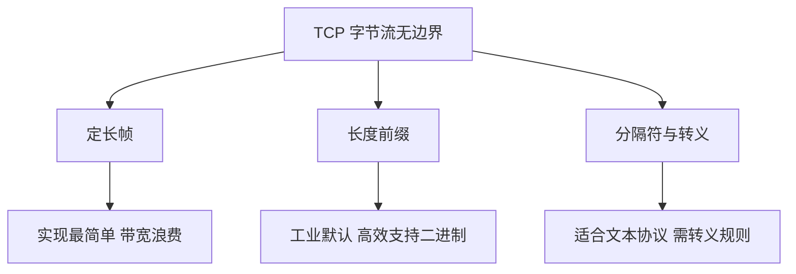
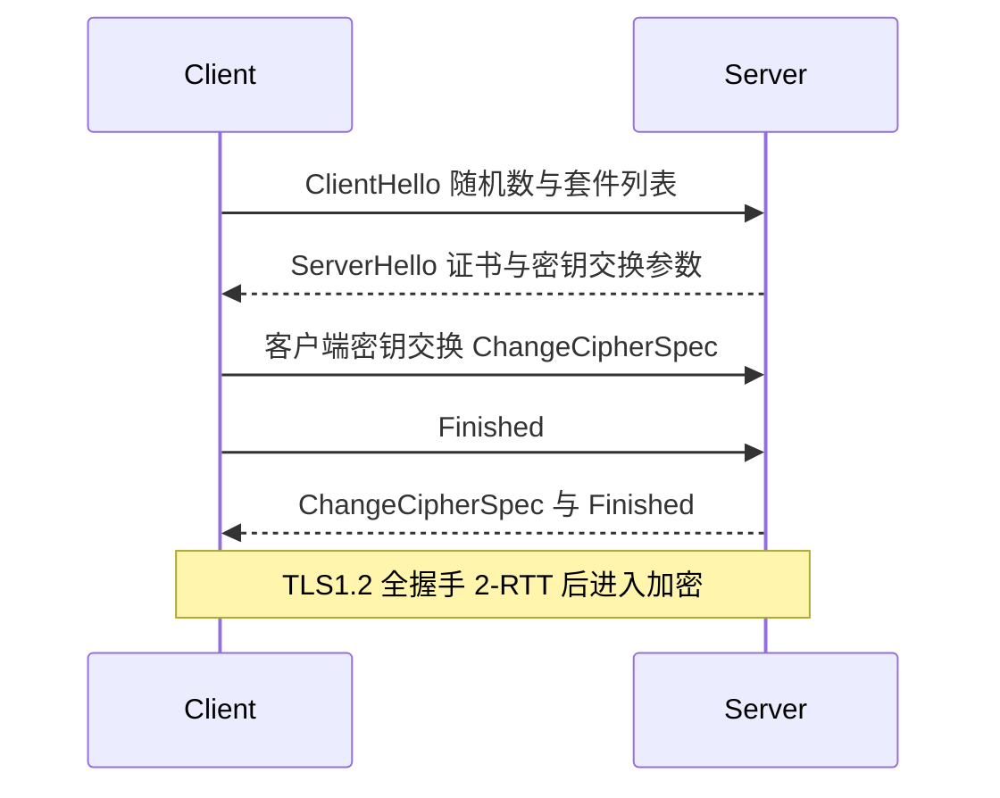
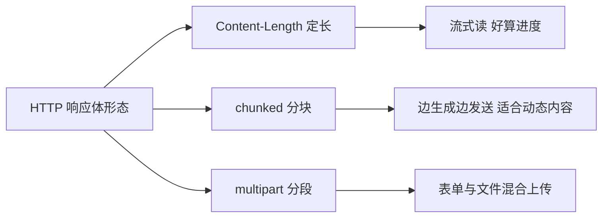
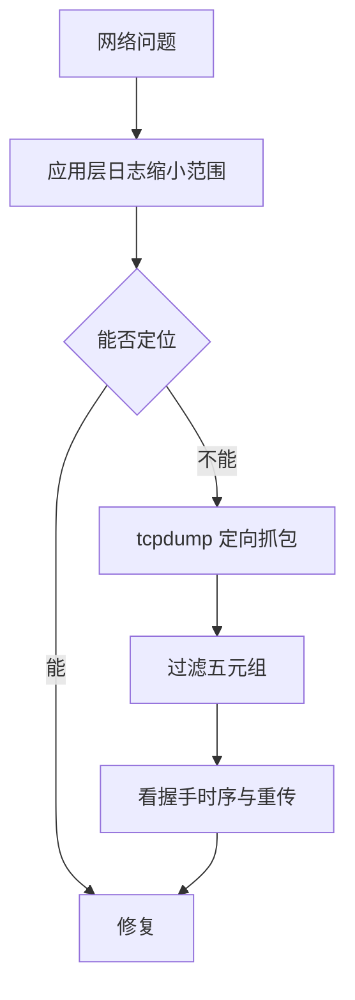
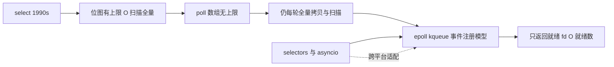
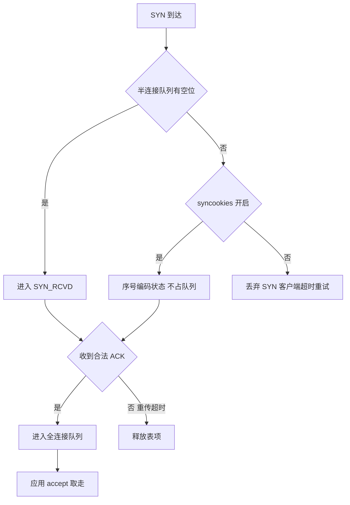
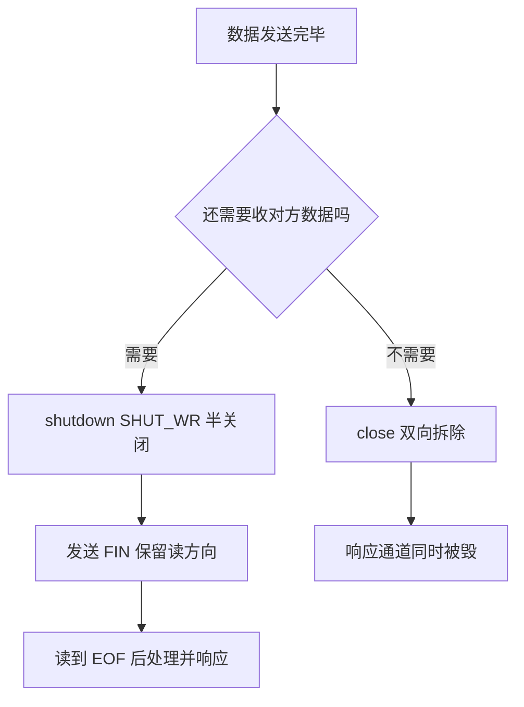

# 第 2 类 · 并发与网络工程(50)

> 本篇是网络编程深入篇:从 TCP 行为参数(Nagle/keepalive/backlog/SO_REUSEADDR)到粘包三种解法的完整实现,再到心跳重连、代理协议、HTTP/1.1 长连接、TLS 握手与证书校验、流式下载与断点续传、WebSocket 与 SSE 的原理级实现。
> 后半段聚焦规模与稳定性:DNS 与缓存、抓包思路、fd 治理、select/poll/epoll/kqueue 演进、C10K 思路、服务端限流、零拷贝、NAT 与内网穿透。
> 所有代码仅用标准库、完整可运行,网络演示全部走本机回环,可直接复制执行。

---

### Q616 · Nagle 算法与 TCP_NODELAY:小包延迟从哪来

> 难度:★★★☆ | 标签:TCP_NODELAY, Nagle, 延迟

**问**:交互式服务为什么都要设置 TCP_NODELAY?Nagle 算法到底在优化什么?

**答**:Nagle 算法为了减少网络中的小包,规定"有未确认的小段在途时,后续小数据先攒着,等 ACK 或攒满 MSS 才发"。它优化带宽利用率,代价是延迟:与对端延迟确认(delayed ACK,最多等 40ms+)相互作用时,第二个小写可能被扣住几十毫秒,这就是"写一个字节等一下"的经典延迟来源。SSH/游戏/推送等交互式协议一律设置 TCP_NODELAY 禁用 Nagle;批量传输(文件下载)则不必关,攒包反而有利。验证方法是观察"背靠背两次小写"的到达间隔。

```python
# file: code/02_并发与网络工程/q616_nagle.py
import socket
import threading
import time

arrivals: dict = {}  # conn_id -> [到达时刻]


def server(stop: threading.Event, results: dict) -> None:
    srv = socket.socket()
    srv.setsockopt(socket.SOL_SOCKET, socket.SO_REUSEADDR, 1)
    srv.bind(("127.0.0.1", 0))
    srv.listen(4)
    results["port"] = srv.getsockname()[1]
    srv.settimeout(0.2)
    conn_id = 0
    while not stop.is_set():
        try:
            conn, _ = srv.accept()
        except socket.timeout:
            continue
        conn_id += 1
        cid = conn_id
        t0 = time.monotonic()
        arrivals[cid] = []
        conn.setsockopt(socket.IPPROTO_TCP, socket.TCP_NODELAY, 1)
        # 收到第一个包后延迟 100ms 再响应, 模拟应用处理 + 触发对端延迟确认
        data1 = conn.recv(1)
        arrivals[cid].append(time.monotonic() - t0)
        time.sleep(0.1)
        conn.sendall(b"R1")
        data2 = conn.recv(1)
        arrivals[cid].append(time.monotonic() - t0)
        conn.sendall(b"R2")
        results[f"gap{cid}"] = arrivals[cid][1] - arrivals[cid][0]
        conn.close()
    srv.close()


def client(port: int, nodelay: bool) -> float:
    c = socket.socket()
    c.connect(("127.0.0.1", port))
    if nodelay:
        c.setsockopt(socket.IPPROTO_TCP, socket.TCP_NODELAY, 1)
    c.sendall(b"A")      # 第一个小写
    time.sleep(0.01)     # 确保两个写在时间上错开
    c.sendall(b"B")      # 第二个小写: Nagle 开启时可能被扣住
    c.recv(2)
    c.recv(2)
    c.close()
    return 0.0


if __name__ == "__main__":
    stop = threading.Event()
    results: dict = {}
    t = threading.Thread(target=server, args=(stop, results), daemon=True)
    t.start()
    while "port" not in results:
        time.sleep(0.01)
    port = results["port"]

    client(port, nodelay=False)
    gap_nagle = results.get("gap1", 0)
    client(port, nodelay=True)
    gap_fast = results.get("gap2", 0)
    print(f"Nagle 开启: 第二包延迟到达 gap={gap_nagle * 1000:.0f}ms")
    print(f"NODELAY:    第二包立即到达 gap={gap_fast * 1000:.0f}ms")
    stop.set()
    t.join()
    print("结论: 交互式协议应设置 TCP_NODELAY, 批量传输无所谓")
```

**追问**:1) 设置 NODELAY 后小包一定变多吗?——应用层自己攒包(如日志聚合)比依赖 Nagle 更可控,NODELAY 只是把"何时发"的决定权从内核拿回应用。2) Nagle 与延迟确认为什么会互相卡住?——发送端 Nagle 等 ACK 才放行下一个小包,接收端 delayed ACK 又故意推迟(最多 40ms+),两边互相等,形成经典的 40ms 延迟尖刺;这是「发送端想攒、接收端想拖」的组合症,关任何一边都能解。3) 内核还有哪些开关影响小包行为?——TCP_QUICKACK 关闭接收端延迟确认;TCP_CORK 与 NODELAY 相反、强制攒到 MSS 再发(适合「响应头+体一起发」);NODELAY 只影响发送方向,接收方向由对端策略决定。4) 生产陷阱?——内网 RPC 框架默认不开 NODELAY,P99 平白多出 40ms 尖刺且只在跨机复现;把关 Nagle 当万能(批量传输关了反而更碎);以为 NODELAY 立即作用于已在途的数据。

---

### Q617 · TCP keepalive 与应用层心跳

> 难度:★★★☆ | 标签:keepalive, 心跳, 存活检测

**问**:TCP 自带 keepalive,为什么应用还要自己做心跳?

**答**:TCP keepalive 探测的是"连接路径还通不通",默认 2 小时才启动,且中间的 NAT/防火墙/LB 只看有没有应用数据,空闲连接照样被掐;应用层心跳则是自定义频率的"业务级活性",能同时验证对端进程活着、鉴权仍有效、NAT 映射未过期。工程实践:心跳间隔取 NAT 超时的 1/3~1/2(常见 30~60s),连续 N 次未收到 pong 判定断线并触发重连;keepalive 作为兜底保留(把 idle 时间调小)。两者是互补而不是二选一。

```python
# file: code/02_并发与网络工程/q617_heartbeat.py
import socket
import sys
import threading
import time


def enable_keepalive(sock: socket.socket) -> None:
    """设置内核级 keepalive 作为兜底 (参数平台相关)。"""
    sock.setsockopt(socket.SOL_SOCKET, socket.SO_KEEPALIVE, 1)
    if sys.platform == "darwin":
        TCP_KEEPALIVE = 0x10
        sock.setsockopt(socket.IPPROTO_TCP, TCP_KEEPALIVE, 60)  # 空闲 60s 开始探测
    elif sys.platform.startswith("linux"):
        sock.setsockopt(socket.IPPROTO_TCP, socket.TCP_KEEPIDLE, 60)
        sock.setsockopt(socket.IPPROTO_TCP, socket.TCP_KEEPINTVL, 10)
        sock.setsockopt(socket.IPPROTO_TCP, socket.TCP_KEEPCNT, 3)


def server(stop: threading.Event) -> None:
    srv = socket.socket()
    srv.setsockopt(socket.SOL_SOCKET, socket.SO_REUSEADDR, 1)
    srv.bind(("127.0.0.1", 0))
    srv.listen(4)
    server.port = srv.getsockname()[1]  # type: ignore[attr-defined]
    srv.settimeout(0.2)
    while not stop.is_set():
        try:
            conn, _ = srv.accept()
        except socket.timeout:
            continue
        enable_keepalive(conn)
        conn.settimeout(2)
        while True:
            try:
                data = conn.recv(64)
            except socket.timeout:
                continue  # 心跳间隔内的静默是正常的
            if not data or data == b"PING":
                if data == b"PING":
                    conn.sendall(b"PONG")
                    continue
                break
            conn.sendall(b"echo:" + data)
        conn.close()
    srv.close()


def client_with_heartbeat(port: int) -> None:
    c = socket.socket()
    enable_keepalive(c)
    c.connect(("127.0.0.1", port))
    c.settimeout(1)

    def heartbeat() -> None:
        while not c._closed:  # 简化判断, 生产用状态标志
            try:
                c.sendall(b"PING")
                pong = c.recv(4)
                if pong != b"PONG":
                    print("心跳异常, 触发重连逻辑")
            except OSError:
                return
            time.sleep(0.05)

    hb = threading.Thread(target=heartbeat, daemon=True)
    hb.start()
    c.sendall(b"hello")
    print("业务响应:", c.recv(64).decode())
    time.sleep(0.2)  # 期间心跳在跑
    c.close()
    hb.join(timeout=1)


if __name__ == "__main__":
    stop = threading.Event()
    t = threading.Thread(target=server, args=(stop,), daemon=True)
    t.start()
    while not hasattr(server, "port"):
        time.sleep(0.01)
    client_with_heartbeat(server.port)  # type: ignore[attr-defined]
    stop.set()
    print("keepalive 兜底 + 应用心跳主动, 双层检测就绪")
```

**追问**:1) 心跳应该由哪一端发起?——一般客户端发起(它最关心连接可用性且数量多),服务端只做超时判定与踢除;两端都发会浪费带宽,只服务端发则无法及时发现单向断连。2) 为什么心跳判定不能依赖阻塞 recv?——recv 没数据就一直挂着,应用失去「该收到了却没收到」的判定权;要么独立定时器/selector 超时,要么 settimeout 把超时控制拿回应用层,判定与读取必须解耦。3) keepalive 三参数怎么调?——Linux 上 setsockopt(SOL_TCP, TCP_KEEPIDLE/TCP_KEEPINTVL/TCP_KEEPCNT) 把默认 2h 改成秒级;macOS 常数名不同(TCP_KEEPALIVE),跨平台代码要按平台分支,这也是「兜底交给内核」的实现成本。4) 生产陷阱?——心跳计时用 time.time,NTP 回拨让差值变负、死连接长期不被清理(计时一律 time.monotonic);心跳与业务消息抢同一发送锁,慢业务把心跳饿死,对端误判断线;重连风暴无抖动(见 Q623)。

---

### Q618 · listen backlog:半连接队列与全连接队列

> 难度:★★★★ | 标签:backlog, 三次握手, 容量

**问**:listen(128) 里的 128 是什么?突发流量下它怎么影响建连成功率?

**答**:backlog 限制的是全连接队列(已完成三次握手、等待 accept 的连接)长度,半连接队列(SYN_RCVD)主要由 `net.ipv4.tcp_max_syn_backlog` 与 `tcp_syncookies` 约束;而 `net.core.somaxconn` 约束的是**全连接 accept 队列**上限,生效值为 min(backlog, somaxconn)。队列满之后的行为:Linux 默认丢弃 SYN(客户端表现为 connect 超时或重传),macOS 可能回 RST——所以压测看到"connect 超时"首先要怀疑 accept 速度跟不上而不是带宽。应用层要点:accept 循环不能被业务逻辑阻塞;队列长度的合理值 = 峰值 QPS × accept 延迟;ss/netstat -lnt 中 LISTEN 的 Recv-Q 是当前全连接队列长度、Send-Q 是队列上限,两者都是瞬时值;累计溢出要看 `netstat -s` / `nstat` 的 ListenOverflows、ListenDrops。

```python
# file: code/02_并发与网络工程/q618_backlog.py
import socket
import threading
import time


def main() -> None:
    srv = socket.socket()
    srv.setsockopt(socket.SOL_SOCKET, socket.SO_REUSEADDR, 1)
    srv.bind(("127.0.0.1", 0))
    srv.listen(2)  # 故意设小 backlog, 模拟 accept 瓶颈
    port = srv.getsockname()[1]
    print(f"服务端 listen(2), 暂不 accept")

    clients: list = []
    results: list = []
    lock = threading.Lock()

    def try_connect(i: int) -> None:
        c = socket.socket()
        c.settimeout(2.0)
        t0 = time.monotonic()
        try:
            c.connect(("127.0.0.1", port))
            ok = True
        except (OSError, socket.timeout) as e:
            ok = False
            err = repr(e)
        dt = time.monotonic() - t0
        with lock:
            results.append((i, ok, dt, err if not ok else ""))
        if ok:
            clients.append(c)

    threads = [threading.Thread(target=try_connect, args=(i,)) for i in range(10)]
    for t in threads:
        t.start()
    for t in threads:
        t.join()

    ok_n = sum(1 for _, ok, *_ in results if ok)
    print(f"10 个并发连接, backlog=2 且未 accept: 成功 {ok_n} 个")
    for i, ok, dt, err in results[:4]:
        print(f"  conn{i}: ok={ok} 耗时={dt * 1000:.0f}ms {err}")

    print("开始 accept 排空队列")
    srv.settimeout(1.0)
    accepted = 0
    try:
        while True:
            conn, _ = srv.accept()
            accepted += 1
            conn.close()
    except socket.timeout:
        pass
    for c in clients:
        c.close()
    print(f"排队中的连接被依次 accept: {accepted} 个")
    srv.close()


if __name__ == "__main__":
    main()
```

**追问**:1) 为什么 accept 很快但队列还是溢出?——accept 消费的是 ESTABLISHED,但握手本身要占内核时间;洪峰下 SYN 重传也会挤占半连接队列,必要时开 syncookies 并加连接级限流(见 Q656)。2) 应用层怎么观测队列溢出?——ss -lnt 看 LISTEN 的 Recv-Q(当前全连接队列长度)与 Send-Q(上限);netstat -s 里「times the listen queue of a socket overflowed」计数增长就是溢出实锤,配合 accept 线程 CPU 定位消费慢。3) 生效值由哪些参数共同决定?——全连接队列生效值是 min(listen 的 backlog, net.core.somaxconn),只改应用层 backlog 不调 sysctl 常常白调;半连接队列由 tcp_max_syn_backlog 与 syncookies 约束,两者别混为一谈。4) 生产陷阱?——accept 循环里做 DNS/DB 等阻塞调用拖慢消费,队列恒满;压测 connect 超时被误判为带宽问题;backlog 调大只是延缓,真正要修的是 accept 速度。

---

### Q619 · SO_REUSEADDR 与 TIME_WAIT

> 难度:★★★☆ | 标签:SO_REUSEADDR, TIME_WAIT, 重启

**问**:服务重启时报 Address already in use,过几分钟又好了,为什么?

**答**:主动关闭的一方会进入 TIME_WAIT(默认 2MSL,约 1-4 分钟),期间五元组占着端口;重启后 bind 同一端口没有 SO_REUSEADDR 就会被拒。SO_REUSEADDR 允许绑定处于 TIME_WAIT 的地址(不等于允许多个活跃 socket 同时监听,那是 SO_REUSEPORT)。更工程的做法:让对端/客户端先关(把 TIME_WAIT 留在客户端),或用 SO_LINGER 控制,或服务端用 SO_REUSEADDR + 重试绑定。TIME_WAIT 本身是保护旧报文不污染新连接的机制,不要试图"消灭"它。

```python
# file: code/02_并发与网络工程/q619_reuseaddr.py
import socket
import time


def main() -> None:
    # 1. 建立连接, 服务端主动关闭 → 服务端侧进入 TIME_WAIT
    srv = socket.socket()
    srv.bind(("127.0.0.1", 0))  # 内核分配空闲端口, 避免与系统其他服务撞车
    port = srv.getsockname()[1]
    srv.listen(1)

    c = socket.socket()
    c.connect(("127.0.0.1", port))
    conn, _ = srv.accept()
    conn.close()          # 服务端先关: TIME_WAIT 留在服务端
    c.close()
    time.sleep(0.1)
    srv.close()           # 关键: 先彻底关闭监听 socket, 现场只留 TIME_WAIT;
                          # 监听 socket 还活着就去重绑, 任何平台都会 EADDRINUSE

    # 2. 不带 SO_REUSEADDR 重新绑定 → 撞 TIME_WAIT, 大概率 EADDRINUSE
    s1 = socket.socket()
    try:
        s1.bind(("127.0.0.1", port))
        print("无 REUSEADDR: 绑定成功 (本平台/此刻 TIME_WAIT 未阻塞)")
        s1.close()
    except OSError as e:
        print(f"无 REUSEADDR: 绑定失败 {e} → 这就是重启报错的原因")

    # 3. 带 SO_REUSEADDR → 立即成功
    s2 = socket.socket()
    s2.setsockopt(socket.SOL_SOCKET, socket.SO_REUSEADDR, 1)
    s2.bind(("127.0.0.1", port))
    print("带 REUSEADDR: 绑定成功, 服务可以立即重启")
    s2.close()


if __name__ == "__main__":
    main()
```

**追问**:1) SO_REUSEADDR 和 SO_REUSEPORT 的区别?——前者允许抢占 TIME_WAIT 地址;后者(4.1 内核/macOS)允许多个 socket 同时监听同一端口并做内核级负载均衡,常用于优雅重启和多进程 accept。2) TIME_WAIT 为什么必须存在、能安全缩短吗?——它保证旧连接的迟到报文在网络中自然消亡,不污染复用同五元组的新连接;出站方向 tcp_tw_reuse(依赖时间戳)是合法手段,tcp_tw_recycle 在 NAT 下丢 SYN、已在 Linux 4.12 移除,是历史上著名的坑。3) 大量 TIME_WAIT 出现在哪一侧说明什么?——主动关闭方持有:服务端海量 TIME_WAIT 说明服务端在先关(短连接+没启用 keep-alive),正解是连接复用而不是调内核参数;客户端侧则是端口耗尽问题。4) 生产陷阱?——压测机 ip_local_port_range 范围内端口被 TIME_WAIT 占满,connect 报 EADDRNOTAVAIL;混淆 REUSEADDR(抢 TIME_WAIT 地址)与 REUSEPORT(多 socket 同监听)语义。

---

### Q620 · 粘包解法一:固定长度协议

> 难度:★★☆ | 标签:粘包, 协议设计, TCP

**问**:TCP 是字节流没有消息边界,最简单的定界方案是什么?代价是什么?

**答**:固定长度帧:双方约定每条消息恰好 N 字节,接收方每次精确 recv N 字节即得到一条消息,短读就循环补齐。实现最简单、解析零开销,代价是:短消息要填充浪费带宽(冗余可达数倍),长消息被截断。适合传感器心跳、指令字这类长度天然固定的场景。recv_fixed 函数是所有方案的公共底座——recv 到的长度可能小于请求,必须循环。

```python
# file: code/02_并发与网络工程/q620_fixed_frame.py
import socket
import threading
import time

FRAME = 16  # 每条消息固定 16 字节, 不足补 \x00


def encode(msg: str) -> bytes:
    raw = msg.encode()
    assert len(raw) <= FRAME, f"消息超过 {FRAME} 字节"
    return raw.ljust(FRAME, b"\x00")


def recv_fixed(sock: socket.socket, n: int) -> bytes:
    buf = b""
    while len(buf) < n:          # recv 可能短读, 必须循环补齐
        chunk = sock.recv(n - len(buf))
        if not chunk:
            raise ConnectionError("对端关闭")
        buf += chunk
    return buf


def server(stop: threading.Event, port_box: list) -> None:
    srv = socket.socket()
    srv.setsockopt(socket.SOL_SOCKET, socket.SO_REUSEADDR, 1)
    srv.bind(("127.0.0.1", 0))
    srv.listen(4)
    port_box.append(srv.getsockname()[1])
    srv.settimeout(0.2)
    while not stop.is_set():
        try:
            conn, _ = srv.accept()
        except socket.timeout:
            continue
        try:
            while True:
                frame = recv_fixed(conn, FRAME)  # 一次一帧, 天然无粘包
                if not frame.strip(b"\x00"):
                    break
                msg = frame.rstrip(b"\x00").decode()
                print(f"[server] 完整收到一帧: {msg!r}")
                conn.sendall(encode("ack:" + msg))
        except (ConnectionError, OSError):
            pass
        finally:
            conn.close()
    srv.close()


def client(port: int) -> None:
    c = socket.socket()
    c.connect(("127.0.0.1", port))
    # 三帧数据一次 send 出去: 服务端仍按帧精确切分 → 粘包被协议化解
    payload = encode("frame-1") + encode("frame-2") + encode("frame-3")
    c.sendall(payload)
    for _ in range(3):
        print("[client] 收到应答:", recv_fixed(c, FRAME).rstrip(b"\x00").decode())
    c.sendall(encode(""))
    c.close()


if __name__ == "__main__":
    stop = threading.Event()
    box: list = []
    t = threading.Thread(target=server, args=(stop, box), daemon=True)
    t.start()
    while not box:
        time.sleep(0.01)
    client(box[0])
    stop.set()
```

**追问**:1) 帧内出现填充字节与真实 \x00 数据冲突怎么办?——定长协议里携带二进制就不该用填充语义,应改为"长度前缀"(Q621);或定长只用于头部、变长只用于载荷。2) 短读为什么必须循环补齐?——recv 只保证「最多返回请求的字节数」,内核分包、MTU、调度都会造成短读,不循环补齐就把半条消息当整条解析;recv_fixed 这个底座在所有定界方案里都要复用。3) 与其他定界方案的结构性对比?——定长解析零开销但容量写死、短消息填充浪费带宽;长度前缀(Q621)支持变长且二进制友好,是默认选择;分隔符(Q622)适合文本协议;选型本质是「消息大小是否可预知」。4) 生产陷阱?——协议长度 N 改版时只改了一端,灰度期新旧互发导致错位解析(灾难级);用填充语义携带二进制数据;struct 计算长度时忘了头部自身字节数。

---

### Q621 · 粘包解法二:长度前缀协议

> 难度:★★★☆ | 标签:粘包, 协议设计, struct

**问**:工业界最常用的粘包解法是什么?如何处理"半包"与"多包"同时出现?

**答**:长度前缀:每条消息前加定长头(常见 4 字节大端)标明载荷字节数,接收方维护一个缓冲区——先读满 4 字节解析长度,再读满长度字节的载荷,循环直到缓冲区不足一个完整帧。多包:一次 recv 可能带回 N 个完整帧,while 循环逐帧处理;半包:头部或载荷不完整就留在缓冲区等下次数据。这是 HTTP(Content-Length)、Redis RESP、gRPC 全在用的方案,配合 struct 打包最稳。

```python
# file: code/02_并发与网络工程/q621_length_prefix.py
import socket
import struct
import threading
import time

HEADER = struct.Struct("!I")  # 4 字节大端长度前缀


def frame(msg: str) -> bytes:
    raw = msg.encode()
    return HEADER.pack(len(raw)) + raw


def recv_exact(sock: socket.socket, n: int) -> bytes:
    buf = b""
    while len(buf) < n:
        chunk = sock.recv(min(65536, n - len(buf)))
        if not chunk:
            raise ConnectionError("对端关闭")
        buf += chunk
    return buf


def server(stop: threading.Event, port_box: list) -> None:
    srv = socket.socket()
    srv.setsockopt(socket.SOL_SOCKET, socket.SO_REUSEADDR, 1)
    srv.bind(("127.0.0.1", 0))
    srv.listen(4)
    port_box.append(srv.getsockname()[1])
    srv.settimeout(0.2)
    while not stop.is_set():
        try:
            conn, _ = srv.accept()
        except socket.timeout:
            continue
        try:
            while True:
                head = recv_exact(conn, HEADER.size)
                (length,) = HEADER.unpack(head)
                if length > 10 * 1024 * 1024:
                    raise ValueError("超长帧, 防恶意攻击")
                payload = recv_exact(conn, length)
                print(f"[server] 收到 {length} 字节: {payload.decode()!r}")
                conn.sendall(frame("ack:" + payload.decode()))
        except (ConnectionError, ValueError, OSError) as e:
            print(f"[server] 连接结束: {e}")
        finally:
            conn.close()
    srv.close()


def client(port: int) -> None:
    c = socket.socket()
    c.connect(("127.0.0.1", port))
    # 多包合并发送 + 模拟半包: 把一个帧拆成两段发送
    data = frame("message-1") + frame("message-2")
    one = frame("message-3")
    c.sendall(data + one[:3])      # message-3 的头部只发一半
    time.sleep(0.05)
    c.sendall(one[3:])             # 剩余部分后到
    for _ in range(3):
        (length,) = HEADER.unpack(recv_exact(c, HEADER.size))
        print("[client] 应答:", recv_exact(c, length).decode())
    c.close()


if __name__ == "__main__":
    stop = threading.Event()
    box: list = []
    t = threading.Thread(target=server, args=(stop, box), daemon=True)
    t.start()
    while not box:
        time.sleep(0.01)
    client(box[0])
    stop.set()
```

**追问**:1) 长度前缀协议怎么防恶意超长帧?——头上限(如 1MB)校验,超限直接断连;更完备的做法是头部带版本和魔数,非法头早期失败(Q680 的完整设计)。2) 缓冲区状态机怎么同时处理多包与半包?——recv 到的数据先 append 进缓冲,while 循环「头够就解析长度、载荷够就切一帧、切掉继续」,不够就 break 等下次;任何时刻不假设 recv 边界等于帧边界,这就是状态机的全部。3) 长度字段的编码细节怎么定?——struct '!I'(网络字节序大端无符号 32 位)是惯例,与 ntohs/htons 一致;必须定最大帧上限防恶意超长(见原问),协议演进时头部留版本位。4) 生产陷阱?——「长度含头」还是「只算载荷」两端理解不一致;自测只用小消息,没测「两帧合一包」的粘包场景;打包与解包端 struct 格式不一致,长度错乱却查出不到根因。

---

### Q622 · 粘包解法三:分隔符协议与转义

> 难度:★★★☆ | 标签:粘包, 协议设计, 转义

**问**:以 \n 分隔的文本协议(如 Redis/SMTP)怎么处理消息内容里恰好也有 \n?

**答**:分隔符协议用特殊字节序列定界,解析就是缓冲区内找分隔符、切出消息、残留留到下一轮。内容含分隔符时有两条路:禁止内容出现分隔符(Base64 编码后不含裸 \n,SMTP 正文靠 .\r\n 行配空行定界),或定义转义规则(内容中 \n 写作 \\n、反斜杠写作 \\\\),接收端先切分再反转义。要点:转义必须对称且处理"分隔符恰好被切成两半到达"——所以永远基于缓冲区找完整分隔符,而不是逐字节 recv 判断。分层也要干净:encode 负责转义出"载荷",frame 负责加分隔符,decode 只解"已切分的载荷"——roundtrip 断言直接 decode(encode(x)) 的话,载荷尾部挂着分隔符,断言必挂。

```python
# file: code/02_并发与网络工程/q622_delimiter_escape.py
import socket
import threading
import time

DELIM = b"\n"


def encode(msg: str) -> bytes:
    """转义为线上载荷(不含分隔符): 先转义反斜杠再转义换行, 顺序不能反。"""
    return msg.encode().replace(b"\\", b"\\\\").replace(b"\n", b"\\n")


def frame(msg: str) -> bytes:
    """完整一帧 = 转义载荷 + 分隔符; decode 只处理载荷本身。"""
    return encode(msg) + DELIM


def decode(raw: bytes) -> str:
    out = raw.replace(b"\\\\", b"\x00")  # 占位避免二次替换
    out = out.replace(b"\\n", b"\n").replace(b"\x00", b"\\")
    return out.decode()


class DelimParser:
    """基于缓冲区的分隔符解析: 天然处理半包与多包。"""

    def __init__(self) -> None:
        self.buf = b""

    def feed(self, data: bytes) -> list:
        self.buf += data
        msgs = []
        while True:
            idx = self.buf.find(DELIM)
            if idx < 0:
                break
            raw, self.buf = self.buf[:idx], self.buf[idx + 1:]
            msgs.append(decode(raw))
        return msgs


def server(stop: threading.Event, port_box: list) -> None:
    srv = socket.socket()
    srv.setsockopt(socket.SOL_SOCKET, socket.SO_REUSEADDR, 1)
    srv.bind(("127.0.0.1", 0))
    srv.listen(4)
    port_box.append(srv.getsockname()[1])
    srv.settimeout(0.2)
    while not stop.is_set():
        try:
            conn, _ = srv.accept()
        except socket.timeout:
            continue
        parser = DelimParser()
        try:
            while True:
                data = conn.recv(1024)
                if not data:
                    break
                for msg in parser.feed(data):
                    print(f"[server] 完整消息: {msg!r}")
                    conn.sendall(frame("ack:" + msg))
        except OSError:
            pass
        finally:
            conn.close()
    srv.close()


def client(port: int) -> None:
    c = socket.socket()
    c.connect(("127.0.0.1", port))
    # 消息内容含真实 \n 与 \, 编码后安全传输
    c.sendall(frame("line1\nline2") + frame("back\\slash"))
    c.settimeout(2)
    parser = DelimParser()
    got = []
    while len(got) < 2:
        got += parser.feed(c.recv(1024))
    for m in got:
        print("[client] 应答:", repr(m))
    c.close()


if __name__ == "__main__":
    stop = threading.Event()
    box: list = []
    t = threading.Thread(target=server, args=(stop, box), daemon=True)
    t.start()
    while not box:
        time.sleep(0.01)
    client(box[0])
    stop.set()
    assert decode(encode("a\nb\\c")) == "a\nb\\c"
    print("转义往返一致")
```

**追问**:1) 三种粘包解法怎么选?——定长适合指令帧;长度前缀是默认选择(高效、支持二进制);分隔符适合文本协议或已有生态兼容,选了就必须把转义规则写进协议文档。2) 为什么必须基于缓冲区找完整分隔符、不能逐字节判断?——分隔符 \r\n 可能被 TCP 拆成两次到达(半包),逐字节状态机要处理「\r 到了 \n 没到」的中间态;缓冲区找完整序列天然规避,代码也短。3) encode/decode 分层的依据?——转义(内容里的 \n 写作 \\n)作用于载荷、定界作用于原始流,混在一起就会出现「内容里的转义被误切」;分层后 roundtrip(encode→切分→decode)可以单测,这正是 demo 断言的设计。4) 生产陷阱?——转义规则没写进协议文档,三个月后没人记得 \\n 的含义;Base64 后以为还有裸 \n(实际没有,填充符是 =);切分用 universal newline 读文件把 \r\n 归一化破坏字节流。

---



---

### Q623 · 客户端心跳与断线重连:指数退避状态机

> 难度:★★★★ | 标签:重连, 指数退避, 状态机

**问**:写一个健壮的长连接客户端,重连逻辑要考虑哪些状态?

**答**:核心是状态机:CONNECTED(正常收发)、DEGRADED(心跳超时,疑似断线)、BACKOFF(指数退避等待重连)。要点:心跳超时判定要独立于 recv(单独计时,连续 N 次未收到 pong 才断);退避用指数 + 抖动(1s→2s→4s...上限 30s,加随机量防止重连风暴同步);重连成功后要重放会话状态(订阅列表、未确认消息);区分"可重试错误"(超时、reset)与"不可重试错误"(认证失败、协议错误)避免无意义循环。

```python
# file: code/02_并发与网络工程/q623_reconnect.py
import random
import socket
import threading
import time

PING_INTERVAL = 0.15
PONG_TIMEOUT = 0.3
MAX_BACKOFF = 1.0


class ReconnectingClient:
    def __init__(self, host: str, port: int) -> None:
        self.host, self.port = host, port
        self.state = "INIT"
        self.backoff = 0.1
        self.unacked: list = []  # 未确认消息: 重连后重放
        self.stop = threading.Event()
        self.reconnects = 0

    def _connect(self) -> socket.socket:
        c = socket.socket()
        c.settimeout(PONG_TIMEOUT)
        c.connect((self.host, self.port))
        return c

    def run(self) -> None:
        while not self.stop.is_set():
            try:
                self.state = "CONNECTING"
                sock = self._connect()
                self.state = "CONNECTED"
                self.backoff = 0.1  # 成功后重置退避
                print(f"[client] 已连接 第{self.reconnects}次重连后" if self.reconnects else "[client] 已连接")
                for msg in self.unacked:  # 重放未确认消息
                    sock.sendall(msg.encode())
                self._session(sock)
            except (OSError, ConnectionError) as e:
                self.state = "BACKOFF"
                delay = min(self.backoff, MAX_BACKOFF) * (1 + random.random() * 0.3)
                self.reconnects += 1
                print(f"[client] 断线 {e!r}, {delay:.2f}s 后重连")
                time.sleep(delay)
                self.backoff = min(self.backoff * 2, MAX_BACKOFF)

    def _session(self, sock: socket.socket) -> None:
        sock.sendall(b"subscribe:topic-a\n")
        pending = 0
        last_pong = time.monotonic()
        sock.settimeout(0.05)
        while not self.stop.is_set():
            now = time.monotonic()
            if now - last_pong > PONG_TIMEOUT * 3:
                raise ConnectionError("连续未收到 pong, 判定断线")
            try:
                data = sock.recv(256)
                if not data:
                    raise ConnectionError("对端关闭")
                for line in data.decode().splitlines():
                    if line.startswith("pong"):
                        last_pong = now
                        pending = 0
                        print("[client] 心跳正常")
                    else:
                        print(f"[client] 收到: {line}")
                        self.unacked.remove(line.split("ack:")[1]) if "ack:" in line else None
            except socket.timeout:
                pass
            if now - last_pong > PING_INTERVAL:
                sock.sendall(b"ping\n")
                last_pong = now  # 发出即计时, 超时未回则在上方判定
                pending += 1


def flaky_server(stop: threading.Event, port_box: list) -> None:
    """服务端每 1 秒主动断开一次, 制造重连场景。"""
    srv = socket.socket()
    srv.setsockopt(socket.SOL_SOCKET, socket.SO_REUSEADDR, 1)
    srv.bind(("127.0.0.1", 0))
    srv.listen(4)
    port_box.append(srv.getsockname()[1])
    srv.settimeout(0.2)
    while not stop.is_set():
        try:
            conn, _ = srv.accept()
        except socket.timeout:
            continue
        conn.settimeout(0.2)
        start = time.monotonic()
        while time.monotonic() - start < 0.8 and not stop.is_set():  # 0.8s 后踢
            try:
                data = conn.recv(128)
                if not data:
                    break
                reply = b"pong\n" if data.strip() == b"ping" else b"ack:" + data
                conn.sendall(reply)
            except socket.timeout:
                continue
            except OSError:
                break
        conn.close()
    srv.close()


if __name__ == "__main__":
    stop = threading.Event()
    box: list = []
    t = threading.Thread(target=flaky_server, args=(stop, box), daemon=True)
    t.start()
    while not box:
        time.sleep(0.01)
    client = ReconnectingClient("127.0.0.1", box[0])
    watcher = threading.Thread(target=client.run, daemon=True)
    watcher.start()
    time.sleep(3)  # 观察多次断线重连
    stop.set()
    client.stop.set()
    print(f"总重连次数: {client.reconnects}, 最终状态: {client.state}")
```

**追问**:1) 重连风暴怎么形成的,抖动为什么能缓解?——服务端重启瞬间,所有客户端同时探测到断线并以固定间隔重试,形成同步洪峰;指数退避把次数降下来,随机抖动把相位打散。2) 为什么心跳超时要独立计时并用单调时钟?——recv 阻塞期间无法判定超时,判定要靠独立定时器;计时用 time.monotonic,time.time 在 NTP 跳变时差值失真,会造成假活/误杀——重连与超时逻辑是时钟跳变的第一受害者。3) 抖动怎么做才真正有效?——full jitter(在 0~delay 间随机)或 equal jitter(一半固定+一半随机),把重连相位彻底打散;无抖动的指数退避只降速率,服务端一次抖动仍会让全部客户端同一时刻再同步。4) 生产陷阱?——把不可重试错误(认证失败、协议错误)也送进退避循环空转打接口;重连成功后没重放订阅/会话状态,「连接在但收不到消息」的假活;DEGRADED 状态没有超时上限,一直半死不活。

---

### Q624 · 服务端心跳:空闲连接超时踢除

> 难度:★★★☆ | 标签:心跳, 超时, 资源回收

**问**:服务端怎么发现"已经死掉但没发 FIN"的连接并回收资源?

**答**:服务端为每个连接维护 last_seen 时间戳,任何数据(业务或心跳)到达都刷新;一个后台巡检线程周期扫描,超过 idle_timeout 没有任何流量的连接主动 close 踢除并释放会话。timeout 值要大于客户端心跳间隔的若干倍(如 3 个周期),避免网络抖动误杀;踢除前可以发一个应用层"最后通牒"帧。不踢除的后果:连接数只增不减,fd 与内存缓慢耗尽,这是长连接网关最常见的第一种死法。

```python
# file: code/02_并发与网络工程/q624_idle_kick.py
import socket
import threading
import time

IDLE_TIMEOUT = 0.6
SCAN_INTERVAL = 0.2

sessions: dict = {}  # conn -> {"last_seen": ts, "name": str}
sessions_lock = threading.Lock()
kicked: list = []


def server(stop: threading.Event, port_box: list) -> None:
    srv = socket.socket()
    srv.setsockopt(socket.SOL_SOCKET, socket.SO_REUSEADDR, 1)
    srv.bind(("127.0.0.1", 0))
    srv.listen(8)
    port_box.append(srv.getsockname()[1])
    srv.settimeout(0.2)

    def reaper() -> None:  # 巡检线程: 回收空闲连接
        while not stop.is_set():
            now = time.monotonic()
            with sessions_lock:
                dead = [c for c, s in sessions.items() if now - s["last_seen"] > IDLE_TIMEOUT]
            for c in dead:
                with sessions_lock:
                    info = sessions.pop(c, None)
                if info:
                    kicked.append(info["name"])
                    print(f"[reaper] 踢除空闲连接: {info['name']}")
                    c.close()
            time.sleep(SCAN_INTERVAL)

    threading.Thread(target=reaper, daemon=True).start()

    while not stop.is_set():
        try:
            conn, _ = srv.accept()
        except socket.timeout:
            continue
        with sessions_lock:
            sessions[conn] = {"last_seen": time.monotonic(), "name": f"conn{id(conn) % 1000}"}
        threading.Thread(target=serve_conn, args=(conn,), daemon=True).start()
    srv.close()


def serve_conn(conn: socket.socket) -> None:
    conn.settimeout(0.1)
    try:
        while True:
            try:
                data = conn.recv(128)
                if not data:
                    break
                with sessions_lock:
                    if conn in sessions:
                        sessions[conn]["last_seen"] = time.monotonic()
                if data.strip() == b"PING":
                    conn.sendall(b"PONG")
                else:
                    conn.sendall(b"echo:" + data)
            except socket.timeout:
                continue
    except OSError:
        pass
    finally:
        with sessions_lock:
            sessions.pop(conn, None)
        conn.close()


def client(port: int, name: str, heartbeat: bool, duration: float) -> None:
    c = socket.socket()
    c.connect(("127.0.0.1", port))
    t0 = time.monotonic()
    while time.monotonic() - t0 < duration:
        if heartbeat:
            c.sendall(b"PING")
            c.settimeout(0.3)
            try:
                c.recv(16)
            except socket.timeout:
                pass
        time.sleep(0.2)
    try:
        c.close()
    except OSError:
        pass
    print(f"[{name}] 结束 (heartbeating={heartbeat})")


if __name__ == "__main__":
    stop = threading.Event()
    box: list = []
    t = threading.Thread(target=server, args=(stop, box), daemon=True)
    t.start()
    while not box:
        time.sleep(0.01)
    port = box[0]
    # 客户端 A 持续心跳存活; 客户端 B 静默 → 被踢
    ta = threading.Thread(target=client, args=(port, "A-active", True, 1.2))
    tb = threading.Thread(target=client, args=(port, "B-silent", False, 1.2))
    ta.start(); tb.start()
    ta.join(); tb.join()
    time.sleep(0.3)
    print("被踢名单:", kicked)
    stop.set()
```

**追问**:1) 为什么不用 recv 的 socket.timeout 直接判死?——socket.timeout 只说明"这段时间没数据",瞬时抖动会误杀;巡检制把判定与读取解耦,还能顺带输出全量连接画像用于监控。2) idle_timeout 为什么要设成心跳间隔的数倍?——移动网络切换、瞬时抖动都会让单次心跳迟到,3 倍容忍把误杀压到可接受;踢除代价高(会话重建、订阅重放),宁晚勿误。3) 巡检怎么不拖垮收发路径?——独立线程周期扫 last_seen,与 IO 线程的刷新是单变量原子赋值(CPython 引用赋值原子);踢除动作拿每连接锁,并从注册表摘除后再 close,避免推送路径访问已死对象。4) 生产陷阱?——遍历连接表时被并发修改(dict changed size);踢除后忘了摘路由映射,推送继续往死连接写;用 time.time 做巡检基准,时钟跳变批量误杀(Q623 同源)。

---

### Q625 · HTTP CONNECT 代理:隧道是怎么建立的

> 难度:★★★★ | 标签:CONNECT, 代理, 隧道

**问**:浏览器配置 HTTP 代理访问 HTTPS 站点,CONNECT 方法在中间做了什么?

**答**:CONNECT 是"只管建隧道不解释内容"的指令:客户端发 `CONNECT host:port HTTP/1.1`,代理与目标完成 TCP 握手后回复 `200 Connection Established`,从此代理对这条连接只做双向字节搬运,看不到也不解释 TLS 内容(证书校验仍发生在客户端与目标之间,所以 HTTPS 代理无法窃听内容,只能知道你连了谁)。代理实现要点:解析目标、盲转发、任一方向 EOF/错误就双向拆除。这也是 clash/nghttp 类工具的核心代码路径。

```python
# file: code/02_并发与网络工程/q625_connect_proxy.py
import socket
import threading
import time


def pump(a: socket.socket, b: socket.socket) -> None:
    """双向盲转发: 任一方向结束就拆除两端。"""
    try:
        while True:
            data = a.recv(65536)
            if not data:
                break
            b.sendall(data)
    except OSError:
        pass
    finally:
        for s in (a, b):
            try:
                s.shutdown(socket.SHUT_RDWR)
            except OSError:
                pass


def proxy_server(stop: threading.Event, port_box: list) -> None:
    srv = socket.socket()
    srv.setsockopt(socket.SOL_SOCKET, socket.SO_REUSEADDR, 1)
    srv.bind(("127.0.0.1", 0))
    srv.listen(8)
    port_box.append(srv.getsockname()[1])
    srv.settimeout(0.2)
    while not stop.is_set():
        try:
            client_conn, _ = srv.accept()
        except socket.timeout:
            continue
        threading.Thread(target=handle_client, args=(client_conn,), daemon=True).start()
    srv.close()


def handle_client(client: socket.socket) -> None:
    client.settimeout(2)
    request = b""
    while b"\r\n\r\n" not in request:
        chunk = client.recv(4096)
        if not chunk:
            client.close()
            return
        request += chunk
    line = request.split(b"\r\n")[0].decode()
    print(f"[proxy] 收到: {line}")
    if not line.startswith("CONNECT"):
        client.sendall(b"HTTP/1.1 405 Method Not Allowed\r\n\r\n")
        client.close()
        return
    host, port = line.split()[1].rsplit(":", 1)
    try:
        remote = socket.create_connection((host, int(port)), timeout=2)
    except OSError as e:
        client.sendall(f"HTTP/1.1 502 Bad Gateway\r\n\r\n".encode())
        client.close()
        print(f"[proxy] 连目标失败: {e}")
        return
    client.sendall(b"HTTP/1.1 200 Connection Established\r\n\r\n")
    print(f"[proxy] 隧道建立: {host}:{port}, 进入盲转发")
    t = threading.Thread(target=pump, args=(client, remote), daemon=True)
    t.start()
    pump(remote, client)  # 反向在当前线程; 任一方向结束即整体拆除
    t.join(timeout=1)


def echo_target(stop: threading.Event, port_box: list) -> None:
    srv = socket.socket()
    srv.setsockopt(socket.SOL_SOCKET, socket.SO_REUSEADDR, 1)
    srv.bind(("127.0.0.1", 0))
    srv.listen(4)
    port_box.append(srv.getsockname()[1])
    srv.settimeout(0.2)
    while not stop.is_set():
        try:
            conn, _ = srv.accept()
        except socket.timeout:
            continue
        try:
            data = conn.recv(1024)
            conn.sendall(b"target-echo:" + data)
        except OSError:
            pass
        conn.close()
    srv.close()


if __name__ == "__main__":
    stop = threading.Event()
    proxy_box: list = []
    target_box: list = []
    tp = threading.Thread(target=proxy_server, args=(stop, proxy_box), daemon=True)
    tt = threading.Thread(target=echo_target, args=(stop, target_box), daemon=True)
    tp.start(); tt.start()
    while not (proxy_box and target_box):
        time.sleep(0.01)

    c = socket.create_connection(("127.0.0.1", proxy_box[0]))
    c.sendall(f"CONNECT 127.0.0.1:{target_box[0]} HTTP/1.1\r\nHost: 127.0.0.1\r\n\r\n".encode())
    c.settimeout(2)
    resp = c.recv(1024)
    print("[client] 代理响应:", resp.split(b"\r\n")[0].decode())
    c.sendall(b"hello-via-tunnel")
    print("[client] 隧道内响应:", c.recv(1024).decode())
    c.close()
    stop.set()
```

**追问**:1) 代理能看到 HTTPS 里的内容吗?——不能,隧道内是端到端 TLS;能做的是 DNS 层/CONNECT 行的域名审计,除非企业部署了带自签根证书的中间人代理(合规上必须明示)。2) 隧道建成后代理为什么必须盲转发?——它对 CONNECT 的承诺就是不解读内容;按行解析 TLS 密文会破坏字节流,正确姿势是两个方向各自 pump、半关闭传播(Q663),任一方向 EOF 就双向拆除。3) CONNECT 的访问控制为什么是安全重点?——不限目标的代理等于开放跳板:云上 169.254.169.254 metadata 服务、内网 Redis 都能借道访问(SSRF 经典路径),必须目标白名单+端口限制。4) 生产陷阱?——没处理代理回非 200 的降级路径;解析 CONNECT 行用 split 不处理 IPv6 形式([::1]:443);隧道空闲无心跳,中间设备掐断后两端还在互等。

---

### Q626 · SOCKS5 代理协议:握手与请求格式

> 难度:★★★★ | 标签:SOCKS5, 代理, 二进制协议

**问**:SOCKS5 比 HTTP 代理强在哪?握手报文长什么样?

**答**:SOCKS5 是传输层级的代理协议:不解析 HTTP,支持 TCP 与 UDP ASSOCIATE,支持多种认证方法协商。握手两步:客户端发 `05 nmethods methods`(05 是版本,带支持的方法列表),服务端选一个回 `05 method`(00=无认证,02=用户密码);认证后发请求 `05 CMD 00 ATYP addr port`,CMD=01 是 CONNECT,ATYP 区分 IPv4/域名/IPv6,服务端回 `05 00 00 ATYP bndaddr bndport` 表示成功,之后同样是盲转发。相比 HTTP CONNECT,它协议更轻、天然支持 UDP 与域名解析代理端。

```python
# file: code/02_并发与网络工程/q626_socks5.py
import socket
import struct
import threading
import time


def pump(a: socket.socket, b: socket.socket) -> None:
    try:
        while True:
            data = a.recv(65536)
            if not data:
                break
            b.sendall(data)
    except OSError:
        pass
    finally:
        for s in (a, b):
            try:
                s.shutdown(socket.SHUT_RDWR)
            except OSError:
                pass


def socks5_server(stop: threading.Event, port_box: list) -> None:
    srv = socket.socket()
    srv.setsockopt(socket.SOL_SOCKET, socket.SO_REUSEADDR, 1)
    srv.bind(("127.0.0.1", 0))
    srv.listen(8)
    port_box.append(srv.getsockname()[1])
    srv.settimeout(0.2)
    while not stop.is_set():
        try:
            c, _ = srv.accept()
        except socket.timeout:
            continue
        threading.Thread(target=handle, args=(c,), daemon=True).start()
    srv.close()


def recv_n(sock: socket.socket, n: int) -> bytes:
    buf = b""
    while len(buf) < n:
        chunk = sock.recv(n - len(buf))
        if not chunk:
            raise ConnectionError("closed")
        buf += chunk
    return buf


def handle(c: socket.socket) -> None:
    try:
        c.settimeout(2)
        ver, nmethods = recv_n(c, 2)
        methods = recv_n(c, nmethods)
        assert ver == 5 and 0 in methods, "不支持的版本或无可用认证方法"
        c.sendall(b"\x05\x00")  # 选择无认证
        req = recv_n(c, 4)      # VER CMD RSV ATYP
        _ver, cmd, _rsv, atyp = req
        if atyp == 1:           # IPv4
            addr = socket.inet_ntoa(recv_n(c, 4))
        elif atyp == 3:         # 域名
            ln = recv_n(c, 1)[0]
            addr = recv_n(c, ln).decode()
        else:
            raise ValueError("仅演示 IPv4 与域名")
        (port,) = struct.unpack("!H", recv_n(c, 2))
        print(f"[socks5] CONNECT {addr}:{port} cmd={cmd}")
        remote = socket.create_connection((addr, port), timeout=2)
        c.sendall(b"\x05\x00\x00\x01" + socket.inet_aton("0.0.0.0") + struct.pack("!H", 0))
        t = threading.Thread(target=pump, args=(c, remote), daemon=True)
        t.start()
        pump(remote, c)
        t.join(timeout=1)
    except Exception as e:
        print(f"[socks5] 失败: {e!r}")
        try:
            c.sendall(b"\x05\x01\x00\x01" + b"\x00" * 6)
        except OSError:
            pass
    finally:
        c.close()


def echo_target(stop: threading.Event, port_box: list) -> None:
    srv = socket.socket()
    srv.setsockopt(socket.SOL_SOCKET, socket.SO_REUSEADDR, 1)
    srv.bind(("127.0.0.1", 0))
    srv.listen(4)
    port_box.append(srv.getsockname()[1])
    srv.settimeout(0.2)
    while not stop.is_set():
        try:
            conn, _ = srv.accept()
        except socket.timeout:
            continue
        try:
            data = conn.recv(1024)
            conn.sendall(b"target:" + data)
        except OSError:
            pass
        conn.close()
    srv.close()


if __name__ == "__main__":
    stop = threading.Event()
    px: list = []
    tg: list = []
    threading.Thread(target=socks5_server, args=(stop, px), daemon=True).start()
    threading.Thread(target=echo_target, args=(stop, tg), daemon=True).start()
    while not (px and tg):
        time.sleep(0.01)

    c = socket.create_connection(("127.0.0.1", px[0]))
    c.sendall(b"\x05\x01\x00")            # 版本5, 1个方法, 无认证
    c.sendall(b"\x05\x01\x00\x01" + socket.inet_aton("127.0.0.1") + struct.pack("!H", tg[0]))
    c.settimeout(2)
    print("方法协商响应:", c.recv(2).hex())
    reply = c.recv(10)
    print("连接响应:", reply.hex(), "(05 00 表示成功)")
    c.sendall(b"via-socks5")
    print("隧道内数据:", c.recv(64).decode())
    c.close()
    stop.set()
```

**追问**:1) 为什么 curl 的 socks5h 和 socks5 选项结果不同?——socks5h 把域名解析也交给代理端做(远程解析,避免 DNS 泄漏/污染),socks5 在本地解析后只传 IP。2) 方法协商为什么设计成「客户端列清单、服务端选一个」?——版本演进兼容:老客户端只带 NO-AUTH,新服务端可选要求认证,不支持就回 0xFF 让客户端放弃;扩展不破坏老实现,这是二进制协议设计的通用范式。3) ATYP 三种地址类型怎么用?——IPv4/IPv6 直接地址;域名类型(0x03)把解析交给代理端(等价 socks5h 的语义,内网域名解析不出局),域名最长 255 字节因为长度字段是单字节。4) 生产陷阱?——握手没读完就当隧道用,残留字节污染第一条请求;UDP ASSOCIATE 回包的 BND.ADDR 写 0.0.0.0 客户端连错;无 TLS 的 SOCKS5 密码字段明文传输;版本字节写错(0x04)变成 SOCKS4 协议错乱。

---

### Q627 · HTTP/1.1 keep-alive 与管线化

> 难度:★★★☆ | 标签:HTTP keep-alive, 管线化, 队头阻塞

**问**:HTTP/1.1 的 keep-alive 解决了什么?管线化为什么最终失败?

**答**:keep-alive 复用 TCP 连接,省掉每个请求的三次握手与慢启动,把多次请求的成本从"连接数"变成"请求数"。管线化(pipelining)更进一步:不等响应连续发出多个请求,理论上并行——但它要求响应必须按请求顺序返回,一个慢响应会阻塞后面全部(队头阻塞),且大量代理/服务器实现不兼容,浏览器默认禁用,最终被 HTTP/2 的多路复用取代。自己实现时的关键是响应必须带 Content-Length 或 chunked,否则复用连接后无法知道一条响应在哪里结束;而且解析必须基于"连接级持久缓冲"——一次 recv 经常带回下一条响应的前半截,残料要留给下一次解析,扔掉就会把第二次读挂死到超时。

```python
# file: code/02_并发与网络工程/q627_keepalive_pipelining.py
import socket
import threading
import time


def handle(conn: socket.socket) -> None:
    conn.settimeout(3)
    try:
        while True:  # keep-alive: 一个连接服务多个请求
            data = b""
            while b"\r\n\r\n" not in data:
                chunk = conn.recv(4096)
                if not chunk:
                    return
                data += chunk
            # 简化: 一次 recv 里可能已有管线化的多个请求, 按空行切分
            requests = data.split(b"\r\n\r\n")
            for req in requests:
                if not req.strip():
                    continue
                path = req.split(b"\r\n")[0].split(b" ")[1].decode()
                print(f"[server] 处理 {path}")
                if path == "/slow":
                    time.sleep(0.3)  # 慢响应: 管线化下阻塞后续
                body = f"resp-for-{path}".encode()
                conn.sendall(
                    b"HTTP/1.1 200 OK\r\n"
                    b"Content-Type: text/plain\r\n"
                    b"Connection: keep-alive\r\n"
                    + f"Content-Length: {len(body)}\r\n\r\n".encode()
                    + body
                )
    except (OSError, ValueError):
        pass
    finally:
        conn.close()


def server(stop: threading.Event, port_box: list) -> None:
    srv = socket.socket()
    srv.setsockopt(socket.SOL_SOCKET, socket.SO_REUSEADDR, 1)
    srv.bind(("127.0.0.1", 0))
    srv.listen(8)
    port_box.append(srv.getsockname()[1])
    srv.settimeout(0.2)
    while not stop.is_set():
        try:
            c, _ = srv.accept()
        except socket.timeout:
            continue
        threading.Thread(target=handle, args=(c,), daemon=True).start()
    srv.close()


class HTTPConn:
    """带持久缓冲的 HTTP/1.1 客户端读取器。

    一次 recv 经常带回多条响应(尤其管线化), 残料必须留在缓冲区
    给下一次 read_response; 每次读完把 rest[length:] 丢掉的话,
    第二条响应就永远等不到, 只能挂到超时。
    """

    def __init__(self, sock: socket.socket) -> None:
        self.sock = sock
        self.buf = b""  # 跨响应持久残留

    def read_response(self) -> tuple:
        while b"\r\n\r\n" not in self.buf:
            chunk = self.sock.recv(4096)
            if not chunk:
                raise ConnectionError("对端关闭")
            self.buf += chunk
        head, rest = self.buf.split(b"\r\n\r\n", 1)
        headers = dict(
            line.split(b": ", 1) for line in head.split(b"\r\n")[1:] if b": " in line
        )
        length = int(headers[b"Content-Length"])
        while len(rest) < length:
            chunk = self.sock.recv(4096)
            if not chunk:
                raise ConnectionError("对端关闭")
            rest += chunk
        body, self.buf = rest[:length], rest[length:]
        return head.split(b"\r\n")[0].decode(), body


if __name__ == "__main__":
    stop = threading.Event()
    box: list = []
    threading.Thread(target=server, args=(stop, box), daemon=True).start()
    while not box:
        time.sleep(0.01)

    c = socket.create_connection(("127.0.0.1", box[0]))
    c.settimeout(3)
    conn = HTTPConn(c)
    # keep-alive: 同一连接上先后两个请求
    for path in ("/a", "/b"):
        c.sendall(f"GET {path} HTTP/1.1\r\nHost: x\r\n\r\n".encode())
        status, body = conn.read_response()
        print(f"keep-alive 请求 {path}: {status} {body.decode()}")
    c.close()

    # 管线化: 两个请求一次发出, 响应按序返回, 靠持久缓冲逐条取
    c = socket.create_connection(("127.0.0.1", box[0]))
    c.settimeout(3)
    conn = HTTPConn(c)
    c.sendall(b"GET /p1 HTTP/1.1\r\nHost: x\r\n\r\nGET /p2 HTTP/1.1\r\nHost: x\r\n\r\n")
    s1, b1 = conn.read_response()
    s2, b2 = conn.read_response()
    print(f"管线化响应1: {s1} {b1.decode()}")
    print(f"管线化响应2: {s2} {b2.decode()}")
    c.close()
    stop.set()
```

**追问**:1) HTTP/2 怎么解决队头阻塞的?——引入二进制分帧,多个流(stream)在同一连接上交错传输、独立标识,一个流慢不影响其他流;但 TCP 层丢包仍会造成连接级队头阻塞,这是 HTTP/3 改用 QUIC 的动机。2) 复用连接后怎么知道一条响应在哪里结束?——必须有定界:Content-Length 或 chunked(Q635);两者都没有就只能读到连接关闭(HTTP/1.0 语义)——keep-alive 下卡死的根因多半是响应缺长度头。3) 队头阻塞怎么逐代演化?——HTTP/1.1 管线化要求按序返回,一个慢响应阻塞全队;HTTP/2 二进制分帧让流独立交错,但 TCP 层丢包仍阻塞整条连接;HTTP/3 用 QUIC(UDP+独立流)把传输层队头阻塞也解掉。4) 生产陷阱?——连接池拿到被服务端悄悄关掉的连接,首请求 ConnectionResetError(需要幂等重试);持久缓冲的残料没留到下一轮解析,第二条响应前半截被丢。

---

### Q628 · HTTPS 握手流程:TLS 1.2 与 1.3 对比

> 难度:★★★★ | 标签:TLS, 握手, HTTPS

**问**:TLS 握手每一步在交换什么?1.3 比 1.2 快在哪?

**答**:TLS 1.2 全握手 2-RTT:ClientHello(随机数+支持的套件)→ ServerHello(选定套件)+证书+密钥交换参数 → 客户端发密钥交换与 ChangeCipherSpec → 双方 Finished 校验后进入加密。TLS 1.3 压缩到 1-RTT:密钥交换只允许 (EC)DHE 且参数并入 Hello,证书在第一个服务端飞行中就加密发送,客户端第二轮即可发应用数据;还支持 0-RTT 恢复(有重放风险,只用于幂等请求)。证书链校验:叶子证书→中间 CA→根 CA,加上域名匹配与有效期,任何一环失败即握手失败。demo 里生成自签证书注意:`-addext` 是 OpenSSL 1.1.1+ 参数,macOS 自带的 LibreSSL 2.8.3 不认识,会 CalledProcessError——SAN 要走 `-config` 的扩展段写法,老 openssl 全兼容。

```python
# file: code/02_并发与网络工程/q628_tls_handshake.py
import socket
import ssl
import subprocess
import threading
import tempfile
import os
import time


def make_cert(tmpdir: str) -> tuple:
    """用 openssl 生成自签证书 (标准库无法生成证书, openssl 是系统能力)。

    不用 `-addext`: 它是 OpenSSL 1.1.1+ 参数, macOS 自带的 LibreSSL
    2.8.3 不认识; 改用 -config 扩展段写 SAN, 老 openssl 全兼容。
    """
    key = os.path.join(tmpdir, "server.key")
    cert = os.path.join(tmpdir, "server.crt")
    cnf = os.path.join(tmpdir, "san.cnf")
    with open(cnf, "w", encoding="utf-8") as f:
        f.write(
            "[req]\n"
            "distinguished_name = dn\n"
            "x509_extensions = v3_req\n"
            "prompt = no\n"
            "[dn]\n"
            "CN = 127.0.0.1\n"
            "[v3_req]\n"
            "subjectAltName = IP:127.0.0.1\n"
        )
    subprocess.run(
        ["openssl", "req", "-x509", "-newkey", "rsa:2048", "-nodes",
         "-keyout", key, "-out", cert, "-days", "365", "-config", cnf],
        check=True, capture_output=True)
    return key, cert


def main() -> None:
    with tempfile.TemporaryDirectory() as tmpdir:
        key, cert = make_cert(tmpdir)

        ctx = ssl.SSLContext(ssl.PROTOCOL_TLS_SERVER)
        ctx.load_cert_chain(cert, key)
        lsock = socket.socket()
        lsock.setsockopt(socket.SOL_SOCKET, socket.SO_REUSEADDR, 1)
        lsock.bind(("127.0.0.1", 0))
        lsock.listen(1)
        port = lsock.getsockname()[1]

        ready = threading.Event()

        def serve() -> None:
            ready.set()
            conn, _ = lsock.accept()
            try:
                with ctx.wrap_socket(conn, server_side=True) as tls:
                    tls.sendall(b"hello-tls")
            except ssl.SSLError as e:
                print("[server] 握手失败:", e)
            finally:
                conn.close()

        t = threading.Thread(target=serve, daemon=True)
        t.start()
        ready.wait()

        # 客户端: 自签证书场景关闭校验, 但仍能观察握手细节
        cctx = ssl.SSLContext(ssl.PROTOCOL_TLS_CLIENT)
        cctx.check_hostname = False
        cctx.verify_mode = ssl.CERT_NONE
        t0 = time.perf_counter()
        with socket.create_connection(("127.0.0.1", port), timeout=5) as raw:
            with cctx.wrap_socket(raw, server_hostname="127.0.0.1") as tls:
                dt = time.perf_counter() - t0
                print(f"协商协议: {tls.version()}")
                print(f"加密套件: {tls.cipher()[0]} ({tls.cipher()[1]} 位)")
                peer = tls.getpeercert(binary_form=False)
                print("CERT_NONE 模式下 getpeercert 返回:", peer)
                der = tls.getpeercert(binary_form=True)
                print(f"证书 DER {len(der)} 字节, 握手耗时 {dt * 1000:.0f}ms")
                print("应用数据:", tls.recv(64).decode())
        t.join()
        lsock.close()


if __name__ == "__main__":
    main()
```

**追问**:1) 怎么确认服务端支持的是 1.2 还是 1.3?——握手后 `tls.version()` 直接给出;命令行可用 `openssl s_client -tls1_3` 逐版本探测,生产监控里 TLS 版本分布是重要的兼容性指标。2) 0-RTT 与 1-RTT 的安全差异?——1.3 把密钥交换并入首个飞行,1-RTT 即可发应用数据;0-RTT early data 没有完整握手的防重放保护,可能被重放,只用于幂等请求(GET),服务端要显式开启并限制重放窗口。3) 证书链校验的顺序与常见断链?——叶子→中间 CA→根 CA,系统信任库只装根;服务端必须下发中间证书,漏发时「浏览器通、Python 客户端挂」——浏览器会做 AIA 补齐而 Python ssl 不做,这是排障时最常见的平台差异。4) 生产陷阱?——macOS 自带 LibreSSL 不认 -addext(demo 已踩);证书轮换后旧 session ticket 仍复用旧链;只关 verify_mode 忘了 check_hostname(默认跟随)。

---



---

### Q629 · 证书校验实践:校验链、域名匹配与常见坑

> 难度:★★★★ | 标签:证书校验, SAN, check_hostname

**问**:证书校验到底校验什么?"自签证书测试环境"正确的打开方式是什么?

**答**:完整校验三件事:信任链(证书能追溯到本地信任的根)、域名匹配(SAN 扩展里的 DNS/IP 条目必须包含你连的主机名,CN 已基本废弃)、有效期与吊销状态。常见坑:只关了 verify_mode 忘了 check_hostname(它默认跟随 verify_mode);用 IP 直连但证书只有 DNS 条目;中间证书没配齐导致"本机通、线上部分客户端挂"。自签测试环境的正确做法:生成 SAN 含 127.0.0.1 的证书,客户端把该证书加载进信任库(verify_mode=CERT_REQUIRED),而不是全局关校验。

```python
# file: code/02_并发与网络工程/q629_cert_verify.py
import socket
import ssl
import subprocess
import threading
import tempfile
import time
import os


def make_cert(tmpdir: str, cn: str = "127.0.0.1") -> tuple:
    """生成自签证书; SAN 走 -config 扩展段(兼容老 openssl, 见 Q628)。"""
    key = os.path.join(tmpdir, "server.key")
    cert = os.path.join(tmpdir, "server.crt")
    cnf = os.path.join(tmpdir, "san.cnf")
    with open(cnf, "w", encoding="utf-8") as f:
        f.write(
            "[req]\n"
            "distinguished_name = dn\n"
            "x509_extensions = v3_req\n"
            "prompt = no\n"
            f"[dn]\nCN = {cn}\n"
            "[v3_req]\n"
            "subjectAltName = IP:127.0.0.1\n"
        )
    subprocess.run(
        ["openssl", "req", "-x509", "-newkey", "rsa:2048", "-nodes",
         "-keyout", key, "-out", cert, "-days", "365", "-config", cnf],
        check=True, capture_output=True)
    return key, cert


def run_tls_server(key: str, cert: str, port_box: list) -> None:
    ctx = ssl.SSLContext(ssl.PROTOCOL_TLS_SERVER)
    ctx.load_cert_chain(cert, key)
    lsock = socket.socket()
    lsock.setsockopt(socket.SOL_SOCKET, socket.SO_REUSEADDR, 1)
    lsock.bind(("127.0.0.1", 0))
    lsock.listen(4)
    port_box.append(lsock.getsockname()[1])
    while True:
        conn, _ = lsock.accept()
        try:
            with ctx.wrap_socket(conn, server_side=True) as tls:
                tls.sendall(b"ok")
        except ssl.SSLError as e:
            print(f"[server] 握手被拒: {e.reason}")
        except OSError:
            pass


def try_connect(port: int, label: str, ctx: ssl.SSLContext, server_hostname: str) -> None:
    try:
        with socket.create_connection(("127.0.0.1", port), timeout=2) as raw:
            with ctx.wrap_socket(raw, server_hostname=server_hostname) as tls:
                cert = tls.getpeercert()
                print(f"{label}: 连接成功, 证书 subject={cert.get('subject')}")
    except ssl.SSLCertVerificationError as e:
        print(f"{label}: 证书校验失败 → {e.verify_message}")
    except (OSError, ssl.SSLError) as e:
        print(f"{label}: 失败 {e!r}")


if __name__ == "__main__":
    with tempfile.TemporaryDirectory() as tmpdir:
        _key, cert = make_cert(tmpdir)
        box: list = []
        threading.Thread(target=run_tls_server, args=(_key, cert, box), daemon=True).start()
        while not box:
            time.sleep(0.01)
        port = box[0]

        # 场景1: 全关校验 — 连通但无任何安全保障
        ctx1 = ssl.SSLContext(ssl.PROTOCOL_TLS_CLIENT)
        ctx1.check_hostname = False
        ctx1.verify_mode = ssl.CERT_NONE
        try_connect(port, "场景1 关闭校验", ctx1, "127.0.0.1")

        # 场景2: 完全校验但未信任自签 CA → 预期失败
        ctx2 = ssl.create_default_context()
        try_connect(port, "场景2 默认严格校验", ctx2, "127.0.0.1")

        # 场景3: 把自签证书加入信任库 (正确姿势) → 成功且完成校验
        ctx3 = ssl.create_default_context(cafile=cert)
        try_connect(port, "场景3 信任自签证书", ctx3, "127.0.0.1")

        # 场景4: 域名不匹配 → check_hostname 拦截
        ctx4 = ssl.create_default_context(cafile=cert)
        try_connect(port, "场景4 域名不匹配", ctx4, "wrong.example.com")
```

**追问**:1) 怎么快速诊断线上证书链不全?——`openssl s_client -connect host:443 -showcerts` 看 chain 是否含中间证书;用 ssl.get_server_certificate 拿到的只有叶子证书,不能用于链验证。2) 域名匹配为什么以 SAN 为准?——RFC 6125 规定 SAN 的 DNS 条目优先,CN 仅作兼容回退;通配符只匹配一级标签(*.example.com 不匹配 a.b.example.com);IP 直连必须 SAN 里有 IP 条目,只有 DNS 条目必挂。3) 吊销检查为什么经常形同虚设?——Python ssl 默认只验证链+域名+有效期,不做 CRL/OCSP 拉取;OCSP soft-fail 策略下拿不到吊销信息也放行;强校验要 OCSP stapling(服务端附带时效性证明)。4) 生产陷阱?——测试期 CERT_NONE 的代码复制进生产(InsecureRequestWarning 没人看日志);中间证书漏配只在部分移动端复现,桌面端有 AIA 补齐掩盖问题;自签证书只装进代码而非独立信任文件,轮换困难。

---

### Q630 · 标准库 ssl 包装 socket:最小 HTTPS 服务

> 难度:★★★☆ | 标签:ssl, HTTPS, 标准库

**问**:不用任何框架,标准库怎么搭一个 HTTPS 服务和对应客户端?

**答**:服务端:SSLContext(PROTOCOL_TLS_SERVER)+ load_cert_chain,accept 到普通 socket 后 `wrap_socket(conn, server_side=True)` 得到加密连接,之后与普通 socket 用法完全一致;客户端:PROTOCOL_TLS_CLIENT 上下文默认开启校验与 hostname 检查,连接后 wrap_socket(server_hostname=域名)。要点:上下文对象全局复用(会话恢复 ticket 依赖它);load_cert_chain 的第二个参数是私钥路径;如果需要双向认证再叠加 load_verify_locations + CERT_REQUIRED(Q695)。

```python
# file: code/02_并发与网络工程/q630_https_min.py
import os
import socket
import ssl
import subprocess
import tempfile
import threading


def gen_cert(tmpdir: str) -> tuple:
    """自签证书: SAN 用 -config 扩展段写入, 兼容老 openssl(见 Q628)。"""
    key = os.path.join(tmpdir, "k.pem")
    cert = os.path.join(tmpdir, "c.pem")
    cnf = os.path.join(tmpdir, "san.cnf")
    with open(cnf, "w", encoding="utf-8") as f:
        f.write(
            "[req]\n"
            "distinguished_name = dn\n"
            "x509_extensions = v3_req\n"
            "prompt = no\n"
            "[dn]\n"
            "CN = 127.0.0.1\n"
            "[v3_req]\n"
            "subjectAltName = IP:127.0.0.1\n"
        )
    subprocess.run(
        ["openssl", "req", "-x509", "-newkey", "rsa:2048", "-nodes",
         "-keyout", key, "-out", cert, "-days", "30", "-config", cnf],
        check=True, capture_output=True)
    return key, cert


def https_server(ctx: ssl.SSLContext, lsock: socket.socket) -> None:
    while True:
        conn, _ = lsock.accept()
        try:
            with ctx.wrap_socket(conn, server_side=True) as tls:
                data = tls.recv(4096)
                body = b"secure-ok"
                tls.sendall(
                    b"HTTP/1.1 200 OK\r\nContent-Length: "
                    + str(len(body)).encode() + b"\r\n\r\n" + body
                )
        except (ssl.SSLError, OSError):
            pass
        finally:
            conn.close()


if __name__ == "__main__":
    with tempfile.TemporaryDirectory() as tmpdir:
        key, cert = gen_cert(tmpdir)
        sctx = ssl.SSLContext(ssl.PROTOCOL_TLS_SERVER)
        sctx.load_cert_chain(cert, key)

        lsock = socket.socket()
        lsock.setsockopt(socket.SOL_SOCKET, socket.SO_REUSEADDR, 1)
        lsock.bind(("127.0.0.1", 0))
        lsock.listen(4)
        port = lsock.getsockname()[1]
        threading.Thread(target=https_server, args=(sctx, lsock), daemon=True).start()

        # 客户端: 信任该自签证书, 走完整校验
        cctx = ssl.create_default_context(cafile=cert)
        with socket.create_connection(("127.0.0.1", port), timeout=2) as raw:
            with cctx.wrap_socket(raw, server_hostname="127.0.0.1") as tls:
                tls.sendall(b"GET / HTTP/1.1\r\nHost: 127.0.0.1\r\n\r\n")
                resp = tls.recv(4096)
                print("状态行:", resp.split(b"\r\n")[0].decode())
                print("响应体:", resp.split(b"\r\n\r\n", 1)[1].decode())
        lsock.close()
```

**追问**:1) wrap_socket 之后还能拿到原始 socket 吗?——可以,tls.unwrap() 或访问底层对象,但一般不应该;想在 TLS 之外做代理隧道逻辑,应在 wrap 之前完成 CONNECT 握手。2) 为什么 SSLContext 要全局复用?——context 持有会话缓存与 ticket 密钥,复用才能做会话恢复省握手 RTT;每请求新建 context 既慢又让 session 复用失效,这是 HTTPS 性能的基础项。3) server_hostname 什么时候必须显式传?——wrap 的 socket 不是自己 connect 出来的(经过自建隧道/代理)时,SNI 与 hostname 校验都没有默认值,不传直接报「check_hostname requires server_hostname」。4) 生产陷阱?——wrap_socket 失败后没 close 底层 socket(fd 泄漏,Q648);非阻塞 socket 上同步 wrap 抛 BlockingIOError(do_handshake_on_connect=False + 手动驱动握手);双向认证只配了服务端要证书、客户端没 load_cert_chain。

---

### Q631 · verify_mode 三档实验:CERT_NONE / OPTIONAL / REQUIRED

> 难度:★★★☆ | 标签:verify_mode, ssl, 证书

**问**:客户端 verify_mode 的三档分别意味着什么?错误分别发生在哪个阶段?

**答**:CERT_NONE 不校验(仅加密不认证,等同裸奔,还会有 InsecureRequest 警告);CERT_REQUIRED 必须校验通过(链+域名+有效期),失败抛 SSLCertVerificationError 且连接根本建立不起来——注意这是握手期失败,不是应用层错误;CERT_OPTIONAL 只在客户端"提供了"证书才校验,主要用于服务端要求客户端证书但允许匿名的场景。实验能直观看到:同样一个自签证书服务器,三种模式分别是"连上""握手被拒""握手被拒",错误信息里写明是 self signed 还是 hostname mismatch,排障时先看这个分类。

```python
# file: code/02_并发与网络工程/q631_verify_modes.py
import os
import socket
import ssl
import subprocess
import tempfile
import threading
import time


def gen_cert(tmpdir: str) -> tuple:
    """自签证书: SAN 用 -config 扩展段写入, 兼容老 openssl(见 Q628)。"""
    key = os.path.join(tmpdir, "k.pem")
    cert = os.path.join(tmpdir, "c.pem")
    cnf = os.path.join(tmpdir, "san.cnf")
    with open(cnf, "w", encoding="utf-8") as f:
        f.write(
            "[req]\n"
            "distinguished_name = dn\n"
            "x509_extensions = v3_req\n"
            "prompt = no\n"
            "[dn]\n"
            "CN = 127.0.0.1\n"
            "[v3_req]\n"
            "subjectAltName = IP:127.0.0.1\n"
        )
    subprocess.run(
        ["openssl", "req", "-x509", "-newkey", "rsa:2048", "-nodes",
         "-keyout", key, "-out", cert, "-days", "30", "-config", cnf],
        check=True, capture_output=True)
    return key, cert


def server(ctx: ssl.SSLContext, lsock: socket.socket) -> None:
    while True:
        conn, _ = lsock.accept()
        try:
            with ctx.wrap_socket(conn, server_side=True) as tls:
                tls.sendall(b"done")
        except ssl.SSLError:
            pass
        except OSError:
            pass


if __name__ == "__main__":
    with tempfile.TemporaryDirectory() as tmpdir:
        key, cert = gen_cert(tmpdir)
        sctx = ssl.SSLContext(ssl.PROTOCOL_TLS_SERVER)
        sctx.load_cert_chain(cert, key)
        lsock = socket.socket()
        lsock.setsockopt(socket.SOL_SOCKET, socket.SO_REUSEADDR, 1)
        lsock.bind(("127.0.0.1", 0))
        lsock.listen(4)
        port = lsock.getsockname()[1]
        threading.Thread(target=server, args=(sctx, lsock), daemon=True).start()
        time.sleep(0.1)

        modes = [
            ("CERT_NONE", ssl.CERT_NONE),
            ("CERT_OPTIONAL", ssl.CERT_OPTIONAL),
            ("CERT_REQUIRED", ssl.CERT_REQUIRED),
        ]
        for name, mode in modes:
            cctx = ssl.SSLContext(ssl.PROTOCOL_TLS_CLIENT)
            cctx.check_hostname = False  # 单独控制, 便于观察 verify_mode 的独立效果
            cctx.verify_mode = mode
            try:
                with socket.create_connection(("127.0.0.1", port), timeout=2) as raw:
                    with cctx.wrap_socket(raw, server_hostname="127.0.0.1") as tls:
                        print(f"{name}: 连接成功")
            except ssl.SSLCertVerificationError as e:
                print(f"{name}: 握手期校验失败 → {e.verify_message}")
            except ssl.SSLError as e:
                print(f"{name}: SSL 错误 → {e}")
            time.sleep(0.05)

        # 对照: CERT_REQUIRED + 信任该证书 → 成功
        cctx = ssl.create_default_context(cafile=cert)
        with socket.create_connection(("127.0.0.1", port), timeout=2) as raw:
            with cctx.wrap_socket(raw, server_hostname="127.0.0.1") as tls:
                print("CERT_REQUIRED + 信任库: 连接成功且校验通过")
        lsock.close()
```

**追问**:1) 为什么 CERT_OPTIONAL 在客户端很少用?——它语义混乱("有证书就验,没有拉倒"),安全上无法作为认证依据;标准客户端要么 REQUIRED 要么 NONE,OPTIONAL 只出现在服务端做可选客户端认证。2) SSLCertVerificationError 里能读出什么?——verify message 直接分类:self signed certificate(加信任)、unable to get local issuer certificate(链不全,补中间证书)、hostname mismatch(SAN 配置)、certificate has expired(换证);排障先按错误文本归类再动手。3) mTLS 怎么配?——服务端 load_verify_locations(信任客户端 CA)+ verify_mode=CERT_REQUIRED;客户端额外 load_cert_chain 出示自己的证书;CERT_OPTIONAL 用于「允许匿名、出示了就验」的服务端场景。4) 生产陷阱?——ssl._create_unverified_context() 这类测试后门进生产;mTLS 客户端证书过期,全量请求在握手期失败,应用层监控看不到错误(要盯握手指标);把握手失败当业务错误上报,错误分类失真。

---

### Q632 · HTTP 客户端流式下载与进度

> 难度:★★☆ | 标签:流式下载, 进度, chunk

**问**:下载 1GB 文件时为什么不能 requests.get().content 一把读完?流式下载怎么写?

**答**:一次性读会把整个文件塞进内存,1GB 文件至少占用 1GB RSS,还让 GC 压力飙升;流式下载按块循环读取(常见 64KB-1MB),内存占用恒定,且可以边下边写盘、更新进度条、甚至边下边处理(视频转码)。实现要点:从 Content-Length 或 Content-Range 拿总量计算百分比;注意服务器可能不带 Content-Length(chunked),此时只能显示已下载量;下载到临时文件,完整后 rename(参考 Q380 原子写)。

```python
# file: code/02_并发与网络工程/q632_stream_download.py
import socket
import threading
import time

TOTAL = 1024 * 1024  # 1MB 模拟大文件


def handle(conn: socket.socket) -> None:
    conn.settimeout(3)
    data = b""
    while b"\r\n\r\n" not in data:
        chunk = conn.recv(4096)
        if not chunk:
            conn.close()
            return
        data += chunk
    conn.sendall(
        b"HTTP/1.1 200 OK\r\n"
        b"Content-Type: application/octet-stream\r\n"
        + f"Content-Length: {TOTAL}\r\n\r\n".encode()
    )
    sent = 0
    block = b"\xab" * 65536
    while sent < TOTAL:
        n = min(65536, TOTAL - sent)
        conn.sendall(block[:n])
        sent += n
    conn.close()


def server(stop: threading.Event, port_box: list) -> None:
    srv = socket.socket()
    srv.setsockopt(socket.SOL_SOCKET, socket.SO_REUSEADDR, 1)
    srv.bind(("127.0.0.1", 0))
    srv.listen(4)
    port_box.append(srv.getsockname()[1])
    srv.settimeout(0.2)
    while not stop.is_set():
        try:
            c, _ = srv.accept()
        except socket.timeout:
            continue
        threading.Thread(target=handle, args=(c,), daemon=True).start()
    srv.close()


def stream_download(port: int, chunk_size: int = 131072) -> None:
    c = socket.create_connection(("127.0.0.1", port), timeout=5)
    c.sendall(b"GET /file HTTP/1.1\r\nHost: x\r\n\r\n")
    # 读头部
    buf = b""
    while b"\r\n\r\n" not in buf:
        buf += c.recv(4096)
    head, body = buf.split(b"\r\n\r\n", 1)
    total = int(dict(
        l.split(b": ", 1) for l in head.split(b"\r\n")[1:] if b": " in l
    )[b"Content-Length"])
    received = len(body)
    t0 = time.perf_counter()
    last_report = 0
    while received < total:
        chunk = c.recv(chunk_size)
        if not chunk:
            break
        received += len(chunk)
        pct = received * 100 // total
        if pct >= last_report + 25:  # 每 25% 报告一次进度
            speed = received / max(time.perf_counter() - t0, 1e-9) / 1024
            print(f"  进度 {pct:3d}%  已收 {received / 1024:.0f}KB  {speed:.0f}KB/s")
            last_report = pct
    c.close()
    print(f"下载完成: {received} / {total} 字节校验 {'通过' if received == total else '失败'}")


if __name__ == "__main__":
    stop = threading.Event()
    box: list = []
    threading.Thread(target=server, args=(stop, box), daemon=True).start()
    while not box:
        time.sleep(0.01)
    stream_download(box[0])
    stop.set()
```

**追问**:1) 进度条跳变(先 0% 后 100%)通常是什么原因?——中间层(代理/压缩)吞掉了 Content-Length 或改成了 chunked,总量未知;读取 chunked 编码时需要解析分块头累加(Q635),否则收到的字节里混着块元数据。2) chunk 大小怎么权衡?——太小则 syscall 次数多、太大则内存峰值高且进度条迟钝;64KB~1MB 是经验区间;iter_content 的实际块大小还受 socket 缓冲影响,不保证精确等于设定值,进度计算要基于累计字节。3) 怎么保证下载完整性?——Content-Length 比对总字节数是底线;更强用 ETag/Last-Modified 校验或多线程分片各段校验(Q633);落盘用临时文件+rename 原子替换(Q380),避免半截文件被当完整文件消费。4) 生产陷阱?——写了 iter_content 却在循环外又取 resp.content(还是整块进内存);Content-Length 缺失时进度条除零;代理/压缩中间件缓冲整个响应,「流式」名存实亡。

---

### Q633 · 断点续传:Range 请求的完整实现

> 难度:★★★★ | 标签:Range, 断点续传, HTTP

**问**:断点续传的协议基础是什么?服务端和客户端各要做什么?

**答**:基于 HTTP 的 Range/Content-Range 头:客户端带 `Range: bytes=已收-`,服务端支持则回 206 Partial Content + `Content-Range: bytes a-b/total`,不支持就回 200 全量(客户端要能识别降级)。服务端实现:解析 Range(支持单区间即可),seek 到偏移发送对应片段;文件变化会使偏移失效,所以配合 ETag/If-Range——ETag 变了就从头发。客户端:记录已收字节,重试时带 Range;拼接时用文件 seek 写,不要整段放内存。这正好也是多线程分片下载(Aria2 风格)的基础。解析响应时的两个易错点:HTTP 头名不区分大小写,若解析时统一转了小写,取值也必须用小写键(`headers["Content-Length"]` 会 KeyError);chunked 响应根本没有 Content-Length,取值要容忍缺失。

```python
# file: code/02_并发与网络工程/q633_range_resume.py
import hashlib
import socket
import threading
import time

FILE_BODY = b"".join(bytes([i % 256]) * 1024 for i in range(64))  # 64KB 确定性内容
ETAG = hashlib.sha1(FILE_BODY).hexdigest()[:16]


def handle(conn: socket.socket) -> None:
    conn.settimeout(3)
    data = b""
    while b"\r\n\r\n" not in data:
        chunk = conn.recv(4096)
        if not chunk:
            conn.close()
            return
        data += chunk
    headers = {}
    for line in data.split(b"\r\n")[1:]:
        if b": " in line:
            k, v = line.split(b": ", 1)
            headers[k.decode().lower()] = v.decode()
    rng = headers.get("range")
    if rng and rng.startswith("bytes="):
        start_s = rng[6:].split("-")[0]
        start = int(start_s)
        body = FILE_BODY[start:]
        print(f"[server] Range 请求: bytes={start}- → 返回 {len(body)} 字节 (206)")
        conn.sendall(
            b"HTTP/1.1 206 Partial Content\r\n"
            b"Content-Type: application/octet-stream\r\n"
            + f"ETag: {ETAG}\r\n".encode()
            + f"Content-Range: bytes {start}-{len(FILE_BODY) - 1}/{len(FILE_BODY)}\r\n".encode()
            + f"Content-Length: {len(body)}\r\n\r\n".encode()
            + body
        )
    else:
        print(f"[server] 全量请求 → 返回 {len(FILE_BODY)} 字节 (200)")
        conn.sendall(
            b"HTTP/1.1 200 OK\r\n"
            + f"ETag: {ETAG}\r\n".encode()
            + f"Content-Length: {len(FILE_BODY)}\r\n\r\n".encode()
            + FILE_BODY
        )
    conn.close()


def server(stop: threading.Event, port_box: list) -> None:
    srv = socket.socket()
    srv.setsockopt(socket.SOL_SOCKET, socket.SO_REUSEADDR, 1)
    srv.bind(("127.0.0.1", 0))
    srv.listen(8)
    port_box.append(srv.getsockname()[1])
    srv.settimeout(0.2)
    while not stop.is_set():
        try:
            c, _ = srv.accept()
        except socket.timeout:
            continue
        threading.Thread(target=handle, args=(c,), daemon=True).start()
    srv.close()


def parse_response(sock: socket.socket) -> tuple:
    buf = b""
    while b"\r\n\r\n" not in buf:
        buf += sock.recv(4096)
    head, body = buf.split(b"\r\n\r\n", 1)
    headers = {}
    for line in head.split(b"\r\n")[1:]:
        if b": " in line:
            k, v = line.split(b": ", 1)
            headers[k.decode().lower()] = v.decode()  # 头名统一转小写
    # 取头必须用小写键(上面已统一), 且容忍缺失:
    # chunked 响应没有 Content-Length, 缺失时兜底 0、不进补读循环
    total = int(headers.get("content-length", "0"))
    if total:
        while len(body) < total:
            body += sock.recv(65536)
        body = body[:total]
    return head.split(b"\r\n")[0].decode(), headers, body


def recv_headers(sock: socket.socket) -> tuple:
    """只读响应头, 返回 (头字典, 已随包到达的首段 body)。头名统一小写。"""
    buf = b""
    while b"\r\n\r\n" not in buf:
        buf += sock.recv(4096)
    head, body = buf.split(b"\r\n\r\n", 1)
    headers = {}
    for line in head.split(b"\r\n")[1:]:
        if b": " in line:
            k, v = line.split(b": ", 1)
            headers[k.decode().lower()] = v.decode()
    return headers, body


def client_with_resume(port: int) -> None:
    # 第一次下载: 收到一半就"断线", 模拟中断
    c = socket.create_connection(("127.0.0.1", port), timeout=3)
    c.sendall(b"GET /file HTTP/1.1\r\nHost: x\r\n\r\n")
    headers, body = recv_headers(c)
    total = int(headers.get("content-length", "0"))
    stop_at = total // 2
    while len(body) < stop_at:
        body += c.recv(65536)
    c.close()  # 模拟断线: 剩余一半不再接收
    part = body[:stop_at]
    etag = headers.get("etag", "")
    print(f"[client] 第一次下载 {len(part)} 字节后中断, 记录 ETag {etag}")

    # 恢复: 带 Range 从断点继续, 并用 If-Range 保证文件没变
    c = socket.create_connection(("127.0.0.1", port), timeout=3)
    c.sendall(
        f"GET /file HTTP/1.1\r\nHost: x\r\nRange: bytes={len(part)}-\r\n"
        f"If-Range: {etag}\r\n\r\n".encode()
    )
    status2, headers2, rest = parse_response(c)
    c.close()
    print(f"[client] 续传响应: {status2}, 取回 {len(rest)} 字节")
    assert "206 Partial Content" in status2, status2
    full = part + rest
    assert hashlib.sha1(full).hexdigest().startswith(ETAG)
    print(f"[client] 拼接后 {len(full)} 字节, 与源文件哈希一致 → 续传成功")


if __name__ == "__main__":
    stop = threading.Event()
    box: list = []
    threading.Thread(target=server, args=(stop, box), daemon=True).start()
    while not box:
        time.sleep(0.01)
    client_with_resume(box[0])
    stop.set()
```

**追问**:1) 多线程分片下载和续传是什么关系?——同一机制:每个分片一个 Range 请求并行下载到文件不同偏移,任一分片失败单独重试;约束是服务端必须支持 Range 且各分片用同一 ETag 校验一致性。2) 服务端不支持 Range 时怎么优雅降级?——必须回 200 全量而非 206,客户端要按状态码分支:拿到 200 就当全新下载覆盖旧偏移,否则新旧内容错位拼出损坏文件;If-Range/ETag 保证「文件没变才续传」。3) 多线程分片怎么写盘才不互踩?——预分配文件(truncate 到总长)后各分片用自己的句柄 seek 到各自偏移写,写完统一校验;句柄数=分片数,注意 fd 上限(Q648);分片粒度太大则失败重下代价高,太小则请求数爆炸。4) 生产陷阱?——续传没带 If-Range,服务端文件已更新还按旧偏移拼;Range 解析没处理 bytes=-500(后缀区间)与多区间直接 500;把 206 当成功却没校验 Content-Range 的起止与总长。

---

### Q634 · multipart/form-data 上传:手写编码与解析

> 难度:★★★☆ | 标签:multipart, 上传, HTTP

**问**:multipart/form-data 的报文结构是什么?boundary 的规则和坑有哪些?

**答**:multipart 用一个随机 boundary 把多个 part 分隔:每个 part 有自己的头部(Content-Disposition 带 name/filename、Content-Type),头与体用空行分隔,整体以 `--boundary--` 结束。客户端构造要点:boundary 必须不出现在内容里(随机长串),Content-Type 头里带 boundary 参数,part 之间的 \r\n 属于分隔符不属于内容。服务端解析:按 `--boundary` 切分,逐 part 解析头部与载荷。文件与字段一起传时顺序无所谓,但接收端要按 name 区分。

```python
# file: code/02_并发与网络工程/q634_multipart.py
import socket
import threading
import time
import uuid

BOUNDARY = "----pyboundary" + uuid.uuid4().hex[:16]


def build_multipart(fields: dict, file_field: tuple) -> bytes:
    """fields: 普通字段; file_field: (name, filename, content, ctype)。"""
    lines: list = []
    for name, value in fields.items():
        lines.append(f"--{BOUNDARY}\r\n".encode())
        lines.append(f'Content-Disposition: form-data; name="{name}"\r\n\r\n'.encode())
        lines.append(value.encode() + b"\r\n")
    name, filename, content, ctype = file_field
    lines.append(f"--{BOUNDARY}\r\n".encode())
    lines.append(
        f'Content-Disposition: form-data; name="{name}"; filename="{filename}"\r\n'.encode()
    )
    lines.append(f"Content-Type: {ctype}\r\n\r\n".encode())
    lines.append(content + b"\r\n")
    lines.append(f"--{BOUNDARY}--\r\n".encode())
    return b"".join(lines)


def parse_multipart(body: bytes, boundary: str) -> list:
    parts = []
    delim = b"--" + boundary.encode()
    for seg in body.split(delim):
        seg = seg.strip(b"\r\n-")
        if not seg or seg == b"--":
            continue
        head, _, content = seg.partition(b"\r\n\r\n")
        headers = {}
        for line in head.split(b"\r\n"):
            if b": " in line:
                k, v = line.split(b": ", 1)
                headers[k.decode().lower()] = v.decode()
        disp = headers.get("content-disposition", "")
        name = disp.split('name="')[1].split('"')[0] if 'name="' in disp else ""
        filename = disp.split('filename="')[1].split('"')[0] if 'filename="' in disp else None
        parts.append({"name": name, "filename": filename, "content": content})
    return parts


def server(stop: threading.Event, port_box: list, received: list) -> None:
    srv = socket.socket()
    srv.setsockopt(socket.SOL_SOCKET, socket.SO_REUSEADDR, 1)
    srv.bind(("127.0.0.1", 0))
    srv.listen(4)
    port_box.append(srv.getsockname()[1])
    srv.settimeout(0.2)
    while not stop.is_set():
        try:
            conn, _ = srv.accept()
        except socket.timeout:
            continue
        try:
            conn.settimeout(3)
            data = b""
            while b"\r\n\r\n" not in data:
                data += conn.recv(65536)
            head, body = data.split(b"\r\n\r\n", 1)
            ctype = next(l.split(b": ", 1)[1].decode() for l in head.split(b"\r\n")
                         if l.lower().startswith(b"content-type"))
            boundary = ctype.split("boundary=")[1]
            received.extend(parse_multipart(body, boundary))
            conn.sendall(b"HTTP/1.1 200 OK\r\nContent-Length: 2\r\n\r\nok")
        except Exception as e:
            print("[server] 解析失败:", repr(e))
        finally:
            conn.close()
    srv.close()


if __name__ == "__main__":
    stop = threading.Event()
    box: list = []
    got: list = []
    threading.Thread(target=server, args=(stop, box, got), daemon=True).start()
    while not box:
        time.sleep(0.01)

    file_content = b"PNG-data\x00\x01\x02-with\r\nnewlines"  # 内容含 \r\n 验证解析正确
    body = build_multipart(
        fields={"note": "hello"},
        file_field=("file", "img.png", file_content, "image/png"),
    )
    c = socket.create_connection(("127.0.0.1", box[0]), timeout=3)
    c.sendall(
        b"POST /upload HTTP/1.1\r\n"
        + f"Content-Type: multipart/form-data; boundary={BOUNDARY}\r\n".encode()
        + f"Content-Length: {len(body)}\r\n\r\n".encode()
        + body
    )
    c.settimeout(2)
    print("上传响应:", c.recv(64).split(b"\r\n")[0].decode())
    c.close()

    for p in got:
        print(f"  part name={p['name']} filename={p['filename']} bytes={len(p['content'])}")
    f = next(p for p in got if p["name"] == "file")
    assert f["content"] == file_content, "二进制内容被破坏"
    print("二进制内容往返一致, multipart 编解码正确")
    stop.set()
```

**追问**:1) 为什么上传接口要限制单个 part 大小?——解析器通常先把整个 body 读进内存,恶意超大文件会 OOM;流式解析(逐块找 boundary)+ 磁盘暂存是生产实现。2) boundary 冲突怎么防?——客户端用强随机长串(uuid4+时间戳级),内容里出现同串的概率工程上可忽略;解析端仍要校验 boundary 合法性;绝不能用固定字符串(可被构造内容攻击)。3) 为什么生产实现必须流式解析?——part 边界要扫到才知道,内存解析等于把整个 body 读进 RAM,恶意超大文件直接 OOM;逐块扫描+超阈值落盘是标准实现,Django/FastAPI 的 UploadFile 就是「小文件内存、大文件临时盘」的阈值策略,还要限 part 数量。4) 生产陷阱?——手拼报文漏掉 part 之间的 \r\n(400 且难查);文件名非 ASCII 未按 RFC 编码;用 split(';') 粗解析 Content-Type 里的 boundary,带引号就解析错。

---



---

### Q635 · chunked 传输编码解析

> 难度:★★★☆ | 标签:chunked, HTTP, 解析器

**问**:Transfer-Encoding: chunked 的报文格式是什么?为什么有了 Content-Length 还需要它?

**答**:chunked 把响应切成一系列块:每块先是十六进制长度行(可带分号扩展),跟块数据,\r\n 结尾;长度为 0 的块表示结束,后面可跟 trailer 头。它存在的意义是"服务端不知道总长度时也能流式发送"——动态生成、边压缩边发送、网关转发上游流式响应都用它。解析要点:长度行是 hex,块之间 \r\n 分隔;流式解析器维护状态机(读长度→读块→跳过 CRLF→循环),HTTP/1.1 里 chunked 响应不得再带 Content-Length。

```python
# file: code/02_并发与网络工程/q635_chunked.py
import socket
import threading
import time


def handle(conn: socket.socket) -> None:
    conn.settimeout(3)
    data = b""
    while b"\r\n\r\n" not in data:
        chunk = conn.recv(4096)
        if not chunk:
            conn.close()
            return
        data += chunk
    # 服务端边生成边发送: 模拟动态内容
    conn.sendall(
        b"HTTP/1.1 200 OK\r\n"
        b"Transfer-Encoding: chunked\r\n"
        b"Content-Type: text/plain\r\n\r\n"
    )
    for piece in (b"hello, ", b"chunked ", b"world!"):
        conn.sendall(f"{len(piece):x}\r\n".encode() + piece + b"\r\n")
        time.sleep(0.05)
    conn.sendall(b"0\r\nX-Trailer: done\r\n\r\n")  # 0 块 + trailer
    conn.close()


def server(stop: threading.Event, port_box: list) -> None:
    srv = socket.socket()
    srv.setsockopt(socket.SOL_SOCKET, socket.SO_REUSEADDR, 1)
    srv.bind(("127.0.0.1", 0))
    srv.listen(4)
    port_box.append(srv.getsockname()[1])
    srv.settimeout(0.2)
    while not stop.is_set():
        try:
            c, _ = srv.accept()
        except socket.timeout:
            continue
        threading.Thread(target=handle, args=(c,), daemon=True).start()
    srv.close()


class ChunkedParser:
    """流式 chunked 解析状态机: feed 任意切片, 输出完整内容与 trailer。"""

    def __init__(self) -> None:
        self.buf = b""
        self.state = "size"  # size / data / crlf / trailer / done
        self.remaining = 0
        self.body = b""
        self.trailers = {}

    def feed(self, data: bytes) -> None:
        self.buf += data
        while True:
            if self.state == "size":
                idx = self.buf.find(b"\r\n")
                if idx < 0:
                    return
                line, self.buf = self.buf[:idx], self.buf[idx + 2:]
                size = int(line.split(b";")[0], 16)  # 忽略扩展
                if size == 0:
                    self.state = "trailer"
                else:
                    self.remaining = size
                    self.state = "data"
            elif self.state == "data":
                if len(self.buf) < self.remaining:
                    return
                self.body += self.buf[:self.remaining]
                self.buf = self.buf[self.remaining:]
                self.state = "crlf"
            elif self.state == "crlf":
                if len(self.buf) < 2:
                    return
                self.buf = self.buf[2:]  # 块尾 CRLF
                self.state = "size"
            elif self.state == "trailer":
                idx = self.buf.find(b"\r\n")
                if idx < 0:
                    return
                line, self.buf = self.buf[:idx], self.buf[idx + 2:]
                if not line:
                    self.state = "done"
                    return
                k, _, v = line.partition(b": ")
                self.trailers[k.decode()] = v.decode()


if __name__ == "__main__":
    stop = threading.Event()
    box: list = []
    threading.Thread(target=server, args=(stop, box), daemon=True).start()
    while not box:
        time.sleep(0.01)

    c = socket.create_connection(("127.0.0.1", box[0]), timeout=3)
    c.sendall(b"GET / HTTP/1.1\r\nHost: x\r\n\r\n")
    buf = b""
    while b"\r\n\r\n" not in buf:
        buf += c.recv(4096)
    head, rest = buf.split(b"\r\n\r\n", 1)
    parser = ChunkedParser()
    parser.feed(rest)
    while parser.state != "done":
        data = c.recv(4096)
        if not data:
            break
        parser.feed(data)
    c.close()
    print("解析出的内容:", parser.body.decode())
    print("trailer:", parser.trailers)
    assert parser.body == b"hello, chunked world!"
    stop.set()
```

**追问**:1) chunked 请求(客户端→服务端)合法吗?——HTTP/1.1 允许,大文件上传流式发送常用;但很多服务端/框架默认会缓冲整个请求体,并不是所有实现真正"流式"处理。2) 解析状态机有哪些状态与坑?——读长度行(hex、可带分号扩展)→读载荷→跳过块尾 CRLF→长度 0 后进入 trailer 段(读头直到空行);坑:长度行与载荷分隔都是 \r\n,别用 universal newline 读;hex 用 int(x, 16)。3) 为什么 HTTP/1.1 禁止 chunked 与 Content-Length 并存?——两者都定义消息体边界,歧义会被利用做请求走私(request smuggling):前后端对边界理解不一致时,攻击者夹带走私请求;RFC 7230 要求服务器按错误处理。4) 生产陷阱?——中间代理把上游 chunked 拼成完整体再转发,下游「流式」假设失效(Q632);没解 chunked 就按业务数据 split,块元数据混进内容;trailer 头被忽略(校验和/签名场景)。

---

### Q636 · WebSocket 握手原理:Sec-WebSocket-Accept 的由来

> 难度:★★★★ | 标签:WebSocket, 握手, Upgrade

**问**:WebSocket 是怎么从 HTTP"升级"出来的?为什么握手里要有个奇怪的 Key?

**答**:WebSocket 复用 HTTP 通道完成协商:客户端发普通 HTTP GET 带 `Upgrade: websocket`、`Connection: Upgrade`、`Sec-WebSocket-Key`(随机 16 字节的 base64);服务端愿意升级就回 101 Switching Protocols,并附 `Sec-WebSocket-Accept = base64(sha1(key + 固定GUID))`。Accept 的作用是防止普通 HTTP 响应被误当 WS 握手(缓存服务器污染/跨协议攻击):客户端校验服务端确实"懂"这个协议而不是盲转发。101 之后同一条 TCP 连接就切换成 WS 帧协议,与 HTTP 再无关系。

```python
# file: code/02_并发与网络工程/q636_ws_handshake.py
import base64
import hashlib
import socket
import threading
import time

GUID = "258EAFA5-E914-47DA-95CA-C5AB0DC85B11"  # 协议规定的固定魔法串


def ws_accept(key: str) -> str:
    return base64.b64encode(hashlib.sha1((key + GUID).encode()).digest()).decode()


def server(stop: threading.Event, port_box: list, server_log: list) -> None:
    srv = socket.socket()
    srv.setsockopt(socket.SOL_SOCKET, socket.SO_REUSEADDR, 1)
    srv.bind(("127.0.0.1", 0))
    srv.listen(4)
    port_box.append(srv.getsockname()[1])
    srv.settimeout(0.2)
    while not stop.is_set():
        try:
            conn, _ = srv.accept()
        except socket.timeout:
            continue
        try:
            conn.settimeout(3)
            data = b""
            while b"\r\n\r\n" not in data:
                data += conn.recv(4096)
            headers = {}
            for line in data.split(b"\r\n")[1:]:
                if b": " in line:
                    k, v = line.split(b": ", 1)
                    headers[k.decode().lower()] = v.decode()
            key = headers["sec-websocket-key"]
            accept = ws_accept(key)
            server_log.append(key)
            conn.sendall(
                b"HTTP/1.1 101 Switching Protocols\r\n"
                b"Upgrade: websocket\r\n"
                b"Connection: Upgrade\r\n"
                + f"Sec-WebSocket-Accept: {accept}\r\n\r\n".encode()
            )
            print(f"[server] 升级成功, key={key[:12]}... accept={accept[:12]}...")
        except Exception as e:
            print("[server] 握手失败:", repr(e))
        finally:
            conn.close()
    srv.close()


if __name__ == "__main__":
    import os
    stop = threading.Event()
    box: list = []
    log: list = []
    threading.Thread(target=server, args=(stop, box, log), daemon=True).start()
    while not box:
        time.sleep(0.01)

    key = base64.b64encode(os.urandom(16)).decode()
    c = socket.create_connection(("127.0.0.1", box[0]), timeout=3)
    c.sendall(
        f"GET /ws HTTP/1.1\r\nHost: 127.0.0.1\r\n"
        f"Upgrade: websocket\r\nConnection: Upgrade\r\n"
        f"Sec-WebSocket-Key: {key}\r\nSec-WebSocket-Version: 13\r\n\r\n".encode()
    )
    resp = b""
    while b"\r\n\r\n" not in resp:
        resp += c.recv(4096)
    status = resp.split(b"\r\n")[0].decode()
    headers = dict(
        l.split(b": ", 1) for l in resp.split(b"\r\n")[1:] if b": " in l
    )
    expect = ws_accept(key)
    print("[client] 响应:", status)
    print("[client] Accept 校验:", "通过" if headers.get(b"Sec-WebSocket-Accept") == expect.encode() else "失败")
    assert headers.get(b"Sec-WebSocket-Accept") == expect.encode()
    c.close()
    stop.set()
```

**追问**:1) 如果服务端不支持 WebSocket 会怎样?——它把 Upgrade 当未知头忽略,返回普通 200/404;客户端发现状态码不是 101 且 Accept 不匹配,就回退到轮询或 SSE 方案,这正是握手设计"可协商"的意义。2) 为什么用「key+固定 GUID 的 SHA1」而不是回显 key?——固定 GUID(258EAFA5-E914-47DA-95CA-C5AB0DC85B11)是协议魔数:只有真正实现 WS 的服务端才算得出正确 Accept,盲转发的缓存/中间层回显不出,客户端借此确认对端懂协议,防跨协议攻击与缓存污染。3) 协商失败怎么降级?——服务端不支持时按普通 HTTP 回应,客户端校验「状态码 101 且 Accept 匹配」,失败回退轮询/SSE(Q639);可协商正是握手设计的意义,生产要准备好降级路径而不是报错完事。4) 生产陷阱?——Nginx 反代没配 proxy_http_version 1.1 与 Upgrade/Connection 头透传,握手在网关层挂;忽略 Sec-WebSocket-Version 校验;101 后的连接仍按 HTTP 解析(应立即切帧协议)。

---

### Q637 · WebSocket 帧格式与最小实现

> 难度:★★★★ | 标签:WebSocket, 帧协议, 掩码

**问**:WS 帧的格式是什么?为什么规定客户端必须掩码、服务端不能掩码?

**答**:帧结构:第 1 字节 FIN(分片结束)+opcode(0x1 文本/0x2 二进制/0x8 关闭/0x9 ping/0xA pong);第 2 字节 MASK 位 + 7 位长度;长度 126 时后跟 2 字节扩展长度,127 时 8 字节;掩码位为 1 时跟 4 字节掩码键,载荷逐字节 XOR 解码。客户端→服务端必须掩码是为了防中间代理缓存污染(攻击者让浏览器发出与请求行同形的字节);服务端→客户端不需要,协议强制。实现要点:载荷可分片(FIN=0 的 continuation 帧),最小实现先支持整帧。还有一个时序细节:服务端读完客户端握手后必须回 101 Switching Protocols(带 Sec-WebSocket-Accept),客户端等不到这个回包就会阻塞到 socket 超时——"只读不回"的握手是最常见的演示翻车点。

```python
# file: code/02_并发与网络工程/q637_ws_frames.py
import base64
import hashlib
import os
import socket
import struct
import threading
import time

WS_GUID = "258EAFA5-E914-47DA-95CA-C5AB0DC85B11"


def ws_accept(key: str) -> bytes:
    """RFC 6455: Accept = base64(sha1(key + GUID))。"""
    return base64.b64encode(hashlib.sha1((key + WS_GUID).encode()).digest())


def encode_frame(payload: bytes, opcode: int = 0x1, mask: bool = False) -> bytes:
    first = 0x80 | opcode  # FIN=1
    length = len(payload)
    header = bytes([first])
    mask_bit = 0x80 if mask else 0
    if length < 126:
        header += bytes([mask_bit | length])
    elif length < 65536:
        header += bytes([mask_bit | 126]) + struct.pack("!H", length)
    else:
        header += bytes([mask_bit | 127]) + struct.pack("!Q", length)
    if mask:
        key = os.urandom(4)
        masked = bytes(b ^ key[i % 4] for i, b in enumerate(payload))
        return header + key + masked
    return header + payload


def decode_frame(sock: socket.socket) -> tuple:
    def recv(n: int) -> bytes:
        buf = b""
        while len(buf) < n:
            chunk = sock.recv(n - len(buf))
            if not chunk:
                raise ConnectionError("closed")
            buf += chunk
        return buf

    b1, b2 = recv(2)
    fin = b1 >> 7
    opcode = b1 & 0x0F
    masked = b2 >> 7
    length = b2 & 0x7F
    if length == 126:
        (length,) = struct.unpack("!H", recv(2))
    elif length == 127:
        (length,) = struct.unpack("!Q", recv(8))
    mask_key = recv(4) if masked else None
    payload = recv(length)
    if masked:
        payload = bytes(b ^ mask_key[i % 4] for i, b in enumerate(payload))
    return fin, opcode, payload


def server(stop: threading.Event, port_box: list) -> None:
    srv = socket.socket()
    srv.setsockopt(socket.SOL_SOCKET, socket.SO_REUSEADDR, 1)
    srv.bind(("127.0.0.1", 0))
    srv.listen(4)
    port_box.append(srv.getsockname()[1])
    srv.settimeout(0.2)
    while not stop.is_set():
        try:
            conn, _ = srv.accept()
        except socket.timeout:
            continue
        try:
            # 完成 HTTP 握手: 读完整请求头后必须回 101, 客户端才能进帧收发
            conn.settimeout(3)
            buf = b""
            while b"\r\n\r\n" not in buf:
                buf += conn.recv(4096)
            ws_key = ""
            for line in buf.split(b"\r\n"):
                if line.lower().startswith(b"sec-websocket-key:"):
                    ws_key = line.split(b":", 1)[1].strip().decode()
            conn.sendall(
                b"HTTP/1.1 101 Switching Protocols\r\n"
                b"Upgrade: websocket\r\n"
                b"Connection: Upgrade\r\n"
                b"Sec-WebSocket-Accept: " + ws_accept(ws_key) + b"\r\n\r\n"
            )
            while True:
                fin, opcode, payload = decode_frame(conn)
                if opcode == 0x8:
                    conn.sendall(encode_frame(b"", opcode=0x8))
                    break
                print(f"[server] 帧 fin={fin} opcode={opcode} 载荷={payload.decode()!r}")
                conn.sendall(encode_frame(payload, opcode=opcode))  # 服务端不掩码
        except (ConnectionError, OSError):
            pass
        finally:
            conn.close()
    srv.close()


if __name__ == "__main__":
    stop = threading.Event()
    box: list = []
    threading.Thread(target=server, args=(stop, box), daemon=True).start()
    while not box:
        time.sleep(0.01)

    c = socket.create_connection(("127.0.0.1", box[0]), timeout=3)
    c.sendall(b"GET /ws HTTP/1.1\r\nHost: x\r\nUpgrade: websocket\r\n"
              b"Connection: Upgrade\r\nSec-WebSocket-Key: aGVsbG8=\r\n"
              b"Sec-WebSocket-Version: 13\r\n\r\n")
    resp = b""
    while b"\r\n\r\n" not in resp:
        resp += c.recv(4096)
    print("[client] 握手:", resp.split(b"\r\n")[0].decode())

    c.sendall(encode_frame(b"hello", mask=True))           # 客户端必须掩码
    c.sendall(encode_frame(b"x" * 200, mask=True))         # 触发 2 字节扩展长度
    _, _, echo1 = decode_frame(c)
    _, _, echo2 = decode_frame(c)
    print("[client] 回显1:", echo1.decode())
    print(f"[client] 回显2: {len(echo2)} 字节, 内容正确={echo2 == b'x' * 200}")
    c.sendall(encode_frame(b"", opcode=0x8))               # 关闭帧
    c.close()
    stop.set()
```

**追问**:1) 一条超大消息怎么分片?——FIN=0 的文本/二进制帧开头,后续 opcode=0 的 continuation 帧,FIN=1 收尾;接收端把载荷顺序拼接,中间不允许插入控制帧以外的新数据帧。2) 掩码怎么应用、为什么只约束客户端方向?——4 字节掩码键与载荷逐字节 XOR(加解同一运算);动机是防中间代理缓存污染(攻击者让浏览器发出与 HTTP 请求同形的字节);服务端→客户端无此风险,协议规定 MASK=0,违规应断连。3) 长度编码的三档边界?——7 位≤125;126 用后续 2 字节(≤65535);127 用 8 字节且最高位必须为 0(无符号 64 位);手写解析的越界与错位几乎都出在三档切换。4) 生产陷阱?——Python 逐字节 XOR 性能极差(用 int.from_bytes 大整数一次异或再回转);分片重组器把夹在中间的控制帧(pong/close)当 continuation 处理;长度字段用 signed 解析,恶意最高位变负数。

---

### Q638 · WebSocket 心跳 ping/pong 与关闭握手

> 难度:★★★☆ | 标签:WebSocket, ping pong, 关闭

**问**:WS 协议层的 ping/pong 和关闭流程是怎么设计的?

**答**:ping(opcode 0x9)/pong(0xA)是协议级控制帧:任何一端可发 ping,对端必须尽快回 pong 且载荷原样带回,这解决了"TCP 连接在但进程假死/中间设备掐空闲连接"的检测问题——比应用层自定义心跳更统一(浏览器端 JS 都能被动响应)。关闭用 opcode 0x8 的 close 帧载荷携带状态码(1000 正常、1001 端点离开、1011 服务器内部错误),双方各发一次、先到先停:发起方发 close 后等待对端 close 回执再断 TCP,保证双方状态一致。握手时序同样要注意:服务端读完客户端的 Upgrade 请求必须回 101(带 Sec-WebSocket-Accept),客户端等不到回包就阻塞到 socket 超时。

```python
# file: code/02_并发与网络工程/q638_ws_ping_pong.py
import base64
import hashlib
import os
import socket
import struct
import threading
import time

WS_GUID = "258EAFA5-E914-47DA-95CA-C5AB0DC85B11"


def ws_accept(key: str) -> bytes:
    """RFC 6455: Accept = base64(sha1(key + GUID))。"""
    return base64.b64encode(hashlib.sha1((key + WS_GUID).encode()).digest())


def encode_frame(payload: bytes, opcode: int, mask: bool = False) -> bytes:
    first = 0x80 | opcode
    mask_bit = 0x80 if mask else 0
    ln = len(payload)
    if ln < 126:
        header = bytes([first, mask_bit | ln])
    else:
        header = bytes([first, mask_bit | 126]) + struct.pack("!H", ln)
    if mask:
        key = os.urandom(4)
        return header + key + bytes(b ^ key[i % 4] for i, b in enumerate(payload))
    return header + payload


def recv_frame(sock: socket.socket) -> tuple:
    def recv(n):
        buf = b""
        while len(buf) < n:
            chunk = sock.recv(n - len(buf))
            if not chunk:
                raise ConnectionError("closed")
            buf += chunk
        return buf

    b1, b2 = recv(2)
    opcode = b1 & 0x0F
    length = b2 & 0x7F
    if length == 126:
        (length,) = struct.unpack("!H", recv(2))
    mask_key = recv(4) if b2 >> 7 else None
    payload = recv(length)
    if mask_key:
        payload = bytes(b ^ mask_key[i % 4] for i, b in enumerate(payload))
    return opcode, payload


def server(stop: threading.Event, port_box: list) -> None:
    srv = socket.socket()
    srv.setsockopt(socket.SOL_SOCKET, socket.SO_REUSEADDR, 1)
    srv.bind(("127.0.0.1", 0))
    srv.listen(4)
    port_box.append(srv.getsockname()[1])
    srv.settimeout(0.2)
    while not stop.is_set():
        try:
            conn, _ = srv.accept()
        except socket.timeout:
            continue
        try:
            # 完成 HTTP 握手: 读完整请求头后必须回 101, 客户端才能进帧收发
            conn.settimeout(3)
            buf = b""
            while b"\r\n\r\n" not in buf:
                buf += conn.recv(4096)
            ws_key = ""
            for line in buf.split(b"\r\n"):
                if line.lower().startswith(b"sec-websocket-key:"):
                    ws_key = line.split(b":", 1)[1].strip().decode()
            conn.sendall(
                b"HTTP/1.1 101 Switching Protocols\r\n"
                b"Upgrade: websocket\r\n"
                b"Connection: Upgrade\r\n"
                b"Sec-WebSocket-Accept: " + ws_accept(ws_key) + b"\r\n\r\n"
            )
            while True:
                opcode, payload = recv_frame(conn)
                if opcode == 0x9:                       # ping → 必须回 pong
                    print(f"[server] ping 载荷 {payload!r} → pong")
                    conn.sendall(encode_frame(payload, 0xA))
                elif opcode == 0x8:                     # close → 回 close 再断
                    code = struct.unpack("!H", payload[:2])[0] if len(payload) >= 2 else 1005
                    print(f"[server] 收到关闭帧 状态码={code} → 回执并断开")
                    conn.sendall(encode_frame(payload[:2], 0x8))
                    break
                else:
                    conn.sendall(encode_frame(payload, 0x1))
        except (ConnectionError, OSError):
            pass
        finally:
            conn.close()
    srv.close()


if __name__ == "__main__":
    stop = threading.Event()
    box: list = []
    threading.Thread(target=server, args=(stop, box), daemon=True).start()
    while not box:
        time.sleep(0.01)

    c = socket.create_connection(("127.0.0.1", box[0]), timeout=3)
    c.sendall(b"GET /ws HTTP/1.1\r\nHost: x\r\nUpgrade: websocket\r\n"
              b"Connection: Upgrade\r\nSec-WebSocket-Key: aGVsbG8=\r\n"
              b"Sec-WebSocket-Version: 13\r\n\r\n")
    resp = b""
    while b"\r\n\r\n" not in resp:
        resp += c.recv(4096)
    print("[client] 握手:", resp.split(b"\r\n")[0].decode())

    c.sendall(encode_frame(b"hb-1", 0x9, mask=True))   # 心跳 ping
    opcode, payload = recv_frame(c)
    print(f"[client] 收到 opcode={opcode} pong={payload!r}")
    assert opcode == 0xA and payload == b"hb-1"

    c.sendall(encode_frame(struct.pack("!H", 1000), 0x8, mask=True))  # 正常关闭
    opcode, payload = recv_frame(c)
    print(f"[client] 收到关闭回执 opcode={opcode} 状态码={struct.unpack('!H', payload)[0]}")
    c.close()
    stop.set()
```

**追问**:1) ping 间隔怎么定?——浏览器端无法主动发 ping,只能依赖服务端;服务端一般 30s 一 ping,连续 2 次无 pong 判死;间隔过短浪费流量,过长则死连接占用资源时间变长。2) close 握手为什么设计成两次?——发起方发 close 后要等对端 close 回执再断 TCP,保证双方都把没发完的数据发完、状态一致;等待有超时上限,超时就硬拆,不能无限等——这是「先到先停」的完整语义。3) 协议心跳与应用心跳怎么分工?——ping/pong 在帧层、任何实现都应响应(浏览器被动支持),探「协议栈活着」;业务心跳可携带序列号/鉴权状态;服务端典型 30s 一 ping、连续 2 次无 pong 判死,间隔过短浪费流量过长拖慢发现。4) 生产陷阱?——自研服务端不回 pong(浏览器等价端会判你死);close 用保留段状态码(0-999)导致对端解析异常;pong 与大消息共用发送队列被队头阻塞,慢消费者被误判死——控制帧要优先发送。

---

### Q639 · SSE 服务器实现

> 难度:★★☆ | 标签:SSE, 服务端推送, EventSource

**问**:SSE 的报文格式是什么?与 WebSocket 相比什么时候选 SSE?

**答**:SSE 是单向服务器推送:text/event-stream 响应里,事件用字段行表示——`data:` 是载荷(可多行,每行一个 data),`event:` 自定义事件名,`id:` 断线重连时通过 Last-Event-ID 自动续传,事件之间用空行分隔。浏览器端 EventSource 自动重连并带 Last-Event-ID,这是 WS 没有的免费能力。选型:只需要服务器→客户端的单向流(行情、日志、AI 打字机效果)选 SSE,更简单且天然走 HTTP(代理友好);双向交互才用 WS。注意要禁用代理缓冲(X-Accel-Buffering: no)否则事件会被攒包。

```python
# file: code/02_并发与网络工程/q639_sse.py
import socket
import threading
import time


def handle(conn: socket.socket) -> None:
    conn.settimeout(3)
    try:
        data = b""
        while b"\r\n\r\n" not in data:
            data += conn.recv(4096)
        conn.sendall(
            b"HTTP/1.1 200 OK\r\n"
            b"Content-Type: text/event-stream\r\n"
            b"Cache-Control: no-cache\r\n"
            b"Connection: close\r\n\r\n"
        )
        for i in range(3):
            event = (
                f"id: {i}\n"
                f"event: tick\n"
                f"data: {{\"seq\": {i}, \"value\": {i * 10}}}\n\n"
            ).encode()
            conn.sendall(event)
            print(f"[server] 推送事件 id={i}")
            time.sleep(0.15)
        # 事件名省略时默认为 message
        conn.sendall(b"data: final-message\n\n")
        conn.close()
    except OSError:
        pass


def server(stop: threading.Event, port_box: list) -> None:
    srv = socket.socket()
    srv.setsockopt(socket.SOL_SOCKET, socket.SO_REUSEADDR, 1)
    srv.bind(("127.0.0.1", 0))
    srv.listen(4)
    port_box.append(srv.getsockname()[1])
    srv.settimeout(0.2)
    while not stop.is_set():
        try:
            c, _ = srv.accept()
        except socket.timeout:
            continue
        threading.Thread(target=handle, args=(c,), daemon=True).start()
    srv.close()


def parse_sse(raw: str) -> list:
    events = []
    for block in raw.split("\n\n"):
        if not block.strip():
            continue
        ev = {"data": []}
        for line in block.split("\n"):
            if ":" in line:
                field, _, value = line.partition(": ")
                if field == "data":
                    ev["data"].append(value)
                else:
                    ev[field] = value
        ev["data"] = "\n".join(ev["data"])
        events.append(ev)
    return events


if __name__ == "__main__":
    stop = threading.Event()
    box: list = []
    threading.Thread(target=server, args=(stop, box), daemon=True).start()
    while not box:
        time.sleep(0.01)

    c = socket.create_connection(("127.0.0.1", box[0]), timeout=3)
    c.sendall(b"GET /events HTTP/1.1\r\nHost: x\r\nAccept: text/event-stream\r\n\r\n")
    buf = b""
    c.settimeout(2)
    try:
        while True:
            chunk = c.recv(4096)
            if not chunk:
                break
            buf += chunk
    except socket.timeout:
        pass
    c.close()

    head, _, body = buf.partition(b"\r\n\r\n")
    print("状态行:", head.split(b"\r\n")[0].decode())
    events = parse_sse(body.decode())
    for ev in events:
        print(f"  事件: id={ev.get('id', '-')} type={ev.get('event', 'message')} data={ev['data']}")
    assert len(events) == 4 and events[0]["event"] == "tick"
    stop.set()
```

**追问**:1) SSE 断线续传是怎么实现的?——服务端给每个事件递增 id 并保留最近事件缓冲,客户端重连时带 Last-Event-ID,服务端从中断处的下一条开始重放,实现"至少一次"送达。2) id/Last-Event-ID 的可靠性边界?——服务端重放缓冲有限(内存),断开过久超出窗口就退化为「从最新开始」;语义是至少一次而非恰好一次,重要业务要配合客户端主动拉取补偿,不能只靠续传。3) 网关层有哪些坑?——响应被代理缓冲(X-Accel-Buffering: no 或关 proxy buffering);gzip 中间件攒事件(禁用压缩或每事件 flush);HTTP/1.1 浏览器同域连接数限制 6 条(EventSource 占连接),高并发订阅建议 HTTP/2 或独立域。4) 生产陷阱?——忘发事件间空行,客户端永不派发;data 多行只发第一行;没有注释行心跳(: keepalive),中间设备掐空闲连接;重连风暴没做退避(EventSource 自带,自研客户端要补 Q623)。

---

### Q640 · 长连接网关:连接注册表与消息路由

> 难度:★★★★ | 标签:长连接网关, 推送, 架构

**问**:设计一个支撑百万设备的长连接推送网关,核心数据结构和关键问题是什么?

**答**:核心是一张连接注册表:user_id → 连接对象(writer + 元数据),推送时查表定位写入。单机版的难点是并发写同一 writer(asyncio 里一个 writer 只能一个协程写,需要每连接发送队列);分布式版的难点变成"用户连在另一台网关上"——引入路由层(注册中心记录 user→gateway)或消息总线广播到所有网关由本机判断。关键问题清单:连接鉴权、心跳踢除(Q624)、消息幂等与离线缓冲、优雅发布(摘流后排水)、水平扩容的会话迁移。先从单机 asyncio 版理解骨架。

```python
# file: code/02_并发与网络工程/q640_gateway.py
import asyncio

registry: dict = {}  # user -> StreamWriter (单机版核心数据结构)


async def handle(reader: asyncio.StreamReader, writer: asyncio.StreamWriter) -> None:
    user = None
    try:
        while True:
            line = await reader.readline()
            if not line:
                break
            parts = line.decode().strip().split(" ", 2)
            cmd = parts[0]
            if cmd == "REG" and len(parts) >= 2:
                user = parts[1]
                registry[user] = writer
                writer.write(b"OK registered\n")
                print(f"[gateway] {user} 上线, 在线数 {len(registry)}")
            elif cmd == "PUB" and len(parts) == 3:
                target, msg = parts[1], parts[2]
                tw = registry.get(target)
                if tw is None:
                    writer.write(f"ERR offline {target}\n".encode())
                else:
                    tw.write(f"MSG {user} {msg}\n".encode())  # 推送
                    await tw.drain()
                    writer.write(b"OK sent\n")
            elif cmd == "LIST":
                writer.write(f"OK {[u for u in registry]}\n".encode())
            else:
                writer.write(b"ERR bad command\n")
            await writer.drain()
    except (ConnectionError, asyncio.IncompleteReadError):
        pass
    finally:
        if user and registry.get(user) is writer:
            del registry[user]
            print(f"[gateway] {user} 下线, 在线数 {len(registry)}")
        writer.close()
        try:
            await writer.wait_closed()
        except Exception:
            pass


async def client(port: int, name: str, script: list) -> None:
    r, w = await asyncio.open_connection("127.0.0.1", port)
    for line in script:
        w.write((line + "\n").encode())
        await w.drain()
        resp = await r.readline()
        print(f"[{name}] {line} → {resp.decode().strip()}")
    w.close()
    try:
        await w.wait_closed()
    except Exception:
        pass


async def main() -> None:
    server = await asyncio.start_server(handle, "127.0.0.1", 0)
    port = server.sockets[0].getsockname()[1]
    await client(port, "alice", ["REG alice", "LIST"])
    await client(port, "bob", ["REG bob", "PUB alice hello-alice", "PUB carol hi-offline"])
    await client(port, "alice", ["PUB bob hello-bob", "LIST"])
    server.close()
    await server.wait_closed()


asyncio.run(main())
```

**追问**:1) 为什么每个连接要用独立的发送队列而不是直接 write?——避免多协程交叉 write 造成帧交错损坏,同时把"慢消费者"隔离在队列有界+背压里(Q593),不让一个慢客户端拖住推送线程。2) 单机注册表的并发安全怎么做?——asyncio 单线程内普通 dict 即可,但跨 await 的读-改-写仍会交错,修改段不要中途 yield;跨线程调用(kick、统计)走 call_soon_threadsafe;多进程/多机才升级为真正的分布式注册。3) 分布式路由怎么选型?——注册中心记录 user→gateway(查询型,一致性好、每次推送多一跳)vs 消息总线广播到全部网关本机过滤(推送快、带宽浪费);中间态是网关间一致性哈希;百万级还要考虑会话迁移与优雅摘流。4) 生产陷阱?——慢消费者占满无界发送队列拖垮事件循环(有界+背压,Q593);发布重启引发全量重连风暴(先摘流再排水+客户端抖动,Q623);路由表与连接表不一致造成消息黑洞。

---


---

### Q641 · DNS 解析与 getaddrinfo 的行为细节

> 难度:★★★☆ | 标签:DNS, getaddrinfo, 解析

**问**:socket.getaddrinfo 到底做了什么?有哪些容易忽略的行为?

**答**:getaddrinfo 完成主机名+服务名→地址列表的完整解析:IP 字面量直接走快速路径不查 DNS;服务名 "http" 会查 /etc/services 映射成 80;默认 AF_UNSPEC 可能同时返回 IPv4 与 IPv6(顺序受 RFC 6724 排序影响),双栈环境有时 v6 优先导致连接慢。关键认知:libc 解析器通常不做 TTL 缓存(nscd/systemd-resolved 配置了才有),热路径高频解析要自己缓存(Q642);解析失败抛 socket.gaierror,要按 errno 区分"域名不存在"(EAI_NONAME)与"临时故障"(EAI_AGAIN)。

```python
# file: code/02_并发与网络工程/q641_getaddrinfo.py
import socket
import time


def show(label: str, infos: list) -> None:
    print(f"--- {label}: {len(infos)} 条结果")
    for family, stype, proto, canon, sockaddr in infos[:4]:
        ip = sockaddr[0]
        kind = "IPv4" if family == socket.AF_INET else "IPv6"
        print(f"  {kind} {ip} type={stype}")


if __name__ == "__main__":
    # 1. IP 字面量: 快速路径, 不查 DNS
    t0 = time.perf_counter()
    infos = socket.getaddrinfo("127.0.0.1", 80)
    t1 = time.perf_counter()
    show(f"IP 字面量 耗时 {(t1 - t0) * 1000:.2f}ms", infos)

    # 2. 服务名映射: http → 80
    infos = socket.getaddrinfo("127.0.0.1", "http", type=socket.SOCK_STREAM)
    print("服务名 http 解析为端口:", infos[0][4][1])

    # 3. 主机名解析: 双栈可能返回多族结果
    infos = socket.getaddrinfo("localhost", None)
    show("localhost", infos)
    for info in infos:
        print("   sockaddr:", info[4])

    # 4. 失败分类: 域名不存在 vs 参数错误
    for bad in ("no-such-host.invalid", "256.256.256.256"):
        try:
            socket.getaddrinfo(bad, 80)
        except socket.gaierror as e:
            print(f"gaierror for {bad}: errno={e.errno} {e}")

    # 5. 重复解析耗时: 观察 libc 是否缓存 (通常没有)
    t0 = time.perf_counter()
    for _ in range(20):
        socket.getaddrinfo("localhost", 80)
    t1 = time.perf_counter()
    print(f"重复解析 20 次总耗时 {(t1 - t0) * 1000:.1f}ms → 平均 {(t1 - t0) * 20:.3f}ms 级别")
```

**追问**:1) 连接时拿到的 addrinfo 列表该怎么用?——按序尝试(Happy Eyeballs 思想):优先上一次成功的族,并发发起 v4/v6 竞速,谁先成功用谁;Python 里 create_connection 已经按序回退。2) 为什么说 libc 解析器通常没有 TTL 缓存?——glibc resolver 直接询问 DNS 服务器,只有 nscd/systemd-resolved 等外部组件配置了才缓存;这解释了「每请求一次 getaddrinfo」既慢(毫秒级)又给 DNS 压力,热路径必须应用层自缓存(Q642)。3) gaierror 怎么分类处理?——EAI_NONAME(域名不存在,立即失败,重试无意义)vs EAI_AGAIN(临时故障,可退避重试);不区分就会对「不存在的域名」持续重试打爆 DNS,这是故障放大的常见路径。4) 生产陷阱?——双栈环境 v6 优先但 v6 不通,每请求先等 v6 失败再回退 v4(延迟翻倍,用 create_connection 的按序回退/Happy Eyeballs);缓存了可变 list 被下游改坏;在事件循环里同步调 getaddrinfo 阻塞全部连接(asyncio 版默认走线程池,自写的别阻塞)。

---

### Q642 · DNS 缓存:带 TTL 的正负缓存实现

> 难度:★★★☆ | 标签:DNS 缓存, TTL, 性能

**问**:为什么要在应用层做 DNS 缓存?怎么设计 TTL 与故障兜底?

**答**:libc getaddrinfo 一般不缓存,热路径每请求一次解析既慢(毫秒级)又给 DNS 服务器压力,解析故障还会放大成全站不可用。应用层缓存设计:条目存 (地址列表, 过期时刻),TTL 尊重 DNS 应答但设上下限(如 5s~300s,防 0 TTL 打爆和超长 TTL 切换迟钝);负缓存(解析失败的域名)短 TTL(如 10s),挡住对不存在域名的攻击;故障兜底——DNS 服务器不可用时过期条目再宽限使用(stale-while-revalidate 思想)。注意缓存要线程安全且地址列表是只读快照。

```python
# file: code/02_并发与网络工程/q642_dns_cache.py
import socket
import threading
import time


class DnsCache:
    def __init__(self, min_ttl: float = 5.0, max_ttl: float = 300.0,
                 neg_ttl: float = 10.0) -> None:
        self._cache: dict = {}   # host -> (expiry, addrinfo or None)
        self._lock = threading.Lock()
        self.min_ttl, self.max_ttl, self.neg_ttl = min_ttl, max_ttl, neg_ttl
        self.stats = {"hit": 0, "miss": 0, "stale": 0, "neg": 0}

    def resolve(self, host: str, port: int = 80) -> list:
        now = time.monotonic()
        with self._lock:
            entry = self._cache.get(host)
            if entry:
                expiry, data = entry
                if expiry > now:
                    self.stats["hit" if data else "neg"] += 1
                    if data:
                        return data
                    raise socket.gaierror(8, "negative cached: 域名不存在")
                # 过期: 暂存旧值做故障兜底
                stale = data
            else:
                stale = None
            self.stats["miss"] += 1
        # 解析在锁外做, 避免长时间持锁
        try:
            infos = socket.getaddrinfo(host, port, proto=socket.IPPROTO_TCP)
            with self._lock:
                self._cache[host] = (now + self.min_ttl, infos)  # 简化: 统一 min_ttl
            return infos
        except socket.gaierror:
            with self._lock:
                if stale:  # DNS 故障但有过期值 → 宽限使用
                    self.stats["stale"] += 1
                    self._cache[host] = (now + self.min_ttl, stale)
                    return stale
                self._cache[host] = (now + self.neg_ttl, None)  # 负缓存
                self.stats["neg"] += 1
            raise


if __name__ == "__main__":
    cache = DnsCache(min_ttl=1.0)

    def timed(label: str, fn) -> None:
        t0 = time.perf_counter()
        try:
            fn()
            print(f"{label}: {(time.perf_counter() - t0) * 1000:.2f}ms")
        except socket.gaierror as e:
            print(f"{label}: 解析失败 {e} ({(time.perf_counter() - t0) * 1000:.2f}ms)")

    timed("首次解析 localhost", lambda: cache.resolve("localhost"))
    timed("缓存命中", lambda: cache.resolve("localhost"))
    timed("缓存命中", lambda: cache.resolve("localhost"))
    timed("负缓存不存在的域", lambda: cache.resolve("no-such-host.invalid"))
    try:
        cache.resolve("no-such-host.invalid")
    except socket.gaierror:
        print("再次访问不存在的域: 直接命中负缓存, 未发起真实解析")
    time.sleep(1.1)
    timed("TTL 过期后重新解析", lambda: cache.resolve("localhost"))
    print("统计:", cache.stats)
```

**追问**:1) 服务要"DNS 切换后快速摘除坏节点"怎么办?——把 TTL 下限调小(如 5s)+ 主动健康检查摘除(Q643),而不是指望调大缓存换稳定,缓存换不来故障转移。2) TTL 上下限与正负缓存的设计依据?——正缓存尊重应答 TTL 但设下限(防 0 TTL 打爆自身)与上限(防故障切换迟钝);负缓存短 TTL(如 10s)挡「查询不存在域名」的攻击;stale-while-revalidate:DNS 故障时过期条目宽限使用,牺牲新鲜度换可用性。3) 缓存的线程安全与多实例一致性?——条目存不可变元组快照,单实例读写靠锁或 CPython 原子 dict 操作;多进程各自缓存会有切换时间差,真正快的故障转移靠健康检查摘除(Q643)兜底,缓存只做加速。4) 生产陷阱?——把瞬时故障的空结果缓存满 TTL,全站不可用直到过期;刷新缓存在热路径同步做,解析挂了拖死请求;缓存对象返回可变引用被调用方污染。

---

### Q643 · 客户端负载均衡:DNS 轮询与故障摘除

> 难度:★★★★ | 标签:负载均衡, 故障摘除, 轮询

**问**:没有 LB 时,客户端怎么做多实例的负载均衡和故障摘除?

**答**:客户端负载均衡三件套:1) 地址池——来自 DNS 多 A 记录或配置中心,客户端维护 [(ip, port, 健康状态)] 列表;2) 选择策略——轮询(round-robin)最简单,加权/最少连接按需;3) 故障摘除与恢复——请求失败标记节点不健康并冷却一段时间,冷却后用探测请求(半开)试恢复,避免坏节点反复拖慢请求。与 DNS 轮询的区别:DNS 层轮询无法感知实例死亡(TTL 内照样下发),客户端健康检查才是真正的故障转移。生产对应品:gRPC 的 pick_first/round_robin 策略。

```python
# file: code/02_并发与网络工程/q643_client_lb.py
import itertools
import socket
import threading
import time


class EchoServer:
    def __init__(self) -> None:
        self.srv = socket.socket()
        self.srv.setsockopt(socket.SOL_SOCKET, socket.SO_REUSEADDR, 1)
        self.srv.bind(("127.0.0.1", 0))
        self.srv.listen(8)
        self.port = self.srv.getsockname()[1]
        self.alive = True
        threading.Thread(target=self._run, daemon=True).start()

    def _run(self) -> None:
        self.srv.settimeout(0.2)
        while self.alive:
            try:
                conn, _ = self.srv.accept()
            except socket.timeout:
                continue
            try:
                data = conn.recv(1024)
                conn.sendall(f"[{self.port}] echo: ".encode() + data)
            except OSError:
                pass
            conn.close()


class ClientLB:
    def __init__(self, endpoints: list) -> None:
        self.endpoints = [{"addr": e, "healthy": True, "cooldown_until": 0.0} for e in endpoints]
        self._rr = itertools.cycle(range(len(endpoints)))
        self.stats: dict = {}

    def _pick(self) -> dict:
        n = len(self.endpoints)
        for _ in range(n):  # 轮询跳过不健康节点
            idx = next(self._rr)
            ep = self.endpoints[idx]
            if ep["healthy"] or time.monotonic() > ep["cooldown_until"]:
                ep["healthy"] = True
                return ep
        raise RuntimeError("无可用节点")

    def request(self, payload: bytes, timeout: float = 0.5) -> str:
        ep = self._pick()
        try:
            host, port = ep["addr"]
            c = socket.create_connection((host, port), timeout=timeout)
            c.sendall(payload)
            c.settimeout(timeout)
            resp = c.recv(1024).decode()
            c.close()
            self.stats[port] = self.stats.get(port, 0) + 1
            return resp
        except OSError:
            ep["healthy"] = False
            ep["cooldown_until"] = time.monotonic() + 2.0  # 冷却 2s 后半开恢复
            raise


if __name__ == "__main__":
    servers = [EchoServer() for _ in range(3)]
    lb = ClientLB([( "127.0.0.1", s.port) for s in servers])

    print("--- 正常轮询 ---")
    for i in range(6):
        print(f"  req{i} →", lb.request(b"ping"))

    print("--- 杀掉一个节点 ---")
    servers[1].alive = False
    servers[1].srv.close()
    for i in range(6):
        try:
            print(f"  req{i} →", lb.request(b"ping"))
        except (OSError, RuntimeError) as e:
            print(f"  req{i} 失败: {e}")
    print("请求分布:", {f"port{k}": v for k, v in lb.stats.items()})
    print("坏节点已被摘除, 流量全部落到健康节点")
```

**追问**:1) 为什么冷却后要"半开"而不是直接恢复?——直接恢复会让下一次流量洪峰再次打到坏节点;半开先放一个探测请求,成功才整流回归,失败继续冷却。2) 摘除与重试的边界怎么划?——摘除是「让坏节点退出轮转」(失败计数+冷却期),重试是「单次请求的容错」(幂等前提+超时预算内);不摘除只重试,故障节点会持续放大延迟;不重试只摘除,瞬态错误直接打给用户,两者是互补机制。3) 与服务端 LB 的取舍?——客户端 LB 省一跳、策略细(gRPC pick_first/round_robin),但每个客户端都要实现与配置下发;服务端 LB 集中治理但加一跳延迟;DNS 轮询是最粗粒度、TTL 内无法感知实例死亡。4) 生产陷阱?——摘除阈值过敏感(一次超时就摘)造成流量震荡;半开探测没做,节点摘了永远回不来;地址池随 DNS 但缓存 TTL(Q642)过长,扩容新实例长期不参与分摊。

---

### Q644 · 抓包思路:不引第三方库观察 TCP 行为

> 难度:★★★☆ | 标签:抓包, TCP 观察, 排障

**问**:不能装 tcpdump 的环境里,怎么用 socket 本身观察连接行为?

**答**:四个层次:1) 应用层日志——收发数据的字节量、时间戳、分块边界,能还原大部分粘包/延迟问题;2) socket 状态——getsockopt 拿 SO_ERROR、TCP_INFO(Linux)看 RTT/重传;3) 对端行为探测——故意半关闭/不发数据,观察对端反应(是否依赖假设);4) 环境对照——同一代码分别打回环与真实网关,差异即中间设备行为(如代理缓冲)。配合 /proc/net/tcp(Linux)或 netstat 可以看到连接队列与状态机位置。真正的 tcpdump/wireshark 用于最终确证,思路是"先应用层缩小范围,再抓包确证"。

```python
# file: code/02_并发与网络工程/q644_observe_stream.py
import socket
import threading
import time

log: list = []


def server(stop: threading.Event, port_box: list) -> None:
    srv = socket.socket()
    srv.setsockopt(socket.SOL_SOCKET, socket.SO_REUSEADDR, 1)
    srv.bind(("127.0.0.1", 0))
    srv.listen(4)
    port_box.append(srv.getsockname()[1])
    srv.settimeout(0.2)
    while not stop.is_set():
        try:
            conn, addr = srv.accept()
        except socket.timeout:
            continue
        conn.settimeout(2)
        t0 = time.monotonic()
        chunks = []
        try:
            while True:
                data = conn.recv(4096)
                if not data:
                    log.append(f"EOF at {(time.monotonic() - t0) * 1000:.1f}ms")
                    break
                chunks.append((time.monotonic() - t0, len(data), data))
        except socket.timeout:
            pass
        log.append(f"收到 {len(chunks)} 个 recv 分块:")
        for dt, n, payload in chunks:
            log.append(f"  +{dt * 1000:7.1f}ms  {n:3d}B  {payload!r}")
        conn.close()
    srv.close()


def send_experiment(port: int, nodelay: bool, label: str) -> None:
    c = socket.create_connection(("127.0.0.1", port))
    if nodelay:
        c.setsockopt(socket.IPPROTO_TCP, socket.TCP_NODELAY, 1)
    log.append(f"--- {label} ---")
    c.sendall(b"a")                      # 三个小写背靠背
    c.sendall(b"b")
    c.sendall(b"c")
    time.sleep(0.3)
    c.shutdown(socket.SHUT_WR)           # 半关闭: 发送 EOF 但保留读
    c.settimeout(0.5)
    try:
        c.recv(10)  # 服务端不回复, 读完即关
    except socket.timeout:
        log.append("(服务端未响应, 半关闭后仍可等待)")
    c.close()


if __name__ == "__main__":
    stop = threading.Event()
    box: list = []
    threading.Thread(target=server, args=(stop, box), daemon=True).start()
    while not box:
        time.sleep(0.01)
    port = box[0]

    send_experiment(port, nodelay=False, label="Nagle 开启")
    send_experiment(port, nodelay=True, label="TCP_NODELAY")

    for line in log:
        print(line)
    print("观察点: 应用层三次 send 不等于三个包; recv 分块是到达边界不是发送边界")
    stop.set()
```

**追问**:1) recv 分块边界能对上 send 边界吗?——不能,流式协议里 recv 只保证"有数据就返回",Nagle/路径 MTU/接收缓冲都会重切块;任何依赖"一次 send 对应一次 recv"的代码都是错的。2) 应用层日志要记哪些字段才够定位?——时间戳(monotonic+墙上时钟双记)、方向、字节数、读写分块边界、对端地址、socket 状态;分块边界能直接还原 Nagle/粘包/中间设备缓冲现象,是最廉价的「抓包替代品」。3) 不装工具还能拿到什么内核信息?——getsockopt(SO_ERROR) 看挂起错误;Linux TCP_INFO 拿 RTT/重传/拥塞窗口,应用层直接输出这条连接的网络质量;/proc/net/tcp 或 netstat 看连接状态与队列;macOS 用 TCP_CONNECTION_INFO,常数与结构不同要分支。4) 生产陷阱?——只在开发机回环验证(无中间设备,问题全隐藏);对照实验一次改多个变量;诊断日志本身把磁盘打满,变成新事故。

---

### Q645 · 原始 socket 与 ICMP:ping 的原理

> 难度:★★★★ | 标签:raw socket, ICMP, ping

**问**:ping 是怎么实现的?为什么普通用户不能直接发 ICMP?

**答**:ping 用 ICMP Echo Request(type 8)/Reply(type 0),报文含校验和、标识符、序号,RTT 由发送/接收时间差算出。构造 ICMP 需要 raw socket(SOCK_RAW + IPPROTO_ICMP),能读写 IP 头之上的原始包,权限太大(可伪造源地址),所以 Linux 默认只有 root 或 cap_net_raw 能建;普通用户走的 ping 是 setuid/capabilities 包装的。Python 演示:尝试建 raw socket,无权限则降级演示 ICMP 报文构造与校验和算法(校验和计算是可离线验证的核心知识)。校验和实现的注意点:按 16 位字累加前奇数长度报文必须先补零,否则最后一对字节直接越界;高位进位要折回低位。TCP 探活(Q699)是无权限环境的替代方案。

```python
# file: code/02_并发与网络工程/q645_raw_icmp.py
import os
import socket
import struct
import time


def checksum(data: bytes) -> int:
    """RFC 1071 校验和: 按 16 位字求和取反码。"""
    if len(data) % 2:
        data += b"\x00"
    total = 0
    for i in range(0, len(data), 2):
        total += (data[i] << 8) + data[i + 1]
    while total >> 16:          # 高位进位折回低位
        total = (total & 0xFFFF) + (total >> 16)
    return (~total) & 0xFFFF


def build_echo(ident: int, seq: int, payload: bytes = b"py-ping") -> bytes:
    """ICMP Echo Request: type=8 code=0 + 校验和 + id + seq + 数据。"""
    header = struct.pack("!BBHHH", 8, 0, 0, ident, seq)
    packet = header + payload
    cksum = checksum(packet)
    return struct.pack("!BBHHH", 8, 0, cksum, ident, seq) + payload


if __name__ == "__main__":
    # 校验和自检: 补上校验和后整包再算应为 0
    # 注意奇数长度包要先补零再按 16 位字累加, 否则最后一对字节 IndexError
    pkt = build_echo(ident=0x1234, seq=1)
    csum_field = struct.unpack("!H", pkt[2:4])[0]
    zeroed = pkt[:2] + b"\x00\x00" + pkt[4:]
    if len(zeroed) % 2:
        zeroed += b"\x00"
    total = 0
    for i in range(0, len(zeroed), 2):
        total += (zeroed[i] << 8) + zeroed[i + 1]
    total += csum_field
    while total >> 16:
        total = (total & 0xFFFF) + (total >> 16)
    verified = (~total & 0xFFFF) == 0
    print(f"ICMP 包 {len(pkt)} 字节, 校验和 0x{csum_field:04x}, 整包验证 {'通过' if verified else '失败'}")
    assert verified, "ICMP 校验和自检失败"

    # 尝试真实 raw socket: 普通用户大概率 PermissionError
    try:
        s = socket.socket(socket.AF_INET, socket.SOCK_RAW, socket.IPPROTO_ICMP)
        print("raw socket 创建成功 (root/cap_net_raw): 可发真实 ICMP Echo")
        s.settimeout(1)
        s.sendto(pkt, ("127.0.0.1", 0))
        t0 = time.monotonic()
        data, addr = s.recvfrom(2048)
        icmp = data[20:]  # 跳过 IP 头
        itype, code = icmp[0], icmp[1]
        print(f"收到 ICMP type={itype} code={code} RTT={(time.monotonic() - t0) * 1000:.1f}ms")
        s.close()
    except PermissionError:
        print("raw socket 被拒: 普通用户无 cap_net_raw, 用 TCP 探活替代 (见 Q699)")
    except OSError as e:
        print(f"raw socket 不可用 ({e!r}): 本环境不支持, 演示跳过")
```

**追问**:1) traceroute 的原理是什么?——发送 TTL=1,2,3... 的探测包,每个路由器转发前 TTL 减 1,减到 0 回 ICMP Time Exceeded,依次暴露沿途每一跳地址;UDP 版靠高端口不可达回 ICMP Port Unreachable 判断到达终点。2) ICMP 校验和算法的完整步骤?——按 16 位字累加、奇数长度先补零、高位进位折回低位、最后取反存入校验和字段;这是面试手写题的标准答案,且离线可验证(demo 无权限时降级演示的就是它)。3) 无权限环境怎么探活?——TCP connect 探测服务端口(Q699)、UDP 发包+端口不可达推断、应用层 health check;raw socket 需要 root 或 cap_net_raw(setcap 的原理),容器里还要看 capabilities 是否被裁剪。4) 生产陷阱?——RTT 用 time.time 计算,NTP 跳变出负数(用 monotonic);并发 ping 的标识符/序号冲突,应答错配;大批量 ping 触发 ICMP 速率限制,静默丢包被误判宕机。

---

### Q646 · tcpdump 输出解析:SYN/SYN-ACK 时间线

> 难度:★★★☆ | 标签:tcpdump, 抓包分析, 排障

**问**:拿到一段 tcpdump 输出,怎么快速判断建连慢/重传问题?

**答**:三步:先按五元组过滤出目标连接;再看握手时序——SYN→SYN-ACK→ACK 的间隔(SYN-ACK 慢说明服务端 backlog 满/过载,SYN 重复出现说明丢包或被防火墙静默丢);最后看数据阶段的重传(TCPDump 里同一 seq 的包重复出现)。把日志解析成 (时间, 方向, 标志, seq) 事件表后,这些问题都变成几行代码的统计。真实排障中,`tcpdump -i any port 8080 -nn -S`(-S 显示绝对 seq)是标准采集姿势。

```python
# file: code/02_并发与网络工程/q646_tcpdump_parse.py
import re

SAMPLE = """
12:00:00.000001 IP 10.0.0.1.54321 > 10.0.0.2.8080: Flags [S], seq 1000, win 65535
12:00:00.000090 IP 10.0.0.2.8080 > 10.0.0.1.54321: Flags [S.], seq 5000, ack 1001, win 65535
12:00:00.000120 IP 10.0.0.1.54321 > 10.0.0.2.8080: Flags [.], ack 5001, win 65535
12:00:00.000200 IP 10.0.0.1.54321 > 10.0.0.2.8080: Flags [P.], seq 1001:1101, ack 5001
12:00:00.000500 IP 10.0.0.2.8080 > 10.0.0.1.54321: Flags [P.], seq 5001:5100, ack 1101
12:00:00.005000 IP 10.0.0.2.8080 > 10.0.0.1.54321: Flags [P.], seq 5001:5100, ack 1101
12:00:00.005100 IP 10.0.0.1.54321 > 10.0.0.2.8080: Flags [.], ack 5101, win 65535
"""

LINE = re.compile(
    r"(?P<ts>\d+:\d+:\d+\.\d+)\s+IP\s+(?P<src>[\d.]+)\.(?P<sport>\d+)\s+>\s+"
    r"(?P<dst>[\d.]+)\.(?P<dport>\d+):\s+Flags\s+\[(?P<flags>[^\]]+)\]"
    r"(?:, seq (?P<seq>[\d:]+))?(?:, ack (?P<ack>\d+))?"
)


def parse(text: str) -> list:
    events = []
    for line in text.strip().splitlines():
        m = LINE.search(line)
        if not m:
            continue
        ts = m.group("ts")
        h, mi, rest = ts.split(":")
        sec, frac = rest.split(".")
        t = int(h) * 3600 + int(mi) * 60 + int(sec) + int(frac) / 1e6
        events.append({
            "t": t, "dir": "C>S" if m.group("sport") == "54321" else "S>C",
            "flags": m.group("flags"), "seq": m.group("seq"),
        })
    return events


def analyze(events: list) -> None:
    syn = next(e for e in events if e["flags"] == "S")
    synack = next(e for e in events if e["flags"] == "S.")
    print(f"建连耗时: {(synack['t'] - syn['t']) * 1000:.1f}ms (SYN→SYN-ACK)")

    seen: dict = {}
    for e in events:
        if e["flags"].startswith("P") and e["seq"]:
            start = e["seq"].split(":")[0]
            if start in seen:
                print(f"发现重传: seq {e['seq']} 首见于 {seen[start] - events[0]['t']:.6f}s "
                      f"重发于 {e['t'] - events[0]['t']:.6f}s")
            else:
                seen[start] = e["t"] if isinstance(e["t"], float) else seen.get(start, e["t"])
    # 简化: 直接对比相同 seq 区间
    seqs = [e["seq"] for e in events if e["seq"] and ":" in e["seq"]]
    dup = {s for s in seqs if seqs.count(s) > 1}
    if dup:
        print(f"重复 seq 区间: {dup} → 存在重传, 结合 RTT 判断丢包率")

    flags_flow = " → ".join(e["flags"] for e in events)
    print("标志流:", flags_flow)


if __name__ == "__main__":
    events = parse(SAMPLE)
    analyze(events)
```

**追问**:1) 为什么 tcpdump 要加 -S?——默认显示相对序号,重传判断与跨包对比会失真;绝对序号才能可靠识别"同一 seq 重复出现"。2) 相对序号为什么失真?——tcpdump 默认把每个方向的首包 seq 显示为相对 0,重传识别靠「同一 seq 重复出现」,相对值跨包对比与两方向混合分析都会失真;-S 显示绝对序号是采集标配。3) 怎么从时间线归因哪一端慢?——SYN→SYN-ACK 间隔≈服务端建连响应(慢=backlog 满/过载,Q618);SYN-ACK→ACK≈纯网络;数据阶段看重复 ACK 与零窗口探测判断接收方处理不过来;RST 出现的位置决定是拒绝还是中断。4) 生产陷阱?——无过滤全量抓包把生产机磁盘打满;抓包开销本身改变时序(尤其 -A 打印内容);多机时间线对比时钟不同步(先校 NTP 再谈时序)。

---



---

### Q647 · 端口扫描原理:connect 扫描与 SYN 扫描概念

> 难度:★★☆ | 标签:端口扫描, connect, 安全

**问**:端口扫描怎么判断端口开放/关闭/被过滤?为什么 SYN 扫描更隐蔽?

**答**:TCP connect 扫描:完成完整三次握手,connect 成功=open,RST=close,超时=filtered(被防火墙丢弃);优点是无需特权、准确,缺点是留全连接日志。SYN 扫描(半开):发 SYN 后若收 SYN-ACK 就发 RST 中途拆除,不完成握手所以少留日志,但需要 raw socket 权限。UDP 扫描更模糊:无响应=可能 open|filtered,ICMP Port Unreachable=close。安全视角:扫描是攻防基本功,公司内做端口基线巡检是正当用途,对外扫描务必获得授权。

```python
# file: code/02_并发与网络工程/q647_port_scan.py
import socket
import threading
import time


def scan_port(host: str, port: int, timeout: float = 0.5) -> str:
    """TCP connect 扫描: open / closed / filtered 三态。"""
    s = socket.socket()
    s.settimeout(timeout)
    try:
        s.connect((host, port))
        return "open"
    except ConnectionRefusedError:
        return "closed"
    except socket.timeout:
        return "filtered"
    except OSError:
        return "filtered"
    finally:
        s.close()


def main() -> None:
    # 起两个真实服务作为 open 样本
    open_ports: list = []
    for _ in range(2):
        srv = socket.socket()
        srv.setsockopt(socket.SOL_SOCKET, socket.SO_REUSEADDR, 1)
        srv.bind(("127.0.0.1", 0))
        srv.listen(2)
        open_ports.append(srv.getsockname()[1])
        threading.Thread(
            target=lambda s=srv: keep_accept(s), daemon=True
        ).start()
    time.sleep(0.1)

    targets = open_ports + [1, 2, 9] + open_ports  # 9=discard 通常无服务
    for port in dict.fromkeys(targets):  # 去重保序
        state = scan_port("127.0.0.1", port, timeout=0.3)
        print(f"  127.0.0.1:{port:<6} {state}")

    open_found = [p for p in dict.fromkeys(targets) if scan_port("127.0.0.1", p, 0.3) == "open"]
    print("扫描发现开放端口:", sorted(open_found))
    for srv_port in open_ports:
        assert srv_port in open_found


def keep_accept(srv: socket.socket) -> None:
    srv.settimeout(0.5)
    end = time.monotonic() + 2
    while time.monotonic() < end:
        try:
            conn, _ = srv.accept()
            conn.close()
        except socket.timeout:
            continue


if __name__ == "__main__":
    main()
```

**追问**:1) filtered 和 closed 的安全含义差别?——closed 说明主机在但没服务(可继续探测);filtered 是防火墙丢弃,说明有防护策略;资产测绘时 filtered 端口才是"不可达"而非"不存在"。2) 开放/关闭/过滤三种结果对应什么内核行为?——open:SYN→SYN-ACK;closed:SYN→RST(立即回,说明主机在);filtered:无响应超时或 ICMP unreachable(防火墙策略);connect 扫描在 open 后还要发 RST 拆除,全程留完整连接日志。3) 扫描为什么要控制速率与顺序?——高速扫描触发 SYN flood 防护/IDS 告警,结果反而失真(全部 filtered);串行+随机顺序+限速兼顾隐蔽与准确;UDP 扫描的无响应语义是 open|filtered 二义,天生模糊。4) 生产陷阱与合规?——未授权对外扫描违法;内网巡检也要避开峰值(连接日志与 conntrack 压力);把 filtered 当「服务不存在」漏掉真实资产;扫描结果不设基线,每次都是一次性数据。

---

### Q648 · 连接数与 fd 治理:ulimit 与泄漏排查

> 难度:★★★☆ | 标签:fd 泄漏, ulimit, 容量

**问**:服务跑久了报 Too many open files,怎么系统性地治理?

**答**:三层:1) 认知——每个 socket/文件/管道都占一个 fd,RLIMIT_NOFILE 限制进程上限(软限可自调至硬限,硬限需 root),ulimit -n 只影响当前 shell;2) 治本——fd 泄漏的常见来源:异常路径没 close、连接池没有最大上限、日志/临时文件句柄忘收、subprocess 管道没回收;用 lsof -p <pid> 统计 fd 类型分布,增长曲线定位泄漏点;3) 治标——调高软限到硬限、systemd LimitNOFILE、容器环境注意 dockerd 的默认限制。代码上用 contextmanager/with 管理一切可关闭资源,让异常路径也必然释放。

```python
# file: code/02_并发与网络工程/q648_fd_governance.py
import os
import resource
import socket


def count_fds() -> int:
    if os.path.isdir("/proc/self/fd"):
        return len(os.listdir("/proc/self/fd"))
    return len(os.listdir("/dev/fd"))  # macOS


def show_rlimit() -> tuple:
    soft, hard = resource.getrlimit(resource.RLIMIT_NOFILE)
    print(f"RLIMIT_NOFILE: soft={soft} hard={hard}")
    return soft, hard


if __name__ == "__main__":
    soft, hard = show_rlimit()
    # 尝试把软限提到硬限 (无需 root)
    try:
        resource.setrlimit(resource.RLIMIT_NOFILE, (hard, hard))
        print(f"软限已提升至硬限: {resource.getrlimit(resource.RLIMIT_NOFILE)[0]}")
        resource.setrlimit(resource.RLIMIT_NOFILE, (soft, hard))  # 恢复
    except (ValueError, PermissionError) as e:
        print(f"提升受限: {e!r}")

    base = count_fds()
    print(f"当前 fd 数: {base}")

    # 泄漏演示: 200 个 socket 不关闭
    leaked = [socket.socket() for _ in range(200)]
    after_leak = count_fds()
    print(f"打开 200 个 socket 后: {after_leak} (+{after_leak - base})")

    # 正确姿势: 上下文管理器保证释放
    with socket.socket() as auto_closed:
        during = count_fds()
    after_close = count_fds()
    print(f"with 语句期间 {during}, 退出后 {after_close} (自动回收)")

    for s in leaked:
        s.close()
    print(f"手动关闭泄漏 socket 后: {count_fds()}")
    assert count_fds() <= base + 2
```

**追问**:1) 线上怎么快速确认是 fd 泄漏还是容量不足?——观察 fd 数随时间是否单调增长(泄漏)还是稳定在高位波动(容量不足);lsof 分类统计里某类 fd(如 socket 到同一远端)持续增长即泄漏源。2) fd 泄漏的高频代码模式有哪些?——异常路径没 close(不用 with/contextmanager)、连接池无上限、每请求新建 SSLContext/socket 对象、subprocess 管道读完没收、FileHandler 反复创建、TLS wrap 失败没关底层 socket(Q630)。3) 排查工具链怎么组合?——ls /proc/<pid>/fd | wc -l 看增长曲线(单调增长=泄漏,高位波动=容量不足);lsof -p 按 symlink target 分类统计,某类(如到同一远端的 socket)持续增长即泄漏源;配合 py-spy/rpdb 找到创建点。4) 生产陷阱?——容器环境的 ulimit 继承 dockerd 语义,调了 systemd 不生效;调高 RLIMIT_NOFILE 只是延后崩溃,泄漏必须修代码;改了 ulimit 没重启进程(只影响设置之后的新进程)。

---

### Q649 · select 的局限:FD_SETSIZE 与 O(n) 扫描

> 难度:★★★☆ | 标签:select, 多路复用, 复杂度

**问**:select 管理几千个连接时瓶颈在哪?为什么它每轮都慢?

**答**:两个硬伤:1) FD_SETSIZE(通常 1024)是 fd 编号上限,不是连接上限,超限直接失控;2) 每次调用要把整个 fd_set 从用户态拷到内核,内核线性扫描所有 fd,返回后用户态还要再线性遍历找就绪项——成本 O(n) 且与"就绪数"无关,1 万连接只有 10 个活跃时,9990 次检查全是浪费。结果就是活跃比例低的场景 select 延迟随连接数线性恶化。实验:注册不同数量的 fd 但只唤醒一个,对比 select 耗时随 n 的增长曲线。

```python
# file: code/02_并发与网络工程/q649_select_scale.py
import resource
import select
import socket
import time


def raise_limit() -> None:
    soft, hard = resource.getrlimit(resource.RLIMIT_NOFILE)
    if soft < hard:
        try:
            resource.setrlimit(resource.RLIMIT_NOFILE, (hard, hard))
        except (ValueError, PermissionError):
            pass


def bench(n_pairs: int) -> float:
    """n 个 fd 只有 1 个就绪, 测 select 单轮耗时。"""
    pairs = [socket.socketpair() for _ in range(n_pairs)]
    readers = [a for a, _ in pairs]
    writers = [b for _, b in pairs]
    writers[-1].send(b"x")  # 只唤醒最后一个

    rounds = 50
    t0 = time.perf_counter()
    for _ in range(rounds):
        r, _, _ = select.select(readers, [], [], 0)
        assert r
        r[0].recv(1)          # 消费数据
        writers[-1].send(b"x")  # 补上, 保持每轮都有就绪
    dt = (time.perf_counter() - t0) / rounds
    for a, b in pairs:
        a.close()
        b.close()
    return dt


if __name__ == "__main__":
    raise_limit()
    soft, _hard = resource.getrlimit(resource.RLIMIT_NOFILE)
    print(f"当前 fd 软限: {soft}")
    for n in (10, 50, 100, 200):
        max_pairs = min(n, soft // 2 - 16)
        if max_pairs < n:
            print(f"  n={n}: 受 fd 限制仅测 {max_pairs}")
            n = max_pairs
        dt = bench(n)
        print(f"  {n:>4} 个 fd, 1 个就绪: select 单轮 {dt * 1e6:7.1f} µs")
    print("扫描成本随 fd 数线性增长 — 这就是 select 的 O(n)")
```

**追问**:1) 那 poll 解决了什么、没解决什么?——poll 用 pollfd 数组取消 FD_SETSIZE 上限、支持事件掩码,但每轮仍要全量拷贝与 O(n) 扫描;真正的飞跃是 epoll/kqueue 的事件注册模型。2) FD_SETSIZE 限制的是什么?——fd_set 位图的位数(C 层通常 1024),限制的是 fd 编号上限不是连接数;编号超限 Python 抛 ValueError;把监听 fd 占住低位也无济于事,超规模必须换 poll/epoll。3) 为什么每轮成本与活跃数无关?——三次全量:构造 fd_set 拷入内核、内核线性扫描全部 fd、返回后用户态再线性找就绪项;1 万连接活跃 10 个时 9990 次检查全浪费——「注册一次、只返回就绪」的 epoll 就是为这个结构性浪费设计的(Q651)。4) 生产陷阱?——连接数逼近 1024 才发现上限(监控要盯最大 fd 编号);复用 fd_set 没每次重建,残留旧注册产生幽灵事件;select 的 timeout 单位是秒(浮点),与 poll 的毫秒混用。

---

### Q650 · poll:无上限但仍是 O(n)

> 难度:★★☆ | 标签:poll, 多路复用, 对比

**问**:poll 相比 select 改进了什么?API 上有什么不同?

**答**:poll 用 `[(fd, events)]` 结构体数组代替位图:不再受 FD_SETSIZE 限制(上限是系统内存),events/revents 分离让注册与结果同位;POLLHUP/POLLERR 无需注册自动上报。但根本瓶颈未变:每次 poll 调用仍传全量数组进内核、内核线性扫全部 fd,连接多而活跃少时依然浪费。API 习惯:register/unregister 语义要自己维护数组;`poll()` 只接受位置参数(timeout 毫秒),不能 `poll(timeout=500)` 关键字调用;跨平台注意 Windows 没有 poll(Windows 生态用 WSAPoll/select)。代码演示事件掩码注册、就绪处理与 POLLHUP。

```python
# file: code/02_并发与网络工程/q650_poll.py
import select
import socket
import time


def main() -> None:
    if not hasattr(select, "poll"):
        print("本平台无 select.poll (如 Windows), 概念见 select/kqueue 对应题")
        return

    a1, b1 = socket.socketpair()
    a2, b2 = socket.socketpair()
    b2.close()  # 模拟对端关闭 → POLLHUP

    p = select.poll()
    p.register(a1, select.POLLIN)          # 注册事件掩码
    p.register(a2, select.POLLIN)
    b1.send(b"poll-data")

    t0 = time.perf_counter()
    events = p.poll(500)                   # 位置参数: poll.poll() 不接受 kwargs
    dt = time.perf_counter() - t0
    print(f"就绪事件 ({dt * 1000:.1f}ms): {events}")
    for fd, ev in events:
        if ev & select.POLLIN:
            sock = {a1.fileno(): a1, a2.fileno(): a2}[fd]
            print(f"  fd={fd} POLLIN 数据: {sock.recv(64)!r}")
        if ev & select.POLLHUP:
            print(f"  fd={fd} POLLHUP 对端已关闭, 注销")
            p.unregister({a1.fileno(): a1, a2.fileno(): a2}[fd])

    # 修改注册: a1 改为监听可写
    p.modify(a1, select.POLLOUT)
    events = p.poll(100)                   # 位置参数, 同上
    print("修改后 events:", [(fd, hex(ev)) for fd, ev in events])
    p.unregister(a1)
    a1.close()
    a2.close()


if __name__ == "__main__":
    main()
```

**追问**:1) poll 的 events 和 revents 为什么分两个字段?——注册意图(events)与实际发生(revents)分离,revents 可以报告未注册的异常事件(POLLERR/POLLHUP/POLLNVAL),避免"没订阅错误就永远不知道出错"。2) poll 的 API 陷阱在哪?——poll() 只接受位置参数且 timeout 单位毫秒,poll(timeout=500) 是 TypeError;返回 (fd, revents) 列表要自己反查对象,selectors 层(Key 机制)帮你维护映射(Q653)。3) 为什么说 poll 只是「无上限的 select」?——每轮仍全量拷贝+内核 O(n) 扫描,改进只在容量(数组替代位图)与表达力(事件掩码、POLLHUP/POLLERR 自动上报);性能模型没变,上万连接还是要事件注册模型。4) 生产陷阱?——Windows 没有 poll(WSAPoll 历史行为差异多);POLLNVAL(无效 fd)不处理,fd 关闭后忘移除就每轮报错;把 revents 里的 POLLHUP/POLLERR 当普通可读处理导致死循环。

---

### Q651 · epoll:红黑树、就绪链表与两种触发模式

> 难度:★★★★ | 标签:epoll, LT ET, 多路复用

**问**:epoll 为什么能把每轮成本降到 O(就绪数)?LT 和 ET 的区别在工程上意味着什么?

**答**:epoll 把"注册"与"等待"分离:epoll_create 建实例,epoll_ctl 把 fd 挂进内核红黑树(注册一次,非每轮重传);fd 就绪时内核回调把它挂入就绪链表,epoll_wait 只返回就绪列表——O(就绪数),且省掉每轮全量拷贝。触发模式:LT(水平,默认)只要缓冲区还有数据每次 wait 都报,编程简单不易漏;ET(边缘)仅在状态变化时报一次,必须一次读到 EAGAIN,否则事件丢失,配合非阻塞 fd 使用。Nginx 常用 ET 追求极致;Redis 的 epoll 后端使用 LT(`ae_epoll.c` 从不设置 `EPOLLET`)。ET 需显式设置且必须配非阻塞 fd 一次读到 EAGAIN,并非性能默认项,大多数应用 LT 足够。

```python
# file: code/02_并发与网络工程/q651_epoll.py
import select
import socket
import time


def main() -> None:
    if not hasattr(select, "epoll"):
        print("epoll 仅 Linux 可用; 在 macOS 上用 selectors 层演示 LT 语义")
        demo_level_trigger()
        return

    ep = select.epoll()
    a, b = socket.socketpair()
    a.setblocking(False)
    ep.register(a, select.EPOLLIN)  # 注册一次, 挂入红黑树

    b.send(b"chunk-1")
    print("LT 模式: 写入一次, 连续两次 wait")
    for i in range(2):
        events = ep.poll(timeout=0.5)
        print(f"  第{i + 1}次 wait: fd 就绪 {[fd for fd, ev in events]} (LT: 未读完一直报)")
    data = a.recv(1024)
    print("  读出:", data)
    events = ep.poll(timeout=0.1)
    print(f"  读空后再 wait: {events} (无数据不再报)")

    b.send(b"chunk-2")
    ep.poll(timeout=0.5)
    a.recv(1024)
    ep.unregister(a)
    ep.close()
    a.close()
    b.close()


def demo_level_trigger() -> None:
    sel = select.select  # 用 select 近似演示"水平触发"语义
    a, b = socket.socketpair()
    a.setblocking(False)
    b.send(b"data")
    for i in range(2):
        r, _, _ = sel([a], [], [], 0.2)
        print(f"LT 语义 第{i + 1}次: 就绪={bool(r)} (未读取就持续就绪)")
    a.recv(64)
    r, _, _ = sel([a], [], [], 0.1)
    print(f"读空后: 就绪={bool(r)}")
    a.close()
    b.close()


if __name__ == "__main__":
    main()
```

**追问**:1) ET 模式下漏读会怎样?——该 fd 永远不再被报告,连接假死;所以 ET 必须循环 recv 直到 EAGAIN,并且 accept 循环同理,这是 ET 编程复杂度的来源。2) 红黑树+就绪链表怎么把成本降到 O(就绪数)?——epoll_ctl 注册进内核红黑树(一次,非每轮重传);fd 就绪时回调把节点挂入就绪链表,epoll_wait 只遍历链表;省掉 select/poll 的每轮全量拷贝与全量扫描,「注册与等待分离」是结构性收益。3) LT 与 ET 的编程模型差异?——LT(默认)缓冲还有数据就每轮都报,可以读一点下次再读;ET 只在状态变化时报一次,必须循环读到 EAGAIN,漏读=该 fd 永不再报=连接假死,所以 ET 强制配非阻塞 fd 并循环 accept。4) 生产陷阱?——手写 ET 忘循环 recv/accept;LT 下应用读不动导致同一 fd 疯狂返回(要配合读上限或暂停订阅);把「换 epoll」当万能优化——连接少且活跃高时差异可忽略,瓶颈常在应用层。

---

### Q652 · kqueue:BSD/macOS 的事件机制

> 难度:★★★☆ | 标签:kqueue, macOS, 多路复用

**问**:kqueue 和 epoll 设计上的主要差别是什么?

**答**:kqueue 是 BSD/macOS 的多路复用机制,能力面比 epoll 更宽:不止 fd,还能监听信号、进程事件(PROC)、定时器(EVFILT_TIMER)、文件变更(VNODE),统一用 kevent 结构体描述(filter+ident+flags)。语义上默认是**水平触发**(只要接收缓冲仍有数据,每次 kevent 都会返回该 knote),`EV_CLEAR` 才把事件切成边缘触发:取出事件后内核清除状态,只有下一次状态变化才再报;epoll 是 Linux 专属、只管 fd 但更简单。工程结论:直接依赖其中任何一个是平台锁定,跨平台代码应使用 selectors/asyncio 这类适配层,libuv/uvloop 内部正是做了这层统一。

```python
# file: code/02_并发与网络工程/q652_kqueue.py
import select
import socket


def main() -> None:
    if hasattr(select, "kqueue"):
        kq = select.kqueue()
        a, b = socket.socketpair()
        a.setblocking(False)
        # 注册 EVFILT_READ 过滤器
        event = select.kevent(a, select.KQ_FILTER_READ, select.KQ_EV_ADD)
        kq.control([event], 0)

        b.send(b"kqueue-data")
        events = kq.control(None, 4, 0.5)  # 最多取 4 个, 500ms 超时
        for ev in events:
            print(f"kqueue 事件: ident={ev.ident} filter={ev.filter} data={ev.data}")
            if ev.filter == select.KQ_FILTER_READ:
                print("  读出:", a.recv(64))
        # 注销
        kq.control([select.kevent(a, select.KQ_FILTER_READ, select.KQ_EV_DELETE)], 0)
        a.close()
        b.close()
        kq.close()
    else:
        print("本平台无 kqueue, 展示 selectors 统一层的等价写法")
        portable_demo()


def portable_demo() -> None:
    sel = select.DefaultSelector() if hasattr(select, "DefaultSelector") else None
    if sel is None:
        import selectors
        sel = selectors.DefaultSelector()
    import selectors
    sel = selectors.DefaultSelector()
    a, b = socket.socketpair()
    sel.register(a, selectors.EVENT_READ, "tag-a")
    b.send(b"portable-data")
    for key, _ in sel.select(timeout=0.5):
        print(f"selectors 事件: {key.data} → {key.fileobj.recv(64)}")
    sel.close()
    a.close()
    b.close()


if __name__ == "__main__":
    main()
```

**追问**:1) 为什么 asyncio 不直接暴露 epoll/kqueue API?——暴露即锁定平台与实现细节;适配层(DefaultSelector)让用户代码零修改跑在 Linux/macOS/Windows,这正是分层抽象的价值。2) EV_CLEAR 与 epoll 触发模式怎么对应?——kqueue 默认水平触发(缓冲有数据每次 kevent 都返回),EV_CLEAR 标志切为边缘语义(取走即清,下次状态变化才报),等价 epoll 的 EPOLLET;同一概念两套名字,读 BSD 代码先对齐词汇。3) kqueue 能力面比 epoll 宽在哪?——EVFILT_SIGNAL(信号)、EVFILT_PROC(进程事件)、EVFILT_TIMER(定时器)、EVFILT_VNODE(文件变更),统一 kevent 结构(filter+ident+flags);BSD 上单一定义能做完整事件循环,跨平台统一由 libuv/uvloop 这类库封装。4) 生产陷阱?——直接用 kqueue 代码锁定平台,上不了 Linux;EVFILT_READ 语义是「可读」不是「读了多少」,NOTE_* 返回标志没检查就当普通读处理;filter 注册与删除不对称,残留 knote 产生幽灵事件。

---



---

### Q653 · selectors 模块:自动选择最佳后端

> 难度:★★☆ | 标签:selectors, DefaultSelector, 适配层

**问**:标准库 selectors 是怎么做到"同一份代码跑遍三大平台"的?

**答**:selectors 按平台能力自动挑后端:Linux 用 EpollSelector,macOS/BSD 用 KqueueSelector,Windows 用 DevpollSelector/SelectSelector,统一暴露 register/unregister/select(timeout 秒级)+ Key(fileobj, data, events) 抽象。data 字段让你把"这个连接的状态对象"直接挂在注册项上,回传时随身携带——这就是迷你事件循环(Q579)的原材料。注意 select timeout 单位是秒(浮点),返回的 events 是 (Key, 事件掩码) 列表;文件对象 close 后必须 unregister,否则 fd 复用会导致幽灵事件。

```python
# file: code/02_并发与网络工程/q653_selectors_mux.py
import selectors
import socket
import threading
import time


def echo_server(stop: threading.Event, port_box: list) -> None:
    srv = socket.socket()
    srv.setsockopt(socket.SOL_SOCKET, socket.SO_REUSEADDR, 1)
    srv.bind(("127.0.0.1", 0))
    srv.listen(8)
    port_box.append(srv.getsockname()[1])
    srv.settimeout(0.2)
    sel = selectors.DefaultSelector()
    sel.register(srv, selectors.EVENT_READ, data="listener")
    conns = {}
    while not stop.is_set():
        for key, events in sel.select(timeout=0.2):
            if key.data == "listener":
                conn, addr = key.fileobj.accept()
                conn.setblocking(False)
                conns[conn.fileno()] = conn
                sel.register(conn, selectors.EVENT_READ, data="client")
                print(f"[mux] 新连接 fd={conn.fileno()}, 后端={type(sel).__name__}")
            else:
                conn = key.fileobj
                try:
                    data = conn.recv(1024)
                    if not data:
                        raise ConnectionError
                    conn.sendall(b"mux-echo:" + data)
                except (ConnectionError, OSError):
                    sel.unregister(conn)
                    conns.pop(conn.fileno(), None)
                    conn.close()
                    print("[mux] 连接关闭并注销")
    for c in conns.values():
        c.close()
    srv.close()


if __name__ == "__main__":
    stop = threading.Event()
    box: list = []
    t = threading.Thread(target=echo_server, args=(stop, box), daemon=True)
    t.start()
    while not box:
        time.sleep(0.01)

    clients = [socket.create_connection(("127.0.0.1", box[0]), timeout=2) for _ in range(3)]
    for i, c in enumerate(clients):
        c.sendall(f"msg-{i}".encode())
        c.settimeout(1)
        print(f"client{i} 收到:", c.recv(64).decode())
    for c in clients:
        c.close()
    time.sleep(0.3)
    stop.set()
    print("单个线程 + 单个多路复用器服务了 3 个客户端连接")
```

**追问**:1) 为什么 close 前要 unregister?——fd 会被系统复用,旧注册项还挂在 selector 里时,新连接拿到同一 fd 会收到张冠李戴的就绪事件,这是手写事件循环最阴的 bug。2) data 字段怎么用?——register(fileobj, events, data) 把连接状态对象(缓冲、状态机、地址)挂在注册项,就绪返回的 Key.data 直接带走,免自己维护 fd→对象映射——迷你事件循环(Q579)的脚手架。3) close 后忘 unregister 为什么是幽灵事件?——fd 被内核复用,新连接拿到同一编号,旧注册还挂在 selector 里,新连接的读写事件被派给旧对象的处理逻辑——张冠李戴且不报错,是手写事件循环最阴的 bug;惯例 finally: selector.unregister(conn)。4) 生产陷阱?——DefaultSelector 平台差异(开发 macOS 生产 Linux)被当 bug 追;重复 unregister 抛 KeyError;每轮遍历 selector.get_map() 清理的 O(n) 开销;register 的 data 里放了不可 pickle/循环引用的大对象。

---

### Q654 · C10K:单机万连接的思路

> 难度:★★★★ | 标签:C10K, asyncio, 容量

**问**:单机撑 1 万并发连接,1999 年的 C10K 问题今天靠什么解?

**答**:四层答案:1) IO 模型——线程 per 连接在千级就崩(内存+调度),事件驱动(select→epoll)+ 非阻塞 fd 是正解,asyncio 把它封装成协程;2) 内存——每连接的内核缓冲+应用缓冲要精确控制(asyncio 默认读缓冲 64KB 写缓冲高水位 64KB,1 万连接约 1GB+,必要时调小);3) 内核参数——fd 上限、backlog、TCP 内存水位;4) 应用层——每连接工作集要小,推送类业务"注册多、收发少"正是事件模型的甜区。演示:asyncio 单线程挂起 1000+ 空闲连接毫无压力,这正是 02c 事件循环内容的规模化验证。

```python
# file: code/02_并发与网络工程/q654_c10k.py
import asyncio
import resource
import time

N_CONNECTIONS = 1000


async def handle(reader: asyncio.StreamReader, writer: asyncio.StreamWriter) -> None:
    # 空闲连接模拟: 注册后挂起, 等客户端关闭
    try:
        await reader.read()  # 阻塞至对端关闭, 不占线程不占 CPU
    except ConnectionError:
        pass
    finally:
        writer.close()
        try:
            await writer.wait_closed()
        except Exception:
            pass


async def main() -> None:
    rss0 = resource.getrusage(resource.RUSAGE_SELF).ru_maxrss
    server = await asyncio.start_server(handle, "127.0.0.1", 0)
    port = server.sockets[0].getsockname()[1]
    print(f"服务端就绪 port={port}, 目标 {N_CONNECTIONS} 并发连接")

    t0 = time.perf_counter()
    writers = []
    for i in range(N_CONNECTIONS):
        r, w = await asyncio.open_connection("127.0.0.1", port)
        writers.append(w)
    dt = time.perf_counter() - t0
    print(f"建立 {len(writers)} 个并发连接耗时 {dt:.2f}s "
          f"({N_CONNECTIONS / dt:.0f} conns/s)")

    # 空闲 0.5s: 验证事件循环在大量挂起连接下 CPU 占用极低
    t0 = time.perf_counter()
    await asyncio.sleep(0.5)
    print(f"空闲等待 0.5s 实际 {(time.perf_counter() - t0) * 1000:.0f}ms (单线程事件循环未受干扰)")

    rss1 = resource.getrusage(resource.RUSAGE_SELF).ru_maxrss
    unit = "KB" if resource.getrusage(resource.RUSAGE_SELF).ru_maxrss < 10 ** 7 else "bytes"
    print(f"maxrss: {rss0} → {rss1} {unit}, "
          f"每连接约 {(max(rss1 - rss0, 0)) / max(len(writers), 1):.1f} {unit}")

    for w in writers:
        w.close()
    await asyncio.gather(*[w.wait_closed() for w in writers], return_exceptions=True)
    server.close()
    await server.wait_closed()
    print("C10K 结论: 事件驱动 + 小缓冲, 单线程即可承载千级空闲连接")


asyncio.run(main())
```

**追问**:1) 什么时候该上多进程而不是单进程事件循环?——有 CPU 密集处理(协议解析重/加解密)时,SO_REUSEPORT 多进程各自跑事件循环分摊核;纯推送转发单进程反而省内存和锁。2) 线程 per 连接为什么撑不到万级?——每线程默认栈约 8MB 虚拟内存+内核调度实体,万级线程内存与上下文切换双双崩盘;事件驱动把每连接内存压到 KB 级,空闲连接零调度参与——C10K 的本质是 IO 模型问题不是机器问题。3) 事件循环之外还要配齐什么?——内核参数(fd 上限、backlog、TCP 内存水位);每连接内存(asyncio 读缓冲默认 64KB 高水位等,要精调);应用层每连接工作集要小,推送类「注册多收发少」正是事件模型甜区。4) 生产陷阱?——事件循环里混入阻塞调用(同步 DB/requests)卡死全部连接(asyncio 章 Q075 主题);只谈连接数不算内存账,1 万连接照样爆;忽略慢消费者背压(Q593),少数慢连接拖垮整体。

---

### Q655 · C1000K:百万连接的内存与内核账

> 难度:★★★★ | 标签:百万连接, 内核调优, 容量估算

**问**:从 1 万到 100 万连接,瓶颈从代码转移到哪里?

**答**:变成三本账:1) 内存账——每连接固定成本:内核 TCP 缓冲(默认 rmem/wmem 各几十到几百 KB)+ 应用对象(asyncio 每连接约 10-50KB),100 万连接 × 100KB = 100GB 级,所以必须调小 socket 缓冲、精简每连接对象,像 DPDK/自研网关甚至绕过内核;2) 内核账——fd 上限(fs.file-max)、连接跟踪表(nf_conntrack)、端口范围(ip_local_port_range 出站方向 64K 限制,入站监听无此限制);3) 中断与调度账——软中断分布在多核、accept 分流(SO_REUSEPORT)。结论:百万连接是运维问题不是 Python 问题,先把账算清再谈优化。

```python
# file: code/02_并发与网络工程/q655_c1000k.py
import subprocess
import sys
import platform


def read_sysctl(name: str) -> str:
    if sys.platform == "darwin":
        r = subprocess.run(["sysctl", name], capture_output=True, text=True)
        return r.stdout.strip().split(":")[-1].strip() if r.returncode == 0 else "N/A"
    try:
        with open("/proc/sys/" + name.replace(".", "/")) as f:
            return f.read().strip()
    except OSError:
        return "N/A"


def estimate(per_conn_app_kb: float, per_conn_kernel_kb: float,
             total_ram_gb: float, target: int) -> dict:
    app_gb = per_conn_app_kb * target / 1024 / 1024
    kern_gb = per_conn_kernel_kb * target / 1024 / 1024
    return {
        "app 内存 GB": round(app_gb, 1),
        "内核缓冲 GB": round(kern_gb, 1),
        "合计 GB": round(app_gb + kern_gb, 1),
        "是否可行": app_gb + kern_gb < total_ram_gb * 0.7,
    }


if __name__ == "__main__":
    print("平台:", platform.system())
    print("内核 somaxconn:", read_sysctl("kern.ipc.somaxconn" if sys.platform == "darwin"
                                          else "net.core.somaxconn"))
    if sys.platform != "darwin":
        print("fs.file-max:", read_sysctl("fs.file-max"))
        print("nf_conntrack max:", read_sysctl("net.nf_conntrack_max"))

    print("\n百万连接内存估算:")
    print("  默认缓冲 (每连接 内核200KB+应用50KB):",
          estimate(50, 200, 8, 1_000_000))
    print("  调优后   (每连接 内核16KB+应用10KB):  ",
          estimate(10, 16, 8, 1_000_000))
    print("  16GB 内存 调优后:",
          estimate(10, 16, 16, 1_000_000))
    print("结论: 不调缓冲百万连接需要 ~240GB; 调优后合计 ~25GB, 按 0.7 水位判据建议 36GB+ 内存起步(32GB 需再压缓冲)")
```

**追问**:1) 出站连接为什么有 64K 端口限制,入站没有?——五元组唯一性:入站四元组里端口是服务端固定的、靠客户端 ip:port 区分,百万可行;出站要占本地临时端口,受 ip_local_port_range 约束,超大规模出站连接要绑定多 IP 或用端口段扩展。2) 三本账分别怎么算?——内存账=每连接固定成本(内核 TCP 缓冲+应用对象)×连接数,100 万×100KB=100GB 级,所以必须调小缓冲、精简对象(__slots__);内核账=fd 上限(fs.file-max/nr_open)、conntrack 表容量、ip_local_port_range;调度账=软中断单核热点(RSS/RPS 分散)与 accept 分流(SO_REUSEPORT)。3) 出站 64K 端口限制的本质是什么?——五元组唯一性:入站四元组里服务端口固定、靠客户端 ip:port 区分,百万可行;出站每连接占一个本地临时端口(默认约 3 万余个),超大规模出站要绑多 IP 或扩端口段。4) 生产陷阱?——conntrack 表满静默丢包(dmesg「nf_conntrack: table full」);调小 socket 缓冲后大 BDP 链路吞吐下降;Python 每连接对象没做精简,内存账先爆;监听端误设 ip_local_port_range 相关参数(那是出站概念)。

---

### Q656 · 服务端连接级限流:并发上限与准入控制

> 难度:★★★☆ | 标签:限流, 准入控制, asyncio

**问**:服务端要在连接层做准入,有哪些限流维度?超限怎么拒绝才友好?

**答**:三个维度叠加:全局并发上限(保护进程内存/CPU)、单 IP 并发上限(防单点滥用)、新建速率(QPS 级防 CC 攻击)。实现:全局用 asyncio.Semaphore,IP 级用计数表;超限的处理方式决定体验——立即 RST 会让客户端当故障重试(加剧风暴),更好的是"接受后发一条限流通知再关"(让客户端知道该退避),或 HTTP 场景回 429+Retry-After。关键原则:拒绝动作本身要轻(不进业务逻辑),且限流阈值要有观测(拒绝计数器)支撑调参。

```python
# file: code/02_并发与网络工程/q656_conn_limit.py
import asyncio
from collections import defaultdict

GLOBAL_LIMIT = 3
PER_IP_LIMIT = 2
active: set = set()
per_ip: dict = defaultdict(int)
rejected: list = []


async def handle(reader: asyncio.StreamReader, writer: asyncio.StreamWriter) -> None:
    peer = writer.get_extra_info("peername")
    ip = peer[0] if peer else "unknown"
    reason = None
    if len(active) >= GLOBAL_LIMIT:
        reason = "global limit"
    elif per_ip[ip] >= PER_IP_LIMIT:
        reason = "per-ip limit"
    if reason:
        rejected.append((ip, reason))
        writer.write(f"REJECTED {reason} retry-later\n".encode())
        await writer.drain()
        writer.close()
        try:
            await writer.wait_closed()
        except Exception:
            pass
        return

    active.add(writer)
    per_ip[ip] += 1
    try:
        writer.write(f"ACCEPTED active={len(active)} ip_active={per_ip[ip]}\n".encode())
        await writer.drain()
        await asyncio.sleep(0.3)  # 模拟业务占用连接
        await reader.read(64)
    finally:
        active.discard(writer)
        per_ip[ip] -= 1
        writer.close()
        try:
            await writer.wait_closed()
        except Exception:
            pass


async def client(port: int, name: str) -> None:
    try:
        r, w = await asyncio.open_connection("127.0.0.1", port)
        resp = await r.readline()
        print(f"[{name}] {resp.decode().strip()}")
        w.close()
        await w.wait_closed()
    except (ConnectionError, asyncio.IncompleteReadError):
        print(f"[{name}] 连接被立即关闭 (RST 型拒绝)")


async def main() -> None:
    server = await asyncio.start_server(handle, "127.0.0.1", 0)
    port = server.sockets[0].getsockname()[1]
    # 6 个并发客户端: 3 个进入, 其余按 全局/IP 限制被拒
    await asyncio.gather(*[client(port, f"c{i}") for i in range(6)])
    await asyncio.sleep(0.5)
    print("拒绝记录:", rejected)
    server.close()
    await server.wait_closed()


asyncio.run(main())
```

**追问**:1) 限流阈值怎么定?——从容量推导:内存/单连接 × 目标 RSS、CPU/请求 × 目标核利用率,再加 30% 余量;上线后用拒绝率反推,拒绝率持续为 0 说明阈值偏松,抖动大说明偏紧。2) 三种拒绝姿势的体验差异?——立即 RST:客户端当网络故障重试,风暴加剧;accept 后发一条限流通知帧再关:客户端知道该退避;HTTP 场景 429+Retry-After:标准语义;共同原则是拒绝动作要轻、不进业务逻辑,且拒绝计数要有监控。3) 三个维度各自拦什么、怎么叠加?——全局并发上限保内存/CPU(容量);单 IP 上限防单点滥用;新建速率防 CC(快建快断);连接级挡「连接洪水」请求级挡「业务过载」(Q657),阈值从容量推导+30% 余量,拒绝率是调参反馈。4) 生产陷阱?——Semaphore 异常路径忘 release,服务「假死性」全拒;IP 计数表无淘汰,恶意遍历撑爆内存;全局上限把 LB 健康检查也拒了,实例被误摘,雪上加霜。

---

### Q657 · 请求级限流:令牌桶在服务层的应用

> 难度:★★★☆ | 标签:令牌桶, 限流, 服务端

**问**:连接进来了,请求级别的限流怎么设计?连接级和请求级限流分别拦截什么?

**答**:连接级限流挡"连接洪水"(慢连接攻击、fd 耗尽),请求级限流挡"业务过载"(单连接上狂发请求)。实现:每客户端 key(IP/用户/租户)一个令牌桶——桶容量 burst 允许小突发,固定速率 rate 是长期上限;取到令牌放行,取不到返回 429+Retry-After(告诉客户端何时再来)。要点:桶状态要惰性计算(按 elapsed 补 token)而不是定时器刷;多机部署时用 Redis+Lua 做中心化桶或本地桶×机器数;被限流的请求要计入指标,和业务错误分开观察。

```python
# file: code/02_并发与网络工程/q657_request_ratelimit.py
import socket
import threading
import time


class TokenBucket:
    def __init__(self, rate: float, burst: int) -> None:
        self.rate = rate          # 每秒补充令牌
        self.burst = burst        # 桶容量
        self.tokens = float(burst)
        self.last = time.monotonic()

    def take(self) -> bool:
        now = time.monotonic()
        self.tokens = min(self.burst, self.tokens + (now - self.last) * self.rate)
        self.last = now
        if self.tokens >= 1:
            self.tokens -= 1
            return True
        return False

    def retry_after(self) -> float:
        return max(0.0, (1 - self.tokens) / self.rate)


class RateLimitServer:
    def __init__(self) -> None:
        self.buckets: dict = {}

    def check(self, key: str) -> tuple:
        bucket = self.buckets.setdefault(key, TokenBucket(rate=5, burst=5))
        if bucket.take():
            return True, 0.0
        return False, bucket.retry_after()


def server(stop: threading.Event, port_box: list, limiter: RateLimitServer) -> None:
    srv = socket.socket()
    srv.setsockopt(socket.SOL_SOCKET, socket.SO_REUSEADDR, 1)
    srv.bind(("127.0.0.1", 0))
    srv.listen(8)
    port_box.append(srv.getsockname()[1])
    srv.settimeout(0.2)
    while not stop.is_set():
        try:
            conn, addr = srv.accept()
        except socket.timeout:
            continue
        try:
            conn.settimeout(2)
            data = conn.recv(1024)
            key = addr[0]
            ok, retry = limiter.check(key)
            if ok:
                conn.sendall(b"HTTP/1.1 200 OK\r\nContent-Length: 3\r\n\r\nok\n")
            else:
                body = f"rate limited, retry after {retry:.2f}s".encode()
                conn.sendall(
                    b"HTTP/1.1 429 Too Many Requests\r\n"
                    + f"Retry-After: {retry:.0f}\r\n".encode()
                    + f"Content-Length: {len(body)}\r\n\r\n".encode() + body
                )
        except OSError:
            pass
        finally:
            conn.close()
    srv.close()


if __name__ == "__main__":
    stop = threading.Event()
    box: list = []
    limiter = RateLimitServer()
    threading.Thread(target=server, args=(stop, box, limiter), daemon=True).start()
    while not box:
        time.sleep(0.01)
    port = box[0]

    print("突发 8 个请求 (rate=5/s, burst=5):")
    for i in range(8):
        c = socket.create_connection(("127.0.0.1", port), timeout=2)
        c.sendall(b"GET /api HTTP/1.1\r\nHost: x\r\n\r\n")
        c.settimeout(2)
        resp = c.recv(1024)
        status = resp.split(b"\r\n")[0].decode()
        c.close()
        print(f"  req{i}: {status}")
        time.sleep(0.02)

    time.sleep(0.5)  # 等令牌回填
    c = socket.create_connection(("127.0.0.1", port), timeout=2)
    c.sendall(b"GET /api HTTP/1.1\r\nHost: x\r\n\r\n")
    print("0.5s 后:", c.recv(64).split(b"\r\n")[0].decode())
    c.close()
    stop.set()
```

**追问**:1) Retry-After 该给精确值还是模糊值?——给估算值即可(桶回填时间),客户端不应精确卡点重试(会再次同步);结合指数退避 + 抖动才是标准姿势。2) 令牌桶与漏桶的语义差异?——令牌桶允许 burst(桶容量)限平均速率;漏桶恒速输出做整形;接口限流一般选令牌桶(容忍小突发),下游严格恒速场景用漏桶;两者都可用惰性计算实现。3) 惰性计算与分布式怎么做?——按 (now-last)×rate 补 token、上限为容量,免定时器线程,时间用单调时钟;多机部署用 Redis+Lua 保证「读-算-扣」原子,或本地桶但要把限额÷机器数。4) 生产陷阱?——本地桶×N 台机器实际限额放大 N 倍;key 用 IP 但运营商 NAT 后大量用户共享出口(误伤);429 不带 Retry-After,客户端立即重试放大压力;桶状态持久化缺失,重启瞬间桶全满引发突发。

---

### Q658 · 半开连接与 SYN Flood:backlog 之下的攻防

> 难度:★★★★ | 标签:SYN Flood, syncookies, 防护

**问**:SYN Flood 的原理是什么?内核和应用各有哪些防护手段?

**答**:SYN Flood 攻击者发大量 SYN 但不回最后 ACK,半连接队列被占满,正常用户 SYN 被丢,服务不可用。防护分层:内核层——syncookies(不存半连接状态,把状态编码进 SYN-ACK 的序号里,收到合法 ACK 再重建)、调大 backlog 与 synack 重试、降低 retry 次数;网络层——上游清洗/ACL 限源;应用层——连接级限流(Q656)挡变种的慢连接攻击。应用视角的观察信号:accept 速率正常但建连成功率骤降、半连接队列溢出计数(netstat -s 的 SYNs to LISTEN sockets dropped)增长。

```python
# file: code/02_并发与网络工程/q658_syn_backlog.py
import socket
import threading
import time


def main() -> None:
    srv = socket.socket()
    srv.setsockopt(socket.SOL_SOCKET, socket.SO_REUSEADDR, 1)
    srv.bind(("127.0.0.1", 0))
    srv.listen(1)  # 极小 backlog 模拟受攻击状态
    port = srv.getsockname()[1]
    print("服务端 listen(1), 暂停 accept (模拟被 SYN 打满的处理瓶颈)")

    conns: list = []
    outcomes: list = []

    def flood(i: int) -> None:
        s = socket.socket()
        s.settimeout(1.0)
        t0 = time.monotonic()
        try:
            s.connect(("127.0.0.1", port))
            outcomes.append((i, "established", (time.monotonic() - t0) * 1000))
            conns.append(s)
        except (socket.timeout, OSError) as e:
            outcomes.append((i, f"failed {type(e).__name__}", (time.monotonic() - t0) * 1000))
            s.close()

    threads = [threading.Thread(target=flood, args=(i,)) for i in range(15)]
    for t in threads:
        t.start()
    for t in threads:
        t.join()

    ok = [o for o in outcomes if o[1] == "established"]
    fail = [o for o in outcomes if o[1] != "established"]
    print(f"15 个并发 SYN: 建连成功 {len(ok)}, 失败 {len(fail)} (队列溢出被丢/超时)")
    print("  成功者平均建连耗时:",
          f"{sum(o[2] for o in ok) / max(len(ok), 1):.1f}ms")

    print("应用开始 accept 排空 → 内核队列中的连接被接管")
    srv.settimeout(0.5)
    served = 0
    try:
        while True:
            conn, _ = srv.accept()
            served += 1
            conn.close()
    except socket.timeout:
        pass
    print(f"accept 排空: {served} 个")
    for c in conns:
        c.close()
    print("防护结论: syncookies + backlog 调优保内核, 连接级限流保应用")


if __name__ == "__main__":
    main()
```

**追问**:1) syncookies 有什么副作用?——它绕过了半连接队列也就丢了部分 TCP 选项协商(SACK 等),且无法响应窗口缩放,所以是"被攻击时保命"而不是常态配置,Linux 在队列溢出时自动启用。2) syncookies 的原理与代价?——把连接状态编码进 SYN-ACK 的序号(加密散列),不占半连接队列,收到合法 ACK 才重建;代价是丢部分选项协商(SACK、窗口缩放),所以是「被攻击时保命」而非常态,Linux 在队列溢出时自动启用。3) 怎么观测确认攻击?——netstat -s 的「SYNs to LISTEN sockets dropped」增长、ss -n state syn-recv 计数暴涨、来源分散(伪造)或异常集中;应用层信号:accept 正常但建连成功率骤降——先分清是 SYN flood 还是慢连接攻击。4) 生产陷阱?——盲目调大 backlog 反而放大半连接内存,攻击时更早 OOM;只调内核不做上游清洗,带宽先被打满;把 Slowloris(应用层慢连接)当 SYN flood 处理,方向完全错,要用连接级限流(Q656)。

---



---

### Q659 · 零拷贝概念:为什么 sendfile 快

> 难度:★★★☆ | 标签:零拷贝, sendfile, DMA

**问**:传统 read+send 发文件有几次拷贝几次上下文切换?零拷贝省掉了什么?

**答**:传统路径:read 把数据从磁盘 DMA 到页缓存,再拷到用户缓冲区;send 再从用户缓冲区拷到内核 socket 缓冲,最后 DMA 到网卡——4 次拷贝、4 次用户/内核切换。sendfile 系统调用把数据直接从页缓存送到 socket 缓冲(2 次拷贝 0 次用户态往返),配合网卡 scatter-gather/DMA 甚至能到"CPU 零次触碰数据"。适用条件明确:数据不需要在用户态加工(原样转发/发送文件);要在应用层改内容(加密、压缩、打标记)就退回普通路径,mmap+write 是中间形态(减少一次拷贝但仍有用户态参与)。

```python
# file: code/02_并发与网络工程/q659_zero_copy.py
import os
import socket
import tempfile
import threading
import time

SIZE = 4 * 1024 * 1024  # 4MB


def serve_one(port_box: list, ready: threading.Event) -> socket.socket:
    srv = socket.socket()
    srv.setsockopt(socket.SOL_SOCKET, socket.SO_REUSEADDR, 1)
    srv.bind(("127.0.0.1", 0))
    srv.listen(1)
    port_box.append(srv.getsockname()[1])
    ready.set()
    conn, _ = srv.accept()
    return conn


def send_read_write(conn: socket.socket, fd: int, size: int) -> float:
    """传统路径: read 到用户态再 send。"""
    t0 = time.perf_counter()
    sent = 0
    buf = bytearray(256 * 1024)
    os.lseek(fd, 0, os.SEEK_SET)
    while sent < size:
        n = os.readv(fd, [buf])  # 页缓存 → 用户态
        if n == 0:
            break
        conn.sendall(buf[:n])    # 用户态 → 内核 socket 缓冲
        sent += n
    return time.perf_counter() - t0


def send_sendfile(conn: socket.socket, fd: int, size: int) -> float:
    """零拷贝路径: os.sendfile 页缓存直达 socket。"""
    t0 = time.perf_counter()
    offset = 0
    while offset < size:
        try:
            sent = os.sendfile(conn.fileno(), fd, offset, size - offset)
        except OSError:
            # macOS 返回元组
            sent, offset_new = os.sendfile(conn.fileno(), fd, offset, size - offset)
            sent = sent if not isinstance(sent, tuple) else sent[0]
            offset = offset_new
            continue
        if sent == 0:
            break
        offset += sent
    return time.perf_counter() - t0


if __name__ == "__main__":
    with tempfile.NamedTemporaryFile() as f:
        f.write(os.urandom(SIZE))
        f.flush()
        box: list = []
        ready = threading.Event()
        t = threading.Thread(target=serve_one, args=(box, ready), daemon=True)
        t.start()
        ready.wait()
        while not box:
            time.sleep(0.01)
        port = box[0]

        c = socket.create_connection(("127.0.0.1", port))
        conn, _ = (socket.socket(), None)  # 占位
        # 服务端 accept 在线程里, 这里直接演示两种发送方式于同一连接的两端
        # 实际上 conn 已在线程中 accept; 简化: 客户端读取字节计数
        fd = os.open(f.name, os.O_RDONLY)

        def drain(sock: socket.socket, total: int) -> None:
            got = 0
            while got < total:
                n = sock.recv(1024 * 1024)
                if not n:
                    break
                got += len(n)

        # 两种方法交替各发一次, 客户端消费
        import time as _t
        # 由于 accept 阻塞在线程内, 这里改用两轮独立连接测量
        c.close()

        def measure(method) -> float:
            conn2 = serve_one(box, ready)
            client = socket.create_connection(("127.0.0.1", conn2.getpeername()[0]))
            # conn2 是服务端 accept 到的连接; client 是客户端侧
            dt = method(conn2, fd, SIZE)
            client.close()
            conn2.close()
            return dt

        # 直接在主线程演示: 建立一对 loopback socket
        srv = socket.socket()
        srv.setsockopt(socket.SOL_SOCKET, socket.SO_REUSEADDR, 1)
        srv.bind(("127.0.0.1", 0))
        srv.listen(1)
        cli = socket.create_connection(("127.0.0.1", srv.getsockname()[1]))
        conn, _ = srv.accept()
        threading.Thread(target=drain, args=(cli, SIZE * 2), daemon=True).start()

        t_rw = send_read_write(conn, fd, SIZE)
        t_sf = send_sendfile(conn, fd, SIZE)
        print(f"read+send (4 拷贝): {t_rw * 1000:.1f}ms")
        print(f"os.sendfile (零拷贝): {t_sf * 1000:.1f}ms")
        print(f"提升: {t_rw / max(t_sf, 1e-9):.2f}x (回环上差距保守, 真实网卡更明显)")
        conn.close()
        cli.close()
        srv.close()
        os.close(fd)
```

**追问**:1) Kafka 为什么重度依赖 sendfile?——消费场景数据从磁盘段文件直发 socket,不经过 JVM 堆,GC 零参与;一旦消费端要做改写(如再压缩)就退回普通路径,Kafka 的 batch/zero-copy 是吞吐的关键来源。2) 传统路径的完整成本?——read:DMA 磁盘→页缓存、CPU 页缓存→用户缓冲;write:CPU 用户→socket 缓冲、DMA→网卡,共 4 次拷贝+用户/内核上下文切换;sendfile 省掉两次 CPU 拷贝与用户态往返,配合 scatter-gather DMA 可达 CPU 零触碰。3) mmap+write 是什么中间形态?——mmap 把页缓存映射进用户地址空间,write 直接从映射写到 socket,省「页缓存→用户」一次拷贝但仍有一次用户态参与;适合「要读但少改」;要在应用层加工(加密/压缩)就回普通路径。4) 生产陷阱?——以为零拷贝适用于一切(改写场景不适用);TLS 与 sendfile 天然冲突(Q660);页缓存未命中的冷文件 sendfile 性能与预期不符;把「少了拷贝」当唯一瓶颈,忽略调度与网卡因素。

---

### Q660 · os.sendfile 实战:HTTP 文件服务的零拷贝发送

> 难度:★★★☆ | 标签:sendfile, 文件服务, 实战

**问**:在 HTTP 文件服务里正确使用 os.sendfile,要注意哪些边界?

**答**:四个边界:1) 平台差异——Linux 的 os.sendfile(out, in, offset, count) 返回已发送字节数;旧版 macOS 返回 (sent, new_offset)、新版返回整数,不要按平台假设,按返回类型 isinstance(tuple) 写适配层;2) 只能发送 regular file 的 fd,管道/内存数据不行(那样用 writev);3) 发送前先把 HTTP 头用普通 write 发出(头是小数据且需拼接),再对 body 用 sendfile;4) 部分发送是常态——单次可能只发出去一部分,循环推进 offset 直到文件尾;socket 处于超时/非阻塞模式时 sendfile 缓冲区满会抛 BlockingIOError,发送前要 setblocking(True) 或对 EAGAIN 重试;客户端中途断开会抛 ConnectionResetError,要清理。Nginx 的 sendfile on 就是这套逻辑的工业版。

```python
# file: code/02_并发与网络工程/q660_sendfile_http.py
import hashlib
import os
import socket
import sys
import tempfile
import threading
import time

BODY = os.urandom(2 * 1024 * 1024)  # 2MB 文件


def serve_file(conn: socket.socket, path: str, size: int) -> None:
    head = (
        "HTTP/1.1 200 OK\r\n"
        f"Content-Length: {size}\r\n"
        "Content-Type: application/octet-stream\r\n\r\n"
    ).encode()
    conn.sendall(head)  # 头用普通发送
    conn.setblocking(True)  # sendfile 绕过 socket 超时机制,必须阻塞模式
    fd = os.open(path, os.O_RDONLY)
    try:
        offset = 0
        while offset < size:
            try:
                ret = os.sendfile(conn.fileno(), fd, offset, size - offset)
            except BlockingIOError:
                time.sleep(0.01)  # 缓冲区满,让内核排空后重试
                continue
            if isinstance(ret, tuple):
                sent, offset = ret
            else:
                sent = ret
                offset += sent
            if sent == 0:
                break
    finally:
        os.close(fd)


def server(stop: threading.Event, port_box: list, path: str) -> None:
    srv = socket.socket()
    srv.setsockopt(socket.SOL_SOCKET, socket.SO_REUSEADDR, 1)
    srv.bind(("127.0.0.1", 0))
    srv.listen(4)
    port_box.append(srv.getsockname()[1])
    srv.settimeout(0.2)
    while not stop.is_set():
        try:
            conn, _ = srv.accept()
        except socket.timeout:
            continue
        try:
            conn.settimeout(3)
            while b"\r\n\r\n" not in conn.recv(4096):
                pass
            serve_file(conn, path, len(BODY))
        except (OSError, ConnectionError) as e:
            print(f"[server] 传输中断: {e!r}")
        finally:
            conn.close()
    srv.close()


if __name__ == "__main__":
    with tempfile.NamedTemporaryFile(delete=False) as f:
        f.write(BODY)
        path = f.name
    try:
        stop = threading.Event()
        box: list = []
        threading.Thread(target=server, args=(stop, box, path), daemon=True).start()
        while not box:
            time.sleep(0.01)

        c = socket.create_connection(("127.0.0.1", box[0]), timeout=5)
        c.sendall(b"GET /file HTTP/1.1\r\nHost: x\r\n\r\n")
        buf = b""
        while b"\r\n\r\n" not in buf:
            buf += c.recv(4096)
        head, body = buf.split(b"\r\n\r\n", 1)
        t0 = time.perf_counter()
        while len(body) < len(BODY):
            chunk = c.recv(1024 * 1024)
            if not chunk:
                break
            body += chunk
        c.close()
        dt = time.perf_counter() - t0
        ok = hashlib.sha1(body).hexdigest() == hashlib.sha1(BODY).hexdigest()
        first = head.split(b"\r\n")[0].decode(errors="replace")
        print(f"状态: {first}, 收到 {len(body)} 字节, "
              f"哈希{'一致' if ok else '不一致'}, {dt * 1000:.0f}ms "
              f"({len(BODY) / dt / 1024 / 1024:.0f} MB/s)")
    finally:
        os.unlink(path)
        stop.set()
```

**追问**:1) TLS 加密后还能用 sendfile 吗?——不能,数据必须先经过用户态加密再发送,零拷贝与端上加密天然冲突;终止 TLS 的 LB/网关到后端内网段仍可用,这是"内网明文+边缘加密"架构的一个理由。2) 平台返回值差异怎么写适配层?——Linux 返回已发字节数;旧 macOS 返回 (sent, new_offset) 元组,新 macOS 返回 int;用 isinstance(tuple) 分支并统一封装「推进 offset」逻辑;部分发送是常态,循环推进直到发完。3) 为什么发送前要 setblocking(True)?——非阻塞/超时模式的 socket 上,sendfile 缓冲满抛 BlockingIOError 或超时异常,os.sendfile 不代劳重试;要么阻塞模式,要么自己捕获 EAGAIN 重试;HTTP 头用普通 write 先发,body 再 sendfile。4) 生产陷阱?——客户端中途断开抛 ConnectionResetError 没接住,worker 崩;对管道/socket 输入调 sendfile(只支持 regular file);TLS 场景仍想 sendfile(数据必须先进用户态加密,零拷贝失效)。

---

### Q661 · 内网穿透概念:反向隧道的最小实现

> 难度:★★★★ | 标签:内网穿透, 反向隧道, frp

**问**:内网机器没有公网 IP,外部怎么访问到它?frp 这类工具的核心原理是什么?

**答**:核心是"内网机器主动向外建立连接"(出站永远可达),把这条连接变成承载入站流量的管道:内网客户端(frpc)连到公网中继(frp 服务端)注册隧道;公网用户连中继的暴露端口,中继把用户连接与隧道配对,数据经 隧道→frpc→内网服务 转发。因为连接是内网侧发起的,不需要在防火墙开洞、不需要公网 IP。变体:UDP 用心跳保持映射(NAT 打洞见 Q662),或 P2P 模式(打洞成功后中继只做撮合)。安全要点:隧道必须认证+加密,否则等于把内网端口挂到公网。

```python
# file: code/02_并发与网络工程/q661_tunnel.py
import socket
import threading
import time


def pump(a: socket.socket, b: socket.socket) -> None:
    try:
        while True:
            data = a.recv(65536)
            if not data:
                break
            b.sendall(data)
    except OSError:
        pass


def relay_server(stop: threading.Event, port_box: list) -> None:
    """公网中继: 先连的注册为隧道 (内网侧), 后连的作为公网用户, 配对后双向搬运。"""
    srv = socket.socket()
    srv.setsockopt(socket.SOL_SOCKET, socket.SO_REUSEADDR, 1)
    srv.bind(("127.0.0.1", 0))
    srv.listen(8)
    port_box.append(srv.getsockname()[1])
    srv.settimeout(0.2)
    tunnel: list = []
    users: list = []
    while not stop.is_set():
        try:
            conn, _ = srv.accept()
        except socket.timeout:
            continue
        conn.settimeout(1.0)
        try:
            first = conn.recv(64)
            conn.settimeout(None)
        except socket.timeout:
            first = b""
        if first.startswith(b"REG-TUNNEL"):
            tunnel.append(conn)
            print("[relay] 内网侧隧道注册")
        else:
            users.append((conn, first))
            print("[relay] 公网用户进入")
        # 配对: 隧道和用户各有一个即接通
        while tunnel and users:
            t = tunnel.pop(0)
            u, cached = users.pop(0)
            print("[relay] 隧道与用户配对, 开始转发")
            if cached:
                t.sendall(cached)
            threading.Thread(target=pump, args=(u, t), daemon=True).start()
            threading.Thread(target=pump, args=(t, u), daemon=True).start()
    srv.close()


def private_service(stop: threading.Event, relay_port: int) -> None:
    """内网服务: 主动连出, 挂在隧道上提供 echo。"""
    c = socket.create_connection(("127.0.0.1", relay_port))
    c.sendall(b"REG-TUNNEL echo\n")
    try:
        while not stop.is_set():
            data = c.recv(65536)
            if not data:
                break
            c.sendall(b"private-echo:" + data)  # 这里的回复将出现在公网用户侧
    except OSError:
        pass
    c.close()


if __name__ == "__main__":
    stop = threading.Event()
    box: list = []
    threading.Thread(target=relay_server, args=(stop, box), daemon=True).start()
    while not box:
        time.sleep(0.01)
    relay_port = box[0]

    threading.Thread(target=private_service, args=(stop, relay_port), daemon=True).start()
    time.sleep(0.2)

    # 公网用户: 连中继即连到内网服务
    user = socket.create_connection(("127.0.0.1", relay_port), timeout=2)
    user.sendall(b"hello-from-public")
    user.settimeout(2)
    print("[user] 收到:", user.recv(64).decode())
    user.close()
    stop.set()
    print("原理: 内网侧的出站连接承载了入站流量, 无需公网 IP 与防火墙开洞")
```

**追问**:1) 生产用 frp 还要注意什么?——中继单点问题(可多中继+DNS)、隧道认证(stcp 加密模式)、流量审计(谁通过隧道进了内网必须可追溯),企业环境通常还要过安全审批。2) 为什么出站连接永远可达、入站要开洞?——防火墙默认策略是允许出站新建、拒绝非预期入站;内网侧主动连到中继的同时打开了这条连接的「回包通道」,中继借它反向送数据——frp/ngrok 的全部魔法就建立在这一点上。3) 隧道与 VPN 的边界?——隧道是端口/应用级转发(粒度细、暴露面小),VPN 是网络层整网可达(粒度粗、风险大);企业合规通常禁自建隧道(绕过审计),正规替代是零信任网关/堡垒机。4) 生产陷阱?——隧道无认证被扫描器当开放代理滥用,内网被打穿;中继单点(多中继+DNS);没有流量审计,「谁经隧道进了内网」不可追溯;隧道带宽不限,内网服务被拖垮。

---

### Q662 · NAT 与 UDP 打洞:P2P 直连的原理

> 难度:★★★★ | 标签:NAT, 打洞, P2P

**问**:两台都在 NAT 后面的设备怎么直接通信?什么情况下打洞会失败?

**答**:NAT 的关键性质:内网主机向外发包时,NAT 建立"公网端口映射",之后该端口会转发对应回包。打洞流程:A、B 都先向公网 rendezvous 服务器注册,服务器把对方的公网映射地址告诉双方;A 直接向 B 的公网映射发包——虽然第一次大概率被 B 的 NAT 丢弃(还不是合法回包),但这次发包在 A 的 NAT 上开好了洞;B 同理向 A 发,双方各开一次洞后,包就能直接对流。失败情形:对称型 NAT(每个目标分配不同公网端口,映射对不上)——企业防火墙常见,只能退回中继;严格厂商防火墙同理。锥形 NAT(家用路由主流)打洞成功率很高。

```python
# file: code/02_并发与网络工程/q662_nat_punch.py
import socket
import threading
import time


class NatBox:
    """模拟锥形 NAT (EIM): 一个公网 socket 服务于内网主机的所有远端。"""

    def __init__(self, name: str) -> None:
        self.name = name
        self.public = socket.socket(socket.AF_INET, socket.SOCK_DGRAM)
        self.public.bind(("127.0.0.1", 0))  # NAT 公网侧端口
        self.private_addr: tuple = ()
        self.forwarded: list = []
        threading.Thread(target=self._listen, daemon=True).start()

    def _listen(self) -> None:
        self.public.settimeout(0.2)
        while True:
            try:
                data, src = self.public.recvfrom(2048)
            except socket.timeout:
                continue
            except OSError:
                return
            if self.private_addr:
                self.forwarded.append((self.name, src, data))
                self.private_sock.sendto(f"via-{self.name}-NAT: {data.decode()}".encode(),
                                         self.private_addr)

    def bind_client(self, private_sock) -> None:
        self.private_sock = private_sock
        self.private_addr = private_sock.getsockname()

    def send(self, data: bytes, dst: tuple) -> None:
        self.public.sendto(data, dst)  # 经 NAT 转换源地址后发出

    @property
    def public_addr(self) -> tuple:
        return self.public.getsockname()


def rendezvous(stop: threading.Event, port_box: list, registry: dict) -> None:
    srv = socket.socket(socket.AF_INET, socket.SOCK_DGRAM)
    srv.bind(("127.0.0.1", 0))
    port_box.append(srv.getsockname()[1])
    srv.settimeout(0.2)
    while not stop.is_set():
        try:
            data, addr = srv.recvfrom(2048)
        except socket.timeout:
            continue
        msg = data.decode()
        if msg.startswith("REG"):
            name = msg.split()[1]
            registry[name] = addr  # 记录各端在 NAT 上的公网映射
            print(f"[rendezvous] {name} 公网映射: {addr}")
        elif msg.startswith("WHO"):
            target = msg.split()[1]
            peer = registry.get(target)
            srv.sendto(f"PEER {peer[0]} {peer[1]}".encode(), addr)
    srv.close()


if __name__ == "__main__":
    stop = threading.Event()
    box: list = []
    registry: dict = {}
    threading.Thread(target=rendezvous, args=(stop, box, registry), daemon=True).start()
    while not box:
        time.sleep(0.01)

    # 两个内网主机, 各自位于一台 NAT 之后
    nat_a, nat_b = NatBox("A"), NatBox("B")
    priv_a = socket.socket(socket.AF_INET, socket.SOCK_DGRAM)
    priv_a.bind(("127.0.0.1", 0))
    priv_b = socket.socket(socket.AF_INET, socket.SOCK_DGRAM)
    priv_b.bind(("127.0.0.1", 0))
    nat_a.bind_client(priv_a)
    nat_b.bind_client(priv_b)
    time.sleep(0.1)

    # 双方向 rendezvous 注册 (出站 → NAT 生成映射)
    for nat, name in ((nat_a, "alice"), (nat_b, "bob")):
        nat.send(f"REG {name}".encode(), ("127.0.0.1", box[0]))
    time.sleep(0.2)

    # 双方交换彼此公网映射 (打洞的撮合阶段)
    nat_a.send(b"WHO bob", ("127.0.0.1", box[0]))
    nat_b.send(b"WHO alice", ("127.0.0.1", box[0]))
    time.sleep(0.2)
    peer_a = registry["bob"]
    peer_b = registry["alice"]

    # 打洞: 双方同时向对方公网映射发包
    nat_a.send(b"punch-A", peer_a)
    nat_b.send(b"punch-B", peer_b)
    time.sleep(0.3)

    # 此后直接 P2P 通信 (各 NAT 的映射已就位)
    nat_a.send(b"direct-hello", peer_a)
    time.sleep(0.2)
    print("\n转发记录:")
    for item in nat_a.forwarded + nat_b.forwarded:
        print(" ", item)
    print("结论: 锥形 NAT 下双方各开一次洞即可直连; 对称 NAT 需退回中继 (Q661)")
    stop.set()
```

**追问**:1) ICE/STUN/TURN 分别是什么角色?——STUN 探测自己在 NAT 上的公网映射,ICE 把多种候选地址(直连/打洞/中继)统一排序试连,TURN 是打洞失败时的中继兜底,三者组合是 WebRTC 的连接层。2) 对称型 NAT 为什么必然失败?——对称型对每个目标分配不同公网端口映射,B 看到的 A 的映射与 A 向 rendezvous 注册的映射不一致,洞对不上;锥形 NAT(家用路由主流)全映射一致,打洞成功率高;企业防火墙多为对称型,只能 TURN 中继。3) 为什么要「双方同时互发」?——先发的包大概率被对方 NAT 丢弃(还不是合法回包),但这让己方 NAT 开了洞;双方各开一次后互为合法回包,流即可直接对通;不协同就出现「一方洞开好了对方没发」,窗口期一过映射过期。4) 生产陷阱?——rendezvous 单点,撮合挂了全部 P2P 不可用;打洞成功当长期保证(NAT 映射有超时,要心跳保活);UDP 大包被 MTU 分片丢弃(PMTU 意识,应用层分片);IPv6 环境绕过 NAT 直接可连,别浪费打洞逻辑。

---

### Q663 · TCP 反向代理的最小实现:双向字节搬运

> 难度:★★★☆ | 标签:反向代理, TCP, 字节搬运

**问**:一个 TCP 层反向代理(如 nginx 的 stream 模式)最少要做对哪几件事?

**答**:本质是"accept 客户端→连接后端→双向 pump",但要对四件事:1) 半关闭传播——客户端 shutdown(WR) 要转成对后端的 shutdown(WR),否则后端等不到 EOF;2) 双向独立结束——一方向 EOF 不代表另一方有数据结束,两个 pump 线程各自退出后连接才终结;3) 错误传播——后端连不上要立刻回 RST/协议错误而不是挂着;4) 资源收口——连接关闭后 socket、线程必须全部回收,日志记录双方地址与字节数。理解了这个,HTTP 反向代理只是在此基础上多了协议解析与 header 改写。

```python
# file: code/02_并发与网络工程/q663_tcp_proxy.py
import socket
import threading
import time


def pump(src: socket.socket, dst: socket.socket, label: str, stats: dict) -> None:
    """单向搬运 + EOF 半关闭传播。"""
    try:
        while True:
            data = src.recv(65536)
            if not data:
                break
            stats[label] = stats.get(label, 0) + len(data)
            dst.sendall(data)
    except OSError:
        pass
    finally:
        try:
            dst.shutdown(socket.SHUT_WR)  # EOF 传播: 通知对端读完了
        except OSError:
            pass


def handle_client(client: socket.socket, backend_addr: tuple, stats: dict) -> None:
    try:
        backend = socket.create_connection(backend_addr, timeout=2)
    except OSError as e:
        print(f"[proxy] 后端不可达: {e}")
        client.close()
        return
    t1 = threading.Thread(target=pump, args=(client, backend, "up", stats))
    t2 = threading.Thread(target=pump, args=(backend, client, "down", stats))
    t1.start(); t2.start()
    t1.join(); t2.join()
    backend.close()
    client.close()
    print(f"[proxy] 连接结束 up={stats.get('up', 0)}B down={stats.get('down', 0)}B")


def proxy_server(stop: threading.Event, port_box: list, backend_addr: tuple) -> None:
    srv = socket.socket()
    srv.setsockopt(socket.SOL_SOCKET, socket.SO_REUSEADDR, 1)
    srv.bind(("127.0.0.1", 0))
    srv.listen(8)
    port_box.append(srv.getsockname()[1])
    srv.settimeout(0.2)
    stats: dict = {}
    while not stop.is_set():
        try:
            conn, _ = srv.accept()
        except socket.timeout:
            continue
        threading.Thread(target=handle_client, args=(conn, backend_addr, stats),
                         daemon=True).start()
    srv.close()


def backend_server(stop: threading.Event, port_box: list) -> None:
    srv = socket.socket()
    srv.setsockopt(socket.SOL_SOCKET, socket.SO_REUSEADDR, 1)
    srv.bind(("127.0.0.1", 0))
    srv.listen(8)
    port_box.append(srv.getsockname()[1])
    srv.settimeout(0.2)
    while not stop.is_set():
        try:
            conn, _ = srv.accept()
        except socket.timeout:
            continue
        try:
            conn.settimeout(2)
            data = conn.recv(1024)
            conn.sendall(b"backend-echo:" + data)
        except OSError:
            pass
        conn.close()
    srv.close()


if __name__ == "__main__":
    stop = threading.Event()
    pb: list = []
    bb: list = []
    threading.Thread(target=backend_server, args=(stop, bb), daemon=True).start()
    while not bb:
        time.sleep(0.01)
    threading.Thread(target=proxy_server, args=(stop, pb, ("127.0.0.1", bb[0])),
                     daemon=True).start()
    while not pb:
        time.sleep(0.01)

    c = socket.create_connection(("127.0.0.1", pb[0]), timeout=2)
    c.sendall(b"via-proxy")
    c.settimeout(2)
    print("[client] 经代理收到:", c.recv(64).decode())
    c.shutdown(socket.SHUT_WR)  # 半关闭: 验证 EOF 传播
    c.close()
    stop.set()
```

**追问**:1) 代理为什么通常禁用 Nagle 并开 TCP_NODELAY?——代理是"转发小指令+等响应"的交互模式,Nagle 与延迟确认叠加会放大每一跳的延迟,链路上每个代理都设 NODELAY 是标配。2) 半关闭传播为什么最易漏?——客户端 shutdown(WR) 表示「请求体发完了」,代理不把 FIN 传给后端,后端就等到超时;两个方向的 pump 各自独立结束,任一方向 EOF/错误都要对向 shutdown 或 close——测试必须专门构造半关闭用例。3) 错误传播与资源收口怎么做?——后端连不上要立刻向客户端回 RST/协议错误而不是挂着等超时;连接终结后 socket 与线程全部回收(join),日志记双方地址与字节数供审计——理解了这层,HTTP 反代只是多了协议解析与 header 改写。4) 生产陷阱?——pump 线程异常没互相关闭对端,连接悬挂泄漏 fd(Q648);转发缓冲无界,慢消费方向堆积到 OOM;没设 TCP_NODELAY,每转发一跳延迟都被 Nagle 放大(Q616)。

---

### Q664 · 半关闭 shutdown:EOF 语义与全连接拆除的区别

> 难度:★★★☆ | 标签:shutdown, 半关闭, EOF

**问**:close 和 shutdown(SHUT_WR) 有什么区别?哪些协议场景必须用半关闭?

**答**:close 关闭整个 socket(fd 引用计数归零后双向拆除、发送 RST 视缓冲情况),而 shutdown(SHUT_WR) 只发送 FIN 表示"我没有更多数据要发了",但仍可以读对方继续发来的数据——这就是半关闭。必须半关闭的经典场景:客户端发完请求即 shutdown(WR),服务端读到 EOF 才知道"请求体结束"(无 Content-Length 的流式请求),然后回响应;`cat file | nc host port` 管道场景同理。close 的另一个坑:有多个 fd 副本(线程共享、dup)时 close 只减引用不拆连接;Linger 不当会丢缓冲数据。

```python
# file: code/02_并发与网络工程/q664_half_close.py
import socket
import threading
import time


def server(stop: threading.Event, port_box: list) -> None:
    srv = socket.socket()
    srv.setsockopt(socket.SOL_SOCKET, socket.SO_REUSEADDR, 1)
    srv.bind(("127.0.0.1", 0))
    srv.listen(4)
    port_box.append(srv.getsockname()[1])
    srv.settimeout(0.2)
    while not stop.is_set():
        try:
            conn, _ = srv.accept()
        except socket.timeout:
            continue
        try:
            # 读到 EOF (对端 shutdown WR) 才认为请求结束
            request = b""
            while True:
                data = conn.recv(1024)
                if not data:
                    print("[server] 收到 EOF: 请求体结束, 开始响应")
                    break
                request += data
            conn.sendall(b"response-based-on-" + request)
            # 服务端也半关闭: 发完响应关闭写方向, 再等对端关闭
            conn.shutdown(socket.SHUT_WR)
            conn.close()
        except OSError:
            pass
    srv.close()


def client_half_close(port: int) -> None:
    c = socket.create_connection(("127.0.0.1", port))
    c.sendall(b"stream-request")
    c.shutdown(socket.SHUT_WR)   # 只关写: 保留读能力
    print("[client] 已 shutdown WR, 仍可读响应")
    c.settimeout(2)
    print("[client] 响应:", c.recv(64).decode())
    c.close()


def client_full_close(port: int) -> None:
    """对照组: 直接 close, 响应可能永远收不到。"""
    c = socket.create_connection(("127.0.0.1", port))
    c.sendall(b"full-close-request")
    c.close()  # 双向拆除: 服务端的响应发往已死连接
    print("[client] full close: 响应通道已毁")


if __name__ == "__main__":
    stop = threading.Event()
    box: list = []
    threading.Thread(target=server, args=(stop, box), daemon=True).start()
    while not box:
        time.sleep(0.01)
    port = box[0]
    client_half_close(port)   # 正确姿势
    time.sleep(0.1)
    client_full_close(port)   # 反例
    time.sleep(0.1)
    stop.set()
```

**追问**:1) 服务端怎么区分"对端半关闭"和"网络故障"?——半关闭是干净 EOF(recv 返回 b"");故障通常伴随 RST(recv 抛 ConnectionResetError)或超时,处理路径应不同(前者正常收尾,后者告警重试)。2) close 与 shutdown 的引用计数差异?——close 只减 fd 引用计数:dup/fork/线程共享存在另一副本时连接根本不拆;shutdown 直接作用于连接本身,与副本数无关——「线程共享 socket 关不掉」的根因就在这。3) 哪些协议设计依赖半关闭?——无长度头的服务:客户端发完请求 shutdown(WR),服务端读到 EOF 即知请求结束(`nc host < file` 模式);HTTP/1.0 早期无 Content-Length 的响应体也靠连接关闭定界——EOF 本身是一种定界协议。4) 生产陷阱?——SO_LINGER 配置不当:开启且超时 0 会 RST 丢数据,不开则 close 可能阻塞;期待 close 让对端收到 EOF 却有副本仍打开;把 recv 返回 b''(干净 EOF)当错误处理,与网络故障(RST/超时)混为一谈(Q665)。

---



---

### Q665 · 超时排查:connect 超时与 read 超时的不同病因

> 难度:★★★☆ | 标签:超时, 排障, connect

**问**:同样是"超时",connect 超时和 read 超时的病因清单一样吗?

**答**:完全不同。connect 超时:SYN 没有得到响应——目标宕机/防火墙静默丢/路由不通/半连接队列满,特征是"建立阶段就失败",读数上 connect 时间≈超时值;connect refused(立即报错)则是端口没监听,病因不同要分开。read 超时:连接建立成功但数据不来——对端处理慢/死锁、中间设备掐空闲、对端发送缓冲堆积,特征是"connect 快、read 卡满超时"。排查动作:区分两个阶段耗时(connect 计时 vs 首字节时间 TTFB),connect 慢查网络与队列,read 慢查对端日志与线程池。

```python
# file: code/02_并发与网络工程/q665_timeout_types.py
import socket
import threading
import time


def probe_connect(host: str, port: int, timeout: float) -> None:
    t0 = time.monotonic()
    try:
        s = socket.create_connection((host, port), timeout=timeout)
        print(f"connect {host}:{port} 成功 {(time.monotonic() - t0) * 1000:.0f}ms")
        s.close()
    except socket.timeout:
        print(f"connect 超时 ({timeout}s): SYN 无响应 → 宕机/防火墙丢包/队列满")
    except ConnectionRefusedError:
        print(f"connect refused: 端口未监听 (与超时是不同病)")
    except OSError as e:
        print(f"connect 失败: {e!r}")


def probe_read_timeout(port: int, timeout: float) -> None:
    """服务端接受连接但永不回复 → read 超时。"""
    c = socket.create_connection(("127.0.0.1", port), timeout=1)
    connect_ms = 0  # 连接秒成
    c.settimeout(timeout)
    t0 = time.monotonic()
    try:
        c.sendall(b"GET /slow HTTP/1.1\r\n\r\n")
        c.recv(1024)
    except socket.timeout:
        print(f"read 超时 ({timeout}s): connect 只用 {connect_ms}ms 但数据不来 → "
              f"对端处理慢/死锁, 卡了 {(time.monotonic() - t0) * 1000:.0f}ms")
    c.close()


def silent_server(stop: threading.Event, port_box: list) -> None:
    srv = socket.socket()
    srv.setsockopt(socket.SOL_SOCKET, socket.SO_REUSEADDR, 1)
    srv.bind(("127.0.0.1", 0))
    srv.listen(4)
    port_box.append(srv.getsockname()[1])
    srv.settimeout(0.2)
    while not stop.is_set():
        try:
            conn, _ = srv.accept()
        except socket.timeout:
            continue
        # 故意不回复不关闭: 制造 read 超时现场
    srv.close()


if __name__ == "__main__":
    stop = threading.Event()
    box: list = []
    threading.Thread(target=silent_server, args=(stop, box), daemon=True).start()
    while not box:
        time.sleep(0.01)

    print("--- 场景 1: 回环端口未监听 ---")
    probe_connect("127.0.0.1", 1, timeout=0.5)   # 1 号端口通常 refused
    print("--- 场景 2: 不可路由地址 → connect 超时 ---")
    probe_connect("10.255.255.1", 81, timeout=0.5)
    print("--- 场景 3: 假死服务 → read 超时 ---")
    probe_read_timeout(box[0], timeout=0.5)
    stop.set()
    print("结论: 先分清超时发生在哪个阶段, 病因清单完全不同")
```

**追问**:1) 为什么 connect 超时经常正好等于你设置的超时值,而 read 超时可能提前?——connect 超时由内核重传 SYN 决定,应用超时是"上限"所以经常顶满;read 超时若对端 RST 会提前以异常结束,只有静默时才顶满。2) 两个阶段的病因为什么清单不同?——connect 超时=SYN 无响应(宕机/防火墙静默丢/半连接满);read 超时=建连后数据不来(对端慢/死锁/中间设备掐空闲);观测上 connect 慢查网络与队列,read 慢查对端日志与线程池——connect 计时 vs TTFB 分类是第一动作。3) 客户端代码怎么把两类超时分开?——connect 单独计时或用 create_connection(timeout);读阶段 settimeout 管单次 recv;HTTP 库用 (connect, read) 元组超时(requests/urllib3),分别上报指标,排障时一眼分层。4) 生产陷阱?——全部超时合成一个,连不上的问题被 read 超时掩盖;connect refused(立即错,端口没监听)与 connect timeout(顶满,网络/队列)混为一谈;超时后不 close socket 泄漏 fd(Q648);重试没区分两阶段,read 阶段重试打到已经写了一半的请求上。
