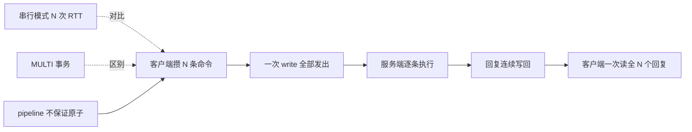
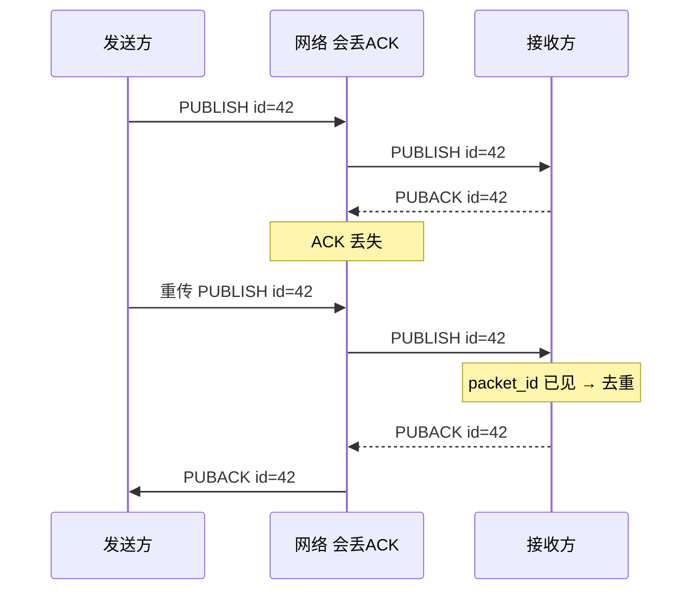
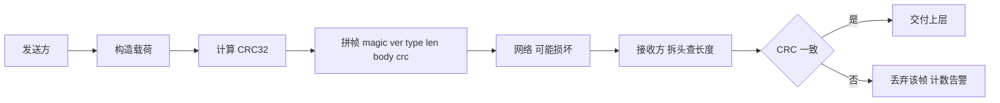
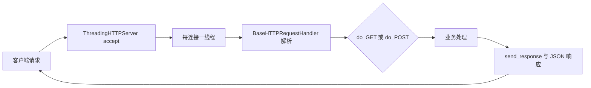
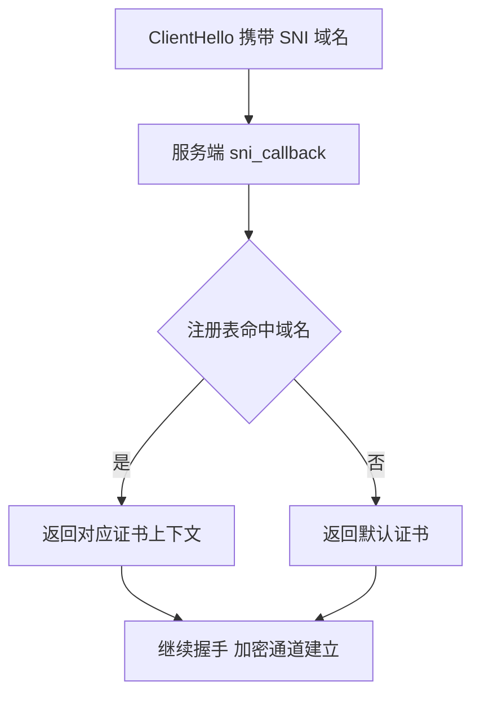
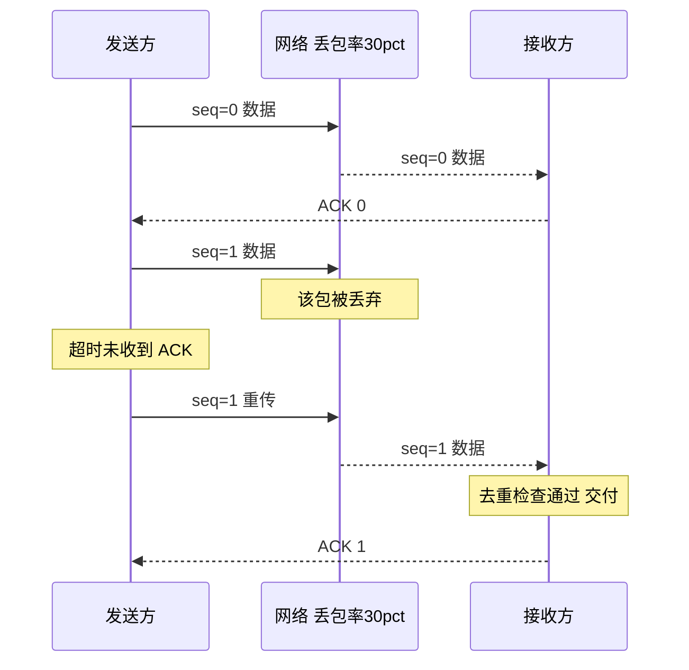
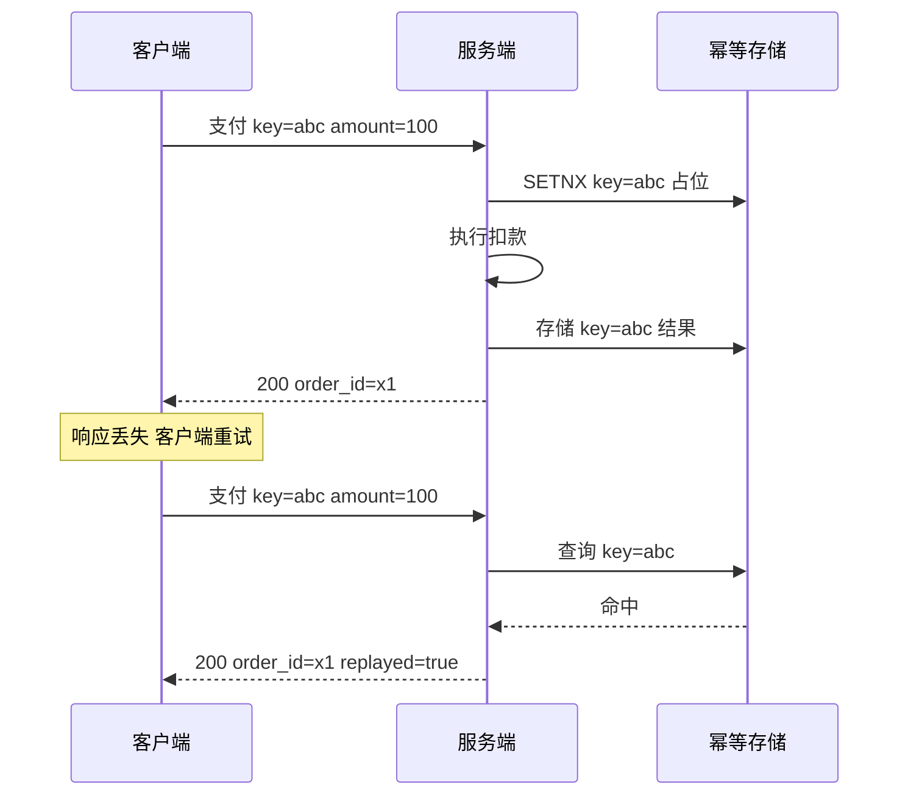

# 第 2 类 · 并发与网络工程(45)

> 本篇是协议与服务篇:拆解 Redis RESP、Memcached 文本协议、MQTT、gRPC/protobuf 的报文结构与语义,演示自研二进制协议(版本/长度/校验/TLV 兼容)的完整设计,并讨论序列化选型与 JSON 的工程陷阱。
> 服务侧覆盖 HTTP 服务进阶、WSGI/ASGI、健康检查、优雅重启、TLS 实战(证书过期监控/SNI/mTLS)、企业代理合规与一套网络故障排查清单(SLA/熔断/幂等/配额/审计)。
> 全部代码仅标准库、完整可运行;涉及证书的题目用系统 openssl 现场生成,演示环境即跑即验。

---

### Q666 · 协议设计三要素:语法、语义、时序

> 难度:★★★☆ | 标签:协议设计, 状态机, 架构

**问**:评价一个通信协议好不好,你会从哪几个维度看?

**答**:经典三要素:语法(报文的字节格式——帧结构、编码、校验)、语义(每个字段的含义与处理规则——收到 HELLO 是什么意思、未知命令怎么办)、时序(谁在什么时刻允许发什么——请求响应交错规则、乱序处理)。语法决定解析器,语义决定处理器,时序决定状态机;三者都要写进协议文档。工程上还要加两条:可扩展性(版本与未知字段策略)与错误处理(每一步失败后的行为要确定)。下面的演示把三要素落成一个强制"HELLO→AUTH→DATA→BYE"时序的最小协议服务端。

```python
# file: code/02_并发与网络工程/q666_protocol_elements.py
import socket
import threading

# 语法: 文本帧, 命令+参数, \n 分隔
# 语义: 每个命令的参数与响应
# 时序: 状态机 ALLOWED = 当前状态 → {命令: 下一状态}
TRANSITIONS = {
    "INIT": {"HELLO": "GREETED"},
    "GREETED": {"AUTH": "READY", "BYE": "CLOSED"},
    "READY": {"DATA": "READY", "BYE": "CLOSED"},
}


def serve(conn: socket.socket) -> None:
    state = "INIT"
    conn.settimeout(2)
    try:
        while state != "CLOSED":
            line = conn.recv(256).decode().strip()
            if not line:
                break
            cmd = line.split(" ")[0]
            nxt = TRANSITIONS.get(state, {}).get(cmd)
            if nxt is None:
                conn.sendall(f"ERR out-of-order {cmd} in {state}\n".encode())  # 时序违规
                continue
            if cmd == "AUTH" and len(line.split(" ")) < 2:
                conn.sendall(b"ERR missing token\n")  # 语义校验
                continue
            state = nxt
            conn.sendall(f"OK state={state}\n".encode())
    except (OSError, socket.timeout):
        pass
    finally:
        conn.close()


def server(stop: threading.Event, port_box: list) -> None:
    srv = socket.socket()
    srv.setsockopt(socket.SOL_SOCKET, socket.SO_REUSEADDR, 1)
    srv.bind(("127.0.0.1", 0))
    srv.listen(8)
    port_box.append(srv.getsockname()[1])
    srv.settimeout(0.2)
    while not stop.is_set():
        try:
            conn, _ = srv.accept()
        except socket.timeout:
            continue
        threading.Thread(target=serve, args=(conn,), daemon=True).start()
    srv.close()


def run_client(port: int, script: list) -> None:
    c = socket.create_connection(("127.0.0.1", port), timeout=2)
    for line in script:
        c.sendall((line + "\n").encode())
        c.settimeout(2)
        print(f"  发 {line!r} → {c.recv(256).decode().strip()}")
    c.close()


if __name__ == "__main__":
    stop = threading.Event()
    box: list = []
    threading.Thread(target=server, args=(stop, box), daemon=True).start()
    while not box:
        import time
        time.sleep(0.01)
    print("正常时序:")
    run_client(box[0], ["HELLO", "AUTH token-1", "DATA payload", "BYE"])
    print("违规时序 (未 HELLO 直接 DATA):")
    run_client(box[0], ["DATA payload", "HELLO"])
    stop.set()
```

**追问**:1) 协议文档里最容易漏写什么?——错误路径:收到不完整帧、未知版本、非法状态时"断连还是报错继续",漏写后各实现行为不一致,兼容问题都出在这。2) 三要素分别对应实现里的哪个组件?——语法→解析器(字节到结构)、语义→处理器(结构到行为)、时序→状态机(连接状态迁移);一个协议 bug 通常能归因到其中一层,联调排障也按层查。3) 可扩展性为什么算第四要素?——没有版本与未知字段策略的协议,第一次加字段就要全量停机升级;TLV/版本协商(Q683)必须一开始就设计进去,事后补等于重构。4) 生产陷阱?——文档只写正常路径,各实现对错误行为不一致;时序状态没有超时定义,卡在中间状态的连接永远挂着;校验口径没写清(长度含不含头、CRC 字段是否置零)。

---

### Q667 · Redis RESP2 协议:五种报文格式

> 难度:★★☆ | 标签:RESP, Redis, 文本协议

**问**:RESP2 的报文有哪几种类型?为什么 Redis 选择这种"文本+二进制安全"的混合设计?

**答**:RESP2 用首字节标记五种类型:简单字符串 `+OK\r\n`;错误 `-ERR msg\r\n`;整数 `:1000\r\n`;批量字符串(二进制安全)`$5\r\nhello\r\n`,长度为 -1 表示 NULL;数组 `*2\r\n...` 组合前几者,请求命令就是"批量字符串数组"。设计妙处:协议本身人类可读(调试抓包友好),而 bulk string 的长度前缀让它可以安全携带任意二进制(包括 \r\n 本身);解析只需逐行读+按长度读,实现极简。RESP3 增加了 Map/Set/Push 等类型,基础思想不变。

```python
# file: code/02_并发与网络工程/q667_resp_format.py
from __future__ import annotations  # Python 3.9 兼容: 让 bytes | None 注解延迟求值


def encode_simple(s: str) -> bytes:
    return f"+{s}\r\n".encode()


def encode_error(s: str) -> bytes:
    return f"-{s}\r\n".encode()


def encode_int(n: int) -> bytes:
    return f":{n}\r\n".encode()


def encode_bulk(data: bytes | None) -> bytes:
    if data is None:
        return b"$-1\r\n"          # NULL bulk string
    return b"$" + str(len(data)).encode() + b"\r\n" + data + b"\r\n"


def encode_array(items: list) -> bytes:
    out = b"*" + str(len(items)).encode() + b"\r\n"
    for item in items:
        out += encode_bulk(item)
    return out


def encode_command(*args: str) -> bytes:
    """客户端发送命令: 批量字符串数组。"""
    return encode_array([a.encode() for a in args])


if __name__ == "__main__":
    print("简单字符串:", encode_simple("OK"))
    print("错误:      ", encode_error("WRONGTYPE Operation against a key"))
    print("整数:      ", encode_int(1000))
    print("批量字符串:", encode_bulk(b"hello"))
    print("NULL bulk: ", encode_bulk(None))
    print("数组:      ", encode_array([b"a", b"b"]))
    print()
    print("GET key 命令的实际报文:")
    cmd = encode_command("GET", "user:42")
    print("  原始字节:", cmd)
    print("  可读形式:", cmd.decode().replace("\r\n", "\\r\\n"))
    # 二进制安全验证: 值里含 \r\n 也不会破坏协议
    tricky = encode_bulk(b"line1\r\nline2")
    assert tricky.startswith(b"$12\r\n")
    print("含 CRLF 的值:", tricky, "→ 长度前缀保证二进制安全")
```

**追问**:1) 为什么错误类型要和服务端异常区分开?——错误是"预期中的失败"(key 不存在),要按类型编程处理;而协议级错误(解析失败)直接断连,两者走不同处理路径。2) bulk string 的长度前缀为什么让协议二进制安全?——`$5\r\n` 之后精确读 5 字节,内容含 \r\n 也不会被误切;而简单字符串/错误/整数是行类型,内容绝不能含 \r\n——两种类型的安全边界就在长度前缀。3) RESP3 加了什么、为什么?——Map/Set/Push/Double/NULL 等类型+push(>) 主动消息(Q671);RESP2 里 pub/sub 消息混在数组回复流靠约定识别,歧义大,RESP3 让类型分流成为协议级能力。4) 生产陷阱?——-ERR 没区分错误类别(NOSCRIPT/LOADING 应区别处理);行类型里塞了 \r\n 未校验,整条流错位;RESP2/RESP3 混用时缺 push 分支,消息被当命令回复。

---

### Q668 · RESP 解析器:处理粘包与半包的流式实现

> 难度:★★★☆ | 标签:RESP, 解析器, 流式

**问**:写一个能处理"半包"的 RESP 解析器,核心状态怎么管理?

**答**:解析器就是一个缓冲区状态机:feed 任意字节切片,在缓冲区内循环解析,每种类型按自己的规则消费——行类型(+,-,:)找 \r\n;bulk($)读长度行再精确读 len+2 字节;数组(*)先读元素个数再递归解析 N 个元素。关键性质:每次解析后检查"缓冲区够不够一个完整报文",不够就把控制权还给调用方等更多数据(半包);一次 feed 可能解析出多个报文(粘包),返回列表。长度不够时绝不能硬读,这是流式解析的铁律。

```python
# file: code/02_并发与网络工程/q668_resp_parser.py


class RespParser:
    """流式 RESP2 解析器: feed 任意切片, 输出完整值列表。"""

    def __init__(self) -> None:
        self.buf = b""

    def feed(self, data: bytes) -> list:
        self.buf += data
        out = []
        while True:
            value, consumed = self._parse(self.buf)
            if value is _INCOMPLETE:
                break
            out.append(value)
            self.buf = self.buf[consumed:]
        return out

    def _parse(self, buf: bytes) -> tuple:
        if not buf:
            return _INCOMPLETE, 0
        tag, body = buf[0:1], buf[1:]
        if tag in b"+-:":
            idx = body.find(b"\r\n")
            if idx < 0:
                return _INCOMPLETE, 0
            text = body[:idx].decode()
            n = idx + 2 + 1
            if tag == b"+":
                return text, n
            if tag == b"-":
                return RespError(text), n
            return int(text), n
        if tag == b"$":
            idx = body.find(b"\r\n")
            if idx < 0:
                return _INCOMPLETE, 0
            length = int(body[:idx])
            if length == -1:
                return None, idx + 2 + 1
            start = idx + 2                    # 载荷在 body 内的起点
            end = start + length + 2           # 载荷 + 尾部 CRLF (body 内)
            if len(body) < end:
                return _INCOMPLETE, 0          # 载荷未到齐
            return body[start: start + length], end + 1  # +1: 消耗含首字节标记
        if tag == b"*":
            idx = body.find(b"\r\n")
            if idx < 0:
                return _INCOMPLETE, 0
            count = int(body[:idx])
            if count == -1:
                return None, idx + 2 + 1
            pos = idx + 2 + 1
            items = []
            for _ in range(count):
                item, used = self._parse(buf[pos:])
                if item is _INCOMPLETE:
                    return _INCOMPLETE, 0
                items.append(item)
                pos += used
            return items, pos
        raise ValueError(f"未知 RESP 标记: {tag!r}")


class RespError(Exception):
    pass


_INCOMPLETE = object()


if __name__ == "__main__":
    p = RespParser()
    # 半包: 一个 bulk string 分三次喂入
    r1 = p.feed(b"$11\r\nhello ")
    print("第一片:", r1, "(应为空: 未到齐)")
    r2 = p.feed(b"world")
    print("第二片:", r2)
    r3 = p.feed(b"\r\n")
    print("第三片:", r3, "→", r3[0])

    # 粘包: 三种类型一次喂入
    mixed = b"+OK\r\n:42\r\n*2\r\n$3\r\nfoo\r\n$-1\r\n"
    vals = p.feed(mixed)
    print("粘包解析:", vals)
    assert vals[0] == "OK" and vals[1] == 42 and vals[2] == [b"foo", None]
    print("半包与粘包均正确处理")
```

**追问**:1) 为什么数组解析要递归消费 buf[pos:] 而不是直接操作 self.buf?——保证"整条数组要么完整解析、要么整体回滚等待",避免数组一半进状态机、状态被部分推进的诡异局面。2) 「缓冲不够就归还控制权」违反了会怎样?——硬读要么阻塞要么索引越界;更隐蔽的是数组解析到一半状态被部分推进,后续数据解析错乱;函数式切片(buf[pos:])保证整条报文要么完整解析要么整体回滚。3) 嵌套数组的深度风险?——RESP 数组可嵌套,恶意构造万层嵌套打爆递归栈;生产实现要限嵌套深度与总元素数,超限按协议错误断连。4) 生产陷阱?——feed 一次解析出多条却只取第一条(粘包命令被丢);bytearray 只 append 不裁剪,长连接内存持续增长;用 universal newlines 读流把 \r\n 归一化,长度计算全错。

---

### Q669 · RESP 客户端与服务端:最小完整实现

> 难度:★★★☆ | 标签:RESP, Redis, 协议实现

**问**:不引 redis 库,用标准库实现一个能跑 SET/GET/DEL/PING 的 Redis 风格服务端和客户端,核心代码路径是什么?

**答**:服务端:accept→读字节流→RespParser 喂数据→每解析出一个命令数组就 dispatch(内存 dict 执行)→把结果用 RESP 编码写回。客户端:命令编码为 bulk 数组发送,同步读一个回复解析。整个协议层就是 Q667 编码 + Q668 解析的组合,加上一个 dispatch 表。注意服务端要处理"一次 recv 带来多条命令"(管道预备)和连接关闭的清理。这个实现正是理解 redis-py 底层的捷径。

```python
# file: code/02_并发与网络工程/q669_resp_client.py
import socket
import threading
from q668_resp_parser import RespParser, RespError, _INCOMPLETE  # 复用解析器


def encode_bulk(data: bytes) -> bytes:
    if data is None:
        return b"$-1\r\n"
    return b"$" + str(len(data)).encode() + b"\r\n" + data + b"\r\n"


def encode_command(*args: str) -> bytes:
    out = b"*" + str(len(args)).encode() + b"\r\n"
    for a in args:
        out += encode_bulk(a.encode())
    return out


store: dict = {}


def dispatch(cmd: list) -> bytes:
    """语义层: 命令 → RESP 回复。"""
    name = cmd[0].decode().upper()
    if name == "PING":
        return b"+PONG\r\n"
    if name == "SET" and len(cmd) >= 3:
        store[cmd[1]] = cmd[2]
        return b"+OK\r\n"
    if name == "GET" and len(cmd) >= 2:
        return encode_bulk(store.get(cmd[1]))
    if name == "DEL" and len(cmd) >= 2:
        return b":1\r\n" if store.pop(cmd[1], None) is not None else b":0\r\n"
    return f"-ERR unknown command {name}\r\n".encode()


def server(stop: threading.Event, port_box: list) -> None:
    srv = socket.socket()
    srv.setsockopt(socket.SOL_SOCKET, socket.SO_REUSEADDR, 1)
    srv.bind(("127.0.0.1", 0))
    srv.listen(8)
    port_box.append(srv.getsockname()[1])
    srv.settimeout(0.2)
    while not stop.is_set():
        try:
            conn, _ = srv.accept()
        except socket.timeout:
            continue
        threading.Thread(target=serve_conn, args=(conn,), daemon=True).start()
    srv.close()


def serve_conn(conn: socket.socket) -> None:
    parser = RespParser()
    conn.settimeout(2)
    try:
        while True:
            data = conn.recv(4096)
            if not data:
                break
            for cmd in parser.feed(data):  # 一次可能解析出多条命令 (管道)
                if isinstance(cmd, list):
                    conn.sendall(dispatch(cmd))
    except (OSError, ValueError):
        pass
    finally:
        conn.close()


class RespClient:
    def __init__(self, host: str, port: int) -> None:
        self.sock = socket.create_connection((host, port), timeout=2)
        self.sock.settimeout(2)
        self.parser = RespParser()
        self.pending: list = []  # 未消费的回复队列

    def command(self, *args: str):
        self.sock.sendall(encode_command(*args))
        return self._read_reply()

    def _read_reply(self):
        while not self.pending:
            data = self.sock.recv(4096)
            if not data:
                raise ConnectionError("closed")
            self.pending.extend(self.parser.feed(data))
        reply = self.pending.pop(0)
        if isinstance(reply, RespError):
            raise reply
        return reply


if __name__ == "__main__":
    stop = threading.Event()
    box: list = []
    threading.Thread(target=server, args=(stop, box), daemon=True).start()
    while not box:
        import time
        time.sleep(0.01)

    c = RespClient("127.0.0.1", box[0])
    print("PING:", c.command("PING"))
    print("SET:", c.command("SET", "name", "redis-mini"))
    print("GET:", c.command("GET", "name"))
    print("GET missing:", c.command("GET", "nope"))
    print("DEL:", c.command("DEL", "name"))
    print("DEL again:", c.command("DEL", "name"))
    try:
        c.command("BOGUS")
    except RespError as e:
        print("错误传播:", e)
    c.sock.close()
    stop.set()
```

**追问**:1) 这套同步客户端改造成异步要动哪里?——只换传输层(recv 换成 await reader.read,发送不变),协议编解码层零改动,这也是协议与传输解耦的价值。2) 服务端 dispatch 要注意什么?——单命令异常要回 -ERR 而不是崩掉处理循环;dispatch 用 dict 查表,未注册命令回 unknown command;写回要循环 send 补齐半写。3) 协议层与传输层的解耦怎么体现?——RespParser/编码器不 import socket,输入输出都是 bytes 与结构;换 asyncio/WS 传输零改动——demo 的分层就是 redis-py 的分层方式,也是「协议可测性」的来源。4) 生产陷阱?——一次 recv 带来多条命令只处理第一条;连接关闭没清理会话状态(泄漏);回复类型与语义不匹配(SET 成功应回简单字符串 OK 而不是 bulk)。

---

### Q670 · RESP 管线化:pipeline 与 MULTI 的区别

> 难度:★★★☆ | 标签:pipeline, Redis, RTT 优化

**问**:Redis 的 pipeline 为什么能把批量写入提速一个数量级?它和 MULTI 事务是一回事吗?

**答**:pipeline 把 N 条命令一次性写出,服务端逐条执行后把 N 个回复连续写回,网络成本从 N 次 RTT 变 1 次——批量导入/查询的标准优化。与 MULTI 的区别:pipeline 只是"攒着发",不保证原子性,中间可能插入其他客户端的命令;MULTI/EXEC 是服务端事务,命令入队后一起原子执行。还要注意 pipeline 不是越大越好:整包命令与回复都堆在内存,过大会打爆缓冲,一般按几百到几千条分批。下面实测串行与管线化的耗时差。

```python
# file: code/02_并发与网络工程/q670_resp_pipeline.py
import socket
import threading
import time
from q668_resp_parser import RespParser
from q669_resp_client import encode_command, dispatch  # 复用编解码与语义


def server(stop: threading.Event, port_box: list) -> None:
    srv = socket.socket()
    srv.setsockopt(socket.SOL_SOCKET, socket.SO_REUSEADDR, 1)
    srv.bind(("127.0.0.1", 0))
    srv.listen(8)
    port_box.append(srv.getsockname()[1])
    srv.settimeout(0.2)
    while not stop.is_set():
        try:
            conn, _ = srv.accept()
        except socket.timeout:
            continue
        parser = RespParser()
        try:
            conn.settimeout(2)
            while True:
                data = conn.recv(65536)
                if not data:
                    break
                replies = b"".join(dispatch(cmd) for cmd in parser.feed(data))
                conn.sendall(replies)
        except OSError:
            pass
        finally:
            conn.close()
    srv.close()


def bench(port: int, n: int = 200) -> tuple:
    c = socket.create_connection(("127.0.0.1", port), timeout=3)
    c.settimeout(3)
    parser = RespParser()
    pending: list = []  # 未消费的回复队列 (feed 的返回值汇入, 消费时弹出)

    # 串行: 一发一收
    t0 = time.perf_counter()
    for i in range(n):
        c.sendall(encode_command("SET", f"k{i}", "v"))
        while not pending:
            pending.extend(parser.feed(c.recv(65536)))
        pending.pop(0)
    t_seq = time.perf_counter() - t0

    # 管线化: 全部命令一次写出, 再统一读回复
    parser2 = RespParser()
    pending2: list = []
    batch = b"".join(encode_command("SET", f"k{i}", "v") for i in range(n))
    t0 = time.perf_counter()
    c.sendall(batch)  # 1 次 RTT
    got = 0
    while got < n:
        if pending2:
            pending2.pop(0)
            got += 1
            continue
        pending2.extend(parser2.feed(c.recv(65536)))
    t_pipe = time.perf_counter() - t0
    c.close()
    return t_seq, t_pipe


if __name__ == "__main__":
    stop = threading.Event()
    box: list = []
    threading.Thread(target=server, args=(stop, box), daemon=True).start()
    while not box:
        import time
        time.sleep(0.01)
    t_seq, t_pipe = bench(box[0])
    print(f"串行 200 条: {t_seq * 1000:.1f}ms ({t_seq / 200 * 1000:.3f}ms/条)")
    print(f"管线 200 条: {t_pipe * 1000:.1f}ms ({t_pipe / 200 * 1000:.3f}ms/条)")
    print(f"提速约 {t_seq / max(t_pipe, 1e-9):.0f}x — 省掉的是 N-1 次 RTT")
    stop.set()
```

**追问**:1) 为什么真实 Redis 上 pipeline 提升比本例更夸张?——本机回环 RTT 极小;真实网络 1ms RTT 下,200 条串行仅网络等待就 200ms,管线化仍是 1ms,加上服务端 epoll 唤醒次数减少,差距更大。2) pipeline 与 MULTI 的原子性差异有什么后果?——pipeline 中间可插入其他客户端的命令,「读-改-写」序列仍会竞态,扣款类必须 MULTI/EXEC+WATCH(乐观锁)或 Lua 脚本;把 pipeline 当事务是经典事故源。3) 批量上限怎么定?——命令与回复都整批驻留内存(客户端攒、服务端输出缓冲也攒),过大打爆两端;几百到几千条分批,大 value 的 GET 批量要更小,同时盯 client-output-buffer-limit。4) 生产陷阱?——fire-and-forget 攒几万条不取回复(内存爆+错误不可见);异步客户端里多协程共用连接的 pipeline,回复按请求序错位归属;pipeline 里夹管理命令(EXEC 前的观测)导致语义混乱。

---



---

### Q671 · RESP3 推送类型:服务端主动消息

> 难度:★★★☆ | 标签:RESP3, push, pubsub

**问**:订阅模式下 Redis 怎么在"你还没发命令"时把消息推给你?RESP3 的 Push 类型是什么?

**答**:RESP3 新增 push 类型 `>3\r\n...`(格式像数组但首字节是 >),专门承载服务端主动消息:客户端订阅后,连接上随时可能夹着 push 消息(如订阅通知、失效推送),与普通命令回复交错到达。客户端解析器因此必须"按类型分流":命令回复放进等待队列,push 消息送回调/监听器。RESP2 时代没有专用类型,pub/sub 消息混在普通回复流里靠约定(数组第一个元素是 message)识别,容易和正常回复混淆——这正是 RESP3 设计的动机。

```python
# file: code/02_并发与网络工程/q671_resp3_push.py


class Resp3Parser:
    """在 Q668 基础上支持 RESP3 push 类型 >, 并按类型分流。"""

    def __init__(self) -> None:
        self.buf = b""
        self.replies: list = []
        self.pushes: list = []

    def feed(self, data: bytes) -> None:
        self.buf += data
        while True:
            value, consumed, kind = self._parse(self.buf)
            if value is _INC:
                break
            self.buf = self.buf[consumed:]
            (self.pushes if kind == "push" else self.replies).append(value)

    def _parse(self, buf: bytes) -> tuple:
        if not buf:
            return _INC, 0, "reply"
        tag, body = buf[0:1], buf[1:]
        kind = "push" if tag == b">" else "reply"
        if tag in b"+-:>" or tag in b"*":
            if tag in b"+-:":
                idx = body.find(b"\r\n")
                if idx < 0:
                    return _INC, 0, kind
                text = body[:idx].decode()
                val = text if tag in b"+>" else (int(text) if tag == b":" else text)
                return val, idx + 3, kind
            # 数组或 push: 元素个数为 N
            idx = body.find(b"\r\n")
            if idx < 0:
                return _INC, 0, kind
            count = int(body[:idx])
            pos = idx + 2 + 1
            items = []
            for _ in range(count):
                item, used, _k = self._parse(buf[pos:])
                if item is _INC:
                    return _INC, 0, kind
                items.append(item)
                pos += used
            return items, pos, kind
        if tag == b"$":
            idx = body.find(b"\r\n")
            if idx < 0:
                return _INC, 0, kind
            length = int(body[:idx])
            if length == -1:
                return None, idx + 3, kind
            start = idx + 2                    # 载荷在 body 内的起点
            end = start + length + 2           # 载荷 + 尾部 CRLF (body 内)
            if len(body) < end:
                return _INC, 0, kind           # 载荷未到齐
            return body[start: start + length], end + 1, kind  # +1: 含首字节标记
        raise ValueError(f"未知标记 {tag!r}")


_INC = object()


if __name__ == "__main__":
    p = Resp3Parser()
    # 模拟服务端输出: 普通回复 + push 交错到达 (订阅场景的真实流)
    stream = (
        b":1\r\n"                                   # SUBSCRIBE 的回复
        b">3\r\n$7\r\nmessage\r\n$6\r\nch-at3\r\n$5\r\nhello\r\n"  # push 消息
        b"+OK\r\n"                                  # 另一条命令的回复
        b">2\r\n$10\r\ninvalidate\r\n$4\r\nkey1\r\n"  # 客户端缓存失效推送
    )
    # 分两片喂: 验证 push 恰好被切成两半时也能解析
    p.feed(stream[:40])
    p.feed(stream[40:])
    print("命令回复队列:", p.replies)
    print("push 消息队列:", p.pushes)
    assert p.replies == [1, "OK"]
    assert p.pushes[0][0] == b"message" and p.pushes[1][0] == b"invalidate"
    print("回复与推送已正确分流 — RESP3 的核心改进")
```

**追问**:1) 为什么 push 消息不会"顶掉"命令回复?——类型分流后两个队列独立;命令回复按发送顺序排队,客户端按请求序消费,push 随到随处理,互不阻塞。2) 类型分流在客户端怎么落地?——解析器按首字节分流:> 进 push 队列/回调,普通回复按请求序进等待队列;push 处理器不能阻塞回复消费(独立 task),否则 push 积压拖死整条连接。3) RESP2 时代怎么兼容?——约定式识别:pub/sub 消息是三元素数组(['message', channel, payload]),失效通知同样靠首元素约定;歧义与特判就是 RESP3 加专用类型的动机。4) 生产陷阱?——开启 RESP3 后客户端不处理 push,消息堆缓冲直到超时;push 回调里跑慢逻辑阻塞事件循环;把 push 当命令回复消费,请求-回复错位后全部解析错乱。

---

### Q672 · Memcached 文本协议:get/set 最小客户端

> 难度:★★☆ | 标签:Memcached, 文本协议, 缓存

**问**:Memcached 的 ASCII 协议长什么样?和 RESP 比,设计取向有什么不同?

**答**:Memcached 文本协议是"行命令+裸数据"风格:set 的请求是 `set key flags exptime bytes\r\n` + 恰好 bytes 字节的裸数据 + `\r\n`,回复 `STORED`;get 是 `get key1 key2\r\n`,回复若干 `VALUE key flags bytes\r\n<data>\r\n` 块,最后 `END\r\n`。与 RESP 的差异:Memcached 更"扁平"(无类型标签,靠命令区分),get 支持一次多 key,协议人肉 telnet 就能调;但二进制安全靠显式字节数声明,出错就整条流错位——所有长度必须精确。新版本也提供 binary 协议(见 Q673)。

```python
# file: code/02_并发与网络工程/q672_memcached_text.py
import socket
import threading


def memcached_server(stop: threading.Event, port_box: list) -> None:
    store: dict = {}
    srv = socket.socket()
    srv.setsockopt(socket.SOL_SOCKET, socket.SO_REUSEADDR, 1)
    srv.bind(("127.0.0.1", 0))
    srv.listen(8)
    port_box.append(srv.getsockname()[1])
    srv.settimeout(0.2)

    def handle(conn: socket.socket) -> None:
        conn.settimeout(2)
        buf = b""
        try:
            while True:
                data = conn.recv(65536)
                if not data:
                    break
                buf += data
                while b"\r\n" in buf:
                    line, buf = buf.split(b"\r\n", 1)
                    parts = line.decode().split()
                    if parts[0] == "set":
                        _cmd, key, flags, exptime, nbytes = parts
                        nbytes = int(nbytes)
                        while len(buf) < nbytes + 2:  # 数据 + \r\n 可能未到齐
                            chunk = conn.recv(65536)
                            if not chunk:
                                return
                            buf += chunk
                        value, buf = buf[:nbytes], buf[nbytes + 2:]
                        store[key] = (int(flags), value)
                        conn.sendall(b"STORED\r\n")
                    elif parts[0] == "get":
                        out = b""
                        for key in parts[1:]:
                            if key in store:
                                flags, value = store[key]
                                out += (f"VALUE {key} {flags} {len(value)}\r\n").encode() + value + b"\r\n"
                        out += b"END\r\n"
                        conn.sendall(out)
                    else:
                        conn.sendall(b"ERROR\r\n")
        except OSError:
            pass
        finally:
            conn.close()

    while not stop.is_set():
        try:
            conn, _ = srv.accept()
        except socket.timeout:
            continue
        threading.Thread(target=handle, args=(conn,), daemon=True).start()
    srv.close()


class MemcachedClient:
    def __init__(self, host: str, port: int) -> None:
        self.sock = socket.create_connection((host, port), timeout=2)
        self.sock.settimeout(2)
        self.buf = b""  # 接收缓冲: 一次 recv 可能吞进多行, 必须按帧切分

    def _fill(self) -> None:
        chunk = self.sock.recv(4096)
        if not chunk:
            raise ConnectionError("server closed connection")
        self.buf += chunk

    def _readline(self) -> bytes:
        """读到一行 (含 CRLF); 多读的字节留在缓冲区给后续读取。"""
        while b"\r\n" not in self.buf:
            self._fill()
        line, self.buf = self.buf.split(b"\r\n", 1)
        return line + b"\r\n"

    def _read_exact(self, n: int) -> bytes:
        while len(self.buf) < n:
            self._fill()
        out, self.buf = self.buf[:n], self.buf[n:]
        return out

    def set(self, key: str, value: bytes, flags: int = 0, exptime: int = 0) -> bool:
        head = f"set {key} {flags} {exptime} {len(value)}\r\n".encode()
        self.sock.sendall(head + value + b"\r\n")
        return self._readline() == b"STORED\r\n"

    def get(self, *keys: str) -> dict:
        self.sock.sendall(("get " + " ".join(keys) + "\r\n").encode())
        result = {}
        while True:
            line = self._readline()
            if line == b"END\r\n":
                break
            _tag, key, _flags, nbytes = line.decode().split()
            nbytes = int(nbytes)
            data = self._read_exact(nbytes + 2)  # 裸数据 + 尾部 CRLF
            result[key] = data[:nbytes]
        return result


if __name__ == "__main__":
    stop = threading.Event()
    box: list = []
    threading.Thread(target=memcached_server, args=(stop, box), daemon=True).start()
    while not box:
        import time
        time.sleep(0.01)

    c = MemcachedClient("127.0.0.1", box[0])
    print("set:", c.set("user:1", b'{"name":"ada"}'))
    print("set:", c.set("user:2", b"\x00\x01\x02binary"))
    got = c.get("user:1", "user:2", "missing")
    for k, v in got.items():
        print(f"get {k}: {v!r}")
    assert got["user:2"] == b"\x00\x01\x02binary"
    print("一次 get 多 key + 二进制安全验证通过")
    c.sock.close()
    stop.set()
```

**追问**:1) 为什么 get 的多 key 返回里"不存在的 key 完全不出现"?——省流量且语义明确(没有 VALUE 行=未命中);代价是调用方不能区分"未命中"与"该 key 曾被 CAS 删除后立刻过期",需要时得用 gets 带 cas 值。2) 「裸数据+显式字节数」出错会怎样?——长度声明与实际不符时整条流错位且无重同步机制,后续所有回复解析全乱;这是文本协议携带二进制的通病,RESP 用类型标签+长度前缀缓解。3) get 多 key 的返回怎么解析?——逐个 VALUE 块(头行+裸数据)读到 END;返回顺序不保证与请求一致,按 VALUE 行里的 key 归位;不存在的 key 静默缺失(见原问),要区分「未命中」语义就用 gets 带 cas。4) 生产陷阱?——value 超过单 key 上限(默认 1MB)写入失败但错误状态没人看;flags/exptime 非法值整条命令被拒;ASCII 协议端口对外暴露,telnet 即可改缓存。

---

### Q673 · Memcached binary 协议:固定头解析

> 难度:★★★☆ | 标签:binary 协议, struct, 对比

**问**:Memcached 的二进制协议头是什么结构?文本协议和二进制协议各适合什么场景?

**答**:binary 请求固定 24 字节头:magic(1)opcode(1)key length(2)extras length(1)data type(1)vbucket/状态(2)total body length(4)opaque(4)CAS(8),body 按 extras+key+value 顺序拼接。固定头让解析器只需一次 unpack 就能拿到全部路由信息,机器解析效率高、无歧义;文本协议则可读性无敌、telnet 可调、代理易实现。实践取向:人少流量小用文本(好排障),高吞吐多语言 SDK 用 binary(省解析 CPU);两者报文含义一一对应。

```python
# file: code/02_并发与网络工程/q673_memcached_binary.py
import struct

REQ_HEADER = struct.Struct("!BBHBBHIIQ")  # 24 字节请求头
RESP_HEADER = struct.Struct("!BBHBBHIIQ")  # 响应头同构

MAGIC_REQ = 0x80
MAGIC_RES = 0x81
OP_GET = 0x00
OP_SET = 0x01


def build_set_request(key: bytes, value: bytes, flags: int = 0, exptime: int = 0,
                      opaque: int = 1) -> bytes:
    """SET: extras = flags(4) + exptime(4)。"""
    extras = struct.pack("!II", flags, exptime)
    total = len(extras) + len(key) + len(value)
    header = REQ_HEADER.pack(
        MAGIC_REQ, OP_SET, len(key), len(extras), 0, 0, total, opaque, 0
    )
    return header + extras + key + value


def build_get_request(key: bytes, opaque: int = 2) -> bytes:
    header = REQ_HEADER.pack(MAGIC_REQ, OP_GET, len(key), 0, 0, 0, len(key), opaque, 0)
    return header + key


def parse_response(raw: bytes) -> dict:
    magic, opcode, key_len, extras_len, dtype, status, total, opaque, cas = \
        RESP_HEADER.unpack_from(raw, 0)
    body = raw[24:24 + total]
    extras = body[:extras_len]
    key = body[extras_len:extras_len + key_len]
    value = body[extras_len + key_len:]
    return {"opcode": opcode, "status": status, "key": key,
            "value": value, "opaque": opaque, "cas": cas}


if __name__ == "__main__":
    set_req = build_set_request(b"user:1", b"ada")
    print(f"SET 请求 {len(set_req)} 字节 = 24 头 + 8 extras + 6 key + 3 value")
    print("  头部 hex:", set_req[:24].hex(" "))

    get_req = build_get_request(b"user:1")
    print(f"GET 请求 {len(get_req)} 字节, 头部:", get_req[:24].hex(" "))

    # 模拟服务端响应: GET 命中
    value = b"ada"
    resp_body = value  # 无 extras
    resp = RESP_HEADER.pack(
        MAGIC_RES, OP_GET, 0, 0, 0, 0, len(resp_body), 2, 12345
    ) + resp_body
    parsed = parse_response(resp)
    print("响应解析:", parsed)
    assert parsed["value"] == b"ada" and parsed["opaque"] == 2
    print("opaque 字段回传: 客户端用它把响应配对到请求 (管线的基石)")

    # 对比文本协议报文
    print("\n同一 SET 的文本协议: 'set user:1 0 0 3\\r\\nada\\r\\n' =",
          len(b"set user:1 0 0 3\r\nada\r\n"), "字节")
```

**追问**:1) opaque 字段的作用是什么?——请求方填的任意 32 位 id,响应原样带回,配合管线把乱序到达的响应配对回请求;没有它,二进制协议管线就必须严格按序读回复。2) 固定头与 TLV 的取舍?——24 字节定长头一次 unpack 拿全部路由信息,解析最快实现最简,但扩展靠 opcode/版本、无 TLV 灵活;自研协议的平衡点是「定长头+预留字段」(Q680)。3) opaque 与 CAS 各解决什么?——opaque 是请求-响应配对 id,管线乱序返回时靠它配对;CAS 是乐观锁版本号防覆盖——前者是传输问题后者是一致性问题,设计协议时分清两类机制。4) 生产陷阱?——total body length 算错(extras+key+value 三段漏加)整条流错位;管线不填 opaque,乱序响应配错请求;binary 端口与文本端口混开,排障时协议混淆。

---

### Q674 · MQTT 概念:发布订阅、QoS 与遗嘱

> 难度:★★☆ | 标签:MQTT, 发布订阅, IoT

**问**:MQTT 的核心模型是什么?为什么 IoT 场景几乎都选它?

**答**:MQTT 是中心化 broker 的发布订阅协议:生产者按 topic 发布,消费者按通配符订阅,broker 负责路由——收发双方完全解耦,互不知道地址。三个杀手级特性贴合弱网设备:QoS 分级(最多一次/至少一次/恰好一次)让用户按重要度权衡成本;遗嘱消息(LWT)——连接异常断开时 broker 代发预设消息,天然实现"设备掉线告警";保留消息(retained)——新订阅者立即收到最后一条状态,免等下一轮上报。协议头最小 2 字节、长连接低功耗,这是它统治 IoT 的原因。

```python
# file: code/02_并发与网络工程/q674_mqtt_model.py
"""用标准库数据结构模拟 MQTT 的核心语义: 连接/订阅/发布/遗嘱/保留。"""
import queue
import threading
import time
from typing import Optional


class SimBroker:
    def __init__(self) -> None:
        self.subs: dict = {}        # client -> set of topic filters
        self.mailboxes: dict = {}   # client -> Queue
        self.retained: dict = {}    # topic -> last payload
        self.wills: dict = {}       # client -> will message
        self.online: set = set()

    def connect(self, client: str, will: Optional[str] = None) -> dict:
        # 注: str | None(PEP 604)运行时求值要 3.10+, 参数默认值注解
        # 在 3.9 直接 TypeError, 兼容写法用 Optional
        packet = {"type": "CONNECT", "client": client, "will": will}
        self.mailboxes[client] = queue.Queue()
        self.subs[client] = set()
        self.wills[client] = will
        self.online.add(client)
        return {"type": "CONNACK", "rc": 0}  # 连接成功

    def subscribe(self, client: str, topic_filter: str, delivery: bool = True) -> None:
        self.subs[client].add(topic_filter)
        if delivery:
            self.mailboxes[client].put(
                {"type": "SUBACK", "filter": topic_filter, "qos": 0})
        # 保留消息: 新订阅者立即收到最后一条
        for topic, payload in self.retained.items():
            if topic_matches(topic_filter, topic):
                self.mailboxes[client].put(
                    {"type": "PUBLISH", "topic": topic, "payload": payload,
                     "retained": True, "qos": 0})

    def publish(self, client: str, topic: str, payload: str,
                retain: bool = False) -> None:
        if retain:
            self.retained[topic] = payload
        for sub, filters in self.subs.items():
            if sub == client or sub not in self.online:
                continue
            for f in filters:
                if topic_matches(f, topic):
                    self.mailboxes[sub].put(
                        {"type": "PUBLISH", "topic": topic,
                         "payload": payload, "retained": False, "qos": 0})

    def disconnect(self, client: str, abnormal: bool = False) -> None:
        self.online.discard(client)
        will = self.wills.get(client)
        if abnormal and will:
            for sub, filters in self.subs.items():
                if sub in self.online and "status/+" in filters:
                    self.mailboxes[sub].put(
                        {"type": "PUBLISH", "topic": "status/lwt",
                         "payload": will, "retained": False, "qos": 0})


def topic_matches(flt: str, topic: str) -> bool:
    """MQTT 通配符: + 单层, # 多层 (必须位于末尾)。"""
    f_parts, t_parts = flt.split("/"), topic.split("/")
    for i, fp in enumerate(f_parts):
        if fp == "#":
            return i == len(f_parts) - 1
        if i >= len(t_parts):
            return False
        if fp != "+" and fp != t_parts[i]:
            return False
    return len(f_parts) == len(t_parts)


if __name__ == "__main__":
    def next_publish(broker, client):
        """跳过 SUBACK 等控制包, 取下一条 PUBLISH(模拟 SDK 只上抛数据包)。"""
        while True:
            msg = broker.mailboxes[client].get(timeout=1)
            if msg["type"] == "PUBLISH":
                return msg

    broker = SimBroker()
    print("sensor 连接 (带遗嘱):", broker.connect("sensor-1", will="sensor-1 offline"))
    print("app 连接:", broker.connect("app"))
    broker.subscribe("app", "status/+")
    broker.subscribe("app", "sensor/1/#")
    broker.subscribe("app", "data/#")

    broker.publish("sensor-1", "sensor/1/temp", "23.5", retain=True)
    time.sleep(0.05)
    print("app 收到:", next_publish(broker, "app"))

    print("app2 重连订阅后立即拿到保留消息:")
    broker.connect("app2")
    broker.subscribe("app2", "sensor/1/temp")
    print("  ", next_publish(broker, "app2"))

    print("sensor 异常掉线 → 遗嘱送达订阅者:")
    broker.disconnect("sensor-1", abnormal=True)
    print("  ", next_publish(broker, "app"))
```

**追问**:1) 遗嘱和保留消息能叠加吗?——可以:遗嘱消息也可以设 retain,设备异常掉线后,后续所有订阅者都能立刻知道它已离线,这是"在线状态服务"的经典搭建方式。2) QoS 三级的代价与适用?——QoS0 最多一次(最快,丢得起的状态上报);QoS1 至少一次(一次 ACK 往返,可能重复,配业务幂等);QoS2 恰好一次(四步握手最贵,审计计费类才用);弱网高延迟下 QoS2 成本要实测再定。3) 遗嘱(LWT)怎么工作?——CONNECT 时注册遗嘱,会话异常断开(broker 未收到 DISCONNECT)时 broker 代发,正常下线不发;配合 retain 叠加(见原问)即可搭在线状态服务。4) 生产陷阱?——keepalive 过短,弱网频繁误判掉线触发遗嘱风暴;clean session 配置与订阅恢复预期不一致,重连后收不到消息;QoS1 没去重导致控制命令重复执行。

---

### Q675 · MQTT 通配符路由:+ 与 # 的匹配器实现

> 难度:★★☆ | 标签:MQTT, 通配符, 路由

**问**:MQTT 的主题通配符规则是什么?写一个匹配器要小心哪些边界?

**答**:两级通配符:`+` 匹配恰好一层(`sensor/+/temp` 命中 sensor/1/temp 但不命中 sensor/1/x/temp);`#` 匹配剩余全部层级且必须放末尾(`sensor/#` 命中 sensor 与 sensor/a/b)。发布方不能用通配符,只有订阅方可以。实现边界:`+`/`#` 是"层"级别而非字符串级别(a+b 不算通配);`sport/#` 也匹配 `sport` 本身(# 可匹配零层);`/` 开头的主题首层是空串。broker 的订阅量大时,匹配要从"遍历全部过滤器"优化成主题树(trie)。

```python
# file: code/02_并发与网络工程/q675_topic_match.py


def topic_matches(flt: str, topic: str) -> bool:
    """MQTT 主题过滤器匹配。"""
    f_parts = flt.split("/")
    t_parts = topic.split("/")
    for i, fp in enumerate(f_parts):
        if fp == "#":
            return i == len(f_parts) - 1  # # 必须是最后一层, 匹配剩余全部 (可为零层)
        if i >= len(t_parts):
            return False
        if fp == "+":
            continue  # 匹配任意单层
        if fp != t_parts[i]:
            return False
    return len(f_parts) == len(t_parts)


CASES = [
    # (过滤器, 主题, 期望)
    ("sport/+", "sport/", True),
    ("sport/+", "sport/football", True),
    ("sport/+", "sport/football/score", False),
    ("sport/#", "sport", True),              # # 匹配零层
    ("sport/#", "sport/football/score", True),
    ("+/tennis/#", "sport/tennis/player1/score", True),
    ("#", "a/b/c", True),
    ("a/+/c", "a//c", True),                  # 空层也匹配 +
    ("a/+/c", "a/b/c/d", False),
    ("sensor/1/temp", "sensor/1/temp", True),
    ("sensor/1/temp", "sensor/1/hum", False),
    ("#", "empty", True),
]


class TopicTrie:
    """订阅量大的 broker 用 trie 把匹配从 O(n) 过滤器降到 O(主题长度)。"""

    def __init__(self) -> None:
        self.root: dict = {}
        self.subs: dict = {}

    def add(self, client: str, flt: str) -> None:
        node = self.root
        for part in flt.split("/"):
            node = node.setdefault(part, {})
        node.setdefault("$subs", set()).add(client)

    def match(self, topic: str) -> set:
        found: set = set()
        parts = topic.split("/")

        def walk(node: dict, i: int) -> None:
            if "$subs" in node:
                found.update(node["$subs"])
            if i >= len(parts):
                if "#" in node:
                    found.update(node["#"]["$subs"])
                return
            if "#" in node:  # # 在中间也是该子树所有订阅者
                found.update(node["#"].get("$subs", set()))
                return
            if parts[i] in node:
                walk(node[parts[i]], i + 1)
            if "+" in node:
                walk(node["+"], i + 1)

        walk(self.root, 0)
        return found


if __name__ == "__main__":
    for flt, topic, expect in CASES:
        got = topic_matches(flt, topic)
        mark = "OK " if got == expect else "FAIL"
        print(f"  [{mark}] {flt!r} vs {topic!r} → {got}")
        assert got == expect

    trie = TopicTrie()
    trie.add("app1", "sensor/+")
    trie.add("app2", "sensor/1/#")
    trie.add("app3", "other/x")
    print("trie 匹配 sensor/1/temp:", trie.match("sensor/1/temp"))
    assert trie.match("sensor/1/temp") == {"app1", "app2"}
```

**追问**:1) `$SYS/` 开头的系统主题为什么要特殊处理?——`#` 按规则会匹配到 `$SYS`,但协议规定 `$` 开头的主题不匹配首层通配符(避免普通订阅者收到 broker 内部监控数据),实现时首层是 `$` 前缀的要在匹配器里排除。2) 匹配器的性能与数据结构?——订阅量大时逐条遍历 O(N) 成瓶颈,标准优化是主题 trie:按层建树、订阅挂节点、发布沿主题走树收集;+/# 是特殊子节点,通配订阅位置一目了然。3) 边界语义最容易错的三处?——# 匹配零层(sport/# 命中 sport 本身);+ 是「层」不是字符串(a+ 不算通配);/ 开头主题首层是空串(sensor//temp 合法);$ 前缀首层特殊(见原问)。4) 生产陷阱?——发布方误用通配符(协议禁止,broker 必须拒绝而不是静默当字面量);通配订阅 $SYS 收海量监控消息拖垮客户端;层级分隔符与业务路径重载,过滤规则越来越拧巴。

---

### Q676 · MQTT QoS1:至少一次的重传与去重

> 难度:★★★★ | 标签:QoS, 重传, 恰好一次

**问**:QoS1 的"至少一次"是怎么实现的?为什么会有重复消息,接收端怎么办?

**答**:QoS1 = PUBLISH + PUBACK 双向确认:发送方发出带 packet_id 的 PUBLISH 后进入等待,超时未收到 PUBACK 就重传同一 packet_id,直到确认(或达到重试上限判死链路)。重复的根源:ACK 本身可能在路上丢——发送方重传了,但接收端其实第一次就收到了,于是同一条消息处理两次。所以接收端必须按 packet_id 去重(记录已处理的 id 直到确认完成),并且业务侧要配合幂等(Q706)。"恰好一次"(QoS2)用四步握手中转态解决重复,但成本翻倍,大多数业务 QoS1 + 幂等更划算。

```python
# file: code/02_并发与网络工程/q676_qos1.py
import queue
import threading
import time


class Qos1Channel:
    """模拟 QoS1 通道: 指定前 N 个 ACK 丢弃(确定性), 发送方重传, 接收端去重。

    注意别用 random 概率丢包: 丢包率 1.0 会把所有 ACK 全丢光,
    重传路径上产生的重复次数就不止 1, 断言不稳定。
    """

    def __init__(self, drop_first_ack: int = 1) -> None:
        self.drop_first_ack = drop_first_ack
        self._ack_seq = 0
        self.inbound: "queue.Queue[dict]" = queue.Queue()
        self.acks: "queue.Queue[int]" = queue.Queue()
        self.delivered: list = []
        self.seen_ids: set = set()
        self.dup_detected = 0
        self._stop = threading.Event()
        threading.Thread(target=self._receiver, daemon=True).start()

    def _receiver(self) -> None:
        while not self._stop.is_set():
            try:
                msg = self.inbound.get(timeout=0.1)
            except queue.Empty:
                continue
            pid = msg["packet_id"]
            if pid in self.seen_ids:
                self.dup_detected += 1
                print(f"[receiver] 重复 PUBLISH id={pid} → 去重, 仅重发 ACK")
            else:
                self.seen_ids.add(pid)
                self.delivered.append(msg["payload"])
                print(f"[receiver] 首次交付: {msg['payload']} (id={pid})")
            self._ack_seq += 1
            if self._ack_seq <= self.drop_first_ack:
                print(f"[network] PUBACK id={pid} 丢失 → 发送方将重传")
            else:
                self.acks.put(pid)  # PUBACK

    def send_with_retry(self, payload: str, packet_id: int,
                        timeout: float = 0.1, max_retry: int = 3) -> bool:
        for attempt in range(1, max_retry + 1):
            print(f"[sender] PUBLISH 尝试 {attempt}: {payload} (id={packet_id})")
            self.inbound.put({"packet_id": packet_id, "payload": payload})
            try:
                acked = self.acks.get(timeout=timeout)
                if acked == packet_id:
                    print(f"[sender] 收到 PUBACK id={packet_id}, 交付确认")
                    return True
            except queue.Empty:
                continue  # 超时重传同一 packet_id
        return False

    def close(self) -> None:
        self._stop.set()


if __name__ == "__main__":
    ch = Qos1Channel(drop_first_ack=1)  # 首个 ACK 必丢, 强制走一次重传路径
    ok = ch.send_with_retry("temp=23.5", packet_id=42)
    time.sleep(0.2)
    ch.close()
    print(f"\n交付结果: {ch.delivered}")
    print(f"重复检测: 接收端发现 {ch.dup_detected} 次重复, 业务只处理 1 次")
    print(f"发送方确认: {ok}")
    assert ok, "重传后应收到 PUBACK"
    assert ch.delivered == ["temp=23.5"], "去重保证恰好处理一次"
    assert ch.dup_detected == 1
```

**追问**:1) 为什么 QoS2 需要 four-way 而两个包不够?——两步(发+确认)无法区分"重复投递"和"首次投递后 ACK 丢";QoS2 用 PUBLISH→PUBREC→PUBREL→PUBCOMP 四步把"存储待确认"变成显式状态,双方都能幂等推进。2) packet_id 的生命周期怎么管理?——同一 id 从发出到确认期间不可复用,确认后回收;QoS2 的四步里同一 id 要跨 PUBREC/PUBREL 多个状态,状态机按 id 记阶段;重传沿用同一 id 才能让接收端去重。3) 协议层去重与业务幂等的分工?——协议层按 packet_id 只能保证「投递一次给业务」,业务处理完、确认发出前崩溃仍会重复;所以端到端必须业务幂等(Q706),两层防线缺一不可。4) 生产陷阱?——重传间隔固定无退避,弱网重传风暴;去重表不随确认释放,长期运行内存涨;把 QoS2 当「业务恰好一次」(业务处理与确认之间崩溃仍重复)。

---



---

### Q677 · gRPC 概念:HTTP/2 之上的 RPC 与 stub

> 难度:★★★☆ | 标签:gRPC, RPC, HTTP2

**问**:gRPC 的调用在协议层长什么样?它比 REST+JSON 快在哪?

**答**:gRPC 把"调用本地函数"映射到网络:客户端 stub(由 .proto 生成的强类型代码)把方法名+消息体编码后发往服务器,格式是 HTTP/2 帧内嵌 LENGTH-PREFIXED 消息(5 字节前缀:1 字节压缩标志+4 字节长度+protobuf 消息),路径是 /package.Service/Method,元数据走 HTTP/2 headers,状态码走 trailers。快在三点:HTTP/2 多路复用(一连接并发多调用)、protobuf 二进制编码(体积/解析远小于 JSON)、以及四种流模式(unary/server-stream/client-stream/bidi)。生成 stub 的价值是接口即契约,跨语言类型安全。

```python
# file: code/02_并发与网络工程/q677_rpc_stub.py
"""不依赖 gRPC 库, 用 JSON 模拟 unary RPC 的骨架: schema + stub + 服务端 dispatch。"""
import json
import socket
import struct
import threading

SCHEMA = {
    "user.UserService/GetUser": {
        "request": {"user_id": int},
        "response": {"user_id": int, "name": str},
    },
    "user.UserService/ListUsers": {
        "request": {"limit": int},
        "response_stream": True,
    },
}


def encode_frame(obj: dict) -> bytes:
    """gRPC 消息帧: 1 字节压缩标志 + 4 字节大端长度 + 载荷 (此处用 JSON 代 protobuf)。"""
    body = json.dumps(obj).encode()
    return struct.pack("!BI", 0, len(body)) + body


def read_frame(sock: socket.socket) -> dict:
    def recv(n: int) -> bytes:
        buf = b""
        while len(buf) < n:
            chunk = sock.recv(n - len(buf))
            if not chunk:
                raise ConnectionError("closed")
            buf += chunk
        return buf

    _flag, length = struct.unpack("!BI", recv(5))
    return json.loads(recv(length))


class Server:
    def __init__(self) -> None:
        self.methods = {
            "user.UserService/GetUser": self.get_user,
        }

    def get_user(self, req: dict) -> tuple:
        if not isinstance(req.get("user_id"), int):
            return None, "INVALID_ARGUMENT user_id must be int"
        return {"user_id": req["user_id"], "name": f"user-{req['user_id']}"}, None


def serve(sock: socket.socket) -> None:
    srv = Server()
    try:
        while True:
            req = read_frame(sock)  # 请求: {"method": ..., "payload": ...}
            method = req["method"]
            handler = srv.methods.get(method)
            if handler is None:
                resp = {"status": "UNIMPLEMENTED"}
            else:
                result, err = handler(req["payload"])
                resp = {"payload": result, "status": err or "OK"}
            sock.sendall(encode_frame(resp))
    except (ConnectionError, json.JSONDecodeError):
        pass
    finally:
        sock.close()


def server(stop: threading.Event, port_box: list) -> None:
    l = socket.socket()
    l.setsockopt(socket.SOL_SOCKET, socket.SO_REUSEADDR, 1)
    l.bind(("127.0.0.1", 0))
    l.listen(4)
    port_box.append(l.getsockname()[1])
    l.settimeout(0.2)
    while not stop.is_set():
        try:
            conn, _ = l.accept()
        except socket.timeout:
            continue
        threading.Thread(target=serve, args=(conn,), daemon=True).start()
    l.close()


class Stub:
    """客户端存根: 调用像本地方法。"""

    def __init__(self, host: str, port: int) -> None:
        self.sock = socket.create_connection((host, port), timeout=2)
        self.sock.settimeout(2)

    def call(self, method: str, payload: dict) -> dict:
        self.sock.sendall(encode_frame({"method": method, "payload": payload}))
        return read_frame(self.sock)


if __name__ == "__main__":
    stop = threading.Event()
    box: list = []
    threading.Thread(target=server, args=(stop, box), daemon=True).start()
    while not box:
        import time
        time.sleep(0.01)

    stub = Stub("127.0.0.1", box[0])
    print("正常调用:", stub.call("user.UserService/GetUser", {"user_id": 42}))
    print("参数错误:", stub.call("user.UserService/GetUser", {"user_id": "x"}))
    print("未知方法:", stub.call("user.UserService/DeleteAll", {}))
    stub.sock.close()
    stop.set()
```

**追问**:1) gRPC 的四种流模式分别适合什么?——unary 普通请求响应;server-stream 推送/大结果分页;client-stream 批量上传聚合;bidi 双向实时(聊天/协同),HTTP/2 的 stream 机制是它们统一的地基。2) trailers 是什么、状态码为什么走 trailer?——HTTP/2 响应可分首部+DATA+尾首部;gRPC 把 grpc-status/grpc-message 放 trailer,消息先流、状态后到,流式响应中途失败也能带状态送达;REST 没有这个通道。3) 四种流模式的背压与死锁?——server-stream 靠 HTTP/2 流控天然背压;client-stream 批量上传要分块+确认点;bidi 两端独立读写要防「互相等」(约定谁先关发送方向);流式消息处理不能阻塞读循环。4) 生产陷阱?——两端 max message size 不一致,大消息 RESOURCE_EXHAUSTED;keepalive 参数与服务端不一致被 GOAWAY;L4 负载均衡让长连接粘滞单实例,要客户端 LB(Q643)或 L7。

---

### Q678 · protobuf 编码原理:varint 与 tag

> 难度:★★★★ | 标签:protobuf, varint, 编码

**问**:protobuf 怎么把一条消息压成几个字节?varint 的编码规则是什么?

**答**:每个字段编码成 tag+value:tag = (field_number << 3) | wire_type,wire_type 标记载荷形态(0=varint,1=64位,2=长度前缀,5=32位)。varint 是可变长整数:每字节低 7 位承载数据,最高位是"还有后续"标志,小数字(0-127)只要 1 字节——这是 protobuf 体积小的主要来源(字段号小+varint 短)。字符串/嵌套消息用 wire_type 2:长度前缀+UTF-8/字节载荷。解码端靠 tag 里的字段号定位,未知字段跳过(前向兼容)。经典例子:field 1 = 150 编码为 0x08 0x96 0x01,只有 3 字节。

```python
# file: code/02_并发与网络工程/q678_protobuf_varint.py


def encode_varint(n: int) -> bytes:
    """无符号 varint: 每 7 位一组, 高位为续传标志。"""
    out = bytearray()
    while True:
        b = n & 0x7F
        n >>= 7
        if n:
            out.append(b | 0x80)  # 最高位置 1: 还有后续字节
        else:
            out.append(b)
            return bytes(out)


def decode_varint(buf: bytes, pos: int = 0) -> tuple:
    result = 0
    shift = 0
    while True:
        b = buf[pos]
        pos += 1
        result |= (b & 0x7F) << shift
        if not b & 0x80:
            return result, pos
        shift += 7


WIRE_VARINT, WIRE_LEN = 0, 2


def encode_field_varint(field: int, value: int) -> bytes:
    tag = (field << 3) | WIRE_VARINT
    return encode_varint(tag) + encode_varint(value)


def encode_field_string(field: int, s: str) -> bytes:
    tag = (field << 3) | WIRE_LEN
    payload = s.encode()
    return encode_varint(tag) + encode_varint(len(payload)) + payload


def decode_message(buf: bytes) -> dict:
    msg = {}
    pos = 0
    while pos < len(buf):
        tag, pos = decode_varint(buf, pos)
        field, wire = tag >> 3, tag & 0x7
        if wire == WIRE_VARINT:
            msg[field], pos = decode_varint(buf, pos)
        elif wire == WIRE_LEN:
            length, pos = decode_varint(buf, pos)
            msg[field] = buf[pos:pos + length].decode()
            pos += length
        else:
            raise ValueError(f"演示不支持 wire_type {wire}")
    return msg


if __name__ == "__main__":
    # 经典验证: message { int32 id = 1; } id=150 → 08 96 01
    assert encode_varint(150) == b"\x96\x01"
    assert decode_varint(b"\x96\x01") == (150, 2)
    print("varint 150:", encode_varint(150).hex(" "), "(协议文档同款)")

    # 完整消息: {id=150, name='ada'}
    msg = encode_field_varint(1, 150) + encode_field_string(2, "ada")
    print("完整消息:", msg.hex(" "), f"共 {len(msg)} 字节")
    print("解码:", decode_message(msg))
    assert decode_message(msg) == {1: 150, 2: "ada"}

    # 对比 JSON 同内容
    import json
    j = json.dumps({"id": 150, "name": "ada"}).encode()
    print(f"JSON {len(j)} 字节 vs protobuf {len(msg)} 字节 → 体积比 {len(j) / len(msg):.1f}x")

    # 大数与边界
    print("varint 2^31:", encode_varint(2 ** 31).hex(" "), "(5 字节, 每 7 位进一位)")
    assert decode_varint(encode_varint(2 ** 31)) == (2 ** 31, 5)
```

**追问**:1) 为什么 proto3 里字段删除要保留编号(reserved)?——字段号是线上格式的一部分,复用旧编号会让新字段被老实现按旧语义解码,数据静默损坏;reserved 编号+名称让编译器防住这种错误。2) wire_type 不匹配会发生什么?——解码按 wire_type 决定读多长载荷,类型改了就读错字节,数据静默损坏;这就是「同字段号禁换类型」的底层原因,与 reserved(见原问)同根源。3) 为什么负数要用 sint?——varint 对 int32 负数做符号扩展,编码成 10 字节;sint 用 zigzag(0→0,-1→1,1→2)把小负数压回 1 字节;字段可能为负时选型必须 sint32/sint64。4) 生产陷阱?——字段号复用新旧语义冲突,数据静默损坏;packed repeated 与旧解析器不兼容;float 存金额精度失真(用整数分或字符串);proto2 optional/proto3 presence 语义混用,「字段没发」与「字段为默认值」分不清。

---

### Q679 · 序列化选型:JSON / msgpack / cbor / protobuf

> 难度:★★★☆ | 标签:序列化, 选型, 性能

**问**:给内部服务间通信选序列化格式,你的决策树是什么?

**答**:按四个轴权衡:可读性/调试性、体积、编解码 CPU、跨语言类型保真。JSON:人类可读、生态无敌,体积与解析开销大,数字只有 double 精度语义;msgpack/cbor:二进制 JSON,体积小 30-50%、解析快,cbor 是 IETF 标准(带类型语义,时间/bigfloat),适合日志管道与边缘设备;protobuf/flatbuffer:强 schema、最小体积、生成代码,适合高频 RPC 与存储格式。决策路径:对外 API 与人看的数据用 JSON;内部高频通道上 protobuf(有 schema 评审需求)或 msgpack(无 schema 痛点);绝不用 pickle 跨信任边界(反序列化即代码执行)。

```python
# file: code/02_并发与网络工程/q679_serialization_bench.py
import json
import struct
import timeit
from datetime import datetime

RECORD = {
    "id": 12345678,
    "name": "device-42",
    "active": True,
    "score": 98.6,
    "tags": ["edge", "beta"],
    "ts": "2026-11-01T12:00:00",
}


def encode_binary(rec: dict) -> bytes:
    """手工二进制编码: 定长头 + 字段, 模拟 msgpack/protobuf 思路。"""
    body = b"".join([
        struct.pack("!I", rec["id"]),
        struct.pack("!B", len(rec["name"])) + rec["name"].encode(),
        struct.pack("!B", 1 if rec["active"] else 0),
        struct.pack("!f", rec["score"]),
        struct.pack("!B", len(rec["tags"])) + b"".join(
            struct.pack("!B", len(t)) + t.encode() for t in rec["tags"]),
    ])
    return struct.pack("!H", len(body)) + body


if __name__ == "__main__":
    j = json.dumps(RECORD).encode()
    b = encode_binary(RECORD)
    print(f"JSON  体积: {len(j)} 字节")
    print(f"二进制体积: {len(b)} 字节 (约省 {(1 - len(b) / len(j)) * 100:.0f}%)")

    n = 20000
    t_json = timeit.timeit(lambda: json.loads(json.dumps(RECORD)), number=n)
    t_bin_enc = timeit.timeit(lambda: encode_binary(RECORD), number=n)

    def decode_binary(raw: bytes):
        blen = struct.unpack("!H", raw[:2])[0]
        body = raw[2:2 + blen]
        off = 0
        id_ = struct.unpack_from("!I", body, off)[0]; off += 4
        nlen = body[off]; off += 1
        name = body[off:off + nlen].decode(); off += nlen
        active = bool(body[off]); off += 1
        score = struct.unpack_from("!f", body, off)[0]; off += 4
        ntags = body[off]; off += 1
        tags = []
        for _ in range(ntags):
            tl = body[off]; off += 1
            tags.append(body[off:off + tl].decode()); off += tl
        return {"id": id_, "name": name, "active": active, "score": score, "tags": tags}

    t_bin_dec = timeit.timeit(lambda: decode_binary(encode_binary(RECORD)), number=n)
    print(f"json roundtrip  {n} 次: {t_json * 1000:.0f}ms")
    print(f"binary 编码     {n} 次: {t_bin_enc * 1000:.0f}ms")
    print(f"binary 编解码   {n} 次: {t_bin_dec * 1000:.0f}ms")

    rt = decode_binary(b)
    print("二进制解码结果:", rt)
    print("注意 float 精度: 98.6 → struct 单精度 →", rt["score"],
          "(cbor/msgpack 用 double 可避免)")

    # pickle 的能力与危险演示
    import pickle
    p = pickle.dumps({"ts": datetime(2026, 11, 1)})
    print(f"pickle 能原生携带 datetime ({len(p)} 字节), 但 loads 不可信数据 = 任意代码执行")
```

**追问**:1) 序列化升级(加字段)时格式迁移怎么做?——二进制格式靠字段号/版本位保证双读(新旧共存期两版都能解析);JSON 靠"只加不删不改语义"+容忍未知字段;切忌同字段切换类型。2) 数字精度在各格式里的差异?——JSON 数字语义弱(解析器自由决定 int/float,到 JS 超 2^53 丢精度);msgpack 有整数/浮点类型但默认映射仍有坑;protobuf 字段类型显式(int64/fixed64)跨语言保真最强——选型要把消费端的数字处理能力算进去(Q686)。3) 体积与 CPU 怎么实测?——用真实 payload 对各格式做 dumps+loads 基准(体积、编码耗时、解码耗时),别背百分比结论;开启压缩后格式间体积差距收窄,瓶颈会移到 CPU 侧。4) 生产陷阱?——pickle 跨信任边界(反序列化即代码执行,只限进程内可信数据);schema 演进不守纪律(reserved/只加不删);把大对象序列化放进热路径日志,序列化本身成为瓶颈。

---

### Q680 · 自研二进制协议:版本+长度+校验的头部设计

> 难度:★★★★ | 标签:协议设计, 二进制, 校验

**问**:设计一个自研 TCP 协议,头部应该放哪些字段?每个字段解决什么问题?

**答**:最小完备头:魔数(2B,快速识别流量是否本协议,防火墙/调试都受益)、版本(1B,升级共存)、类型(1B,消息语义路由)、flags(1B,压缩/加密/必答等开关)、长度(4B,粘包定界+上限校验)、校验(4B CRC32,完整性)、再加保留字段(未来扩展)。设计原则:头部定长(解析器简单)、字段大端(跨平台一致)、长度上限写进协议(防恶意超长帧)、校验覆盖"头+体"且 CRC 字段本身置零后计算。每一步校验失败都该断连而不是带病解析。

```python
# file: code/02_并发与网络工程/q680_frame_header.py
import struct
import zlib

MAGIC = b"PY"
VERSION = 1
HEADER = struct.Struct("!2sBBBBII")  # magic ver type flags rsv length crc
MAX_BODY = 1024 * 1024

T_HELLO, T_DATA, T_PING = 0x01, 0x02, 0x03
FLAG_COMPRESSED = 0x01


def build_frame(msg_type: int, body: bytes, flags: int = 0, version: int = VERSION) -> bytes:
    crc = zlib.crc32(MAGIC + bytes([version, msg_type, flags, 0]))  # 头参与校验
    crc = zlib.crc32(body, crc)
    header = HEADER.pack(MAGIC, version, msg_type, flags, 0, len(body), crc)
    return header + body


def parse_frame(data: bytes) -> dict:
    if len(data) < HEADER.size:
        raise ValueError("头不完整")
    magic, ver, mtype, flags, _rsv, length, crc = HEADER.unpack_from(data)
    if magic != MAGIC:
        raise ValueError(f"魔数不匹配: {magic!r}")
    if ver != VERSION:
        raise ValueError(f"版本不匹配: {ver}")
    if length > MAX_BODY:
        raise ValueError(f"长度超限: {length}")
    body = data[HEADER.size: HEADER.size + length]
    expect = zlib.crc32(MAGIC + bytes([ver, mtype, flags, 0]))
    expect = zlib.crc32(body, expect)
    if crc != expect:
        raise ValueError(f"CRC 校验失败: 期望 {expect:#x} 实际 {crc:#x}")
    if len(body) < length:
        raise ValueError("载荷不完整")  # 流式场景由上层缓冲后重试
    return {"version": ver, "type": mtype, "flags": flags,
            "length": length, "body": body}


if __name__ == "__main__":
    frame = build_frame(T_DATA, b"payload-1234", flags=FLAG_COMPRESSED)
    print(f"帧总长 {len(frame)} 字节 = 头 {HEADER.size} + 体 {len(frame) - HEADER.size}")
    print("头部 hex:", frame[:HEADER.size].hex(" "))

    parsed = parse_frame(frame)
    print("解析:", parsed)
    assert parsed["body"] == b"payload-1234"

    # 防御性校验逐一演示
    bad_magic = b"XX" + frame[2:]
    try:
        parse_frame(bad_magic)
    except ValueError as e:
        print("魔数错误拦截:", e)
    bad_ver = frame[:2] + bytes([9]) + frame[3:]
    try:
        parse_frame(bad_ver)
    except ValueError as e:
        print("版本错误拦截:", e)
    bad_crc = frame[:-1] + bytes([frame[-1] ^ 0xFF])
    try:
        parse_frame(bad_crc)
    except ValueError as e:
        print("CRC 错误拦截:", e)
```

**追问**:1) CRC 能替代应用层重传吗?——不能:CRC 只检测"这一帧损坏",帧丢了还是丢了;可靠性由 TCP 保证,应用层校验是"防御中间设备/内存位翻转"的最后一道线,常与序列号配合做应用层确认。2) 每个字段校验失败该怎么处置?——魔数不对=不是本协议流量,立即断连;版本不识别=回「版本不支持」再断;长度超限=断连防灌垃圾;CRC 错=丢帧还是断连取决于策略(Q681)——错误处置本身就是协议语义(Q666),都要写进文档。3) 头部布局有什么纪律?——字段顺序一旦发布即冻结(固定偏移 unpack);预留 2-4 字节给未来扩展;长度上限写进协议;大端统一(Q684)。4) 生产陷阱?——长度无上限校验,恶意声明 4GB 打爆内存;校验覆盖范围两端口径不一;版本字段只升不协商,新客户端上线旧服务端全断。

---

### Q681 · 自研协议编解码器:字节流上的帧切分

> 难度:★★★★ | 标签:编解码, 粘包, 状态机

**问**:有了帧格式,怎么写一个能处理任意字节切片到达顺序的编解码器?

**答**:把解析器做成"feed 流式"接口:内部一个 bytearray 缓冲,每次 feed 追加后循环:缓冲不足一个头→返回;头合法但体未到齐→返回;完整→切出一帧交给回调/返回列表,推进缓冲。两个工程细节:缓冲要防增长(头非法或长度超限立刻断连,不给缓冲区灌垃圾的机会);帧与帧之间零残留(切完正好剩不足一帧的字节)。与 Q668 的 RESP 解析器同构——所有流式协议解析器都是这个形状:缓冲+循环+完整性检查。

```python
# file: code/02_并发与网络工程/q681_frame_codec.py
import struct
import zlib

HEADER = struct.Struct("!2sBBHI")  # magic ver type flags length (演示简化, 校验放体尾)
MAGIC = b"PY"
MAX_BODY = 65536


def encode(msg_type: int, body: bytes, flags: int = 0, ver: int = 1) -> bytes:
    crc = zlib.crc32(body)
    return HEADER.pack(MAGIC, ver, msg_type, flags, len(body)) + body + struct.pack("!I", crc)


class FrameDecoder:
    def __init__(self) -> None:
        self.buf = bytearray()
        self.frames: list = []
        self.errors: list = []

    def feed(self, data: bytes) -> list:
        self.buf += data
        out = []
        while True:
            if len(self.buf) < HEADER.size:
                break
            magic, ver, mtype, flags, length = HEADER.unpack_from(self.buf, 0)
            if magic != MAGIC:
                self.errors.append(f"bad magic at offset, drop {len(self.buf)} bytes")
                self.buf.clear()  # 防灌垃圾: 头非法立即清空
                break
            if length > MAX_BODY:
                self.errors.append(f"length {length} 超限, 断连级错误")
                self.buf.clear()
                break
            total = HEADER.size + length + 4
            if len(self.buf) < total:
                break  # 半包: 等更多数据
            body = bytes(self.buf[HEADER.size: HEADER.size + length])
            (crc,) = struct.unpack_from("!I", self.buf, HEADER.size + length)
            if zlib.crc32(body) != crc:
                self.errors.append("CRC mismatch, drop frame")
                del self.buf[:total]  # 只丢这一帧, 继续解析后续
                continue
            out.append({"ver": ver, "type": mtype, "flags": flags, "body": body})
            del self.buf[:total]
        return out


if __name__ == "__main__":
    d = FrameDecoder()
    f1 = encode(0x01, b"hello")
    f2 = encode(0x02, b"x" * 100, flags=0x01)
    f3 = encode(0x03, b"tail")

    # 极端切片: 头被劈开、帧体逐字节到达、多帧合并
    stream = f1 + f2 + f3
    chunks = [stream[:3], stream[3:20], stream[20:21], stream[21:110],
              stream[110:111], stream[111:]]

    got: list = []
    for i, chunk in enumerate(chunks):
        frames = d.feed(chunk)
        got.extend(frames)
        print(f"feed 片段{i} ({len(chunk)}B) → 解析出 {len(frames)} 帧, 缓冲 {len(d.buf)}B")

    print(f"\n共解析 {len(got)} 帧:", [f["body"][:10] for f in got])
    assert [f["body"] for f in got] == [b"hello", b"x" * 100, b"tail"]

    # CRC 损坏帧: 只丢该帧不伤后续
    d2 = FrameDecoder()
    corrupted = f1[:-1] + bytes([f1[-1] ^ 0xFF]) + f3
    frames = d2.feed(corrupted)
    print("CRC 损坏后恢复:", [f["body"] for f in frames], "错误:", d2.errors)
    assert [f["body"] for f in frames] == [b"tail"]
```

**追问**:1) 为什么 CRC 失败只丢当前帧而不是清空整个缓冲?——损坏通常局限于单帧(线路抖动/内存位翻转),帧边界由长度字段确定仍可信;清空缓冲会误杀后续好帧,除非头本身已不可信。2) 缓冲防增长的具体手段?——魔数/长度超限立即断连(坏流量别喂缓冲);正常流切完帧及时裁剪缓冲(del buf[:pos] 或视图偏移),长连接才有稳定内存;帧回调只入队不执行业务,解析不被拖住。3) 与 RESP 解析器(Q668)的同构说明什么?——所有流式协议解析器都是「缓冲+循环+完整性检查」三件套,差异只在「完整帧的定义」;掌握这个形状就能通读 redis-py 等客户端源码。4) 生产陷阱?——CRC 失败清空整缓冲误杀后续好帧(见原问);帧回调里做慢业务导致缓冲堆积;「长度是否含头」两端口径不一致,偶发错位极难复现。

---

### Q682 · CRC 校验:原理与 zlib.crc32

> 难度:★★★☆ | 标签:CRC, 校验和, 可靠性

**问**:CRC 比 simple checksum 强在哪?CRC32 能检测出所有错误吗?

**答**:CRC 是多项式除法取余:把数据看作多项式比特串,除以约定的生成多项式,余数作为校验值。相比累加和,它对"突发错误"的检测能力有数学保证——CRC32(多项式 0xEDB88320)可检测所有 ≤32 位突发、所有奇数个位错误、所有 ≤5 位随机错误。但它不是加密学摘要:恶意构造碰撞很容易,防篡改要用 HMAC/SHA-256;它只防"意外损坏"(线路噪声、内存位翻转)。标准库 zlib.crc32 是查表实现,自己写逐位版用于理解原理,两者结果必须一致。

```python
# file: code/02_并发与网络工程/q682_crc.py
import zlib


def crc32_bitwise(data: bytes) -> int:
    """逐位 CRC32 (生成多项式 0xEDB88320, 反射算法)。"""
    crc = 0xFFFFFFFF
    for byte in data:
        crc ^= byte
        for _ in range(8):
            if crc & 1:
                crc = (crc >> 1) ^ 0xEDB88320
            else:
                crc >>= 1
    return crc ^ 0xFFFFFFFF


def build_table() -> list:
    table = []
    for i in range(256):
        c = i
        for _ in range(8):
            c = (c >> 1) ^ 0xEDB88320 if c & 1 else c >> 1
        table.append(c)
    return table


TABLE = build_table()


def crc32_table(data: bytes) -> int:
    crc = 0xFFFFFFFF
    for byte in data:
        crc = TABLE[(crc ^ byte) & 0xFF] ^ (crc >> 8)
    return crc ^ 0xFFFFFFFF


if __name__ == "__main__":
    samples = [b"", b"a", b"hello world", bytes(range(256)), b"123456789"]
    for s in samples:
        a, b, c = crc32_bitwise(s), crc32_table(s), zlib.crc32(s) & 0xFFFFFFFF
        assert a == b == c, s
        print(f"  {s[:12]!r:<18} CRC32 = {a:08x}")

    # 检测能力演示: 单位翻转一定被发现
    original = b"critical payload 0x42"
    base = crc32_table(original)
    flipped = bytearray(original)
    flipped[5] ^= 0x10  # 翻转一个比特
    assert crc32_table(bytes(flipped)) != base
    print("单比特翻转被 CRC 捕获:", crc32_table(bytes(flipped)) != base)

    # 局限演示: CRC 不是防篡改工具 — 利用 GF(2) 线性性, 瞬间构造同 CRC 的不同数据
    # 原理: 等长消息满足 crc(m ^ d) = crc(m) ^ crc(d) ^ crc(全零); 末尾 5 字节
    # 提供 40 比特自由度 > 32 位 CRC, 必有非零比特组合使 CRC 不变 (40>32, 鸽笼)
    L = len(original)
    zero_crc = crc32_table(b"\x00" * L)
    basis: dict = {}  # XOR 线性基: 最高有效位 -> (列向量, 所用比特组合)
    kernel = None
    for i in range(40):  # 逐列建基, 某列被先前列线性表出时即找到碰撞组合
        e = bytearray(L)
        e[L - 5 + i // 8] = 1 << (i % 8)
        v, combo = crc32_table(bytes(e)) ^ zero_crc, 1 << i
        while v:
            h = v.bit_length() - 1
            if h not in basis:
                basis[h] = (v, combo)
                break
            v ^= basis[h][0]
            combo ^= basis[h][1]
        else:            # v 归零: 这 40 个比特的该组合与原文 CRC 一致
            kernel = combo
            break
    assert kernel, "40 比特自由度必有非零碰撞 (rank ≤ 32 < 40)"
    forged = bytearray(original)
    for i in range(40):  # 把解出的碰撞比特组合异或进末尾 5 字节
        if kernel >> i & 1:
            forged[L - 5 + i // 8] ^= 1 << (i % 8)
    assert bytes(forged) != original and crc32_table(bytes(forged)) == base
    assert zlib.crc32(bytes(forged)) & 0xFFFFFFFF == zlib.crc32(original) & 0xFFFFFFFF
    print(f"构造出同 CRC 的不同数据: {bytes(forged)!r} → 防恶意篡改必须用 HMAC (Q375)")
```

**追问**:1) 为什么协议里 CRC 常放在帧尾而不是帧头?——发送端先算好体再拼头更自然;且"头定长+CRC 在尾"让校验计算不用先剥离头;有些协议头里带"头 CRC"、尾带"全帧 CRC"双保险(如以太网)。2) CRC32 的保证边界怎么表述?——对突发错误与奇数个位错误有数学保证(边界由生成多项式决定,如 CRC32 可检测全部 ≤32 位突发);精确结论要按多项式说,别背含糊的「能检测大多数错误」。3) 为什么 CRC 不能防篡改?——CRC 是无密钥的线性运算,攻击者可改数据并同步重算校验值;防篡改用 HMAC-SHA256 或签名;CRC 的定位是「防意外损坏」——线路噪声、内存位翻转。4) 生产陷阱?——把 zlib.crc32 当安全校验用;计算时校验字段未置零(结果恒错);大帧校验在纯 Python 逐位实现里跑(zlib.crc32 是 C 实现,且支持分段累积 crc 参数)。

---



---

### Q683 · 协议兼容升级:TLV 与版本协商

> 难度:★★★★ | 标签:协议升级, TLV, 向后兼容

**问**:协议要加新字段,怎么保证新旧版本能同时在线运行?

**答**:两条互补机制。TLV(Type-Length-Value)载荷:每个字段自描述,解析器按 type 分发——认识的消费、不认识的可跳过(有 length 就能跳),天然向前兼容;再给字段加"必须位"(required flag),关键新字段可要求老版本直接报错而不是静默忽略。版本协商:握手报文带双方版本,取交集或由服务端决定降级策略。纪律:字段号永不复用(参照 protobuf reserved)、只加不删、语义变化必须升版本号而不是复用旧类型。演示双向兼容:老解析器读新报文(跳过未知),新解析器读老报文(缺字段给默认值)。

```python
# file: code/02_并发与网络工程/q683_tlv_compat.py
import struct

TLV = struct.Struct("!BH")  # type(1) + length(2)
FLAG_REQUIRED = 0x80        # type 高位: 必须理解, 否则报错

TYPE_NAME, TYPE_SCORE, TYPE_REGION, TYPE_TRACE = 0x01, 0x02, 0x03, 0x84


def encode_tlv(ftype: int, value: bytes) -> bytes:
    required = ftype & FLAG_REQUIRED
    base = ftype & 0x7F
    return TLV.pack(required | base, len(value)) + value


def encode_v1() -> bytes:
    return encode_tlv(TYPE_NAME, b"ada") + encode_tlv(TYPE_SCORE, b"99")


def encode_v2() -> bytes:
    return (encode_v1()
            + encode_tlv(TYPE_REGION, b"cn-east")          # 老版本可安全跳过
            + encode_tlv(TYPE_TRACE, b"trace-id-xyz"))     # 带必须位: 老版本须报错


def parse(buf: bytes, known: dict, version: int) -> dict:
    fields = {}
    pos = 0
    while pos < len(buf):
        ftype, length = TLV.unpack_from(buf, pos)
        pos += TLV.size
        value = buf[pos:pos + length]
        pos += length
        required = ftype & FLAG_REQUIRED
        base = ftype & 0x7F
        if base in known:
            fields[known[base]] = value.decode()
        elif required:
            raise ValueError(
                f"v{version} 遇到不认识的必须字段 type={base}: 拒绝处理 (fail fast)")
        else:
            print(f"    [v{version}] 跳过未知可选字段 type={base} len={length} (前向兼容)")
    return fields


if __name__ == "__main__":
    v1_fields = {0x01: "name", 0x02: "score"}
    v2_fields = {0x01: "name", 0x02: "score", 0x03: "region", 0x04: "trace"}

    v1 = encode_v1()
    v2 = encode_v2()
    print(f"v1 报文 {len(v1)}B, v2 报文 {len(v2)}B (新增 region 与 trace 字段)")

    print("v1 解析器读 v1:", parse(v1, v1_fields, 1))
    print("v2 解析器读 v2:", parse(v2, v2_fields, 2))
    print("v2 解析器读 v1:", parse(v1, v2_fields, 2))
    print("v1 解析器读 v2 (trace 是新增必须字段, 旧解析器必然 fail fast):")
    try:
        print("  →", parse(v2, v1_fields, 1))
    except ValueError as e:
        print("  →", e)
```

**追问**:1) 版本号在头部而不是每字段一个,粒度是不是太粗?——是刻意的:字段级版本会让解析矩阵爆炸;粗粒度版本+TLV 可选字段已经覆盖 90% 演进需求,真正的语义破坏性变更就该整个升版本。2) TLV 的「跳过未知字段」依赖什么?——length 字段:解析器读到不认识的 type,按 length 跳过 value 继续下一字段;前提是 length 编码统一且覆盖 value 全长——没有 length 的变长 TLV 就失去了向前兼容能力。3) 版本协商的握手怎么设计?——握手报文带双方支持的版本区间,服务端取交集选版,无交集回协商失败;协商结果决定后续字段集/命令集,写在会话内——避免「版本字段只升不协商」的硬断裂。4) 生产陷阱?——同 type 字段语义悄悄变化没升版本(两版对同一值理解不同,静默出错);关键新字段没加 required 位被老版本静默忽略(安全绕过);解析按字段顺序而非按 type 查找,新增字段顺序变化就崩。

---

### Q684 · 大端小端与网络字节序

> 难度:★★☆ | 标签:字节序, struct, 网络字节序

**问**:为什么跨机器协议必须规定字节序?socket.inet_aton 里的地址是什么序?

**答**:多字节数值在内存里的排列有两种:x86/ARM 小端(低位字节在前)、网络设备/协议传统大端(高位在前)。同一 int32 在两种机器上裸发会得到相反的数,所以协议规定"线上统一用网络字节序(大端)",发送前 htonl/htons 转换,接收后 ntohl/ntohs 转回。Python 里 struct 的 '!' 格符即网络序,'<' 即小端;'=' 用本机原生序(危险,禁止跨平台协议使用)。单字节字段与字节串无字节序问题——这也是 protobuf tag/长度都用 varint(逐字节)规避字节序的原因之一。

```python
# file: code/02_并发与网络工程/q684_endianness.py
import socket
import struct
import sys

VALUE = 0x12345678

if __name__ == "__main__":
    print("本机原生字节序:", sys.byteorder)

    be = struct.pack("!I", VALUE)   # 网络序 = 大端
    le = struct.pack("<I", VALUE)   # 小端
    native = struct.pack("=I", VALUE)
    print(f"大端   !I: {be.hex(' ')}")
    print(f"小端   <I: {le.hex(' ')}")
    print(f"原生   =I: {native.hex(' ')} (={'大端' if sys.byteorder == 'big' else '小端'})")
    assert struct.unpack("!I", be)[0] == VALUE
    assert struct.unpack("<I", le)[0] == VALUE

    # socket 字节序转换函数: 与 struct ! 等价
    n = socket.htonl(VALUE)
    print(f"htonl 结果 0x{n:08x} (内存按本机序解释即为大端字节排列)")
    assert socket.ntohl(n) == VALUE
    h = socket.htons(8080)
    print(f"htons(8080) = {h:#06x} → 线上字节 {h.to_bytes(2, 'big').hex(' ')}")

    # IP 地址的"点分十进制"本身就是大端读法
    packed = socket.inet_aton("192.168.1.1")
    print(f"inet_aton('192.168.1.1') = {packed.hex(' ')} (第一字节 0xc0 即 192 在最前 = 大端)")
    num = struct.unpack("!I", packed)[0]
    print(f"按网络序读成 uint32 = {num:#010x}")

    # 反例: 小端机器上用 '=' 传协议的灾难
    print("\n危险演示: 两台机器用 '=' 互传 0x12345678")
    print("  大端机解读小端机数据:", struct.unpack("!I", le)[0], "(错值!)")
    print("结论: 协议字段一律 '!' 或显式 '<', 永远不用 '='")
```

**追问**:1) varint 为什么天然没有字节序问题?——它按 7 位逐字节串行输出,每个字节独立有意义,不存在"多字节数值整体怎么排"的问题;这也是它适合字段 tag 的原因。2) struct 前缀 '!' '<' '=' 的纪律?——'!' 网络大端、'<' 显式小端、'=' 本机原生序;跨平台协议一律 '!' 或显式 '<';'=' 与无前缀(原生序+原生对齐)绝不能上线——同一 bytes 在两台机器解出不同数值。3) socket 模块的地址转换与字节序什么关系?——inet_aton/inet_ntoa 返回与接受的已是网络序 4 字节;与 struct 打包整数时分清「已转换的字节串」与「原始整数」,双重转换是常见 bug。4) 生产陷阱?——x86 开发机用原生序测试通过,与对端 C 服务(或大端环境)联调解出反数;float 的 IEEE754 字节排列同样有端序问题被忽略;无前缀 struct 带对齐填充,连长度都随平台变。

---

### Q685 · 二进制数据的文本承载:Base64 与代价

> 难度:★★☆ | 标签:Base64, 二进制安全, JSON

**问**:JSON 里要传一张图片/一段加密数据怎么办?Base64 的开销和陷阱是什么?

**答**:Base64 把任意字节映射成 64 个可打印字符,让二进制能安全穿过"只接受文本"的通道(JSON/XML/HTTP 头/DNS 记录)。代价:体积膨胀 4/3(约 +33%),CPU 编解码开销,移动端流量敏感场景要掂量。三个工程陷阱:URL 上下文要用 URL-safe 变体(+/ 换成 -_,否则被转义破坏);标准 Base64 会补 = 且可含换行(MIME 模式),解码端要容忍;Base64 是编码不是加密——携带密钥/敏感数据只是"看不懂"不是"安全"。替代方案:大数据走对象存储只传 URL,协议层则优先选原生二进制格式(msgpack/cbor/protobuf bytes)避免编码税。

```python
# file: code/02_并发与网络工程/q685_base64.py
import base64
import json


def json_with_binary(obj: dict, binary_fields: set) -> bytes:
    """约定: binary_fields 中的字段以 base64 字符串承载。"""
    payload = {}
    for k, v in obj.items():
        payload[k] = base64.b64encode(v).decode() if k in binary_fields else v
    return json.dumps(payload).encode()


def parse_json_with_binary(raw: bytes, binary_fields: set) -> dict:
    payload = json.loads(raw)
    return {k: (base64.b64decode(v) if k in binary_fields else v)
            for k, v in payload.items()}


if __name__ == "__main__":
    blob = bytes(range(256))  # 含所有"非法"字符的二进制
    encoded = base64.b64encode(blob)
    assert base64.b64decode(encoded) == blob
    print(f"256 字节 → base64 {len(encoded)} 字节 (膨胀 {len(encoded) / 256:.2f}x)")

    # JSON 承载: 不编码则 json.dumps 直接报错
    try:
        json.dumps({"data": blob})
    except TypeError as e:
        print("裸二进制进 JSON:", e)

    framed = json_with_binary({"name": "cert", "data": blob}, {"data"})
    back = parse_json_with_binary(framed, {"data"})
    assert back["data"] == blob
    print(f"base64 承载往返: {len(framed)} 字节 JSON, 数据无损")

    # URL-safe 变体: +/ 会破坏 URL 与文件名
    raw = bytes([0xFB, 0xEF, 0xBE])
    std = base64.b64encode(raw)
    url = base64.urlsafe_b64encode(raw)
    print(f"标准: {std.decode()}  URL-safe: {url.decode()} (+ 与 / 被替换)")

    # Base64 不是加密: 一眼可逆
    secret = base64.b64encode(b"password=123456")
    print(f"'编码'的密码 {secret.decode()} → 解码 {base64.b64decode(secret).decode()}")
    print("结论: 保密用加密 (Q375), base64 只解决'穿过文本通道'")
```

**追问**:1) 为什么 HTTP Basic Auth 用 Base64 而不是裸冒号拼接?——头部值不允许出现控制字符与部分保留字符,Base64 保证单一 token 形态;它只做字符集消毒,安全完全依赖传输层 TLS。2) 体积与 CPU 的量化账?——膨胀 4/3(约 +33%),Base64 字符压缩率还差,传输+存储双重吃亏;CPU 编解码是纯算术但大 payload 在应用层仍可观;替代:大文件走对象存储传 URL,协议内数据用原生二进制字段(msgpack/protobuf bytes)。3) URL-safe 与 padding 细节?——标准变体含 +/(URL 转义破坏)与 =(参数截断),URL 上下文用 urlsafe 变体;解码端容忍缺 padding;MIME 模式的换行先剥离再解。4) 生产陷阱?——把 Base64 当加密传敏感数据(它只是编码);图片 data URL 直接入库(体积×1.33 还拖垮查询);token 用标准变体被 URL 参数截断;重复编码(已编码字符串再编码一遍)造成排障地狱。

---

### Q686 · JSON 在协议中的四个陷阱

> 难度:★★☆ | 标签:JSON, 陷阱, 互操作

**问**:都说 JSON 简单,作为线上协议它有哪些真实的坑?

**答**:四个高频坑:1) 数字精度——超出 2^53 的整数(JS 消费方)与 float 精度(0.1+0.2)都会静默失真,金额/ID 类要传字符串;2) 类型宽泛——dict 的 int key 会被转成字符串,解析回来类型变了;3) 非法扩展——Python 默认允许 NaN/Infinity 序列化(不是合法 JSON,其他语言解析直接炸);4) 重复键与编码——重复 key 解析时后者覆盖(校验绕过源),ensure_ascii 默认转义使中文体积翻三倍。工程对策:协议文档明确"字段类型+取值域",入口处 schema 校验,序列化参数显式化(allow_nan=False, ensure_ascii=False)。

```python
# file: code/02_并发与网络工程/q686_json_pitfalls.py
import json


def show(label: str, fn) -> None:
    try:
        print(f"  [{label}] {fn()}")
    except Exception as e:
        print(f"  [{label}] 异常: {e!r}")


if __name__ == "__main__":
    print("1) 大整数精度 (JS 消费方视角):")
    big = 2 ** 53 + 1
    show("python roundtrip", lambda: json.loads(json.dumps(big)) == big)
    show("JS 相当于 Number",
         lambda: float(big) == float(2 ** 53), )  # 9007199254740992 分不清
    print("     → 订单号/雪花ID 跨语言请传字符串")

    print("2) float 精度:")
    show("0.1+0.2", lambda: json.loads(json.dumps(0.1 + 0.2)))
    show("金额建议分", lambda: json.dumps({"cents": 1050}))

    print("3) dict 非字符串 key:")
    show("int key roundtrip",
         lambda: json.loads(json.dumps({1: "a", 2: "b"})))
    show("tuple key", lambda: json.dumps({(1, 2): "x"}))

    print("4) NaN/Infinity 非 JSON 标准:")
    show("默认 dumps NaN", lambda: json.dumps(float("nan")))
    show("严格模式", lambda: json.dumps(float("nan"), allow_nan=False))

    print("5) 中文与 ensure_ascii:")
    zh = json.dumps({"city": "上海"})
    print(f"     默认: {zh} ({len(zh)} 字节)")
    print(f"     关闭转义: {json.dumps({'city': '上海'}, ensure_ascii=False)}")

    print("6) 重复键: 解析取最后一个 (校验绕过风险)")
    show("dup key", lambda: json.loads('{"role": "user", "role": "admin"}'))

    print("\n工程建议: 入口 schema 校验 + 显式序列化参数 + 金额/ID 字符串化")
```

**追问**:1) JSON Numbers 为什么注定不能承载全部数值?——ECMAScript 规定 Number 是 IEEE754 double,跨到 JS 生态的整数超过 2^53 必丢精度;Python 端虽然 int 无限,但线上格式只有一整套标准,取最弱者。2) 重复键为什么是校验绕过源?——解析「后者覆盖」,而校验层可能只检查第一个同名键:{"role":"user","role":"admin"} 检查看到 user、应用拿到 admin;防御:入口 schema 校验+拒绝重复键(对象对不允许)。3) NaN/Infinity 与 ensure_ascii 的对策?——json.dumps 默认 allow_nan=True 产出非法 JSON,其他语言解析直接炸,显式 allow_nan=False 提前报错;ensure_ascii=False 让中文不再 \u 转义(体积省 3 倍),前提传输层是 UTF-8。4) 生产陷阱?——float 存金额(0.1 累加误差,用 Decimal 或整数分);int key 的 dict 序列化后 key 变字符串,消费方类型断言崩;日期字段没约定格式(ISO 8601 字符串是惯例)。

---

### Q687 · 协议调试利器:hex dump 解析器

> 难度:★★☆ | 标签:hexdump, 调试, 二进制

**问**:线上只抓到一串十六进制,怎么快速判断帧结构对不对?

**答**:第一步是格式化 hexdump(每行 16 字节,offset+hex+ASCII 三列),ASCII 列让可读字段(如 JSON 体)直接跳出来;第二步按协议头逐字段 annotate——把 magic/ver/type/length 的期望值写在 dump 旁,偏移一眼对上;第三步验证长度字段与实际剩余字节是否一致(80% 的协议 bug 是长度算错,含/不含头、是否算 CRC)。把这三步写成一个调试函数,联调时"dump+annotate"一次输出,比日志盲猜快得多。

```python
# file: code/02_并发与网络工程/q687_hexdump.py
import struct


def hexdump(data: bytes, width: int = 16) -> str:
    lines = []
    for off in range(0, len(data), width):
        row = data[off:off + width]
        hex_part = " ".join(f"{b:02x}" for b in row)
        ascii_part = "".join(chr(b) if 32 <= b < 127 else "." for b in row)
        lines.append(f"{off:06x}  {hex_part:<{width * 3 - 1}}  |{ascii_part}|")
    return "\n".join(lines)


HEADER = struct.Struct("!2sBHI")
MAGIC = b"PY"


def annotate(data: bytes) -> str:
    lines = []
    try:
        magic, ver, mtype, length = HEADER.unpack_from(data)
        lines.append(f"  偏移 0-6  头部: magic={magic!r} ver={ver} type={mtype:#x} length={length}")
        ok_magic = magic == MAGIC
        body_end = HEADER.size + length
        actual = len(data) - HEADER.size
        lines.append(f"  长度字段={length}, 实际载荷={actual} → "
                     f"{'一致' if actual == length else '不一致 (典型 bug: 长度含头/含CRC)'}")
        lines.append(f"  magic 校验: {'通过' if ok_magic else '失败'}")
        lines.append(f"  预期帧总长 = 头{HEADER.size} + 体{length} = {body_end}, "
                     f"实际 {len(data)} 字节")
    except struct.error:
        lines.append("  数据不足以解析头部")
    return "\n".join(lines)


if __name__ == "__main__":
    # 构造一帧带 JSON 体的协议数据
    body = b'{"action":"reload","target":"config"}'
    frame = HEADER.pack(MAGIC, 1, 0x02, len(body)) + body
    print(hexdump(frame))
    print(annotate(frame))
    print()

    # 一个"长度算错"的坏帧: 长度多算了 4
    bad = HEADER.pack(MAGIC, 1, 0x02, len(body) + 4) + body
    print(hexdump(bad))
    print(annotate(bad))
```

**追问**:1) 二进制协议联调最快的排障顺序是什么?——先 hexdump 看长度字段与实际是否一致,再对 magic/ver/type 逐字节比对,最后才上抓包;90% 的联调问题在前两步就能定位。2) 长度字段的三种口径怎么排查?——「含头/不含头」「是否含 CRC」「是否含 padding」;验证:dump 里数实际剩余字节与声明值比对,差值恒等于头长或 CRC 长即是口径问题——80% 的联调 bug 在这一步现形。3) annotate 怎么自动化?——写 describe(bytes, 描述表) 函数:按字段偏移/格式逐项输出「字段名=值」,两端各 dump 一次对照;配合 struct.iter_unpack 快速定位第一个错位字段。4) 生产陷阱?——生产环境常开 hexdump 打日志(大 payload 打爆磁盘,要开关+截断);ASCII 列直接暴露敏感数据(要脱敏);用 repr 打整段 bytes,转义噪声淹没帧结构。

---

### Q688 · ThreadingHTTPServer:标准库写生产可用的 HTTP 服务

> 难度:★★☆ | 标签:http.server, 路由, 标准库

**问**:不用框架,标准库的 http.server 能做到什么程度?离生产还差什么?

**答**:BaseHTTPRequestHandler 提供 do_GET/do_POST 钩子与 send_response/send_header/end_headers 的完整控制,配合 ThreadingHTTPServer 每连接一线程即可跑路由/JSON/健康检查;http.server 自带日志与 HEAD/GET 语义。离生产的差距:进程级并发(单机多 worker 靠外层,如 systemd/gunicorn 模式)、专业路由与中间件、HTTP/2、以及默认要关的 DNS 反查(protocol_version 要显式设 HTTP/1.1 才有 keep-alive)。适合内部工具、健康检查端点、mock 服务;重业务请上框架,但"标准库能写对"仍是面试底线。

```python
# file: code/02_并发与网络工程/q688_http_server.py
import json
import socket
import threading
import time
import urllib.error
from http.server import BaseHTTPRequestHandler, ThreadingHTTPServer
import urllib.request

# 本机回环演示: 显式直连, 避免环境里的 http_proxy 把 urlopen 劫持到代理端口
urllib.request.install_opener(urllib.request.build_opener(urllib.request.ProxyHandler({})))

START = time.monotonic()


def wait_port(port: int, timeout: float = 3.0) -> None:
    """等服务端端口可建立 TCP 连接再发请求, 消除服务启动竞态。"""
    deadline = time.monotonic() + timeout
    while True:
        try:
            with socket.create_connection(("127.0.0.1", port), timeout=0.2):
                return
        except OSError:
            if time.monotonic() >= deadline:
                raise
            time.sleep(0.05)


class Handler(BaseHTTPRequestHandler):
    protocol_version = "HTTP/1.1"  # 显式开启 keep-alive

    def _json(self, code: int, obj: dict) -> None:
        body = json.dumps(obj).encode()
        self.send_response(code)
        self.send_header("Content-Type", "application/json")
        self.send_header("Content-Length", str(len(body)))
        self.end_headers()
        self.wfile.write(body)

    def do_GET(self) -> None:
        if self.path == "/hello":
            self._json(200, {"msg": "hello", "uptime": round(time.monotonic() - START, 2)})
        elif self.path == "/healthz":
            self._json(200, {"status": "ok"})
        else:
            self._json(404, {"error": "not found", "path": self.path})

    def do_POST(self) -> None:
        if self.path == "/echo":
            length = int(self.headers.get("Content-Length", 0))
            data = self.rfile.read(length)
            self._json(200, {"you_sent": json.loads(data) if data else None})
        else:
            self._json(405, {"error": "method/path not allowed"})

    def log_message(self, fmt: str, *args) -> None:  # 自定义访问日志
        print(f"[http] {self.address_string()} {fmt % args}")


def server(stop: threading.Event, port_box: list) -> None:
    srv = ThreadingHTTPServer(("127.0.0.1", 0), Handler)
    port_box.append(srv.server_address[1])
    srv.timeout = 0.2
    while not stop.is_set():
        srv.handle_request()  # 单步循环以便响应停止信号
    srv.server_close()


if __name__ == "__main__":
    stop = threading.Event()
    box: list = []
    threading.Thread(target=server, args=(stop, box), daemon=True).start()
    while not box:
        time.sleep(0.01)
    wait_port(box[0])
    base = f"http://127.0.0.1:{box[0]}"

    print("GET /hello:", urllib.request.urlopen(base + "/hello", timeout=2).read().decode())
    try:
        print("GET /none: ", urllib.request.urlopen(base + "/none", timeout=2).read().decode())
    except urllib.error.HTTPError as e:  # 4xx/5xx 也是响应: urllib 以 HTTPError 呈现, 错误体照样可读
        print("GET /none: ", e.code, e.read().decode())
    req = urllib.request.Request(base + "/echo", data=json.dumps({"x": 1}).encode(),
                                 headers={"Content-Type": "application/json"})
    print("POST /echo:", urllib.request.urlopen(req, timeout=2).read().decode())
    stop.set()
```

**追问**:1) 为什么 BaseHTTPRequestHandler 默认是 HTTP/1.0 行为?——历史保守默认;protocol_version 不设为 1.1 时每个请求新连接且不带 Content-Length 语义,压测/复用都会失真,这是标准库 HTTP 服务的第一坑。2) protocol_version 设为 HTTP/1.1 之后要自己管什么?——响应必须显式带 Content-Length(或自行分块),否则 keep-alive 连接无法定界,客户端挂死等——「开了 keep-alive 就卡」的根因(Q627 同理)。3) 标准库方案离生产差哪几件?——进程级并发(外层多 worker)、专业路由/中间件、TLS(需外层反代)、优雅关闭、限流与日志治理;定位是内部工具/健康检查/mock 服务,重业务上框架但「标准库能写对」是底线。4) 生产陷阱?——默认 HTTP/1.0 行为(见原问)导致压测与连接复用全部失真;do_POST 不按 Content-Length 读 body,残留数据污染下一请求;异常未兜底返回 500,连接悬挂泄漏。

---



---

### Q689 · WSGI 与 ASGI:Python Web 的两代接口

> 难度:★★★☆ | 标签:WSGI, ASGI, 网关接口

**问**:WSGI 和 ASGI 的本质区别是什么?为什么会有 ASGI?

**答**:WSGI(PEP 3333)是同步 callable 协议:`app(environ, start_response)`,一次调用阻塞直到响应完成——模型简单、生态成熟(Flask/Django),但一个请求占死一个线程,长连接/WebSocket/服务端推送无法表达(没有"请求结束后还能发数据"的通道)。ASGI 是其异步版:`async app(scope, receive, send)`,scope 携带连接生命周期(HTTP 只有一来一回,WebSocket 的 scope 存活于整个连接),receive/send 双通道支持双向消息。迁移逻辑:gunicorn+WSGI 处理传统页面,uvicorn/daphne+ASGI 处理实时;FastAPI/Starlette 全家桶即 ASGI 生态。

```python
# file: code/02_并发与网络工程/q689_wsgi.py
from wsgiref.simple_server import make_server, WSGIRequestHandler


def app(environ: dict, start_response) -> list:
    """WSGI 应用: (environ, start_response) → 可迭代字节。"""
    path = environ.get("PATH_INFO", "/")
    if path == "/":
        body = b"hello-wsgi"
        start_response("200 OK", [("Content-Type", "text/plain"),
                                  ("Content-Length", str(len(body)))])
        return [body]
    if path == "/headers":
        # environ 里就是 CGI 风格的请求元数据
        info = {k: str(v) for k, v in environ.items()
                if k.startswith("HTTP_") or k in ("REQUEST_METHOD", "PATH_INFO")}
        import json
        body = json.dumps(info).encode()
        start_response("200 OK", [("Content-Type", "application/json"),
                                  ("Content-Length", str(len(body)))])
        return [body]
    body = b"not found"
    start_response("404 Not Found", [("Content-Type", "text/plain"),
                                     ("Content-Length", str(len(body)))])
    return [body]


class QuietHandler(WSGIRequestHandler):
    def log_message(self, fmt: str, *args) -> None:
        print("[wsgi]", fmt % args)


if __name__ == "__main__":
    import socket
    import threading
    import time
    import urllib.request

    # 本机回环演示: 显式直连, 避免环境里的 http_proxy 把 urlopen 劫持到代理端口
    urllib.request.install_opener(urllib.request.build_opener(urllib.request.ProxyHandler({})))

    def wait_port(port: int, timeout: float = 3.0) -> None:
        """等服务端端口可建立 TCP 连接再发请求, 消除服务启动竞态。"""
        deadline = time.monotonic() + timeout
        while True:
            try:
                with socket.create_connection(("127.0.0.1", port), timeout=0.2):
                    return
            except OSError:
                if time.monotonic() >= deadline:
                    raise
                time.sleep(0.05)

    srv = make_server("127.0.0.1", 0, app, handler_class=QuietHandler)
    port = srv.server_address[1]

    def serve() -> None:
        srv.serve_forever(poll_interval=0.2)

    t = threading.Thread(target=serve, daemon=True)
    t.start()
    wait_port(port)

    print("GET /:     ", urllib.request.urlopen(f"http://127.0.0.1:{port}/", timeout=2).read())
    print("GET /headers:", urllib.request.urlopen(f"http://127.0.0.1:{port}/headers",
                                                 timeout=2).read()[:80], b"...")
    srv.shutdown()
    print("WSGI 模型: 一次 callable 调用 = 一个完整响应, 无双向通道 → 这就是 ASGI 要解决的")
```

**追问**:1) ASGI 的 scope 为什么比 environ 多一层抽象?——environ 描述"一次请求";scope 描述"一个连接"的生命周期,HTTP 请求只是 scope 的一种消息序列,WebSocket/长轮询由此获得统一表达。2) WSGI 为什么表达不了 WebSocket?——一次 callable 调用返回即请求结束,没有「响应完成后继续发数据」的通道;WS 需要长生命周期双向消息,ASGI 的 scope+receive/send 才表达得了——接口能力由调用约定决定。3) 从 WSGI 迁 ASGI 的路径?——实时功能用 ASGI 子应用(FastAPI/Starlette)挂载、主体保留 WSGI 是低风险路径;全量迁移的收益是高并发 IO 与原生 WS/SSE,成本是同步 ORM/中间件生态重写。4) 生产陷阱?——WSGI worker 按「一请求一线程」配置,长连接把线程池耗尽;ASGI 应用里混入同步阻塞调用卡死事件循环(Q654 同源);WSGI 中间件假设套在 ASGI 外层,语义错位。

---

### Q690 · 反向代理最小实现:请求转发与响应回传

> 难度:★★★☆ | 标签:反向代理, 负载均衡, http.server

**问**:nginx 帮你做了什么?自己写一个最小 HTTP 反向代理要处理哪些头?

**答**:反向代理站在服务前面:接收客户端请求→(可选改写)→转发到上游→把上游响应回传。最小实现要处理三类头:逐跳头(Hop-by-hop:Connection/Keep-Alive/Transfer-Encoding)不能透传,要按新连接重新生成;客户端身份(X-Forwarded-For/Host)要补上,上游才能拿到真实来源;Content-Length 与 body 要正确搬运。再往上才是负载均衡、缓存、重试、熔断。理解了这个,nginx 的 proxy_pass 行为就不再是黑盒。

```python
# file: code/02_并发与网络工程/q690_reverse_proxy.py
import socket
import threading
import time
import urllib.error
import urllib.request
from http.server import BaseHTTPRequestHandler, ThreadingHTTPServer

# 本机回环演示: 代理自身与客户端都显式直连, 避免环境 http_proxy 劫持 urlopen
urllib.request.install_opener(urllib.request.build_opener(urllib.request.ProxyHandler({})))


def wait_port(port: int, timeout: float = 3.0) -> None:
    """等服务端端口可建立 TCP 连接再发请求, 消除服务启动竞态。"""
    deadline = time.monotonic() + timeout
    while True:
        try:
            with socket.create_connection(("127.0.0.1", port), timeout=0.2):
                return
        except OSError:
            if time.monotonic() >= deadline:
                raise
            time.sleep(0.05)


HOP_BY_HOP = {"connection", "keep-alive", "proxy-authenticate", "proxy-authorization",
              "te", "trailers", "transfer-encoding", "upgrade", "proxy-connection"}


class BackendHandler(BaseHTTPRequestHandler):
    protocol_version = "HTTP/1.1"

    def do_GET(self) -> None:
        body = f"backend-response for {self.path}".encode()
        self.send_response(200)
        self.send_header("Content-Type", "text/plain")
        self.send_header("X-Backend", "origin-1")
        self.send_header("Content-Length", str(len(body)))
        self.end_headers()
        self.wfile.write(body)

    def log_message(self, fmt: str, *args) -> None:
        print("[backend]", fmt % args)


class ProxyHandler(BaseHTTPRequestHandler):
    protocol_version = "HTTP/1.1"
    upstream: str = ""

    def do_GET(self) -> None:
        url = self.upstream + self.path
        req = urllib.request.Request(url)
        # 透传除逐跳头以外的头
        for key, value in self.headers.items():
            if key.lower() not in HOP_BY_HOP:
                req.add_header(key, value)
        req.add_header("X-Forwarded-For", self.client_address[0])
        try:
            with urllib.request.urlopen(req, timeout=2) as resp:
                body = resp.read()
                self.send_response(resp.status)
                for key, value in resp.headers.items():
                    if key.lower() not in HOP_BY_HOP and key.lower() != "server":
                        self.send_header(key, value)
        except urllib.error.URLError as e:
            body = b"upstream unavailable"
            self.send_response(502)
            print("[proxy] 上游失败:", e)
        self.send_header("Content-Length", str(len(body)))
        self.end_headers()
        self.wfile.write(body)

    def log_message(self, fmt: str, *args) -> None:
        print("[proxy]", fmt % args)


def run(srv: ThreadingHTTPServer) -> None:
    srv.timeout = 0.2
    while srv_keeping[0]:
        srv.handle_request()


srv_keeping = [True]

if __name__ == "__main__":
    backend = ThreadingHTTPServer(("127.0.0.1", 0), BackendHandler)
    proxy = ThreadingHTTPServer(("127.0.0.1", 0), ProxyHandler)
    ProxyHandler.upstream = f"http://127.0.0.1:{backend.server_address[1]}"

    threading.Thread(target=run, args=(backend,), daemon=True).start()
    threading.Thread(target=run, args=(proxy,), daemon=True).start()
    wait_port(backend.server_address[1])
    wait_port(proxy.server_address[1])

    proxy_port = proxy.server_address[1]
    r = urllib.request.urlopen(f"http://127.0.0.1:{proxy_port}/api/data", timeout=2)
    print("客户端经代理收到:", r.read().decode())
    print("响应头 X-Backend:", r.headers.get("X-Backend"), "(上游标记被透传)")
    srv_keeping[0] = False
```

**追问**:1) 为什么 X-Forwarded-For 是"不可完全信任"的?——客户端可自造该头,代理应追加而不是覆盖,且最外层代理的记录才是可信起点;鉴权绝不能基于它,只能用于分析与限流参考。2) 逐跳头为什么不能透传?——Connection/Keep-Alive/Transfer-Encoding 描述「这一跳」的连接行为,透传到下一跳语义错乱(如双重 chunked 编码),RFC 7230 要求代理删除并按新连接重新生成;Connection 头列出的自定义头同样是逐跳的。3) X-Forwarded-For 的正确姿势?——代理追加(不是覆盖)客户端 IP,最外层直连客户端的代理记录最可信;鉴权绝不能基于 XFF(可伪造),只能用于分析限流;X-Forwarded-Proto/Host 同理。4) 生产陷阱?——Host 头原样透传导致上游虚拟主机路由错;Content-Length 与 body 搬运不一致发出半截请求;XFF 被覆盖,真实来源永久丢失;逐跳头透传造成下游连接状态错乱。

---

### Q691 · 健康检查端点:liveness 与 readiness

> 难度:★★☆ | 标签:健康检查, K8s, 探针

**问**:/healthz 一个接口为什么 K8s 要拆成 liveness 和 readiness 两个?

**答**:语义不同:liveness 问"进程活着吗",失败触发重启容器——所以它绝不能检查外部依赖(数据库抖一下就重启自己是雪崩放大器);readiness 问"现在能接流量吗",失败只是摘除流量(从 Service endpoint 移除),依赖恢复后自动回来。readiness 检查的是"接请求的前提":依赖连通、连接池可用、预热完成、正在排水(优雅关闭时置 not-ready,先摘流再关进程,配合 Q602)。两个端点都要轻(不查重依赖、毫秒级返回),并带版本/uptime 便于巡检。

```python
# file: code/02_并发与网络工程/q691_healthz.py
import json
import socket
import threading
import time
import urllib.error
import urllib.request
from http.server import BaseHTTPRequestHandler, ThreadingHTTPServer

# 本机回环演示: 显式直连, 避免环境里的 http_proxy 把 urlopen 劫持到代理端口
urllib.request.install_opener(urllib.request.build_opener(urllib.request.ProxyHandler({})))

START = time.monotonic()
state = {"db_ok": True, "draining": False}


def wait_port(port: int, timeout: float = 3.0) -> None:
    """等服务端端口可建立 TCP 连接再发请求, 消除服务启动竞态。"""
    deadline = time.monotonic() + timeout
    while True:
        try:
            with socket.create_connection(("127.0.0.1", port), timeout=0.2):
                return
        except OSError:
            if time.monotonic() >= deadline:
                raise
            time.sleep(0.05)


class Handler(BaseHTTPRequestHandler):
    protocol_version = "HTTP/1.1"

    def _respond(self, code: int, obj: dict) -> None:
        body = json.dumps(obj).encode()
        self.send_response(code)
        self.send_header("Content-Type", "application/json")
        self.send_header("Content-Length", str(len(body)))
        self.end_headers()
        self.wfile.write(body)

    def do_GET(self) -> None:
        if self.path == "/livez":
            # liveness: 只回答进程自身活着, 绝不碰外部依赖
            self._respond(200, {"status": "alive",
                                "uptime": round(time.monotonic() - START, 1)})
        elif self.path == "/readyz":
            if state["draining"]:
                self._respond(503, {"status": "draining", "ready": False})
            elif not state["db_ok"]:
                self._respond(503, {"status": "dependency-down", "ready": False})
            else:
                self._respond(200, {"status": "ready", "checks": {"db": "ok"}})
        else:
            self._respond(404, {"error": "not found"})

    def log_message(self, fmt: str, *args) -> None:
        pass


def server(stop: threading.Event, port_box: list) -> None:
    srv = ThreadingHTTPServer(("127.0.0.1", 0), Handler)
    port_box.append(srv.server_address[1])
    srv.timeout = 0.2
    while not stop.is_set():
        srv.handle_request()
    srv.server_close()


def probe(base: str, path: str) -> None:
    try:
        r = urllib.request.urlopen(base + path, timeout=2)
        print(f"  {path}: {r.status} {r.read().decode()}")
    except urllib.error.HTTPError as e:
        print(f"  {path}: {e.code} {e.read().decode()}")


if __name__ == "__main__":
    stop = threading.Event()
    box: list = []
    threading.Thread(target=server, args=(stop, box), daemon=True).start()
    while not box:
        time.sleep(0.01)
    wait_port(box[0])
    base = f"http://127.0.0.1:{box[0]}"

    print("正常状态:")
    probe(base, "/livez")
    probe(base, "/readyz")

    print("依赖故障 (db_ok=False) → liveness 仍 200, readiness 503:")
    state["db_ok"] = False
    probe(base, "/livez")
    probe(base, "/readyz")

    print("优雅排水 (draining=True) → readiness 503 摘流, 进程不重启:")
    state["db_ok"] = True
    state["draining"] = True
    probe(base, "/livez")
    probe(base, "/readyz")
    stop.set()
```

**追问**:1) readiness 探测间隔和超时怎么定?——间隔取"故障发现可接受时间"与"探测开销"的折中(常见 5-10s),超时要远小于间隔(1-2s),连续失败阈值 2-3 次防抖动摘流。2) liveness 为什么绝不能检查外部依赖?——DB 抖动→liveness 失败→容器重启→重启加剧 DB 压力→全局雪崩;重启动作只适用于进程内部故障(死锁、事件循环饿死),外部依赖归 readiness(摘流即可恢复)。3) 优雅关闭怎么与 readiness 配合?——收 SIGTERM 先置 not-ready 让摘流生效→排水存量连接(Q692)→退出;摘流生效要等探针间隔的时长,terminationGracePeriod 必须覆盖「摘流+排水」全程。4) 生产陷阱?——两个探针共用一套重检查,依赖抖动直接触发重启;readiness 里做重查询,探测本身压垮服务;启动慢的服务没配 startupProbe,启动期被 liveness 反复重启(CrashLoop)。

---

### Q692 · 优雅重启:SO_REUSEPORT 接力与连接排水

> 难度:★★★★ | 标签:SO_REUSEPORT, 优雅重启, 零停机

**问**:发新版怎么做到"不拒绝任何请求"?SO_REUSEPORT 方案的全流程是什么?

**答**:SO_REUSEPORT 允许多个 socket 绑定同一端口,内核对新连接做负载分配,这是零停机重启的钥匙:新版本先启动并绑定同端口(与旧版共存),然后旧版关闭自己的监听 socket(新连接全进新版),旧版排水——等存量连接处理完(或超时强制断),最后退出。对比传统方案:kill+重启有连接损失窗口;fork/exec 继承 socket(Q692 的另一变体)单机可用但难滚动多版本。注意点:新旧版本必须协议兼容(客户端无感知);排水超时要与 LB/K8s 摘流配合;macOS/Linux 均支持 REUSEPORT 但行为细节略有差异。

```python
# file: code/02_并发与网络工程/q692_graceful_restart.py
import socket
import threading
import time

SO_REUSEPORT = getattr(socket, "SO_REUSEPORT", 15)
keeping = [True, True]  # v1, v2 存活标志


def make_listener(port: int) -> socket.socket:
    s = socket.socket()
    s.setsockopt(socket.SOL_SOCKET, socket.SO_REUSEADDR, 1)
    s.setsockopt(socket.SOL_SOCKET, SO_REUSEPORT, 1)  # 关键: 允许共存绑定
    s.bind(("127.0.0.1", port))
    s.listen(8)
    return s


def serve_version(tag: str, listener: socket.socket, active: list,
                  keep_flag_idx: int) -> None:
    listener.settimeout(0.2)
    while keeping[keep_flag_idx]:
        try:
            conn, _ = listener.accept()
        except socket.timeout:
            continue
        active.append(conn)
        print(f"[v{tag}] 接受连接 (活跃 {len(active)})")
        threading.Thread(target=handle, args=(tag, conn, active), daemon=True).start()


def handle(tag: str, conn: socket.socket, active: list) -> None:
    conn.settimeout(3)
    try:
        data = conn.recv(64)
        time.sleep(0.3)  # 模拟处理
        conn.sendall(f"answered-by-v{tag}:{data.decode()}".encode())
    except OSError:
        pass
    finally:
        if conn in active:
            active.remove(conn)
        conn.close()


if __name__ == "__main__":
    # 1. v1 上线
    active_v1: list = []
    l1 = make_listener(0)
    port = l1.getsockname()[1]
    t1 = threading.Thread(target=serve_version, args=("1", l1, active_v1, 0), daemon=True)
    t1.start()
    time.sleep(0.1)

    # 2. 客户端 A 连到 v1
    a = socket.create_connection(("127.0.0.1", port))
    print("[client-a] 连接建立 (落在 v1)")

    # 3. v2 上线: 与 v1 共存绑定
    active_v2: list = []
    l2 = make_listener(port)
    t2 = threading.Thread(target=serve_version, args=("2", l2, active_v2, 1), daemon=True)
    t2.start()
    time.sleep(0.1)
    print("[deploy] v2 已共存绑定同端口")

    # 4. v1 停止接受: 关闭监听, 新连接只会到 v2
    keeping[0] = False
    l1.close()
    t1.join(timeout=1)
    print("[deploy] v1 停止接受新连接, 进入排水")

    # 5. 新客户端 B → 必然落在 v2
    b = socket.create_connection(("127.0.0.1", port))
    b.sendall(b"new-request")
    print("[client-b]", b.recv(64).decode(), "← 新流量已切到 v2")

    # 6. 客户端 A 的请求由 v1 排水完成
    a.sendall(b"old-request")
    print("[client-a]", a.recv(64).decode(), "← 存量连接由 v1 优雅处理完")
    a.close()
    b.close()
    keeping[1] = False
    l2.close()
    print("零停机重启完成: 全程无连接被拒绝")
```

**追问**:1) 排水多久算合理?——覆盖 p99 请求时长 + 心跳周期余量;K8s 里等于 terminationGracePeriodSeconds 减去 preStop 摘流等待,典型 30-60s,超时后强杀是兜底不是常态。2) 排水期间存量连接怎么处理?——停接新连接后存量请求服务到完成;推送类长连接发「服务下线通知」让客户端带抖动重连到新版(Q623);排水超时强断是兜底不是常态——目标是「不丢请求」不是「无限等」。3) 与 K8s 滚动更新怎么配合?——SIGTERM/preStop 里先等 readiness 摘流生效(约探针间隔时长)再排水;terminationGracePeriodSeconds 覆盖全程;漏了摘流等待就是「实例退出了但 LB 还在发流量」。4) 生产陷阱?——REUSEPORT 共存期新旧版本协议不兼容,客户端收到混合行为;关闭监听的时序不对,REUSEPORT 内核分流下旧版仍收新连接;排水只管 HTTP 请求,WS/SSE 长连接被强断。

---

### Q693 · TLS 证书过期监控:告警脚本

> 难度:★★☆ | 标签:证书监控, 运维, 告警

**问**:证书过期导致的宕机怎么预防?监控脚本要算准什么?

**答**:原理:与目标完成 TLS 握手,从 `getpeercert()["notAfter"]` 取过期时间(UTC),与当前时间做差得到剩余天数,低于阈值(常见 30 天提醒/7 天告急)告警。三个坑:解析格式要用 email.utils 或 strptime 处理 "Nov 12 08:00:00 2026 GMT" 的双空格;要监控的是"客户端实际访问的域名"(SNI),不是 IP;证书链上中间证书过期同样致命,浏览器场景用完整校验连接探测即可覆盖。还有个实现级细节:CERT_NONE 模式下 `getpeercert()` 返回空 dict,根本拿不到 notAfter——要么用 cafile 走完整校验,要么取 DER 二进制再借 `openssl x509 -inform DER -noout -enddate` 解析。自动化:巡检脚本 + 到期看板 + 自动续期(certbot/ACME)双保险,ACME 自动续期后要验证 reload 生效。

```python
# file: code/02_并发与网络工程/q693_cert_monitor.py
import os
import socket
import ssl
import subprocess
import tempfile
import threading
import time
from datetime import datetime, timezone
from typing import Optional


def gen_cert(tmpdir: str, days: int) -> tuple:
    """自签证书: SAN 走 -config 扩展段(兼容老 openssl, 见 Q628)。"""
    key = os.path.join(tmpdir, "k.pem")
    cert = os.path.join(tmpdir, "c.pem")
    cnf = os.path.join(tmpdir, "san.cnf")
    with open(cnf, "w", encoding="utf-8") as f:
        f.write(
            "[req]\n"
            "distinguished_name = dn\n"
            "x509_extensions = v3_req\n"
            "prompt = no\n"
            "[dn]\n"
            "CN = svc.internal\n"
            "[v3_req]\n"
            "subjectAltName = DNS:svc.internal\n"
        )
    subprocess.run(
        ["openssl", "req", "-x509", "-newkey", "rsa:2048", "-nodes",
         "-keyout", key, "-out", cert, "-days", str(days), "-config", cnf],
        check=True, capture_output=True)
    return key, cert


def tls_server(ctx: ssl.SSLContext, lsock: socket.socket) -> None:
    while True:
        try:
            conn, _ = lsock.accept()
        except OSError:
            continue
        try:
            with ctx.wrap_socket(conn, server_side=True) as tls:
                tls.sendall(b"ok")
        except ssl.SSLError:
            pass
        except OSError:
            pass


def days_until_expiry(host: str, port: int, server_name: str,
                      cafile: Optional[str] = None) -> float:
    # 注: str | None 运行时求值要 3.10+, 兼容写法用 Optional
    if cafile:
        ctx = ssl.create_default_context(cafile=cafile)
    else:
        ctx = ssl.create_default_context()
        ctx.check_hostname = False
        ctx.verify_mode = ssl.CERT_NONE
    with socket.create_connection((host, port), timeout=5) as raw:
        with ctx.wrap_socket(raw, server_hostname=server_name) as tls:
            cert = tls.getpeercert()
            if not cert:
                # CERT_NONE 下 getpeercert() 返回空 dict, 拿不到 notAfter,
                # 只能取 DER 借 openssl 解析有效期
                der = tls.getpeercert(binary_form=True)
                out = subprocess.run(
                    ["openssl", "x509", "-inform", "DER", "-noout", "-enddate"],
                    input=der, capture_output=True, check=True)
                # 输出形如 notAfter=Nov 12 08:00:00 2026 GMT
                not_after = out.stdout.decode().strip().split("=", 1)[1]
            else:
                not_after = cert["notAfter"]  # 'Nov 12 08:00:00 2026 GMT'
    expire = datetime.strptime(not_after, "%b %d %H:%M:%S %Y %Z").replace(
        tzinfo=timezone.utc)
    return (expire - datetime.now(timezone.utc)).total_seconds() / 86400


def check_host(host: str, port: int, name: str, warn: int = 30,
               critical: int = 7, **kwargs) -> str:
    try:
        days = days_until_expiry(host, port, name, **kwargs)
    except Exception as e:
        return f"CRITICAL {name}: 握手失败 {e!r}"
    if days < critical:
        return f"CRITICAL {name}: 仅剩 {days:.1f} 天过期!"
    if days < warn:
        return f"WARNING {name}: 剩余 {days:.1f} 天, 请安排续期"
    return f"OK {name}: 剩余 {days:.0f} 天"


if __name__ == "__main__":
    with tempfile.TemporaryDirectory() as tmpdir:
        # 快过期证书 (10 天) 与长效证书 (300 天)
        k1, c1 = gen_cert(tmpdir, days=10)
        k2, c2 = gen_cert(tmpdir, days=300)
        ports = {}
        for tag, key, crt in (("soon", k1, c1), ("long", k2, c2)):
            ctx = ssl.SSLContext(ssl.PROTOCOL_TLS_SERVER)
            ctx.load_cert_chain(crt, key)
            l = socket.socket()
            l.bind(("127.0.0.1", 0))
            l.listen(2)
            ports[tag] = l.getsockname()[1]
            threading.Thread(target=tls_server, args=(ctx, l), daemon=True).start()
        time.sleep(0.1)

        print(check_host("127.0.0.1", ports["soon"], "svc.internal"))
        print(check_host("127.0.0.1", ports["long"], "svc.internal"))
        print("巡检逻辑: 输出接入告警通道, ACME 自动续期做根治")
```

**追问**:1) 为什么监控要"实际握手"而不是读证书文件?——线上问题常是"文件换了但进程没 reload""LB 侧证书与机器不一致",只有端到端握手才能看到客户端真正收到的证书。2) 为什么 CERT_NONE 下拿不到证书信息?——getpeercert() 只在验证通过时返回 dict,否则空;要么走完整校验(cafile),要么取 getpeercert(binary_form=True) 的 DER 自己解析——监控脚本自己必须正确使用 TLS API。3) 监控体系怎么搭?——SNI 域名清单驱动端到端握手探测、到期看板、双阈值告警(30 天提醒/7 天告急)、ACME 自动续期+部署后验证;LB 侧与机器侧证书可能不一致,要多路径探测。4) 生产陷阱?——只测主域名漏了 SAN 变体/多域名;只读证书文件不实际握手,「部署错位」发现不了(见原问);告警单发无升级机制,过期当天才发现。

---

### Q694 · SNI 与多域名证书:一台机器多个 HTTPS 站点

> 难度:★★★★ | 标签:SNI, 多域名, TLS

**问**:一个 IP 上托管多个 HTTPS 站点,证书怎么选?SNI 在哪一步起作用?

**答**:TLS 握手 ClientHello 里带 SNI(server_name)扩展,表明要访问的域名;服务端据此选择证书与上下文——Python 用 SSLContext.sni_callback 实现:握手时按 server_name 返回不同的 SSLContext(各自加载证书)。客户端通过 wrap_socket(server_hostname=...) 发送 SNI 并做主机名校验。坑:SNI 只能是域名,直连 IP 无 SNI(所以 IP 站点用单证书);ESNI/ECH 加密 SNI 是新方向;老客户端(Java 6/XP)不支持 SNI 会拿到默认证书导致校验失败。还有个环境坑:macOS 自带的 LibreSSL 构建里 sni_callback 返回 SSLContext 会直接 TypeError("an integer is required")且握手告警 INTERNAL_ERROR——demo 要按 `ssl.OPENSSL_VERSION` 探测,LibreSSL 下退化为"SNI 日志 + 默认证书"演示,OpenSSL 1.1+ 构建才演示真正的按域名切证书。

---



```python
# file: code/02_并发与网络工程/q694_sni.py
import os
import socket
import ssl
import subprocess
import tempfile
import threading
import time


def gen_cert(tmpdir: str, domain: str) -> tuple:
    """自签证书: SAN 走 -config 扩展段, 兼容 macOS LibreSSL(见 Q628)。"""
    key = os.path.join(tmpdir, f"{domain}.key")
    cert = os.path.join(tmpdir, f"{domain}.crt")
    cnf = os.path.join(tmpdir, f"{domain}.cnf")
    with open(cnf, "w", encoding="utf-8") as f:
        f.write(
            "[req]\n"
            "distinguished_name = dn\n"
            "x509_extensions = v3_req\n"
            "prompt = no\n"
            f"[dn]\nCN = {domain}\n"
            "[v3_req]\n"
            f"subjectAltName = DNS:{domain}\n"
        )
    subprocess.run(
        ["openssl", "req", "-x509", "-newkey", "rsa:2048", "-nodes",
         "-keyout", key, "-out", cert, "-days", "30", "-config", cnf],
        check=True, capture_output=True)
    return key, cert


if __name__ == "__main__":
    with tempfile.TemporaryDirectory() as tmpdir:
        contexts = {}
        keypairs = {}
        for domain in ("api.a-test.com", "admin.b-test.com"):
            key, cert = gen_cert(tmpdir, domain)
            ctx = ssl.SSLContext(ssl.PROTOCOL_TLS_SERVER)
            ctx.load_cert_chain(cert, key)
            contexts[domain] = ctx
            keypairs[domain] = (key, cert)

        default_ctx = contexts["api.a-test.com"]

        # LibreSSL(macOS 系统自带)的 sni_callback 只认"返回 None",
        # 返回 SSLContext 会 TypeError 且握手失败; OpenSSL 1.1+ 才支持切换
        can_switch = "LibreSSL" not in ssl.OPENSSL_VERSION
        if not can_switch:
            print(f"检测到 {ssl.OPENSSL_VERSION}:")
            print("  该构建 sni_callback 不支持返回 SSLContext 切换证书,")
            print("  退化为 SNI 日志演示: 回调只记录 server_name, 全部连接用默认证书")

        _tls = threading.local()  # 回调与 wrap_socket 在同一线程, 用线程局部传递选择结果

        def sni_callback(sslobj, server_name, ctx):
            chosen = contexts.get(server_name, default_ctx)
            cn = server_name if chosen is not default_ctx else "api.a-test.com"
            print(f"  [sni] ClientHello server_name={server_name!r} → 证书 {cn}")
            _tls.chosen = cn
            # OpenSSL 1.1+ 返回选定 context 即切换; LibreSSL 只能返回 None
            return chosen if can_switch else None

        main_ctx = ssl.SSLContext(ssl.PROTOCOL_TLS_SERVER)
        if not can_switch:
            key, cert = keypairs["api.a-test.com"]
            main_ctx.load_cert_chain(cert, key)  # 降级模式: 固定默认证书
        main_ctx.sni_callback = sni_callback

        l = socket.socket()
        l.bind(("127.0.0.1", 0))
        l.listen(8)
        port = l.getsockname()[1]

        def serve() -> None:
            while True:
                try:
                    conn, _ = l.accept()
                except OSError:
                    return
                try:
                    with main_ctx.wrap_socket(conn, server_side=True) as tls:
                        # 服务端 getpeercert() 返回的是客户端证书(无 mTLS 时为
                        # None), 要知道自己发的是哪张证书只能由回调记录
                        if can_switch:
                            cn = getattr(_tls, "chosen", "api.a-test.com")
                        else:
                            cn = "api.a-test.com"  # 降级模式固定默认证书
                        tls.sendall(cn.encode())
                except Exception as e:
                    # 兜底捕获, 不能让服务线程崩掉饿死后续连接
                    print(f"  [server] 连接处理失败: {e!r}")

        threading.Thread(target=serve, daemon=True).start()
        time.sleep(0.1)

        for name in ("api.a-test.com", "admin.b-test.com", "unknown.c-test.com"):
            print(f"客户端访问 {name}:")
            cctx = ssl.SSLContext(ssl.PROTOCOL_TLS_CLIENT)
            cctx.check_hostname = False  # 聚焦 SNI 选择行为, 不做域名校验
            cctx.verify_mode = ssl.CERT_NONE
            try:
                with socket.create_connection(("127.0.0.1", port), timeout=5) as raw:
                    with cctx.wrap_socket(raw, server_hostname=name) as tls:
                        print(f"  ← 收到 CN: {tls.recv(64).decode()}")
            except ssl.SSLError as e:
                print("  握手失败:", e)
        l.close()
```

**追问**:1) CDN 是怎么用 SNI 的?——CDN 边缘节点持有多租户证书池,按 SNI 动态选证书;客户自带证书时节点加载客户的证书,同一 IP 服务成千上万个 HTTPS 域名,这就是 SNI 的商业价值。2) sni_callback 实现的要点与坑?——按 server_name 返回对应 SSLContext,返回 None 用默认;macOS LibreSSL 构建下 sni_callback 会 TypeError(demo 已踩),生产统一 Linux OpenSSL 并做平台分支。3) 无 SNI 场景怎么办?——直连 IP 无 SNI:用带 IP SAN 的单证书;老客户端不支持 SNI 拿默认证书校验失败(升级客户端或独立 IP);ECH(加密 SNI)是新方向,会改变中间件的可见性。4) 生产陷阱?——证书池缺默认证书,无 SNI 握手直接失败;SNI 域名与证书 SAN 不匹配,部分客户端挂;CDN 自管证书模式下边缘证书更新不同步,新旧证书混杂。

---

### Q695 · mTLS:双向证书认证

> 难度:★★★★ | 标签:mTLS, 双向认证, 零信任

**问**:mTLS 和普通 TLS 的区别在哪?内部服务间认证为什么推荐它?

**答**:普通 TLS 只验证服务端(客户端信任服务端证书);mTLS 双向:服务端配 verify_mode=CERT_REQUIRED + load_verify_locations(内部 CA),握手时要求客户端出示由该 CA 签发的证书并校验链,认证信息就是"这张证书"(证书 CN/SAN 即身份,可映射到服务账号)。价值:密钥不用走配置传递(私钥即身份)、互信独立于网络位置(零信任)、TLS 层完成认证不占应用逻辑。运维成本是证书生命周期管理——内部 CA+短有效期证书+自动轮换(如 SPIFFE/cert-manager)是成熟做法。

```python
# file: code/02_并发与网络工程/q695_mtls.py
import os
import socket
import ssl
import subprocess
import tempfile
import threading
import time


def sh(args: list) -> None:
    subprocess.run(args, check=True, capture_output=True)


def make_ca(tmpdir: str) -> tuple:
    ca_key, ca_crt = os.path.join(tmpdir, "ca.key"), os.path.join(tmpdir, "ca.crt")
    sh(["openssl", "req", "-x509", "-newkey", "rsa:2048", "-nodes",
        "-keyout", ca_key, "-out", ca_crt, "-days", "365", "-subj", "/CN=InternalCA"])
    return ca_key, ca_crt


def sign_cert(tmpdir: str, ca_key: str, ca_crt: str, name: str) -> tuple:
    key = os.path.join(tmpdir, f"{name}.key")
    csr = os.path.join(tmpdir, f"{name}.csr")
    crt = os.path.join(tmpdir, f"{name}.crt")
    ext = os.path.join(tmpdir, f"{name}.ext")
    with open(ext, "w") as f:
        f.write(f"[ext]\nsubjectAltName=DNS:{name}\n")  # LibreSSL: 扩展段要带节名
    sh(["openssl", "req", "-newkey", "rsa:2048", "-nodes",
        "-keyout", key, "-out", csr, "-subj", f"/CN={name}"])
    # LibreSSL 没有 -addext 也不自动生成 serial: 用 -extfile 扩展段 + -CAcreateserial
    sh(["openssl", "x509", "-req", "-in", csr, "-CA", ca_crt, "-CAkey", ca_key,
        "-out", crt, "-days", "365", "-extfile", ext, "-extensions", "ext",
        "-CAcreateserial"])
    return key, crt


def tls_server(ctx: ssl.SSLContext, lsock: socket.socket, results: list) -> None:
    while True:
        try:
            conn, _ = lsock.accept()
        except OSError:
            return
        try:
            with ctx.wrap_socket(conn, server_side=True) as tls:
                peer = dict(x[0] for x in tls.getpeercert()["subject"])
                results.append(("ok", peer["commonName"]))
                tls.sendall(b"mtls-ok")
        except ssl.SSLError as e:
            results.append(("rejected", str(e.reason)))
        except OSError:
            pass


if __name__ == "__main__":
    with tempfile.TemporaryDirectory() as tmpdir:
        ca_key, ca_crt = make_ca(tmpdir)
        s_key, s_crt = sign_cert(tmpdir, ca_key, ca_crt, "service-a.internal")
        c_key, c_crt = sign_cert(tmpdir, ca_key, ca_crt, "service-b.internal")

        sctx = ssl.SSLContext(ssl.PROTOCOL_TLS_SERVER)
        sctx.load_cert_chain(s_crt, s_key)
        sctx.load_verify_locations(ca_crt)     # 信任内部 CA
        sctx.verify_mode = ssl.CERT_REQUIRED   # 强制客户端证书 → mTLS

        l = socket.socket()
        l.bind(("127.0.0.1", 0))
        l.listen(4)
        port = l.getsockname()[1]
        results: list = []
        threading.Thread(target=tls_server, args=(sctx, l, results), daemon=True).start()
        time.sleep(0.1)

        # 带客户端证书: 双向认证通过
        cctx = ssl.SSLContext(ssl.PROTOCOL_TLS_CLIENT)
        cctx.check_hostname = False            # 服务端证书 CN 是 DNS 名, 演示聚焦双向认证
        cctx.verify_mode = ssl.CERT_NONE
        cctx.load_cert_chain(c_crt, c_key)
        with socket.create_connection(("127.0.0.1", port), timeout=2) as raw:
            with cctx.wrap_socket(raw) as tls:
                print("带证书客户端:", tls.recv(64).decode())

        # 无客户端证书: 服务端拒绝握手
        cctx2 = ssl.SSLContext(ssl.PROTOCOL_TLS_CLIENT)
        cctx2.check_hostname = False
        cctx2.verify_mode = ssl.CERT_NONE
        try:
            with socket.create_connection(("127.0.0.1", port), timeout=2) as raw:
                with cctx2.wrap_socket(raw) as tls:
                    tls.recv(64)
        except (ssl.SSLError, ConnectionError, OSError) as e:
            print("无证书客户端被拒:", type(e).__name__)

        time.sleep(0.1)
        for status, detail in results:
            print(f"[server] {status}: {detail}")
```

**追问**:1) mTLS 里服务端怎么知道"这个客户端是谁"?——从握手结果 getpeercert() 拿证书 CN/SAN 映射到服务身份,框架层(如 Envoy/Istio)把身份注入请求头(如 x-client-cert-subject),应用只做授权不做认证。2) 为什么说「证书即身份」?——私钥持有+内部 CA 签发即工作负载身份,无密码传输、无 token 轮换;身份粒度是证书 CN/SAN(服务级而非用户级);运维成本集中在证书生命周期(短有效期+自动轮换,如 SPIFFE/cert-manager)。3) mTLS 与应用层 token 怎么分工?——mTLS 回答「对端是哪个服务」(传输层强认证),JWT/token 回答「代表哪个用户」(业务授权);两者正交,Service Mesh(Istio/Envoy)的模式就是 mTLS 底座+业务 token。4) 生产陷阱?——内部 CA 链没分发到所有服务,部分实例校验失败;轮换时旧证书吊销但连接池 TLS 会话未重建,持续握手失败;SAN 没编码服务身份,身份映射靠硬编码表腐化。

---

### Q696 · 企业内代理合规:公司网络下写网络程序

> 难度:★★★☆ | 标签:企业代理, 合规, 内网

**问**:公司网络要求走代理,你的代码要注意什么?哪些行为是红线?

**答**:工程面:显式处理代理配置——信任 HTTP_PROXY/HTTPS_PROXY/NO_PROXY 环境变量(urllib/requests 默认读),内部域名走 NO_PROXY 直连;证书层面:企业若做 HTTPS 审计会替换根证书,程序要用系统信任库(或明确加入企业 CA),否则报 CERTIFICATE_VERIFY_FAILED 时别急着关校验。合规红线:绕过企业代理直连外网(审计断流+违纪)、把内部接口暴露到隧道/内网穿透工具(数据出境风险)、在代码里硬编码代理凭证。原则:代理是公司安全边界的一部分,程序行为要与 IT 政策对齐,拿不准就问安全团队。

```python
# file: code/02_并发与网络工程/q696_corporate_proxy.py
import os
import urllib.request


def build_opener_with_proxy(http_proxy: str, no_proxy: list) -> urllib.request.OpenerDirector:
    """按企业规范构造 opener: 外部走代理, NO_PROXY 命中的内网直连。"""
    proxy_handler = urllib.request.ProxyHandler({
        "http": http_proxy,
        "https": http_proxy,
    })
    direct = urllib.request.ProxyHandler({})  # 空代理 = 直连

    class NoProxyRedirector:
        """根据目标主机选择代理或直连。"""

        def __init__(self) -> None:
            self.proxied = proxy_handler
            self.direct = direct

        def proxy_open(self, req) -> object:
            import urllib.parse
            host = urllib.parse.urlsplit(req.full_url).hostname or ""
            if any(host == n or host.endswith("." + n) for n in no_proxy):
                return self.direct
            return self.proxied

    import urllib.request as _r
    opener = _r.build_opener(_r.HTTPHandler())
    # 简化演示: 用 ProxyHandler 注册表 + NO_PROXY 判定函数
    return opener


def should_direct(host: str, no_proxy: list) -> bool:
    """NO_PROXY 语义: 精确匹配或后缀匹配域名。"""
    host = host.lower().strip()
    for entry in no_proxy:
        entry = entry.lower().strip().lstrip(".")
        if not entry:
            continue
        if host == entry or host.endswith("." + entry):
            return True
    return False


if __name__ == "__main__":
    # 模拟企业环境变量
    os.environ["HTTP_PROXY"] = "http://proxy.corp.local:3128"
    os.environ["HTTPS_PROXY"] = "http://proxy.corp.local:3128"
    os.environ["NO_PROXY"] = "corp.local,.internal,localhost"

    proxies = urllib.request.getproxies()
    print("urllib 自动读取的环境代理:", proxies)

    no_proxy = os.environ.get("NO_PROXY", "").split(",")
    for host in ("api.github.com", "db.internal", "svc.corp.local", "localhost"):
        via = "直连 (NO_PROXY)" if should_direct(host, no_proxy) else "走企业代理"
        print(f"  {host:<20} → {via}")

    print("\n合规要点:")
    print("  1. 代理凭证从环境变量/密钥管理读取, 不硬编码")
    print("  2. 使用系统信任库以纳入企业根证书, 校验失败先查证书链")
    print("  3. 不绕过代理直连外网, 不用隧道把内网口暴露到公网")
```

**追问**:1) 为什么企业 HTTPS 审计代理会导致某些客户端报证书错误?——代理用自签根证书重新签发看到的证书,不信任该根的客户端校验失败;正确解法是分发企业根到信任库,而不是关校验。2) 证书错误的第一反应是什么?——先看签发者是否企业审计根(对比证书链),是则分发企业根到信任库(REQUESTS_CA_BUNDLE/SSL_CERT_FILE),而不是关校验——关校验等于放弃审计链路上的全部安全。3) 环境变量语义怎么吃透?——urllib/requests 默认读 HTTP(S)_PROXY/NO_PROXY;内部域名进 NO_PROXY 直连;大小写与 CGI 歧义(Q697);程序启动打印 getproxies() 让代理配置可见。4) 生产陷阱?——代理凭证硬编码入库(凭证红线);绕过企业代理直连外网(审计断流+违纪);NO_PROXY 没配内部域名,内网流量绕行外部代理,延迟与合规双输。

---

### Q697 · 代理环境变量:HTTP_PROXY 与 NO_PROXY 的语义

> 难度:★★☆ | 标签:环境变量, NO_PROXY, urllib

**问**:HTTP_PROXY/NO_PROXY 的解析规则是什么?为什么"internal:8080"在 NO_PROXY 里行为有坑?

**答**:HTTP_PROXY/HTTPS_PROXY 定义代理 URL(注意 HTTPS_PROXY 大写优先,小写 http_proxy 在 CGI 环境有安全歧义),ALL_PROXY 兜底。NO_PROXY 是"例外清单",主流实现语义:逗号分隔;条目可以是主机名、.domain 后缀(匹配子域)、IP、CIDR(部分实现支持);带端口条目只匹配该端口——但"是否带端口匹配所有端口"各库实现不一致,历史上 requests/http.client 都踩过坑。防坑实践:内部域名统一用规范后缀形式(.svc.cluster.local),不依赖端口匹配;程序启动时打印 getproxies() 结果便于排障。

```python
# file: code/02_并发与网络工程/q697_proxy_env.py
import os
import urllib.request


def matches_no_proxy(host: str, port: int, no_proxy: str,
                     port_sensitive: bool = True) -> bool:
    """复刻 http.client 的 NO_PROXY 语义 (含端口敏感行为)。"""
    host = (host or "").lower()
    for entry in no_proxy.split(","):
        entry = entry.strip().lower()
        if not entry:
            continue
        if ":" in entry:  # 带端口: 仅匹配该端口
            ehost, eport = entry.rsplit(":", 1)
            if port_sensitive and str(port) != eport:
                continue
            entry_host = ehost
        else:
            entry_host = entry
        entry_host = entry_host.lstrip(".")
        if host == entry_host or host.endswith("." + entry_host):
            return True
        if entry_host == "*":  # 全部直连
            return True
    return False


if __name__ == "__main__":
    os.environ.update({
        "HTTP_PROXY": "http://proxy:3128",
        "HTTPS_PROXY": "http://proxy:3128",
        "NO_PROXY": "localhost,127.0.0.1,.internal,repo.corp:8080",
    })
    print("getproxies():", urllib.request.getproxies())
    print("\nNO_PROXY 匹配判定:")
    cases = [
        ("localhost", 80, True),
        ("db.prod.internal", 5432, True),     # .internal 后缀
        ("notinternal.example", 80, False),   # 后缀陷阱: 须是 .internal 子域
        ("repo.corp", 8080, True),            # 带端口条目命中
        ("repo.corp", 443, False),            # 端口不符 → 走代理
        ("127.0.0.1", 80, True),
    ]
    for host, port, expect in cases:
        got = matches_no_proxy(host, port, os.environ["NO_PROXY"])
        mark = "OK " if got == expect else "FAIL"
        print(f"  [{mark}] {host}:{port} → direct={got}")
        assert got == expect

    print("\n端口条目注意: 'repo.corp:8080' 只影响 8080 端口, 443 仍走代理")
    print("建议: 内网域名一律用后缀形式 (.internal), 避免依赖端口语义")
```

**追问**:1) urllib 对大小写 http_proxy 的处理?——getproxies_environment() 优先小写(POSIX 习惯)但 CGI 环境下小写 http_proxy 会被跳过(防请求走私);Windows 上读取注册表代理;程序内设置时直接改 os.environ 再取。2) 端口匹配的实现差异怎么防?——「带端口条目只匹配该端口」主流一致,但「不带端口是否匹配所有端口」各库历史行为不一致;防坑:内部域名用规范后缀(.svc.cluster.local)不带端口,不做端口级例外。3) 大小写与 CGI 歧义的根源?——CGI 环境下大写 HTTP_PROXY 会被当客户端伪造头,urllib 特意跳过;POSIX 习惯小写;Windows 读注册表;跨平台代码统一显式设 os.environ+getproxies() 验证。4) 生产陷阱?——NO_PROXY 写 host:8080 期望覆盖同主机全部端口(语义理解错);CIDR 条目部分库不支持,内网网段漏例外;容器镜像里继承的全局代理变量让不需要代理的组件全部绕行。

---

### Q698 · 网络故障排查清单:分层定位脚本

> 难度:★★★★ | 标签:排障清单, 诊断, 分层

**问**:服务"连不上"了,你的排查顺序是什么?能否把前几步固化成脚本?

**答**:按依赖顺序分层,每层排除一类病因:1) DNS——getaddrinfo 是否解析(失败看是 NXDOMAIN 还是超时);2) 路由/连通——TCP connect(RST=端口问题, 超时=网络/防火墙);3) 服务层——TLS 握手与 HTTP 状态(4xx/5xx 是应用问题不是网络);4) 细节取证——时间分布(瞬断还是持续)、误差源(单实例 vs 全部实例)。固化成脚本的价值:值班时 30 秒拿到分层结论,而不是凭记忆敲命令;输出带 PASS/FAIL 与建议动作。生产对应:黑盒拨测(多地域探针)+ 白盒依赖检查。

```python
# file: code/02_并发与网络工程/q698_diag_checklist.py
import json
import socket
import ssl
import threading
import time
import urllib.error
import urllib.request
from http.server import BaseHTTPRequestHandler, ThreadingHTTPServer


def check_dns(host: str) -> dict:
    try:
        infos = socket.getaddrinfo(host, 443, proto=socket.IPPROTO_TCP)
        return {"layer": "DNS", "ok": True,
                "detail": f"解析到 {[i[4][0] for i in infos][:3]}"}
    except socket.gaierror as e:
        return {"layer": "DNS", "ok": False, "detail": f"{e} → 检查域名/本地DNS"}


def check_tcp(host: str, port: int, timeout: float = 1.0) -> dict:
    t0 = time.monotonic()
    try:
        s = socket.create_connection((host, port), timeout=timeout)
        s.close()
        return {"layer": "TCP", "ok": True,
                "detail": f"建连 {(time.monotonic() - t0) * 1000:.0f}ms"}
    except ConnectionRefusedError:
        return {"layer": "TCP", "ok": False, "detail": "refused → 服务未监听/崩溃"}
    except socket.timeout:
        return {"layer": "TCP", "ok": False, "detail": "timeout → 网络/防火墙/过载"}
    except OSError as e:
        return {"layer": "TCP", "ok": False, "detail": f"{e!r}"}


def check_http(host: str, port: int, tls: bool = False) -> dict:
    scheme = "https" if tls else "http"
    url = f"{scheme}://{host}:{port}/healthz"
    try:
        ctx = ssl._create_unverified_context() if tls else None
        r = urllib.request.urlopen(url, timeout=2, context=ctx)
        return {"layer": "HTTP", "ok": r.status == 200,
                "detail": f"{r.status} {r.read()[:40]}"}
    except urllib.error.HTTPError as e:
        return {"layer": "HTTP", "ok": False, "detail": f"{e.code} → 应用层异常"}
    except Exception as e:  # noqa: BLE001
        return {"layer": "HTTP", "ok": False, "detail": f"{e!r}"}


def diagnose(host: str, port: int) -> dict:
    report = [check_dns(host)]
    if report[-1]["ok"]:
        report.append(check_tcp(host, port))
        if report[-1]["ok"]:
            report.append(check_http(host, port))
    failed = next((r for r in report if not r["ok"]), None)
    verdict = "全部通过" if failed is None else f"故障层: {failed['layer']}"
    return {"target": f"{host}:{port}", "checks": report, "verdict": verdict}


class OKHandler(BaseHTTPRequestHandler):
    protocol_version = "HTTP/1.1"

    def do_GET(self) -> None:
        body = b'{"status":"ok"}'
        self.send_response(200)
        self.send_header("Content-Length", str(len(body)))
        self.end_headers()
        self.wfile.write(body)

    def log_message(self, *args) -> None:
        pass


if __name__ == "__main__":
    srv = ThreadingHTTPServer(("127.0.0.1", 0), OKHandler)
    port = srv.server_address[1]
    threading.Thread(target=srv.serve_forever, kwargs={"poll_interval": 0.2},
                     daemon=True).start()
    time.sleep(0.1)

    for target in (("127.0.0.1", port), ("127.0.0.1", 1), ("no-such.invalid", 443)):
        result = diagnose(*target)
        print(f"=== 诊断 {result['target']} ===")
        for c in result["checks"]:
            print(f"  [{'PASS' if c['ok'] else 'FAIL'}] {c['layer']}: {c['detail']}")
        print("  结论:", result["verdict"], "\n")
    srv.shutdown()
```

**追问**:1) 为什么"先 DNS 后 TCP 再 HTTP"的顺序不能乱?——上层结论依赖下层成立:DNS 不通时 TCP 结果无意义,乱序会拿到一堆误导性超时;分层结论也直接映射告警归属(网络组/平台组/业务组)。2) 每层的失败结论与告警归属?——DNS:NXDOMAIN=配置/注册、超时=DNS 服务(平台);TCP RST=端口/服务(业务);TCP 超时=网络/防火墙(网络);TLS 失败=证书配置(安全);HTTP 4xx/5xx=应用——分层结论直接映射值班路由,这是脚本化最大的价值。3) 脚本化的工程要点?——每层独立超时,PASS/FAIL 输出,失败即停(下层结论无意义);支持指定端口/路径/期望状态码;输出 JSON 供监控采集;全程只读无副作用。4) 生产陷阱?——单点探测当全局结论(要多地域探针);「本机通」当「服务通」(LB/路由差异);脚本内置重试,结论变成「偶尔能通」掩盖故障(Q703)。

---

### Q699 · TCP 连通性探测:应用层 ping

> 难度:★★☆ | 标签:连通性, TCP ping, 探测

**问**:没有 ICMP 权限时怎么做连通性与质量探测?

**答**:TCP connect 探测:对目标端口发起完整握手,connect 耗时即一个"RTT+服务端 accept 队列延迟"的近似值,采样多次输出 min/avg/p95 与抖动。它比 ICMP 更贴近应用真实体验(经过完整协议栈与端口),还能按端口区分服务健康(80 通但 443 不通=证书服务挂了)。局限:connect 成功不代表应用层可用,完整拨测要叠加 HTTP 探测(Q698);探测频率要有节制,洪峰期 1s 一次足以,更密就是自己 DDoS 自己。

```python
# file: code/02_并发与网络工程/q699_tcp_ping.py
import socket
import statistics
import threading
import time


def tcp_ping(host: str, port: int, count: int = 10, timeout: float = 1.0) -> dict:
    samples: list = []
    fails = 0
    for _ in range(count):
        t0 = time.monotonic()
        try:
            s = socket.create_connection((host, port), timeout=timeout)
            s.close()
            samples.append((time.monotonic() - t0) * 1000)
        except OSError:
            fails += 1
        time.sleep(0.05)
    if not samples:
        return {"ok": False, "fails": fails}
    samples.sort()
    jitter = statistics.pstdev(samples)
    return {
        "ok": True, "fails": fails, "min": samples[0],
        "avg": statistics.mean(samples),
        "p95": samples[int(len(samples) * 0.95) - 1],
        "max": samples[-1], "jitter": jitter,
    }


def server(stop: threading.Event, port_box: list) -> None:
    srv = socket.socket()
    srv.setsockopt(socket.SOL_SOCKET, socket.SO_REUSEADDR, 1)
    srv.bind(("127.0.0.1", 0))
    srv.listen(16)
    port_box.append(srv.getsockname()[1])
    srv.settimeout(0.2)
    while not stop.is_set():
        try:
            conn, _ = srv.accept()
            conn.close()  # 只做握手, 立即关闭
        except socket.timeout:
            continue
    srv.close()


if __name__ == "__main__":
    stop = threading.Event()
    box: list = []
    threading.Thread(target=server, args=(stop, box), daemon=True).start()
    while not box:
        time.sleep(0.01)
    port = box[0]

    r = tcp_ping("127.0.0.1", port, count=20)
    print(f"TCP ping 127.0.0.1:{port} × 20:")
    print(f"  min={r['min']:.2f}ms avg={r['avg']:.2f}ms "
          f"p95={r['p95']:.2f}ms max={r['max']:.2f}ms 抖动={r['jitter']:.2f}ms")
    print(f"  失败 {r['fails']} 次")
    assert r["ok"] and r["avg"] < 50

    r2 = tcp_ping("127.0.0.1", 1, count=3, timeout=0.2)
    print("探测未监听端口:", r2)
    stop.set()
    print("结论: 无 ICMP 权限时, TCP connect 采样是应用视角的连通性/质量基线")
```

**追问**:1) connect 快但业务慢,探测还该加什么?——应用层拨测:发真实请求量 TTFB(首字节时间),区分"网络快、服务慢";两者分开记录才能定位是传输问题还是处理问题。2) connect 耗时怎么解读?——约等于 1 个 RTT+服务端 accept 队列延迟;min 稳定而 p95 抖动=队列/调度问题;整体抬升=网络拥塞;与 ICMP RTT 对比可分离「网络延迟」与「服务端延迟」两个分量。3) 探测矩阵怎么设计?——按端口分服务探、按地域多探针、频率有节制(秒级);TCP 探测+HTTP 拨测(Q698)才构成完整观测;结果带连续失败计数防抖动告警。4) 生产陷阱?——探测频率过高自己 DDoS 自己(半连接队列小的服务先死);把 connect 成功当业务健康(进程在但应用挂);单实例探测掩盖地域性故障。

---

### Q700 · 丢包与重传:模拟观察 ARQ 行为

> 难度:★★★☆ | 标签:丢包, 重传, 可靠性

**问**:UDP 之上自己实现"可靠传输",要处理哪些问题?这和 TCP 的重传有什么差距?

**答**:最简 ARQ(自动重传请求)=序号+确认+超时重传:发送方每包带序号,等 ACK,超时重发;接收方去重(同序号收到多次只交付一次)并回 ACK。立刻遇到 TCP 早已解决的深水区:重传超时怎么定(需要 RTT 估计+退避)、ACK 丢了怎么区分"包丢"还是"ACK 丢"(序号去重)、洪峰重传风暴(需要拥塞控制)、效率(滑动窗口 vs 停等)。实验可见:20% 丢包下停等 ARQ 吞吐暴跌,TCP 用累积确认+快速重传+拥塞窗口把这种情况处理得优雅得多——这也是"不要轻易自研可靠 UDP"的原因,除非用 QUIC/KCP 这类成熟方案。

```python
# file: code/02_并发与网络工程/q700_arq_retransmit.py
import queue
import random
import select
import socket
import threading
import time

LOSS = 0.3  # 模拟 30% 丢包
random.seed(42)


class ReliableUdpReceiver(threading.Thread):
    def __init__(self, sock: socket.socket) -> None:
        super().__init__(daemon=True)
        self.sock = sock
        self.delivered: list = []
        self.seen: set = set()
        self.dups = 0
        self.stop = threading.Event()

    def run(self) -> None:
        self.sock.settimeout(0.1)
        while not self.stop.is_set():
            try:
                data, addr = self.sock.recvfrom(2048)
            except socket.timeout:
                continue
            seq, payload = data.split(b":", 1)
            n = int(seq)
            if n in self.seen:
                self.dups += 1  # 重传导致重复: 去重但必须重发 ACK
            else:
                self.seen.add(n)
                self.delivered.append(payload.decode())
            self.sock.sendto(b"ACK" + seq, addr)  # ACK 也可能丢


def sender(sock: socket.socket, peer: tuple, messages: list,
           timeout: float = 0.05) -> dict:
    sock.settimeout(0.01)  # ACK 读取窗口; 超时后回头检查重传时钟
    pending: dict = {}  # seq -> (send_time, payload)
    next_seq = 0
    sent_count = 0
    done = 0
    while done < len(messages):
        now = time.monotonic()
        # 补发: 未确认且超时
        for seq, (t0, payload) in list(pending.items()):
            if now - t0 > timeout:
                sock.sendto(f"{seq}:".encode() + payload, peer)
                sent_count += 1
                pending[seq] = (now, payload)
        # 发新包 (窗口=1 停等: 未确认时不发新)
        if not pending and next_seq < len(messages):
            payload = messages[next_seq]
            sock.sendto(f"{next_seq}:".encode() + payload, peer)
            sent_count += 1
            pending[next_seq] = (now, payload)
            next_seq += 1
        # 收 ACK
        try:
            ack, _ = sock.recvfrom(64)
            seq = int(ack[3:])
            if seq in pending:
                del pending[seq]
                done += 1
        except socket.timeout:
            pass
        time.sleep(0.002)
    return {"sent": sent_count, "delivered": done}


def lossy_network(stop: threading.Event, sender_side: socket.socket,
                  receiver_side: socket.socket, rx_addr: tuple) -> None:
    """双向有损转发, 模拟不可靠网络 (数据与 ACK 一视同仁地丢)。
    sender_side: 发送方发数据的入口; receiver_side: 固定端口的出口 —
    接收方按"数据来源地址"回 ACK, 恰好回到这里, 再经同样丢包回给发送方。"""
    sender_side.settimeout(0.1)
    receiver_side.settimeout(0.1)
    tx_addr = None  # 首个数据包的来源地址, 即发送方的回程地址
    while not stop.is_set():
        ready, _, _ = select.select([sender_side, receiver_side], [], [], 0.1)
        for s in ready:
            try:
                data, addr = s.recvfrom(2048)
            except OSError:
                continue
            if random.random() < LOSS:
                continue
            if s is sender_side:
                tx_addr = addr
                receiver_side.sendto(data, rx_addr)
            elif tx_addr:
                sender_side.sendto(data, tx_addr)


if __name__ == "__main__":
    rx_sock = socket.socket(socket.AF_INET, socket.SOCK_DGRAM)
    rx_sock.bind(("127.0.0.1", 0))
    mid_sock = socket.socket(socket.AF_INET, socket.SOCK_DGRAM)
    mid_sock.bind(("127.0.0.1", 0))
    net_sock = socket.socket(socket.AF_INET, socket.SOCK_DGRAM)  # 面向接收方的固定出口
    net_sock.bind(("127.0.0.1", 0))
    tx_sock = socket.socket(socket.AF_INET, socket.SOCK_DGRAM)
    tx_sock.bind(("127.0.0.1", 0))

    receiver = ReliableUdpReceiver(rx_sock)
    receiver.start()
    stop = threading.Event()
    threading.Thread(target=lossy_network,
                     args=(stop, mid_sock, net_sock, rx_sock.getsockname()),
                     daemon=True).start()

    messages = [f"msg-{i}".encode() for i in range(20)]
    # 发送方 → 有损网络 → 接收方
    t0 = time.monotonic()
    stats = sender(tx_sock, mid_sock.getsockname(), messages)
    dt = time.monotonic() - t0
    time.sleep(0.2)
    stop.set()
    receiver.stop.set()
    receiver.join(timeout=1)

    print(f"原始 {len(messages)} 条, 实际发送 {stats['sent']} 次 "
          f"(重传 {stats['sent'] - len(messages)} 次), 耗时 {dt * 1000:.0f}ms")
    print(f"接收端交付 {len(receiver.delivered)} 条, 去重 {receiver.dups} 次")
    assert sorted(receiver.delivered) == sorted(m.decode() for m in messages)
    print("全部消息最终送达: 序号+ACK+超时重传+去重 = 可靠性, 代价是停等的低吞吐")
```

**追问**:1) 停等 ARQ 的吞吐上限是多少?——每 RTT 一包,吞吐 = 包大小/RTT;100ms RTT 下 1KB 包只有 10KB/s,这解释了为什么 TCP 必须有滑动窗口与流水线确认。2) 重传超时怎么定才科学?——固定值在 RTT 波动下要么过激(误重传)要么过缓;TCP 的做法:SRTT 平滑估计+偏差项(RTO=SRTT+4·RTTVAR)再指数退避;自研可靠传输至少要采样 RTT 动态调整。3) 停等与滑动窗口的差距有多大?——停等吞吐=包大小/RTT(每 RTT 一包);滑动窗口流水线确认,窗口要达带宽×RTT(BDP)才能吃满链路;再加拥塞控制防打爆网络——TCP 三十年的打磨都在这里,自研前先掂量。4) 生产陷阱?——重传无上限形成重传风暴;ACK 去重缺失重复交付;自研可靠 UDP 不做拥塞控制,与 TCP 共存时把网络拖垮(用 QUIC/KCP 成熟方案)。

---



---

### Q701 · DNS 故障排查:解析失败的分类

> 难度:★★☆ | 标签:DNS 排障, gaierror, 分类

**问**:"域名解析失败"其实有好几种病,怎么区分?

**答**:按 gaierror 的 errno 分:名称不存在(EAI_NONAME/NXDOMAIN)——域名打错或记录被删,是权威答案;临时失败(EAI_AGAIN)——DNS 服务器超时/网络不通,重试可能成功;参数类(EAI_FAMILY/EAI_SERVICE)——请求了本机不支持的地址族或服务名,是代码问题。再加环境坑:/etc/hosts 覆盖、resolv.conf 指向失效 DNS、nsswitch 顺序、IPv6-only 解析拖慢。处置:NONAME 查注册与配置;AGAIN 查 resolv 与网络;代码问题改参数。缓存类故障(NXDOMAIN 被缓存)要等 TTL 或刷缓存。

```python
# file: code/02_并发与网络工程/q701_dns_diag.py
import errno
import socket
import time


def diagnose_resolution(host: str, port: int = 443) -> str:
    try:
        infos = socket.getaddrinfo(host, port, proto=socket.IPPROTO_TCP)
        ips = [i[4][0] for i in infos]
        return f"OK {host} → {ips[:3]}"
    except socket.gaierror as e:
        code = e.errno
        if code in (socket.EAI_NONAME, -2):  # 平台差异: mac/linux errno 值不同
            return (f"NXDOMAIN {host}: 名称不存在 → 检查拼写/记录是否被删/"
                    f"是否本地 hosts 覆盖")
        if code in (socket.EAI_AGAIN,):
            return f"TEMPFAIL {host}: DNS 服务器超时 → 查 resolv.conf 上游与网络"
        if code in (socket.EAI_FAMILY,):
            return f"FAMILY {host}: 地址族不受支持 → 代码参数问题"
        return f"OTHER {host}: errno={code} ({e})"
    except OSError as e:
        return f"SYSERR {host}: {e!r}"


if __name__ == "__main__":
    cases = [
        ("localhost", "正常解析"),
        ("this-domain-does-not-exist.invalid", "NXDOMAIN 样本"),
        ("127.0.0.1", "IP 字面量快速路径"),
    ]
    for host, label in cases:
        print(f"[{label}]")
        print(" ", diagnose_resolution(host))

    # 参数类错误演示: 请求不存在的服务名
    try:
        socket.getaddrinfo("localhost", "not-a-service", type=socket.SOCK_STREAM)
    except socket.gaierror as e:
        print(f"[服务名错误] errno={e.errno} → {e}")

    # 解析耗时对比: 排障时先看耗时再下结论
    for host in ("localhost", "127.0.0.1"):
        t0 = time.monotonic()
        socket.getaddrinfo(host, 80)
        dt = (time.monotonic() - t0) * 1000
        print(f"解析 {host}: {dt:.2f}ms")
    print("若 localhost 也要几十毫秒, 说明 nsswitch/hosts 配置异常")
```

**追问**:1) 为什么"解析慢但能成功"也要告警?——通常意味着 DNS 链路退化(上游不可达走重试、超时边界),它在流量尖峰会被放大成建连延迟,是容量事故的常见前兆。2) 「解析慢但能成功」的病根在哪?——上游 DNS 退化走到重试/超时边界后才成功,或 IPv6 解析先超时再回退 v4(Q641);平时无感,流量尖峰被放大成建连延迟——按 p95 解析耗时告警而不是只告警失败。3) hosts/缓存/上游的排查顺序?——先 /etc/hosts(覆盖一切)、再本机缓存(nscd/systemd-resolved,可刷)、再 resolv.conf 上游链路、最后权威侧;NXDOMAIN 被中间缓存钉住要等 TTL 或刷缓存。4) 生产陷阱?——EAI_AGAIN 无脑硬重试打爆 DNS(要退避+熔断);NONAME 与 AGAIN 处理相同,排障方向全错;容器 DNS ndots 配置让外部域名先在内部搜索域里空转一圈,延迟翻倍。

---

### Q702 · MTU 与分片:大包不通的排查

> 难度:★★★☆ | 标签:MTU, 分片, PMTUD

**问**:"小包能通、大包卡死"是什么问题?怎么定位 MTU 黑洞?

**答**:链路 MTU(以太网常见 1500,VPN/隧道再减)限制单帧大小;IP 层可分片,但 TCP 常设 DF 位不分片并依赖 PMTUD(ICMP Frag Needed 回报合适 MSS)——中间设备丢弃该 ICMP 就形成"黑洞":握手(小包)成功,数据传输(满 MSS)卡死,典型如 VPN、PPPoE、云隧道。定位:逐级二分探测包大小(ping -s 或应用层递减 payload),找到通/不通的边界即路径 MTU;修复:调低接口 MSS clamping、修防火墙放行 ICMP type3/code4。UDP 大包则直接 EMSGSIZE(本地)或静默丢失。

```python
# file: code/02_并发与网络工程/q702_mtu_probe.py
import socket
import threading
import time


def udp_echo(stop: threading.Event, port_box: list) -> None:
    s = socket.socket(socket.AF_INET, socket.SOCK_DGRAM)
    s.bind(("127.0.0.1", 0))
    port_box.append(s.getsockname()[1])
    s.settimeout(0.2)
    while not stop.is_set():
        try:
            data, addr = s.recvfrom(65535)
            s.sendto(data, addr)  # 原样回显
        except socket.timeout:
            continue
        except OSError:
            continue
    s.close()


def probe_mtu(host: str, port: int, lo: int = 1200, hi: int = 65000) -> int:
    """二分探测 UDP 回环可达的最大数据报 (含应用载荷)。"""
    best = 0
    while lo <= hi:
        mid = (lo + hi) // 2
        s = socket.socket(socket.AF_INET, socket.SOCK_DGRAM)
        s.settimeout(0.5)
        try:
            s.sendto(b"x" * mid, (host, port))
            s.recvfrom(mid + 64)
            best = mid
            lo = mid + 1
        except socket.timeout:
            hi = mid - 1  # 超过上限: 丢弃或 EMSGSIZE 后的超限
        except OSError as e:
            if e.errno == 90:  # EMSGSIZE: 超过本地 socket 上限
                hi = mid - 1
            else:
                hi = mid - 1
        finally:
            s.close()
    return best


if __name__ == "__main__":
    stop = threading.Event()
    box: list = []
    threading.Thread(target=udp_echo, args=(stop, box), daemon=True).start()
    while not box:
        time.sleep(0.01)
    port = box[0]

    max_payload = probe_mtu("127.0.0.1", port)
    print(f"回环 UDP 单报文最大载荷: {max_payload} 字节")
    print(f"  (上限 65507 = 65535 - IP头20 - UDP头8, 实际受 SO_SNDBUF 影响可能更小)")

    print("\nTCP 场景的对应概念: MSS = MTU - 40 (IP+TCP头)")
    print("  MTU 1500 → MSS 1460; VPN 封装 MTU 1400 → MSS 1360")
    print("  MSS 协商不当时: 握手成功但大包反复重传 = PMTUD 黑洞")

    # 演示本地 EMSGSIZE 边界
    s = socket.socket(socket.AF_INET, socket.SOCK_DGRAM)
    try:
        s.sendto(b"x" * 70000, ("127.0.0.1", port))
    except OSError as e:
        print(f"\n超限报文: {e} (errno={e.errno})")
    s.close()
    stop.set()
```

**追问**:1) 为什么云环境 MTU 问题特别多?——VXLAN/Geneve 封装吃掉 50-100 字节(1500→1450/1400),实例间正常、跨隧道大包卡;标准做法是云内网口 MTU 调成 9000 或统一 MSS clamping。2) PMTUD 黑洞的形成机理?——TCP 设 DF 位不分片,依赖中间路由回 ICMP Frag Needed 告知合适 MSS;防火墙把该 ICMP 丢了,发送方不知道要缩小,满 MSS 包静默丢失、重传再丢——表现正是「握手(小包)通、传数据(满 MSS)卡死」。3) 定位与修复手段?——逐级二分 payload 找路径 MTU(ping -s/应用层递减);修复:接口 MTU 调低、MSS clamping、放行 ICMP type3/code4;云环境 VXLAN/Geneve 封装吃 50-100 字节,内网口 MTU 要配套。4) 生产陷阱?——VPN 内小包测试全过、文件传输全挂(黑洞只咬大包);UDP 大包静默丢(无 EMSGSIZE 反馈),应用以为发出去了;TLS 握手证书包恰好超 MSS,表现为「握手卡死」极难归因。

---

### Q703 · 探活脚本与退出码:可编排的巡检

> 难度:★★☆ | 标签:探活, 退出码, 巡检

**问**:写一个给 cron/监控用的探活脚本,工程上的要求是什么?

**答**:四个要求:1) 明确退出码约定(0 健康/1 不健康/2 参数或环境错误)——退出码是脚本与调度器的唯一正式接口;2) 快速失败:总超时封顶(如 5s),卡死的检查比失败的检查更误事;3) 输出人类可读+机器可解析两份(日志行 + JSON,可选);4) 幂等无副作用:探活绝不能写状态、绝不重试到雪崩(一次检查一次尝试,重试交给调度系统)。配合:crontab 定时 + 失败告警,或 Prometheus blackbox exporter 的同款逻辑。

```python
# file: code/02_并发与网络工程/q703_probe_script.py
import json
import socket
import sys
import threading
import time
import urllib.error
import urllib.request
from http.server import BaseHTTPRequestHandler, ThreadingHTTPServer

EXIT_OK, EXIT_UNHEALTHY, EXIT_USAGE = 0, 1, 2
TOTAL_BUDGET = 5.0
# 探活必须直连目标: 环境/系统代理会把对 localhost 的检查劫持到代理端口
OPENER = urllib.request.build_opener(urllib.request.ProxyHandler({}))


class Target:
    def __init__(self, host: str, port: int, path: str = "/healthz") -> None:
        self.host, self.port, self.path = host, port, path


def check_tcp(t: Target, deadline: float) -> dict:
    if time.monotonic() > deadline:
        return {"check": "tcp", "ok": False, "detail": "总预算耗尽"}
    try:
        s = socket.create_connection((t.host, t.port), timeout=1)
        s.close()
        return {"check": "tcp", "ok": True, "detail": "connect ok"}
    except OSError as e:
        return {"check": "tcp", "ok": False, "detail": repr(e)}


def check_http(t: Target, deadline: float) -> dict:
    if time.monotonic() > deadline:
        return {"check": "http", "ok": False, "detail": "总预算耗尽"}
    try:
        r = OPENER.open(f"http://{t.host}:{t.port}{t.path}", timeout=2)
        ok = r.status == 200
        return {"check": "http", "ok": ok, "detail": f"status {r.status}"}
    except urllib.error.HTTPError as e:
        return {"check": "http", "ok": False, "detail": f"status {e.code}"}
    except Exception as e:  # noqa: BLE001
        return {"check": "http", "ok": False, "detail": repr(e)}


def probe(t: Target) -> tuple:
    deadline = time.monotonic() + TOTAL_BUDGET
    results = [check_tcp(t, deadline), check_http(t, deadline)]
    healthy = all(r["ok"] for r in results)
    return healthy, results


class HealthHandler(BaseHTTPRequestHandler):
    protocol_version = "HTTP/1.1"

    def do_GET(self) -> None:
        body = b'{"status":"ok"}'
        code = 200 if self.path == "/healthz" else 404
        self.send_response(code)
        self.send_header("Content-Length", str(len(body)))
        self.end_headers()
        self.wfile.write(body)

    def log_message(self, *args) -> None:
        pass


def main(argv: list) -> int:
    if len(argv) < 3:
        print("usage: probe.py <host> <port>")
        return EXIT_USAGE
    try:
        t = Target(argv[1], int(argv[2]))
    except ValueError:
        return EXIT_USAGE
    healthy, results = probe(t)
    print(json.dumps({"healthy": healthy, "checks": results}, ensure_ascii=False))
    print("human:", "HEALTHY" if healthy else "UNHEALTHY",
          "|", "; ".join(f"{r['check']}={'ok' if r['ok'] else r['detail']}"
                          for r in results))
    return EXIT_OK if healthy else EXIT_UNHEALTHY


if __name__ == "__main__":
    srv = ThreadingHTTPServer(("127.0.0.1", 0), HealthHandler)
    threading.Thread(target=srv.serve_forever, kwargs={"poll_interval": 0.2},
                     daemon=True).start()
    time.sleep(0.1)
    code = main(["probe.py", "127.0.0.1", str(srv.server_address[1])])
    print("退出码:", code, "(0=健康, 1=不健康, 2=用法错误)")
    sys.exit(code)
```

**追问**:1) 为什么探活脚本自己做重试是反模式?——调度层(cron/监控)已经有节奏与告警,脚本内重试会掩盖瞬时故障统计、拉长告警延迟,还可能在服务过载时火上浇油;探活只做"一次诚实的检查"。2) 退出码与输出的工程约定?——0 健康/1 不健康/2 自身环境错误,调度器按码分流告警;输出人类可读一行+可选 JSON;总超时封顶(卡死的检查比失败的检查更误事);全程无副作用不重试。3) 与监控系统的分工?——脚本只做「一次诚实的检查」,节奏/重试/告警收敛归调度系统(Prometheus blackbox 同逻辑);脚本内重试会掩盖瞬时故障统计、拉长告警延迟、过载时火上浇油。4) 生产陷阱?——无超时导致脚本 hang 死,cron 堆积僵尸进程(要锁文件+超时杀);退出码混乱,环境错误刷告警噪音;探活带写库副作用,探活本身成为故障源。

---

### Q704 · SLA 与可用性度量:99.9% 意味着什么

> 难度:★★★☆ | 标签:SLA, 可用性, 度量

**问**:承诺 99.9% 可用性,工程上要算清哪几笔账?

**答**:三笔账:1) 停机预算——99.9% = 年 8.76 小时/月 43.8 分钟,预算内要容纳发布、故障、维护;2) 口径——按请求成功率(成功/总请求)还是按时间可用(探针通过率),两者可能差异巨大(低峰期宕机对请求口径几乎无影响),对外承诺必须写清口径与测量窗口;3) 依赖折算——串联依赖的可用性是乘积:自己 99.95% × 下游 99.95% = 99.90%,所以核心链路要做依赖降级与隔离。工程动作:错误预算(1-SLO)驱动发布节奏——预算烧完就冻结发布优先修稳定性,这是 SRE 的核心实践。

```python
# file: code/02_并发与网络工程/q704_sla.py
from datetime import timedelta


def downtime_budget(availability: float) -> dict:
    year = timedelta(days=365).total_seconds()
    month = timedelta(days=30).total_seconds()
    return {
        "availability": availability,
        "year_human": str(timedelta(seconds=year * (1 - availability))),
        "month_human": str(timedelta(seconds=month * (1 - availability))),
        "error_budget_year_s": round(year * (1 - availability)),
    }


def achieved_from_incidents(incidents: list, window_days: int = 30) -> float:
    window = timedelta(days=window_days).total_seconds()
    down = sum(s for s in incidents)
    return 1 - down / window


def series_availability(*services: float) -> float:
    """串联依赖: 可用性相乘。"""
    r = 1.0
    for s in services:
        r *= s
    return r


if __name__ == "__main__":
    print("停机预算对照表:")
    for a in (0.99, 0.999, 0.9999, 0.99999):
        b = downtime_budget(a)
        print(f"  {a * 100:6.3f}% → 年 {b['year_human']}, 月 {b['month_human']}, "
              f"错误预算 {b['error_budget_year_s']}s/年")

    print("\n串联依赖折算:")
    print("  自身 99.95% × DB 99.95% × 缓存 99.9% =",
          f"{series_availability(0.9995, 0.9995, 0.999) * 100:.3f}%")
    print("  结论: 链路上每加一环, 整体 SLA 都被拉低 → 非关键依赖要可降级")

    print("\n事故复盘口径 (30 天窗口):")
    incidents = [1800, 600, 300]  # 三次事故: 30min, 10min, 5min
    got = achieved_from_incidents(incidents)
    print(f"  事故总停机 {sum(incidents)}s → 实际可用性 {got * 100:.3f}% "
          f"({'达标 99.9%' if got >= 0.999 else '未达 99.9%'})")

    print("\n错误预算实践: 月度预算 43.2min, 已烧 40min → 冻结发布, 优先稳定性")
```

**追问**:1) 为什么"可用性"和"延迟 SLO"要分开承诺?——99.9% 可用但 p99 5 秒的服务用户一样跑路;完整 SLO 是可用性+延迟+新鲜度等多维目标,各配各的错误预算。2) 口径差异举个实例?——低峰 1 小时宕机:按请求口径成功率几乎不受影响,按时间口径则月度预算直接烧光;对外承诺必须写清「口径+测量窗口+排除项(计划内维护)」,否则 SLA 争议不可解。3) 依赖可用性怎么折算?——串联是乘积(99.95%×99.95%=99.90%),核心链路要做依赖隔离(舱壁)、降级(缓存/默认值);并联冗余用 1-(1-a)^n 计算提升;关键路径的「本地兜底」比追高自身 SLO 更有效。4) 生产陷阱?——SLO 定了没有错误预算机制,承诺与发布节奏脱节;忽略乘积效应把下游 SLO 当自己的;探针口径与用户真实体验不一致(探针全绿用户报障)。

---

### Q705 · 熔断器:依赖故障的止损

> 难度:★★★☆ | 标签:熔断, 断路器, 依赖隔离

**问**:下游服务挂了,调用方怎么避免被拖死?熔断器的状态机怎么设计?

**答**:熔断器三态:CLOSED(正常,统计失败率)→ 失败率/连续失败超阈值 → OPEN(直接拒绝,不再发起网络调用,给下游喘息)→ 冷却期到 → HALF_OPEN(放少量探测请求)→ 成功则 CLOSED,失败回 OPEN 并刷新冷却。两个关键参数:阈值要按"失败率+最小样本数"双条件(3 个请求全失败就熔断会误杀);冷却期指数增长(1s→2s→4s 上限)避免反复探测打醒故障中的下游。配套:熔断打开时的降级逻辑(缓存/默认值/快速失败)才是业务不崩的根本,熔断只是触发器。

```python
# file: code/02_并发与网络工程/q705_circuit_breaker.py
import random
import time


class CircuitBreaker:
    def __init__(self, failure_threshold: int = 3, cooldown: float = 0.5,
                 max_cooldown: float = 2.0) -> None:
        self.state = "CLOSED"
        self.failures = 0
        self.cooldown = cooldown
        self.base_cooldown = cooldown
        self.max_cooldown = max_cooldown
        self.open_until = 0.0
        self.failure_threshold = failure_threshold
        self.transitions: list = []

    def _to(self, new_state: str) -> None:
        if new_state != self.state:
            self.transitions.append((time.monotonic(), self.state, new_state))
            self.state = new_state

    def allow(self) -> bool:
        now = time.monotonic()
        if self.state == "OPEN":
            if now < self.open_until:
                return False
            self._to("HALF_OPEN")  # 冷却到期, 放探测请求
        return True

    def on_success(self) -> None:
        if self.state == "HALF_OPEN":
            self.failures = 0
            self.cooldown = self.base_cooldown  # 恢复后重置冷却
            self._to("CLOSED")
        self.failures = 0

    def on_failure(self) -> None:
        self.failures += 1
        if self.state == "HALF_OPEN" or self.failures >= self.failure_threshold:
            self._to("OPEN")
            self.open_until = time.monotonic() + self.cooldown
            self.cooldown = min(self.cooldown * 2, self.max_cooldown)
            print(f"[breaker] 熔断打开, 冷却 {self.cooldown:.2f}s")


def call_dependency(breaker: CircuitBreaker, healthy_after: float, t0: float) -> str:
    if not breaker.allow():
        return "CIRCUIT-OPEN 快速失败 → 走降级缓存"
    if time.monotonic() - t0 < healthy_after:
        breaker.on_failure()
        return "依赖超时"
    breaker.on_success()
    return "依赖正常响应"


if __name__ == "__main__":
    random.seed(1)
    breaker = CircuitBreaker(failure_threshold=3, cooldown=0.3)
    t0 = time.monotonic()
    healthy_after = 1.2  # 依赖 1.2s 后恢复

    for i in range(24):
        result = call_dependency(breaker, healthy_after, t0)
        print(f"t={time.monotonic() - t0:5.2f}s [{breaker.state:>9}] {result}")
        time.sleep(0.1)

    print("\n状态迁移记录:")
    for ts, old, new in breaker.transitions:
        print(f"  t={ts - t0:.2f}s  {old} → {new}")
    assert breaker.state == "CLOSED", "依赖恢复后熔断应关闭"
```

**追问**:1) 熔断和限流的区别?——限流保护自己(控制进入的量),熔断保护自己不被依赖拖死(控制出去的调用);常组合使用:入口限流 + 出口熔断 + 舱壁隔离(每依赖独立线程池/信号量)。2) 阈值怎么防误杀?——「失败率+最小样本数」双条件(如失败率 50% 且样本≥20);低流量服务改用连续失败计数;统计窗口要滑动(旧失败不永挂);HALF_OPEN 只放行 1-2 个探测请求。3) 冷却期与降级怎么配套?——冷却指数增长(1s→2s→上限)防反复探测打醒故障中的下游;熔断打开时业务必须走降级(缓存快照/默认值/快速失败)——没有降级逻辑的熔断器等于白装,熔断只是触发器。4) 生产陷阱?——异常计数不分类型(业务 4xx 也计入,正常波动触发熔断);HALF_OPEN 并发全放行,下游刚恢复又被压垮;粒度过粗,一个下游故障熔断全部功能;熔断状态无指标暴露,运维黑盒。

---

### Q706 · 幂等键:重试安全的前提

> 难度:★★★☆ | 标签:幂等, 重试, 一致性

**问**:为什么"带重试就必须带幂等"?幂等键方案怎么设计?

**答**:重试把"同一次业务操作"变成多次网络请求,非幂等操作(创建订单/扣款)会重复执行——不是网络层能解决的,必须业务层保证。幂等键方案:客户端生成唯一 key(如 UUID),随请求携带;服务端以 key 做去重——首次执行并把"key→结果"存储(带 TTL),重复请求直接返回存储结果(标记 replayed)。关键细节:存储要在"执行前"占位(防并发双写,用唯一约束或分布式锁);响应必须幂等可重放(不包含一次性数据如服务端时间戳);key 作用域=业务操作级(同一单多次支付各有各的 key)。

```python
# file: code/02_并发与网络工程/q706_idempotency.py
import threading
import uuid


class PaymentService:
    """幂等支付: 相同 key 重放首次结果, 不同 key 正常执行。"""

    def __init__(self) -> None:
        self._store: dict = {}          # idem_key -> 响应
        self._inflight: set = set()     # 占位防并发双写
        self._lock = threading.Lock()
        self.executed: list = []

    def pay(self, idem_key: str, amount: int) -> dict:
        with self._lock:
            if idem_key in self._store:
                resp = dict(self._store[idem_key])
                resp["replayed"] = True
                return resp
            if idem_key in self._inflight:
                # 生产中这里应等待首请求结果; 简化为拒绝
                return {"error": "in-progress", "replayed": False}
            self._inflight.add(idem_key)
        try:
            # 真实执行 (这里只记录)
            resp = {"order_id": f"pay-{uuid.uuid4().hex[:8]}",
                    "amount": amount, "status": "paid"}
            self.executed.append(idem_key)
            with self._lock:
                self._store[idem_key] = resp  # TTL 存储, 生产用 Redis SETNX+TTL
            resp = dict(resp)
            resp["replayed"] = False
            return resp
        finally:
            with self._lock:
                self._inflight.discard(idem_key)


if __name__ == "__main__":
    svc = PaymentService()
    key = str(uuid.uuid4())

    r1 = svc.pay(key, 100)
    print("首次支付:", r1)
    r2 = svc.pay(key, 100)  # 网络超时后客户端重试: 同 key
    print("同 key 重试:", r2)
    r3 = svc.pay(key, 100)
    print("同 key 再试:", r3)
    assert r1["order_id"] == r2["order_id"] == r3["order_id"]
    assert r2["replayed"] and r3["replayed"]
    assert len(svc.executed) == 1, "业务只执行了一次"

    r4 = svc.pay(str(uuid.uuid4()), 100)  # 新业务: 新 key
    print("新 key 支付:", r4)
    assert r4["order_id"] != r1["order_id"]
    print(f"\n执行次数 {len(svc.executed)}, 请求次数 4 → 重试安全")
    print("要点: 执行前占位 + 结果存储 + 响应可重放")
```

**追问**:1) 幂等键的 TTL 怎么定?——覆盖"客户端最大重试窗口"(如 24h),过期后同 key 会再次执行;因此 key 里通常编码业务约束(订单号),即使超 TTL,数据库唯一约束仍兜底。2) 为什么必须「执行前占位」?——并发两个同 key 请求同时查「无记录」然后都执行,重复发生;占位(唯一约束 insert 或分布式锁)让第二个请求等待或返回「处理中」;占位记录带状态(执行中/完成)与 TTL,超时可探测重置。3) 存储选型与恢复语义?——DB 唯一约束强一致(支付类首选)vs Redis SETNX 快但丢失风险要评估;崩溃恢复:执行中状态超时后可安全重置的前提是业务操作本身可重放;重放响应不能含一次性字段。4) 生产陷阱?——幂等键用时间戳/自增 id(每次重试都是新 key,形同虚设);TTL 短于客户端重试窗口;重放响应带服务端时间戳,比对逻辑误判;业务表没有唯一约束兜底,幂等层一崩全崩。

---



---

### Q707 · 配置热更新:不重启改参数

> 难度:★★☆ | 标签:热更新, 配置, 快照

**问**:改一个限流阈值必须发版重启吗?热更新的正确姿势是什么?

**答**:配置与代码分离后,热更新=配置源变更→进程内生效。要点:1) 快照化——配置加载成不可变对象整体替换(单引用赋值原子),读端无锁拿完整快照,绝不逐字段改共享 dict(撕裂读);2) 变更感知——文件 mtime 轮询、信号触发重载、或配置中心推送(长轮询/watch);3) 校验前置——新配置先过 schema 校验,失败保留旧版并告警,绝不半新半旧;4) 可观测——打印生效 diff,审计谁改的;5) 兜底——关键参数留环境变量覆盖与回滚开关。限流阈值、日志级别、超时参数都是热更新典型对象。

```python
# file: code/02_并发与网络工程/q707_hot_reload.py
import json
import os
import tempfile
import threading
import time


class HotConfig:
    """mtime 轮询 + 原子快照替换的热更新配置。"""

    def __init__(self, path: str, poll: float = 0.1) -> None:
        self._path = path
        self._poll = poll
        self._mtime = 0.0
        self._snapshot: dict = {}
        self._lock = threading.Lock()  # 只保护加载过程, 读端无锁
        self.reload()
        self._stop = threading.Event()
        threading.Thread(target=self._watch, daemon=True).start()

    def reload(self) -> bool:
        try:
            with open(self._path) as f:
                data = json.load(f)
            self._validate(data)  # 校验失败 → 保留旧版
        except (OSError, json.JSONDecodeError, ValueError) as e:
            print(f"[config] 加载失败, 保留旧版: {e}")
            return False
        with self._lock:
            self._snapshot = data          # 原子引用替换
            self._mtime = os.path.getmtime(self._path)
        print(f"[config] 生效: {data}")
        return True

    @staticmethod
    def _validate(data: dict) -> None:
        if not isinstance(data.get("rate_limit"), int) or data["rate_limit"] <= 0:
            raise ValueError("rate_limit 必须是正整数")
        if data.get("log_level") not in ("DEBUG", "INFO", "WARNING", "ERROR"):
            raise ValueError("log_level 非法")

    def _watch(self) -> None:
        while not self._stop.is_set():
            try:
                mtime = os.path.getmtime(self._path)
                if mtime != self._mtime:
                    self.reload()
            except OSError:
                pass
            time.sleep(self._poll)

    def get(self) -> dict:
        return self._snapshot  # 不可变约定: 读端拿到的永远是完整版本

    def close(self) -> None:
        self._stop.set()


if __name__ == "__main__":
    with tempfile.NamedTemporaryFile("w", suffix=".json", delete=False) as f:
        json.dump({"rate_limit": 100, "log_level": "INFO"}, f)
        path = f.name

    try:
        cfg = HotConfig(path)
        print("读取:", cfg.get()["rate_limit"])

        print("\n--- 正常更新 ---")
        with open(path, "w") as f:
            json.dump({"rate_limit": 500, "log_level": "DEBUG"}, f)
        time.sleep(0.3)
        print("读取:", cfg.get()["rate_limit"], cfg.get()["log_level"])

        print("\n--- 非法配置 → 保留旧版 ---")
        with open(path, "w") as f:
            json.dump({"rate_limit": -1, "log_level": "DEBUG"}, f)
        time.sleep(0.3)
        print("读取(应仍为 500):", cfg.get()["rate_limit"])

        print("\n--- 坏 JSON → 保留旧版 ---")
        with open(path, "w") as f:
            f.write("{broken")
        time.sleep(0.3)
        print("读取(应仍为 500):", cfg.get()["rate_limit"])
        cfg.close()
    finally:
        os.unlink(path)
```

**追问**:1) 多线程读快照为什么不用加锁?——配置对象加载后不再修改(事实不可变),引用替换是原子操作,读到的要么旧版要么新版,都是完整一致的;锁只在加载/替换瞬间保护加载器自身状态。2) 快照化为什么比逐字段改安全?——不可变对象整体替换是单引用原子赋值,读端无锁拿到完整一致版本;逐字段改共享 dict 会有撕裂读(一半新一半旧),是并发章最典型的难复现 bug——「事实不可变+原子替换」是通用模式。3) 变更感知与生效流程?——感知(mtime 轮询/信号/配置中心 watch)→加载→schema 校验→失败保留旧版并告警→成功原子替换→打印 diff;多实例要加随机延迟防同步重载风暴;关键参数留环境变量覆盖与回滚开关。4) 生产陷阱?——热更校验异常被吞,配置「看起来生效了」实际没换;多进程实例生效时间不一致(灰度态排障混乱);敏感配置变更无审计(谁改的查不到);热更线程与业务线程共享加载器内部状态没加锁。

---

### Q708 · 租户级 API 配额:滑动窗口限流

> 难度:★★★☆ | 标签:配额, 滑动窗口, 多租户

**问**:SaaS 平台按租户卖 API 配额,限流器怎么设计才能"公平且可解释"?

**答**:按租户 key 维度的滑动窗口计数:每个租户保留窗口内请求时间戳队列(或环形桶),超配额拒绝并返回 reset 时间(距最早一条出窗的时间)——客户端能算出"何时恢复",这是可解释性的关键。对比固定窗口:滑动窗口消除边界突刺(窗口交界瞬间 2 倍通过);多机部署用 Redis ZSET+Lua 原子化。配额设计:套餐配额 + 突发余量(burst)+ 超量策略(拒绝 429 或降级),并暴露 X-RateLimit-Remaining/Reset 头。计费口径与限流口径必须一致,否则对账打架。

```python
# file: code/02_并发与网络工程/q708_tenant_quota.py
import time
from collections import deque


class SlidingWindowQuota:
    def __init__(self, limit: int, window: float = 1.0) -> None:
        self.limit = limit
        self.window = window
        self._hits: dict = {}

    def take(self, tenant: str) -> tuple:
        now = time.monotonic()
        dq = self._hits.setdefault(tenant, deque())
        while dq and dq[0] <= now - self.window:  # 淘汰出窗时间戳
            dq.popleft()
        if len(dq) < self.limit:
            dq.append(now)
            remaining = self.limit - len(dq)
            return True, {"remaining": remaining, "reset_in": 0.0}
        reset_in = self.window - (now - dq[0])  # 最早一条出窗即恢复
        return False, {"remaining": 0, "reset_in": round(reset_in, 2)}


if __name__ == "__main__":
    quotas = {"free": SlidingWindowQuota(limit=3, window=1.0),
              "pro": SlidingWindowQuota(limit=10, window=1.0)}

    print("free 租户连发 5 个请求 (配额 3/min):")
    for i in range(5):
        ok, meta = quotas["free"].take("free")
        status = "200" if ok else "429"
        extra = "" if ok else f" reset_in={meta['reset_in']}s"
        print(f"  req{i}: {status} remaining={meta['remaining']}{extra}")

    print("\npro 租户连发 5 个请求 (配额 10/min):")
    for i in range(5):
        ok, meta = quotas["pro"].take("pro")
        print(f"  req{i}: {'200' if ok else '429'} remaining={meta['remaining']}")

    print("\n等待窗口滑过...")
    time.sleep(1.05)
    ok, meta = quotas["free"].take("free")
    print("free 恢复后:", "200" if ok else "429", "remaining =", meta["remaining"])
    assert ok
    print("要点: 时间戳队列实现真滑动窗口, reset_in 让客户端可预期")
```

**追问**:1) 滑动窗口的内存账怎么算?——每租户每窗口最多 limit 个时间戳(每个约 50 字节),10 万租户 × 1000 配额 = 数 GB,超大规模要换"环形桶"固定内存(O(窗口/桶粒度))或中心化 Redis 方案。2) 滑动窗口与固定窗口怎么取舍?——滑动消除边界突刺(窗口交界瞬间 2 倍通过),代价是内存与计算(时间戳队列/环形桶);固定窗口实现便宜适合粗粒度;折中方案是滑动窗口日志(多桶加权近似)。3) 可解释性怎么落地?——响应头 X-RateLimit-Limit/Remaining/Reset+429 带 Retry-After(=reset 时刻);客户端能算出「何时恢复」而不是盲重试;计费口径与限流口径必须一致,否则对账打架。4) 生产陷阱?——每租户时间戳队列无上限,租户量大时内存爆(换环形桶或 Redis);多机各自计数实际配额×N(中心化 Redis+Lua);429 不带 Reset,客户端同步重试风暴;突发余量没灰度,放开瞬间打挂下游。

---

### Q709 · 审计日志:网络操作留痕与防篡改

> 难度:★★★☆ | 标签:审计, 日志, 合规

**问**:运维操作与敏感网络访问要留痕,审计日志和普通日志的区别是什么?

**答**:区别在四点:1) 不可变——追加写、禁改删(文件系统权限/WORM 存储/只写桶);2) 结构化且完备——who(身份)+when(UTC 时间)+what(动作与对象)+result(成败)+source(来源 IP),缺一不可追责;3) 防篡改——哈希链(每条记录含前一条哈希)或外部签名,事后可验证完整性;4) 独立存储——与业务日志分开,权限收敛。工程上审计要"写入路径轻"(异步批量,但不能丢——缓冲满宁可阻塞业务),保留期按合规要求(等保/通常 180 天起)。

```python
# file: code/02_并发与网络工程/q709_audit_log.py
import hashlib
import json
import time


class AuditLog:
    """哈希链审计日志: 每条包含前一条哈希, 篡改任意一条即断链。"""

    def __init__(self) -> None:
        self.records: list = []
        self.prev_hash = "GENESIS"

    def append(self, actor: str, action: str, target: str,
               result: str, source: str) -> dict:
        rec = {
            "seq": len(self.records),
            "ts": time.time(),
            "actor": actor,
            "action": action,
            "target": target,
            "result": result,
            "source": source,
            "prev_hash": self.prev_hash,
        }
        rec["hash"] = hashlib.sha256(
            json.dumps(rec, sort_keys=True).encode()).hexdigest()
        self.records.append(rec)
        self.prev_hash = rec["hash"]
        return rec

    def verify(self) -> tuple:
        prev = "GENESIS"
        for i, rec in enumerate(self.records):
            expect = hashlib.sha256(
                json.dumps({k: v for k, v in rec.items() if k != "hash"},
                           sort_keys=True).encode()).hexdigest()
            if rec["prev_hash"] != prev:
                return False, f"第 {i} 条链断裂 (prev_hash 不匹配)"
            if rec["hash"] != expect:
                return False, f"第 {i} 条内容被篡改"
            prev = rec["hash"]
        return True, f"{len(self.records)} 条记录链完整"


if __name__ == "__main__":
    audit = AuditLog()
    audit.append("op-wang", "ssh.login", "prod-db-1", "ok", "10.2.3.4")
    audit.append("op-wang", "db.query", "prod-db-1/users", "ok", "10.2.3.4")
    audit.append("svc-billing", "api.call", "payment/refund", "denied", "10.5.1.9")
    audit.append("op-li", "config.update", "gateway/rate_limit", "ok", "10.2.3.7")

    for rec in audit.records:
        print(f"  #{rec['seq']} {rec['actor']:<10} {rec['action']:<14} "
              f"{rec['target']:<22} {rec['result']:<6} {rec['hash'][:12]}...")

    ok, msg = audit.verify()
    print("\n完整性校验:", ok, "-", msg)

    # 篡改演练: 改一条历史记录
    audit.records[1]["result"] = "ok-tampered"
    ok, msg = audit.verify()
    print("篡改后校验:", ok, "-", msg)
    assert not ok
```

**追问**:1) 审计日志自身的高可用怎么做?——写本地文件 + 异步双写远端(只写桶/日志服务),本地作为缓冲;远端对象存储开对象锁(WORM)保证不可删改,这是等保与 SOC2 的常见要求。2) 哈希链怎么防篡改?——每条记录含前一条记录的哈希,改动任何一条则后续全部断链;再定期把链头哈希外部锚定(签名/独立系统)即可事后证明完整性——防的是「事后删改」,不是实时拦截。3) 写入路径的可靠性怎么权衡?——异步批量保吞吐,但缓冲满宁可阻塞业务也不能丢(审计丢失=合规事故);本地文件+异步双写远端(WORM 对象锁),本地只是缓冲不是终点;保留期按合规要求(通常 180 天起)。4) 生产陷阱?——审计与业务同库(故障连带+可被一起篡改);只记成功不记失败(攻击者的探测全在失败记录里);字段不全缺 source/身份,事后无法追责;进程崩溃时异步缓冲内容蒸发,关键事件要同步写。

---

### Q710 · 综合设计题:小型实时推送系统

> 难度:★★★★ | 标签:系统设计, 推送, 综合题

**问**:设计一个"订单状态变更推送到客户端"的系统,从协议到可靠性给出完整方案。

**答**:分层给方案:1) 接入层——长连接网关(Q640),客户端连最近节点,SSE 或 WebSocket;心跳保活(Q617/Q624);2) 路由层——用户→网关映射表(Redis),消息经 MQ 扇出到目标网关;3) 可靠性——分级送达:在线直推,离线写离线缓冲(deque 有界),重连后带 last_event_id 续传(SSE 天然支持);至少一次语义 + 客户端按事件 id 去重;4) 削峰——MQ 缓冲突发,网关按连接发送队列隔离慢消费者(Q593);5) 演进——单机 asyncio 版先跑通(下面代码),量到万级连接再拆网关与路由。面试得分点:主动说出"送达语义分级"与"慢消费者隔离"。

```python
# file: code/02_并发与网络工程/q710_push_system.py
import asyncio
import itertools

registry: dict = {}          # user -> {"writer": w, "topics": set, "buffer": deque}
OFFLINE_BUFFER = 5


class PushHub:
    async def subscribe(self, user: str, topic: str, writer) -> None:
        entry = registry.setdefault(user, {"topics": set(), "buffer": []})
        entry["writer"] = writer
        entry["topics"].add(topic)
        # 重连续传: 补发离线缓冲
        for event in entry["buffer"]:
            writer.write(f"EVENT {event}\n".encode())
        entry["buffer"].clear()
        await writer.drain()
        writer.write(f"SUBOK {topic}\n".encode())
        await writer.drain()

    async def publish(self, topic: str, event_id: int, payload: str) -> int:
        delivered = 0
        for user, entry in registry.items():
            if topic not in entry["topics"]:
                continue
            writer = entry["writer"]
            if writer is None:  # 离线: 入缓冲
                entry["buffer"].append(f"{event_id} {topic} {payload}")
                if len(entry["buffer"]) > OFFLINE_BUFFER:
                    entry["buffer"].pop(0)
                continue
            try:
                writer.write(f"EVENT {event_id} {topic} {payload}\n".encode())
                await writer.drain()
                delivered += 1
            except ConnectionError:
                entry["writer"] = None  # 连接已死 → 转离线缓冲
                entry["buffer"].append(f"{event_id} {topic} {payload}")
        return delivered


hub = PushHub()


async def handle(reader: asyncio.StreamReader, writer: asyncio.StreamWriter) -> None:
    user = None
    try:
        while True:
            line = await reader.readline()
            if not line:
                break
            parts = line.decode().strip().split(" ", 2)
            if parts[0] == "SUB" and len(parts) >= 3:
                user, topic = parts[1], parts[2]
                await hub.subscribe(user, topic, writer)
            elif parts[0] == "PUB" and len(parts) == 3:
                n = await hub.publish(parts[1], next(event_ids), parts[2])
                writer.write(f"PUBOK delivered={n}\n".encode())
                await writer.drain()
            else:
                writer.write(b"ERR usage\n")
                await writer.drain()
    except (ConnectionError, asyncio.IncompleteReadError):
        pass
    finally:
        if user and user in registry and registry[user]["writer"] is writer:
            registry[user]["writer"] = None  # 断线 → 标记离线, 保留缓冲
            print(f"[hub] {user} 离线, 消息将缓冲")
        writer.close()
        try:
            await writer.wait_closed()
        except Exception:
            pass


event_ids = itertools.count(1)


async def client(port: int, script: list) -> list:
    r, w = await asyncio.open_connection("127.0.0.1", port)
    inbox: list = []
    for line in script:
        if line.startswith("SLEEP"):
            await asyncio.sleep(float(line.split()[1]))
            while True:  # 非阻塞地收取推送
                try:
                    inbox.append((await asyncio.wait_for(r.readline(), 0.05)).decode().strip())
                except asyncio.TimeoutError:
                    break
            continue
        w.write((line + "\n").encode())
        await w.drain()
        if line.startswith("SUB"):
            # 订阅应答 = 离线缓冲的 EVENT 续传 + 最后一条 SUBOK, 必须整组收完
            while True:
                resp = (await r.readline()).decode().strip()
                inbox.append(resp)
                if resp.startswith("SUBOK"):
                    break
        else:
            inbox.append((await r.readline()).decode().strip())
    w.close()
    try:
        await w.wait_closed()
    except Exception:
        pass
    return inbox


async def main() -> None:
    server = await asyncio.start_server(handle, "127.0.0.1", 0)
    port = server.sockets[0].getsockname()[1]

    print("--- 场景: 订阅 → 推送 → 断线期间消息缓冲 → 重连续传 ---")
    out1 = await client(port, ["SUB user-a orders"])
    print("user-a:", out1)
    out2 = await client(port, ["SLEEP 0.05", "PUB orders order-100-paid",
                               "SLEEP 0.3", "PUB orders order-101-shipped"])
    print("publisher:", out2)
    out3 = await client(port, ["SUB user-a orders"])
    print("user-a 重连 (收到缓冲的 order-101):", out3)

    server.close()
    await server.wait_closed()
    assert any("order-101" in line for line in out3), "离线消息应被续传"
    print("\n设计要点落地: 注册表路由 + 离线缓冲 + 重连续传 + 慢消费者有界缓冲")


asyncio.run(main())
```

**追问**:1) 怎么从单机版演进到分布式?——第一步网关水平扩容+Redis 存路由(user→gateway),发布方把消息投 MQ、各网关订阅自己负责的用户;第二步网关间 gossip 或中心路由服务;第三步按用户分片,读扩散改写扩散按业务权衡。2) 送达语义怎么分级?——在线直推(至多一次)+离线缓冲重连续传(至少一次)+客户端按事件 id 去重(业务层合成「恰好一次」);协议层做不到恰好一次,能说出「分级+去重合成」才是完整答案。3) 削峰与慢消费者隔离怎么做?——MQ 缓冲突发、网关消费速率自适应;每连接有界发送队列(Q593)隔离慢消费者,满队触发丢弃或断连策略;扇出在网关侧做,写扩散/读扩散按业务权衡。4) 生产陷阱?——推送方直连全部网关(耦合+广播风暴);离线缓冲无界(内存爆);事件缓冲窗口覆盖不足,重连续传丢事件且无告警;发布重启没摘流排水,推送大面积丢失(Q692)。
