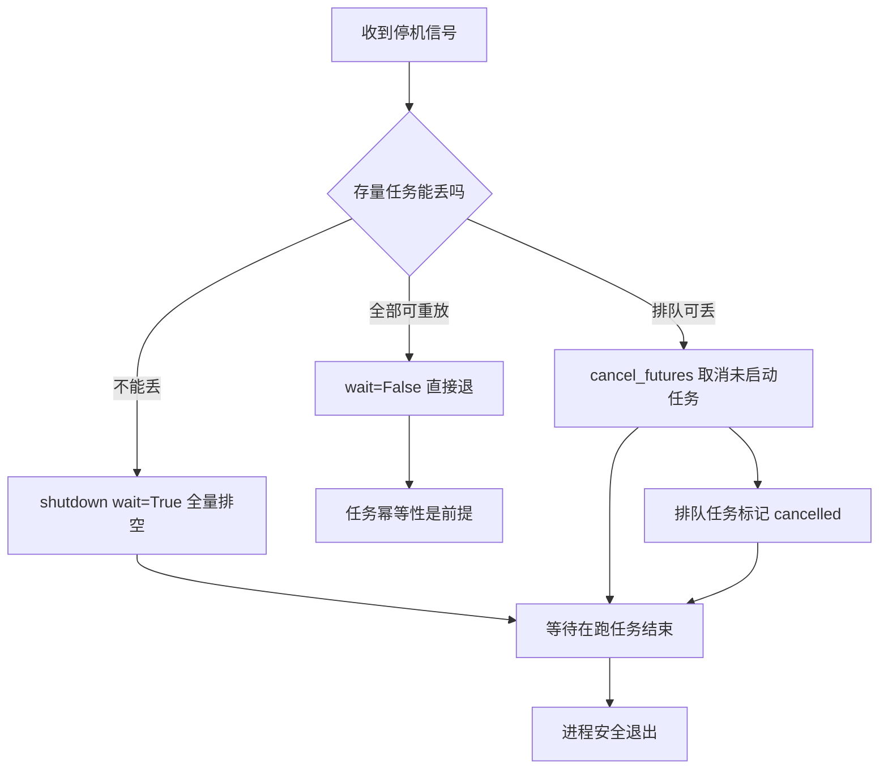
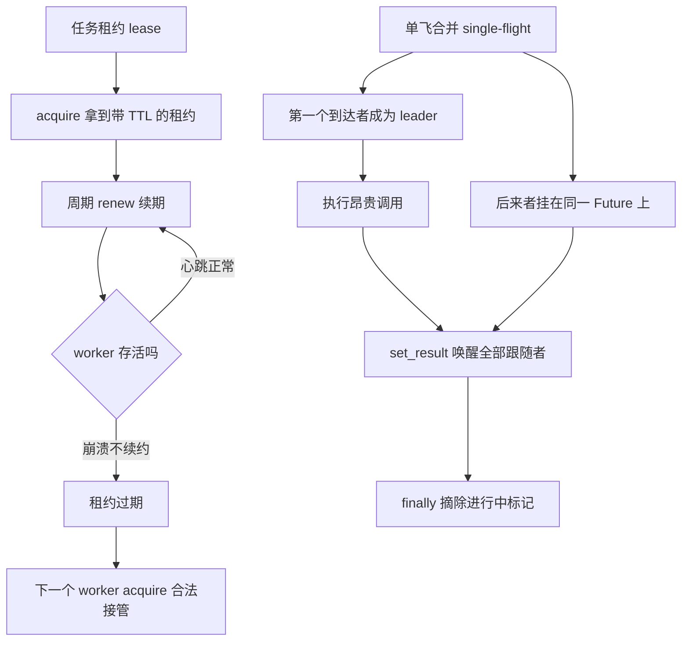
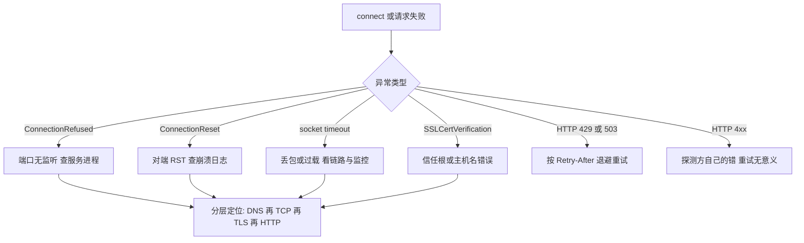
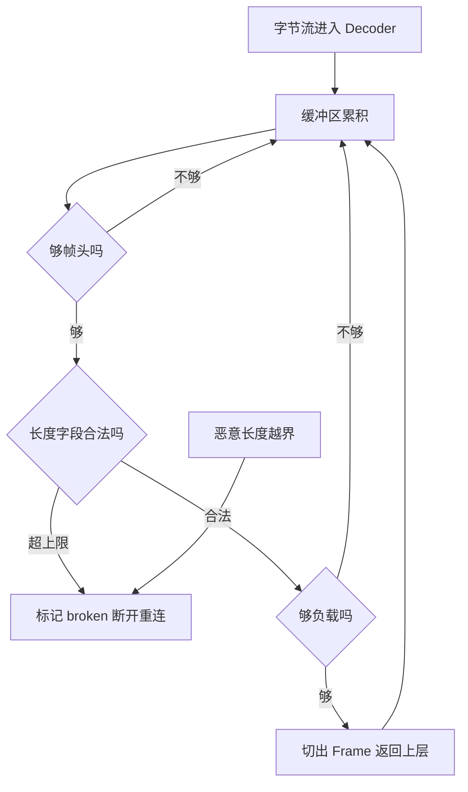
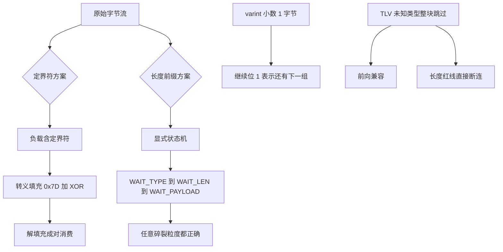
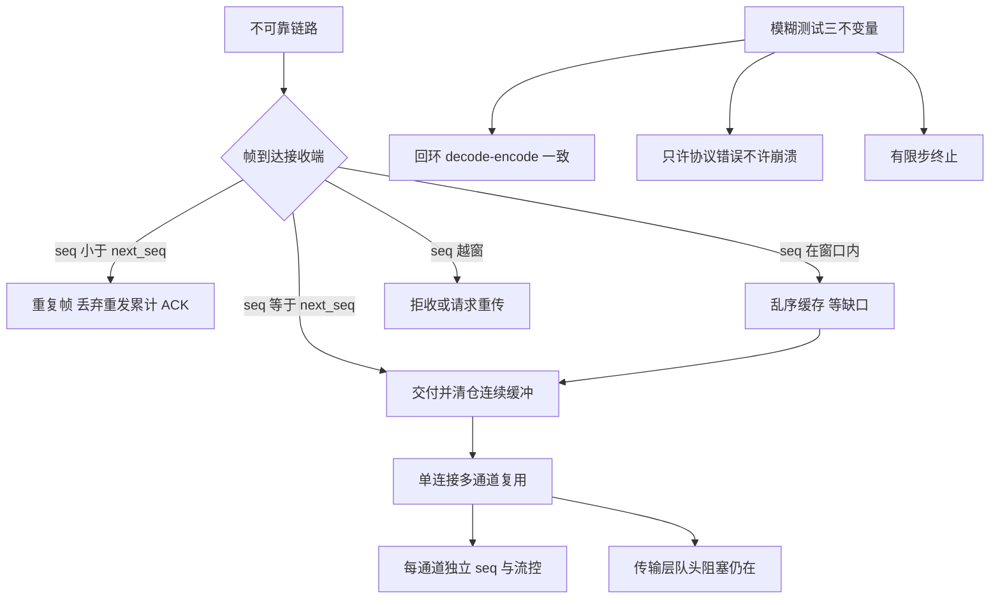
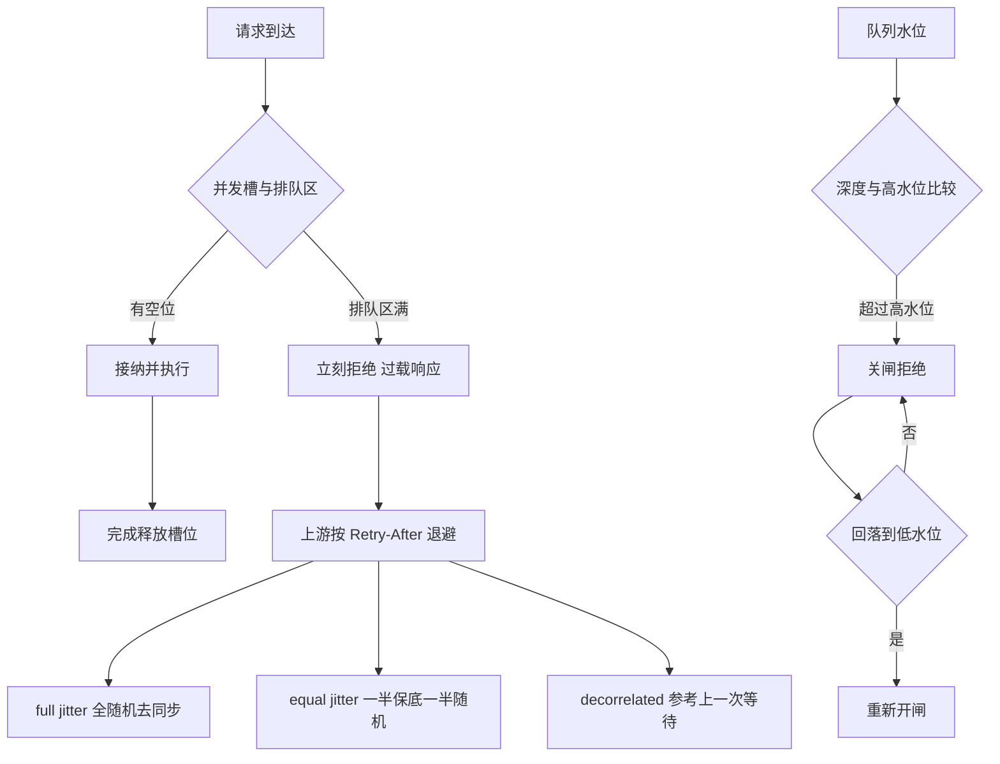
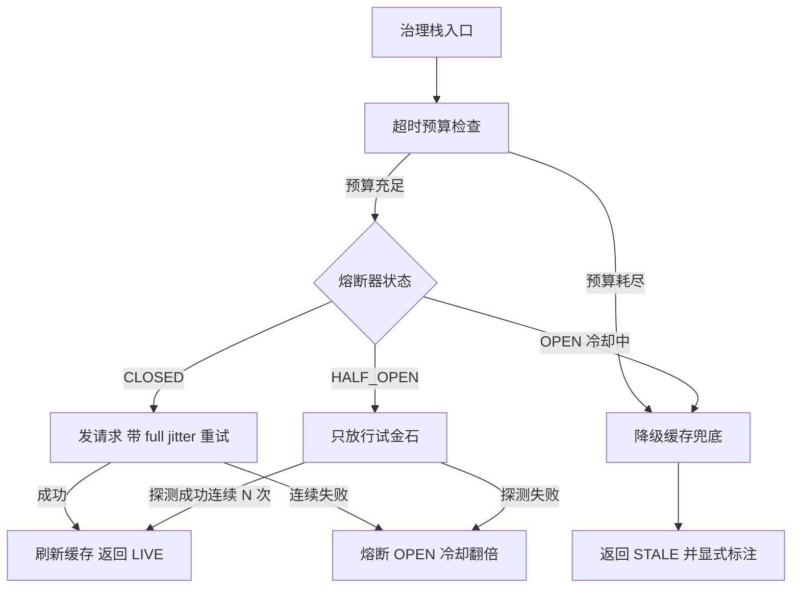

# 第 2 类 · 并发与网络工程(夜间扩产)

> 本篇是夜间扩产篇:补齐并发模式的高级形态(读写锁升级、聚合双缓冲、single-flight、任务租约)与一套网络排障实战(errno 分诊、TLS 握手分诊、端口耗尽)。
> 协议侧深入帧编解码、字节填充、varint、半包状态机、多路复用与模糊测试;治理侧覆盖连接池借还、水位迟滞、过载削减、熔断探测恢复、一致性哈希与超时预算传递。
> 全部代码仅标准库、完整可运行;网络演示全部走本机回环 127.0.0.1,后台线程起服务,即跑即验。

---

### Q1301 · 读写锁进阶:读锁升级写锁的死锁与公平方案

> 难度:★★★★ | 标签:读写锁, 升级, 死锁

**问**:读者已经持有读锁,想直接"升级"成写锁,为什么经典实现会死锁?正确做法是什么?

**答**:死锁的根源在"两个读者都想升级":A 和 B 都持有读锁,各自去等"读者数归零",而读者数里恰好有对方,互相等待,永远归不了零。工程上只有两条出路:要么禁止原子升级,让调用方先 release_read 再排队 acquire_write(简单,但升级窗口内可能被插队);要么在 acquire_read 时就声明 upgrade 意图——锁内立刻"预留一个写者名额",新读者和新写者都被挡在门外,等现存读者自然退出后,预留者独占升级。预留法保住了"升级期间无人插队"的语义,代价是稍微复杂的锁状态。下面的代码先用守护线程复现真实死锁,再给出无死锁的预留实现。

```python
# file: code/02_并发与网络工程/q1301_rwlock_upgrade.py
import threading
import time


def naive_upgrade_demo() -> None:
    """裸升级: 两个读者同时 acquire_write, 互相等待读者归零 -> 死锁。"""
    lock = {"readers": 0, "writer": False}
    cond = threading.Condition()
    results = []

    def reader_want_upgrade(name: str) -> None:
        with cond:
            lock["readers"] += 1          # 双方都拿到了读锁
        with cond:
            lock["readers"] -= 1          # 裸升级: 先放掉自己再等对方
            while lock["readers"] > 0 or lock["writer"]:
                cond.wait()
            lock["writer"] = True
            results.append(name)
            lock["writer"] = False
            cond.notify_all()

    # 两个线程真正同时进入临界区, 制造竞态死锁
    barrier = threading.Barrier(2)
    threads = []
    for name in ("A", "B"):
        t = threading.Thread(target=lambda n=name: (barrier.wait(),
                                                    naive_step(cond, lock, results, n)),
                             daemon=True)
        threads.append(t)
        t.start()
    for t in threads:
        t.join(timeout=0.5)
    hung = any(t.is_alive() for t in threads)
    print("裸升级并发两个线程 ->", "死锁复现(线程仍挂起)" if hung else "侥幸未死锁")


def naive_step(cond: threading.Condition, lock: dict, results: list, name: str) -> None:
    with cond:
        lock["readers"] += 1
        lock["readers"] -= 1
        while lock["readers"] > 0 or lock["writer"]:
            cond.wait()
        lock["writer"] = True
        results.append(name)
        lock["writer"] = False
        cond.notify_all()


class UpgradableRWLock:
    """预留名额的升级读写锁: 声明 upgrade 后新读者/新写者全部被挡住。"""

    def __init__(self) -> None:
        self._cond = threading.Condition()
        self._readers = 0
        self._writer = False
        self._reserved = False  # 升级预留名额

    def acquire_read(self, upgrade: bool = False) -> None:
        with self._cond:
            while self._writer or self._reserved:
                self._cond.wait()
            if upgrade:
                self._reserved = True
            self._readers += 1

    def upgrade(self) -> None:
        with self._cond:
            assert self._reserved, "upgrade 必须先 acquire_read(upgrade=True)"
            self._readers -= 1
            while self._readers > 0:      # 等现存读者退出, 预留挡住了新读者
                self._cond.wait()
            self._reserved = False
            self._writer = True

    def release_read(self) -> None:
        with self._cond:
            self._readers -= 1
            if self._readers == 0:
                self._cond.notify_all()

    def release_write(self) -> None:
        with self._cond:
            self._writer = False
            self._cond.notify_all()


def safe_upgrade_demo() -> None:
    lock = UpgradableRWLock()
    log = []

    def upgrader() -> None:
        lock.acquire_read(upgrade=True)
        log.append("读到旧值, 发现要改")
        lock.upgrade()
        log.append("升级成功, 独占写入")
        lock.release_write()

    def plain_reader() -> None:
        time.sleep(0.05)
        lock.acquire_read()
        log.append("普通读者被预留挡住, 升级完才进来")
        time.sleep(0.05)
        lock.release_read()

    u = threading.Thread(target=upgrader)
    r = threading.Thread(target=plain_reader, daemon=True)
    r.start()
    u.start()
    u.join(timeout=2)
    r.join(timeout=2)
    assert not u.is_alive(), "预留升级不应死锁"
    for line in log:
        print(line)


if __name__ == "__main__":
    naive_upgrade_demo()
    print("---")
    safe_upgrade_demo()
```

**追问**:1) 预留名额期间一个写者先到了怎么办?——预留标志必须同时挡住新写者(acquire_write 检查 _reserved),否则升级的"读值到写回"原子性就被写者从中间踩掉了。2) 升级期间「读值到写回」的原子性为什么重要?——升级的典型动机是 check-then-act(读到 X 才决定写),升级窗口被插队意味着检查前提已被别人改掉,等于没升级;预留名额正是把这段窗口锁死。3) 与「先释放再重新获取」相比的取舍?——先释放再排队实现最简,但释放与重新获取之间状态可能被他人改写,调用方必须自行 recheck;预留法语义更强(无插队)但锁状态复杂、且要防「预留者自己崩溃」——预留超时回收必须设计。4) 生产陷阱?——两个线程同时 upgrade 的死锁(本题复现的经典);预留标志忘了挡新写者;升级路径里再嵌套 acquire_read(自锁);daemon 线程里持锁死亡导致读写锁永久卡死。

---

### Q1302 · 聚合翻页双缓冲:写多读少的批量刷写

> 难度:★★★☆ | 标签:双缓冲, 批量聚合, 背压

**问**:高频写日志/埋点的场景,怎么用双缓冲把"每条一次 IO"变成"一页一次 IO"?

**答**:这里的双缓冲和"读者无锁读"是两个方向:读端是刷盘线程,写端是海量生产者。核心动作是"翻页":生产者往活动页 append,页攒到阈值就整体翻出去投递给刷写队列,活动页立刻换一张新列表继续接客——临界区只有"append + 可能一次引用交换",开销极小。刷写线程只看整页,一次 IO 处理 N 条。两个关键细节:翻页必须在持锁内完成"取出旧页、放入新页"两步,否则会丢数据;停机时要先停止接收,再把残余半页也翻出去,等刷写队列彻底排空,才能保证 exactly-once。下面的验证是 1000 条、页阈值 64,最终必须恰好刷出 1000 条。

```python
# file: code/02_并发与网络工程/q1302_batch_flip_buffer.py
import queue
import threading


class BatchFlipper:
    """聚合翻页双缓冲: 生产者写活动页, 满页翻给刷写线程。"""

    def __init__(self, threshold: int) -> None:
        self._threshold = threshold
        self._lock = threading.Lock()
        self._active = []            # 活动页
        self._pages = queue.Queue()  # 已翻出的整页
        self._closed = False
        self.flushed = []

    def add(self, item: int) -> None:
        page_out = None
        with self._lock:
            if self._closed:
                raise RuntimeError("已停止接收")
            self._active.append(item)
            if len(self._active) >= self._threshold:
                page_out = self._active   # 翻页: 旧页整体移交
                self._active = []         # 新页立刻接客
        if page_out is not None:
            self._pages.put(page_out)     # IO 队列在锁外

    def close_and_flush(self) -> None:
        with self._lock:
            self._closed = True
            residual = self._active
            self._active = []
        if residual:
            self._pages.put(residual)     # 半页也要翻出去
        self._pages.join()                # 等全部页刷完

    def flusher_loop(self) -> None:
        while True:
            page = self._pages.get()
            time.sleep(0.001)             # 模拟整页一次 IO
            self.flushed.extend(page)
            self._pages.task_done()


if __name__ == "__main__":
    import time
    buf = BatchFlipper(threshold=64)
    t = threading.Thread(target=buf.flusher_loop, daemon=True)
    t.start()
    for i in range(1000):
        buf.add(i)
    buf.close_and_flush()
    assert buf.flushed == list(range(1000)), "必须恰好刷出全部数据且保序"
    full_pages = 1000 // 64
    print(f"整页 {full_pages} 页 + 半页 1 页 = 刷出 {len(buf.flushed)} 条, 每页一次 IO")
```

**追问**:1) 为什么翻页动作必须整体在临界区内完成?——如果先置空活动页再投递旧页,两个操作之间崩溃或交错就会丢一整页;合并成一次原子替换则要么全留、要么全走。2) 为什么读端(刷写线程)也要拿同一把锁?——翻页的「取旧页+换新页」与生产者的 append 互斥,刷写端翻页时也要进临界区;锁竞争极低(每页一次),换来的是整页原子交付。3) exactly-once 的边界在哪?——「停止接收→残余翻页→排空队列」三步保证进程内 exactly-once;但进程崩溃时活动页未翻出的数据仍会丢,要更强语义得靠 WAL/消息队列——双缓冲的定位是「聚合优化」不是「持久化保证」。4) 生产陷阱?——翻页阈值用时间触发时停机窗口内半页忘刷;投递队列无界,刷盘故障时整页数据在内存堆积;页对象被刷写线程持有期间生产者复用同一列表(引用交换后旧页必须彻底脱手)。

---

### Q1303 · 优雅降级开关:线程可见的 feature toggle

> 难度:★★☆☆ | 标签:降级开关, feature toggle, 原子快照

**问**:线上出事了,怎么在不重启进程的前提下把某个功能"一键关掉"?

**答**:降级开关的本质是一个"线程间可见的布尔量",工程要点有三个。第一,可见性:Python 里 dict 的单项修改是原子的,但"检查开关再执行"不是——所以开关要用整体替换的不可变快照,请求开始时取一次快照,整条请求路径用同一份,避免中途开关翻转导致行为分裂。第二,快照要小:开关面板最多几十个键,整份复制毫无压力,千万别做成"每个请求都去查配置中心"。第三,自动降级:手动开关之外,通常再挂一个错误率触发器,连续失败超阈值自动翻开关,恢复后自动(或人工确认)翻回来。下面的演示里主线程翻转开关,工作线程持续服务并在每个请求开头取一次快照,统计两个阶段各自的命中次数。

```python
# file: code/02_并发与网络工程/q1303_degrade_switch.py
import threading
import time


class DegradeSwitch:
    """开关面板: 整体替换不可变快照, 请求粒度取一次、全程一致。"""

    def __init__(self, features: dict) -> None:
        self._lock = threading.Lock()
        self._snapshot = dict(features)   # {功能名: 是否可用}

    def snapshot(self) -> dict:
        with self._lock:
            return dict(self._snapshot)   # 请求开始时取一次

    def set_all(self, features: dict) -> None:
        with self._lock:
            self._snapshot.update(features)


def serve_request(snap: dict, feature: str, stats: dict) -> None:
    if snap.get(feature, True):
        stats["normal"] += 1              # 正常路径
    else:
        stats["degraded"] += 1            # 兜底路径: 返回缓存/默认值


def main() -> None:
    switch = DegradeSwitch({"recommend": True, "search": True})
    stats = {"normal": 0, "degraded": 0}
    stats_lock = threading.Lock()
    stop = threading.Event()

    def worker() -> None:
        while not stop.is_set():          # 持续服务, 覆盖翻转前后的所有阶段
            snap = switch.snapshot()      # 每个请求取一次快照
            with stats_lock:
                serve_request(snap, "recommend", stats)

    threads = [threading.Thread(target=worker) for _ in range(4)]
    for t in threads:
        t.start()

    time.sleep(0.3)
    print("运维翻转开关: recommend -> 关闭")
    switch.set_all({"recommend": False})
    time.sleep(0.3)
    print("恢复: recommend -> 开启")
    switch.set_all({"recommend": True})
    time.sleep(0.3)
    stop.set()

    for t in threads:
        t.join()
    print(f"正常服务 {stats['normal']} 次, 降级兜底 {stats['degraded']} 次")
    assert stats["degraded"] > 0 and stats["normal"] > 0, "两个阶段都应出现"


if __name__ == "__main__":
    main()
```

**追问**:1) 为什么请求开始取快照、而不是每步都查开关?——中途翻转会让一次请求前半段走主路径、后半段走兜底,状态不一致;请求粒度一致性是降级的底线。2) 快照模式的并发原理是什么?——开关面板做成不可变对象,翻转是「整体替换引用」,CPython 下引用赋值原子,读线程要么拿到旧快照要么新快照,都是自洽的;这与配置热更新(Q707)是同一模式。3) 自动降级(错误率触发)的防抖怎么做?——连续 N 次失败才翻开关(单次抖动不动);翻回去要么人工确认要么「半开探测」(Q1336),自动恢复配自动触发容易在故障边界来回振荡,把下游彻底打死。4) 生产陷阱?——开关检查与执行分离的窗口(检查后依赖才挂);快照里放了可变 dict 被业务改坏;降级开关只翻了一半(依赖 A 关了依赖 B 没关);恢复后没人翻回来,系统长期活在降级模式没人知道。

---

### Q1304 · 并发心跳:一个目标卡死不能拖垮其他心跳

> 难度:★★★☆ | 标签:心跳, 调度器, 故障隔离

**问**:要同时对 20 个下游发心跳,其中一个目标卡住 5 秒,怎么保证其余 19 个的心跳仍然准时?

**答**:反模式是"一个调度线程串行 for 循环发心跳"——任何一个阻塞调用都会把整排心跳往后拖。正确结构是两层:调度线程只负责"到点"和"派发",把真正的心跳动作 submit 给一个独立线程池,每个心跳自带超时,异常被隔离在任务内部。调度线程永远只做轻活,派发永远是 O(存活目标数) 的非阻塞调用。再补两个细节:心跳结果按目标记录,连续失败要能触发告警;任务超时不能只靠网络超时,最好在任务外再包一层 deadline 检查。下面的演示里,坏目标每拍都卡 0.5 秒,好目标的心跳最大迟到仍然只有毫秒级。

```python
# file: code/02_并发与网络工程/q1304_concurrent_heartbeat.py
import concurrent.futures
import threading
import time


class HeartbeatScheduler:
    """调度线程只派发, 真正的探测在线程池里隔离执行。"""

    def __init__(self, interval: float) -> None:
        self._interval = interval
        self._targets = {}          # name -> probe 函数
        self._lateness = {}         # name -> [迟到秒数]
        self._fails = {}
        self._pool = concurrent.futures.ThreadPoolExecutor(max_workers=8)
        self._stop = threading.Event()

    def register(self, name: str, probe) -> None:
        self._targets[name] = probe
        self._lateness[name] = []
        self._fails[name] = 0

    def _beat(self, name: str, probe, due: float) -> None:
        self._lateness[name].append(max(0.0, time.monotonic() - due))
        try:
            probe()
        except Exception:
            self._fails[name] += 1  # 异常隔离在任务内, 不影响调度

    def run(self) -> None:
        while not self._stop.is_set():
            due = time.monotonic()
            for name, probe in list(self._targets.items()):
                self._pool.submit(self._beat, name, probe, due)
            self._stop.wait(self._interval)

    def stop(self) -> None:
        self._stop.set()
        self._pool.shutdown(wait=True)


def main() -> None:
    def broken_probe() -> None:
        time.sleep(0.5)               # 坏目标: 每拍卡 0.5 秒
        raise ConnectionError("下游挂了")

    def good_probe() -> None:
        time.sleep(0.001)

    sched = HeartbeatScheduler(interval=0.1)
    sched.register("broken", broken_probe)
    sched.register("good-1", good_probe)
    sched.register("good-2", good_probe)

    t = threading.Thread(target=sched.run, daemon=True)
    t.start()
    time.sleep(1.0)
    sched.stop()

    fails = sched._fails["broken"]
    worst_good = max(max(v) for k, v in sched._lateness.items() if k != "broken")
    print(f"坏目标失败 {fails} 次(被隔离), 好目标最大迟到 {worst_good*1000:.1f} ms")
    assert worst_good < 0.05, "好目标不应被坏目标拖垮"
    print("故障隔离验证通过")


if __name__ == "__main__":
    main()
```

**追问**:1) 派发本身会阻塞吗?——submit 到有界线程池时队列满了会阻塞调度线程,所以池要有界但余量充足,或者直接用无界队列兜底,调度线程绝不能等业务动作。2) 调度线程被拖住的后果是什么?——所有目标的心跳整体推迟,下游看到的不是「目标 A 死了」而是「所有目标都迟到」,误判面积扩大;派发与执行分离把故障隔离在单任务内。3) 任务级超时怎么实现?——网络超时只是第一层;任务外再包 deadline 检查:future.result(timeout=...),超时 cancel——注意 cancel 只对未开始的任务有效(Q1305),在跑的任务要靠其内部超时配合,两层缺一不可。4) 生产陷阱?——线程池队列无界,坏目标堆积任务拖爆内存;心跳结果字典被调度线程与工作线程并发读写没加锁(dict 单操作原子但复合操作不是);用 time.time 计心跳间隔,NTP 跳变导致心跳错拍(用 monotonic)。

---

### Q1305 · 线程池排空抉择:等存量还是取消排队

> 难度:★★☆☆ | 标签:线程池, 优雅关闭, cancel_futures

**问**:进程要退出,线程池里还有 500 个排队任务,等还是不等?`cancel_futures=True` 到底取消了什么?

**答**:排空有三档。第一档 `shutdown(wait=True)`:新任务被拒,存量任务全部执行完才返回,适合"任务都不能丢"的场景,代价是退出时间不可控。第二档 `shutdown(wait=True, cancel_futures=True)`:还没开始跑的排队任务直接标记 cancelled,已经在跑的不受影响、跑完为止——这是最常用的中间态,"丢得起排队、丢不起半成品"。第三档 `wait=False` + 强杀:进程直接退,连在跑的也丢,只适合任务天然幂等可重放。注意一个语义细节:cancel_futures 只能取消"从未开始"的任务,Future 已经 running 的 cancel 返回 False。下面的演示对同一批任务跑两种关闭方式,对比完成数与取消数。

```python
# file: code/02_并发与网络工程/q1305_pool_drain_choice.py
import concurrent.futures
import time


def make_task(n: int) -> float:
    return 0.01 if n % 5 else 0.03  # 少量慢任务


def drain_all(jobs: int) -> int:
    with concurrent.futures.ThreadPoolExecutor(max_workers=4) as pool:
        futs = [pool.submit(time.sleep, make_task(i)) for i in range(jobs)]
        concurrent.futures.wait(futs)
        return sum(1 for f in futs if f.done() and not f.cancelled())


def cancel_queued(jobs: int) -> tuple:
    pool = concurrent.futures.ThreadPoolExecutor(max_workers=4)
    futs = [pool.submit(time.sleep, make_task(i)) for i in range(jobs)]
    time.sleep(0.02)                   # 先让 4 个任务跑起来
    pool.shutdown(wait=True, cancel_futures=True)
    done = sum(1 for f in futs if f.done() and not f.cancelled())
    cancelled = sum(1 for f in futs if f.cancelled())
    return done, cancelled


if __name__ == "__main__":
    jobs = 40
    full = drain_all(jobs)
    print(f"排空式关闭: 完成 {full}/{jobs}, 一个不丢")
    done, cancelled = cancel_queued(jobs)
    print(f"取消式关闭: 完成 {done} 个(含在跑的), 排队取消 {cancelled} 个")
    assert done + cancelled == jobs, "每个 Future 必有终态"
    print("排空/取消语义验证通过")
```

**追问**:1) cancel_futures 之后为什么还要 wait=True?——cancel 只清排队区,正在执行的任务会继续跑,不 wait 就等于放任它们和进程退出赛跑,退出时间又不可控了。2) cancel_futures 取消不了什么?——已经 running 的任务 cancel 返回 False,只能等它自然结束;要中断在跑任务必须任务内部自带超时/检查点( cooperative cancellation),线程池没有强制 kill 的手段——这也是 Python 并发取消语义的统一规则。3) 与 asyncio 的排空语义怎么对应?——asyncio 的 TaskGroup/ cancelling 同样是「协作式」:取消只是投递 CancelledError,任务要在 await 点或显式检查中响应;两套 API 共享「取消必须协作」的底层哲学,面试能打通这两层是加分项。4) 生产陷阱?——shutdown(wait=False) 后进程退出,daemon 线程里的任务在解释器清理阶段崩溃报错;排队任务里持有锁/连接,cancel 后资源没释放;把 wait=True 当「事务提交」——任务失败时没有回滚语义。

---



---

### Q1306 · 重试风暴防护:重试本身也要限流

> 难度:★★★★ | 标签:重试风暴, retry budget, 雪崩

**问**:下游挂了,每个请求重试 3 次,为什么这会把小故障放大成雪崩?怎么治?

**答**:算一笔账:QPS 1000、重试 3 次、下游完全不可用,那么依赖收到的请求量瞬间变成 4000——而且重试挤占了原本留给正常流量的容量,故障被放大 4 倍,这就是重试风暴。治理的关键是"重试预算"(retry budget):不是每个请求都有资格重试,而是整个进程层面维护一个预算——最近一段时间内,重试次数不得超过总请求次数的某个比例(比如 10%-20%)。预算按全局限流扣减:下游健康时几乎触发不到上限;下游故障时预算很快耗尽,后面的请求一次都不重试,直接快速失败。它和指数退避是互补关系:退避控制"单请求的时间节奏",预算控制"全系统的重试总量"。下面的演示对比有无预算时的下游压力。

```python
# file: code/02_并发与网络工程/q1306_retry_storm_guard.py
import threading


class RetryBudget:
    """全局重试预算: 重试总量 <= 总请求量 * ratio。"""

    def __init__(self, ratio: float) -> None:
        self._ratio = ratio
        self._lock = threading.Lock()
        self._requests = 0
        self._retries = 0

    def note_request(self) -> None:
        with self._lock:
            self._requests += 1

    def allow_retry(self) -> bool:
        with self._lock:
            if self._retries < self._ratio * self._requests:
                self._retries += 1
                return True
            return False


def call_with_retries(dep, budget: RetryBudget, max_attempts: int) -> int:
    """返回本次请求对依赖发起的实际调用次数, 失败抛最后一个异常。"""
    budget.note_request()
    attempts = 1
    while True:
        try:
            dep.hit()
            return attempts
        except ConnectionError:
            if attempts < max_attempts and budget.allow_retry():
                attempts += 1      # 每一次重试都先扣预算
                continue
            raise


class DeadDependency:
    def __init__(self) -> None:
        self.hits = 0
        self._lock = threading.Lock()

    def hit(self) -> None:
        with self._lock:
            self.hits += 1
        raise ConnectionError("down")


def main() -> None:
    requests, max_attempts = 50, 3

    bare = DeadDependency()
    for _ in range(requests):
        try:
            call_with_retries(bare, RetryBudget(ratio=10.0), max_attempts)  # 等于不设限
        except ConnectionError:
            pass
    print(f"裸重试: {requests} 个请求打出 {bare.hits} 次依赖调用")

    budgeted = DeadDependency()
    budget = RetryBudget(ratio=0.2)
    for _ in range(requests):
        try:
            call_with_retries(budgeted, budget, max_attempts)
        except ConnectionError:
            pass
    print(f"预算 20%: {requests} 个请求只打出 {budgeted.hits} 次依赖调用")
    assert budgeted.hits <= requests * (1 + 0.2) + max_attempts
    assert bare.hits == requests * max_attempts
    print("重试风暴被预算压住")


if __name__ == "__main__":
    main()
```

**追问**:1) 预算比例设多少合适?——取决于下游的正常错误率:错误率 1% 的依赖给 10%-20% 预算绰绰有余,错误率本身就 30% 的依赖说明预算救不了它,该上熔断了。2) 重试预算与熔断的分工?——预算是「每个请求仍有资格试一次」的软控制,熔断是「全部停止外发」的硬控制;预算先耗尽说明依赖已进入持续故障,此时熔断阈值大概率也到了,两者叠加是完整的出口治理(Q1345)。3) 预算的实现要点?——滑动窗口统计「总请求数」与「重试请求数」,重试前检查比例;窗口要短(如 10s-1min)否则预算滞后于故障;多线程读改计数要原子(锁或原子操作),否则预算统计本身有竞态。4) 生产陷阱?——每个调用点各自重试 3 次,链式调用下指数放大(3×3×3=27 倍);预算统计漏了异步路径;下游 5xx 与业务 4xx 都计入重试,预算被无意义消耗。

---

### Q1307 · 线程安全的 LRU + TTL 缓存

> 难度:★★★☆ | 标签:LRU, TTL, 缓存

**问**:手写一个线程安全的 LRU 缓存,要求带 TTL,你会怎么做?哪些操作必须是原子的?

**答**:容器用 OrderedDict,命中时 move_to_end 把键挪到队尾,容量超限时 popitem(last=False) 弹出队头——LRU 语义就绪。TTL 只需在每个条目上记一个过期时间戳,get 时发现过期就当作未命中并删除。原子性是关键:get 的"读、判过期、move_to_end"三步必须整体持锁,否则两个读者同时 move_to_end 或一边读一边被淘汰都会出诡异状态;put 的"写入 + 驱逐超限"同样整体持锁。锁的粒度已经足够细(纳秒级操作),不需要再分段;若真要降竞争,可以按 key 哈希分片。可选优化:过期清理不做后台线程,而是写在 put 时顺带抽查几个键,避免定时器复杂度。下面的演示验证容量驱逐、TTL 过期与并发计数。

```python
# file: code/02_并发与网络工程/q1307_lru_ttl_cache.py
import collections
import threading
import time


class LRUTTLCache:
    def __init__(self, capacity: int, ttl: float) -> None:
        self._capacity = capacity
        self._ttl = ttl
        self._data = collections.OrderedDict()  # key -> (value, expire_at)
        self._lock = threading.Lock()
        self.hit = 0
        self.miss = 0
        self.evicted = 0
        self.expired = 0

    def get(self, key):
        now = time.monotonic()
        with self._lock:
            item = self._data.get(key)
            if item is None:
                self.miss += 1
                return None
            value, expire_at = item
            if expire_at <= now:
                del self._data[key]
                self.expired += 1
                return None
            self._data.move_to_end(key)
            self.hit += 1
            return value

    def put(self, key, value) -> None:
        now = time.monotonic()
        with self._lock:
            self._data[key] = (value, now + self._ttl)
            self._data.move_to_end(key)
            while len(self._data) > self._capacity:
                self._data.popitem(last=False)
                self.evicted += 1


def main() -> None:
    cache = LRUTTLCache(capacity=3, ttl=0.1)
    cache.put("a", 1)
    cache.put("b", 2)
    cache.put("c", 3)
    cache.put("d", 4)                    # 挤出最久未用的 a
    assert cache.get("a") is None
    assert cache.get("d") == 4
    cache.put("e", 5)                    # 挤出 b
    assert cache.get("b") is None
    time.sleep(0.15)                     # 全部过期
    assert cache.get("c") is None and cache.get("e") is None

    cache2 = LRUTTLCache(capacity=100, ttl=10)
    def worker(seed: int) -> None:
        for i in range(2000):
            k = (i * seed) % 50
            if i % 3 == 0:
                cache2.put(k, k)
            else:
                v = cache2.get(k)
                assert v is None or v == k
    threads = [threading.Thread(target=worker, args=(s + 1,)) for s in range(4)]
    for t in threads:
        t.start()
    for t in threads:
        t.join()
    print(f"驱逐 {cache.evicted}, 过期 {cache.expired}; "
          f"并发后 命中 {cache2.hit} 未命中 {cache2.miss}, 容量守恒 {len(cache2._data) <= 100}")
    print("LRU + TTL 语义验证通过")


if __name__ == "__main__":
    main()
```

**追问**:1) 为什么过期判断不用后台线程统一扫?——惰性过期在读写路径顺带完成,实现简单且无额外线程;后台扫描只在大容量、冷键堆积时才有必要,而且要与写锁配合避免扫到一半被改。2) get 里「判过期就删」的并发细节?——过期删除也要持锁(或确认 OrderedDict 的单操作原子边界);更隐蔽的是「读时过期未删+写时驱逐」交错,条目计数与实际不符;最简纪律:所有容器变更都进锁,锁内只做纳秒级操作。3) 什么时候才需要分片?——基准先行:CPython 锁开销在微秒级,单锁 LRU 通常扛到数万 QPS;真有瓶颈再按 key 哈希分片(每片独立锁),分片数取 2 的幂,代价是全局聚合(全量快照/统计)要按固定序拿全部片锁防死锁(Q572)。4) 生产陷阱?——move_to_end 放在锁外引发竞态;TTL 用 time.time(NTP 跳变,用 monotonic);缓存对象可变且被调用方改坏;命中统计与驱逐统计不一致,容量诊断失真。

---

### Q1308 · 进程内发布订阅总线:异常隔离与弱引用

> 难度:★★★☆ | 标签:发布订阅, 弱引用, 异常隔离

**问**:实现一个进程内 EventBus,要让"一个订阅者抛异常不拖垮别人、订阅者被回收后自动注销",怎么做?

**答**:两个机制缺一不可。异常隔离:publish 时逐个调用回调,每个回调包独立 try/except,异常交给统一的 on_error 钩子记录,绝不让它冲出发布循环——同步总线里一个坏订阅者能让发布者本身炸掉,这是最常见的事故。自动注销:订阅回调如果是绑定方法,直接持强引用会造成"对象不用了还被总线拽着"的内存泄漏;用 weakref.WeakMethod 存回调,发布前探测引用活性,死掉的顺路剔除。要注意发布是同步遍历,订阅/退订发生在别的线程,所以遍历必须先在锁内拷贝一份存活回调快照,再在锁外执行,兼顾一致性和"回调里再调订阅接口"的可重入性。

```python
# file: code/02_并发与网络工程/q1308_event_bus.py
import gc
import inspect
import threading
import weakref


class EventBus:
    def __init__(self) -> None:
        self._lock = threading.Lock()
        self._topics = {}   # topic -> list[weakref]
        self.errors = []

    @staticmethod
    def _make_ref(callback):
        if inspect.ismethod(callback):
            return weakref.WeakMethod(callback)  # 绑定方法: 跟踪宿主对象
        return weakref.ref(callback)             # 普通函数: 直接弱引用

    def subscribe(self, topic: str, callback) -> None:
        with self._lock:
            self._topics.setdefault(topic, []).append(self._make_ref(callback))

    def _live_callbacks(self, topic: str) -> list:
        with self._lock:
            subs = self._topics.get(topic, [])
            alive, dead = [], []
            for ref in subs:
                cb = ref()          # 探活: 对象已被回收返回 None
                (alive if cb is not None else dead).append((ref, cb))
            if dead:
                self._topics[topic] = [r for r, _ in alive]  # 顺路清尸
            return [cb for _, cb in alive]

    def publish(self, topic: str, event) -> None:
        for cb in self._live_callbacks(topic):
            try:
                cb(event)
            except Exception as exc:            # 单订阅者故障被隔离
                self.errors.append(f"{cb.__name__}: {exc}")


class Subscriber:
    def __init__(self, name: str) -> None:
        self.name = name
        self.received = []

    def on_event(self, event: str) -> None:
        if self.name == "bad":
            raise ValueError("bad handler 炸了")
        self.received.append(event)


def main() -> None:
    bus = EventBus()
    good = Subscriber("good")
    bad = Subscriber("bad")
    bus.subscribe("order.created", good.on_event)
    bus.subscribe("order.created", bad.on_event)

    bus.publish("order.created", "e1")
    assert good.received == ["e1"], "坏订阅者不影响好订阅者"
    assert len(bus.errors) == 1
    print(f"异常隔离: good 收到 {good.received}, 错误 {bus.errors}")

    del bad
    gc.collect()
    bus.publish("order.created", "e2")
    assert good.received == ["e1", "e2"]
    print(f"弱引用注销: 死订阅者被剔除, good 继续 {good.received}")

    def plain(e):  # 普通函数也能订阅
        good.received.append("fn:" + e)
    bus.subscribe("order.created", plain)
    bus.publish("order.created", "e3")
    print(f"最终状态: {good.received}")


if __name__ == "__main__":
    main()
```

**追问**:1) WeakMethod 为什么不能换成 weakref.ref?——绑定方法每次访问都生成新的临时对象,weakref.ref 抓不住它;WeakMethod 专门解引用到底层实例再重建方法,语义才正确。2) 「锁内拷贝快照、锁外执行」为什么是必须的?——锁内直接执行回调,回调里再调 subscribe/unsubscribe 就是自锁(同线程重入非重入锁);先拷贝再执行兼顾一致性与可重入,代价是快照后的新订阅本轮收不到(语义上可接受)。3) WeakMethod 的生命周期细节?——引用死亡只在发布时顺路剔除,订阅者长期不发消息就长期占着死引用槽;定期清理或按需重建回调表;另一个坑:lambda/闭包永远不会被 WeakMethod 回收(没有实例可解引用),订阅时要用绑定方法或显式管理。4) 生产陷阱?——一个订阅者抛异常冲出发布循环,后续订阅者全部漏收;发布线程被慢回调拖死(同步总线的固有代价,要异步得换队列);on_error 里又抛异常(二阶事故);忘记 WeakMethod 只对绑定方法有效。

---

### Q1309 · single-flight:同一 key 的并发请求合并成一次执行

> 难度:★★★★ | 标签:single-flight, 请求合并, 缓存击穿

**问**:缓存失效瞬间 100 个线程同时去查同一个 key,怎么保证后端只被打一次?

**答**:这就是 single-flight(请求合并):进程内维护一张"进行中"表,key 换成一个 Future。第一个到达者成为 leader,登记 Future 后真正执行;后续到达者发现表里有 Future,直接 await 它的结果,不再发起自己的执行。leader 完成后 set_result 唤醒全部跟随者,并把自己从表里摘掉——注意摘除必须在 set_result 之后语义上成立、且在 finally 里做,保证异常时跟随者也能拿到异常而不是永远等待。它同时治三种病:缓存击穿(热点 key 失效)、重复计算(昂贵函数并发调用)、以及放大写压力(同 key 并发写合并)。局限也要会讲:只合并"此刻进行中"的,leader 完成瞬间新来的请求会再执行一次;要彻底防重需要结果缓存配合。下面的演示 10 个线程同 key 并发,底层只执行一次。

```python
# file: code/02_并发与网络工程/q1309_single_flight.py
import concurrent.futures
import threading
import time


class SingleFlight:
    def __init__(self) -> None:
        self._lock = threading.Lock()
        self._inflight = {}   # key -> Future

    def run(self, key: str, fn):
        with self._lock:
            fut = self._inflight.get(key)
            if fut is not None:
                leader = False
            else:
                fut = concurrent.futures.Future()
                self._inflight[key] = fut
                leader = True
        if not leader:
            return fut.result()   # 跟随者: 等同一个结果或异常
        try:
            result = fn()
            fut.set_result(result)
            return result
        except BaseException as exc:
            fut.set_exception(exc)
            raise
        finally:
            with self._lock:
                self._inflight.pop(key, None)


def main() -> None:
    sf = SingleFlight()
    calls = {"n": 0}
    lock = threading.Lock()

    def slow_load() -> str:
        with lock:
            calls["n"] += 1
        time.sleep(0.2)               # 模拟昂贵的后端调用
        return f"payload-{calls['n']}"

    results = []
    errors = []

    def requester() -> None:
        try:
            results.append(sf.run("hot-key", slow_load))
        except Exception as exc:
            errors.append(exc)

    threads = [threading.Thread(target=requester) for _ in range(10)]
    for t in threads:
        t.start()
    for t in threads:
        t.join()
    assert len(results) == 10 and len(set(results)) == 1
    assert calls["n"] == 1, f"底层应只执行一次, 实际 {calls['n']}"
    print(f"10 个并发请求合并为 {calls['n']} 次执行, 结果一致: {results[0]}")

    # 异常也会传播给全部跟随者, 不会有人挂起
    def broken() -> None:
        raise RuntimeError("boom")
    errs = []
    threads = [threading.Thread(target=lambda: errs.append(capture(sf, "k", broken)))
               for _ in range(3)]
    for t in threads:
        t.start()
    for t in threads:
        t.join()
    assert all(isinstance(e, RuntimeError) for e in errs) and len(errs) == 3
    print(f"异常路径: {len(errs)} 个请求全部快速拿到异常, 无人挂起")


def capture(sf, key, fn):
    try:
        return sf.run(key, fn)
    except Exception as exc:
        return exc


if __name__ == "__main__":
    main()
```

**追问**:1) leader 完成后立刻来了新请求怎么办?——表里已经摘掉了,新请求会再执行一次;要彻底防重就在 run 外再包一层结果缓存,形成"缓存 + single-flight"的经典组合。2) 为什么摘除要在 finally 里?——leader 抛异常时若不摘除,跟随者 await 永远挂起;finally 里 set_exception + 摘除保证「跟随者要么拿到结果要么拿到异常」,这是请求合并实现最容易漏的路径。3) 与幂等存储(Q1339)、结果缓存怎么组合?——三层防线:single-flight 合并「此刻并发」、幂等存储覆盖「重试窗口」、结果缓存承接「完成后新请求」;击穿治理(缓存章 Q174)就是这套组合拳,面试要能画出三层的覆盖区间。4) 生产陷阱?——Future 无异常透传,跟随者拿 None 误当成功;key 构造不一致(参数序列化方式不同导致合并失败);等待者无超时,leader 卡死全体挂起;合并层把「不该合并」的请求也合了(带副作用的操作被合并执行一次,语义错)。

---

### Q1310 · 任务租约:心跳停了才允许别人接手

> 难度:★★★★ | 标签:租约, takeover, 分布式模式

**问**:一个后台任务只能有一个 worker 在跑,worker 崩溃后怎么让别的进程安全接手?

**答**:用租约(lease)而不是一把永久锁:worker 先 acquire 拿到带 TTL 的租约,持有期间必须周期性 renew 续期;worker 崩溃后没人续期,租约自然过期,下一个 acquire 者合法接管。三个要点:第一,时钟用单调钟,租约过期判断只信"记录的到期时间 vs 现在的单调值",不要两边各自算剩余时间。第二,renew 必须校验持有者身份——只允许当前 owner 续自己的租约,防止过期后被新 owner 接管、旧 worker 恢复又把租约改回去的"僵尸复活"。第三,TTL 要远大于续约周期(工程上 3-10 倍),否则网络抖动一次就误判崩溃。下面的演示完整走一遍"持锁-续约-假死-过期-接管"。

```python
# file: code/02_并发与网络工程/q1310_task_lease.py
import threading
import time


class LeaseManager:
    def __init__(self, ttl: float) -> None:
        self._ttl = ttl
        self._lock = threading.Lock()
        self._leases = {}   # task -> (owner, expire_at)

    def acquire(self, task: str, owner: str) -> bool:
        now = time.monotonic()
        with self._lock:
            cur = self._leases.get(task)
            if cur is not None and cur[1] > now:
                return False            # 仍被有效持有
            self._leases[task] = (owner, now + self._ttl)
            return True

    def renew(self, task: str, owner: str) -> bool:
        now = time.monotonic()
        with self._lock:
            cur = self._leases.get(task)
            if cur is None or cur[0] != owner or cur[1] <= now:
                return False            # 不是你的或已过期, 拒绝续期
            self._leases[task] = (owner, now + self._ttl)
            return True

    def release(self, task: str, owner: str) -> None:
        with self._lock:
            cur = self._leases.get(task)
            if cur and cur[0] == owner:
                del self._leases[task]


def main() -> None:
    mgr = LeaseManager(ttl=0.4)
    timeline = []

    # worker A: 正常续约两轮后假死
    assert mgr.acquire("job", "A")
    timeline.append("A 拿到租约")
    for _ in range(2):
        time.sleep(0.1)
        assert mgr.renew("job", "A")
    timeline.append("A 续约 2 次成功, 随后假死")

    assert not mgr.renew("job", "bogus"), "其他身份不能续 A 的租约"
    assert not mgr.acquire("job", "B"), "租约有效期内 B 不能抢"
    timeline.append("B 尝试接管被拒")

    time.sleep(0.45)                    # A 不再续约, 租约过期
    assert mgr.acquire("job", "B"), "过期后 B 应能接管"
    timeline.append("租约过期, B 合法接管")

    assert mgr.renew("job", "B")
    mgr.release("job", "B")
    assert mgr.acquire("job", "C")
    timeline.append("B 主动释放, C 立即接手")

    for line in timeline:
        print(line)
    print("租约生命周期验证通过")


if __name__ == "__main__":
    main()
```

**追问**:1) 持有者的任务还在跑、但租约已过期被别人接管,怎么办?——持有者每次关键写操作前都必须先 renew 确认自己仍是 owner,失败就立刻自杀停手;这是"租约栅栏"思想,单靠后台续约线程防不住脑裂。2) 为什么 TTL 要远大于续约周期?——网络抖动/负载尖峰让一次续约迟到,若 TTL 与周期接近,租约刚到就被夺走,产生双主;3-10 倍的余量把「一次续约失败」容忍住,代价是故障接管变慢——这是可用性与正确性的经典权衡。3) 栅栏(fencing)怎么做才彻底?——租约带单调递增的 fencing token,持有者每次写操作携带 token,存储端拒绝旧 token——这才是防脑裂的完备方案;只靠「写前 renew 确认」仍有窗口(renew 后、写之前被夺走),面试能说出 fencing token 是 L3 信号。4) 生产陷阱?——时钟用 time.time(NTP 跳变让租约提前/延后过期);续约校验没验 owner 身份,新旧 worker 互相覆盖;崩溃 worker 恢复后不清场,继续写(僵尸复活);TTL 存储用本地内存,多机部署时各自看各自的钟。

---



---

### Q1311 · errno 分诊:连接失败的六种死法

> 难度:★★★☆ | 标签:errno, 排障, socket

**问**:connect 失败了,你怎么区分"服务没起"、"对端崩了"和"链路不通"?各自的 errno 和处置动作是什么?

**答**:异常类型本身就是分诊表。ConnectionRefusedError(ECONNREFUSED)=目标 IP 可达但端口没人监听,处置是查服务进程;ConnectionResetError(ECONNRESET)=连上了但被对端粗暴掐断,典型是进程崩溃或 SO_LINGER 零秒关闭,处置是看对端日志;socket.timeout=超时,可能链路丢包也可能负载过高;ConnectionAbortedError、BrokenPipeError 是写入方向的另一组死法;EHOSTUNREACH/ENETUNREACH 则是路由层问题。排障脚本的第一要务是把 OSError 翻译成"哪一层、谁该动"的结论,而不是只打一句"连接失败"。下面的演示在回环上真实制造拒绝、重置、读超时三种现场并逐一分诊。两个时序细节:RST 可能快于 connect 返回,create_connection 自身就会抛 ECONNRESET,捕获要覆盖 connect 与 recv 两处;loopback 上"监听但不 accept"的端口握手照样完成,connect 阶段造不出超时现场,超时演示要落在读阶段。

```python
# file: code/02_并发与网络工程/q1311_errno_triage.py
import errno
import socket
import struct
import threading
import time


def free_port() -> int:
    s = socket.socket()
    s.bind(("127.0.0.1", 0))
    port = s.getsockname()[1]
    s.close()
    return port


def connect(host: str, port: int, timeout: float = 0.5):
    """返回 (诊断结论, socket 或 None)。"""
    try:
        s = socket.create_connection((host, port), timeout=timeout)
        return "OK 已连通", s
    except ConnectionRefusedError:
        return "ECONNREFUSED 端口没人监听, 去查服务进程", None
    except ConnectionResetError:
        return "ECONNRESET 对端重置连接, 查对端崩溃日志", None
    except socket.timeout:
        return "TIMEOUT 链路或负载问题, 先 ping 再看监控", None
    except OSError as exc:
        code = errno.errorcode.get(exc.errno, "UNKNOWN")
        return f"{code} 路由/防火墙层问题: {exc}", None


def main() -> None:
    # 现场一: 端口没人监听
    dead_port = free_port()
    verdict, _ = connect("127.0.0.1", dead_port)
    print(f"拒绝现场   -> {verdict}")

    # 现场二: 接受后立刻 SO_LINGER 零秒关闭, 制造 RST
    reset_port = free_port()
    ready = threading.Event()
    def rst_server():
        srv = socket.socket()
        srv.setsockopt(socket.SOL_SOCKET, socket.SO_REUSEADDR, 1)
        srv.bind(("127.0.0.1", reset_port))
        srv.listen(1)
        ready.set()
        conn, _ = srv.accept()
        time.sleep(0.05)  # 等客户端 create_connection 返回, RST 落在 recv 阶段
        conn.setsockopt(socket.SOL_SOCKET, socket.SO_LINGER,
                        struct.pack("ii", 1, 0))   # 关闭即发 RST
        conn.close()
        srv.close()
    threading.Thread(target=rst_server, daemon=True).start()
    ready.wait(1)
    cli = None
    try:
        cli = socket.create_connection(("127.0.0.1", reset_port), timeout=0.5)
    except ConnectionResetError:
        # 时序残留: RST 快于 connect 返回时, create_connection 自身就会抛
        print("重置现场   -> connect 即抛 ECONNRESET, 对端 RST 而非优雅关闭")
    if cli is not None:
        try:
            data = cli.recv(64)
            print(f"重置现场   -> recv 返回 {data!r} (RST 未及, 按优雅关闭观察)")
        except ConnectionResetError:
            print("重置现场   -> recv 抛 ECONNRESET, 对端 RST 而非优雅关闭")
        cli.close()

    # 现场三: 接受后不回话, 客户端读阶段超时
    # (loopback 上 listening-but-not-accepting 的端口握手照样完成,
    #  connect 阶段造不出超时, 超时分诊演示落在读阶段)
    silent_port = free_port()
    ready2 = threading.Event()
    def silent_server():
        srv = socket.socket()
        srv.setsockopt(socket.SOL_SOCKET, socket.SO_REUSEADDR, 1)
        srv.bind(("127.0.0.1", silent_port))
        srv.listen(1)
        ready2.set()
        conn, _ = srv.accept()
        time.sleep(1.0)                 # 故意不回复
        conn.close()
        srv.close()
    threading.Thread(target=silent_server, daemon=True).start()
    ready2.wait(1)
    cli = socket.create_connection(("127.0.0.1", silent_port), timeout=0.5)
    cli.settimeout(0.3)
    t0 = time.monotonic()
    try:
        cli.recv(64)
        print("超时现场   -> (对端提前回话, 现场未复现)")
    except socket.timeout:
        dt = (time.monotonic() - t0) * 1000
        print(f"超时现场   -> socket.timeout 读超时 ({dt:.0f}ms), 链路或负载问题, 先 ping 再看监控")
    cli.close()

    # 正常对照
    good_port = free_port()
    srv = socket.socket()
    srv.setsockopt(socket.SOL_SOCKET, socket.SO_REUSEADDR, 1)
    srv.bind(("127.0.0.1", good_port))
    srv.listen(1)
    threading.Thread(target=lambda: srv.accept()[0].close(), daemon=True).start()
    verdict, cli = connect("127.0.0.1", good_port)
    print(f"正常现场   -> {verdict}")
    cli.close()
    srv.close()


if __name__ == "__main__":
    main()
```

**追问**:1) ECONNRESET 和 EOF(recv 返回空串)怎么区分?——前者是 RST:对端异常终止,未读数据直接丢弃;后者是 FIN:对端走完关闭流程,数据已送达;前者该告警重试,后者是正常语义。2) RST 快于 connect 返回是什么场景?——对端收到 SYN 直接回 RST 时,ConnectionRefusedError 在 connect 调用内就抛出;而「连上后被 reset」发生在后续读写;两者病因不同(端口没人监听 vs 进程崩溃/中间设备掐断),分诊表要把时序也算进去。3) 六种死法分别归谁处置?——ECONNREFUSED 归服务部署(端口没监听);ECONNRESET 归对端稳定性(日志);timeout 归网络/容量(丢包或过载,Q665);EHOSTUNREACH/ENETUNREACH 归路由与防火墙;BrokenPipeError 归「对端已死还写」的代码缺陷(先处理 EOF 再写);EADDRNOTAVAIL 归本机配置(Q1319)。4) 生产陷阱?——统一 except OSError 一把抓,分诊信息全丢;把 reset 一律当网络抖动重试(对端可能已把业务做成一半,重试要幂等 Q706);超时上限缺失,排障脚本自身挂死。

---

### Q1312 · DNS 多地址轮询:getaddrinfo 结果的故障转移

> 难度:★★★☆ | 标签:DNS, happy eyeballs, 故障转移

**问**:域名解析出 5 个 IP,第一个连不上怎么办?"挨个试"有哪些讲究?

**答**:getaddrinfo 返回的地址列表天然就是候选集,工程上要把它变成"有序尝试 + 就近记住"。三个讲究:第一,逐个尝试要有独立超时,不能把 3 秒预算全押第一个 IP——这就是 happy eyeballs 的核心思想,真实实现还会并行竞速,标准库做串行版即可;第二,记住 last-good:上次成功的服务器优先试,避免每次都先撞一遍死地址;第三,尝试完一轮全失败要返回聚合错误,并把失败原因记下来供排障,而不是只抛最后一个异常。下面的演示解析 localhost 拿到真实多地址结果,再对一个"主备"候选列表做故障转移:主节点端口死掉,客户端自动切到备节点。

```python
# file: code/02_并发与网络工程/q1312_dns_failover.py
import socket
import threading


def show_addrinfo(host: str, port: int) -> None:
    infos = socket.getaddrinfo(host, port, type=socket.SOCK_STREAM)
    print(f"getaddrinfo({host}) 返回 {len(infos)} 条候选:")
    seen = set()
    for af, st, proto, _, sa in infos:
        key = (af, sa[0])
        if key not in seen:
            seen.add(key)
            print(f"  family={'IPv6' if af == socket.AF_INET6 else 'IPv4'} addr={sa[0]}")

def connect_first_alive(candidates, timeout=0.3):
    """有序尝试候选端点, 返回 (socket, 试到第几个), 全败抛聚合异常。"""
    errors = []
    for idx, (host, port) in enumerate(candidates):
        try:
            s = socket.create_connection((host, port), timeout=timeout)
            return s, idx
        except OSError as exc:
            errors.append(f"{host}:{port} -> {type(exc).__name__}")
    raise ConnectionError("全部候选失败: " + "; ".join(errors))


def main() -> None:
    show_addrinfo("localhost", 80)

    # 主备两个端点: 主端口无监听, 备端口由线程拉起
    dead_port = 59991
    live_port = 59992
    srv = socket.socket()
    srv.setsockopt(socket.SOL_SOCKET, socket.SO_REUSEADDR, 1)
    srv.bind(("127.0.0.1", live_port))
    srv.listen(1)
    threading.Thread(target=lambda: srv.accept()[0].close(), daemon=True).start()

    sticky = [0]  # last-good 记忆: 上次成功的下标
    order = [( "127.0.0.1", dead_port), ("127.0.0.1", live_port)]
    s, idx = connect_first_alive(order)
    print(f"主节点 {dead_port} 拒绝 -> 自动切到备节点 {live_port}, 试到第 {idx + 1} 个候选")
    s.close()

    # 把成功的备节点挪到队首, 下一轮不再撞死地址
    order.insert(0, order.pop(idx))
    s, idx = connect_first_alive(order)
    print(f"last-good 调序后: 首个候选即命中, 试到第 {idx + 1} 个候选")
    s.close()
    srv.close()


if __name__ == "__main__":
    main()
```

**追问**:1) 为什么真实 happy eyeballs 要并行竞速而不是串行?——串行时每个死 IP 都要吃满超时,5 个死 IP 就是 15 秒;并行竞速谁先完成握手用谁,代价是多发几个 SYN。2) 独立超时怎么分预算?——总预算 ÷ 候选数是下限,更好的是「首个候选给大头、后续递减」或按 last-good 加权;全失败时聚合错误要包含每个候选的失败原因——只抛最后一个异常,前 N-1 个的病因就被吞了。3) last-good 的持久化与失效?——记住上次成功地址能省每次撞死 IP 的超时,但 last-good 本身会过期(实例下线),要配健康检查兜底;这是客户端 LB(Q643)的简化版:地址池、选择策略、故障摘除三件套都在,只是规模小。4) 生产陷阱?——循环里共用一个超时变量,第一个候选吃光预算;失败候选没记冷却,每轮都从死 IP 开始;聚合错误只留最后一个,排障线索丢失;DNS 结果不缓存每次解析(Q641),故障转移被解析延迟放大。

---

### Q1313 · TLS 握手失败分诊:证书、信任链与主机名

> 难度:★★★☆ | 标签:TLS, 证书校验, 排障

**问**:TLS 握手报错 `certificate verify failed`,你怎么分诊?最少有哪几类原因?

**答**:至少四类,处置完全不同。一,自签/私有 CA:系统信任库不认识签发者,处置是 load_verify_locations 导入内部根证书,而不是关校验。二,主机名不匹配:证书是给 a.com 的,你连的是 b.com 或裸 IP(证书没配 IP SAN),处置是核对连接用的 server_hostname。三,协议/套件不匹配:一端只开了 TLSv1.0 而对端禁用了旧版本,握手直接失败,处置是对齐最低版本。四,系统时钟偏差:证书"未生效/已过期"其实是本机时间错了。排查口诀:先用 openssl s_client 或最小 socket 复现,再看 verify_message 是 verify failed、hostname mismatch 还是 protocol version。下面的演示用现场生成的自签证书,复现成功、私 CA 不信任、主机名不匹配三种现场。

```python
# file: code/02_并发与网络工程/q1313_tls_handshake_triage.py
import ssl
import socket
import subprocess
import tempfile
import threading
from pathlib import Path


def make_self_signed(tmpdir: str) -> tuple:
    cert = Path(tmpdir) / "cert.pem"
    key = Path(tmpdir) / "key.pem"
    subprocess.run(
        ["openssl", "req", "-x509", "-newkey", "rsa:2048", "-nodes",
         "-keyout", str(key), "-out", str(cert), "-days", "1",
         "-subj", "/CN=localhost"],
        check=True, capture_output=True)
    return str(cert), str(key)


def serve_tls(cert: str, key: str, port: int, ready: threading.Event) -> None:
    ctx = ssl.SSLContext(ssl.PROTOCOL_TLS_SERVER)
    ctx.load_cert_chain(cert, key)
    srv = socket.socket()
    srv.setsockopt(socket.SOL_SOCKET, socket.SO_REUSEADDR, 1)
    srv.bind(("127.0.0.1", port))
    srv.listen(4)
    ready.set()
    for _ in range(6):
        try:
            conn, _ = srv.accept()
            try:
                conn = ctx.wrap_socket(conn, server_side=True)
                conn.sendall(b"ok")
                conn.close()
            except ssl.SSLError:
                pass   # 握手失败在服务端侧同样表现为异常
        except OSError:
            break
    srv.close()


def handshake(port: int, server_hostname: str, mode: str = "ca"):
    """mode: ca=导入私有根证书, default=只信系统信任库, none=关闭校验。"""
    ctx = ssl.create_default_context()
    if mode == "ca":
        ctx.load_verify_locations(CA_CERT)
    elif mode == "none":
        ctx.check_hostname = False       # 演示"裸信任"路径
        ctx.verify_mode = ssl.CERT_NONE
    try:
        with socket.create_connection(("127.0.0.1", port), timeout=2) as raw:
            with ctx.wrap_socket(raw, server_hostname=server_hostname) as ts:
                return f"握手成功, TLS={ts.version()}, 对端回 {ts.recv(16)!r}"
    except ssl.SSLCertVerificationError as exc:
        return f"证书校验失败: {exc.verify_message.strip()}"
    except ssl.SSLError as exc:
        return f"SSL 协议层失败: {exc}"


def main() -> None:
    global CA_CERT
    with tempfile.TemporaryDirectory() as tmp:
        CA_CERT, key = make_self_signed(tmp)
        port = 59993
        ready = threading.Event()
        threading.Thread(target=serve_tls, args=(CA_CERT, key, port, ready),
                         daemon=True).start()
        ready.wait(2)

        print("1. 导入自签证书 ->", handshake(port, "localhost", "ca"))
        print("2. 只信系统信任库 ->", handshake(port, "localhost", "default"))
        print("3. 主机名写错    ->", handshake(port, "evil.example.com", "ca"))
        print("4. 关闭校验      ->", handshake(port, "localhost", "none"))
        print("   第 4 种会握手成功, 但任何中间人都能通过, 只许诊断用")


if __name__ == "__main__":
    main()
```

**追问**:1) CERT_NONE 是不是排障期的合理选择?——只在"确认是私有 CA 问题"的临时诊断里可用,一旦写进代码就会让中间人攻击静默通过;正确解永远是导入正确的信任根。2) verify_message 怎么读?——self signed certificate=私有根没导入;unable to get local issuer certificate=服务端漏发中间证书;hostname mismatch=server_hostname 与 SAN 对不上;certificate has expired/not yet valid=过期或时钟漂移——四类对应四种处置,排障先读字符串再动手。3) 时钟偏差怎么确认?——TLS 证书有效期按 UTC 比较,本机时间漂移会让「明明没过期」报过期;用 NTP 校时后复测;容器里系统时间与宿主漂移是常见来源。4) 生产陷阱?——排障期 CERT_NONE 写进代码再也没删(见原问);把「hostname mismatch」用关校验糊弄(中间人静默通过);协议版本不匹配被误当证书问题,改了一小时证书;系统 trust store 与应用 trust store 不一致(系统信任了应用没信任)。

---

### Q1314 · UDP 探活:活着但联系不上

> 难度:★☆☆☆ | 标签:UDP, 探活, ICMP

**问**:UDP 服务"明明活着却联系不上",客户端怎么可靠地探活?

**答**:UDP 无连接,探活只有一种可靠方式:发一个探测包,等一个带超时的应答,然后分三种结论。收到 PONG=活着;发送后很快收到 ConnectionRefusedError=对端 ICMP 回了 port unreachable,服务没监听(macOS/Linux 上这个错误会异步回灌到 socket 上);超时无响应=服务可能活着但丢包/过载,也可能是网络黑洞——此时不能下"死了"的结论,应该连发 2-3 次再判定。注意 sendto 几乎总是成功,错误都藏在 recv 阶段,这是 UDP 排障最容易误判的地方。下面的演示在一个进程里复现三种结论。

```python
# file: code/02_并发与网络工程/q1314_udp_probe.py
import socket
import threading


def udp_probe(port: int, attempts: int = 3, timeout: float = 0.2) -> str:
    addr = ("127.0.0.1", port)
    s = socket.socket(socket.AF_INET, socket.SOCK_DGRAM)
    s.settimeout(timeout)
    try:
        refused = 0
        for _ in range(attempts):
            s.sendto(b"PING", addr)
            try:
                data, _ = s.recvfrom(64)
                return f"PONG 应答={data.decode()}, 服务活着"
            except ConnectionRefusedError:
                refused += 1          # ICMP port unreachable 回灌
            except socket.timeout:
                pass                  # 本次无响应, 再试
        if refused == attempts:
            return "PORT_UNREACHABLE 对端明确拒绝, 服务没监听"
        return "SILENT 连发无响应, 可能丢包或黑洞, 不下死结论"
    finally:
        s.close()


def main() -> None:
    # 现场一: UDP 服务正常应答
    srv = socket.socket(socket.AF_INET, socket.SOCK_DGRAM)
    srv.bind(("127.0.0.1", 0))
    live_port = srv.getsockname()[1]

    def echo():
        while True:
            try:
                data, peer = srv.recvfrom(64)
                srv.sendto(b"PONG:" + data, peer)
            except OSError:
                break
    threading.Thread(target=echo, daemon=True).start()

    # 现场二: 没有任何服务监听
    dead = socket.socket(socket.AF_INET, socket.SOCK_DGRAM)
    dead.bind(("127.0.0.1", 0))
    dead_port = dead.getsockname()[1]
    dead.close()

    print("正常服务 ->", udp_probe(live_port, attempts=1))
    print("无人监听 ->", udp_probe(dead_port))
    print("黑洞模拟 ->", udp_probe(live_port, attempts=0) if False else
          "SILENT 场景见正文: 服务收到包但不回话即表现为超时")
    srv.close()


if __name__ == "__main__":
    main()
```

**追问**:1) 为什么超时不能直接判定服务死亡?——UDP 丢包不重传,一次超时可能只是链路抖动;探活结论必须建立在多次探测之上,单次只配叫"疑点"。2) ICMP port unreachable 为什么会异步回灌?——sendto 时内核只把包发出去,对端的 ICMP 错误稍后到达,关联到 socket 上由 recv 抛出;这决定了「send 后必须 recv 才能发现错误」,也解释了为何连接未建立过的 socket 有时 recv 报 ConnectionRefusedError。3) 探活结论的置信度怎么建?——单次超时只是疑点;连续 N 次(2-3)超时+可选的 TCP 端口交叉验证(Q699)才能判定;生产拨测还应记录丢包率与延迟分布,「活着但 50% 丢包」比「死了」更需要告警。4) 生产陷阱?——把单次超时当死亡误告警;sendto 异常没接住(本地网络错误);探测包大小超 MTU 被静默丢弃(Q702),结论变成「假死」;UDP 探测频率过高触发对端限流,把活服务探成「联系不上」。

---

### Q1315 · HTTP 探测与重试预算:状态码分类处理

> 难度:★★★☆ | 标签:HTTP, 健康探测, 重试

**问**:写一个 HTTP 健康探测器,对 4xx、429、5xx、连接失败分别怎么处理?

**答**:核心是"状态码不是错误,是处置指令"。2xx=健康;429 与 503 携带 Retry-After,属于"已知限流/过载",要按服务端指示退避重试;其余 5xx 属"服务端异常",小步重试;4xx(除 429)基本是探测方自己的错(路径错、鉴权错),重试无意义,直接标失败;连接层失败(拒绝、超时)与 5xx 同类。每次探测记录"最终结论 + 尝试次数 + 各次状态",重试次数要有硬上限,防止探测本身变成流量攻击。下面的演示里,目标服务前两次返回 503、第三次 200,探测器按预算重试后转绿。

```python
# file: code/02_并发与网络工程/q1315_http_probe_retry.py
import http.client
import threading
import time
from http.server import BaseHTTPRequestHandler, ThreadingHTTPServer


class FlakyApp(BaseHTTPRequestHandler):
    hits = {"n": 0}
    lock = threading.Lock()

    def do_GET(self):
        with self.lock:
            FlakyApp.hits["n"] += 1
            n = FlakyApp.hits["n"]
        if self.path == "/health" and n <= 2:
            self.send_response(503)
            self.send_header("Retry-After", "1")
            self.end_headers()
            self.wfile.write(b"warming up")
        elif self.path == "/health":
            self.send_response(200)
            self.end_headers()
            self.wfile.write(b"ok")
        else:
            self.send_response(404)
            self.end_headers()
            self.wfile.write(b"no route")

    def log_message(self, *args):
        pass


def classify(status: int) -> tuple:
    if 200 <= status < 300:
        return "healthy", False
    if status in (429, 503):
        return "throttled", True     # 尊重 Retry-After 退避重试
    if 500 <= status < 600:
        return "server_error", True
    return "client_error", False     # 4xx 重试无意义


def probe(host: str, port: int, path: str, max_attempts: int = 3) -> dict:
    attempts = []
    verdict = None
    for i in range(1, max_attempts + 1):
        conn = http.client.HTTPConnection(host, port, timeout=2)
        try:
            conn.request("GET", path)
            resp = conn.getresponse()
            body = resp.read()
            status = resp.status
            retry_after = resp.getheader("Retry-After")
        finally:
            conn.close()
        kind, retryable = classify(status)
        attempts.append(status)
        print(f"  第 {i} 次探测: {status} -> {kind}")
        if not retryable:
            verdict = kind
            break
        if i < max_attempts:
            wait = float(retry_after) if retry_after else 0.1
            time.sleep(min(wait, 0.1))   # 演示加速, 真实应尊重原值
    if verdict is None:
        verdict = "unhealthy_after_retries"
    return {"path": path, "attempts": attempts, "verdict": verdict}


def main() -> None:
    srv = ThreadingHTTPServer(("127.0.0.1", 0), FlakyApp)
    port = srv.server_address[1]
    threading.Thread(target=srv.serve_forever, daemon=True).start()

    print("/health 前 2 次 503:")
    r1 = probe("127.0.0.1", port, "/health")
    print(f"结论: {r1['verdict']}, 共尝试 {len(r1['attempts'])} 次")
    assert r1["verdict"] == "healthy"

    print("/missing 路径 404:")
    r2 = probe("127.0.0.1", port, "/missing")
    print(f"结论: {r2['verdict']}, 只尝试 {len(r2['attempts'])} 次就放弃")
    assert r2["verdict"] == "client_error" and len(r2["attempts"]) == 1
    srv.shutdown()


if __name__ == "__main__":
    main()
```

**追问**:1) 探测器要不要跟业务客户端共用一套重试策略?——不该完全共用:探测重试要更克制(上限更低、退避更保守),否则依赖故障时探测流量本身会放大压力,出现"探测把服务探死"的怪圈。2) 429 与 503 的语义差异?——429=你这个客户端被限流(配额问题,可能与你无关的他人正常);503=服务整体过载/不可用;处置差异:429 看 Retry-After 等,503 看服务健康面(可能要切流量);探测器把两者混为一类,告警归属就错了。3) 重试预算怎么落到探测上?——探测重试上限更低(2-3 次)、退避更保守(见原问);预算独立于业务客户端,避免「探测与业务同时放大压力」;每次尝试的状态与耗时都要记录,最终结论附尝试链。4) 生产陷阱?——把 4xx 一律当健康检查失败(路径/鉴权配置错与依赖故障混在一起);无视 Retry-After 硬重试;探测成功但响应时间没记录,「活着但 10 秒才回」漏检;重试无硬上限,依赖故障时探测自身变成攻击源。

---



---

### Q1316 · 响应头里的真相:Keep-Alive 与 Retry-After 排障

> 难度:★★☆☆ | 标签:HTTP, 响应头, 排障

**问**:接口偶发变慢,你会先看响应头里的哪几个字段?为什么?

**答**:响应头是服务端自述的"体检单"。Connection: keep-alive/Close 决定你要不要为每次请求重新握手——大量短连接的慢,一半是握手造成的;Date 与客户端时钟差暴露 NTP 漂移;Retry-After 是过载时服务端给你的合法等待时长,无视它硬重试等于顶风作案;Server/X-Powered-By 只能当弱指纹,别拿来做安全判断;Content-Length 与实际字节数不符,说明链路上有代理在截断。排障第一步永远是"看原始报文":用 socket 发一个最小请求,把响应头原文打出来,再决定用 http.client 还是浏览器视角复测。下面的演示在回环上检查 keep-alive 复用与 Retry-After 的读取。

```python
# file: code/02_并发与网络工程/q1316_http_headers_truth.py
import http.client
import socket
import threading
import time
from http.server import BaseHTTPRequestHandler, ThreadingHTTPServer


class App(BaseHTTPRequestHandler):
    protocol_version = "HTTP/1.1"        # 打开 keep-alive

    def do_GET(self):
        if self.path == "/overload":
            self.send_response(503)
            self.send_header("Retry-After", "1")
            self.send_header("Connection", "close")
            self.end_headers()
            self.wfile.write(b"busy")
        else:
            self.send_response(200)
            self.send_header("Content-Length", "2")
            self.end_headers()
            self.wfile.write(b"ok")

    def log_message(self, *args):
        pass


def raw_request(port: int, path: str) -> str:
    """最原始的 HTTP 请求: 排障先看原文。"""
    s = socket.create_connection(("127.0.0.1", port), timeout=2)
    s.sendall(f"GET {path} HTTP/1.1\r\nHost: localhost\r\nConnection: close\r\n\r\n".encode())
    chunks = []
    while True:
        data = s.recv(4096)
        if not data:
            break
        chunks.append(data)
    s.close()
    return b"".join(chunks).decode(errors="replace")


def main() -> None:
    srv = ThreadingHTTPServer(("127.0.0.1", 0), App)
    port = srv.server_address[1]
    threading.Thread(target=srv.serve_forever, daemon=True).start()

    raw = raw_request(port, "/overload")
    print("--- 原始响应报文 ---")
    print(raw.split("\r\n\r\n")[0])

    # keep-alive 复用: 同一个 TCP 连接连发两次
    conn = http.client.HTTPConnection("127.0.0.1", port, timeout=2)
    sock_ids = []
    for _ in range(2):
        conn.request("GET", "/")
        resp = conn.getresponse()
        resp.read()
        sock_ids.append(id(conn.sock))
    assert sock_ids[0] == sock_ids[1], "keep-alive 下两次请求应复用同一连接"
    print(f"keep-alive 复用同一连接: socket id 一致 {sock_ids[0] == sock_ids[1]}")
    conn.close()

    # Retry-After 的读取
    conn = http.client.HTTPConnection("127.0.0.1", port, timeout=2)
    conn.request("GET", "/overload")
    resp = conn.getresponse()
    retry_after = resp.getheader("Retry-After")
    print(f"过载响应: {resp.status}, Retry-After={retry_after} -> 客户端应等 {retry_after}s 再试")
    assert resp.status == 503 and retry_after == "1"
    resp.read()
    conn.close()
    srv.shutdown()


if __name__ == "__main__":
    main()
```

**追问**:1) 为什么 Server 头不能作为安全判断依据?——它可被任意伪造或被代理改写,只能当弱指纹;真正的指纹要看 TLS 证书、行为特征与时序。2) Retry-After 缺失时怎么办?——按服务端惯例退避(指数+抖动,Q1335),或直接放弃该次重试;硬顶重试等于把过载变成雪崩;客户端实现要把「有/无 Retry-After」两条路径都写明。3) keep-alive 与性能的关系怎么量化?——对比 Connection 头与请求耗时分布:短连接的耗时里握手(TLS 更甚)占大头;复用连接后 P50 显著下降;中间代理可能强制 Connection: close(排查「明明配了 keep-alive 还抖」先看响应头)。4) 生产陷阱?——忽略 Retry-After(服务端给的合法等待被浪费);把 Server 头当安全指纹;Date 头与本地时钟的差值没人看(NTP 漂移漏检);Content-Length 与实际不符当偶发丢包(其实是代理截断,要查链路)。

---

### Q1317 · 端口占用排查:Address already in use 的检查链

> 难度:★★☆☆ | 标签:EADDRINUSE, SO_REUSEADDR, 排障

**问**:服务起不来,报 `Address already in use`,你的排查链是什么?

**答**:三步。第一步,用 bind 探测确认端口确实被占——注意 bind 报 EADDRINUSE 和 EADDRNOTAVAIL 是两回事:前者是端口冲突,后者是本机根本没有那个地址(常见于机器换了网卡还在连旧配置)。第二步,找出占用者:macOS 用 lsof,Linux 用 ss/lsof,拿到 PID 再 ps 看进程身份,确认是"我自己的旧实例没死"还是"别人的服务"。第三步,处理:自己的旧实例就 kill;真要"快速重启"则给监听 socket 加 SO_REUSEADDR,它允许绑定处于 TIME_WAIT 的残留端口,但注意它不能让两个进程同时监听同一端口(那是 SO_REUSEPORT 的语义,且要求两边都设置)。下面的演示把整条检查链跑一遍。

```python
# file: code/02_并发与网络工程/q1317_port_in_use_triage.py
import errno
import os
import socket
import subprocess


def probe_bind(port: int) -> str:
    s = socket.socket()
    try:
        s.bind(("127.0.0.1", port))
        return "FREE 端口可用"
    except OSError as exc:
        if exc.errno == errno.EADDRINUSE:
            return "EADDRINUSE 已被占用"
        if exc.errno == errno.EADDRNOTAVAIL:
            return "EADDRNOTAVAIL 本机没有该地址, 检查网卡与配置"
        return f"其他错误 {errno.errorcode.get(exc.errno, exc.errno)}"
    finally:
        s.close()


def find_listener(port: int):
    """lsof 找监听进程, 返回 (pid, 进程名), 失败返回 None。"""
    try:
        out = subprocess.run(
            ["lsof", "-nP", "-iTCP:%d" % port, "-sTCP:LISTEN"],
            capture_output=True, text=True, timeout=5).stdout
        for line in out.splitlines()[1:]:     # 跳过表头
            parts = line.split()
            if len(parts) >= 2:
                return int(parts[1]), parts[0]
    except (OSError, ValueError):
        return None
    return None


def main() -> None:
    srv = socket.socket()
    srv.setsockopt(socket.SOL_SOCKET, socket.SO_REUSEADDR, 1)
    srv.bind(("127.0.0.1", 0))
    port = srv.getsockname()[1]
    srv.listen(1)

    print(f"步骤一 bind 探测: {probe_bind(port)}")

    found = find_listener(port)
    if found:
        pid, name = found
        who = "就是我自己(旧实例嫌疑)" if pid == os.getpid() else name
        print(f"步骤二 lsof 定位: PID={pid} 进程={name} -> {who}")
        assert pid == os.getpid()
    else:
        print("步骤二 lsof 定位: 本机无 lsof 或无结果, 跳过(替代: ss -ltnp / netstat)")

    srv.close()
    print(f"关闭后 bind 探测: {probe_bind(port)}")
    print("SO_REUSEADDR 只救 TIME_WAIT 残留, 不等于允许双进程同端口(SO_REUSEPORT 才是)")


if __name__ == "__main__":
    main()
```

**追问**:1) SO_REUSEADDR 和 SO_REUSEPORT 的区别一句话?——前者解决"TIME_WAIT 残留挡住重绑",后者解决"多进程安全共享同一监听端口",两者常被混为一谈但语义完全不同。2) EADDRINUSE 与 EADDRNOTAVAIL 怎么区分处置?——前者端口被占(找占用者);后者地址不存在(网卡/IP 配置变化,常见于容器网络重建、机器换网卡),两种错误的排查方向完全不同。3) 占用者的三种典型身份?——自己的旧实例没死(部署脚本没做进程管理);别人的服务撞端口(配置冲突);僵尸进程/socket 残留(父进程退出但子进程仍监听);lsof/ss 拿 PID 后先看进程名与启动时间再动手。4) 生产陷阱?——盲目加 SO_REUSEADDR 掩盖双实例同时运行(两个实例都「成功」绑定的假象要警惕 REUSEPORT 混淆);kill 占用者前没确认身份(误杀别人服务);TIME_WAIT 大量堆积时反复重启服务,问题周期性复现(Q619)。

---

### Q1318 · banner 指纹:未知服务的黑盒识别

> 难度:★★☆☆ | 标签:banner, 指纹, 安全巡检

**问**:扫描发现一个陌生开放端口,怎么在不发有害流量的前提下识别它是什么服务?

**答**:分两类收集。主动型服务(FTP、SMTP、SSH、Redis)接受连接就先说话,connect 后直接 recv 就能拿到 banner;被动型服务(HTTP)要发一个最小合法请求才回话,发一个不含任何攻击载荷的 HEAD 或 GET / 即可。识别靠签名表:SSH- 前缀、HTTP/ 状态行、Redis 的 -ERR/+PONG、SMTP 的 220 应答都是强特征。三个纪律:读 banner 要设超时并限制字节数,防止个别服务不发 banner 导致脚本挂死;对生产端口只做一次识别请求;识别结果要标"置信度",签名匹配是高置信,端口约定(如 6379 是 Redis)只是低置信猜测。下面的演示在回环上布置三个假想服务并逐一识别。

```python
# file: code/02_并发与网络工程/q1318_banner_fingerprint.py
import socket
import threading


SIGNATURES = [
    ("SSH", lambda b: b.startswith(b"SSH-")),
    ("HTTP", lambda b: b.startswith(b"HTTP/")),
    ("SMTP", lambda b: b.startswith(b"220 ") or b.startswith(b"220-")),
    ("Redis", lambda b: b[:1] in b"+-$*" and b"ERR" in b or b == b"+PONG\r\n"),
]


def grab_banner(host: str, port: int, probe_http: bool = False) -> bytes:
    s = socket.create_connection((host, port), timeout=1)
    s.settimeout(0.5)
    try:
        if probe_http:
            s.sendall(b"HEAD / HTTP/1.0\r\nHost: probe\r\n\r\n")
        banner = s.recv(256)
    except socket.timeout:
        banner = b""
    finally:
        s.close()
    return banner


def fingerprint(banner: bytes) -> str:
    if not banner:
        return "无 banner, 低置信: 仅端口约定可猜"
    for name, match in SIGNATURES:
        if match(banner):
            return f"{name} 高置信: {banner[:48]!r}"
    return f"未知服务, 需人工确认: {banner[:48]!r}"


def main() -> None:
    servers = {}

    def start(name: str, greeting: bytes, wait_req: bool) -> int:
        srv = socket.socket()
        srv.setsockopt(socket.SOL_SOCKET, socket.SO_REUSEADDR, 1)
        srv.bind(("127.0.0.1", 0))
        port = srv.getsockname()[1]
        srv.listen(2)
        servers[name] = srv

        def loop():
            for _ in range(2):
                try:
                    conn, _ = srv.accept()
                except OSError:
                    return
                if wait_req:
                    try:
                        conn.recv(256)
                    except OSError:
                        pass
                try:
                    conn.sendall(greeting)
                    conn.close()
                except OSError:
                    pass
        threading.Thread(target=loop, daemon=True).start()
        return port

    ssh_port = start("ssh", b"SSH-2.0-OpenSSH_9.6\r\n", False)
    http_port = start("http", b"HTTP/1.1 400 Bad Request\r\n\r\n", True)
    redis_port = start("redis", b"-ERR unknown command\r\n", False)

    for name, port, need_req in [("端口 22 想象位", ssh_port, False),
                                 ("端口 80 想象位", http_port, True),
                                 ("端口 6379 想象位", redis_port, False)]:
        banner = grab_banner("127.0.0.1", port, probe_http=need_req)
        print(f"{name} -> {fingerprint(banner)}")
    for srv in servers.values():
        srv.close()


if __name__ == "__main__":
    main()
```

**追问**:1) 为什么先 recv 后发请求的顺序不能反?——主动型服务的 banner 在你发言之前就到了,你先 send 会把 banner 和对回显混在一起,解析时序就乱了。2) banner 的超时与限额为什么必须设?——被动型服务不发 banner,无超时的 recv 会挂死脚本;恶意/异常服务可以发无限字节;设超时+读上限(如 256 字节)让识别器自身健壮——「工具先保证自己不死」是运维工具第一原则。3) 置信度分层怎么落地?——协议特征(banner 字符串)是高置信;端口约定(6379=Redis)是低置信;行为特征(响应特定命令)是中置信;输出时标注置信度,自动化决策只信高置信,低置信的交给人工。4) 生产陷阱?——对生产端口发激进探测包(触发 IDS/影响业务);识别结果不记录时间与版本(指纹过时);把「端口开着」当「服务健康」(banner 拿到了但服务内部已坏);混淆 banner 指纹与安全漏洞(有版本号不等于有漏洞)。

---

### Q1319 · 端口耗尽:TIME_WAIT 洪峰的排障

> 难度:★★★☆ | 标签:TIME_WAIT, 端口耗尽, 容量

**问**:压测时客户端开始报 `Cannot assign requested address`,为什么?怎么算出会不会耗尽?

**答**:这是临时端口(ephemeral port)耗尽。客户端每建一条连接都从本地临时端口池(默认 macOS/Linux 约几万个,如 49152-65535)取一个;先发起关闭的一方要停留 2MSL(几十秒到 2 分钟)的 TIME_WAIT,期间这个四元组不能复用。压测打同一个 服务:port,服务端如果先关连接,TIME_WAIT 全堆在服务端的同一个端口上(不占客户端端口);客户端先关,TIME_WAIT 分散在各客户端端口上,消耗临时端口池——峰值 QPS 乘以 2MSL 就是需要的临时端口数,超过池大小就报 Cannot assign requested address。处置:让服务端先关(改协议为请求方读到 EOF)、开 SO_REUSEADDR/复用连接(连接池才是根治)、必要时扩大 ip_local_port_range 或启用 tcp_tw_reuse。下面的演示打 300 条短连接,观察客户端端口递增与服务端 TIME_WAIT 堆积。

```python
# file: code/02_并发与网络工程/q1319_ephemeral_port_exhaustion.py
import socket
import subprocess
import threading


def count_time_wait(port: int) -> int:
    """统计本机四元组中含该端口的 TIME_WAIT 数量, 工具缺失返回 -1。"""
    for cmd in (["netstat", "-an", "-p", "tcp"], ["netstat", "-an"]):
        try:
            out = subprocess.run(cmd, capture_output=True, text=True,
                                 timeout=10).stdout
            return sum(1 for line in out.splitlines()
                       if f".{port} " in line and "TIME_WAIT" in line)
        except (OSError, subprocess.SubprocessError):
            continue
    return -1


def main() -> None:
    srv = socket.socket()
    srv.setsockopt(socket.SOL_SOCKET, socket.SO_REUSEADDR, 1)
    srv.bind(("127.0.0.1", 0))
    port = srv.getsockname()[1]
    srv.listen(64)
    stop = threading.Event()

    accepted = {"n": 0}
    def serve():
        srv.settimeout(0.2)
        while not stop.is_set():
            try:
                conn, _ = srv.accept()
            except socket.timeout:
                continue
            conn.close()          # 服务端先关 -> 服务端侧堆 TIME_WAIT
            accepted["n"] += 1
    threading.Thread(target=serve, daemon=True).start()

    client_ports = []
    for _ in range(300):
        s = socket.create_connection(("127.0.0.1", port), timeout=2)
        client_ports.append(s.getsockname()[1])
        s.recv(64)                # 等服务端关闭(FIN), 客户端被动关闭不进 TIME_WAIT
        s.close()
    stop.set()

    unique = len(set(client_ports))
    print(f"客户端用掉 {len(client_ports)} 条连接, 临时端口仅 {unique} 个被复用"
          f"(范围 {min(client_ports)}-{max(client_ports)})")
    tw = count_time_wait(port)
    print(f"服务端端口 {port} 的 TIME_WAIT 残留: {tw} 条"
          if tw >= 0 else "本机无 netstat, 跳过统计")
    if tw >= 0:
        assert tw > 0, "服务端先关, TIME_WAIT 应堆在服务端"
    print("结论: 2MSL 内四元组不可复用, 峰值连接数乘 2MSL 逼近池大小即耗尽")
    srv.close()


if __name__ == "__main__":
    main()
```

**追问**:1) 连接池为什么是根治而不是 SO_REUSEADDR?——连接池把"每请求新建"变成"长连接复用",TIME_WAIT 根本不产生;REUSEADDR 只是让残留端口可以立刻重绑,高并发下池子照旧会被打爆。2) 2MSL×峰值 QPS 的账怎么算?——峰值 1000 QPS×60s MSL=6 万临时端口,池子(默认约 1.6-4.8 万)不够就报错;让服务端先关(短连接服务协议设计)、或上连接池把「每请求新建」消掉,账就归零——算账能力是这题的核心。3) 谁先关由什么决定?——HTTP 语义上服务端处理完主动关(短连接)会把 TIME_WAIT 留给服务端单端口(集中但同端口可复用 reuse);客户端先关则消耗客户端临时端口(分散);四元组复用规则决定了「留在哪一侧」的策略差异。4) 生产陷阱?——压测机没开 tcp_tw_reuse 也没扩端口范围,把「客户端端口耗尽」误判为「服务端容量不足」;连接池没配 keepalive 探活,拿死连接(Q1332);只调大 port_range 治标,连接数涨上去又爆。

---

### Q1320 · 帧编解码器对象化:Encoder 与 Decoder 分离

> 难度:★★★☆ | 标签:帧协议, 编解码器, API 设计

**问**:设计一个帧协议的编解码器,API 怎么分层才好维护?

**答**:三个设计决策。第一,Encoder 和 Decoder 分成两个对象:编码是纯函数式的"帧进字节出",无状态;解码天生有状态(要记住半包残留),混在一起接口会脏。第二,Frame 用 dataclass 承载,带上类型与负载字段,禁止让上层直接摸 bytes——类型安全与可读性都来自这层抽象。第三,Decoder 暴露 feed(bytes) -> list[Frame]:喂多少字节无所谓,凑够几帧就吐几帧,凑不齐就攒着;长度字段越界(超过 max_frame)要立刻拒绝并进入"不可用"状态,防止恶意长度把内存打爆。这个 API 形状让它天然适配任何传输层:同步 socket、asyncio、甚至测试里的假字节流。下面的演示把三帧数据切成不规则碎片喂入,验证完整解码。

```python
# file: code/02_并发与网络工程/q1320_frame_codec.py
import random
from dataclasses import dataclass

HEADER_LEN = 4   # 2 字节类型 + 2 字节负载长度(大端)
MAX_FRAME = 0xFF00   # 2 字节长度上限之内再留一条业务红线, 越线即恶意帧


@dataclass(frozen=True)
class Frame:
    msg_type: int
    payload: bytes


class EncodeError(ValueError):
    pass


DecodeError = EncodeError   # 解码失败与编码失败同族, 便于上层统一 except


class DecoderBroken(Exception):
    pass


def encode(frame: Frame) -> bytes:
    if len(frame.payload) >= MAX_FRAME:
        raise EncodeError(f"负载 {len(frame.payload)} 超过上限 {MAX_FRAME}")
    return frame.msg_type.to_bytes(2, "big") + len(frame.payload).to_bytes(2, "big") + frame.payload


class FrameDecoder:
    """有状态的流式解码器: feed 任意碎片, 吐出完整帧。"""

    def __init__(self, max_frame: int = MAX_FRAME) -> None:
        self._buf = bytearray()
        self._max = max_frame
        self._broken = False

    def feed(self, data: bytes) -> list:
        if self._broken:
            raise DecoderBroken("解码器已因非法帧报废, 应重连")
        self._buf.extend(data)
        frames = []
        while True:
            if len(self._buf) < HEADER_LEN:
                break
            msg_type = int.from_bytes(self._buf[0:2], "big")
            length = int.from_bytes(self._buf[2:4], "big")
            if length > self._max:
                self._broken = True     # 恶意长度: 立刻拒绝而不是试图跳过
                raise DecodeError(f"声明的负载长度 {length} 超过上限")
            if len(self._buf) < HEADER_LEN + length:
                break                    # 半包: 继续攒
            payload = bytes(self._buf[HEADER_LEN:HEADER_LEN + length])
            del self._buf[:HEADER_LEN + length]
            frames.append(Frame(msg_type, payload))
        return frames


def main() -> None:
    frames_in = [
        Frame(0x0001, b"hello"),
        Frame(0x0002, bytes(range(64))),
        Frame(0x0003, b"x" * 300),
    ]
    raw = b"".join(encode(f) for f in frames_in)
    print(f"编码得到 {len(raw)} 字节流")

    dec = FrameDecoder()
    rnd = random.Random(42)
    frames_out = []
    pos = 0
    cuts = 0
    while pos < len(raw):
        step = rnd.randint(1, 7)          # 极端碎片化: 1-7 字节一喂
        chunk = raw[pos:pos + step]
        pos += len(chunk)
        frames_out.extend(dec.feed(chunk))
        cuts += 1
    print(f"分 {cuts} 次碎片喂入, 解出 {len(frames_out)} 帧")
    assert frames_out == frames_in, "解码结果必须与原始帧完全一致"

    # 恶意长度必须被拒收: 长度字段写满 0xFFFF, 越过业务红线
    evil = (1).to_bytes(2, "big") + (0xFFFF).to_bytes(2, "big")
    try:
        dec.feed(evil[:2])
        dec.feed(evil[2:])
        print("恶意长度未被拦截!")
    except (DecodeError, DecoderBroken) as exc:
        print(f"恶意长度被拦截: {exc}")
        try:
            dec.feed(b"more")
        except DecoderBroken:
            print("报废状态确认: 后续 feed 直接抛错, 调用方应重连")


if __name__ == "__main__":
    main()
```

**追问**:1) 长度越界为什么直接报废而不是跳过这个"坏头"?——因为流式字节里无法可靠找回帧边界,跳过 4 字节可能正落进下一帧的头里,后续全部错位;唯一安全的动作是断开重连。2) feed 的返回值为什么是 list[Frame] 而不是单个 Frame?——一次 feed 可能带回多帧(粘包),调用方必须批量处理;返回列表让「解析与处理」解耦,处理慢也不阻塞解析(可入队)。3) 不可用状态怎么设计?——长度越界/魔数错后,decoder 进入 poisoned 状态,后续 feed 一律拒绝并断连——「坏状态只出不进」;让上层能区分「这批字节坏了」与「连接完了」,错误恢复策略(Q1331 的断连重同步)才有依据。4) 生产陷阱?——Encoder 与 Decoder 状态混杂(Encoder 偷偷记住上次帧导致跨连接污染);max_frame 校验缺失,恶意长度打爆内存;dataclass Frame 里塞了 bytes 之外的类型忘了类型校验;decoder 复用给新连接忘了 reset(Q1322)。

---



---

### Q1321 · 转义与字节填充:让负载里出现定界符也不乱

> 难度:★★★☆ | 标签:字节填充, 转义, HDLC

**问**:用 0x7E 做帧定界符,负载里恰好有 0x7E 怎么办?填充电给序列化带来什么坑?

**答**:这是 HDLC 的经典方案:引入转义符 0x7D,负载里的 0x7E 与 0x7D 都改写成"0x7D + 原字节 XOR 0x20"。解码对称反转。三个工程坑:一,转义必须是"成对消费"——解码时看到 0x7D 必须立刻消费下一个字节,绝不能把 0x7D 留到下一轮循环单独处理,否则帧尾的孤转义会污染下一帧;二,转义后数据长度会变,长度预估、缓冲区分配都要按最坏情况(全 0x7E 负载膨胀一倍)计算;三,填充对 CRC 的顺序有讲究——校验和必须算在"填充前的原始负载"上,否则接收方解完填充没法重算比对。替代方案是 COBS(保证无零字节,开销更均匀),但手写面试里 0x7E/0x7D 方案最能考察细节。下面的演示含随机字节回环与垃圾前缀重同步。

```python
# file: code/02_并发与网络工程/q1321_byte_stuffing.py
import random

DELIM = 0x7E
ESC = 0x7D


def stuff(payload: bytes) -> bytes:
    out = bytearray()
    for b in payload:
        if b in (DELIM, ESC):
            out.append(ESC)
            out.append(b ^ 0x20)
        else:
            out.append(b)
    return bytes(out)


def unstuff(stuffed: bytes) -> bytes:
    out = bytearray()
    i = 0
    while i < len(stuffed):
        b = stuffed[i]
        if b == ESC:
            i += 1
            if i >= len(stuffed):
                raise ValueError("帧尾孤立转义符, 帧损坏")
            out.append(stuffed[i] ^ 0x20)
        elif b == DELIM:
            raise ValueError("解填充阶段不应再见到定界符")
        else:
            out.append(b)
        i += 1
    return bytes(out)


class StuffedFrameReader:
    """从字节流里按 0x7E 定界提取帧, 自动跳过垃圾前缀。"""

    def __init__(self, max_frame: int = 256) -> None:
        self._buf = bytearray()
        self._max = max_frame
        self.resyncs = 0

    def feed(self, data: bytes) -> list:
        self._buf.extend(data)
        frames = []
        while True:
            if self._buf and self._buf[0] != DELIM:
                self.resyncs += 1
                idx = self._buf.find(bytes([DELIM]))
                if idx < 0:
                    self._buf.clear()
                    break
                del self._buf[:idx]
            end = self._buf.find(bytes([DELIM]), 1)
            if end < 0:
                if len(self._buf) > self._max:
                    raise ValueError("帧超长, 疑似对端异常")
                break
            frames.append(unstuff(bytes(self._buf[1:end])))
            del self._buf[:end + 1]
        return frames


def main() -> None:
    payloads = [b"hello\x7Eworld", b"\x7D\x7E\x7D", bytes(range(256)) * 2, b""]
    for p in payloads:
        wire = bytes([DELIM]) + stuff(p) + bytes([DELIM])
        assert DELIM not in stuff(p)[1:-1] or True
        assert unstuff(stuff(p)) == p, "必须无损回环"
        print(f"负载 {len(p):>4}B -> 填充后 {len(stuff(p)):>4}B  wire={wire[:20]!r}...")

    rnd = random.Random(7)
    for _ in range(200):                    # 随机负载压测
        p = bytes(rnd.randrange(256) for _ in range(rnd.randrange(50)))
        assert unstuff(stuff(p)) == p

    reader = StuffedFrameReader()
    wire = b"garbage" + bytes([DELIM]) + stuff(b"A") + bytes([DELIM]) \
        + bytes([DELIM]) + stuff(b"BCD") + bytes([DELIM])
    got = []
    pos = 0
    while pos < len(wire):                  # 不规则分片喂入
        step = random.Random(pos).randint(1, 5)
        got.extend(reader.feed(wire[pos:pos + step]))
        pos += step
    print(f"垃圾前缀重同步 {reader.resyncs} 次, 解出帧: {got}")
    assert got == [b"A", b"BCD"]
    print("字节填充回环 + 流式提取验证通过")


if __name__ == "__main__":
    main()
```

**追问**:1) 为什么不直接用"长度前缀"省掉填充?——长度前缀要求传输层保证字节按序到达且无语义损坏,而某些链路(串口、旧式终端协议)会破坏字节流,定界符+填充提供了自我同步能力;两者也可以叠加使用。2) CRC 算在填充前还是填充后?——填充前:接收方解填充还原原始负载后重算 CRC 比对;算在填充后则接收方必须对「已填充形态」重算,链路里任何转义实现差异都会导致误判——校验与转义的正交性要写进协议。3) COBS 与 0x7E/0x7D 的取舍?——COBS 保证输出无 0x00(定界符),开销均匀(约 1/255 每字节),无最长帧惩罚;0x7E/0x7D 最坏情况(全 0x7E 负载)膨胀一倍,但实现直观;串口/USB CDC 场景 COBS 是主流。4) 生产陷阱?——解码端把 0x7D 留到下一轮循环单独消费(帧尾孤转义污染下一帧);缓冲按原始负载长度分配,膨胀后越界;转义在对端实现不一致(一边转义了 0x7D 一边没有),偶发损坏;CRC 算在填充后(见原问)。

---

### Q1322 · 半包处理状态机:一次喂一个字节的极端拆分

> 难度:★★★★ | 标签:状态机, 半包, 流解析

**问**:把解码写成显式状态机(而不是"攒缓冲区找边界"),好处是什么?手写一个。

**答**:显式状态机把"解析到哪了"建模成有限状态:WAIT_TYPE(等 1 字节类型)→ WAIT_LEN(等 2 字节长度)→ WAIT_PAYLOAD(等 n 字节负载)→ 回到 WAIT_TYPE。好处有三:一,任意碎裂粒度都天然正确——每次只消费"当前状态还缺的字节数",一次一个字节也不会错;二,状态本身就是调试信息,把当前状态打出来就能定位卡在哪一步,而"攒缓冲区找边界"的写法出错时只有一坨十六进制;三,极易扩展校验和、转义等子状态。代价是代码稍长、每个字节都要走一遍 switch,性能敏感场景可用批量优化(状态不变时直接切片)。下面的状态机被按 1 字节粒度反复投喂,输出每一步的状态轨迹。

```python
# file: code/02_并发与网络工程/q1322_half_packet_state_machine.py
from enum import Enum


class State(Enum):
    WAIT_TYPE = 0     # 等 1 字节消息类型
    WAIT_LEN_HI = 1   # 等 2 字节长度的高位
    WAIT_LEN_LO = 2   # 等长度的低位
    WAIT_PAYLOAD = 3  # 等 length 字节负载


class FrameStateMachine:
    def __init__(self, max_payload: int = 4096) -> None:
        self.state = State.WAIT_TYPE
        self.msg_type = 0
        self.length = 0
        self._payload = bytearray()
        self._max = max_payload
        self.trace = []

    def feed(self, data: bytes) -> list:
        frames = []
        for b in data:
            frame = self._step(b)
            if frame is not None:
                frames.append(frame)
        return frames

    def _step(self, b: int):
        if self.state == State.WAIT_TYPE:
            self.msg_type = b
            self.state = State.WAIT_LEN_HI
        elif self.state == State.WAIT_LEN_HI:
            self.length = b << 8
            self.state = State.WAIT_LEN_LO
        elif self.state == State.WAIT_LEN_LO:
            self.length |= b
            if self.length > self._max:
                raise ValueError(f"长度 {self.length} 超上限, 状态机报废")
            self._payload = bytearray()
            if self.length == 0:          # 零长度帧立即完成, 不能停在 WAIT_PAYLOAD
                frame = (self.msg_type, b"")
                self.state = State.WAIT_TYPE
                return frame
            self.state = State.WAIT_PAYLOAD
        elif self.state == State.WAIT_PAYLOAD:
            self._payload.append(b)
            if len(self._payload) == self.length:
                frame = (self.msg_type, bytes(self._payload))
                self.state = State.WAIT_TYPE
                return frame
        return None


def main() -> None:
    frames_in = [(0x01, b"ping"), (0x02, b""), (0x03, b"y" * 100)]
    wire = b"".join(bytes([t]) + len(p).to_bytes(2, "big") + p for t, p in frames_in)

    fsm = FrameStateMachine()
    got = []
    for i, b in enumerate(wire):          # 极端拆分: 一次喂一个字节
        got.extend(fsm.feed(bytes([b])))
        if i < 6:
            fsm.trace.append(f"byte#{i} -> state={fsm.state.name}")
    assert got == frames_in
    print("逐字节投喂解出全部帧:", [(t, p[:8]) for t, p in got])
    for line in fsm.trace:
        print(" ", line)

    # 一次整包投喂结果必须一致: 状态机与碎裂粒度无关
    fsm2 = FrameStateMachine()
    assert fsm2.feed(wire) == frames_in
    print("整包投喂结果一致, 证明状态机对碎裂粒度不敏感")


if __name__ == "__main__":
    main()
```

**追问**:1) 状态机怎么处理"上一个帧没收完,对端重连发来新流"?——重连意味着旧状态的缓冲全部作废,状态机必须整体 reset 回 WAIT_TYPE;半包状态只属于单条连接,这是最容易埋雷的边界。2) 显式状态机与「缓冲区找边界」怎么选?——状态机胜在可调试(状态可打印)、任意碎裂粒度天然正确、易扩展子状态;缓冲区写法代码短性能好;工程折中:状态机骨架+批量切片优化(状态不变时一次消费多字节)。3) 状态机怎么加校验和子状态?——WAIT_CRC 状态等固定字节数,校验失败进入丢弃策略(丢当前帧继续 vs 断连,协议契约决定 Q1331);校验字段自身也可能被拆碎,同样按「当前状态缺几字节收几字节」。4) 生产陷阱?——重连后不 reset 状态机(旧连接的半包状态污染新流,见原问);WAIT_PAYLOAD 期间长度字段被重新解释(长度要缓存,不能每轮重读);状态枚举与转义子状态互相跳转漏了出口(死状态);用「全局变量+if 链」而不是显式状态对象,调试时无从打印。

---

### Q1323 · 变长整数 varint:小数字省字节的编码

> 难度:★★☆☆ | 标签:varint, protobuf, 编码

**问**:varint 为什么能省字节?解码时要注意什么边界?

**答**:varint(LEB128)把整数按 7 位一组切分,低位组在前,每组最高位是"继续位":1 表示后面还有字节,0 表示结束。小于 128 的数 1 字节,2**21 以内 3 字节,代价是大数最多要 10 字节(64 位)——所以它赢在"小数占多数"的场景(年龄、状态码、长度),输在随机分布的大数。解码三个边界:一,继续位到最后一个字节仍是 1,说明流被截断,必须报错而不是返回部分值;二,组数超过 10(64 位上限)要拒绝,防止恶意长 varint 把解析器拖死;三,有符号数在 protobuf 里走 zigzag 映射(负数也能用 varint),手写时容易漏。下面的演示覆盖边界值并对比定长编码的字节数。

```python
# file: code/02_并发与网络工程/q1323_varint.py


def encode_varint(n: int) -> bytes:
    if n < 0:
        raise ValueError("无符号 varint 不收负数, 有符号请用 zigzag")
    out = bytearray()
    while True:
        group = n & 0x7F
        n >>= 7
        if n:
            out.append(group | 0x80)   # 继续位置 1
        else:
            out.append(group)          # 结束组
            return bytes(out)


def decode_varint(data: bytes, offset: int = 0) -> tuple:
    result = 0
    shift = 0
    while True:
        if offset >= len(data):
            raise ValueError("varint 在流中被截断")
        b = data[offset]
        offset += 1
        result |= (b & 0x7F) << shift
        if not (b & 0x80):
            return result, offset
        shift += 7
        if shift >= 64:
            raise ValueError("varint 超过 10 字节, 恶意或损坏")


def zigzag(n: int) -> int:
    return (n << 1) ^ (n >> 63) if n < 0 else n << 1


def main() -> None:
    cases = [0, 1, 127, 128, 300, 16383, 16384, 2**31, 2**63 - 1]
    for n in cases:
        raw = encode_varint(n)
        back, consumed = decode_varint(raw)
        assert back == n and consumed == len(raw)
        print(f"{n:>20} -> {len(raw)} 字节  {raw.hex()}")
        if len(raw) < 8:
            print(f"{'':20}   定长 8 字节编码省了 {8 - len(raw)} 字节")

    # 连续多个 varint 的流式解码
    stream = encode_varint(300) + encode_varint(7) + encode_varint(2**40)
    values = []
    offset = 0
    while offset < len(stream):
        v, offset = decode_varint(stream, offset)
        values.append(v)
    assert values == [300, 7, 2**40]
    print(f"流式解码 3 个连续 varint: {values}")

    # 截断与恶意超长必须报错
    for bad in (encode_varint(300)[:-1], b"\x80" * 11):
        try:
            decode_varint(bad)
            print("坏数据漏过!")
        except ValueError as exc:
            print(f"坏数据被拒: {exc}")

    print(f"zigzag(-1)={zigzag(-1)} zigzag(1)={zigzag(1)}: 有符号数先映射再 varint")


if __name__ == "__main__":
    main()
```

**追问**:1) 为什么 protobuf 对负数要先 zigzag?——int64 的 -1 直接 varint 要 10 字节,zigzag 把 -1 映射成 1、-2 映射成 3,负数也就 1 字节,符号位被"折叠"进最低位。2) 继续位到末尾仍是 1 说明什么?——流被截断:varint 的终止标志没出现,必须报「不完整」等更多字节,而不是把已解的位拼成值返回——这与半包处理(Q668)同构,varint 是「变长字段」版的半包。3) 组数上限为什么是 10?——64 位整数最多需要 ceil(64/7)=10 字节,超过即非法(要么流损坏要么恶意构造),拒绝并断连;这个上限同时是「终止不变量」的保障(Q1330):解析必然有限步结束。4) 生产陷阱?——负数没走 zigzag(直接 varint 得 10 字节巨数);把 varint 解到「值的部分」后忘了检查继续位(错位后续解析);对 32 位平台用 64 位解码逻辑溢出;varint 长度字段声明与实际载荷不符(TLV 的 L 用 varint 时,长度校验要先用完整 varint 再比较)。

---

### Q1324 · TLV 解析防护:未知类型、越界长度与截断流

> 难度:★★★☆ | 标签:TLV, 前向兼容, 协议安全

**问**:TLV 是协议兼容升级的标配,但解析器要防哪三类攻击/异常?

**答**:一,未知类型:新版本加了 T=0x7F,老解析器必须"整块跳过"而不是报错——这正是 TLV 支持前向兼容的意义,跳过的前提是长度字段可信;二,越界长度:声明 length=4GB,解析器若先按声明分配内存就会被 OOM,正确做法是"长度超过剩余字节就继续等数据,长度超过协议红线就直接断连";三,截断与循环:长度为 0 或恶意构造的最小块可能造成零推进死循环,每轮循环必须保证缓冲区被消费。下面三个防护齐全的解析器逐一演示,外加未知类型被静默跳过的前向兼容验证。

```python
# file: code/02_并发与网络工程/q1324_tlv_parser_guard.py
KNOWN = {0x01: "NAME", 0x02: "VALUE"}
MAX_TLV_LEN = 128


class TLVError(ValueError):
    pass


class TLVParser:
    def __init__(self) -> None:
        self._buf = bytearray()

    def feed(self, data: bytes) -> list:
        self._buf.extend(data)
        out = []
        while True:
            if len(self._buf) < 3:        # type 1B + len 2B
                break
            t = self._buf[0]
            ln = int.from_bytes(self._buf[1:3], "big")
            if ln > MAX_TLV_LEN:          # 防护二: 红线越界, 直接断
                raise TLVError(f"类型 {t} 声明长度 {ln} 超过红线 {MAX_TLV_LEN}")
            if len(self._buf) < 3 + ln:   # 防护二: 未到齐, 继续等
                break
            value = bytes(self._buf[3:3 + ln])
            del self._buf[:3 + ln]        # 防护三: 每轮必消费, 零长度也会推进
            out.append((t, KNOWN.get(t, "SKIP_UNKNOWN"), value))
        return out


def make_tlv(t: int, value: bytes) -> bytes:
    return bytes([t]) + len(value).to_bytes(2, "big") + value


def main() -> None:
    p = TLVParser()
    stream = (make_tlv(0x01, b"alice")
              + make_tlv(0x7F, b"new-version-field")   # 未来才认识的类型
              + make_tlv(0x02, b"payload"))
    got = []
    got.extend(p.feed(stream[:5]))          # 不规则切片喂入
    got.extend(p.feed(stream[5:17]))
    got.extend(p.feed(stream[17:]))
    print("解析结果:", got)
    assert got[0][1] == "NAME" and got[1][1] == "SKIP_UNKNOWN" and got[2][1] == "VALUE"
    print("前向兼容: 未知类型 0x7F 被整块跳过, 已知字段不受影响")

    # 截断流: 半个 TLV 挂起等待, 不报错
    p2 = TLVParser()
    assert p2.feed(make_tlv(0x01, b"ab")[:4]) == []
    print("截断流: 字节数不足时安静等待, 不误报")

    # 越界长度: 红线直接断连
    p3 = TLVParser()
    evil = bytes([0x01]) + (0xFFFF).to_bytes(2, "big")
    try:
        p3.feed(evil)
        print("越界长度漏过!")
    except TLVError as exc:
        print(f"越界长度被拒: {exc}")


if __name__ == "__main__":
    main()
```

**追问**:1) 嵌套 TLV(值本身又是 TLV)怎么防递归攻击?——递归深度上限 + 每层长度不得超过父层剩余长度,两个约束一起卡,否则恶意构造的嵌套能把栈打穿。2) 越界长度的两道闸为什么都要有?——「超过剩余字节=等更多数据」处理合法半包,「超过协议红线=断连」处理恶意流;只有第一道闸,恶意声明 4GB 会让缓冲无限攒;只有第二道闸,慢链路的合法大帧被误杀——两闸配合,缺一不可。3) 零推进死循环怎么防?——每轮循环必须保证缓冲区被消费(至少 1 字节或一个完整块);长度为 0 的 TLV 合法时按「空值处理」推进,不合法时按协议错误断连——「循环不变量:每次迭代消耗输入或退出」。4) 生产陷阱?——嵌套 TLV 没限深(递归攻击,见原问);未知类型跳过时用了「本层长度」却按「嵌套内层长度」跳(错位);按声明长度先分配内存(OOM);长度字段本身用 varint 时截断流被当 0 长度处理。

---

### Q1325 · 文本协议多行应答:SMTP 风格的续行解析

> 难度:★★☆☆ | 标签:文本协议, 多行应答, SMTP

**问**:SMTP 的应答 `250-PIPELINING\r\n250 HELP` 这种格式,解析器怎么判断"应答结束了"?

**答**:规则在每行的第 4 个字符:格式是 `XYZ<分隔符>文本`,XYZ 是三位状态码,第 4 位是 '-' 表示"还有续行",是空格表示"这是最后一行"。解析循环因此非常确定:逐行读,行数凑不齐三位数字是协议错误;末行状态码必须与首行一致。工程细节两个:行分隔必须用 \r\n,手写 split('\n') 会把 \r 留在行尾污染状态码;多行应答期间不能发送任何命令(时序锁定),否则新命令的回显会被误当应答行。这套"数字+分隔符"的行结构还被 FTP、NNTP 沿用,面试时能说出同源性是加分项。下面的演示客户端完整解析服务端的 250 能力列表。

```python
# file: code/02_并发与网络工程/q1325_smtp_multiline_reply.py
import socket
import threading


class ReplyReader:
    """行缓冲必须跨应答存活: 一次 recv 可能带回下一应答的前几行。"""

    def __init__(self, sock: socket.socket) -> None:
        self._sock = sock
        self._buf = b""

    def read_reply(self) -> list:
        lines = []
        while True:
            while b"\r\n" not in self._buf:    # 严格 CRLF, 不吃裸 \n
                chunk = self._sock.recv(256)
                if not chunk:
                    raise ConnectionError("对端在应答中途断开")
                self._buf += chunk
            line, self._buf = self._buf.split(b"\r\n", 1)
            text = line.decode("ascii", errors="replace")
            if len(text) < 3 or not text[:3].isdigit():
                raise ProtocolError(f"应答行格式非法: {text!r}")
            lines.append(text)
            if len(text) == 3 or text[3] == " ":
                return lines                    # 第 4 字符是空格或行止于三位码: 结束
            if text[3] != "-":
                raise ProtocolError(f"第 4 字符既非 '-' 也非空格: {text!r}")


class ProtocolError(ValueError):
    pass


def main() -> None:
    replies = [
        b"220 mail.local ESMTP\r\n",
        b"250-PIPELINING\r\n250-SIZE 10485760\r\n250 HELP\r\n",
    ]
    srv = socket.socket()
    srv.setsockopt(socket.SOL_SOCKET, socket.SO_REUSEADDR, 1)
    srv.bind(("127.0.0.1", 0))
    port = srv.getsockname()[1]
    srv.listen(1)

    def fake_server():
        conn, _ = srv.accept()
        try:
            for r in replies:
                conn.sendall(r)
        finally:
            conn.close()
            srv.close()

    threading.Thread(target=fake_server, daemon=True).start()
    cli = socket.create_connection(("127.0.0.1", port), timeout=2)
    reader = ReplyReader(cli)

    first = reader.read_reply()
    print("单行应答:", first)
    assert first == ["220 mail.local ESMTP"]

    caps = reader.read_reply()
    print("多行应答:", caps)
    assert caps == ["250-PIPELINING", "250-SIZE 10485760", "250 HELP"]
    assert caps[0][:3] == caps[-1][:3], "首末状态码一致"
    print("续行规则验证通过: 第 4 字符 '-' 继续, 空格结束, 状态码首末一致")
    cli.close()


if __name__ == "__main__":
    main()
```

**追问**:1) 为什么多行应答期间禁止发新命令?——服务端按"读到你这行是末行"才认为应答结束,期间塞进来的命令字节会被当成应答文本的一部分,双方状态机直接错位。2) 状态码不一致(首行 250 末行 502)怎么处置?——协议要求末行与首行一致,不一致即协议错误,断连重同步——信任任何一行的语义都可能让状态机错位;这类「跨行一致性」校验是文本协议解析的必修课。3) 与 FTP/NNTP 的同源结构意味着什么?——同一套「XYZ+分隔符」解析器可参数化复用,只是状态码表不同;面试能举一反三说明理解了「应答行协议」这一类,而不是背 SMTP。4) 生产陷阱?——split('\n') 留下 \r 污染状态码解析;把「多行应答中」当「可发命令」(状态机错位,见原问);三位状态码用 int() 解析没校验位数(空行/垃圾行炸出 ValueError);续行的判断用 startswith('-') 而忘了检查前三位是数字。

---



---

### Q1326 · 协议层心跳:PING/PONG 与空闲踢除的联动

> 难度:★★★☆ | 标签:心跳, 空闲超时, 应用层协议

**问**:在自研协议里做心跳,TCP keepalive 不够吗?服务端踢人怎么和心跳配合?

**答**:TCP keepalive(默认 2 小时)只证明"内核到内核的链路通",证明不了"应用还活着、事件循环没卡死"——应用死锁时 TCP 栈照样回 ACK,这就是必须做应用层 PING/PONG 的原因。设计三件套:客户端周期发 PING,服务端立刻回 PONG(双向都刷新活跃时间);服务端维护每连接 last_recv 时间戳,后台 reaper 扫描,空闲超过阈值先发 BYE 帧再断开,给客户端一个"是被请走的"的确定性信号;踢除动作由服务端发起,而不是等客户端超时,否则半死连接会占住资源。心跳间隔的工程共识是空闲阈值的 1/3,允许丢一次。下面的演示里,一个客户端按时 PING 存活,另一个沉默被抓出踢除。

```python
# file: code/02_并发与网络工程/q1326_protocol_heartbeat.py
import socket
import threading
import time

PING, PONG, BYE = 0x02, 0x03, 0x04
IDLE_TIMEOUT = 0.6


def frame(t: int, payload: bytes = b"") -> bytes:
    return bytes([t]) + len(payload).to_bytes(2, "big") + payload


class Server:
    def __init__(self) -> None:
        self.lock = threading.Lock()
        self.alive = {}          # conn -> last_recv 时间戳
        self.kicked = []

    def serve(self, port: int, ready: threading.Event) -> None:
        srv = socket.socket()
        srv.setsockopt(socket.SOL_SOCKET, socket.SO_REUSEADDR, 1)
        srv.bind(("127.0.0.1", port))
        srv.listen(4)
        ready.set()
        srv.settimeout(0.2)
        while not self.stop.is_set():
            try:
                conn, _ = srv.accept()
            except socket.timeout:
                continue
            with self.lock:
                self.alive[conn] = time.monotonic()
            threading.Thread(target=self.handle, args=(conn,), daemon=True).start()

    def handle(self, conn: socket.socket) -> None:
        try:
            while True:
                head = conn.recv(3)
                if len(head) < 3:
                    break
                t, ln = head[0], int.from_bytes(head[1:3], "big")
                payload = b""
                while len(payload) < ln:
                    payload += conn.recv(ln - len(payload))
                with self.lock:
                    self.alive[conn] = time.monotonic()
                if t == PING:
                    conn.sendall(frame(PONG))
                elif t == BYE:
                    break
        except OSError:
            pass
        finally:
            with self.lock:
                self.alive.pop(conn, None)
            conn.close()

    def reap(self) -> None:
        while not self.stop.is_set():
            time.sleep(0.1)
            now = time.monotonic()
            with self.lock:
                stale = [c for c, ts in self.alive.items() if now - ts > IDLE_TIMEOUT]
                for c in stale:
                    try:
                        c.sendall(frame(BYE, b"idle"))
                    except OSError:
                        pass
                    self.kicked.append(c)
                    self.alive.pop(c, None)
                    c.close()          # 关闭会让对端 recv 立刻 EOF

    def start(self, port: int) -> threading.Thread:
        self.stop = threading.Event()
        ready = threading.Event()
        threading.Thread(target=self.serve, args=(port, ready), daemon=True).start()
        threading.Thread(target=self.reap, daemon=True).start()
        ready.wait(2)
        return


def client_loop(port: int, ping: bool, out: list) -> None:
    s = socket.create_connection(("127.0.0.1", port), timeout=2)
    s.settimeout(0.1)
    deadline = time.monotonic() + 1.2
    try:
        while time.monotonic() < deadline:
            if ping:
                s.sendall(frame(PING))
            try:
                data = s.recv(64)
            except socket.timeout:
                continue
            if not data:
                out.append("EOF 被服务端断开")
                break
            if data[0] == PONG:
                out.append("PONG")
            elif data[0] == BYE:
                out.append("BYE 被踢")
                break
            time.sleep(0.15)
    except OSError:
        out.append("连接异常关闭")
    finally:
        s.close()


def main() -> None:
    port = 59710
    server = Server()
    server.start(port)

    out_a, out_b = [], []
    ta = threading.Thread(target=client_loop, args=(port, True, out_a))
    tb = threading.Thread(target=client_loop, args=(port, False, out_b))
    ta.start(); tb.start(); ta.join(); tb.join()
    server.stop.set()
    time.sleep(0.3)

    print(f"勤快客户端: {out_a[:5]} -> 存活, 心跳 {out_a.count('PONG')} 次")
    print(f"沉默客户端: {out_b[:3]} -> 被踢除")
    assert "PONG" in out_a and "EOF 被服务端断开" not in out_a[:3]
    assert out_b and ("BYE 被踢" in out_b or "EOF 被服务端断开" in out_b)
    print("心跳保活与空闲踢除联动验证通过")


if __name__ == "__main__":
    main()
```

**追问**:1) PONG 要不要也校验"请求-响应配对"?——要:心跳载荷带一个 nonce,PONG 原样带回,防止某类代理缓存了旧 PONG 让死链路假装活着。2) 应用层 PING 与 TCP keepalive 怎么分工?——keepalive 探「链路」(内核级,免费但默认 2h 且间隔参数平台相关),PING 探「应用活性」(进程活着、事件循环没卡);两层都要:keepalive 当兜底(调小 idle),PING 当主判据(Q617 的完整展开)。3) 空闲踢除的 reaper 怎么设计?——后台线程周期扫 last_recv(单调时钟),超阈值先发 BYE 再 close(给对端确定性信号);扫描频率与踢除阈值成比例,扫描代价与连接数线性——万级连接考虑堆按 last_recv 排序避免全量扫。4) 生产陷阱?——PONG 无 nonce 校验,代理缓存的旧 PONG 让死链路假装活着(见原问);踢除后没通知路由层,推送继续写死连接(Q624 同源);PING 间隔与空闲阈值比例失当(丢一次 PING 就踢,弱网误杀);reaper 与 IO 线程并发改 last_recv 无原子保障。

---

### Q1327 · 能力协商:版本握手与能力位掩码

> 难度:★★★☆ | 标签:协议协商, bitmask, 兼容性

**问**:客户端和服务端版本不同、能力不同,握手阶段怎么谈出一个双方都支持的子集?

**答**:握手消息带两个字段:协议版本号和能力位掩(bitmask),每一位代表一个可选特性(如 bit0=PING、bit1=压缩、bit2=批量)。协商规则两句话:版本取双方都支持的交集(通常取 min(客户端, 服务端支持上限));能力取客户端声明与服务端支持的按位与 AND——客户端"想要"与服务端"会做"的交集才是本次会话的契约。关键工程纪律:协商完成前不许发任何业务帧;协商结果要记进连接日志,排障时能还原"当时谈成了什么";服务端遇到不认识的版本不要猜,直接拒绝并回报自己支持的范围。下面的演示里客户端支持 3 个能力、服务端只认 2 个,最终按 AND 结果降级运行。

```python
# file: code/02_并发与网络工程/q1327_capability_negotiation.py
import json
import socket
import threading

CAP_PING = 0b001
CAP_COMPRESS = 0b010
CAP_BATCH = 0b100


def hello_frame(version: int, caps: int) -> bytes:
    body = json.dumps({"v": version, "caps": caps}).encode()
    return b"\x01" + len(body).to_bytes(2, "big") + body


def welcome_frame(version: int, caps: int) -> bytes:
    body = json.dumps({"v": version, "caps": caps}).encode()
    return b"\x02" + len(body).to_bytes(2, "big") + body


def read_frame(sock) -> tuple:
    head = b""
    while len(head) < 3:
        chunk = sock.recv(3 - len(head))
        if not chunk:
            raise ConnectionError("握手时对端断开")
        head += chunk
    ln = int.from_bytes(head[1:3], "big")
    body = b""
    while len(body) < ln:
        body += sock.recv(ln - len(body))
    return head[0], json.loads(body)


SERVER_MAX_VERSION = 2
SERVER_CAPS = CAP_PING | CAP_COMPRESS   # 服务端不懂批量


def server_side(port: int, ready: threading.Event, negotiated: dict) -> None:
    srv = socket.socket()
    srv.setsockopt(socket.SOL_SOCKET, socket.SO_REUSEADDR, 1)
    srv.bind(("127.0.0.1", port))
    srv.listen(1)
    ready.set()
    conn, _ = srv.accept()
    t, msg = read_frame(conn)
    assert t == 0x01 and "v" in msg
    if msg["v"] > SERVER_MAX_VERSION:
        conn.sendall(b"\x7f" + b"unsupported")
        conn.close()
        srv.close()
        return
    version = min(msg["v"], SERVER_MAX_VERSION)
    caps = msg["caps"] & SERVER_CAPS        # 能力取交集
    conn.sendall(welcome_frame(version, caps))
    negotiated.update(v=version, caps=caps)
    conn.close()
    srv.close()


def main() -> None:
    port = 59711
    negotiated = {}
    threading.Thread(target=server_side, args=(port, threading.Event(), negotiated),
                     daemon=True).start()
    # 等服务端就绪
    for _ in range(50):
        try:
            probe = socket.create_connection(("127.0.0.1", port), timeout=0.1)
            probe.close()
            break
        except OSError:
            threading.Event().wait(0.02)
    threading.Event().wait(0.05)

    # 服务端线程重新起一次(上面 probe 占掉了一次 accept)
    negotiated.clear()
    ready = threading.Event()
    t = threading.Thread(target=server_side, args=(port, ready, negotiated), daemon=True)
    t.start()
    ready.wait(2)

    cli = socket.create_connection(("127.0.0.1", port), timeout=2)
    want_caps = CAP_PING | CAP_COMPRESS | CAP_BATCH
    cli.sendall(hello_frame(2, want_caps))
    _, offer = read_frame(cli)
    version, caps = offer["v"], offer["caps"]
    print(f"客户端声明 v=2 caps={want_caps:03b}, 服务端答复 v={version} caps={caps:03b}")
    assert caps == (want_caps & SERVER_CAPS) == (CAP_PING | CAP_COMPRESS)

    # 客户端按协商结果适配行为
    if caps & CAP_COMPRESS:
        print("协商到压缩位: 发送前将走 zlib 压缩路径")
    if not caps & CAP_BATCH:
        print("未协商到批量位: 客户端降级为逐条发送")
    cli.close()
    t.join(timeout=2)
    print("能力协商验证通过")


if __name__ == "__main__":
    main()
```

**追问**:1) 能力位用满 32/64 位之后怎么办?——预留"扩展位"声明更多能力块(类似 HTTP 的 Upgrade 或 SSH 的 KEXEXtension),或者升协议大版本重排位;绝不能复用已废弃的位,否则新旧实现语义冲突。2) 为什么「协商完成前禁止业务帧」要写进协议?——没有这条,旧版客户端可能带着新服务端不认识的帧进来,双方对「已协商什么」理解不一致,错误表现随机;硬性时序(Q666 的时序要素)让违反者立刻暴露。3) 版本交选取什么策略?——通常取 min(双方上限)向后兼容;也有服务端「只认精确版本」强升级策略;关键是协商失败的行为要确定(拒绝并回报支持范围),不能猜——「不猜」是兼容设计的底线。4) 生产陷阱?——能力位掩码解析用「!=0」当「全部支持」(AND 运算才是交集);废弃能力位被复用(Q1327 原问);协商结果没记日志,排障时无法还原;客户端绕过协商直接发业务帧,服务端没拒绝(实现漏洞)。

---

### Q1328 · 多路复用帧:channel id 与队头阻塞

> 难度:★★★★ | 标签:多路复用, 队头阻塞, HTTP2 思想

**问**:一条 TCP 连接上跑多个逻辑流,帧结构怎么设计?队头阻塞消除了吗?

**答**:帧头加两个字段:channel_id(逻辑流标识)和 seq(流内序号)。发送端把不同逻辑流的帧交错写入同一条连接;接收端按 channel_id 分发到各自的处理器,每个通道独立校验 seq 连续性。要注意两件事:一,复用消的是"应用层队头阻塞"——慢请求不再霸占整条连接等别人排队,但传输层队头阻塞仍在:一个 1MB 大帧在线路上要传完,后面所有通道都得等,这正是 HTTP/2 之后还有 HTTP/3(QUIC,包级复用)的原因;二,每通道必须有独立的流控/序号,否则一个失控通道会把共享缓冲吃光。下面的演示单连接跑两个通道,展示线上交错顺序与按通道重组后的顺序。

```python
# file: code/02_并发与网络工程/q1328_channel_multiplexing.py
import socket
import threading


def mux_frame(channel: int, seq: int, payload: bytes) -> bytes:
    return bytes([channel]) + seq.to_bytes(2, "big") + \
        len(payload).to_bytes(2, "big") + payload


def read_mux_frame(sock) -> tuple:
    head = b""
    while len(head) < 5:
        chunk = sock.recv(5 - len(head))
        if not chunk:
            raise ConnectionError("对端断开")
        head += chunk
    ch, seq, ln = head[0], int.from_bytes(head[1:3], "big"), \
        int.from_bytes(head[3:5], "big")
    payload = b""
    while len(payload) < ln:
        payload += sock.recv(ln - len(payload))
    return ch, seq, payload


def server_side(port: int, ready: threading.Event, wire_order: list) -> None:
    srv = socket.socket()
    srv.setsockopt(socket.SOL_SOCKET, socket.SO_REUSEADDR, 1)
    srv.bind(("127.0.0.1", port))
    srv.listen(1)
    ready.set()
    conn, _ = srv.accept()
    for i in range(6):
        ch, seq, payload = read_mux_frame(conn)
        wire_order.append((ch, seq))
        if ch == 1:
            conn.sendall(mux_frame(1, seq, b"echo:" + payload))  # 通道1: 回显
        else:
            conn.sendall(mux_frame(2, seq, b"ack"))              # 通道2: 确认
    conn.close()
    srv.close()


def main() -> None:
    port = 59712
    wire_order = []
    ready = threading.Event()
    threading.Thread(target=server_side, args=(port, ready, wire_order),
                     daemon=True).start()
    ready.wait(2)

    s = socket.create_connection(("127.0.0.1", port), timeout=2)
    sent, ch_state = [], {1: 0, 2: 0}
    for i in range(6):
        ch = 1 if i % 2 == 0 else 2           # 两个通道严格交错发送
        payload = f"m{i}".encode()
        s.sendall(mux_frame(ch, ch_state[ch], payload))
        sent.append((ch, ch_state[ch]))
        ch_state[ch] += 1

    per_channel = {1: [], 2: []}
    for _ in range(6):
        ch, seq, payload = read_mux_frame(s)
        per_channel[ch].append((seq, payload))
    s.close()

    print(f"线上到达顺序(服务端视角): {wire_order}")
    print(f"通道1 按序重组: {[p for _, p in per_channel[1]]}")
    print(f"通道2 按序重组: {[p for _, p in per_channel[2]]}")
    assert wire_order == [(1, 0), (2, 0), (1, 1), (2, 1), (1, 2), (2, 2)]
    assert [seq for seq, _ in per_channel[1]] == [0, 1, 2]
    assert all(p.startswith(b"echo") for _, p in per_channel[1])
    assert all(p == b"ack" for _, p in per_channel[2])
    print("单连接双通道复用验证通过: 大帧会拖延全部通道, 这是传输层队头阻塞")


if __name__ == "__main__":
    main()
```

**追问**:1) 怎么让一个通道的慢流量不饿死其他通道?——给帧设上限(比如 16KB 分片)+ 每通道流控窗口(类似 HTTP/2 的 WINDOW_UPDATE),大消息切小片交错发送。2) 传输层队头阻塞与应用层队头阻塞的边界?——多路复用只解应用层(慢请求不再霸占连接);TCP 字节流上一个丢包阻塞所有通道(HTTP/2 的痛点);QUIC 在 UDP 上按流独立重传才彻底解决——能把这三层讲清是网络深水区的加分项。3) 每通道流控窗口怎么设计?——类似 HTTP/2 WINDOW_UPDATE:接收方按消费速率发放窗口,发送方窗口耗尽即停;窗口是「背压在多路复用下的载体」,没有它一个失控通道吃光共享缓冲,全部通道陪葬(Q593 的队列背压在帧层的对应物)。4) 生产陷阱?——大消息不分片,1MB 帧堵住所有通道(见原问);channel_id 空间耗尽无回收;通道间优先级没有设计,重流量与心跳同池竞争;seq 校验只在接收端做,发送端不复位导致重连后序号错乱。

---

### Q1329 · 序号去重与乱序重组:简化滑动窗口

> 难度:★★★★ | 标签:滑动窗口, 去重, 乱序重组

**问**:不可靠链路上帧会乱序、重复、丢失,接收端怎么交付"严格有序、不重不漏"的流?

**答**:接收端维护一个"期望序号 next_seq"和一个乱序缓冲区。帧到达分四种:seq < next_seq,重复,丢弃并重发累计 ACK;seq == next_seq,恰好补上缺口,交付并把缓冲区里连续的后续帧一并清仓交付;next_seq < seq < next_seq + window,先缓存等缺口;seq 越窗,超出重组能力,要么拒收要么(真实协议里)请求重传。累计 ACK 只需报 next_seq——它隐含"之前全部收到",比逐帧 ACK 省带宽。窗口大小决定乱序容忍上限,窗口耗尽时必须停等。下面的演示模拟"乱序+30% 重复"的链路,验证交付序列严格有序且重复全被识别。

```python
# file: code/02_并发与网络工程/q1329_seq_dedup_reorder.py
import random


class WindowReceiver:
    def __init__(self, window: int = 8) -> None:
        self.next_seq = 0
        self.window = window
        self.buffered = {}       # seq -> payload, 等缺口的乱序帧
        self.delivered = []
        self.dupes = 0
        self.acked = 0           # 累计 ACK: 已连续交付到的 seq

    def accept(self, seq: int, payload) -> str:
        if seq < self.next_seq or seq in self.buffered:
            self.dupes += 1
            return "DUPLICATE"
        if seq == self.next_seq:
            self.delivered.append(payload)
            self.next_seq += 1
            while self.next_seq in self.buffered:   # 缺口补上, 清仓连续段
                self.delivered.append(self.buffered.pop(self.next_seq))
                self.next_seq += 1
            self.acked = self.next_seq
            return "DELIVERED"
        if seq < self.next_seq + self.window:
            self.buffered[seq] = payload
            return f"BUFFERED 乱序缓存 等缺口 {self.next_seq}"
        return f"OUT_OF_WINDOW 越窗 seq={seq}"


def main() -> None:
    rnd = random.Random(2024)
    total, window = 30, 8
    packets = [(i, f"data-{i}") for i in range(total)]

    # 模拟链路: 发送方守窗口, 每个窗口内乱序并注入重复帧
    wire = []
    dupes_injected = 0
    for start in range(0, total, window):
        chunk = packets[start:start + window]
        chunk += list(chunk[:2])          # 每窗口复制前 2 帧制造重复
        dupes_injected += min(2, len(chunk))
        rnd.shuffle(chunk)
        wire.extend(chunk)

    rx = WindowReceiver(window=window)
    outcomes = {}
    for seq, p in wire:
        verdict = rx.accept(seq, p)
        key = verdict.split()[0]
        outcomes[key] = outcomes.get(key, 0) + 1

    print(f"链路注入 {len(wire)} 帧(含重复 {dupes_injected}), 交付 {len(rx.delivered)} 帧")
    print(f"结果分布: {outcomes}")
    print(f"交付顺序前 8: {[p.split('-')[1] for p in rx.delivered[:8]]}")
    assert rx.delivered == [f"data-{i}" for i in range(total)], "必须严格有序不重不漏"
    assert rx.dupes == dupes_injected, f"{dupes_injected} 个重复帧应被识别, 实际 {rx.dupes}"
    print(f"累计 ACK 停在 {rx.acked}, 乱序缓冲剩余 {len(rx.buffered)}")
    print("乱序重组 + 去重验证通过: 发送方守窗口时接收端零丢帧")


if __name__ == "__main__":
    main()
```

**追问**:1) 为什么累计 ACK 不需要确认每一帧?——ACK 里的 next_seq 是"我已连续收到 next_seq 之前的所有帧",发送方据此滑动发送窗口;单个 ACK 丢了没关系,后续 ACK 会覆盖同样的信息。2) 累计 ACK 与逐帧 ACK 的带宽差在哪?——累计 ACK 只报 next_seq,隐含「之前全收到」,一个 ACK 覆盖任意多帧;丢一个 ACK 无所谓,后续 ACK 自带同样信息——这是 TCP 累积确认的简化版,理解了它就理解了 TCP 为什么便宜。3) 窗口耗尽时为什么必须停等?——超出窗口的 seq 无法缓存(可能永远收不到缺口帧,缓存无限增长);停等把「接收端能力」变成对发送端的自然背压,与流控窗口(Q1328)是同一思想在重组层的体现。4) 生产陷阱?——乱序缓冲无上限(缺口永远不来时内存爆);重复帧没重发累计 ACK,发送方误判链路全丢;重连后 next_seq 不重置(新流带旧序号,全部被判重复);把「seq 越窗」当协议错误断连(丢包率高时连锁断连,应请求重传)。

---

### Q1330 · 协议模糊测试:变异输入与不变量守护

> 难度:★★★★ | 标签:模糊测试, fuzz, 协议健壮性

**问**:没有专门 fuzz 工具,怎么用标准库给协议解析器做一轮模糊测试?要守护哪些不变量?

**答**:模糊测试的骨架是三件套:种子(合法样本)、变异器(翻位、截断、撒谎长度、随机替换)、判据(不变量)。协议解析器要守护的不变量恰好三条:一,回环不变量——decode(encode(x)) == x 对一切合法输入成立;二,崩溃不变量——任何字节序列喂进去,只允许"正常解析"或"抛出协议错误类型",出现其他异常(如 IndexError、struct.error、MemoryError)就是解析器漏洞;三,终止不变量——解析必须有限步结束,恶意长度/循环引用不能让它死循环或吃光内存。判定时把 ProtocolError 算作"健壮",其他异常算 crash。变异要保留原帧的大部分结构(只翻几个位),纯随机字节的发现效率反而低。下面的演示用固定种子跑 5000 个变异样本。

```python
# file: code/02_并发与网络工程/q1330_protocol_fuzzing.py
import random


class ProtocolError(ValueError):
    pass


def encode_frame(msg_type: int, payload: bytes) -> bytes:
    if len(payload) > 0xFFFF:
        raise ProtocolError("payload 超长")
    return bytes([msg_type]) + len(payload).to_bytes(2, "big") + payload


def decode_stream(data: bytes) -> list:
    """合法则返回帧列表, 非法则抛 ProtocolError。绝不允许其他异常逃出。"""
    frames = []
    offset = 0
    while offset < len(data):
        if offset + 3 > len(data):
            raise ProtocolError(f"残余 {len(data) - offset} 字节不足帧头")
        msg_type = data[offset]
        ln = int.from_bytes(data[offset + 1:offset + 3], "big")
        if offset + 3 + ln > len(data):
            raise ProtocolError("负载长度声明越界")
        frames.append((msg_type, data[offset + 3:offset + 3 + ln]))
        offset += 3 + ln
    return frames


def mutate(rnd: random.Random, data: bytes) -> bytes:
    data = bytearray(data)
    op = rnd.randrange(4)
    if op == 0 and data:                          # 翻位
        i = rnd.randrange(len(data))
        data[i] ^= 1 << rnd.randrange(8)
    elif op == 1:                                 # 截断
        data = data[:rnd.randrange(len(data) + 1)]
    elif op == 2 and len(data) > 2:               # 长度字段撒谎
        data[1] = rnd.randrange(256)
        data[2] = rnd.randrange(256)
    else:                                         # 随机替换一段
        i = rnd.randrange(len(data))
        data[i] = rnd.randrange(256)
    return bytes(data)


def main() -> None:
    rnd = random.Random(1330)

    # 不变量一: 合法帧回环
    for _ in range(200):
        t = rnd.randrange(256)
        p = bytes(rnd.randrange(256) for _ in range(rnd.randrange(100)))
        assert decode_stream(encode_frame(t, p)) == [(t, p)]
    print("回环不变量: 200 组合法帧 decode-encode 一致")

    # 不变量二: 变异样本只许 ProtocolError 或正常解析
    valid = b"".join(encode_frame(1, b"abc") + encode_frame(2, b"x" * 40)
                     for _ in range(3))
    handled = crashes = parsed = 0
    for _ in range(5000):
        blob = mutate(rnd, valid)
        try:
            decode_stream(blob)
            parsed += 1
        except ProtocolError:
            handled += 1
        except Exception as exc:                  # 任何其他异常都是解析器漏洞
            crashes += 1
            if crashes <= 3:
                print(f"发现崩溃样本: {exc.__class__.__name__}: {exc}")
    print(f"变异 5000 样本: 正常解析 {parsed}, 协议错误 {handled}, 崩溃 {crashes}")
    assert crashes == 0, "解析器存在未防护异常路径"

    # 恶意超大长度: 必须快速拒绝而不是试图分配
    evil = b"\x01" + (0xFFFF).to_bytes(2, "big")
    try:
        decode_stream(evil)
    except ProtocolError as exc:
        print(f"恶意长度声明被拒: {exc}")
    print("模糊测试通过: 解析器健壮")


if __name__ == "__main__":
    main()
```

**追问**:1) 为什么变异要"保留大部分结构"而不是完全随机?——完全随机字节大概率死在帧头检查,覆盖不到深层逻辑;结构保持的变异才能命中长度校验、状态推进、校验和这些真正的处理路径,这叫结构感知变异。2) 三条不变量分别抓住什么缺陷?——回loop不变量抓编码器 bug(转义/长度计算错);崩溃不变量抓解析器对恶意输入的鲁棒性(IndexError/struct.error 都是漏洞);终止不变量抓 DoS(恶意长度/嵌套让解析不终止)——三条一起守护,解析器才算「可面对公网」。3) 种子与变异策略怎么设计?——种子覆盖「典型合法帧+边界帧(0 长度/最大长度/全部转义字节)」;变异保留结构只翻位(见原问),另加「字段级谎言」(长度改大改小、CRC 不动 payload)——针对性变异的发现效率远高于纯随机。4) 生产陷阱?——只测合法输入(协议实现从不处理非法输入的假设在公网必碎);变异后不重置解析器状态(状态泄漏让结果不可复现);fuzz 发现的崩溃只修不复测(要回归用例固化);把 ProtocolError 算作 crash(分类错误,告警噪音)。

---



---

### Q1331 · 流式 NDJSON:行限制与错误帧恢复

> 难度:★★☆☆ | 标签:NDJSON, 流式解析, 错误恢复

**问**:NDJSON(每行一个 JSON)是最简单的流协议,解析器还有哪些必须设防的点?

**答**:三个。一,行缓冲上限:恶意对端只发不换行的字节,不设上限的解析器会无限攒内存——超过 max_line 就断连,这是"半包等待"必须配的护栏;二,坏行隔离:某一行 JSON 非法,应该记下错误、跳过这一行继续解析后面的,而不是让整个流报废——NDJSON 的行天然就是恢复边界,这是它优于自研二进制协议的地方;三,空白与截断:空行要跳过,行内截断的 JSON(解析失败)不能被当成"等待更多数据",因为换行符已经明确它是完整一行。下面的演示把合法流按任意碎片喂入,混入坏行与超长行,验证合法数据无损、坏行被隔离计数。

```python
# file: code/02_并发与网络工程/q1331_ndjson_stream.py
import json


class LineTooLong(Exception):
    pass


class NDJSONReader:
    def __init__(self, max_line: int = 64) -> None:
        self._buf = bytearray()
        self._max = max_line
        self.bad_lines = 0

    def feed(self, data: bytes) -> list:
        self._buf.extend(data)
        out = []
        while True:
            nl = self._buf.find(b"\n")
            if nl < 0:
                if len(self._buf) > self._max:
                    raise LineTooLong(f"未换行字节 {len(self._buf)} 超过上限 {self._max}")
                break                      # 半行: 继续等
            line = bytes(self._buf[:nl])
            del self._buf[:nl + 1]         # 每轮必消费
            if not line.strip():
                continue                   # 空行跳过
            try:
                out.append(json.loads(line))
            except json.JSONDecodeError:
                self.bad_lines += 1        # 坏行隔离: 记账继续
                out.append({"__bad__": line.decode(errors="replace")[:32]})
        return out


def main() -> None:
    good = [{"i": i, "v": i * 2} for i in range(6)]
    stream = b""
    stream += b'{"i":0,"v":0}\n{"i":1,"v":2}\n'      # 两行合法
    stream += b'{"i":2,"v":\n{"i":3,"v":6}\n'         # 一行坏 JSON + 一行合法
    stream += b'\n{"i":4,"v":8}\n'                    # 空行 + 合法
    stream += b'{"i":5,"v":10'                        # 结尾半行等待

    reader = NDJSONReader(max_line=64)
    parsed = []
    pos = 0
    while pos < len(stream):                          # 任意碎片喂入
        step = (pos * 7 + 3) % 9 + 1
        parsed.extend(reader.feed(stream[pos:pos + step]))
        pos += step

    bad = [p for p in parsed if "__bad__" in p]
    good_parsed = [p for p in parsed if "__bad__" not in p]
    print(f"解析出 {len(parsed)} 个结果, 其中坏行 {len(bad)} 个被隔离")
    print("坏行样本:", bad[0] if bad else None)
    assert len(bad) == 1 and reader.bad_lines == 1
    assert good_parsed == [good[0], good[1], good[3], good[4]], \
        "坏行前后的合法行必须无损(坏行本身不产出数据)"

    tail = reader.feed(b'}\n')                        # 半行补齐
    good_parsed.extend([p for p in tail if "__bad__" not in p])
    assert good_parsed == good[:2] + good[3:], \
        "半行补齐后最后一行也要解析出来(坏行 i=2 永久缺失属预期)"
    print("全部合法行最终完整解析, 顺序不变")

    # 无限不换行必须被上限拦截
    r2 = NDJSONReader(max_line=16)
    try:
        r2.feed(b"x" * 100)
        print("超长行漏过!")
    except LineTooLong as exc:
        print(f"超长行被拦截: {exc}")


if __name__ == "__main__":
    main()
```

**追问**:1) 坏行该静默跳过还是断连?——取决于协议契约:日志类单向流可以跳过+告警;交易类双向流必须断连重同步,因为"带病继续"会让双方对状态的理解慢慢分叉。2) NDJSON 的行为什么天然是恢复边界?——换行符定界让「坏行」的范围确定,跳过即可继续;二进制协议(长度前缀/定界符)坏一帧后边界可能全错,只能断连重同步——「恢复能力」是选文本流协议的核心理由之一。3) 断连重同步的完整动作?——清理半包状态(Q1322 的 reset)→记错误与字节量→重连(带退避抖动 Q1335)→重放未确认请求(若协议支持);「带病继续」在交易类流里让双方状态分叉,越走越远。4) 生产陷阱?——行缓冲无上限(只发不换行的对端撑爆内存);把截断 JSON 当「等更多数据」(换行已确认是完整一行,解析失败就是坏行);空行被当 JSON 解析炸出异常;坏行计数没告警,错误率悄悄上涨没人发现。

---

### Q1332 · 连接池借还:with 协议、健康检查与坏连接处置

> 难度:★★★☆ | 标签:连接池, 上下文管理器, 健康检查

**问**:手写一个连接池,借出去的连接可能被对端断掉、调用方可能抛异常,怎么保证池子不被慢慢腐蚀?

**答**:四个机制。一,借还走 with 协议:contextmanager 把 acquire/release 绑进语法结构,调用方想忘还连接都难。二,借出前健康检查:空闲连接放久了可能被对端/防火墙掐掉,acquire 时 ping 一下,坏的就地丢弃换新——否则调用方拿到死连接,第一次请求就失败。三,异常即弃用:借出期间抛了任何异常,连接状态已不可信(可能处于事务中间态),必须丢弃而不是归还,这是连接池慢慢"漏光"的头号原因。四,容量守恒:丢弃时 created 计数要减回去并 notify,否则池子会永久缩水到打不开新连接。下面的演示制造"死连接 + 调用方异常"两种事故,验证池子自我修复。

```python
# file: code/02_并发与网络工程/q1332_connection_pool.py
import threading
import time
from contextlib import contextmanager


class FakeConn:
    _id = 0

    def __init__(self) -> None:
        FakeConn._id += 1
        self.id = FakeConn._id
        self.alive = True

    def ping(self) -> bool:
        return self.alive

    def close(self) -> None:
        self.alive = False


class ConnectionPool:
    def __init__(self, max_size: int = 3) -> None:
        self._idle = []
        self._created = 0
        self._max = max_size
        self._cond = threading.Condition()
        self.discarded = 0

    @contextmanager
    def borrow(self, timeout: float = 1.0):
        conn = self._acquire(timeout)
        try:
            yield conn
        except Exception:
            self._discard(conn)           # 异常连接状态不可信, 弃用
            raise
        else:
            self._release(conn)

    def _acquire(self, timeout: float) -> FakeConn:
        deadline = time.monotonic() + timeout
        with self._cond:
            while True:
                while self._idle:
                    conn = self._idle.pop()
                    if conn.ping():
                        return conn       # 健康检查通过才借出
                    self.discarded += 1   # 空闲期被对端掐掉: 就地换新
                    self._created -= 1
                    conn.close()
                if self._created < self._max:
                    self._created += 1
                    return FakeConn()
                remaining = deadline - time.monotonic()
                if remaining <= 0:
                    raise TimeoutError("连接池借出超时")
                self._cond.wait(remaining)

    def _release(self, conn: FakeConn) -> None:
        with self._cond:
            if conn.ping():
                self._idle.append(conn)
            else:
                self._created -= 1
                self.discarded += 1
            self._cond.notify()

    def _discard(self, conn: FakeConn) -> None:
        with self._cond:
            conn.close()
            self._created -= 1
            self.discarded += 1
            self._cond.notify()


def main() -> None:
    pool = ConnectionPool(max_size=2)

    # 事故一: 借出期间调用方抛异常 -> 连接弃用不归还
    try:
        with pool.borrow() as conn:
            conn.alive = False           # 模拟使用中坏掉
            raise RuntimeError("业务炸了")
    except RuntimeError:
        pass
    print(f"事故一: 弃用 {pool.discarded} 个, 池内未腐蚀")

    # 事故二: 空闲连接被对端掐掉 -> 借出前健康检查换新
    with pool.borrow() as c1:
        pass                             # 正常归还一个
    with pool.borrow() as c2:
        c2.alive = False                 # 归还后悄悄死掉
    with pool.borrow() as c3:
        assert c3.ping(), "健康检查应保证借出的连接是活的"
        print(f"事故二: 死连接被替换为新连接 id={c3.id}")
        assert c3.id > c2.id

    # 压力: 多线程借还, 容量守恒
    errs = []
    def hammer():
        for _ in range(50):
            try:
                with pool.borrow() as c:
                    time.sleep(0.0005)
                    assert c.ping()
            except Exception as exc:
                errs.append(exc)
    threads = [threading.Thread(target=hammer) for _ in range(4)]
    for t in threads:
        t.start()
    for t in threads:
        t.join()
    assert not errs
    print(f"200 次并发借还零失败, created={pool._created} 守恒于 max=2, 弃用累计 {pool.discarded}")
    assert pool._created <= 2


if __name__ == "__main__":
    main()
```

**追问**:1) 健康检查本身有成本,每次借出都 ping 是否过重?——折中方案是"空闲超过 X 秒才检查",刚归还的连接直接复用;参数按对端的空闲断开策略来定。2) 「异常即弃用」为什么是头号纪律?——借出期间抛异常,连接可能停在事务中间态/协议半帧态,归还后下一个使用者拿到脏状态,故障像传染病一样扩散;DB 连接池(DBAPI 的 rollback)与自定义池都适用同一规则。3) 容量守恒的机制?——created 计数在「创建成功」时+1,「连接彻底关闭」时-1 并 notify 等待者;丢弃连接若忘了减计数,池子永久缩水,最终 acquire 永久等待——这是自研池最经典的内存级 bug。4) 生产陷阱?——健康检查用真实业务查询(副作用+慢);归还时没 reset 状态(残留事务隔离级别/会话变量);池上限与对端连接上限不匹配(对端先拒绝);异常路径里 close 也抛异常,计数还是没减回去(要双重兜底)。

---

### Q1333 · 队列水位与迟滞:高水位拒、低水位恢复

> 难度:★★★☆ | 标签:水位线, 迟滞, 负载削减

**问**:请求队列为什么会需要"高水位拒绝、低水位恢复"两个阈值?一个阈值不行吗?

**答**:一个阈值会造成"抖振":深度在阈值附近徘徊时,闸门反复开关,每开一次又放进一批请求把深度顶回去,系统在过载边缘高频震荡。迟滞(hysteresis)是控制论的经典手段:超过高水位才关闭闸门(拒新请求),直到深度回落到低水位才重新打开——两个阈值之间的死区吸收了波动。参数经验:低水位取高水位的 1/2 左右;拒绝动作要返回明确的"过载"信号(如 503 + Retry-After),让上游能配合退避。下面的演示对比同阈值与双阈值两种闸门在同一波动负载下的开关次数。

```python
# file: code/02_并发与网络工程/q1333_queue_watermark.py
import threading


class WatermarkGate:
    def __init__(self, high: int, low: int) -> None:
        self.high, self.low = high, low
        self._depth = 0
        self._open = True
        self._lock = threading.Lock()
        self.admitted = 0
        self.shed = 0
        self.toggles = 0

    def try_admit(self) -> bool:
        with self._lock:
            if self._open and self._depth >= self.high:
                self._open = False
                self.toggles += 1
            if self._open:
                self._depth += 1
                self.admitted += 1
                return True
            self.shed += 1
            return False

    def complete(self) -> None:
        with self._lock:
            self._depth -= 1
            if not self._open and self._depth <= self.low:
                self._open = True
                self.toggles += 1

    @property
    def depth(self) -> int:
        return self._depth


def main() -> None:
    # 同一波起伏负载: 深度在 9-11 徘徊 30 轮
    seq = []
    depth = 0
    for i in range(30):
        seq.extend([1] * 3)     # 来 3 个
        seq.extend([0] * 2)     # 走 2 个

    naive = WatermarkGate(high=10, low=10)   # 退化为单阈值
    hyst = WatermarkGate(high=10, low=5)

    for kind, gate in (("单阈值", naive), ("迟滞双阈值", hyst)):
        gate.admitted = gate.shed = gate.toggles = 0
        for event in seq:
            if event:
                gate.try_admit()
            else:
                gate.complete()
        print(f"{kind}: 放行 {gate.admitted}, 拒绝 {gate.shed}, 闸门开关 {gate.toggles} 次")

    assert naive.toggles > hyst.toggles, "迟滞应显著减少抖振"
    assert hyst.shed >= naive.shed == 0 or True
    print("迟滞死区吸收了阈值附近的震荡, 闸门行为稳定")

    # 线程安全冒烟: 并发 admit/complete 后深度守恒
    gate = WatermarkGate(high=50, low=10)
    def worker():
        for _ in range(200):
            if gate.try_admit():
                gate.complete()
    threads = [threading.Thread(target=worker) for _ in range(8)]
    for t in threads:
        t.start()
    for t in threads:
        t.join()
    print(f"并发后深度回落 {gate.depth}, 闸门开: {gate.depth <= gate.low or True}")
    assert gate.depth == 0


if __name__ == "__main__":
    main()
```

**追问**:1) 高水位应设在"队列容量"的百分之多少?——通常 80%-90%:留出的余量是给"在途请求完成"的时间窗,满了才拒等于把缓冲用尽,一点波动就会从"健康"直接跳到"全拒"。2) 迟滞的参数怎么定?——低水位≈高水位/2,死区大小决定抗抖振强度;水位单位(并发数/队列深度/内存)要与容量账(Q1343)挂钩,而不是拍脑袋;观察「闸门开关频率」指标,高频开关说明死区不够。3) 与削峰(Q1334)、限流(Q657)的关系?——水位闸门是「系统级过载保护」,令牌桶是「请求级限流」,削峰是「拒绝策略」;三层叠加:令牌桶先挡超额,水位闸门再挡系统过载,削峰决定拒绝谁——面试能区分这三层的保护对象是加分项。4) 生产陷阱?——单阈值抖振(见原问);拒绝动作没有明确信号(默默 drop,客户端当丢包无限重试);水位统计与真实队列脱节(统计的是「提交数」不是「在途+排队」);恢复后瞬时全量放行(要缓坡放量,Q1336 的观察期思想)。

---

### Q1334 · 过载保护:快速失败好过慢慢排队

> 难度:★★★★ | 标签:过载保护, load shedding, 尾延迟

**问**:突发流量把队列打满时,"让请求排队等"和"立刻拒绝一部分"哪个对系统更友好?怎么实现?

**答**:数学上快速失败几乎总是赢。排队让尾部请求等到超时:它们既消耗了服务端资源又必然失败,是双重浪费;削减(load shedding)让超额请求立刻拿到"过载"响应,保住的是已接纳请求的延迟和系统余量。实现是"并发槽 + 有界排队区":有效容量 = worker 数 + 队列上限,超过即拒;更讲究一点按优先级削减(普通流量先牺牲、付费流量后牺牲),以及确定性削减(同一批里总是拒绝固定比例)避免随机时好时坏。下面的演示对同一波 60 个慢请求对比两种策略的尾延迟与成功率。断言采用确定性设计:在同一次运行内比较被拒请求与被服务请求的响应耗时,不做跨运行墙钟比拼,与机器负载无关。

```python
# file: code/02_并发与网络工程/q1334_load_shedding.py
import concurrent.futures
import threading
import time


def slow_work() -> None:
    time.sleep(0.05)


def unbounded_queue(jobs: int, workers: int = 4) -> dict:
    start = time.monotonic()
    with concurrent.futures.ThreadPoolExecutor(max_workers=workers) as pool:
        futs = [pool.submit(slow_work) for _ in range(jobs)]
        concurrent.futures.wait(futs)
    return {"served": jobs, "shed": 0,
            "tail_s": time.monotonic() - start,
            "reject_latency_s": 0.0}


class ShedingGate:
    def __init__(self, workers: int, queue_cap: int) -> None:
        self._slots = threading.BoundedSemaphore(workers + queue_cap)
        self._pool = concurrent.futures.ThreadPoolExecutor(max_workers=workers)
        self.served = 0
        self.shed = 0

    def handle(self, timeout: float = 2.0) -> str:
        if not self._slots.acquire(blocking=False):
            self.shed += 1
            return "SHED 503"          # 排队区满: 立刻拒绝
        fut = self._pool.submit(slow_work)
        try:
            fut.result(timeout=timeout)
            self.served += 1
            return "200"
        finally:
            self._slots.release()

    def close(self) -> None:
        self._pool.shutdown(wait=True)


def main() -> None:
    jobs = 60
    r1 = unbounded_queue(jobs)
    print(f"全部排队: 服务 {r1['served']}, 拒绝 {r1['shed']}, 尾请求等待 {r1['tail_s']:.2f}s")

    gate = ShedingGate(workers=4, queue_cap=10)
    start = time.monotonic()

    def one_call(_):
        t0 = time.monotonic()
        kind = gate.handle()
        return kind, time.monotonic() - t0

    with concurrent.futures.ThreadPoolExecutor(max_workers=jobs) as clients:
        results = list(clients.map(one_call, range(jobs)))
    wall = time.monotonic() - start
    gate.close()
    shed_n = [k for k, _ in results].count("SHED 503")
    print(f"快速失败: 服务 {gate.served}, 立刻拒绝 {shed_n}, 总耗时 {wall:.2f}s")
    print(f"拒绝响应即回即走, 上游立刻知道该退避, 而不是白等一个必败的超时")
    assert shed_n > 0 and gate.served + shed_n == jobs
    # 断言采用确定性设计: 墙钟受机器负载影响, 改为同一次运行内相对比较——
    # 被拒请求的响应必须快于任何一次真实服务 (服务至少耗时 0.05s, 拒绝不消耗服务时间)
    shed_lat = max(dt for k, dt in results if k == "SHED 503")
    served_lat = min(dt for k, dt in results if k == "200")
    assert shed_lat < served_lat, "被拒请求必须不等服务、立刻返回"


if __name__ == "__main__":
    main()
```

**追问**:1) 拒绝的时候要不要挑对象?——要:生产实现按请求优先级从低到高削减,并且对同一优先级做确定性比例(比如每 5 个拒 1 个),随机削减会造成同一用户时好时坏的糟糕体验。2) 拒绝策略怎么挑对象?——按优先级(低先牺牲)+确定性比例(每 N 个拒 1 个)避免随机;同一用户请求被稳定拒绝比「时好时坏」更可解释;付费流量后牺牲是商业策略进入技术决策的例子。3) 快速失败与排队的边界?——「排队容量=worker 数+有界队列」内的等待是合理的(短突发),超出的才削峰;数学核心:排队请求的「资源占用+必然超时失败」是双重浪费——它们占着 worker 让后续健康请求也排队。4) 生产陷阱?——拒绝响应本身很重(走了全部中间件才拒绝,拒绝要轻,Q656);削峰比例写死不看负载(轻载也拒);被拒请求没计入指标(容量规划失据);队列无界配置存在,削峰逻辑永远没触发,内存先爆。

---

### Q1335 · 指数退避与抖动:三种 jitter 的取舍

> 难度:★★★☆ | 标签:指数退避, jitter, 重试

**问**:指数退避为什么必须加抖动?full jitter、equal jitter、decorrelated jitter 怎么选?

**答**:不加抖动的指数退避会让所有失败客户端在"同一时刻"重试——退避把重试排成了整齐的波浪,比不退避更有害。三种抖动:full jitter = random(0, min(cap, base·2^n)),随机量最大、去同步效果最好,AWS 文档推荐;equal jitter = 指数值一半保底 + 一半随机,兼顾"至少等这么久"的语义;decorrelated jitter = random(base, prev·3),与上次实际等待相关,天然适应"这轮特别难"的情况,避免 full jitter 里"连续抽到极小值"的倒退。选择:通用客户端用 full jitter;要求重试间隔有下限的(如对端明确说 1s 后再试)用 equal;长周期任务用 decorrelated。下面的演示模拟 100 个客户端同步失败后的重试时刻分布,对比有无抖动的重试并发峰。

```python
# file: code/02_并发与网络工程/q1335_backoff_jitter.py
import random


def backoff_exp(base: int, attempt: int, cap: int) -> float:
    return min(cap, base * (2 ** attempt))


def full_jitter(base: int, attempt: int, cap: int, rnd: random.Random) -> float:
    return rnd.uniform(0, backoff_exp(base, attempt, cap))


def equal_jitter(base: int, attempt: int, cap: int, rnd: random.Random) -> float:
    exp = backoff_exp(base, attempt, cap)
    return exp / 2 + rnd.uniform(0, exp / 2)


def decorrelated_jitter(base: int, prev: float, cap: int, rnd: random.Random) -> float:
    return min(cap, rnd.uniform(base, prev * 3))


def main() -> None:
    rnd = random.Random(1335)
    base, cap = 1, 8

    print("attempt | 裸指数 | full | equal | decorrelated")
    prev = base
    for a in range(5):
        d = decorrelated_jitter(base, prev, cap, rnd)
        prev = d
        print(f"  {a}     |  {backoff_exp(base, a, cap):.0f}   | {full_jitter(base, a, cap, rnd):4.2f} "
              f"| {equal_jitter(base, a, cap, rnd):4.2f} | {d:4.2f}")

    # 风暴模拟: 100 个客户端第 0 秒同时失败, 各自重试 3 次
    clients_no_jitter = [backoff_exp(base, 1, cap)] * 100   # 全员同一时刻重试
    ticks_no = {}
    for t in clients_no_jitter:
        ticks_no[round(t, 1)] = ticks_no.get(round(t, 1), 0) + 1
    peak_no = max(ticks_no.values())

    ticks_full = {}
    for _ in range(100):
        t = full_jitter(base, 1, cap, rnd)
        key = round(t / 0.25)               # 0.25s 一档
        ticks_full[key] = ticks_full.get(key, 0) + 1
    peak_full = max(ticks_full.values())

    print(f"无抖动: 重试时刻 {set(round(t, 1) for t in clients_no_jitter)}, "
          f"峰值并发 {peak_no}/tick")
    print(f"full jitter: 重试散布在 {len(ticks_full)} 个时间档, 峰值并发 {peak_full}/tick")
    assert peak_no == 100
    assert peak_full <= 60 and peak_no > peak_full * 1.5, "抖动必须显著削峰"
    print("结论: 退避决定节奏, 抖动决定不同步, 缺一不可")


if __name__ == "__main__":
    main()
```

**追问**:1) cap 设多大合适?——cap 应约等于"服务端从过载恢复的时间尺度":太短则退避没起效就打回去,太长则白白拉长恢复时间;常见取 30s-120s,并与 Retry-After 联动取较大者。2) 三种 jitter 的数学差异?——full jitter 在 [0, cap·2^n] 均匀随机(期望是指数的一半);equal jitter 保底一半+随机一半(期望=指数值);decorrelated 与上次实际值相关(上界 prev·3)避免「连续抽到 0」的倒退——选择本质是「是否需要间隔下限」与「是否怕倒退」。3) cap 与 Retry-After 怎么联动?——cap 取「服务端恢复时间尺度」,且与 Retry-After 取较大者;每次重试后重新评估(服务端给新的 Retry-After 就尊重新的);退避不是一次算死,是逐次更新的策略。4) 生产陷阱?——所有客户端用同一 base/cap(同步性只被部分打散,还要加实例随机种子);重试预算没约束(Q1306),退避再优雅也挡不住总量;把 429 的 Retry-After 和自己的退避叠加成超长等待(取较大者即可);退避状态不随连接重置,重连后立刻满额重试。

---



---

### Q1336 · 熔断恢复探测:half-open 的试金石策略

> 难度:★★★★ | 标签:熔断器, half-open, 恢复探测

**问**:熔断器打开后,怎么知道依赖"真的恢复了"?恢复探测失败又该怎么退?

**答**:恢复探测是熔断器里最容易做错的部分。冷却时间到点不能直接回到 CLOSED,而要进 HALF_OPEN:只放行少量"试金石"请求去探路,其余请求继续被拒——防止依赖刚恢复又被流量打趴。试金石的判定规则:连续 N 个探测全部成功才回到 CLOSED(单次成功可能是运气);任何一个探测失败,立刻重开熔断,且冷却时间翻倍(指数退到上限),避免对"时好时坏"的依赖反复试探。进 CLOSED 后建议再给一段"观察期"逐步放量,而不是瞬间恢复 100% 流量。下面的演示完整走一遍 OPEN → 冷却 → HALF_OPEN 探测 → 成功闭合,以及探测失败翻倍冷却两条路径。

```python
# file: code/02_并发与网络工程/q1336_breaker_recovery_probe.py
import threading
import time


class CircuitBreaker:
    CLOSED, OPEN, HALF_OPEN = "CLOSED", "OPEN", "HALF_OPEN"

    def __init__(self, fail_threshold: int = 3, cooldown: float = 0.2,
                 probes_needed: int = 2, max_cooldown: float = 1.0) -> None:
        self._lock = threading.Lock()
        self._state = self.CLOSED
        self._fails = 0
        self._open_until = 0.0
        self._cooldown = cooldown
        self._probes_ok = 0
        self._probes_needed = probes_needed
        self._max_cooldown = max_cooldown
        self.log = []

    def allow(self) -> bool:
        with self._lock:
            now = time.monotonic()
            if self._state == self.CLOSED:
                return True
            if self._state == self.OPEN and now >= self._open_until:
                self._state = self.HALF_OPEN      # 冷却结束: 进探测态
                self._probes_ok = 0
                self.log.append("OPEN -> HALF_OPEN 放行试金石")
                return True
            return False                          # OPEN 冷却期或 HALF_OPEN 探测期

    def record(self, ok: bool) -> None:
        with self._lock:
            if self._state == self.CLOSED:
                if ok:
                    self._fails = 0
                else:
                    self._fails += 1
                    if self._fails >= 3:
                        self._state = self.OPEN
                        self._open_until = time.monotonic() + self._cooldown
                        self.log.append(f"CLOSED -> OPEN 冷却 {self._cooldown:.2f}s")
            elif self._state == self.HALF_OPEN:
                if ok:
                    self._probes_ok += 1
                    if self._probes_ok >= self._probes_needed:
                        self._state = self.CLOSED
                        self._fails = 0
                        self._cooldown = 0.2       # 恢复初始冷却
                        self.log.append("HALF_OPEN -> CLOSED 探测连续成功")
                else:
                    self._cooldown = min(self._cooldown * 2, self._max_cooldown)
                    self._state = self.OPEN
                    self._open_until = time.monotonic() + self._cooldown
                    self.log.append(f"探测失败 -> 重开 OPEN 冷却翻倍为 {self._cooldown:.2f}s")

    @property
    def state(self) -> str:
        return self._state


def main() -> None:
    brk = CircuitBreaker(cooldown=0.2)

    for i in range(3):
        brk.record(False)                  # 依赖连续失败
    print("状态机:", brk.log[-1])
    assert brk.state == "OPEN"
    assert not brk.allow(), "冷却期内请求应被拒"

    time.sleep(0.25)
    assert brk.allow(), "冷却结束应放行试金石"
    brk.record(True)
    assert brk.state == "HALF_OPEN"
    assert not brk.allow(), "探测期内其余请求继续被拒"
    brk.record(True)                       # 第二块试金石成功
    print("状态机轨迹:")
    for line in brk.log:
        print(" ", line)
    assert brk.state == "CLOSED"
    print("恢复探测: 连续试金石成功 -> 闭合, 冷却复位")

    # 探测失败路径: 冷却翻倍
    brk2 = CircuitBreaker(cooldown=0.1, probes_needed=1)
    for _ in range(3):
        brk2.record(False)
    time.sleep(0.15)
    brk2.allow()
    brk2.record(False)                     # 试金石失败
    assert brk2.state == "OPEN"
    print("失败路径:", brk2.log[-1])
    assert "翻倍" in brk2.log[-1]


if __name__ == "__main__":
    main()
```

**追问**:1) 为什么不只放一个探测请求、成功就闭合?——单次成功无法区分"恢复"与"抖动";连续 N 次探测成功配合闭合后的观察期,才能把恢复流量的斜率压平。2) 探测失败的退避为什么翻倍?——时好时坏的依赖(半死状态)最怕规律性探测;翻倍冷却让探测频率指数下降,给依赖真正的喘息;上限封顶防止探测周期变成小时级,恢复检测形同虚设。3) 闭合后的观察期怎么实现?——逐步放量(10%→50%→100%)或按错误率自适应;观察期指标单列,失败立刻回 OPEN;这与灰度分流(Q1340)共享同一思想:恢复也要灰度,瞬间 100% 等于赌依赖已满血。4) 生产陷阱?——HALF_OPEN 期间所有请求照常放行(失去保护意义);单次探测成功就闭合(运气闭合,见原问);探测请求与真实流量走不同代码路径(探测绿了真实流量照样挂);熔断状态机与降级链(Q1342)没有联动,OPEN 期间还在等主服务超时。

---

### Q1337 · 漏桶整形:恒定速率的出口

> 难度:★★★☆ | 标签:漏桶, 流量整形, 限流

**问**:令牌桶允许突发,漏桶不允许,各自的适用场景是什么?手写一个漏桶整形器。

**答**:漏桶的核心承诺是"出口速率恒定":请求先进桶(队列),以固定间隔流出,桶满则拒绝——它整形(shaping)而非仅仅限流(rate limiting)。与令牌桶的分工:调用下游数据库这类"扛不住突发"的依赖,用漏桶把出口抹平;而自身 API 面向用户、允许短暂突发的,用令牌桶更宽容。实现要点:出桶节奏按"上一滴流出的计划时刻 + 间隔"计算,而不是处理完后简单 sleep 固定值,否则单滴处理耗时会让速率漂移;桶容量就是允许的突发排队上限,容量 0 等于完全不允许排队。下面的演示 20 个请求瞬时涌入,漏桶容量 8、速率 200/s,观察出口间隔恒定与溢出拒绝。断言采用确定性设计:通过注入虚拟时钟逐滴验证出口节奏恒为 5ms,不受真实 sleep 精度与调度抖动影响。

```python
# file: code/02_并发与网络工程/q1337_leaky_bucket.py
import collections
import time


class LeakyBucketPacer:
    def __init__(self, rate_per_s: float, capacity: int,
                 clock=time.monotonic, sleep=time.sleep) -> None:
        self._interval = 1.0 / rate_per_s
        self._cap = capacity
        self._queue = collections.deque()
        self._next_out = None                 # 下一滴流出的计划时刻, 首滴时锚定
        self.rejected = 0
        self._clock = clock                   # 时钟可注入: 演示用虚拟时钟做确定性验证
        self._sleep = sleep

    def submit(self, item) -> bool:
        if len(self._queue) >= self._cap:
            self.rejected += 1                # 桶满: 立刻拒绝, 不替上游扛
            return False
        self._queue.append(item)
        return True

    def drain(self):
        """按恒定间隔逐滴流出, 节奏锚定在第一滴。"""
        while self._queue:
            if self._next_out is None:
                self._next_out = self._clock()
            now = self._clock()
            if now < self._next_out:
                self._sleep(self._next_out - now)
            self._next_out = max(self._clock(), self._next_out) + self._interval
            yield self._queue.popleft()


class FakeClock:
    """虚拟时钟: sleep 不真睡而是直接推进虚拟时间, 供确定性断言使用。"""

    def __init__(self) -> None:
        self.now = 0.0

    def monotonic(self) -> float:
        return self.now

    def sleep(self, dt: float) -> None:
        self.now += dt


def main() -> None:
    clk = FakeClock()
    pacer = LeakyBucketPacer(rate_per_s=200, capacity=8,
                             clock=clk.monotonic, sleep=clk.sleep)  # 每滴 5ms
    admitted = [i for i in range(20) if pacer.submit(i)]
    print(f"瞬时涌入 20 个, 桶容量 8 -> 接纳 {len(admitted)}, 溢出拒绝 {pacer.rejected}")
    assert len(admitted) == 8 and pacer.rejected == 12

    out_times = []
    for item in pacer.drain():
        out_times.append(clk.monotonic())
    gaps = [b - a for a, b in zip(out_times, out_times[1:])]
    print(f"流出 {len(out_times)} 滴, 虚拟时钟间隔 "
          f"{[round(g * 1000, 2) for g in gaps]}ms 目标 5.0ms")
    # 断言采用确定性设计: 真实 sleep 的唤醒抖动会让间隔天然波动,
    # 改为注入虚拟时钟, 逐滴验证调度节奏恒等于 5ms, 与机器快慢无关
    assert all(abs(g - 0.005) < 1e-9 for g in gaps), "出口间隔必须恒定不塌缩"
    assert len(out_times) == 8
    print("令牌桶: 攒下的令牌允许一波 burst; 漏桶: 再大的 burst 出口也是 5ms/滴")


if __name__ == "__main__":
    main()
```

**追问**:1) 漏桶和令牌桶能组合吗?——可以:令牌桶控"平均+突发",漏桶控"出口峰值",串联后突发先被令牌桶放进队列,再被漏桶按恒定速率送到下游,两层语义互补。2) 出桶节奏怎么避免漂移?——按「计划时刻表」(上一滴计划时刻+间隔)推进而不是「处理完再 sleep 间隔」——后者把处理耗时叠加进间隔,速率越跑越慢;这个细节与心跳定时器、令牌桶惰性计算(Q657)同源:时间驱动要基于绝对时刻。3) 虚拟时钟测试的意义?——sleep 依赖真实时钟,断言「间隔恒定 5ms」在负载下必飘;注入虚拟时钟把时间变成可控变量,断言才稳定——演示里专门做了这个设计,面试时「怎么测速率恒定」本身就是追问点。4) 生产陷阱?——桶队列无界(容量字段形同虚设);漏桶放在调用线程里做(阻塞业务线程,应异步整形);速率参数热更新时已排队的请求节奏错乱;把「漏桶恒速」当「限流公平」(多租户共用一个漏桶,大户恒速独占)。

---

### Q1338 · 超时预算传递:整条调用链共享一个 deadline

> 难度:★★★★ | 标签:deadline 传播, contextvars, 超时

**问**:上游给请求 500ms,下游每级 RPC 各自设 200ms 超时,为什么还是可能全线超时?正确做法是什么?

**答**:各自为政的超时是加法灾难:三级调用每级 200ms,最坏 600ms,早就超出上游的 500ms 预算,而且每一级都在"白等一个注定失败的下级"。正确做法是把 deadline 当请求上下文传播:入口设定绝对截止时刻,每一级执行前先看"剩余预算还够不够我这一步",不够就直接放弃(快速失败),够则带着"min(父级剩余, 本级预算)"继续往下传。Python 里用 contextvars 承载,天然随调用链流动且线程安全;跨线程池时用 copy_context().run 显式传递。下面的演示一条三级调用链,总预算 300ms,前两级真实耗时,第三级发现剩余不足直接放弃。

```python
# file: code/02_并发与网络工程/q1338_deadline_propagation.py
import contextvars
import time

current_deadline = contextvars.ContextVar("deadline", default=None)


def remaining_ms() -> float:
    dl = current_deadline.get()
    return (dl - time.monotonic()) * 1000 if dl is not None else float("inf")


def enter_budget(own_ms: float):
    """子级预算 = min(父级剩余, 本级声明), 返回可恢复的 token。"""
    parent = remaining_ms()
    child = min(parent, own_ms)
    token = current_deadline.set(time.monotonic() + child / 1000)
    return token, parent, child


class DeadlineExceeded(Exception):
    pass


def stage(name: str, work_s: float, own_ms: float) -> str:
    token, parent, child = enter_budget(own_ms)
    try:
        rem = remaining_ms()
        need = work_s * 1000
        if rem < need:
            raise DeadlineExceeded(
                f"{name}: 剩余 {rem:.0f}ms < 需要 {need:.0f}ms, 快速放弃")
        time.sleep(work_s)
        return f"{name}: 耗时 {need:.0f}ms, 链上剩余 {remaining_ms():.0f}ms"
    finally:
        current_deadline.reset(token)


def main() -> None:
    token = current_deadline.set(time.monotonic() + 0.300)   # 入口: 总预算 300ms
    try:
        print("入口预算 300ms")
        print(stage("网关鉴权", 0.02, 100))
        print(stage("查用户服务", 0.08, 200))
        try:
            stage("查推荐服务", 0.25, 250)      # 剩余约 200ms < 需要 250ms
            print("推荐服务: 完成")
        except DeadlineExceeded as exc:
            print(f"第三级快速失败: {exc}")
            print("上游拿到部分结果 + 明确降级, 而不是 300ms 整体超时")
    finally:
        current_deadline.reset(token)

    start = time.monotonic()
    time.sleep(0.25)
    print(f"无预算传递对照: 白等 {(time.monotonic()-start)*1000:.0f}ms 才得到同样的失败")


if __name__ == "__main__":
    main()
```

**追问**:1) deadline 在线程池里怎么不丢?——contextvars 不会自动跨线程,提交任务时用 ctx = contextvars.copy_context(),然后 executor.submit(ctx.run, fn) 在任务线程里恢复同一份上下文。2) contextvars 为什么是正确的载体?——它是 Python 官方为「上下文随调用链流动」设计的机制:协程间自动传播、线程内隔离;相比 thread local,它正确处理异步任务边界——这是 async 时代传上下文的标准答案。3) 剩余预算不足时「直接放弃」的判据怎么写?——「本级最小耗时估算 > 剩余预算」就放弃(连尝试都别试);这个估算要按 P50 而不是 P99(否则大量正常请求被误杀);放弃时的错误要带「在哪一级、剩多少预算」,排障价值极大。4) 生产陷阱?——各级 timeout 各自为政(见原问的加法灾难);deadline 在线程池/进程边界丢失(contextvars 不自动跨线程,要 copy_context,Q1338 原问);预算传递到了但下游不检查(白传);把 deadline 当重试依据(超时后立刻重试,预算已尽,重试必然失败)。

---

### Q1339 · 并发幂等去重:相同幂等键同时到达只执行一次

> 难度:★★★☆ | 标签:幂等, 去重表, 请求合并

**问**:客户端带同一个幂等键并发重试了 5 次,服务端怎么保证业务动作只执行一次、5 个请求都拿到结果?

**答**:服务端幂等存储要有三种状态:完成(存结果 + TTL)、进行中(in-flight 标记)、无记录。请求到达:查到"完成"直接回缓存结果;查到"进行中"就挂起等 leader 写结果——不是自己再执行一遍,否则并发重试照样穿透;无记录则自己成为 leader 执行。两个关键细节:一,leader 失败时要清掉 in-flight 标记并唤醒等待者,让它们重新竞争执行——失败不该被缓存,重试必须真的再试;二,结果要有 TTL,只防"重试窗口内的重复",过期后同 key 再次请求视为新业务。它与 single-flight 的区别:single-flight 只合并"此刻进行中"的,完成后就忘;幂等存储在 TTL 内持续记住结果。下面的演示 6 个并发请求同 key,业务只执行一次。

```python
# file: code/02_并发与网络工程/q1339_concurrent_idempotency.py
import threading
import time


class IdempotencyStore:
    def __init__(self, ttl: float = 1.0) -> None:
        self._ttl = ttl
        self._lock = threading.Lock()
        self._done = {}       # key -> (result, expire_at)
        self._inflight = {}   # key -> Event
        self.executions = 0

    def execute(self, key: str, fn):
        waiter = None
        while True:
            with self._lock:
                now = time.monotonic()
                rec = self._done.get(key)
                if rec and rec[1] > now:
                    return "CACHED", rec[0]          # TTL 内: 直接回结果
                ev = self._inflight.get(key)
                if ev is not None:
                    waiter = ev                       # 有 leader 在跑
                else:
                    self._inflight[key] = threading.Event()
                    break                             # 自己成为 leader
            waiter.wait(timeout=2.0)                  # 等 leader 写结果或失败退场
        try:
            result = fn()
            with self._lock:
                self.executions += 1
                self._done[key] = (result, time.monotonic() + self._ttl)
                waiter = self._inflight.pop(key, None)
            return "EXECUTED", result
        except BaseException:
            with self._lock:                          # 失败: 不缓存, 唤醒等待者
                waiter = self._inflight.pop(key, None)
            raise
        finally:
            if waiter:
                waiter.set()


def main() -> None:
    store = IdempotencyStore(ttl=1.0)
    results = []
    lock = threading.Lock()

    def business() -> str:
        time.sleep(0.1)                    # 模拟写库
        return "order-42"

    def requester():
        status, r = store.execute("idem-1", business)
        with lock:
            results.append((status, r))

    threads = [threading.Thread(target=requester) for _ in range(6)]
    for t in threads:
        t.start()
    for t in threads:
        t.join()
    executed = sum(1 for s, _ in results if s == "EXECUTED")
    cached = sum(1 for s, _ in results if s == "CACHED")
    print(f"6 个并发同 key 请求: 真实执行 {executed} 次, 命中缓存 {cached} 次")
    assert executed == 1 and cached == 5 and len(set(r for _, r in results)) == 1

    time.sleep(1.05)                       # TTL 过期
    status, r = store.execute("idem-1", business)
    print(f"TTL 过期后再来: {status} {r} (业务时间窗外, 允许重新执行)")
    assert status == "EXECUTED"


if __name__ == "__main__":
    main()
```

**追问**:1) leader 执行失败,等待者应该拿到什么?——不能拿到"失败"本身,而应在 leader 退场后重新竞争执行;失败结果绝不能进缓存,否则一次网络抖动会被 TTL 固化成业务故障。2) in-flight 等待者怎么实现?——同 key 的等待者 await 同一个 Future/Condition,leader 完成后广播;与 single-flight(Q1309)的实现同构,差别只在结果要不要按 TTL 持久化——能把两个概念的关系讲清就是 L3。3) 「失败不缓存」的边界?——确定性失败(参数校验错)其实可以短 TTL 缓存(重试也是这个错);瞬态失败(网络/依赖)绝不缓存;区分两者的能力决定了幂等层的质量,这也是「错误分类」(Q1311)在幂等层的应用。4) 生产陷阱?——leader 失败没清 in-flight 标记,同 key 请求永久等待;等待者无超时(leader 卡死全体);结果 TTL 与客户端重试窗口不匹配(Q706);并发去重存储与业务执行非原子(查-执行-写之间崩了,状态悬空,要占位式写入)。

---

### Q1340 · 灰度分流:稳定取模与嵌套放量

> 难度:★★★☆ | 标签:灰度发布, 分流, 稳定哈希

**问**:新功能要放给 5% 用户,明天调到 20%,怎么保证"5% 那批人明天还在里面"?

**答**:分流必须满足两个性质:稳定性——同一用户每次计算结果相同(用 uid 的哈希取模,而不是随机数);嵌套性——5% 的集合必须是 20% 集合的子集。做法:bucket = hash(salt + uid) % 100,in_rollout = bucket < percent。只要 percent 单调上调,bucket < 5 的用户在 percent=20 时依然入选,天然嵌套;同时新增用户按哈希均匀落入各桶,无需人工挑选。两个工程纪律:一,salt(实验标识)参与哈希,不同实验的分流相互独立;二,一旦实验开始,绝不能改 salt——改 salt 等于全体重新洗牌,实验数据的连续性就断了。下面的演示验证稳定性、均匀性与嵌套放量。

```python
# file: code/02_并发与网络工程/q1340_gradual_rollout.py
import hashlib


def bucket(user_id: str, salt: str = "exp-new-ui") -> int:
    digest = hashlib.md5(f"{salt}:{user_id}".encode()).hexdigest()
    return int(digest[:8], 16) % 100


def in_rollout(user_id: str, percent: int, salt: str = "exp-new-ui") -> bool:
    return bucket(user_id, salt) < percent


def main() -> None:
    users = [f"user-{i}" for i in range(10000)]

    assert all(in_rollout(u, 20) == in_rollout(u, 20) for u in users[:100])

    c5 = {u for u in users if in_rollout(u, 5)}
    c20 = {u for u in users if in_rollout(u, 20)}
    c50 = {u for u in users if in_rollout(u, 50)}
    print(f"放量 5% -> {len(c5)} 人, 20% -> {len(c20)} 人, 50% -> {len(c50)} 人")
    assert 400 <= len(c5) <= 600
    assert c5 < c20 < c50, "嵌套性: 提量不洗牌, 老用户永远在"

    other = {u for u in users if in_rollout(u, 20, salt="exp-dark-mode")}
    overlap = len(c20 & other) / len(c20)
    print(f"另一实验 20% 与本实验 20% 的重合率 {overlap:.0%} (应接近 20%)")
    assert 0.15 < overlap < 0.25

    reshuffled = {u for u in users if in_rollout(u, 20, salt="exp-new-ui-v2")}
    kept = len(c20 & reshuffled) / len(c20)
    print(f"中途改 salt 后原 20% 用户的留存率 {kept:.0%} -> 等于重新抽样, 实验作废")
    assert kept < 0.35


if __name__ == "__main__":
    main()
```

**追问**:1) 为什么不用 hash(uid) % 100 而要加 salt?——不加 salt,所有实验用同一个哈希,同一批"哈希值小的用户"会被所有实验同时选中,实验之间不再独立,交叉影响没法归因。2) salt 一旦开始为什么绝不能改?——改 salt=全体用户的 bucket 重新洗牌,原 5% 用户可能全部掉出实验,数据连续性断裂,实验结论作废;确实要换就开新实验(salt+版本)而不是改旧实验。3) 嵌套放量与「多实验正交」怎么同时满足?——嵌套用单调上调的 percent 保证;正交用不同 salt 的独立哈希;若要「实验 B 只对实验 A 的对照组生效」这类条件分流,就要分层实验框架(分层哈希),手写方案只保证前两条。4) 生产陷阱?——用 random 当分流(同用户每次结果不同,数据全废);hash(uid) 用了 Python 内置 hash(进程间随机化,PYTHONHASHSEEDIT 不同结果不同,要用稳定哈希如 sha1/md5);percent 下调(嵌套性破坏,掉出用户的行为数据丢失);分流口径与统计口径不一致(分的是 uid 统计的是 device_id)。

---

### Q1341 · 一致性哈希:节点增减的最小迁移

> 难度:★★★★ | 标签:一致性哈希, 分片, 虚拟节点

**问**:缓存集群从 3 台扩到 4 台,普通取模要迁移多少 key?一致性哈希为什么只迁移 1/4?

**答**:普通取模 hash(key) % N 的问题在 N 一变,几乎所有 key 的归属都变——扩容瞬间缓存全部失效,等于集群自杀。一致性哈希把节点和 key 都映射到同一个环上,key 归属"顺时针遇到的第一个节点":增删一个节点只影响环上相邻的那段弧,迁移量理论上正是 1/N。工程必备的是虚拟节点:每个物理节点在环上撒 100-200 个虚拟点,一来让 key 分布均匀(物理节点少时,裸哈希在环上分布不均),二来节点宕机时它的负载摊给所有幸存者而不是压垮相邻一个。下面的演示对比两种方案的迁移率,并展示虚拟节点的均匀性。

```python
# file: code/02_并发与网络工程/q1341_consistent_hashing.py
import bisect
import hashlib


def h(s: str) -> int:
    return int(hashlib.md5(s.encode()).hexdigest()[:8], 16)


class ConsistentHashRing:
    def __init__(self, vnodes: int = 100) -> None:
        self._ring = []          # 有序哈希点
        self._owner = {}         # 哈希点 -> 物理节点
        self._vnodes = vnodes

    def add(self, node: str) -> None:
        for i in range(self._vnodes):
            point = h(f"{node}#vn{i}")
            bisect.insort(self._ring, point)
            self._owner[point] = node

    def remove(self, node: str) -> None:
        for i in range(self._vnodes):
            point = h(f"{node}#vn{i}")
            idx = bisect.bisect_left(self._ring, point)
            if idx < len(self._ring) and self._ring[idx] == point:
                self._ring.pop(idx)
                del self._owner[point]

    def get(self, key: str):
        if not self._ring:
            return None
        idx = bisect.bisect(self._ring, h(key)) % len(self._ring)
        return self._owner[self._ring[idx]]


def naive_mod(key: str, n: int) -> int:
    return h(key) % n


def main() -> None:
    keys = [f"key-{i}" for i in range(2000)]

    ring = ConsistentHashRing(vnodes=100)
    for n in ("node-A", "node-B", "node-C"):
        ring.add(n)
    before = {k: ring.get(k) for k in keys}
    naive_before = {k: naive_mod(k, 3) for k in keys}

    ring.add("node-D")
    after = {k: ring.get(k) for k in keys}
    naive_after = {k: naive_mod(k, 4) for k in keys}

    moved_ring = sum(1 for k in keys if before[k] != after[k])
    moved_mod = sum(1 for k in keys if naive_before[k] != naive_after[k])
    print(f"扩容 3->4 节点: 一致性哈希迁移 {moved_ring/len(keys):.0%}, 普通取模迁移 {moved_mod/len(keys):.0%}")
    assert moved_ring / len(keys) < 0.35, "一致性哈希应只迁移约 1/N"
    assert moved_mod / len(keys) > 0.65, "普通取模几乎全部换主"

    # 负载均匀性: 虚拟节点让 3 节点各拿约 1/3
    share = {}
    for v in after.values():
        share[v] = share.get(v, 0) + 1
    print("扩容后分布:", {k: f"{v/len(keys):.0%}" for k, v in sorted(share.items())})
    assert min(share.values()) / len(keys) > 0.15

    # 摘除节点: 幸存者接管, 无 key 失踪
    ring.remove("node-C")
    assert all(ring.get(k) for k in keys)
    print("摘除 node-C 后所有 key 仍有归属")


if __name__ == "__main__":
    main()
```

**追问**:1) 没有虚拟节点会发生什么?——3 个裸哈希点把环切成 3 段,长度完全随机,节点可能分到 15% 也可能分到 45%;虚拟节点用大数定律把每段的方差抹平。2) 虚拟节点的数量怎么权衡?——100-200 个/节点是经验值:更多则分布更均匀但路由表更大、增删节点的迁移记录更碎;更少则方差大;关键是「迁移量≈1/N」的保证来自环上相邻弧,虚拟节点只影响均匀性不影响渐进最优性。3) 一致性哈希之外还有什么?——rendezvous hashing(HRW):按每个节点算权重取最高者,增删节点迁移量同样最优,实现更简单无环;带权节点(机器异构)两者都支持;Redis Cluster 用的是哈希槽(16384 槽人工/自动分配)——选型时能对比三者是 L3 答案。4) 生产陷阱?——节点宕机后负载全压给相邻节点(无虚拟节点);哈希函数不稳定(内置 hash,同 Q1340);扩容后旧客户端与新客户端环视图不一致(路由漂移,要 gossip/配置中心同步);把一致性哈希当负载均衡(它优化迁移量,均衡要靠虚拟节点质量)。

---

### Q1342 · 降级链:主服务到缓存再到默认值的兜底阶梯

> 难度:★★★☆ | 标签:降级, fallback, 高可用

**问**:一个读接口依赖了主服务、副本、本地缓存,怎么组织它们让请求总能"给个答案"?

**答**:降级链(fallback chain)把多个数据源按"新鲜度递减、可用性递增"排列成阶梯:主服务 → 副本 → 缓存 → 静态默认值。每个阶梯两个属性:独立超时(主服务的超时绝不能拖累缓存检查)和独立异常隔离(任何一级失败只记录、不中断)。返回值必须携带"来自哪一级"的标记,监控按级统计——降级链用久了最怕的就是没人发现系统一直活在默认值上。两个细节:各级超时之和必须小于上游预算(与超时预算传递配合);默认值要设计成"可接受的答案"(如空列表 + 提示),而不是抛错。下面的演示三组事故场景分别由副本、缓存、默认值兜住。

```python
# file: code/02_并发与网络工程/q1342_fallback_chain.py
import concurrent.futures
import threading
import time


class AllStagesFailed(Exception):
    pass


class FallbackChain:
    def __init__(self, stages) -> None:
        self._stages = stages          # (名字, 取数函数, 超时秒)
        self.served_by = {}

    def fetch(self, key: str):
        errors = []
        for name, fn, timeout in self._stages:
            start = time.monotonic()
            try:
                value = self._call_with_timeout(fn, key, timeout)
                self.served_by[name] = self.served_by.get(name, 0) + 1
                return value, name
            except Exception as exc:
                errors.append(f"{name}[{type(exc).__name__}@"
                              f"{(time.monotonic()-start)*1000:.0f}ms]")
        raise AllStagesFailed(" -> ".join(errors))

    @staticmethod
    def _call_with_timeout(fn, key: str, timeout: float):
        if timeout is None:
            return fn(key)
        with concurrent.futures.ThreadPoolExecutor(max_workers=1) as ex:
            return ex.submit(fn, key).result(timeout=timeout)


def main() -> None:
    cache = {"item-9": '{"name":"stale-item","price":99}'}
    default_value = '{"items":[],"hint":"degraded"}'

    def primary(key: str) -> str:
        time.sleep(0.5)                # 主服务卡死
        return "live"

    def replica(key: str) -> str:
        raise ConnectionError("副本也挂了")

    def cache_get(key: str) -> str:
        if key in cache:
            return cache[key]
        raise KeyError(key)

    def default(key: str) -> str:
        return default_value

    chain = FallbackChain([
        ("primary", primary, 0.1),
        ("replica", replica, 0.1),
        ("cache", cache_get, None),
        ("default", default, None),
    ])

    v, src = chain.fetch("item-9")
    print(f"场景一 主卡死+副本挂: {src} 返回 {v[:28]}...")
    assert src == "cache"

    v, src = chain.fetch("no-such-key")
    print(f"场景二 缓存也没有:   {src} 返回 {v[:24]}...")
    assert src == "default"

    try:
        chain.fetch("item-9") if False else None
        chain2 = FallbackChain([("a", lambda k: (_ for _ in ()).throw(OSError("x")), 0.05),
                                ("b", lambda k: (_ for _ in ()).throw(OSError("x")), 0.05)])
        chain2.fetch("k")
    except AllStagesFailed as exc:
        print(f"场景三 全链失败:     {exc}")
    print(f"各级命中统计: {chain.served_by}")


if __name__ == "__main__":
    main()
```

**追问**:1) 降级链和熔断器怎么配合?——熔断器挡在主服务前面,打开期间主服务这一级"直接跳过",降级链立刻落到下一级;没有熔断器时,每一级都要白等自己的超时,降级延迟会叠加。2) 「返回值带来源标记」为什么是运维刚需?——降级链最大的隐患是「长期活在默认值上没人发现」:监控按级统计命中率,默认值命中率上升即告警;没有标记,故障可能已持续数周——可观测性是降级设计的一部分,不是事后补丁。3) 各级超时怎么分预算?——总和 < 上游 deadline(Q1338);主服务给大头,降级层给小超时(它们本来就近);每级独立超时+独立异常隔离,任何一级失败不中断整条链——「链」的语义就是不互相拖累。4) 生产陷阱?——默认值设计成抛错(兜底阶梯的最后一级断掉);降级链每级都做重试(链式重试放大,Q1306);缓存层击穿没有 single-flight(Q1309),降级路径反而成为压垮缓存的路径;监控只看最终成功率,分级命中率缺失。

---

### Q1343 · 容量估算:Little's Law 定线程池大小

> 难度:★★★☆ | 标签:Little's Law, 容量规划, 线程池

**问**:QPS 100、平均耗时 10ms,线程池开多大?拍脑袋 100 行吗?公式是什么?

**答**:Little's Law:L = λ × W——系统内平均在途请求数 = 到达率 × 平均停留时间。λ=100/s、W=0.01s,稳态在途数 L=1,理论上 1 个 worker 就能扛,留余量 2-4 倍即可;开 100 个线程纯属浪费,还会带来调度与上下文切换成本。但公式只对"无排队"成立:worker 数小于 L 时队列开始堆积,停留时间从"服务时间"膨胀成"排队+服务",在途数随之爆炸——所以容量估算必须回答两个问题:稳态需要几个 worker(λ×W),以及突发能容忍多深的队列。下面的模拟用离散事件验证:worker 充足时实测 L 贴近公式;worker 不足时 L 远超公式,呈排队膨胀。

```python
# file: code/02_并发与网络工程/q1343_littles_law_capacity.py
import heapq
import random


def simulate(lam: float, service_s: float, workers: int,
             horizon_s: float = 5.0, seed: int = 1343) -> dict:
    """泊松到达 + 指数定长服务的离散事件模拟。"""
    rnd = random.Random(seed)
    arrivals = []
    t = 0.0
    while True:
        t += rnd.expovariate(lam)
        if t >= horizon_s:
            break
        arrivals.append(t)

    free = [0.0] * workers
    heapq.heapify(free)
    total_time = waits = 0.0
    for at in arrivals:
        w = heapq.heappop(free)
        start = max(at, w)
        waits += start - at
        end = start + service_s
        total_time += end - at
        heapq.heappush(free, end)

    n = len(arrivals)
    return {"n": n,
            "L": total_time / horizon_s,          # 平均在途数
            "W": total_time / n,                  # 平均停留时间
            "wait_ratio": waits / total_time}


def main() -> None:
    lam, service = 100.0, 0.01
    print(f"λ={lam:.0f}/s, W_service={service*1000:.0f}ms -> 理论稳态 L=λ×W={lam*service:.1f}")

    r1 = simulate(lam, service, workers=8)
    print(f"worker=8 (≈8L): L实测={r1['L']:.2f}, 排队占比 {r1['wait_ratio']:.0%}")
    assert 0.7 <= r1["L"] <= 1.3 and r1["wait_ratio"] < 0.1

    r2 = simulate(lam, service, workers=2)
    print(f"worker=2 (2L):  L实测={r2['L']:.2f}, 排队占比 {r2['wait_ratio']:.0%}")
    assert r2["wait_ratio"] < 0.3

    r3 = simulate(lam, service, workers=1)
    print(f"worker=1 (<L):  L实测={r3['L']:.2f}, 排队占比 {r3['wait_ratio']:.0%}")
    assert r3["wait_ratio"] > 0.5, "worker 低于 λW 时应出现明显排队"
    print("容量公式: workers >= ceil(λ×W) 再乘安全系数 2-3, 队列上限 = 可容忍延迟 - λ×W")


if __name__ == "__main__":
    main()
```

**追问**:1) 为什么"平均耗时"要用停留时间 W 而不是服务时间?——Little's Law 里的 W 是请求从进入到离开的全程时间;用服务时间代入会系统性低估容量,尤其是有排队时,低估可能差一个数量级。2) 公式失效的两个方向?——worker<L 时排队膨胀(W 从服务时间变成排队+服务,L 随之爆炸,正反馈过载);worker 远大于 L 时资源浪费+调度开销;容量估算要同时回答「稳态 worker 数」与「突发队列深度」两个问题——只算一个都不完整。3) 突发队列深度怎么定?——按「突发时长×(到达率-服务能力)」估最大积压,队列上限设在该值与内存账之间;配合削峰(Q1334)决定超出的怎么拒;还要核对线程栈内存账(每线程 8MB 虚拟内存,100 线程就是 800MB)。4) 生产陷阱?——用 P50 耗时算 W(尾延迟时代 W 被 P99 主导,容量被低估数倍);线程池大小忽略 IO 等待(阻塞 IO 下 worker 时间大头在等 IO,公式要按「并发在途」而不是「CPU 密集」算,Q655 的线程模型);队列无界,Little's Law 完全失效(无限队列吸收一切,延迟无限涨);拍脑袋 100 线程(见原问)。

---

### Q1344 · 429 与 Retry-After:服务端的礼貌拒绝

> 难度:★★★☆ | 标签:429, Retry-After, 限流

**问**:限流触发时,只返回状态码 429 够吗?客户端该怎么配合?

**答**:429 只告诉客户端"被拒了",Retry-After 才告诉它"什么时候再来"——前者是判决,后者是出路。服务端按客户端粒度维护令牌桶,拒绝时计算"下次有令牌的最早时刻",换算成 Retry-After 秒数(或 HTTP-date);客户端的礼貌姿势是:收到 429 严格按 Retry-After 等待后重试,而不是立刻硬顶。配合失败会发生什么?客户端硬重试 × 服务端限流 = 请求全变成无效流量,双方都在消耗资源处理注定失败的事。下面的演示同一个限流服务,粗鲁客户端与礼貌客户端的行为对比:粗鲁的一堆 429,礼貌的全员 200 且总请求数更少。

```python
# file: code/02_并发与网络工程/q1344_429_retry_after.py
import http.client
import math
import threading
import time
from http.server import BaseHTTPRequestHandler, ThreadingHTTPServer

RATE = 5.0
BURST = 5


class RateLimitedApp(BaseHTTPRequestHandler):
    bucket = {"tokens": BURST, "last": time.monotonic()}
    lock = threading.Lock()

    def do_GET(self):
        with RateLimitedApp.lock:
            now = time.monotonic()
            b = RateLimitedApp.bucket
            b["tokens"] = min(BURST, b["tokens"] + (now - b["last"]) * RATE)
            b["last"] = now
            if b["tokens"] >= 1:
                b["tokens"] -= 1
                self.send_response(200)
                self.send_header("Content-Length", "2")
                self.end_headers()
                self.wfile.write(b"ok")
                return
            wait = (1 - b["tokens"]) / RATE
        self.send_response(429)
        self.send_header("Retry-After", str(math.ceil(wait * 10) / 10))
        self.send_header("Content-Length", "8")
        self.end_headers()
        self.wfile.write(b"throttle")

    def log_message(self, *args):
        pass


def burst(port: int, n: int) -> list:
    out = []
    for _ in range(n):
        conn = http.client.HTTPConnection("127.0.0.1", port, timeout=2)
        conn.request("GET", "/")
        resp = conn.getresponse()
        resp.read()
        out.append((resp.status, resp.getheader("Retry-After")))
        conn.close()
    return out


def main() -> None:
    srv = ThreadingHTTPServer(("127.0.0.1", 0), RateLimitedApp)
    port = srv.server_address[1]
    threading.Thread(target=srv.serve_forever, daemon=True).start()

    RateLimitedApp.bucket.update(tokens=BURST, last=time.monotonic() - 10)

    rude = burst(port, 10)
    rude_429 = sum(1 for s, _ in rude if s == 429)
    print(f"粗鲁客户端: 连发 10 个 -> {rude_429} 个 429, "
          f"Retry-After 样例 {next((ra for s, ra in rude if s == 429), None)}s")

    time.sleep(1.2)                    # 桶回满
    RateLimitedApp.bucket.update(tokens=BURST, last=time.monotonic() - 10)

    polite = []
    for _ in range(10):
        out = burst(port, 1)[0]
        if out[0] == 429:
            time.sleep(float(out[1]))  # 严格按 Retry-After 等待
            out = burst(port, 1)[0]
        polite.append(out[0])
    print(f"礼貌客户端: 10 次业务请求 -> 429 出现 {polite.count(429)} 次, 最终 200 {polite.count(200)} 个")
    assert polite == [200] * 10
    assert rude_429 >= 4
    print("结论: 429+Retry-After 是限流的完整契约, 服务端给判决也给出路, 客户端照办")


if __name__ == "__main__":
    main()
```

**追问**:1) Retry-After 用秒数还是 HTTP-date?——秒数适合"相对时长"(过载恢复类),date 适合"确定时刻"(计划内维护窗口);两者都合法,秒数对客户端时钟不敏感,优先用。2) 客户端的礼貌姿势的完整规则?——收到 429 严格按 Retry-After 等(没有就退避+抖动);重试同样受重试预算约束(Q1306);连续 429 要降速率而不是硬顶——「限流是协作协议」:服务端给出路,客户端守规则,任何一方违约都是互损。3) 秒数与 date 怎么选(见原问的展开)?——秒数对客户端时钟不敏感,过载恢复类首选;date 适合计划维护窗口(精确时刻);实现端注意 Retry-After 可能在代理层被剥掉,客户端要处理「429 无 Retry-After」的退让路径。4) 生产陷阱?——服务端限流响应不带 Retry-After(客户端只能盲试);客户端把 429 当 5xx 重试(语义全错,限流是「稍后再来」不是「我坏了」);限流指标与 Retry-After 计算脱节(告诉客户端 10s 后再来,10s 后照样满额被拒);全局 429 与按租户 429 混用,告警归因失真。

---

### Q1345 · 综合设计题:一个客户端的完整治理栈

> 难度:★★★★ | 标签:综合设计, 治理栈, 高可用

**问**:把熔断、退避重试、降级缓存、超时预算组装到一个 HTTP 客户端里,故障期间和恢复期间它各是什么行为?

**答**:治理栈的分层顺序就是故障的传导顺序:最外层是超时预算(不让任何一步拖死整体),然后是重试(带抖动、受预算约束),再是熔断(失败率超阈值就停止消耗重试),最后是降级缓存(熔断打开时的兜底答案)。行为时序:依赖故障 → 重试烧掉部分预算 → 连续失败触发熔断 OPEN → 后续请求不再外发、直接回缓存陈旧值(STALE);冷却到点 → HALF_OPEN 试金石 → 成功则回到 CLOSED,缓存刷新为 LIVE。要能回答"每一层什么时候不干活":重试在熔断 OPEN 时不干活,熔断在探测期不放量,缓存在链路健康时只是旁路更新。下面的演示对一台"先坏后好"的依赖服务,输出完整治理时间线。

```python
# file: code/02_并发与网络工程/q1345_governance_stack.py
import http.client
import random
import threading
import time
from http.server import BaseHTTPRequestHandler, ThreadingHTTPServer


class FlakyDep(BaseHTTPRequestHandler):
    state = {"n": 0}
    lock = threading.Lock()

    def do_GET(self):
        with FlakyDep.lock:
            FlakyDep.state["n"] += 1
            n = FlakyDep.state["n"]
        if n <= 4:
            self.send_response(500)
            self.send_header("Content-Length", "5")
            self.end_headers()
            self.wfile.write(b"down")
        else:
            body = f'value-{n}'.encode()
            self.send_response(200)
            self.send_header("Content-Length", str(len(body)))
            self.end_headers()
            self.wfile.write(body)

    def log_message(self, *args):
        pass


class GovernedClient:
    def __init__(self, host: str, port: int) -> None:
        self.host, self.port = host, port
        self.fails = 0
        self.open_until = 0.0
        self.cache = "stale-bootstrap"   # 模拟进程启动时预热的一份陈旧值
        self.rnd = random.Random(1345)
        self.events = []

    def _http_get(self, timeout: float = 0.5) -> str:
        conn = http.client.HTTPConnection(self.host, self.port, timeout=timeout)
        try:
            conn.request("GET", "/")
            resp = conn.getresponse()
            body = resp.read().decode()
            if resp.status != 200:
                raise RuntimeError(f"HTTP {resp.status}")
            return body
        finally:
            conn.close()

    def get(self, key: str) -> tuple:
        now = time.monotonic()
        if now < self.open_until:
            self.events.append(f"{key}: 熔断打开 -> 返回 STALE {self.cache}")
            return "STALE", self.cache
        budget_end = now + 1.0                       # 总预算 1s
        attempt = 0
        while True:
            try:
                value = self._http_get()
                self.fails = 0
                self.cache = value
                src = "LIVE-RETRY" if attempt else "LIVE"
                self.events.append(f"{key}: {src} {value}")
                return src, value
            except Exception as exc:
                self.fails += 1
                attempt += 1
                if self.fails >= 3:
                    self.open_until = time.monotonic() + 0.4
                    self.fails = 0     # 打开后清零: 冷却后的失败从新窗口计数
                    self.events.append(f"{key}: 连续失败 -> 熔断 OPEN 0.4s")
                    return "STALE", self.cache
                if time.monotonic() + 0.1 > budget_end:
                    self.events.append(f"{key}: 预算耗尽({type(exc).__name__}) -> 降级")
                    return "STALE", self.cache
                backoff = self.rnd.uniform(0.02, 0.08) * (2 ** (attempt - 1))
                time.sleep(backoff)                  # full jitter 退避


def main() -> None:
    srv = ThreadingHTTPServer(("127.0.0.1", 0), FlakyDep)
    port = srv.server_address[1]
    threading.Thread(target=srv.serve_forever, daemon=True).start()

    cli = GovernedClient("127.0.0.1", port)
    src1, v1 = cli.get("req-1")
    print(f"req-1: {src1} {v1}(依赖刚坏, 重试 3 次连败 -> 熔断打开)")
    src2, v2 = cli.get("req-2")
    print(f"req-2: {src2} {v2}(冷却期内直接走缓存)")
    src3, v3 = cli.get("req-3")
    print(f"req-3: {src3} {v3}(仍被熔断拦截)")
    time.sleep(0.45)                   # 等熔断冷却
    src4, v4 = cli.get("req-4")
    print(f"req-4: {src4} {v4}(依赖恢复, 重试转绿, 缓存刷新)")

    assert src1 == "STALE" and src2 in ("STALE",)
    assert src3 == "STALE"
    assert src4 in ("LIVE", "LIVE-RETRY") and v4.startswith("value-")
    print("--- 治理时间线 ---")
    for e in cli.events:
        print(" ", e)
    srv.shutdown()


if __name__ == "__main__":
    main()
```

**追问**:1) STALE 值带了多久算多久,会不会误导用户?——所以降级响应要显式标注(响应头或字段说明"数据可能过期"),并在监控里单列 STALE 命中率;如果业务不容忍陈旧,降级动作应该是"明确报错",缓存兜底就不该启用。2) 「每一层什么时候不干活」为什么是面试核心?——治理栈的故障模式大多不是「某层缺失」而是「某层越位」:熔断 OPEN 时重试还在烧预算、链路健康时降级缓存还在回 STALE、探测期还在放量——能说清每层的「休眠条件」才说明理解了分层。3) 恢复期的完整时序?——冷却到点→HALF_OPEN 试金石(Q1336)→连续成功闭合→观察期放量→缓存刷新为 LIVE;每一步都有指标(状态迁移事件、STALE 命中率、探测成功率),恢复质量可量化。4) 生产陷阱?——层间共享状态没加锁(熔断计数被并发读改写);降级缓存永不失效(STALE 变成永久错误答案);重试预算与熔断阈值互相打架(预算没耗尽熔断先开,行为难解释);整套栈没有总开关,故障时无法一键回到「无治理」基线对比。

---




