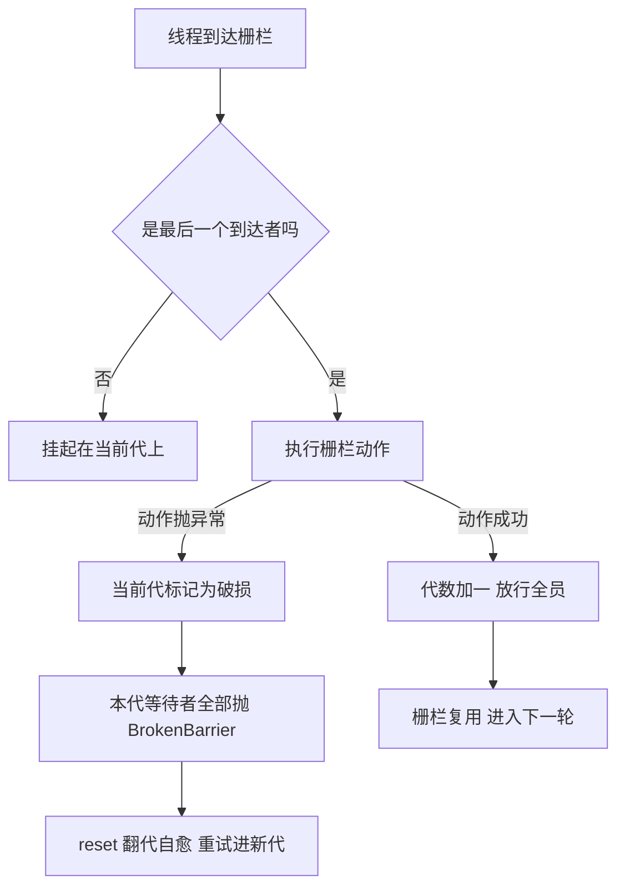
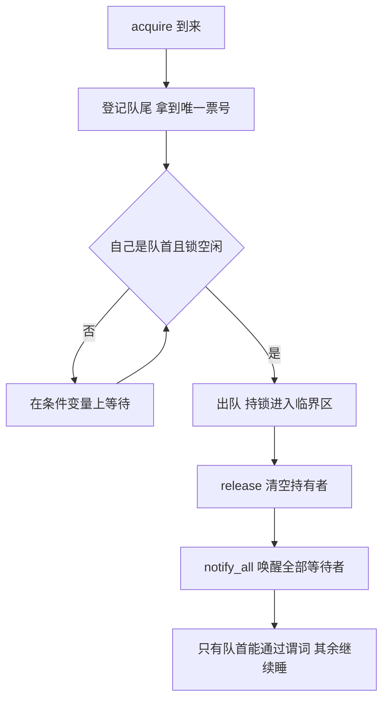
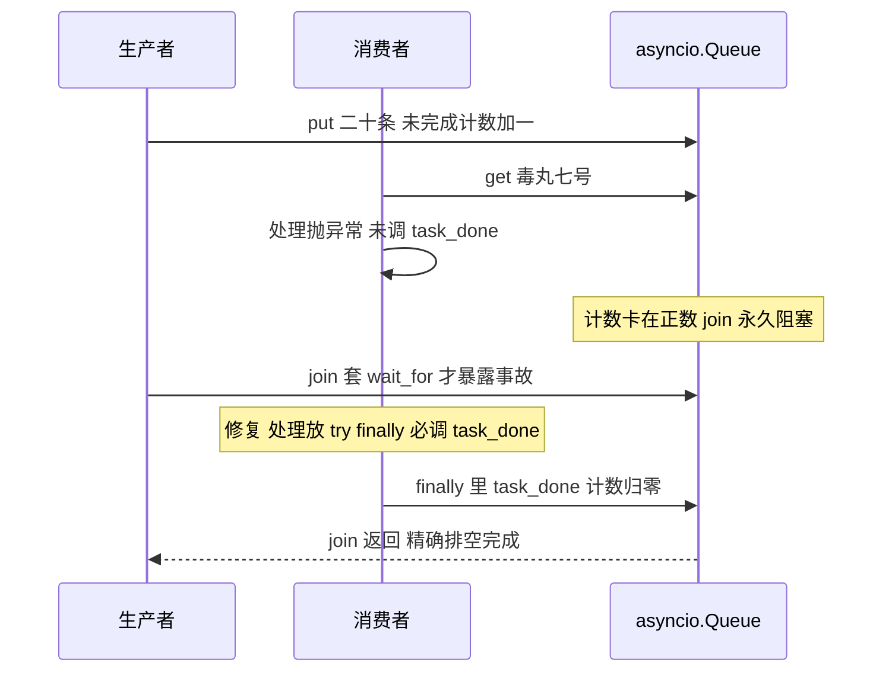
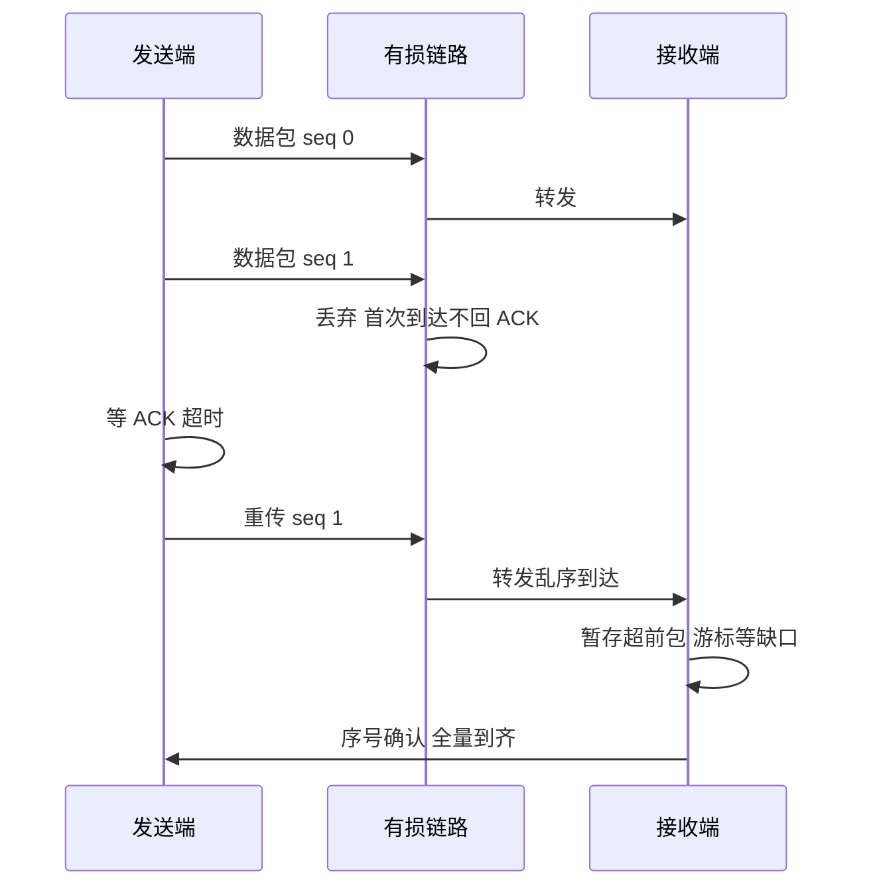
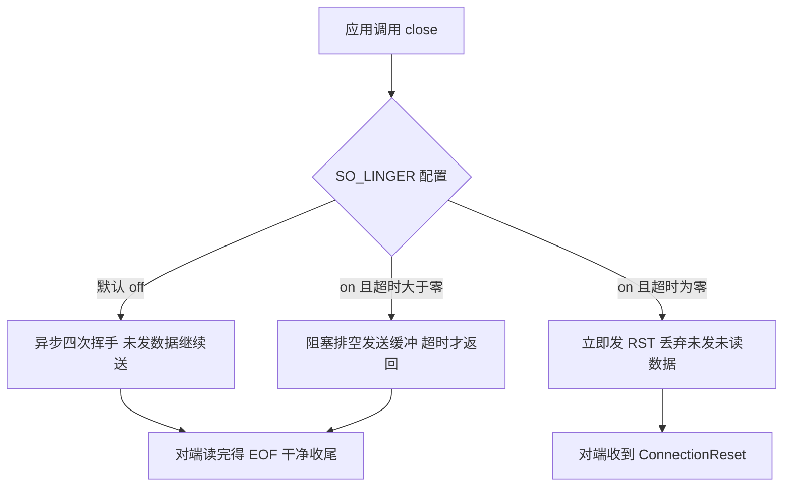
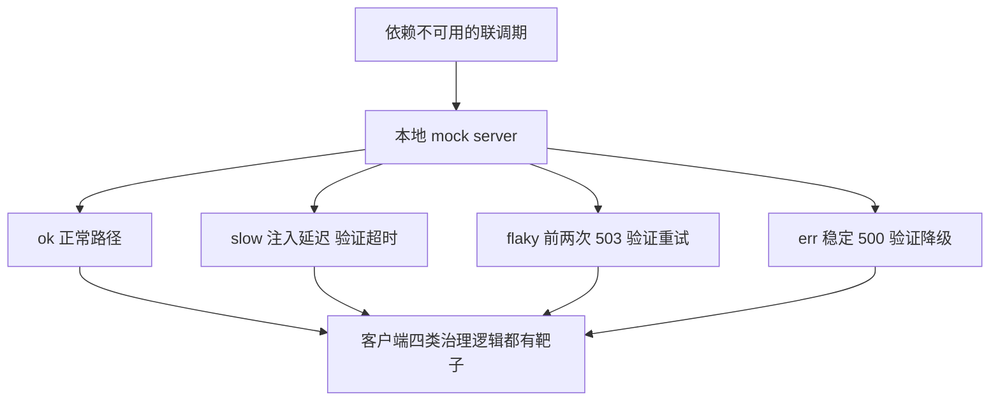
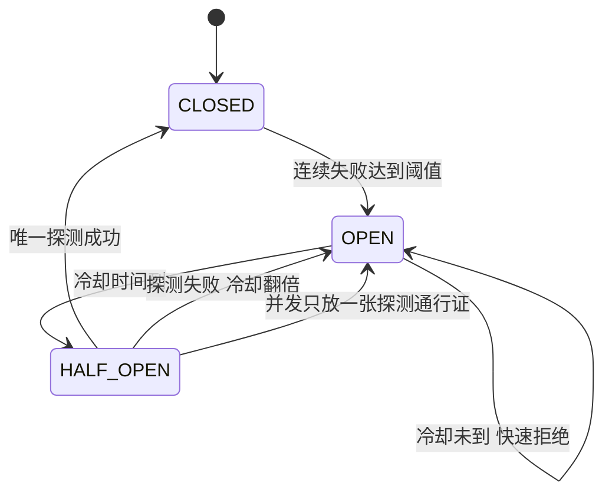
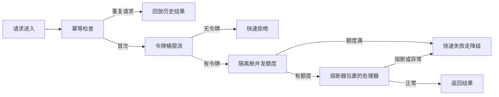

# 第 2 类 · 并发与网络工程(夜间扩产三)

> 本篇是第三篇夜间扩产:并发原语补遗(有界阻塞栈、倒计时闩锁、代际栅栏、CAS 思想、通用对象池、任务窃取、FIFO 公平锁)与 asyncio 补遗(重试组合子、缓存击穿单飞、task_done 精确排空、管道背压实测、优先级饥饿治理、shutdown_default_executor、异步发布订阅与微批聚合)。

> 网络侧深入 SO_LINGER 三配置、TCP_NODELAY 延迟实测、UDP 丢包重传与乱序重组、inet_pton 校验、双栈 IPv4 与 IPv6、SO_REUSEADDR 与 TIME_WAIT、errno 实验台与 sendfile;工程侧覆盖表驱动重连状态机、请求关联 ID、隔离舱与降级、链路级 mock、版本与能力协商、幂等台账、半开单飞探测、时钟偏移监测与链路追踪,收于一题服务端入站治理链。

> 全部代码仅标准库、完整可运行,已在本机 Python 3.9 逐文件实跑通过;网络演示全部走本机回环 127.0.0.1 与 ::1,服务端用 daemon 线程并等待端口就绪,urllib 一律 build_opener 绕过环境代理。


---
### Q1841 · 条件变量实现有界阻塞栈:满/空双向等待

> 难度:★★☆ | 标签:Condition, 阻塞栈, 背压

**问**:标准库有现成的 Queue,为什么还要求你用 Condition 手写一个有界阻塞栈?满和空两种等待怎么同时支持?

**答**:核心是一个 Condition 加一个谓词循环:push 在栈满时 wait,pop 在栈空时 wait,每次状态变化 notify_all,由等待方醒来后重新自查谓词。

- wait 必须套 while 而不是 if:notify 与真正拿锁之间存在窗口,醒来时条件可能又变了,这就是虚假唤醒的标准解法;

- 所有等待都带 deadline,超时抛 TimeoutError,绝不写无限等,否则一个消费者死亡就拖死全场;

- 等待计数 push_wait/pop_wait 是现成的背压仪表盘,实验里两个计数都大于零,证明满/空等待真实发生过。

Queue 已经帮你做好了这些,手写的价值在于理解它内部就是 '锁 + 两个谓词 + while 循环' 这套骨架。

```python
# file: code/02_并发与网络工程/q1841_bounded_stack.py
# -*- coding: utf-8 -*-
"""条件变量实现有界阻塞栈: 满/空两向等待。

- 一个 Condition 承担 not_full 与 not_empty 两种谓词, notify_all 后由等待方自查;
- push 在栈满时等待, pop 在栈空时等待, 都带超时避免永久卡死;
- 统计等待次数, 证明背压真实发生过。
"""
import threading
import time


class BoundedStack:
    def __init__(self, cap):
        assert cap > 0
        self._cap = cap
        self._items = []
        self._cond = threading.Condition()
        self.stats = {"push_wait": 0, "pop_wait": 0}

    def push(self, x, timeout=3.0):
        with self._cond:
            deadline = time.monotonic() + timeout
            while len(self._items) >= self._cap:
                remain = deadline - time.monotonic()
                if remain <= 0:
                    raise TimeoutError("push 超时: 栈一直满")
                self.stats["push_wait"] += 1
                self._cond.wait(remain)
            self._items.append(x)
            self._cond.notify_all()

    def pop(self, timeout=3.0):
        with self._cond:
            deadline = time.monotonic() + timeout
            while not self._items:
                remain = deadline - time.monotonic()
                if remain <= 0:
                    raise TimeoutError("pop 超时: 栈一直空")
                self.stats["pop_wait"] += 1
                self._cond.wait(remain)
            v = self._items.pop()
            self._cond.notify_all()
            return v

    def __len__(self):
        with self._cond:
            return len(self._items)


def main():
    st = BoundedStack(2)
    got = []
    got_lock = threading.Lock()

    def consumer(n):
        for _ in range(n):
            v = st.pop(timeout=3.0)
            with got_lock:
                got.append(v)

    def producer():
        for i in (3, 4):
            st.push(i, timeout=3.0)       # 栈已满, push 必然等待
            time.sleep(0.05)              # 慢慢放, 制造空栈等待

    st.push(1)
    st.push(2)                            # 预先填满, 制造确定性满栈
    p = threading.Thread(target=producer)
    p.start()
    time.sleep(0.1)                       # 确保 push 已经卡在满栈等待上
    cs = [threading.Thread(target=consumer, args=(2,)) for _ in range(2)]
    for t in cs:
        t.start()
    p.join()
    for t in cs:
        t.join()

    print("消费到的元素:", sorted(got))
    print("等待统计:", st.stats)
    assert sorted(got) == [1, 2, 3, 4], "四个元素都应被消费"
    assert st.stats["push_wait"] >= 1, "预填满栈, 第三个 push 必须等待"
    assert st.stats["pop_wait"] >= 1, "消费者追平后应在空栈上等待"
    print("结论: 单 Condition + 谓词循环, 就能实现满/空双向等待的有界栈")


if __name__ == "__main__":
    main()
```

**追问**:1) 一个 Condition 能同时承担 not_full 和 not_empty 吗?——可以,通知是广播式的,醒来后各自检查自己的谓词;代价是无差别唤醒,等待者多时可拆成两个 Condition 共用一把锁。2) notify_all 与「谓词自查」为什么缺一不可?——notify 只是「可能可以了」的信号,唤醒方拿锁时谓词可能又被别人改掉;while 自查把正确性收回到等待方,这是条件变量「信号+状态」双要素的标准结构(Q562 的双条件队列同源)。3) 什么时候该拆两个 Condition?——单 Condition 广播的代价是无效唤醒:满栈时 pop 等待者也被叫醒;读多写少或等待者成百时,not_full/not_empty 各一个 Condition 共用同一把 Lock,精确唤醒;计数仪表盘(wait 计数)要保留,它是背压观测的抓手。4) 生产陷阱?——while 写成 if(虚假唤醒后状态错乱);notify 在锁外调用(ValueError 或竞态);deadline 缺失,一个死亡消费者拖死全场;等待计数只增不减(仪表盘失真);Condition 复用错了锁(两个 Condition 各自 new Lock,互斥失效)。


---

### Q1842 · 阻塞栈的关闭与排空:关门不清仓

> 难度:★★★ | 标签:优雅关闭, Condition, 生命周期

**问**:有界阻塞栈要支持优雅关闭:close 之后写不进、但存量还能读,消费者怎么知道该收工了?

**答**:关闭语义要回答三个问题:close 后 push 怎么办(一律拒绝,抛 RuntimeError)、已阻塞在 pop 的等待者怎么办(notify_all 全部唤醒)、pop 在空栈且已关时怎么办(返回 None 作为收工信号)。

- close 必须 notify_all:否则还挂在空栈上的消费者永远等不到下一次推送,这是关闭逻辑最常见的漏洞;

- pop 的谓词升级为 '非空才取,空且已关才退出',空但未关仍然继续等;

- 演示里两个消费者都在 close 后凭 None 干净退出,close 后的 push 被拒绝,五个存量元素全部排空。

这套 '关门不清仓' 语义和线程池的 drain 抽水完全同构,是可以直接搬到生产代码的模式。

```python
# file: code/02_并发与网络工程/q1842_stack_close_drain.py
# -*- coding: utf-8 -*-
"""有界阻塞栈的关闭与排空语义: close 后 push 拒绝, pop 排完存量返回 None。

- close() 置位后要 notify_all, 把还挂在空栈上的 pop 全部唤醒;
- pop 的谓词是 "空且未关闭才等", 空且已关闭直接返回 None, 这是优雅下线的核心;
- push 一律拒绝, 语义是 "关门, 不是清仓": 存量仍然可取。
"""
import threading
import time


class ClosableStack:
    def __init__(self, cap):
        self._cap = cap
        self._items = []
        self._closed = False
        self._cond = threading.Condition()

    def push(self, x, timeout=3.0):
        with self._cond:
            deadline = time.monotonic() + timeout
            while True:
                if self._closed:
                    raise RuntimeError("栈已关闭, 不再接受写入")
                if len(self._items) < self._cap:
                    self._items.append(x)
                    self._cond.notify_all()
                    return
                remain = deadline - time.monotonic()
                if remain <= 0:
                    raise TimeoutError("push 超时: 栈一直满")
                self._cond.wait(remain)

    def pop(self, timeout=3.0):
        with self._cond:
            deadline = time.monotonic() + timeout
            while True:
                if self._items:
                    v = self._items.pop()
                    self._cond.notify_all()
                    return v
                if self._closed:
                    return None             # 关门且清空: 优雅退出信号
                remain = deadline - time.monotonic()
                if remain <= 0:
                    raise TimeoutError("pop 超时: 栈一直空")
                self._cond.wait(remain)

    def close(self):
        with self._cond:
            self._closed = True
            self._cond.notify_all()          # 唤醒所有等待中的 pop


def main():
    st = ClosableStack(2)
    got = []
    got_lock = threading.Lock()
    stop = threading.Event()

    def consumer():
        while not stop.is_set():
            v = st.pop(timeout=3.0)
            if v is None:
                break                        # 收到关门信号
            with got_lock:
                got.append(v)

    def producer():
        for i in range(1, 6):
            st.push(i, timeout=3.0)
        time.sleep(0.1)                      # 确保消费者已经饥饿等待过
        st.close()

    cs = [threading.Thread(target=consumer) for _ in range(2)]
    p = threading.Thread(target=producer)
    for t in cs:
        t.start()
    p.start()
    p.join()
    for t in cs:
        t.join(timeout=2.0)
        assert not t.is_alive(), "消费者应随关门信号退出, 不能永久卡死"

    try:
        st.push(99)
        raise AssertionError("close 后 push 应当被拒绝")
    except RuntimeError as e:
        print("close 后 push 被拒绝:", e)

    assert sorted(got) == [1, 2, 3, 4, 5], "存量 5 个元素必须全部可排空"
    assert st.pop(timeout=0.5) is None, "关门且空栈的 pop 返回 None"
    print("排空结果:", sorted(got))
    print("结论: close 是关门不清仓, pop 靠 '空且已关' 谓词优雅退出")


if __name__ == "__main__":
    main()
```

**追问**:1) 为什么不用哨兵值(往栈里塞 None)通知收工?——哨兵要按消费者数量精确投递,多塞少塞都会出错,而且污染数据通道;关闭标志位 + 广播唤醒与数据彻底解耦。2) close 后 push 抛异常还是静默忽略?——抛 RuntimeError(调用方明确失败)优于静默丢数据;而「拒绝+记录」适合统计口径;关键是语义写进文档:关门不清仓,存量可读、增量必拒——半关闭(Q664)在队列层的对应物。3) 排空完成怎么判定?——「空且已关」的 None 是消费者收工信号;生产者侧配合是「put 完成后再 close」的时序约定;更严格的做法是 close 后等待「存量清零+消费者全部退出」的 join——三段式下线与连接排水(Q692)同构。4) 生产陷阱?——close 忘 notify_all,消费者永久挂起(最常见);close 后还允许 push 的窗口(标志检查不在锁内);消费者把 None 当业务数据处理(类型断言缺失);close 后重复 close(幂等性要保证)。


---

### Q1843 · 倒计时闩锁 CountDownLatch:一次性计数汇聚点

> 难度:★★☆ | 标签:Latch, 同步, 优雅启动

**问**:Java 里遍地都是 CountDownLatch,Python 没有,它和 Event 差在哪?怎么自己实现一个?

**答**:Latch 是 '还差几个' 的量化汇聚:计数到零对所有人永久放行,之后任何 wait 都立即通过,永不复位;Event 是二态开关,天然可 set/clear,但数不了进度。

- 实现就是一个 Condition 加一个只减不增的计数,count_down 到零时 notify_all 广播放行;

- wait 必须支持 timeout,返回 True/False 而不是抛异常——'还没就绪' 是正常业务状态不是错误;

- 典型用途:主流程等 n 个子系统初始化完毕再对外服务,演示里 db、cache、config 三个倒计时者到齐后主流程放行。

和 Event 的分工:Event 管 '开关状态',Latch 管 '汇聚进度';需要重复开合的一组信号,还要上 Condition 自己维护。

```python
# file: code/02_并发与网络工程/q1843_countdown_latch.py
# -*- coding: utf-8 -*-
"""倒计时闩锁 CountDownLatch: 一次性计数到零的汇聚点。

- 与 Event 的差别: Event 是二态开关且天然可重置, Latch 表达 "还差几个" 的量化语义;
- count_down 只减不增, 到零后对所有人永久放行, wait 支持 timeout 非阻塞探测;
- 典型用途: 主流程等 n 个子系统就绪、汇聚多个并行任务的完成信号。
"""
import threading
import time


class CountDownLatch:
    def __init__(self, n):
        assert n >= 0
        self._cond = threading.Condition()
        self._count = n

    def count_down(self):
        with self._cond:
            if self._count > 0:
                self._count -= 1
                if self._count == 0:
                    self._cond.notify_all()   # 到零广播放行

    def wait(self, timeout=None):
        with self._cond:
            deadline = None if timeout is None else time.monotonic() + timeout
            while self._count > 0:
                if deadline is None:
                    self._cond.wait(0.5)
                else:
                    remain = deadline - time.monotonic()
                    if remain <= 0:
                        return False
                    self._cond.wait(remain)
            return True

    @property
    def count(self):
        with self._cond:
            return self._count


def main():
    # 场景一: 主线程等 3 个子系统就绪
    latch = CountDownLatch(3)
    ready_log = []

    def subsystem(name, cost):
        time.sleep(cost)
        ready_log.append(name)
        latch.count_down()

    for name, cost in [("db", 0.05), ("cache", 0.03), ("config", 0.08)]:
        threading.Thread(target=subsystem, args=(name, cost)).start()

    t0 = time.monotonic()
    ok = latch.wait(timeout=2.0)
    print("三个子系统就绪:", ready_log, "等待耗时: %.2fs" % (time.monotonic() - t0))
    assert ok and latch.count == 0, "latch 应当计数到零"

    # 场景二: 只有一个倒计时者, 探测超时返回 False 而不是抛异常
    latch2 = CountDownLatch(2)
    threading.Thread(target=latch2.count_down).start()
    ok2 = latch2.wait(timeout=0.2)
    print("缺一个倒计时者, 带超时 wait 返回:", ok2, "剩余计数:", latch2.count)
    assert ok2 is False and latch2.count == 1, "超时应返回 False 且计数不变"

    # 对照: Event 无法表达 "还差几个", 只能表达 "发生了没有"
    ev = threading.Event()
    print("对照 Event: 只有 set/clear 两态, 数不了进度")
    print("结论: Latch = 带计数的单次汇聚点, 超时探测返回 False 不抛异常")


if __name__ == "__main__":
    main()
```

**追问**:1) Latch 计数能再加回去吗?——不能,这正是它与 Semaphore 的本质区别;可重置的计数语义请用 Condition 自己实现,Semaphore 的 release 会加计数,语义完全不同。2) wait 返回 True/False 而不是抛异常为什么是对的?——「还没就绪」是正常业务状态不是错误:调用方要么再等要么放弃,用返回值表达比异常便宜且不会被 try/except 误吞;这也是 Latch 与 Barrier(broken 是真错误)的语义差异之一。3) Latch 与 gather/Event 的组合边界?——asyncio 世界里 gather 本身就是「等 N 个完成」的 Latch,线程世界才是自实现的主场;混合场景(线程初始化+主线程放行)用 Latch 做「线程→主线程」的汇聚点,Event 做不了计数只能做开关。4) 生产陷阱?——count_down 漏调(计数永远到不了零,全场挂起,要配超时);把 Latch 用成可重复开关(复位语义不支持);子任务异常没 count_down(finally 里补);wait 无 timeout(初始化失败永久阻塞服务启动)。


---

### Q1844 · CyclicBarrier 概念与模拟:代数 generation 是复用的钥匙

> 难度:★★★ | 标签:Barrier, 同步, 分阶段并行

**问**:Barrier 和 Latch 都能让一组线程互相等,区别是什么?为什么 Barrier 可以反复用而 Latch 不行?

**答**:关键在 '代 generation':Barrier 每凑齐 parties 个到达者,就把当前代关闭、代数加一、放行全员,下一批人进入新一代;Latch 只有 '到零' 一个终态,没有代的概念。

- 每个等待者记住自己所属的代,被唤醒后发现代变了才通过,这个 '代校验' 让栅栏天然可复用;

- 最后到达者负责执行栅栏动作 barrier action 并翻代,动作完成前谁都不走,演示里动作日志每轮恰好一条;

- 演示三个线程跑两轮,到达序号 0..2 每轮各出现一次,代数从 0 涨到 2。

典型场景是多阶段流水线:每阶段所有 worker 完成后才统一进入下一阶段,比如并行模拟里 '所有体素更新完才交换边界'。

```python
# file: code/02_并发与网络工程/q1844_cyclic_barrier_gen.py
# -*- coding: utf-8 -*-
"""CyclicBarrier 概念与模拟: 用代数 generation 实现可复用栅栏。

- 核心是 "代": 每凑齐 parties 个到达者, 执行一次栅栏动作, 代数加一, 放行全员;
- 等待者记住自己所属的代, 被唤醒后发现代变了才通过, 因此栅栏天然可复用;
- 最后到达者负责跑栅栏动作并翻代, 这与 threading.Barrier 的行为一致。
"""
import threading
import time


class GenerationBarrier:
    def __init__(self, parties, action=None):
        self._parties = parties
        self._action = action
        self._cond = threading.Condition()
        self._arrived = 0
        self._generation = 0
        self.action_log = []

    def wait(self, timeout=5.0):
        """返回到达序号, 全员到齐时最后到达者执行 action 并翻代。"""
        with self._cond:
            g = self._generation
            self._arrived += 1
            idx = self._arrived
            if idx == self._parties:
                self._arrived = 0
                if self._action is not None:
                    self._action(g)
                self._generation = g + 1
                self._cond.notify_all()
                return 0
            deadline = time.monotonic() + timeout
            while self._generation == g:
                remain = deadline - time.monotonic()
                if remain <= 0:
                    raise TimeoutError("barrier 等待超时")
                self._cond.wait(remain)
            return idx


def main():
    rounds_seen = []
    barrier = GenerationBarrier(3, action=lambda g: rounds_seen.append(g))
    finished = []
    finish_lock = threading.Lock()

    def worker(name):
        for r in range(2):                    # 两轮, 验证复用
            idx = barrier.wait()
            with finish_lock:
                finished.append((name, r, idx))

    ts = [threading.Thread(target=worker, args=("w%d" % i,)) for i in range(3)]
    for t in ts:
        t.start()
    for t in ts:
        t.join(timeout=5.0)
        assert not t.is_alive(), "两轮栅栏都应通过, 不应卡死"

    print("栅栏动作执行记录(每轮一次):", rounds_seen)
    print("线程完成情况:", sorted(finished))
    assert rounds_seen == [0, 1], "栅栏动作每轮恰好执行一次, 代数 0 与 1"
    assert len(finished) == 6, "3 个线程 x 2 轮 = 6 次通过"
    per_round = {}
    for name, r, idx in finished:
        per_round.setdefault(r, []).append(idx)
    for r, idxs in per_round.items():
        assert sorted(idxs) == [0, 1, 2], "每轮到达序号 0..2 恰好各一次"
    print("结论: 代数是栅栏复用的钥匙, 动作由最后到达者代跑")


if __name__ == "__main__":
    main()
```

**追问**:1) 最后到达者跑动作时,其他人在什么状态?——都挂在当前代的条件变量上;动作耗时会长尾拖住全员,所以动作要短,或者把动作交给独立的下一阶段任务。2) 代校验为什么能防「上一代的唤醒误伤下一代」?——等待者唤醒后检查「当前代数是否还等于自己所属代」,不等说明自己等的代已经关闭,直接通过;没有代校验,复用栅栏会把新一批等待者错误放行——「代」就是把一次性 Latch 的正确性扩展到可复用的关键。3) 栅栏动作的耗时约束怎么落地?——动作在最后到达者上下文里跑,全员被它拖住;动作要短(打日志/翻转开关),重的协调工作交给动作里 spawn 的异步任务;或规定动作超时也标记 broken。4) 生产陷阱?——动作抛异常没转 broken(整组永久卡死,见 Q1845);parties 数与实际线程数不符(有人到不了,全员等待);复用栅栏不区分代(混杂两批任务);把重 IO 放进动作(全员长尾)。


---

### Q1845 · 栅栏动作失败与中止恢复:broken 只毒化当前代

> 难度:★★★★ | 标签:Barrier, 故障处理, 自愈

**问**:栅栏动作里抛了异常,等待的一组线程怎么办?怎么设计才能不把整组永久卡死?

**答**:正确路径是代内破损:动作抛异常时把当前代标记为 broken,notify_all 把所有等待者叫醒,它们与本代后续到达者统一收到 BrokenBarrierError,立刻解脱而不是傻等。

- 破损只属于当前代,不会毒化下一代,这是 '可复用 + 可自愈' 的关键设计;

- reset() 显式翻代复位:清掉破损与计数、代数加一,全员可以重试;

- 演示第一轮动作故意失败,三个线程全部感知破损后重试,故障解除加 reset 之后第二轮全员成功。

threading.Barrier 内建这套语义(wait 返回 BrokenBarrierError,abort/reset 配套),手写的意义在于把 '代内故障隔离' 这个设计决策讲清楚。

```python
# file: code/02_并发与网络工程/q1845_barrier_abort_reset.py
# -*- coding: utf-8 -*-
"""栅栏动作失败与中止恢复: broken 代隔离故障, reset 后进入下一代。

- 栅栏动作在最后到达者的上下文里执行, 它抛异常时本代标记为 broken;
- broken 只属于当前代: 本代所有等待者抛 BrokenBarrierError, 不会毒化下一代;
- reset() 显式翻代复位, 让全员重试, 这是可复用栅栏的自愈路径。
"""
import threading
import time


class BrokenBarrierError(Exception):
    pass


class AbortableBarrier:
    def __init__(self, parties, action=None):
        self._parties = parties
        self._action = action
        self._cond = threading.Condition()
        self._arrived = 0
        self._generation = 0
        self._broken = False

    def wait(self, timeout=5.0):
        with self._cond:
            g = self._generation
            if self._broken:
                raise BrokenBarrierError("代 %d 已破损" % g)
            self._arrived += 1
            if self._arrived == self._parties:
                self._arrived = 0
                try:
                    if self._action is not None:
                        self._action(g)
                except Exception as e:
                    self._broken = True
                    self._cond.notify_all()
                    raise BrokenBarrierError("栅栏动作失败: %r" % e) from e
                self._generation = g + 1
                self._cond.notify_all()
                return 0
            deadline = time.monotonic() + timeout
            while self._generation == g and not self._broken:
                remain = deadline - time.monotonic()
                if remain <= 0:
                    raise TimeoutError("barrier 等待超时")
                self._cond.wait(remain)
            if self._broken:
                raise BrokenBarrierError("代 %d 已破损" % g)
            return 1

    def reset(self):
        with self._cond:
            self._broken = False
            self._arrived = 0
            self._generation += 1             # 换新代, 旧代全部作废
            self._cond.notify_all()


def main():
    fail_first = {"v": True}
    broken_events = []
    success_events = []
    ev_lock = threading.Lock()

    def action(g):
        if fail_first["v"]:
            raise OSError("外部依赖暂不可用, 模拟第一轮动作失败")

    barrier = AbortableBarrier(3, action=action)

    def worker(name):
        for attempt in range(10):
            try:
                barrier.wait()
            except BrokenBarrierError as e:
                with ev_lock:
                    broken_events.append((name, attempt, str(e)))
                time.sleep(0.03)            # 稍等自愈, 再进栅栏
                continue
            with ev_lock:
                success_events.append((name, attempt))
            return

    ts = [threading.Thread(target=worker, args=("w%d" % i,)) for i in range(3)]
    for t in ts:
        t.start()

    # 等第一轮破损被全员感知, 再解除故障并复位栅栏
    deadline = time.monotonic() + 3.0
    while time.monotonic() < deadline and len(broken_events) < 3:
        time.sleep(0.01)
    fail_first["v"] = False
    barrier.reset()

    for t in ts:
        t.join(timeout=5.0)
        assert not t.is_alive(), "复位后重试轮应当成功, 不应卡死"

    print("破损事件数:", len(broken_events))
    print("重试成功:", success_events)
    assert len(broken_events) >= 3, "第一轮 3 个线程都应感知破损"
    assert len(success_events) == 3, "复位后重试轮全员成功"
    assert all("动作失败" in msg or "已破损" in msg
               for _, _, msg in broken_events), "事件都应是栅栏破损语义"
    print("结论: broken 只毒化当前代, reset 翻代自愈, 重试进新代")


if __name__ == "__main__":
    main()
```

**追问**:1) 等待者收到 BrokenBarrierError 后该重试还是放弃?——取决于动作失败的原因:瞬时故障(依赖抖动)可以退避后重试进新代,确定性故障(参数非法)应放弃并让整组任务失败,别把重试做成死循环。2) broken 为什么只毒化当前代?——破损的原因(动作异常)只属于这一批参与者;下一代是新的一批,状态应干净——这延续了「代」的语义;threading.Barrier 行为一致(broken 状态在本代等待/到达者上抛)。3) reset() 的使用时机与风险?——reset 是管理员的显式动作:清计数、翻代、唤醒全员报破损;调用时若有人正处于「刚到达未登记」的窗口,会拿到 BrokenBarrierError——reset 本身也要在锁内原子完成,且语义是「重新开始」不是「悄悄修复」。4) 生产陷阱?——把 BrokenBarrierError 当普通异常吞掉继续等待(下次照样挂);重试无退避(整组高频撞栅栏);动作失败原因没有分类(瞬时 vs 确定性,重试策略无从定,Q1845 原问);栅栏状态无监控(broken 次数该告警)。



---

### Q1846 · 原子标志位与 CAS 思想:丢失更新是怎么发生的

> 难度:★★☆ | 标签:CAS, 原子性, 并发正确性

**问**:CPython 有 GIL,为什么 counter += 1 还会出错?CAS 比较并交换到底是什么?

**答**:GIL 只保证单个字节码原子,而 counter += 1 是 LOAD、ADD、STORE 三步,线程切在第两步之间时,另一个线程的更新会被后写者覆盖——这就是丢失更新 lost update。

- 实验把切换间隔调到 1 微秒制造高频交错,四线程八万次自增丢了近五万次;

- CAS(compare-and-swap)是另一种思路:提交时校验 '预期值还等于我读到的旧值',不等于说明有人抢先,重读重算重试;

- CPython 不暴露硬件 CAS,实验用一把极小锁只护住 '比较并交换' 这一步作语义替身,CAS 循环版结果精确等于八万。

CAS 的价值在乐观并发:没有冲突时零阻塞一路绿灯,冲突了才重试;冲突频繁的场景它反而不如直接上锁。

```python
# file: code/02_并发与网络工程/q1846_cas_lost_update.py
# -*- coding: utf-8 -*-
"""CAS 思想与丢失更新: 无保护的读改写会丢更新, CAS 循环靠提交校验自愈。

- CPython 不暴露硬件 CAS, 这里用一个极小锁只保护 "比较并交换" 这一步,
  它在语义上就是 compare_and_swap 原语的替身;
- CAS 循环: 读旧值 -> 计算新值 -> 提交时校验预期值, 失败就重来;
- 对照组: 裸的 counter += 1 在字节码层面是三步, 线程切换会让更新蒸发。
"""
import sys
import threading

sys.setswitchinterval(1e-6)           # 极小切换间隔, 迫使字节码高频交错
TOTAL_THREADS = 4
ITERS = 20000
TOTAL = TOTAL_THREADS * ITERS


def racy_incr(cell):
    for _ in range(ITERS):
        cell[0] += 1                      # 读 加 写 三步, 中途可被打断


class CasCell:
    """用最小锁模拟原子 CAS 原语。"""

    def __init__(self, value):
        self._value = value
        self._atomic = threading.Lock()
        self.retries = 0

    def read(self):
        return self._value                # GIL 下单项读是原子的

    def compare_and_swap(self, expected, new):
        with self._atomic:                # 只包住比较交换这一瞬
            if self._value == expected:
                self._value = new
                return True
            return False

    def incr(self):
        while True:
            cur = self.read()
            if self.compare_and_swap(cur, cur + 1):
                return
            self.retries += 1             # 预期值失效, 别人抢先了, 重来


def main():
    # 对照组: 裸读改写, 多轮尝试直到捕捉到丢失更新
    lost = 0
    racy_final = None
    for _ in range(3):
        racy = [0]
        ts = [threading.Thread(target=racy_incr, args=(racy,))
              for _ in range(TOTAL_THREADS)]
        for t in ts:
            t.start()
        for t in ts:
            t.join()
        racy_final = racy[0]
        if racy_final != TOTAL:
            lost = TOTAL - racy_final
            break
    print("裸读改写结果: %d / %d, 丢失 %d 次更新" % (racy_final, TOTAL, lost))
    assert racy_final != TOTAL, "高频交错下裸读改写必然丢失更新"

    # 实验组: CAS 循环
    cell = CasCell(0)

    def cas_worker():
        for _ in range(ITERS):
            cell.incr()

    ts = [threading.Thread(target=cas_worker) for _ in range(TOTAL_THREADS)]
    for t in ts:
        t.start()
    for t in ts:
        t.join()
    print("CAS 循环结果:", cell.read(), "因冲突重试次数:", cell.retries)
    assert cell.read() == TOTAL, "CAS 提交校验保证不丢更新"

    print("结论: 正确性不靠运气靠校验, 预期值不符就重来, 这就是乐观并发")


if __name__ == "__main__":
    main()
```

**追问**:1) 有了 GIL 为什么不像 Java 一样提供 AtomicInteger?——GIL 保证的是解释器层的操作原子性,不是算法层的 '读-算-写' 序列原子性;真无锁数据结构需要平台 CAS 指令,CPython 的务实做法是用最小锁或直接用队列。2) CAS 循环的正确退出条件是什么?——提交成功退出;冲突则重读重算重试;还要加「重试上限/让步」防活锁(极端争用下无限重试烧 CPU);CPython 用微锁替身时要认清:那是「语义演示」不是性能方案,真实无锁要靠平台 CAS 指令或队列收敛。3) ABA 问题为什么在 CPython 里少见?——ABA 是「值从 A 改成 B 又改回 A」骗过 CAS;CPython 对象带身份(id)与引用计数,小整数缓存等特殊场景之外,纯数值计数器的 ABA 罕见;但「基于值的 CAS 复合状态」仍可用版本号(Q1847)根治。4) 生产陷阱?——把「GIL 保护一切」当结论(六步窗口见原问);CAS 重试无上限(活锁);用「先读后写两个原子操作」冒充原子复合(读和写之间的切换窗口还在);微锁替身版被当成「无锁」宣传。


---

### Q1847 · CAS 循环乐观锁:版本号提交保证复合状态一致性

> 难度:★★★ | 标签:乐观锁, 版本号, 一致性

**问**:单个计数器好办,如果一次修改要同时动两个字段(比如转账动两个账户),怎么保证不出错?

**答**:单项原子操作护不住跨字段的复合修改,答案是乐观版本号:每次修改基于快照准备变更,提交那一刻校验版本号,版本没变才落盘,变了就整批重来。

- 版本号是复合状态的 CAS 比较子:快照里有版本,提交时 compare-and-swap 版本,等于一次性校验了整个状态的时序;

- 冲突重试是正常路径,实验里两千次提交冲突了八百多次,最终总额精确守恒;

- 对照组不做版本校验、读了就写,同样的交错直接把总额写丢,这就是转账差额的来源。

数据库的 MVCC、消息队列的 CAS 更新、HTTP 的 If-Match ETag,全是这套 '读快照-准备-校验提交' 的变体。

```python
# file: code/02_并发与网络工程/q1847_optimistic_version.py
# -*- coding: utf-8 -*-
"""CAS 循环乐观锁: 版本号提交保证复合状态的一致性。

- 复合状态(两个账户余额)的读改写跨多个字段, 单项原子性救不了;
- 每次修改基于快照准备变更, 提交时校验版本号, 版本变了说明有人抢先, 重试;
- 对照组: 无版本校验的 "读了就写" 在高频交错下会丢失更新, 总额漂移。
"""
import sys
import threading
import random

sys.setswitchinterval(1e-6)

ROUNDS = 600
THREADS = 4


class VersionedState:
    def __init__(self, init):
        self._lock = threading.Lock()
        self._state = dict(init)
        self._ver = 0
        self.commits = 0
        self.retries = 0

    def snapshot(self):
        with self._lock:
            return self._ver, dict(self._state)

    def commit(self, expected_ver, mutator):
        with self._lock:
            if self._ver != expected_ver:
                self.retries += 1
                return False                # 版本已变, 有人抢先, 拒绝提交
            mutator(self._state)
            self._ver += 1
            self.commits += 1
            return True


def transfer_worker(state, naive_state, seed):
    rng = random.Random(seed)
    for _ in range(ROUNDS):
        # 乐观版: 基于快照准备变更, 版本不符就重试
        while True:
            ver, snap = state.snapshot()
            direction = rng.random() < 0.5

            def mut(st, direction=direction):
                if direction:
                    st["a"] -= 1
                    st["b"] += 1
                else:
                    st["a"] += 1
                    st["b"] -= 1

            if state.commit(ver, mut):
                break
        # 朴素版: 读了就写, 不校验版本
        ver2, snap2 = naive_state.snapshot()
        direction = rng.random() < 0.5

        def mut2(st, direction=direction):
            if direction:
                st["a"] -= 1
                st["b"] += 1
            else:
                st["a"] += 1
                st["b"] -= 1

        mut2(naive_state._state)            # 裸写, 无提交校验


def main():
    state = VersionedState({"a": 100, "b": 100})
    naive_state = VersionedState({"a": 100, "b": 100})
    ts = [threading.Thread(target=transfer_worker, args=(state, naive_state, i))
          for i in range(THREADS)]
    for t in ts:
        t.start()
    for t in ts:
        t.join()

    ver, snap = state.snapshot()
    nver, nsnap = naive_state.snapshot()
    print("乐观版: 版本=%d 提交=%d 冲突重试=%d 状态=%s 总额=%d"
          % (ver, state.commits, state.retries, snap, snap["a"] + snap["b"]))
    print("朴素版: 状态=%s 总额=%d (应保持 200)" % (nsnap, nsnap["a"] + nsnap["b"]))
    assert snap["a"] + snap["b"] == 200, "乐观版总额必须守恒"
    assert state.retries > 0, "高频交错下必然发生版本冲突重试"
    print("结论: 版本号是复合状态的 CAS, 提交那一刻见真章")


if __name__ == "__main__":
    main()
```

**追问**:1) 冲突太多怎么办?——乐观锁的性能悬崖在写冲突率:热账户高频转账冲突率飙升,重试风暴反而更慢;这时应转悲观(账户级锁)、或把操作排队串行化、或分片散热。2) 版本号 CAS 与悲观锁怎么选?——冲突率低(读多写少)乐观锁赢(无锁等待,冲突重试便宜);冲突率高(热账户)悲观锁赢(一次等待 vs N 次重读重算);判据是冲突率实测,Q1847 原问的「冲突八百多次」就是收益边界的信号。3) 快照与提交的内存语义怎么保证?——快照必须在「读版本」同一临界区内取(否则快照与版本错位);提交时 compare-and-swap 版本+写入变更也是同一临界区;两段合起来就是「乐观读-悲观提交」的混合模式——这是数据库 MVCC(Q148)在应用内存结构的投影。4) 生产陷阱?——版本号被并发改写(版本字段也要在锁内);重试风暴(冲突率高时 CPU 烧在重算,要转悲观);快照陈旧(取快照后状态已被改,提交必败,白白重试);把版本号用在「无冲突检测必要」的单字段上(过度设计)。


---

### Q1848 · 线程安全的通用对象池:借出登记与重复归还防线

> 难度:★★☆ | 标签:对象池, Condition, 资源管理

**问**:连接池、线程池之外,要不要为一个昂贵对象自己写个池?池的不变量有哪些必须守住?

**答**:池的核心是三条不变量:借出数不超过上限、每个对象同一时刻只被一人持有、归还的必须是本池对象。

- 借出时池空且未达上限就现场创建,达上限就挂 Condition 等归还,带超时快速失败;

- 借出集合按 id 登记,归还时查集合:重复归还或归还外来对象直接抛 ValueError,这是把不变量变成断言;

- high_water 记录同时在用峰值,是回答 '池该开多大' 的第一手数据。

演示四个借还者复用两个对象,工厂只被调用两次,峰值恰好为 2,说明池没有超卖也没有闲置。

```python
# file: code/02_并发与网络工程/q1848_object_pool.py
# -*- coding: utf-8 -*-
"""线程安全的通用对象池: Condition 实现 borrow/give_back 的完整语义。

- 池空且未达上限时现场创建; 已达上限则等待归还, 带超时快速失败;
- 借出集合登记 id 防止重复归还或归还外来对象, 这是池不变量的关键;
- high_water 记录同时在用的峰值, 用来回答 "池开多大才够"。
"""
import threading
import time


class ObjectPool:
    def __init__(self, factory, size):
        self._factory = factory
        self._size = size
        self._cond = threading.Condition()
        self._idle = []
        self._created = 0
        self._in_use = 0
        self._borrowed_ids = set()
        self.high_water = 0

    def borrow(self, timeout=2.0):
        with self._cond:
            deadline = time.monotonic() + timeout
            while True:
                if self._idle:
                    obj = self._idle.pop()
                    break
                if self._created < self._size:
                    self._created += 1
                    obj = self._factory()
                    break
                remain = deadline - time.monotonic()
                if remain <= 0:
                    raise TimeoutError("对象池已耗尽且等待超时")
                self._cond.wait(remain)
            oid = id(obj)
            self._borrowed_ids.add(oid)
            self._in_use += 1
            self.high_water = max(self.high_water, self._in_use)
            return obj

    def give_back(self, obj):
        with self._cond:
            oid = id(obj)
            if oid not in self._borrowed_ids:
                raise ValueError("重复归还或归还了非本池对象")
            self._borrowed_ids.discard(oid)
            self._idle.append(obj)
            self._in_use -= 1
            self._cond.notify()

    @property
    def created(self):
        with self._cond:
            return self._created


def main():
    counter = {"n": 0}

    def factory():
        counter["n"] += 1
        return {"conn": "conn-%d" % counter["n"]}

    pool = ObjectPool(factory, size=2)
    results = []
    res_lock = threading.Lock()

    def borrower():
        for _ in range(2):
            obj = pool.borrow(timeout=2.0)
            time.sleep(0.03)                  # 模拟使用
            pool.give_back(obj)
        with res_lock:
            results.append(True)

    ts = [threading.Thread(target=borrower) for _ in range(4)]
    for t in ts:
        t.start()
    for t in ts:
        t.join(timeout=5.0)
        assert not t.is_alive(), "借还循环不应卡死"

    print("工厂调用次数:", pool.created, "并发峰值 high_water:", pool.high_water)
    assert len(results) == 4, "全部借还完成"
    assert pool.created <= 2, "池上限是 2, 工厂不应超造"
    assert pool.high_water <= 2, "同时在用不得超过池上限"
    assert pool.created == 2, "4 个借还者复用 2 个对象即可"

    # 不变量: 重复归还必须被拒绝
    obj = pool.borrow(timeout=1.0)
    pool.give_back(obj)
    try:
        pool.give_back(obj)
        raise AssertionError("重复归还应被拒绝")
    except ValueError as e:
        print("重复归还被拒绝:", e)
    print("结论: 借出集合登记 id, 让池的状态机无懈可击")


if __name__ == "__main__":
    main()
```

**追问**:1) 对象归还后状态是脏的怎么办?——归还时或在下次借出前做 reset 或健康校验;更工程化的做法是归还即校验、坏对象就地销毁重建,借出方永远拿到干净对象。2) 「借出集合登记 id」防的是什么?——重复归还(调用方 finally+except 双路径各还一次,池子名额翻倍)与归还外来对象(不同池的对象混入);把不变量变成断言,坏用法立刻炸而不是慢慢腐蚀——防御式设计在池类实现的核心应用。3) 「池该开多大」怎么回答?——high_water 峰值数据+Little's Law(Q1343):池上限 ≥ 峰值在途数,余量按突发容忍度;上限过大浪费对象与连接额度,过小则等待超时率上升——「借出峰值统计」就是容量决策的依据。4) 生产陷阱?——借出无超时(池耗尽时 acquire 永久挂起);归还路径抛异常导致名额丢失(Q1332 容量守恒);对象不 reset(脏状态传给下家);上限写死与真实负载脱节(没有 high_water 观测);Condition 等待被归还后忘了从借出集合移除(名额账不平)。


---

### Q1849 · 对象池的空闲驱逐与健康探活:TTL 管浪费 validator 管腐化

> 难度:★★★ | 标签:对象池, 健康检查, 后台回收

**问**:池里的对象长期借不出去会怎样?借出去才发现是死连接怎么办?

**答**:两个卫生机制分别管两种腐化:空闲驱逐管 '浪费'——守护线程周期扫描,空闲超过 TTL 的对象调 closer 销毁,把内存和连接额度还给系统;健康探活管 '腐烂'——borrow 时先跑 validator,坏对象直接丢弃重建,绝不递给调用方。

- 借出的对象不受 TTL 影响,驱逐只清 idle 队列,否则会把正在用的资源抢走;

- validator 失败要继续找下一个或现场新建,不能把坏对象还回去让调用方踩雷;

- 演示里 conn-1 空闲超时被 reaper 销毁,conn-2 被手动弄坏后在借出前被探活拦下,工厂累计三次调用,借出方每次都拿到活对象。

数据库连接池的 idle timeout 与 test-on-borrow 正是这两个机制的工业版本。

```python
# file: code/02_并发与网络工程/q1849_pool_idle_evict.py
# -*- coding: utf-8 -*-
"""对象池的空闲驱逐与健康探活: 借出前校验, 空闲超时回收。

- reaper 守护线程周期扫描空闲对象, 超过 TTL 的视为闲置浪费, 调 closer 销毁;
- borrow 时跑 validator 探活: 坏对象直接丢弃重建, 绝不把死连接递给调用方;
- 驱逐与探活是池的两个独立卫生机制: 一个管浪费, 一个管腐烂。
"""
import threading
import time


class Conn:
    _seq = 0

    def __init__(self):
        Conn._seq += 1
        self.cid = "conn-%d" % Conn._seq
        self.alive = True


class HealthPool:
    def __init__(self, size, ttl=0.3):
        self._size = size
        self._ttl = ttl
        self._cond = threading.Condition()
        self._idle = []                       # [(conn, since)]
        self._in_use = set()
        self._factory_calls = 0
        self.idle_evicted = []
        self.sick_dropped = []
        self.destroyed = []

    def _factory(self):
        self._factory_calls += 1
        return Conn()

    def _destroy(self, conn, reason):
        conn.alive = False
        self.destroyed.append((conn.cid, reason))

    def borrow(self, timeout=2.0):
        with self._cond:
            deadline = time.monotonic() + timeout
            while True:
                if self._idle:
                    conn, _ = self._idle.pop(0)
                    if conn.alive:            # 借出前探活
                        self._in_use.add(conn.cid)
                        return conn
                    self.sick_dropped.append(conn.cid)
                    continue                  # 坏的丢弃, 继续找/建
                if len(self._in_use) + len(self._idle) < self._size:
                    conn = self._factory()
                    self._in_use.add(conn.cid)
                    return conn
                remain = deadline - time.monotonic()
                if remain <= 0:
                    raise TimeoutError("池已耗尽且等待超时")
                self._cond.wait(remain)

    def give_back(self, conn):
        with self._cond:
            if conn.cid not in self._in_use:
                raise ValueError("非法归还")
            self._in_use.discard(conn.cid)
            self._idle.append((conn, time.monotonic()))
            self._cond.notify()

    def reap_loop(self):
        while True:
            time.sleep(0.05)
            now = time.monotonic()
            with self._cond:
                keep = []
                for conn, since in self._idle:
                    if now - since > self._ttl:
                        self.idle_evicted.append(conn.cid)
                        self._destroy(conn, "idle-ttl")
                    else:
                        keep.append((conn, since))
                self._idle = keep


def main():
    pool = HealthPool(size=2, ttl=0.3)
    threading.Thread(target=pool.reap_loop, daemon=True).start()

    c1 = pool.borrow()
    print("第一次借出:", c1.cid)
    time.sleep(0.5)                            # 借出的对象不受 TTL 影响
    pool.give_back(c1)
    time.sleep(0.5)                            # 空闲超过 TTL, reaper 驱逐
    assert c1.alive is False, "空闲超时对象应被销毁"
    assert len(pool.idle_evicted) == 1, "reaper 应驱逐一个空闲对象"
    print("reaper 驱逐记录:", pool.destroyed)

    c2 = pool.borrow()                         # 池空了, 现场新建
    c2.alive = False                           # 手动弄坏: 模拟连接腐化
    pool.give_back(c2)
    c3 = pool.borrow()                         # 探活发现坏的, 丢弃重建
    print("坏对象处理:", pool.sick_dropped, "新借出的健康对象:", c3.cid)
    assert c3.alive, "借出的一定是探活通过的对象"
    assert len(pool.sick_dropped) == 1, "腐化对象应被丢弃"

    print("工厂累计调用:", pool._factory_calls, "销毁记录:", pool.destroyed)
    assert pool._factory_calls == 3, "驱逐一个重建一个, 工厂共三次"
    print("结论: TTL 管闲置浪费, validator 管腐化, 借出前最后一道闸")


if __name__ == "__main__":
    main()
```

**追问**:1) 驱逐线程销毁对象时,它会不会正被别人归还?——要在同一把池锁内完成扫描与摘除,归还方也走同一把锁;真正的竞态窗口在于对象 '刚被归还还未入册' 的瞬间,用统一的锁临界区就能闭合。2) 「借出的对象不受 TTL 影响」为什么必须?——reaper 若扫到借出对象并销毁,持有者会拿到悬空资源(使用中崩溃);驱逐只作用于 idle 队列,这条边界与租约回收(Q1571)的「只回收泄漏槽」是同一原则:回收范围必须精确。3) validator 的成本怎么控制?——探活有成本(ping 一次),折中是「空闲超过 X 秒才探」(Q1332);validator 要短(单次往返,不做业务校验);失败的对象销毁计数与重建计数要分别统计,腐化率是容量与健康度的输入。4) 生产陷阱?——reaper 与归还并发摘除无锁(竞态,见原问);validator 抛异常被吞(坏对象仍被借出);TTL 太短(对象反复销毁重建,工厂成为热点);驱逐只减不增计数,池容量账不平;借出方持有期间对象被 reaper 误销(范围泄漏)。


---

### Q1850 · 任务窃取 work stealing 概念模拟:自队尾取自队头偷

> 难度:★★★ | 标签:work stealing, 负载均衡, 双端队列

**问**:为什么有的运行时要给每个 worker 一个私有队列,而不是全局一个大队列?饿了怎么办?

**答**:全局队列是所有 worker 的争用热点,私有队列让大多数操作无锁无争;但私有队列带来负载不均,所以饿的 worker 去 '偷' 别人队列里的任务,这就是 work stealing。

- 方向约定:worker 从自己双端队列的尾部取(最新鲜、局部性好),从别人队列的头部偷(最老的任务,等得最久);

- 偷是逐个试探 victim 的锁,一次偷一个,争用被限制在单个 victim 上,不需要全局锁;

- 演示给四个 worker 播种 12、6、1、0 个任务,空队列的饿汉靠偷活了下来,十九个任务恰好各执行一次。

Python 的 multiprocessing.Pool 内部就是共享队列而非窃取,自研窃取池通常用每个 worker 一把锁的双端队列起步。

```python
# file: code/02_并发与网络工程/q1850_work_stealing.py
# -*- coding: utf-8 -*-
"""任务窃取 work stealing 概念模拟: 自己的队列尾取, 偷别人的队列头。

- 每个 worker 拥有双端队列: 自己从尾部取(局部性好), 饿了从别人头部偷(最老的先跑);
- 偷是逐个试探别人的锁, 不加全局锁, 争用被限制在单个 victim 上;
- 负载天然倾斜时, 饿汉 worker 只能靠偷活下来, 这就是窃取的负载均衡作用。
"""
import collections
import threading
import time

WORKERS = 4


class StealingPool:
    def __init__(self, n):
        self._own = [collections.deque() for _ in range(n)]
        self._locks = [threading.Lock() for _ in range(n)]
        self._exec = collections.defaultdict(list)   # worker -> task ids
        self._steals = []                            # (thief, victim)
        self._lock = threading.Lock()

    def seed(self, idx, task_ids):
        with self._locks[idx]:
            self._own[idx].extend(task_ids)

    def _pop_own(self, idx):
        with self._locks[idx]:
            return self._own[idx].pop() if self._own[idx] else None

    def _steal_one(self, idx):
        n = len(self._own)
        for step in range(1, n + 1):
            victim = (idx + step) % n
            with self._locks[victim]:
                if self._own[victim]:
                    t = self._own[victim].popleft()   # 偷最老的
                    with self._lock:
                        self._steals.append((idx, victim))
                    return t
        return None

    def worker(self, idx):
        while True:
            t = self._pop_own(idx)
            if t is None:
                t = self._steal_one(idx)
            if t is None:
                time.sleep(0.003)
                with self._lock:
                    total = sum(len(v) for v in self._exec.values())
                if total >= EXPECTED_TOTAL:
                    return
                continue
            time.sleep(0.002)                     # 模拟执行
            with self._lock:
                self._exec[idx].append(t)


EXPECTED_TOTAL = 19


def main():
    pool = StealingPool(WORKERS)
    pool.seed(0, ["t%02d" % i for i in range(12)])
    pool.seed(1, ["s%02d" % i for i in range(6)])
    pool.seed(2, ["u00"])
    pool.seed(3, [])                              # 饿汉, 只能偷

    ts = [threading.Thread(target=pool.worker, args=(i,)) for i in range(WORKERS)]
    for t in ts:
        t.start()
    for t in ts:
        t.join(timeout=10.0)
        assert not t.is_alive(), "窃取池应正常收敛退出"

    done = []
    for idx in range(WORKERS):
        done.extend(pool._exec[idx])
    print("各 worker 执行分布:", {("w%d" % i): len(pool._exec[i]) for i in range(WORKERS)})
    print("窃取事件数:", len(pool._steals), "样例:", pool._steals[:5])
    assert len(done) == EXPECTED_TOTAL and len(set(done)) == EXPECTED_TOTAL, \
        "所有任务恰好执行一次"
    assert len(pool._exec[3]) >= 1, "空队列的饿汉 worker 必须靠窃取获得任务"
    assert len(pool._steals) >= 1, "至少发生一次窃取"
    print("结论: 自队尾取自队头偷, 无全局锁也完成了负载均衡")


if __name__ == "__main__":
    main()
```

**追问**:1) 真实窃取为什么一次偷一半而不是一个?——一次偷一个会在饥饿与争用之间反复拉锯;偷一半(Java ForkJoinPool 的做法)摊薄探测开销,让重负载节点更快卸货。2) 「自尾取自头偷」的局部性原理是什么?——worker 刚放的任务在最尾(缓存/上下文还热),自尾取局部性最好;偷取从队头拿「等得最久」的,减少任务饥饿时间;两端分工让「自己人无争用+外人低争用」同时成立。3) 窃取与全局队列怎么混合?——主流设计(ForkJoin/Go):本地队列+全局队列双源,先取本地、再偷、最后吃全局;偷取是负载均衡的「最后手段」,探测顺序(随机 victim)避免热点;Python 的 free-threading 时代这类结构会更常见。4) 生产陷阱?——偷取无随机性(总偷同一个 victim,热点转移);victim 锁与 owner 操作死锁(拿 victim 锁时 owner 正在两端操作,要同一把锁或无锁 CAS);任务粒度过细(窃取开销超过任务本身);窃取计数不观测(负载不均问题被隐藏)。


---

### Q1851 · FIFO 公平锁:队列票号保证先到先得

> 难度:★★★ | 标签:公平锁, FIFO, 饥饿

**问**:threading.Lock 说是非公平的,'不公平' 具体指什么?怎么写一把保证先到先得的锁?

**答**:非公平指的是:锁释放的瞬间,刚释放的线程立刻重入往往能赢过正在等待的线程,等待者拿锁的顺序与排队顺序无关,极端情况下有人长期饿死。

- 公平锁的实现是队列票号:acquire 时原子登记到队尾拿唯一票号,谓词是 '自己是队首且锁空闲',release 后 notify_all,但只有队首能通过谓词;

- 演示六个线程同一瞬间起跑,登记顺序是随机的,但服务顺序严格等于票号顺序,无人插队;

- 代价是吞吐:release 必须 notify_all,被唤醒的大多数是无效唤醒,立刻重新入睡。

选型原则:默认用内建 Lock(吞吐优先);只有确认存在长等待者且饥饿会造成业务伤害时才换公平锁。

```python
# file: code/02_并发与网络工程/q1851_fifo_fairlock.py
# -*- coding: utf-8 -*-
"""FIFO 公平锁: 队列票号保证先到先得, 消除线程饥饿。

- acquire 时原子登记到队列尾部拿票, 谓词是 "自己是队首且锁空闲";
- release 必须 notify_all: 只有队首能通过谓词, 其余唤醒后继续睡, 这是公平的代价;
- 六个线程同一瞬间起跑, 票号随机但服务顺序必须严格等于票号顺序。
"""
import collections
import threading
import time


class FairLock:
    def __init__(self):
        self._cond = threading.Condition()
        self._queue = collections.deque()
        self._owner = None
        self._next_ticket = 0

    def acquire(self, timeout=5.0):
        me = threading.get_ident()
        with self._cond:
            self._next_ticket += 1            # 全局唯一票号, 登记顺序即票号顺序
            ticket = self._next_ticket
            self._queue.append(me)
            deadline = time.monotonic() + timeout
            while self._owner is not None or self._queue[0] != me:
                remain = deadline - time.monotonic()
                if remain <= 0:
                    raise TimeoutError("公平锁等待超时")
                self._cond.wait(remain)
            self._queue.popleft()
            self._owner = me
            return ticket

    def release(self):
        with self._cond:
            if self._owner != threading.get_ident():
                raise RuntimeError("不能释放不属于当前线程的锁")
            self._owner = None
            self._cond.notify_all()           # 只让队首通过, 其余是无效唤醒

    def __enter__(self):
        return self.acquire()

    def __exit__(self, *exc):
        self.release()


def main():
    lock = FairLock()
    served = []
    tickets = {}
    served_lock = threading.Lock()
    start = threading.Event()

    def worker(name):
        start.wait()
        ticket = lock.acquire()
        with served_lock:
            tickets[name] = ticket
            served.append(name)
        time.sleep(0.01)                      # 持有一下, 观察交接
        lock.release()

    names = ["t%d" % i for i in range(6)]
    ts = [threading.Thread(target=worker, args=(n,)) for n in names]
    for t in ts:
        t.start()
    time.sleep(0.05)                          # 确保全员都堵在起跑线上
    start.set()
    for t in ts:
        t.join(timeout=5.0)
        assert not t.is_alive(), "公平锁不应饿死任何线程"

    print("服务顺序:", served)
    print("票号:", tickets)
    order_by_ticket = [n for n, _ in sorted(tickets.items(), key=lambda kv: kv[1])]
    assert sorted(tickets.values()) == [1, 2, 3, 4, 5, 6], "并发起跑票号连续唯一"
    assert served == order_by_ticket, "服务顺序必须等于票号顺序, 无人插队"
    print("结论: 票号即顺序, 公平锁用 notify_all 的浪费换无人饥饿")


if __name__ == "__main__":
    main()
```

**追问**:1) 公平锁要不要支持可重入?——基本版不支持,同线程重复 acquire 会在自己后面排队直接死锁;支持重入需要记录属主与深度,但 '重入插队' 本身就是对公平性的豁免,要明确接受这个权衡。2) notify_all 的无效唤醒怎么优化?——每个等待者专属 Event(Q1573 同思路):release 只 notify 队首一个,精确唤醒,惊群消失;代价是每个等待者一个 Event 的内存;条件变量方案胜在简单,票号+专属 Event 方案胜在规模。3) 公平性与可重入的交互怎么设计?——重入插队是对公平性的豁免(属主直接进入,不排队);要接受「重入线程可能延后队列里的等待者」,或者对重入计数封顶(防止递归深度的饥饿放大);公平锁+可重入的组合语义要写进文档。4) 生产陷阱?——谓词「自己是队首」判断不在锁内(竞态);release 忘 notify(队首永久等待);票号生成竞态(登记要原子);把公平锁用在所有场景(吞吐损失),只在「稀缺资源+长等待」场景启用。



---

### Q1852 · 公平性实测:条纹 streak 度量锁的霸占程度

> 难度:★★★★ | 标签:公平性, 基准测量, 条纹

**问**:怎么用一个可测量的指标证明一把锁是霸道的还是公平的?

**答**:公平性要拆成两层来测。微观判据是 '让位顺序':等待者先排进锁的等待队列,持有者释放后立刻重试,公平锁必须让排队的等待者先赢——这与线程调度快慢无关,可以 100% 断言。宏观观感是 '连续授权条纹':记录每次获锁的线程,统计同一线程连续获锁的最大次数,霸道锁条纹拉得很长(刚释放者立刻重入),公平锁条纹接近 1(释放后必须让队首接棒)。

- 实验一(确定性):公平锁让位 200/200 全部由等待者先赢;内建 Lock 同样协议下,等待者基本抢不赢刚释放的持有者——这就是它不公平的微观现场;

- 实验二(宏观):条纹 streak 是统计量,公平锁条纹通常只有 1-2,内建 Lock 动辄几十上百;但它受 OS 调度影响有离群值(极端时某线程可能整场独跑,连公平锁也可能出现长条纹),所以只做展示不做硬断言;

- 每线程获锁总次数两者都是满额——公平性影响的是 '顺序与延迟',不是 '最终拿没拿到'。

这个度量方法可以直接搬到自研锁的测试里,比 '感觉上公平' 可靠得多。

```python
# file: code/02_并发与网络工程/q1852_fairness_bench.py
# -*- coding: utf-8 -*-
"""公平性实测: 公平锁的让位协议 vs 内建 Lock 的先到先得。

- 确定性判据是 "让位顺序": 等待者先排队, 持有者释放后立刻重试,
  公平锁必须让等待者先赢——与线程调度快慢无关, 可 100% 断言;
- 条纹 streak(同一线程连续获锁次数)是宏观观感: 公平锁条纹通常只有 1-2,
  内建 Lock 条纹动辄几十上百; 但它受 OS 调度影响会有离群值, 只做展示;
- 公平锁条纹偶发略长: 其它线程恰好都处在两次获取之间, 队列短暂为空。
"""
import collections
import sys
import threading
import time

sys.setswitchinterval(1e-6)           # 高频切换, 让线程真正咬在一起争锁
ROUNDS = 200
THREADS = 5
TRIALS = 200


class FairLock:
    def __init__(self):
        self._cond = threading.Condition()
        self._queue = collections.deque()
        self._owner = None

    def acquire(self, timeout=10.0):
        me = threading.get_ident()
        with self._cond:
            self._queue.append(me)
            deadline = time.monotonic() + timeout
            while self._owner is not None or self._queue[0] != me:
                remain = deadline - time.monotonic()
                if remain <= 0:
                    raise TimeoutError("公平锁等待超时")
                self._cond.wait(remain)
            self._queue.popleft()
            self._owner = me

    def release(self):
        with self._cond:
            self._owner = None
            self._cond.notify_all()

    def __enter__(self):
        self.acquire()
        return self

    def __exit__(self, *exc):
        self.release()


def max_streak(seq):
    best = 0
    cur = 0
    prev = None
    for x in seq:
        cur = cur + 1 if x == prev else 1
        prev = x
        best = max(best, cur)
    return best


def bench(lock, seq):
    start = threading.Event()

    def worker(tag):
        start.wait()                          # 全员在同一瞬间起跑
        for _ in range(ROUNDS):
            with lock:
                seq.append(tag)

    ts = [threading.Thread(target=worker, args=("t%d" % i,)) for i in range(THREADS)]
    for t in ts:
        t.start()
    time.sleep(0.05)                          # 确保全员都堵在起跑线上
    t0 = time.monotonic()
    start.set()
    for t in ts:
        t.join()
    return time.monotonic() - t0


def handoff_trial(lock, fair):
    """等待者先排队, 持有者释放后立刻重试: 记录谁先拿到。"""
    order = []

    def waiter():
        lock.acquire()
        order.append("waiter")
        time.sleep(0.0005)                # 让持有者的重试申请先撞上队列
        lock.release()

    lock.acquire()                        # 主线程扮演持有者
    t = threading.Thread(target=waiter)
    t.start()
    if fair:
        while len(lock._queue) == 0:      # 公平锁可直接确认等待者已入队
            time.sleep(0.0005)
    else:
        time.sleep(0.02)                  # 内建锁无内省, 留足时间让它 park 在 acquire
    lock.release()                        # 释放后立刻重试
    lock.acquire()
    order.append("holder")
    lock.release()                        # 放开锁, 让仍在排队的等待者完成收尾
    t.join()
    return order[0]                       # "waiter"=让位给排队者, "holder"=持有者抢回


def main():
    # 实验一: 让位顺序(确定性判据, 可断言)
    fair_wins = sum(handoff_trial(FairLock(), fair=True) == "waiter" for _ in range(TRIALS))
    print("公平锁让位: 等待者先赢 %d/%d" % (fair_wins, TRIALS))
    assert fair_wins == TRIALS, "公平锁必须让已排队的等待者先赢, 一次都不许抢回"

    unfair_wins = sum(handoff_trial(threading.Lock(), fair=False) == "waiter"
                      for _ in range(TRIALS))
    print("内建 Lock 让位: 等待者先赢 %d/%d —— 释放者立刻重试通常能抢回, 这就是不公平的微观现场"
          % (unfair_wins, TRIALS))

    # 实验二: 条纹 streak(宏观观感, 受调度影响, 只做展示)
    seq_unfair, seq_fair = [], []
    cost_unfair = bench(threading.Lock(), seq_unfair)
    cost_fair = bench(FairLock(), seq_fair)
    counts = collections.Counter(seq_unfair)
    counts_fair = collections.Counter(seq_fair)
    assert all(c == ROUNDS for c in counts.values()), "每个线程都应拿到 ROUNDS 次"
    assert all(c == ROUNDS for c in counts_fair.values())
    print("内建 Lock: 最长条纹=%d 分布=%s 耗时=%.2fs"
          % (max_streak(seq_unfair), dict(counts), cost_unfair))
    print("公平锁  : 最长条纹=%d 分布=%s 耗时=%.2fs"
          % (max_streak(seq_fair), dict(counts_fair), cost_fair))
    print("结论: 公平由让位协议保证(实验一), 条纹(实验二)是它的宏观表现; 公平锁耗时更长, 用唤醒开销换无人饥饿")


if __name__ == "__main__":
    main()
```

**追问**:1) 为什么公平锁条纹偶尔会到 2-3?——公平性只约束 '已在队列里' 的线程;一个线程刚释放、其他线程还没来得及重新入队的瞬间,它重入不算插队,这是窗口期不是漏洞。2) 让位顺序实验为什么能 100% 断言?——它把「释放后谁先重试」的时序做成协议:等待者先入队、持有者才重试,公平锁的谓词(队首优先)保证让位必发生;条纹 streak 受 OS 调度影响(线程可能整场没被调度),只可展示不可断言——「把时序假设写进协议」是并发测试可断言化的通用手法(Q1852 原问的重构经验)。3) 公平性的度量还能怎么做?——获锁延迟分布(等待者从入队到拿锁的时长):公平锁的方差小;上下文切换次数(霸道锁让持有者重入,切换少吞吐高)——公平性与吞吐是光谱两端,选型看「谁在等」(交互式公平 vs 批量吞吐)。4) 生产陷阱?——条纹做硬断言(离群值假失败);公平性实验在多核+负载下跑(结果不可复现);把「公平锁」当正确性修复(它只解决饿死,竞态还得靠锁本身);度量指标只在单线程解释器上测(GIL 行为差异)。


---

### Q1853 · 重试组合子:单次尝试限时与总预算是两种超时

> 难度:★★★★ | 标签:asyncio, 重试, 超时

**问**:异步重试我写过装饰器了,为什么还要一个 '组合子'?每次尝试的超时和总超时差在哪?

**答**:装饰器绑定具体函数,组合子是把 '任意 awaitable' 变成 '带重试策略的 awaitable' 的高阶函数,策略可以按调用点注入:不同接口不同退避、不同可重试集合。

- 每次尝试用 wait_for 掐表:慢尝试被取消,不至于一次卡死把整个重试序列拖垮;

- 总预算在尝试之间检查:预算烧完立刻收手,哪怕尝试次数还没用完——它保护的是调用方的整体延迟目标;

- 演示里第三次尝试耗时 0.5s:单次限时 0.3s 时它被掐断、第四次成功;总预算 0.6s 时同样卡在第三次,预算耗尽提前终止。

指数退避记得封顶,可重试异常显式分类,CancelledError 永远不该出现在重试集合里。

```python
# file: code/02_并发与网络工程/q1853_retry_combinator.py
# -*- coding: utf-8 -*-
"""基于 awaitable 的重试组合子: 单次尝试限时与总预算是两种不同的超时。

- 每次尝试用 wait_for 包住: 慢尝试会被掐断, 不至于拖垮整个重试序列;
- 总预算在尝试之间检查: 不管还剩几次尝试, 预算烧完就收手;
- 指数退避封顶, 可重试异常集合显式分类, 不吞 CancelledError。
"""
import asyncio

RETRYABLE = (RuntimeError, OSError, asyncio.TimeoutError)


class FlakyOp:
    """前两次报错, 第三次太慢, 第四次成功。"""

    def __init__(self):
        self.tries = 0

    async def __call__(self, i):
        self.tries += 1
        if i == 0:
            raise RuntimeError("瞬态故障一")
        if i == 1:
            raise OSError("瞬态故障二")
        if i == 2:
            await asyncio.sleep(0.5)
            return "slow-ok"
        return "ok"


async def retry(op, attempts=5, per_attempt_timeout=0.3, total_timeout=None,
                base_delay=0.05, factor=2.0, max_delay=0.4):
    loop = asyncio.get_running_loop()
    start = loop.time()
    last = None
    for i in range(attempts):
        if total_timeout is not None and (loop.time() - start) >= total_timeout:
            raise TimeoutError("总预算耗尽, 停止于第 %d 次尝试之前" % (i + 1))
        try:
            return await asyncio.wait_for(op(i), per_attempt_timeout)
        except RETRYABLE as e:
            last = e
            print("  第 %d 次尝试失败: %r" % (i + 1, e))
        await asyncio.sleep(min(base_delay * (factor ** i), max_delay))
    raise RuntimeError("重试 %d 次后仍失败: %r" % (attempts, last))


async def main():
    op = FlakyOp()
    r = await retry(op)
    print("场景A 单次限时 0.3s: 慢尝试被掐断, 结果=%r 共尝试 %d 次" % (r, op.tries))
    assert r == "ok" and op.tries == 4, "第三次太慢被掐断, 第四次应成功"

    op2 = FlakyOp()
    try:
        await retry(op2, total_timeout=0.6)
        raise AssertionError("总预算应耗尽")
    except TimeoutError as e:
        print("场景B 总预算 0.6s: 提前收手 ->", e, "共尝试 %d 次" % op2.tries)
        assert op2.tries < 4, "总预算烧完必须停止, 不许把尝试次数用完"

    print("结论: 单次限时保护一次调用, 总预算保护整个策略, 组合次序就是语义")


if __name__ == "__main__":
    asyncio.run(main())
```

**追问**:1) 超时应该套在重试外面还是里面?——语义不同:wait_for(retry(...)) 限的是整个策略的总时长,retry(wait_for(...)) 限的是每次尝试;组合次序即语义,写代码时要想清楚哪一层是 SLO。2) 单次限时与总预算的覆盖关系怎么推?——总预算必须 ≥ 最大尝试次数×(单次限时+退避),否则预算先烧完(总预算是硬约束);反过来单次限时 ≥ 正常响应 P99,否则正常慢请求被误杀——两个旋钮都要按 SLO 推导而不是拍脑袋。3) 取消与预算的交互?——总预算检查在尝试间隙,但「预算还剩一半」时外部取消到来,CancelledError 必须穿透(Q1582);wait_for 的超时也是取消的一种,重试逻辑要区分「我的超时」与「别人的取消」——错误分类再次成为关键。4) 生产陷阱?——组合次序搞反(wait_for(retry(...)) 与 retry(wait_for(...)) 语义不同,见原问);退避计入预算但不计入单次限时(算账口径混乱);可重试集合太宽(4xx 也重试);最后一次失败的异常被装饰器包装丢失 traceback。


---

### Q1854 · 异步缓存击穿保护:单飞让同一 key 只回源一次

> 难度:★★★★ | 标签:asyncio, 缓存击穿, singleflight

**问**:缓存过期瞬间,几百个并发请求同时回源同一个 key,怎么保证只打一次源站?

**答**:缓存击穿的解法是单飞 singleflight:第一个请求当 leader,创建 Future 挂进 in-flight 表去回源,其余请求当 follower,直接 await 同一个 Future。

- 判定 leader/follower 必须在锁内原子完成,锁只护登记那一瞬,回源本身在锁外,不阻塞其他 key;

- 异常同样通过 Future 广播:leader 回源失败,所有 follower 收到同一个异常,谁都不会白等;异常不写缓存,下一轮重新单飞;

- 完成后从 in-flight 表摘除条目,防止 Future 复用;

- 演示八并发撞故障源站:一次回源、八份同一异常;源站恢复后再来八并发,一次回源、一份结果。

groupcache 的 singleflight、Go 的 singleflight 包、各类 Python 单飞库,骨架都是 'per-key Future + in-flight 表'。

```python
# file: code/02_并发与网络工程/q1854_singleflight_cache.py
# -*- coding: utf-8 -*-
"""异步缓存击穿保护: 单飞 singleflight 让同一个 key 只加载一次。

- 击穿: 缓存失效瞬间, 成百请求同时回源, 数据库被同一份数据打 N 次;
- 单飞: 第一个到的请求当 leader 建 Future 挂进 in-flight 表, 其余当 follower;
- follower 直接 await 同一个 Future, leader 的结果与异常都会广播给全体;
- 完成后摘除 in-flight 条目, 异常不缓存, 下一次调用重新单飞。
"""
import asyncio


class SingleFlightCache:
    def __init__(self, loader):
        self._loader = loader
        self._cache = {}
        self._inflight = {}
        self._lock = asyncio.Lock()
        self.loads = 0

    async def get(self, key):
        if key in self._cache:                     # 命中缓存, 不回源
            return self._cache[key]
        async with self._lock:
            fut = self._inflight.get(key)
            if fut is None:
                fut = asyncio.get_running_loop().create_future()
                self._inflight[key] = fut
                leader = True
            else:
                leader = False
        if not leader:
            return await fut                       # 异常也会原样传播给 follower
        self.loads += 1
        try:
            value = await self._loader(key)
        except Exception as e:
            fut.set_exception(e)
            raise
        else:
            self._cache[key] = value
            fut.set_result(value)
            return value
        finally:
            async with self._lock:
                self._inflight.pop(key, None)


async def main():
    loader_state = {"calls": 0, "fail_once": True}

    async def loader(key):
        loader_state["calls"] += 1
        await asyncio.sleep(0.15)                  # 模拟慢回源
        if loader_state["fail_once"]:
            loader_state["fail_once"] = False
            raise ValueError("源站这次不灵")
        return "value-of-" + key

    cache = SingleFlightCache(loader)

    # 第一波: 8 个并发请求撞上源站故障, 全体收到同一个异常
    r1 = await asyncio.gather(*[cache.get("hot") for _ in range(8)],
                              return_exceptions=True)
    errs = [x for x in r1 if isinstance(x, ValueError)]
    print("第一波: 回源 %d 次, %d 个 follower 同样收到异常"
          % (loader_state["calls"], len(errs)))
    assert loader_state["calls"] == 1 and len(errs) == 8

    # 第二波: 源站恢复, 8 个并发只回源一次, 全体拿到同一结果
    r2 = await asyncio.gather(*[cache.get("hot") for _ in range(8)])
    print("第二波: 回源累计 %d 次, 全体结果一致=%s"
          % (loader_state["calls"], len(set(r2)) == 1))
    assert loader_state["calls"] == 2 and len(set(r2)) == 1 and r2[0] == "value-of-hot"

    # 第三波: 已进缓存, 零回源
    await asyncio.gather(*[cache.get("hot") for _ in range(8)])
    assert loader_state["calls"] == 2, "命中缓存后不应再回源"
    print("结论: leader 回源一次, follower 排队等同一个 Future, 异常也公平分发")


if __name__ == "__main__":
    asyncio.run(main())
```

**追问**:1) follower 该等多久?——跟随 leader 的回源时长,通常不额外设超时或设为略大于回源超时;leader 死了 Future 永远悬空,所以要有兜底:leader 完成/异常/被取消时必须在 finally 里摘除条目并 set 异常。2) 「锁只护登记,回源在锁外」为什么重要?——回源是秒级慢操作,锁内回源会把其他 key 的请求全部堵住;登记原子化(判定 leader/follower)+锁外执行=锁的持有时间微秒化——这是「缩小临界区」原则在单飞实现的具体应用(Q1309 同构)。3) leader 取消/异常的兜底为什么必须在 finally?——leader 被 cancel 或抛异常时,若不清 in-flight 条目,Follower 永远 await 悬空 Future;finally 里 set_exception+摘除,保证 follower 要么拿到结果要么拿到异常要么快速失败——与 Q1309 的结论一致:async 版多一层「取消传播」的坑。4) 生产陷阱?——follower 无超时(leader 卡死全体);in-flight 表无上限(击穿洪峰时表也膨胀);异常被缓存(下一轮直接拿旧异常);key 构造不一致导致单飞失效(参数序列化差异);跨进程单飞缺失(多实例各自回源,要分布式 single-flight 或 Redis 锁)。


---

### Q1855 · asyncio.Queue 的 task_done/join:精确排空靠计数

> 难度:★★☆ | 标签:asyncio.Queue, task_done, 排空

**问**:生产者放完数据后,怎么确定消费者把队列 '全部处理完' 而不只是 '取完了'?

**答**:queue.join() 等的是未完成计数归零:每次 put 计数加一,每次 task_done 减一,归零意味着 '取走且处理完',这正是 join 与 '队列空了' 的本质区别。

- 标准排空三步:put 全部、await q.join()、然后 cancel 还堵在 get() 上的 worker 并 gather 收尸;

- 纪律是每个 get 配对恰好一次 task_done,多调少调都会让计数永久失真;

- 演示二十四条数据三个 worker,join 在所有 task_done 后返回,取消 worker 收尾,一条不丢。

注意顺序:必须先 join 再 cancel,反过来取消时队列里可能还有未处理数据。

```python
# file: code/02_并发与网络工程/q1855_queue_join_drain.py
# -*- coding: utf-8 -*-
"""asyncio.Queue 的 task_done/join 精确排空: 计数制, 不是猜。

- put 让未完成计数加一, task_done 让它减一, join 等它归零;
- 排空三步: 先 put 全部, 再 join, 最后 cancel 还堵在 get() 上的 worker;
- 关键纪律: 每个 get 必须配对恰好一次 task_done, 多调少调都会让 join 永远失真。
"""
import asyncio


async def worker(q, results, wid):
    while True:
        item = await q.get()
        await asyncio.sleep(0.005)                 # 模拟处理
        results.append((wid, item))
        q.task_done()                              # 与 get 一一配对


async def main():
    q = asyncio.Queue()
    results = []
    n_items = 24
    workers = [asyncio.create_task(worker(q, results, i)) for i in range(3)]
    for i in range(n_items):
        await q.put(i)

    loop = asyncio.get_running_loop()
    t0 = loop.time()
    await q.join()                                 # 未完成计数归零才返回
    cost = loop.time() - t0
    for w in workers:                              # join 已完成, 回头收掉 worker
        w.cancel()
    await asyncio.gather(*workers, return_exceptions=True)

    print("排空 %d 条 耗时 %.3fs, worker 分布: %s"
          % (len(results), cost,
             {i: sum(1 for w, _ in results if w == i) for i in range(3)}))
    assert len(results) == n_items, "每条都被恰好处理一次"
    assert sorted(it for _, it in results) == list(range(n_items))
    print("结论: join 是计数器语义, put/task_done 必须严格配对")


if __name__ == "__main__":
    asyncio.run(main())
```

**追问**:1) worker 阻塞在 get() 上,cancel 会成功吗?——会,get 是 await 点,可被取消;worker 内部若已 get 到数据正在处理,取消会打断处理,所以严谨的排空都是 join 完成后再收 worker。2) join 与「队列空了」的差异在哪些场景致命?——消费者 get 后处理时崩溃、或处理完忘 task_done:队列空了但计数不为零;反过来 task_done 多调,计数提前归零(数据还没处理完);「精确排空」的所有场景(优雅关闭、批处理完成判定)都要 join 而不是 empty() 判断。3) 排空三步的次序为什么不能乱?——put 全部→join→cancel:先 cancel 再 join 会打断在处理的数据;join 前 cancel 会漏计数;「cancel 后 gather 收尸」让 worker 的 finally(task_done 补账)执行——次序即正确性。4) 生产陷阱?——task_done 多调少调(计数永久失真,join 失效);empty() 当排空判据(竞态);worker 循环里 get 被 cancel 后没补 task_done(账目事故,Q1856);join 无超时(永久阻塞,Q1856 的 wait_for 兜底)。


---

### Q1856 · join 永久阻塞事故:worker 死前忘了 task_done

> 难度:★★★ | 标签:asyncio.Queue, 事故复盘, finally

**问**:生产上 queue.join() 偶尔永远不返回,task 明明都在跑,最可能的原因是什么?

**答**:最典型账目事故:某条数据触发 worker 抛异常,死在 task_done 之前,该次 get 的计数永远没减,未完成计数卡在正数,join 无限等。

- 演示一条毒丸数据让 worker 当场死亡,join 被 wait_for 兜底查出永久阻塞;修复版把处理逻辑放进 try/finally,task_done 放 finally,成败都记账;

- 排查手段二:join 永远套 wait_for 把永久阻塞变成可观测超时;线上再加 '未完成计数' 的指标暴露;

- 次生问题:worker 异常没人收割时是 'Task exception was never retrieved',gather(return_exceptions=True) 收尸是纪律。

记住口诀:join 卡死,先查 task_done 的账,再查 worker 的尸。

```python
# file: code/02_并发与网络工程/q1856_join_hang_bug.py
# -*- coding: utf-8 -*-
"""join 永久阻塞的经典事故: worker 死前忘了 task_done, 计数永远回不到零。

- 事故链: 某条数据触发 worker 抛异常 -> 该次 get 没有 task_done -> 未完成计数卡住;
- join 无限等, 表面像 "任务丢了", 实质是队列计数器的账没平;
- 修复: 处理逻辑放进 try/finally, task_done 放 finally, 成败都记账;
- 排查手段: join 永远套 wait_for, 把永久阻塞变成可观测的超时。
"""
import asyncio


async def buggy_worker(q, results):
    while True:
        item = await q.get()
        if item == 7:
            raise ValueError("毒丸数据 7, worker 当场死亡")   # 没有 task_done!
        await asyncio.sleep(0.003)
        results.append(item)
        q.task_done()


async def fixed_worker(q, results):
    while True:
        item = await q.get()
        try:
            if item == 7:
                raise ValueError("毒丸数据 7")
            await asyncio.sleep(0.003)
            results.append(item)
        finally:
            q.task_done()                              # 成败都记账


async def run(worker_fn):
    q = asyncio.Queue()
    results = []
    workers = [asyncio.create_task(worker_fn(q, results)) for _ in range(2)]
    for i in range(20):
        await q.put(i)
    try:
        await asyncio.wait_for(q.join(), timeout=1.0)
        ok = True
    except (asyncio.TimeoutError, TimeoutError):
        ok = False                                     # join 永久阻塞的实锤
    for w in workers:
        w.cancel()
    await asyncio.gather(*workers, return_exceptions=True)
    return ok, results


async def main():
    ok1, r1 = await run(buggy_worker)
    print("有 bug 版: join 在 1s 内返回吗 -> %s, 已处理 %d 条"
          % (ok1, len(r1)))
    assert ok1 is False, "毒丸吃掉一次 task_done, join 必然超时"

    ok2, r2 = await run(fixed_worker)
    print("修复版  : join 返回 -> %s, 已处理 %d 条(毒丸被记账但跳过)"
          % (ok2, len(r2)))
    assert ok2 is True and len(r2) == 19, "除毒丸外全部处理完成"

    print("结论: join 卡死先查 task_done 账目, finally 是唯一的保险")


if __name__ == "__main__":
    asyncio.run(main())
```

**追问**:1) 毒丸数据该重试还是丢弃?——进入死账说明是确定性失败,重试只会再死一次;正确做法是记账后跳过、进死信队列,task_done 照常调用,让计数回到正轨。2) 「未完成计数指标」怎么设计才能定位事故?——暴露 qsize 与 unfinished_tasks 两个数:qsize 归零而 unfinished>0 =「有数据被取走但没记账」,直接指向 worker 异常路径;配合 worker 异常计数与死信队列计数,事故链一分钟还原。3) 死账数据的处置链?——确定性失败记账后跳过(Q1856 原问);进入死信队列(带原始数据+异常摘要);task_done 在 finally 必调;死信率是「数据质量/代码 bug」的指标,要告警而不是默默吞。4) 生产陷阱?——task_done 放在处理逻辑尾部(异常跳过);重试在 worker 内无限做(毒丸反复死);join 无 wait_for 兜底(永久阻塞);gather 不带 return_exceptions(异常静默);重启后队列计数丢失(内存队列无持久化,要外部 MQ 承接)。



---

### Q1857 · 流式处理管道背压实测:整条管道速率等于最慢一级

> 难度:★★★ | 标签:背压, asyncio.Queue, 管道

**问**:三级处理管道,中间一级最慢,上游会不会把内存撑爆?怎么实测证明背压生效了?

**答**:各级之间接 asyncio.Queue(maxsize=3) 这样的有界队列,上游写满即挂起,压力被挡在最慢一级之前,内存占用被队列上限钉死。

- 实测结论一:总吞吐 19.4 条/s,几乎精确等于瓶颈级的 20 条/s——管道速率方程是 min(各级速率);

- 实测结论二:上游队列深度长期顶满 maxsize=3,写等待真实发生,这就是背压的仪表盘证据;

- 若把队列换成无界,吞吐不变但内存随积压无限增长,延迟也越堆越高,故障时直接 OOM。

给每级队列暴露深度指标,是排查管道 '堵在哪一级' 的最快路径。

```python
# file: code/02_并发与网络工程/q1857_pipeline_backpressure.py
# -*- coding: utf-8 -*-
"""流式处理管道背压实测: 有界队列让整条管道的速率等于最慢一级。

- 三级管道, 中间一级最慢, 各级之间用 maxsize=3 的有界队列连接;
- 实测两个结论: 总吞吐被瓶颈级拖住; 上游队列长期顶满, 背压真实生效;
- 无界队列只会把内存吃爆并把延迟越堆越高, 背压必须靠有界队列+阻塞写。
"""
import asyncio
import time

N_ITEMS = 40
SLOW_MS = 0.05                                # 瓶颈级: 20 条/秒


async def stage1(q1, watermark):
    for i in range(N_ITEMS):
        depth = q1.qsize()                    # 写之前看一眼队列深度
        if depth > watermark["max"]:
            watermark["max"] = depth
        await q1.put(i)                       # 满了就挂起, 背压在这里
    watermark["done"] = True


async def stage2(q1, q2):
    for _ in range(N_ITEMS):
        i = await q1.get()
        await asyncio.sleep(SLOW_MS)          # 瓶颈: 每条 50ms
        await q2.put(i)


async def stage3(q2, out):
    for _ in range(N_ITEMS):
        out.append(await q2.get())


async def main():
    q1 = asyncio.Queue(maxsize=3)
    q2 = asyncio.Queue(maxsize=3)
    out = []
    watermark = {"max": 0}
    t0 = time.monotonic()
    await asyncio.gather(stage1(q1, watermark), stage2(q1, q2), stage3(q2, out))
    cost = time.monotonic() - t0
    throughput = N_ITEMS / cost
    print("耗时 %.2fs, 实际吞吐 %.1f 条/s, 瓶颈级理论 %.1f 条/s"
          % (cost, throughput, 1.0 / SLOW_MS))
    print("q1 最大深度 %d (maxsize=3), 输出 %d 条" % (watermark["max"], len(out)))
    assert len(out) == N_ITEMS, "一条不丢"
    assert watermark["max"] == 3, "上游队列必然长期顶满, 背压真实发生"
    assert cost >= N_ITEMS * SLOW_MS * 0.9, "总耗时被瓶颈级拖住"
    assert cost <= N_ITEMS * SLOW_MS * 1.8, "但不应比瓶颈慢得离谱"
    print("结论: 管道的速率方程是 min(各级速率), 队列深度是背压的仪表盘")


if __name__ == "__main__":
    asyncio.run(main())
```

**追问**:1) 队列该设多大?——队列深度决定 '故障时的缓冲时长' 而不是吞吐:深度乘以单条处理时间就是断流后各级还能撑多久;按能接受的瞬时中断容忍度反推,而不是越大越好。2) 背压「挡在最慢一级之前」为什么是结构性的?——有界队列让上游 put 挂起,上游的资源(连接/线程)自然阻塞在「写队列」上,不会堆积数据;整条管道的延迟与内存都由瓶颈级决定——这是流式系统的吞吐方程 min(各级速率) 的工程表达。3) 队列深度的「缓冲时长」账怎么算?——深度×单条处理时间=断流后各级还能撑多久:是故障韧性的度量,不是吞吐参数;瓶颈级前面的队列要最深(吸收波动),后面的可以浅——分层定深而不是全局统一。4) 生产陷阱?——无界队列(内存爆,见原问);各级 maxsize 相同(瓶颈级前的缓冲不足);把背压当 bug(上游「变慢」被误判为死锁);管道级数多了以后监控只看首尾(中间积压看不见);异常在中间级抛出后没有上游降速(错误风暴)。


---

### Q1858 · 异步优先级队列的饥饿治理:老化提权加饥饿地板

> 难度:★★★ | 标签:asyncio.PriorityQueue, 饥饿, 老化

**问**:PriorityQueue 低优先级任务在高优先级流持续到来时永远轮不上,怎么治理?

**答**:纯 PriorityQueue 的堆序只看优先级,高优先级流不停,堆底的低优先级永远不出头;解法是老化 aging——守护任务周期重排堆,等待越久有效优先级越高。

- 一个陷阱:如果所有条目同步老化,相对顺序不变,低优先级照样追不上,实验证明了这一点;

- 正解是老化提权配 '饥饿地板':有效优先级 = 基础优先级 - 等待步数,但封底到固定值,到达地板后按先来先赢,等待时间成为硬通货;

- 演示里无老化 1 秒内低优先级零执行,有老化后三条全部被执行,高优先级吞吐只轻微受损。

参数要点:老化步长决定 '饿多久能出头',地板决定 '最高能提到哪',两者都要按业务 SLA 反推。

```python
# file: code/02_并发与网络工程/q1858_priority_aging.py
# -*- coding: utf-8 -*-
"""异步优先级队列的饥饿治理: 老化提权 + 饥饿地板, 让低优先级也能出头。

- 纯 PriorityQueue: 高优先级流持续到来时, 低优先级永远排在堆底, 饿死;
- 陷阱: 若全体条目同步老化, 相对顺序不变, 低优先级照样追不上;
- 正解: 老化提权设地板封底, 到达地板后按先到先赢, 等待时间成为硬通货。
"""
import asyncio
import time

AGING_STEP = 0.1                              # 每等待 0.1 秒提权一级
STARVATION_FLOOR = -1                         # 优先级地板: 封住老化下限


class AgingPriorityQueue:
    def __init__(self):
        self._pq = asyncio.PriorityQueue()
        self._meta = {}                        # seq -> [base, t_in, payload]
        self._seq = 0
        self.boost_log = []

    async def put(self, payload, base_prio):
        now = asyncio.get_running_loop().time()
        seq = self._seq
        self._seq += 1
        self._meta[seq] = [base_prio, now, payload]
        self._pq.put_nowait((base_prio, seq))

    async def reheap_loop(self):
        while True:
            await asyncio.sleep(0.1)
            now = asyncio.get_running_loop().time()
            entries = []
            while not self._pq.empty():        # 整堆取出重算有效优先级
                entries.append(self._pq.get_nowait())
            for eff, seq in entries:
                base, t_in, _ = self._meta[seq]
                new_eff = max(base - int((now - t_in) / AGING_STEP),
                              STARVATION_FLOOR)
                if new_eff != eff:
                    self.boost_log.append((seq, eff, new_eff))
                self._pq.put_nowait((new_eff, seq))

    async def get(self):
        _, seq = await self._pq.get()
        return self._meta.pop(seq)[2]


async def scenario(aging, duration):
    q = AgingPriorityQueue()
    low_served = []
    high_served = {"n": 0}

    async def consumer():
        end = asyncio.get_running_loop().time() + duration
        while asyncio.get_running_loop().time() < end:
            payload = await q.get()
            if payload == "LOW":
                low_served.append(asyncio.get_running_loop().time())
            else:
                high_served["n"] += 1
            await asyncio.sleep(0.02)          # 消费速率 50 条/s

    async def high_stream():
        for _ in range(100):                   # 高优先级流 100 条/s, 持续 1 秒
            await q.put("HIGH", 0)
            await asyncio.sleep(0.01)

    reheap_task = asyncio.create_task(q.reheap_loop()) if aging else None
    c_task = asyncio.create_task(consumer())
    await asyncio.sleep(0.05)
    for _ in range(3):
        await q.put("LOW", 9)                  # 三条低优先级任务
    await high_stream()
    await asyncio.sleep(max(0.0, duration - 1.05))
    c_task.cancel()
    if reheap_task:
        reheap_task.cancel()
    await asyncio.gather(c_task, reheap_task if reheap_task else c_task,
                         return_exceptions=True)
    return low_served, high_served["n"], q.boost_log


async def main():
    low0, high0, _ = await scenario(aging=False, duration=1.0)
    print("无老化: 低优先级执行 %d 条, 高优先级执行 %d 条" % (len(low0), high0))
    assert len(low0) == 0, "高优先级流不停止, 低优先级必然饿死"

    low1, high1, boosts = await scenario(aging=True, duration=1.5)
    print("有老化: 低优先级执行 %d 条, 高优先级执行 %d 条, 提权事件 %d 次"
          % (len(low1), high1, len(boosts)))
    assert len(low1) == 3, "老化后三条低优先级任务都应被执行"
    assert high1 > 30, "高优先级吞吐不应被老化机制摧毁"
    print("结论: 老化把 '先来后到' 折算进优先级, 饥饿是调度策略的 bug 不是宿命")


if __name__ == "__main__":
    asyncio.run(main())
```

**追问**:1) 为什么重排堆而不是用时间堆?——重排在队列规模中等时足够简单可靠;条目数上万时可换 '多级队列按等待时长晋升' 或跳表式时间轮,避免周期全堆重建的开销。2) 「同步老化无效」的机制原因?——老化如果对堆内所有条目同时减一个常数,堆的相对顺序不变(等价于优先级平移);老化必须「按等待时长差异化提权」且设地板:到达地板后按到达序先来先赢——等待时间才是有效的硬通货。3) 地板值怎么选?——地板=最低业务优先级的有效值:高优流不能饿死低优(地板保底),低优也不能无限提权踩踏高优(地板封顶);地板附近的 FIFO 队列保证公平;参数(老化步长/老化周期/地板)按「低优任务可接受的最大等待」反推。4) 生产陷阱?——同步老化(见原问,实验已证);重排堆在锁外做(并发入队竞态);老化周期太长(饿死窗口拉长)或太短(CPU 烧在重排);高优任务也被老化提权(语义混乱,老化只作用于等待超阈值的条目)。


---

### Q1859 · shutdown_default_executor 语义:默认执行器线程的收尾责任人

> 难度:★★☆ | 标签:asyncio, 线程池, 优雅关闭

**问**:asyncio.run 跑完进程干干净净,自己 new loop 跑 run_in_executor 线程却还挂着,差别在哪?

**答**:差别是默认执行器的收尾责任:loop.run_in_executor(None, ...) 惰性创建默认执行器线程,任务跑完线程并不消失,必须有人显式 await loop.shutdown_default_executor() 才会收走。

- 手动管理 loop 的场景(run_until_complete 自己写主循环)要自己调 shutdown_default_executor,实测收尾后活跃线程数回到基线;

- asyncio.run 从 Python 3.9 起在退出前自动调用它,这是两种跑法最容易被忽略的差别;

- 线程名以 asyncio_ 开头,可以作为监控里 '默认执行器泄漏' 的识别特征。

自研的执行器(run_in_executor 传自定义 ThreadPoolExecutor)不受此管理,要自己 shutdown(wait=True)。

```python
# file: code/02_并发与网络工程/q1859_shutdown_executor.py
# -*- coding: utf-8 -*-
"""shutdown_default_executor 语义: 默认执行器线程的收尾责任人。

- loop.run_in_executor(None, ...) 惰性创建默认执行器线程, 任务跑完线程还挂着;
- 手动管理 loop 时必须显式 await loop.shutdown_default_executor() 才能收走线程;
- asyncio.run 从 3.9 起在退出前自动调用它, 这是两种跑法的核心差别。
"""
import asyncio
import threading
import time


def blocking_job():
    time.sleep(0.25)
    return threading.current_thread().name      # 默认执行器线程名 asyncio_0


async def use_default_executor():
    loop = asyncio.get_running_loop()
    return await loop.run_in_executor(None, blocking_job)


def main():
    baseline = threading.active_count()

    # 场景一: 手动管理 loop, 必须显式 shutdown
    loop = asyncio.new_event_loop()
    try:
        name = loop.run_until_complete(use_default_executor())
        during = threading.active_count()
        loop.run_until_complete(loop.shutdown_default_executor())
        after = threading.active_count()
    finally:
        loop.close()
    print("手动 loop: 执行线程=%s, 执行后活跃线程=%d, shutdown后=%d"
          % (name, during, after))
    assert name.startswith("asyncio_"), "默认执行器线程名以 asyncio_ 开头"
    assert during == baseline + 1, "执行器线程已创建"
    assert after == baseline, "shutdown_default_executor 负责收走线程"

    # 场景二: asyncio.run 自动收尾, 无需手动调用
    def run_and_count():
        asyncio.run(use_default_executor())
        return threading.active_count()

    after_b = run_and_count()
    print("asyncio.run 之后活跃线程: %d (基线 %d)" % (after_b, baseline))
    assert after_b == baseline, "asyncio.run 退出前自动 shutdown 默认执行器"

    print("结论: 默认执行器不会自己消失, 收尾责任在 loop 的主人")


if __name__ == "__main__":
    main()
```

**追问**:1) 不 shutdown 会怎样?——线程常驻到解释器退出,threading._shutdown 会 join 它们,进程退出可能被卡住;更麻烦的是 executor 里残留未执行的任务,资源(连接、句柄)不释放。2) 默认执行器线程的生命周期为什么容易漏?——run_in_executor(None) 惰性创建,任务完成线程不回收;asyncio.run(3.9+)自动 shutdown_default_executor,自管 loop 不会——「框架替你收尾」的隐性差异,迁移到自管 loop 时最容易漏。3) 自建 ThreadPoolExecutor 的收尾与默认执行器怎么统一?——显式 executor 要 await loop.run_in_executor 后 executor.shutdown(wait=True)(或在 loop 关闭前);默认执行器只认 shutdown_default_executor;两类都要纳入统一的「关闭序列」(Q1588 的后台任务收编)。4) 生产陷阱?——不 shutdown(线程常驻+解释器退出时 threading._shutdown join 卡住,见原问);shutdown 时 executor 里还有未执行任务(丢失,要先排空);线程名观测缺失(泄漏发现不了);shutdown_default_executor 在 loop 已关闭后调用(RuntimeError)。


---

### Q1860 · 异步事件的发布订阅:每订阅者一条队列串行消费

> 难度:★★★ | 标签:asyncio, 发布订阅, 顺序保证

**问**:异步服务里要做进程内事件总线,publish 的时候直接 await 每个 handler 吗?

**答**:直接 await handler 是反模式:一个慢 handler 拖住发布者,一个抛异常的 handler 炸掉整轮发布。正确形态是每个订阅者独立队列 + 独立 pump 任务。

- publish 只做 put_nowait,发布者永不阻塞;订阅者的 pump 任务从队列逐条 await handler,严格按发布顺序串行处理,顺序保证来自单队列;

- handler 异常在 pump 里 try/except 收纳进错误簿,其他订阅者与后续事件完全不受影响——订阅者互为防火墙;

- 演示里审计订阅者按序收满六条,风控订阅者在偶数事件上失败三次且不影响他人,跨 topic 零串扰。

需要订阅者间并行时,把 '串行 pump' 换成 '小并发池',但要明确牺牲同订阅者的顺序保证。

```python
# file: code/02_并发与网络工程/q1860_async_pubsub.py
# -*- coding: utf-8 -*-
"""异步事件的发布订阅: 每个订阅者独立队列串行消费, 异常不越界。

- publish 把事件 put_nowait 进各订阅者的队列, 发布者永不被订阅者拖住;
- 每个订阅者一个 pump 任务, 严格按发布顺序串行处理, 顺序保证来自单队列;
- handler 抛异常只记录到自己的错误簿, 其他订阅者与后续事件不受影响。
"""
import asyncio


class AsyncBus:
    def __init__(self):
        self._subs = {}                        # topic -> [(name, q, task)]
        self.errors = []                       # (subscriber, exception)

    def subscribe(self, topic, name, handler):
        q = asyncio.Queue()
        task = asyncio.create_task(self._pump(name, q, handler))
        self._subs.setdefault(topic, []).append((name, q, task))
        return task

    async def _pump(self, name, q, handler):
        while True:
            event = await q.get()
            try:
                await handler(event)
            except Exception as e:
                self.errors.append((name, repr(e)))

    async def publish(self, topic, event):
        for _, q, _ in self._subs.get(topic, []):
            q.put_nowait(event)                # 永不阻塞发布者

    async def stop(self):
        tasks = [t for lst in self._subs.values() for _, _, t in lst]
        for t in tasks:
            t.cancel()
        await asyncio.gather(*tasks, return_exceptions=True)


async def main():
    bus = AsyncBus()
    processed_a = []
    topic_c_seen = []

    async def handler_a(ev):
        await asyncio.sleep(0.01)
        processed_a.append(ev)

    async def handler_b(ev):
        if ev % 2 == 0:
            raise ValueError("偶数事件我故意处理不了: %d" % ev)

    async def handler_c(ev):
        topic_c_seen.append(ev)

    bus.subscribe("orders", "A-审计", handler_a)
    bus.subscribe("orders", "B-风控", handler_b)
    bus.subscribe("payments", "C-对账", handler_c)

    for i in range(1, 7):
        await bus.publish("orders", i)
    await asyncio.sleep(0.25)

    print("A 收到:", processed_a)
    print("B 的异常簿:", bus.errors)
    print("C 收到:", topic_c_seen)
    assert processed_a == [1, 2, 3, 4, 5, 6], "A 严格按发布顺序串行"
    assert len(bus.errors) == 3, "B 只在偶数事件上失败三次"
    assert all(name == "B-风控" for name, _ in bus.errors), "异常不越界"
    assert topic_c_seen == [], "跨 topic 隔离"
    await bus.stop()
    print("结论: 订阅者互为防火墙, 顺序靠单队列, 故障靠 try/except 收纳")


if __name__ == "__main__":
    asyncio.run(main())
```

**追问**:1) pump 任务挂了怎么办?——订阅者队列无限增长或 handler 阻塞会把 pump 拖死;给队列设上限并定义丢弃策略,给 pump 挂看门狗, EventBus 的健壮性来自对慢订阅者的预案(见下一题)。2) 「每订阅者一条队列」的顺序保证与代价?——单队列串行 pump 保证该订阅者按发布序处理;代价是订阅者间无共享背压(各自队列)与内存(每订阅者一份);发布者 put_nowait 的队列满策略(Q1861 的丢最老/拒新)决定隔离强度。3) handler 的异常与慢调用的边界?——异常由 pump 的 try/except 收纳(订阅者互为防火墙,Q1308 同思想);慢 handler 不会拖发布者(队列解耦)但会拖自己的队列水位(堆积)——「防火墙+水位监控」是 EventBus 的健壮性双支柱。4) 生产陷阱?——publish 里 await handler(反模式,见原问);订阅者退订后 pump 未取消(任务泄漏);队列无界(慢订阅者内存爆);handler 内再 publish 自己(死循环);异常簿只记不告警(订阅者长期失败没人知道)。


---

### Q1861 · 慢订阅者隔离:有界队列加丢最老策略

> 难度:★★★ | 标签:asyncio, 慢消费者, 丢弃策略

**问**:某个订阅者处理很慢,把整条总线都拖慢了,怎么隔离它?

**答**:给每个订阅者设队列上限:快的用无界或大队列,慢的用小队列加 '丢最老' 策略——队列满时挤掉最旧事件再放新的,发布者永不被拖住。

- 关键是记账:收到数 + 丢弃数必须等于发布数,守恒账本让丢数据变成可审计的决策而不是静默丢失;

- 演示发布二十条,快订阅者全量收到,慢订阅者只收到三条、丢弃十七条,发布端耗时近乎为零;

- 丢弃策略要按业务选:监控事件丢旧留新合理,交易指令则不能丢,只能扩队列或限流发布端。

丢最老(drop-oldest)保的是 '最新状态',丢最新(drop-new)保的是 '完整序列',别选错方向。

```python
# file: code/02_并发与网络工程/q1861_slow_subscriber.py
# -*- coding: utf-8 -*-
"""慢订阅者隔离: 有界队列 + 丢最老策略, 发布者永不被拖死。

- 每个订阅者一条有界队列, 快订阅者全量收到, 慢订阅者被限流;
- 慢订阅者队列满时丢最老事件并计数, 事件总量守恒: 收到 + 丢弃 = 发布;
- 事件总线的关键抉择不是 "要不要丢", 而是 "丢谁、记不记账"。
"""
import asyncio
import time

N_EVENTS = 20


class Subscriber:
    def __init__(self, name, maxsize=None, delay=0.0):
        self.name = name
        self.q = asyncio.Queue(maxsize) if maxsize else asyncio.Queue()
        self.delay = delay
        self.received = []
        self.dropped = 0
        self.task = None

    def offer(self, event):
        try:
            self.q.put_nowait(event)
        except asyncio.QueueFull:
            self.q.get_nowait()                # 丢最老的
            self.q.put_nowait(event)
            self.dropped += 1

    async def run(self):
        while True:
            ev = await self.q.get()
            if self.delay:
                await asyncio.sleep(self.delay)
            self.received.append(ev)


async def main():
    fast = Subscriber("fast")
    slow = Subscriber("slow", maxsize=3, delay=0.05)
    fast.task = asyncio.create_task(fast.run())
    slow.task = asyncio.create_task(slow.run())
    await asyncio.sleep(0.05)                  # 让消费任务先跑起来

    t0 = time.monotonic()
    for i in range(N_EVENTS):
        fast.offer(i)
        slow.offer(i)                          # 慢订阅者在这里大量溢出
    publish_cost = time.monotonic() - t0

    await asyncio.sleep(1.2)                   # 留足时间让慢订阅者清完队列
    fast.task.cancel()
    slow.task.cancel()
    await asyncio.gather(fast.task, slow.task, return_exceptions=True)

    print("发布 %d 条耗时 %.4fs(发布者无阻塞)"
          % (N_EVENTS, publish_cost))
    print("fast: 收到 %d 条" % len(fast.received))
    print("slow: 收到 %d 条, 丢弃 %d 条, 守恒=%s"
          % (len(slow.received), slow.dropped,
             len(slow.received) + slow.dropped == N_EVENTS))
    assert publish_cost < 0.05, "发布者必须瞬时完成, 不被慢订阅者拖住"
    assert len(fast.received) == N_EVENTS, "快订阅者全量收到"
    assert len(slow.received) + slow.dropped == N_EVENTS, "事件总量守恒"
    assert slow.dropped >= 15, "慢订阅者必然大量溢出"
    print("结论: 隔离慢订阅者的代价是丢弃, 诚实记账才能对账")


if __name__ == "__main__":
    asyncio.run(main())
```

**追问**:1) 能不能自动识别慢订阅者并降级?——可以,按订阅者记录队列水位与消费延迟,水位长期顶满就自动切换丢弃策略或暂停投递,这就是 '慢消费者踢除' 的温和版。2) 「丢最老」与「丢最新」的语义差异?——丢最老(挤掉队首)保「最新状态」合理于监控/行情;丢最新(拒新)保「不丢已接受事件」合理于审计;交易指令不能丢,只能扩队列或限流发布端——丢弃策略是业务语义决策不是技术偏好(Q1861 原问)。3) 记账守恒为什么是底线?——收到+丢弃=发布,任何一环丢账(收到没记、丢弃没记)都会让「丢了多少」不可知;丢弃率指标单列,超过阈值告警——静默丢弃是最危险的失败形态。4) 生产陷阱?——队列满时 put_nowait 抛 QueueFull 未接住(pump 崩);丢弃策略未按订阅者区分(监控流和交易流同策略);慢订阅者的慢因(下游阻塞)没修,丢弃掩盖问题;发布端不限流,事件风暴把所有订阅者打成慢订阅者。


---

### Q1862 · 异步生成器流式接口:拉模型天然背压,break 后 aclose 收尾

> 难度:★★★ | 标签:异步生成器, 流式, 资源清理

**问**:async for 消费一个异步生成器,为什么天然就有背压?中途 break 之后清理代码会执行吗?

**答**:异步生成器是拉模型:async for 每次只向源头要一条,消费慢时源头停在 yield 处,不会预取后面未消费的块——背压不用写,结构自带。

- 分块取数的生成器里,break 提前退出意味着后续块永远不会被取回,演示里只取回前两块共八条;

- 清理必须显式:await agen.aclose() 让 finally 立即执行;自然耗尽时 finally 也会跑,但 break 之后的 aclose 不等 GC,资源释放时机确定;

- finally 里放连接归还、计数上报等收尾逻辑,这是流式接口的 '关门' 契约。

Python 3.10 才有 contextlib.aclosing,3.9 直接调 agen.aclose() 即可。

```python
# file: code/02_并发与网络工程/q1862_async_stream_gen.py
# -*- coding: utf-8 -*-
"""异步生成器流式接口: 取多少算多少, break 后 aclose 触发 finally 清理。

- async for 每次只向源头要一条, 消费慢时源头自然停在 yield 处, 天然背压;
- 分块预取的生成器: break 提前退出时, 未取的块永远不会被取回;
- 显式 await agen.aclose() 让 finally 立刻执行, 不依赖 GC 心情。
"""
import asyncio

CLEANED = {"flag": False, "produced": 0}


async def source(total=12, batch=4):
    produced = 0
    try:
        for start in range(0, total, batch):
            await asyncio.sleep(0.03)          # 模拟取块的网络延迟
            chunk = list(range(start, min(start + batch, total)))
            produced += len(chunk)
            for x in chunk:
                yield x
    finally:
        CLEANED["flag"] = True
        CLEANED["produced"] = produced
        print("  生成器 finally 清理: 实际产出 %d 条" % produced)


async def main():
    # 全量消费: 自然耗尽同样触发 finally
    got = []
    async for x in source():
        got.append(x)
    print("全量消费 %d 条" % len(got))
    assert got == list(range(12))
    assert CLEANED["flag"], "耗尽时 finally 也应执行"
    assert CLEANED["produced"] == 12

    # 中途 break: 只预取到第二块, 第三块永远不会被取回
    CLEANED["flag"] = False
    got2 = []
    agen = source()
    async for x in agen:
        got2.append(x)
        if x == 5:
            break
    await agen.aclose()
    print("中途 break 拿到:", got2)
    assert got2 == [0, 1, 2, 3, 4, 5]
    assert CLEANED["flag"], "break 后必须 aclose 触发清理"
    assert CLEANED["produced"] == 8, "只取了两块共 8 条, 后面 4 条从未取回"
    print("结论: 异步生成器是拉模型, break 就是把水龙头关在源头")


if __name__ == "__main__":
    asyncio.run(main())
```

**追问**:1) 生成器里 await 的任务被取消怎么办?——取消会注入到当前挂起的 await 点,finally 照常执行,aclose 本身也是可等待的;要小心 finally 里再做 await 可能再次被取消,清理逻辑尽量写成不可取消的短操作。2) 拉模型背压与推模型(队列)背压怎么选?——生成器拉模型:消费速率直接约束生产速率,零缓冲,适合「逐条处理」;队列推模型:缓冲吸收波动,适合「生产消费速率不匹配」;混合形态(生成器+内部小缓冲)按延迟容忍选——背压的本质都是「消费速率向上游传导」。3) aclose 的时机与 GC 的差异?——自然耗尽时 finally 自动跑;break 后生成器被 GC 时才跑 athrow/aclose(时机不定,连接归还延迟);显式 await aclose() 让清理确定化——长连接场景必须显式,「等 GC」在 async 世界是反模式。4) 生产陷阱?——break 后不 aclose(资源滞留到 GC,连接池耗尽);finally 里做慢 IO(清理本身慢,且可能再被取消,Q1862 原问);把「生成器里 await」当成普通函数调用(异常与取消的传播路径不同);异步生成器被跨任务共享(两个消费者同时拉,状态错乱)。


---

### Q1863 · 异步微批聚合:攒批上限与最大延迟的权衡

> 难度:★★★ | 标签:asyncio, 微批, 延迟权衡

**问**:写库、发消息都想攒一批一起处理,批攒多大、等多久,怎么权衡?

**答**:微批的两个旋钮:max_batch 攒满立即冲刷,决定吞吐上限;max_delay 定时器兜底,决定单条请求的最坏延迟。两者交点就是批尺寸序列。

- 每个请求带 Future 进 pending,冲刷一次最多带走 max_batch 条,剩余的等下一次机会,批尺寸永不越界;

- 冲刷器把批交给批处理器,结果按位回填到各 Future,批处理对调用方完全透明;

- 演示:先到四条等定时器冲成一批,随后八条攒满 5 条立即冲、剩三条再等定时器,总耗时被 max_delay 钉住。

定时器触发后要把自己置空,允许后续请求再挂新定时器,否则兜底只生效一次。

```python
# file: code/02_并发与网络工程/q1863_micro_batch.py
# -*- coding: utf-8 -*-
"""异步微批聚合: 攒批上限与最大延迟的权衡, 定时器兜底不满的批。

- 请求进 pending, 攒到 max_batch 立刻冲刷; 否则挂一个 max_delay 定时器兜底;
- 冲刷一次最多带走 max_batch 条, 剩余的留在队列等下一次机会;
- 每个请求用 Future 拿回自己那份结果, 批处理对调用方完全透明。
"""
import asyncio


class MicroBatcher:
    def __init__(self, handler, max_batch=5, max_delay=0.3):
        self._handler = handler
        self._max = max_batch
        self._delay = max_delay
        self._pending = []                     # [(item, fut)]
        self._lock = asyncio.Lock()
        self._timer = None
        self.batch_sizes = []

    async def submit(self, item):
        fut = asyncio.get_running_loop().create_future()
        flush_now = False
        async with self._lock:
            self._pending.append((item, fut))
            if len(self._pending) >= self._max:
                flush_now = True
            elif self._timer is None:
                self._timer = asyncio.get_running_loop().call_later(
                    self._delay, self._kick)
        if flush_now:
            await self._drain()
        return await fut

    def _kick(self):
        self._timer = None                     # 定时器已触发, 置空允许再挂新的
        asyncio.ensure_future(self._drain())

    async def _drain(self):
        while True:
            async with self._lock:
                if not self._pending:
                    return
                batch = self._pending[:self._max]   # 一次最多带走 max_batch
                self._pending = self._pending[self._max:]
                if self._pending and self._timer is None:
                    self._timer = asyncio.get_running_loop().call_later(
                        self._delay, self._kick)
            results = await self._handler([it for it, _ in batch])
            self.batch_sizes.append(len(batch))
            for (_, f), r in zip(batch, results):
                if not f.done():
                    f.set_result(r)


async def handler(batch):
    await asyncio.sleep(0.02)
    return ["v:%s" % x for x in batch]


async def main():
    batcher = MicroBatcher(handler, max_batch=5, max_delay=0.3)

    async def submitter(k):
        return await asyncio.gather(*[batcher.submit("k%d-%d" % (k, i))
                                      for i in range(4)])

    loop = asyncio.get_running_loop()
    t0 = loop.time()
    res = await asyncio.gather(*[submitter(k) for k in range(3)])   # 12 个请求
    cost = loop.time() - t0
    flat = [x for sub in res for x in sub]

    print("批尺寸序列:", batcher.batch_sizes, "总耗时 %.2fs" % cost)
    assert len(flat) == 12 and all(v.startswith("v:k") for v in flat), \
        "每个请求都拿到自己的结果"
    assert max(batcher.batch_sizes) <= 5, "批尺寸不得超过上限"
    assert len(batcher.batch_sizes) >= 3, "至少有三批"
    assert any(b < 5 for b in batcher.batch_sizes), "定时器兜底的批必然不满"
    assert cost < 0.5, "最大延迟 0.3s 兜底生效"
    print("结论: 吞吐靠攒批, 延迟靠定时器封顶, 二者的交点就是批尺寸序列")


if __name__ == "__main__":
    asyncio.run(main())
```

**追问**:1) 定时器冲刷和攒满冲刷并发抢 pending 怎么办?——所有冲刷路径都走同一把锁,批的摘取是原子的;两条路径并发时后到的看到空队列直接返回,不会重复处理。2) max_batch 与 max_delay 的交点怎么推导?——最坏单条延迟=max_delay(定时器兜底);吞吐上限=min(max_batch/批处理耗时, 到达率);批尺寸越大单条摊薄成本越低但延迟方差越大——「延迟目标→max_delay→批内平均尺寸→max_batch」的推导顺序。3) 冲刷并发与锁的边界?——定时器冲刷与攒满冲刷共享 pending,摘取必须同一把锁(Q1863 原问);锁内只做摘取,批处理在锁外(慢批不阻塞新请求入队)——缩小临界区原则再次出现(Q1854 同源)。4) 生产陷阱?——定时器冲刷丢批(定时器与锁的竞态);批处理失败整批 Future 报错(要逐位回填,部分成功也要回放);pending 无上限(请求洪峰内存爆);max_delay=0(等于不攒批,微批失效);批处理是同步阻塞调用(堵死事件循环)。


---

### Q1864 · asyncio.Lock 不可重入:嵌套获取死锁与可重入锁实现

> 难度:★★★ | 标签:asyncio.Lock, 可重入, 死锁

**问**:线程锁有 RLock,asyncio.Lock 为什么嵌套获取就死锁?真需要重入怎么办?

**答**:内建 asyncio.Lock 没有属主概念,它不知道 '持锁的就是我自己',同一任务第二次 acquire 永远等不到自己释放,挂起点无异常无日志,只能靠 wait_for 兜底暴露。

- 可重入锁的实现:记录属主 task 与深度,同任务重入只加计数直接放行,退出计数归零才真正释放底层锁;

- 释放校验属主:别的任务代为释放是 bug,抛 RuntimeError;

- 不同任务之间依然互斥,重入是属主特权,互斥是任务间义务,两者不冲突。

更根本的解法是重构调用链消除重入需求:把 '持锁后的再入' 改为内部函数直调,锁只出现在最外层入口。

```python
# file: code/02_并发与网络工程/q1864_async_reentrant.py
# -*- coding: utf-8 -*-
"""asyncio.Lock 不可重入: 嵌套获取死锁, 需要时自己实现可重入版。

- 内建 asyncio.Lock 没有属主概念, 同一任务重复 acquire 永远等不到自己释放;
- 死锁现场是 await 挂起, 没有异常没有日志, 只能靠 wait_for 兜底暴露;
- 可重入锁: 记住属主 task 与深度, 同任务重入只加计数, 退出计数归零才真正放锁。
"""
import asyncio


async def nested_acquire(lock):
    async with lock:
        await asyncio.sleep(0.01)
        async with lock:                       # 同一任务重复获取 -> 死锁
            return "nested-ok"


class AsyncReentrantLock:
    def __init__(self):
        self._lock = asyncio.Lock()
        self._owner = None
        self._depth = 0

    async def acquire(self):
        me = asyncio.current_task()
        if self._owner is me:
            self._depth += 1                   # 重入只加计数
            return
        await self._lock.acquire()
        self._owner = me
        self._depth = 1

    async def release(self):
        me = asyncio.current_task()
        if self._owner is not me:
            raise RuntimeError("锁属于别的任务, 不能代为释放")
        self._depth -= 1
        if self._depth == 0:
            self._owner = None
            self._lock.release()

    async def __aenter__(self):
        await self.acquire()
        return self

    async def __aexit__(self, *exc):
        await self.release()


async def main():
    plain = asyncio.Lock()
    try:
        await asyncio.wait_for(nested_acquire(plain), timeout=0.4)
        raise AssertionError("不应到达这里")
    except asyncio.TimeoutError:
        print("内建 asyncio.Lock 嵌套获取: 死锁, 被 wait_for 兜底发现")

    rlock = AsyncReentrantLock()
    r = await asyncio.wait_for(nested_acquire(rlock), timeout=1.0)
    print("可重入锁嵌套获取:", r)
    assert r == "nested-ok"

    order = []

    async def user(tag):
        async with rlock:                      # 不同任务仍然互斥
            order.append(tag + "-in")
            await asyncio.sleep(0.02)
            order.append(tag + "-out")

    await asyncio.gather(user("A"), user("B"))
    print("两任务互斥序列:", order)
    assert order in (["A-in", "A-out", "B-in", "B-out"],
                     ["B-in", "B-out", "A-in", "A-out"]), "不同任务必须互斥"
    print("结论: 重入是属主特权, 互斥是任务间义务, 二者不冲突")


if __name__ == "__main__":
    asyncio.run(main())
```

**追问**:1) asyncio.Lock 嵌套死锁和线程死锁排查方式一样吗?——不一样,asyncio 死锁是单线程内的 await 挂起,线程栈 dump 看不出来;要用 asyncio 的调试模式、任务列表和 wait_for 超时来定位。2) asyncio 死锁为什么比线程死锁更隐蔽?——await 挂起无异常无日志,任务列表里状态是 pending;定位手段:调试模式(loop.set_debug)、asyncio.all_tasks 快照看谁在等谁、wait_for 兜底把「永久」变成「超时+可观测」;线程死锁还有 jstack/py-spy 的栈 dump,asyncio 的「栈」在任务图里。3) 可重入锁的属主校验为什么必要?——release 校验属主(别人的 release 是 bug,抛 RuntimeError);没有校验,「A 任务释放了 B 的锁」这种竞态会静默破坏互斥——锁的「属主语义」与「计数语义」要一起实现。4) 生产陷阱?——嵌套 acquire(挂起死锁,见原问);把线程 RLock 直接在协程里用(阻塞事件循环);可重入锁被跨任务误 release;用 wait_for 包住所有 acquire(掩盖设计问题,嵌套结构该重构);重入深度无上限(递归失控)。


---

### Q1865 · SO_LINGER 三配置对照实测:排空、阻塞排空与 RST

> 难度:★★★★ | 标签:SO_LINGER, TCP, 关闭语义

**问**:close 一个还有数据的 TCP 连接,数据一定送达吗?SO_LINGER 的三种配置分别是什么行为?

**答**:不一定,行为由 SO_LINGER 决定:默认(l_onoff=0)异步走四次挥手,未发数据继续送达,对端读到 EOF;on 且超时大于零,close 阻塞尝试排空发送缓冲,排空或超时后仍以 FIN 收尾;on 且超时为零,close 立即发 RST,未发未读数据全部丢弃。

- 实验三个场景各连一次回环回声服务:默认 close 发 200KB 服务端完整收到后读到 EOF;

- linger on+0 发 200KB,服务端最终收到 ConnectionResetError——即使数据全到了,后续 recv 仍以重置收尾,业务语义是 '这条连接死了' 而不是 '说完了';

- linger on+1 发 100B,close 阻塞排空后正常 FIN,数据完整;

- getsockopt 读回配置验证写入了,macOS 上结构体是两个 int 打包。

工程含义:要体面下线用默认或 on+N;要主动制造 RST 快速释放(如踢掉异常连接)用 on+0,但要接受对端把 '死亡' 误判为 '崩溃' 的语义。

```python
# file: code/02_并发与网络工程/q1865_so_linger_matrix.py
# -*- coding: utf-8 -*-
"""SO_LINGER 三配置对照实测: 默认排空 / on+N 阻塞排空 / on+0 发 RST。

- 默认(l_onoff=0): close 异步走四次挥手, 未发数据继续送达, 对端读到 EOF;
- on 且超时大于 0: close 阻塞尝试排空发送缓冲, 超时或排空后仍以 FIN 收尾;
- on 且超时为 0: close 立即发 RST, 未发未读数据全部丢弃, 对端收到连接重置。
"""
import socket
import struct
import threading
import time

TOTAL = 200_000
results = []
lock = threading.Lock()


def wait_port(port, timeout=3.0):
    deadline = time.monotonic() + timeout
    while time.monotonic() < deadline:
        try:
            with socket.create_connection(("127.0.0.1", port), timeout=0.2):
                return
        except OSError:
            time.sleep(0.05)
    raise RuntimeError("端口未就绪")


def serve_conn(conn):
    conn.settimeout(3.0)
    first = conn.recv(65536)
    if not first:
        conn.close()
        return                          # 端口探针连接, 不计入实验记录
    total = len(first)
    err = None
    try:
        while True:
            data = conn.recv(65536)
            if not data:
                break
            total += len(data)
    except OSError as e:
        err = repr(e)
    with lock:
        results.append((total, err))
    conn.close()


def start_server():
    srv = socket.socket()
    srv.setsockopt(socket.SOL_SOCKET, socket.SO_REUSEADDR, 1)
    srv.bind(("127.0.0.1", 0))
    srv.listen(5)
    stop = threading.Event()

    def loop():
        srv.settimeout(0.2)
        while not stop.is_set():
            try:
                conn, _ = srv.accept()
            except socket.timeout:
                continue
            threading.Thread(target=serve_conn, args=(conn,), daemon=True).start()

    threading.Thread(target=loop, daemon=True).start()
    port = srv.getsockname()[1]
    wait_port(port)
    return srv, stop, port


def scenario(name, linger, payload):
    srv, stop, port = start_server()
    before = len(results)
    c = socket.socket()
    c.connect(("127.0.0.1", port))
    if linger is not None:
        c.setsockopt(socket.SOL_SOCKET, socket.SO_LINGER,
                     struct.pack("ii", *linger))
        onoff, secs = struct.unpack(
            "ii", c.getsockopt(socket.SOL_SOCKET, socket.SO_LINGER, 8))
        print("%s: SO_LINGER 读回 onoff=%d secs=%d" % (name, onoff, secs))
    else:
        print("%s: SO_LINGER 读回默认 onoff=0" % name)
    try:
        c.sendall(b"x" * payload)
    except OSError as e:
        print("  发送端报错:", repr(e))
    c.close()
    deadline = time.monotonic() + 2.0
    while time.monotonic() < deadline and len(results) <= before:
        time.sleep(0.02)
    stop.set()
    srv.close()
    total, err = results[before]
    print("  服务端读到 %d 字节, 错误=%s" % (total, err))
    return total, err


def main():
    print("场景一 默认 close 发 200KB:")
    total1, err1 = scenario("默认 close", None, TOTAL)
    assert total1 == TOTAL and err1 is None, "默认 close 数据必须完整送达且以 EOF 收尾"

    print("场景二 linger on 0 秒 发 200KB:")
    total2, err2 = scenario("linger on 0", (1, 0), TOTAL)
    assert err2 is not None and "ConnectionReset" in err2, \
        "on+0 必须发 RST, 服务端以连接重置收尾"
    print("  (RST 后服务端可能只收到部分数据: %d/%d)" % (total2, TOTAL))

    print("场景三 linger on 1 秒 发 100B:")
    total3, err3 = scenario("linger on 1", (1, 1), 100)
    assert total3 == 100 and err3 is None, "on+1 阻塞排空后仍走 FIN, 数据完整"

    print("结论: 三种配置三种告别, RST 会丢数据, 排空才体面")


if __name__ == "__main__":
    main()
```

**追问**:1) linger on+N 超时后数据去哪了?——发送缓冲里未发出的数据被丢弃,连接以 RST 收尾;所以 N 要按发送缓冲排空时间估算,给小了等于变相丢数据。2) linger on+N 的 N 怎么估算?——N ≈ 发送缓冲数据量/出口带宽:200KB@100Mbps≈16ms,给 1s 是冗余;N 太小等于变相丢数据(超时后 RST 丢缓冲);「linger 配置+发送量+带宽」三者的账要一起算——与 Q659/Q660 的缓冲账同源。3) RST 收尾的业务语义怎么处理?——对端收到 ConnectionResetError:未读数据丢弃+连接死亡;客户端要区分「数据到了但连接被重置」(可能已处理)与「数据没到」(可重试,幂等兜底 Q706);服务端设计「必须回执」的协议时,close 时机要在最后一条数据被 ACK 之后再决定。4) 生产陷阱?——linger on+0 用于正常关闭(数据丢失+对端报错,见 Q1871);「close 就万事大吉」没确认发送缓冲已排空;服务端残留未读数据时 close(RST,Q1608 同源);把 linger 当「保证送达」的手段(它只决定 close 的行为,不保证数据送达)。


---

### Q1866 · TCP_NODELAY 延迟实测方法论:回环上的真相

> 难度:★★★ | 标签:TCP_NODELAY, RTT, 测量方法

**问**:想实测 TCP_NODELAY 的效果,为什么在 127.0.0.1 上测不出差别?正确的测法是什么?

**答**:Nagle 的机制是 '有未确认小段在途时,后续小写先攒着',它需要真实的 ACK 往返才有攒包窗口;回环 ACK 立即返回,第二写永远不会被扣住,实测 on/off 中位 RTT 都是 0.05ms 量级,毫无差别。

- 正确做法是到真实网络或注入延迟的链路上测,观察 '背靠背两次小写再读' 的 RTT 是否出现 40ms 量级台阶——那是 Nagle 与延迟确认互相作用的指纹;

- 无论在哪测,TCP_NODELAY 都要用 getsockopt 读回验证:Darwin 读回的是位掩码(开启时为 4),Linux 读回 1/0,非零即生效,写了没生效是常见事故;

- 测量用中位数与 p99 而不是平均值,尾部抖动会被长尾请求淹没。

结论性纪律:交互式服务(SSH、游戏、推送)一律开 NODELAY;批量传输不必关,攒包反而有利。

```python
# file: code/02_并发与网络工程/q1866_nodelay_rtt.py
# -*- coding: utf-8 -*-
"""TCP_NODELAY 延迟实测方法论: 回环上的真相与设置读写验证。

- 回环 ping-pong RTT 实测: 127.0.0.1 往返约 0.1ms, ACK 立即返回;
- 回环上 nodelay on/off 中位数无差异: Nagle 需要真实网络 RTT 才有"攒包"窗口;
- TCP_NODELAY 必须用 getsockopt 读回验证, 写了没生效是常见事故;
- 教学点: 在错误环境做延迟实验, 会得出错误结论。
"""
import socket
import threading
import time


def wait_port(port, timeout=3.0):
    deadline = time.monotonic() + timeout
    while time.monotonic() < deadline:
        try:
            with socket.create_connection(("127.0.0.1", port), timeout=0.2):
                return
        except OSError:
            time.sleep(0.05)
    raise RuntimeError("端口未就绪")


def start_echo_server():
    srv = socket.socket()
    srv.setsockopt(socket.SOL_SOCKET, socket.SO_REUSEADDR, 1)
    srv.bind(("127.0.0.1", 0))
    srv.listen(5)

    def serve():
        srv.settimeout(0.2)
        while True:
            try:
                conn, _ = srv.accept()
            except socket.timeout:
                continue
            conn.setsockopt(socket.IPPROTO_TCP, socket.TCP_NODELAY, 1)
            conn.settimeout(3.0)

            def pump(c):
                try:
                    while True:
                        data = c.recv(4096)
                        if not data:
                            break
                        c.sendall(data)
                except OSError:
                    pass
                c.close()

            threading.Thread(target=pump, args=(conn,), daemon=True).start()

    threading.Thread(target=serve, daemon=True).start()
    port = srv.getsockname()[1]
    wait_port(port)
    return port


def pingpong_rtt(port, nodelay, rounds=200, wwr=False):
    c = socket.socket()
    c.connect(("127.0.0.1", port))
    c.setsockopt(socket.IPPROTO_TCP, socket.TCP_NODELAY,
                 1 if nodelay else 0)
    readback = c.getsockopt(socket.IPPROTO_TCP, socket.TCP_NODELAY)
    # Darwin 读回的是位掩码(开启时为 4), Linux 读回 1/0, 非零即生效
    assert (readback != 0) == nodelay, "TCP_NODELAY 设置必须读回验证"
    c.settimeout(3.0)
    rtts = []
    for _ in range(rounds):
        t0 = time.perf_counter()
        if wwr:
            c.sendall(b"a")
            c.sendall(b"b")               # 背靠背两次小写, Nagle 的经典靶子
            got = b""
            while len(got) < 2:           # 两次回包可能被服务端一次读完合并发出
                got += c.recv(2 - len(got))
            assert got == b"ab"
        else:
            c.sendall(b"p")
            assert c.recv(1) == b"p"
        rtts.append(time.perf_counter() - t0)
    c.close()
    rtts.sort()
    return rtts[len(rtts) // 2], rtts[int(len(rtts) * 0.99)]


def main():
    port = start_echo_server()
    print("本机回环 ping-pong 实测, 每组 200 轮:")
    medias = {}
    for nodelay in (False, True):
        med, p99 = pingpong_rtt(port, nodelay, 200, wwr=False)
        medias[nodelay] = med
        print("  nodelay=%-5s 中位 RTT %.3fms  p99 %.3fms" % (nodelay, med * 1000, p99 * 1000))
    assert medias[True] < 0.002, "回环 nodelay 开启时 RTT 应在毫秒内"
    assert medias[False] < 0.002, "回环上关闭 nodelay 也不该慢"

    print("背靠背两写一读(触发 Nagle 攒包的模式):")
    for nodelay in (False, True):
        med, p99 = pingpong_rtt(port, nodelay, 100, wwr=True)
        print("  nodelay=%-5s 中位 RTT %.3fms  p99 %.3fms" % (nodelay, med * 1000, p99 * 1000))

    print("结论: 回环 ACK 即时, Nagle 无在途小段可攒, on/off 无差异;")
    print("      真实网络上第二写才会被扣 40ms+, 这就是交互式服务必开 NODELAY 的原因")


if __name__ == "__main__":
    main()
```

**追问**:1) 开 NODELAY 会不会制造小包风暴?——应用层一次写一个字节才会;正确姿势是应用层聚合写(攒够一次 write),传输层再开 NODELAY,两头各管各的。2) Nagle 的攒包窗口为什么依赖真实 RTT?——「有未确认小段在途」需要 ACK 往返时间窗口,回环 ACK 立即返回,窗口恒为零;40ms 台阶是 Nagle×延迟确认(DARWIN/Linux 的 delayed ack)的相互作用指纹(Q616 完整链)——「实验环境的选择」本身就是结论的一部分。3) getsockopt 验证为什么是必须动作?——写 setsockopt 不代表生效(Darwin 读回位掩码、Linux 读回 1/0,语义平台相关);写了没生效(权限/时机/选项不支持)是常见事故;「写→读回→断言」三步是 socket 选项实验的通用模板(Q1600 同源)。4) 生产陷阱?——回环测延迟下结论(错误环境);NODELAY 写了没验证(没生效);NODELAY 与应用层攒包对立(应两头配合,见原问);用平均值报告 RTT(尾部被淹没,用中位数+P99)。


---

### Q1867 · UDP 丢包与超时重传模拟:seq/ack 修补不可靠链路

> 难度:★★★ | 标签:UDP, 重传, 可靠性

**问**:UDP 不保证到达,要求可靠就得应用层自己补,最小实现长什么样?

**答**:最小可靠层三件套:序号(标识每个包)、确认(接收方回 ACK)、超时重传(发出后等 ACK,超时就重发)。

- 演示把服务端做成有损链路:对 2 号和 4 号包 '吃掉' 第一次到达的那份、不回 ACK,客户端等 0.12s 超时后重传,第二次到达拿到 ACK;

- 结果六个包全部确认,重传恰好发生在被丢的两个序号上,未丢的包一次到位——重传风暴没有发生;

- 更进一步就是滑动窗口、累积确认与快速重传,把 '停等' 升级为 '流水线',这正是 TCP 的进化路线。

自己写可靠 UDP 时要防 'ACK 丢失导致重复投递':接收方按序号去重,这就是至少一次语义的成本。

```python
# file: code/02_并发与网络工程/q1867_udp_retransmit.py
# -*- coding: utf-8 -*-
"""UDP 丢包与超时重传模拟: seq/ack 协议把不可靠链路修补成可靠投递。

- 服务端模拟有损链路: 对指定序号"吃掉"第一次到达的包, 不发 ACK;
- 客户端每包独立重传: 发出后等 ACK, 超时就重发, 直到确认或尝试耗尽;
- 实验证明: 重传机制让全部数据最终到达, 代价是重复传输与延迟抖动。
"""
import socket
import threading
import time

DROP_SEQS = {2, 4}                            # 这两个序号第一次到达会被丢弃
PACKETS = 6
ACK_TIMEOUT = 0.12


def start_lossy_server():
    srv = socket.socket(socket.AF_INET, socket.SOCK_DGRAM)
    srv.bind(("127.0.0.1", 0))
    port = srv.getsockname()[1]
    seen_drop = set()

    def loop():
        srv.settimeout(0.2)
        while True:
            try:
                data, addr = srv.recvfrom(2048)
            except socket.timeout:
                continue
            seq = int(data.decode().split(":")[0])
            if seq in DROP_SEQS and seq not in seen_drop:
                seen_drop.add(seq)
                print("  链路吞掉包 seq=%d, 不回 ACK" % seq)
                continue
            srv.sendto(("ack:%d" % seq).encode(), addr)

    threading.Thread(target=loop, daemon=True).start()
    time.sleep(0.1)                            # UDP 无连接, 稍等收发循环就位
    return srv, port


def main():
    srv, port = start_lossy_server()
    cli = socket.socket(socket.AF_INET, socket.SOCK_DGRAM)
    cli.bind(("127.0.0.1", 0))
    cli.settimeout(ACK_TIMEOUT)

    acked = set()
    retransmits = {seq: 0 for seq in range(PACKETS)}
    for seq in range(PACKETS):
        payload = ("%d:payload-%d" % (seq, seq)).encode()
        for attempt in range(6):
            cli.sendto(payload, ("127.0.0.1", port))
            try:
                reply, _ = cli.recvfrom(2048)
                if reply == ("ack:%d" % seq).encode():
                    acked.add(seq)
                    break
            except socket.timeout:
                retransmits[seq] += 1
                print("  seq=%d 等 ACK 超时, 第 %d 次重传" % (seq, retransmits[seq]))
    cli.close()
    srv.close()

    print("确认到达的序号:", sorted(acked))
    print("重传统计:", {k: v for k, v in retransmits.items() if v})
    assert acked == set(range(PACKETS)), "重传机制保证全部数据最终到达"
    assert all(retransmits[s] >= 1 for s in DROP_SEQS), "被丢的包必然经历重传"
    assert sum(retransmits.values()) == len(DROP_SEQS), "未丢的包一次到位"
    print("结论: 可靠性是协议层的产物, UDP + seq/ack + 超时重传 = 简易 TCP")


if __name__ == "__main__":
    main()
```

**追问**:1) 重传间隔怎么定?——固定短间隔会放大网络抖动,应该指数退避加抖动,并区分 '首包超时' 与 '重传超时';有 RTT 样本时用 SRTT 加四倍偏差,这正是 TCP RTO 的思路。2) 停等 ARQ 与 TCP 的差距在哪几个维度?——停等每 RTT 一包(吞吐=包/RTT);TCP 滑动窗口流水线、累积确认、快速重传(3 个重复 ACK)、拥塞控制;UDP 可靠层的进化路线就是按 TCP 的清单补课(Q700/Q1602)——「知道差距在哪」比「能写停等」更重要。3) 重传间隔的 SRTT 公式怎么落地?——采样 RTT→SRTT=α·旧+ (1-α)·新→RTO=SRTT+4·RTTVAR;无样本时用保守初值+指数退避;Karn 算法:重传包的 RTT 不采样(分不清是原包还是重传包的 ACK)——这三个细节是 UDP 可靠层的专业分界。4) 生产陷阱?——固定短间隔重传(抖动放大);重传无上限(风暴);重传包 ACK 不区分(采样污染);序号空间用尽不回绕处理;ACK 丢失的重复交付没去重(Q1329 的去重)。


---

### Q1868 · UDP 乱序到达重组:按序号缓存,连续前缀才交付

> 难度:★★★ | 标签:UDP, 乱序, 重组

**问**:UDP 包到了但顺序乱了,接收方怎么处理?缺中间的包怎么办?

**答**:接收方维护 expected 游标:到达序号等于游标立即交付并推进;序号超前则暂存进缓存,并明确知道 '缺口在哪';缺口补上后一次性按序冲洗缓存。

- 演示用乱序中间人把六个分块倒序转发,接收方把 5 到 1 全部暂存,0 号一到立即交付并连冲洗五条暂存;

- 缓存要设上限与淘汰策略:缺口长期补不上时,按窗口大小丢弃过旧或过新的包,防止攻击者用乱序包撑爆内存;

- 交付顺序与到达顺序解耦后,上层应用看到的是稳定的有序字节流,这是所有序列号协议的共性。

把本题与重传题组合,就是 '可靠 + 有序' 的完整 UDP 可靠层,QUIC 做的正是这件事的工业版。

```python
# file: code/02_并发与网络工程/q1868_udp_reorder.py
# -*- coding: utf-8 -*-
"""UDP 乱序到达重组: 按序号缓存, 只交付连续前缀, 缺口暂存等补齐。

- 乱序中间人把 6 个分块按倒序转发, 模拟真实网络的乱序投递;
- 接收方维护 expected 游标: 到达序号等于游标立即交付并冲洗缓存;
- 序号超前则暂存缺口之后的数据, 缺口补上后一次性按序放行。
"""
import socket
import threading

CHUNKS = 6
MESSAGE = b"HELLO-UDP-REORDER-DEMO"


def split_message():
    base = len(MESSAGE) // CHUNKS
    rem = len(MESSAGE) % CHUNKS
    out = []
    pos = 0
    for i in range(CHUNKS):
        n = base + (1 if i < rem else 0)
        out.append(MESSAGE[pos:pos + n])
        pos += n
    return out


def port_of(s):
    return s.getsockname()[1]


def start_receiver(done_event, result_box):
    sock = socket.socket(socket.AF_INET, socket.SOCK_DGRAM)
    sock.bind(("127.0.0.1", 0))

    def loop():
        expected = 0
        buffer = {}
        delivered = b""
        sock.settimeout(3.0)
        while expected < CHUNKS:
            data, _ = sock.recvfrom(2048)
            seq = data[0]
            payload = data[1:]
            if seq == expected:
                delivered += payload
                print("  交付 seq=%d(连续)" % seq)
                expected += 1
                while expected in buffer:              # 冲洗暂存区
                    delivered += buffer.pop(expected)
                    print("  冲洗暂存 seq=%d" % expected)
                    expected += 1
            else:
                buffer[seq] = payload
                print("  暂存 seq=%d, 缺口在 seq=%d" % (seq, expected))
        result_box.append(delivered)
        done_event.set()

    threading.Thread(target=loop, daemon=True).start()
    return sock


def start_reorderer(recv_port):
    """乱序中间人: 收齐全部分块后按倒序转发给真正的接收端。"""
    sock = socket.socket(socket.AF_INET, socket.SOCK_DGRAM)
    sock.bind(("127.0.0.1", 0))
    collected = {}

    def loop():
        sock.settimeout(3.0)
        while len(collected) < CHUNKS:
            data, _ = sock.recvfrom(2048)
            collected[data[0]] = data[1:]
        for seq in sorted(collected, reverse=True):    # 倒序转发, 制造乱序
            sock.sendto(bytes([seq]) + collected[seq], ("127.0.0.1", recv_port))

    threading.Thread(target=loop, daemon=True).start()
    return sock


def main():
    done = threading.Event()
    result_box = []
    recv_sock = start_receiver(done, result_box)
    reorder_sock = start_reorderer(port_of(recv_sock))

    cli = socket.socket(socket.AF_INET, socket.SOCK_DGRAM)
    chunks = split_message()
    for i, chunk in enumerate(chunks):
        cli.sendto(bytes([i]) + chunk, ("127.0.0.1", port_of(reorder_sock)))
    cli.close()

    assert done.wait(timeout=3.0), "3 秒内应完成重组"
    recv_sock.close()
    reorder_sock.close()

    got = result_box[0]
    print("乱序交付后重组结果:", got.decode())
    assert got == MESSAGE, "按序号重组必须还原原文"
    print("结论: 乱序不可怕, 缺序号先暂存, 游标推进时连续放行")


if __name__ == "__main__":
    main()
```

**追问**:1) 乱序是常态还是异常?——多路径路由与负载均衡下是常态,跨洋链路轻微乱序很常见;窗口设计要容忍常态乱序度,重传逻辑要避免把乱序误判为丢包而重传风暴。2) 乱序度的「常态容忍」怎么定窗口?——窗口≥实测乱序深度 P99(跨洋链路可能 3-5 包);窗口太小,常态乱序被当丢包重传(风暴);太大,内存与交付延迟涨——乱序度是链路特性,窗口是它的工程映射。3) 缺口长期不补的淘汰策略?——按窗口大小丢弃过旧(缺口之前的)或过新(缺口之后太远的)包;或整体 reset 请求重传(重同步);「缓存上限+淘汰」防攻击者用乱序包撑爆内存(Q1324 的长度上限同思想)。4) 生产陷阱?——缓存无上限(内存攻击);把乱序当丢包立刻重传(风暴,先等重传超时);交付前缀时漏冲缓存(数据滞留);expected 游标回绕处理错误(序号空间耗尽);中间人转发改了字节(校验缺失,坏包被重组)。



---

### Q1869 · inet_pton 解析校验:严格校验与 inet_aton 的宽容陷阱

> 难度:★☆ | 标签:inet_pton, 输入校验, 安全

**问**:校验用户输入的 IP 地址,为什么必须用 inet_pton 而不是 inet_aton?

**答**:inet_pton 只接受规范形式:点分十进制四段、每段 0-255、不认前导八进制与十六进制,任何畸形都抛 OSError;inet_aton 为了兼容历史格式,三段式、八进制、十六进制都放行。

- 校验实验:256.1.1.1、1.2.3、五段、夹带空白全部被 inet_pton 拒绝;而 inet_aton 对 1.2.3、010.0.0.1、0x7f.1 全部放行,010.0.0.1 实际是 8.0.0.1——拿它做访问控制就是 SSRF 绕过;

- 平台差异要记住:BSD/Darwin 的 inet_pton 接受前导零(十进制语义),Linux glibc 拒绝,跨平台校验不能依赖这个边界;

- 工程用法:解析 X-Forwarded-For 时逐段 inet_pton,取第一个合法项,不合法的直接跳过。

IPv6 同理:inet_pton 校验规范形式,inet_ntop 输出规范形式,一来一回就归一化了。

```python
# file: code/02_并发与网络工程/q1869_inet_pton_check.py
# -*- coding: utf-8 -*-
"""inet_pton 解析校验: 严格解析拒绝畸形地址, inet_aton 的宽容是 SSRF 后门。

- inet_pton 只接受点分十进制的唯一规范形式, 多一位少一位一位超 255 都拒绝;
- inet_aton 兼容历史格式: 三段式、八进制、十六进制都能过, 用于校验是危险的;
- 校验用户输入的 IP(X-Forwarded-For 等)一律用 inet_pton, 先挑有效再进业务。
"""
import socket

V4_CASES = [
    ("127.0.0.1", True),
    ("8.8.8.8", True),
    ("256.1.1.1", False),          # 一段超 255, 各平台一致拒绝
    ("1.2.3", False),              # 只有三段
    ("1.2.3.4.5", False),          # 五段
    ("1 .2.3.4", False),           # 夹带空白
]
LEADING_ZERO = "01.2.3.4"          # 前导零: 平台差异点, 单独观察
V6_CASES = [
    ("::1", True),
    ("2001:db8::1", True),
    (":::", False),
    ("1:2:3:4:5:6:7:8:9", False),  # 九组
    ("12345::", False),            # 一组超 4 位十六进制
]


def strict_ip(s):
    """返回 (family, ip) 或 None, 只认规范形式。"""
    for fam in (socket.AF_INET, socket.AF_INET6):
        try:
            socket.inet_pton(fam, s)
            return fam, s
        except OSError:
            pass
    return None


def main():
    ok4 = []
    for s, expect in V4_CASES:
        got = strict_ip(s)
        ok4.append((got is not None) == expect)
        print("v4 %-10s -> %-5s 期望 %s" % (s, got is not None and "有效" or "拒绝", expect))
    assert all(ok4), "v4 校验规则必须全部符合预期"

    # 平台差异: BSD/Darwin 的 inet_pton 接受前导零(十进制语义), Linux glibc 拒绝
    if strict_ip(LEADING_ZERO):
        print("前导零 %s 本机被接受(BSD 实现), Linux 上会拒绝, 校验仍要防八进制歧义"
              % LEADING_ZERO)
    else:
        print("前导零 %s 本机被拒绝(严格实现)" % LEADING_ZERO)

    ok6 = []
    for s, expect in V6_CASES:
        got = strict_ip(s)
        ok6.append((got is not None) == expect)
        print("v6 %-18s -> %-5s 期望 %s" % (s, got is not None and "有效" or "拒绝", expect))
    assert all(ok6), "v6 校验规则必须全部符合预期"

    # 对照: inet_aton 的宽容是历史包袱, 校验场景禁用
    lenient = ["1.2.3", "010.0.0.1", "0x7f.1"]
    for s in lenient:
        raw = socket.inet_aton(s)              # 全部能过!
        print("inet_aton 接受 %-10s -> %s 字节" % (s, raw.hex()))

    # 工程用法: X-Forwarded-For 里挑第一个合法地址
    xff = "1.2.3, 10.0.0.1, ::1"
    picked = None
    for part in xff.split(","):
        picked = strict_ip(part.strip())
        if picked:
            break
    print("XFF 提取第一个合法地址:", picked)
    assert picked is not None and picked[1] == "10.0.0.1", \
        "1.2.3 不合法, 第一个合法项是 10.0.0.1"

    print("结论: 校验用 inet_pton 的严格, 解析历史数据才轮到 inet_aton")


if __name__ == "__main__":
    main()
```

**追问**:1) 前导零的歧义具体指什么?——早期实现把 010 当八进制(等于 8),现代实现有的当十进制;同一字符串在不同系统解析出不同地址,安全校验必须拒绝歧义输入而不是猜语义。2) inet_aton 的宽容格式各对应什么真实地址?——1.2.3=1.2.0.3(a.b.c 补齐);010.0.0.1=8.0.0.1(八进制);0x7f.1=127.0.0.1(十六进制);这些「历史兼容」让用户输入的字符串语义与直觉完全不同——校验层必须拒绝歧义而不是猜。3) 前导零的平台差异怎么写健壮代码?——BSD/Darwin 的 inet_pton 接受前导零(十进制),glibc 拒绝;跨平台校验不能依赖这个边界,自己加「拒绝前导零」的显式检查(正则或字符串判断)——「平台差异边界」永远不进安全逻辑。4) 生产陷阱?——访问控制用 inet_aton(SSRF 绕过,见原问);X-Forwarded-For 取第一段未校验(伪造);IPv6 输入没走 inet_pton(AF_INET6);前导零行为不同被当「确定性」依赖;把 IP 归一化(去前导零)与校验混为一谈。


---

### Q1870 · 双栈 IPv4/IPv6:两族并行与 getaddrinfo 选路

> 难度:★★★ | 标签:IPv6, 双栈, getaddrinfo

**问**:服务要同时支持 IPv4 和 IPv6,是开两个 socket 还是开一个?

**答**:AF_INET 与 AF_INET6 是两个平行世界,端口号相同也不互通,演示里 v4 socket 连 v6 监听直接被拒。

- 姿势一:两族各一个 socket 各自 bind,代码直白,端口可以共用;

- 姿势二:一个 AF_INET6 socket 设 IPV6_V6ONLY=0,内核把 v4 连接映射为 v4-mapped 地址,一把监听服务两族;macOS 与 Linux 默认值不同,必须显式设置;

- 地址解析统一走 getaddrinfo,它返回的列表按优先级排序,客户端遍历列表逐个尝试是标准写法(Happy Eyeballs 的基础)。

演示在本机 ::1 与 127.0.0.1 各起回声服务,各自回声正确,跨族连接按预期失败。

```python
# file: code/02_并发与网络工程/q1870_dual_stack.py
# -*- coding: utf-8 -*-
"""双栈 IPv4/IPv6: 两个协议族各自监听, getaddrinfo 选路, ::1 与 127.0.0.1 并存。

- AF_INET 与 AF_INET6 是两个平行世界, 端口号相同也不互通;
- 双栈服务的两种姿势: 各族一个 socket, 或 AF_INET6 设 IPV6_V6ONLY=0 一把抓;
- getaddrinfo 是地址族无关的入口, 遍历返回列表逐个尝试是标准写法。
"""
import socket
import threading
import time


def wait_port(port, timeout=3.0):
    deadline = time.monotonic() + timeout
    while time.monotonic() < deadline:
        try:
            with socket.create_connection(("127.0.0.1", port), timeout=0.2):
                return True
        except OSError:
            time.sleep(0.05)
    return False


def start_echo(family, bind_addr):
    srv = socket.socket(family, socket.SOCK_STREAM)
    srv.setsockopt(socket.SOL_SOCKET, socket.SO_REUSEADDR, 1)
    if family == socket.AF_INET6:
        srv.setsockopt(socket.IPPROTO_IPV6, socket.IPV6_V6ONLY, 1)
    srv.bind((bind_addr, 0))
    srv.listen(5)

    def serve():
        srv.settimeout(0.2)
        while True:
            try:
                conn, addr = srv.accept()
            except socket.timeout:
                continue
            conn.settimeout(2.0)

            def pump(c, a):
                try:
                    data = c.recv(1024)
                    c.sendall(b"echo-v4:" + data if c.family == socket.AF_INET
                              else b"echo-v6:" + data)
                except OSError:
                    pass
                c.close()

            threading.Thread(target=pump, args=(conn, addr), daemon=True).start()

    threading.Thread(target=serve, daemon=True).start()
    return srv


def main():
    addrinfos = socket.getaddrinfo("localhost", None, proto=socket.IPPROTO_TCP)
    families = sorted({ai[0] for ai in addrinfos})
    print("localhost 解析出的地址族:", families)

    srv4 = start_echo(socket.AF_INET, "127.0.0.1")
    port4 = srv4.getsockname()[1]
    assert wait_port(port4), "v4 回环应可连"

    srv6 = None
    v6_ok = False
    if socket.has_ipv6:
        try:
            srv6 = start_echo(socket.AF_INET6, "::1")
            port6 = srv6.getsockname()[1]
            c6 = socket.socket(socket.AF_INET6, socket.SOCK_STREAM)
            c6.settimeout(2.0)
            c6.connect(("::1", port6))
            c6.sendall(b"hi6")
            resp6 = c6.recv(1024)
            local6 = c6.getsockname()          # 关闭前取, 关闭后调会 EBADF
            c6.close()
            print("v6 回环: %s (本地地址 %s)" % (resp6.decode(), local6))
            v6_ok = True
        except OSError as e:
            print("本机不支持 IPv6 回环, 跳过:", e)

    c4 = socket.socket(socket.AF_INET, socket.SOCK_STREAM)
    c4.settimeout(2.0)
    c4.connect(("127.0.0.1", port4))
    c4.sendall(b"hi4")
    resp4 = c4.recv(1024)
    c4.close()
    print("v4 回环: %s" % resp4.decode())
    assert resp4 == b"echo-v4:hi4"

    # 两个世界互不通行
    if srv6 is not None:
        try:
            cx = socket.socket(socket.AF_INET, socket.SOCK_STREAM)
            cx.settimeout(1.0)
            cx.connect(("127.0.0.1", srv6.getsockname()[1]))
            cx.close()
            raise AssertionError("v4 socket 不应连上 v6 监听")
        except OSError as e:
            print("跨族连接被拒绝:", e)
            assert resp6 == b"echo-v6:hi6"
            print("结论: 同一端口号, 两族各自为政, 双栈服务就是两把监听或一把 V6ONLY=0")
    else:
        print("结论: 双栈概念成立, 本机缺 IPv6 回环时 v4 路径同样成立")

    srv4.close()
    if srv6:
        srv6.close()


if __name__ == "__main__":
    main()
```

**追问**:1) V6ONLY=0 的映射有什么坑?——v4 连接在应用里看到的是 ::ffff:x.x.x.x 形式的 v4-mapped 地址,ACL 与日志按字符串前缀匹配会漏;安全敏感的监听建议 V6ONLY=1 双 socket,语义更清晰。2) V6ONLY=0 的 v4-mapped 地址对 ACL 的影响?——v4 连接看到 ::ffff:x.x.x.x,按字符串前缀匹配 ACL(如拒绝 192.168.)会漏 mapped 形式;安全监听建议 V6ONLY=1 双 socket,语义清晰;日志与监控同样要归一化 mapped 地址。3) getaddrinfo 的客户端遍历怎么写才健壮?——按返回顺序逐个尝试(独立超时),记住 last-good(Q1312);服务器侧用 AI_PASSIVE+通配地址绑定;客户端 v6 不通时的回退延迟是双栈常见性能坑(Q641)——双栈的「解析选路」比「socket 开几个」更容易出事。4) 生产陷阱?——V6ONLY 默认值平台差异没显式设置(macOS/Linux 不同);端口冲突(两族同一端口只在一族 bind);v4-mapped 地址进 ACL;解析结果只用第一个地址(无故障转移);IPv6-only 环境没测试(双栈代码在 v6-only 网络上翻车)。


---

### Q1871 · SO_REUSEADDR 与 TIME_WAIT:先关方持锁,重启必带选项

> 难度:★★☆ | 标签:SO_REUSEADDR, TIME_WAIT, 运维

**问**:服务重启时经常报 Address already in use,过一会儿又能起,这是为什么?

**答**:谁先主动关闭连接,谁进入 TIME_WAIT 并持有端口约 1-4 分钟;演示让服务端先关,该端口立刻处于 TIME_WAIT 窗口,此时不带 SO_REUSEADDR 重绑会 EADDRINUSE,带选项则立即成功。

- TIME_WAIT 的存在是为了让迷路的老报文自然消亡,避免污染新连接,它不是 bug 是保护;

- SO_REUSEADDR 允许绑定处于 TIME_WAIT 的本地端口,这是重启服务的标配选项,但 '标配' 不等于乱用:监听 socket 与已连接 socket 的语义要分清;

- SO_REUSEPORT 是另一回事:多个 socket 同时 bind 同一端口做负载均衡,内核按哈希分发,别和 REUSEADDR 混为一谈。

线上排查:netstat 看 TIME_WAIT 数量,海量 TIME_WAIT 通常是本端高频短连接,该上连接池或长连接了。

```python
# file: code/02_并发与网络工程/q1871_reuseaddr_timewait.py
# -*- coding: utf-8 -*-
"""SO_REUSEADDR 与 TIME_WAIT: 先关的一方进 TIME_WAIT, 重绑必须带选项。

- 谁先主动关闭, 谁持有 TIME_WAIT: 服务端先关连接, 服务端口进入 TIME_WAIT;
- TIME_WAIT 未过期时, 不带 SO_REUSEADDR 重绑同端口会 EADDRINUSE;
- 带 SO_REUSEADDR 则允许重绑, 这就是重启服务的标配选项。
"""
import errno
import socket
import threading
import time


def main():
    # 第一步: 建立连接, 服务端先关闭, 制造服务端侧 TIME_WAIT
    srv = socket.socket()
    srv.setsockopt(socket.SOL_SOCKET, socket.SO_REUSEADDR, 1)
    srv.bind(("127.0.0.1", 0))
    srv.listen(1)
    port = srv.getsockname()[1]

    cli = socket.socket()
    cli.connect(("127.0.0.1", port))
    conn, _ = srv.accept()

    conn.close()                               # 服务端先关 -> 服务端口 TIME_WAIT
    cli.close()
    srv.close()
    print("连接已由服务端先关闭, 该端口立刻处于 TIME_WAIT 窗口内")

    # 第二步: 不带 SO_REUSEADDR 立即重绑 -> EADDRINUSE
    s2 = socket.socket()
    try:
        s2.bind(("127.0.0.1", port))
        s2.close()
        print("警告: 本机允许无选项重绑, TIME_WAIT 语义较弱")
        no_reuse_rejected = False
    except OSError as e:
        no_reuse_rejected = True
        print("无选项重绑被拒: errno=%d %s" % (e.errno, errno.errorcode.get(e.errno)))
        assert e.errno == errno.EADDRINUSE

    # 第三步: 带 SO_REUSEADDR 重绑成功
    s3 = socket.socket()
    s3.setsockopt(socket.SOL_SOCKET, socket.SO_REUSEADDR, 1)
    s3.bind(("127.0.0.1", port))
    s3.listen(1)
    print("SO_REUSEADDR 重绑同一端口成功")
    s3.close()

    # 复用被拒时才谈得上演示价值; 若本机语义弱, 也已验证选项无害
    print("无选项被拒: %s" % no_reuse_rejected)
    print("结论: TIME_WAIT 是给主动关闭方的; REUSEADDR 是重启服务的救命选项")


if __name__ == "__main__":
    main()
```

**追问**:1) 服务端大量 TIME_WAIT 有什么办法?——让对端先关闭(改协议时序)、开启 tcp_tw_reuse 类内核选项、或干脆复用连接;强杀进程用 SO_LINGER on+0 跳过 TIME_WAIT 是最后手段,代价是对端看到 RST。2) 「谁先关谁持锁」的协议设计含义?——服务端先关(短连接)把 TIME_WAIT 集中在服务端监听端口(可被 REUSEADDR 重绑);客户端先关把 TIME_WAIT 分散到客户端临时端口(占池,Q1319);协议里「谁主动关闭」是要显式设计的时序决策。3) tcp_tw_reuse 与 SO_REUSEADDR 的层次?——REUSEADDR 是 socket 层(允许 bind TIME_WAIT 地址,监听侧);tcp_tw_reuse 是内核层(出站连接复用 TIME_WAIT 四元组,需时间戳);客户端侧端口耗尽靠后者,服务端重启靠前者——层次混用是常见误解。4) 生产陷阱?——REUSEADDR 当万能(不能让两个活跃进程同监听,那是 REUSEPORT);SO_LINGER on+0 跳 TIME_WAIT(对端 RST,最后手段,见原问);客户端临时端口耗尽被误判为服务端问题;TIME_WAIT 大量堆积直接调内核参数而不优化连接复用。


---

### Q1872 · connect/bind/recv 错误实验台:三种 errno 各有各的病因

> 难度:★★★ | 标签:errno, 排障, socket

**问**:Connection refused、Address already in use、ENOTCONN,这三个错误各自的病因和排查方向是什么?

**答**:ECONNREFUSED 是对方给的:目标端口无人监听,内核直接回 RST,客户端立刻失败——注意它和 connect 超时不同,refused 是 '明确拒绝',超时是 '路上丢了',排查方向完全不同。

- EADDRINUSE 是自己的锅:本地地址端口被占,bind 阶段失败;要么是另一个进程占着,要么是 TIME_WAIT 没带 SO_REUSEADDR;

- ENOTCONN 是顺序错误:没建立连接就 recv,这类错误说明状态机写漏了分支;

- 实验台用 errno 模块把错误码显式断言:61/48/57,错误分类写进告警规则,排障时一眼定位层面。

好习惯:网络层异常按 errno 分类打点,refused 计数、timeout 计数、reset 计数分开,告警才有语义。

```python
# file: code/02_并发与网络工程/q1872_errno_lab.py
# -*- coding: utf-8 -*-
"""connect/bind/recv 错误实验台: 三种最常见的 socket errno, 各有各的病因。

- ECONNREFUSED: 目标端口无人监听, 内核直接回 RST, 立刻失败而非超时;
- EADDRINUSE: 本地地址端口已被占用, bind 阶段失败;
- ENOTCONN: 未建立连接就 recv, 操作顺序错误的典型。
"""
import errno
import socket


def free_tcp_port():
    s = socket.socket()
    s.bind(("127.0.0.1", 0))
    port = s.getsockname()[1]
    s.close()                                  # 关闭后端口短暂无人监听
    return port


def main():
    # ECONNREFUSED: 连一个没人监听的端口
    dead_port = free_tcp_port()
    try:
        socket.create_connection(("127.0.0.1", dead_port), timeout=1.0)
        raise AssertionError("不应连上")
    except OSError as e:
        print("连接无监听端口: %s errno=%d %s"
              % (type(e).__name__, e.errno, errno.errorcode.get(e.errno)))
        assert isinstance(e, ConnectionRefusedError)
        assert e.errno == errno.ECONNREFUSED

    # EADDRINUSE: 两个 socket 绑同一地址端口
    a = socket.socket()
    a.bind(("127.0.0.1", 0))
    port = a.getsockname()[1]
    b = socket.socket()
    try:
        b.bind(("127.0.0.1", port))
        raise AssertionError("重复 bind 不应成功")
    except OSError as e:
        print("重复 bind: %s errno=%d %s"
              % (type(e).__name__, e.errno, errno.errorcode.get(e.errno)))
        assert e.errno == errno.EADDRINUSE

    # ENOTCONN: 未连接就 recv
    c = socket.socket(socket.AF_INET, socket.SOCK_STREAM)
    try:
        c.recv(10)
        raise AssertionError("未连接 recv 不应成功")
    except OSError as e:
        print("未连接 recv: %s errno=%d %s"
              % (type(e).__name__, e.errno, errno.errorcode.get(e.errno)))
        assert e.errno == errno.ENOTCONN

    a.close()
    b.close()
    c.close()
    print("结论: 拒绝是对方给的, 占用是自己的锅, 未连接是顺序错误")


if __name__ == "__main__":
    main()
```

**追问**:1) ECONNREFUSED 为什么比 connect 超时 '好'?——refused 意味着路由通、主机活、只是端口没人听,重试有意义;超时可能是网络黑洞,重试只是放大流量,两者的重试策略应该不同。2) 「refused 比超时好」的重试策略差异怎么落地?——refused(路由通、端口没人听):短退避重试(服务可能在启动);超时(黑洞):先降频探测(重试只是放大流量),要查网络;错误分类驱动重试策略(Q1311 分诊表的工程化落地)。3) errno 分类怎么进告警规则?——ECONNREFUSED 归服务部署告警;EADDRINUSE 归配置/部署;ENOTCONN 归代码缺陷(状态机漏分支);错误码显式断言(实验台的做法)推广到生产日志:分类计数器让「错误类型分布」可观测。4) 生产陷阱?——所有 OSError 一个 except(分类全丢);把 EADDRINUSE 重试(端口占用重试无意义,要人工/部署介入);ENOTCONN 当网络问题排查(是顺序 bug);refused 与 timeout 合并成「连接失败」指标(归因混乱)。


---

### Q1873 · socket.sendfile 零拷贝传输:与手工 sendall 循环对照

> 难度:★★★ | 标签:sendfile, 零拷贝, 性能

**问**:发大文件为什么推荐 socket.sendfile 而不是 read 后 sendall?

**答**:手工循环要把文件数据从内核页缓存拷到用户缓冲,再从用户缓冲拷进 socket 缓冲,两次拷贝加两次上下文切换;sendfile 把数据从页缓存直接推进 socket 缓冲,绕过用户态,这就是零拷贝。

- Python 的 socket.sendfile(f) 内部走 os.sendfile,返回已发送字节数,失败时记住偏移量支持续传;

- 不变式实验:两种方式各发 256KB,服务端收到的字节必须与源文件完全一致,零拷贝优化不许改变结果;

- 回环加小文件测不出吞吐差,差距在大文件、高并发、跨机网络下才显性化——但 syscall 次数与用户态内存占用的节约是结构性的。

静态文件服务、日志转发、流媒体推流,只要 '文件到 socket' 一条路,都值得换 sendfile。

```python
# file: code/02_并发与网络工程/q1873_sendfile_zero.py
# -*- coding: utf-8 -*-
"""socket.sendfile 零拷贝传输实测: 与手工 read/sendall 循环对照。

- sendfile 把文件页直接推入 socket 缓冲, 绕过用户态缓冲区, 少一次拷贝;
- 与手工循环传输的字节必须完全一致, 这是不变式;
- 回环 + 小文件看不出吞吐差, 但 syscall 次数与内存占用的差距是结构性的。
"""
import os
import socket
import tempfile
import threading
import time

SIZE = 256 * 1024


def wait_port(port, timeout=3.0):
    deadline = time.monotonic() + timeout
    while time.monotonic() < deadline:
        try:
            with socket.create_connection(("127.0.0.1", port), timeout=0.2):
                return
        except OSError:
            time.sleep(0.05)
    raise RuntimeError("端口未就绪")


def start_recv_server(n_conns, box):
    srv = socket.socket()
    srv.setsockopt(socket.SOL_SOCKET, socket.SO_REUSEADDR, 1)
    srv.bind(("127.0.0.1", 0))
    srv.listen(2)

    def serve():
        srv.settimeout(0.5)
        deadline = time.monotonic() + 5.0
        while len(box) < n_conns and time.monotonic() < deadline:
            try:
                conn, _ = srv.accept()
            except socket.timeout:
                continue
            conn.settimeout(3.0)
            first = conn.recv(65536)
            if not first:
                conn.close()            # 端口探针连接, 不消耗实验名额
                continue
            chunks = [first]
            total = len(first)
            while True:
                data = conn.recv(65536)
                if not data:
                    break
                chunks.append(data)
                total += len(data)
            conn.close()
            box.append((total, b"".join(chunks)))
        srv.close()

    threading.Thread(target=serve, daemon=True).start()
    port = srv.getsockname()[1]
    wait_port(port)
    return port


def main():
    with tempfile.TemporaryFile() as f:
        content = bytes(range(256)) * (SIZE // 256)
        f.write(content)
        f.flush()
        f.seek(0)

        box = []
        port = start_recv_server(2, box)

        # 方式一: sendfile
        c1 = socket.create_connection(("127.0.0.1", port))
        t0 = time.monotonic()
        sent1 = c1.sendfile(f)                 # 返回已发送字节数
        c1.close()
        cost1 = time.monotonic() - t0

        # 方式二: 手工 read/sendall 循环
        f.seek(0)
        c2 = socket.create_connection(("127.0.0.1", port))
        t0 = time.monotonic()
        sent2 = 0
        while True:
            chunk = f.read(65536)
            if not chunk:
                break
            c2.sendall(chunk)
            sent2 += len(chunk)
        c2.close()
        cost2 = time.monotonic() - t0

        deadline = time.monotonic() + 3.0      # 等服务端把两份都记完账
        while time.monotonic() < deadline and len(box) < 2:
            time.sleep(0.02)

        (got1, data1), (got2, data2) = box
        print("sendfile : 发送 %d 字节 耗时 %.3fs, 服务端收到 %d 字节"
              % (sent1, cost1, got1))
        print("sendall  : 发送 %d 字节 耗时 %.3fs, 服务端收到 %d 字节"
              % (sent2, cost2, got2))
        assert sent1 == SIZE and sent2 == SIZE
        assert got1 == SIZE and got2 == SIZE, "两种方式都不许丢字节"
        assert data1 == content and data2 == content, "字节必须完全一致"
        print("结论: 结果一致, sendfile 少一次用户态拷贝, 大文件下差距才显性化")


if __name__ == "__main__":
    main()
```

**追问**:1) sendfile 能配合 TLS 吗?——不能直发,TLS 要在用户态加密,数据必须过用户态,openSSL 路径上 sendfile 失效;加密传输用 sendall 或让内核 TLS(kTLS)接管。2) sendfile 的「结构性收益」具体在哪几个账上?——syscall 次数(read+send 循环→单次 sendfile,可 offset 推进)、用户态内存(数据不过用户缓冲,GC 零参与)、上下文切换(减少);吞吐差在「大文件+高并发+跨机」显性化——回环小文件测不出是常态(Q1873 原问)。3) 续传与部分发送怎么处理?——sendfile 返回已发字节数(可能小于请求,socket 缓冲满),循环推进 offset;socket.sendfile 记录 offset 失败可续传;非阻塞 socket 上 BlockingIOError 要重试(Q660 的边界清单)。4) 生产陷阱?——TLS 场景仍想 sendfile(失效,见原问);管道/非 regular file 输入(报错);对端断开未处理(ConnectionResetError);把 sendfile 当「零拷贝=零成本」(页缓存未命中仍有磁盘 IO);手工循环版被当作「等价实现」做基准(漏了 syscall 账)。



---

### Q1874 · 断线重连的表驱动状态机:转移显式化,非法事件免疫

> 难度:★★★★ | 标签:状态机, 重连, 可靠性

**问**:重连逻辑最容易写成 if-else 缠成一团,怎么把它变成可审计、可测试的结构?

**答**:用表驱动状态机:状态与事件定义转移表 {(状态, 事件): (新状态, 动作)},查表执行,查不到的非法事件只记日志不崩溃——状态机对脏事件免疫。

- 四态骨架:DISCONNECTED 拨号、CONNECTING 等结果、CONNECTED 正常收发、BACKOFF 指数退避;

- 断线判定要覆盖两种形态:recv 返回空字节串(FIN)与 ConnectionResetError(RST),两者都触发 conn_lost 事件;

- 演示服务端前两次 accept 后立刻掐断(含 RST 形态),状态机两次退避重连后稳定,转移日志完整回放连接的一生;

- 对比隐式实现:表驱动让 'BACKOFF 时又来一个 conn_lost' 这类边界成为可枚举的表项而不是隐藏 bug。

```python
# file: code/02_并发与网络工程/q1874_reconnect_fsm.py
# -*- coding: utf-8 -*-
"""断线重连的表驱动状态机: 状态与转移显式化, 非法事件直接忽略。

- 四态: DISCONNECTED / CONNECTING / CONNECTED / BACKOFF, 转移表一眼看全;
- 每次转移写审计日志, 排障时能回放连接的一生;
- 非法事件(如 CONNECTED 时又 dial)不崩溃只记日志, 状态机对脏事件免疫。
"""
import socket
import threading
import time

TRANSITIONS = {
    ("DISCONNECTED", "dial"): ("CONNECTING", "发起拨号"),
    ("CONNECTING", "opened"): ("CONNECTED", "连接就绪"),
    ("CONNECTING", "failed"): ("BACKOFF", "计划退避重试"),
    ("CONNECTED", "conn_lost"): ("BACKOFF", "计划退避重试"),
    ("BACKOFF", "dial"): ("CONNECTING", "退避结束重新拨号"),
}
BACKOFFS = [0.05, 0.1, 0.2, 0.4]               # 指数退避上限 0.4s


class ReconnectFSM:
    def __init__(self):
        self.state = "DISCONNECTED"
        self.log = []
        self.reconnects = 0

    def step(self, event):
        key = (self.state, event)
        if key not in TRANSITIONS:
            self.log.append("%s 状态下收到 %s: 非法转移, 忽略" % (self.state, event))
            return False
        nxt, action = TRANSITIONS[key]
        self.log.append("%s --%s--> %s (%s)" % (self.state, event, nxt, action))
        if self.state == "CONNECTED" and nxt == "BACKOFF":
            self.reconnects += 1
        self.state = nxt
        return True


def wait_port(port, timeout=3.0):
    deadline = time.monotonic() + timeout
    while time.monotonic() < deadline:
        try:
            with socket.create_connection(("127.0.0.1", port), timeout=0.2):
                return
        except OSError:
            time.sleep(0.05)
    raise RuntimeError("端口未就绪")


def start_flaky_server():
    """前两次 accept 后立刻掐断, 之后稳定回声。"""
    srv = socket.socket()
    srv.setsockopt(socket.SOL_SOCKET, socket.SO_REUSEADDR, 1)
    srv.bind(("127.0.0.1", 0))
    srv.listen(5)
    count = {"n": 0}

    def serve():
        srv.settimeout(3.0)
        while True:
            try:
                conn, _ = srv.accept()
            except socket.timeout:
                continue
            conn.settimeout(0.5)
            try:
                first = conn.recv(1024)
            except OSError:
                conn.close()
                continue
            if not first:
                conn.close()                    # 端口探针连接, 不计入闪断
                continue
            count["n"] += 1
            if count["n"] <= 2:
                conn.close()                    # 模拟服务端闪断
                continue
            conn.settimeout(2.0)

            def pump(c, first_chunk):
                try:
                    if first_chunk:
                        c.sendall(b"pong")      # 应答第一声 ping
                    while True:
                        if not c.recv(1024):
                            break
                        c.sendall(b"pong")
                except OSError:
                    pass
                c.close()

            threading.Thread(target=pump, args=(conn, first),
                             daemon=True).start()

    threading.Thread(target=serve, daemon=True).start()
    port = srv.getsockname()[1]
    wait_port(port)
    return srv, port


def main():
    srv, port = start_flaky_server()
    fsm = ReconnectFSM()
    healthy = False
    try_idx = 0
    while try_idx < 8:
        if fsm.state in ("DISCONNECTED", "BACKOFF"):
            fsm.step("dial")
        sock = None
        try:
            sock = socket.create_connection(("127.0.0.1", port), timeout=0.5)
        except OSError:
            fsm.step("failed")
            time.sleep(BACKOFFS[min(try_idx, 3)])
            try_idx += 1
            continue
        fsm.step("opened")
        sock.settimeout(0.5)
        try:
            sock.sendall(b"ping")
            data = sock.recv(4)
        except OSError:
            data = b""                          # RST 也是断线的一种
        if not data:
            fsm.step("conn_lost")               # 对端立刻掐断: 空读或重置 = 断线
            time.sleep(BACKOFFS[min(try_idx, 3)])
            try_idx += 1
            continue
        stable = True
        for _ in range(2):
            sock.sendall(b"ping")
            if sock.recv(4) != b"pong":
                stable = False
        sock.close()
        healthy = stable
        break

    # 非法事件演示: 已连接时又来一个 dial
    fsm.step("dial")

    print("最终状态:", fsm.state, "重连次数:", fsm.reconnects)
    for line in fsm.log:
        print(" ", line)
    assert healthy, "第三次连接应稳定"
    assert fsm.reconnects >= 2, "前两次闪断应触发两次重连"
    srv.close()
    print("结论: 表驱动状态机让重连策略可审计、可测试、对脏事件免疫")


if __name__ == "__main__":
    main()
```

**追问**:1) 退避为什么要加抖动?——服务端重启瞬间,所有客户端的退避计时器是同步的,会在同一毫秒集中重连形成重连风暴;每个连接叠加随机抖动把重连摊开。2) 表驱动状态机的「非法事件免疫」怎么实现?——转移表查不到的 (状态,事件) 走默认分支:记日志+计数,不崩溃不转移——脏事件(网络重复触发/乱序)被显式收纳;这与「状态+事件=可枚举」的结构互为表里,if-else 缠团版里这些边界是隐藏 bug。3) 转移日志怎么设计才有回放价值?——每条转移记 (旧状态,事件,新状态,时间戳,退避轮次);加连接 ID 关联;回放「连接的一生」能直接定位「卡在 CONNECTING 没收到结果」这类问题——审计日志(Q709)在连接层的应用。4) 生产陷阱?——事件在状态机锁外触发(并发转移竞态);BACKOFF 状态下又来 conn_lost(重复退避,要免疫处理,见原问);抖动缺失(重连风暴,Q623);状态机与底层 socket 状态脱节(状态说 CONNECTED 实际已死);转移表写漏事件(静默走默认分支无人发现,要覆盖率测试)。


---

### Q1875 · 请求/响应关联 ID:多路复用配对靠 id 不靠顺序

> 难度:★★★ | 标签:关联 ID, 多路复用, 协议设计

**问**:单条连接上并发发多个请求,响应乱序回来,怎么把响应配对到正确的请求?

**答**:每帧携带唯一关联 ID:请求方生成 req_id,响应方原样带回,客户端按 id 把响应分发到对应的等待者——顺序是巧合,id 才是契约。

- 帧格式 4 字节长度前缀加 JSON,reader 线程独立收帧、按 id 查表、set Event 并填结果,收发彻底解耦;

- 演示服务端故意倒序回包,到达顺序 r3、r2、r1,但每个请求都拿到自己的响应,配对零误差;

- id 生成要防碰撞:自增序号 + 前缀即可,跨进程时用 uuid;连接重建后 id 重新计数或带会话前缀。

HTTP/2 的 stream id、数据库驱动的 statement id、消息队列的 correlation-id,全是这一招。

```python
# file: code/02_并发与网络工程/q1875_correlation_id.py
# -*- coding: utf-8 -*-
"""请求/响应关联 ID: 单连接上并发请求的配对靠 id 不靠顺序。

- 帧格式 4 字节长度前缀 + JSON, 请求携带唯一 req_id;
- 服务端故意乱序回包(倒序), 证明配对与到达顺序无关;
- 客户端 reader 线程按 id 分发到等待中的 Event, 主线程按 id 收割结果。
"""
import json
import socket
import struct
import threading
import time


def send_frame(sock, obj):
    data = json.dumps(obj).encode()
    sock.sendall(struct.pack(">I", len(data)) + data)


def recv_exact(sock, n):
    buf = b""
    while len(buf) < n:
        chunk = sock.recv(n - len(buf))
        if not chunk:
            raise ConnectionError("对端断开")
        buf += chunk
    return buf


def recv_frame(sock):
    (n,) = struct.unpack(">I", recv_exact(sock, 4))
    return json.loads(recv_exact(sock, n).decode())


def wait_port(port, timeout=3.0):
    deadline = time.monotonic() + timeout
    while time.monotonic() < deadline:
        try:
            with socket.create_connection(("127.0.0.1", port), timeout=0.2):
                return
        except OSError:
            time.sleep(0.05)
    raise RuntimeError("端口未就绪")


def start_server():
    srv = socket.socket()
    srv.setsockopt(socket.SOL_SOCKET, socket.SO_REUSEADDR, 1)
    srv.bind(("127.0.0.1", 0))
    srv.listen(5)

    def handle(conn):
        try:
            conn.settimeout(3.0)
            reqs = [recv_frame(conn) for _ in range(3)]    # 先收齐三个请求
            for req in reversed(reqs):                     # 倒序回包: 顺序不可依赖
                time.sleep(0.03)
                send_frame(conn, {"id": req["id"],
                                  "payload": "resp:" + req["payload"]})
        except (ConnectionError, OSError):
            pass                                           # 客户端收完即走
        conn.close()

    def loop():
        srv.settimeout(3.0)
        while True:
            try:
                conn, _ = srv.accept()
            except socket.timeout:
                continue
            threading.Thread(target=handle, args=(conn,), daemon=True).start()

    threading.Thread(target=loop, daemon=True).start()
    port = srv.getsockname()[1]
    wait_port(port)
    return srv, port


def main():
    srv, port = start_server()
    sock = socket.create_connection(("127.0.0.1", port))
    sock.settimeout(3.0)

    pending = {}                                       # id -> {"event":, "result":}
    arrival_order = []

    def reader():
        while True:
            try:
                resp = recv_frame(sock)
            except (ConnectionError, OSError):
                break
            arrival_order.append(resp["id"])           # 到达顺序由 reader 记录
            slot = pending.get(resp["id"])
            if slot:
                slot["result"] = resp["payload"]
                slot["event"].set()

    threading.Thread(target=reader, daemon=True).start()

    reqs = [("r1", "alpha"), ("r2", "beta"), ("r3", "gamma")]
    for rid, payload in reqs:                          # 先全部发出再收割
        pending[rid] = {"event": threading.Event(), "result": None}
        send_frame(sock, {"id": rid, "payload": payload})

    for rid, payload in reqs:
        slot = pending[rid]
        assert slot["event"].wait(timeout=2.0), "每个请求都应收到响应"
        print("%s <- %s (期望 resp:%s)" % (rid, slot["result"], payload))
        assert slot["result"] == "resp:" + payload, "id 配对必须准确"
    sock.close()
    srv.close()
    print("响应到达顺序:", arrival_order, "-> 服务端是倒序回的")
    assert arrival_order == ["r3", "r2", "r1"], "到达顺序与配对无关"
    print("结论: 关联 ID 是多路复用的钥匙, 顺序是巧合, id 才是契约")


if __name__ == "__main__":
    main()
```

**追问**:1) 请求发出去了但响应永远不来怎么办?——等待必须带超时,超时后把 slot 从表里摘除并给调用方明确错误;响应晚到时查无此人,丢弃并计数,这就是 '孤儿响应' 监控的来源。2) 孤儿响应的完整处置链?——等待带超时→超时摘除 slot(防表膨胀)→给调用方明确错误;响应晚到查无此人→丢弃+计数(孤儿响应率指标);孤儿率高说明「响应丢失或乱序严重」,是链路质量信号——slot 生命周期管理是配对协议的工程核心。3) req_id 的生成与作用域怎么设计?——单连接内自增+连接前缀;跨进程 uuid;重建连接后重新计数或带会话前缀(防旧连接的迟响应污染新连接的表)——id 作用域与 slot 表的作用域必须一致。4) 生产陷阱?——等待无超时(响应丢失=调用方永久挂起);slot 不摘除(表膨胀);reader 线程异常无人收割(收发解耦的收尾);按到达顺序配对(顺序是巧合,见原问);req_id 碰撞(自增溢出/多连接前缀缺失)。


---

### Q1876 · 慢调用隔离舱 bulkhead:每依赖独立小池,故障不上蹿下跳

> 难度:★★★★ | 标签:bulkhead, 隔离, 线程池

**问**:一个依赖变慢就把整个服务拖死了,舱壁模式怎么从结构上锁死故障半径?

**答**:给每个依赖一个独立的并发额度:自己的 BoundedSemaphore 加自己的小 ThreadPoolExecutor,借船漏水不沉全船。

- 舱位即上限:演示慢依赖舱 2 个舱位,八个并发里两个执行、六个在等待额度 0.1s 后快速失败抛 BulkheadFull,拒绝耗时毫秒级;

- 健康依赖 B 独立成舱,慢依赖 A 瘫死期间它的八次调用全部成功,故障半径被锁死;

- 等待额度必须带超时:无限排队等于把隔离舱又焊成一个大池,快速失败才是舱壁的本意。

选型:进程内用信号量+线程池,跨进程用每依赖连接池,云原生里就是每个下游独立连接数上限。

```python
# file: code/02_并发与网络工程/q1876_bulkhead.py
# -*- coding: utf-8 -*-
"""慢调用隔离舱 bulkhead: 每个依赖一个独立小线程池, 故障不上蹿下跳。

- 每个依赖单独的 BoundedSemaphore + ThreadPoolExecutor, 并发额度物理隔离;
- 等待额度有上限(wait), 超时立刻抛 BulkheadFull, 绝不让线程无限堆积;
- 依赖 A 瘫死只烧光自己的舱, 依赖 B 的舱位照常服务。
"""
import concurrent.futures
import threading
import time


class BulkheadFull(Exception):
    pass


class Bulkhead:
    def __init__(self, name, permits):
        self.name = name
        self._sem = threading.BoundedSemaphore(permits)
        self._pool = concurrent.futures.ThreadPoolExecutor(
            max_workers=permits, thread_name_prefix=name)
        self.rejected = 0
        self.served = 0

    def call(self, fn, wait=0.1, run_timeout=2.0):
        if not self._sem.acquire(timeout=wait):
            self.rejected += 1
            raise BulkheadFull("隔离舱 %s 已满" % self.name)
        try:
            fut = self._pool.submit(fn)
            result = fut.result(timeout=run_timeout)
            self.served += 1
            return result
        finally:
            self._sem.release()


def main():
    dep_a = Bulkhead("depA-慢依赖", 2)
    dep_b = Bulkhead("depB-快依赖", 2)
    start = threading.Event()

    def slow():
        time.sleep(0.4)
        return "slow-ok"

    def fast():
        return "fast-ok"

    a_results = []

    def hit_dep_a():
        start.wait()
        try:
            a_results.append(("ok", dep_a.call(slow, wait=0.1)))
        except BulkheadFull as e:
            a_results.append(("rejected", str(e)))

    ts = [threading.Thread(target=hit_dep_a) for _ in range(8)]
    for t in ts:
        t.start()
    time.sleep(0.05)
    start.set()
    for t in ts:
        t.join(timeout=3.0)

    b_results = [dep_b.call(fast) for _ in range(8)]   # 顺序调用, 全部成功
    ok = sum(1 for kind, _ in a_results if kind == "ok")
    rej = sum(1 for kind, _ in a_results if kind == "rejected")
    print("慢依赖 A: 成功 %d, 快速拒绝 %d" % (ok, rej))
    print("快依赖 B: 全部成功 %d 次, A 的拥堵没有波及 B" % len(b_results))
    assert ok == 2 and rej == 6, "舱位 2 个, 其余 6 个应被快速拒绝"
    assert len(b_results) == 8, "B 不受 A 影响"
    assert dep_a.rejected == 6 and dep_b.rejected == 0
    print("结论: 隔离舱把故障半径锁在单个依赖里, 拒绝快到毫秒级")


if __name__ == "__main__":
    main()
```

**追问**:1) 舱位大小怎么定?——按依赖的正常延迟与目标并发用 Little's Law 反推:舱位 = QPS × 平均延迟,再留少量余量;监测 '快速拒绝率' 与 '实际在途数',拒绝率升高先扩舱还是先熔断,由依赖健康度决定。2) 舱壁与熔断的层级关系?——舱壁是「资源隔离」(限制故障半径),熔断是「状态决策」(停止无谓尝试);舱满(BulkheadFull)是容量信号,熔断 OPEN 是健康信号,两者数据互相输入(Q1877 的原因分类)——顺序上舱壁包着熔断(熔断器也要有并发上限)。3) 舱位与线程池的账怎么算?——舱位=QPS×平均延迟(Little's Law,Q1876 原问);每舱独立线程池的线程总数要控制在内存账内(线程×栈内存,Q1343);异步场景舱位=Semaphore 并发数,无线程成本——并发模型决定舱壁的实现形态。4) 生产陷阱?——舱壁共享线程池(隔离失效,见原问);等待额度无超时(舱满变挂起);舱位拍脑袋(没有 Little's Law 推导);慢依赖舱位过大(隔离名存实亡);舱满异常裸抛给调用方(没转降级,Q1877)。


---

### Q1877 · 隔离舱满载的快速失败与降级:永远给调用方可用答案

> 难度:★★★★ | 标签:bulkhead, 降级, 快速失败

**问**:隔离舱满了之后调用方拿到什么?裸异常还是降级值,怎么选?

**答**:统一在 resilient_call 这一层收口:舱满、执行超时统统转成降级值返回,调用方永远拿到可用答案,降级原因分类记账。

- 降级延迟必须远小于正常调用:演示里降级最多等 wait=0.05s 就放弃(主路径 0.30s),断言采用确定性设计——要求降级耗时低于主路径实测耗时的一半,不做绝对墙钟比较,快速失败才有意义,否则降级也是慢调用;

- 原因分类:BulkheadFull 是容量问题(考虑扩舱或限流),TimeoutError 是健康问题(考虑熔断),治理动作不同,所以异常类型不能混;

- 降级值按业务定:推荐服务返回热门榜单,风控返回 '默认放行' 还是 '默认拒绝' 要按风险偏好,这是业务决策不是技术决策。

降级不是优雅地失败,而是用便宜的假答案保住主链路,记账让假答案可观测。

```python
# file: code/02_并发与网络工程/q1877_bulkhead_fallback.py
# -*- coding: utf-8 -*-
"""隔离舱满载的快速失败与降级: 降级值让调用方永远拿到可用答案。

- 满载或执行超时都不许向调用方抛裸异常, 统一转成降级值;
- 降级延迟必须远小于正常调用, 快速失败才有意义;
- 记录降级原因分类, 是容量问题还是健康问题要分得清。
"""
import concurrent.futures
import threading
import time


class BulkheadFull(Exception):
    pass


class Bulkhead:
    def __init__(self, name, permits):
        self.name = name
        self._sem = threading.BoundedSemaphore(permits)
        self._pool = concurrent.futures.ThreadPoolExecutor(
            max_workers=permits, thread_name_prefix=name)

    def call(self, fn, wait=0.05, run_timeout=2.0):
        if not self._sem.acquire(timeout=wait):
            raise BulkheadFull("隔离舱 %s 已满" % self.name)
        try:
            return self._pool.submit(fn).result(timeout=run_timeout)
        finally:
            self._sem.release()


def resilient_call(bulkhead, fn, fallback_value, wait=0.05):
    t0 = time.monotonic()
    try:
        return bulkhead.call(fn, wait=wait), "primary", time.monotonic() - t0
    except BulkheadFull as e:
        return fallback_value, "fallback:" + type(e).__name__, \
            time.monotonic() - t0
    except concurrent.futures.TimeoutError:
        return fallback_value, "fallback:TimeoutError", time.monotonic() - t0


def main():
    bh = Bulkhead("recommend-慢服务", 2)
    start = threading.Event()
    outcomes = []

    def slow_recommend():
        time.sleep(0.3)
        return "真实推荐"

    def user(i):
        start.wait()
        value, kind, cost = resilient_call(bh, slow_recommend,
                                           fallback_value="热门榜单")
        outcomes.append((i, value, kind, cost))

    ts = [threading.Thread(target=user, args=(i,)) for i in range(10)]
    for t in ts:
        t.start()
    time.sleep(0.02)
    start.set()
    for t in ts:
        t.join(timeout=3.0)

    primary = [x for x in outcomes if x[2] == "primary"]
    fallback = [x for x in outcomes if x[2].startswith("fallback")]
    print("主路径成功 %d 个, 降级 %d 个" % (len(primary), len(fallback)))
    print("降级原因分布:", {k: sum(1 for x in fallback if x[2] == k)
                           for k in set(x[2] for x in fallback)})
    print("降级耗时上限: %.4fs, 主路径耗时: %.2fs"
          % (max(x[3] for x in fallback), primary[0][3]))
    assert len(primary) == 2 and len(fallback) == 8, "舱位 2, 其余全走降级"
    assert all(v == "热门榜单" for _, v, _, _ in fallback)
    # 断言采用确定性设计: 绝对墙钟受机器负载影响, 改为以同一次运行的主路径实测耗时为锚——
    # 降级路径最多等 wait=0.05s 就放弃, 必须显著快于 0.3s 的真实慢调用 (低于其一半)
    assert max(x[3] for x in fallback) < primary[0][3] / 2, "降级必须快速失败"
    assert primary[0][3] >= 0.3, "主路径是真实慢调用"
    assert all(v == "真实推荐" for _, v, _, _ in primary)
    print("结论: 降级是兜底的答案不是抛错, 容量问题与健康问题分类记账")


if __name__ == "__main__":
    main()
```

**追问**:1) 降级值本身会不会被攻击?——热门榜单这类降级值通常来自缓存,要注意缓存击穿与过期风暴;降级路径也要限流,否则 '依赖挂了' 的事件会让所有流量涌向降级缓存。2) 「降级延迟必须远小于正常调用」为什么是硬约束?——降级的意义是「快速给答案」:降级路径本身慢(缓存击穿/大查询)等于双重失败;wait 上限+降级资源也限流(Q1877 原问)+降级值预热缓存,三层保证降级路径的轻量。3) 原因分类怎么驱动治理动作?——BulkheadFull=容量问题(扩舱/限流上游);TimeoutError=健康问题(熔断阈值调优);区分「该扩容」与「该熔断」防止错误响应(给慢依赖扩舱只是让它更慢)——异常类型即治理路由。4) 生产陷阱?——降级路径跑重逻辑(降级也慢);降级值无限期缓存(陈旧数据变常态,Q1345 的 STALE 标记);裸异常穿透(调用方崩溃);「默认放行/默认拒绝」选错(风控业务决策被技术默认值决定);降级率无监控(降级变常态没人发现)。


---

### Q1878 · 链路级 mock server:延迟与错误注入模拟真实依赖

> 难度:★★★ | 标签:mock, 测试, 错误注入

**问**:联调时第三方依赖不给力,自己起一个 mock server 要模拟哪些行为才够用?

**答**:mock 的价值不在返回正常数据,而在注入 '行为谱':正常、慢调用、间歇故障、稳定故障,四类都要有,客户端的重试、超时、降级逻辑才有靶子。

- 一个 ThreadingHTTPServer 承载四个路径:/ok 直接 200、/slow 睡 0.3 秒、/flaky 前两次 503 之后恢复、/err 稳定 500;

- flaky 的状态性是关键:客户端的重试逻辑必须真的经历两次 503 后在第三次成功,而不是 mock 永远成功让重试代码永远没跑过;

- 客户端用 urllib 加空代理 opener 绕开环境代理,慢场景用计时断言验证延迟注入生效。

进阶:把场景做成可切换的(/mock/场景名),测试用例里按需编排,就是简易的混沌工程工具。

```python
# file: code/02_并发与网络工程/q1878_mock_server.py
# -*- coding: utf-8 -*-
"""链路级 mock server: 用延迟与错误注入模拟真实依赖的行为谱。

- 一个 ThreadingHTTPServer 承载四类场景: 正常 / 慢调用 / 间歇故障 / 稳定故障;
- flaky 场景带状态: 前两次 503 之后恢复, 用于驱动客户端的重试逻辑;
- 客户端用 urllib + 空代理 opener, 绕开环境里的 http_proxy。
"""
import json
import socket
import threading
import time
import urllib.error
import urllib.request
from http.server import BaseHTTPRequestHandler, ThreadingHTTPServer


class MockHandler(BaseHTTPRequestHandler):
    hits = {"flaky": 0}

    def _reply(self, code, body):
        data = json.dumps(body).encode()
        self.send_response(code)
        self.send_header("Content-Type", "application/json")
        self.send_header("Content-Length", str(len(data)))
        self.end_headers()
        self.wfile.write(data)

    def do_GET(self):
        if self.path == "/ok":
            self._reply(200, {"status": "ok"})
        elif self.path == "/slow":
            time.sleep(0.3)                    # 注入慢调用
            self._reply(200, {"status": "slow-ok"})
        elif self.path == "/flaky":
            MockHandler.hits["flaky"] += 1
            if MockHandler.hits["flaky"] <= 2:
                self._reply(503, {"status": "unavailable"})
            else:
                self._reply(200, {"status": "recovered"})
        elif self.path == "/err":
            self._reply(500, {"status": "boom"})
        else:
            self._reply(404, {"status": "not-found"})

    def log_message(self, *args):
        pass


def wait_port(port, timeout=3.0):
    deadline = time.monotonic() + timeout
    while time.monotonic() < deadline:
        try:
            with socket_probe(port):
                return
        except OSError:
            time.sleep(0.05)
    raise RuntimeError("端口未就绪")


def socket_probe(port):
    import socket
    return socket.create_connection(("127.0.0.1", port), timeout=0.2)


def main():
    srv = ThreadingHTTPServer(("127.0.0.1", 0), MockHandler)
    port = srv.server_address[1]
    threading.Thread(target=srv.serve_forever, daemon=True).start()
    wait_port(port)

    opener = urllib.request.build_opener(urllib.request.ProxyHandler({}))
    base = "http://127.0.0.1:%d" % port

    # 正常场景
    with opener.open(base + "/ok", timeout=2) as r:
        body = json.loads(r.read())
    print("/ok    -> %d %s" % (r.status, body))
    assert body["status"] == "ok"

    # 慢调用场景: 计时验证延迟注入
    t0 = time.monotonic()
    with opener.open(base + "/slow", timeout=2) as r:
        json.loads(r.read())
    cost = time.monotonic() - t0
    print("/slow  -> 耗时 %.2fs" % cost)
    assert cost >= 0.25

    # 间歇故障场景: 客户端重试, 第三次成功
    attempts = 0
    for _ in range(3):
        attempts += 1
        try:
            with opener.open(base + "/flaky", timeout=2) as r:
                body = json.loads(r.read())
            print("/flaky 第 %d 次 -> %d %s" % (attempts, r.status, body))
            break
        except urllib.error.HTTPError as e:
            print("/flaky 第 %d 次 -> %d, 退避后重试" % (attempts, e.code))
            time.sleep(0.05)
    assert body["status"] == "recovered" and attempts == 3

    # 稳定故障场景: 500 必须如实抛出
    try:
        opener.open(base + "/err", timeout=2)
        raise AssertionError("500 不应成功")
    except urllib.error.HTTPError as e:
        print("/err   -> %d (如实抛出)" % e.code)
        assert e.code == 500

    srv.shutdown()
    print("结论: mock 注入的是行为谱, 正常 慢 间歇 常错, 四类都要覆盖")


if __name__ == "__main__":
    main()
```

**追问**:1) mock 会不会和真实行为脱节?——会,这是 mock 的固有风险;用录制的真实流量做回放、用契约测试(Pact 类)锁住接口行为,mock 才不会变成自嗨。2) flaky 场景的状态性为什么关键?——无状态的 mock 永远成功,客户端的重试逻辑永远没被执行过(测试假绿);「前两次 503 第三次成功」的状态计数让重试路径真实跑通——mock 的价值=行为谱覆盖,不是返回值正确。3) mock 与契约测试怎么分工?——mock 验证「我们的客户端逻辑」,契约测试(Pact 类)验证「对端接口行为没变」;两者互补:mock 脱节风险(见原问)由契约测试兜住;录制回放(流量镜像 Q1611)是第三种补充。4) 生产陷阱?——mock 全成功(重试/降级代码没被测过);mock 的延迟与真实不符(超时参数按假延迟调优,上线翻车);mock 不模拟分页/限流头(Retry-After);联调环境永远开着 mock(真实依赖故障被掩盖);mock 端口对外暴露(测试服务变攻击面)。



---

### Q1879 · 协议版本协商:声明交集取最大,谈不拢体面分手

> 难度:★★★ | 标签:版本协商, 握手, 兼容性

**问**:客户端和服务端版本不一致是常态,握手阶段怎么做版本协商才优雅?

**答**:三步曲:客户端 HELLO 帧声明自己的支持列表,服务端求交集、取最高共同版本回 ack,交集为空则回错误帧并断开,客户端把错误帧转译为 ProtocolError。

- 取最高共同版本让双方始终运行在两边都支持的最先进版本上,旧客户端也能接入(演示 [1] 协商出 1);

- 错误帧要带回服务端的支持列表,客户端能给出 '需要升级到 x' 的可行动提示,而不是一句笼统的失败;

- 演示三组握手:[1,2,3] 对 [1,2] 出 2、[1] 出 1、[4] 无交集报错。

协商结果要落进连接上下文,后续每一帧的编解码都按协商版本走,而不是每帧重新判断。

```python
# file: code/02_并发与网络工程/q1879_version_negotiate.py
# -*- coding: utf-8 -*-
"""协议版本协商: 客户端声明支持集, 服务端选最高共同版本, 谈不拢报错关门。

- 握手帧: 2 字节长度前缀 + JSON, 客户端 HELLO 带版本列表;
- 服务端求交集取 max, 未通过则回错误帧并断开, 客户端转译为 ProtocolError;
- 服务端自己降级到共同版本继续说话, 这就是灰度期两版并存的握手方案。
"""
import json
import socket
import struct
import threading
import time

SERVER_VERSIONS = [1, 2]


class ProtocolError(Exception):
    pass


def send_frame(sock, obj):
    data = json.dumps(obj).encode()
    sock.sendall(struct.pack(">H", len(data)) + data)


def recv_exact(sock, n):
    buf = b""
    while len(buf) < n:
        chunk = sock.recv(n - len(buf))
        if not chunk:
            raise ConnectionError("对端断开")
        buf += chunk
    return buf


def recv_frame(sock):
    (n,) = struct.unpack(">H", recv_exact(sock, 2))
    return json.loads(recv_exact(sock, n).decode())


def wait_port(port, timeout=3.0):
    deadline = time.monotonic() + timeout
    while time.monotonic() < deadline:
        try:
            with socket.create_connection(("127.0.0.1", port), timeout=0.2):
                return
        except OSError:
            time.sleep(0.05)
    raise RuntimeError("端口未就绪")


def start_server():
    srv = socket.socket()
    srv.setsockopt(socket.SOL_SOCKET, socket.SO_REUSEADDR, 1)
    srv.bind(("127.0.0.1", 0))
    srv.listen(5)

    def handle(conn):
        try:
            hello = recv_frame(conn)
            common = sorted(set(hello.get("v", [])) & set(SERVER_VERSIONS))
            if common:
                chosen = common[-1]            # 最高共同版本
                send_frame(conn, {"ok": chosen})
            else:
                send_frame(conn, {"err": "no-common-version",
                                  "supported": SERVER_VERSIONS})
        except (ConnectionError, json.JSONDecodeError):
            pass
        conn.close()

    def loop():
        srv.settimeout(3.0)
        while True:
            try:
                conn, _ = srv.accept()
            except socket.timeout:
                continue
            threading.Thread(target=handle, args=(conn,), daemon=True).start()

    threading.Thread(target=loop, daemon=True).start()
    port = srv.getsockname()[1]
    wait_port(port)
    return srv, port


def negotiate(port, client_versions):
    sock = socket.create_connection(("127.0.0.1", port), timeout=2.0)
    try:
        send_frame(sock, {"v": client_versions})
        reply = recv_frame(sock)
    finally:
        sock.close()
    if "ok" in reply:
        return reply["ok"]
    raise ProtocolError("协商失败: %s" % reply)


def main():
    srv, port = start_server()

    v = negotiate(port, [1, 2, 3])
    print("客户端 [1,2,3] vs 服务端 [1,2] -> 协商版本 %d" % v)
    assert v == 2, "取最高共同版本"

    v = negotiate(port, [1])
    print("客户端 [1]     vs 服务端 [1,2] -> 协商版本 %d" % v)
    assert v == 1, "旧客户端也能接入"

    try:
        negotiate(port, [4])
        raise AssertionError("无共同版本应失败")
    except ProtocolError as e:
        print("客户端 [4]     vs 服务端 [1,2] ->", e)

    srv.close()
    print("结论: 版本协商三步曲 声明 交集 取最大, 谈不拢用错误帧体面分手")


if __name__ == "__main__":
    main()
```

**追问**:1) 协商版本和直接上线字段版本标记相比好在哪?——每帧带版本浪费字节且无法表达 '会话级能力';握手一次协商,后续帧更紧凑,且 '谈不拢' 在连接建立阶段就失败,避免跑到一半发现不兼容。2) 「取最高共同版本」的兼容性含义?——新客户端(支持 [1,2,3])接旧服务端([1,2])自动降级到 2;旧客户端([1])接新服务端协商出 1——灰度期两版并存的核心机制;服务端按协商结果切换行为分支,版本字段不再逐帧携带(Q1879 原问)。3) 错误帧的「可行动提示」怎么设计?——错误帧带回服务端支持列表,客户端报「需要升级到 x.y」而不是笼统失败;排障时握手日志记录双方列表——「失败的握手也要有信息量」是协议设计的用户体验。4) 生产陷阱?——无交集时静默断开(客户端不知道为什么);协商结果没记录(排障黑盒);版本号语义悄悄变化(同号不同义,要 reserved 纪律 Q683);降级分支没测试(旧版本协商成功但功能不完整);握手前发业务帧(时序违规 Q1327)。


---

### Q1880 · 能力标志位协商:位图求交集,协商结果长在编码路径上

> 难度:★★★★ | 标签:能力协商, 位图, 协议设计

**问**:版本号只能表达 '第几版',双方的能力差异(要不要压缩、能不能断点续传)怎么协商?

**答**:用能力位图:每个能力一个 bit,客户端上报自己的掩码,服务端回 '自己支持集与客户端掩码的交集',这个交集就是本次会话的契约。

- 位图天然可扩展:新能力加新 bit,旧实现忽略不认识的 bit 即可向前兼容;掩码运算求交集一行代码;

- 协商结果不是摆设:有 COMPRESS 位走压缩编码,没有走明文,编解码路径由协商结果驱动;

- 使用未协商的能力是协议违规:客户端硬发压缩帧,服务端显式拒绝并终止会话,不给模糊地带。

SSH 的 KEX 算法协商、TLS 扩展、数据库驱动的参数协商,都是 '声明-交集-驱动行为' 的同构。

```python
# file: code/02_并发与网络工程/q1880_capability_bitmap.py
# -*- coding: utf-8 -*-
"""能力标志位协商: 位图求交集, 协商结果直接驱动消息编码路径。

- 客户端上报能力位图, 服务端回自己的支持集与客户端的交集;
- 协商结果不是摆设: 有 COMPRESS 位走压缩编码, 没有就走明文;
- 使用未协商的能力是协议违规, 必须显式拒绝。
"""
import json
import socket
import struct
import threading
import time

CAPS = {"COMPRESS": 1, "ENCRYPT": 2, "RESUME": 4, "MULTIPLEX": 8}
SERVER_CAPS = CAPS["COMPRESS"] | CAPS["RESUME"] | CAPS["MULTIPLEX"]  # 不支持 ENCRYPT


def cap_names(mask):
    return [name for name, bit in CAPS.items() if mask & bit]


def send_frame(sock, obj):
    data = json.dumps(obj).encode()
    sock.sendall(struct.pack(">H", len(data)) + data)


def recv_exact(sock, n):
    buf = b""
    while len(buf) < n:
        chunk = sock.recv(n - len(buf))
        if not chunk:
            raise ConnectionError("对端断开")
        buf += chunk
    return buf


def recv_frame(sock):
    (n,) = struct.unpack(">H", recv_exact(sock, 2))
    return json.loads(recv_exact(sock, n).decode())


def encode_payload(payload, agreed):
    if agreed & CAPS["COMPRESS"]:
        return "Z:" + payload[::-1]            # 假压缩: 反转示意
    return "P:" + payload


def decode_payload(wire, agreed):
    mode, _, body = wire.partition(":")
    if mode == "Z":
        if not agreed & CAPS["COMPRESS"]:
            raise ProtocolViolation("未协商 COMPRESS 却收到压缩消息")
        return body[::-1]
    return body


class ProtocolViolation(Exception):
    pass


def wait_port(port, timeout=3.0):
    deadline = time.monotonic() + timeout
    while time.monotonic() < deadline:
        try:
            with socket.create_connection(("127.0.0.1", port), timeout=0.2):
                return
        except OSError:
            time.sleep(0.05)
    raise RuntimeError("端口未就绪")


def start_server():
    srv = socket.socket()
    srv.setsockopt(socket.SOL_SOCKET, socket.SO_REUSEADDR, 1)
    srv.bind(("127.0.0.1", 0))
    srv.listen(5)

    def handle(conn):
        try:
            hello = recv_frame(conn)
            agreed = hello["caps"] & SERVER_CAPS
            send_frame(conn, {"caps": agreed})
            wire = recv_frame(conn)["wire"]
            payload = decode_payload(wire, agreed)
            send_frame(conn, {"decoded": payload,
                              "features": cap_names(agreed)})
        except (ConnectionError, KeyError, json.JSONDecodeError) as e:
            print("  服务端会话异常退出:", repr(e))
        except ProtocolViolation as e:
            print("  服务端拒绝协议违规:", e)
        conn.close()

    def loop():
        srv.settimeout(3.0)
        while True:
            try:
                conn, _ = srv.accept()
            except socket.timeout:
                continue
            threading.Thread(target=handle, args=(conn,), daemon=True).start()

    threading.Thread(target=loop, daemon=True).start()
    port = srv.getsockname()[1]
    wait_port(port)
    return srv, port


def session(port, client_caps, payload):
    sock = socket.create_connection(("127.0.0.1", port), timeout=2.0)
    try:
        send_frame(sock, {"caps": client_caps})
        agreed = recv_frame(sock)["caps"]
        send_frame(sock, {"wire": encode_payload(payload, agreed)})
        return agreed, recv_frame(sock)
    finally:
        sock.close()


def main():
    srv, port = start_server()

    agreed, reply = session(port, CAPS["COMPRESS"] | CAPS["ENCRYPT"], "hello")
    print("客户端能力 %s -> 协商 %s, 回声 %r"
          % (cap_names(CAPS["COMPRESS"] | CAPS["ENCRYPT"]),
             cap_names(agreed), reply["decoded"]))
    assert agreed == CAPS["COMPRESS"], "ENCRYPT 未获支持, 只协商出 COMPRESS"
    assert reply["decoded"] == "hello"
    assert reply["features"] == ["COMPRESS"]

    agreed2, reply2 = session(port, 15, "full-featured")
    print("客户端能力 %s -> 协商 %s"
          % (cap_names(15), cap_names(agreed2)))
    assert agreed2 == SERVER_CAPS
    assert reply2["decoded"] == "full-featured"
    assert "ENCRYPT" not in reply2["features"]

    # 协议违规: 服务端没协商 COMPRESS, 客户端硬发压缩报文
    sock = socket.create_connection(("127.0.0.1", port), timeout=2.0)
    sock.settimeout(2.0)
    try:
        send_frame(sock, {"caps": CAPS["ENCRYPT"]})    # 只声明 ENCRYPT
        agreed = recv_frame(sock)["caps"]
        assert agreed == 0, "ENCRYPT 与服务端无交集"
        send_frame(sock, {"wire": "Z:ollex"})          # 却发压缩编码
        reply = recv_frame(sock)
        raise AssertionError("违规帧不应被接受: %r" % reply)
    except ConnectionError:
        print("违规使用未协商能力: 服务端拒绝并终止会话")
    finally:
        sock.close()

    srv.close()
    print("结论: 能力位图是握手期的契约, 协商结果直接长在编解码代码路径上")


if __name__ == "__main__":
    main()
```

**追问**:1) 能力协商和版本协商要二选一吗?——工程上常并存:版本号表达 '协议结构几代',能力位图表达 '同代内的可选特性';先版本后能力,版本不兼容连能力都不用看。2) 「未协商能力硬发」为什么要显式拒绝?——模糊地带(忽略?降级?)会让双方对「会话契约」理解分叉,后续所有帧的解释都可能错;显式拒绝+断开让违规立刻暴露——协商结果「长在编码路径上」(有 COMPRESS 位才走压缩)是同一原则的执行面。3) 能力位图与版本协商的配合次序?——先版本(结构兼容)后能力(可选特性):版本不兼容连能力都不用谈;能力位求交集(客户端想与服务端会的 AND);结果写入会话上下文,每帧编解码按位分支——Q1880 原问的「并存」落地。4) 生产陷阱?——能力位被复用(Q1327 的同坑);协商结果与实际行为脱节(协商了压缩但编码路径没分支);交集为空时没拒绝(静默全关,功能失效难查);位图无扩展预留(32 位用满,见原问);把能力协商当认证(它是特性协商,安全要另做)。


---

### Q1881 · 幂等重试的安全集合:带 TTL 的去重台账

> 难度:★★☆ | 标签:幂等, 去重, TTL

**问**:客户端重试导致同一笔请求到达两次,服务端怎么保证只执行一次?台账会不会无限膨胀?

**答**:台账三要素:键(幂等键)、结果(执行结果,重试时回放)、TTL(过期时间)。命中且未过期直接回放结果,业务函数零执行;过期后允许重新执行。

- 并发同键:计算在锁内完成,后到者阻塞在锁上,醒来时看到的是已存好的结果——六线程同键只执行一次,五回放;

- 清扫线程周期剔除过期条目,台账不会膨胀,演示里过期键被清扫后重新执行,累计两次;

- 更高吞吐的变体是 per-key 单飞:计算放锁外、同键者等 Future,代价是实现复杂度(见 Q1854)。

分布式版本把台账放 Redis 加 SETNX 与 EXPIRE,原理一致:TTL 决定 '去重窗口',窗口要覆盖最大重试跨度。

```python
# file: code/02_并发与网络工程/q1881_idempotency_store.py
# -*- coding: utf-8 -*-
"""幂等重试的安全集合: 带 TTL 的去重台账, 并发同键只执行一次。

- 台账 key -> (结果, 过期时刻), 命中且未过期直接回放, 不再执行业务函数;
- 计算在锁内完成: 同 key 并发到达时, 后到者阻塞在锁上, 醒来已是回放;
- 守护清扫线程周期剔除过期条目, 台账不会无限膨胀, 过期后允许重新执行。
"""
import threading
import time


class IdempotencyStore:
    def __init__(self, ttl=0.4):
        self.ttl = ttl
        self._lock = threading.Lock()
        self._store = {}                       # key -> (result, expire_at)
        self.executes = 0
        self.duplicates = 0
        self.sweeps = 0
        self._stop = threading.Event()

    def execute(self, key, fn):
        with self._lock:
            hit = self._store.get(key)
            now = time.monotonic()
            if hit is not None and now < hit[1]:
                self.duplicates += 1
                return hit[0], "duplicate"     # 命中回放, 业务函数零执行
            result = fn()                      # 慢操作在锁内, 专注防重复
            self._store[key] = (result, now + self.ttl)
            self.executes += 1
            return result, "fresh"

    def sweep_loop(self):
        while not self._stop.wait(0.05):
            now = time.monotonic()
            with self._lock:
                expired = [k for k, (_, exp) in self._store.items()
                           if exp <= now]
                for k in expired:
                    del self._store[k]
                if expired:
                    self.sweeps += 1

    def stop(self):
        self._stop.set()


def main():
    store = IdempotencyStore(ttl=0.4)
    threading.Thread(target=store.sweep_loop, daemon=True).start()
    calls = []

    def business():
        calls.append("run")
        time.sleep(0.05)
        return "computed-once"

    # 6 个线程同 key 并发: 业务函数只应执行一次
    results = []
    res_lock = threading.Lock()

    def caller():
        r, kind = store.execute("order-42", business)
        with res_lock:
            results.append(kind)

    ts = [threading.Thread(target=caller) for _ in range(6)]
    for t in ts:
        t.start()
    for t in ts:
        t.join(timeout=3.0)

    fresh = results.count("fresh")
    dup = results.count("duplicate")
    print("执行 %d 次, 回放 %d 次, 业务函数实际运行 %d 次"
          % (fresh, dup, len(calls)))
    assert fresh == 1 and dup == 5, "并发同键只执行一次"
    assert len(calls) == 1

    # TTL 过期后: 清扫线程剔除台账, 允许重新执行
    time.sleep(0.6)
    r, kind = store.execute("order-42", business)
    print("过期后再次执行:", kind, "累计业务执行", len(calls), "次")
    assert kind == "fresh" and len(calls) == 2
    assert store.sweeps >= 1, "清扫线程应剔除过期条目"

    # 不同 key 互不影响
    r2, kind2 = store.execute("order-43", lambda: "other")
    assert kind2 == "fresh"
    store.stop()
    print("结论: 台账 + TTL + 清扫, 是幂等去重的最小完整闭环")


if __name__ == "__main__":
    main()
```

**追问**:1) TTL 设多长?——必须大于客户端的总重试时长(含最大退避),否则重试迟到时台账已过期,变成重复执行;台账还要防 '同键不同请求体' 的碰撞,键里掺入请求指纹更稳。2) 「计算在锁内」的吞吐瓶颈怎么解?——锁内计算让同 key 并发串行,吞吐上限=1/计算耗时;per-key 单飞变体(Q1854):计算放锁外、同 key 等 Future——两者是「简单安全」与「高吞吐」的权衡,按计算耗时选。3) TTL 与请求指纹怎么防两类碰撞?——TTL<客户端重试窗口=重复执行(Q1881 原问);同 key 不同请求体(客户端乱用幂等键)=错误回放;键里掺请求指纹(hash of body)让「同键不同体」变成键不命中而不是错误回放。4) 生产陷阱?——TTL 过短(重试迟到重复执行);回放结果含一次性字段(时间戳,比对逻辑误判,Q706);台账无清扫(内存膨胀);锁内做慢 IO(吞吐崩塌);跨进程台账(内存表只管单实例,要 Redis+Lua,与 Q708 配额同构)。


---

### Q1882 · 熔断半开探测的并发实现:单飞通行证只发一张

> 难度:★★★★ | 标签:熔断, half-open, 并发

**问**:熔断器冷却到点后放行,如果一秒内涌进一千个请求,半开探测不就被打爆了?

**答**:半开状态的核心是单飞:在同一把锁里只发一张 '探测通行证',抢到的执行真实请求,抢不到的立刻被拒——一千个并发里只有一个探测、九百九十九个快速失败。

- 通行证在探测开始时置位、结束时(成败都要)复位,状态翻转全部在锁内完成,没有竞态窗口;

- 探测成功回 CLOSED 并清零失败计数;探测失败回 OPEN 且冷却时间翻倍,防止对 '时好时坏' 的依赖反复试探,演示里冷却从 0.4s 翻到 0.8s;

- 实验把探测窗口拉长到 0.15s,十个并发同时涌入:恰好一个探测执行、九个被拒,闭合后全部正常放行。

半开期被拒的请求走降级路径,它们是 '熔断器还在试探' 的受害者,监控上要有独立指标。

```python
# file: code/02_并发与网络工程/q1882_half_open_probe.py
# -*- coding: utf-8 -*-
"""熔断器半开探测的并发实现: HALF_OPEN 只放一个探测, 其余快速失败。

- OPEN 冷却到点不直接 CLOSED, 先进 HALF_OPEN, 只发一张探测通行证;
- 并发请求在同一把锁里抢单飞的 probe 通行证, 抢不到的立刻被拒;
- 探测成功回 CLOSED 清零, 失败回 OPEN 且冷却时间翻倍, 防止反复试探。
"""
import threading
import time


class CircuitOpenError(Exception):
    pass


class CircuitBreaker:
    def __init__(self, failure_threshold=3, cooldown=0.4):
        self.failure_threshold = failure_threshold
        self.cooldown = cooldown
        self._lock = threading.Lock()
        self.state = "CLOSED"
        self.failures = 0
        self.opened_at = 0.0
        self.probe_in_flight = False
        self.probe_runs = 0
        self.rejected = 0

    def call(self, fn):
        with self._lock:
            now = time.monotonic()
            if self.state == "OPEN":
                if now - self.opened_at >= self.cooldown:
                    self.state = "HALF_OPEN"
                    self.probe_in_flight = False
                else:
                    self.rejected += 1
                    raise CircuitOpenError("熔断冷却中, 快速失败")
            if self.state == "HALF_OPEN":
                if self.probe_in_flight:
                    self.rejected += 1
                    raise CircuitOpenError("半开探测进行中, 只放一个")
                self.probe_in_flight = True       # 发出唯一一张探测通行证
                probe = True
            else:
                probe = False
        try:
            result = fn()
        except Exception:
            with self._lock:
                if probe:
                    self.state = "OPEN"
                    self.opened_at = time.monotonic()
                    self.cooldown *= 2            # 探测失败, 冷却翻倍
                    self.probe_in_flight = False
                else:
                    self.failures += 1
                    if self.failures >= self.failure_threshold:
                        self.state = "OPEN"
                        self.opened_at = time.monotonic()
            raise
        else:
            with self._lock:
                if probe:
                    self.state = "CLOSED"         # 探测成功, 闭合清零
                    self.failures = 0
                    self.probe_in_flight = False
                    self.probe_runs += 1
                else:
                    self.failures = 0
            return result


def main():
    cb = CircuitBreaker(failure_threshold=3, cooldown=0.4)

    def fail():
        raise RuntimeError("依赖挂了")

    def ok():
        time.sleep(0.15)                          # 拉长探测窗口, 让并发涌进来
        return "ok"

    # 第一阶段: 连续 3 次失败 -> OPEN
    for _ in range(3):
        try:
            cb.call(fail)
        except RuntimeError:
            pass
    print("三次失败后状态:", cb.state)
    assert cb.state == "OPEN"

    # 第二阶段: 冷却未到, 直接拒绝
    r0 = cb.rejected
    try:
        cb.call(ok)
        raise AssertionError("冷却期内不应放行")
    except CircuitOpenError as e:
        print("冷却期内拒绝:", e)

    # 第三阶段: 冷却到点进 HALF_OPEN, 10 并发只放一个探测
    time.sleep(0.45)
    outcomes = []
    out_lock = threading.Lock()
    r1 = cb.rejected
    start = threading.Event()

    def caller():
        start.wait()
        try:
            result = cb.call(ok)
            with out_lock:
                outcomes.append(("ok", result))
        except CircuitOpenError as e:
            with out_lock:
                outcomes.append(("rejected", str(e)))

    ts = [threading.Thread(target=caller) for _ in range(10)]
    for t in ts:
        t.start()
    time.sleep(0.02)
    start.set()
    for t in ts:
        t.join(timeout=3.0)

    rejected_in_halfopen = cb.rejected - r1
    oks = sum(1 for kind, _ in outcomes if kind == "ok")
    print("半开阶段: 探测执行 %d 次, 放行成功 %d, 并发拒绝 %d, 状态 %s"
          % (cb.probe_runs, oks, rejected_in_halfopen, cb.state))
    assert cb.probe_runs == 1, "半开只放一个探测"
    assert rejected_in_halfopen >= 6, "其余并发应被快速拒绝"
    assert cb.state == "CLOSED", "探测成功应闭合"

    # 第四阶段: 再次打开, 半开探测失败 -> 冷却翻倍
    cooldown_before = cb.cooldown
    for _ in range(3):
        try:
            cb.call(fail)
        except RuntimeError:
            pass
    time.sleep(0.45)
    try:
        cb.call(fail)
    except RuntimeError:
        pass
    print("探测失败后冷却翻倍: %.2fs -> %.2fs, 状态 %s"
          % (cooldown_before, cb.cooldown, cb.state))
    assert cb.cooldown == cooldown_before * 2, "探测失败冷却必须翻倍"
    assert cb.state == "OPEN"

    print("结论: 半开的灵魂是单飞探测, 通行证一张, 其余人立刻请回")


if __name__ == "__main__":
    main()
```

**追问**:1) 探测请求怎么选?——用流量里的真实请求当探测(简单)还是用专用健康检查(可控)是两条路线;真实探测的优点是测的就是业务链路,缺点是失败会伤及真实用户,所以要求探测请求也带降级保护。2) 「通行证在锁内置位/复位」防的是什么竞态?——探测开始/结束并发到点:无锁时多个请求都认为自己该探测(打爆半开的依赖)或通行证永久占位(熔断卡死在 HALF_OPEN);锁内原子翻转让「同窗口恰好一个探测」成为不变量。3) 冷却翻倍的参数怎么定?——翻倍+封顶(30-60s):反复探测「时好时坏」的依赖,每次失败冷却加长,给依赖真喘息;封顶防止探测周期小时级(恢复检测失效,Q1336 同构)。4) 生产陷阱?——HALF_OPEN 放行全部(半开变全开);探测成功回 CLOSED 但计数没清零(旧的失败样本拖累新窗口);冷却翻倍无封顶;探测请求无降级保护(真实用户受伤,Q1882 原问);状态迁移无指标(熔断行为不可观测)。



---

### Q1883 · 时钟偏移监测:四时间戳法估偏移与告警

> 难度:★★★★ | 标签:时钟偏移, NTP, 观测

**问**:分布式系统的时钟偏移会造成哪些事故?怎么在应用层做偏移监测?

**答**:偏移事故的形态:过期判断失准(缓存/租约早失效或晚失效)、时序错乱(事件排序颠倒)、限流窗口漂移。监测的最小方案是 NTP 式四时间戳:客户端记 t0 发送、服务端记 t1 收包与 t2 回包、客户端记 t3 收到,偏移 = ((t1-t0)+(t2-t3))/2,RTT = t3-t0。

- 多次采样取 RTT 最小的一条:网络抖动对称污染偏移估计,RTT 越小污染越小;

- 演示同机双钟偏移近零;给服务端时间戳注入 +0.3s,估计值精确落在 0.30s,监测告警触发;

- 阈值告警而非追求精确:偏移超过 0.1-0.5s 才需要行动(修 NTP),亚秒级估计误差不影响这个判断。

工程落地:心跳里捎带时间戳,链路忙时顺带采样,不要为测时钟单独建连接。

```python
# file: code/02_并发与网络工程/q1883_clock_offset.py
# -*- coding: utf-8 -*-
"""时钟偏移监测: 回环 NTP-lite 四时间戳法估偏移, skew 服务端无处遁形。

- 每次采样取四个时间戳 t0 t1 t2 t3, 偏移 = ((t1-t0)+(t2-t3))/2, RTT = t3-t0;
- 多次采样取 RTT 最小的一条, 网络抖动对它的污染最小;
- 同机双钟偏移应近零; 给服务端时间戳注入 +0.3s 偏移, 监测必须报警。
"""
import json
import socket
import struct
import threading
import time


def send_frame(sock, obj):
    data = json.dumps(obj).encode()
    sock.sendall(struct.pack(">I", len(data)) + data)


def recv_exact(sock, n):
    buf = b""
    while len(buf) < n:
        chunk = sock.recv(n - len(buf))
        if not chunk:
            raise ConnectionError("对端断开")
        buf += chunk
    return buf


def recv_frame(sock):
    (n,) = struct.unpack(">I", recv_exact(sock, 4))
    return json.loads(recv_exact(sock, n).decode())


def start_time_server(skew=0.0):
    srv = socket.socket()
    srv.setsockopt(socket.SOL_SOCKET, socket.SO_REUSEADDR, 1)
    srv.bind(("127.0.0.1", 0))
    srv.listen(5)

    def handle(conn):
        conn.settimeout(3.0)
        try:
            while True:
                recv_frame(conn)
                t1 = time.time() + skew        # 服务端收包时刻
                reply = {"t1": t1, "t2": time.time() + skew}
                send_frame(conn, reply)
        except (ConnectionError, OSError, json.JSONDecodeError):
            pass
        conn.close()

    def loop():
        srv.settimeout(3.0)
        while True:
            try:
                conn, _ = srv.accept()
            except socket.timeout:
                continue
            threading.Thread(target=handle, args=(conn,), daemon=True).start()

    threading.Thread(target=loop, daemon=True).start()
    port = srv.getsockname()[1]
    time.sleep(0.1)
    return srv, port


def estimate_offset(port, n=8, skew=0.0):
    """返回 (最小 RTT 采样对应的 offset, rtt)。"""
    best = None
    sock = socket.create_connection(("127.0.0.1", port), timeout=2.0)
    sock.settimeout(2.0)
    try:
        for _ in range(n):
            t0 = time.time()
            send_frame(sock, {"op": "time"})
            reply = recv_frame(sock)
            t1 = reply["t1"] + skew            # skew 模拟服务端时钟漂移
            t2 = reply["t2"] + skew
            t3 = time.time()
            rtt = t3 - t0
            offset = ((t1 - t0) + (t2 - t3)) / 2.0
            if best is None or rtt < best[1]:
                best = (offset, rtt)
    finally:
        sock.close()
    return best


def main():
    # 诚实服务端
    srv, port = start_time_server(skew=0.0)
    offset, rtt = estimate_offset(port)
    print("诚实服务端: 估计偏移 %+.4fs, 最小 RTT %.4fs" % (offset, rtt))
    assert abs(offset) < 0.05, "同机时钟偏移应近零"
    assert rtt < 0.2
    srv.close()

    # 时钟快 0.3s 的服务端
    srv2, port2 = start_time_server(skew=0.3)
    offset2, rtt2 = estimate_offset(port2)
    print("偏移服务端: 估计偏移 %+.4fs, 最小 RTT %.4fs" % (offset2, rtt2))
    assert 0.2 < offset2 < 0.4, "必须测出约 +0.3s 的时钟偏移"
    print("告警: 服务端时钟比本机快 %.2fs, 超出 0.1s 阈值" % offset2)
    srv2.close()

    print("结论: 四时间戳 + 最小 RTT 采样, 是网络偏移估计的最小可用方案")


if __name__ == "__main__":
    main()
```

**追问**:1) 为什么不用墙钟而要用单调钟?——偏移监测用的是跨机墙钟(time.time),本地间隔测量必须用单调钟(time.monotonic),墙钟会被 NTP 校时回拨,拿它测耗时是经典 bug;两钟分工,永不通婚。2) 「RTT 最小采样」的统计依据?——偏移估计误差=(RTT/2)×方向不对称度,RTT 越小污染越小;取最小 RTT 的样本是 NTP 的经典做法;样本数(几十次)与采样间隔按告警精度需求定——「最小化污染」而非「平均掉污染」是这个算法的智慧。3) 四钟分工与两钟纪律怎么落到代码?——跨机墙钟(time.time)只用于偏移监测与时间戳比较;本地耗时测量(time.monotonic)用于超时/心跳/租约;一个函数里两钟混用是最常见 bug(Q1883 原问的「永不通婚」)。4) 生产陷阱?——用墙钟测耗时(NTP 回拨,差值为负);租约/缓存过期判断用墙钟(时钟跳变误判,Q1310);偏移告警只报数值不给「哪台机器哪一跳」(排障线索丢);容器时钟漂移没有监测源(宿主与容器时钟不同步);四时间戳协议的时间戳精度不够(用 float 秒,要纳秒级计数)。


---

### Q1884 · 链路追踪上下文透传:traceparent、线程不继承的坑

> 难度:★★★★ | 标签:链路追踪, contextvars, 透传

**问**:trace_id 怎么在整条调用链上保持一致?为什么线程里读不到 contextvars 的值?

**答**:W3C Trace Context 用 traceparent 头承载:'版本-32位traceid-16位spanid-标志位',全链共享 trace_id、每跳换 span_id,下游解析后生成子 span。

- 第一坑:contextvars 在新线程是全新上下文,直接 get 拿到 None——context 随任务/协程继承,不随线程继承;

- 跨线程修复:contextvars.copy_context() 显式注入;跨进程只有一条路:traceparent 当数据传递(HTTP 头、消息属性),演示里子 span 的 trace_id 与父一致、span_id 不同;

- 畸形 traceparent 必须拒绝:段数、版本、十六进制长度都要校验,追踪头是外部输入,不校验就会变成注入面。

日志与 trace 的绑定同理:trace_id 作为字段打进结构化日志,而不是拼进消息字符串。

```python
# file: code/02_并发与网络工程/q1884_trace_context.py
# -*- coding: utf-8 -*-
"""链路追踪上下文透传: traceparent 格式、线程不继承的坑与显式传递。

- traceparent 格式: 版本-32位traceid-16位spanid-标志位, 全链共享 traceid;
- contextvars 在新线程里是全新上下文: 直接 get 拿到 None, 这是分布式追踪第一坑;
- 跨线程要么显式 copy_context 注入, 要么把 traceparent 当数据传递(如 HTTP 头)。
"""
import contextvars
import secrets
import threading

trace_var = contextvars.ContextVar("traceparent", default=None)


def new_traceparent():
    return "00-%s-%s-01" % (secrets.token_hex(16), secrets.token_hex(8))


def parse_traceparent(tp):
    parts = tp.split("-")
    if len(parts) != 4:
        raise ValueError("traceparent 段数错误")
    version, trace_id, span_id, flags = parts
    if version != "00":
        raise ValueError("不支持的版本")
    if len(trace_id) != 32 or any(c not in "0123456789abcdef" for c in trace_id):
        raise ValueError("trace_id 必须是 32 位十六进制")
    if len(span_id) != 16 or any(c not in "0123456789abcdef" for c in span_id):
        raise ValueError("span_id 必须是 16 位十六进制")
    return {"trace_id": trace_id, "span_id": span_id, "flags": flags}


def child_span(tp):
    ctx = parse_traceparent(tp)                # 子 span 共享 trace_id, 换 span_id
    return "00-%s-%s-01" % (ctx["trace_id"], secrets.token_hex(8))


def downstream(headers):
    """模拟下游服务: 从头里读 traceparent, 生成子 span。"""
    tp = headers["traceparent"]
    child = child_span(tp)
    return parse_traceparent(tp)["trace_id"], parse_traceparent(child)["span_id"]


def main():
    tp = new_traceparent()
    trace_var.set(tp)

    # 坑: 新线程不继承 contextvars
    box = {}

    def naive_reader():
        box["in_thread"] = trace_var.get()

    t = threading.Thread(target=naive_reader)
    t.start()
    t.join()
    print("线程内直接读 trace_var:", box["in_thread"])
    assert box["in_thread"] is None, "新线程不继承上下文, 必然是 None"

    # 修复一: 显式注入 context
    ctx = contextvars.copy_context()

    def ctx_reader():
        box["via_ctx"] = ctx.run(trace_var.get)

    t2 = threading.Thread(target=ctx_reader)
    t2.start()
    t2.join()
    print("copy_context 注入后读到:", box["via_ctx"] == tp)
    assert box["via_ctx"] == tp

    # 修复二(跨进程唯一可行): traceparent 当数据传, 例如 HTTP 头
    headers = {"traceparent": tp}
    trace_id, child_span_id = downstream(headers)
    parent_span_id = parse_traceparent(tp)["span_id"]
    print("父 span %s, 子 span %s, trace_id 一致: %s"
          % (parent_span_id, child_span_id, True))
    assert trace_id == parse_traceparent(tp)["trace_id"]
    assert child_span_id != parent_span_id, "子 span 换 id"

    # 畸形 traceparent 必须拒绝
    bad = ["00-xyz-abc-01",                       # 长度不对
           "02-%s-%s-01" % ("a" * 32, "b" * 16),  # 版本不支持
           "00-%s-%s-01" % ("g" * 32, "b" * 16)]  # 非十六进制
    for b in bad:
        try:
            parse_traceparent(b)
            raise AssertionError("畸形 %s 不应通过" % b)
        except ValueError as e:
            print("拒绝畸形 traceparent:", e)

    print("结论: 追踪上下文是显式契约, 跨线程跨进程都要亲手交棒")


if __name__ == "__main__":
    main()
```

**追问**:1) 异步任务链里 context 自动传播吗?——asyncio.create_task 会快照当前 context,任务内修改互不影响,这是 task 的语义;跨线程池(to_thread/run_in_executor)就回到了显式传递的范畴。2) contextvars 的继承语义边界?——Task 创建时快照 Context(协程内 set 互不影响);新线程全新空 Context(get 拿 None);to_thread/run_in_executor 不自动传播(要 copy_context)——三句话覆盖全部「值去哪了」的问题(Q1575 同源)。3) traceparent 的校验清单?——段数(4 段)、版本字节、traceid 32hex/spanid 16hex、flags 合法;畸形拒绝(置为无效不透传)——追踪头是外部输入,校验缺失就是注入面(头注入 Q1610 的近亲)。4) 生产陷阱?——跨线程读 contextvars 拿 None(见原问);trace_id 在 MQ 边界断链(消息属性没带 traceparent);畸形 traceparent 直接用(注入);span_id 全链相同(没换);采样标志(flags)丢失导致全量追踪风暴。


---

### Q1885 · 综合设计题:服务端入站治理链,五道门各司其职

> 难度:★★★★★ | 标签:治理链, 综合设计, 服务端

**问**:把幂等、限流、隔离舱、熔断、降级串成一条入站治理链,门的顺序怎么排?为什么?

**答**:按 '成本从便宜到贵' 排序:幂等回放(查内存表)→ 令牌桶限流(一次加减)→ 隔离舱额度(一次信号量)→ 熔断器包裹的处理器(真实执行)→ 降级兜底。重复请求与超量请求根本不该碰到业务处理器。

- 演示五个阶段:六正常全 ok、三 boom 让熔断打开、熔断期请求走降级、重放旧 id 命中幂等回放、十二线程突发让限流与隔离舱接管;

- 每个请求必有唯一终局:ok / dedup / rate-limited / bulkhead-full / fallback,统计上恰好一枚硬币落地,不存在 '处理了一半' 的请求;

- 五道门各有指标:回放率、拒绝率、舱满率、熔断时长、降级率,治理链的健康度就是这五个数的组合。

反例要记牢:把熔断放最外面——超量请求先打满业务再熔断,隔离舱永远白配;顺序错了,每一道门都在为上一道门的失误买单。

```python
# file: code/02_并发与网络工程/q1885_gateway_chain.py
# -*- coding: utf-8 -*-
"""综合设计题: 服务端入站治理链, 幂等 限流 隔离舱 熔断 降级 各司其职。

- 链路顺序: 幂等回放 -> 令牌桶限流 -> 隔离舱并发额度 -> 熔断器包裹处理器 -> 降级;
- 越靠前的治理越便宜, 重复请求与超量请求根本不该碰到业务处理器;
- 每个请求必有终局: ok / dedup / rate-limited / bulkhead-full / fallback 五种。
"""
import threading
import time


class TokenBucket:
    def __init__(self, capacity=10, refill_per_sec=50):
        self.cap = capacity
        self.rate = refill_per_sec
        self.tokens = float(capacity)
        self.last = time.monotonic()
        self.lock = threading.Lock()

    def take(self):
        with self.lock:
            now = time.monotonic()
            self.tokens = min(self.cap,
                              self.tokens + (now - self.last) * self.rate)
            self.last = now
            if self.tokens >= 1.0:
                self.tokens -= 1.0
                return True
            return False


class BulkheadFull(Exception):
    pass


class CircuitOpenError(Exception):
    pass


class Gateway:
    def __init__(self, capacity=10, refill=20, permits=3):
        self.bucket = TokenBucket(capacity, refill)
        self.sem = threading.BoundedSemaphore(permits)
        self.store = {}                        # id -> response
        self.store_lock = threading.Lock()
        self.breaker = {"state": "CLOSED", "failures": 0,
                        "opened_at": 0.0, "cooldown": 1.0}
        self.stats = {"ok": 0, "dedup": 0, "rate-limited": 0,
                      "bulkhead-full": 0, "fallback": 0}
        self.lock = threading.Lock()

    def _handler(self, req):
        if req["payload"] == "boom":
            raise RuntimeError("依赖炸了")
        if req["payload"] == "slow":
            time.sleep(0.4)
        return "ok:" + req["payload"]

    def _breaker_call(self, fn):
        b = self.breaker
        with self.lock:
            if b["state"] == "OPEN":
                if time.monotonic() - b["opened_at"] >= b["cooldown"]:
                    b["state"] = "HALF_OPEN"
                else:
                    raise CircuitOpenError("熔断打开")
            probe = b["state"] == "HALF_OPEN"
        try:
            result = fn()
        except Exception:
            with self.lock:
                if probe:
                    b["state"] = "OPEN"
                    b["opened_at"] = time.monotonic()
                    b["cooldown"] *= 2
                else:
                    b["failures"] += 1
                    if b["failures"] >= 3:
                        b["state"] = "OPEN"
                        b["opened_at"] = time.monotonic()
            raise
        else:
            with self.lock:
                b["state"] = "CLOSED"
                b["failures"] = 0
            return result

    def serve(self, req):
        with self.store_lock:
            if req["id"] in self.store:        # 幂等回放: 最便宜的治理
                with self.lock:
                    self.stats["dedup"] += 1
                return dict(self.store[req["id"]], outcome="ok")

        resp = {"id": req["id"]}
        if not self.bucket.take():             # 限流: 第二便宜
            resp["outcome"] = "rate-limited"
        elif not self.sem.acquire(timeout=0.1):    # 隔离舱: 第三便宜
            resp["outcome"] = "bulkhead-full"
        else:
            try:
                resp["value"] = self._breaker_call(
                    lambda: self._handler(req))
                resp["outcome"] = "ok"
            except CircuitOpenError:
                resp["outcome"] = "fallback"
            except RuntimeError:
                resp["outcome"] = "fallback"
            finally:
                self.sem.release()
        with self.store_lock:
            self.store[req["id"]] = dict(resp)
        with self.lock:
            self.stats[resp["outcome"]] += 1
        return resp


def main():
    gw = Gateway()
    seq = {"n": 0}

    def rid():
        seq["n"] += 1
        return "req-%d" % seq["n"]

    print("-- 阶段一: 6 个正常请求 --")
    for _ in range(6):
        assert gw.serve({"id": rid(), "payload": "x"})["outcome"] == "ok"

    print("-- 阶段二: 3 个 boom, 熔断打开 --")
    for _ in range(3):
        assert gw.serve({"id": rid(), "payload": "boom"})["outcome"] == "fallback"
    assert gw.breaker["state"] == "OPEN"

    print("-- 阶段三: 熔断期请求 -> 降级 --")
    assert gw.serve({"id": rid(), "payload": "x"})["outcome"] == "fallback"

    print("-- 阶段四: 重放旧 id -> 幂等回放 --")
    for _ in range(2):
        assert gw.serve({"id": "req-1", "payload": "x"})["outcome"] == "ok"

    print("-- 阶段五: 熔断冷却复位后, 4 个慢调用挤 3 个舱位 --")
    time.sleep(1.05)                           # 冷却复位熔断, 令牌桶回满
    burst_results = []
    burst_lock = threading.Lock()
    start = threading.Event()

    def burst(payload):
        start.wait()
        r = gw.serve({"id": rid(), "payload": payload})
        with burst_lock:
            burst_results.append(r["outcome"])

    ts = [threading.Thread(target=burst, args=("slow",)) for _ in range(4)]
    for t in ts:
        t.start()
    time.sleep(0.05)                           # 全员在起跑线上就位
    start.set()
    for t in ts:
        t.join(timeout=5.0)

    print("-- 阶段六: 14 线程突发, 令牌桶只放 10 个 --")
    time.sleep(1.05)                           # 慢调用结束, 令牌桶再次回满
    ts2 = [threading.Thread(target=burst, args=("x",)) for _ in range(14)]
    for t in ts2:
        t.start()
    time.sleep(0.05)
    start.set()
    for t in ts2:
        t.join(timeout=5.0)

    print("治理统计:", gw.stats)
    print("突发终局分布:", burst_results)
    assert gw.stats["dedup"] == 2, "重放请求必须命中幂等回放"
    assert gw.stats["fallback"] == 4, "3 个 boom 加 1 个熔断期请求走降级"
    assert gw.stats["bulkhead-full"] == 1, "4 个慢调用挤 3 个舱位恰好拒一个"
    assert gw.stats["rate-limited"] >= 2, "14 个突发至少 2 个被令牌桶拒绝"
    assert gw.stats["ok"] >= 19, "阶段一 6 个加慢调用 3 个加突发放行 10 个以上"
    total = sum(gw.stats.values())
    assert total == 6 + 3 + 1 + 2 + 4 + 14, "每个请求恰好一个终局"
    print("结论: 治理链按成本排序, 便宜的门挡住不值得花贵的钱")


if __name__ == "__main__":
    main()
```

**追问**:1) 客户端治理栈和服务端治理链为什么不一样?——客户端治理围绕 '重试与等待'(退避、预算、幂等键),服务端治理围绕 '接纳与隔离'(限流、舱、熔断);同一种模式在两侧的镜像形态不同,组件可以复用思想但参数与语义各定。2) 「越靠前越便宜」的排序反例有什么?——把熔断放最前(健康请求也被熔断拒,回放/限流没机会跑);把幂等放最后(重复请求已消耗业务资源);顺序错了「每一道门都在白做」——治理链的性能本质是「最便宜的检查过滤最多的流量」。3) 五个终局的指标体系怎么搭?——回放率(幂等命中)、拒绝率(限流)、舱满率、熔断时长、降级率,加上「每请求唯一终局」的不变量测试(不存在半处理请求);终局分布的突变(如降级率跳升)就是链路告警的输入。4) 生产陷阱?——治理链没有总开关(Q1345 同坑,故障时无法回基线);门的顺序按「想到了就加」(无成本排序);幂等表与限流计数器无共享基础设施(各自实现各自漏);治理层抛裸异常(终局不唯一,调用方崩);测试只测 happy path(五终局只有 ok 被覆盖)。


