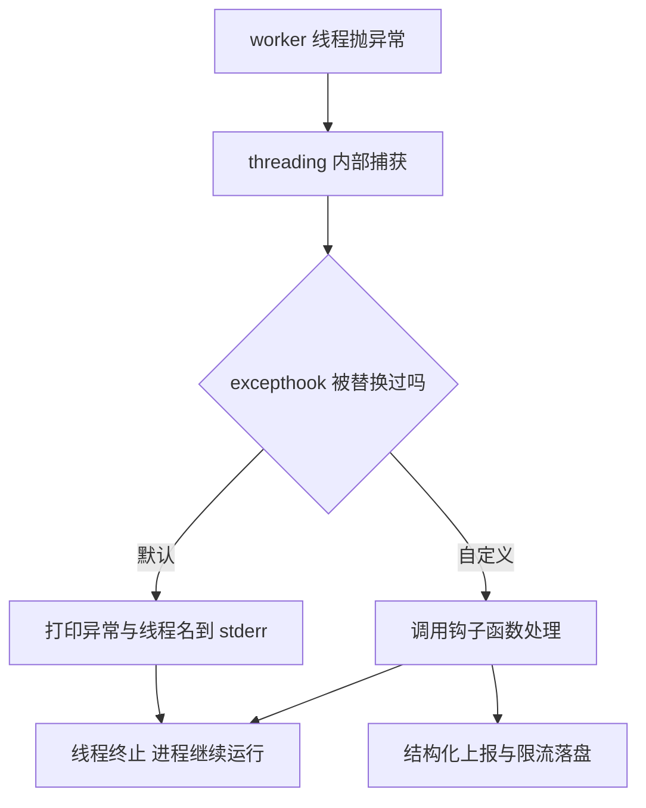
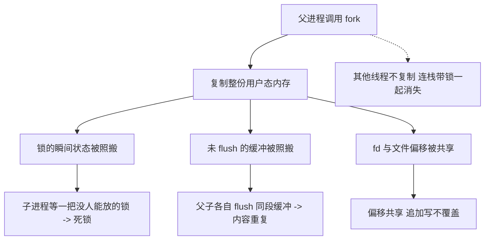
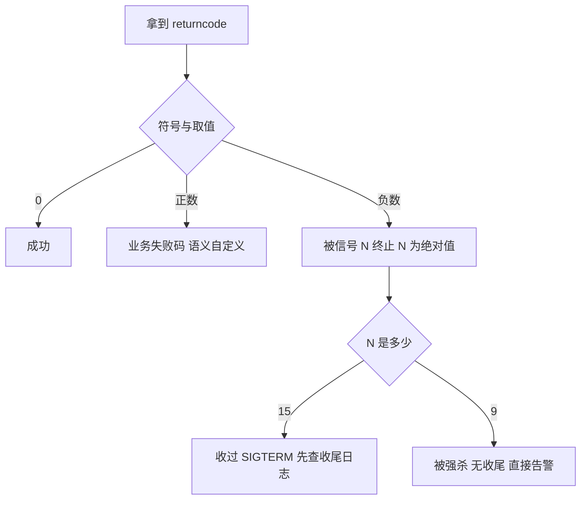
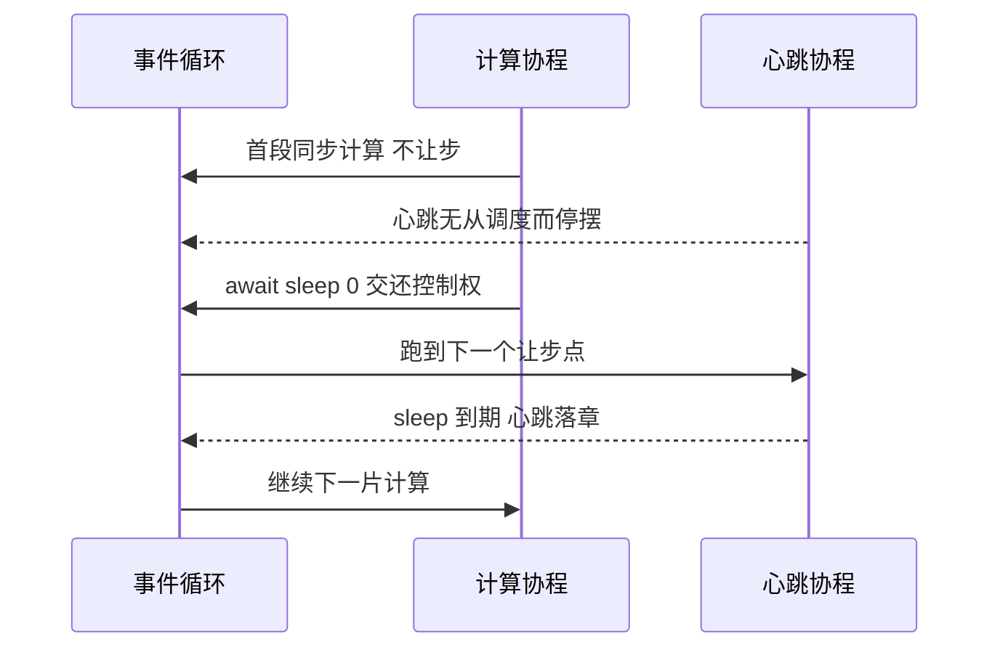
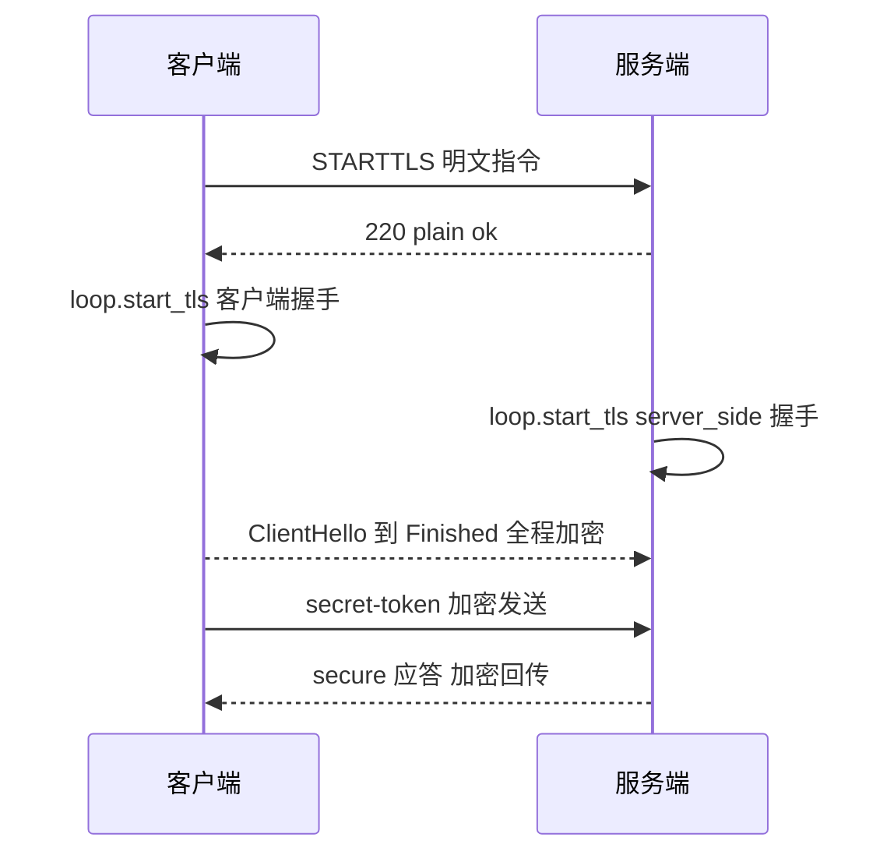
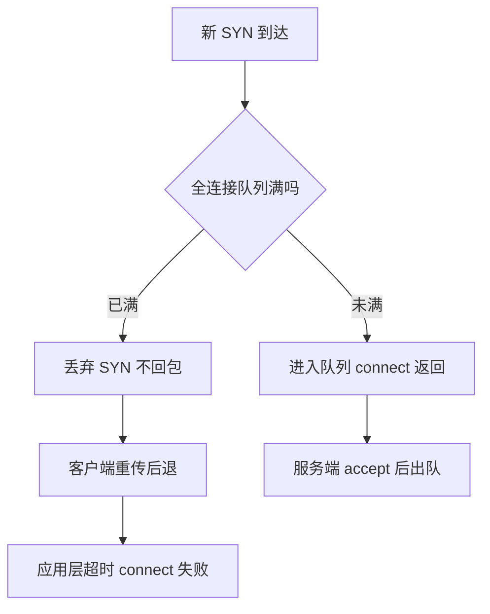
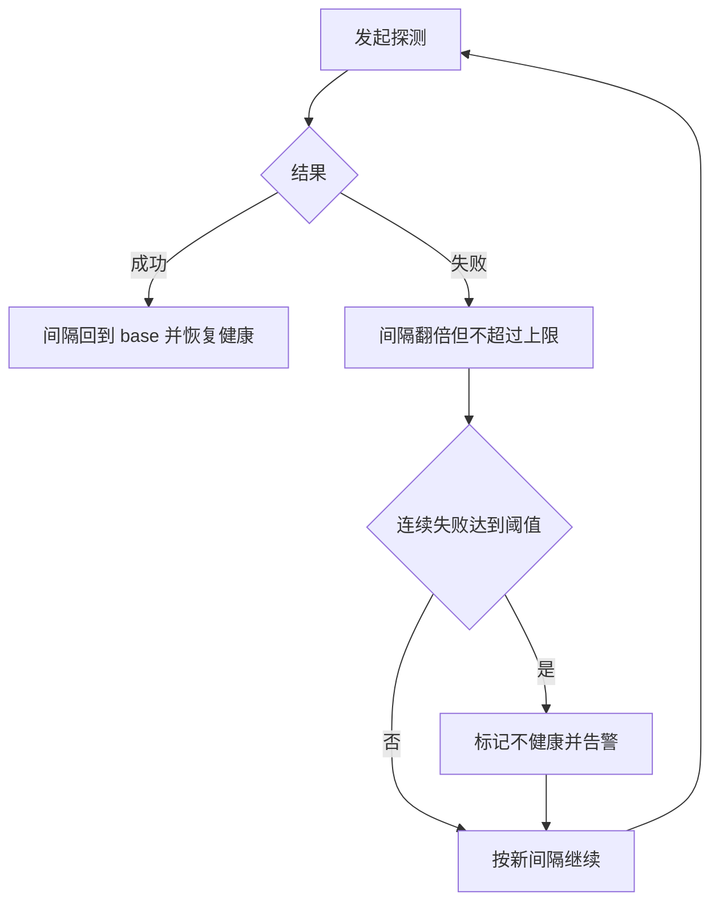
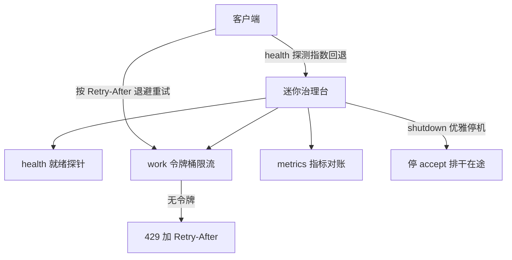

# 第 2 类 · 并发与网络工程(夜间扩产四)

> 本篇是第四篇夜间扩产:线程补遗(join 超时语义、daemon 退出时机实测、atexit 存活窗口、threading.excepthook 与崩溃上报、锁内回调重入、线程身份、无锁计数实测、优先级反转与继承、线程栈内存账)、进程补遗(进程池任务取消、子进程流式读取、fork 与线程禁忌、fork 缓冲区继承、maxtasksperchild、退出码与僵尸进程)。

> asyncio 补遗(asend 交互协程、athrow 毒丸、CPU 切片让步、让步点顺序、loop.time 时钟源与 call_at、AsyncExitStack 超时预算继承、to_thread 边界、datagram 端点、start_tls 在线升级、Unix 域 socket);网络补遗(三种粘包成帧法对比实测、请求头注入防护、URL 编码坑、并发与对冲 DNS、SO_SNDTIMEO、backlog 溢出实测、socketpair、UDP 组播、recv 返回值矩阵)。

> 工程实战(三层信号停机、健康探测指数回退、配置热更新快照、日志异步化、限流与重试联合语义、守护进程化双重 fork),收于一题迷你服务治理台综合设计。

> 全部代码仅标准库、完整可运行,已在本机 Python 3.9 逐文件实跑通过;网络演示全部走回环 127.0.0.1,服务端用 daemon 线程并等待端口就绪,urllib 一律 build_opener 绕过环境代理。


### Q2111 · Thread.join 的超时语义:只等不杀

> 难度:★★☆ | 标签:Thread.join, 超时, is_alive

**问**:join 带 timeout 参数时,超时之后线程是被杀掉了还是还在跑?join 的返回值又是什么?

**答**:join 的语义只是"等待",它对线程的生死没有任何处置权。

- join(timeout) 超时后正常返回,返回值恒为 None,不代表成功也不携带线程结果;

- 超时后线程还活着,is_alive() 仍为 True,它持有的锁、打开的连接一样没少;

- 想要结果要靠共享容器或 Future,想终止线程只能靠协作式停止标志;

- join(0) 是一次非阻塞探测,常用于"顺便看一眼"的看门狗逻辑。

```python
# file: code/02_并发与网络工程/q2111_join_timeout.py
# -*- coding: utf-8 -*-
"""Thread.join 的超时语义: join 只等不杀。

- join(timeout) 超时后正常返回 None, 线程还在跑, is_alive() 为 True;
- join 的返回值永远不携带线程结果, 拿结果要靠共享容器或 Future;
- 超时 join 不释放线程持有的任何资源, 只是把选择权还给调用方。
"""
import threading
import time


def quick_worker(box):
    time.sleep(0.2)
    box.append("quick-done")


def slow_worker(box):
    time.sleep(2.0)
    box.append("slow-done")


def main():
    box = []

    t1 = threading.Thread(target=quick_worker, args=(box,), name="quick")
    t1.start()
    print("join 0.5s:", t1.join(timeout=0.5), "alive:", t1.is_alive(), "box:", box)
    print("join 无限:", t1.join(), "alive:", t1.is_alive(), "box:", box)

    t2 = threading.Thread(target=slow_worker, args=(box,), name="slow")
    t2.start()
    t0 = time.monotonic()
    ret = t2.join(timeout=0.5)
    print("慢任务 join 0.5s: 返回 %r, 耗时 %.2fs, alive=%s" %
          (ret, time.monotonic() - t0, t2.is_alive()))
    # 超时后线程仍在跑: 它持有的时间与资源没有被释放
    t2.join()
    print("补上无限 join 后:", box, "alive:", t2.is_alive())

    # join(0) 相当于一次非阻塞的 is_alive 探测
    t3 = threading.Thread(target=lambda: None)
    t3.start()
    t3.join(timeout=0)
    print("join(0) 后 alive:", t3.is_alive())
    t3.join()


if __name__ == "__main__":
    main()
```

**追问**:1) 超时 join 之后直接不管它,会怎样?——线程继续跑完,如果它卡在 IO 上就会一直占着资源,主进程退出时若它还是非 daemon 还会被等住。2) join 返回 None 怎么区分"等到了"和"超时了"?——join 前后各看一次 is_alive(),这是标准写法。3) 「join 只等不杀」的正确性含义是什么?——超时 join 后必须立刻检查 is_alive() 并做分支决策(继续等/放弃/告警),不能把 join 当「执行完成」的同步点;拿结果要走共享容器/Future,这是 Thread 与 Future API 的分界。4) join(0) 探测与 is_alive 的区别?——join(0) 只在「已结束」时立即返回,还顺带清理线程状态;is_alive 是纯查询;看门狗场景两者常配合:is_alive 判断+join(timeout) 等待。5) 生产陷阱?——超时后不查 is_alive 直接用结果(竞态);非 daemon 线程卡 IO 导致进程退出被 threading._shutdown 卡住(只等不杀的终极代价);靠 join 返回值判断成败(恒 None);join 之后线程继续持有锁没处理(资源泄漏)。

---

### Q2112 · daemon 线程的退出时机实测:没人等,终被斩

> 难度:★★☆ | 标签:daemon, 解释器关闭, shutdown

**问**:daemon 线程是在主线程 return 的那一瞬间被杀掉的吗?它死的时候正在写的文件会怎样?

**答**:实测的答案比教条有趣:主线程返回后解释器要先 join 全部非 daemon 线程,这段时间 daemon 还在跑,直到最终化阶段才被突然掐断。

- daemon 不是死于主线程 return,而是死于解释器关闭序列的最后一段;

- 死在哪个瞬间,输出就停在哪一行,被腰斩的写盘会留下不完整数据;

- 它没有任何机会执行 finally 之外的收尾,依赖它的落盘必须有显式 stop 流程;

- 对照组:非 daemon 线程在关闭序列开头就被 join,final-line 完整落盘。

```python
# file: code/02_并发与网络工程/q2112_daemon_exit_timing.py
# -*- coding: utf-8 -*-
"""daemon 线程的退出时机实测: 没人等它, 终被腰斩。

- 主线程返回并不会立刻杀 daemon: 解释器先 join 全部非 daemon 线程;
- 这段等待期里 daemon 还在跑, 但已经没人对它负责;
- 到最终化阶段 daemon 被直接掐断, 停在哪一行算哪一行, final-line 永远缺席。
"""
import atexit
import os
import tempfile
import threading
import time


def writer(path, rounds, interval):
    with open(path, "w") as f:
        for i in range(rounds):
            f.write("line-%d\n" % i)
            f.flush()
            time.sleep(interval)
        f.write("final-line\n")   # 收尾行: 完整跑完才会出现
        f.flush()


def count_lines(path):
    with open(path) as f:
        return len([ln for ln in f if ln.strip()])


def report(daemon_file, normal_file, rounds):
    d = count_lines(daemon_file)
    print("daemon 文件行数: %d / %d, final-line 缺失 -> 被腰斩" %
          (d, rounds + 1))
    print("normal 文件行数: %d / %d, 含 final-line -> 被解释器等完" %
          (count_lines(normal_file), rounds + 1))
    for p in (daemon_file, normal_file):
        try:
            os.remove(p)
        except OSError:
            pass


def main():
    rounds = 30
    daemon_file = tempfile.mktemp(prefix="q2112_daemon_")
    t = threading.Thread(target=writer, args=(daemon_file, rounds, 0.06),
                         name="daemonic-writer", daemon=True)
    t.start()
    time.sleep(0.25)   # daemon 先写上若干行, 主线程提前退场
    print("main 返回时刻 daemon alive:", t.is_alive())
    print("此后解释器还要先等非 daemon 线程, daemon 无人负责但仍可运行")

    normal_file = tempfile.mktemp(prefix="q2112_normal_")
    t2 = threading.Thread(target=writer, args=(normal_file, rounds, 0.005),
                          name="normal-writer")
    t2.start()
    atexit.register(report, daemon_file, normal_file, rounds)


if __name__ == "__main__":
    main()
```

**追问**:1) 为什么 daemon 里打开的数据库连接不能指望自动提交?——最终化阶段它随时被斩,连接析构可能根本没跑,事务直接丢。2) 生产上怎么"杀"daemon 才体面?——给 daemon 一个 Event 停止标志,主流程退出前 set 并限时 join,把斩首换成握手。3) 「斩首」的具体时机与后果?——解释器最终化阶段 Py_Finalize 摘除 daemon 线程:它可能在任意字节码边界停摆,正在写的缓冲半途而废、锁未释放、finally 未执行——「daemon 里不做关键落盘」由此而来;3.12 的 threading.atexit 把收尾钩子显式化是补丁不是豁免。4) 体面下线协议怎么设计?——停止 Event→set 后 join(timeout)→超时记录并接受(或升级杀进程);关键数据的持久化移出 daemon(同步写或队列+主线程消费)——「daemon 只做可丢的工作」是设计纪律不是技巧。5) 生产陷阱?——daemon 里写文件/提交事务(数据截断);daemon 持有主线程也要用的锁(退出序列死锁);假设 daemon 会在进程退出前跑完(时序赌注);把收尾逻辑写在 daemon 的 finally 里(可能根本不执行)。

---

### Q2113 · daemon 线程与 atexit:实测存活窗口里的钩子

> 难度:★★★ | 标签:atexit, daemon, 关闭序列

**问**:daemon 线程注册的 atexit 钩子到底会不会执行?这道题的答案为什么必须实测?

**答**:在 CPython 3.9 上实测,答案是"会":关闭序列先 join 非 daemon 线程,再跑 atexit 钩子,daemon 要到最终化阶段才被杀,所以它注册的钩子仍会执行。

- 退出序列记录显示 main-atexit-ran 与 daemon-atexit-ran 都出现;

- 但 daemon 自身的循环没跑完,daemon-finished 缺席——工作被腰斩;

- 真正的陷阱是时序:钩子执行时 daemon 还在写共享状态,钩子可能观察到中间态;

- 若钩子里去 join daemon 则直接挂死:钩子在等 daemon,daemon 在等钩子跑完;

- 这个存活窗口是实现细节,3.12 用 threading.atexit 把它显式化了。

```python
# file: code/02_并发与网络工程/q2113_daemon_atexit.py
# -*- coding: utf-8 -*-
"""daemon 线程与 atexit: 实测守护线程的存活窗口。

- 3.9 实测: atexit 钩子执行时 daemon 仍存活, 它注册的钩子竟然会执行;
- 但 daemon 自身的工作在最终化阶段被腰斩, 循环半途而废;
- 陷阱在时序: 钩子运行时 daemon 还在写共享状态; 若钩子去 join daemon 则挂死。
"""
import atexit
import os
import tempfile
import threading
import time

log_path = tempfile.mktemp(prefix="q2113_atexit_")


def record(tag):
    with open(log_path, "a") as f:
        f.write(tag + "\n")


def report_reader():
    with open(log_path) as f:
        lines = [ln.strip() for ln in f if ln.strip()]
    print("退出序列中的记录:", lines)
    print("main-atexit-ran 出现:", "main-atexit-ran" in lines,
          "(主线程注册的钩子照常执行)")
    print("daemon-atexit-ran 出现:", "daemon-atexit-ran" in lines,
          "(3.9 实测: atexit 阶段 daemon 仍存活, 钩子被执行)")
    print("daemon-finished 出现:", "daemon-finished" in lines,
          "(daemon 的工作被腰斩, 半途而废)")
    os.remove(log_path)


def main_hook():
    record("main-atexit-ran")


def daemon_hook():
    record("daemon-atexit-ran")   # daemon 注册的钩子


def daemon_body():
    atexit.register(daemon_hook)
    record("daemon-started")
    deadline = time.monotonic() + 2.0
    while time.monotonic() < deadline:    # 长活 daemon, 模拟后台服务
        time.sleep(0.05)
    record("daemon-finished")             # 期望永不出现


def main():
    atexit.register(main_hook)
    t = threading.Thread(target=daemon_body, name="d", daemon=True)
    t.start()
    time.sleep(0.15)   # daemon 已完成注册并写下 started
    # main 返回 -> join 非 daemon -> atexit(LIFO) -> 最终化腰斩 daemon


if __name__ == "__main__":
    atexit.register(report_reader)   # 先注册后执行, 保证最后读取结果
    main()
```

**追问**:1) 为什么"daemon 钩子不执行"的旧说法流传很广?——早期实现与其他运行时行为不同,且关闭序列在版本间调整过,这类问题必须以实测为准。2) atexit 钩子和 finally 块谁先跑?——finally 属于正常的栈展开,先于解释器关闭;atexit 在关闭序列里,进程被信号杀死时两者都可能不执行。3) atexit 钩子执行时的并发风险怎么防?——钩子运行时 daemon 还在跑(Q2113 原问的存活窗口),共享状态可能处于中间态;钩子里只做「读取+落盘」不做「修改+依赖」,或先 set 停止标志再等一小段;钩子里 join daemon 是确定性挂死(钩子等 daemon,daemon 的退出在钩子之后)。4) 「以实测为准」的版本敏感性怎么工程化?——关闭序列在不同 CPython 版本间调整过(3.9 实测钩子会跑、3.12 threading.atexit 显式化);这类行为进 CI 的「行为锁定测试」,升级解释器时先跑;文档不背书「永远如此」。5) 生产陷阱?——在钩子里依赖 daemon 的产物(时序赌注);信号杀死(SIGKILL)时钩子与 finally 都不跑(审计逻辑别指望 atexit);多钩子间的顺序依赖(atexit 按 LIFO 执行,注册顺序即依赖);钩子里再抛异常(被吞,收尾静默失败)。

---

### Q2114 · threading.excepthook:线程异常的默认打印与钩子

> 难度:★★★ | 标签:excepthook, 线程异常, 崩溃埋点

**问**:线程里抛了异常,主线程没 join 到任何报错,这个异常去哪了?怎么把它接住?

**答**:3.8 起线程异常默认交给 threading.excepthook,打印"Exception in thread 名字"加栈到 stderr 后线程终止、进程继续,默认行为可以被整只替换。

- ExceptHookArgs 携带 exc_type、exc_value、exc_traceback 与 thread;

- 默认打印包含线程名,是定位崩线程的首要线索;

- 自定义钩子把打印换成结构化上报,生效期间 stderr 不再有散装栈;

- 钩子必须自己兜底:钩子内部再抛异常,解释器只能再次打印并继续。

```python
# file: code/02_并发与网络工程/q2114_excepthook_default.py
# -*- coding: utf-8 -*-
"""threading.excepthook: 线程异常的默认行为与自定义钩子。

- 3.8 起线程异常不再杀进程, 默认由 threading.excepthook 打印到 stderr 后继续跑;
- ExceptHookArgs 携带 exc_type / exc_value / exc_traceback / thread;
- 自定义钩子把默认打印替换掉, 是崩溃埋点的唯一正门。
"""
import io
import threading
import contextlib


def boom(name):
    raise ValueError("worker %s 崩了" % name)


def default_behavior():
    buf = io.StringIO()
    t = threading.Thread(target=boom, args=("A",), name="t-A")
    with contextlib.redirect_stderr(buf):   # 捕获默认钩子的打印
        t.start()                            # 必须在捕获内启动, 否则竞态漏拍
        t.join()
    out = buf.getvalue()
    print("默认钩子打印包含异常类型:", "ValueError" in out)
    print("默认钩子打印包含线程名:", "t-A" in out)
    print("进程此刻仍然存活, 这行就是证明")


caught = []


def custom_hook(args):
    caught.append({
        "thread": args.thread.name,
        "type": args.exc_type.__name__,
        "msg": str(args.exc_value),
    })


def main():
    default_behavior()

    old = threading.excepthook
    threading.excepthook = custom_hook
    try:
        t = threading.Thread(target=boom, args=("B",), name="t-B")
        t.start()
        t.join()
    finally:
        threading.excepthook = old   # 用完恢复, 避免污染其他库
    print("自定义钩子捕获:", caught)
    print("自定义钩子生效期间默认 stderr 打印消失, 改为结构化上报")


if __name__ == "__main__":
    main()
```

**追问**:1) 为什么线程异常不像主线程那样让进程退出?——线程边界就是隔离边界,一个后台线程崩掉不应拖垮整个进程,代价是异常容易被无视,所以要配钩子。2) 线程池里的异常也走 excepthook 吗?——submit 的异常存在 Future 里由 result 抛出,不走 excepthook;只有 fire-and-forget 的裸线程才依赖它。3) excepthook 与线程池 Future 的分工边界?——裸 Thread 的异常走 excepthook(无人 join 的出口);ThreadPoolExecutor.submit 的异常存在 Future 里由 result() 抛出,不走钩子——「fire-and-forget 的裸线程才依赖它」;混合使用时要分别管收尾(Q1587 的任务收尾纪律)。4) ExceptHookArgs 里有什么可挖的?——exc_type/value/traceback+thread(线程名定位);自定义钩子把打印换成 JSONL 上报(Q2115 工程化);钩子自身必须全兜底(钩子再抛解释器只能再打印)。5) 生产陷阱?——替换钩子后忘记链式调用原钩子(默认日志丢失);钩子里做阻塞上报(放大事故,先落盘异步上报,Q2115);以为「线程崩了进程会退」(不会,异常被吞成 stderr 一行);测试期替换钩子不恢复(污染其他库)。

---

### Q2115 · excepthook 工程化:崩溃上报落盘与限流

> 难度:★★★ | 标签:excepthook, 崩溃上报, JSONL

**问**:给你一个长期运行的多线程服务,怎么把"线程崩了没人知道"变成"崩了就留档告警"?

**答**:安装一个工程化的 excepthook:每次崩溃记录时间、线程名、异常类型、消息与完整栈,追加成 JSONL 报告文件,并做总量限流防止雪崩刷盘。

- 报告结构化落盘后,可直接接日志采集或告警管道;

- 限流上限内每条都留档,超限静默丢弃,保护磁盘优先;

- 钩子内部全 try/except 包裹,上报路径本身绝不二次引爆;

- uninstall 恢复原钩子,避免测试代码污染其他库。

```python
# file: code/02_并发与网络工程/q2115_excepthook_report.py
# -*- coding: utf-8 -*-
"""excepthook 工程化: 崩溃上报与落盘。

- 钩子里做三件事: 记现场、落盘成 JSONL、限流防止雪崩刷盘;
- traceback.format_exception 拿完整栈, 线程名是定位的首要线索;
- 钩子内部绝不能再抛异常, 否则解释器只能再次打印并继续。
"""
import json
import os
import tempfile
import threading
import time
import traceback


class CrashReporter:
    def __init__(self, path, max_reports=5):
        self.path = path
        self.max_reports = max_reports
        self.count = 0
        self._lock = threading.Lock()
        self._previous = threading.excepthook

    def __call__(self, args):
        try:
            with self._lock:
                if self.count >= self.max_reports:
                    return
                self.count += 1
            entry = {
                "time": round(time.time(), 3),
                "thread": args.thread.name if args.thread else None,
                "type": args.exc_type.__name__,
                "msg": str(args.exc_value),
                "stack": "".join(traceback.format_exception(
                    args.exc_type, args.exc_value, args.exc_traceback)),
            }
            with open(self.path, "a") as f:
                f.write(json.dumps(entry, ensure_ascii=False) + "\n")
            print("[reporter] 已记录崩溃:", entry["type"], "来自", entry["thread"])
        except Exception:
            pass   # 钩子里吞掉一切, 绝不二次引爆

    def install(self):
        threading.excepthook = self

    def uninstall(self):
        threading.excepthook = self._previous


def crashy(tag):
    if tag == "big":
        raise RuntimeError("数据库连接耗尽")
    raise KeyError("missing-config")


def main():
    path = tempfile.mktemp(prefix="q2115_crash_", suffix=".jsonl")
    reporter = CrashReporter(path)
    reporter.install()
    try:
        for tag in ("net", "big", "cfg"):
            t = threading.Thread(target=crashy, args=(tag,),
                                 name="worker-" + tag)
            t.start()
            t.join()
    finally:
        reporter.uninstall()
    with open(path) as f:
        rows = [json.loads(ln) for ln in f if ln.strip()]
    print("报告条数:", len(rows))
    for r in rows:
        print("-", r["thread"], r["type"], r["msg"], "| 栈行数:",
              len(r["stack"].splitlines()))
    os.remove(path)


if __name__ == "__main__":
    main()
```

**追问**:1) 钩子里能直接调上报接口发 HTTP 吗?——能但不该:钩子运行在崩溃线程上下文,阻塞或再失败都会放大事故,先落盘、异步上报。2) 怎么区分"同一处的重复崩溃"?——报告里带线程名与栈签名,采集侧按签名聚合去重,钩子本身保持无状态。3) 「先落盘、异步上报」的分层为什么是必须的?——钩子运行在崩溃线程上下文,HTTP 上报可能再失败/阻塞,把崩溃处理变成二次事故;JSONL 落盘是本地最低保障,采集管道异步消费——崩溃路径的每一层都要「假设下一层不可靠」。4) 限流与去重的设计要点?——总量限流(超限静默丢+计数)保护磁盘;去重(栈签名聚合)在采集侧做,钩子保持无状态——限流的上限按「最坏崩溃风暴」估算(如每秒百条),磁盘预留按限流上限算。5) 生产陷阱?——钩子里再抛异常(解释器只能再打印);uninstall 不恢复原钩子(测试污染);上报接口在钩子里同步调用(放大事故);限流阈值无限流计数(雪崩刷盘);报告缺线程名/栈(无法定位)。



---

### Q2116 · 锁内调用回调的重入风险:回调再拿锁就自锁

> 难度:★★★★ | 标签:Lock, 重入, 回调, 锁边界

**问**:在持有 Lock 的状态下调用外部注入的回调,回调里又调了本对象的查询接口,会发生什么?

**答**:Lock 不可重入,回调回到同一把锁上必然自锁:外层持锁者等回调返回,回调等锁释放,经典死循环。

- 危险的根源是锁边界长在库代码里,回调是调用方注入的,库无法预知它做什么;

- 实验里给 get 设了 1 秒超时才把死锁变成可观察的报错,真实场景往往是无限等;

- 修复模式是"抄作业":锁内只做状态修改与快照拷贝,出锁后再调用回调;

- 代价是回调看到的是快照而非实时状态,要在文档里讲清楚这个语义。

```python
# file: code/02_并发与网络工程/q2116_callback_in_lock.py
# -*- coding: utf-8 -*-
"""锁内调用回调的重入风险: 回调再拿同一把锁就自锁。

- Lock 不可重入: 持锁者调用外部回调, 回调回头再拿这把锁, 必然自锁;
- 危险在于锁的边界长在库代码里, 回调是调用方注入的, 库无法预知;
- 修复模式: 先在锁内拷贝快照, 出锁后再调用回调。
"""
import threading
import time


class Inventory:
    def __init__(self):
        self._lock = threading.Lock()
        self._items = {}

    def set(self, sku, qty):
        with self._lock:
            self._items[sku] = qty

    def get(self, sku, timeout=1.0):
        # timeout 参数是给实验用的: 真实场景往往就是无限等, 直接死锁
        if not self._lock.acquire(timeout=timeout):
            raise RuntimeError("get 等锁超时: 锁被别处长期持有")
        try:
            return self._items.get(sku)
        finally:
            self._lock.release()

    def change_with_callback(self, sku, delta, on_change):
        with self._lock:                      # 持锁状态
            self._items[sku] = self._items.get(sku, 0) + delta
            on_change(sku, self._items[sku])  # 危险: 回调在锁内执行

    def change_snapshot_callback(self, sku, delta, on_change):
        with self._lock:
            self._items[sku] = self._items.get(sku, 0) + delta
            snapshot = dict(self._items)      # 锁内只做拷贝
        on_change(sku, snapshot)              # 出锁后再调用


def audit_callback(sku, value):
    # 审计方想知道当前全量库存: 回头调 get -> 与外层同一把锁 -> 重入
    inv.get(sku, timeout=1.0)


def main():
    global inv
    inv = Inventory()
    inv.set("apple", 10)

    try:
        inv.change_with_callback("apple", 5, audit_callback)
        print("意外: 锁内回调竟然成功了")
    except RuntimeError as e:
        print("重入死锁被超时拦截:", e)

    inv.change_snapshot_callback("apple", 5,
                                 lambda sku, snap: print(
                                     "快照回调拿到:", sku, snap["apple"]))
    print("修复后当前库存:", inv.get("apple", timeout=1.0))


if __name__ == "__main__":
    main()
```

**追问**:1) 为什么用 RLock 就没事?——RLock 允许同线程重复获取,但只解决自锁,不解决"回调执行时间被算进临界区"的锁占用拉长问题。2) 怎么在 code review 里发现这类问题?——盯住"持锁状态下发生的函数调用",凡是锁内调用非本模块、可注入、可能回头的函数,都按重入风险审查。3) 「锁内拷贝快照、锁外回调」的语义代价是什么?——回调看到的是快照不是实时状态,可能已过期;文档必须写明;更严格的变体是回调排队(独立线程消费),语义变成「异步通知」——选择取决于回调对时效的要求。4) review 时怎么系统性发现?——审「锁内发生的每一次函数调用」:可注入(参数传入)、非本模块、可能回头的都要按重入风险审;静态检查工具(锁状态追踪)辅助;RLock 只是止血(自锁消失)但临界区被回调时长撑大(Q2116 原问的另一半)。5) 生产陷阱?——回调抛异常把锁留在持有态(finally 才 release);回调里阻塞调用(临界区无限拉长);用 RLock 后忘了「回调耗时算进临界区」;给 get 加超时只是暴露不是修复(死锁仍存在);回调链里多级回锁(跨对象死锁)。

---

### Q2117 · 线程身份三件套:name、ident 与 native_id

> 难度:★★☆ | 标签:threading, 线程身份, 排障

**问**:排障时要把日志里的一条记录对应到具体线程,threading 提供了哪些身份信息?

**答**:name 给人看,ident 给解释器内使用,native_id 对齐操作系统,三件套各有各的消费方。

- name 可在启动前修改,日志里的 etl-worker-1 比 Thread-7 有用得多;

- ident 由解释器分配,线程死后可能被复用,不能当永久键存数据库;

- native_id 是 OS 级 tid,可与 ps、top、崩溃报告互相印证;

- threading.main_thread() 识别主线程,守护化与信号处理逻辑靠它分流。

```python
# file: code/02_并发与网络工程/q2117_thread_identity.py
# -*- coding: utf-8 -*-
"""线程身份三件套: name / ident / native_id 与 main_thread。

- name 是给人看的, 日志排障的第一线索, 启动前可改;
- ident 是解释器内线程 id, 线程死后可能被复用, 不能当永久键;
- native_id 是操作系统级 tid, 可与 ps/top 的观察对上;
- threading.main_thread() 识别主线程, 守护化逻辑常靠它分流。
"""
import threading
import time


def worker(store):
    cur = threading.current_thread()
    store["worker"] = {
        "name": cur.name,
        "ident": cur.ident,
        "native_id": cur.native_id,
        "is_main": cur is threading.main_thread(),
        "get_ident": threading.get_ident(),
        "get_native_id": threading.get_native_id(),
    }
    time.sleep(0.1)


def main():
    store = {}
    t = threading.Thread(target=worker, args=(store,), name="etl-worker-1")
    print("启动前 name:", t.name, "| ident:", t.ident, "(未启动为 None)")
    t.name = "etl-worker-1-b"      # 启动前改名合法
    t.start()
    t.join()
    w = store["worker"]
    print("worker 视角: name=%s ident=%s native_id=%s is_main=%s" %
          (w["name"], w["ident"], w["native_id"], w["is_main"]))
    print("get_ident 与 t.ident 一致:", w["get_ident"] == w["ident"])
    print("get_native_id 与 native_id 一致:", w["get_native_id"] == w["native_id"])

    m = threading.main_thread()
    print("主线程: name=%s ident=%s native_id=%s" %
          (m.name, m.ident, m.native_id))
    print("ident 全局唯一性: 主线程与 worker 不同:",
          m.ident != w["ident"])

    t2 = threading.Thread(target=lambda: None)
    t2.start()
    alive_ident = t2.ident
    t2.join()
    print("线程死后 ident 属性仍可读但已失效:", alive_ident, "-> is_alive:",
          t2.is_alive())


if __name__ == "__main__":
    main()
```

**追问**:1) ident 和 native_id 为什么是两个值?——一个是解释器视角的 id,一个是内核视角的 tid,容器里native_id 还能和 /proc 对上。2) 日志里打 ident 有什么坑?——线程死了 ident 会被复用,隔了很久的两条日志可能是不同线程,排障要配时间戳。3) ident 复用与 native_id 稳定性的差异怎么影响日志设计?——ident 解释器内可能复用(线程死了 id 给新线程),native_id 是内核 tid(进程生命周期内一般不复用);日志键用「name+native_id+时间戳」组合,单独 ident 不可靠;跨进程日志聚合时 native_id 还要与 /proc 对账。4) name 的最佳实践?——启动前命名(etl-worker-1),线程池场景 ThreadPoolExecutor 的线程名(thread_fmt)也可定制;name 冲突(同名多线程)要配序号;别在运行中改 name(日志错乱)。5) 生产陷阱?——日志只有默认 Thread-N(排障靠猜);ident 存数据库当永久键(复用错乱);没打 native_id(与 top/崩溃报告对不上);main_thread 判断缺失(信号处理在子线程里注册)。

---

### Q2118 · 无锁计数的尝试与实测:GIL 下的真相

> 难度:★★★ | 标签:GIL, 原子性, 无锁, 丢更新

**问**:都说 CPython 有 GIL 不会丢数据,那 counter += 1 到底丢不丢?纯 Python 能写出无锁计数器吗?

**答**:丢。GIL 只保证单个字节码原子,+= 是读改写三步,把切换间隔调小后实测 40 万次自增丢了近 30 万,这就是丢失更新。

- list.append 这类单调用在 CPython 里是原子的,可以当事件台账,实测零丢失;

- 每线程写自己的槽位再聚合(分片)无争用且正确,是有锁思想的无锁化变体;

- 纯 Python 没有暴露 compare-and-swap,真正的无锁原子自增做不出来;

- 结论:要么锁,要么分片,要么把操作设计成单次原子调用。

```python
# file: code/02_并发与网络工程/q2118_lockfree_counter.py
# -*- coding: utf-8 -*-
"""无锁计数的尝试与实测: GIL 下的真相。

- counter += 1 是读改写三步, GIL 只保证单字节码原子, 丢更新照样发生;
- list.append 这类单调用在 CPython 里是原子的, 可以当事件台账用;
- 纯 Python 没有真正的无锁原子自增: 要么加锁, 要么分片, 要么换成原子单调用。
"""
import sys
import threading
import time


def bump_naive(counter, n):
    for _ in range(n):
        counter["v"] += 1     # dict 读改写: 非原子


def bump_atomic_append(tally, n):
    for _ in range(n):
        tally.append(1)       # CPython 单调用原子: 一次事件一次 append


def bump_sharded(shards, idx, n):
    for _ in range(n):
        shards[idx] += 1      # 每线程写自己的槽位: 无争用


def run(fn, args_list):
    ts = [threading.Thread(target=fn, args=a) for a in args_list]
    t0 = time.monotonic()
    for t in ts:
        t.start()
    for t in ts:
        t.join()
    return time.monotonic() - t0


def main():
    sys.setswitchinterval(0.000001)   # 放大线程切换频率, 复现竞态窗口
    NT, PER = 8, 50000
    total = NT * PER

    counter = {"v": 0}
    dur1 = run(bump_naive, [(counter, PER)] * NT)
    print("naive +=  : 期望 %d 实得 %d, 丢失 %d (%.2fs)" %
          (total, counter["v"], total - counter["v"], dur1))

    tally = []
    dur2 = run(bump_atomic_append, [(tally, PER)] * NT)
    print("append 台账: 期望 %d 实得 %d, 丢失 %d (%.2fs)" %
          (total, len(tally), total - len(tally), dur2))

    shards = [0] * NT
    dur3 = run(bump_sharded, [(shards, i, PER) for i in range(NT)])
    print("分片聚合 : 期望 %d 实得 %d, 丢失 %d (%.2fs)" %
          (total, sum(shards), total - sum(shards), dur3))

    print("结论: += 丢更新, append 原子可当计数, 分片无争用且正确")


if __name__ == "__main__":
    main()
```

**追问**:1) GIL 不是同一时刻只有一个线程在执行吗,怎么还会丢?——"同一时刻只有一个在跑"不等于"跑完一个才轮到下一个",字节码边界上的切换正好落在读改写之间。2) atomic 包或 ctypes 能突破吗?——ctypes 调 C 的原子操作可以,但那已经不是纯 Python;标准答案仍是锁或分片。3) 「单次原子调用」清单的边界与演进?——list.append/dict 单项读写/list.pop 等在 CPython 3.x 是字节码级原子;但这是实现细节不是语言承诺,3.11+ 自适应解释器改变字节码形态,free-threading(PEP 703)下更要重新验证——「原子性清单」要随版本重测(Q1605/Q1846 同口径)。4) 分片计数的聚合时机?——每线程写自己槽位(无争用),聚合在读取时求和:粒度是「写无锁、读聚合」;聚合频率高的话聚合本身变热点,可以再分批;与「全局锁计数」对比:写吞吐换读成本,按读写比选。5) 生产陷阱?——把 append 原子推广到「读-改-写整个 list」;分片数与线程数失配(仍有热点);聚合时漏算某分片(账不平);3.13 free-threading 构建上沿用 GIL 时代的原子性结论。

---

### Q2119 · 优先级反转概念演示:低持锁、高等待、中间插队

> 难度:★★★★ | 标签:优先级反转, 调度, 时间线

**问**:什么是优先级反转?为什么火星探路者事故都拿它当教材?

**答**:高优先级任务要拿低优先级持有的锁,只能干等;而中优先级任务不需要锁,照常占用算力——高优先级实际被"低锁 + 中间算力"双重拖延,这就是反转。

- 实验时间线:high 请求锁后等了约 0.4 秒,期间 mid 完成了全部无锁工作;

- 反转窗口的长度由持锁者的临界区与中间任务的算力共同决定;

- CPython 没有用户态优先级 API,但内核线程调度真实存在,反转同样可能发生;

- 它的恶劣在于把"锁等待"放大成"锁等待 + 无关任务插队"的组合延迟。

```python
# file: code/02_并发与网络工程/q2119_priority_inversion.py
# -*- coding: utf-8 -*-
"""优先级反转概念演示: 低持锁、高等待、中间者插队。

- 高优先级任务要拿低优先级持有的锁时, 不持锁的中优先级任务照常运行;
- 高优先级实际被"低锁 + 中间算力"双重拖延, 这就是优先级反转;
- CPython 没有用户态优先级 API, 这里用时间线展示反转窗口的形状。
"""
import threading
import time

lock = threading.Lock()
timeline = []


def note(tag):
    timeline.append((tag, round(time.monotonic() - T0, 3)))


def low():
    note("low 拿锁")
    with lock:
        note("low 进入临界区 干 0.5s")
        end = time.monotonic() + 0.5
        while time.monotonic() < end:
            pass                       # 低优先级长临界区
    note("low 放锁")


def mid():
    end = time.monotonic() + 0.3
    n = 0
    while time.monotonic() < end:      # 中优先级不需要锁, 却一直有算力
        n += 1
    note("mid 完成无锁工作")


def high():
    note("high 请求锁")
    got = lock.acquire(timeout=2.0)
    if got:
        note("high 终于拿到锁")
        lock.release()


def main():
    global T0
    tl = threading.Thread(target=low, name="low")
    tl.start()
    time.sleep(0.05)
    tm = threading.Thread(target=mid, name="mid")
    tm.start()
    time.sleep(0.01)
    th = threading.Thread(target=high, name="high")
    th.start()
    tl.join()
    tm.join()
    th.join()
    for tag, ts in timeline:
        print("%6.3f  %s" % (ts, tag))
    req = [t for tag, t in timeline if "请求锁" in tag][0]
    got = [t for tag, t in timeline if "终于拿到" in tag][0]
    mid_done = [t for tag, t in timeline if tag.startswith("mid 完成")][0]
    print("反转证据: high 等 %.3fs 才拿到锁, 期间 mid 已于 %.3f 完成全部工作" %
          (got - req, mid_done))
    print("高优先级被'低持锁 + 中间算力'双重拖延, 这就是反转窗口")


if __name__ == "__main__":
    T0 = time.monotonic()
    main()
```

**追问**:1) CPython 里演示的真反转吗?——线程是内核线程,锁竞争走内核,但 GIL 让演示更接近协作式;实验展示的是时间线形状,机制在 RTOS 上更尖锐。2) 多核机器会好一点吗?——不会,反转与核数无关,本质是优先级与锁持有的组合问题。3) 火星探路者案例的完整机制?——气象任务(低优先级)持互斥锁→总线管理(高优先级)等待→诊断任务(中优先级)吃满 CPU→高优被双重拖延→看门狗复位循环;解法正是优先级继承(启用互斥锁的继承属性)——「低持锁+中插队+高等待」三要素齐了就是反转。4) CPython 里反转的现实形态?——无用户态优先级,但内核调度+锁竞争存在;GIL 本身也可能被长持有(老版本 C 扩展不释放);Python 层的等价防御是「缩短临界区+限流中间任务」(Q2120 的设计纪律)。5) 生产陷阱?——把反转归因为「核数不够」(与核数无关);临界区里做 IO(持锁者被 IO 拖住,所有等待者陪葬);监控只看平均延迟不看 P99(反转是尾部现象);实时系统里禁用普通 mutex(要用带继承属性的 PTHREAD_PRIO_INHERIT)。

---

### Q2120 · 优先级继承模拟:抬高持锁者压缩反转窗口

> 难度:★★★ | 标签:优先级继承, 天花板协议, 调度模拟

**问**:优先级继承和优先级天花板分别是什么?用一个小调度器把区别讲清楚。

**答**:继承是"出事后补救":持锁者临时继承最高等待者的优先级,尽快放锁;天花板是"事前免疫":临界区一开始就运行在可能等待者中的最高优先级上。

- 模拟调度器按"每拍选最高有效优先级"运行,资源对象实现继承逻辑;

- 无继承时 high 等到第 11 拍才拿锁,期间 mid 抢跑了全部 3 拍;

- 有继承时 low 的有效优先级被抬到 3,第 7 拍就放锁,high 第 9 拍入场;

- mid 被推迟到 high 之后,这正是我们要的语义:持锁者优先清空临界区。

```python
# file: code/02_并发与网络工程/q2120_priority_inheritance.py
# -*- coding: utf-8 -*-
"""优先级继承与天花板协议: 用协作调度器模拟解法。

- 优先级继承: 持锁者临时继承最高等待者的优先级, 尽快干完放锁;
- 优先级天花板: 临界区一开始就运行在全体可能等待者的最高优先级上;
- 用单线程协作调度器把规则跑出来: 每个时钟节拍选最高有效优先级的就绪任务。
"""

LOW, MID, HIGH = 1, 2, 3


class Resource:
    def __init__(self, inherit):
        self.owner = None
        self.waiters = []
        self.inherit = inherit

    def acquire(self, task):
        if self.owner is None:
            self.owner = task
            return True
        self.waiters.append(task)
        task.ready = False                     # 没拿到锁就挂起
        if self.inherit and task.base_prio > self.owner.eff_prio:
            self.owner.eff_prio = task.base_prio   # 继承: 抬高持锁者
        return False

    def release(self):
        self.owner = None
        for w in self.waiters:
            w.eff_prio = w.base_prio
            w.ready = True
        self.waiters = []


class Task:
    def __init__(self, name, prio, body, start_tick=0):
        self.name = name
        self.base_prio = prio
        self.eff_prio = prio
        self.body = body
        self.start_tick = start_tick
        self.entered = start_tick == 0
        self.ready = start_tick == 0
        self.done = False
        self.log = []


def low_body(res):
    res.acquire(CURRENT["t"])
    yield "got-lock"
    for i in range(4):
        yield "work-%d" % i
    res.release()
    yield "released"


def high_body(res):
    while not res.acquire(CURRENT["t"]):
        yield "wait"
    yield "got-lock"
    res.release()
    yield "released"


def mid_body():
    for i in range(3):
        yield "pure-work-%d" % i


def simulate(inherit, ticks=16):
    global CURRENT
    CURRENT = {"t": None}
    res = Resource(inherit)
    tasks = [
        Task("low", LOW, low_body(res)),
        Task("mid", MID, mid_body(), start_tick=1),
        Task("high", HIGH, high_body(res), start_tick=2),
    ]
    trace = []
    for tick in range(ticks):
        for t in tasks:
            if not t.entered and tick >= t.start_tick:
                t.entered = True            # 到点入场, 只此一次
                t.ready = True
        ready = [t for t in tasks if t.ready and not t.done]
        if not ready:
            break
        cur = max(ready, key=lambda t: t.eff_prio)
        CURRENT["t"] = cur
        try:
            ev = next(cur.body)
            cur.log.append((tick, cur.eff_prio, ev))
            trace.append("%d:%s[%d]%s" % (tick, cur.name, cur.eff_prio, ev))
        except StopIteration:
            cur.done = True
    high_got = next((tick for tick, _, ev in tasks[2].log if ev == "got-lock"),
                    None)
    return trace, high_got


def main():
    trace0, got0 = simulate(inherit=False)
    print("无继承 trace:", " | ".join(trace0))
    print("无继承: high 第 %s 拍才拿到锁, mid 在其等待期间完成 3 拍纯工作" % got0)

    trace1, got1 = simulate(inherit=True)
    print("有继承 trace:", " | ".join(trace1))
    print("有继承: low 的有效优先级被抬到 %d, high 第 %s 拍拿到锁" %
          (HIGH, got1))
    print("结论: 继承让持锁者优先清空临界区, 反转窗口被压缩")


if __name__ == "__main__":
    main()
```

**追问**:1) 继承和天花板各有什么副作用?——继承要处理传递链(持锁者又在等更低者的锁),天花板要求静态分析每个锁的天花板值,配置错了会过度提权。2) Python 里能用上这些吗?——实时内核/RTOS 的 C 代码里用;Python 层面的等价物是"缩短临界区 + 限流中间任务"的设计纪律。3) 继承与天花板的副作用怎么权衡?——继承要处理传递链(A 等 B 的锁、B 又等 C 的锁,优先级要沿链传递,实现复杂);天花板要静态分析每个锁的最大等待者(配置错=过度提权,其他任务被饿);RTOS 里通常优先继承(Python 的实时 C 层同理)。4) Python 层的等价设计纪律?——临界区最小化(不做 IO/回调);中间任务限流(不要让无关任务吃满 CPU);锁层级约定(防死锁也防长链等待);这些是「无优先级 API 时的结构性防御」。5) 生产陷阱?——过度提权(天花板配错,中优全饿);继承链断裂(嵌套锁,部分等待者没被抬);把设计纪律当「有优先级了」(仍是尽力而为);模拟调度器结论直接搬到内核(机制不同,要实测)。

---

### Q2121 · threading.stack_size 与线程内存账

> 难度:★★☆ | 标签:stack_size, 线程栈, 容量估算

**问**:一台 8GB 的机器能跑多少个 Python 线程?瓶颈是 CPU 核数吗?

**答**:瓶颈是每线程的独立栈:macOS/Linux 默认栈是 MB 级,10 万线程 x 8MB 就是 800GB 虚拟内存,先爆的永远是内存账而不是 CPU。

- threading.stack_size() 可读可设,非法值抛 ValueError,实测 1 字节被拒;

- 设 256KB 后线程正常工作,但深度递归会先撞 RecursionError 甚至段错误;

- 调小栈前必须知道业务最坏递归深度,并给足余量;

- 真要海量并发任务,线程池 + 任务队列或协程才是对的形态。

```python
# file: code/02_并发与网络工程/q2121_stack_size.py
# -*- coding: utf-8 -*-
"""threading.stack_size 与线程内存账。

- 每线程独立栈, macOS 默认走系统 pthread 栈, 可用 stack_size 调低;
- 栈太小会撞 RecursionError 甚至直接段错误, 调前必须留足最坏深度;
- 换算: 10 万线程 x 8MB 默认栈 = 800GB 虚拟内存, 上限从来不是 CPU。
"""
import threading


def work(depth, out, idx):
    def climb(n):
        if n <= 0:
            return 0
        return 1 + climb(n - 1)
    try:
        climb(depth)             # 温和深度: 各档栈都能安全承载
        out[idx] = "ok"
    except RecursionError:
        out[idx] = "recursion-error"


def main():
    old = threading.stack_size()
    print("默认 stack_size:", old, "(0 表示交给系统 pthread 默认)")

    for size in (256 * 1024, 128 * 1024, 64 * 1024, 1):
        try:
            threading.stack_size(size)
            print("set(%7d) 成功, 当前 %6d KB" %
                  (size, threading.stack_size() // 1024))
        except (ValueError, RuntimeError) as e:
            print("set(%7d) 失败: %s: %s" % (size, type(e).__name__, e))

    threading.stack_size(256 * 1024)     # 降到可用的较小值
    out = [None] * 4
    ts = [threading.Thread(target=work, args=(100, out, i))
          for i in range(4)]
    for t in ts:
        t.start()
    for t in ts:
        t.join()
    threading.stack_size(old)
    print("256KB 栈跑 4 线程递归深度 100:", out)
    print("深度越大越危险: 栈不足时报 RecursionError, 更深处直接段错误")
    print("内存账: 100000 线程 x 8MB 默认 = %.0f GB (不可行)" %
          (100000 * 8 / 1024))
    print("内存账: 100000 线程 x 256KB = %.0f GB (依然巨大)" %
          (100000 * 0.25 / 1024))
    print("结论: 线程上限由栈内存与调度决定, 不是 CPU 核数")


if __name__ == "__main__":
    main()
```

**追问**:1) 虚拟内存 800GB 真的全是物理内存吗?——栈页按需分配,实际物理占用小得多,但地址空间预算与内核开销仍构成硬约束,保守估算按全量算才安全。2) 为什么调大栈也常见?——深递归业务(如树遍历)需要,和调小是同一把旋钮的两端。3) 栈内存账的完整算法?——线程数×stack_size(虚拟内存)+内核调度实体+每线程 TLS;虚拟内存按需分配物理页,但地址空间预算(64 位平台宽裕,32 位或受限容器内存上限紧张)与 vm.max_map_count(每线程至少 2 个映射)是隐性硬顶。4) 调小栈的安全边界怎么定?——业务最坏递归深度×每层帧大小+余量;RecursionError 是软保护(还能报错),段错误是硬崩溃(直接死);sys.setrecursionlimit 与 stack_size 要配套(递归限制超过栈容量就是段错误)。5) 生产陷阱?——stack_size 调小后深递归段错误(不是 RecursionError);海量线程方案(协程才是对的形态,Q654);容器内存上限没算线程栈(8GB 限制下 10 万线程全爆);虚拟内存当物理内存估算(方向反过来也会低估风险)。



---

### Q2122 · 进程池任务的优雅取消:Future.cancel 的生效窗口

> 难度:★★★ | 标签:ProcessPoolExecutor, cancel, 优雅停机

**问**:用户点停止时,进程池里还有 8 个任务:已在跑的 2 个、排队的 6 个,哪些能取消?

**答**:只有未开始的排队任务能取消;已在跑的 cancel 返回 False,进程没有外部中断任务的正道。

- cancel 成功的 future 进入 CANCELLED 状态,result 抛 CancelledError;

- 在途任务只能等它自然结束,或用子进程级手段(SIGKILL worker)代价更高;

- 批量停止的标准姿势:取消全部排队者,等在途者排干,超时再降级;

- 提交时给任务内部传停止标志,是让"不可取消"变"可取消"的协作式方案。

```python
# file: code/02_并发与网络工程/q2122_pool_task_cancel.py
# -*- coding: utf-8 -*-
"""进程池任务的优雅取消: Future.cancel 的生效窗口。

- 未开始的 pending 任务可 cancel; 已在跑的任务 cancel 返回 False, 只能等待;
- cancel 后的 future 状态是 CANCELLED, result 会抛 CancelledError;
- 批量取消时先留出在途任务, 取消排队者, 是进程池唯一体面的刹车。
"""
import multiprocessing
import os
import time
import concurrent.futures as cf

ctx = multiprocessing.get_context("fork")


def work(n):
    time.sleep(0.3)
    return n * 2


def main():
    ex = cf.ProcessPoolExecutor(max_workers=2, mp_context=ctx)
    try:
        futs = [ex.submit(work, i) for i in range(8)]
        time.sleep(0.1)            # 头两个任务已进入执行
        cancelled, pending = [], []
        for f in futs[2:]:
            (cancelled if f.cancel() else pending).append(f)
        print("排队任务取消成功:", len(cancelled), "个")
        print("已在跑无法取消:", len(pending), "个, 状态:",
              [f.running() for f in futs[:2]])
        kept = [f.result() for f in futs[:2]] + \
               [p.result() for p in pending]
        print("实际拿到结果:", kept)
        try:
            cancelled[0].result()
            print("意外: 取消的任务居然有结果")
        except cf.CancelledError:
            print("取消任务的 result 抛 CancelledError, 符合预期")
    finally:
        ex.shutdown(wait=True)


if __name__ == "__main__":
    main()
```

**追问**:1) multiprocessing.Pool 有取消吗?——没有 future 级取消,要用进程池外的任务表自己记账;这是 executor API 的优势。2) 已取消的任务会把队列堵住吗?——不会,worker 取到任务前就跳过了,队列立即瘦身。3) 「在途任务只能等」的工程化解法?——任务内部停止标志(协作式,Q1574):提交时传 flag,任务循环检查;子进程级 SIGKILL worker(代价:池要重建 worker,3.11 的 max_tasks_perchild 模式配合)——「提交时带停止钩子」是进程池取消的正道。4) 批量停止的次序与超时?——先 cancel 全部排队者(立即生效,队列瘦身)→等在途者(带 deadline)→超时降级(SIGKILL 或放弃);与线程池 shutdown 的三档(Q1305)、TaskGroup 取消树同构——「先取消未开始,再等待已开始,超时降级」是取消的通用次序。5) 生产陷阱?——以为 cancel 能停掉在跑任务(返回 False);等在途无超时(永不返回);SIGKILL worker 不重建(池容量缺口);取消任务的结果没人消费(CancelledError 静默);multiprocessing.Pool 无 future 级取消还硬写(用 executor API)。

---

### Q2123 · 子进程 stdout 流式读取:逐行消费不假流

> 难度:★★★ | 标签:subprocess, 流式读取, 管道

**问**:怎么实时读取一个长任务的 stdout,而不是等它跑完一次性拿到?

**答**:用 Popen 打开 stdout 管道,for line in proc.stdout 逐行迭代,一行到达就处理一行;子进程必须 -u 或主动 flush,否则它的库缓冲会让流式变假流式。

- 实测相邻两行的到达间隔与子进程的产出节奏一致,证明是真流式;

- communicate() 适合短任务,长任务会显得毫无进度且占内存;

- 同时收 stdout 与 stderr 要小心管道死锁,各开线程或走 asyncio;

- text=True 拿字符串,原始字节自己解码更可控。

```python
# file: code/02_并发与网络工程/q2123_subprocess_stream.py
# -*- coding: utf-8 -*-
"""子进程 stdout 流式读取: 逐行消费, 不撑爆管道。

- communicate() 一次性收全输出, 长任务会显得"没有进度"且占内存;
- for line in proc.stdout 逐行消费, 时间戳能证明是流式而非批收;
- 子进程必须 -u 或主动 flush, 否则它的库缓冲会让流式变假流式。
"""
import subprocess
import sys
import time

CHILD = r"""
import sys, time
for i in range(5):
    print("event-%d ts=%.2f" % (i, time.monotonic() % 100), flush=True)
    time.sleep(0.15)
print("child-done", flush=True)
"""


def main():
    t0 = time.monotonic()
    proc = subprocess.Popen(
        [sys.executable, "-u", "-c", CHILD],
        stdout=subprocess.PIPE,
        stderr=subprocess.PIPE,
        text=True,
    )
    for line in proc.stdout:          # 逐行迭代: 一行到了就处理一行
        line = line.rstrip()
        print("%5.2fs  收到: %s" % (time.monotonic() - t0, line))
    proc.stdout.close()
    rc = proc.wait()
    print("退出码:", rc, "| 总耗时: %.2fs" % (time.monotonic() - t0))
    print("相邻两行的到达间隔约 0.15s, 证明流式读取而非最后一次性收全")


if __name__ == "__main__":
    main()
```

**追问**:1) 为什么子进程不 flush 我就收不到行?——它的 print 进了子进程自己的缓冲,4KB 才冲一次;子进程的缓冲在子进程手里,父进程无能为力。2) 逐行读会不会比 communicate 慢?——几乎不会,瓶颈在子进程产出;行级回调的处理耗时若偏长,应丢队列异步处理。3) 「假流式」的根因与全线对策?——子进程 stdio 是全缓冲(非 tty),print 不 flush 就不出;对策:子进程 -u、PYTHONUNBUFFERED=1、或子进程代码主动 flush;父进程侧逐行读没问题——「流式是两端约定」,一端缓冲就全断。4) 双流(stdout+stderr)的死锁怎么防?——两个管道都有缓冲,只读一个另一个塞满子进程的写阻塞(经典死锁);对策:各开读取线程、或合并重定向 stderr=subprocess.STDOUT、或 asyncio subprocess——「并发读所有管道」是铁律。5) 生产陷阱?——communicate() 用于长任务(无进度+占内存);子进程不 flush(假流式);行级处理耗时过长(堵管道背压,丢队列异步处理);text 编码不一致(中文乱码);大输出无界缓冲(OOM)。

---

### Q2124 · fork 与线程的组合禁忌:继承来的死锁

> 难度:★★★★ | 标签:fork, threading, 死锁, spawn

**问**:一个多线程进程里调用 fork,子进程会有什么定时炸弹?

**答**:fork 只复制调用它的那个线程,但复制整份内存——如果 fork 瞬间别的线程正持有互斥锁,子进程继承一把"永久锁":持有者线程不存在,谁也解不开。

- 实验里子进程对继承来的锁 acquire 超时,退出码 3 坐实死锁;

- 受影响的还包括条件变量、信号量、内存分配器的内部锁,stdlib 的 logging 也在列;

- 防线一:fork 前保证无其他线程持锁,实践中几乎无法保证;

- 防线二:混合场景一律 spawn 启动方式,不继承任何线程状态;

- 顺带规则:fork 后子进程只做 exec,别在复制的运行时里久留。

```python
# file: code/02_并发与网络工程/q2124_fork_with_threads.py
# -*- coding: utf-8 -*-
"""fork 与线程的组合禁忌: 子进程继承的是锁的瞬间状态。

- fork 只复制调用它的那个线程, 其他线程连同它们的栈一起消失;
- 但互斥锁是进程内存, 若 fork 瞬间别的线程正持锁, 子进程继承一把"永久锁";
- 子进程里没人能解锁, 一切等这把锁的代码全部死锁。
"""
import os
import sys
import threading
import time

lock = threading.Lock()
locked_evt = threading.Event()
release_evt = threading.Event()


def holder():
    lock.acquire()
    locked_evt.set()          # 通知主线程: 锁已被我持有, 可以 fork 了
    release_evt.wait()        # 模拟长临界区, 等 fork 实验做完
    lock.release()


def main():
    t = threading.Thread(target=holder, name="holder")
    t.start()
    locked_evt.wait()

    pid = os.fork()
    if pid == 0:
        # 子进程: 内存是拷贝, 锁处于 locked 状态, 持有者线程并不存在
        ok = lock.acquire(timeout=0.5)
        print("[child] 尝试拿锁:", "成功" if ok else "失败, 锁永久卡死",
              flush=True)
        os._exit(0 if ok else 3)

    # 父进程: 先让子进程跑完实验, 再放掉真正的持有者
    _, status = os.waitpid(pid, 0)
    code = os.waitstatus_to_exitcode(status)
    print("[parent] 子进程退出码:", code)
    if code == 3:
        print("[parent] 禁忌复现: fork 时别的线程持锁 -> 子进程死锁")
    release_evt.set()
    t.join()
    print("[parent] 父进程锁状态正常, 只有子进程继承了坏状态")

    # 正确姿势: fork 前保证没有其他线程持锁, 或改用 spawn 启动方式
    mp = __import__("multiprocessing")
    print("[parent] spawn 启动方式不继承任何线程状态, 是混合场景的安全选项",
          "| 平台默认:", mp.get_start_method())


if __name__ == "__main__":
    main()
```

**追问**:1) 为什么日志库在 fork 后会卡住?——logging 模块锁可能在 fork 瞬间被别的线程持有,子进程第一条日志就可能死锁。2) spawn 就完全安全吗?——它绕开继承问题,但要求可序列化的目标函数和 __main__ 保护,启动也慢;安全与开销是交易。3) 「子进程只做 exec」为什么是工程铁律?——fork 复制的运行时里满是死锁陷阱(锁/logging/分配器),exec 用全新进程镜像替换,继承问题一次性清空;Python 侧对应 multiprocessing 的 spawn/forkserver——「fork 后立即 exec 或干脆 spawn」。4) logging/内存分配器为什么在列?——logging 的模块级锁、malloc 的内部锁都可能在 fork 瞬间被其他线程持有;子进程第一条日志/第一次 malloc 就可能死锁——「看不见的锁」比业务锁更阴;forkserver 模式(池进程从干净 fork 服务器派生)是标准库给的解。5) 生产陷阱?——多线程服务 fork 子进程后继续跑 Python(继承死锁);fork 前不 stop 所有后台线程;子进程里用 logging(第一行就卡);macOS 3.8+ 默认 spawn 还手动改回 fork(埋雷);fork 后不 exec 还想「共享大状态」(用 mmap/管道替代)。

---

### Q2125 · fork 后的缓冲区重复输出与 fd 继承

> 难度:★★★ | 标签:fork, stdio 缓冲, fd

**问**:fork 出来的子进程打印日志,为什么日志文件里出现重复内容?

**答**:fork 复制整份用户态内存,包括未 flush 的 stdio 缓冲;父子各自 flush 同一段缓冲,内容就写两遍。

- 实验文件里 parent-before 出现两次:子进程的缓冲拷贝里也有一份;

- 已打开的 fd 在父子间共享同一文件偏移,追加写不会互相覆盖;

- 修复是 fork 前 flush,或子进程立刻重开文件;

- 终端上行缓冲让它难以复现,重定向到文件才现形。

```python
# file: code/02_并发与网络工程/q2125_fork_buffer_fd.py
# -*- coding: utf-8 -*-
"""fork 后的缓冲区重复输出与 fd 继承。

- fork 复制整份用户态内存, 未 flush 的 stdio 缓冲也被复制;
- 父子各自 flush 同一段缓冲, 内容就会写两遍;
- 已打开的 fd 在父子间共享同一个文件偏移, 追加写不会互相覆盖。
"""
import os
import tempfile

path = tempfile.mktemp(prefix="q2125_forkbuf_")


def main():
    f = open(path, "w", buffering=8192)   # 文件默认全缓冲, 终端才是行缓冲
    f.write("parent-before\n")            # 先写不 flush: 驻留父进程缓冲

    pid = os.fork()
    if pid == 0:
        # 子进程拿到缓冲的完整拷贝, 其中也有 parent-before
        f.write("child\n")
        f.flush()                         # 子进程冲出: parent-before + child
        os._exit(0)

    os.waitpid(pid, 0)
    f.write("parent-after\n")
    f.flush()                             # 父进程又冲出一份 parent-before
    f.close()

    with open(path) as rf:
        content = rf.read()
    print("文件内容:", repr(content))
    dup = content.count("parent-before")
    print("parent-before 出现次数:", dup, "-> 缓冲被 fork 复制后各自 flush")

    # 修复: fork 前 flush, 或者 fork 后子进程立刻重开文件
    f2 = open(path, "w")
    f2.write("clean-parent\n")
    f2.flush()                            # 关键: fork 前冲掉
    pid2 = os.fork()
    if pid2 == 0:
        f2.write("clean-child\n")
        f2.flush()
        os._exit(0)
    os.waitpid(pid2, 0)
    f2.write("clean-after\n")
    f2.flush()
    f2.close()
    with open(path) as rf:
        print("flush 后内容:", repr(rf.read()))
    os.remove(path)


if __name__ == "__main__":
    main()
```

**追问**:1) 为什么终端上看不到这个问题?——tty 是行缓冲,每次 print 都已 flush,没有残留缓冲可复制。2) sendfile/write 这类系统调用有这个问题吗?——没有,缓冲只在用户态 stdio 层,直接 write 的数据不经过它。3) 缓冲重复的完整机制链?——fork 复制用户态内存(含 stdio 缓冲内容)→父子各自缓冲里都有同一份未 flush 数据→各自 flush 时写两遍;fd 共享文件偏移所以追加不覆盖——「重复+不覆盖」的组合让日志双份;对策 fork 前 flush 或子进程重开文件。4) 与 Q2124 的死锁问题怎么一起防?——「fork 只做 exec」同时解决缓冲与锁两类继承问题;不能 exec 时(纯 Python fork)要在 fork 前:flush 一切、停线程、清理锁持有——清单化执行。5) 生产陷阱?——日志重复被误当「重复上报 bug」排查半天;重定向到文件才复现(tty 行缓冲掩盖);子进程里 print 不 flush(Q2123 同源);fd 继承泄漏(close_fds=False 留下不该有的 fd);缓冲方案换 sys.stdout.reconfigure(line_buffering=True) 误以为解决 fork 重复(不解决,复制的还是已缓冲内容)。

---

### Q2126 · maxtasksperchild:进程池的定期换班

> 难度:★★★ | 标签:multiprocessing.Pool, maxtasksperchild, worker 回收

**问**:进程池的 worker 会一直活着吗?怎么防止一个写了内存泄漏的任务把池子拖死?

**答**:maxtasksperchild 让 worker 干满 N 个任务就退出、换新进程接班,用重建成本隔离坏状态。

- 实测 8 个任务配 maxtasksperchild=2,出现 4 个不同 pid;

- 不设上限时 pid 几乎不变,worker 长期存活;

- 适合隔离内存泄漏、释放第三方 C 库的内部状态;

- 代价是每 N 个任务一次进程重建,进程创建与导入成本要算进吞吐。

```python
# file: code/02_并发与网络工程/q2126_maxtasksperchild.py
# -*- coding: utf-8 -*-
"""maxtasksperchild: 进程池的定期换班。

- maxtasksperchild 让 worker 干满 N 个任务后退出换新进程;
- 目的是隔离内存泄漏、释放第三方库的坏状态, 代价是重建进程的固定开销;
- 实测: 8 个任务配 maxtasksperchild=2, 出现至少 4 个不同 pid。
"""
import multiprocessing
import os

ctx = multiprocessing.get_context("fork")


def task(i):
    return os.getpid()


def main():
    pool = ctx.Pool(processes=2, maxtasksperchild=2)
    try:
        pids = pool.map(task, range(8))
    finally:
        pool.close()
        pool.join()
    print("8 个任务的执行进程:", pids)
    distinct = len(set(pids))
    print("不同 pid 数:", distinct, "-> 每干 2 个任务就换班一次")

    pool2 = ctx.Pool(processes=2)   # 不限任务数
    try:
        pids2 = pool2.map(task, range(8))
    finally:
        pool2.close()
        pool2.join()
    print("不限换班的执行进程:", pids2)
    print("不限换班的不同 pid 数:", len(set(pids2)),
          "-> 明显少于换班版, worker 长期存活")

    print("ProcessPoolExecutor 在 3.11+ 用 max_tasks_per_child 提供同能力")


if __name__ == "__main__":
    main()
```

**追问**:1) ProcessPoolExecutor 怎么设?——3.11 起有 max_tasks_per_child 参数,标准库两个池终于对齐。2) 换班会不会丢正在跑的任务?——不会,worker 只在任务间隙退出,回收的是"干完 N 个"的进程。3) 换班成本怎么算进吞吐?——每次重建=进程创建+模块导入+连接重建;任务越轻、N 越小,重建占比越高;经验:重建成本 < 单任务耗时的 10% 才划算;「换班频率」与「泄漏速率」匹配(泄漏严重 N 小,无泄漏 N 大或不设)。4) 与健康探活/对象池的配套?——换班治「进程级坏状态」,连接池的 validator 治「连接级坏状态」(Q1849);两级卫生机制叠加;重建时 in-flight 任务不丢(worker 只在任务间隙退出,Q2126 原问)。5) 生产陷阱?——N 太小(重建风暴,吞吐崩);第三方 C 库状态没随换班清(泄漏仍在);换班不重建连接池(新进程旧连接?不可能,但会重复建连,要配连接预热);误把换班当泄漏修复(泄漏在任务代码里,换班只是延缓);ProcessPoolExecutor 3.11 前无此参数(用 multiprocessing.Pool 或手动重建)。

---

### Q2127 · 进程退出码约定:0 成功、非 0 失败

> 难度:★★☆ | 标签:退出码, returncode, 编排

**问**:巡检脚本和 CI 靠什么判断子任务成败?打印了"成功"为什么不算数?

**答**:靠退出码:0 成功、非 0 失败,这是 shell 与进程编排世界的通用契约,打印是给人看的,退出码才是给机器看的。

- sys.exit(n) 显式指定;未捕获异常默认退 1;跑完 main 退 0;

- 1-127 由业务自定义,建议在文档里固化"3 = 配置错误"这类约定;

- 调用方只需 if rc != 0 即可编排,无需解析输出文本;

- 输出仍要写,但用途是人看的诊断,不是机器判据。

```python
# file: code/02_并发与网络工程/q2127_exit_code.py
# -*- coding: utf-8 -*-
"""进程退出码约定: 0 成功、非 0 失败、1 默认异常。

- 约定 0 表示成功, 1-127 是失败码, 128+N 常用于被信号 N 杀死;
- sys.exit(n) 显式指定, 抛未捕获异常默认退 1, main 跑完退 0;
- 巡检/CI 靠退出码编排, 打印只是给人看的, 退出码才是给机器看的。
"""
import subprocess
import sys

CASES = {
    "ok": "import sys; sys.exit(0)",
    "fail3": "import sys; sys.exit(3)",
    "raise": "raise ValueError('boom')",
    "implicit": "print('done')",
}


def main():
    for tag, code in CASES.items():
        p = subprocess.run([sys.executable, "-c", code],
                           capture_output=True, text=True)
        print("%-9s returncode=%-2d stderr首行=%s" %
              (tag, p.returncode,
               (p.stderr.strip().splitlines() or [""])[0][:40]))
    print("约定映射: 0 成功 | 1 默认异常 | 3 业务自定义失败码")
    print("调用方只需 if rc != 0 就能编排, 无需解析输出")


if __name__ == "__main__":
    main()
```

**追问**:1) 128 以后的退出码是什么?——惯例上表示被信号 N 杀死(128+N),与负数 returncode 是同一事实的两种表达。2) 退出码和 stdout 的原子性问题?——退出码由内核记账,不存在缓冲与丢失,这是它比"检查输出"可靠的根本原因。3) 退出码约定的完整表怎么设计?——0 成功;1 通用失败;2 用法/环境错误;3+ 业务语义(文档固化);128+N 信号;容器/编排器(K8s)只看 0 与非 0,细分码用于自家人工排障——「机器只分两类,人看细分」的分层约定。4) 「打印不算数」的深层原因?——stdout 可能被重定向/截断/缓冲,输出不是契约;退出码由内核记账(waitpid),不经过缓冲——机器判据必须是内核可见的事实;日志(输出)与状态(退出码)分离,两套消费者两套通道。5) 生产陷阱?——sys.exit('错误信息')(传字符串=退 1 但信息进 stderr,约定破坏);未捕获异常退 1 与业务失败 1 混淆(细分码设计);CI 判断「输出含成功」(脆弱);被信号杀死(负数/128+N)没与业务失败区分(Q2128 的分诊)。



---

### Q2128 · 被信号杀死的 returncode:负数的含义

> 难度:★★★ | 标签:SIGTERM, SIGKILL, returncode

**问**:子进程的 returncode 是 -15,这是什么意思?和退出码 15 怎么区分?

**答**:负数 returncode 表示进程被信号终止,-N 就是被信号 N 杀死,这是 waitpid 的原始语义透传。

- terminate() 发 SIGTERM,进程可捕获后体面退出,实测返回 0;

- kill() 发 SIGKILL,不可捕获不可忽略,直接 -9;

- 编排规则:rc==0 成功,rc>0 业务失败,rc<0 按 -rc 分诊信号;

- SIGTERM 后超时未退,升级 SIGKILL 是标准的两级止损。

```python
# file: code/02_并发与网络工程/q2128_signal_returncode.py
# -*- coding: utf-8 -*-
"""被信号杀死的 returncode: 负数的含义。

- 进程被信号 N 杀死时, Python 侧 returncode 是 -N, 这是 waitpid 的原始语义;
- terminate() 发 SIGTERM, kill() 发 SIGKILL, SIGKILL 不可捕获不可忽略;
- 退出码判定的完整规则: 正数是 exit(n), 负数是被信号 N 终止。
"""
import subprocess
import sys
import time


def main():
    p = subprocess.Popen([sys.executable, "-c", "import time; time.sleep(30)"])
    time.sleep(0.3)
    p.terminate()             # SIGTERM: 可捕获, 进程可先收尾
    rc = p.wait()
    print("terminate 后 returncode:", rc, "-> 被信号 %d 终止" % -rc)

    p2 = subprocess.Popen([sys.executable, "-c", "import time; time.sleep(30)"])
    time.sleep(0.3)
    p2.kill()                 # SIGKILL: 无 opportunity 收尾
    rc2 = p2.wait()
    print("kill 后 returncode:", rc2, "-> 被信号 %d 终止" % -rc2)

    # 自捕获 SIGTERM 的子进程: 干净退出, returncode 为正
    p3 = subprocess.Popen([sys.executable, "-c",
                           "import signal,sys;"
                           "signal.signal(signal.SIGTERM,"
                           "lambda s,f:(print('graceful'),sys.exit(0)));"
                           "import time; time.sleep(30)"],
                          text=True)
    time.sleep(0.5)
    p3.terminate()
    rc3 = p3.wait()
    print("自捕获 SIGTERM 后 returncode:", rc3, "-> 0 是干净退出")
    print("编排规则: rc==0 成功; rc>0 业务失败; rc<0 信号终止需按 -rc 分诊")


if __name__ == "__main__":
    main()
```

**追问**:1) 为什么 -15 和 15 完全不同?——15 是业务退出码(语义自定义),-15 是系统层的死因,混用会让告警分诊错乱。2) Python 程序默认收到 SIGTERM 会怎样?——默认 handler 直接终止进程,returncode -15;要体面就注册 handler 走排干流程。3) SIGTERM 的体面退出 handler 怎么写?——注册 handler 置停止标志/抛 SystemExit→主循环排干→sys.exit(0);handler 里不做复杂收尾(信号安全,Q1603);两级止损:terminate() 后 wait(timeout) 超时升级 kill()——「先礼后兵」是编排标准动作。4) -N 与 128+N 两种表达怎么统一?——Python subprocess 的 returncode 是 -N(waitpid 原始语义);shell 的 $? 是 128+N;同一事实两种投影,跨层编排放统一分诊函数(rc<0→信号 -rc;rc>127→信号 rc-128)。5) 生产陷阱?——SIGTERM handler 里无限等待(编排器最终 SIGKILL,收尾白做);把 -15 当业务失败告警(死因错分);kill 后不 wait(僵尸,Q2129);SIGKILL 前不给 SIGTERM(数据丢失);容器里 PID 1 不转发信号(Q1612 同坑)。

---

### Q2129 · 僵尸进程:没人 wait 的后果

> 难度:★★☆ | 标签:僵尸进程, waitpid, 进程表

**问**:子进程退出了,但 ps 里还能看到它,状态是 Z,这是怎么回事?有危害吗?

**答**:子进程死后内核保留其退出状态等父进程 wait 认领,这个残壳就是僵尸,占 pid 与进程表槽位但不占内存。

- 实测死后 ps 显示 Z,waitpid 收尸后消失;

- 大量僵尸会耗尽 pid,进程表满后系统无法创建新进程;

- 服务端管 worker 的常规手法:SIGCHLD 处理或 WNOHANG 轮询收尸;

- 父进程先死则僵尸转交 init/launchd,由它收尸。

```python
# file: code/02_并发与网络工程/q2129_zombie.py
# -*- coding: utf-8 -*-
"""僵尸进程: 子进程死后没人 wait 的后果。

- 子进程先死, 内核保留其退出状态等父进程 wait, 这个残壳就是僵尸 Z;
- 僵尸不占内存但占用 pid 与进程表槽位, 大量僵尸会耗尽 pid;
- waitpid 收尸即可清除; 父进程先死则由 init/launchd 接管收尸。
"""
import os
import subprocess
import time


def zombie_stat(pid):
    r = subprocess.run(["ps", "-o", "stat=", "-p", str(pid)],
                       capture_output=True, text=True)
    return r.stdout.strip() or "<gone>"


def main():
    # 场景一: 子进程先死, 父进程迟迟不收尸
    pid = os.fork()
    if pid == 0:
        os._exit(7)                    # 子进程立刻退出, 状态无人认领
    time.sleep(0.2)
    print("子进程 %d 死后 stat: %s (Z 开头即僵尸)" % (pid, zombie_stat(pid)))
    _, status = os.waitpid(pid, 0)     # 收尸
    print("waitpid 拿到退出状态:", os.waitstatus_to_exitcode(status))
    print("收尸后 stat:", zombie_stat(pid))

    # 场景二: WNOHANG 轮询是服务端管理子进程的常规手法
    pid2 = os.fork()
    if pid2 == 0:
        time.sleep(0.3)
        os._exit(0)
    r = os.waitpid(pid2, os.WNOHANG)
    print("存活时 WNOHANG 返回:", r, "(0 表示还没退)")
    time.sleep(0.5)
    r2 = os.waitpid(pid2, os.WNOHANG)
    print("退出后 WNOHANG 返回:", r2, "(pid 与状态一次取走)")
    print("最终 stat:", zombie_stat(pid2))


if __name__ == "__main__":
    main()
```

**追问**:1) Python 的 subprocess 会产生僵尸吗?——只要调了 wait()/poll()/communicate() 就不会;只 Popen 不管才积累。2) 僵尸和孤儿进程的区别?——僵尸是"死了没收尸",父活;孤儿是"父先死",子被 init 收养,继续跑,不是坏状态。3) 僵尸的系统性危害与量级?——每个僵尸占一个 PID+进程表项:PID 耗尽(默认 32768 可调)后 fork 全失败,是「慢性容量事故」;高频短命子进程的服务(爬虫/CI runner)是高发区——监控按「Z 状态进程数」告警。4) 收尸的工程手法?——subprocess 正常用 wait/poll/communicate 就不会积(每 Popen 配对 wait);批量子进程用 SIGCHLD handler+WNOHANG 循环收尸;父进程退出后由 init/launchd 收养收尸(孤儿转收养不是坏事)——「收尸责任跟着父进程走」。5) 生产陷阱?——Popen 只 spawn 不 wait(积僵尸);wait 阻塞主流程(用 WNOHANG 轮询);SIGCHLD handler 里做复杂逻辑(信号安全);僵尸与孤儿混淆(孤儿继续跑不是坏状态,僵尸必须收);容器里 PID 1 无收尸能力(要 tini/init)。

---

### Q2130 · asend 交互式协程:向异步生成器注入值

> 难度:★★★ | 标签:asend, 异步生成器, 会话

**问**:异步生成器只能往外吐数据吗?能不能把调用方的输入"喂"进去参与计算?

**答**:能,asend(v) 把 v 传给当前挂起的 yield 表达式,生成器从单向管道变成双向会话对象。

- 首次必须 asend(None) 启动,非 None 启动抛 TypeError,实测确认;

- 会话里调用方连发三个值,生成器吐出滚动个数与均值;

- 内部 return 以 StopAsyncIteration 呈现,哨兵模式干净收场;

- 结束后再 asend 同样 StopAsyncIteration,会话不可复活。

```python
# file: code/02_并发与网络工程/q2130_asend_interactive.py
# -*- coding: utf-8 -*-
"""asend 交互式协程: 向异步生成器注入值驱动状态机。

- asend(None) 完成首次启动, 之后 asend(v) 把 v 传给 yield 表达式的值;
- 生成器从"只吐数据"变成"边收边算"的会话对象;
- 第一次必须 None, 否则 TypeError; 内部 return 抛 StopAsyncIteration 收场。
"""
import asyncio


async def running_stats():
    """接收数值, 每次吐出当前个数与均值; 收到负数哨兵即结束。"""
    total = 0.0
    n = 0
    while True:
        v = yield {"n": n, "mean": total / n if n else None}
        if v is None or v < 0:
            return                      # 结束: 以 StopAsyncIteration 呈现
        total += v
        n += 1


async def main():
    gen = running_stats()
    first = await gen.asend(None)       # 启动: 必须传 None
    print("启动后首个产出:", first)

    for v in (10, 20, 30):
        out = await gen.asend(v)
        print("asend(%d) -> %s" % (v, out))

    try:
        fresh = running_stats()
        await fresh.asend(5)            # 未启动就注入非 None
        print("意外: 未启动也能非 None 启动")
    except TypeError as e:
        print("未启动非 None 注入被拒:", e)

    try:
        await gen.asend(-1)             # 哨兵: 内部 return
        print("意外: 哨兵没生效")
    except StopAsyncIteration:
        print("asend(-1) 触发内部 return -> StopAsyncIteration, 会话关闭")

    try:
        await gen.asend(99)
        print("意外: 结束后还能继续")
    except StopAsyncIteration:
        print("结束后再 asend 同样 StopAsyncIteration")


if __name__ == "__main__":
    asyncio.run(main())
```

**追问**:1) 这和直接写一个 async 类有什么区别?——asend 把控制流写成了"挂起点",暂停时零开销且天然支持取消传播,适合流式协议的请求应答对。2) asend 与 async for 能混用吗?——能,async for 等价于不断 anext,注入值得用显式 asend,两者别在同一个生成器上混着驱动。3) asend 的「挂起点」语义为什么适合流式协议?——生成器在 yield 处暂停,asend 注入请求→生成器产出响应→再暂停:请求-应答对的全部状态都在生成器帧里,无需类字段;暂停时零开销(不占线程/事件循环)且取消沿 await 传播——双向会话的最小封装。4) asend 与 async for 的混用禁忌?——async for 内部 anext=asend(None),与显式 asend(值) 混着驱动会让「注入值」落在错误的挂起点;同一生成器一种驱动方式;包装层(类)可以统一两种入口。5) 生产陷阱?——首次 asend 非 None(TypeError);StopAsyncIteration 后再 asend(会话不可复活);把生成器跨任务共享(两个驱动者交错 asend,状态错乱);return 值误解(在 StopIteration/StopAsyncIteration 的 value 属性里,不是返回值)。

---

### Q2131 · athrow 注入异常:管道的恢复与毒丸终止

> 难度:★★★ | 标签:athrow, 异步生成器, 错误注入

**问**:不通过 return,能不能从外部"扔个异常进"异步生成器,让它走降级路径?

**答**:athrow(exc) 把异常精确投到生成器当前挂起的 yield 处;内部用 try/except 包住 yield 即可就地恢复,不接住的异常向上传播并终止生成器。

- 实测注入 ValueError 后管道输出 degraded 条目并继续工作;

- 未接住的 ZeroDivisionError 象征毒丸:生成器终止,调用方收到异常;

- 终止后再 next 一律 StopAsyncIteration,状态不可逆;

- 这是流式管道里受控降级与受控停机的标准机制。

```python
# file: code/02_并发与网络工程/q2131_athrow_pipeline.py
# -*- coding: utf-8 -*-
"""athrow 注入异常: 流式管道内部的恢复与终止。

- athrow(exc) 把异常精确投到生成器当前挂起的 yield 处;
- 生成器内部 try/except 包住 yield 即可就地恢复, 继续产出;
- 内部不接住的异常向上传播并终止生成器, 是受控的"毒丸"。
"""
import asyncio


async def resilient_pipeline(source):
    """数值翻倍输出; 注入的 ValueError 走降级路径而不是崩溃。"""
    for item in source:
        try:
            yield "ok:%d" % (item * 2)
        except ValueError:
            yield "degraded:%d" % item


async def main():
    gen = resilient_pipeline([1, 2, 3, 4, 5])
    print(await gen.__anext__())          # ok:2

    recovered = await gen.athrow(ValueError("注入一次故障"))
    print("athrow 后生成器恢复, 产出:", recovered)

    print(await gen.__anext__())          # 管道继续: ok:4
    print(await gen.__anext__())          # ok:6

    # 毒丸: 内部没接 ZeroDivisionError, 生成器终止, 异常传到调用方
    try:
        await gen.athrow(ZeroDivisionError("毒丸"))
        print("意外: 毒丸被吞")
    except ZeroDivisionError as e:
        print("未接住的注入异常向上传播:", e)
    try:
        await gen.__anext__()
        print("意外: 终止后还有产出")
    except StopAsyncIteration:
        print("生成器已终止, 再 next -> StopAsyncIteration")


if __name__ == "__main__":
    asyncio.run(main())
```

**追问**:1) athrow(GeneratorExit) 会怎样?——那是 aclose 的底层动作,手动注入容易踩"yield 后又 GeneratorExit"的坑,关闭请交给 aclose。2) 恢复后 item 是重复处理了吗?——异常落在 yield 点,当前 item 已产出,注入影响的是"下一次迭代"的走向,不会重复消费。3) athrow 与 aclose 的边界?——aclose 底层注入 GeneratorExit(关闭语义,内部不能再 yield,否则 RuntimeError);athrow 注入业务异常(恢复/终止语义);手动 athrow(GeneratorExit) 踩双重坑——「关闭交 aclose,降级交 athrow」分工明确。4) 受控降级的管道模式怎么搭?——生成器 try/except 包住 yield:注入异常→except 产出 degraded 占位→继续;调用方 athrow(V) 即可让管道「这一轮降级,下一轮正常」——流式管道的优雅降级原语,与熔断降级(Q1336)组合。5) 生产陷阱?——athrow 后还 next(终止态不可逆);except 里再 yield GeneratorExit 相关歧义;恢复逻辑吞掉所有异常(真 bug 被降级掩盖,要分类);athrow 注入的异常类型与内部 except 不匹配(直接终止);生成器已 aclose 再 athrow(StopAsyncIteration)。

---

### Q2132 · CPU 密集切片:sleep(0) 让步保心跳

> 难度:★★★ | 标签:事件循环, CPU 密集, sleep(0)

**问**:asyncio 里跑一段 200 万次求和的计算,事件循环会发生什么?怎么救?

**答**:单线程协作调度下,不让步的计算独占循环,心跳协程全部停摆;把计算切片,片间 await asyncio.sleep(0) 把控制权交回循环,实测切片版计算窗口内心跳 3 次,不切片 0 次。

- sleep(0) 不真正睡眠,只是回到循环头,几乎零成本;

- 切片粒度是权衡:片越小越公平,调度开销越大;

- 结果两种切法完全一致,公平税只是总耗时略增;

- 更重的 CPU 任务该交给进程池,切片只救"中等粒度"。

```python
# file: code/02_并发与网络工程/q2132_cpu_slice.py
# -*- coding: utf-8 -*-
"""事件循环内的 CPU 密集切片: sleep(0) 让步保心跳。

- 事件循环是单线程协作调度, 一个不 await 的长计算会饿死一切;
- 把计算切成小片, 片间 await asyncio.sleep(0) 让控制权回到循环;
- 实测: 计算窗口内, 不切片心跳为 0, 切片后心跳均匀出现。
"""
import asyncio
import time

N = 2_000_000


def compute_chunk(lo, hi):
    return sum(i * i for i in range(lo, hi))


async def ticker(seconds, stamps):
    """每 0.02s 记一次心跳时间戳, 直到窗口结束。"""
    end = time.monotonic() + seconds
    while time.monotonic() < end:
        await asyncio.sleep(0.02)
        stamps.append(time.monotonic())


async def blocked_run(stamps):
    tk = asyncio.ensure_future(ticker(0.8, stamps))
    await asyncio.sleep(0.05)                # 让 ticker 先跑半步
    t0 = time.monotonic()
    total = compute_chunk(0, N)              # 一整块不让步, 循环被独占
    t1 = time.monotonic()
    await tk
    return total, t0, t1


async def sliced_run(stamps, parts=10):
    tk = asyncio.ensure_future(ticker(0.8, stamps))
    await asyncio.sleep(0.05)
    t0 = time.monotonic()
    total = 0
    step = N // parts
    for k in range(parts):
        total += compute_chunk(k * step, (k + 1) * step)
        await asyncio.sleep(0)               # 让步: 心跳得以插入
    t1 = time.monotonic()
    await tk
    return total, t0, t1


def ticks_in(stamps, t0, t1):
    return sum(1 for s in stamps if t0 <= s <= t1)


async def main():
    s1 = []
    total1, a0, a1 = await blocked_run(s1)
    print("不切片: 计算 %.2fs, 窗口内心跳 %d 次 (循环被独占)" %
          (a1 - a0, ticks_in(s1, a0, a1)))

    s2 = []
    total2, b0, b1 = await sliced_run(s2)
    print("切片后 : 计算 %.2fs, 窗口内心跳 %d 次 (协作让步)" %
          (b1 - b0, ticks_in(s2, b0, b1)))
    assert total1 == total2, "两种切法必须同结果"
    print("结果一致:", total1, "| 切片的代价是总耗时略增的公平税")


if __name__ == "__main__":
    asyncio.run(main())
```

**追问**:1) 为什么 ticker 的 sleep(0.02) 在阻塞期间完全不动?——定时器到期要循环来派发,循环被占着,再早到期的回调也只能排队。2) 和把计算丢 to_thread 比怎么选?——切片保数据局部性、无序列化成本;to_thread 换真正的并行与隔离,GIL 下两者都不会更快,只有公平性差异。3) sleep(0) 的调度语义与代价?——交一次控制权回循环头,立刻重新排队(不进定时器堆);代价≈一次循环迭代;切片粒度的权衡:片太小公平税大,片太大心跳间隔长;与 to_thread 的选择(见原问):数据局部性 vs 真隔离。4) 「定时器派发被阻塞」的推论怎么用于排障?——ticker 不动+心跳停摆=事件循环被长同步段占住;定位:py-spy dump 看当前栈、debug 模式 slow_callback_duration(>100ms 回调告警)——「循环卡死」的观测入口(Q654/Q2132 原问)。5) 生产陷阱?——CPU 密集任务直接写在协程里(全连接饿死);切片粒度拍脑袋(按 P99 单片耗时<10ms 校准);把 sleep(0) 当 sleep(极短)(语义不同:0 不进定时器堆);切片版结果正确性没验证(切片引入的中间态 bug);重 CPU 该进进程池(线程池不解决 GIL)。

---

### Q2133 · await 竞态与让步点:醒来顺序的确定性

> 难度:★★★ | 标签:asyncio, 让步点, FIFO

**问**:两个协程 await 同一个延迟,谁先醒来?顺序有保证吗?

**答**:有。同一截止时刻到期的回调按注册顺序执行,先挂起者先醒;更根本的规则是:协程跑到第一个让步点之前不会被切走。

- 实测三个同延迟 racer 按 A、B、C 顺序醒来,确定性而非概率;

- 手动 send(None) 驱动演示:首个让步点前的同步段一次跑完;

- gather 的首段执行顺序等于创建顺序;

- "await 让出"的不是线程,是从当前位置到下一个让步点的执行权。

```python
# file: code/02_并发与网络工程/q2133_await_yield_point.py
# -*- coding: utf-8 -*-
"""await 竞态与让步点: 醒来顺序的确定性。

- async def 调用只创建协程, 首个 send/await 才执行到第一个让步点;
- 同一截止时刻到期的回调按注册顺序执行, 先挂起者先醒;
- 让步点是顺序的钥匙: 没有 await 的同步段不会被打断。
"""
import asyncio


async def racer(tag, out, delay):
    await asyncio.sleep(delay)     # 让步点: 控制权回到事件循环
    out.append(tag)


async def sync_head(tag, out):
    x = sum(i * i for i in range(1000))   # 首个 await 之前的同步段
    out.append((tag, x))
    await asyncio.sleep(0)                # 第一个让步点在这里


async def main():
    out = []
    await asyncio.gather(
        racer("A", out, 0.05),
        racer("B", out, 0.05),
        racer("C", out, 0.05),
    )
    print("相同延迟的醒来顺序:", out, "-> 先挂起者先醒, FIFO")

    out2 = []
    c = sync_head("X", out2)
    c.send(None)                  # 手动驱动: 跑到第一个让步点
    print("首个让步点前:", out2, "-> 同步段一次跑完, 不可被打断")
    try:
        c.send(None)              # 从 sleep(0) 之后续跑
    except StopIteration:
        pass
    print("续跑完成:", out2)

    out3 = []
    await asyncio.gather(
        sync_head("P", out3),
        sync_head("Q", out3),
    )
    print("gather 首段顺序:", [x[0] for x in out3], "-> 创建顺序即首段顺序")
    print("结论: 竞态结果的顺序由让步点安排, 而不是由概率决定")


if __name__ == "__main__":
    asyncio.run(main())
```

**追问**:1) 依赖"创建顺序即执行顺序"安全吗?——同事件循环内确定,但脆弱:任何一处延迟改动都会洗牌,顺序敏感逻辑要显式编码。2) sleep(0) 和 sleep(0.001) 语义差在哪?——0 只交一次控制权,立刻重新排队;0.001 进定时器堆,至少一轮延迟。3) 「同截止时刻按注册顺序唤醒」的机制根源?——定时器堆的平局规则:同时刻回调按入堆顺序执行;这是实现保证不是语言承诺,但 asyncio 长期稳定——依赖它做「顺序敏感」逻辑仍要显式编码(脆弱依赖)。4) 让步点与执行顺序的完整模型?——协程创建只建对象;首个 await 才执行到让步点;同步段一次跑完不可打断;await 让出的是「执行权到下一个让步点」——「确定性窗口」就是同步段,测试与竞态分析都以它为界。5) 生产陷阱?——依赖创建顺序做业务(一处改动洗牌,见原问);把 sleep(0) 与 sleep(0.001) 混用当同义(排队 vs 定时器堆,Q2133 原问);gather 假设完成顺序=创建顺序(完成顺序由任务耗时定);同步段过长(等价于阻塞循环,Q2132)。



---

### Q2134 · loop.time 时钟源与 call_at 绝对重调度

> 难度:★★★ | 标签:call_at, 时钟源, 定时器

**问**:loop 内部定时器用的是什么钟?周期任务用 call_at 和用 sleep 链差在哪?

**答**:事件循环用 loop.time(),与 time.monotonic() 同源的单调钟,不受系统改表影响;call_at 以"绝对时刻"为锚,周期任务按 base + n*period 排,回调晚点不影响下一拍。

- 实测 sleep 链各拍漂移单调累积到 +9.5ms;

- call_at 各拍漂移在 ±2ms 内波动,不累积;

- 原理:sleep 链的锚是"上一拍结束",误差滚雪球;call_at 的锚是数学上的时刻表;

- 这就是周期任务、心跳、限速器一律用绝对时刻调度的原因。

```python
# file: code/02_并发与网络工程/q2134_loop_clock.py
# -*- coding: utf-8 -*-
"""loop.time 时钟源与 call_at 绝对时刻重调度。

- loop.time() 与 time.monotonic() 同源, 不受系统改表影响;
- call_at 用"绝对时刻"调度: 周期任务按 next = base + n*period 排, 不累积漂移;
- 实测 5 拍 50ms 周期: 绝对时刻调度的漂移远小于 sleep 链式的累积漂移。
"""
import asyncio
import time

PERIOD = 0.05


async def sleep_chain(n=5):
    """相对延迟链: 每拍延迟 = 上拍结束 + PERIOD, 误差会累积。"""
    stamps = []
    for i in range(n):
        await asyncio.sleep(PERIOD)
        stamps.append(time.monotonic())
    return stamps


def call_at_chain(loop, n=5):
    """绝对时刻调度: 第 i 拍固定在 base + i*PERIOD, 不看上拍何时结束。"""
    stamps = []
    base = loop.time() + PERIOD

    def fire(i):
        stamps.append(loop.time())
        if i + 1 < n:
            loop.call_at(base + (i + 1) * PERIOD, fire, i + 1)

    loop.call_at(base, fire, 0)
    return stamps, base


async def main():
    loop = asyncio.get_event_loop()
    print("loop.time = %.6f, time.monotonic = %.6f, 差值 %.6f" %
          (loop.time(), time.monotonic(),
           abs(loop.time() - time.monotonic())))

    s1 = await sleep_chain()
    drift1 = [s - s1[0] - i * PERIOD for i, s in enumerate(s1)]
    print("sleep 链各拍相对漂移: %s" %
          ["%+.1fms" % (d * 1000) for d in drift1])

    fut = asyncio.Future()
    s2, base = call_at_chain(loop)

    def done():
        if not fut.done():
            fut.set_result(None)
    loop.call_later(PERIOD * 7, done)
    await fut
    drift2 = [s - base - i * PERIOD for i, s in enumerate(s2)]
    print("call_at 各拍相对漂移: %s" %
          ["%+.1fms" % (d * 1000) for d in drift2])
    print("call_at 以绝对时刻为锚, 回调晚点不影响下一拍的锚点")


if __name__ == "__main__":
    asyncio.run(main())
```

**追问**:1) call_later 和 call_at 谁是底层?——call_later 内部就是 call_at(loop.time()+delay),三层 API 一个堆。2) 系统时间被 NTP 回拨会影响什么?——wall clock 相关逻辑会乱,但 monotonic 驱动的定时器不受影响,这也是选 loop.time 的理由。3) sleep 链漂移的数学与 call_at 的修正?——sleep 链锚在「上一拍结束」:实际周期=period+任务耗时,漂移线性累积;call_at 锚在 base+n×period(数学时刻表):单拍迟到不传给下一拍;实现:每拍 next+=period,若已过则立即追平(不补跑堆积,Q1579 同源)。4) loop.time 的时钟源与选型?——与 time.monotonic 同源(单调、不受 NTP 影响);call_later=call_at(loop.time()+delay) 的便捷包装;三层 API 一个定时器堆——「绝对时刻调度」是周期任务/心跳/限速器的统一答案。5) 生产陷阱?——sleep 链周期任务(漂移累积,见原问);系统 NTP 回拨影响 loop 定时器(不会,monotonic 源)但影响业务时间戳逻辑;call_at 用 wall clock 时刻(错,要用 loop.time 的时基);取消周期任务后 call_handle 泄漏(要 handle.cancel);周期任务在回调里再做长任务(下一拍堆积)。

---

### Q2135 · AsyncExitStack:动态资源栈与超时预算继承

> 难度:★★★★ | 标签:AsyncExitStack, 超时预算, 资源管理

**问**:资源数量运行期才知道,或者要把一摞清理动作整体交给下游,怎么办?嵌套超时又怎么不失控?

**答**:AsyncExitStack 把任意数量的异步上下文与回调压栈,aclose 时 LIFO 逆序收尾;超时预算继承则要求内层申请被外层剩余预算钳制,谁也活不过总预算。

- 实测外层预算 0.4s,内层申请 2.0s,被 wait_for 在 0.4s 砍断;

- TimeoutError 上浮的同时,conn-2、conn-1 与同步回调逆序清理;

- pop_all 可以把清理权整体移交,适合"建好后交给主循环"的场景;

- deadline 用 time.monotonic 计算剩余,单调钟不怕中途改表。

```python
# file: code/02_并发与网络工程/q2135_asyncexitstack_timeout.py
# -*- coding: utf-8 -*-
"""AsyncExitStack: 动态资源栈与超时预算继承。

- AsyncExitStack 把不定数量的异步上下文压栈, aclose 时按 LIFO 逆序收尾;
- 超时预算继承: 内层申请的超时被外层剩余预算钳制, 谁也不能活得比总预算长;
- 实测: 内层申请 2.0s, 外层只剩 0.4s, 内层在 0.4s 被砍且清理逆序执行。
"""
import asyncio
import contextlib
import time


class TracedResource:
    def __init__(self, name):
        self.name = name

    async def __aenter__(self):
        print("  进入", self.name)
        return self

    async def __aexit__(self, et, ev, tb):
        print("  清理", self.name)
        return False


@contextlib.asynccontextmanager
async def bounded_stage(name, want, deadline):
    """想睡 want 秒, 但永远被外层预算 deadline 钳制。"""
    remaining = deadline - time.monotonic()
    eff = min(want, remaining)
    print("  %s 申请 %.2fs, 预算剩 %.2fs, 有效 %.2fs" %
          (name, want, remaining, eff))
    try:
        await asyncio.wait_for(asyncio.sleep(want), timeout=eff)
        yield "slept"
    except asyncio.TimeoutError:
        print("  %s 被预算砍断" % name)
        raise


async def main():
    deadline = time.monotonic() + 0.4          # 总预算 0.4s
    stack = contextlib.AsyncExitStack()
    try:
        await stack.enter_async_context(TracedResource("conn-1"))
        await stack.enter_async_context(TracedResource("conn-2"))
        stack.callback(print, "  同步清理也支持")   # 非异步资源同样入栈
        try:
            async with bounded_stage("stage-A", 2.0, deadline) as r:
                print("  stage-A 完成:", r)
        except asyncio.TimeoutError:
            print("  预算被守住, TimeoutError 上浮")
    finally:
        await stack.aclose()
        print("外层栈收尾完毕, 上面三行清理是 LIFO 逆序")

    # 动态资源栈的正经用法: 资源数量运行期才知道
    async with contextlib.AsyncExitStack() as dynamic:
        hosts = ["db-a", "db-b", "db-c"]
        conns = [await dynamic.enter_async_context(TracedResource(h))
                 for h in hosts]
        print("动态压栈:", [c.name for c in conns])
    print("动态栈 aclose: 三个资源逆序清理完成")


if __name__ == "__main__":
    asyncio.run(main())
```

**追问**:1) 为什么用 wait_for 而不是 asyncio.timeout?——3.9 还没有 timeout 上下文(3.11+),wait_for 是当时的标准件,预算思想一致。2) 多个内层都申请 2 秒会怎样?——各自被剩余预算钳制,先来者先耗,后来者拿到的 remaining 更小甚至为 0,预算天然防超卖。3) 超时预算继承的钳制公式与边界?——内层超时=min(申请值, 外层剩余预算);remaining=deadline-monotonic(),deadline 沿调用链传递(Q1338);剩余≤0 直接失败(不发起);「谁也活不过总预算」是递归定义,AsyncExitStack 让多资源共享同一个 deadline。4) pop_all 的移交语义怎么用?——建好资源栈后整体交给主循环,清理责任随栈移交;移交后原代码 aclose 不再清这些资源(所有权转移);与「finally 清理」的组合:先 pop_all 再 finally,避免双重关闭。5) 生产陷阱?——内层申请超预算被砍时资源清理次序错(LIFO 保证,别手动逆序);monotonic 换成 time.time(改表跳变);stack 在异常路径没 aclose(泄漏);把同步资源混进异步栈(回调注册用 callback 而不是 exit);嵌套 stack 的预算不继承(各自为政,Q1338 的加法灾难)。

---

### Q2136 · to_thread 的边界:默认执行器容量实测

> 难度:★★★ | 标签:to_thread, 线程池, 阻塞边界

**问**:asyncio.to_thread 把同步函数丢进线程池,它有什么用、有什么边界?

**答**:它让阻塞调用不再卡事件循环,但容量由默认执行器决定:min(32, cpu+4),超出的任务排队;它也不解决 CPU 并行,GIL 还在。

- 实测 16 个 0.25s 阻塞任务 0.52s 跑完,并行度约等于执行器线程数;

- 对照实验:to_thread 窗口心跳 5 次,裸 time.sleep 窗口心跳 0 次;

- 不能包"必须主线程"的调用,如信号处理与部分 UI API;

- 大量并发 to_thread 会把线程池打满,拖累其他阻塞任务的延迟。

```python
# file: code/02_并发与网络工程/q2136_to_thread_boundary.py
# -*- coding: utf-8 -*-
"""to_thread 的边界: 默认执行器的容量与阻塞实测。

- asyncio.to_thread 把同步函数丢进默认线程池, 主循环不卡;
- 默认执行器容量 = min(32, cpu + 4), 超出的任务排队;
- 边界: 它不解决 CPU 并行 (GIL), 也不能包"必须主线程"的调用。
"""
import asyncio
import os
import time


def blocking_io(task_id, dur=0.25):
    time.sleep(dur)          # 模拟阻塞 IO (磁盘/阻塞 socket)
    return task_id


async def main():
    print("cpu_count:", os.cpu_count(),
          "-> 默认执行器线程数:", min(32, (os.cpu_count() or 1) + 4))

    t0 = time.monotonic()
    results = await asyncio.gather(*[
        asyncio.to_thread(blocking_io, i) for i in range(16)
    ])
    wall = time.monotonic() - t0
    serial = 16 * 0.25
    workers = max(1, round(serial / wall))
    print("16 个 0.25s 阻塞任务: 串行需 %.2fs, 实际 %.2fs" %
          (serial, wall))
    print("估算同时运行线程数 ≈", workers, "-> 超出容量的任务在排队")
    print("结果顺序:", results, "-> to_thread 返回原值, gather 保序")

    # 反例: 不包 to_thread, 主循环被独占, ticker 全停
    stamps = []

    async def ticker():
        end = time.monotonic() + 0.6
        while time.monotonic() < end:
            await asyncio.sleep(0.05)
            stamps.append(time.monotonic())

    tk = asyncio.ensure_future(ticker())
    await asyncio.sleep(0.05)
    w0 = time.monotonic()
    await asyncio.to_thread(blocking_io, 99, 0.2)    # 包住: 循环不卡
    w1 = time.monotonic()
    b0 = time.monotonic()
    time.sleep(0.2)                                   # 裸 sleep: 循环卡死
    b1 = time.monotonic()
    await tk
    in_window = sum(1 for s in stamps if w0 <= s <= w1)
    blocked_ticks = sum(1 for s in stamps if b0 <= s <= b1)
    print("to_thread 窗口心跳:", in_window, "| 裸阻塞窗口心跳:", blocked_ticks,
          "(0 = 循环被独占, 这就是必须包装的原因)")


if __name__ == "__main__":
    asyncio.run(main())
```

**追问**:1) to_thread 和 run_in_executor 选哪个?——to_thread 是便捷包装(默认执行器),需要专用池、命名线程或并发上限时用 run_in_executor。2) 被包的函数抛异常去哪了?——随 Future 回到 await 处,和普通调用一样 try/except,不会被吞。3) 默认执行器容量 min(32, cpu+4) 的适用边界?——它是 ThreadPoolExecutor 的默认 max_workers(3.8+),为 IO 阻塞设计;16 个 0.25s 任务 0.52s 跑完≈并行度 8-16(核数相关)的实测印证;CPU 并行不解决(GIL),要进程池;要专用池/命名线程/上限控制用 run_in_executor+自建 executor。4) 「阻塞调用进线程池」的容量账怎么算?——池满后任务排队:排队延迟=在途耗时×队列深度/线程数;线程池被慢任务占满,其他阻塞任务(如 DB 调用)全部排队——线程池是共享资源,要按用途分舱(Q1876 舱壁)。5) 生产陷阱?——to_thread 包「必须主线程」的调用(信号处理/UI);大量并发 to_thread(池满排队,延迟暴增);把 to_thread 当 CPU 并行(GIL);异常被吞(不会,随 Future 回 await 处,但要 try);默认执行器没 shutdown(Q1859 收尾泄漏)。

---

### Q2137 · asyncio 的 UDP:create_datagram_endpoint

> 难度:★★★★ | 标签:UDP, datagram, 无连接

**问**:asyncio 下 UDP 怎么写?和 TCP 的模型差在哪?

**答**:create_datagram_endpoint 返回 transport 与协议对象,sendto 直接指定目的地,datagram_received 异步收包,没有连接建立与断开。

- 回环实测:客户端发 ping 收 ack,一条"端点"撑完请求应答;

- 无连接的代价是没有内建顺序与重传,应用层要自己补;

- error_received 是传输层异步错误(如 ICMP 端口不可达)的出口;

- on_con_lost Future 是收尾锚点,close 后等待它完成清理。

```python
# file: code/02_并发与网络工程/q2137_datagram_endpoint.py
# -*- coding: utf-8 -*-
"""asyncio 的 UDP: create_datagram_endpoint 无连接端点。

- DatagramEndpoint 用协议类收发, sendto 直接指定目的地, 无握手;
- on_con_lost Future 是收尾锚点, error 属性暴露传输层错误;
- 回环上一对端点即可演示请求/应答, 无需listen/accept那套流程。
"""
import asyncio

HOST = "127.0.0.1"


class EchoServer(asyncio.DatagramProtocol):
    def __init__(self):
        self.received = []

    def connection_made(self, transport):
        self.transport = transport

    def datagram_received(self, data, addr):
        self.received.append((data, addr))
        self.transport.sendto(b"ack:" + data, addr)


class EchoClient(asyncio.DatagramProtocol):
    def __init__(self, on_con_lost):
        self.on_con_lost = on_con_lost
        self.queue = asyncio.Queue()
        self.error = None

    def connection_made(self, transport):
        self.transport = transport

    def datagram_received(self, data, addr):
        self.queue.put_nowait(data)

    def error_received(self, exc):
        self.error = exc            # ICMP 端口不可达等异步错误在这里冒出

    def connection_lost(self, exc):
        if exc:
            self.error = exc
        self.on_con_lost.set_result(True)


async def main():
    loop = asyncio.get_event_loop()
    server_transport, server = await loop.create_datagram_endpoint(
        EchoServer, local_addr=(HOST, 0))
    sport = server_transport.get_extra_info("sockname")[1]
    print("服务端绑定回环临时端口:", sport)

    lost = loop.create_future()
    client_transport, client = await loop.create_datagram_endpoint(
        lambda: EchoClient(lost), remote_addr=(HOST, sport))

    for i in range(3):
        msg = ("ping-%d" % i).encode()
        client_transport.sendto(msg)
        reply = await asyncio.wait_for(client.queue.get(), 2.0)
        print("客户端发出 %s, 收到 %s" % (msg.decode(), reply.decode()))

    print("服务端收到条数:", len(server.received), "-> 无连接, 无握手建连")
    client_transport.close()
    await asyncio.wait_for(lost, 2.0)
    print("客户端 error:", client.error, "| 传输层错误走 error_received")
    server_transport.close()


if __name__ == "__main__":
    asyncio.run(main())
```

**追问**:1) UDP 端点能"连"吗?——可以带 remote_addr 创建,之后 sendto 不写地址也行,但那只是地址默认值,语义仍是无连接。2) datagram_received 里做重活会怎样?——事件循环被拖住,所有端点一起卡;重活立刻丢队列或 to_thread。3) UDP 端点的应用层责任清单?——顺序(按包重组 Q1868)、重传(超时重发 Q1867)、去重(序号台账 Q1607)、分片(单包 ≤MTU,大消息应用层切)——asyncio 只给「收发原语」,可靠传输全是应用层的事。4) error_received 的语义与用途?——传输层异步错误出口:ICMP port unreachable 回灌(Q1314 同源)、超 MTU 等;不处理时错误静默;「发了没回应」的第一排查点是 error_received 有没有被触发。5) 生产陷阱?——datagram_received 里做重活(堵循环,见原问);on_con_lost 没 await(收尾泄漏);sendto 高频小包(Nagle 无关,但内核缓冲/速率要限);把 remote_addr 当「已连接」(仍无连接语义);忽略 error_received(错误黑洞)。

---

### Q2138 · start_tls:明文连接在线升级 TLS

> 难度:★★★★ | 标签:start_tls, TLS, 协议升级

**问**:SMTP 的 STARTTLS、FTP 的 AUTH TLS 都是"先明文后加密",Python 怎么实现?

**答**:双方先在明文上协商升级指令,各自调用 loop.start_tls 把现有 transport 原地换成 SSL transport,后继字节全部加密,连接不换。

- 回环实测:明文应答、TLSv1.2 握手、密文回显三段完整走通;

- 证书由 LibreSSL 生成,-config 扩展段写 SAN,否则主机名校验不过;

- 3.9 细节:升级后要补 proto._over_ssl = True,否则 EOF 时的警告是已知毛病;

- 服务端用 server_side=True,客户端带 server_hostname 做主机名校验。

```python
# file: code/02_并发与网络工程/q2138_start_tls_upgrade.py
# -*- coding: utf-8 -*-
"""start_tls: 明文连接在线升级 TLS。

- 先以明文握手业务层的 STARTTLS 指令, 双方再各自调用 loop.start_tls;
- 升级是"原地换芯": 同一条 TCP 连接, 后续字节全部加密;
- 证书用 LibreSSL 生成, -config 扩展段提供 SAN, 否则 hostname 校验不过。
"""
import asyncio
import os
import ssl
import subprocess
import tempfile

HOST = "127.0.0.1"


def make_cert(tmp):
    cert = os.path.join(tmp, "server.pem")
    key = os.path.join(tmp, "server.key")
    cfg = os.path.join(tmp, "openssl.cnf")
    with open(cfg, "w") as f:
        f.write("[req]\ndistinguished_name=dn\nx509_extensions=v3_req\n"
                "prompt=no\n[dn]\nCN=localhost\n"
                "[v3_req]\nsubjectAltName=DNS:localhost,IP:127.0.0.1\n")
    subprocess.run(["openssl", "req", "-x509", "-newkey", "rsa:2048",
                    "-nodes", "-keyout", key, "-out", cert, "-days", "1",
                    "-config", cfg], check=True, capture_output=True)
    return cert, key


async def main():
    tmp = tempfile.mkdtemp(prefix="q2138_tls_")
    cert, key = make_cert(tmp)
    upgraded = asyncio.Event()

    async def handle(reader, writer):
        line = await reader.readline()
        writer.write(b"220 plain ok\n")
        await writer.drain()
        if line.strip() == b"STARTTLS":
            loop = asyncio.get_event_loop()
            ctx = ssl.SSLContext(ssl.PROTOCOL_TLS_SERVER)
            ctx.load_cert_chain(cert, key)
            proto = writer.transport.get_protocol()
            tr = await loop.start_tls(writer.transport, proto, ctx,
                                      server_side=True)
            proto._over_ssl = True   # 3.9 不会自动更新, 不补则 EOF 误报警告
            writer._transport = tr
            upgraded.set()
            secret = await reader.readline()
            writer.write(b"secure:" + secret)
            await writer.drain()

    server = await asyncio.start_server(handle, HOST, 0)
    port = server.sockets[0].getsockname()[1]
    asyncio.ensure_future(server.serve_forever())
    await asyncio.sleep(0.15)

    reader, writer = await asyncio.open_connection(HOST, port)
    writer.write(b"STARTTLS\n")
    await writer.drain()
    print("明文阶段应答:", await reader.readline())

    loop = asyncio.get_event_loop()
    ctx = ssl.SSLContext(ssl.PROTOCOL_TLS_CLIENT)
    ctx.load_verify_locations(cert)          # 自签证书: 自当 CA
    ctx.check_hostname = True
    proto = writer.transport.get_protocol()
    tr = await loop.start_tls(writer.transport, proto, ctx,
                              server_hostname="localhost")
    proto._over_ssl = True   # 同上: 客户端侧也要补标志
    writer._transport = tr
    await asyncio.wait_for(upgraded.wait(), 3)
    print("TLS 已升级, 协议:", tr.get_extra_info("ssl_object").version())

    writer.write(b"secret-token\n")
    await writer.drain()
    print("加密阶段应答:", await reader.readline())
    writer.close()
    server.close()
    print("同一条连接: 前半程明文可见, 后半程密文")


if __name__ == "__main__":
    asyncio.run(main())
```

**追问**:1) 为什么升级前必须只发纯 ASCII 指令?——TLS ClientHello 的首字节可能撞上应用层协议的字节语义,升级点必须是双方都无歧义的边界。2) 升级失败连接还在吗?——不在了,握手失败会关闭底层连接,所以升级前的会话状态要设计成可丢弃或可重试。3) 升级时序的协议边界怎么定?——升级点必须是「双方无歧义的边界」:客户端发 STARTTLS 指令→服务端 220 确认→双方不再发明文→各自 start_tls;中途任何明文字节都进入 TLS 流(被当 ClientHello)——「切换点之后一条明文都不能有」。4) 升级失败的连接处置?——start_tls 失败连接已死(握手失败关闭底层);升级前的会话状态要可丢弃/可重试;错误分类(证书失败 vs 协议失败)决定重试策略(Q1313 分诊)。5) 生产陷阱?——升级后忘记 proto._over_ssl=True(3.9 已知毛病,EOF 警告);证书 SAN 缺失(hostname 校验挂,Q1609);server_hostname 不传(校验失效);升级前明文阶段传输敏感数据(用户名密码,SMTP AUTH 要在 TLS 后);升级是单向的(降回明文不可能,设计别赌)。

---

### Q2139 · Unix 域 socket:本机 IPC 的高速通道

> 难度:★★★ | 标签:AF_UNIX, IPC, asyncio

**问**:同一台机器上两个进程通信,为什么有时该选 Unix 域 socket 而不是 TCP?

**答**:AF_UNIX 不走 IP 栈,地址是文件系统路径,少了协议头与路由,权限直接用文件权限表达,本机通信的天然首选。

- asyncio 下 start_unix_server 与 TCP 版 API 完全同构,迁移零成本;

- 实测回显往返正常,退出前主动 unlink 清理套接字文件;

- 不占端口,天然避免端口冲突与端口扫描面;

- 局限:只能本机,跨容器要挂共享的 socket 文件卷。

```python
# file: code/02_并发与网络工程/q2139_unix_socket.py
# -*- coding: utf-8 -*-
"""Unix 域 socket: 本机 IPC 的高速通道。

- AF_UNIX 不走 IP 栈, 地址是文件系统路径, 无端口冲突与路由开销;
- asyncio.start_unix_server 与 TCP 版 API 完全同构, 迁移成本低;
- 退出前要主动 unlink, 否则残留路径会让下次 bind 报 EADDRINUSE。
"""
import asyncio
import os
import tempfile

SOCK_PATH = tempfile.mktemp(prefix="q2139_unix_")


async def handle(reader, writer):
    while True:
        line = await reader.readline()
        if not line:
            break
        writer.write(b"unix-echo: " + line)
        await writer.drain()
    writer.close()


async def main():
    server = await asyncio.start_unix_server(handle, path=SOCK_PATH)
    print("监听地址是文件系统路径:", SOCK_PATH)
    asyncio.ensure_future(server.serve_forever())
    await asyncio.sleep(0.15)

    reader, writer = await asyncio.open_unix_connection(SOCK_PATH)
    for msg in (b"hello", b"ipc"):
        writer.write(msg + b"\n")
        await writer.drain()
        print("发出 %s -> %s" % (msg.decode(), await reader.readline()))
    writer.close()
    await writer.wait_closed()
    server.close()
    await server.wait_closed()
    os.unlink(SOCK_PATH)      # 清理套接字文件, 防止残留
    print("文件已清理, 存在性:", os.path.exists(SOCK_PATH))
    print("同机通信选 AF_UNIX: 少一层 IP 头, 权限可直接用文件权限表达")


if __name__ == "__main__":
    asyncio.run(main())
```

**追问**:1) 残留的 socket 文件会怎样?——下次 bind 报 EADDRINUSE,服务启动前要检测并确认无人使用后再 unlink。2) 它和 socketpair 差在哪?——socketpair 是匿名的、必须由共同祖先进程创建分给双方;unix socket 有名字,无亲缘进程也能连。3) Unix socket 的权限模型怎么用?——socket 文件走文件系统权限(目录+文件 mode):chmod/socket 文件属主控制谁能 connect;与 TCP 的 IP 白名单相比是「文件权限即访问控制」;多容器共享 socket 文件卷时的权限对齐是运维点。4) 残留文件与启动清理的正确姿势?——启动时检测存在→确认无活跃使用者(连接尝试或锁文件)→unlink→bind;退出时主动 unlink(atexit/finally);EADDRINUSE 的 Unix socket 版本就是「残留文件」——比 TCP 简单(没有 TIME_WAIT)。5) 生产陷阱?——残留 socket 文件没清理(bind 失败);绝对路径过长( sockaddr 长度限制,~108 字节);跨容器忘挂载共享卷;把 Unix socket 当网络服务暴露(只能本机);unlink 竞态(两个实例同时清理/绑定,要 O_EXCL 锁文件配合)。



---

### Q2140 · TCP 粘包三种帧实现对比实测

> 难度:★★★★ | 标签:粘包, 成帧, 协议设计

**问**:定长、长度前缀、分隔符三种成帧法,放到同一批消息上跑,开销和坑各是什么?

**答**:同一批 51 条消息在回环上分别用三种成帧法传输,全部正确解码;开销与防御成本差异显著:定长 26%、前缀 7%、分隔符 1.8%。

- 定长帧实现最简单,但短消息 padding 浪费随消息变小而放大;

- 长度前缀每帧只多 4 字节,二进制安全,是内部高吞吐协议的默认选择;

- 分隔符带宽最省,但必须实现转义,实验里的双换行消息就是考题;

- 耗时上三者同量级,选择主要取决于生态兼容与实现复杂度。

```python
# file: code/02_并发与网络工程/q2140_framing_compare.py
# -*- coding: utf-8 -*-
"""TCP 粘包三种帧实现对比实测: 定长、长度前缀、分隔符。

- 同一批消息分别用三种成帧法跑过回环, 比带宽开销、耗时与正确性;
- 定长最简单但 padding 浪费, 长度前缀最通用, 分隔符需要转义防御;
- 实测 57 字节消息: 前缀每帧只多 4 字节, 定长的对齐浪费最明显。
"""
import socket
import struct
import threading
import time

HOST = "127.0.0.1"
FIXED = 72          # 定长帧: 72 字节
DELIM = b"\n"
ESC = b"\\"


def pad(msg):
    return msg.ljust(FIXED, b"\x00")


def unpad(frame):
    return frame.rstrip(b"\x00")


def escape(msg):
    return msg.replace(ESC, ESC + ESC).replace(DELIM, ESC + b"n") + DELIM


def unescape(data):
    out = bytearray()
    i = 0
    while i < len(data):
        if data[i:i + 1] == ESC and i + 1 < len(data):
            nxt = data[i + 1:i + 2]
            out += b"\n" if nxt == b"n" else nxt
            i += 2
        else:
            out += data[i:i + 1]
            i += 1
    return bytes(out)


def run_one(name, encode, decode, messages):
    srv = socket.socket()
    srv.setsockopt(socket.SOL_SOCKET, socket.SO_REUSEADDR, 1)
    srv.bind((HOST, 0))
    srv.listen(1)
    port = srv.getsockname()[1]
    got = []

    def server():
        conn, _ = srv.accept()
        with conn:
            buf = b""
            for frame in decode(conn):     # 每种协议自己的切帧器
                got.append(frame)
    t = threading.Thread(target=server, daemon=True)
    t.start()
    time.sleep(0.1)

    cli = socket.create_connection((HOST, port))
    t0 = time.monotonic()
    total = 0
    for m in messages:
        wire = encode(m)
        cli.sendall(wire)
        total += len(wire)
    cli.close()
    t.join(5)
    srv.close()
    dur = time.monotonic() - t0
    ok = got == messages
    print("%-8s 帧数 %d 正确 %s 带宽 %d B (%.1f%%开销) 耗时 %.3fs" %
          (name, len(got), ok, total,
           (total / sum(len(m) for m in messages) - 1) * 100, dur))


def fixed_decoder(conn):
    buf = b""
    while True:
        data = conn.recv(4096)
        if not data:
            return
        buf += data
        while len(buf) >= FIXED:
            yield unpad(buf[:FIXED])
            buf = buf[FIXED:]


def prefix_decoder(conn):
    buf = b""
    while True:
        data = conn.recv(4096)
        if not data:
            return
        buf += data
        while len(buf) >= 4:
            (n,) = struct.unpack(">I", buf[:4])
            if len(buf) < 4 + n:
                break
            yield buf[4:4 + n]
            buf = buf[4 + n:]


def delim_decoder(conn):
    buf = b""
    while True:
        data = conn.recv(4096)
        if not data:
            return
        buf += data
        while DELIM in buf:
            wire, buf = buf.split(DELIM, 1)
            yield unescape(wire)


def fixed_encode(msg):
    return pad(msg)


def prefix_encode(msg):
    return struct.pack(">I", len(msg)) + msg


def main():
    body = b"x" * 45
    messages = [(b"payload-%03d:" % i) + body for i in range(50)] + \
               [b"tricky\nnewline\n" + body]      # 分隔符必须处理转义
    run_one("定长", fixed_encode, fixed_decoder, messages)
    run_one("长度前缀", prefix_encode, prefix_decoder, messages)
    run_one("分隔符", lambda m: escape(m), delim_decoder, messages)
    print("选型: 内部高吞吐用长度前缀; 对接文本生态用分隔符加转义")


if __name__ == "__main__":
    main()
```

**追问**:1) 长度前缀还要注意什么?——字节序(用 struct 的 >I 网络序)、最大帧长校验(防恶意大包)与半包缓存。2) 能不能混用?——常见做法:分隔符做握手行,长度前缀做数据帧,各取所长。3) 三种成帧的防御成本差异怎么量化?——定长:填充浪费(短消息放大,实测 26%);前缀:4 字节+最大帧长校验+半包缓存(7%);分隔符:转义对称性+恢复边界好(1.8%+转义复杂度)——带宽开销与实现复杂度是一对不同方向的账。4) 混用模式怎么设计?——握手行用分隔符(文本、易调试),数据帧用长度前缀(二进制、高效);HTTP 就是这个混合体(行头+Content-Length 体);混用的代价是解析器要两套,状态机切换点要明确(Q1322)。5) 生产陷阱?——定长帧改长度只改一端(错位灾难,Q620 同源);前缀无上限校验(恶意帧);分隔符转义不对称(roundtrip 失败);按带宽开销选型忽略生态兼容(Redis 选 RESP 是生态,不是最优开销);三种实现没有共同的字节流测试(碎片投喂回归)。

---

### Q2141 · HTTP 请求头注入防护:构造时的消毒

> 难度:★★★ | 标签:HTTP, 头注入, CRLF, 白名单

**问**:手写 HTTP 客户端,头字段值来自用户输入,最大的风险是什么?怎么防?

**答**:CRLF 注入:值里的回车换行会把一条请求撕成两条,是请求走私的雏形;防护要在构造时做,发送后毫无意义。

- 三层防线:字符白名单、拒绝裸 CR/LF/NUL、长度上限,逐层拦截;

- 实测四类恶意头全部被构造器拒绝,并给出具体原因;

- method 与 path 同样要查空格与换行,请求行也是注入面;

- 消毒通过的请求在回环服务端验证了线上字节的干净。

```python
# file: code/02_并发与网络工程/q2141_header_injection.py
# -*- coding: utf-8 -*-
"""HTTP 请求头注入防护: 客户端侧的消毒。

- 头字段值里的 CRLF 会把一条请求撕成两条, 这是请求走私的雏形;
- 防护三层: 字符白名单、长度上限、拒绝裸 CR/LF/NUL;
- 实测: 恶意头被构造器拒绝, 合法头正常发到回环服务端。
"""
import socket
import threading
import time

TOKEN_OK = set(
    "ABCDEFGHIJKLMNOPQRSTUVWXYZabcdefghijklmnopqrstuvwxyz0123456789"
    "-_=.,:; /%+@[]{}|~^$!*?'#&()<>\\")


def sanitize_header(name, value):
    if not name or any(c not in TOKEN_OK for c in name):
        raise ValueError("非法头字段名: %r" % name)
    if any(c in value for c in ("\r", "\n", "\x00")):
        raise ValueError("头字段值包含 CRLF/NUL: %r" % value)
    if any(ord(c) < 32 or ord(c) == 127 for c in value):
        raise ValueError("头字段值包含控制字符")
    if len(value) > 256:
        raise ValueError("头字段值过长: %d" % len(value))
    return "%s: %s\r\n" % (name, value)


def build_request(method, path, headers):
    if any(c in method for c in " \r\n"):
        raise ValueError("非法 method: %r" % method)
    if any(c in path for c in ("\r", "\n", " ")):
        raise ValueError("非法 path: %r" % path)
    out = "%s %s HTTP/1.1\r\n" % (method, path)
    for k, v in headers:
        out += sanitize_header(k, v)
    return out + "\r\n"


def main():
    attacks = [
        ("X-Tag", "ok\r\nX-Evil: injected"),   # 经典 CRLF 注入
        ("X-Tag", "value\x00more"),            # NUL
        ("X\r-TAG", "value"),                  # 字段名里夹私货
        ("X-Big", "A" * 300),                  # 超长
    ]
    for k, v in attacks:
        try:
            sanitize_header(k, v)
            print("意外: 攻击头 %r 竟然通过" % (k,))
        except ValueError as e:
            print("拦截:", e)

    good = build_request("GET", "/q2141", [
        ("Host", "127.0.0.1"),
        ("X-Tag", "hello world"),
    ])
    srv = socket.socket()
    srv.setsockopt(socket.SOL_SOCKET, socket.SO_REUSEADDR, 1)
    srv.bind(("127.0.0.1", 0))
    srv.listen(1)
    port = srv.getsockname()[1]
    seen = []

    def server():
        conn, _ = srv.accept()
        with conn:
            data = conn.recv(4096)
            seen.append(data)
            conn.sendall(b"HTTP/1.1 200 OK\r\nContent-Length: 2\r\n"
                         b"\r\nok")

    t = threading.Thread(target=server, daemon=True)
    t.start()
    time.sleep(0.1)
    cli = socket.create_connection(("127.0.0.1", port))
    cli.sendall(good.replace("Host: 127.0.0.1",
                             "Host: 127.0.0.1:%d" % port).encode())
    resp = cli.recv(4096)
    cli.close()
    t.join(3)
    srv.close()
    print("线上请求头数:", seen[0].decode().count("\r\n") - 2,
          "| 服务端应答:", resp.split(b"\r\n")[0])
    print("结论: 消毒发生在构造时, 而不是发送后")


if __name__ == "__main__":
    main()
```

**追问**:1) 为什么不在发送前统一 escape 而要直接拒绝?——头值里的 CRLF 没有合法转义语义,escape 只会把攻击变成奇怪的合法请求,拒绝才是安全语义。2) 标准库会帮我防吗?——http.client 会拒绝部分非法头,但自定义协议与代理场景仍要自己把构造层管住。3) 「构造时消毒」的三层防线怎么落地?——白名单字符集(头值允许 VCHAR+空格/tab)、拒绝裸 CR/LF/NUL(直接抛,不静默剥,破坏性输入要暴露)、长度上限(4KB/头);method/path 也要查(空格/换行,请求行同是注入面)——消毒在最终组装前做,发送后无意义。4) 「拒绝而非转义」的语义依据?——头值里 CRLF 没有合法转义:转义后它仍是两个字节,某些后端解析器照样拆分;拒绝=破坏性输入在构造层终结——与 URL 编码不同(URL 有合法转义语义),头没有。5) 生产陷阱?——用户输入直进头(昵称/文件名/X-Forwarded);自定义协议/代理绕过 http.client(自己把构造层管住);消毒只剥不拒(攻击变成奇怪的合法请求);忘了请求行(method 带 CRLF);多值头拼接用 \n(HTTP 折叠已废弃,老解析器仍接受=走私面)。

---

### Q2142 · URL 构造的编码坑:quote 与 urlencode 的边界

> 难度:★★☆ | 标签:urlencode, quote, 编码

**问**:拼 URL 时参数里的空格、&、中文该怎么编码?最容易踩的坑是什么?

**答**:query 参数交给 urlencode,路径片段交给 quote;最典型的坑是手工拼接——& 和空格直接改写 URL 结构,实测坏 URL 的 query 被解析成完全不同的键值。

- urlencode 把空格变 +、保留字转义,parse_qs 完整还原;

- quote 默认放行 /,路径场景要 safe='' 才会把斜杠也转义;

+ 与 %20 在 query 里同义、在 path 里语义不同,不能乱混;

- 已编码串再 quote 会二次编码成 %252F,是线上最常见的编码事故。

```python
# file: code/02_并发与网络工程/q2142_url_encode_traps.py
# -*- coding: utf-8 -*-
"""URL 构造的编码坑: quote 与 urlencode 的边界。

- query 参数用 urlencode: 空格变 +, 保留字被转义, 解析侧 parse_qs 还原;
- path 片段用 quote: / 有语义不能转, safe 参数决定放行谁;
- 两大坑: 已编码串被二次编码, + 与 %20 在 path 与 query 语义不同。
"""
from urllib.parse import (urlencode, parse_qs, quote, quote_plus,
                          unquote, unquote_plus, urlunsplit, urlsplit)


def show(tag, value):
    print("%-28s -> %s" % (tag, value))


def main():
    params = {"q": "a b&c=d", "tag": "中文#1"}
    qs = urlencode(params)
    show("urlencode(参数)", qs)
    show("parse_qs 还原", parse_qs(qs))

    path_seg = "目录/文件 名.txt"
    show("quote(path, 默认 safe=/)", quote(path_seg))
    show("quote(path, safe='')", quote(path_seg, safe=""))
    show("quote_plus(空格变+)", quote_plus(path_seg))

    show("已编码再编码", quote("%2F"))          # %252F: 二次编码事故
    show("unquote 一次", unquote("%2F"))
    show("unquote_plus 吃掉+", unquote_plus("a+b"))

    base = "https://api.example.com/search"
    url = urlunsplit(("https", "api.example.com",
                      "/search", qs, ""))
    show("拼出的完整 URL", url)
    parts = urlsplit(url)
    show("回读 query", parse_qs(parts.query))

    # 常见事故: 手工拼字符串, & 和空格直接破坏结构
    broken = base + "?q=" + params["q"]
    show("手工拼接(坏)", broken)
    show("坏 URL 的 query 解析", parse_qs(urlsplit(broken).query))
    print("结论: 参数交给 urlencode, 路径交给 quote, 禁止手工拼接")


if __name__ == "__main__":
    main()
```

**追问**:1) quote 和 quote_plus 差在哪?——前者空格变 %20、用于 path,后者变 +、用于 query,选错只是表现差异,埋雷在后端解析。2) 为什么中文会变成 %E4%B8%AD?——UTF-8 字节逐字节百分号编码,解析侧按 UTF-8 还原,链路两端必须约定同一编码。3) 二次编码的完整事故链?——已编码串(%2F)再 quote→%252F;后端解码一次得 %2F(字面量),再解码才得 /——两次解码语义不同;防线:编码一次且在「最终组装」时做,内部表示保持未编码;parse_qs/unquote 只在边界调用。4) + 与 %20 的语义分裂怎么处理?——query 里 + =空格(x-www-form-urlencoded 惯例),path 里 + 是字面加号;quote(空格→%20) 用于 path,quote_plus(+ ) 用于 query;跨场景混用就是「加号变空格」事故——「位置决定编码」。5) 生产陷阱?——手工拼 URL(&/空格改写结构);safe 默认放行 / (path 片段含斜杠穿越);中文编码两端不一致(GBK vs UTF-8 乱码);把已编码值塞进 urlencode(二次编码);fragment(#后)被参与签名(URL 签名把 # 后内容算进去或漏掉)。

---

### Q2143 · 并发 DNS 解析:批量并发与对冲竞速

> 难度:★★★ | 标签:DNS, getaddrinfo, 对冲, 线程池

**问**:要解析一批域名,慢查询会拖死整批,怎么工程化?

**答**:两招:批量任务进线程池并发,总耗时约等于最慢一个;关键域名做对冲 hedged 解析——主查询超过阈值没回就再发一路,谁先返回用谁。

- getaddrinfo 是阻塞调用,并发必须配线程或 asyncio.to_thread;

- 实测批量 2 个本机名 0.01s 完成,并发总耗时≈最慢而非求和;

- 对冲实验:主路上游 0.5s、备路 0.15s,总耗时 0.27s 砍掉长尾;

- 被淘汰的一路 cancel 掉,不对上游叠压放大流量。

```python
# file: code/02_并发与网络工程/q2143_dns_concurrent.py
# -*- coding: utf-8 -*-
"""并发 DNS 解析: 批量解析与对冲竞速。

- 线程池并发 getaddrinfo, 总耗时约等于最慢一个而不是求和;
- 对冲 hedged 解析: 主查询慢过阈值就再发一路, 谁先返回用谁;
- 实测: 3 域名批量并发 0.3s 量级完成; 对冲把慢查询的尾巴砍掉。
"""
import socket
import time
import concurrent.futures as cf


def resolve(host):
    t0 = time.monotonic()
    try:
        infos = socket.getaddrinfo(host, 443, proto=socket.IPPROTO_TCP)
        addrs = sorted({i[4][0] for i in infos})
    except socket.gaierror as e:
        return host, ["<gaierror: %s>" % e.reason], time.monotonic() - t0
    return host, addrs, time.monotonic() - t0


def batch(hosts, workers=8):
    t0 = time.monotonic()
    with cf.ThreadPoolExecutor(max_workers=workers) as ex:
        results = list(ex.map(resolve, hosts))
    return results, time.monotonic() - t0


def fake_resolver(name, delay, addr):
    def run():
        time.sleep(delay)          # 模拟慢 DNS 上游
        return [addr]
    return run


def hedged(primary, secondary, hedge_after, deadline=2.0):
    """主查询 hedge_after 秒还没回, 就并发发第二路, 先到先用。"""
    ex = cf.ThreadPoolExecutor(max_workers=2)
    try:
        fut1 = ex.submit(primary)
        try:
            return fut1.result(timeout=hedge_after)
        except cf.TimeoutError:
            pass
        fut2 = ex.submit(secondary)
        done, not_done = cf.wait([fut1, fut2],
                                 timeout=deadline,
                                 return_when=cf.FIRST_COMPLETED)
        for f in not_done:
            f.cancel()
        for f in done:
            if not f.cancelled() and f.exception() is None:
                return f.result()
        raise socket.gaierror("两路解析都超时")
    finally:
        ex.shutdown(wait=False)   # 不等慢的一路: 对冲的意义就在这里


def main():
    hosts = ["localhost", "127.0.0.1"]   # 本机离线可解析的名字
    results, wall = batch(hosts)
    print("批量并发解析耗时 %.3fs (逐个串行约 %.3fs)" %
          (wall, sum(r[2] for r in results)))
    for host, addrs, dur in results:
        print("  %-14s %-22s %.4fs" % (host, ",".join(addrs[:2]), dur))
    print("  并发总耗时≈最慢一个, 而非各耗时之和")

    slow = fake_resolver("slow-upstream", 0.5, "10.0.0.7")
    fast = fake_resolver("second-upstream", 0.15, "10.0.0.7")
    t0 = time.monotonic()
    ans = hedged(slow, fast, hedge_after=0.1)
    print("对冲解析: 主路上游 0.5s, 备路 0.15s, 实得 %s 用时 %.2fs" %
          (ans, time.monotonic() - t0))
    print("对冲把长尾砍到 hedge_after + 备路耗时, 慢路被取消不等")


if __name__ == "__main__":
    main()
```

**追问**:1) 对冲会不会打爆 DNS 服务器?——要配阈值与重试上限,并且只对尾部敏感的关键域名开,全网对冲等于放大器。2) getaddrinfo 除了 A 记录还做了什么?——补全端口、服务名解析与 /etc/hosts 查找,失败分类要按 gaierror 的 reason 细看。3) 对冲(hedged)的放大效应怎么控制?——只对尾部敏感的关键域名开;阈值(如 P95 后再发);重试上限(最多 2 路);被淘汰路 cancel(Q2143 原问);全网对冲=DNS 放大器——「对冲是尾延迟工具,不是默认策略」。4) getaddrinfo 阻塞的并发实现细节?——线程池(getaddrinfo 走 C,释放 GIL?实际上它释放 GIL 的部分有限,线程池是标准做法)或 asyncio.to_thread;批量并发总耗时≈最慢一个(求和→最慢的数学);失败分类按 gaierror reason(EAI_AGAIN 重试/NONAME 不重试,Q701)。5) 生产陷阱?——同步循环串行解析(批量慢);对冲无上限(放大器);解析结果不缓存(Q642);把 getaddrinfo 放事件循环同步调(堵循环,Q641);cancel 掉的路没真正取消(底层线程无法中断,只能忽略结果,资源已耗)。

---

### Q2144 · SO_SNDTIMEO:发送超时与慢接收者

> 难度:★★★ | 标签:SO_SNDTIMEO, 慢消费者, socket 选项

**问**:对端一直不 recv,我的 send 会发生什么?怎么把"发不出去"变成可观测的?

**答**:内核发送缓冲灌满后 send 阻塞;SO_SNDTIMEO 给每次 send 设上限,超时返回 EAGAIN,Python 侧抛 BlockingIOError——慢接收者从这里显形。

- 实测对端不读时,塞入约 40 万字节后报 BlockingIOError,总耗时 0.8s;

- 那个字节数就是对端未确认缓冲容量的快照,是排障线索;

- 对照组对端在读,400 万字节畅通无阻;

- 与 settimeout 的区别:SO_SNDTIMEO 是内核语义,作用于每次系统调用。

```python
# file: code/02_并发与网络工程/q2144_sndtimeo.py
# -*- coding: utf-8 -*-
"""SO_SNDTIMEO: 发送超时与慢接收者检测。

- 接收侧停摆时, 发送缓冲区灌满, send 阻塞——慢消费者从这里开始显现;
- SO_SNDTIMEO 给每次 send 设上限, 超时返回 EAGAIN, Python 抛 BlockingIOError;
- 实测: 对端不读, 灌到内核缓冲上限后被拦, 字节数即缓冲容量快照。
"""
import socket
import struct
import threading
import time

HOST = "127.0.0.1"


def main():
    srv = socket.socket()
    srv.setsockopt(socket.SOL_SOCKET, socket.SO_REUSEADDR, 1)
    srv.bind((HOST, 0))
    srv.listen(1)
    port = srv.getsockname()[1]

    def server():
        conn, _ = srv.accept()
        time.sleep(2.5)              # 故意不读: 模拟慢接收者
        conn.close()

    t = threading.Thread(target=server, daemon=True)
    t.start()
    time.sleep(0.15)

    cli = socket.create_connection((HOST, port))
    cli.setsockopt(socket.SOL_SOCKET, socket.SO_SNDBUF, 8192)
    # 原生 SO_SNDTIMEO: timeval 结构体的秒 + 微秒
    tv = struct.pack("ll", 0, 300000)          # 0.3s
    cli.setsockopt(socket.SOL_SOCKET, socket.SO_SNDTIMEO, tv)

    chunk = b"x" * 4096
    sent = 0
    t0 = time.monotonic()
    err = None
    try:
        while True:
            sent += cli.send(chunk)
    except OSError as e:
        err = e
    dur = time.monotonic() - t0
    print("对端不读: 成功塞进内核 %d 字节后报错" % sent)
    print("错误类型:", type(err).__name__, err, "| 总耗时 %.2fs" % dur)
    print("语义: 每次 send 至多等 0.3s, 缓冲满即 BlockingIOError")

    # 对照: 对端正常读取, 永远塞得进去
    srv2 = socket.socket()
    srv2.setsockopt(socket.SOL_SOCKET, socket.SO_REUSEADDR, 1)
    srv2.bind((HOST, 0))
    srv2.listen(1)
    port2 = srv2.getsockname()[1]

    def eater():
        conn, _ = srv2.accept()
        deadline = time.monotonic() + 1.5
        while time.monotonic() < deadline:
            conn.recv(65536)
        conn.close()

    t2 = threading.Thread(target=eater, daemon=True)
    t2.start()
    time.sleep(0.15)
    cli2 = socket.create_connection((HOST, port2))
    cli2.setsockopt(socket.SOL_SOCKET, socket.SO_SNDTIMEO, tv)
    sent2 = 0
    err2 = None
    try:
        while sent2 < 4 * 1024 * 1024:
            sent2 += cli2.send(chunk)
    except OSError as e:
        err2 = e
    print("对端在读: 塞入 %d 字节, 错误: %s" % (sent2, err2))
    cli.close()
    cli2.close()
    srv.close()
    srv2.close()
    t.join(3)
    t2.join(2)


if __name__ == "__main__":
    main()
```

**追问**:1) sendall 和 SO_SNDTIMEO 配合有什么坑?——sendall 中途超时无法续传,数据可能半途而废,重要传输要用 send 循环自己记账。2) 为什么选 SO_SNDTIMEO 而不是应用层心跳?——两者互补:选项管单次调用的硬上限,心跳管端到端活性,前者是底线。3) SO_SNDTIMEO 与 settimeout 的关系?——settimeout 同时设 SO_RCVTIMEO/SO_SNDTIMEO(内核语义);SO_SNDTIMEO 单独管 send 超时,超时抛 BlockingIOError(带 EAGAIN)而不是 socket.timeout(Python 3.10+ 行为差异要注意);超时后数据可能部分已入缓冲(sendall 不可续,Q2144 原问)。4) 「缓冲容量快照」的排障价值怎么用?——对端不读时 send 塞入的字节数≈发送缓冲+拥塞窗口;这个数字与 SO_SNDBUF 对账,差异反映对端窗口/网络状况;配合 TCP_INFO(Linux)看对端确认进度——「写不进去的量」是链路诊断的一手数据。5) 生产陷阱?——sendall 配 SNDTIMEO(中途超时半截数据);把 BlockingIOError 当致命错误断连(应重试);缓冲调大掩盖慢消费者(背压延迟,Q1600);无 SNDTIMEO 的 send(慢接收者拖死线程);心跳与 SNDTIMEO 二选一(互补,前者管活性后者管单次上限)。

---

### Q2145 · backlog 实测:队列满时 connect 的行为

> 难度:★★★★ | 标签:backlog, listen, 全连接队列

**问**:listen(1) 之后不 accept,第 2、3、4 个客户端 connect 会怎样?

**答**:macOS 实测:只有 1 个 connect 立即成功,其余全部应用层超时——队列满时内核选择丢弃 SYN 而不是回 RST,客户端在重传后退中耗到超时。

- 全连接队列容量为 backlog+1(BSD/macOS),Linux 为 backlog;

- 丢弃而非拒绝,让服务端有自愈机会,但客户端感知是"很慢"而非"失败";

- 服务端开始 accept 后,积压连接才逐个转正;

- 排障含义: connect 超时可能不是网络不通,而是服务端不收货。

```python
# file: code/02_并发与网络工程/q2145_backlog_overflow.py
# -*- coding: utf-8 -*-
"""backlog 实测: 连接上限时 connect 的真实行为。

- listen(backlog) 给的是全连接队列长度, 队列满时内核丢弃新 SYN;
- macOS 实测: 多出来的客户端 connect 一直重试, 直到应用层超时;
- 服务端开始 accept 后, 排队者才逐个转为 ESTABLISHED。
"""
import socket
import threading
import time

HOST = "127.0.0.1"


def try_connect(i, port, results):
    c = socket.socket()
    c.settimeout(1.5)
    t0 = time.monotonic()
    try:
        c.connect((HOST, port))
        results[i] = ("connected", time.monotonic() - t0, c)
    except OSError as e:
        results[i] = ("%s: %s" % (type(e).__name__, e),
                      time.monotonic() - t0, None)


def main():
    srv = socket.socket()
    srv.setsockopt(socket.SOL_SOCKET, socket.SO_REUSEADDR, 1)
    srv.bind((HOST, 0))
    srv.listen(1)                       # backlog=1: 队列容量极小
    port = srv.getsockname()[1]

    results = [None] * 6
    ts = []
    for i in range(6):
        t = threading.Thread(target=try_connect, args=(i, port, results))
        t.start()
        ts.append(t)
        time.sleep(0.05)                # 依次到达, 制造排队
    for t in ts:
        t.join(3)

    ok = 0
    for i, (res, dur, conn) in enumerate(results):
        print("client %d -> %-28s %.2fs" % (i, res, dur))
        if conn:
            ok += 1
    print("backlog=1 时仅 %d 个立即成功, 其余 connect 超时(SYN 被丢)" % ok)

    # 服务端现在开始 accept: 存活连接被取走, 新连接可以进来了
    accepted = 0
    srv.settimeout(0.1)
    try:
        while True:
            conn, _ = srv.accept()
            conn.close()
            accepted += 1
            if accepted >= ok:
                break
    except socket.timeout:
        pass
    print("服务端 accept 了 %d 个积压连接" % accepted)
    print("容量公式: BSD/macOS 的全连接队列 = backlog + 1, Linux 为 backlog")
    srv.close()


if __name__ == "__main__":
    main()
```

**追问**:1) SYN 队列和 accept 队列分别在哪一步?——半连接队列收 SYN 未确认,三次握手完成进入全连接队列等 accept,溢出行为由内核参数决定。2) 怎么确认线上是这种情况?——netstat 看 Recv-Q 贴着 backlog 上限,配 ss -lnt 的 Send-Q/Recv-Q,应用侧看 connect 超时率。3) 丢弃 SYN 而非回 RST 的设计意图?——让客户端 TCP 自动重传(1s/2s/4s...),给服务端自愈窗口;代价是客户端感知「慢」而不是「失败」——这正是「connect 超时」难归因的根源(Q665/Q618):队列满、网络断、防火墙丢全是同一症状。4) backlog+1 与平台差异怎么写可移植代码?——BSD/macOS 实际容量 backlog+1,Linux 为 backlog(且受 somaxconn 钳制,Q618);容量估算按 min(backlog, somaxconn),测试别依赖精确值;观测用 ss -lnt 的 Recv-Q/Send-Q。5) 生产陷阱?——listen(1) 上生产;connect 超时误判网络不通(其实是服务不收货);调大 backlog 不调 somaxconn(白调);SYN 重传的超时(127s 级)远大于应用层超时,「超时重试」在队列满时变成雪崩放大器(要限流重试)。



---

### Q2146 · socketpair:本机双工管道

> 难度:★★☆ | 标签:socketpair, IPC, 全双工

**问**:两个线程之间要双向传数据,除了队列还能用 socket 吗?

**答**:os.socketpair 造一对已连接的匿名套接字,双方各持一端,全双工字节流,无端口无名字,延迟最低。

- 实测三个 ping-echo 往返 RTT 在微秒量级;

- SHUT_WR 半关闭能精确表达"我发完了",对端 recv 收到 EOF;

- fork 后父子各持一端,是经典的进程内 IPC 用法;

- 与 pipe 的区别:双向;与 TCP 的区别:无协议栈开销。

```python
# file: code/02_并发与网络工程/q2146_socketpair.py
# -*- coding: utf-8 -*-
"""socketpair: 本机双工管道, 线程与子进程的私有通道。

- os.socketpair 返回一对已连接的匿名 AF_UNIX/AF_LOCAL 套接字;
- 双向全双工, 无端口无名字, 是线程间和 fork 后父子间的自带管道;
- 比普通 pipe 强在双向且有字节流语义, 比 TCP 少一整套协议栈。
"""
import os
import socket
import threading
import time


def echo_worker(sock, stats):
    """工作线程: 从自己的那一端收, 原样回, 直到对端半关闭。"""
    sock.settimeout(3.0)
    try:
        for _ in range(3):
            data = sock.recv(1024)
            stats.append((time.monotonic(), data))
            sock.sendall(b"echo:" + data)
        while sock.recv(1024):        # 半关闭后 recv 回 b'', 循环退出
            pass
    except socket.timeout:
        pass
    finally:
        sock.close()


def main():
    parent_sock, child_sock = socket.socketpair(socket.AF_UNIX,
                                                socket.SOCK_STREAM)
    print("socketpair fd: parent=%d child=%d" %
          (parent_sock.fileno(), child_sock.fileno()))

    stats = []
    t = threading.Thread(target=echo_worker, args=(child_sock, stats))
    t.start()

    for msg in (b"ping-1", b"ping-2", b"ping-3"):
        t0 = time.monotonic()
        parent_sock.sendall(msg)
        reply = parent_sock.recv(1024)
        print("发出 %-8s 收到 %-16s RTT %.3fms" %
              (msg.decode(), reply.decode(),
               (time.monotonic() - t0) * 1000))

    parent_sock.shutdown(socket.SHUT_WR)     # 半关闭: 通知对端没有更多数据
    t.join(3)
    print("对端收到 EOF 后自行退出, join 正常返回")
    parent_sock.close()

    for ts, data in stats:
        print("工作线程收到:", data.decode())
    print("双向各走一遍: 全双工成立, 无端口无路由, 延迟最低")
    print("fork 后父子各持一端, 就是最经典的进程内 IPC 用法")


if __name__ == "__main__":
    main()
```

**追问**:1) socketpair 和 Queue 怎么选?——字节流、fd 传递、与 select 融合选 socketpair;结构化消息与背压语义选 Queue。2) 能在 socketpair 上传 fd 吗?——可以,SCM_RIGHTS 附带数据,这是它比 pipe 强大的地方,标准库要用 C 扩展或 sendmsg 封装。3) socketpair 与 Queue/fd 传递的选型矩阵?——字节流+select 融合(同一个 selector 管 fd 与 socket)+SCM_RIGHTS 传 fd:socketpair;结构化消息+背压语义+多消费者:Queue;fork 后父子:socketpair 是标准件(subprocess 的 stdout 管道就是它)——「fd 生态」与「消息生态」的分界。4) 半关闭在 socketpair 上的精确语义?——SHUT_WR 表达「我发完了」:对端 recv 收 EOF 但还能继续发回来;管道式任务(发送方发完即关闭写端)的标准原语(Q664 在本机 IPC 的应用)。5) 生产陷阱?——socketpair 两端被不同线程用而没考虑缓冲上限(阻塞);传 fd 用 send 硬塞(SCM_RIGHTS 要 sendmsg/recvmsg,标准库封装有限);close 一端后另一端仍写(EPIPE);把 socketpair 当 TCP 用(无协议栈但也无拥塞控制,大数据量要自己做流控)。

---

### Q2147 · UDP 组播与广播:一对多实测

> 难度:★★★★ | 标签:UDP 组播, 广播, 一对多

**问**:一条消息要同时发给同网段的 N 个接收者,UDP 怎么做到?

**答**:组播:发送者发到组地址,加入该组的所有 socket 各收一份;实测两个接收者同时收到同一份数据,广播则受平台限制。

- 回环要点:收发两端把 IP_MULTICAST_IF 都设成 127.0.0.1,LOOP=1 让本机也收到;

- macOS 多路同收需要 SO_REUSEPORT,少了它只有一个接收者拿到包;

- 广播实测:255.255.255.255 可达,127.255.255.255 回环不可达——平台差异,必须实测;

- TTL=1 防止包漏出本机,组地址选 239/8 的管理域段。

```python
# file: code/02_并发与网络工程/q2147_udp_multicast.py
# -*- coding: utf-8 -*-
"""UDP 组播与广播: 一对多发送。

- 组播: 加入组 239.255.0.1 的所有 socket 都收到同一份数据, 一发多收;
- macOS 回环要点: 收发两端都把接口设成 127.0.0.1, LOOP=1 让本机也收到;
- 广播在 macOS 回环上不可达, 是实测出来的平台差异。
"""
import socket
import struct
import threading
import time

GROUP = "239.255.0.1"
IFACE = "127.0.0.1"


def receiver(tag, port, out):
    rx = socket.socket(socket.AF_INET, socket.SOCK_DGRAM)
    rx.setsockopt(socket.SOL_SOCKET, socket.SO_REUSEADDR, 1)
    try:
        rx.setsockopt(socket.SOL_SOCKET, socket.SO_REUSEPORT, 1)
    except (AttributeError, OSError):
        pass                            # BSD/macOS 需它才能多路同收
    rx.bind(("", port))
    mreq = socket.inet_aton(GROUP) + socket.inet_aton(IFACE)
    rx.setsockopt(socket.IPPROTO_IP, socket.IP_ADD_MEMBERSHIP, mreq)
    rx.settimeout(2.0)
    try:
        data, addr = rx.recvfrom(2048)
        out[tag] = (data, addr)
    except socket.timeout:
        out[tag] = None
    finally:
        rx.close()


def main():
    port = 23991
    out = {}
    ts = [threading.Thread(target=receiver, args=(tag, port, out))
          for tag in ("r1", "r2")]
    for t in ts:
        t.start()
    time.sleep(0.2)                    # 两个接收者都入组

    tx = socket.socket(socket.AF_INET, socket.SOCK_DGRAM)
    tx.setsockopt(socket.IPPROTO_IP, socket.IP_MULTICAST_IF,
                  socket.inet_aton(IFACE))
    tx.setsockopt(socket.IPPROTO_IP, socket.IP_MULTICAST_LOOP, 1)
    tx.setsockopt(socket.IPPROTO_IP, socket.IP_MULTICAST_TTL, 1)
    tx.sendto(b"mcast-hello", (GROUP, port))
    for t in ts:
        t.join(3)
    tx.close()

    for tag in ("r1", "r2"):
        got = out.get(tag)
        print("%s 收到: %s" % (tag, got[0].decode() if got else "超时"))
    both = all(out.get(tag) for tag in ("r1", "r2"))
    print("一对多成立:", both, "-> 同一份数据, 组内全员可达")

    # 广播对照: macOS 回环实测不可达
    rx = socket.socket(socket.AF_INET, socket.SOCK_DGRAM)
    rx.setsockopt(socket.SOL_SOCKET, socket.SO_REUSEADDR, 1)
    rx.bind(("", 23992))
    rx.settimeout(1.0)
    bc = socket.socket(socket.AF_INET, socket.SOCK_DGRAM)
    bc.setsockopt(socket.SOL_SOCKET, socket.SO_BROADCAST, 1)
    try:
        bc.sendto(b"bcast-probe", ("127.255.255.255", 23992))
        send_ok = True
    except OSError:
        send_ok = False
    got = None
    try:
        got, _ = rx.recvfrom(2048)
    except socket.timeout:
        pass
    print("广播 127.255.255.255: 发送 %s, 回环接收 %s" %
          ("成功" if send_ok else "失败",
           got.decode() if got else "超时"))
    bc.close()
    rx.close()
    print("结论: 应用层一对多用组播, 广播留给 ARP/发现类协议")


if __name__ == "__main__":
    main()
```

**追问**:1) 组播在云环境可用吗?——多数公有云 VPC 不支持组播转发,容器网络更受限,云上的一对多通常退化为应用层扇出。2) 组播丢包怎么办?——没有内建重传,要么容忍(NTP 类),要么在组播上加 NACK/前向纠错,或干脆转可靠传输。3) 组播的成员管理与 LOOP/接口设置为什么是回环测试的关键?——IP_MULTICAST_IF 指定出接口、IP_MULTICAST_LOOP 决定本机是否收到自己的包;两端都要设对,少了 LOOP=1 回环上收不到;macOS 多路同收要 SO_REUSEPORT——「平台差异实测」是组播代码的必经步骤(见原问)。4) 组播在云环境的退化路径?——多数 VPC 不支持组播转发:云上一对多退化为应用层扇出(消息总线/网关 Q640)或单播循环;混合部署(机房组播+云端扇出)要抽象发送层。5) 生产陷阱?——广播地址的跨平台差异(127.255.255.255 不可达,见原问);TTL 没限 1(包漏出内网);组地址用了非管理域段(冲突);组播丢包没策略(NACK/FEC 或转可靠,见原问);成员加入/退出没处理(IGMP 超时内包仍发,接收端重启期丢包)。

---

### Q2148 · recv 返回值矩阵:数据、EOF、超时与窥视

> 难度:★★☆ | 标签:recv, EOF, MSG_PEEK, 超时

**问**:recv 这个调用有几种结局?分别该怎么处理?

**答**:四种:返回数据(可能少于请求量)、返回 b''(对端关闭)、抛 socket.timeout(超时)、抛 OSError(真故障);矩阵齐了,连接管理才不慌。

- 实测部分读:send 2 字节,recv(4) 立即返回 2 字节,不会硬等凑满;

- MSG_PEEK 窥视不消费,同一份数据第二次 recv 原样拿到;

- 静默期超时抛 socket.timeout,耗时与设定一致;

- 对端 shutdown 写半边后 recv 连续返回 b'',这是 EOF 信号而非错误。

```python
# file: code/02_并发与网络工程/q2148_recv_matrix.py
# -*- coding: utf-8 -*-
"""recv 返回值矩阵: 数据、EOF、超时与 MSG_PEEK。

- recv 有四种结局: 返回数据、返回 b'' (对端关闭)、抛 timeout、抛错误;
- b'' 是 EOF 信号, 不是错误, 忘记区分就会把正常关连当故障;
- MSG_PEEK 窥视不消费, 用于先探类型再决定读多少。
"""
import socket
import threading
import time

HOST = "127.0.0.1"


def main():
    srv = socket.socket()
    srv.setsockopt(socket.SOL_SOCKET, socket.SO_REUSEADDR, 1)
    srv.bind((HOST, 0))
    srv.listen(1)
    port = srv.getsockname()[1]

    cli = socket.create_connection((HOST, port))
    conn, _ = srv.accept()

    # 1. 部分数据: recv(4) 只读到 2 字节
    conn.send(b"ab")
    time.sleep(0.15)
    part = cli.recv(4)
    print("recv(4) 只有 2 字节 -> %r (部分读, 无阻塞到凑满)" % part)

    # 2. MSG_PEEK: 窥视不消费
    conn.send(b"cdef")
    time.sleep(0.15)
    peek = cli.recv(4, socket.MSG_PEEK)
    again = cli.recv(4)
    print("MSG_PEEK 得到 %r, 再 recv 又得到 %r (窥视不消费)" %
          (peek, again))

    # 3. 超时: 对端安静
    cli.settimeout(0.3)
    t0 = time.monotonic()
    try:
        cli.recv(4)
        print("意外: 安静期居然有数据")
    except socket.timeout as e:
        print("安静期 recv -> socket.timeout, 耗时 %.2fs" %
              (time.monotonic() - t0))

    # 4. EOF: 对端 shutdown 写半边
    conn.shutdown(socket.SHUT_WR)
    eof = cli.recv(4)
    eof2 = cli.recv(4)
    print("对端半关闭后 recv -> %r, 再 recv -> %r (EOF 信号)" %
          (eof, eof2))

    cli.close()
    conn.close()
    srv.close()
    print("处理口诀: 有数据用数据, b'' 做关闭, timeout 做重试, 其他错误做告警")


if __name__ == "__main__":
    main()
```

**追问**:1) b'' 后再 recv 会怎样?——继续返回 b'',不会抛错;协议层把它当关闭信号跳出读循环。2) MSG_PEEK 的典型用途?——嗅探首字节决定走明文还是 TLS(如 STARTTLS 端口复用),以及探测包类型再决定缓冲区大小。3) 四种结局的处理矩阵怎么落成代码结构?——数据→业务;EOF(b'')→正常关闭(跳出读循环,Q664);timeout→视场景(继续等/心跳检查);OSError→分类(Q1311)后断连——「结局即分支」,switch 化的读循环比 if-else 堆叠可测。4) MSG_PEEK 的典型应用与风险?——嗅探首字节决定协议分支(明文 vs TLS,STARTTLS 端口复用);探测包类型定缓冲大小;风险:peek 后忘记正常读(数据滞留),peek+超时的组合在不同平台行为差异——peek 是探针不是读取。5) 生产陷阱?——把 b'' 当错误(正常关连被当故障重试);partial read 当错误(正常);timeout 无限重抛不推进(假死循环);MSG_PEEK 后缓冲处理错位;recv 大小设太大(内存)或太小( syscall 频繁)。

---

### Q2149 · 优雅停机的三层信号处理:收敛、强杀、硬退

> 难度:★★★★ | 标签:SIGTERM, 优雅停机, 三层信号

**问**:服务收到 SIGTERM 总是收不干净,再收一次就挂死,第三层设计怎么做才对?

**答**:把同一个信号做成递进的三层:第一层置停止位、停止接活并排干在途任务,退出 0;第二层放弃在途走快速路径,退出 1;第三层 os._exit(2) 立即硬退,防任何收尾挂住进程。

- fork 子进程实测:发 1/2/3 次 SIGTERM 分别得到退出码 0/1/2,三层各自生效;

- 每层只降级一次,信号计数驱动,语义可预测;

- os._exit 跳过 atexit 与缓冲 flush,是最后的保险丝;

- 容器环境要配 terminationGracePeriodSeconds 与层间隔的账。

```python
# file: code/02_并发与网络工程/q2149_shutdown_layers.py
# -*- coding: utf-8 -*-
"""优雅停机的三层信号处理: 收敛、强杀、硬退出。

- 第一层 SIGTERM: 置停止位, 停止接活并排干在途任务, 干净退出 0;
- 第二层 SIGTERM: 放弃在途, 走快速放弃路径, 退出 1;
- 第三层 SIGTERM: os._exit(2) 立即走人, 防止任何收尾代码挂住进程。
"""
import os
import signal
import sys
import time


def child_main():
    stop = {"hits": 0, "graceful": False, "force": False}

    def on_term(sig, frame):
        stop["hits"] += 1
        n = stop["hits"]
        if n == 1:
            stop["graceful"] = True
            print("[child] 一层: 停止接活, 开始排干", flush=True)
        elif n == 2:
            stop["force"] = True
            print("[child] 二层: 放弃在途", flush=True)
        else:
            print("[child] 三层: 硬退出", flush=True)
            os._exit(2)                      # 不走任何清理路径

    signal.signal(signal.SIGTERM, on_term)
    signal.signal(signal.SIGINT, on_term)

    while stop["hits"] == 0:                 # 接活阶段
        time.sleep(0.1)

    drained = 0
    for i in range(5):                       # 排干阶段: 每步检查二层
        if stop["force"]:
            break
        time.sleep(0.3)
        drained += 1

    if stop["force"]:
        print("[child] 快速放弃完成, 退出 1", flush=True)
        sys.exit(1)
    print("[child] 排干 %d 步完成, 退出 0" % drained, flush=True)
    sys.exit(0)


def main():
    for layers, expect in ((1, 0), (2, 1), (3, 2)):
        pid = os.fork()
        if pid == 0:
            child_main()
        time.sleep(0.25)                     # 让子进程装好处理器
        for _ in range(layers):
            os.kill(pid, signal.SIGTERM)
            time.sleep(0.06)
        _, status = os.waitpid(pid, 0)
        code = os.waitstatus_to_exitcode(status)
        print("发送 %d 次信号 -> 退出码 %d (期望 %d) %s" %
              (layers, code, expect, "一致" if code == expect else "异常"))
    print("三层语义: 排干收场 / 放弃收场 / 立即硬退")


if __name__ == "__main__":
    main()
```

**追问**:1) 为什么第二层不直接 os._exit?——第二层还要给"快速放弃"留收尾窗口(记日志、断连),第三层才是不计代价的逃生门。2) SIGINT 和 SIGTERM 要共用 handler 吗?——共用停止语义但分开计数更清晰,终端 Ctrl+C 与编排器的 kill 别互相污染层数。3) 三层的「计数驱动」为什么可预测?——每收一次 SIGTERM 计数+1,层级行为由计数决定:1=优雅、2=快速、3=硬退——行为与信号次数一一对应,运维「再 kill 一次」的肌肉记忆有确定语义;与 K8s 的 terminationGracePeriod 配合:宽限期覆盖第 1 层,强杀兜底。4) os._exit 的边界与代价?——跳过 atexit/finally/缓冲 flush:日志可能丢尾巴(第三层前先 flush 关键日志);它是保险丝不是常规路径——「每层只降级一次」的纪律防止层层加码失控。5) 生产陷阱?——第一层收尾无超时(挂死,靠第二层救);handler 里做重活(信号安全 Q1603);SIGINT 与 SIGTERM 共用计数(Ctrl+C 与 kill 互相污染层,Q2149 原问);os._exit 前没 flush(关键日志丢失);三层无日志(死在哪层不知道)。

---

### Q2150 · 健康探测的指数回退:从快到慢,恢复即回正常

> 难度:★★★ | 标签:健康检查, 指数回退, 探测

**问**:健康探测失败要不要立刻再试?间隔怎么定才不把病重的依赖打死?

**答**:失败就退:间隔从 base 起翻倍,设上限封顶;一旦成功立即回到 base——病时少打扰,好时第一时间发现。

- 实测间隔序列 0.05、0.10、0.20、0.40 封顶,第 5 次成功后回 base;

- 与重试退避的区别:探测是持续行为,没有"放弃",只有节奏变化;

- 恢复检测延迟由 base 决定,故障发现速度由 cap 决定,两端都要按业务定;

- 多实例要加 jitter,防止同相位探测形成周期性齐射。

```python
# file: code/02_并发与网络工程/q2150_probe_backoff.py
# -*- coding: utf-8 -*-
"""健康探测的指数回退: 从快到慢, 恢复即回正常。

- 探测失败按倍数拉长间隔并设上限, 避免打死已经病了的依赖;
- 一旦成功立即回到最快档, 保证恢复能被第一时间发现;
- 实测间隔序列: 0.05, 0.10, 0.20, 0.40, 0.40... 成功后回到 0.05。
"""
import time


def probe(calls, state):
    """假依赖: 前 4 次失败, 之后恢复; 记录真实健康变化。"""
    state["n"] += 1
    calls.append(state["n"])
    return state["n"] > 4


def main():
    state = {"n": 0}
    calls = []
    base, cap, factor = 0.05, 0.4, 2.0
    interval = base
    seq = []
    ok_at = None
    deadline = time.monotonic() + 3.0
    t0 = time.monotonic()
    while time.monotonic() < deadline:
        begin = time.monotonic()
        healthy = probe(calls, state)
        if healthy:
            ok_at = time.monotonic() - t0
            seq.append(("成功", interval))
            break
        seq.append(("失败", interval))
        interval = min(cap, interval * factor)   # 回退, 封顶
        sleep_left = interval - (time.monotonic() - begin)
        if sleep_left > 0:
            time.sleep(sleep_left)

    for i, (res, gap) in enumerate(seq):
        print("第 %d 次探测: %-2s 间隔 %.2fs" % (i + 1, res, gap))
    print("恢复时刻: %.2fs" % ok_at)
    print("失败段间隔翻倍直到封顶; 成功后下一轮从 base 重新开始")
    print("工程补充: 抖动 jitter 防止多实例同相位探测; "
          "连续 N 次失败才标记不健康, 单次失败不摘除")


if __name__ == "__main__":
    main()
```

**追问**:1) 探测成功要连续几次才算恢复?——单次成功可能是瞬态,连续 N 次再翻转状态,避免健康/不健康的振荡。2) cap 定 0.4s 还是 30s?——取决于探测成本与恢复敏感度:本机进程 0.4s,远端云服务几秒到几十秒都很常见。3) 「连续 N 次成功才翻转」的防振荡设计?——单次成功可能是瞬态(抖动);N 次连续成功才标记恢复,恢复检测延迟=N×base——N 与 base 的权衡;这与健康检查的 failureThreshold 对称(Q691 readiness 的连续失败阈值)。4) 探测节奏与重试退避的区别?——探测是持续行为(没有放弃,只有节奏);重试有总预算(会放弃);恢复即回 base(第一时间发现恢复);多实例 jitter 防齐射(Q1335 抖动思想)——两个机制共享「指数退避」但语义不同,别共用参数。5) 生产陷阱?——失败立即重试(打死病重依赖);无 cap(间隔指数爆炸);恢复判定单次(振荡);探测与业务超时同一参数(探测超时应更短);状态翻转无指标(健康/不健康切换次数可观)。



---

### Q2151 · 配置热更新的线程安全:版本化快照读侧无锁

> 难度:★★★ | 标签:配置热更新, 快照, 一致性

**问**:运行中的服务改配置,怎么保证 4 个工作线程不会同时看到一半新一半旧?

**答**:配置整体打包成不可变快照,更新时构建完整新快照后一次性换引用;读者每次只取一次引用,看到的必然是同一版本的完整组合。

- 实测写侧连发 4 个版本、读侧近 6 千次读取,混搭 0 次;

- 换引用依赖 GIL 的赋值原子性,不需要锁;

- 版本号随快照走,日志可追溯"当时生效的是哪一版";

- 生产三件套:变更校验失败回滚、版本单调递增、灰度可回退。

```python
# file: code/02_并发与网络工程/q2151_config_snapshot.py
# -*- coding: utf-8 -*-
"""配置热更新的线程安全: 版本化快照, 读侧无锁。

- 配置整体打包成不可变快照, 更新时构建新快照后原子换引用;
- 读者只拿一次引用, 天然看到同一版本的完整配置, 不会拼出混搭;
- 实测: 写侧连发 4 个版本, 读侧上万次读取无一出现跨版本组合。
"""
import threading
import time

VERSIONS = {
    0: (10, 1.0, 2),
    1: (20, 0.5, 3),
    2: (15, 2.0, 1),
    3: (30, 0.2, 5),
    4: (25, 1.5, 2),
}
_snapshot = {"version": 0, "rate": 10, "timeout": 1.0, "retries": 2}
done = threading.Event()


def get_snapshot():
    """单次引用读取: GIL 保证引用赋值对读者原子可见。"""
    return _snapshot


def apply_update(version, rate, timeout, retries):
    global _snapshot
    new = {"version": version, "rate": rate,
           "timeout": timeout, "retries": retries}
    _snapshot = new          # 原子换引用: 读者要么旧版要么新版


def reader(idx, out):
    mixed = 0
    seen = set()
    reads = 0
    while not done.is_set() or reads < 3000:
        snap = get_snapshot()              # 一次取整包
        expected = VERSIONS[snap["version"]]
        if (snap["rate"], snap["timeout"], snap["retries"]) != expected:
            mixed += 1                     # 出现跨版本拼凑才会计数
        seen.add(snap["version"])
        reads += 1
        if reads % 100 == 0:
            time.sleep(0.001)
    out[idx] = (mixed, seen, reads)


def main():
    out = [None] * 4
    ts = [threading.Thread(target=reader, args=(i, out)) for i in range(4)]
    for t in ts:
        t.start()
    for v in range(1, 5):                   # 写侧热更新 4 个新版本
        rate, timeout, retries = VERSIONS[v]
        apply_update(v, rate, timeout, retries)
        time.sleep(0.02)
    done.set()
    for t in ts:
        t.join()
    for i, (mixed, vers, reads) in enumerate(out):
        print("读者 %d: 读 %d 次, 混搭 %d 次, 覆盖版本 %s" %
              (i, reads, mixed, sorted(vers)))
    print("混搭总数:", sum(m for m, _, _ in out),
          "-> 快照换引用保证读侧永远拿到完整一致版本")
    print("补充: 生产落地还需配置校验失败回滚与版本号单调递增")


if __name__ == "__main__":
    main()
```

**追问**:1) 读者拿快照后长时间持有怎么办?——快照不可变所以永远有效,只是可能变旧;业务要在下一次操作前重新 get。2) 多进程部署怎么同步?——进程内快照只管线程,跨进程要 SIGHUP 或文件 watch 触发各自的 apply,版本号做对账。3) 「换引用」的原子性与 GIL 的关系边界?——CPython 里单引用赋值原子(GIL 字节码级);3.13 free-threading 构建下不保证——可移植写法加一把锁(更新频率极低,无性能代价)或用 threading.Lock 保护 swap;「依赖 GIL 的原子性」要标注版本假设(Q2118 同口径)。4) 版本号与变更校验的生产三件套?——校验失败回滚(旧版继续服务)、版本单调递增(对账)、灰度回退(切回上一版);多进程同步:文件 watch/SIGHUP 触发各自 apply+版本对账(Q2151 原问)。5) 生产陷阱?——读侧拿快照后长持有(数据变旧,要周期重新 get);部分字段热更(混搭撕裂,违背整体快照);校验异常被吞(配置实际没生效,Q707 同坑);跨进程无版本对账(各自漂移);热更失败无告警(静默旧配置)。

---

### Q2152 · 日志的异步化:QueueHandler 与 QueueListener

> 难度:★★★ | 标签:logging, QueueHandler, 异步日志

**问**:日志写盘慢拖垮业务线程,怎么把"打日志"和"写日志"分开?

**答**:QueueHandler 只把记录塞进内存队列,QueueListener 在独立线程里消费并交给真正的 handler;调用方与慢 sink 彻底解耦。

- 实测模拟远程 syslog 的慢 sink:异步化后单条 34us,同步 606us,约 18 倍;

- 三个业务线程并发打日志,同步版还要在 logging 模块锁上排队;

- listener.stop 保证退出前排干队列,实测落盘 100/100 行;

- 代价:崩溃时队列里未刷出的记录会丢,审计日志别走异步。

```python
# file: code/02_并发与网络工程/q2152_async_logging.py
# -*- coding: utf-8 -*-
"""日志的异步化: QueueHandler 与 QueueListener。

- 业务线程只往内存队列塞记录, 慢接收端由 listener 线程独占承担;
- 实测: 模拟远程 syslog 的慢 sink, 异步化把单条日志调用降到微秒级;
- 代价: 进程崩溃时队列里未刷出的日志会丢, 关键审计日志要另走同步路。
"""
import logging
import logging.handlers
import os
import queue
import tempfile
import threading
import time

q = queue.Queue(-1)


class SlowSink(logging.Handler):
    """模拟慢接收端: 远程 syslog / 审计中转, 每条要 0.3ms。"""

    def emit(self, record):
        time.sleep(0.0003)
        self.format(record)


def make_async_logger(sink, name="q2152-async"):
    logger = logging.getLogger(name)
    logger.setLevel(logging.INFO)
    logger.propagate = False
    logger.handlers = [logging.handlers.QueueHandler(q)]
    listener = logging.handlers.QueueListener(q, sink)
    listener.start()
    return logger, listener


def make_sync_logger(sink, name="q2152-sync"):
    logger = logging.getLogger(name)
    logger.setLevel(logging.INFO)
    logger.propagate = False
    logger.handlers = [sink]
    return logger


def bench(logger, n=200, threads=1):
    def worker(k):
        for i in range(n):
            logger.info("event-%d payload=%s", k * n + i, "x" * 64)
    ts = [threading.Thread(target=worker, args=(k,)) for k in range(threads)]
    t0 = time.monotonic()
    for t in ts:
        t.start()
    for t in ts:
        t.join()
    return (time.monotonic() - t0) / (n * threads)


def main():
    sink = SlowSink()

    logger, listener = make_async_logger(sink)
    async_us = bench(logger, n=200, threads=3) * 1e6
    listener.stop()                       # 排干队列并停 listener
    print("异步化: 3 业务线程单条 %.1f us (只入队, 慢 IO 在 listener 线程)" %
          async_us)

    logger2 = make_sync_logger(sink, name="q2152-sync-2")
    sync_us = bench(logger2, n=200, threads=3) * 1e6
    print("同步写: 3 业务线程单条 %.1f us (每条都在等慢接收端)" % sync_us)
    print("提速约 %.0f 倍: 调用方与慢 sink 彻底解耦, 日志不再拖业务" %
          (sync_us / max(async_us, 1e-6)))

    path = tempfile.mktemp(prefix="q2152_file_")
    fh = logging.FileHandler(path)
    logger3, listener3 = make_async_logger(fh, name="q2152-file")
    bench(logger3, n=100, threads=1)
    listener3.stop()
    with open(path) as f:
        lines = sum(1 for _ in f)
    print("落盘核对: %d/100 行完整, listener.stop 保证退出前排干" % lines)
    os.remove(path)
    print("注意: 崩溃时队列内未刷出的记录会丢, 审计日志不要走异步")


if __name__ == "__main__":
    main()
```

**追问**:1) 队列满了怎么办?——标准库 QueueHandler 用无界队列,生产要换有界队列并定义丢弃策略,否则内存会被慢 sink 拖爆。2) 多进程下呢?——QueueListener 只管线程,多进程要用 QueueHandler 连到一个集中收集进程,或直接写本地文件让采集器收。3) QueueHandler 的队列选型与丢弃策略?——标准库 QueueHandler 无界队列(慢 sink 拖爆内存);生产换有界队列+丢弃策略(丢 DEBUG/INFO,保 WARNING+)+丢弃计数指标——日志丢失是可接受的(丢等级要设计),审计日志例外(Q709)。4) 多进程的日志架构怎么选?——QueueHandler 连集中收集进程(单点+复杂度);或各进程直接写本地文件由采集器收(简单、文件轮转交给 logrotate)——「集中 vs 分散」按运维能力选;QueueListener 只管线程不管进程(Q2152 原问)。5) 生产陷阱?——慢 sink 在 listener 里重试无限(队列积压);listener.stop 没调(退出丢日志,实测 100/100 依赖它);审计日志走异步(崩溃丢失);丢弃策略无指标(静默丢);多进程共享同一文件句柄(交叉写坏行)。

---

### Q2153 · 限流与重试的联合语义:Retry-After 的握手

> 难度:★★★★ | 标签:限流, 重试, Retry-After, 令牌桶

**问**:服务端限流和客户端重试,各自独立设计会有什么问题?正确的联合语义是什么?

**答**:客户端盲目重试会放大洪峰,服务端硬拒绝会让客户端乱猜节奏;联合语义是服务端在 429 里带上 Retry-After 表达"何时再来",客户端在三重约束下重试:尊重 Retry-After、自己的单次等待上限、总尝试预算。

- 回环实测:容量 3 的令牌桶,突发 6 请求,前 3 个立即通过;

- 后 3 个按 Retry-After 分批补票,尝试 8 次、总耗时 0.52s 全部通过;

- 客户端单次等待上限防止服务端把自己挂起过久;

- 总预算兜底:任何一侧的失误都不会变成无限循环。

```python
# file: code/02_并发与网络工程/q2153_ratelimit_retry.py
# -*- coding: utf-8 -*-
"""限流与重试的联合语义: 服务端令牌桶与客户端退避的握手。

- 服务端限流拒绝时给 Retry-After, 表达"何时再来";
- 客户端重试要同时尊重: Retry-After、自己的单次等待上限、总尝试预算;
- 实测: 突发 6 个请求, 3 个立即通过, 其余按 Retry-After 分批补票入场。
"""
import socket
import threading
import time

HOST = "127.0.0.1"


class TokenBucket:
    def __init__(self, capacity, rate):
        self.capacity = capacity
        self.rate = rate            # 每秒补充
        self.tokens = float(capacity)
        self.ts = time.monotonic()

    def take(self):
        now = time.monotonic()
        self.tokens = min(self.capacity,
                          self.tokens + (now - self.ts) * self.rate)
        self.ts = now
        if self.tokens >= 1:
            self.tokens -= 1
            return True, 0.0
        wait = (1 - self.tokens) / self.rate
        return False, wait


def server(port_ready, bucket):
    srv = socket.socket()
    srv.setsockopt(socket.SOL_SOCKET, socket.SO_REUSEADDR, 1)
    srv.bind((HOST, 0))
    srv.listen(1)
    port_ready.append(srv.getsockname()[1])
    conn, _ = srv.accept()
    with conn:
        f = conn.makefile("rb")
        for line in f:
            if line.strip() != b"REQ":
                break
            ok, wait = bucket.take()
            if ok:
                conn.sendall(b"200 OK\n")
            else:
                reply = b"429 %d\n" % max(1, round(wait))
                conn.sendall(reply)
    srv.close()


def client(port):
    attempts = 0
    passed = 0
    t0 = time.monotonic()
    MAX_WAIT = 0.25                  # 客户端单次等待上限
    cli = socket.create_connection((HOST, port))
    f = cli.makefile("rb")
    while passed < 6 and attempts < 20:
        if time.monotonic() - t0 > 5.0:          # 总预算 5s
            break
        attempts += 1
        cli.sendall(b"REQ\n")
        resp = f.readline().decode().split()
        if resp[0] == "200":
            passed += 1
        else:                                     # 429: 尊重 Retry-After
            retry_after = min(float(resp[1]), MAX_WAIT)
            time.sleep(retry_after)
    cli.close()
    return attempts, passed, time.monotonic() - t0


def main():
    ready = []
    bucket = TokenBucket(capacity=3, rate=10.0)
    t = threading.Thread(target=server, args=(ready, bucket), daemon=True)
    t.start()
    while not ready:
        time.sleep(0.01)
    attempts, passed, dur = client(ready[0])
    t.join(3)
    print("尝试 %d 次, 通过 %d 个, 总耗时 %.2fs" % (attempts, passed, dur))
    print("容量 3: 头 3 个立即通过, 其余按 Retry-After 排队补票")
    print("联合语义三要素: 服务端意图 Retry-After + 客户端单次上限 + 总预算")


if __name__ == "__main__":
    main()
```

**追问**:1) Retry-After 该填多久?——按令牌桶的下一次可得时间算,精确到能入桶的时刻;填 1 秒一刀切会让客户端要么等多要么再撞墙。2) 客户端可以不尊重 Retry-After 吗?——技术上可以,但会被继续 429,双方约定一旦破坏,只有升级为熔断或更狠的限流。3) 三重约束的优先级与实现?——Retry-After 是服务端契约(最高优先级)、单次等待上限防「被挂起过久」、总预算防无限循环;实现:max(Retry-After, 本地退避) 与 min(等待上限) 的夹逼——「尊重对方+保护自己」的双重边界。4) Retry-After 的精确计算怎么服务端做?——令牌桶的「下次可得时刻」减 now(Q1344);填 1s 一刀切会让客户端要么等多要么再撞墙;date 形式用于维护窗口(Q2153 原问)——「精确到能入桶」是协议礼貌。5) 生产陷阱?——429 不带 Retry-After;客户端无视 Retry-After(硬顶,双方互损);单次等待上限缺失(被恶意 Retry-After 挂死);总预算缺失(无限循环);把 429 重试与 5xx 重试同参数(语义不同)。

---

### Q2154 · 守护进程化:setsid 与双重 fork

> 难度:★★★★ | 标签:daemonize, setsid, 双重 fork

**问**:把一个脚本变成真正的 daemon,为什么标准动作是 fork 两次加 setsid?

**答**:fork 一加 setsid 让进程自成会话、脱离控制终端;fork 二让孙进程不再担任会话首——会话首才可能重新拿回终端,双重 fork 从结构上断绝这条路。

- 实测孙进程 ppid=1 由 launchd 收养,sid 等于中间进程 pid 而非自身 pid;

- 0/1/2 三个 fd 全部断开重定向,stdin/stdout/stderr 与终端脱钩;

- 中间进程把孙 pid 写入 pidfile 交给父进程,作为管理锚点;

- SIGTERM 后孙进程被收养者收尸,无僵尸残留。

```python
# file: code/02_并发与网络工程/q2154_daemonize.py
# -*- coding: utf-8 -*-
"""守护进程化: setsid 与双重 fork。

- 一次 fork + setsid 摆脱终端; 第二次 fork 让 daemon 永远不是会话首进程;
- 会话首进程才可能意外拿回控制终端, 二次 fork 是历史上防这一手的;
- 实测: 孙进程 ppid 变 1 由 launchd 收养, 自己是自己的会话首。
"""
import os
import subprocess
import tempfile
import time

pidfile = tempfile.mktemp(prefix="q2154_pid_")
beatfile = tempfile.mktemp(prefix="q2154_beat_")


def ps_field(pid, field):
    r = subprocess.run(["ps", "-o", field + "=", "-p", str(pid)],
                       capture_output=True, text=True)
    return r.stdout.strip()


def main():
    pid = os.fork()
    if pid == 0:
        os.setsid()                       # 第一次: 自成会话, 脱离终端
        pid2 = os.fork()                  # 第二次: 甩掉会话首身份
        if pid2 == 0:
            devnull = os.open(os.devnull, os.O_RDWR)
            os.dup2(devnull, 0)           # 三件套: 断开 stdio 与终端
            os.dup2(devnull, 1)
            os.dup2(devnull, 2)
            for i in range(8):
                with open(beatfile, "a") as bf:
                    bf.write("beat-%d\n" % i)
                time.sleep(0.15)
            os._exit(0)
        with open(pidfile, "w") as pf:    # 中间进程把孙 pid 交给父进程
            pf.write(str(pid2))
        os._exit(0)

    os.waitpid(pid, 0)                    # 原始子进程立刻退出
    time.sleep(0.2)
    gpid = int(open(pidfile).read())
    print("孙进程 pid:", gpid)
    print("收养检查: ppid =", ps_field(gpid, "ppid"),
          "(1 表示由 launchd 收养)")
    sid = os.getsid(gpid)
    print("会话检查: sid =", sid, "| 自身 pid =", gpid,
          "(sid 是中间进程, 孙进程不是会话首, 永远拿不回终端)")
    time.sleep(0.4)                       # daemon 还在心跳
    try:
        os.kill(gpid, 0)
        alive = True
    except OSError:
        alive = False
    print("运行中探活:", alive, "| 心跳:",
          open(beatfile).read().split()[-1])
    os.kill(gpid, 15)                     # 收工
    time.sleep(0.3)
    print("SIGTERM 后 stat:", ps_field(gpid, "stat") or "<gone>",
          "-> 已由收养者收尸, 无僵尸残留")
    for p in (pidfile, beatfile):
        try:
            os.remove(p)
        except OSError:
            pass


if __name__ == "__main__":
    main()
```

**追问**:1) 现代系统还用双重 fork 吗?——有 systemd/launchd 托管后大多不用,但无 init 帮忙的环境(容器内嵌脚本、crontab 长任务)仍是标准手艺。2) daemon 里为什么常调 os.umask?——fork 继承的 umask 来自调用者,重设为 022 之类的确定值,避免新建文件权限受环境摆布。3) 双重 fork 的每一步各解决什么?——fork1+setsid:新会话、脱离控制终端(SIGHUP 不再来自终端断开);fork2:daemon 不再是会话首(会话首可能重新拿终端);之后 chdir('/')、umask 重设、0/1/2 重定向——每步都有明确目的,不是仪式。4) 现代替代方案与适用场景?——systemd/launchd 托管(无需自 daemon 化,Type=forking 兼容旧式);容器里用 tini/编排;双重 fork 仍适用:无 init 环境、crontab 长任务、自研管理器——「有 init 交 init,没 init 自己来」。5) 生产陷阱?——fork1 后忘记 setsid(SIGHUP 杀进程);stdin/stdout 没重定向(写 tty 阻塞);pidfile 没写(管理锚点丢失,Q1612);umask 没重设(文件权限随环境);双重 fork 后孤儿误判(孙进程 ppid=1 是正常状态)。



---

### Q2155 · 综合设计题:迷你服务治理台

> 难度:★★★★ | 标签:综合设计, 限流, 健康检查, 优雅停机

**问**:把本篇的治理件拼成一个小服务:健康探测、限流、指标、优雅停机,一条链跑通。

**答**:一个回环 HTTP 服务提供三个端点:/health 就绪探针、/work 令牌桶限流的业务端点、/metrics 指标对账;客户端绕过环境代理、用指数回退等就绪、按 Retry-After 退避突发,最后优雅停机对账指标。

- 客户端实测:探测 0.00s 就绪,突发 6 请求通过 6、被 429 后补票 2 次;

- 指标端点对账:requests_total=8 与 rejected_total=2 与客户端账本一致;

- /work 的 in_flight 计数用锁保护,业务与指标共享一份真相;

- server.shutdown 停止 accept、server_close 释放端口、daemon 线程收尾。

```python
# file: code/02_并发与网络工程/q2155_governance_console.py
# -*- coding: utf-8 -*-
"""综合设计: 迷你服务治理台。

- 一个回环 HTTP 服务: 健康端点、令牌桶限流的业务端点、指标端点;
- 客户端: 代理绕行 + 健康探测指数回退 + 尊重 Retry-After 的突发;
- 收尾: 优雅停机与最终指标对账, 把本篇的治理件串成一条链。
"""
import json
import os
import threading
import time
from http.server import BaseHTTPRequestHandler, ThreadingHTTPServer
from urllib.request import build_opener, ProxyHandler
from urllib.error import HTTPError

metrics = {"requests_total": 0, "rejected_total": 0, "in_flight": 0}
lock = threading.Lock()
bucket = {"tokens": 3.0, "cap": 3.0, "rate": 10.0, "ts": time.monotonic()}


def take_token():
    with lock:
        now = time.monotonic()
        bucket["tokens"] = min(bucket["cap"],
                               bucket["tokens"] +
                               (now - bucket["ts"]) * bucket["rate"])
        bucket["ts"] = now
        if bucket["tokens"] >= 1:
            bucket["tokens"] -= 1
            return True, 0
        return False, (1 - bucket["tokens"]) / bucket["rate"]


class Handler(BaseHTTPRequestHandler):
    def log_message(self, fmt, *args):
        pass

    def _json(self, code, payload, extra=None):
        body = json.dumps(payload).encode()
        self.send_response(code)
        self.send_header("Content-Type", "application/json")
        self.send_header("Content-Length", str(len(body)))
        for k, v in (extra or {}).items():
            self.send_header(k, v)
        self.end_headers()
        self.wfile.write(body)

    def do_GET(self):
        if self.path == "/health":
            self._json(200, {"status": "ok"})
        elif self.path == "/work":
            with lock:
                metrics["requests_total"] += 1
                metrics["in_flight"] += 1
            ok, wait = take_token()
            with lock:
                metrics["in_flight"] -= 1
            if ok:
                self._json(200, {"done": True})
            else:
                with lock:
                    metrics["rejected_total"] += 1
                self._json(429, {"done": False},
                           {"Retry-After": str(max(1, round(wait)))})
        elif self.path == "/metrics":
            with lock:
                self._json(200, dict(metrics))
        else:
            self._json(404, {"error": "not found"})


def wait_ready(opener, base, timeout=3.0):
    interval = 0.05
    t0 = time.monotonic()
    while time.monotonic() - t0 < timeout:
        try:
            r = opener.open(base + "/health", timeout=0.5)
            if r.status == 200:
                return time.monotonic() - t0
        except Exception:
            pass
        time.sleep(interval)
        interval = min(0.4, interval * 2)      # 探测回退
    raise RuntimeError("服务未就绪")


def burst(opener, base, n=6):
    ok = rejected = 0
    for _ in range(n):
        try:
            r = opener.open(base + "/work", timeout=1.0)
            if r.status == 200:
                ok += 1
        except HTTPError as e:
            if e.code == 429:
                rejected += 1
                wait = min(float(e.headers.get("Retry-After", "1")), 0.25)
                time.sleep(wait)               # 尊重 Retry-After, 有上限
                try:                           # 补一次尝试
                    r2 = opener.open(base + "/work", timeout=1.0)
                    if r2.status == 200:
                        ok += 1
                except HTTPError:
                    pass
    return ok, rejected


def main():
    server = ThreadingHTTPServer(("127.0.0.1", 0), Handler)
    port = server.server_address[1]
    base = "http://127.0.0.1:%d" % port
    t = threading.Thread(target=server.serve_forever, daemon=True)
    t.start()

    opener = build_opener(ProxyHandler({}))    # 绕过环境代理
    ready_in = wait_ready(opener, base)
    print("服务就绪, 探测耗时 %.2fs" % ready_in)

    ok, rejected = burst(opener, base)
    print("突发 6 请求: 通过 %d, 429 %d (按 Retry-After 分批入场)" %
          (ok, rejected))

    m = json.loads(opener.open(base + "/metrics", timeout=1).read())
    print("指标端点:", m)
    server.shutdown()                          # 优雅停机: 停止 accept
    server.server_close()
    t.join(3)
    print("停机完成, 线程存活:", t.is_alive())


if __name__ == "__main__":
    main()
```

**追问**:1) 如果把 /work 换成真实业务,这套骨架缺什么?——持久化与幂等台账、请求超时与取消传播、以及把限流状态迁到共享存储支持多副本。2) 为什么指标要在锁里聚合?——多线程对同一 dict 的复合更新非原子,先聚合再读才可信;高并发场景换成 per-thread 分片。3) 指标对账的不变量怎么设计?——客户端账本与服务端计数互证:requests_total(=通过数)、rejected_total(429 数)、二者之和=客户端发送总数;in_flight 收尾归零(无泄漏)——「对账」是治理链测试的收尾动作(Q1885 终局不变量的应用)。4) 换成真实业务要补什么?——持久化与幂等台账(Q706)、超时与取消传播(Q1338)、限流状态外置(Redis 支持多副本,Q708)、指标导出(Prometheus 格式)、审计日志(Q709)——骨架(端点+限流+指标)到生产的差距清单。5) 生产陷阱?——指标聚合无锁(复合更新非原子,per-thread 分片,Q2155 原问);健康探测与限流同 key(健康检查被限流,Q656 同坑);shutdown 顺序(server.shutdown→server_close→线程收尾,反了就泄漏);代理环境变量干扰测试(空代理 opener,Q1878);对账只对总数不对分布(拒绝率按时段看)。
