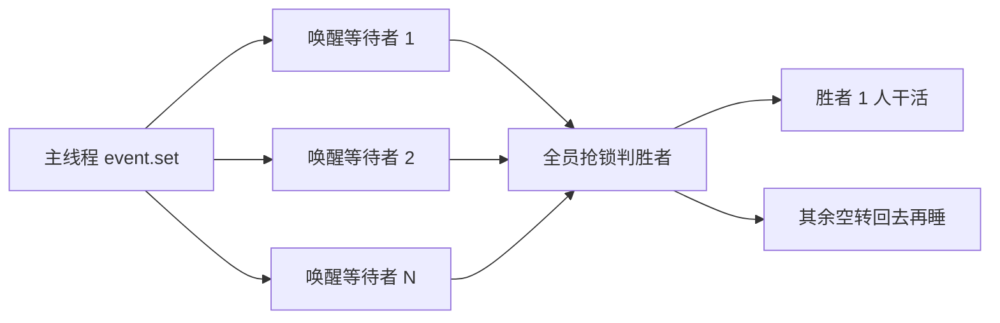
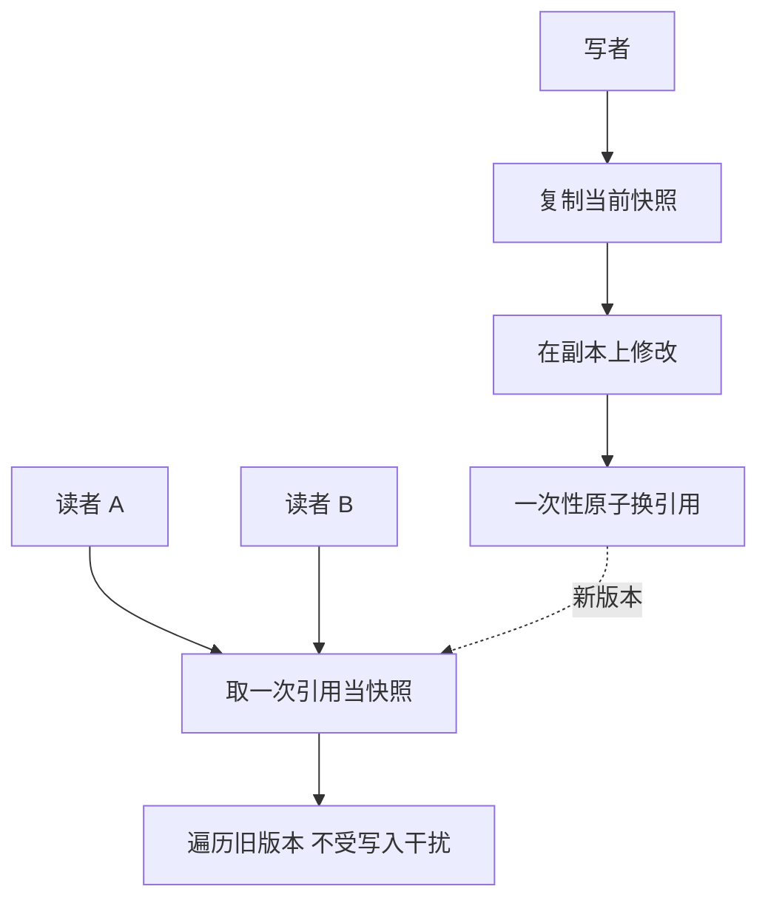
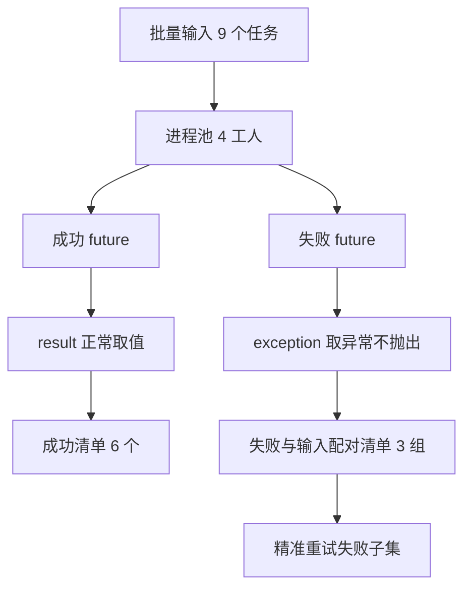
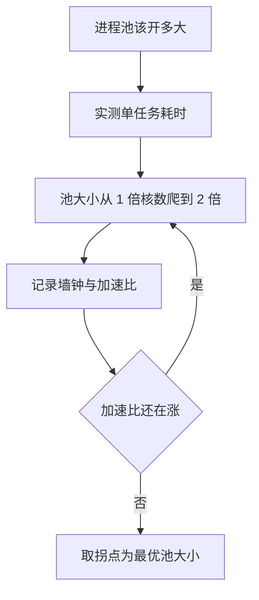
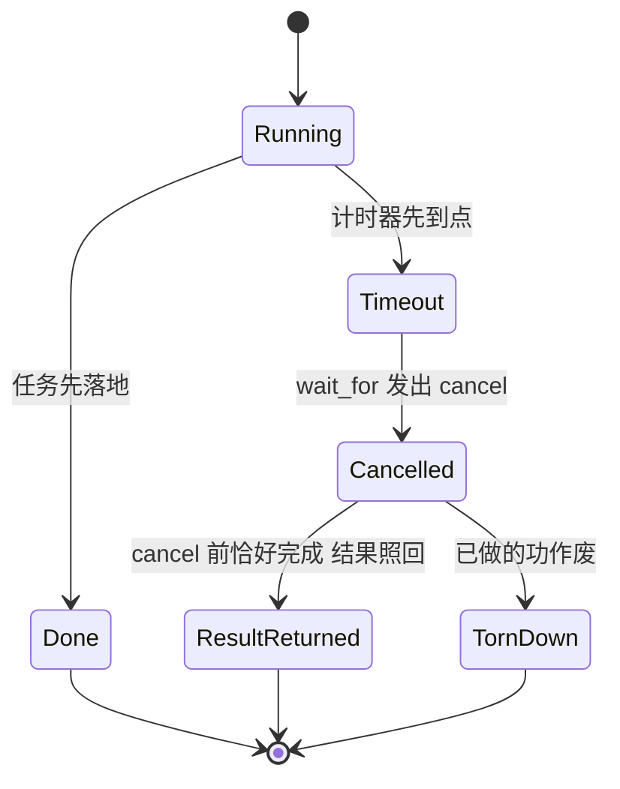
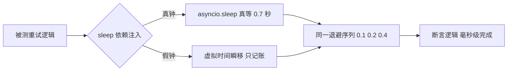
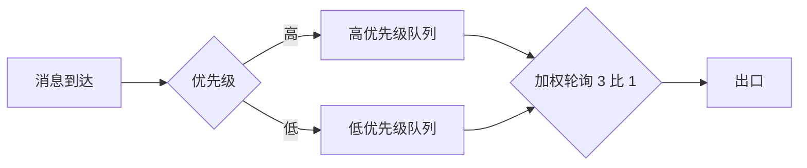
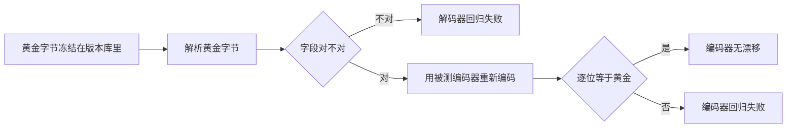
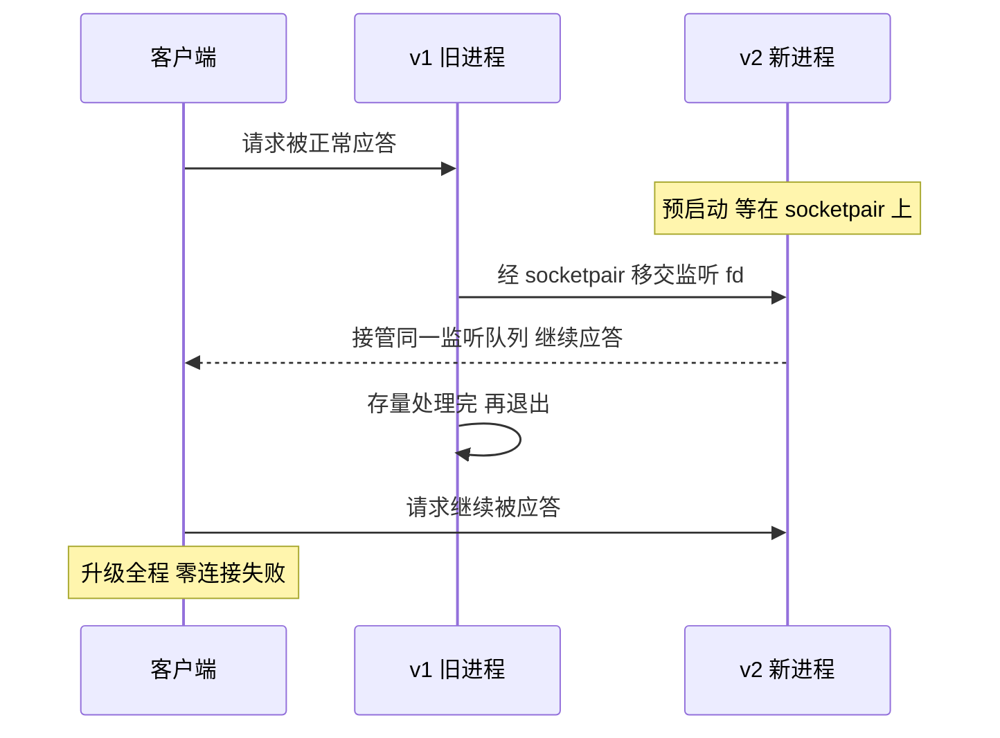

# 第 2 类 · 并发与网络工程(夜间扩产六)

> 本篇是第六篇夜间扩产:同步原语补遗(Event 广播唤醒的时延展开与羊群代价、BoundedSemaphore 超额归还防线、锁外准备锁内提交两段式、条件变量超时等待、读计数的写入合并、写时复制的遍历安全、Semaphore 唤醒顺序、CAS 的 ABA、监视器模式、按键加锁)。

> 进程与池补遗(批量任务部分失败回传、imap_unordered 完成序、子进程环境变量隔离、池内崩溃毒化全池、池大小实测标定、pickle 税、worker 心跳、多进程日志汇聚、close 与 terminate 分界)。

> asyncio 补遗(__aiter__/__anext__ 协议、异步锁公平性、wait_for 边界竞争、手写 aclosing、双循环嵌套禁止原因、deadline 时钟陷阱、异步单测、假时钟时间注入、万级 Task 成本账、自定义 Task 工厂)。

> 协议与流量(发送端滑动窗口、credit 流量控制、双队列加权轮询、丢弃会计、黄金文件回归、累积 ACK、帧级 hexdump、每流信用),运维与排障(手写线程转储、协程悬挂 cr_frame 尸检、网络异常分类决策表、双进程 fd 移交零失败重启、限流键热点拆分、线程对账、错误率滑动窗口滞回告警),收于迷你消息中继站综合设计。全部代码仅标准库、Python 3.9 可运行,已逐文件实跑通过。

### Q2651 · Event 并发唤醒实测:set 一声,唤醒时延展开与羊群代价

> 难度:★★ | 标签:Event, 并发唤醒, 惊群

**问**:一个 Event 上睡了 8 个等待线程,主线程调用一次 set(),这 8 个人会发生什么?代价是什么?

**答**:Event.set 是一次广播:所有 wait() 一起醒来。实测 8 个等待者从 set 到各自恢复运行的时延有约 1ms 的展开,而且资源只有一份时,8 个人全部抢锁检查、只有 1 人干成活,其余全是空转,这就是 Event 版的羊群效应。

- 唤醒是逐个进行的,时延随唤醒顺序单调展开;

- Event 适合"状态质变"的广播(停机、配置切换),不适合"来了一件货"的点对点通知;

- 点对点该用 Semaphore 或 Condition.notify(1),让唤醒次数等于成功次数;

- Event 是一次性闸门:set 之后必须 clear 才能再次广播,clear 前新来的等待者直接通过。

```python
# file: code/02_并发与网络工程/q2651_event_wake.py
# -*- coding: utf-8 -*-
"""Event 的并发唤醒实测: set 一声, 8 个等待者的唤醒时延展开。

- 8 个等待者都睡在 event.wait() 上, 主线程 set() 一次;
- 每个等待者记录从 set 到自己恢复运行的时延, 观察唤醒展开;
- 羊群效应: 全部 8 人被唤醒并抢锁, 但资源只有一份, 只有 1 人干成活。
"""
import threading
import time

N = 8
event = threading.Event()
ready = threading.Barrier(N + 1)     # 全员就位后再 set
wake_lat = [None] * N                # 每个等待者的唤醒时延
t_set = [0.0]
winner_lock = threading.Lock()
winner = []


def waiter(idx):
    ready.wait()
    event.wait()                     # 睡在 Event 上
    wake_lat[idx] = time.perf_counter() - t_set[0]
    # 资源只有一份: 只有第一个抢到名额的人算"干成活"
    with winner_lock:
        if not winner:
            winner.append(idx)


if __name__ == "__main__":
    ts = [threading.Thread(target=waiter, args=(i,)) for i in range(N)]
    for t in ts:
        t.start()
    ready.wait()
    time.sleep(0.05)                 # 确保它们都已睡在 event 上
    t_set[0] = time.perf_counter()
    event.set()                      # 一声哨响, 广播唤醒
    for t in ts:
        t.join()

    lat = sorted(x * 1000 for x in wake_lat if x is not None)
    print("各等待者唤醒时延 ms:", ["%.3f" % x for x in lat])
    print("最快 %.3f ms / 最慢 %.3f ms / 展开 %.3f ms"
          % (lat[0], lat[-1], lat[-1] - lat[0]))
    print("被唤醒人数: %d/%d, 真正干成活: %d 人"
          % (len(lat), N, len(winner)))

    # 对照: clear 之后再 set 才能再次广播, Event 是一次性闸门
    event.clear()
    second = threading.Event()
    blocked = []

    def late_waiter():
        blocked.append(event.wait(timeout=0.2))

    tl = threading.Thread(target=late_waiter)
    tl.start()
    tl.join()
    print("clear 后未 set, 新等待者 0.2s 超时返回:", blocked)
```

**追问**:1) Event.wait 返回值有什么用?——它返回内部标志位的现值,配合 timeout 可以区分"被唤醒"与"超时",不必再二次查询。2) 羊群效应和锁竞争是什么关系?——唤醒瞬间全员抢同一把锁,等待者越多锁竞争峰值越高,这是惊群的真实代价。3) 底层机制:Event.set 的广播是怎么展开的?——CPython 的 Event 内部是 Condition,set 先置标志再 notify_all,逐个唤醒 waiters 里的等待者;每个醒来的人都要重新抢同一把条件锁,唤醒本质是串行的,时延因此随队列长度展开。4) 生产陷阱?——拿 Event 做"来了一件货"的点对点通知,N 个消费者全被唤醒只有 1 个抢到,其余空转再睡白烧 CPU,该用 Semaphore/Queue;set 之后忘 clear,新等待者直接通过,闸门语义静默失效。



---

### Q2652 · BoundedSemaphore 抓超额归还:普通 Semaphore 的计数会漂

> 难度:★★ | 标签:BoundedSemaphore, 信号量, 防线

**问**:Semaphore 用作资源池时,如果某处代码多调了一次 release,会发生什么?

**答**:普通 Semaphore 只是个计数器,多 release 一次计数就涨一格:实测单槽临界区(初始计数 1)被超额归还后,两个线程同时进入,互斥不变量被静默打破。BoundedSemaphore 在 release 超过初始值时抛 ValueError,把 bug 挡在归还现场而不是几天后的数据错乱里。

- 实测:普通 Semaphore 超额 release 后最大并发观测到 2,不变量被打破;

- BoundedSemaphore 对同一场景直接抛 "Semaphore released too many times";

- 资源池语义下应一律用 BoundedSemaphore:借出几笔就必须归还几笔;

- 超额归还的常见来源:finally 里重复 release、把 release 写在会被执行两次的分支里。

```python
# file: code/02_并发与网络工程/q2652_bounded_sem.py
# -*- coding: utf-8 -*-
"""BoundedSemaphore 的超额归还防线: 普通 Semaphore 的计数会漂。

- 普通 Semaphore 只是个计数器, release 多调一次计数就涨上去;
- 计数从 1 漂到 2 后, 两个线程能同时进入"单槽"临界区, 不变量被打破;
- BoundedSemaphore 在 release 超过初始值时抛 ValueError, 把 bug 挡在原地。
"""
import threading
import time


def hammer(sem, barrier, conc, peak, lock):
    barrier.wait()
    sem.acquire()
    with lock:
        conc[0] += 1
        peak[0] = max(peak[0], conc[0])
    time.sleep(0.05)                 # 临界区有点工作量, 让并发重叠可观测
    with lock:
        conc[0] -= 1
    sem.release()


def run_two_workers(sem):
    """两个 worker 同时进临界区, 返回观测到的最大并发数。"""
    barrier = threading.Barrier(2)
    conc, peak, lock = [0], [0], threading.Lock()
    ts = [threading.Thread(target=hammer, args=(sem, barrier, conc, peak, lock))
          for _ in range(2)]
    for t in ts:
        t.start()
    for t in ts:
        t.join()
    return peak[0]


if __name__ == "__main__":
    # 阶段一: 健康 Semaphore, 单槽同一时刻只放一人
    healthy = threading.Semaphore(1)
    print("健康 Semaphore(1) 的最大并发:", run_two_workers(healthy))

    # 阶段二: 普通 Semaphore 被多 release 一次, 计数漂到 2
    plain = threading.Semaphore(1)
    plain.release()                  # 多余的一次归还: 计数 1 -> 2
    peak = run_two_workers(plain)
    print("超额 release 后, '单槽'临界区最大并发:", peak)
    print("不变量是否被打破:", peak > 1)

    # 阶段三: BoundedSemaphore 拒绝超额归还
    bounded = threading.BoundedSemaphore(1)
    try:
        bounded.release()            # 多余的一次归还
        print("BoundedSemaphore 竟然放行了超额 release")
    except ValueError as e:
        print("BoundedSemaphore 抓到超额归还:", e)
    print("BoundedSemaphore 保护下最大并发:", run_two_workers(bounded))
```

**追问**:1) 计数漂移为什么难排查?——它不报错,只是让并发上限悄悄变大,表现为偶发的数据竞争,且只在流量高峰出现。2) with 语句和 Semaphore 配合安全吗?——安全,Python 没有原生的 with Semaphore 语义,但 acquire/release 恰好匹配协议,可用 try/finally 手工保证。3) 底层机制:BoundedSemaphore 拦在哪一步?——release 在内部锁里比较当前计数与构造时的初始值,越过初始值当场抛 ValueError;普通 Semaphore 的 release 是无条件计数 +1,没有上界,漂移因此完全静默。4) 生产陷阱?——finally 里重复 release(正常路径与异常补偿路径各放了一次);同一资源被两个模块各自包装、各自归还;资源池语义一律用 BoundedSemaphore,把 bug 挡在归还现场而不是几天后的数据错乱里。

---

### Q2653 · 锁外准备、锁内提交:两段式缩短临界区

> 难度:★★★ | 标签:临界区, 两段式, 锁优化

**问**:一个写操作要先做 2000 条数据的计算再更新共享结构,怎么把锁的影响降到最小?

**答**:把工作拆成两段:锁外准备(构造完整新版本,不碰任何共享状态),锁内提交(一次赋值换引用)。实测朴素写法平均持锁约 291 微秒,两段式压到约 24 微秒;锁外的准备各线程完全并行,锁只在提交的一瞬间串行。

- 持锁时长是锁竞争的直接来源,缩短临界区比换更快的锁更有效;

- 两段式的语义前提:提交必须是一次原子动作(引用替换、单字段赋值);

- 准备阶段失败不会污染共享状态,天然获得"失败可弃"的回滚性质;

- 适合读多写少 + 准备开销大的场景,写本身就极轻时收益有限。

```python
# file: code/02_并发与网络工程/q2653_two_phase.py
# -*- coding: utf-8 -*-
"""锁外准备、锁内提交两段式: 把耗时工作挪出临界区。

- 朴素写法: 拿锁 -> 准备数据 -> 写入 -> 放锁, 锁被计算拖住;
- 两段式: 锁外把新版本完整准备好, 锁内只做一次引用替换;
- 实测两种写法的"持锁时长": 两段式把临界区压缩到微秒以下。
"""
import threading
import time

N_WORKERS = 4
ROUNDS = 60
hold_times = {"one_phase": [], "two_phase": []}
store = {"version": 0, "data": {}}
store_lock = threading.Lock()


def prepare():
    """昂贵的准备工作: 构造一份全新的数据版本, 不碰任何共享状态。"""
    return {i: (i * 31) % 997 for i in range(2000)}


def one_phase():
    for _ in range(ROUNDS):
        with store_lock:
            t0 = time.perf_counter()         # 只量真正持锁的部分
            new_data = prepare()             # 计算在锁内: 临界区被拖长
            store["data"] = new_data
            store["version"] += 1
            hold_times["one_phase"].append(time.perf_counter() - t0)


def two_phase():
    for _ in range(ROUNDS):
        new_data = prepare()                 # 准备在锁外: 与他人零竞争
        with store_lock:
            t0 = time.perf_counter()
            store["data"] = new_data         # 提交在锁内: 一次赋值
            store["version"] += 1
            hold_times["two_phase"].append(time.perf_counter() - t0)


def report(mode):
    xs = sorted(hold_times[mode])
    avg = sum(xs) / len(xs) * 1e6
    p95 = xs[int(len(xs) * 0.95)] * 1e6
    print("%s: 平均持锁 %.2f us, P95 持锁 %.2f us" % (mode, avg, p95))


if __name__ == "__main__":
    for mode, key, fn in (("朴素一把梭", "one_phase", one_phase),
                          ("两段式", "two_phase", two_phase)):
        hold_times[key] = []
        ts = [threading.Thread(target=fn) for _ in range(N_WORKERS)]
        for t in ts:
            t.start()
        for t in ts:
            t.join()
        report(key)
    print("最终版本号:", store["version"], "(4 线程 x 60 轮, 无丢失更新)")
```

**追问**:1) 两段式会不会丢失更新?——不会,提交仍在锁内,写者之间照样串行;锁外的只是只读输入。2) 如果准备依赖当前共享状态怎么办?——锁内先读快照,锁外基于快照准备,提交前再校验版本,这就是乐观并发的雏形。3) 底层机制:为什么"一次引用替换"就能当原子提交?——单次属性赋值/字典赋值是一个字节码步骤,GIL 调度下不会被打断,free-threaded 构建(PEP 703)也承诺简单赋值保持原子;读者要么见旧引用要么见新引用,没有半成品状态。4) 生产陷阱?——提交要写多个字段时仍用两次赋值,原子性消失,必须打包成单个不可变对象再替换;乐观并发漏掉提交前的版本校验,静默覆盖他人写入;把"锁外准备"扩大到读共享结构,准备阶段就引入竞态。

---

### Q2654 · Condition.wait_for 超时等待:醒来必查谓词,超时也要拿证据

> 难度:★★ | 标签:Condition, 超时等待, 谓词

**问**:Condition.wait() 挂起等条件,条件一直不来怎么办?超时之后能直接当条件不成立吗?

**答**:wait_for(predicate, timeout) 是带超时的谓词等待:内部循环重查谓词,帮你挡掉虚假唤醒与迟到通知;返回值就是谓词现值,超时拿到 False 也要以谓词现值为准。实测:生产者迟到但赶在预算内就等到,预算耗尽返回 False,之后再取还能取到迟到的包裹——超时返回不影响条件后续成立。

- 裸 wait() 醒来必须自己 while 重查谓词,wait_for 把这个模式固化了;

- 超时不是异常而是快速失败,调用方拿到 False 就去走降级路径;

- 超时时长要显著大于正常到达时间,否则会把慢而正常的操作误判为失败;

- 超时后条件仍可能成立,是否重试由业务决定,原语只负责如实报告。

```python
# file: code/02_并发与网络工程/q2654_cond_wait_for.py
# -*- coding: utf-8 -*-
"""Condition.wait_for 的超时等待: 醒来必查谓词, 超时也要拿证据。

- wait_for(pred, timeout) 内部循环重查谓词, 帮你挡掉虚假唤醒;
- 返回值就是谓词现值: True 表示条件成立, False 表示到点仍不成立;
- 超时不是异常, 是"拿不到就带着证据返回"的快速失败。
"""
import threading
import time


class Box:
    """最小的一次性信箱: item 非空即谓词成立。"""

    def __init__(self):
        self.cv = threading.Condition()
        self.item = None

    def put(self, v):
        with self.cv:
            self.item = v
            self.cv.notify_all()

    def take(self, timeout):
        with self.cv:
            ok = self.cv.wait_for(lambda: self.item is not None, timeout)
            if ok:
                v, self.item = self.item, None
                return v, True
            # 到点仍为空: 谓词现值就是证据, 不能想当然当它有货
            return None, False


if __name__ == "__main__":
    # 场景一: 生产者迟到但赶在预算内, 消费者等到货
    box1 = Box()
    results = {}

    def late_producer():
        time.sleep(0.15)
        box1.put("包裹")

    threading.Thread(target=late_producer).start()
    t0 = time.perf_counter()
    results["s1"], results["s1_ok"] = box1.take(timeout=0.5)
    results["s1_wait"] = time.perf_counter() - t0
    print("场景一: 等到 %r, 谓词=%s, 实等 %.2fs" %
          (results["s1"], results["s1_ok"], results["s1_wait"]))

    # 场景二: 没有生产者, 到点超时, 谓词为 False
    box2 = Box()
    t0 = time.perf_counter()
    v, ok = box2.take(timeout=0.2)
    elapsed = time.perf_counter() - t0
    print("场景二: 拿到 %r, 谓词=%s, 实等 %.2fs(约等于预算)" % (v, ok, elapsed))

    # 场景三: 超时后货又到了, 证明"超时返回"不影响之后取货
    def very_late_producer():
        time.sleep(0.3)
        box2.put("迟到的包裹")

    threading.Thread(target=very_late_producer).start()
    v, ok = box2.take(timeout=0.05)      # 先超时一次
    v2, ok2 = box2.take(timeout=1.0)     # 再等一次
    print("场景三: 第一次取 %r(ok=%s), 第二次取 %r(ok=%s)" % (v, ok, v2, ok2))
```

**追问**:1) wait_for 超时后锁还持有吗?——持有,它和 wait 一样在返回前重新拿到锁,出 with 块才释放。2) 谓词抛异常会怎样?——异常原样抛出,调用方应保证谓词是纯函数,不抛、不阻塞。3) 底层机制:wait_for 怎么挡虚假唤醒?——实现是循环"谓词为假就 wait(剩余预算)",无论被 notify 还是超时唤醒都重查谓词,只有谓词为真或预算耗尽才返回;notify_all 唤醒多个等待者时,大家各自重查,不会因别人抢先把货拿走而误判。4) 生产陷阱?——谓词里做 IO 或再拿别的锁,持锁阻塞拖死整个 Condition;超时预算小于正常到达时间,慢而正常的操作被误判失败;把 False 当"永远不成立",漏掉稍后重试的机会。

---

### Q2655 · 读计数的写入合并:本地攒批,一次锁提交一整批

> 难度:★★★ | 标签:计数器, 写入合并, 锁竞争

**问**:一个高频读的计数器,每次自增都拿锁,锁竞争把吞吐拖垮了,怎么优化?

**答**:写入合并:每个线程把自增攒在本地变量里,攒满 100 次再拿一次锁批量提交。实测 4 线程 8000 次自增,逐次加锁要 8000 次锁往返,合并后只要 80 次,缩减 100 倍;代价是可见性滞后——合并点之间观察者看到的是旧值。

- 攒批是空间换时间的经典账:延迟可见性,换取锁往返次数的数量级下降;

- 提交粒度 100 次是一个权衡:粒度越大锁越省,但崩溃时丢的计数越多;

- 监控类计数容忍滞后,交易类余额绝不能这么攒;

- 与 per-thread 分片聚合的区别:分片是按线程建多份计数,合并是攒批降频,两者常组合使用。

```python
# file: code/02_并发与网络工程/q2655_write_merge.py
# -*- coding: utf-8 -*-
"""读计数的写入合并: 线程本地攒批, 一次锁提交一整批。

- 每次计数都拿锁: 8000 次自增就是 8000 次锁往返;
- 写入合并: 本地攒 100 次再合并提交, 锁次数砍到 1/100;
- 代价是可见性滞后: 观察者在合并点之间看到的是旧值。
"""
import threading
import time

N_THREADS = 4
N_INCR = 2000
FLUSH_EVERY = 100


class CountedLock:
    """包一层, 统计 acquire 次数, 用来对账锁的开销。"""

    def __init__(self):
        self._lock = threading.Lock()
        self.acquires = 0

    def __enter__(self):
        with self._lock:
            pass
        self.acquires += 1
        return self

    def __exit__(self, *exc):
        return False


total = [0]
lk = CountedLock()


def naive_worker():
    for _ in range(N_INCR):
        with lk:
            total[0] += 1


def merged_worker():
    buf = 0
    for i in range(1, N_INCR + 1):
        buf += 1
        if i % FLUSH_EVERY == 0:
            with lk:
                total[0] += buf       # 一把锁提交 100 次的量
            buf = 0
    if buf:
        with lk:
            total[0] += buf


def bench(fn):
    global total, lk
    total, lk = [0], CountedLock()
    mid_samples = []
    stop = threading.Event()

    def observer():
        while not stop.is_set():
            with lk:
                mid_samples.append(total[0])
            time.sleep(0.0005)

    obs = threading.Thread(target=observer)
    obs.start()
    t0 = time.perf_counter()
    ts = [threading.Thread(target=fn) for _ in range(N_THREADS)]
    for t in ts:
        t.start()
    for t in ts:
        t.join()
    elapsed = time.perf_counter() - t0
    stop.set()
    obs.join()
    return elapsed, lk.acquires, mid_samples


if __name__ == "__main__":
    e1, a1, m1 = bench(naive_worker)
    e2, a2, m2 = bench(merged_worker)
    print("朴素逐次加锁: %.3fs, 锁 %d 次" % (e1, a1))
    print("合并提交:      %.3fs, 锁 %d 次 (应为 %d)"
          % (e2, a2, N_THREADS * (N_INCR // FLUSH_EVERY)))
    print("锁次数缩减: %.0f 倍" % (a1 / a2))
    expect = N_THREADS * N_INCR
    print("可见性滞后: 合并模式中途采样最大值 %d < 最终值 %d: %s"
          % (max(m2) if m2 else -1, expect, max(m2) < expect if m2 else False))
    print("两种模式最终计数一致:", total[0] == expect)
```

**追问**:1) 中途读到的旧值对监控有什么影响?——告警阈值判断会滞后一个攒批周期,对秒级告警无碍,对实时熔断要改成分片计数。2) 线程崩了攒批数据怎么办?——丢了就丢了,这正是攒批换性能的成本,关键数据要同步提交。3) 底层机制:本地攒批为什么不需要锁?——每个线程只写自己栈上的局部变量,无共享即无竞争;唯一要互斥的是提交那一下对共享计数的 +=,一把锁提交 100 次的量把锁往返摊薄两个数量级,这是"减少进入临界区次数"而非"缩短临界区"的优化路线。4) 生产陷阱?——计费/余额等不可丢计数也攒批,崩溃丢账;攒批只看条数不看时间,低流量下迟迟攒不满、数据长时间不可见(要加时间上限强制 flush);观察者对滞后无感知,拿旧值当实时值做决策。

---

### Q2656 · 写时复制的遍历安全:边遍历边改的 RuntimeError

> 难度:★★★ | 标签:写时复制, 遍历安全, 快照

**问**:一个线程在遍历共享 dict,另一个线程在往里加键,会发生什么?怎么根治?

**答**:dict 在遍历时被结构性修改会抛 RuntimeError: dictionary changed size during iteration,实测 28 万轮遍历撞出 45 次。根治靠写时复制:写者复制整表、在副本上修改、最后一次性原子换引用;读者拿一次引用安心遍历旧版本,实测 19 万轮零异常。

- 错误的根源是"迭代器与结构变更共享同一份可变结构",不是缺锁;

- 写时复制的复制成本随表增长,适合读多写少、表不大的场景;

- 换引用依赖 GIL 的赋值原子性,读者侧完全无锁;

- 与双缓冲的差别:写时复制强调"遍历期间结构不变"的一致性,双缓冲强调"读侧零锁"。

```python
# file: code/02_并发与网络工程/q2656_cow_iteration.py
# -*- coding: utf-8 -*-
"""写时复制的遍历安全: 边遍历边改的 RuntimeError 与快照替换。

- 读者正在 for 循环里遍历 dict, 写者插入新键 -> RuntimeError;
- 写时复制: 写者复制整表、改完一次性换引用, 读者拿着旧引用安心遍历;
- 复制成本随表增长, 所以写时复制适合"读多写少 + 表不大"的场景。
"""
import threading
import time

errors = [0]
rounds = [0]
stop = threading.Event()


def bare_reader(table):
    """直接遍历共享 dict: 撞上写入就抛 RuntimeError。"""
    while not stop.is_set():
        rounds[0] += 1
        try:
            for k in table:
                _ = table[k]         # 读每个值
        except RuntimeError as e:
            errors[0] += 1


def cow_reader(holder):
    """取一次引用当快照, 遍历的是不可变副本。"""
    while not stop.is_set():
        snap = dict(holder["snap"])  # 取引用 + 局部快照
        for k in snap:
            _ = snap[k]


if __name__ == "__main__":
    # 阶段一: 裸遍历共享 dict, 写者同时插键
    table = {i: i for i in range(8)}
    r = threading.Thread(target=bare_reader, args=(table,))
    r.start()
    for i in range(100, 160):
        table[i] = i                 # 边遍历边改
        time.sleep(0.0005)
    stop.set()
    r.join()
    print("裸遍历: %d 轮里撞出 %d 次 RuntimeError" % (rounds[0], errors[0]))

    # 阶段二: 写时复制, 读者只碰快照
    holder = {"snap": {i: i for i in range(8)}}
    writer_lock = threading.Lock()
    err2 = [0]

    def cow_writer():
        for i in range(100, 160):
            new = dict(holder["snap"])   # 复制旧版本
            new[i] = i                   # 在副本上改
            with writer_lock:
                holder["snap"] = new     # 一次性原子换引用
            time.sleep(0.0005)

    stop2 = threading.Event()
    rounds2 = [0]

    def cow_reader2():
        while not stop2.is_set():
            rounds2[0] += 1
            try:
                for k, v in list(holder["snap"].items()):
                    _ = v
            except RuntimeError:
                err2[0] += 1

    w = threading.Thread(target=cow_writer)
    r2 = threading.Thread(target=cow_reader2)
    w.start()
    r2.start()
    w.join()
    stop2.set()
    r2.join()
    print("写时复制: %d 轮遍历, RuntimeError %d 次, 最终键数 %d"
          % (rounds2[0], err2[0], len(holder["snap"])))
```

**追问**:1) 为什么 for k in dict 期间加键必炸,改已有键的值却不炸?——改值不动哈希表结构,迭代器只感知 size 与槽位布局。2) list 也有这个问题吗?——list.append 不改长度字段以外的布局,遍历中 append 不炸但可能看到新元素,语义上同样不该依赖。3) 底层机制:换引用凭什么对读者原子?——写者复制出完整副本后一次性赋值 holder["snap"] = new,单次引用赋值在 CPython 下原子;读者取到引用后遍历的是那一刻的完整版本,写者后续修改落在另一个对象上,互不可见。4) 生产陷阱?——表很大还用写时复制,每次写 O(n) 复制拖垮写路径;多写者不加锁各复制各的、互相覆盖丢更新;读者把快照引用长期缓存,拿陈旧版本当最新。



---

### Q2657 · Semaphore 的唤醒顺序实测:等待者按什么顺序拿到票

> 难度:★★★ | 标签:Semaphore, FIFO, 实现细节

**问**:6 个线程睡在 Semaphore 上,放一张票,谁先拿到?这个顺序有保证吗?

**答**:CPython 的 Semaphore 内部是 Condition + 计数器,release 走 notify(1),从 waiters 队列头唤醒,实测 12 轮里第一个等待者 12 次全部先拿到票,后续顺序接近 FIFO 但偶有穿插。要点是:这是 CPython 实现细节,语言规范不承诺 FIFO,跨解释器或未来版本都可能变化。

- 需要严格公平要自己造票号队列(先到先发号,叫号入席);

- 实测中「补齐余票」阶段的顺序仍有穿插,说明唤醒顺序与调度顺序是两回事;

- 排队列的等待者被唤醒后还要重新抢锁,这一步可能被插队;

- 公平性测试的标准姿势:全员栅栏就位后放票,统计多轮顺序分布。

```python
# file: code/02_并发与网络工程/q2657_sem_order.py
# -*- coding: utf-8 -*-
"""Semaphore 的唤醒顺序实测: 等待者按什么顺序拿到票。

- threading.Semaphore 内部是 Condition + 计数器, 唤醒走 waiters 队列;
- 实测: 全员先在栅栏前列队睡在 acquire 上, 再放票, 记录获票顺序;
- 多轮统计: CPython 下接近 FIFO, 但这是实现细节, 不是语言承诺。
"""
import threading
import time

ROUNDS = 12
N = 6


def run_round():
    sem = threading.Semaphore(0)         # 票仓先清零
    order = []
    order_lock = threading.Lock()

    def waiter(idx):
        sem.acquire()                    # 全员睡在票仓上
        with order_lock:
            order.append(idx)

    ts = [threading.Thread(target=waiter, args=(i,), daemon=True)
          for i in range(N)]
    for t in ts:
        t.start()
    time.sleep(0.1)                      # 确保都睡在 acquire 里
    t0 = time.perf_counter()
    sem.release()                        # 先放一张票: 看谁最先醒
    time.sleep(0.05)
    for _ in range(N - 1):               # 补齐余票, 让全员都能通过
        sem.release()
    for t in ts:
        t.join()
    return order, time.perf_counter() - t0


if __name__ == "__main__":
    results = [run_round() for _ in range(ROUNDS)]
    for i, (order, dt) in enumerate(results):
        print("第 %2d 轮获票顺序: %s (耗时 %.0f ms)" % (i + 1, order, dt * 1000))
    first_is_zero = sum(1 for o, _ in results if o and o[0] == 0)
    print("第 0 个等待者拿第一张票的轮数: %d/%d" % (first_is_zero, ROUNDS))
    print("结论: 顺序接近 FIFO, 依赖 CPython 实现细节, 跨解释器不可依赖")
```

**追问**:1) 为什么不直接承诺 FIFO?——承诺公平性会绑死实现并牺牲吞吐,库作者把公平作为策略留给上层。2) threading.Lock 的唤醒顺序同理吗?——同理,Lock 也是 Condition 实现,同样不承诺顺序。3) 底层机制:被唤醒的等待者为什么还可能被插队?——notify 只把队头 waiter 移出等待集,它醒来后还要重新参与 acquire 的锁竞争;若此刻有新到线程先抢到锁,队列头就被插队,这正是"唤醒顺序不等于获票顺序"的机制根源,也是语言层不敢承诺公平的原因。4) 生产陷阱?——把测试机观察到的 FIFO 写进业务正确性论证,换解释器或升级版本后顺序漂移;真要公平就显式造票号队列(先到先发号、叫号入席),而不是赌实现细节。

---

### Q2658 · CAS 的 ABA 问题:值回来了,世界却换过了

> 难度:★★★★ | 标签:CAS, ABA, 版本号

**问**:CAS 只比较值相等,如果值被改走又改回来,提交会发生什么?

**答**:发生 ABA 问题:账户 100 元,A 读到快照;期间 B 取走 30 又存回 30,余额回到 100 但发生过两次动账;A 的纯值 CAS 检查 100 == 100 通过,提交成功,却把 B 的动账台账整个覆盖——账面余额没错,审计记录凭空消失。版本号 CAS 每次提交把 version +1,A 校验的是 version,值回来了版本对不上,照样拒绝。

- ABA 的危害不在值,而在"值相同的两个时刻之间世界已经不同";

- 纯值 CAS 适合无历史语义的开关量,一切带台账、带引用、带链表节点的场景都会中招;

- 通用解是版本戳:值与版本打包,或者干脆用不可变对象整体替换;

- 无锁栈的节点复用是最经典的 ABA 现场 popped 节点被回收到栈顶,指针值相同而节点已换。

```python
# file: code/02_并发与网络工程/q2658_aba.py
# -*- coding: utf-8 -*-
"""CAS 的 ABA 问题: 值回来了, 世界却换过了。

- 只比对值的 CAS: A 读到 100, 期间 B 取走又存回 100, A 的提交照样成功;
- 被覆盖掉的不只是余额, 还有 B 留下的台账(movements), 审计直接失真;
- 版本号 CAS: 每次提交 version +1, 值回来了版本对不上, 照样拒绝。
"""
import copy


def cas_by_value(acct, expect_balance, new_balance, new_movements):
    """只认余额的 CAS: 余额没变就允许覆盖。"""
    if acct["balance"] == expect_balance:
        acct["balance"] = new_balance
        acct["movements"] = new_movements
        return True
    return False


def cas_by_version(acct, expect_version, new_balance, new_movements):
    """版本号 CAS: 版本对不上就拒绝, 强制重读重算。"""
    if acct["version"] == expect_version:
        acct["balance"] = new_balance
        acct["movements"] = new_movements
        acct["version"] += 1
        return True
    return False


def play_b(acct):
    """并发方 B: 取走 30 又存回 30, 余额回到原值, 台账 +2。"""
    ok1 = cas_by_version(acct, acct["version"], acct["balance"] - 30,
                         acct["movements"] + 1)
    ok2 = cas_by_version(acct, acct["version"], acct["balance"] + 30,
                         acct["movements"] + 1)
    return ok1 and ok2


if __name__ == "__main__":
    # 阶段一: A 读快照后休眠, B 完成"取走又存回", A 用纯值 CAS 提交
    acct = {"balance": 100, "movements": 0, "version": 0}
    snap = copy.copy(acct)               # A 的快照: balance=100
    assert play_b(acct)                  # B: 100 -> 70 -> 100, version 0 -> 2
    print("B 操作后: balance=%(balance)s, movements=%(movements)s, "
          "version=%(version)s" % acct)
    ok = cas_by_value(acct, snap["balance"], 120, snap["movements"] + 1)
    print("A 用纯值 CAS 提交(给客户加 20 并记一笔): 成功=%s" % ok)
    print("纯值 CAS 后: balance=%(balance)s, movements=%(movements)s" % acct)
    print("审计失真: 明明发生过 3 次动账, 台账只剩 1 次")

    # 阶段二: 同样的剧情, 换版本号 CAS
    acct2 = {"balance": 100, "movements": 0, "version": 0}
    snap2_version = acct2["version"]     # A 记住的是版本, 不只是余额
    assert play_b(acct2)
    ok2 = cas_by_version(acct2, snap2_version, 120, 1)
    print("A 用版本号 CAS 提交: 成功=%s (version 已是 %d)"
          % (ok2, acct2["version"]))
    print("版本号 CAS 拒绝陈旧提交, 强制 A 重读最新状态再重算")
```

**追问**:1) 版本号方案为什么能挡住 ABA?——它把"状态是否变过"从值域搬到单调递增的版本域,回拨不可能。2) Python 里有真实的 ABA 风险吗?——GIL 让单字节码原子,但"读-判断-写"跨多个字节码的组合操作照样存在 ABA 窗口。3) 底层机制:经典 ABA 现场长什么样?——无锁栈的 pop 读到栈顶节点 A 后被挂起,其他线程 pop 掉 A 又 push 回一个复用同地址的新节点,指针值相同而节点已换,比对照样通过;Python 层没有裸指针 CAS,但对共享 dict/对象字段的"读-比较-写"组合是同构问题。4) 生产陷阱?——把"值没变"当"什么都没发生",审计台账被静默覆盖;版本检查与写入仍是两步,要用锁或整体替换不可变对象封住窗口;拿 uuid/时间戳当版本号,碰撞与回拨都会复活 ABA。

---

### Q2659 · 监视器模式:把不变量锁进类里

> 难度:★★ | 标签:监视器模式, 不变量, 封装

**问**:balance 和 history 这两个相关字段被多线程读写,怎么保证"balance 永远等于 history 之和"?

**答**:把不变量锁进类里,即监视器模式:所有字段的读写只能经过类自己的锁,任何时刻对外暴露的都是完整一致的状态。实测无锁裸类在两步写入(先改余额后记台账)之间被读者撞见 30 万次半截状态;监视器版本同负载零破坏。并发正确性是类的职责,不能指望每个调用方都记得加锁。

- 判定标准:类的并发契约写进类,还是写在使用说明书里——后者必败;

- 监视器的关键纪律:状态不出门(出借要拷贝)、回调不进门(锁内不调外部代码);

- 粒度上类级锁简单可靠,竞争激烈再拆细,拆细前先量化;

- invariant check 可以做成断言挂在读路径上,让破坏当场炸出来。

```python
# file: code/02_并发与网络工程/q2659_monitor.py
# -*- coding: utf-8 -*-
"""监视器模式: 把不变量锁进类里。

- 不变量: balance 永远等于 history 的代数和;
- 裸类: 两个相关字段分两步写, 读者随时可能撞见"半截状态";
- 监视器: 所有读写都从同一扇门过, 不变量对外永远成立。
"""
import threading
import time

OPS = 800


class RawLedger:
    """无锁裸类: balance 与 history 分两步写, 中间是可见的半截状态。"""

    def __init__(self):
        self.balance = 0
        self.history = []

    def deposit(self, d):
        b = self.balance
        time.sleep(0)                    # 放大竞态窗口
        self.balance = b + d             # 第一步: 余额先变
        self.history.append(d)           # 第二步: 台账后记


class MonitorLedger:
    """监视器: 所有字段只被类自己的锁触碰, 不变量焊死在类内。"""

    def __init__(self):
        self._lock = threading.Lock()
        self._balance = 0
        self._history = []

    def deposit(self, d):
        with self._lock:
            self._balance += d
            self._history.append(d)      # 两步在锁内, 对外原子

    def consistent_snapshot(self):
        with self._lock:
            return self._balance, list(self._history)


def hammer_raw(ledger, done):
    d = 1
    for _ in range(OPS):
        ledger.deposit(d)
    done.set()


def check_raw(ledger, done, mismatches):
    while not done.is_set():
        bal = ledger.balance             # 读者裸读两个字段
        hist_sum = sum(ledger.history)
        if bal != hist_sum:
            mismatches[0] += 1


def hammer_monitor(ledger, done):
    for _ in range(OPS):
        ledger.deposit(1)
    done.set()


def check_monitor(ledger, done, mismatches):
    while not done.is_set():
        bal, hist = ledger.consistent_snapshot()
        if bal != sum(hist):
            mismatches[0] += 1


def run(ledger_cls, hammer_fn, check_fn):
    ledger = ledger_cls()
    done = threading.Event()
    mismatches = [0]
    ts = [threading.Thread(target=hammer_fn, args=(ledger, done))
          for _ in range(2)]
    cs = [threading.Thread(target=check_fn, args=(ledger, done, mismatches))
          for _ in range(2)]
    for t in ts + cs:
        t.start()
    for t in ts:
        t.join()
    done.set()
    for t in cs:
        t.join()
    return mismatches[0]


if __name__ == "__main__":
    raw_bad = run(RawLedger, hammer_raw, check_raw)
    mon_bad = run(MonitorLedger, hammer_monitor, check_monitor)
    print("裸类半截状态被读者撞见: %d 次" % raw_bad)
    print("监视器不变量被破坏: %d 次" % mon_bad)
    print("结论: 并发正确性是类的职责, 别指望调用方自己记得加锁")
```

**追问**:1) 监视器和「文档里写清要自己加锁」的类怎么选?——通用容器选后者(调用方组合粒度),业务状态选前者(不变量私有)。2) 为什么锁内不能调回调?——回调可能反过来拿这把锁造成重入死锁,或者做耗时操作拖长临界区。3) 底层机制:重入死锁怎么发生?——threading.Lock 底层是非重入的 OS mutex,同线程二次 acquire 永久阻塞自己;锁内执行回调,回调又调回该类的加锁方法,等的正是自己手里的锁;要重入语义得换 RLock,但那通常说明门禁设计有问题。4) 生产陷阱?——getter 漏在锁外,半截状态照样被读到;锁内发布事件/调外部回调,把不可控代码拖进临界区;出借内部 list/dict 让不变量绕过门禁被改(出借要拷贝)。

---

### Q2660 · 按键加锁管理器:同 key 串行,异 key 并行

> 难度:★★★★ | 标签:按键加锁, 细粒度锁, 引用计数

**问**:按账户 ID 更新余额,全局一把锁让所有账户互相排队;按账户加锁,锁对象会不会随账户数无限膨胀?

**答**:按键加锁管理器:每 key 一把锁,同一 key 的操作天然串行,不同 key 完全并行。膨胀问题靠引用计数解决——acquire 时引用 +1,release 时 -1,归零即从注册表销毁。实测同一账户 4 线程被串行化,四个不同账户并行跑出 4.1 倍提速,全部结束后存活锁数为 0。

- 全局锁的正确性最强、并行度最差,按键加锁是并行度与复杂度的折中;

- 引用计数是管理器不泄漏的前提,归零回收的时机必须在 finally 里;

- 热点 key 天然串行,这是语义需要,拆分反而引入跨键一致性难题;

- 风险是锁顺序:一次持有多把 key 锁时要全局定序,否则死锁。

```python
# file: code/02_并发与网络工程/q2660_keyed_lock.py
# -*- coding: utf-8 -*-
"""按键加锁管理器: 同一 key 串行, 不同 key 并行。

- 全局一把锁: 所有账户互相排队, 吞吐被无关节口拖累;
- 按 key 加锁: 只锁同一条资源, 互不相关的操作并行跑;
- 引用计数回收: 没人用的锁及时销毁, 管理器不随 key 数量无限膨胀。
"""
import threading
import time
from contextlib import contextmanager

WORK = 0.002                            # 模拟每笔操作 2ms 的真实工作量


class KeyedLocks:
    """每 key 一把锁, 引用计数归零即回收。"""

    def __init__(self):
        self._guard = threading.Lock()
        self._locks = {}
        self._refs = {}

    @contextmanager
    def hold(self, key):
        with self._guard:
            lk = self._locks.get(key)
            if lk is None:
                lk = threading.Lock()
                self._locks[key] = lk
                self._refs[key] = 0
            self._refs[key] += 1
        try:
            with lk:
                yield
        finally:
            with self._guard:
                self._refs[key] -= 1
                if self._refs[key] == 0:
                    self._locks.pop(key, None)
                    self._refs.pop(key, None)

    def live_locks(self):
        with self._guard:
            return len(self._locks)


balances = {}
ledger_lock = threading.Lock()           # 仅保护 balances 字典本身的读写


def work_on(km, key, ops):
    for _ in range(ops):
        with km.hold(key):               # 同 key 串行, 异 key 并行
            time.sleep(WORK)             # 锁内干点真活, 串行代价才显形
            with ledger_lock:
                balances[key] = balances.get(key, 0) + 1


if __name__ == "__main__":
    km = KeyedLocks()

    # 场景一: 4 个线程挤同一个 key -> 完全串行
    balances.clear()
    t0 = time.perf_counter()
    ts = [threading.Thread(target=work_on, args=(km, "acct:hot", 20))
          for _ in range(4)]
    for t in ts:
        t.start()
    for t in ts:
        t.join()
    same = time.perf_counter() - t0

    # 场景二: 4 个线程各锁各的 key -> 完全并行
    balances.clear()
    t0 = time.perf_counter()
    ts = [threading.Thread(target=work_on, args=(km, "acct:%d" % i, 20))
          for i in range(4)]
    for t in ts:
        t.start()
    for t in ts:
        t.join()
    diff = time.perf_counter() - t0

    print("同 key 串行: %.3fs / 异 key 并行: %.3fs" % (same, diff))
    print("异 key 方案提速: %.1f 倍" % (same / diff))
    print("回收验证: 全部结束后存活锁数 =", km.live_locks(), "(应为 0)")
```

**追问**:1) 注册表本身要不要锁?——要,管理器的 guard 只保护字典结构,真正的业务互斥由各 key 锁承担,两级职责分离。2) 和分段锁什么关系?——分段锁是固定 N 片哈希分摊竞争,按键加锁是按资源精确串行,后者粒度细但对象生命周期要自己管。3) 底层机制:引用计数归零回收为什么不会误伤等待者?——引用 +1 发生在取锁之前、-1 发生在 finally,覆盖"取锁-等待-用完"的整个生命周期,等待中的线程早已把自己计入引用,归零时不可能有人还拿着这把锁;若把 -1 挪出 finally 或漏掉异常路径,就会出现新旧两把锁并行、互斥失效。4) 生产陷阱?——一次持有多把 key 锁没有全局定序,交叉等待死锁;引用计数泄漏让锁膨胀回归;热点 key 的串行化被当成 bug 去拆分,反而引入跨键一致性难题。

---

### Q2661 · 批量任务的部分失败回传:把每个失败连同输入一起带回来

> 难度:★★★ | 标签:进程池, 批量任务, 部分失败

**问**:批量提交 9 个任务到进程池,其中 3 个会失败,怎么把每个失败连同它的输入一起收集回来?

**答**:用 future.exception() 而不是 future.result():exception() 取异常但不重新抛出,批照常收完。实测 9 个任务返回 6 个成功值与 3 组 (输入, 异常类型, 消息),失败输入集合 [0, 3, 6] 可以单独重试。部分失败是批量任务的常态,治理目标是失败可见、批次可收、重试可精准。

- result() 在失败处重新抛异常,批量收集会半途而废;

- as_completed 按完成序收,配合 exception() 天然适配部分失败;

- 回传 (输入, 异常) 对而不是光异常,重试才知道重试谁;

- 失败率异常偏高时应熔断整批而不是硬着头皮收完。

```python
# file: code/02_并发与网络工程/q2661_batch_partial.py
# -*- coding: utf-8 -*-
"""批量任务的部分失败回传: 把每个失败连同输入一起带回来。

- 批量任务里部分失败是常态, 不能一个失败拖垮整批;
- future.exception() 只取异常不重新抛出, 批照常收完;
- 回传 (输入, 异常) 对, 上层才能精准重试失败的子集。
"""
from concurrent.futures import ProcessPoolExecutor, as_completed


def risky_parse(i):
    """i 是 3 的倍数就当作坏数据抛异常。"""
    if i % 3 == 0:
        raise ValueError("bad payload %d" % i)
    return i * 10


if __name__ == "__main__":
    inputs = list(range(9))
    oks, fails = [], []
    with ProcessPoolExecutor(max_workers=4) as ex:
        futs = {ex.submit(risky_parse, i): i for i in inputs}
        for f in as_completed(futs):
            i = futs[f]
            exc = f.exception()          # 取异常而不重新抛出
            if exc is None:
                oks.append((i, f.result()))
            else:
                fails.append((i, type(exc).__name__, str(exc)))

    print("成功 %d 个: %s" % (len(oks), sorted(oks)))
    print("失败 %d 个: %s" % (len(fails), sorted(fails)))
    print("失败输入集合可单独重试:", sorted(i for i, _, _ in fails))
```

**追问**:1) 能不能让失败任务返回哨兵值而不抛异常?——可以,但异常携带的类型与 traceback 信息更全,且强制调用方面对失败。2) 重试失败的子集要注意什么?——重试也要限次与退避,并且只重试可重试的异常类型。3) 底层机制:exception() 与 result() 差在哪?——future 进入 FINISHED 后,exception() 返回异常对象本身不抛出,result() 则原地重新 raise;两者读的是同一次执行的结果,区别只在失败的分发方式,这正是批量收集要选 exception() 的原因。4) 生产陷阱?——as_completed 配 result(),一个失败让整批收集中断、成功结果一起丢;失败回执不带输入参数,重试无法定位对象;对不可重试异常(参数非法、权限)也无脑重试,白烧配额。

---

### Q2662 · imap_unordered 的完成序实测:先跑完的先回来

> 难度:★★★ | 标签:imap_unordered, 完成序, 长尾

**问**:12 个任务里 0 号要跑 1 秒,其余只要 50 毫秒,imap 和 imap_unordered 的交付差别有多大?

**答**:实测:imap 的首个结果要等 1.01 秒(必须等 0 号完成才能按序交付第一个),imap_unordered 的首个结果 0.06 秒就到,快结果在长尾任务还在跑的时候就陆续交付。imap_unordered 适合"结果独立、越快越好"的场景,代价是结果与输入的对应关系要自己带编号维护。

- map/imap 严格按提交序产出,长尾任务挡住整批交付;

- imap_unordered 按完成序产出,吞吐不变但首个响应大幅提前;

- 用法上让任务返回 (编号, 结果) 或在闭包里带索引,别指望顺序对应;

- 下游需要按序处理时应自己重排,而不是退回 imap 牺牲首响应。

```python
# file: code/02_并发与网络工程/q2662_imap_unordered.py
# -*- coding: utf-8 -*-
"""imap_unordered 的完成序实测: 先跑完的先回来。

- map/imap: 结果严格按提交序产出, 慢任务挡住后面所有快任务的交付;
- imap_unordered: 谁先完成谁先产出, 长尾任务不再阻塞整批;
- 代价: 结果与输入的对应关系要自己带着编号走。
"""
import multiprocessing as mp
import time

WORKERS = 4


def job(i):
    """0 号是长尾: 睡 1.0s; 其余都是 0.05s 的快任务。"""
    time.sleep(1.0 if i == 0 else 0.05)
    return i


if __name__ == "__main__":
    with mp.Pool(WORKERS) as pool:
        pool.map(int, range(4))          # 预热: 排除 worker 启动噪声

        t0 = time.perf_counter()
        first_unordered = None
        arrival = []
        for r in pool.imap_unordered(job, range(12)):
            if first_unordered is None:
                first_unordered = time.perf_counter() - t0
            arrival.append(r)
        t_unordered = time.perf_counter() - t0

        t0 = time.perf_counter()
        first_ordered = None
        in_order = []
        for r in pool.imap(job, range(12)):
            if first_ordered is None:
                first_ordered = time.perf_counter() - t0
            in_order.append(r)
        t_ordered = time.perf_counter() - t0

    print("imap_unordered 到达序:", arrival)
    print("imap         到达序:", in_order)
    print("首个结果延迟: unordered %.2fs vs ordered %.2fs"
          % (first_unordered, first_ordered))
    print("总耗时:       unordered %.2fs vs ordered %.2fs"
          % (t_unordered, t_ordered))
    print("unordered 期间快结果已陆续交付, 长尾只在最后收一次")
```

**追问**:1) chunksize 对 imap_unordered 有影响吗?——有,chunk 大会把多个任务绑给一个 worker,完成序被块内顺序拉平。2) 什么时候必须用 imap?——结果之间有顺序依赖(比如按序写文件)时,乱序反而制造额外排序成本。3) 底层机制:完成序从哪来?——池的任务处理线程从结果队列收到谁就先交付谁,imap_unordered 不按提交序重排;imap 则维护索引压着 0 号等齐;worker 的执行分配仍按 chunk 走,所以 unordered 只是交付层乱序,不是并行度提升。4) 生产陷阱?——假设第 i 个输出对应第 i 个输入,错位事故(任务必须自带编号);轻任务用默认 chunksize,长尾被块内顺序掩盖;把 unordered 当成"更快",总耗时其实与 imap 相同。



---

### Q2663 · 子进程的环境变量隔离:env 参数与 PATH 的陷阱

> 难度:★★ | 标签:subprocess, 环境变量, 最小暴露面

**问**:调用 subprocess 时传 env 参数意味着什么?不传又意味着什么?

**答**:不传 env 表示完整继承父进程环境——包括 API_TOKEN 这类敏感变量,实测子进程 environment 里 can 看到凭证;显式传 env 则子进程只看到白名单变量,是最小暴露面。陷阱是 PATH 也属于环境:白名单里忘了带 PATH,裸名可执行文件立刻找不到,实测 PATH 指向空目录时启动裸名 python3 直接 FileNotFoundError。

- 凭证隔离的正确姿势:白名单 env,一个变量一个变量的给;

- 可执行文件用绝对路径(sys.executable)就不依赖子进程 PATH;

- 排查"子进程行为诡异"时先 diff 父子环境,LD_PRELOAD、LANG 这类变量影响深远;

- env 的继承是全有或全无:给了 env 就没有了"默认项",要自己拼齐。

```python
# file: code/02_并发与网络工程/q2663_env_isolation.py
# -*- coding: utf-8 -*-
"""子进程的环境变量隔离: env 参数与 PATH 的陷阱。

- 默认 env=None: 完整继承父进程环境, 凭证等敏感变量也一起带过去;
- 显式传 env: 子进程只看到白名单变量, 这是最小暴露面;
- PATH 也属于环境: 子进程的 PATH 决定裸名可执行文件的查找范围。
"""
import os
import subprocess
import sys

PROBE = (
    "import os, shutil; "
    "print('env_keys=%d' % len(os.environ)); "
    "print('has_secret=%s' % ('API_TOKEN' in os.environ)); "
    "print('which_python3=%s' % (shutil.which('python3') or 'NOT-FOUND'))"
)


def run(env):
    r = subprocess.run([sys.executable, "-c", PROBE],
                       capture_output=True, text=True, env=env, timeout=10)
    return r.stdout.strip().splitlines()


if __name__ == "__main__":
    os.environ["API_TOKEN"] = "should-not-leak"

    print("== 默认继承父进程环境 ==")
    for line in run(None):
        print("  ", line)

    print("== 白名单环境(仅 MINIMAL 与受控 PATH) ==")
    clean = {"MINIMAL": "1", "PATH": "/usr/bin:/bin"}
    for line in run(clean):
        print("  ", line)

    print("== 子进程 PATH 指向空目录时, 裸名查找会怎样 ==")
    try:
        subprocess.run(["python3", "-c", "print(1)"],
                       capture_output=True, env={"PATH": "/nonexistent"},
                       timeout=10)
        print("  竟然成功了")
    except FileNotFoundError as e:
        print("  FileNotFoundError:", e)

    print("== 结论: 凭证要靠白名单 env 挡住, 别依赖子进程自觉 ==")
```

**追问**:1) 只想加一个变量、其余继承怎么做?——先 copy os.environ 再覆盖目标键,注意别把敏感变量一并带过去。2) 为什么裸名查找失败报 FileNotFoundError 而不是更明确的错误?——execvp 语义如此,PATH 上找不到就是文件不存在,排障时先查 PATH。3) 底层机制:PATH 查找发生在哪一层?——POSIX execvp 按子进程 env 里的 PATH 逐目录探测,subprocess 只把 argv 与 env 交给 fork/exec;父进程 shutil.which 用的是父进程自己的 PATH,两边不一致时就是"父进程找得到、子进程跑不起来"。4) 生产陷阱?——白名单忘带 PATH/HOME,子进程工具链行为异常;LD_PRELOAD、LANG 这类深远变量未经审查就继承;用字符串拼接构造 env,把凭证带进日志或临时文件。

---

### Q2664 · 池内崩溃毒化全池:一个 worker 被杀,整个池进入残局

> 难度:★★★★ | 标签:进程池, BrokenProcessPool, 崩溃

**问**:任务抛异常池子还能用,那 worker 进程被 kill -9 杀掉呢?

**答**:性质完全不同:任务异常只是数据层面回传,池照常服务;worker 被 SIGKILL 是进程层面死亡,池被判 broken——实测崩溃任务本身抛 BrokenProcessPool,与它同池的在途任务一并失败,旧池继续提交也立即 BrokenProcessPool,唯一出路是重建一个新池。这就是"崩溃毒化全池":池无法确认死掉的 worker 手里有哪些任务,只能宣布全部作废。

- 业务异常与进程崩溃必须分诊:前者重试任务,后者重建池;

- os._exit、kill -9、段错误都会触发毒化,任务代码里绝不能裸调;

- 崩溃 worker 的退出码是负数(-9 表示 SIGKILL),监控上按"进程异常死亡"告警;

- 池重建要容忍在途任务丢失:上层必须能重发,这是至少一次语义的代价。

```python
# file: code/02_并发与网络工程/q2664_pool_crash.py
# -*- coding: utf-8 -*-
"""池内崩溃毒化全池: 一个 worker 被杀, 整个池进入残局。

- 任务抛异常只毒化自己: 异常回传, 池继续可用;
- worker 进程被 SIGKILL 杀掉(退出码 -9): 池被判 broken;
- broken 池对在途与后续所有提交一律 BrokenProcessPool, 只能重建。
"""
import os
import signal
import time
from concurrent.futures import ProcessPoolExecutor
from concurrent.futures.process import BrokenProcessPool


def slow_good(x):
    time.sleep(0.4)                      # 慢任务, 保证崩溃时在途
    return x * 2


def suicide(_):
    """模拟 worker 被外部 kill -9: 进程直接消失, 没有异常回传。"""
    os.kill(os.getpid(), signal.SIGKILL)


def status(f):
    if f.cancelled():
        return "cancelled"
    if f.done():
        exc = f.exception()
        return type(exc).__name__ if exc else "ok"
    return "pending"


if __name__ == "__main__":
    ex = ProcessPoolExecutor(max_workers=2)
    print("崩溃前正常任务:", ex.submit(slow_good, 1).result())

    pending = [ex.submit(slow_good, i) for i in (2, 3, 4, 5)]
    boom = ex.submit(suicide, 0)
    try:
        boom.result()
        print("竟然没炸")
    except BrokenProcessPool as e:
        print("崩溃任务:", type(e).__name__, "->", str(e)[:52])

    for f in pending:
        try:
            f.result(timeout=10)
        except (BrokenProcessPool, Exception) as e:
            pass                         # 在途与排队的任务一并被毒化
    print("在途 4 个任务的结局:", [status(f) for f in pending])

    try:
        ex.submit(slow_good, 9).result(timeout=10)
        print("崩溃后旧池竟然还能用")
    except BrokenProcessPool:
        print("崩溃后旧池: 继续提交也是 BrokenProcessPool -> 池已毒化")

    ex.shutdown(wait=False, cancel_futures=True)

    with ProcessPoolExecutor(max_workers=2) as ex2:   # 重建才是出路
        print("重建新池后:", ex2.submit(slow_good, 42).result())
```

**追问**:1) 为什么池不自动拉起新 worker 继续干?——被杀 worker 可能正持有共享状态(锁、半写的文件),池无法保证续跑的正确性。2) maxtasksperchild 换班和崩溃是一回事吗?——不是,换班是任务边界上的正常退休,不会毒化在途任务。3) 底层机制:池怎么发现 worker 死了?——管理线程读到 worker 退出码非正常(如 -9)或结果管道 EOF,立即把池标记 broken,在途与排队的 future 全部 set_exception(BrokenProcessPool),后续 submit 直接拒绝;检测点是进程级信号而非应用层异常,异常回传与进程死亡是两套通道。4) 生产陷阱?——任务代码裸调 os._exit、C 扩展段错误触发毒化;把 BrokenProcessPool 当普通异常对旧池重试提交,永远失败;池重建后没重发在途任务,静默丢活(至少一次语义要上层兜底)。

---

### Q2665 · 池大小的实测标定:核数翻倍的收益递减曲线

> 难度:★★★ | 标签:池大小, 标定, 加速比

**问**:CPU 密集任务的进程池开多大?按 os.cpu_count() 来行不行?

**答**:cpu_count 只能当起点不能当结论。标定方法:固定任务总量,池大小从 1 爬到 2 倍核数,记录墙钟时间算加速比。实测这台机器 cpu_count 是 4,但加速比在 2 进程就见顶(1.85 倍),4 进程反而回落到 1.53——超线程的第二个逻辑核并不提供完整的执行资源,只有实测曲线知道真相。

- 加速比 = 单进程总耗时 / N 进程耗时,拐点就是最优池大小;

- 逻辑核数高于物理核数的机器,标定曲线通常在物理核数处拐头;

- 任务有内存压力时,池过大还会因缓存与换页进一步劣化;

- 标定结果随任务形态变化,IO 混合型要另行实测。

```python
# file: code/02_并发与网络工程/q2665_pool_size.py
# -*- coding: utf-8 -*-
"""池大小的实测标定: 核数翻倍的收益递减曲线。

- CPU 密集任务的池大小不该拍脑袋, 应该实测加速比曲线;
- 物理 core 之前接近线性, 超线程之后收益骤减甚至回落;
- 标定方法: 固定任务总量, 从 1 倍核数爬到 2 倍, 记录墙钟时间。
"""
import multiprocessing as mp
import os
import time


def burn(n):
    x = 0
    for i in range(n):
        x = (x * 31 + i) % 1000003
    return x


if __name__ == "__main__":
    TASKS = 8
    N = 1200000
    cores = os.cpu_count()
    print("os.cpu_count() =", cores)

    t0 = time.perf_counter()
    burn(N)
    single = time.perf_counter() - t0
    print("单任务耗时: %.2fs -> 任务总量约 %.1fs 核时" % (single, TASKS * single))

    print("%-8s %-12s %-8s" % ("workers", "wall", "speedup"))
    best = None
    for w in (1, 2, 4, 8):
        with mp.Pool(w) as pool:
            t0 = time.perf_counter()
            pool.map(burn, [N] * TASKS)
            wall = time.perf_counter() - t0
        speedup = TASKS * single / wall
        print("%-8d %-12s %.2fx" % (w, "%.2fs" % wall, speedup))
        if best is None or wall < best[1]:
            best = (w, wall)
    print("实测最优池大小: %d 个进程(cpu_count 只能当起点, 不能当结论)"
          % best[0])
```

**追问**:1) 为什么 4 进程比 2 进程还慢?——4 个进程抢 2 个物理核的执行资源,上下文切换与缓存污染都是纯开销。2) 容器环境要注意什么?——cpu_count 读到的是宿主机核数,cgroup 配额才是真实约束,标定要在目标环境做。3) 底层机制:为什么超线程的第二个逻辑核不算完整算力?——两个超线程共享同一物理核的执行端口、L1/L2 与分支预测资源,纯计算负载互相挤占,加速比通常只有 1.2-1.3 而非 2;os.cpu_count() 返回逻辑核数,标定曲线因此在物理核数处拐头,Python 3.13+ 的 os.process_cpu_count() 才考虑绑核与亲和性。4) 生产陷阱?——按 cpu_count 拍池大小,在超线程或 cgroup 限额环境过订;标定任务形态与生产负载不一致,曲线作废;池过大引发内存压力,缓存与换页进一步劣化。

---

### Q2666 · 进程池的 pickle 税:传参与回传都要过序列化这道关

> 难度:★★ | 标签:进程池, pickle, 序列化成本

**问**:给进程池传一个 200 万元素的列表做计算,为什么比传一个整数慢一倍?

**答**:进程池的每次调用都要把参数 pickle 后经管道发给子进程,结果再 pickle 回来,这是跨进程的固定税。实测传 9.9MB 的列表耗时 0.42 秒,改传生成指令(只传 N 让子进程现场生成数据)只要 0.22 秒,结果完全一致。优化方向是"传指令不传数据":传描述而非实体。

- 参数与返回值双向都要 pickle,大返回值的税同样可观;

- 数据确实巨大时用 shared_memory 一次放置、多方零拷贝;

- 不能 pickle 的对象(锁、socket、lambda)在提交瞬间就报错;

- chunksize 与 pickle 税叠加:块越大传输次数越少但尾部越不均衡。

```python
# file: code/02_并发与网络工程/q2666_pickle_tax.py
# -*- coding: utf-8 -*-
"""进程池的 pickle 税: 传参与回传都要过序列化这道关。

- 池的每次调用: 参数 pickle 后发给子进程, 结果 pickle 后传回来;
- 大数据当参数传: 双程 pickle 税可能超过计算本身;
- 改传"生成指令"(只传 N), 让子进程自己造数据, 税就没了。
"""
import pickle
import time
from multiprocessing import Pool

N = 2000000


def sum_squares(data):
    """传数据: 参数是一整个大列表。"""
    return sum(x * x for x in data)


def sum_squares_lite(n):
    """传指令: 只传一个整数, 数据在子进程现场生成。"""
    return sum(x * x for x in range(n))


if __name__ == "__main__":
    data = list(range(N))
    payload = pickle.dumps(data)
    print("数据方案参数体积: %.1f MB" % (len(payload) / 1e6))
    print("指令方案参数体积: 0.0 MB (一个 int)")

    with Pool(2) as pool:
        t0 = time.perf_counter()
        r1 = pool.apply(sum_squares, (data,))
        tax_time = time.perf_counter() - t0

        t0 = time.perf_counter()
        r2 = pool.apply(sum_squares_lite, (N,))
        lite_time = time.perf_counter() - t0

    print("传数据: 结果=%s, 耗时 %.2fs" % (r1, tax_time))
    print("传指令: 结果=%s, 耗时 %.2fs" % (r2, lite_time))
    print("结果一致:", r1 == r2, "/ 指令方案提速 %.1f 倍"
          % (tax_time / lite_time))
```

**追问**:1) 怎么量化任务的 pickle 税?——用 pickle.dumps 实测参数体积,再对比任务本身的计算耗时,税占比一目了然。2) 为什么生成数据的指令方案更快?——它把数据生产挪进子进程,省掉双向序列化与管道传输,只多花本地生成的钱。3) 底层机制:税发生在哪几步?——提交侧 pickle.dumps 参数并写管道,worker 侧 loads、执行、把结果 dumps 回传,父进程再 loads,大对象四步全中外加管道拷贝;shared_memory 能做到一次放置多方零拷贝,但段的生命周期(引用计数、close/unlink)要自己管。4) 生产陷阱?——lambda/锁/socket 当参数,submit 现场报 PicklingError;返回的大对象又被当参数传给下一个池任务,税付两遍;进程池适合小参数大计算,数据密集任务先算税再上池。



---

### Q2667 · 进程池任务的进度心跳:父进程怎么知道子进程没卡死

> 难度:★★★ | 标签:进程池, 心跳, 卡死检测

**问**:进程池里的任务活着但不干活,Future 永远 pending,父进程怎么发现?

**答**:结果 Future 只能回答"完成没有",回答不了"还活着没有"。方案是任务函数周期性把心跳写进 multiprocessing.Queue,父进程循环捞取并记录每个任务最近心跳时刻,超过阈值没声音就告警。实测持续报平安的任务安静通过,全程静默的任务在 0.4 秒后被点名——心跳的沉默本身就是证据。

- 心跳要打在推进点上(每处理完一个单元),打在循环开头照样发现不了中途卡死;

- 阈值要显著大于正常心跳间隔,慢而正常的任务不该被误伤;

- 心跳队列与结果回传分开,互不阻塞;

- 发现卡死后的处置是业务决策:告警、重发还是终止,心跳机制只负责报告。

```python
# file: code/02_并发与网络工程/q2667_pool_heartbeat.py
# -*- coding: utf-8 -*-
"""进程池任务的进度心跳: 父进程怎么知道子进程没卡死。

- 任务函数把"平安报文"写进 multiprocessing.Queue, 父进程持续捞取;
- 父进程给每个任务记最近心跳时刻, 超过阈值没声音就告警;
- 结果 Future 只能告诉你"完成没有", 心跳才能告诉你"还活着没有"。
"""
import multiprocessing as mp
import time
from queue import Empty

HB_Q = None                              # 子进程侧的全局心跳队列


def hb_init(q):
    global HB_Q
    HB_Q = q


def beat(name):
    HB_Q.put(("beat", name, time.time()))


def progress_task(name):
    beat(name)
    for _ in range(6):
        time.sleep(0.1)
        beat(name)                       # 每 0.1s 报一次平安
    return name + ":ok"


def silent_task(name):
    time.sleep(1.0)                      # 假装卡死: 全程一声不吭
    return name + ":done"


if __name__ == "__main__":
    q = mp.Queue()
    with mp.Pool(2, initializer=hb_init, initargs=(q,)) as pool:
        specs = [("progress-1", progress_task), ("silent-1", silent_task)]
        results = {n: pool.apply_async(fn, (n,)) for n, fn in specs}

        last_beat = {n: time.time() for n in results}   # 起点也算时刻
        warned = set()
        while any(not r.ready() for r in results.values()):
            try:
                kind, name, ts = q.get(timeout=0.1)
                last_beat[name] = ts
            except Empty:
                pass
            now = time.time()
            for n, r in results.items():
                seen = last_beat.get(n)
                if (not r.ready() and seen is not None
                        and now - seen > 0.4 and n not in warned):
                    warned.add(n)
                    print("告警: %s 已 %.1fs 无心跳, 疑似卡死"
                          % (n, now - seen))

    print("心跳收尾: progress-1 持续报平安, silent-1 全程静默")
    print("结果回传:", {n: r.get() for n, r in results.items()})
```

**追问**:1) 为什么不直接给 Future 加超时?——超时只能事后定性,心跳能在任务还挂着的时候就提供活性证据。2) 心跳本身会丢吗?——会,Queue 满或进程刚好死在 put 上都会丢,所以判据是"一段时间无任何心跳"而不是单条丢失。3) 底层机制:mp.Queue 的 put/get 走什么路径?——子进程 put 写入本地缓冲、由 feeder 线程异步刷进底层 pipe,父进程 get 从管道读并反序列化;put 返回不代表已到达,这正是判据必须是时间窗而不是单条消息的机制原因。4) 生产陷阱?——心跳打在循环开头而不是推进点,第一拍后就静默,中途卡死测不出;阈值小于正常心跳间隔,慢任务被误杀;心跳与业务结果共用一个队列,互相阻塞。

---

### Q2668 · 多进程日志汇聚:子进程日志经 Queue 回传父进程

> 难度:★★★ | 标签:多进程, 日志, QueueHandler

**问**:4 个进程同时写一个日志文件,怎么保证不写花?

**答**:每个子进程只挂一个 QueueHandler:日志记录被 pickle 后送进队列;父进程扮演 listener,单点收日志、统一格式、统一输出。实测 2 个 worker 的 8 条日志全部经队列汇聚,listener 收到 8 条、格式一处可控。写同一文件抢的是文件偏移,队列方案从根上消灭了竞争。

- logging.handlers.QueueHandler 负责序列化记录,listener 端 logger.handle 原地重放;

- listener 是独立进程,收工靠哨兵(None)或超时,别让 daemon 子进程直接蒸发;

- 记录里带不上无法 pickle 的对象,日志消息要用参数化格式而不是 f-string 拼对象;

- 队列方案顺带解决了多进程写文件与按进程翻页的所有坑。

```python
# file: code/02_并发与网络工程/q2668_multiproc_logging.py
# -*- coding: utf-8 -*-
"""多进程日志汇聚: 子进程日志经 Queue 回传父进程统一落盘。

- 子进程只挂一个 QueueHandler: 日志记录被 pickle 后送进队列;
- 父进程跑 QueueListener 角色: 单点收日志、统一格式、统一输出;
- 好处: 不抢同一个日志文件, 格式一处可改, 也不会写花。
"""
import logging
import logging.handlers
import multiprocessing as mp
import sys
import time
from multiprocessing import Process, Queue


def listener_proc(q, counter):
    relay = logging.getLogger("relay")
    relay.setLevel(logging.INFO)
    h = logging.StreamHandler(sys.stdout)
    h.setFormatter(logging.Formatter("[来自 %(name)s] %(message)s"))
    relay.addHandler(h)
    n = 0
    while True:
        rec = q.get()
        if rec is None:                  # 收工哨兵
            break
        relay.handle(rec)
        n += 1
    counter.value = n


def worker_init(q):
    root = logging.getLogger()
    root.setLevel(logging.INFO)
    root.addHandler(logging.handlers.QueueHandler(q))


def wjob(i):
    logging.getLogger("worker.%d" % (i % 2)).info("task %d done", i)
    return i


if __name__ == "__main__":
    q = Queue()
    counter = mp.Value("i", 0)
    lp = Process(target=listener_proc, args=(q, counter), daemon=True)
    lp.start()

    with mp.Pool(2, initializer=worker_init, initargs=(q,)) as pool:
        pool.map(wjob, range(8))

    time.sleep(0.3)                      # 等子进程的记录飞到队列
    q.put(None)
    lp.join(timeout=3)
    print("listener 汇聚了 %d 条日志(应为 8)" % counter.value)
```

**追问**:1) 为什么不用每个进程写各自文件?——文件数随进程数膨胀,聚合视图要自己拼,而且滚动策略要复制 N 份。2) 队列满了会怎样?——QueueHandler 的 emit 会阻塞或丢弃(取决于实现),日志洪峰要靠级别过滤与限流控制。3) 底层机制:多进程直写同一文件为什么会写花?——logging 的 emit 是"格式化+可能多次 write",即便 O_APPEND 让单次 write 原子,两次 write 之间也会插入别的进程,行内交错;QueueHandler 把格式化与落盘集中到 listener 单点,竞争从根上消失。4) 生产陷阱?——日志记录携带不可 pickle 的对象,QueueHandler 序列化报错;listener 是 daemon 进程,主进程退出时被斩,尾部日志丢失;worker 里残留 FileHandler,直写与队列双路并存。

---

### Q2669 · 进程池的两种关门:close 温和排空,terminate 立即清场

> 难度:★★★ | 标签:进程池, close, terminate

**问**:进程池收尾时 close 和 terminate 的区别是什么?terminate 之后没跑的任务结果还能拿到吗?

**答**:close 是温和关门:不再收新任务,已收下的全部跑完,实测 6 个任务结果一张不少;terminate 是立即清场:worker 马上被杀,没跑的任务永远不会有结果,实测完成 2 个、4 个永远拿不到——对后者调 get() 会无限阻塞,必须带 timeout 并按 TimeoutError 处理。

- 正常收尾用 close + join,异常收尾(超时、崩溃、停机信号)才用 terminate;

- terminate 之后不要无超时地 get,那是一个新的挂死;

- 判断"哪些任务没跑"要靠业务侧登记,池不提供回执;

- concurrent.futures 的 shutdown(cancel_futures=True) 是同一主题的现代写法。

```python
# file: code/02_并发与网络工程/q2669_pool_close_terminate.py
# -*- coding: utf-8 -*-
"""进程池的两种关门: close 温和排空, terminate 立即清场。

- close: 不再收新任务, 已收下的全部跑完, 结果一张不少;
- terminate: 立即杀 worker, 没跑的任务永远不会有结果;
- 对没跑的任务调 get() 会无限等待, 必须带 timeout 兜底。
"""
import multiprocessing as mp
import time


def slow_job(i):
    time.sleep(0.15)
    return i


if __name__ == "__main__":
    # 方式一: close + join, 温和排空
    p = mp.Pool(2)
    rs = [p.apply_async(slow_job, (i,)) for i in range(6)]
    p.close()                            # 关门: 谢绝新客, 存量做完
    p.join()
    print("close 语义: 完成 %d/6, 结果 %s" % (len(rs), [r.get() for r in rs]))

    # 方式二: terminate, 立即清场
    p2 = mp.Pool(2)
    rs2 = [p2.apply_async(slow_job, (i,)) for i in range(6)]
    time.sleep(0.35)                     # 让第一批任务先做完
    p2.terminate()                       # 清场: worker 立即被杀
    p2.join()
    done, lost = 0, 0
    for r in rs2:
        try:
            r.get(timeout=0.3)
            done += 1
        except mp.TimeoutError:
            lost += 1                    # 没跑的任务: get 永远等不到
    print("terminate 语义: 完成 %d 个, 永远拿不到结果 %d 个" % (done, lost))
```

**追问**:1) terminate 时正在跑的任务会怎样?——worker 被杀,任务结果既不成功也不失败,直接蒸发,上层要靠超时或幂等兜底。2) close 之后还能 submit 吗?——不能,会抛 ValueError,这正是"关门"的语义。3) 底层机制:terminate 杀掉什么、结果为什么蒸发?——terminate 对每个 worker 发 SIGTERM 不等完成,任务与 worker 一起死,结果管道随之关闭,父进程侧的 AsyncResult 永远等不到数据,get() 无限阻塞;close 只是拒绝新任务,存量继续由存活 worker 跑完。4) 生产陷阱?——terminate 后对未完成任务无 timeout 的 get,制造新的挂死;把 terminate 当常规收尾手段,却没有幂等与重发机制;concurrent.futures 侧忘记 shutdown(cancel_futures=True),排队任务继续占资源。

---

### Q2670 · 手写异步迭代器:__aiter__ 与 __anext__ 协议

> 难度:★★ | 标签:异步迭代器, 协议, async for

**问**:async for 背后的协议是什么?和异步生成器什么关系?

**答**:协议有两个方法:__aiter__ 返回异步迭代器本身,__anext__ 返回可等待对象,结束时抛 StopAsyncIteration。类实现的迭代器把状态放在 self 上,显式控制每一拍;async def 里用 yield 的异步生成器只是这套协议的语法糖。实测两者在 async for 下行为一致,还可以绕过 async for 手动 await it.__anext__() 驱动。

- StopAsyncIteration 是异步世界的 StopIteration,对仗但不可混用;

- 类实现适合状态复杂、需要复用与多实例的场景,生成器适合线性流水;

- __aiter__ 里可以有 await,允许迭代器的构造本身异步;

- 第三方 aiter()/anext() 内建函数是 3.10 才有的,3.9 直接调方法即可。

```python
# file: code/02_并发与网络工程/q2670_aiter_protocol.py
# -*- coding: utf-8 -*-
"""手写异步迭代器: __aiter__ 与 __anext__ 协议。

- async for 的协议面: __aiter__ 返回迭代器, __anext__ 返回可等待对象;
- 结束信号是抛 StopAsyncIteration, 与同步协议的 StopIteration 对仗;
- async def 里 yield 的异步生成器只是该协议的语法糖实现。
"""
import asyncio


class Countdown:
    """类实现的异步迭代器: 状态在 self 上, 不依赖生成器机制。"""

    def __init__(self, n):
        self.n = n

    def __aiter__(self):
        print("__aiter__ 被调用, 返回 self")
        return self

    async def __anext__(self):
        if self.n <= 0:
            raise StopAsyncIteration        # 结束信号
        self.n -= 1
        await asyncio.sleep(0.01)           # 真正的异步暂停点
        return self.n + 1


async def agen_version(n):
    """同一语义的异步生成器版本, 对比用。"""
    for i in range(n):
        await asyncio.sleep(0.01)
        yield n - i


async def main():
    async for v in Countdown(3):            # 触发 __aiter__/__anext__
        print("class 迭代:", v)

    it = Countdown(2)
    got = await it.__anext__()              # 不用 async for, 手动驱动协议
    print("手动 __anext__:", got)

    async for v in agen_version(3):         # 生成器版: 同一协议的糖
        print("agen  迭代:", v)

    print("isinstance 检查: both are async iterable")
    print("协议要点: __aiter__ 给迭代器, __anext__ 给下一值或 StopAsyncIteration")


if __name__ == "__main__":
    asyncio.run(main())
```

**追问**:1) 异步生成器的 __anext__ 是哪来的?——生成器对象自带,agen.asend(None) 就是它的协议层真身。2) __anext__ 忘了抛 StopAsyncIteration 会怎样?——async for 永远等下去,迭代器成为无限流,这是设计而非错误。3) 底层机制:为什么异步协议不复用 StopIteration?——Task.__step 把协程内冒出的 StopIteration 当作正常完成的信号,若 __anext__ 也用它表结束就会被误解释;PEP 492 因此规定异步世界用独立的 StopAsyncIteration,而 async def 函数体内抛 StopIteration 会被机制转成 RuntimeError。4) 生产陷阱?——给类只实现了 __iter__/__next__,async for 报 'async for' requires an object with __aiter__/__anext__;无限流没有退出条件,下游 gather 挂死;内建 anext() 是 3.10 才有的,3.9 兼容代码要直接调方法。

---

### Q2671 · asyncio.Lock 的公平性实测:先到先得吗

> 难度:★★★ | 标签:asyncio.Lock, 公平性, 调度

**问**:8 个协程按顺序创建并抢同一把 asyncio.Lock,获取顺序会是创建顺序吗?

**答**:实测 5 轮全部严格按创建顺序获得锁。原因在调度模型:事件循环单线程,先创建的 Task 先被调度,先跑到 lock.acquire 的先进入等待队列;释放时按队列头唤醒,没有线程世界的抢占与抖动。公平性在 asyncio 里是调度模型给的,不是锁额外承诺的。

- 排队顺序 = 首次尝试 acquire 的顺序,与创建顺序一致的前提是中间没有别的让步点;

- 持锁时间仍要短,长持锁会让队列整体后移;

- 想要确定性顺序就别在 acquire 前插入不同时长的 await;

- 公平不等于无饥饿:反复重新排队的高频小任务仍可能挤占长任务的排队位。

```python
# file: code/02_并发与网络工程/q2671_async_lock_fair.py
# -*- coding: utf-8 -*-
"""asyncio.Lock 的公平性实测: 先到先得吗。

- asyncio.Lock 内部维护等待者队列, 释放时按排队顺序唤醒;
- 实测: 8 个协程按创建顺序抢锁, 记录获取顺序;
- 多轮统计: 事件循环下顺序高度确定, 这是调度模型决定的。
"""
import asyncio

TRIALS = 5


async def worker(i, lock, order):
    async with lock:                     # 排队点
        order.append(i)
        await asyncio.sleep(0.002)       # 持锁一点时间, 让后面真的排队


async def trial():
    lock = asyncio.Lock()
    order = []
    tasks = []
    for i in range(8):                   # 按序创建, 即按序排队
        tasks.append(asyncio.create_task(worker(i, lock, order)))
    await asyncio.gather(*tasks)
    return order


async def main():
    fifo = 0
    for k in range(TRIALS):
        order = await trial()
        print("第 %d 轮获取顺序: %s" % (k + 1, order))
        if order == list(range(8)):
            fifo += 1
    print("严格按创建序获得锁的轮数: %d/%d" % (fifo, TRIALS))
    print("要点: 事件循环单线程调度, 排队顺序就是唤醒顺序, 无锁竞争抖动")


if __name__ == "__main__":
    asyncio.run(main())
```

**追问**:1) threading.Lock 为什么做不到这一点?——线程由操作系统抢占调度,唤醒后还要重新抢锁,顺序天然抖动。2) acquire 之后再 await 会让出锁吗?——不会,锁跟随 Task,await 只是让出 CPU 不让出锁。3) 底层机制:公平性从调度模型哪来?——Lock 内部的 Condition 维护等待者队列,release 时从队头唤醒;事件循环单线程、无抢占,先 ready 的 Task 先执行到 acquire、先入队,排队序即唤醒序;这是调度模型的副产品,文档并未把它写成契约。4) 生产陷阱?——把"创建顺序=获得顺序"写进正确性依赖,acquire 前插入不等长的 await 就破序;持锁路径里 await 慢 IO,队列整体后移放大长尾;在 uvloop 等替代循环上把这一行为当契约,实现差异直接翻车。

---

### Q2672 · wait_for 的边界竞争:超时与完成同时到达,结果不确定

> 难度:★★★★ | 标签:wait_for, 取消竞争, 超时

**问**:把 wait_for 的 timeout 设得和任务耗时几乎一样长,结果是确定的吗?

**答**:不确定。实测 60 次同参数试验:31 次任务先完成返回结果,29 次计时器先到点抛 TimeoutError——贴线的超时判定不可复现。更关键的是超时获胜时 wait_for 会 cancel 内部任务,已做的功直接作废;而若任务在取消落地前恰好完成,现代实现会返回结果而不是 TimeoutError。

- 超时是保险丝不是精确闸门,预算必须留余量;

- 超时获胜的取消是异步的:cancel 发出与任务真正停下之间有窗口;

- 被取消任务若有副作用(已发出请求),需要幂等机制兜底;

- 竞争区的存在意味着"临界任务用超时判定成败"本身就是设计缺陷。

```python
# file: code/02_并发与网络工程/q2672_wait_for_race.py
# -*- coding: utf-8 -*-
"""wait_for 的边界竞争: 超时与完成同时到达, 结果不确定。

- 内部任务的耗时恰好贴着超时线时, 谁先落地是调度决定的;
- 实测 60 次同参数试验: 两种结局都出现, 证明边界是不确定区;
- 超时获胜时 wait_for 会 cancel 内部任务, 已做的功直接作废。
"""
import asyncio
import random

random.seed(42)
TIMEOUT = 0.05


async def inner(flag):
    try:
        await asyncio.sleep(TIMEOUT + random.uniform(-0.01, 0.01))
        return "done"
    except asyncio.CancelledError:
        flag["cancelled"] = True
        raise


async def trial():
    flag = {"cancelled": False}
    task = asyncio.get_running_loop().create_task(inner(flag))
    try:
        r = await asyncio.wait_for(task, timeout=TIMEOUT)
        return ("完成", r, flag["cancelled"])
    except asyncio.TimeoutError:
        await asyncio.wait([task])            # 等内部任务走到终态再收尸
        return ("超时", "cancelled" if task.cancelled() else "done",
                flag["cancelled"])


async def main():
    tally = {}
    for _ in range(60):
        kind, tail, cancelled = await trial()
        tally[(kind, tail)] = tally.get((kind, tail), 0) + 1
    print("60 次同参数试验的结局分布:")
    for k in sorted(tally):
        print("  ", k, "->", tally[k])
    print("要点: 贴线的超时判定不可复现, 预算要留余量, 别把超时当成精确闸门")
    print("要点: 超时获胜时内部任务被 cancel, 已完成的副作用要靠幂等兜底")


if __name__ == "__main__":
    asyncio.run(main())
```

**追问**:1) 为什么 cancel 之后任务还可能返回结果?——cancel 只是请求,若任务恰在完成点之后才检查取消,结果已产生。2) 怎么让边界更稳?——把超时放宽到任务耗时的数倍,或改用带截止时间的重试,把不确定性吸收进重试。3) 底层机制:超时获胜那一拍发生了什么?——内部计时器先触发时,wait_for 对内部 Task 发 cancel 并抛 TimeoutError;cancel 是协作式的,任务在下一个 await 点才收到 CancelledError,若它已跑到 return,结果照样产出——现代实现会在取消落地前任务完成时把结果返回而不是 TimeoutError。4) 生产陷阱?——超时后默认"请求没发出去",而已发生的副作用(写请求已发出)没有幂等兜底;贴线超时当精确闸门,判定不可复现;捕获 TimeoutError 后不 await 内部 task 收尸,任务悬空泄漏。



---

### Q2673 · 异步资源的确定性收尾:手写 aclosing,把 aclose 绑进 with 块

> 难度:★★★ | 标签:异步生成器, aclosing, 资源清理

**问**:async for 中途 break 之后,异步生成器的清理代码什么时候执行?

**答**:不立刻执行:生成器悬在 yield 点,finally 缺席,靠 GC 钩子或循环关闭时的大扫除兜底,时机随缘。确定性方案是 aclosing 模式——把 aclose 绑进 async with 的块边界:实测离开 with 块立即输出 close,裸 break 则只有 open,手动补 aclose 才收尾。3.9 还没有 contextlib.aclosing,二十行就能自己造。

- 块边界是唯一可靠的清理时机:break、return、异常都汇聚到 __aexit__;

- 悬空的异步生成器占着连接与句柄,泄漏到进程退出才释放;

- aclosing 与 async with open 的语义对仗:资源的开与关写在同一个作用域;

- 3.10+ 升级时直接换成 contextlib.aclosing,语义一致。

```python
# file: code/02_并发与网络工程/q2673_aclosing.py
# -*- coding: utf-8 -*-
"""异步资源的确定性收尾: 手写 aclosing, 把 aclose 绑进 with 块。

- async for 中途 break, 生成器悬在 yield 点, finally 不会立刻执行;
- 3.9 还没有 contextlib.aclosing, 二十行就能自己造一个;
- with 块退出(含 break 与异常)必然触发 aclose, 清理时机从"随缘"变"确定"。
"""
import asyncio


class aclosing:
    """让异步生成器可以用 async with 管生命周期。"""

    def __init__(self, agen):
        self.agen = agen

    async def __aenter__(self):
        return self.agen

    async def __aexit__(self, *exc):
        await self.agen.aclose()


async def stream(log):
    log.append("open")
    try:
        for i in range(100):
            yield i
    finally:
        log.append("close")                  # 清理只该发生一次


async def main():
    log1 = []
    async with aclosing(stream(log1)) as s:
        async for v in s:
            if v == 2:
                break                        # 提前离场
    print("aclosing 模式日志:", log1, "(离开 with 即收尾)")

    log2 = []
    s2 = stream(log2)
    async for v in s2:
        if v == 2:
            break
    print("裸 break 日志:   ", log2, "(清理悬着)")
    await s2.aclose()                        # 手动补课
    print("手动 aclose 后:  ", log2)
    print("要点: 不确定收尾会泄漏连接与句柄, aclosing 把时机钉死在块边界")


if __name__ == "__main__":
    asyncio.run(main())
```

**追问**:1) aclose 内部做了什么?——向生成器注入 GeneratorExit,协程在 yield 点恢复并走 finally,之后再迭代会抛 StopAsyncIteration。2) finally 里还能 await 吗?——可以,这正是异步生成器清理的价值,但要保证清理本身不被取消干扰。3) 底层机制:GeneratorExit 注入的纪律是什么?——aclose 在 yield 点抛入 GeneratorExit,协程恢复后不得再 yield,否则抛 RuntimeError: async generator ignored GeneratorExit;finally 里的 await 会真实挂起在事件循环里,所以 aclose 本身可等待,清理动作也不能无限阻塞。4) 生产陷阱?——裸 break 靠 GC 兜底,长进程下连接与句柄泄漏放大;清理协程抛出的异常覆盖原始异常;清理写成无限等待,aclose 挂死整个收尾。

---

### Q2674 · 双循环嵌套的禁止原因:RuntimeError 的现场与三条出路

> 难度:★★★ | 标签:事件循环, 重入, asyncio.run

**问**:为什么协程里不能再用 asyncio.run 或 run_until_complete?

**答**:事件循环不可重入:运行中的循环里再起循环,实测 asyncio.run 报 "cannot be called from a running event loop",run_until_complete 报 "This event loop is already running"。语义上也不成立:嵌套调用要求内层循环完整跑完,但外层 await 挂起时内层根本没有执行权,死结。出路三条:直接 await、包成 Task、在独立线程里开独立循环。

- 循环唯一且不可重入,这是 asyncio 并发模型的地基;

- 直接 await 适合顺序逻辑,create_task 适合并发,新线程适合必须隔离循环的场景;

- 嵌套尝试失败会留下未消费的协程对象,要 close 掉避免警告;

- 库函数应假设自己可能运行在循环里,把"自己起循环"留给应用入口。

```python
# file: code/02_并发与网络工程/q2674_nested_loop.py
# -*- coding: utf-8 -*-
"""双循环嵌套的禁止原因: RuntimeError 的现场与三条出路。

- 事件循环不可重入: 运行中的循环里再 run_until_complete / asyncio.run 直接拒绝;
- 硬套的语义也不成立: 外层 await 挂起时, 内层循环根本得不到运行权;
- 出路: 直接 await / 包成 Task / 换线程开独立循环。
"""
import asyncio
import threading


async def inner():
    await asyncio.sleep(0.01)
    return 42


async def show_the_walls():
    loop = asyncio.get_running_loop()
    c1 = inner()                             # 先造出协程对象
    try:
        asyncio.run(c1)                      # 在运行中的循环里再起 run
        print("asyncio.run 竟然成功了")
    except RuntimeError as e:
        print("asyncio.run 嵌套 ->", e)
    finally:
        c1.close()                           # 收掉没跑的协程, 免得刷警告

    c2 = inner()
    try:
        loop.run_until_complete(c2)          # 老式 API 同样拒绝
        print("run_until_complete 竟然成功了")
    except RuntimeError as e:
        print("run_until_complete 嵌套 ->", e)
    finally:
        c2.close()


async def the_three_exits():
    r1 = await inner()                       # 出路一: 直接 await
    print("出路一 直接 await:", r1)

    task = asyncio.get_running_loop().create_task(inner())
    r2 = await task                          # 出路二: 包成 Task 并发跑
    print("出路二 create_task:", r2)

    def fresh_loop_thread():
        return asyncio.run(inner())          # 出路三: 新线程新循环

    fut = asyncio.get_running_loop().run_in_executor(None, fresh_loop_thread)
    r3 = await fut
    print("出路三 独立线程新循环:", r3)


async def main():
    await show_the_walls()
    await the_three_exits()
    print("要点: 嵌套不是语法错误而是结构错误, 循环唯一且不可重入")


if __name__ == "__main__":
    asyncio.run(main())
```

**追问**:1) 同步库想跑协程怎么办?——检测 get_running_loop,在循环内就抛错或要求异步版本,别偷偷起线程。2) 嵌套循环和 run_coroutine_threadsafe 什么关系?——后者是跨线程把协程寄回已有循环,是正解;前者是想要第二个循环,是歧途。3) 底层机制:循环"不可重入"卡在哪?——循环有唯一的运行标志与线程归属检查,已在运行时 run_until_complete/asyncio.run 直接拒绝;语义死结在于外层 await 挂起时控制权在循环手里,内层 run 要循环先停才可能执行,互相等不到。4) 生产陷阱?——同步库里偷起线程跑 asyncio.run,连接池挂在新循环上无法复用还要手动回收;嵌套失败的协程对象没 close,"coroutine was never awaited" 刷屏;把 run_coroutine_threadsafe 返回的 concurrent.futures.Future 当 asyncio.Future 去 await。

---

### Q2675 · deadline 的时钟陷阱:墙钟回拨会让超时判定失效

> 难度:★★★ | 标签:单调时钟, deadline, 墙钟

**问**:做超时预算时用 time.time() 记 deadline,会有什么坑?

**答**:墙钟会被 NTP 校时与手动改表拨动:回拨之后 now 永远追不上 deadline,超时熔断失效。实测模拟时钟:预算 1 秒的工作干了 1.2 秒,期间墙钟被回拨 2 秒,墙钟方案判定"预算内完成",单调钟方案正确熔断。超时数学必须用 time.monotonic 或 loop.time——它们只前进,不回头。

- 实测 5 万次采样,monotonic 与 loop.time 严格不减;

- 墙钟只配给人类看(日志时间戳),不配给机器算 deadline;

- 墙钟回拨不是罕见事件:NTP 小步校准、夏令时、手动改表都会发生;

- 所有超时、租约、限速的时间锚点统一走单调钟,是底线纪律。

```python
# file: code/02_并发与网络工程/q2675_monotonic_clock.py
# -*- coding: utf-8 -*-
"""deadline 的时钟陷阱: 墙钟回拨会让超时判定失效。

- 超时数学必须用单调时钟: 循环的 loop.time 与 time.monotonic 同源;
- 墙钟 time.time 会被 NTP 校时与手动改表拨动, 回拨后 deadline 永远不到;
- 用模拟时钟复现: 同一段预算逻辑, 墙钟被回拨后超时熔断失效。
"""
import asyncio
import time


def sample_monotonic():
    prev = -1.0
    for _ in range(50000):
        t = time.monotonic()
        assert t >= prev, "monotonic 竟然倒退"
        prev = t
    print("实测 5 万次采样: time.monotonic 严格不减")


async def sample_loop_time():
    loop = asyncio.get_running_loop()
    samples = []
    for _ in range(1000):
        samples.append(loop.time())
        await asyncio.sleep(0)
    assert samples == sorted(samples), "loop.time 竟然倒退"
    print("实测 1000 次采样: loop.time 严格不减")


class SimClock:
    """模拟时钟: kind 决定校时是否拨动它。"""

    def __init__(self, kind):
        self.kind = kind
        self.t = 1000.0

    def now(self):
        return self.t

    def advance(self, s):
        self.t += s

    def ntp_adjust(self):
        if self.kind == "wall":
            self.t -= 2.0                    # 墙钟被校时回拨 2 秒


def guarded_work(clock, budget, steps):
    """预算内干活, 每步之后检查 deadline; 期间系统校了一次时。"""
    deadline = clock.now() + budget
    used = 0.0
    for i in range(steps):
        clock.advance(0.4)                   # 每步 0.4s 的活
        used += 0.4
        clock.ntp_adjust()                   # 第一步之后校时
        if clock.now() > deadline:
            return "第 %d 步超时熔断(实际已用 %.1fs > 预算 %.1fs)" % (i + 1, used, budget)
    return "预算内完成"


if __name__ == "__main__":
    sample_monotonic()
    asyncio.run(sample_loop_time())

    budget, steps = 1.0, 3                   # 干 1.2s 的活, 预算只有 1s
    wall = SimClock("wall")
    mono = SimClock("mono")
    print("墙钟方案:", guarded_work(wall, budget, steps))
    print("单调钟方案:", guarded_work(mono, budget, steps))
    print("要点: deadline 只能用 monotonic 做, 墙钟只配给人类看")
```

**追问**:1) perf_counter 和 monotonic 什么区别?——都单调,perf_counter 分辨率更高且含进程级基准,测耗时用它,算 deadline 用 monotonic 或 loop.time。2) 单调钟的值能跨进程比较吗?——不能,起点是任意的,跨机器对时仍是墙钟的职责。3) 底层机制:loop.time 和 monotonic 什么关系?——默认事件循环的 time() 就是 time.monotonic(),call_later 与定时器堆同源;deadline 若用墙钟,与循环定时器比较就是两个时钟系混用,回拨后超时永不触发;底层由 clock_gettime(CLOCK_MONOTONIC) 保证不减。4) 生产陷阱?——租约/限速/重试预算用 time.time,NTP 回拨后熔断失效;把单调钟数值跨进程序列化比较;日志时间戳用单调钟,人类无法对时。

---

### Q2676 · 异步代码的单测:不引框架,自己驱动事件循环

> 难度:★★★ | 标签:异步测试, 单测, asyncio.run

**问**:协程函数没法像普通函数一样直接调用,单测怎么写?

**答**:每个测试就是一个协程,用 asyncio.run 驱动到完成,断言写法与同步测试无异。三类基础覆盖:结果正确(生产者消费者过一遍 FIFO)、超时触发(wait_for 对慢任务抛 TimeoutError)、取消清理(cancel 后 finally 确实执行)。前提纪律:被测代码必须能收敛——不留未 await 的后台任务,否则 run 收尾时炸或漏。

- asyncio.run 每次新建循环,测试之间零污染,天然隔离;

- 测试里别用真实长 sleep,用短 sleep 或下一题的假时钟;

- 收尾纪律:测试结束时在途任务应为零,泄漏的任务会在下一个测试里作妖;

- pytest-asyncio 等框架只是把驱动步骤自动化,语义与此完全一致。

```python
# file: code/02_并发与网络工程/q2676_async_test.py
# -*- coding: utf-8 -*-
"""异步代码的单测: 不引框架, 自己驱动事件循环。

- 每个测试就是一个协程, 用 asyncio.run 驱动到完成;
- 断言写法与同步测试无异, 关键是让并发路径"跑得完、收得住";
- 覆盖三类基础: 结果正确、超时触发、取消清理。
"""
import asyncio


async def test_fifo_order():
    q = asyncio.Queue()
    out = []

    async def prod():
        for i in range(5):
            await q.put(i)

    async def cons():
        while len(out) < 5:
            out.append(await q.get())

    await asyncio.gather(prod(), cons())
    assert out == [0, 1, 2, 3, 4], out


async def test_timeout_fires():
    async def sleepy():
        await asyncio.sleep(1.0)

    try:
        await asyncio.wait_for(sleepy(), timeout=0.05)
        raise AssertionError("超时没有触发")
    except asyncio.TimeoutError:
        pass                                   # 预期路径


async def test_cancel_cleanup():
    log = []

    async def job():
        try:
            await asyncio.sleep(1.0)
        finally:
            log.append("cleanup")              # 被取消也要收尾

    t = asyncio.create_task(job())
    await asyncio.sleep(0.05)
    t.cancel()
    try:
        await t
    except asyncio.CancelledError:
        pass
    assert log == ["cleanup"], log


if __name__ == "__main__":
    for fn in (test_fifo_order, test_timeout_fires, test_cancel_cleanup):
        asyncio.run(fn())
        print("PASS", fn.__name__)
    print("要点: 协程可测的前提是它能被 asyncio.run 收敛, 别在测试里留后台任务")
```

**追问**:1) 怎么断言"协程被取消了"?——await t 并 expect CancelledError,或检查 t.cancelled()。2) 异步测试里 assert 失败会怎样?——异常沿协程传播到 asyncio.run,测试框架当作普通失败处理。3) 底层机制:asyncio.run 给了哪些隔离?——每次新建循环、跑完即关闭并执行 shutdown_asyncgens 与 shutdown_default_executor,测试间零污染;循环不复用,模块级缓存循环引用的代码在测试里要显式重置。4) 生产陷阱?——测试里 create_task 后不 gather,收尾时任务被静默取消或告警泄漏;真实长 sleep 让套件分钟级,该用短 sleep 或假时钟(Q2677);测试间共享模块级单例(连接池、全局状态),残留污染下一个用例。

---

### Q2677 · 假时钟测试:把 sleep 变成瞬移,重试逻辑毫秒级跑完

> 难度:★★★★ | 标签:假时钟, 时间注入, 测试

**问**:指数退避重试的测试要真睡 0.7 秒,几十个用例下来测试跑不动,怎么办?

**答**:时间注入:把 sleep 作为依赖传入被测逻辑,测试时换成假时钟——假 sleep 只记账(记录退避序列、推进虚拟时间)并让出调度,瞬间完成。实测同一份重试逻辑,真钟 0.706 秒跑完,假钟 0.0002 秒,退避序列 [0.1, 0.2, 0.4] 完全一致:逻辑验证与真实耗时解耦。

- 依赖注入是假时钟的前提:被测代码不直接调 asyncio.sleep,而是调注入的 sleep;

- 假时钟的价值是确定性:无真实时间抖动,断言可以精确到调度序列;

- 虚拟时间要与逻辑一致:假 sleep 推进 fake.t,断言总耗时即断言退避策略;

- 代价是被测代码要为可测试性改一个参数,这是值得付的架构税。

```python
# file: code/02_并发与网络工程/q2677_fake_clock.py
# -*- coding: utf-8 -*-
"""假时钟测试: 把 sleep 变成瞬移, 重试逻辑毫秒级跑完。

- 把 sleep 作为依赖注入, 被测代码不直接调 asyncio.sleep;
- 假时钟虚拟时间瞬时推进, 真实时间只花在调度让步上;
- 同一参数下两种时钟的调度序列一致, 逻辑验证与耗时解耦。
"""
import asyncio
import time


class RealClock:
    """真时钟: 记账并真睡。"""

    def __init__(self):
        self.waits = []

    async def sleep(self, s):
        self.waits.append(s)
        await asyncio.sleep(s)


class FakeClock:
    """虚拟时钟: sleep 只记账不真等。"""

    def __init__(self):
        self.t = 0.0
        self.waits = []

    async def sleep(self, s):
        self.waits.append(s)
        self.t += s
        await asyncio.sleep(0)               # 让出调度, 保持协作式


async def retry_with_backoff(clock, should_fail):
    """指数退避重试: 时钟是注入的依赖, should_fail 决定前几次失败。"""
    delay = 0.1
    attempts = 0
    while True:
        attempts += 1
        if not should_fail(attempts):
            return attempts, list(clock.waits)
        await clock.sleep(delay)
        delay = min(delay * 2, 0.8)


async def main():
    fail_plan = lambda n: n <= 3             # 前 3 次失败

    real = RealClock()
    t0 = time.perf_counter()
    real_result = await retry_with_backoff(real, fail_plan)
    real_elapsed = time.perf_counter() - t0

    fake = FakeClock()
    t0 = time.perf_counter()
    fake_result = await retry_with_backoff(fake, fail_plan)
    fake_elapsed = time.perf_counter() - t0

    print("重试次数: 真钟 %s / 假钟 %s" % (real_result[0], fake_result[0]))
    print("退避序列: 真钟 %s / 假钟 %s" % (real_result[1], fake_result[1]))
    print("调度序列一致:", real_result[1] == fake_result[1])
    print("真实耗时: 真钟 %.3fs / 假钟 %.4fs (虚拟时间推进 %.1fs)"
          % (real_elapsed, fake_elapsed, fake.t))
    print("要点: 时间注入让退避逻辑的测试从秒级降到毫秒级")


if __name__ == "__main__":
    asyncio.run(main())
```

**追问**:1) 不改代码能实现假时钟吗?——可以 patch 事件循环时钟,但侵入面大且脆,显式注入是更稳的工程选择。2) 假时钟测不出的东西是什么?——真实调度延迟、系统时钟行为、IO 等待,这些留给少量真钟集成测试。3) 底层机制:假 sleep 里的 await asyncio.sleep(0) 起什么作用?——它让当前协程让出一拍,保持协作式调度语义,否则假钟下重试循环一口气跑完,与真实语义(期间其他协程可能推进)不等价;虚拟时间只推进被测逻辑的时钟观,不推进循环的真实定时器。4) 生产陷阱?——patch 同步 time.sleep 去测异步代码,根本不生效;假钟只验了退避序列,超时上限与最大重试次数的交互漏测;注入接口泄漏进生产路径,默认实现忘了真睡。



---

### Q2678 · 万级 Task 的成本账:任务不是免费的

> 难度:★★★ | 标签:asyncio, Task 成本, 容量

**问**:都说协程轻,一次创建 1 万个 Task 的代价到底是多少?

**答**:实测:创建 1 万个任务约 152 毫秒,任务对象占约 11.4MB 内存,全部跑完再花 332 毫秒。每个 Task 都有协程对象、Task 包装、事件循环句柄三份开销,且常驻到任务完成。万级是常态可扛,十万级就要开始算账:连接池、批量队列、协程复用都是省任务的手段。

- 创建的 152 毫秒里大头是对象分配与调度队列入队;

- 内存账要按峰值算:11.4MB 是 1 万个任务同时活着的价格;

- 任务数应与真实并发(连接数、请求数)对齐,不要为每个数据项开任务;

- 批量场景把"一任务一项"改成"一任务一批",成本差两个数量级。

```python
# file: code/02_并发与网络工程/q2678_task_cost.py
# -*- coding: utf-8 -*-
"""万级 Task 的成本账: 任务不是免费的。

- 每个任务都要分配协程对象、Task 包装、事件循环里的句柄;
- 实测创建 1 万个任务的时间与内存, 以及全部跑完的时间;
- 结论: 批量场景该用批量结构(如队列)而不是无脑一任务一连接。
"""
import asyncio
import time
import tracemalloc


async def noop():
    await asyncio.sleep(0)


async def main():
    loop = asyncio.get_running_loop()
    tracemalloc.start()

    t0 = time.perf_counter()
    tasks = [loop.create_task(noop()) for _ in range(10000)]
    t1 = time.perf_counter()
    cur, peak = tracemalloc.get_traced_memory()
    await asyncio.gather(*tasks)
    t2 = time.perf_counter()
    tracemalloc.stop()

    print("创建 10000 个任务: %.0f ms" % ((t1 - t0) * 1000))
    print("任务对象内存: 已分配 %.1f MB, 峰值 %.1f MB" % (cur / 1e6, peak / 1e6))
    print("全部跑完: %.0f ms" % ((t2 - t1) * 1000))
    print("要点: 任务对象常驻到完成, 万级是常态可扛, 十万级要开始算账")


if __name__ == "__main__":
    asyncio.run(main())
```

**追问**:1) 为什么全部跑完比创建还慢?——gather 要逐个调度、执行、回收,单事件循环的吞吐就这么多。2) 怎么观察线上任务规模?——用任务工厂登记在途任务数,超过阈值就告警,别等内存爆了才知道。3) 底层机制:一个 Task 的三份开销是什么?——协程帧保存挂起状态,Task 对象维护状态机与回调链,循环里还有 handle 与就绪队列条目;实测约 1KB/任务就是三份的总和,任务完成前全部常驻,这就是内存账要按峰值算的依据。4) 生产陷阱?——为每个数据项开任务,百万数据内存失控(该批量或队列化);任务完成但没人 await,异常无人接收("Task exception was never retrieved");用无界列表攥着已完成 Task 的引用,对象不释放。

---

### Q2679 · 自定义 Task 工厂:set_task_factory 给每个任务挂档案

> 难度:★★★★ | 标签:task factory, 可观测性, 任务档案

**问**:想对所有 asyncio.Task 的创建做登记,有什么必经之路?

**答**:loop.set_task_factory:工厂在每次 create_task 时被调用,任务创建一个不漏。工厂里登记出生时刻,done_callback 注销死亡,就得到一份实时在途任务清单。实测 0.1 秒时清单里只剩没跑完的 slow 与 mid,收尾后注册表归零。3.9 有个坑:自定义工厂会忽略 create_task 的 name 参数,名字得让协程自己用current_task().set_name 挂。

- 工厂是任务可观测性的入口:看门狗、泄漏检测、慢任务报告都从这里拿数据;

- 登记要用 task 对象做键,别用名字——名字会变,对象身份不会;

- done_callback 里只做注销这类轻活,重活交给队列;

- 工厂必须返回 Task,忘记返回会得到 None 引发连锁错误。

```python
# file: code/02_并发与网络工程/q2679_task_factory.py
# -*- coding: utf-8 -*-
"""自定义 Task 工厂: set_task_factory 给每个任务挂档案。

- 工厂在 create_task 时被调用: 任务创建的必经之路, 一个不漏;
- 按 task 对象登记, done_callback 注销, 得到实时在途清单;
- 3.9 注意: 自定义工厂会忽略 create_task 的 name 参数, 名字让协程自己报。
"""
import asyncio

REGISTRY = {}


def factory(loop, coro):
    task = asyncio.Task(coro, loop=loop)
    REGISTRY[task] = loop.time()             # 出生登记
    task.add_done_callback(REGISTRY.pop)     # 死亡注销, 按对象键删除
    return task


async def worker(name, dur):
    asyncio.current_task().set_name(name)    # 3.9 下名字得自己挂
    await asyncio.sleep(dur)
    return name


async def main():
    loop = asyncio.get_running_loop()
    loop.set_task_factory(factory)

    t1 = asyncio.create_task(worker("fast", 0.05))
    t2 = asyncio.create_task(worker("slow", 0.3))
    t3 = asyncio.create_task(worker("mid", 0.2))

    await asyncio.sleep(0.1)                 # fast 已完成
    live = sorted(t.get_name() for t in REGISTRY if not t.done())
    print("0.1s 时在途任务:", live)
    print("fast 已完成:", t1.done(), "/ slow 仍在途:", not t2.done())

    await asyncio.gather(t2, t3)
    print("收尾后注册表大小:", len(REGISTRY), "(全部被 done_callback 注销)")
    print("要点: 工厂是任务的可观测性入口, 档案挂上后想怎么巡检都行")


if __name__ == "__main__":
    asyncio.run(main())
```

**追问**:1) 工厂能替换 Task 实现吗?——能,可以返回自定义子类,埋点、统计、调试钩子都在构造与回调里加。2) 登记表会不会泄漏?——不会,done_callback 注销是出生登记的对偶,只要任务终态必达,表就必然归零。3) 底层机制:工厂的调用时机与签名?——循环在每次 create_task/ensure_future 时以 (loop, coro) 调用工厂,必须返回 Task 实例;3.9 的自定义工厂忽略 create_task 的 name 参数,3.10+ 才把 name 传入;done_callback 在任务终态后由循环调用,只适合轻量注销。4) 生产陷阱?——工厂忘记 return Task,全部任务变 None 连锁报错;done_callback 里做重活拖慢循环;用任务名当登记键,重名互相覆盖,应以对象身份为键。

---

### Q2680 · 发送端滑动窗口:在途上限与 ACK 推进 base

> 难度:★★★★ | 标签:滑动窗口, 发送端, 停等

**问**:同样是 20% 丢包的链路,停等协议和滑动窗口的吞吐差多少?

**答**:实测同一链路 200 帧:停等(窗口 1)要 545 拍,吞吐 0.37 帧/拍;窗口 4 提到 1.45,窗口 8 提到 2.82,窗口 16 到 5.26——每帧都等 ACK 的停等被 RTT 拖死,窗口把等待重叠起来。滑动窗口的核心状态是三件套:base(最小未确认序号)、在途集合(上限即窗口)、超时重传(丢帧占住坑位等重发)。

- base 只被连续确认推进,这是累计确认的语义;

- 丢帧不立刻重传,等超时——期间它占住一个窗口坑位,窗口越大浪费越可控;

- 吞吐随窗口放大但有天花板:瓶颈从 RTT 转移到丢包率与重传;

- 接收端的乱序重组与去重是另一侧的配套(见前篇)。

```python
# file: code/02_并发与网络工程/q2680_sender_window.py
# -*- coding: utf-8 -*-
"""发送端滑动窗口: 在途上限与 ACK 推进 base。

- 停等: 每帧必等 ACK, 20% 丢包下效率被 RTT 拖死;
- 滑动窗口: 一次允许 window 帧在途, 丢帧只占住窗口等超时重传;
- 实测同一有损链路上三种窗口的总拍数, 吞吐随窗口放大但不是无限。
"""
import random


def sender_window(total, window, loss, seed):
    """拍语义: 结算 ACK -> 超时重传 -> 推进 base -> 发新帧 -> 倒计时。

    帧发出后 2 拍 ACK 到达; 丢帧永远等不到 ACK, 4 拍后判超时重传。
    """
    rng = random.Random(seed)
    t = 0
    base = 0                 # 最小未确认序号
    acked = set()
    inflight = {}            # seq -> 剩余拍数, 丢失帧走负数
    nxt = 0
    rtx = 0
    while base < total:
        t += 1
        for s in [s for s, v in inflight.items() if v == 0]:
            del inflight[s]
            acked.add(s)
        for s in [s for s, v in inflight.items() if v <= -4]:
            inflight[s] = 2                  # 超时重传
            rtx += 1
        while base in acked:
            acked.discard(base)
            base += 1
        while nxt < total and len(inflight) < window:
            if rng.random() < loss:
                inflight[nxt] = -1           # 丢失: 不会有 ACK
            else:
                inflight[nxt] = 2
            nxt += 1
        for s in inflight:
            inflight[s] -= 1
    return t, rtx


if __name__ == "__main__":
    TOTAL, LOSS, SEED = 200, 0.2, 7
    print("链路: %d 帧, 丢包率 %.0f%%" % (TOTAL, LOSS * 100))
    print("%-8s %-10s %-8s %-12s" % ("window", "ticks", "重传", "吞吐 帧/拍"))
    for w in (1, 4, 8, 16):
        t, rtx = sender_window(TOTAL, w, LOSS, SEED)
        print("%-8d %-10d %-8d %.2f" % (w, t, rtx, TOTAL / t))
    print("要点: 窗口越大吞吐越高, 但丢帧会占住窗口坑位, 收益有天花板")
    print("要点: base 只被连续 ACK 推进, 这就是累计确认的语义")
```

**追问**:1) 窗口开得越大越好吗?——不是,窗口超过网络承载会加剧拥塞丢包,真实 TCP 用拥塞窗口动态压着它。2) 超时设多长合适?——略大于 RTT 的若干倍,太短会误重传,太长会让丢帧占坑太久。3) 底层机制:base 为什么只能被连续确认推进?——累计确认语义下 ACK n 表示 n 之前全部收到,n+2 先到而 n 丢失时 base 仍停在 n,中间帧只能等超时重传;这正是 TCP 引入 SACK 的动机——把"后面已收到哪些"告知发送方,精准重传而不是整窗回退(见 Q2685)。4) 生产陷阱?——丢帧立即 Go-Back-N 整窗回退浪费带宽,或立即重传压垮接收方;发送窗口与接收缓冲不匹配,对端持续丢帧;把应用层窗口与 TCP 拥塞窗口混为一谈。

---

### Q2681 · 流量控制的 credit 方案:接收方发信用,发送方凭票发货

> 难度:★★★ | 标签:流量控制, credit, 背压

**问**:TCP 已有滑动窗口了,应用层为什么还需要 credit 流量控制?

**答**:TCP 的窗口保护的是内核缓冲区不淹,保护不了应用处理不过来:数据到了内核,应用侧照样堆成山。credit 是应用层方案:接收方每处理一帧归还一单位信用,发送方信用归零就地挂起。实测 30 帧传输,处理慢的接收方让发送方累计被卡 26 次,信用数最终守恒回到初始值——发出多少就归还多少,数不平即泄漏。

- credit 把"我处理完了"变成显式信号,背压一路顶回发送方;

- 与 StreamWriter.drain 的分工:drain 管 socket 缓冲,credit 管业务队列;

- 信用初始值就是允许的最大在途数,按接收方的处理能力定;

- 信用泄漏(归还丢失)会让吞吐缓慢归零,所以守恒对账要进日志。

```python
# file: code/02_并发与网络工程/q2681_credit_flow.py
# -*- coding: utf-8 -*-
"""流量控制的 credit 方案: 接收方发信用, 发送方凭票发货。

- credit 是应用层的流量控制: 收方每处理一帧, 归还一单位信用;
- 信用归零, 发送方就地挂起, 数据不会砸向处理不过来的对端;
- 与 TCP 的滑动窗口互补: TCP 管字节不淹内核, credit 管业务不压垮应用。
"""
import asyncio

INIT_CREDIT = 4
TOTAL = 30
PROCESS_MS = 0.02


async def main():
    credits = {"n": INIT_CREDIT}
    processed = {"n": 0}
    blocked = {"n": 0}
    cond = asyncio.Condition()
    queue = asyncio.Queue()

    async def receiver():
        while True:
            await queue.get()
            await asyncio.sleep(PROCESS_MS)      # 处理一帧的耗时
            processed["n"] += 1
            async with cond:
                credits["n"] += 1                # 归还一单位信用
                cond.notify_all()
            queue.task_done()

    async def sender():
        sent = 0
        while sent < TOTAL:
            async with cond:
                while credits["n"] == 0:
                    blocked["n"] += 1            # 被信用卡住又一遍
                    await cond.wait()            # 挂起等新信用
                credits["n"] -= 1                # 凭一单位信用发货
            await queue.put(sent)
            sent += 1
        return sent

    recv = asyncio.create_task(receiver())
    sent = await sender()
    await queue.join()
    recv.cancel()

    print("发货 %d 帧, 处理 %d 帧, 最终信用 %d(应回到初始 %d)"
          % (sent, processed["n"], credits["n"], INIT_CREDIT))
    print("发送方累计被信用卡住 %d 次(处理越慢, 卡的次数越多)" % blocked["n"])
    print("要点: 信用守恒——发出多少 credit 就归还多少, 数不平即泄漏")


if __name__ == "__main__":
    asyncio.run(main())
```

**追问**:1) credit 和滑动窗口是什么关系?——同构:信用数就是窗口大小,归还就是 ACK,credit 是应用层的窗口协议。2) 慢接收方永远不还信用怎么办?——加租约:信用发放带超时,超时未归还按接收方故障处理,回收或断链。3) 底层机制:credit 与 StreamWriter.drain 的分工边界?——drain 只看传输层写缓冲水位,缓冲不淹就放行,应用侧堆积它看不见;credit 把"处理完一帧"变成显式信号顶回发送方,背压穿透到业务源头;两层叠加才完整,只留一层就会在另一层堆死。4) 生产陷阱?——异常路径漏归还,吞吐缓慢归零还不报错(守恒对账要进日志);初始信用按发送方容量而非接收方处理能力定,保护方向反了;把 credit 当 TCP 窗口的替代品,忘了它管的是应用队列。

---

### Q2682 · 双队列加权轮询:优先级的比例保证,而非绝对抢占

> 难度:★★★ | 标签:双队列, 加权轮询, 优先级

**问**:严格优先级队列里,低优先级消息可能永远轮不上,怎么给它保底?

**答**:双队列 + 加权轮询:高队列与低队列分开,调度器每 4 拍里 3 拍给高队列、强制 1 拍给低队列。实测同一负载:严格优先级下低优先级消息平均延迟 1.50 秒、最大 3.65 秒;加权轮询把两者压到 0.90 与 1.40 秒,高优先级只多付 0.3 秒。单堆优先级队列保证的是顺序,双队列加权保证的是比例——过载时低优先级至少活着。

- 权重是容量分配:3:1 表示低优先级保底 25% 的出口带宽;

- 与优先级堆的取舍:堆给绝对顺序,加权给比例与延迟上界;

- 权重可动态调:高峰时压到 4:1,低谷放回 2:1;

- 若低队列长期空转,强制配额自动归还高队列,不浪费出口。

```python
# file: code/02_并发与网络工程/q2682_dual_queue.py
# -*- coding: utf-8 -*-
"""双队列加权轮询: 优先级的比例保证, 而非绝对抢占。

- 严格优先级: 高队列为空才轮到低队列, 低优先级延迟不可控;
- 加权轮询 3:1: 每抢 3 个名额就强制留给低队列 1 个, 低延迟有上界;
- 单堆优先级队列只保证顺序, 双队列才保证比例。
"""
from collections import deque


def simulate(jobs, policy):
    """jobs: (到达时刻, 优先级 0高/1低, 时长, 名字); 返回 (名字, 延迟)。"""
    hi, lo = deque(), deque()
    t = 0.0
    i = 0
    picks = 0
    done = []
    while i < len(jobs) or hi or lo:
        while i < len(jobs) and jobs[i][0] <= t:
            arr, prio, dur, name = jobs[i]
            (hi if prio == 0 else lo).append(jobs[i])
            i += 1
        if not hi and not lo:
            t = jobs[i][0]                       # 空转: 快进到下一到达
            continue
        if policy == "strict":
            q = hi if hi else lo                 # 高队列非空就绝不看低队列
        else:                                    # weighted 3:1
            if hi and lo:
                q = lo if picks % 4 == 3 else hi  # 每 4 拍里第 4 拍给低队列
            else:
                q = hi or lo
        arr, prio, dur, name = q.popleft()
        t += dur
        picks += 1
        done.append((name, t - arr))
    return done


def build_jobs():
    jobs = []
    for k in range(12):                          # 高优先级: 每 0.5s 一个, 每个 0.45s
        jobs.append((round(k * 0.5, 2), 0, 0.45, "hi-%d" % k))
    for k in range(6):                           # 低优先级: 每 2s 一个, 每个 0.5s
        jobs.append((round(0.3 + k * 2.0, 2), 1, 0.5, "lo-%d" % k))
    jobs.sort(key=lambda j: j[0])
    return jobs


def report(title, done):
    hi_lat = [lat for name, lat in done if name.startswith("hi")]
    lo_lat = [lat for name, lat in done if name.startswith("lo")]
    print("%s: hi 平均延迟 %.2fs, lo 平均延迟 %.2fs, lo 最大 %.2fs"
          % (title, sum(hi_lat) / len(hi_lat),
             sum(lo_lat) / len(lo_lat), max(lo_lat)))


if __name__ == "__main__":
    jobs = build_jobs()
    report("严格优先级", simulate(jobs, "strict"))
    report("加权 3:1    ", simulate(jobs, "weighted"))
    print("要点: 加权轮询用 hi 的一点延迟, 换来 lo 的延迟上界")
    print("要点: 比例保证在过载时最值钱——低优先级至少活着")
```

**追问**:1) 为什么不把低优先级消息延迟打包成批?——批会引入额外延迟,加权轮询在消息粒度上实现同样的保底。2) 比例保证在什么场景最值钱?——过载时:高优先级抢不满也轮得到低优先级,系统整体不失去一侧的可用性。3) 底层机制:强制配额怎么避免低队列空转浪费出口?——只在两队列都非空时执行 3:1 交替,低队列为空则配额自动让回高队列(调度分支 q = hi or lo);这是加权公平队列的工作保全(work-conserving)性质:空闲权重不白占出口带宽。4) 生产陷阱?——权重拍脑袋不定标,过载实测才发现一侧饿死;多级优先级嵌套加权,组合语义没人算得清;把比例保证当 SLA 上限,没配最小带宽兜底与延迟监控。



---

### Q2683 · 慢消费者的丢弃会计:计数器说话,决策才站得住

> 难度:★★ | 标签:丢弃会计, 计数器, 治理

**问**:发现某个消费者跟不上,凭感觉把它摘除行吗?

**答**:不行,摘除是治理动作,必须有账本:每个消费者记送达数、丢弃数与丢弃率,样本够了才下结论。实测:快消费者 600 送 0 丢,慢消费者 80% 丢弃——采样满 30 条且丢弃率超 50% 阈值后执行摘除,此后不再向它投喂。丢弃不是失败,是保护出口的治理动作,但必须可观测、可核算、可回放。

- 丢弃率是慢消费者的体检指标,采样不足时拒绝决策防误伤;

- 队列满丢弃最老(drop-oldest)与计数器配套:丢掉的要记得,才谈得上治理;

- 摘除不是永久拉黑,消费者恢复后可重新接入;

- 丢弃也要分级:监控数据可丢,交易指令不可丢只能积压。

```python
# file: code/02_并发与网络工程/q2683_drop_accounting.py
# -*- coding: utf-8 -*-
"""慢消费者的丢弃会计: 计数器说话, 决策才站得住。

- 每个消费者一本账: 送达数、丢弃数、队列水位;
- 丢弃率是慢消费者的体检指标, 超阈值就摘除而不是拖垮出口;
- 丢弃不是失败, 是治理动作, 但必须可观测、可核算。
"""
from collections import deque

CAP = 8
TICKS = 100
PER_TICK = 6
SHED_RATE = 0.5
MIN_SAMPLE = 30                              # 样本不足不下结论


class Consumer:
    def __init__(self, name, rate):
        self.name = name
        self.rate = rate                  # 每拍能处理几条
        self.q = deque(maxlen=CAP)        # 满了挤掉最老的
        self.delivered = 0
        self.dropped = 0

    def publish(self, msg):
        if len(self.q) == self.q.maxlen:
            self.dropped += 1             # 挤掉一条最老的, 记账
        self.q.append(msg)

    def tick(self):
        for _ in range(min(self.rate, len(self.q))):
            self.q.popleft()
            self.delivered += 1

    @property
    def drop_rate(self):
        total = self.delivered + self.dropped
        return self.dropped / total if total else 0.0


if __name__ == "__main__":
    consumers = [Consumer("fast", PER_TICK), Consumer("slow", 1)]
    shed = set()
    for t in range(TICKS):
        for c in consumers:
            if c.name in shed:
                continue                  # 已摘除: 不再投喂
            for m in range(PER_TICK):
                c.publish("msg-%d-%d" % (t, m))
        for c in consumers:
            c.tick()
            sampled = c.delivered + c.dropped
            if (c.name not in shed and sampled >= MIN_SAMPLE
                    and c.drop_rate > SHED_RATE):
                shed.add(c.name)          # 证据够了且超阈值: 摘除
                print("tick %d: %s 已采样 %d, 丢弃率 %.0f%% 超阈值 %d%%, 执行摘除"
                      % (t, c.name, sampled, c.drop_rate * 100, SHED_RATE * 100))

    print("%-6s %9s %9s %9s" % ("name", "delivered", "dropped", "drop%"))
    for c in consumers:
        print("%-6s %9d %9d %8.0f%%"
              % (c.name, c.delivered, c.dropped, c.drop_rate * 100))
    print("要点: 计数器把'感觉慢'变成'丢多少', 治理动作才有依据")
```

**追问**:1) 为什么样本不足不下结论?——小样本的丢弃率方差极大,两三条全是丢弃不代表持续落后,可能是瞬时尖峰。2) 被摘除消费者的积压怎么办?——按 TTL 处理:过期直接清账并计入丢弃,新鲜的等它恢复后重放。3) 底层机制:drop-oldest 的语义与计数怎么对齐?——deque(maxlen) 满时 append 静默挤掉最老元素不抛错,丢弃必须由调用方在 append 前判满自行计数;delivered+dropped 是丢弃率的分母,漏记一条,阈值判断整体偏移——这就是"丢掉的要记得"的机制含义。4) 生产陷阱?——摘除做成永久拉黑,消费者恢复后接不回来;对不可丢消息(交易指令)也用 drop-oldest,静默丢业务;丢弃率口径(按条/按字节/按租户)不统一,阈值失去可比性。

---

### Q2684 · 协议测试的黄金文件:冻结字节做回归基准

> 难度:★★★ | 标签:黄金文件, 回归测试, 协议

**问**:协议编解码器改了一版,怎么证明线上字节格式没变?

**答**:黄金文件:手工核定过的字节序列,冻结在版本库里,不由被测代码生成。测试两步走:解析黄金字节验证字段;用被测编码器重新编码,与黄金字节逐位比对。实测三组黄金帧(普通帧、含 0x00 与 0xff 的载荷、空载荷与最大 seq)全部通过,再加一组两帧粘连的黄金流验证解析器的分帧能力。

- 黄金文件的价值在"冻结":编码器的任何漂移都会逐位现形;

- 边界用例(空载荷、二进制载荷、最大序号)固化进黄金,一次核定永久受益;

- 黄金流比单帧黄金更狠:粘连、半包的解析正确性一并锁死;

- 与模糊测试互补:黄金管不变量,fuzz 管没见过的恶意输入。

```python
# file: code/02_并发与网络工程/q2684_golden_file.py
# -*- coding: utf-8 -*-
"""协议测试的黄金文件: 冻结字节做回归基准。

- 黄金文件是手工核定过的字节序列, 编码器的任何漂移都逃不过比对;
- 流程: 解析黄金字节 -> 字段正确; 重新编码 -> 与黄金字节逐位一致;
- 再难的边界(空载荷、0x00、0xff)都固化进黄金里, 一次核定永久受益。
"""
import struct

HEADER = ">BHI"                              # magic 1B + seq 2B + len 4B


def encode(seq, payload):
    return struct.pack(HEADER, 0xA5, seq, len(payload)) + payload


def parse(buf):
    magic, seq, ln = struct.unpack_from(HEADER, buf, 0)
    assert magic == 0xA5, "magic 错误"
    payload = buf[7:7 + ln]
    assert len(payload) == ln, "载荷不完整"
    return seq, payload, buf[7 + ln:]


# 黄金文件: 手工核算过的字节, 十六进制冻结在此, 不由被测代码生成
GOLDEN = [
    ("普通帧 seq=1 PING", "a500010000000450494e47", (1, b"PING")),
    ("载荷含 0x00 与 0xff", "a5002a0000000200ff", (42, b"\x00\xff")),
    ("空载荷与最大 seq", "a5ffff00000000", (65535, b"")),
]


def run_golden_suite():
    passed = 0
    for name, hexstr, expect in GOLDEN:
        raw = bytes.fromhex(hexstr)
        seq, payload, rest = parse(raw)
        ok1 = (seq, payload) == expect and rest == b""
        ok2 = encode(seq, payload) == raw     # 重编码逐位回归
        status = "PASS" if (ok1 and ok2) else "FAIL"
        print("%s %s: 解析=%s 重编码一致=%s" % (status, name, ok1, ok2))
        passed += ok1 and ok2

    # 黄金流: 两帧粘连, 解析器必须按帧切开
    stream = bytes.fromhex(GOLDEN[0][1]) + bytes.fromhex(GOLDEN[2][1])
    seq1, p1, rest = parse(stream)
    seq2, p2, rest2 = parse(rest)
    ok = (p1 == b"PING" and p2 == b"" and rest2 == b"")
    print("%s 黄金流粘连解析: %s %s, 剩余 %d 字节" % ("PASS" if ok else "FAIL", p1, p2, len(rest2)))
    return passed + ok


if __name__ == "__main__":
    n = run_golden_suite()
    print("黄金文件回归: %d/%d 通过" % (n, len(GOLDEN) + 1))
    print("要点: 黄金文件的价值在'冻结'——用版本控制锁住字节, 而不是现场生成")
```

**追问**:1) 黄金文件里字节错了一个怎么办?——那是基准错了,要走变更评审改基准,而不是改断言迁就实现。2) 协议版本升级时黄金文件怎么办?——新旧并存:旧黄金锁旧版本兼容,新黄金锁新版本,两套都过才算数。3) 底层机制:为什么逐位重编码比对比字段断言更狠?——字段断言只覆盖解析器关心的字段,编码侧多写一个保留字节、改填充、换字段顺序都发现不了;逐位比对把整个字节序列当指纹,任何序列化层的隐性漂移都逃不掉。4) 生产陷阱?——黄金文件由被测代码生成,基准随实现漂移,回归形同虚设;跨语言客户端不复用同一份黄金,字节格式各自演化;黄金流(粘连、半包)没覆盖,分帧 bug 只在线上现形。

---

### Q2685 · 累积 ACK 与延迟 ACK:回程带宽的经济学

> 难度:★★★ | 标签:累积 ACK, 延迟确认, 回程

**问**:每收一帧就回一个 ACK,回程会被挤成什么样?

**答**:实测 200 帧、回程每 3 拍放行一个包:逐帧 ACK 要发 200 个,回程积压峰值 134;改成攒 4 帧一个累积 ACK,只发 50 个,积压峰值 1。"到 seq N 为止全收到"一句话顶 N 句,回程压力砍掉一个数量级。代价是确认变粗:丢包恢复只能靠重传超时,所以延迟 ACK 的上限要设短。

- 累积 ACK 的语义:确认号之前的全部帧都已收到,天然幂等;

- 延迟是确认粒度的价格:确认越粗,发送方发现丢失越晚;

- ACK 数量与回程积压一起看:只看数量不看积压会误判回程健康度;

- TCP 的 delayed ack(最多延迟 40ms)与捎带确认正是这套经济学的工程化。

```python
# file: code/02_并发与网络工程/q2685_cumulative_ack.py
# -*- coding: utf-8 -*-
"""累积 ACK 与延迟 ACK: 回程带宽的经济学。

- 逐帧 ACK: 一个数据帧换一个回包, 回程被确认流量挤爆;
- 延迟累积 ACK: 攒 N 帧才回一个包, "到 seq N 为止全收到"一句话顶 N 句;
- 代价: 确认变慢, 依赖超时重传的协议会被拖长恢复时间。
"""


def simulate(frames, ack_every, drain_ticks):
    """每拍一帧到达; 攒满 ack_every 生成一个累积 ACK; 回程每 drain_ticks 拍放行一个。"""
    pending = 0
    ret_q = 0
    acks = 0
    max_backlog = 0
    for t in range(frames):
        pending += 1
        if pending >= ack_every:
            ret_q += 1                       # 生成一个累积 ACK
            acks += 1
            pending = 0
        if t % drain_ticks == drain_ticks - 1 and ret_q:
            ret_q -= 1                       # 回程槽放行一个
        max_backlog = max(max_backlog, ret_q)
    return acks, max_backlog, ret_q


if __name__ == "__main__":
    FRAMES, DRAIN = 200, 3                   # 回程带宽: 3 拍才放行一个包
    print("前向 %d 帧, 回程每 %d 拍放行一个包" % (FRAMES, DRAIN))
    print("%-12s %-10s %-14s %-10s" % ("策略", "ACK 数", "回程积压峰值", "未清 ACK"))
    for name, every in (("逐帧 ACK", 1), ("延迟累积 4", 4), ("延迟累积 8", 8)):
        acks, peak, left = simulate(FRAMES, every, DRAIN)
        print("%-12s %-10d %-14d %-10d" % (name, acks, peak, left))
    print("要点: 累积确认把回程压力砍掉一个数量级")
    print("要点: 确认粒度变粗后, 丢包恢复靠重传超时, 延迟上限要设短")
```

**追问**:1) SACK 和累积 ACK 什么关系?——SACK 在累积确认之上补充"我这里还收到了哪些",帮发送方精准重传,是增补不是替代。2) 什么时候宁可逐帧确认?——确认本身携带控制指令(如滑动窗口授权)且链路极不对称时,粒度换实时性。3) 底层机制:延迟 ACK 的上限为什么必须存在?——确认越粗,发送方发现丢失越晚,只能靠重传超时兜底,恢复时间被拉长;TCP 的 delayed ACK 上限约 40ms 且与 Nagle 相互作用(见 Q616),应用层攒批确认同样要设时间窗,不能只按条数攒。4) 生产陷阱?——攒批只看条数不看时间,低流量下确认迟迟不发,发送方误判超时重传;只统计 ACK 数量不看回程积压,误判回程健康度;乱序链路上累积确认推进过慢,接收缓冲堆满。

---

### Q2686 · 帧级排障日志:十六进制 dump 与现场还原

> 难度:★★ | 标签:hexdump, 排障, 抓包

**问**:协议出问题时,"应该发了什么"和"实际发了什么"对不上,第一现场怎么看?

**答**:落字节级日志:hexdump 三段式——偏移、十六进制、ASCII 侧写,不可打印字节显形为点。实测对一段 17 字节的抓包流 dump 后,手工按 TLV 结构解出两帧,类型、长度、载荷全部还原,第二帧载荷里的 0x00 与 0xff 在 dump 里一目了然。有字节在,争论就变成了核对。

- dump 要在分帧之前落,这样才能看到粘包、半包的原始形态;

- 不可打印字节必须转义显示,否则肉眼对不出来;

- 高频路径上 dump 要采样与限流,别让排障日志自己变成洪峰;

- dump 配协议文档,才能把字节翻译成字段。

```python
# file: code/02_并发与网络工程/q2686_hexdump.py
# -*- coding: utf-8 -*-
"""帧级排障日志: 十六进制 dump 与现场还原。

- 排障第一现场是字节: hexdump 让人眼直接核对线上到底发了什么;
- dump 的三段式: 偏移 + 十六进制 + ASCII 侧写, 不可打印字节显形为点;
- 拿着 dump 可以手工解帧, 验证协议实现的边界对不对。
"""
import struct


def hexdump(data, width=16):
    lines = []
    for off in range(0, len(data), width):
        chunk = data[off:off + width]
        hx = " ".join("%02x" % b for b in chunk)
        pad = " " * (width * 3 - len(hx))
        asc = "".join(chr(b) if 32 <= b < 127 else "." for b in chunk)
        lines.append("%08x  %s%s |%s|" % (off, hx, pad, asc))
    return "\n".join(lines)


def make_stream():
    """模拟抓包: 两帧 TLV 粘在一起, 第二帧载荷里有不可打印字节。"""
    f1 = struct.pack(">BH", 1, 4) + b"PING"
    f2 = struct.pack(">BH", 2, 7) + b"hi\x00\xff!"
    return f1 + f2


def dissect(stream):
    """从原始字节里手工解帧, 还原协议结构。"""
    off = 0
    while off < len(stream):
        typ, ln = struct.unpack_from(">BH", stream, off)
        payload = stream[off + 3: off + 3 + ln]
        print("  帧 @%#x type=%d len=%d payload=%r"
              % (off, typ, ln, payload))
        off += 3 + ln
    return off


if __name__ == "__main__":
    stream = make_stream()
    print("== 抓包原始字节 hexdump ==")
    print(hexdump(stream))
    print("== 手工解帧还原 ==")
    total = dissect(stream)
    print("共解析 %d 字节, 无剩余" % total)
    print("要点: 有 dump 在, '应该发了什么'与'实际发了什么'才对得上")
```

**追问**:1) 为什么不直接打日志说"发送了帧 type=2"?——结构化日志丢失了字节细节,载荷里的坏字节恰恰是事故根因。2) ASCII 侧写有什么用?——人眼快速定位文本协议的可读片段,二进制区域则一眼识别为噪音。3) 底层机制:dump 为什么必须落在分帧之前?——分帧器按自己的假设切流,切错之后再打日志就带着错误假设;原始字节 dump 保留粘包半包的真实形态,配合协议文档手工解帧,才能区分"实现错"还是"对端发错"。4) 生产陷阱?——高频路径全量 dump,排障日志自己变成 IO 洪峰(要采样+限流);dump 打在格式化之后,坏字节已被转义替换;只 dump 发送方向不 dump 接收方向,现场对不上账。



---

### Q2687 · 多路复用的每流信用:一条流卡死不拖垮别人

> 难度:★★★★ | 标签:多路复用, 每流信用, 队头阻塞

**问**:一条连接上复用了 3 条流,其中一条流的接收方卡死了,会发生什么?

**答**:取决于信用怎么记账。共享信用池:实测慢流吃光全部信用,40 拍里它交付 89 帧,两条快流交付 0——全连接陪葬。每流独立信用:慢流只冻住自己(96 帧),快流各交付 42 帧照常跑。这就是 HTTP/2 流控的核心设计:连接级窗口保总量,流级窗口保公平,一层都不能少。

- 队头阻塞有两个层次:帧级(分帧解决)与流级(每流信用解决);

- 慢流不还信用是常态,流级窗口把故障隔离在流内;

- 连接级窗口仍然必要:防止单客户端用海量流击穿接收方总量;

- HTTP/1.1 的线头阻塞正是缺了流级隔离,只能靠开多条连接绕过。

```python
# file: code/02_并发与网络工程/q2687_per_stream_credit.py
# -*- coding: utf-8 -*-
"""多路复用的每流信用: 一条流卡死不拖垮别人。

- 单一共享信用池: 慢流的接收方迟迟不还信用, 全连接跟着停摆;
- 每流独立信用: 信用按流记账归还, 一条流卡死只冻住它自己;
- 这就是 HTTP/2 流控与队头阻塞治理的核心机制。
"""
from collections import deque

TICKS = 40


class Stream:
    def __init__(self, name, grant_every):
        self.name = name
        self.credits = 2                 # 每流初始信用
        self.grant_every = grant_every   # 接收方每 N 拍归还 1 信用
        self.clock = 0
        self.backlog = 100
        self.delivered = 0


def run(scheme, streams):
    pool = {"credits": 4}                # 共享信用池(仅 shared 方案用)
    for _ in range(TICKS):
        for s in streams:                # 接收方处理并归还信用
            s.clock += 1
            if s.clock % s.grant_every == 0:
                if scheme == "per":
                    s.credits += 1
                else:
                    pool["credits"] += 1
        for s in streams:                # 发送方轮询, 有票就发
            while s.backlog > 0:
                if scheme == "per":
                    if s.credits <= 0:
                        break
                    s.credits -= 1
                else:
                    if pool["credits"] <= 0:
                        break
                    pool["credits"] -= 1
                s.backlog -= 1
                s.delivered += 1
    return [s.delivered for s in streams]


if __name__ == "__main__":
    slow = Stream("A-慢流", 8)            # 接收方很慢: 8 拍才还 1 信用
    fast_b = Stream("B-快流", 1)
    fast_c = Stream("C-快流", 1)

    shared = run("shared", [slow, fast_b, fast_c])
    per = run("per", [slow, fast_b, fast_c])

    print("共享信用池 40 拍交付: %s" % dict(zip(("A", "B", "C"), shared)))
    print("每流独立信用 40 拍交付: %s" % dict(zip(("A", "B", "C"), per)))
    print("要点: 共享池下慢流 A 吃光全部信用, B 与 C 直接饿死")
    print("要点: 每流信用把故障隔离在流内, 这就是多路复用的公平底线")
```

**追问**:1) 每流信用和隔离舱 bulkhead 什么关系?——同思想不同层:隔离舱隔离依赖与线程池,每流信用隔离连接内的逻辑流。2) 流级信用初始值怎么定?——按流的预期带宽时延积定,太小压吞吐,太大失去流控意义。3) 底层机制:HTTP/2 为什么两层窗口都要?——流级窗口防单条流吃满连接(公平),连接级窗口防单客户端用海量流累计击穿接收方(总量);RFC 7540 里两层独立记账,WINDOW_UPDATE 分别在流上与连接上发,少一层就会被另一维度打穿。4) 生产陷阱?——只做流级信用,恶意客户端开千条流各持小额信用,总量照样击穿;异常路径漏归还,流缓慢饿死且难定位;流级窗口之和远大于连接级窗口,流控形同虚设。

---

### Q2688 · 手写线程转储:sys._current_frames 的糙版 py-spy

> 难度:★★★ | 标签:线程转储, sys._current_frames, 排障

**问**:不发信号、不装工具,能不能用纯 Python 打一份线程转储?

**答**:能:sys._current_frames() 一次性给出所有线程此刻的栈顶帧,配合 threading.enumerate 对上线程名,每个线程打印它正停在哪一行。实测三个线程分别停在持锁睡眠、定时睡眠与忙等上,转储一目了然。局限也说清楚:只有 Python 帧、快照有微秒级时差、看不到 C 扩展内部——定位"卡在哪"足够,深挖要 py-spy。

- 转储是"现在进行时"的证据,定期转储对比才能看出卡死趋势;

- 读别的线程的 frame 是只读操作,安全;

- 忙等线程的栈顶在判断条件上,睡眠线程的栈顶在 sleep 里,模式要熟;

- faulthandler 是信号版转储,这个是进程内主动版,两者互补。

```python
# file: code/02_并发与网络工程/q2688_thread_dump.py
# -*- coding: utf-8 -*-
"""手写线程转储: sys._current_frames 的糙版 py-spy。

- sys._current_frames 给出所有线程"此刻"的栈顶帧快照;
- 配合 threading.enumerate 对上名字, 每个线程打印它正停在哪一行;
- 局限: 只有 Python 帧, 快照有微秒级时差, 但足够定位"卡在哪"。
"""
import os
import sys
import threading
import time
import traceback

done = threading.Event()


def stuck_on_lock():
    lock = threading.Lock()
    lock.acquire()
    time.sleep(3.0)                      # 持着锁睡觉: 现场最经典的病灶


def sleeping():
    while not done.is_set():
        time.sleep(0.1)


def spinning():
    x = 0
    while not done.is_set():
        x = (x + 7) % 1000003            # 忙等: 连让步都懒得让


def dump_threads():
    frames = sys._current_frames()       # 一次性取全体线程的栈顶帧
    print("=== Thread dump (%d threads) ===" % threading.active_count())
    for t in threading.enumerate():
        f = frames.get(t.ident)
        if f is None:
            continue
        stack = traceback.extract_stack(f)
        top = stack[-1]
        print("  %-14s daemon=%-5s -> %s:%d in %s"
              % (t.name, t.daemon, os.path.basename(top.filename),
                 top.lineno, top.name))
        for fr in stack[-3:-1]:         # 再带两帧上下文
            print("      ^ %s:%d in %s"
                  % (os.path.basename(fr.filename), fr.lineno, fr.name))


if __name__ == "__main__":
    ts = [threading.Thread(target=stuck_on_lock, name="lock-holder", daemon=True),
          threading.Thread(target=sleeping, name="idle-worker", daemon=True),
          threading.Thread(target=spinning, name="busy-worker", daemon=True)]
    for t in ts:
        t.start()
    time.sleep(0.3)                      # 让各线程进入典型状态
    dump_threads()
    done.set()
    for t in ts:
        t.join(timeout=1.0)
    print("要点: 转储是'现在进行时'的证据, 定期转储对比才能看出卡死趋势")
```

**追问**:1) 为什么栈顶偶尔指向奇怪的地方?——快照与打印之间线程在跑,帧是某一瞬间的,多打几份对齐看。2) GIL 会让转储卡住吗?——_current_frames 是 C 层原子操作,不需要拿 GIL 太久,线程再多也是毫秒级。3) 底层机制:快照能读到什么、读不到什么?——能读 Python 帧的 f_code/f_lineno/f_back 并还原调用链;读不到 C 扩展内部栈与原生 mutex 的持有者;线程恰在 C 调用(锁等待)里时,栈顶停在该 Python 调用行,提示"卡在这行附近"而非真正病灶。4) 生产陷阱?——单次快照当定论,要在时间轴上多打几份对比趋势;把 f_lineno 当精确卡点(它是字节码当前行,多语句行会偏移);私有 API 没做兜底,线程恰好退出时 ident 缺失直接炸监控。

---

### Q2689 · 悬挂协程的检测钩子:任务档案 + cr_frame 尸检

> 难度:★★★★ | 标签:协程悬挂, cr_frame, 任务工厂

**问**:一个协程没异常、不完成、占着连接,怎么知道它卡在哪一行?

**答**:两步:任务工厂在创建时登记出生时刻,巡检器扫出年龄超过阈值还没完成的任务;然后剖开它的 cr_frame——协程对象挂起的帧,f_lineno 就是它卡住的那一行。实测嫌疑协程卡 0.6 秒,巡检两次报告"已挂 0.36s/0.51s,卡在 suspect 的 await sleep 行",完成即注销。心跳看门狗知道"卡了",cr_frame 尸检知道"卡在哪"。

- task.get_coro().cr_frame 是协程的现场,只读检查安全;

- 巡检由循环内的独立协程定期跑,报告走日志,处置仍走取消;

- f_lineno 指向当前正挂起的 await 行,栈不深但足够定位;

- 误报控制:阈值要大于正常操作时长,慢任务要能自证心跳。

```python
# file: code/02_并发与网络工程/q2689_hang_detect.py
# -*- coding: utf-8 -*-
"""悬挂协程的检测钩子: 任务档案 + cr_frame 尸检。

- 任务工厂在创建时登记"出生时刻", 完成回调注销, 得到在途清单;
- 巡检器扫出"年龄超过阈值还没完"的任务, 直接剖开 cr_frame;
- cr_frame 的 f_lineno 就是它卡住的那一行, 尸检报告精确到行号。
"""
import asyncio
import os

BORN = {}                                # task -> 出生时刻
STUCK_LIMIT = 0.3


def factory(loop, coro):
    task = asyncio.Task(coro, loop=loop)
    BORN[task] = loop.time()
    task.add_done_callback(BORN.pop)
    return task


def inspect_stuck(now):
    report = []
    for t, born in BORN.items():
        if t.done():
            continue
        age = now - born
        if age <= STUCK_LIMIT:
            continue
        coro = t.get_coro()
        fr = getattr(coro, "cr_frame", None)
        if fr is not None:
            where = "%s:%d" % (os.path.basename(fr.f_code.co_filename),
                               fr.f_lineno)
        else:
            where = "unknown"
        report.append((t.get_name(), age, where))
    return report


async def suspect():
    await asyncio.sleep(0.6)             # 嫌疑犯: 卡在这一行 0.6 秒
    return "done"


async def healthy():
    await asyncio.sleep(0.05)
    return "ok"


async def main():
    loop = asyncio.get_running_loop()
    loop.set_task_factory(factory)

    bad = asyncio.create_task(suspect(), name="suspect")
    good = asyncio.create_task(healthy(), name="healthy")
    await good

    for _ in range(4):                   # 周期巡检
        await asyncio.sleep(0.15)
        for name, age, where in inspect_stuck(loop.time()):
            print("检测到悬挂: %s 已挂 %.2fs, 卡在 %s" % (name, age, where))

    await bad
    print("收尾后登记表大小:", len(BORN), "(完成即注销)")
    print("要点: 心跳看门狗知道'卡了', cr_frame 尸检知道'卡在哪'")


if __name__ == "__main__":
    asyncio.run(main())
```

**追问**:1) 能不能看到协程的完整调用栈?——能,沿 cr_frame.f_back 走是生成器/协程链,但跨 await 的逻辑栈 asyncio 没有完整保留。2) 为什么不能直接杀掉悬挂任务了事?——它可能持有连接与锁,尸检先确认卡点,再决定取消还是转移。3) 底层机制:cr_frame 的 f_lineno 为什么就是卡住的行?——协程在 await 让出时生成器帧冻结在当前字节码偏移,f_lineno 对应该偏移的源码行;巡检只读帧属性不改状态,是安全的尸检;多层嵌套时要沿 cr_await 逐层剖才能到最内层卡点。4) 生产陷阱?——阈值小于正常操作时长,慢任务被误报悬挂(要配合心跳自证);只剖最外层,行号停在 await 中转行,误判卡点;检测后直接 cancel 持锁协程,锁与连接的清理路径被打断。

---

### Q2690 · 网络异常的分类决策表:把一长串 except 变成一张可维护的表

> 难度:★★★ | 标签:异常分类, 决策表, 重试

**问**:网络调用要处理 timeout、refused、reset、gaierror 一堆异常,except 越叠越长怎么办?

**答**:把处置策略收进数据:决策表按"具体类在前、基类兜底"排序,isinstance 沿表匹配即得动作。实测:读超时与拒连判退避重试,重置判幂等重试一次,DNS 错误与权限不足判快速失败;真实连一个没人听的端口抛 ConnectionRefusedError,同样正确落表。新异常类型加一行表项,不再加一层 elif。

- 表序即语义:gaierror 与 PermissionError 都是 OSError 子类,基类兜底必须垫底;

- 动作是策略不是实现:退避重试、幂等重试、快速失败,落库后可全局调参;

- 真实异常与构造异常走同一张表,分类逻辑被端到端验证;

- 未知异常兜底 FAIL_FAST,宁可少重试不可重试风暴。

```python
# file: code/02_并发与网络工程/q2690_error_decision.py
# -*- coding: utf-8 -*-
"""网络异常的分类决策表: 把一长串 except 变成一张可维护的表。

- 每类异常对应一种处置: 退避重试 / 幂等重试一次 / 快速失败;
- 表按"具体类在前、基类兜底"排序, isinstance 沿表匹配即决策;
- 处置策略收进数据, 新异常类型加一行表项, 不再加一层 elif。
"""
import socket
from enum import Enum


class Action(Enum):
    RETRY_BACKOFF = "退避重试"
    RETRY_ONCE = "幂等重试一次"
    FAIL_FAST = "快速失败"


# 决策表: 具体异常在前, 基类兜底在后, 顺序错了整张表就废了
DECISION_TABLE = (
    (socket.timeout, Action.RETRY_BACKOFF),          # 读超时: 对端慢, 可退避
    (ConnectionRefusedError, Action.RETRY_BACKOFF),  # 拒连: 对端没起, 退避等它
    (ConnectionResetError, Action.RETRY_ONCE),       # 重置: 链路抽风, 幂等试一次
    (socket.gaierror, Action.FAIL_FAST),             # DNS: 配置错, 重试无意义
    (OSError, Action.FAIL_FAST),                     # 兜底: 未知网络错误
)


def classify(exc):
    for typ, action in DECISION_TABLE:
        if isinstance(exc, typ):
            return action
    return Action.FAIL_FAST


def simulated_ops():
    yield "读超时", socket.timeout("timed out")
    yield "对端拒绝", ConnectionRefusedError(61, "Connection refused")
    yield "对端重置", ConnectionResetError(54, "Connection reset by peer")
    yield "DNS 失败", socket.gaierror(8, "nodename nor servname provided")
    yield "权限不足", PermissionError(13, "Permission denied")


if __name__ == "__main__":
    print("%-10s %-24s %s" % ("故障", "异常", "处置"))
    for name, exc in simulated_ops():
        print("%-10s %-24s %s" % (name, type(exc).__name__, classify(exc).value))

    print("== 真实故障注入: 连一个没人听的端口 ==")
    try:
        socket.create_connection(("127.0.0.1", 1), timeout=2)
    except OSError as e:
        print("真实异常 %s -> 处置: %s" % (type(e).__name__, classify(e).value))

    print("要点: gaierror 与 PermissionError 都是 OSError 子类, 表序即语义")
```

**追问**:1) 为什么 DNS 错误不重试?——gaierror 多为域名配置错误,重试同样的错误输入只会更快烧掉预算。2) 决策表和熔断怎么配合?——决策表管单次调用的动作,熔断看决策表的统计结果,连续 FAIL_FAST 类就打开熔断。3) 底层机制:为什么表序错一点整张表就废?——isinstance 沿表取首个命中项,gaierror 与 PermissionError 都是 OSError 子类,基类垫在前面就把所有细分异常吞掉,细分动作永远轮不到;决策表是数据化的 elif 链,顺序即语义。4) 生产陷阱?——新异常类型漏登记落到兜底,可重试故障被快速放弃(要监控兜底命中率);重抛时裸 raise 丢 traceback;把 timeout 归为快速失败,对端慢一点就熔断。

---

### Q2691 · 优雅重启的双进程交接:监听 fd 经 socketpair 移交,客户端零失败

> 难度:★★★★ | 标签:优雅重启, fd 移交, 双进程

**问**:服务要升级,怎么做到重启期间客户端一次都不被拒?

**答**:双进程交接:新进程预启动并等在 socketpair 上;旧进程把监听 socket 的文件描述符经 socketpair 发过去,新进程接管同一个监听 socket 继续 accept,旧进程处理完存量再退出。实测升级全程哨兵客户端 37 次轮询,v1 应答 20 次、v2 应答 17 次、失败 0 次——零失败的根因是监听队列随 fd 走,交接窗口内没人真正关闭它。

- fd 移交用 Unix 域 socketpair 的 SCM_RIGHTS(socket.send_fds / recv_fds);接管方 fromfd 复用同一内核 socket;

- 就绪握手靠管道:新进程 READY 消息到了,父进程才让旧进程退;

- 这是 nginx、HAProxy 平滑 reload 的原理缩影,生产还叠加 SO_REUSEPORT 与配置热加载;

- 旧进程退出前要排空存量连接,新进程同时开始接新。

```python
# file: code/02_并发与网络工程/q2691_handover.py
# -*- coding: utf-8 -*-
"""优雅重启的双进程交接: 监听 fd 经 socketpair 移交, 客户端零失败。

- v1 持有监听 socket; 升级时把监听 fd 经 Unix socketpair 发给 v2;
- v2 接管 fd 后继续 accept, v1 处理完存量再退出;
- 监听队列随 fd 走: 交接窗口内没人真正关闭它, 客户端一次都不被拒。
"""
import os
import select
import socket
import subprocess
import sys
import threading
import time


def handle(conn, version):
    try:
        conn.settimeout(0.5)
        conn.recv(64)
        conn.sendall(version.encode() + b"\n")
    finally:
        conn.close()


def read_cmd(fd):
    line = b""
    while True:
        ch = os.read(fd, 1)
        if not ch or ch == b"\n":
            break
        line += ch
    return line.decode()


def serve(version, handoff_fd_no):
    hs = socket.socket(fileno=handoff_fd_no)     # 与另一进程的 fd 通道
    if version == "v1":
        lst = socket.socket(socket.AF_INET, socket.SOCK_STREAM)
        lst.setsockopt(socket.SOL_SOCKET, socket.SO_REUSEADDR, 1)
        lst.bind(("127.0.0.1", 0))
        lst.listen(64)
    else:
        _, fds, _, _ = socket.recv_fds(hs, 64, 1)
        lst = socket.socket(fileno=fds[0])       # 接管同一个监听 socket

    print("READY %d" % lst.getsockname()[1], flush=True)

    while True:
        r, _, _ = select.select([lst, sys.stdin], [], [], 0.5)
        for s in r:
            if s is lst:
                conn, _ = lst.accept()
                handle(conn, version)
            else:
                cmd = read_cmd(sys.stdin.fileno())
                if cmd == "HANDOFF" and version == "v1":
                    socket.send_fds(hs, [b"f"], [lst.fileno()])
                    print("HANDED", flush=True)  # fd 已移交, 存量继续服务
                elif cmd == "EXIT":
                    return


def supervise():
    a, b = socket.socketpair()                   # v1 -> v2 的 fd 通道
    p1 = subprocess.Popen(
        [sys.executable, __file__, "serve", "v1", str(a.fileno())],
        stdin=subprocess.PIPE, stdout=subprocess.PIPE,
        pass_fds=(a.fileno(),))
    a.close()
    port = int(p1.stdout.readline().split()[1])
    print("v1 就绪, 服务于端口 %d" % port)

    stats = {"v1": 0, "v2": 0, "fail": 0}
    stop = threading.Event()

    def poller():                                # 哨兵客户端: 30ms 一次
        while not stop.is_set():
            try:
                c = socket.create_connection(("127.0.0.1", port), timeout=0.5)
                c.sendall(b"GET\n")
                ans = c.recv(64).decode().strip()
                stats[ans if ans in stats else "fail"] += 1
                c.close()
            except OSError:
                stats["fail"] += 1
            time.sleep(0.03)

    th = threading.Thread(target=poller, daemon=True)
    th.start()
    time.sleep(0.4)                              # 阶段一: 只有 v1

    p2 = subprocess.Popen(
        [sys.executable, __file__, "serve", "v2", str(b.fileno())],
        stdin=subprocess.PIPE, stdout=subprocess.PIPE,
        pass_fds=(b.fileno(),))
    b.close()
    p1.stdin.write(b"HANDOFF\n")
    p1.stdin.flush()
    p1.stdout.readline()                         # HANDED
    p2.stdout.readline()                         # v2 READY
    print("v2 已接管监听 socket, 新旧并存")
    time.sleep(0.4)                              # 阶段二: 新旧并存

    p1.stdin.write(b"EXIT\n")
    p1.stdin.flush()
    p1.wait(timeout=5)
    print("v1 已退出, 只剩 v2")
    time.sleep(0.4)                              # 阶段三: 只有 v2
    stop.set()
    th.join()
    p2.kill()

    print("客户端统计: v1 应答 %d 次, v2 应答 %d 次, 失败 %d 次"
          % (stats["v1"], stats["v2"], stats["fail"]))
    print("要点: 零失败的根因是监听 socket 的队列随 fd 走, 接力不断流")


if __name__ == "__main__":
    if len(sys.argv) > 1 and sys.argv[1] == "serve":
        serve(sys.argv[2], int(sys.argv[3]))
    else:
        supervise()
```

**追问**:1) 为什么不用 SO_REUSEPORT 让两个进程各绑一次?——各绑各的 socket 会在内核分流,交接瞬间连接归属飘忽;移交 fd 是同一个 socket,队列共享,语义最干净。2) 父进程在交接里扮演什么角色?——编排者:起新进程、传话 HANDOFF、等 READY、让旧进程退,自己不碰业务 socket。3) 底层机制:fd 号变了为什么还是同一个 socket?——send_fds 经 Unix 域辅助消息传的是内核文件描述的引用,接收进程在自己 fd 表里拿到新号,但指向同一内核 socket,监听队列、端口、连接状态全部共享;socket.socket(fileno=...) 只是把这个 fd 包回 Python 对象。4) 生产陷阱?——握手顺序错,新进程 recv_fds 前旧进程先退,监听 socket 引用归零端口释放、排队连接被重置;交接后新旧进程日志混写,断代难查;误以为还需要重新 bind(SO_REUSEADDR 在这里是干扰项)。



---

### Q2692 · 限流键的热点拆分:大租户刷屏,小租户还要活

> 难度:★★★ | 标签:限流, 热点拆分, 公平

**问**:一个限流键被三个客户共用,大客户发 70% 的流量,单桶 FIFO 会发生什么?

**答**:大客户的请求先入队占坑,实测单桶下小客户 C 的 100 个请求全部被丢,大客户 A 一根毛都没掉——到达顺序就是霸权。热点拆分:键拆 4 片,每片独立配额,片内轮转公平出票;实测丢弃精准转移:A 超订的 100 个自己被丢,B 与 C 份额完好。拆分把"先到先得"改成"按份保供",丢包砸向超订者。

- 单桶 FIFO 的公平性缺陷在过载时最致命,小客户最先死;

- 拆分数是权衡:片多公平好、突发容纳弱,片少反之;

- 拆分键的选择:租户 ID 是自然边界,无租户概念时按请求源或 token 拆;

- 拆分后的全局容量守恒:每片配额之和等于原配额。

```python
# file: code/02_并发与网络工程/q2692_hotkey_split.py
# -*- coding: utf-8 -*-
"""限流键的热点拆分: 大租户刷屏, 小租户还要活。

- 单桶 FIFO: 同一个限流键下, 谁先来谁占坑, 大客户把小客户挤下悬崖;
- 热点拆分: 键拆成 N 片, 每片独立配额, 片内轮转公平出票;
- 结果: 超订的大客户自己吃丢弃, 小客户的份额一根毫毛都不少。
"""
from collections import deque, defaultdict

CLIENTS = [("big-A", 70), ("big-B", 20), ("big-C", 20)]
CAPACITY = 100
SHARDS = 4


def simulate_single(ticks=10):
    """单桶 FIFO: 到达顺序即优先级。"""
    served = defaultdict(int)
    dropped = defaultdict(int)
    for _ in range(ticks):
        q = deque()
        for c, n in CLIENTS:                 # 大客户先入队, 占住队头
            q.extend([c] * n)
        for _ in range(CAPACITY):
            if q:
                served[q.popleft()] += 1
        while q:
            dropped[q.popleft()] += 1
    return served, dropped


def simulate_sharded(ticks=10):
    """热点拆分: 键拆 N 片, 每片独立配额, 片内轮转公平。"""
    served = defaultdict(int)
    dropped = defaultdict(int)
    for _ in range(ticks):
        shards = [deque() for _ in range(SHARDS)]
        for c, n in CLIENTS:                 # 请求轮转散到各分片
            for k in range(n):
                shards[k % SHARDS].append(c)
        for sq in shards:
            quota = CAPACITY // SHARDS
            buckets = defaultdict(deque)     # 片内按客户端分桶
            for c in sq:
                buckets[c].append(c)
            out = []
            while len(out) < quota:          # 轮流出票
                progressed = False
                for c in list(buckets):
                    if buckets[c]:
                        out.append(buckets[c].popleft())
                        progressed = True
                if not progressed:
                    break
            for c in out:
                served[c] += 1
            for c in list(buckets):          # 剩下的即本片丢弃
                while buckets[c]:
                    buckets[c].popleft()
                    dropped[c] += 1
    return served, dropped


if __name__ == "__main__":
    s1, d1 = simulate_single()
    s2, d2 = simulate_sharded()
    print("单桶 FIFO:   served=%s dropped=%s"
          % (dict(s1), dict(d1)))
    print("热点拆分 4 片: served=%s dropped=%s"
          % (dict(s2), dict(d2)))
    print("要点: 单桶下小客户 C 全灭, 大客户 A 一根毛都没掉")
    print("要点: 拆分后丢弃精准砸向超订者 A, 小客户份额完好")
```

**追问**:1) 这和分布式限流的 key 分片是一回事吗?——思想同源:把热点键的集中竞争摊开,这里解决公平,分布式里还解决存储热点。2) 大客户抗议被限流怎么办?——拆分没有限制它的总量,只是不允许它吃掉别人的份额,扩容要走配额申请而不是挤占。3) 底层机制:全局容量守恒怎么保证?——每片配额 = 总配额/片数,片数固定则守恒;请求按序号轮转散片(k % SHARDS),同一客户的请求均匀铺开,片内轮转出票实现比例公平;改哈希散片时要防哈希倾斜制造新热点。4) 生产陷阱?——拆分数写死,租户规模变化后片内又长出热点;各片独立配额之和超过总配额,总量被击穿;按请求序散片,大客户的连续请求恰好落在同一片。

---

### Q2693 · 线程对账:期望清单与实际清单,泄漏无处藏身

> 难度:★★★★ | 标签:线程对账, 泄漏, 峰值

**问**:怀疑程序在悄悄泄漏线程,怎么把它钉死?

**答**:对账:threading.enumerate 给出实际名单,与期望清单(主线程、monitor、worker-0/1)做差集——实测泄漏的 task-0 到 task-4 五个线程全部现形,处理收尸后差集归零;同时采样线程数峰值,实测峰值 9,是无界并发最直白的证据。泄漏的本质是"只有创建没有生命周期管理",对账把账对平。

- 泄漏的来源常是"每任务一线程"的临时写法,任务量一大线程数失序;

- 对账要区分"泄漏"(不该在的在)与"缺失"(该在的不在),双向都要报;

- 峰值采样周期要短,尖峰才不被平均掉;

- 根治靠线程池复用与命名纪律:名字是对账的前提,匿名线程没法审。

```python
# file: code/02_并发与网络工程/q2693_thread_audit.py
# -*- coding: utf-8 -*-
"""线程对账: 期望清单与实际清单, 泄漏无处藏身。

- 线程泄漏的形态: 每来一个任务就 new 一个线程, 用完不收;
- 对账审计: threading.enumerate 的实际名单对照期望名单, 差集即泄漏;
- 配合峰值采样: 线程数的历史高点, 是无界并发最直白的证据。
"""
import threading
import time

EXPECTED = {"main", "monitor", "worker-0", "worker-1"}
peak_samples = []
stop_sampler = threading.Event()


def monitor():
    while not stop_sampler.is_set():
        peak_samples.append(threading.active_count())
        time.sleep(0.03)


def long_worker():
    time.sleep(3.0)                      # 长命 worker: 全程都在名单上


def batch_worker():
    time.sleep(0.4)                      # 短命任务线程: 等着被对账


def leaky_batch():
    """反面教材: 每个任务开一个线程, 不 join 不复用。"""
    for i in range(5):
        threading.Thread(target=batch_worker, name="task-%d" % i,
                         daemon=True).start()


def audit():
    actual = {t.name for t in threading.enumerate()}
    return sorted(actual - EXPECTED), sorted(EXPECTED - actual)


if __name__ == "__main__":
    threading.current_thread().name = "main"
    mon = threading.Thread(target=monitor, name="monitor", daemon=True)
    mon.start()
    for i in range(2):
        threading.Thread(target=long_worker, name="worker-%d" % i,
                         daemon=True).start()

    leaky_batch()
    time.sleep(0.15)                     # task-* 线程已在名单上
    leaked, missing = audit()
    print("审计一: 泄漏线程 %s, 缺失线程 %s" % (leaked, missing))
    print("峰值线程数:", max(peak_samples) if peak_samples else 1)

    for t in threading.enumerate():      # 处置: 收尸
        if t.name.startswith("task-"):
            t.join()
    leaked2, missing2 = audit()
    stop_sampler.set()
    mon.join()
    print("收尸后审计: 泄漏 %s, 缺失 %s" % (leaked2, missing2))
    print("要点: 泄漏的本质是'只有创建没有生命周期管理', 审计把账对平")
```

**追问**:1) daemon 线程泄漏也要紧吗?——进程退出时会被斩,但存活期间照样耗内存与调度,对账一视同仁。2) 怎么防止复发?——把 enumerate 对账做成巡检项,泄漏超过阈值即告警,配合代码评审禁止裸 new Thread。3) 底层机制:enumerate 与 active_count 的口径差异?——enumerate 返回当前存活 Thread 对象(含主线程与 daemon),active_count 是其长度;线程退出后从内部 _active 表摘除,存在"已结束、对象尚在"的窗口,对账按名字集合做差集而不是数对象,避免把收尾中的线程误报泄漏。4) 生产陷阱?——匿名线程没法审(创建时必须命名);对账只报泄漏不报缺失,该在的 worker 悄悄死掉没人知道;采样周期太长,尖峰被平均,峰值证据丢失。

---

### Q2694 · 错误率的滑动窗口:分桶计数与告警滞回

> 难度:★★★★ | 标签:滑动窗口, 错误率, 告警滞回

**问**:告警系统要用"最近 2 秒的错误率",怎么算?阈值附近抖动怎么防?

**答**:滑动窗口分桶:窗口由 10 个 0.2 秒的小桶组成,每桶记成功/失败计数,过期的桶滚动丢弃,错误率即窗口内错误总和除以请求总和。告警加滞回:超过 30% 拉响,低于 10% 才解除。实测故障剧本:2.4 秒错误率 31% 拉响,风暴期峰值 80%,恢复到 8% 在 6.6 秒解除——两个阈值之间的抖动不再引发反复告警。

- 分桶让"最近"可计算,窗口随时间滚动,不需要存逐条请求;

- 桶宽与窗口长的权衡:桶细跟随快、内存与计算多;

- 滞回的本质是给状态切换加惯性,ON/OFF 双阈值隔离抖动区间;

- 窗口内的请求总数也是输入:请求太少时错误率方差大,可设最小样本数。

```python
# file: code/02_并发与网络工程/q2694_error_rate_window.py
# -*- coding: utf-8 -*-
"""错误率的滑动窗口: 分桶计数与告警滞回。

- 滑动窗口由 N 个小桶组成, 每桶一个时间片, 过期即滚动丢弃;
- 错误率 = 窗口内错误总和 / 请求总和, 分桶让"最近"可计算;
- 告警带滞回: 超过 30% 拉响, 低于 10% 才解除, 阈值间抖动不 flap。
"""
from collections import deque

BUCKET_SEC = 0.2
N_BUCKETS = 10                            # 窗口 2 秒
CALLS_PER_TICK = 10
ALARM_ON = 0.30
ALARM_OFF = 0.10


class ErrorWindow:
    def __init__(self):
        self.buckets = deque()            # (start, ok, err)

    def advance(self, t):
        """滚动: 丢弃窗口外的桶, 补足到当前时间片。"""
        while self.buckets and t - self.buckets[0][0] >= N_BUCKETS * BUCKET_SEC:
            self.buckets.popleft()
        if not self.buckets or t - self.buckets[-1][0] >= BUCKET_SEC:
            self.buckets.append((t, 0, 0))

    def record(self, ok):
        start, o, e = self.buckets[-1]
        self.buckets[-1] = (start, o + (1 if ok else 0),
                            e + (0 if ok else 1))

    def rate(self):
        ok = sum(b[1] for b in self.buckets)
        err = sum(b[2] for b in self.buckets)
        total = ok + err
        return err / total if total else 0.0


def feed_pattern(tick):
    """确定性故障剧本: 0-2s 健康, 2-5s 故障风暴, 5s 后恢复。"""
    t = tick * BUCKET_SEC
    if t < 2.0:
        return 1                          # 每拍 1 个错误
    if t < 5.0:
        return 8                          # 风暴: 每拍 8 个错误
    return 0


if __name__ == "__main__":
    win = ErrorWindow()
    alarm = False
    transitions = []
    TICKS = 35
    for tick in range(TICKS):
        t = tick * BUCKET_SEC
        win.advance(t)
        errs = feed_pattern(tick)
        for i in range(CALLS_PER_TICK):
            win.record(i >= errs)            # 前 errs 个失败, 其余成功
        rate = win.rate()
        if not alarm and rate > ALARM_ON:
            alarm = True
            transitions.append((t, "ALARM", rate))
        elif alarm and rate < ALARM_OFF:
            alarm = False
            transitions.append((t, "RECOVER", rate))
        if tick % 5 == 0:
            print("t=%.1fs 窗口错误率 %.0f%% 告警=%s"
                  % (t, rate * 100, alarm))

    print("告警状态转移:")
    for t, kind, rate in transitions:
        print("  t=%.1fs %s (当时错误率 %.0f%%)" % (t, kind, rate * 100))
    print("要点: 滞回让告警在阈值附近不再抖动, 分桶让窗口滚动起来")
```

**追问**:1) 为什么不用指数移动平均?——EMA 无明确时间边界且对突发反应滞后,分桶窗口语义清晰、可解释。2) 解除阈值为什么不能等于拉响阈值?——单阈值在错误率围绕它波动时会反复告警,双阈值留出滞回带。3) 底层机制:分桶滚动的硬顺序是什么?——窗口是 (时间片, ok, err) 的 deque,advance 先弹出过期桶再补新桶,record 必须落在最新桶里;跨桶边界时若不先 advance 就写入,样本会落进过期桶,错误率虚高——先滚再记,顺序不能反。4) 生产陷阱?——窗口内请求太少时错误率方差极大,要设最小样本数;多实例各自统计后聚合,分桶口径不一致对不上;滞回带宽度拍脑袋,不随流量规模调整。

---

### Q2695 · 综合设计题:迷你消息中继站的治理面

> 难度:★★★★ | 标签:综合设计, 治理面, 优雅关闭

**问**:把本篇的治理手段装进一个组件:设计一个高优先级插队、慢消费者不拖垮出口、关停一条不丢的消息中继站。

**答**:五道治理设施各司其职:入口双队列(高/低优先级,加权 3:1 轮询,低优先级延迟有上界);每消费者信用(信用守恒可对账,慢消费者只冻住自己);水位记账(每消费者在途深度峰值,容量规划原始数据);状态报告线程(周期输出账本,相当于中继站的 thread dump);优雅关闭三步(停收、排空、对账)。实测 300 条消息全部送达,信用归还 8/8 与发放守恒,对账干净收场。

- 治理设施的价值在组合:限流挡住入口,优先级保住关键路径,信用与丢弃会计保住出口,对账保住正确性;

- 调度在 2:1 分流上叠加信用:慢消费者没信用时轮询跳过它,快消费者自然吸收流量;

- 关闭三步的顺序不能乱:先停收入,再等存量送达,最后停线程对账;

- 账本先于直觉:所有"感觉它慢"都用计数器核实。

```python
# file: code/02_并发与网络工程/q2695_relay_station.py
# -*- coding: utf-8 -*-
"""综合设计题: 迷你消息中继站的治理面。

五道治理设施各司其职, 任何一道失守都会变成线上事故:
- 入口双队列: 高低优先级, 加权 3:1 轮询, 低优先级延迟有上界;
- 每消费者信用: 信用守恒可对账, 慢消费者只冻住自己;
- 水位记账: 每消费者在途深度有峰值, 是容量规划的原始数据;
- 状态报告线程: 周期性输出账本, 相当于中继站的 thread dump;
- 优雅关闭: 停收 -> 排空 -> 对账, 三步收干净, 一条不丢。
"""
import threading
import time
from collections import deque

TOTAL = 300
CREDIT = 4


class Relay:
    def __init__(self):
        self.lock = threading.Lock()
        self.not_empty = threading.Condition(self.lock)
        self.credit_cv = threading.Condition(self.lock)   # 与 not_empty 共用锁
        self.hi = deque()
        self.lo = deque()
        self.ingest_done = False
        self.stopped = False
        self.pick = 0
        self.dispatch_i = 0
        self.dispatch_order = ["fast", "fast", "slow"]    # 2:1 分流
        self.dispatched = 0
        self.max_inbox = {"fast": 0, "slow": 0}
        self.consumers = {
            "fast": {"inbox": deque(), "credit": CREDIT,
                     "delivered": 0, "work": 0.001},
            "slow": {"inbox": deque(), "credit": CREDIT,
                     "delivered": 0, "work": 0.012},
        }

    # ---- 入口 ----
    def ingest(self):
        for i in range(TOTAL):
            with self.lock:
                (self.hi if i % 10 == 0 else self.lo).append(i)
                self.not_empty.notify_all()
            time.sleep(0.0005)
        with self.lock:
            self.ingest_done = True
            self.not_empty.notify_all()

    # ---- 调度: 加权轮询 + 每消费者信用 ----
    def schedule(self):
        while True:
            with self.lock:
                while not self.hi and not self.lo and not self.ingest_done:
                    self.not_empty.wait()
                if not self.hi and not self.lo and self.ingest_done:
                    return                                # 入口排空, 收工
                if self.pick % 4 == 3 and self.lo:        # 每 4 拍让 1 拍给低队列
                    q = self.lo
                elif self.hi:
                    q = self.hi
                else:
                    q = self.lo
                target = None
                for _ in range(3):                        # 轮着找有信用的人
                    name = self.dispatch_order[self.dispatch_i % 3]
                    self.dispatch_i += 1
                    if self.consumers[name]["credit"] > 0:
                        self.consumers[name]["credit"] -= 1
                        target = name
                        break
                if target is None:                        # 全员没信用: 等归还
                    self.credit_cv.wait(timeout=0.02)
                    continue
                self.consumers[target]["inbox"].append(q.popleft())
                self.dispatched += 1
                self.pick += 1
                self.max_inbox[target] = max(
                    self.max_inbox[target], len(self.consumers[target]["inbox"]))
                self.not_empty.notify_all()

    # ---- 消费者 ----
    def consume(self, name):
        box = self.consumers[name]
        while True:
            with self.lock:
                while not box["inbox"]:
                    if self.stopped:
                        return
                    self.not_empty.wait(timeout=0.05)
                if not box["inbox"]:
                    continue
                box["inbox"].popleft()
            time.sleep(box["work"])                       # 干活不占锁
            with self.lock:
                box["delivered"] += 1
                box["credit"] += 1                        # 归还信用
                self.credit_cv.notify_all()

    # ---- 状态报告 ----
    def report(self, stop_report):
        while not stop_report.is_set():
            with self.lock:
                print("  [账本] hi=%d lo=%d | fast 在途=%d 已送=%d 信用=%d"
                      " | slow 在途=%d 已送=%d 信用=%d"
                      % (len(self.hi), len(self.lo),
                         len(self.consumers["fast"]["inbox"]),
                         self.consumers["fast"]["delivered"],
                         self.consumers["fast"]["credit"],
                         len(self.consumers["slow"]["inbox"]),
                         self.consumers["slow"]["delivered"],
                         self.consumers["slow"]["credit"]))
            time.sleep(0.25)


if __name__ == "__main__":
    relay = Relay()
    stop_report = threading.Event()
    threads = [
        threading.Thread(target=relay.ingest, name="ingest", daemon=True),
        threading.Thread(target=relay.schedule, name="scheduler", daemon=True),
        threading.Thread(target=relay.consume, args=("fast",), name="c-fast", daemon=True),
        threading.Thread(target=relay.consume, args=("slow",), name="c-slow", daemon=True),
        threading.Thread(target=relay.report, args=(stop_report,), name="reporter", daemon=True),
    ]
    for t in threads:
        t.start()

    # 优雅关闭三步: 等入口收完 -> 等全部送达 -> 停机对账
    while relay.dispatched < TOTAL or any(
            len(c["inbox"]) for c in relay.consumers.values()):
        time.sleep(0.02)
    while sum(c["delivered"] for c in relay.consumers.values()) < TOTAL:
        time.sleep(0.02)
    with relay.lock:
        relay.stopped = True
        relay.not_empty.notify_all()
    stop_report.set()
    for t in threads[:4]:
        t.join(timeout=3)

    fast = relay.consumers["fast"]
    slow = relay.consumers["slow"]
    print("对账: 送达 %d/%d, 信用归还 %d/%d, 最大在途 fast=%d slow=%d"
          % (fast["delivered"] + slow["delivered"], TOTAL,
             fast["credit"] + slow["credit"], 2 * CREDIT,
             relay.max_inbox["fast"], relay.max_inbox["slow"]))
    print("要点: 信用守恒 + 送达对账, 中继站关得干不干净, 账本说了算")
```

**追问**:1) 中继站要跨进程或跨机怎么办?——把队列换成消息中间件,信用换成 ACK 驱动的窗口,治理结构原样平移。2) 这套设计的第一刀应该砍哪里?——压测找瓶颈:出口带宽不足先加消费者,调度不公再调权重,永远让数据先说话。3) 底层机制:优雅关闭三步的顺序为什么不能乱?——先停收入(置 ingest_done)让调度器自然排空,再等存量送达(在途加已送对账到总量),最后停线程并核对信用守恒;顺序颠倒(先停消费者)会让入口消息卡死在队列里,"一条不丢"落空。4) 生产陷阱?——状态报告线程高频抢同一把锁,拖慢调度主路径;关停没有超时上限,慢消费者永远送不完卡住下线;对账只数送达不核信用,泄漏静默累积到下次重启。

---
