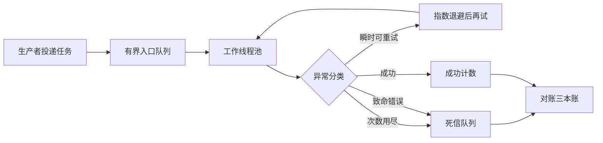
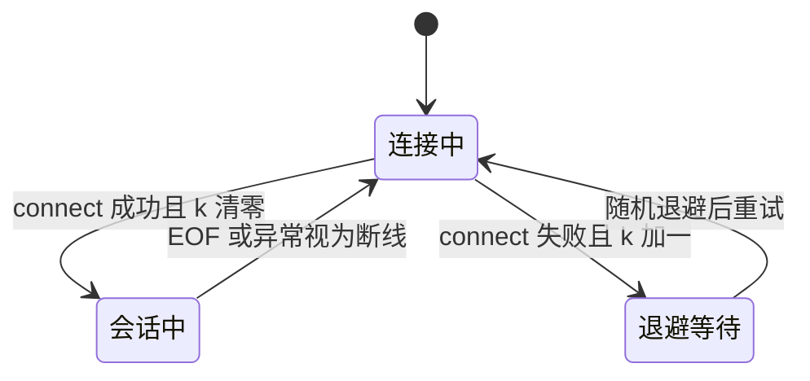
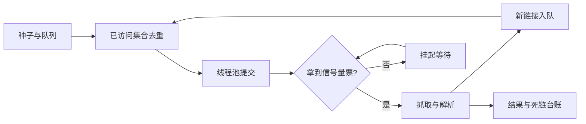
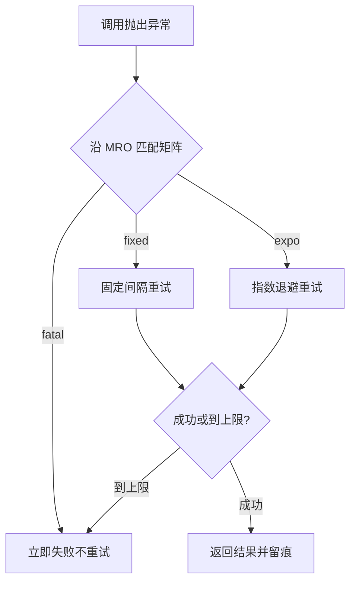
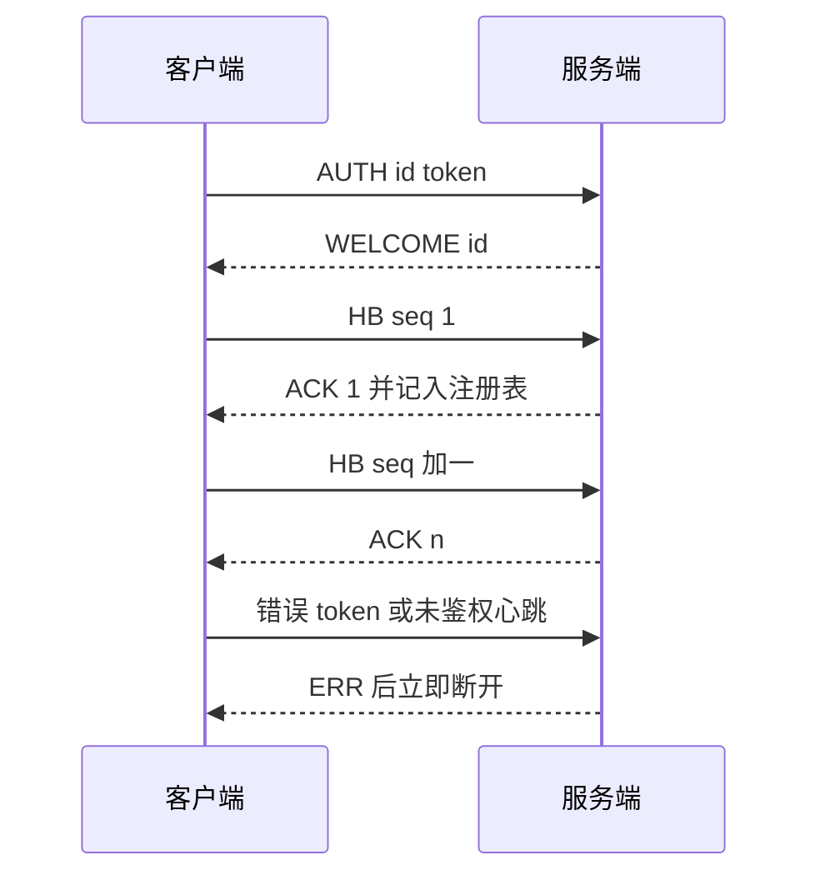

# 第 2 类 · 并发与网络工程(收官扩产)

> 本篇是第 2 类的收官批,21 题走"综合应用与查漏补缺"路线:把前几篇的单点知识拧成可直接上线的组合模板——线程池+队列+重试、异步读-处理-写、TCP 骨架、HTTP 会话封装、重连退避、配置快照、任务去重、优雅停机。

> 中段聚焦连接治理与协议实战:信号量限流爬虫、长度前缀完整协议、心跳保活客户端、文本与二进制双模式适配层、真实 socket 连接池、后台任务守护化、异常分类重试矩阵。

> 收官五题给运维视角的硬货:并发分段下载、最大连接保护、压测小工具、ping-pong 延迟测量,最后以带身份的心跳协议收口。全部代码仅标准库、Python 3.9 已逐文件实跑通过;网络演示一律走 127.0.0.1 回环,服务端 daemon 线程 + 端口就绪等待,urllib 一律空代理表直连。

### Q2897 · 线程池+队列+重试的组合模板:从投递到死信的全链路

> 难度:★★★ | 标签:ThreadPool, Queue, 重试, 死信队列

**问**:要把"投递任务"和"执行任务"解耦,还要带重试和兜底,你脑子里有没有一个可以直接抄的组合模板?

**答**:有,四件套:有界入口队列 + 工作线程池 + 分类重试 + 死信队列。生产者只管 put,队列满自然形成背压;worker 循环 get 执行,单个任务抛异常只影响自己;重试不裸写 for 循环,而是按异常分类——瞬时错误(IOError/OSError)指数退避后再试,参数类致命错误(ValueError)一次都不重试直接进 DLQ;重试次数用尽也进 DLQ,留待人工或补偿任务处理。收尾用哨兵值加 task_done/join 精确对账,成功、重试后成功、死信三本账必须对得上。实测 12 个任务:11 个成功(其中 2 个重试后成功),1 个毒任务进死信,数字全部可预期。

- 有界队列就是背压:生产快于消费时 put 挂起,而不是内存爆炸;

- 重试必须分类:给 bug 重试等于放大故障,给瞬态故障不重试等于白丢成功率;

- DLQ 里的任务要带原始异常信息,否则事后无法归因。

```python
# file: code/02_并发与网络工程/q2897_pool_queue_retry.py
# -*- coding: utf-8 -*-
"""线程池 + 队列 + 重试的组合模板。

- 入口队列: 生产者只管投递, 有界队列天然形成背压;
- 工作池: N 个线程从队列取任务, 单个任务失败不拖垮别的任务;
- 重试: 按异常分类决定重试或直接死信, 退避用指数序列;
- 收尾: 哨兵值关门, 对账成功/重试/死信三本账。
"""
import queue
import threading
import time

SENTINEL = None            # 关门哨兵: 每个工作线程一个
N_WORKERS = 4
MAX_RETRY = 3
BASE_DELAY = 0.02          # 指数退避基数, 演示用小值

# 确定性失败计划: (任务号, 第几次尝试) -> 必失败
FAIL_PLAN = {(3, 1), (7, 1), (7, 2)}

intake = queue.Queue(maxsize=64)   # 有界队列 = 背压
dead = queue.Queue()               # 死信队列 DLQ
stats = {"ok": 0, "retried": 0, "dead": 0}
slock = threading.Lock()


def flaky(task_id, attempt):
    """模拟不稳定任务: 按计划表失败, 11 号是永远修不好的毒任务。"""
    if (task_id, attempt) in FAIL_PLAN:
        raise IOError("transient failure")
    if task_id == 11:
        raise ValueError("poison task")
    return True


def worker(wid):
    while True:
        item = intake.get()
        if item is SENTINEL:
            intake.task_done()
            break
        task_id, payload = item
        attempt, done = 0, False
        while attempt < MAX_RETRY:
            attempt += 1
            try:
                flaky(task_id, attempt)
                with slock:
                    stats["ok"] += 1
                    if attempt > 1:
                        stats["retried"] += 1
                done = True
                break
            except (IOError, OSError) as exc:      # 可重试类: 指数退避
                if attempt == MAX_RETRY:
                    dead.put((task_id, repr(exc)))
                    break
                time.sleep(BASE_DELAY * (2 ** (attempt - 1)))
            except ValueError as exc:              # 致命类: 不重试直接死信
                dead.put((task_id, repr(exc)))
                break
        if not done:
            with slock:
                stats["dead"] += 1
        intake.task_done()


if __name__ == "__main__":
    workers = [threading.Thread(target=worker, args=(i,), daemon=True)
               for i in range(N_WORKERS)]
    for t in workers:
        t.start()
    for i in range(1, 13):                 # 12 个任务, 11 号是毒任务
        intake.put((i, "payload-%d" % i))
    for _ in workers:
        intake.put(SENTINEL)
    intake.join()                          # 等全部条目(含哨兵)处理完
    for t in workers:
        t.join(timeout=2)

    ok, retried, n_dead = stats["ok"], stats["retried"], stats["dead"]
    print("对账: 成功 %d (重试后成功 %d), 死信 %d" % (ok, retried, n_dead))
    print("死信明细:", sorted(dead.queue))
    # 3 号失败一次后成功; 7 号失败两次第三次成功; 11 号进死信
    assert (ok, retried, n_dead) == (11, 2, 1), stats
    assert sorted(k for k, _ in dead.queue) == [11]
    print("要点: 队列解耦投递与执行, 重试按异常分类, 次数用尽进 DLQ")
```

**追问**:1) 为什么重试用指数退避而不用固定间隔?——故障恢复往往有个过程,等速重打只会反复撞墙,指数序列把重试自然摊开,必要时再叠 jitter。2) DLQ 之后怎么办?——人工修后重放、定时补偿任务自动重放、过期归档三选一,关键是 DLQ 必须有监控告警,不能变成黑洞。3) 底层机制:重试为什么必须按异常分类?——异常的"性质"决定策略:IOError/OSError 是环境瞬时态,退避后大概率自愈;ValueError 是输入或代码的 bug,重试只是把同一错误放大 N 次还掩盖监控;分类的本质是把"可自愈"与"必失败"分诊。4) 生产陷阱?——worker 内原地 sleep 退避,占住工作线程让其他任务排队,应改成延迟重投;多级调用各层都重试,次数相乘放大故障;DLQ 只进不出没有告警,变黑洞。



---

### Q2898 · 异步批处理全链路:读-处理-写的背压模板

> 难度:★★★ | 标签:asyncio, 批处理, 背压, 攒批

**问**:用 asyncio 做"读数据-加工-落盘"的流水线,怎么组织才能既不撑爆内存又保住顺序?

**答**:三层角色加两级队列:reader 协程逐行投入有界入口队列,processor 协程攒批消费,每批做一次昂贵操作,writer 协程单写者顺序落盘。背压靠 maxsize:上游最多领先下游 8 行,队列打满时 reader 的 put 自动挂起;攒批摊薄昂贵操作的次数,23 行只做 5 次批处理;顺序由单写者天然保证,不需要额外排序。收尾是这类模板最容易翻车的地方:入口用 task_done/join 精确排空,写侧用毒丸关门,而且主流程必须先 await 生产者再 join——否则队列还没开始投递,join 看到未完成计数为零直接通过,整条流水线空转收场,实测就踩过这个坑。

- asyncio.Queue.join 的语义是"未完成计数归零",生产者还没跑起来就会误判排空;

- 攒批要有批上限:批越大延迟越高,批大小和最大延迟是一对权衡;

- 单写者模式让"保持顺序"零成本。

```python
# file: code/02_并发与网络工程/q2898_async_batch_pipeline.py
# -*- coding: utf-8 -*-
"""异步批处理全链路模板: 读 -> 处理 -> 写。

- 读侧: 异步逐行产出, 投入有界队列, 队列满即被挂起 (背压);
- 处理侧: 攒批消费, 每批做一次"昂贵处理" (模拟一次网络往返);
- 写侧: 单写者顺序落盘, 天然保持全局顺序;
- 监视器: 采样队列深度, 验证背压真实生效 (队列打满上限)。
"""
import asyncio

BATCH = 5        # 攒批上限
QMAX = 8         # 入口队列容量: 上游最多领先下游 8 行
TOTAL = 23
N_PROC = 2


async def reader(q):
    """读侧: 逐行读出并投递。"""
    for i in range(1, TOTAL + 1):
        await q.put("row-%02d" % i)     # 队列满则挂起, 上游被限速
    for _ in range(N_PROC):
        await q.put(None)               # 每个处理者一个毒丸


async def processor(q, out_q):
    """处理侧: 攒批消费, 批满或收尾时交给写侧。"""
    buf = []
    while True:
        item = await q.get()
        if item is None:
            q.task_done()
            if buf:                     # 收尾: 不足一批的尾巴也要交出去
                await out_q.put(buf)
            break
        buf.append(item.upper())
        if len(buf) >= BATCH:
            await asyncio.sleep(0.01)   # 每批一次"昂贵处理"
            await out_q.put(buf)
            buf = []
        q.task_done()


async def writer(out_q, n_proc):
    """写侧: 单写者顺序消费, 天然保序。"""
    rows = batches = 0
    ended = 0
    while ended < n_proc:
        batch = await out_q.get()
        if batch is None:
            ended += 1
            out_q.task_done()
            continue
        rows += len(batch)
        batches += 1
        await asyncio.sleep(0.002)      # 写盘代价
        out_q.task_done()
    return rows, batches


async def monitor(q, stop, peak):
    """采样队列深度, 观察背压是否真实发生。"""
    while not stop.is_set():
        peak[0] = max(peak[0], q.qsize())
        await asyncio.sleep(0.001)


async def main():
    q = asyncio.Queue(maxsize=QMAX)
    out_q = asyncio.Queue()
    peak = [0]
    stop = asyncio.Event()
    mon = asyncio.create_task(monitor(q, stop, peak))
    prod = asyncio.create_task(reader(q))
    cons = [asyncio.create_task(processor(q, out_q)) for _ in range(N_PROC)]
    wtr = asyncio.create_task(writer(out_q, N_PROC))

    await prod                          # 先等读侧投递完毕
    await q.join()                      # 再等队列精确排空(含毒丸)
    for _ in range(N_PROC):
        await out_q.put(None)           # 给写侧发关门毒丸
    rows, batches = await wtr
    stop.set()
    await asyncio.gather(mon, prod, *cons)

    print("对账: 读 %d 行 -> %d 批 -> 写 %d 行, 队列峰值 %d/%d"
          % (TOTAL, batches, rows, peak[0], QMAX))
    assert rows == TOTAL
    assert peak[0] > 0, "队列从未积压, 背压演示失败"
    print("要点: 有界队列打满即背压生效, 攒批摊薄昂贵操作, 单写者保序")


if __name__ == "__main__":
    asyncio.run(main())
```

**追问**:1) processor 开多个会怎样?——处理可以并行,out_q 仍是 FIFO,顺序不受影响;若处理本身会重排,写侧就要按序号重排。2) 监视器为什么用 qsize 采样?——qsize 是近似值,不适合做决策,但用来确认"背压是否发生过"的量级足够。3) 底层机制:为什么"先 await 生产者再 join"是硬约束?——Queue.join 等未完成计数归零,而计数在 put 时 +1、task_done 时 -1;生产者还没跑起来时计数为零,join 立即通过,整条流水线空转收场,asyncio.Queue 与 queue.Queue 是同一套语义。4) 生产陷阱?——processor 抛异常后毒丸没投全,writer 永远等不到关门,流水线挂死(要 try/finally 补毒丸);批大小无上限,内存与延迟双爆;reader 的异常没人收,任务"exception was never retrieved"还带着下游一起卡。

---

### Q2899 · TCP 服务端完整骨架:绑定-监听-接受-处理-关闭

> 难度:★★ | 标签:socket, TCP, 服务端骨架

**问**:不用任何框架,手写一个"能上生产"的最小 TCP 服务端,你会写哪几步?

**答**:五步一个都不能省。起服务:create、bind、listen,SO_REUSEADDR 让重启不等 TIME_WAIT 散场,bind 端口 0 由内核分配空闲端口,演示零冲突,生产则写死端口;accept 循环收连接,每连接丢给一个 daemon 线程处理,handler 里任何 OSError 都被隔离,单连接崩溃不影响其他连接;停机时 accept 设短超时,超时醒来检查停止位,先停收新连接再关监听套接字。还有个容易忽略的细节:客户端出手前要做端口就绪等待,循环 connect 直到成功,而这条探测连接本身也会被服务端 accept 一次,统计服务连接数时要心里有数。

- backlog 参数是全连接队列长度,不是"最大连接数";

- recv 返回空字节串是 EOF,要当作对端关闭处理,不是错误;

- daemon 线程加停止位,是"能停的服务"和"只能杀的服务"的分界线。

```python
# file: code/02_并发与网络工程/q2899_tcp_server_skeleton.py
# -*- coding: utf-8 -*-
"""TCP 服务端完整骨架: 绑定 -> 监听 -> 接受 -> 处理 -> 关闭。

- SO_REUSEADDR: 重启不必等 TIME_WAIT 散场;
- bind 端口 0: 内核分配空闲端口, 演示永不端口冲突;
- 每连接一个 daemon 线程, 单连接崩溃在 handler 内被隔离;
- 停机: accept 循环用短超时轮询停止位, 干净退出。
"""
import socket
import threading
import time


def wait_port(port, timeout=5.0):
    """端口就绪等待: 循环 connect 直到成功或超时。"""
    deadline = time.monotonic() + timeout
    while time.monotonic() < deadline:
        try:
            with socket.create_connection(("127.0.0.1", port), timeout=0.2):
                return True             # 这条探测连接也会被服务端 accept
        except OSError:
            time.sleep(0.05)
    return False


def handle(conn):
    """单连接处理: 行协议回显, 任何异常都隔离在本连接内。"""
    try:
        conn.setsockopt(socket.IPPROTO_TCP, socket.TCP_NODELAY, 1)
        buf = b""
        while True:
            data = conn.recv(1024)
            if not data:                # EOF: 对端半关闭, 收尾
                break
            buf += data
            while b"\n" in buf:
                line, buf = buf.split(b"\n", 1)
                conn.sendall(b"echo:" + line.upper() + b"\n")
    except OSError:
        pass                            # 单连接的网络错误不拖垮服务
    finally:
        conn.close()


def main():
    srv = socket.socket(socket.AF_INET, socket.SOCK_STREAM)
    srv.setsockopt(socket.SOL_SOCKET, socket.SO_REUSEADDR, 1)
    srv.bind(("127.0.0.1", 0))          # 端口 0: 内核分配
    srv.listen(64)                      # backlog: 全连接队列长度
    port = srv.getsockname()[1]
    srv.settimeout(0.1)                 # accept 短超时, 为停机让路
    print("listening on 127.0.0.1:%d" % port)

    stop = threading.Event()
    served = [0]

    def accept_loop():
        while not stop.is_set():
            try:
                conn, addr = srv.accept()
            except socket.timeout:
                continue                # 超时醒来检查停止位
            served[0] += 1
            threading.Thread(target=handle, args=(conn,), daemon=True).start()

    acc = threading.Thread(target=accept_loop, daemon=True)
    acc.start()
    wait_port(port)                     # 服务端就绪前客户端不出手

    for i in range(3):                  # 3 个客户端依次对话
        with socket.create_connection(("127.0.0.1", port), timeout=2) as c:
            c.settimeout(2)
            c.sendall(("hello-%d\n" % i).encode())
            resp = b""
            while not resp.endswith(b"\n"):
                chunk = c.recv(256)
                if not chunk:
                    break
                resp += chunk
            print("client %d got %r" % (i, resp.decode().strip()))

    stop.set()                          # 停机: 先停收, 再关监听
    acc.join(timeout=2)
    srv.close()
    print("served %d connections (含 1 条端口就绪探测)" % served[0])
    print("要点: 复用地址防 TIME_WAIT, 短超时 accept 让停机可控")


if __name__ == "__main__":
    main()
```

**追问**:1) 每连接一线程撑得住高并发吗?——几百连接可以,上千就该换线程池或 selectors 事件循环,骨架不变,只是 handler 的载体换。2) 为什么 accept 要设超时?——accept 默认永远阻塞,停止位永远没机会被检查,服务就"只能杀不能关"。3) 底层机制:recv 返回空串为什么不是错误?——对端 close 或 shutdown(SHUT_WR) 后本端 recv 读到 0 字节,这是半关闭的正常信号;把它当异常处理会误伤"客户端发完就收尾"的合法流程,真正的错误是 ConnectionResetError 这类异常类。4) 生产陷阱?——conn.close 不放 finally,单连接异常就漏 fd;backlog 调大掩盖 accept 慢的真问题(见 Q618);停机只停 accept 不关监听 socket,端口被占住影响重启。

---

### Q2900 · HTTP 客户端的会话封装:超时、重试与代理直连

> 难度:★★★ | 标签:urllib, HTTP, 重试, 代理

**问**:团队里每个人都在裸写 urllib 请求,超时忘了设、代理忘了清,你会怎么收口?

**答**:封装一个 Session 对象,把容易忘的事全部收敛进去。构造时用 build_opener(ProxyHandler({})) 建一个空代理表的 opener——环境里有 http_proxy 时不清空,发往 127.0.0.1 的请求会被转手交给代理,这是本机调试最常见的翻车点;统一 timeout,不给裸 open 留任何入口;公共请求头一处维护。重试逻辑放在会话层且按状态码分类:5xx 和 URLError/OSError 这类网络层错误值得重试,4xx 是调用方的错,重试只会把事故放大。实测服务端前两次返回 503,会话层第 3 次拿到 200;对 /notfound 则直接抛 HTTPError,一次请求都不浪费。

- 超时必须显式:urllib 默认不超时,一个慢端点就能挂死一个线程;

- 重试次数用尽要把最后一次异常原样上抛,调用方需要真实的失败原因;

- 会话封装的最大价值是"默认值安全":想犯错的成本比做对更高。

```python
# file: code/02_并发与网络工程/q2900_http_session.py
# -*- coding: utf-8 -*-
"""HTTP 客户端的会话封装: 超时 + 重试 + 代理直连。

- build_opener(ProxyHandler({})): 显式空代理表, 绕过环境 http_proxy 直连;
- Session 对象: 统一 base URL、公共头、超时与重试, 调用方只关心业务;
- 状态码分类: 5xx 与网络错误才重试, 4xx 是调用方的错, 重试无意义。
"""
import json
import socket
import threading
import time
import urllib.error
import urllib.request
from http.server import BaseHTTPRequestHandler, ThreadingHTTPServer

# 环境里有 http_proxy 时, 必须显式清空代理才不会把请求发给代理
OPENER = urllib.request.build_opener(urllib.request.ProxyHandler({}))


class Session:
    """极简 HTTP 会话: 公共配置收敛在一处。"""

    def __init__(self, base, timeout=2.0, retries=3, backoff=0.05):
        self.base = base.rstrip("/")
        self.timeout = timeout
        self.retries = retries
        self.backoff = backoff
        self.headers = {"User-Agent": "py-session/1.0"}

    def get_json(self, path):
        url = self.base + path
        last = None
        for attempt in range(1, self.retries + 1):
            req = urllib.request.Request(url, headers=self.headers)
            try:
                with OPENER.open(req, timeout=self.timeout) as resp:
                    return resp.status, json.loads(resp.read().decode("utf-8"))
            except urllib.error.HTTPError as exc:
                if exc.code < 500 or attempt == self.retries:
                    raise               # 4xx 不重试; 次数用尽向上抛
                last = exc
            except (urllib.error.URLError, OSError) as exc:
                last = exc              # 网络层错误: 值得重试
            time.sleep(self.backoff * (2 ** (attempt - 1)))
        raise last


class Handler(BaseHTTPRequestHandler):
    hits = {}
    lock = threading.Lock()

    def do_GET(self):
        with Handler.lock:
            Handler.hits[self.path] = Handler.hits.get(self.path, 0) + 1
            n = Handler.hits[self.path]
        if self.path == "/flaky" and n < 3:     # 前两次故意 503
            self.send_response(503)
            self.send_header("Content-Length", "0")
            self.end_headers()
            return
        body = json.dumps({"path": self.path, "hit": n}).encode("utf-8")
        self.send_response(200)
        self.send_header("Content-Type", "application/json")
        self.send_header("Content-Length", str(len(body)))
        self.end_headers()
        self.wfile.write(body)

    def log_message(self, *args):
        pass


def wait_port(port, timeout=5.0):
    deadline = time.monotonic() + timeout
    while time.monotonic() < deadline:
        try:
            with socket.create_connection(("127.0.0.1", port), timeout=0.2):
                return True
        except OSError:
            time.sleep(0.05)
    return False


if __name__ == "__main__":
    srv = ThreadingHTTPServer(("127.0.0.1", 0), Handler)
    srv.daemon_threads = True
    port = srv.server_address[1]
    threading.Thread(target=srv.serve_forever, daemon=True).start()
    assert wait_port(port)

    sess = Session("http://127.0.0.1:%d" % port)

    status, data = sess.get_json("/ok")
    print("正常请求:", status, data)

    status, data = sess.get_json("/flaky")   # 503 两次后第 3 次成功
    print("重试后成功:", status, data, "(服务端第 %d 次才给 200)" % data["hit"])
    assert data["hit"] == 3

    try:
        sess.get_json("/notfound")           # 404: 不重试, 直接抛
    except urllib.error.HTTPError as exc:
        print("4xx 不重试直接抛出: HTTP %d" % exc.code)

    srv.shutdown()
    print("要点: 会话封装收敛超时/重试/代理, 4xx 与 5xx 的重试语义分家")
```

**追问**:1) 为什么要 ProxyHandler({}) 而不是删掉环境变量?——改环境变量影响全进程且侵入性强,空代理表只影响这一个 opener,粒度刚好。2) 重试要不要带 jitter?——单客户端影响不大,但批量客户端同节拍重试会形成风暴,工程上加 jitter 更稳。3) 底层机制:urllib 的默认超时与代理从哪来?——urlopen 不传 timeout 就落到 socket 全局默认(实际等于无限阻塞);getproxies 从 http_proxy/https_proxy 环境变量读出并默认装入 opener,本机调试与容器环境最容易在这里翻车。4) 生产陷阱?——HTTPError 是 URLError 的子类,except 顺序颠倒会把 4xx 也当网络错误重试;给 POST 这类非幂等请求配自动重试,造成重复提交;重试用尽抛 last 之前不留每次尝试的轨迹,排障无从下手。

---

### Q2901 · 断线重连的指数退避完整实现:全抖动与成功重置

> 难度:★★★ | 标签:重连, 指数退避, full jitter

**问**:写一个断线重连,大多数人只会 while True 加 connect 再 sleep,差在哪?

**答**:差三件事。第一,退避要指数爬升:第 k 次失败后等 min(cap, base 乘 2 的 k 次方),上限防止无限翻倍;第二,要加 full jitter——在 0 到 delay 之间取均匀随机数,几百个客户端同时断线时,固定退避会让它们踩着同一个节拍重连,服务端刚喘口气就被第二波打瘫;第三,成功要重置:k 在会话建立成功的那一刻清零,恢复期不继承故障期攒出来的退避深度。实测把服务端开关四个阶段,时间线里能直接看到退避逐次爬升、重连成功后归零、下个故障期从头爬。还有一个反直觉的坑:服务端只停 accept 并不拒绝新连接,listen backlog 会让内核继续完成握手,connect 照样成功——故障期必须真正 close 监听套接字。

- 退避上限必须有,否则按 2 的 k 次方翻倍,一小时后一次重试要等几十分钟;

- EOF 和 connect 被拒是两种"断线",处理路径相同但日志要分得开;

- 重连成功后的第一件事是恢复业务状态,不是急着发包。

```python
# file: code/02_并发与网络工程/q2901_reconnect_backoff.py
# -*- coding: utf-8 -*-
"""断线重连的指数退避完整实现: 退避 + 全抖动 + 成功即重置。

- 服务端分阶段开关: 开 -> 关 -> 开 -> 关 -> 开, 模拟网络抖动;
- 失败后等待 delay = min(cap, base * 2^k) 区间内的均匀随机数 (full jitter);
- 会话成功建立即把 k 清零: 恢复期不继承故障期攒出来的退避深度;
- 时间线直接可见: 退避爬升 -> 重连成功 -> 重置归零 -> 再爬升。
"""
import random
import socket
import threading
import time

BASE = 0.03       # 首次退避基数
CAP = 0.15        # 退避上限

random.seed(11)
T0 = time.monotonic()


class FlapServer:
    """可控开关的 TCP 服务。

    关阶段必须真正 close 监听套接字: 只停 accept 不够,
    listen backlog 会让内核继续完成握手, connect 照样成功。
    """

    def __init__(self):
        self.addr = ("127.0.0.1", 0)
        self.port = 0
        self.srv = None
        self.conns = []
        self.lock = threading.Lock()
        self.opened = threading.Event()
        self._open()
        self.opened.set()
        threading.Thread(target=self._loop, daemon=True).start()

    def _open(self):
        srv = socket.socket()
        srv.setsockopt(socket.SOL_SOCKET, socket.SO_REUSEADDR, 1)
        srv.bind(self.addr)
        if self.addr[1] == 0:
            self.addr = ("127.0.0.1", srv.getsockname()[1])
            self.port = self.addr[1]
        srv.listen(16)
        srv.settimeout(0.05)
        self.srv = srv

    def _close(self):
        with self.lock:                       # 掐断存量连接
            while self.conns:
                try:
                    self.conns.pop().close()
                except OSError:
                    pass
        if self.srv is not None:
            try:
                self.srv.close()              # 拒绝新连接: 连接被拒
            except OSError:
                pass
            self.srv = None

    def set_open(self, value):
        if value and self.srv is None:
            self._open()
            self.opened.set()
        elif not value and self.srv is not None:
            self.opened.clear()
            self._close()

    def _loop(self):
        while True:
            srv = self.srv
            if srv is None:
                time.sleep(0.02)
                continue
            try:
                conn, _ = srv.accept()
            except (socket.timeout, OSError):
                continue
            with self.lock:
                self.conns.append(conn)
            threading.Thread(target=self._hold, args=(conn,), daemon=True).start()

    def _hold(self, conn):
        conn.settimeout(0.05)
        try:
            while self.opened.is_set():
                try:
                    conn.sendall(b".")        # 心跳式发字节维持会话
                except OSError:
                    break
                try:
                    conn.recv(64)
                except socket.timeout:
                    pass
                except OSError:
                    break
                time.sleep(0.03)
        finally:
            try:
                conn.close()
            except OSError:
                pass
            with self.lock:
                if conn in self.conns:
                    self.conns.remove(conn)


def client(host, port, stop, log):
    """重连循环: 连上 -> 保持会话 -> 断开 -> 退避重连。"""
    k = 0
    sessions = 0
    while not stop.is_set():
        try:
            s = socket.create_connection((host, port), timeout=0.15)
        except OSError:
            delay = random.uniform(0, min(CAP, BASE * (2 ** k)))   # 全抖动
            log.append(("retry", round(time.monotonic() - T0, 3), k,
                        round(delay * 1000)))
            k += 1
            if stop.wait(delay):
                break
            continue
        sessions += 1
        log.append(("up", round(time.monotonic() - T0, 3), 0, 0))
        k = 0                              # 成功即重置退避
        s.settimeout(0.05)
        alive = True
        while alive and not stop.is_set():
            try:
                if s.recv(64) == b"":      # EOF: 服务端掐线
                    alive = False
            except socket.timeout:
                pass                       # 没数据不等于死
            except OSError:
                alive = False
        try:
            s.close()
        except OSError:
            pass
        if not alive and not stop.is_set():
            log.append(("down", round(time.monotonic() - T0, 3), 0, 0))
    return sessions


if __name__ == "__main__":
    srv = FlapServer()
    stop = threading.Event()
    log = []
    result = {}

    def run():
        result["sessions"] = client("127.0.0.1", srv.port, stop, log)

    ct = threading.Thread(target=run, daemon=True)
    ct.start()
    time.sleep(0.2)                        # 第一段会话建立
    srv.set_open(False)                    # 故障期 1
    time.sleep(0.45)
    srv.set_open(True)                     # 恢复期 1
    time.sleep(0.45)
    srv.set_open(False)                    # 故障期 2
    time.sleep(0.45)
    srv.set_open(True)                     # 恢复期 2
    time.sleep(0.5)
    stop.set()
    ct.join(timeout=3)

    ups = [e for e in log if e[0] == "up"]
    retries = [e for e in log if e[0] == "retry"]
    print("会话建立 %d 次, 重试 %d 次" % (len(ups), len(retries)))
    for ev, t, k, d in log:
        print("  t=%.3f %-5s k=%d delay=%dms" % (t, ev, k, d))
    assert len(ups) >= 3 and len(retries) >= 4
    first_after_reset = [d for ev, _, k, d in retries if k == 0]
    assert first_after_reset, "没有观察到退避重置"
    print("要点: 全抖动防重连风暴, 成功会话把 k 清零, 退避只在连续失败中爬升")
```

**追问**:1) full jitter 和 equal jitter 怎么选?——full jitter 防节拍最彻底但首次重连可能等很短,equal jitter 保底一半间隔再随机,对重连速度敏感的服务选后者。2) 怎么在测试里验证退避逻辑?——把随机源和时钟做成可注入的依赖,或者像本例一样输出真实时间线人工核对爬升与重置。3) 底层机制:为什么只停 accept 关不掉服务?——listen 之后三次握手由内核完成,连接队列照常收客,connect 照样成功;真正拒绝新连接要 close 监听 socket(对端拿到 ConnectionRefusedError),这也是压测里"拒连"与"超时"必须分开统计的原因。4) 生产陷阱?——退避无上限,几十分钟后一次重试等几十分钟;成功重连后不重置 k,恢复期继承故障期深度;只处理 connect 失败不处理会话中途 EOF,连接假活;无 jitter 的重连风暴把刚恢复的服务端二次打瘫。



---

### Q2902 · 并发安全的配置读取器:加载-校验-原子替换

> 难度:★★★ | 标签:配置, 快照, 不可变, 线程安全

**问**:多个线程在不停地读配置,后台线程还会热加载,怎么保证读者永远看不到半新半旧的配置?

**答**:用"快照整体替换"模式:配置永远是一个整体字典,写者在外面构造好新快照、校验通过后,一条赋值语句整体替换引用——CPython 的属性赋值是原子的,读者要么看到旧版要么看到新版,绝不会看到缝合版。读者侧完全无锁:抓一次本地引用,之后随便读多久,写者换一万次快照都影响不到它。校验是第二道闸:total 与 items 不自洽的坏配置直接拒绝,旧配置继续服务,线上不会因为一条手滑的配置而雪崩。实测 4 个读者全程校验不变量零违规,且都观察到了 v1 到 v2 到 v4 的版本切换,中间的 v3 被拒绝没有落地。

- 锁只保护写者互斥,读者不碰锁,读多写少的场景性能最好;

- 快照必须"整体构造、整体替换",边改边发布就是撕裂读的来源;

- 拒绝更新要有日志和计数,否则坏配置被吞了都不知道。

```python
# file: code/02_并发与网络工程/q2902_config_reader.py
# -*- coding: utf-8 -*-
"""并发安全的配置读取器: 加载 -> 校验 -> 原子替换 -> 无锁读。

- 配置快照整体不可变: 读者抓到引用后随便读多久, 都是一个自洽版本;
- 写者先校验, 坏配置直接拒绝, 旧配置继续服务 (校验失败不落地);
- 读者侧无锁: 抓引用是一条原子操作, 换快照不影响正在读的人;
- 不变量: sum(items) == total, 任何读者任何时刻都该看到自洽数据。
"""
import threading
import time


class ConfigStore:
    """版本化配置仓: 写者互斥, 读者无锁。"""

    def __init__(self, initial):
        self._cfg = initial            # 唯一会被整体替换的引用
        self._wlock = threading.Lock() # 只串行化写者, 读者不碰它
        self.rejected = 0
        self.applied = 0

    @property
    def current(self):
        return self._cfg               # 读者: 原子抓引用, 无锁

    def update(self, new_cfg, validate):
        with self._wlock:
            try:
                validate(new_cfg)
            except ValueError as exc:
                self.rejected += 1
                return "rejected: %s" % exc
            self._cfg = new_cfg        # 一次性替换快照, 读者即刻可见
            self.applied += 1
            return "applied v%d" % new_cfg["version"]


def validate(cfg):
    """配置合法性校验: 结构齐全 + 业务不变量自洽。"""
    for key in ("version", "total", "items", "timeout"):
        if key not in cfg:
            raise ValueError("missing key %s" % key)
    if cfg["total"] != sum(cfg["items"]):
        raise ValueError("total 与 items 不自洽")
    if not isinstance(cfg["timeout"], (int, float)) or cfg["timeout"] <= 0:
        raise ValueError("timeout 必须为正数")


def reader_loop(store, wid, seen, violations, done):
    """读者: 抓快照 -> 校验不变量 -> 记录见过的版本。"""
    while not done.is_set():
        cfg = store.current            # 抓本地引用, 之后写者怎么换都与我无关
        if cfg["total"] != sum(cfg["items"]):
            violations.append(wid)     # 撕裂读: 理论上不可能发生
        seen.add(cfg["version"])
        cfg["timeout"]                 # 模拟读一个配置项
        time.sleep(0.001)


if __name__ == "__main__":
    store = ConfigStore({"version": 1, "total": 6,
                         "items": [1, 2, 3], "timeout": 0.5})
    done = threading.Event()
    seen = [set() for _ in range(4)]
    violations = []
    readers = [threading.Thread(target=reader_loop,
                                args=(store, i, seen[i], violations, done))
               for i in range(4)]
    for t in readers:
        t.start()

    time.sleep(0.05)
    # 写者序列: 合法 -> 非法(拒绝) -> 合法
    r1 = store.update({"version": 2, "total": 10,
                       "items": [4, 6], "timeout": 0.8}, validate)
    time.sleep(0.05)
    r2 = store.update({"version": 3, "total": 99,          # 坏配置
                       "items": [4, 6], "timeout": 0.8}, validate)
    time.sleep(0.05)
    r3 = store.update({"version": 4, "total": 3,
                       "items": [1, 1, 1], "timeout": 1.2}, validate)
    time.sleep(0.05)
    done.set()
    for t in readers:
        t.join()

    print("写者结果: %s / %s / %s" % (r1, r2, r3))
    print("应用 %d 次, 拒绝 %d 次" % (store.applied, store.rejected))
    print("各读者见过的版本:", [sorted(s) for s in seen])
    print("撕裂读违规次数:", len(violations))
    assert store.rejected == 1 and store.applied == 2
    assert not violations, "出现了撕裂读"
    assert 1 in seen[0] and 4 in seen[0], "读者没有观察到版本切换"
    print("要点: 快照整体替换使读者天然一致, 校验前置让坏配置不落地")
```

**追问**:1) 配置里有可变对象怎么办?——快照构建时深拷贝或转成 tuple 和 frozenset,并约定快照发布后不可变,违反约定比缺锁更危险。2) 读者怎么知道配置换了?——对比 version 或对象身份,需要主动响应的组件在 Condition 或事件上等一次通知即可。3) 底层机制:读者为什么可以完全无锁?——读者只做一次引用抓取(store.current 返回 self._cfg),单次属性读取在 CPython 下原子;抓到引用后读的是那个对象自己的字段,写者替换的是引用不是对象内容,两者互不可见;校验在写者锁内完成,坏快照根本没有发布机会。4) 生产陷阱?——快照对象可变且被读者改写,污染"不可变"假设;校验只查结构不查业务不变量,自洽性失守;拒绝更新没有日志与计数,配置回滚无从归因。

---

### Q2903 · 跨线程的进度上报:工作线程干活,主线程看板

> 难度:★★ | 标签:进度上报, 线程安全, 快照

**问**:三个工作线程各自跑各自的活,主线程想画进度条,数据怎么安全地流过去?

**答**:一个带锁的进度账本就够:工作线程每完成一件就 step 加一,主线程定期 snapshot 拿一份字典拷贝来渲染。两个动作各拿一次锁、互不等待——上报是微秒级加法,快照是一次浅拷贝,谁也不阻塞谁。每个任务单独计数,总数和完成率随时可算;结束后用 assert 核对账本与实际一致,防止"进度条说完了,活没干完"的账实不符。反模式是让主线程直接读工作线程的内部变量:不加锁会读到中间态,加锁又容易和对方的临界区纠缠,账本集中管理就都没了。

- 上报粒度是"每完成一件",不是"每碰一次共享数据",别把账本变成新瓶颈;

- 快照渲染如果格式化很慢,先拷贝再格式化,别占着锁画图;

- 进度上报顺带解决了"工作线程还活着吗"的可观测性问题。

```python
# file: code/02_并发与网络工程/q2903_progress_report.py
# -*- coding: utf-8 -*-
"""跨线程的进度上报: 工作线程干活, 主线程看板。

- 进度账本一把锁: 工作线程 step 加数, 主线程 snapshot 拿只读快照;
- 快照是一次字典拷贝, 渲染进度条时不会与工作线程互相阻塞;
- 每个任务单独计数, 汇总口径随时可算 (完成数 / 总数 / 完成率)。
"""
import threading
import time


class Progress:
    """线程安全的进度账本。"""

    def __init__(self, totals):
        self._lock = threading.Lock()
        self._done = dict.fromkeys(totals, 0)
        self._total = dict(totals)

    def step(self, task, n=1):
        with self._lock:
            self._done[task] += n

    def finish(self, task):
        with self._lock:
            self._done[task] = self._total[task]

    def snapshot(self):
        with self._lock:
            return {k: (v, self._total[k]) for k, v in self._done.items()}

    def total_of(self, task):
        with self._lock:
            return self._total[task]


def render_bar(done, total, width=20):
    filled = int(width * done / total)
    return "[" + "#" * filled + "-" * (width - filled) + "]"


def worker(prog, task, per_item):
    """工作线程: 每做完一件就上报一次。"""
    total = prog.total_of(task)
    for _ in range(total):
        time.sleep(per_item)
        prog.step(task)


if __name__ == "__main__":
    totals = {"下载": 30, "转码": 18, "上传": 12}
    prog = Progress(totals)
    ts = [threading.Thread(target=worker, args=(prog, name, speed), daemon=True)
          for name, speed in (("下载", 0.004), ("转码", 0.007), ("上传", 0.010))]
    for t in ts:
        t.start()

    polls = 0
    while any(t.is_alive() for t in ts):
        snap = prog.snapshot()
        line = " | ".join("%s %s %d/%d" % (name, render_bar(d, n), d, n)
                          for name, (d, n) in snap.items())
        polls += 1
        if polls % 4 == 1:             # 每 4 个轮询打一行, 输出别刷屏
            print("t=%.2fs %s" % (polls * 0.05, line))
        time.sleep(0.05)

    for t in ts:
        t.join()
    snap = prog.snapshot()
    print("最终:", " | ".join("%s %d/%d" % (n, d, t) for n, (d, t) in snap.items()))
    assert all(d == t for d, t in snap.values()), "进度账本与实际不符"
    print("轮询 %d 次, 账实相符" % polls)
    print("要点: 上报是加法, 展示是快照, 两边各走各的锁互不拖累")
```

**追问**:1) 任务特别碎,每秒上万次,怎么办?——工作线程本地攒数,每 N 件或每 100ms 批量上报一次,用精度换吞吐。2) 进度条会回退吗?——账本只加不减天然单调;任务重试的次数要么不计入,要么单开一栏"重试数",别和主进度混账。3) 底层机制:为什么"各拿一次锁互不等待"成立?——step 与 snapshot 各自短暂持锁做加法或浅拷贝,临界区都是微秒级;snapshot 返回的是拷贝,主线程渲染时账本早已释放,锁从不跨越"格式化/画图"这类慢操作。4) 生产陷阱?——在锁内做格式化或 IO 渲染,进度账本反成瓶颈;worker 崩溃时账本停在中间值,监控误判"慢"而非"死"(要配最后活跃时刻);多个任务共用一个键,计数互相覆盖。

---

### Q2904 · 任务去重的本地实现:在途集合与 TTL 完成台账

> 难度:★★★ | 标签:去重, 幂等, TTL

**问**:生产者投递的任务有大量重复,重复任务既浪费又可能引发副作用,本地怎么去重?

**答**:去重闸门由两本账组成:在途集合,登记已放行未完成的 key;完成台账,记录刚做完的 key 并带 TTL。admit 时先查两本账——在途说明同样任务正在排队或执行,台账内说明刚做完不久,都拒绝;只有全新 key 才登记在途并放行。finish 时移出在途、写入台账。TTL 的意义是窗口语义:"一段时间内不重复执行",过期后允许重跑,定时任务补跑的场景正需要这个口子。台账在每次 admit 时顺带修剪过期项,长期运行不涨内存。实测 3 个生产者投 45 次、唯一 key 只有 8 个,实际执行恰好 8 次,拦截 37 次,每个 key 精确执行一次;TTL 过期后重投 job-0 成功放行。

- key 用 payload 的哈希指纹,相同内容天然同 key,调用方不用手工维护序号;

- "在途"与"已完成"必须分开记账,混用一个集合会把"正在执行"误判成"做完了";

- 台账是内存版,进程重启就清零,跨进程去重要落盘或上存储。

```python
# file: code/02_并发与网络工程/q2904_task_dedup.py
# -*- coding: utf-8 -*-
"""任务去重的本地实现: 排队/在途去重 + 完成台账 TTL。

- admit(key): 在途或台账内 -> 拒绝; 否则登记在途并放行;
- finish(key): 移出在途, 记入完成台账, TTL 过期后才允许重跑;
- 台账在每次 admit 时顺带修剪, 长期运行不涨内存;
- 指纹: 对 payload 做哈希, 相同内容的任务天然同 key。
"""
import hashlib
import threading
import time


class DedupGate:
    """去重闸门: 在途集合 + 带 TTL 的完成台账。"""

    def __init__(self, ttl=0.4):
        self.ttl = ttl
        self._lock = threading.Lock()
        self._inflight = set()
        self._done = {}                # key -> 完成时刻
        self.blocked = 0

    def _prune(self, now):
        for k in [k for k, t in self._done.items() if now - t > self.ttl]:
            del self._done[k]

    def admit(self, key):
        with self._lock:
            now = time.monotonic()
            self._prune(now)
            if key in self._inflight or key in self._done:
                self.blocked += 1      # 已排队不重排, 已完成不重跑
                return False
            self._inflight.add(key)
            return True

    def finish(self, key):
        with self._lock:
            self._inflight.discard(key)
            self._done[key] = time.monotonic()


def fingerprint(payload):
    """任务指纹: 同内容同 key。"""
    return hashlib.sha256(payload).hexdigest()[:12]


if __name__ == "__main__":
    gate = DedupGate(ttl=0.4)
    q = []
    qlock = threading.Lock()
    processed = []
    processed_once = {}

    def producer(pid):
        for i in range(15):            # 3 个生产者各投 15 个, 内容大量重叠
            key = fingerprint(("job-%d" % (i % 8)).encode())
            if gate.admit(key):
                with qlock:
                    q.append(key)

    def worker():
        while True:
            with qlock:
                if not q:
                    return
                key = q.pop(0)
            time.sleep(0.01)           # 干活
            with processed_once_lock:
                processed_once[key] = processed_once.get(key, 0) + 1
            gate.finish(key)

    processed_once_lock = threading.Lock()
    ps = [threading.Thread(target=producer, args=(i,)) for i in range(3)]
    ws = [threading.Thread(target=worker) for _ in range(2)]
    for t in ps + ws:
        t.start()
    for t in ps:
        t.join()
    for t in ws:
        t.join()

    print("投放 45 次, 唯一 key 8 个, 实际入队处理 %d 次, 去重拦截 %d 次"
          % (sum(processed_once.values()), gate.blocked))
    assert len(processed_once) == 8
    assert all(v == 1 for v in processed_once.values()), "有 key 被处理多次"
    assert gate.blocked == 37

    # TTL 过期后, 同一 key 允许重新执行 (重跑窗口)
    time.sleep(0.5)
    key = fingerprint(b"job-0")
    readmitted = gate.admit(key)
    if readmitted:
        gate.finish(key)
    print("TTL 过期后重投 job-0: admit=%s (到期允许重跑)" % readmitted)
    assert readmitted
    print("要点: 去重 = 在途集合 + TTL 台账, 拦的是重复劳动不是新任务")
```

**追问**:1) 同一 key 并发 admit 会怎样?——两本账的读写都在一把锁内,检查和登记是原子的,第二个并发者必然被拒。2) TTL 设多长?——大于"重复投递的最长间隔",小于"业务允许重跑的最短间隔",取两者交集,没有依据就先观测再定。3) 底层机制:为什么"在途"与"已完成"必须分开记账?——任务从 admit 到 finish 之间由在途集合持有 key,完成后移入带时间戳的台账;混用一个集合就无法区分"正在执行(该拒绝)"与"刚做完(TTL 内拒绝、过期放行)",TTL 的重跑窗口语义就丢了。4) 生产陷阱?——finish 漏调(异常路径),key 永久卡死在途集合,同任务再也不放行;指纹只哈希部分 payload,不同任务同 key 误伤;台账是内存版,多实例部署各去各的重,跨进程要落存储。

---

### Q2905 · 优雅停机的标准范式:信号-停收-排空-收尾

> 难度:★★★★ | 标签:优雅停机, SIGTERM, 排空, 退出码

**问**:kill 发出 SIGTERM 之后,一个多线程服务应该按什么顺序收场?

**答**:标准范式五步。信号处理器只置停止位,处理器里干重活是未定义行为的温床;工作线程发现停止位后不再接新任务,但手里的在途任务必须做完;主流程带着 deadline 排空队列,超时就有强杀预案,现实中是第二次信号直接硬退;join 工作线程确认全员退出;最后落盘成果并用退出码向编排层交代——0 是干净停机,非 0 要求善后。实测用 os.kill 向自己发 SIGTERM 模拟外部停机,30 个任务全部处理完才退出,退出码 0。这个范式和"重启大法"的差别在于:重启丢的是在途请求,范式保的是每一笔已接的单。

- 信号只会在主线程被处理,在 daemon 线程里装 handler 没有用处;

- 排空的 deadline 要小于编排层的强杀宽限期,不然强杀先到,排空白做;

- 退出码是给 systemd 或 k8s 看的契约,乱给 0 等于骗运维。

```python
# file: code/02_并发与网络工程/q2905_graceful_shutdown.py
# -*- coding: utf-8 -*-
"""优雅停机的标准范式: 信号 -> 停收 -> 排空 -> 收尾 -> 退出码。

- 信号处理器只做一件事: 置停止位 (信号处理器里不干重活);
- 工作线程把在途任务做完, 排空有 deadline, 超时就有强杀预案;
- 收尾落盘 + 用退出码告诉编排层: 这次关得干不干净。
"""
import os
import queue
import signal
import threading
import time

stop = threading.Event()
results = []
rlock = threading.Lock()


def worker(q, wid):
    """工作线程: 停止位只挡新任务, 在途任务必须做完。"""
    while True:
        try:
            item = q.get(timeout=0.05)
        except queue.Empty:
            if stop.is_set():
                break                   # 停机且没活了, 收工
            continue
        try:
            time.sleep(0.01)            # 模拟在途任务的处理耗时
            with rlock:
                results.append(item * item)
        finally:
            q.task_done()


def main():
    q = queue.Queue()
    ws = [threading.Thread(target=worker, args=(q, i), daemon=True)
          for i in range(3)]
    for t in ws:
        t.start()

    received = []

    def on_signal(signum, frame):
        received.append(signum)         # 信号处理器: 只置位, 不干活
        stop.set()

    signal.signal(signal.SIGTERM, on_signal)
    signal.signal(signal.SIGINT, on_signal)

    for i in range(30):                 # 正常业务投递
        q.put(i)
    time.sleep(0.06)                    # 让一部分先跑起来
    os.kill(os.getpid(), signal.SIGTERM)   # 模拟外部发来停机信号
    time.sleep(0.05)

    # 范式第二步: 排空在途, 带 deadline
    deadline = time.monotonic() + 5.0
    while q.unfinished_tasks > 0 and time.monotonic() < deadline:
        time.sleep(0.01)
    drained = q.unfinished_tasks == 0
    # 范式第三步: 等工作线程退出 (超时则有强杀预案, 这里不触发)
    for t in ws:
        t.join(timeout=3)
    clean_exit = drained and not any(t.is_alive() for t in ws)

    print("收到信号: %s" % [int(s) for s in received])
    print("在途排空: %s, 工作线程全部退出: %s" % (drained, clean_exit))
    print("成果落盘 %d/%d 项" % (len(results), 30))
    exit_code = 0 if clean_exit and len(results) == 30 else 1
    print("退出码: %d (0=干净停机, 非 0=需要编排层善后)" % exit_code)
    assert received == [signal.SIGTERM]
    assert clean_exit and len(results) == 30 and exit_code == 0
    # 现实中的第二刀: deadline 到了还没排空 -> 再次收到信号直接 os._exit
    print("要点: 处理器只置位, 排空带 deadline, 结果用退出码交代")


if __name__ == "__main__":
    main()
```

**追问**:1) 长连接服务怎么套这个范式?——第一步变成"停止 accept 并通知连接收尾",第二步等连接排空或超时断开,骨架不变。2) 为什么要响应两次信号?——第一次是请求,第二次是用户失去耐心,第二次必须立刻硬退,这是最后手段。3) 底层机制:为什么信号处理器只能置位?——Python 的信号处理器在主线程字节码边界被调用,与主线程任意代码交错执行,处理器里做 IO 或拿锁可能死锁;置位 threading.Event 是原子的,真正的收尾由主流程在正常栈上执行,这是 CPython 信号模型的硬约束。4) 生产陷阱?——关键工作线程也设 daemon,停机时被斩、在途任务蒸发;排空 deadline 大于编排层宽限期,强杀先到排空白做;退出码一律 0,编排层无法区分干净与被迫停机;子线程里装 signal handler 不生效(信号只在主线程处理)。

---

### Q2906 · 信号量限流的完整爬虫示例:窗口、去重与重试

> 难度:★★★ | 标签:爬虫, BoundedSemaphore, 限流, 去重

**问**:写一个"有礼貌"的并发爬虫,哪几个部件是必备的?

**答**:四个部件:并发窗口、去重集合、重试策略、失败隔离。BoundedSemaphore(3) 给抓取动作划窗口——线程池可以有 6 个线程,但同时在网的请求最多 3 个,实测峰值并发恰好 3,限流不是嘴上说说;已访问集合加锁去重,链接图有环也不怕死循环;5xx 重试一次,那是瞬时故障,4xx 记为死链不重试,重试无意义;单个 URL 的任何异常都被隔离在它自己的 future 里。这套结构和普通线程池爬虫的区别在限流粒度:线程池限的是线程数,信号量限的是"同时握着的连接数",对压垮对端这件事,后者才是直接原因。

- 窗口要套在"网络动作"外层,不是套在整个任务外层,解析不必占票;

- BoundedSemaphore 比裸 Semaphore 多一道防线:谁多归还一次当场爆炸;

- 生产上还要加每主机限速和 robots.txt 检查,窗口只是第一步。

```python
# file: code/02_并发与网络工程/q2906_crawler_sem.py
# -*- coding: utf-8 -*-
"""信号量限流的完整爬虫示例: 并发窗口 + 去重 + 重试。

- BoundedSemaphore(3) 划定抓取窗口: 同时在网的请求不超过 3 个;
- 已访问集合加锁去重: 同一 URL 全程只抓一次;
- 5xx 重试一次, 4xx 记为死链, 失败隔离在单 URL;
- 实测最大并发 <= 3, 用数据证明限流真的生效。
"""
import json
import re
import socket
import threading
import time
import urllib.error
import urllib.request
from concurrent.futures import ThreadPoolExecutor
from http.server import BaseHTTPRequestHandler, ThreadingHTTPServer

OPENER = urllib.request.build_opener(urllib.request.ProxyHandler({}))


class Handler(BaseHTTPRequestHandler):
    hits = {}
    lock = threading.Lock()

    def do_GET(self):
        with Handler.lock:
            Handler.hits[self.path] = Handler.hits.get(self.path, 0) + 1
            n = Handler.hits[self.path]
        time.sleep(0.02)                        # 模拟网络往返
        if self.path == "/flaky" and n < 2:     # 首次 503, 重试可愈
            self.send_response(503)
            self.send_header("Content-Length", "0")
            self.end_headers()
            return
        if re.match(r"^/p\d+$", self.path):
            body = ('<a href="/">home</a><a href="/p%d">next</a>'
                    % (int(self.path[2:]) % 8 + 1)).encode()
        elif self.path == "/":
            body = ("".join('<a href="/p%d">p%d</a>' % (i, i)
                            for i in range(1, 9))
                    + "<a href='/flaky'>flaky</a>").encode()
        elif self.path == "/flaky":
            body = b"<a href='/'>home</a>"
        else:
            self.send_response(404)
            self.send_header("Content-Length", "0")
            self.end_headers()
            return
        self.send_response(200)
        self.send_header("Content-Type", "text/html")
        self.send_header("Content-Length", str(len(body)))
        self.end_headers()
        self.wfile.write(body)

    def log_message(self, *args):
        pass


def wait_port(port, timeout=5.0):
    deadline = time.monotonic() + timeout
    while time.monotonic() < deadline:
        try:
            with socket.create_connection(("127.0.0.1", port), timeout=0.2):
                return True
        except OSError:
            time.sleep(0.05)
    return False


class Crawler:
    def __init__(self, base, window=3):
        self.base = base
        self.sem = threading.BoundedSemaphore(window)
        self.visited = set()
        self.vlock = threading.Lock()
        self.cur = 0
        self.max_cur = 0
        self.clock = threading.Lock()
        self.pages = {}
        self.dead = []

    def fetch(self, path):
        with self.sem:                          # 并发窗口: 进门先拿票
            with self.clock:
                self.cur += 1
                self.max_cur = max(self.max_cur, self.cur)
            try:
                req = urllib.request.Request(self.base + path)
                try:
                    with OPENER.open(req, timeout=2) as resp:
                        html = resp.read().decode("utf-8")
                except urllib.error.HTTPError as exc:
                    if exc.code >= 500:         # 5xx 重试一次
                        time.sleep(0.05)
                        with OPENER.open(req, timeout=2) as resp:
                            html = resp.read().decode("utf-8")
                    else:
                        self.dead.append(path)  # 4xx 死链
                        return []
            except (urllib.error.URLError, OSError) as exc:
                self.dead.append("%s (%s)" % (path, type(exc).__name__))
                return []
            finally:
                with self.clock:
                    self.cur -= 1
            self.pages[path] = len(html)
            return re.findall(r'href="(/\w*)"', html) + \
                   re.findall(r"href='(/\w*)'", html)

    def crawl(self, start="/"):
        pool = ThreadPoolExecutor(max_workers=6)
        queue = [start]
        while queue:
            batch, queue = queue[:12], queue[12:]
            futures = []
            for path in batch:
                with self.vlock:                # 提交前去重
                    if path in self.visited:
                        continue
                    self.visited.add(path)
                futures.append(pool.submit(self.fetch, path))
            for fut in futures:
                for link in fut.result():
                    with self.vlock:
                        if link not in self.visited:
                            queue.append(link)
        pool.shutdown()


if __name__ == "__main__":
    srv = ThreadingHTTPServer(("127.0.0.1", 0), Handler)
    srv.daemon_threads = True
    port = srv.server_address[1]
    threading.Thread(target=srv.serve_forever, daemon=True).start()
    assert wait_port(port)

    crawler = Crawler("http://127.0.0.1:%d" % port, window=3)
    t1 = time.perf_counter()
    crawler.crawl()
    dt = time.perf_counter() - t1

    print("抓取页面 %d 个, 死链 %d 个, 耗时 %.2fs"
          % (len(crawler.pages), len(crawler.dead), dt))
    print("最大并发观测值: %d (窗口上限 3)" % crawler.max_cur)
    assert len(crawler.pages) == 10             # 8 个 /pN + / + /flaky
    assert "/flaky" in crawler.pages, "flaky 页重试后应成功"
    assert crawler.max_cur <= 3, "限流被突破"
    assert dt < 10 * 0.02 + 1, "并发没有生效"
    srv.shutdown()
    print("要点: 信号量守门, 去重防环, 5xx 重试 4xx 死链, 并发用数据说话")
```

**追问**:1) 想对不同域名用不同窗口怎么办?——按域名分桶,每桶一个信号量,借票前先看 URL 属于哪个桶。2) 重试放在信号量里面还是外面?——里面:重试的请求也该占票,否则限流窗口在重试场景下失真。3) 底层机制:信号量限流与线程池限流的粒度差异?——线程池限 worker 数,worker 在解析、写盘时也占着名额;信号量包在网络动作外层,解析不占票,窗口真实对应"同时在网的请求数",对"压垮对端"这个被保护对象,后者才对得上因果。4) 生产陷阱?——重试无退避直接二连发,窗口内挤占加倍;异常路径漏 release,BoundedSemaphore 当场抓到、裸 Semaphore 悄悄扩容;没有每主机限速,多域名抓取时单站点被打爆;robots.txt 与 UA 声明缺失,礼貌性归零。



---

### Q2907 · 粘包处理的长度前缀完整协议:编码器与流式解码器

> 难度:★★★ | 标签:TCP, 粘包, 长度前缀, 流式解析

**问**:长度前缀解决粘包的原理一句话就能说完,工程实现里真正的难点在哪?

**答**:难点在"解码器必须与发送节奏解耦"。编码很简单:4 字节大端长度加载荷;解码器则要设计成"喂字节、吐帧"的流式状态机——内部攒一个缓冲区,每次 feed 任意大小的数据,能凑齐几帧就吐几帧,凑不齐就攒着等下一口。实测两组用例:一次 sendall 三帧连发,服务端一口气解出 3 帧,这是粘包;一帧拆成三口发,间隔 50ms,服务端攒齐后才解出 1 帧,这是半包。同一个解码器,两种极端节奏都正确。还要配上限保护:长度字段声称超过上限直接判协议错误,否则一个恶意长度就能让缓冲区涨到内存爆掉。

- 解码器不感知 socket:喂它的是字节,谁喂、什么时候喂都无所谓,这就是可测试性;

- recv 的返回值不可假设"一次一个包",只能假设"至多一段字节流";

- 大端是网络字节序惯例,struct 的格式串一个字符就把字节序钉死。

```python
# file: code/02_并发与网络工程/q2907_lenprefix_protocol.py
# -*- coding: utf-8 -*-
"""粘包处理的长度前缀完整协议: 编码器 + 流式解码器 + 双端实测。

- 帧 = 4 字节大端长度 + 载荷; 上限保护防恶意长度;
- 解码器是喂字节的流式状态机: 粘包一次吐多帧, 半包攒着等下一口;
- 实测两组用例: 一次 sendall 三帧连发, 以及一帧被拆成三口发送。
"""
import socket
import struct
import threading
import time

MAX_FRAME = 64 * 1024


def encode_frame(payload):
    """编码: 4 字节大端长度前缀 + 载荷。"""
    if len(payload) > MAX_FRAME:
        raise ValueError("frame too large")
    return struct.pack(">I", len(payload)) + payload


class FrameFeeder:
    """流式解码器: 喂任意大小的字节, 吐出完整帧。"""

    def __init__(self):
        self.buf = b""

    def feed(self, data):
        self.buf += data
        frames = []
        while len(self.buf) >= 4:
            (n,) = struct.unpack(">I", self.buf[:4])
            if n > MAX_FRAME:
                raise ValueError("bad frame length %d" % n)
            if len(self.buf) < 4 + n:
                break                       # 半包: 攒着等下一口
            frames.append(self.buf[4:4 + n])
            self.buf = self.buf[4 + n:]
        return frames


def wait_port(port, timeout=5.0):
    deadline = time.monotonic() + timeout
    while time.monotonic() < deadline:
        try:
            with socket.create_connection(("127.0.0.1", port), timeout=0.2):
                return True
        except OSError:
            time.sleep(0.05)
    return False


def serve(port, got, done):
    srv = socket.socket()
    srv.setsockopt(socket.SOL_SOCKET, socket.SO_REUSEADDR, 1)
    srv.bind(("127.0.0.1", port))
    srv.listen(4)
    srv.settimeout(0.1)
    while not done.is_set():
        try:
            conn, _ = srv.accept()       # 第一条通常是端口就绪探测
        except socket.timeout:
            continue
        feeder = FrameFeeder()
        conn.settimeout(3)
        try:
            while True:
                data = conn.recv(4096)
                if not data:
                    break
                for frame in feeder.feed(data):  # 粘包在这里被拆开
                    got.append(frame)
                    conn.sendall(encode_frame(b"ack:" + frame))
        except (OSError, ValueError):
            pass
        finally:
            conn.close()
    srv.close()


def recv_frames(sock, n):
    """收齐 n 个应答帧。"""
    feeder = FrameFeeder()
    frames = []
    sock.settimeout(3)
    while len(frames) < n:
        data = sock.recv(4096)
        if not data:
            break
        frames.extend(feeder.feed(data))
    return frames


if __name__ == "__main__":
    got = []
    done = threading.Event()
    srv = socket.socket()
    srv.bind(("127.0.0.1", 0))
    port = srv.getsockname()[1]
    srv.close()
    t = threading.Thread(target=serve, args=(port, got, done), daemon=True)
    t.start()
    assert wait_port(port)

    sock = socket.create_connection(("127.0.0.1", port), timeout=3)

    # 用例一: 三帧拼接成一次 sendall -> 服务端必须拆出三帧
    burst = encode_frame(b"msg-1") + encode_frame(b"msg-2") + \
        encode_frame(b"msg-3")
    sock.sendall(burst)
    acks = recv_frames(sock, 3)
    print("用例一: 一次发送 3 帧 -> 服务端收到 %d 帧, 应答 %s"
          % (len(got), [a.decode() for a in acks]))
    assert got == [b"msg-1", b"msg-2", b"msg-3"]

    # 用例二: 一帧拆成三口发 -> 服务端必须攒齐再解
    whole = encode_frame(b"fragmented-payload")
    for chunk in (whole[:3], whole[3:8], whole[8:]):
        sock.sendall(chunk)
        time.sleep(0.05)               # 强制对端多次 recv
    acks = recv_frames(sock, 1)
    print("用例二: 一帧拆 3 口 -> 服务端重组为 %r" % got[-1])
    assert got[-1] == b"fragmented-payload"
    assert acks[-1] == b"ack:fragmented-payload"

    sock.shutdown(socket.SHUT_WR)
    sock.close()
    done.set()
    t.join(timeout=3)
    print("要点: 长度前缀把字节流切成帧, 解码器与发送节奏完全解耦")
```

**追问**:1) 为什么不用分隔符协议?——分隔符要求载荷转义,二进制载荷里出现定界符的概率不低,长度前缀天然免转义。2) 帧上限设多大合适?——略大于业务最大帧,比如消息体上限 1MB 就设 1MB 出头,过大失去保护意义,过小误杀合法帧。3) 底层机制:流式解码器为什么必须"喂字节、吐帧"?——recv 只保证"至多返回请求的字节数",粘包(一次带回多帧)与半包(帧被拆口)是常态;把缓冲状态机内聚在 feed 里,与 socket 和发送节奏完全解耦,任何节奏喂都正确,这正是它能直接单测的原因。4) 生产陷阱?——上限只查单帧不查缓冲累计,恶意长度把 buf 灌到内存爆;对端死了半包永远凑不齐,没有空闲超时兜底;解出的帧在循环里同步处理,粘包多帧时队头阻塞。

---

### Q2908 · 心跳+超时+重连的保活客户端:双向超时各管一头

> 难度:★★★★ | 标签:心跳, 保活, 重连, 超时

**问**:TCP 连接"看起来还在"但实际已经死了,客户端怎么发现?发现之后怎么恢复?

**答**:靠双向超时加序号心跳的闭环。客户端每 0.12 秒发一条带序号的心跳 HB seq,然后等 ACK,0.4 秒等不到就判死重连——这是客户端这头的"我发的话有没有回音";服务端对每条连接记最后收到数据的时间,0.5 秒没心跳就空闲踢线——这是服务端那头的"对面还喘气吗"。两边超时各管一头,任何一侧假死都会被另一侧先发现。实测两个故障场景:客户端暂停心跳,被服务端空闲踢除,客户端在下一次探测中收到 EOF,带序号重连续传;服务端单方面 shutdown 掐线,客户端 send/recv 报错,同样走重连。全程序号严格递增,重连不断账,服务端可以据此对账漏掉的心跳。

- 应用层心跳必须自己做:TCP keepalive 默认两小时,救不了分钟级的故障切换;

- "没数据"和"死了"要区分:recv 超时继续等,EOF 或异常才判死;

- 暂停期也要低频探测,不然死讯要等到下一次 send 才被发现。

```python
# file: code/02_并发与网络工程/q2908_keepalive_client.py
# -*- coding: utf-8 -*-
"""心跳 + 超时 + 重连的保活客户端: 双向超时各管一头。

- 客户端每 0.12s 发 HB seq 并等 ACK, 0.4s 等不到就判死重连;
- 服务端 0.5s 没收到心跳就空闲踢线, 双向超时各守一端;
- 两个故障场景: 客户端假死被服务端踢 / 服务端单方面掐线;
- 序号跨重连续增: 重连不断账, 服务端可据 seq 查漏。
"""
import socket
import threading
import time

T0 = time.monotonic()
LOG = []
LOCK = threading.Lock()


def note(ev, *args):
    with LOCK:
        LOG.append((round(time.monotonic() - T0, 3), ev) + args)


class Server:
    """心跳服务端: 鉴权后收心跳, 空闲 0.5s 踢线。"""

    def __init__(self):
        self.srv = socket.socket()
        self.srv.setsockopt(socket.SOL_SOCKET, socket.SO_REUSEADDR, 1)
        self.srv.bind(("127.0.0.1", 0))
        self.port = self.srv.getsockname()[1]
        self.srv.listen(4)
        self.srv.settimeout(0.05)
        self.cur_conn = None            # 当前客户端连接(演示单客户端)
        self.seen_seq = []
        threading.Thread(target=self._accept_loop, daemon=True).start()

    def _accept_loop(self):
        while True:
            try:
                conn, _ = self.srv.accept()
            except (socket.timeout, OSError):
                continue
            self.cur_conn = conn
            threading.Thread(target=self._handle, args=(conn,),
                             daemon=True).start()

    def _handle(self, conn):
        buf = b""
        conn.settimeout(0.5)            # 空闲超时: 0.5s 没心跳就踢
        try:
            while True:
                try:
                    data = conn.recv(256)
                except socket.timeout:
                    note("server-kick-idle")
                    break               # 空闲踢线
                if not data:
                    break               # 客户端正常收尾
                buf += data
                while b"\n" in buf:
                    line, buf = buf.split(b"\n", 1)
                    if line.startswith(b"HB "):
                        seq = int(line.split()[1])
                        self.seen_seq.append(seq)
                        conn.sendall(b"ACK %d\n" % seq)
        except OSError:
            pass
        finally:
            try:
                conn.close()
            except OSError:
                pass

    def kill_current(self):
        """模拟服务端单方面掐线。"""
        conn = self.cur_conn
        self.cur_conn = None
        if conn is not None:
            try:
                conn.shutdown(socket.SHUT_RDWR)
            except OSError:
                pass
            note("server-kill")


def recv_line(sock, buf):
    """读一行, EOF 抛 ConnectionError, 读超时抛 socket.timeout。"""
    while b"\n" not in buf[0]:
        data = sock.recv(128)
        if not data:
            raise ConnectionError("EOF")
        buf[0] += data
    line, buf[0] = buf[0].split(b"\n", 1)
    return line


def keepalive_client(host, port, stop, pause):
    """保活客户端: 心跳 -> ACK -> 判死 -> 重连, 序号续传。"""
    seq = 1
    reconnects = 0
    acked = 0
    while not stop.is_set():
        try:
            sock = socket.create_connection((host, port), timeout=0.3)
        except OSError:
            reconnects += 1
            note("reconnect-fail")
            if stop.wait(0.05):
                break
            continue
        note("connected")
        buf = [b""]
        sock.settimeout(0.4)            # ACK 超时: 0.4s 没等到就判死
        dead = False
        while not dead and not stop.is_set():
            if pause.is_set():
                sock.settimeout(0.1)    # 暂停期用短探测, 死讯息要快知道
                time.sleep(0.05)        # 模拟应用卡顿, 停发心跳
                try:                    # 探测: 服务端可能已经踢了我们
                    if sock.recv(64) == b"":
                        note("detected-eof-while-paused")
                        dead = True
                except socket.timeout:
                    pass                # 没消息, 继续装死
                except OSError:
                    note("detected-reset-while-paused")
                    dead = True
                continue
            sock.settimeout(0.4)        # ACK 超时: 0.4s 没等到就判死
            try:
                sock.sendall(b"HB %d\n" % seq)
                line = recv_line(sock, buf)
            except (socket.timeout, ConnectionError, OSError) as exc:
                note("link-dead", type(exc).__name__)
                dead = True
                break
            if line != b"ACK %d" % seq:
                note("bad-ack", line)
                dead = True
                break
            acked += 1
            note("hb-ack", seq)
            seq += 1                    # 序号跨重连续传
            time.sleep(0.12)
        try:
            sock.close()
        except OSError:
            pass
        if dead:
            reconnects += 1
    return acked, reconnects


if __name__ == "__main__":
    srv = Server()
    stop = threading.Event()
    pause = threading.Event()
    result = {}

    def run():
        result["r"] = keepalive_client("127.0.0.1", srv.port, stop, pause)

    ct = threading.Thread(target=run, daemon=True)
    ct.start()

    time.sleep(0.55)                    # 让前 4 个心跳跑完
    pause.set()                         # 场景一: 客户端假死 -> 服务端踢
    time.sleep(0.65)
    pause.clear()
    time.sleep(0.35)                    # 重连后再跳两个心跳
    srv.kill_current()                  # 场景二: 服务端掐线
    time.sleep(0.45)
    stop.set()
    ct.join(timeout=3)

    acked, reconnects = result["r"]
    seqs = srv.seen_seq
    continuous = all(b > a for a, b in zip(seqs, seqs[1:]))
    print("心跳 ACK %d 次, 重连 %d 次" % (acked, reconnects))
    print("服务端看到的序号:", seqs, "严格递增:", continuous)
    kicks = [e for e in LOG if e[1].startswith("server-kick") or e[1] == "server-kill"]
    print("服务端动作:", [e[1] for e in kicks])
    assert len(seqs) >= 8 and continuous, "序号断了账"
    assert reconnects >= 2, "两类故障都应触发重连"
    assert "server-kick-idle" in [e[1] for e in kicks]
    assert "server-kill" in [e[1] for e in kicks]
    print("时间线:")
    for row in LOG:
        print("  t=%.2f %s %s" % (row[0], row[1], " ".join(map(str, row[2:]))))
    print("要点: 客户端管 ACK 超时, 服务端管空闲踢线, seq 让重连不断账")
```

**追问**:1) 心跳间隔和超时怎么配?——超时一般是间隔的 2 到 3 倍,容忍一次丢包;太短把网络抖动误判成死亡,太长故障发现就慢。2) seq 除了对账还有什么用?——服务端可以检测跳号和回退,序号是心跳协议的防腐剂。3) 底层机制:双向超时为什么各管一头?——客户端 ACK 超时只能发现"我发的话没回音"(上下行任一方向断),服务端空闲超时发现"对面不喘气了"(客户端假死);单侧超时对另一侧的假死无感,两个方向各自探测,任何一侧假死都被对方先发现。4) 生产陷阱?——心跳与业务共用发送队列,慢业务饿死心跳,对端误判断线;seq 每次重连归零,服务端对账断裂;空闲踢线阈值小于心跳间隔,活连接被误杀;暂停期不做低频探测,死讯要等下一次 send 才现形。

---

### Q2909 · 多协议适配层:同端口的文本与二进制双模式

> 难度:★★★★ | 标签:协议适配, 文本协议, 二进制协议, 分发

**问**:一个端口要同时服务老客户端的文本行协议和新客户端的二进制帧协议,怎么设计才不把服务端写成面条?

**答**:适配层模式:连接进来先只读 1 个字节,这个字节就是模式选择——b"T" 分发给文本 handler,b"B" 分发给二进制 handler,注册表里模式字节到处理函数的映射一目了然,加第三种协议只是注册一行,主干代码零改动。两个 handler 各自封装完整的读写骨架:文本模式按换行拆行、回显大写;二进制模式按 2 字节小端长度头拆帧、回传反转载荷、零长帧表示退出。实测两个客户端先后连同一端口,各自用各自的模式完成整段对话,服务端会话结局干净利落。这个结构和"首字节版本协商"是同一思想:先建立共识,再各走各路。

- 首字节必须在读业务数据之前完成,所以不能先 recv 一大坨再猜格式;

- 每种模式的 EOF、超时、协议错误处理都要内聚在自己的 handler 里;

- 未知模式要回错误并断开,留着只会让对方挂死在等应答。

```python
# file: code/02_并发与网络工程/q2909_dual_protocol.py
# -*- coding: utf-8 -*-
"""多协议适配层: 同一端口同时服务文本与二进制两种模式。

- 首字节即模式选择: b"T" 走行协议, b"B" 走长度前缀帧协议;
- 适配层注册表: 模式字节 -> 处理函数, 加新协议只注册不改主干;
- 两种模式的读写骨架完全不同 (行拆分 vs 定长头), 各自封装。
"""
import socket
import struct
import threading
import time


def recv_exact(conn, n):
    """读满 n 字节, EOF 抛 ConnectionError。"""
    buf = b""
    while len(buf) < n:
        chunk = conn.recv(n - len(buf))
        if not chunk:
            raise ConnectionError("EOF")
        buf += chunk
    return buf


def text_mode(conn):
    """文本模式: 行协议, 回显大写。"""
    conn.sendall(b"mode=text\n")
    buf = b""
    try:
        while True:
            data = conn.recv(256)
            if not data:
                break
            buf += data
            while b"\n" in buf:
                line, buf = buf.split(b"\n", 1)
                conn.sendall(b"echo:" + line.upper() + b"\n")
    except OSError:
        pass
    finally:
        conn.close()
    return "text-closed"


def bin_mode(conn):
    """二进制模式: 2 字节小端长度帧, 回传反转载荷。"""
    conn.sendall(b"mode=bin")
    try:
        while True:
            head = recv_exact(conn, 2)
            (n,) = struct.unpack("<H", head)
            if n == 0:                  # 零长帧 = 退出
                conn.sendall(struct.pack("<H", 0))
                break
            payload = recv_exact(conn, n)
            conn.sendall(struct.pack("<H", n) + payload[::-1])
    except (OSError, ConnectionError):
        pass
    finally:
        conn.close()
    return "bin-closed"


ADAPTERS = {b"T": text_mode, b"B": bin_mode}   # 适配层注册表


def serve(port, outcomes, done):
    srv = socket.socket()
    srv.setsockopt(socket.SOL_SOCKET, socket.SO_REUSEADDR, 1)
    srv.bind(("127.0.0.1", port))
    srv.listen(4)
    srv.settimeout(0.1)
    while not done.is_set():
        try:
            conn, _ = srv.accept()      # 第一条通常是端口就绪探测
        except socket.timeout:
            continue
        try:
            mode = recv_exact(conn, 1)  # 首字节定模式; EOF 是探测连接
        except ConnectionError:
            conn.close()
            continue
        handler = ADAPTERS.get(mode)
        if handler is None:
            conn.sendall(b"ERR unknown mode")
            conn.close()
            continue
        outcomes.append(handler(conn))
    srv.close()


def wait_port(port, timeout=5.0):
    deadline = time.monotonic() + timeout
    while time.monotonic() < deadline:
        try:
            with socket.create_connection(("127.0.0.1", port), timeout=0.2):
                return True
        except OSError:
            time.sleep(0.05)
    return False


def text_client(port):
    sock = socket.create_connection(("127.0.0.1", port), timeout=3)
    sock.sendall(b"T")                  # 选文本模式
    sock.settimeout(3)
    banner = b""
    while not banner.endswith(b"\n"):
        banner += sock.recv(64)
    sock.sendall(b"hello\nworld\n")
    lines = []
    buf = b""
    while len(lines) < 2:
        buf += sock.recv(128)
        while b"\n" in buf:
            line, buf = buf.split(b"\n", 1)
            lines.append(line.decode())
    sock.close()
    return banner.decode().strip(), lines


def bin_client(port):
    sock = socket.create_connection(("127.0.0.1", port), timeout=3)
    sock.sendall(b"B")                  # 选二进制模式
    sock.settimeout(3)
    banner = b""
    while len(banner) < 8:
        banner += sock.recv(64)

    def frame(payload):
        return struct.pack("<H", len(payload)) + payload

    sock.sendall(frame(b"abc") + frame(b"hello") + frame(b""))
    frames = []
    buf = b""
    while len(frames) < 3:
        buf += sock.recv(256)
        while len(buf) >= 2:
            (n,) = struct.unpack("<H", buf[:2])
            if len(buf) < 2 + n:
                break
            frames.append(buf[2:2 + n])
            buf = buf[2 + n:]
    sock.close()
    return banner.decode(), frames


if __name__ == "__main__":
    outcomes = []
    done = threading.Event()
    srv = socket.socket()
    srv.bind(("127.0.0.1", 0))
    port = srv.getsockname()[1]
    srv.close()
    t = threading.Thread(target=serve, args=(port, outcomes, done), daemon=True)
    t.start()
    assert wait_port(port)

    banner1, lines = text_client(port)
    print("文本模式: banner=%r, 应答=%s" % (banner1, lines))
    assert lines == ["echo:HELLO", "echo:WORLD"]

    banner2, frames = bin_client(port)
    print("二进制模式: banner=%r, 应答=%s" % (banner2, frames))
    assert frames == [b"cba", b"olleh", b""]

    done.set()
    t.join(timeout=3)
    print("服务端会话结局:", outcomes)
    assert outcomes == ["text-closed", "bin-closed"]
    print("要点: 首字节选路 + 注册表分发, 同端口多协议互不干扰")
```

**追问**:1) 客户端第一字节就定模式,会不会被中间设备吃掉?——普通代理不动载荷首字节;若担心,可改成双方先发握手包协商,代价是多一个 RTT。2) 两种模式怎么共用业务逻辑?——handler 只做字节与消息的翻译,翻译完调用同一个业务函数,适配层与业务层分离。3) 底层机制:为什么首字节必须先于业务数据读取?——模式选择是对字节流解释权的分配,先 recv 一大坨再"猜"格式,两种协议的前缀一旦碰撞就分错流;只读 1 字节把选择变成确定的状态机入口,未注册模式回错误即断,不让对方挂死在等应答。4) 生产陷阱?——端口就绪探测连接被当成模式字节消费,业务会话错位(demo 对 EOF 显式跳过);模式残留缓冲未清,跨会话串流污染;新增协议只注册了 handler,异常处理路径没同步,错误漏出拖垮 accept 循环。

---

### Q2910 · 连接池的借还与健康检查:真实 socket 版

> 难度:★★★ | 标签:连接池, 健康检查, 超时

**问**:连接池谁都会用,但池里的连接什么时候坏的、坏了怎么被发现,你能说清楚吗?

**答**:三个要点:账要准、验要及时、坏要即弃。账准是指池内维护"名下活连接数",空闲加借出,坏连接剔除时立刻递减,否则死连接占着名额,池会越来越小还自以为满;验及时是指健康检查放在借出瞬间——一发一收 PING 与 pong,半秒内没回 pong 就当死连接处理,绝不把可能已死的连接交给调用方;坏即弃是指验尸失败的连接直接 close 并从账上划掉,需要时新建补位。实测服务端 killall 模拟重启,池里 2 条存量连接全部阵亡,下一次借出时逐个验尸重建,created 3 且 health_fail 2,调用方全程无感;随后还能复现满载借出超时,证明上限在起作用。

- 健康检查也可以做成后台巡检,但借出瞬间检查是最后一道防线,两者不冲突;

- 归还时调用方要如实报告连接健康与否,坏连接还进池子等于埋雷;

- acquire 必须带超时,池满等待没有期限,调用线程就会无声无息地堆积。

```python
# file: code/02_并发与网络工程/q2910_conn_pool.py
# -*- coding: utf-8 -*-
"""连接池的借还与健康检查: 真实 socket 版。

- acquire: 先取空闲连接并健康检查, 取不到且未满就新建, 满了等归还;
- 健康检查放在借出瞬间: 一发一收 PING/pong, 死连接验尸后丢弃换新;
- 场景实测: 服务端重启 (killall) 后池内存量连接全部阵亡,
  下一次借出时逐个验尸重建, 调用方无感。
"""
import socket
import threading
import time


def wait_port(port, timeout=5.0):
    deadline = time.monotonic() + timeout
    while time.monotonic() < deadline:
        try:
            with socket.create_connection(("127.0.0.1", port), timeout=0.2):
                return True
        except OSError:
            time.sleep(0.05)
    return False


class EchoServer:
    """行协议服务: ping->pong, kill 掐自己, killall 掐全场。"""

    def __init__(self):
        self.srv = socket.socket()
        self.srv.setsockopt(socket.SOL_SOCKET, socket.SO_REUSEADDR, 1)
        self.srv.bind(("127.0.0.1", 0))
        self.port = self.srv.getsockname()[1]
        self.srv.listen(16)
        self.srv.settimeout(0.1)
        self.conns = set()
        self.lock = threading.Lock()
        threading.Thread(target=self._accept_loop, daemon=True).start()

    def _accept_loop(self):
        while True:
            try:
                conn, _ = self.srv.accept()
            except (socket.timeout, OSError):
                continue
            with self.lock:
                self.conns.add(conn)
            threading.Thread(target=self._handle, args=(conn,),
                             daemon=True).start()

    def _handle(self, conn):
        buf = b""
        conn.settimeout(3)
        try:
            while True:
                data = conn.recv(256)
                if not data:
                    break
                buf += data
                while b"\n" in buf:
                    line, buf = buf.split(b"\n", 1)
                    if line == b"ping":
                        conn.sendall(b"pong\n")
                    elif line == b"kill":
                        conn.close()          # 不回话直接掐
                        return
                    elif line == b"killall":
                        with self.lock:       # 模拟服务端重启
                            for c in list(self.conns):
                                try:
                                    c.close()
                                except OSError:
                                    pass
                        return
        except OSError:
            pass
        finally:
            with self.lock:
                self.conns.discard(conn)

    def shutdown(self):
        self.srv.close()


class SocketPool:
    """最小可用连接池: 借还 + 借出前健康检查。

    total 是池名下的活连接数 (空闲 + 借出), 坏连接剔除时递减,
    这样"未满则新建"的判断才不会被死连接骗过。
    """

    def __init__(self, host, port, maxsize=4):
        self.host = host
        self.port = port
        self.maxsize = maxsize
        self._idle = []
        self._cond = threading.Condition()
        self.total = 0
        self.created = 0
        self.borrowed = 0
        self.health_fail = 0
        self.returned = 0

    def _close(self, sock):
        try:
            sock.close()
        except OSError:
            pass

    def _healthy(self, sock):
        """一发一收 PING/pong: 死连接在这里现形。"""
        try:
            sock.settimeout(0.5)
            sock.sendall(b"ping\n")
            buf = b""
            while not buf.endswith(b"\n"):
                chunk = sock.recv(64)
                if not chunk:
                    return False
                buf += chunk
            return buf == b"pong\n"
        except OSError:
            return False

    def acquire(self, timeout=2.0):
        deadline = time.monotonic() + timeout
        with self._cond:
            while True:
                while self._idle:                 # 先验旧连接
                    sock = self._idle.pop(0)
                    if self._healthy(sock):
                        self.borrowed += 1
                        return sock
                    self.health_fail += 1         # 空闲期间死了
                    self.total -= 1
                    self._close(sock)
                if self.total < self.maxsize:     # 池空且未满: 新建
                    sock = socket.create_connection(
                        (self.host, self.port), timeout=2)
                    self.created += 1
                    self.total += 1
                    if self._healthy(sock):
                        self.borrowed += 1
                        return sock
                    self.health_fail += 1
                    self.total -= 1
                    self._close(sock)
                    continue
                remaining = deadline - time.monotonic()
                if remaining <= 0 or not self._cond.wait(remaining):
                    raise TimeoutError("pool acquire timeout")

    def release(self, sock, healthy=True):
        with self._cond:
            if healthy:
                self._idle.append(sock)           # 还回池子
                self.returned += 1
                self._cond.notify()
            else:
                self.total -= 1                   # 坏连接不入池
                self._close(sock)


if __name__ == "__main__":
    srv = EchoServer()
    assert wait_port(srv.port)
    pool = SocketPool("127.0.0.1", srv.port, maxsize=4)

    c1 = pool.acquire()                    # 新建 1
    c2 = pool.acquire()                    # 新建 2
    pool.release(c1)
    pool.release(c2)

    probe = socket.create_connection(("127.0.0.1", srv.port), timeout=2)
    probe.sendall(b"killall\n")            # 服务端重启, 全场连接阵亡
    time.sleep(0.1)

    c3 = pool.acquire()                    # 验尸 2 条旧连接, 再新建
    print("借出 c3 后: created=%d health_fail=%d"
          % (pool.created, pool.health_fail))
    assert pool.health_fail == 2 and pool.created == 3

    c4 = pool.acquire()                    # 池空 -> 再新建
    pool.release(c3)
    c5 = pool.acquire()                    # 命中归还的 c3, 不新建
    pool.release(c4)
    pool.release(c5)

    b1 = pool.acquire()                    # 消耗空闲连接
    b2 = pool.acquire()
    b3 = pool.acquire()                    # 池空 -> 新建到上限
    b4 = pool.acquire()
    assert pool.total == 4
    try:
        pool.acquire(timeout=0.2)          # 满载且无归还 -> 超时
        raise AssertionError("应当超时")
    except TimeoutError as exc:
        print("满载借出超时: %s" % exc)
    for s in (b1, b2, b3, b4):
        pool.release(s)
    probe.close()
    srv.shutdown()

    print("最终: created=%d borrowed=%d returned=%d health_fail=%d"
          % (pool.created, pool.borrowed, pool.returned, pool.health_fail))
    assert (pool.created, pool.borrowed, pool.returned,
            pool.health_fail) == (6, 9, 9, 2)
    print("要点: 健康检查放在借出瞬间, 死连接验尸重建, 池账随死连接递减")
```

**追问**:1) 健康检查本身有成本,每次借出都 ping 值得吗?——回环或内网里一次 ping 亚毫秒级,值得;高吞吐场景可改成"空闲超过 N 秒才验",按风险分级。2) 怎么发现"半死"的连接,发得出去收不回那种?——ping 必须等回包,只 sendall 不 recv 的检查是假检查,半死连接恰好漏网。3) 底层机制:死连接为什么能骗过"未满则新建"的判断?——对端重启后本端 socket 对象仍在,send 可能先成功写进内核缓冲,只有 recv 读到 EOF/RST 才现形;池的 total 若不随死连接递减,死名额占住 maxsize,池逐渐缩水还自以为满——所以验尸失败必须立刻 close 并递减账面。4) 生产陷阱?——归还时不区分健康与否,坏连接还池埋雷;acquire 无超时,池满时调用线程无声堆积;服务端空闲踢线与池的空闲期叠加,洪峰时集体验尸重建,延迟尖刺。

---

### Q2911 · 后台任务的守护化:daemon 三件套缺一丢账

> 难度:★★ | 标签:daemon, 后台任务, 优雅停机

**问**:把定时统计、缓存刷新这类活儿丢给后台线程,daemon=True 一设就完事了吗?

**答**:没有。daemon 标志只解决"不拖住进程退出",副作用是线程随时可能被斩——账本在内存里攒着,进程一退全丢。完整的守护化是三件套:daemon 标志让进程可退出,停止位 stop 让主流程能主动通知收工,收尾钩子 flush 在 join 之后把攒的账落盘。实测对照组:规范 shutdown 的 worker,counter 与 flushed 相等,账本收平;裸奔退出的 worker,flushed 还是 0,counter 上的每一笔都要丢。还要理解 daemon 的边界:非守护线程会让解释器等它跑完,daemon 线程不会——所以"关键收尾"永远不能只交给 daemon 线程,主流程必须显式 join 加 flush。

- daemon 线程适合"丢了也不致命"的活,任何有状态的活都要有 flush;

- stop 检查的周期决定停机响应速度,处理间隔太长收工就慢;

- flush 要幂等:被调两次不能把账算两遍。

```python
# file: code/02_并发与网络工程/q2911_daemon_worker.py
# -*- coding: utf-8 -*-
"""后台任务的守护化: daemon 线程 + 停止位 + 退出前收尾。

- daemon=True: 后台线程不阻止进程退出, 但代价是随时可能被斩;
- 所以守护化三件套: 停止位 stop + 周期性检查停止位 + 退出前 flush;
- 对照实验: 正常 shutdown 时账本收平; 裸奔退出时最后一笔必丢。
"""
import threading
import time


class BackgroundWorker:
    """周期性后台任务: 攒账, 收到停止位后落盘。"""

    def __init__(self, name, interval=0.03):
        self.name = name
        self.interval = interval
        self.stop = threading.Event()
        self.counter = 0
        self.flushed = 0
        self.thread = threading.Thread(target=self._run, daemon=True)

    def _run(self):
        while not self.stop.is_set():
            time.sleep(self.interval)
            self.counter += 1          # 攒账: 模拟未落盘的内存态

    def start(self):
        self.thread.start()

    def flush(self):
        self.flushed = self.counter    # 收尾: 把账落盘

    def shutdown(self):
        self.stop.set()
        self.thread.join(timeout=2)
        self.flush()


if __name__ == "__main__":
    # 正确姿势: 干完活 -> stop -> join -> flush, 账本收平
    good = BackgroundWorker("good")
    good.start()
    time.sleep(0.2)                    # 主线程做业务
    good.shutdown()
    print("规范停机: counter=%d flushed=%d 收平=%s"
          % (good.counter, good.flushed, good.counter == good.flushed))
    assert good.counter == good.flushed

    # 错误姿势: 忘了 stop, 进程退出时 daemon 线程被直接斩杀
    bad = BackgroundWorker("bad")
    bad.start()
    time.sleep(0.2)
    # 假如此刻进程直接退出, bad 线程不会有任何机会 flush:
    lost = bad.counter - bad.flushed
    print("裸奔退出: counter=%d flushed=%d 将丢失 %d 笔账"
          % (bad.counter, bad.flushed, lost))
    assert lost > 0
    bad.stop.set()                     # 演示脚本仍要自己收尾
    bad.thread.join(timeout=2)
    bad.flush()

    # daemon 的边界: 守护线程不阻塞解释器退出, 反之非守护线程会拖住进程
    non_daemon_done = []
    t = threading.Thread(target=lambda: (time.sleep(0.15),
                                         non_daemon_done.append(1)))
    t.daemon = False                   # 非守护: 解释器等它
    t.start()
    t.join(timeout=2)
    print("非守护线程收尾后进程才退: done=%s" % non_daemon_done)
    assert non_daemon_done == [1]
    print("要点: 守护化 = daemon 标志 + 停止位 + 收尾钩子, 三者缺一就会丢账")
```

**追问**:1) 进程被 SIGKILL 怎么办?——三件套全失效,这正是周期性把账小步落盘或写 WAL 的理由,daemon 化只防优雅退出时的丢账。2) daemon 线程在解释器退出时被怎么处理?——Python 不等待它们,在任意字节码边界直接终结,不存在"跑完最后一段"的保证。3) 底层机制:解释器退出时 daemon 线程死在哪一步?——threading._shutdown 只 join 非守护线程,守护线程在解释器 finalization 阶段被直接终止,锁、半写文件、半提交事务都可能留下;所以有状态的后台活必须自己保证 flush 幂等且由主流程显式驱动。4) 生产陷阱?——daemon 线程里装 signal handler 不生效(信号只在主线程处理);flush 不幂等,重复调用账翻倍;stop 检查间隔太长,停机等待超出编排层宽限被强杀。

---

### Q2912 · 异常分类的重试矩阵:可重试、致命与退避分档

> 难度:★★★★ | 标签:异常分类, 重试, 决策表

**问**:重试代码里 if-else 堆了一屏,每个调用点还不一样,怎么治?

**答**:把"哪种异常、用什么姿势重试、试几次"提炼成一张数据表:异常类映射到策略、最大尝试次数、基础退避。执行器只认表:抛出的异常沿 isinstance 也就是 MRO 匹配,命中的行决定命运——fatal 一次都不重试,fixed 按固定间隔重试,expo 指数退避重试。表要按"从具体到一般"排序,TimeoutError 和 ConnectionError 都是 OSError 的子类,必须排在 OSError 前面,否则全被父类的慢速策略截胡,实测用例一特意验证了这一点。没登记的异常默认 fatal:重试是给瞬态故障的礼遇,不是给 bug 的,宁可失败也别重试放大。

- 矩阵是数据,执行器是算法,新增异常类型只加一行,不改逻辑;

- 每次尝试都要留痕:异常类、策略、退避时长,排障时这就是重试黑匣子;

- fatal 档的存在提醒我们:有些失败重试一百次也白搭,快速失败才是止损。

```python
# file: code/02_并发与网络工程/q2912_retry_matrix.py
# -*- coding: utf-8 -*-
"""异常分类的重试矩阵: 可重试、致命与退避分档。

- 矩阵按"从具体到一般"排列, classify 用 isinstance 沿 MRO 匹配;
- TimeoutError / ConnectionError 都是 OSError 子类, 必须排在前面;
- 未登记的异常默认致命: 重试是给瞬态故障的, 不是给 bug 的。
"""
import time

# (异常类, 策略, 最大尝试次数, 基础退避秒)
# 顺序即优先级: 子类在前, 父类在后
RETRY_MATRIX = [
    (ValueError, "fatal", 1, 0.0),         # 参数错: 重试无意义
    (TimeoutError, "fixed", 3, 0.02),      # 超时: 快速固定间隔
    (ConnectionError, "expo", 3, 0.05),    # 连接错: 指数退避
    (OSError, "expo", 2, 0.08),            # 其他 IO 错: 慢速兜底
]


def classify(exc):
    """沿 MRO 找最近的登记项。"""
    for cls, policy, tries, delay in RETRY_MATRIX:
        if isinstance(exc, cls):
            return policy, tries, delay
    return "fatal", 1, 0.0                 # 未登记: 默认不重试


def run_with_matrix(fn, log):
    """按矩阵重试执行 fn, 返回 (成功?, 尝试次数, 结果或异常)。"""
    attempt = 0
    while True:
        attempt += 1
        try:
            return True, attempt, fn()
        except Exception as exc:           # 演示: 一律接住走矩阵分诊
            policy, tries, delay = classify(exc)
            log.append((attempt, type(exc).__name__, policy,
                        round(delay * 1000)))
            if policy == "fatal" or attempt >= tries:
                return False, attempt, exc
            if policy == "fixed":
                time.sleep(delay)
            else:                          # expo
                time.sleep(delay * (2 ** (attempt - 1)))


if __name__ == "__main__":
    # 用例一: 超时两次后成功 -> 命中 TimeoutError 而非其父类 OSError
    counter = {"n": 0}

    def flaky_timeout():
        counter["n"] += 1
        if counter["n"] < 3:
            raise TimeoutError("read timeout")
        return "ok-after-2-retries"

    log1 = []
    ok, tries, result = run_with_matrix(flaky_timeout, log1)
    print("用例一: ok=%s 尝试 %d 次, 决策路径 %s"
          % (ok, tries, [(e, p) for _, e, p, _ in log1] + [("ok",)]))
    assert ok and tries == 3
    assert log1[0][2] == "fixed", "应命中 TimeoutError 而非 OSError"

    # 用例二: 连接错误一直失败 -> 指数退避 3 次后放弃
    def always_down():
        raise ConnectionError("refused")

    log2 = []
    ok, tries, exc = run_with_matrix(always_down, log2)
    print("用例二: ok=%s 尝试 %d 次, 退避 ms=%s"
          % (ok, tries, [d for _, _, _, d in log2]))
    assert not ok and tries == 3 and log2[0][2] == "expo"

    # 用例三: ValueError -> 立即放弃, 一次都不重试
    def bad_input():
        raise ValueError("invalid argument")

    log3 = []
    ok, tries, exc = run_with_matrix(bad_input, log3)
    print("用例三: ok=%s 尝试 %d 次 (fatal 不重试)" % (ok, tries))
    assert not ok and tries == 1

    # 用例四: 未登记异常 -> 默认致命
    log4 = []
    ok, tries, exc = run_with_matrix(lambda: (_ for _ in ()).throw(KeyError("x")),
                                     log4)
    print("用例四: ok=%s 尝试 %d 次 (未登记默认致命)" % (ok, tries))
    assert not ok and tries == 1

    print("矩阵一览:")
    for cls, policy, tries, delay in RETRY_MATRIX:
        print("  %-16s -> %-6s tries=%d base=%dms"
              % (cls.__name__, policy, tries, delay * 1000))
    print("要点: 矩阵排序即优先级, 子类先判; 未登记的异常宁可失败也不重试")
```

**追问**:1) 重试和熔断什么关系?——矩阵管单次调用怎么重试,熔断管失败率超标后整个依赖别再试,一个微观一个宏观,叠加使用。2) 未登记异常默认 fatal 会不会太保守?——反过来才叫激进:默认重试会把 KeyError 这类 bug 重放 N 次,还把现场搅乱。3) 底层机制:MRO 匹配为什么要求"具体在前"?——isinstance 沿表顺序命中首个为真的行,TimeoutError 与 ConnectionError 都是 OSError 子类,父类排前就把子类策略全部截胡;矩阵本质是数据化的 elif 链,顺序即优先级。4) 生产陷阱?——多级调用各层都重试,次数相乘(每层 3 次、三层 27 次);fixed 策略对"对端过载"雪上加霜,过载类应退避而不是固定节拍重打;重试日志不留策略与退避时长,排障无黑匣子;没确认幂等就给非幂等操作配重试。



---

### Q2913 · 并发下载的分段合并:Range 分片与 md5 对账

> 难度:★★★ | 标签:并发下载, Range, 分片合并

**问**:大文件下载慢,用多线程分段下载怎么落地?拼回去怎么保证一个字节都不少?

**答**:三步:探测总长、分段并发、按偏移拼装。先请求 size 端点拿到文件大小,均分为 4 段算好各自的字节区间;每个 worker 带 Range 头并发抓取,服务端回 206 和对应切片;各段数据按 offset 写进预分配缓冲的各自区域——区域互不重叠,天然免锁。拼完必须对账:md5 与原始文件一致才算下载成功,这最后一道校验是分段下载的收口,任何一段被截断或错位都能当场抓获。实测 300KB 文件,服务端按字节量制造传输延迟:单流 0.63 秒,4 段并发 0.22 秒,加速约 2.9 倍,md5 一致。

- 分段数不是越多越好:每段都有连接与延迟开销,通常 4 到 8 段封顶;

- Range 头要处理服务端不支持的情况:对方回了 200 全量,就得退化为单流;

- 预分配 bytearray 加区域写入,比"先收集再拼接"省一次大拷贝。

```python
# file: code/02_并发与网络工程/q2913_segment_download.py
# -*- coding: utf-8 -*-
"""并发下载的分段合并: Range 分片 + 多线程抓取 + 拼装校验。

- 先取 /size 知道总长, 均分为 N 段, 每段一个 worker 带 Range 头抓取;
- 各段写进预分配缓冲的各自区域, 互不重叠, 无需加锁;
- 合并后 md5 对账; 对照单流下载, 服务端按字节量制造延迟, 加速比可见。
"""
import hashlib
import json
import re
import socket
import threading
import time
import urllib.error
import urllib.request
from concurrent.futures import ThreadPoolExecutor
from http.server import BaseHTTPRequestHandler, ThreadingHTTPServer

# 确定性文件内容: 300KB
FILE = bytes((i * 31 + 17) % 256 for i in range(300000))
FILE_MD5 = hashlib.md5(FILE).hexdigest()
OPENER = urllib.request.build_opener(urllib.request.ProxyHandler({}))
RANGE_RE = re.compile(r"bytes=(\d+)-(\d+)$")


class Handler(BaseHTTPRequestHandler):
    def do_GET(self):
        if self.path == "/size":
            body = json.dumps({"size": len(FILE)}).encode()
            self.send_response(200)
            self.send_header("Content-Type", "application/json")
            self.send_header("Content-Length", str(len(body)))
            self.end_headers()
            self.wfile.write(body)
            return
        if self.path != "/file":
            self.send_error(404)
            return
        m = RANGE_RE.match(self.headers.get("Range") or "")
        if m:
            start, end = int(m.group(1)), int(m.group(2))
        else:
            start, end = 0, len(FILE) - 1
        chunk = FILE[start:end + 1]
        time.sleep(0.02 + len(chunk) * 2e-6)   # 传输延迟与字节数挂钩
        self.send_response(206 if m else 200)
        self.send_header("Content-Type", "application/octet-stream")
        self.send_header("Content-Range",
                         "bytes %d-%d/%d" % (start, end, len(FILE)))
        self.send_header("Content-Length", str(len(chunk)))
        self.end_headers()
        self.wfile.write(chunk)

    def log_message(self, *args):
        pass


def wait_port(port, timeout=5.0):
    deadline = time.monotonic() + timeout
    while time.monotonic() < deadline:
        try:
            with socket.create_connection(("127.0.0.1", port), timeout=0.2):
                return True
        except OSError:
            time.sleep(0.05)
    return False


def fetch_range(base, start, end):
    """抓一个字节区间, 返回 (offset, 数据)。"""
    req = urllib.request.Request(base + "/file",
                                 headers={"Range": "bytes=%d-%d" % (start, end)})
    with OPENER.open(req, timeout=10) as resp:
        if resp.status != 206:
            raise IOError("expect 206, got %d" % resp.status)
        return start, resp.read()


def segmented_download(base, size, segments):
    """分 4 段并发抓取, 按偏移拼装。"""
    step = (size + segments - 1) // segments
    jobs = [(o, min(o + step, size) - 1) for o in range(0, size, step)]
    out = bytearray(size)
    with ThreadPoolExecutor(max_workers=segments) as pool:
        for offset, data in pool.map(lambda j: fetch_range(base, j[0], j[1]),
                                     jobs):
            out[offset:offset + len(data)] = data   # 各段区域互不重叠
    return bytes(out)


if __name__ == "__main__":
    srv = ThreadingHTTPServer(("127.0.0.1", 0), Handler)
    srv.daemon_threads = True
    port = srv.server_address[1]
    threading.Thread(target=srv.serve_forever, daemon=True).start()
    assert wait_port(port)
    base = "http://127.0.0.1:%d" % port

    with OPENER.open(base + "/size", timeout=5) as resp:
        size = json.loads(resp.read())["size"]

    t1 = time.perf_counter()
    with OPENER.open(base + "/file", timeout=30) as resp:   # 单流对照
        single = resp.read()
    t_single = time.perf_counter() - t1

    t1 = time.perf_counter()
    merged = segmented_download(base, size, 4)
    t_multi = time.perf_counter() - t1

    print("文件 %d 字节: 单流 %.2fs, 4 段并发 %.2fs, 加速 %.1fx"
          % (size, t_single, t_multi, t_single / t_multi))
    print("md5 对账: %s" % ("一致" if hashlib.md5(merged).hexdigest()
                            == FILE_MD5 else "不一致"))
    assert single == FILE and merged == FILE
    assert t_multi < t_single, "并发分段应更快"
    srv.shutdown()
    print("要点: Range 定分段边界, 各段各写各的区域免锁, 合并后 md5 收口")
```

**追问**:1) 某一段中途失败了怎么办?——只重试那一段,这正是分段下载的副产品:断点续传的粒度就是段。2) 怎么知道该分几段?——看文件大小和单流吞吐,小文件不分段,大文件用"想要的并行度"来定段数,再实测校准。3) 底层机制:为什么"区域互不重叠"就免锁?——各段写进预分配 bytearray 的不同下标区间,区间不重叠的切片赋值彼此独立,无共享可变竞态;顺带省掉"先收集再拼接"的一次全量大拷贝。4) 生产陷阱?——服务端不支持 Range 回了 200 全量,代码不校验 status 把全量当切片写入,文件错位翻倍(必须校验 206);段边界 off-by-one(end 含端),少一字节 md5 不过;不分段大小下限,小文件分段开销倒亏。

---

### Q2914 · 服务端的最大连接保护:硬上限与快速拒绝

> 难度:★★★ | 标签:连接保护, 限流, 快速失败

**问**:连接数失控会把服务端拖死,怎么给服务端装一个"呼吸机"?

**答**:accept 时数一数:活跃连接计数达到硬上限就直接拒绝。注意拒绝方式,不是默默 close 让客户端吃 RST,而是先回一条 busy 再断开,让对方拿到可诊断的答案,这比一个悬空的连接错误友好得多。没到上限就正常接入,handler 干完活立刻归还名额。三个观测数要记:峰值并发,证明上限真实起效;拒绝数,过载发生过的证据;恢复能力,波峰过后新连接是否立刻被接纳。实测 8 个客户端同时开火,上限 4:4 个拿到 ok、4 个拿到 busy、峰值恰好 4;半秒后波峰散去,新客户端立刻 ok,保护恢复。

- 上限值要按"单连接成本乘可用资源"算,拍脑袋的上限要么太松要么自残;

- 快速失败好过慢慢排队:客户端拿到 busy 可以立刻换节点或退避;

- 拒绝也要有指标,过载不可怕,过载无感知才可怕。

```python
# file: code/02_并发与网络工程/q2914_max_conns.py
# -*- coding: utf-8 -*-
"""服务端的最大连接保护: 硬上限 + 忙时快速拒绝 + 水位观测。

- 活跃连接计数超上限: 不进处理队列, 立刻回 busy 再断开 (快速失败);
- 拒绝不是 RST 了事: 先把 busy 写给客户端, 让对方拿到可诊断的答案;
- 水位统计: 峰值并发 / 拒绝数 / 恢复能力, 三个数说清保护是否到位。
"""
import socket
import threading
import time

CAP = 4


class GuardedServer:
    def __init__(self):
        self.srv = socket.socket()
        self.srv.setsockopt(socket.SOL_SOCKET, socket.SO_REUSEADDR, 1)
        self.srv.bind(("127.0.0.1", 0))
        self.port = self.srv.getsockname()[1]
        self.srv.listen(16)
        self.srv.settimeout(0.1)
        self.active = 0
        self.peak = 0
        self.rejected = 0
        self.served = 0
        self.lock = threading.Lock()
        self.stop = threading.Event()
        threading.Thread(target=self._accept_loop, daemon=True).start()

    def _accept_loop(self):
        while not self.stop.is_set():
            try:
                conn, _ = self.srv.accept()
            except socket.timeout:
                continue
            with self.lock:
                if self.active >= CAP:          # 硬上限: 快速拒绝
                    self.rejected += 1
                    try:
                        conn.sendall(b"busy\n")  # 拒绝也要给个说法
                    except OSError:
                        pass
                    conn.close()
                    continue
                self.active += 1
                self.peak = max(self.peak, self.active)
            threading.Thread(target=self._handle, args=(conn,),
                             daemon=True).start()

    def _handle(self, conn):
        try:
            conn.settimeout(2)
            data = conn.recv(256)
            time.sleep(0.25)                    # 占住连接, 制造并发窗口
            conn.sendall(b"ok " + data)
            with self.lock:
                self.served += 1
        except OSError:
            pass
        finally:
            conn.close()
            with self.lock:
                self.active -= 1

    def shutdown(self):
        self.stop.set()
        self.srv.close()


def client_once(port, tag, results, barrier=None):
    if barrier is not None:
        barrier.wait()                          # 8 个客户端同时开火
    try:
        with socket.create_connection(("127.0.0.1", port), timeout=2) as c:
            c.settimeout(2)
            c.sendall(tag.encode())
            reply = c.recv(64).decode().strip()
            results.append(reply)
    except OSError as exc:
        results.append("error:%s" % type(exc).__name__)


if __name__ == "__main__":
    srv = GuardedServer()
    time.sleep(0.1)

    results = []
    barrier = threading.Barrier(8)
    ts = [threading.Thread(target=client_once,
                           args=(srv.port, "req-%d" % i, results, barrier))
          for i in range(8)]
    for t in ts:
        t.start()
    for t in ts:
        t.join()

    ok = [r for r in results if r.startswith("ok")]
    busy = [r for r in results if r == "busy"]
    print("第一波 8 连发: ok=%d, busy=%d, 拒绝=%d, 峰值并发=%d"
          % (len(ok), len(busy), srv.rejected, srv.peak))
    assert len(ok) == CAP and len(busy) == 4
    assert srv.peak == CAP and srv.rejected == 4

    time.sleep(0.3)                             # 等第一波全部收尾
    results2 = []
    client_once(srv.port, "after-wave", results2)
    print("波峰过后再来一个: %s (保护恢复)" % results2[0])
    assert results2[0] == "ok after-wave"

    srv.shutdown()
    print("要点: 上限内照常服务, 超限快速拒绝, 峰值水位与恢复能力都有账")
```

**追问**:1) busy 消息里还能放什么?——建议重试时间和当前负载水位,让客户端的退避有据可依。2) 这个上限和 backlog 有什么区别?——backlog 挡的是还没 accept 的握手队列,这个上限挡的是已接入、正在消耗资源的连接,两道闸各管一段。3) 底层机制:为什么拒绝要"先回 busy 再断开"而不是直接 close?——直接 close 让客户端收到 RST 或空 EOF,表现为无诊断价值的连接错误;先写一行 busy 再 close,客户端拿到明确的应用层语义,可以立刻换节点或按建议退避,这正是快速失败的"可诊断"要求。4) 生产陷阱?——上限只数应用层活跃连接,半开连接漏数;拒绝计数没有指标上报,过载无感知;handler 慢导致归还延迟,上限被长尾占满误伤新请求;多进程部署时每进程各数各的,全局上限失效。

---

### Q2915 · 压测小工具:并发施压与分位数统计

> 难度:★★★★ | 标签:压测, QPS, 分位数

**问**:让你写个压测工具,除了"发很多请求",还必须有什么?

**答**:必须有统一的统计口径:每次请求的时延都要记下来,跑完算 QPS、错误数和 p50、p90、p99、max——平均数会骗人,分位数不会;施压侧用 workers 个线程各发 n_req 个请求,墙钟计时,预热请求先跑掉,连接建立和解释器热身的噪声不进样本。实测对照并发 1 和并发 6:吞吐成倍上涨(理想上限 6 倍,受连接建立与调度开销折损),但 p50 也明显抬高——并发抬吞吐的同时抬排队延迟,这两面必须一起看,只报 QPS 的压测报告都是半张脸。断言采用确定性设计:服务端思考时间取 30ms 使其主导连接开销,p99 上界按思考时间倍数设定,不与机器绝对速度比较。

- 分位数取"最近秩"就够用:压测关心量级和形态,不差那一毫秒;

- 错误必须计数并分类,压出 500 和压出超时是两种完全不同的病;

- 压自己家的服务时,压测机自身的端口、fd、CPU 也可能是瓶颈,要留意识别。

```python
# file: code/02_并发与网络工程/q2915_load_tool.py
# -*- coding: utf-8 -*-
"""压测小工具: 并发压测 + 分位数统计。

- workers 个线程各发 n_req 个请求, 记录每次时延与错误;
- 汇总口径: QPS、p50/p90/p99/max、错误数, 全部来自同一次运行;
- 对照并发 1 与并发 6: 服务端每请求固定思考时间, 吞吐差异立现。
"""
import json
import random
import socket
import statistics
import threading
import time
import urllib.error
import urllib.request
from http.server import BaseHTTPRequestHandler, ThreadingHTTPServer

OPENER = urllib.request.build_opener(urllib.request.ProxyHandler({}))
random.seed(42)


class Handler(BaseHTTPRequestHandler):
    def do_GET(self):
        time.sleep(0.03)                        # 服务端思考时间 30ms
        body = json.dumps({"ok": True}).encode()
        self.send_response(200)
        self.send_header("Content-Length", str(len(body)))
        self.end_headers()
        self.wfile.write(body)

    def log_message(self, *args):
        pass


def wait_port(port, timeout=5.0):
    deadline = time.monotonic() + timeout
    while time.monotonic() < deadline:
        try:
            with socket.create_connection(("127.0.0.1", port), timeout=0.2):
                return True
        except OSError:
            time.sleep(0.05)
    return False


def run_load(url, workers, n_req, timeout=3.0):
    """返回 (成功数, 失败数, 时延列表, 墙钟秒)。"""
    lat = []
    errs = [0]
    lock = threading.Lock()

    def hit():
        for _ in range(n_req):
            t1 = time.perf_counter()
            try:
                with OPENER.open(url, timeout=timeout) as resp:
                    resp.read()
            except (urllib.error.URLError, OSError):
                with lock:
                    errs[0] += 1
            dt = time.perf_counter() - t1
            with lock:
                lat.append(dt)

    ts = [threading.Thread(target=hit) for _ in range(workers)]
    t0 = time.perf_counter()
    for t in ts:
        t.start()
    for t in ts:
        t.join()
    wall = time.perf_counter() - t0
    return len(lat) - errs[0], errs[0], lat, wall


def pct(sorted_lat, p):
    """分位数: 最近秩取法, 样本少时也稳定。"""
    n = len(sorted_lat)
    return sorted_lat[min(n - 1, int(round(p * (n - 1))))]


def report(tag, workers, n_req, url):
    ok, bad, lat, wall = run_load(url, workers, n_req)
    lat.sort()
    print("%s 并发=%d: QPS=%.0f ok=%d err=%d | p50=%.1fms p90=%.1fms "
          "p99=%.1fms max=%.1fms"
          % (tag, workers, ok / wall, ok, bad,
             pct(lat, 0.50) * 1000, pct(lat, 0.90) * 1000,
             pct(lat, 0.99) * 1000, lat[-1] * 1000))
    return ok / wall, pct(lat, 0.99) * 1000


if __name__ == "__main__":
    srv = ThreadingHTTPServer(("127.0.0.1", 0), Handler)
    srv.daemon_threads = True
    port = srv.server_address[1]
    threading.Thread(target=srv.serve_forever, daemon=True).start()
    assert wait_port(port)
    url = "http://127.0.0.1:%d/work" % port

    run_load(url, 2, 3)                         # 预热: 连接与解释器热身
    qps1, p99_1 = report("A", 1, 30, url)
    qps6, p99_6 = report("B", 6, 30, url)

    assert qps6 > qps1 * 2, "并发 6 应显著快于并发 1"
    # 断言采用确定性设计: 思考时间取 30ms 主导连接与调度开销, p99 上界按思考时间倍数
    # (10 倍/20 倍)设定, 不与机器绝对速度比较; report 返回的 p99 单位是 ms
    assert p99_1 < 300 and p99_6 < 600
    srv.shutdown()
    print("要点: 压测三件套 = 并发施压 + 分位数统计 + 错误计数,"
          " 并发抬吞吐也抬排队延迟, 两面都要看")
```

**追问**:1) 为什么 p90 比 p50 更值得关注?——p50 是多数人的体验,p90 和 p99 是最差体验的边界,容量规划和告警阈值都挂在尾部。2) 这台工具和成熟压测器差在哪?——分布式施压、协议丰富度、阶梯爬坡;但"并发加统计"的骨架是一样的,小服务自测完全够用。3) 底层机制:为什么并发抬吞吐也抬 p50?——服务端 30ms 思考时间是串行资源,并发 6 时六个请求共享处理能力,吞吐接近 6 倍而单请求等待明显抬高;这是排队论的基本盘——吞吐与延迟的权衡由利用率决定,只报 QPS 的报告是半张脸。4) 生产陷阱?——预热请求不跑,连接建立与解释器热身污染样本;只报平均数,长尾被抹平;压测机自身 fd/端口/CPU 先成瓶颈,把"测不动了"当"服务不行";错误不分类,500 与超时混为一谈。

---

### Q2916 · ping-pong 延迟测量:应用层 RTT 实测方法

> 难度:★★ | 标签:RTT, 延迟测量, TCP_NODELAY

**问**:想知道一条 TCP 链路的真实延迟,为什么不能只 ping 一次?该怎么测?

**答**:发一个 ping、收一个 pong,perf_counter 包住这一来一回就是一次 RTT,然后重复几百次看分布——单次测量毫无意义,分布才是真相。实测回环 300 次:min 0.055ms、p50 0.100ms,亚毫秒级是回环的本色;p95 0.603ms、max 3.586ms,尾部抖动来自内核调度,客户端与服务端同进程时还会混入 GIL 切换噪声,本例把切换间隔调小来压噪声,而"测真实链路要把对端放进独立进程"本身就是测量结论之一。还有两条测量卫生:两端都开 TCP_NODELAY,不然 Nagle 会把 pong 攒到下一个包,测出来的是 Nagle 超时不是网络延迟;注意预热效应,前 20 次均值 0.058ms 而稳态 0.441ms,最先几次的样本要单独看待。

- perf_counter 是单调高精度时钟,time.time 会跳;

- 分桶直方图比一串数字更直观,一眼看出延迟集中在哪个量级;

- 对端负载变化会让分布整体漂移,测量时要记录当时的服务端状态。

```python
# file: code/02_并发与网络工程/q2916_pingpong_latency.py
# -*- coding: utf-8 -*-
"""ping-pong 延迟测量: 应用层 RTT 的实测方法。

- 一发一收算一次 RTT: perf_counter 包住 sendall + recv;
- TCP_NODELAY 两端都开: 不然 Nagle 会把 pong 攒到下个包;
- 统计 min/p50/p95/p99/max + 分桶直方图, 并观察前若干次的预热效应。
"""
import socket
import statistics
import sys
import threading
import time

ROUNDS = 300


def serve(port, done):
    srv = socket.socket()
    srv.setsockopt(socket.SOL_SOCKET, socket.SO_REUSEADDR, 1)
    srv.setsockopt(socket.IPPROTO_TCP, socket.TCP_NODELAY, 1)
    srv.bind(("127.0.0.1", port))
    srv.listen(4)
    srv.settimeout(0.1)
    while not done.is_set():
        try:
            conn, _ = srv.accept()
        except socket.timeout:
            continue
        conn.setsockopt(socket.IPPROTO_TCP, socket.TCP_NODELAY, 1)
        conn.settimeout(3)
        try:
            while True:
                data = conn.recv(64)
                if not data:
                    break
                conn.sendall(b"pong\n")         # 立刻回, 不攒
        except OSError:
            pass
        finally:
            conn.close()
    srv.close()


def wait_port(port, timeout=5.0):
    deadline = time.monotonic() + timeout
    while time.monotonic() < deadline:
        try:
            with socket.create_connection(("127.0.0.1", port), timeout=0.2):
                return True
        except OSError:
            time.sleep(0.05)
    return False


if __name__ == "__main__":
    # 客户端与服务端同进程: RTT 尾部会混入 GIL 调度噪声, 这本身是测量结论
    sys.setswitchinterval(0.001)
    done = threading.Event()
    tmp = socket.socket()
    tmp.bind(("127.0.0.1", 0))
    port = tmp.getsockname()[1]
    tmp.close()
    t = threading.Thread(target=serve, args=(port, done), daemon=True)
    t.start()
    assert wait_port(port)

    sock = socket.create_connection(("127.0.0.1", port), timeout=3)
    sock.setsockopt(socket.IPPROTO_TCP, socket.TCP_NODELAY, 1)
    sock.settimeout(3)

    rtts = []
    for i in range(ROUNDS):
        t1 = time.perf_counter()
        sock.sendall(b"ping\n")
        buf = b""
        while not buf.endswith(b"\n"):
            chunk = sock.recv(64)
            if not chunk:
                raise ConnectionError("server closed")
            buf += chunk
        rtts.append(time.perf_counter() - t1)
    sock.close()
    done.set()
    t.join(timeout=3)

    lat = sorted(rtts)
    ms = [x * 1000 for x in lat]

    def pct(p):
        return ms[min(len(ms) - 1, int(round(p * (len(ms) - 1))))]

    buckets = {"<0.1ms": 0, "0.1-0.2": 0, "0.2-0.5": 0, "0.5-1": 0, ">=1ms": 0}
    for x in ms:
        if x < 0.1:
            buckets["<0.1ms"] += 1
        elif x < 0.2:
            buckets["0.1-0.2"] += 1
        elif x < 0.5:
            buckets["0.2-0.5"] += 1
        elif x < 1.0:
            buckets["0.5-1"] += 1
        else:
            buckets[">=1ms"] += 1

    warmup = statistics.mean(ms[:20])
    steady = statistics.mean(ms[-100:])
    print("%d 次 RTT: min=%.3f p50=%.3f p95=%.3f p99=%.3f max=%.3f ms"
          % (ROUNDS, ms[0], pct(0.50), pct(0.95), pct(0.99), ms[-1]))
    print("分布:", buckets)
    print("预热效应: 前 20 次均值 %.3fms -> 后 100 次均值 %.3fms"
          % (warmup, steady))
    assert len(rtts) == ROUNDS
    assert pct(0.50) < 2.0, "回环 RTT 中位数应在毫秒以内"
    assert ms[-1] < 100, "回环 RTT 尾部受 GIL 调度影响也不该到 100ms"
    print("要点: p50 亚毫秒是回环本色, 尾部抖动来自 GIL 与内核调度,"
          " 测真实 RTT 应把对端放进独立进程")
```

**追问**:1) 为什么不用 ICMP ping?——ICMP 反映网络层,应用层 RTT 还包含协议处理和调度开销,线上关心的是后者。2) 样本数取多少?——看目标分布的尾部有多 rare,想看清万分位就得万级样本,300 次只够看 p95 量级。3) 底层机制:为什么两端都要 TCP_NODELAY?——客户端 ping 与服务端 pong 都是小包,Nagle 在任一端开启都可能把 pong 扣住等 ACK,与对端 delayed ACK 互等(见 Q616)测出 40ms 级假延迟;NODELAY 让每次写立即出网,RTT 才反映真实链路。4) 生产陷阱?——用 time.time 计时被 NTP 跳变污染,测量钟一律 perf_counter;预热样本混进统计,冷启动污染 min;客户端与服务端同进程,GIL 切换噪声进尾部被误判成网络抖动;单次测量下结论。

---

### Q2917 · 带身份的心跳协议:鉴权、序号与注册表

> 难度:★★★★ | 标签:协议设计, 鉴权, 心跳, 状态机

**问**:裸的心跳协议谁都能连、想怎么发就怎么发,怎么把它变成一个有身份、有台账的协议?

**答**:三条纪律。第一,鉴权前置:会话的第一条消息必须是 AUTH 加 id 加 token,token 对照服务端 allowlist,错一个字就回 ERR auth 然后断开——不鉴权就不给后续机会,不给试探空间;第二,状态机守序:没鉴权就发 HB,回 ERR noauth 直接断,协议顺序本身就是权限的一部分;第三,序号台账:每个合法连接的心跳带自增 seq,服务端按 client_id 记录最后序号,重连对账、检测丢包全靠它。实测三个客户端:alice 合法走完全程,注册表里精确记到 seq 3;bob 拿错 token,当场 ERR auth;eve 跳过 AUTH 直接心跳,当场 ERR noauth,注册表里查无此人。

- AUTH 是状态机的入口边,进入已鉴权状态后心跳才被受理;

- token 走 allowlist 是演示,生产上换成 HMAC 签名或 mTLS,纪律不变;

- 注册表让心跳从"保活"升级为"可审计":谁在线、最后心跳是什么时候,一查便知。

```python
# file: code/02_并发与网络工程/q2917_auth_heartbeat.py
# -*- coding: utf-8 -*-
"""带身份的心跳协议: 鉴权 -> 序号心跳 -> 注册表台账。

- 帧序即状态机: AUTH 必须是第一条, 没鉴权就发心跳直接断开;
- token 走服务端 allowlist, 鉴权失败回 ERR 后断开, 不给试探机会;
- 服务端维护注册表: 每个 client_id 的最后心跳序号, 掉线可查账。
"""
import socket
import threading
import time

ALLOWED = {"alice": "tok-a", "bob": "tok-b"}


class HeartbeatServer:
    def __init__(self):
        self.srv = socket.socket()
        self.srv.setsockopt(socket.SOL_SOCKET, socket.SO_REUSEADDR, 1)
        self.srv.bind(("127.0.0.1", 0))
        self.port = self.srv.getsockname()[1]
        self.srv.listen(8)
        self.srv.settimeout(0.1)
        self.registry = {}                  # client_id -> 最后心跳序号
        self.lock = threading.Lock()
        self.stop = threading.Event()
        threading.Thread(target=self._accept_loop, daemon=True).start()

    def _accept_loop(self):
        while not self.stop.is_set():
            try:
                conn, _ = self.srv.accept()
            except socket.timeout:
                continue
            threading.Thread(target=self._handle, args=(conn,),
                             daemon=True).start()

    def _reply(self, conn, line):
        conn.sendall(line + b"\n")

    def _handle(self, conn):
        who = None
        try:
            conn.settimeout(2)
            buf = b""
            while True:
                data = conn.recv(256)
                if not data:
                    break
                buf += data
                while b"\n" in buf:
                    line, buf = buf.split(b"\n", 1)
                    parts = line.decode().split()
                    if parts[0] == "AUTH" and len(parts) == 3:
                        cid, token = parts[1], parts[2]
                        if ALLOWED.get(cid) != token:
                            self._reply(conn, b"ERR auth")
                            return           # 鉴权失败: 回话即断
                        who = cid
                        self._reply(conn, b"WELCOME " + cid.encode())
                    elif parts[0] == "HB":
                        if who is None:
                            self._reply(conn, b"ERR noauth")
                            return           # 没鉴权就想心跳: 断
                        seq = int(parts[1])
                        with self.lock:
                            self.registry[who] = seq
                        self._reply(conn, b"ACK %d" % seq)
                    else:
                        self._reply(conn, b"ERR proto")
                        return
        except (OSError, IndexError, ValueError):
            pass
        finally:
            conn.close()

    def shutdown(self):
        self.stop.set()
        self.srv.close()


def wait_port(port, timeout=5.0):
    deadline = time.monotonic() + timeout
    while time.monotonic() < deadline:
        try:
            with socket.create_connection(("127.0.0.1", port), timeout=0.2):
                return True
        except OSError:
            time.sleep(0.05)
    return False


def talk(port, lines, want_replies):
    """发一批行, 收等量应答; 对端断开时以 EOF 结束。"""
    sock = socket.create_connection(("127.0.0.1", port), timeout=2)
    sock.settimeout(2)
    replies = []
    buf = b""
    for line in lines:
        sock.sendall(line + b"\n")
    try:
        while len(replies) < want_replies:
            data = sock.recv(256)
            if not data:
                replies.append(b"<EOF>")
                break
            buf += data
            while b"\n" in buf and len(replies) < want_replies:
                r, buf = buf.split(b"\n", 1)
                replies.append(r)
    except OSError:
        replies.append(b"<EOF>")
    sock.close()
    return replies


if __name__ == "__main__":
    srv = HeartbeatServer()
    assert wait_port(srv.port)

    good = talk(srv.port,
                [b"AUTH alice tok-a", b"HB 1", b"HB 2", b"HB 3"], 4)
    bad = talk(srv.port,
               [b"AUTH bob wrong-token"], 1)
    sneaky = talk(srv.port,
                  [b"HB 1"], 1)             # 跳过 AUTH 直接心跳

    print("合法客户端 alice:", [r.decode() for r in good])
    print("错 token 的 bob:", [r.decode() for r in bad])
    print("未鉴权的 eve:", [r.decode() for r in sneaky])
    time.sleep(0.1)
    print("服务端注册表:", dict(srv.registry))
    assert good[:4] == [b"WELCOME alice", b"ACK 1", b"ACK 2", b"ACK 3"]
    assert bad == [b"ERR auth"]
    assert sneaky == [b"ERR noauth"]
    assert srv.registry.get("alice") == 3
    assert "bob" not in srv.registry and "eve" not in srv.registry
    srv.shutdown()
    print("要点: 协议的第一条消息定身份, 心跳带序号可对账, 台账只记合法连接")
```

**追问**:1) AUTH 请求本身被重放怎么办?——加时间戳和 nonce 做挑战应答,或直接 mTLS,让"重放同一条 AUTH"失效。2) 心跳和业务消息要不要分通道?——同连接内用消息类型前缀区分即可,本例的 HB 与 AUTH 就是,只有心跳流量巨大时才考虑独立通道。3) 底层机制:为什么"回 ERR 即断"而不是容错继续?——协议状态机把每条非法消息视为对端实现有 bug 或恶意试探,继续服务等于给试探者持续机会;断开让失败显性化、可计数,配合连接级限速才构成完整防线。4) 生产陷阱?——token 明文走明文通道(生产用 HMAC/mTLS);鉴权失败不区分"错 token"与"未注册用户",给账号枚举提供信息;注册表只增不删,掉线客户端留 stale 记录误导在线判断;心跳序号不校验跳号,丢包静默。



---
