# 第 3 章 · Web 开发(FastAPI / Flask / Django)

本章覆盖 Python Web 开发面试的高频考点:从 WSGI/ASGI 与 HTTP 基础,到 FastAPI 的依赖注入与 Pydantic v2 校验,再到 Flask 上下文机制和 Django MTV / DRF 体系,最后落到部署与线上实践。
共 60 题(Q086–Q145),每题给出面试官口吻的问题、核心答案与完整可运行代码,约半数附带常见追问。
建议按"协议基础 → FastAPI → Flask → Django/DRF → 部署与工程实践"五个阶段顺序阅读。
重点理解请求生命周期、上下文机制、认证流程这几条主线,它们是多数题目的底层串联逻辑。
mermaid 图用于刻画生命周期、洋葱模型、认证时序等结构化知识,复习时先看图再记结论。

### Q086 · WSGI 是什么,接口规范长什么样

> 难度:★★☆ | 标签:WSGI, HTTP

**问**:请解释 WSGI 协议的作用,并手写一个最小 WSGI application。

**答**:WSGI 是 Python Web 服务器与应用之间的同步调用规范(PEP 3333),它把 HTTP 请求抽象成一个可调用对象:服务器传入 `environ` 字典和 `start_response` 回调,应用返回可迭代字节响应。它的价值在于应用与服务器解耦,Flask/Django 早期都构建在 WSGI 之上。缺点是同步阻塞模型,一个请求占用一个线程,不适合长连接和高并发 IO 场景。

```python
# file: code/03_Web后端开发/q086_wsgi_app.py
def application(environ, start_response):
    status = '200 OK'
    headers = [('Content-Type', 'text/plain; charset=utf-8')]
    start_response(status, headers)
    path = environ.get('PATH_INFO', '/')
    body = f'hello, path={path}'.encode('utf-8')
    return [body]

if __name__ == '__main__':
    import threading
    import urllib.request
    from wsgiref.simple_server import make_server

    server = make_server('127.0.0.1', 0, application)   # 端口 0:随机空闲端口,防冲突
    port = server.server_port
    thread = threading.Thread(target=server.serve_forever, daemon=True)
    thread.start()
    try:
        # 本机若设了 http_proxy,urllib 会把回环请求交给代理,必须用空 ProxyHandler 直连
        opener = urllib.request.build_opener(urllib.request.ProxyHandler({}))
        with opener.open(f'http://127.0.0.1:{port}/books/42', timeout=5) as resp:
            print(resp.status, resp.read().decode('utf-8'))
    finally:
        server.shutdown()       # 收尾:退出 serve_forever 循环,进程正常结束
        thread.join(timeout=5)
```

**追问**:
- WSGI 规范里 `environ` 包含什么?——CGI 风格的请求元数据,如 `REQUEST_METHOD`、`PATH_INFO`、`QUERY_STRING`、`wsgi.input` 请求体流等。
- 为什么 WSGI 返回的是可迭代对象而不是字符串?——支持流式响应,避免大响应体一次性占用内存。

### Q087 · ASGI 与异步 Web 协议

> 难度:★★☆ | 标签:ASGI, asyncio

**问**:ASGI 解决了 WSGI 的什么问题?它的接口签名是怎样的?

**答**:ASGI 是 WSGI 的异步扩展(规范由 uvicorn/django 团队维护),把应用变成一个接收 `scope`、`receive`、`send` 三个参数的协程:`scope` 是连接级元数据,`receive` 异步接收事件(如 http.request、websocket.connect),`send` 异步发送数据。它原生支持 WebSocket、HTTP/2、Server-Sent Events 和后台长任务,单个事件循环可托管成千上万并发连接。

```python
# file: code/03_Web后端开发/q087_asgi_app.py
async def app(scope, receive, send):
    if scope['type'] == 'http':
        await receive()  # 读取 request 事件,真实场景可分段读取 body
        await send({'type': 'http.response.start',
                    'status': 200,
                    'headers': [(b'content-type', b'text/plain')]})
        await send({'type': 'http.response.body', 'body': b'hello asgi'})

if __name__ == '__main__':
    try:
        import uvicorn
    except ImportError:
        print("该题演示需要第三方库 uvicorn:pip install uvicorn,原理见正文")
        raise SystemExit(0)
    uvicorn.run(app, host='127.0.0.1', port=8000)
```

**追问**:
- ASGI 能兼容 WSGI 应用吗?——可以通过 asgiref 提供的 `WSGIToASGI` 适配器包装,但不能享受异步收益。
- ASGI 的 receive/send 事件模型长什么样?——receive 收 http.request/websocket.connect 等事件字典,send 发 http.response.body 等事件;协议就是事件循环上的消息协议。
- 一个事件循环能扛多少连接?——取决于内存与文件描述符上限,数万长连接可行;瓶颈从线程数变成每个连接的状态大小。
- ASGI 里怎么跑后台任务?——lifespan 内启动 asyncio 任务或独立 worker;直接在请求协程里开火不再管会泄漏。
### Q088 · WSGI 与 ASGI 核心区别对比

> 难度:★★★ | 标签:WSGI, ASGI, 并发模型

**问**:从并发模型、生态、适用场景三个维度对比 WSGI 和 ASGI,并画出两者处理请求的差异。

**答**:WSGI 是同步阻塞模型,一个请求占一个线程/进程,靠多进程多线程扩容,适合传统同步框架 Flask/Django(经典模式);ASGI 基于事件循环,协程在 IO 等待时让出控制权,适合高并发 IO、长连接、实时推送场景。生态上 WSGI 有 Gunicorn+Flask/Django 成熟组合,ASGI 对应 Uvicorn/Hypercorn + FastAPI/Django(3.0+ ASGI 模式)。CPU 密集型逻辑在 ASGI 里仍会阻塞事件循环,需要线程池或进程池辅助。

```python
# file: code/03_Web后端开发/q088_concurrence_demo.py
import asyncio
import time

def sync_fetch(name: str) -> str:
    time.sleep(1)          # 模拟阻塞 IO,占用线程
    return f'{name} done'

async def async_fetch(name: str) -> str:
    await asyncio.sleep(1)  # 模拟非阻塞 IO,让出事件循环
    return f'{name} done'

def run_wsgi_style():
    start = time.time()
    results = [sync_fetch(f'job-{i}') for i in range(3)]  # 串行,约 3s
    print(results, round(time.time() - start, 2))

async def run_asgi_style():
    start = time.time()
    results = await asyncio.gather(*(async_fetch(f'job-{i}') for i in range(3)))
    print(results, round(time.time() - start, 2))  # 并发,约 1s

if __name__ == '__main__':
    run_wsgi_style()
    asyncio.run(run_asgi_style())
```

**追问**:
- CPU 密集逻辑在 ASGI 里怎么办?——事件循环会被占住,要用 `run_in_threadpool`/进程池下放,或拆独立 worker;选 ASGI 不等于自动获得 CPU 并行。
- Django 3.0+ 的 ASGI 模式有什么约束?——全链路必须异步:ORM 用 async 接口或 `sync_to_async` 包装,混用同步 ORM 会隐式起线程,收益打折。
- 从 WSGI 迁到 ASGI 的第一步做什么?——先盘点同步依赖(requests、同步 ORM、阻塞 SDK),没有全异步生态支撑前,收益主要来自 worker 数量而非协程。

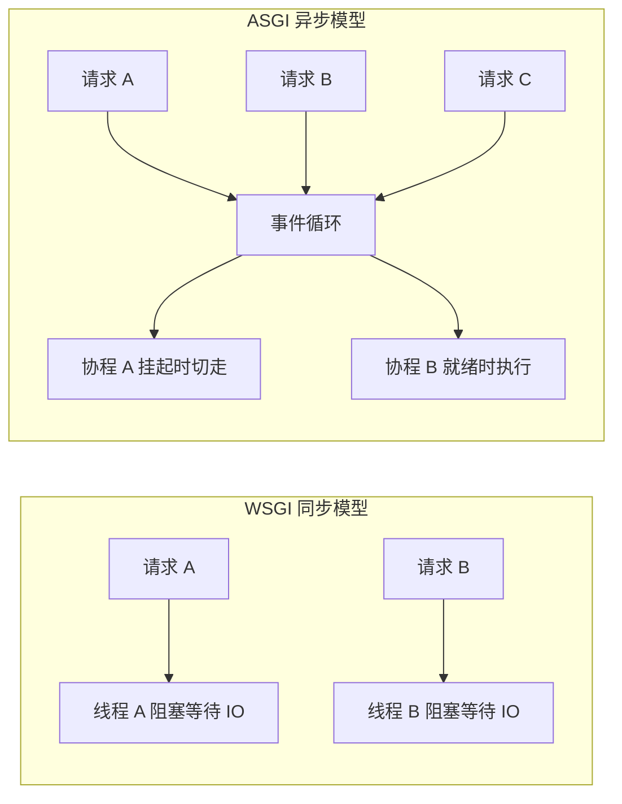

### Q089 · HTTP 方法与幂等性

> 难度:★☆☆ | 标签:HTTP, 幂等性

**问**:说说常用 HTTP 方法的语义,哪些是幂等的、哪些是安全的?

**答**:GET 读取资源(安全且幂等)、PUT 全量替换(幂等)、DELETE 删除(幂等)、POST 创建/触发动作(不幂等)、PATCH 部分更新(不保证幂等)、HEAD/OPTIONS 安全。幂等指同一请求执行一次和多次,对资源状态的影响一致——这是接口设计和重试机制的基础:网络重试时只有幂等接口可以安全重发。

```python
# file: code/03_Web后端开发/q089_idempotent_check.py
store = {}  # key -> value,模拟资源

def handle(method: str, key: str, value=None):
    if method == 'GET':
        return store.get(key)
    if method == 'PUT':          # 幂等:覆盖式写入
        store[key] = value
        return value
    if method == 'POST':         # 非幂等:每次追加,结果不同
        store.setdefault(key, []).append(value)
        return store[key]
    if method == 'DELETE':       # 幂等:删除多次结果一致
        return store.pop(key, None)

for _ in range(3):
    handle('PUT', 'a', 1)
    handle('POST', 'log', 'x')
print(store)  # {'a': 1, 'log': ['x', 'x', 'x']}
```

**追问**:
- POST 如何做到幂等?——客户端携带唯一 Idempotency-Key,服务端去重(详见 Q141)。
- PATCH 默认不幂等怎么补救?——约定提交绝对值而非增量,或携带版本号/条件更新(IF-Match ETag)使重复提交可检测。
- GET 为什么「安全」还要防滥用?——安全指不改变服务端状态,不代表免费:重查询 GET 一样打垮数据库,限流照上。
- DELETE 返回 204 还是 200?——无响应体用 204;要返回被删资源快照用 200;团队统一即可。
### Q090 · 常见 HTTP 状态码与使用场景

> 难度:★☆☆ | 标签:HTTP, 状态码

**问**:面试中常问的状态码有哪些?分别应该在什么场景返回?

**答**:2xx 成功类:200 OK、201 Created(POST 创建成功)、204 No Content(删除成功无响应体);3xx 重定向:301 永久、302 临时、304 Not Modified(缓存);4xx 客户端错误:400 参数错误、401 未认证、403 已认证但无权限、404 不存在、409 冲突、422 参数校验失败、429 限流;5xx 服务端错误:500 内部错误、502/504 网关错误与超时。准确区分 401/403、400/422 是高频考点。

```python
# file: code/03_Web后端开发/q090_status_codes.py
try:
    from fastapi import FastAPI, HTTPException, status
except ImportError:
    print("该题演示需要第三方库 fastapi:pip install fastapi[all],原理见正文")
    raise SystemExit(0)

app = FastAPI()
items = {1: 'apple'}

@app.post('/items', status_code=status.HTTP_201_CREATED)
def create_item(name: str):
    new_id = max(items or {0: 0}) + 1
    items[new_id] = name
    return {'id': new_id, 'name': name}

@app.get('/items/{item_id}')
def get_item(item_id: int):
    if item_id not in items:
        raise HTTPException(status_code=status.HTTP_404_NOT_FOUND,
                            detail='item not found')
    return {'id': item_id, 'name': items[item_id]}

@app.delete('/items/{item_id}', status_code=status.HTTP_204_NO_CONTENT)
def delete_item(item_id: int):
    items.pop(item_id, None)
```

**追问**:
- 401 和 403 的准确边界?——401 未认证(不知道你是谁,应带 WWW-Authenticate),403 已认证但无权限(知道你是谁但不行);混用会让客户端重试逻辑出错。
- 429 响应应该带什么?——`Retry-After` 头告知可重试时间,配合客户端退避;只给状态码不给策略,重试风暴照旧。
- 502 和 504 分别说明什么?——502 上游返回无效响应/进程崩溃,504 上游超时;排查方向不同:502 看进程存活与异常,504 看慢查询与超时配置。

### Q091 · 301 与 302、307 的区别

> 难度:★★☆ | 标签:HTTP, 重定向

**问**:永久重定向和临时重定向有什么区别?为什么 HTTP 到 HTTPS 的跳转推荐 307/308?

**答**:301 表示永久移动,浏览器和搜索引擎会缓存并更新收录,POST 请求多数客户端会把方法改成 GET(历史行为);302 是临时跳转,同样存在方法被改写的问题;307/308 是后来规范明确要求"不得改变请求方法"的临时/永久重定向。因此 HTTPS 迁移、REST API 转发 POST 请求时应使用 308/307,避免方法被降级成 GET 丢失请求体。

```python
# file: code/03_Web后端开发/q091_redirect.py
try:
    from fastapi import FastAPI
    from fastapi.responses import RedirectResponse
except ImportError:
    print("该题演示需要第三方库 fastapi:pip install fastapi[all],原理见正文")
    raise SystemExit(0)

app = FastAPI()

@app.get('/old-api')
def old_api():
    # 308 永久且保持方法;上线一段时间确认无流量后可下线
    return RedirectResponse('/new-api', status_code=308)

@app.post('/login-legacy')
def login_legacy():
    # 307 保证 POST 方法与请求体原样转发到新地址
    return RedirectResponse('/login', status_code=307)

@app.get('/new-api')
def new_api():
    return {'msg': 'new api'}
```

**追问**:
- POST 被 301/302 降级成 GET 会丢什么?——请求体被丢弃,创建类请求变成无参数查询;REST 转发必须用 307/308 保方法。
- 浏览器对 301 缓存怎么清?——强缓存无法主动失效,只能改 URL 或清浏览器缓存;拿不准跳转期限就用 302/307。
- 网关层做 HTTPS 跳转选哪个?——308(或 307),保留方法与请求体;GET-only 的营销页用 301 承接 SEO 权重。

### Q092 · RESTful API 设计原则

> 难度:★★☆ | 标签:REST, API 设计

**问**:什么是 REST?设计 RESTful API 有哪些核心原则?

**答**:REST 是以"资源"为中心的架构风格,核心原则:1) URL 表示资源,用名词复数而非动词,如 `GET /users/42`;2) HTTP 方法表达操作语义,GET/POST/PUT/DELETE 对应查/增/改/删;3) 无状态,每个请求携带全部认证与上下文信息;4) 正确使用状态码表达结果;5) 过滤、分页、排序用查询参数表达,如 `?page=2&size=20&sort=-created_at`。反例:`GET /getUser?id=1`、`POST /deleteUser`。

```python
# file: code/03_Web后端开发/q092_rest_design.py
try:
    from fastapi import FastAPI, HTTPException
except ImportError:
    print("该题演示需要第三方库 fastapi:pip install fastapi[all],原理见正文")
    raise SystemExit(0)

app = FastAPI()
users: dict[int, dict] = {}

@app.get('/users')                       # 列表:GET /users?page=1&size=10
def list_users(page: int = 1, size: int = 10):
    ids = sorted(users)[(page - 1) * size: page * size]
    return {'total': len(users), 'items': [users[i] for i in ids]}

@app.get('/users/{user_id}')             # 详情:GET /users/1
def get_user(user_id: int):
    if user_id not in users:
        raise HTTPException(404, 'user not found')
    return users[user_id]

@app.post('/users', status_code=201)     # 创建:POST /users
def create_user(user: dict):
    uid = max(users or {0: 0}) + 1
    users[uid] = {'id': uid, **user}
    return users[uid]

@app.delete('/users/{user_id}', status_code=204)  # 删除:DELETE /users/1
def delete_user(user_id: int):
    users.pop(user_id, None)
```

**追问**:
- 「无状态」对横向扩容意味着什么?——任一实例可处理任一请求,会话必须外置(Redis/JWT);把状态藏在本地内存的接口无法水平扩展。
- 动作类业务怎么 REST 化?——把动作建模为资源子集合,如 `POST /orders/42/cancellation`,而不是 `/cancelOrder?id=42`。
- 过滤排序参数如何防注入?——白名单校验字段名(映射到列),值走参数化查询;`?sort=` 直接拼 SQL 是注入高发点。

### Q093 · REST 资源嵌套与关系设计

> 难度:★★☆ | 标签:REST, 资源建模

**问**:一对多关系在 REST 中如何表达?嵌套资源 URL 什么时候该用,什么时候不该用?

**答**:一对多用路径嵌套表达,如 `GET /users/{user_id}/orders` 表示某用户的订单列表;嵌套层级建议不超过两层,更深的关联改用"资源 + 查询参数"或先取 ID 再查,例如 `GET /orders?user_id=42`,避免 `/a/1/b/2/c/3` 这类深层 URL 难以维护。多对多关系通常把关联本身建模为资源,如 `POST /enrollments` 记录选课关系。

```python
# file: code/03_Web后端开发/q093_nested_resource.py
try:
    from fastapi import FastAPI, HTTPException
except ImportError:
    print("该题演示需要第三方库 fastapi:pip install fastapi[all],原理见正文")
    raise SystemExit(0)

app = FastAPI()
orders: dict[int, list[dict]] = {1: [{'id': 1, 'item': 'book'}]}

@app.get('/users/{user_id}/orders')          # 嵌套:用户下的订单
def user_orders(user_id: int):
    if user_id not in orders:
        raise HTTPException(404, 'user not found')
    return {'user_id': user_id, 'orders': orders[user_id]}

@app.get('/orders')                           # 平铺 + 查询参数过滤,更灵活
def all_orders(user_id: int | None = None):
    data = orders
    if user_id is not None:
        data = {user_id: orders.get(user_id, [])}
    return [{'user_id': uid, **o} for uid, lst in data.items() for o in lst]
```

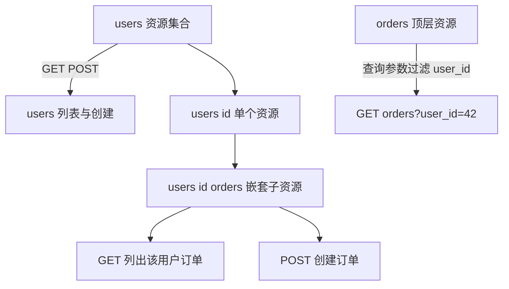

**追问**:
- 嵌套创建订单该用什么 URL?——`POST /users/42/orders`,语义是"在用户 42 下创建订单",也可用顶层 `POST /orders` 传 body。
- 深层嵌套的查询怎么办?——超过两层改用查询参数或分步查询;`/a/1/b/2/c/3` 的缓存与权限校验都难做。
- 多对多建模成资源有什么好处?——关系可带属性与生命周期(`POST /enrollments`),能独立分页、审计;隐藏在中间表里则无法演进。
- 嵌套 URL 的权限怎么校验?——先校验父资源归属(`users/42` 是否当前用户),再校验子资源;漏掉父级校验是越权高发点。
### Q094 · PUT 与 PATCH 的语义区别

> 难度:★☆☆ | 标签:HTTP, REST

**问**:更新资源用 PUT 还是 PATCH?各自的语义和幂等性如何?

**答**:PUT 是全量替换:客户端提交完整资源表示,未提供的字段视为清空/恢复默认,天然幂等;PATCH 是部分更新:只提交要修改的字段,重复提交结果一致时也可幂等(取决于实现),但语义上不保证。实践上 JSON API 常用 PATCH 做部分更新、PUT 做整体替换,FastAPI 里 PATCH 通常配合 `exclude_unset=True` 只更新显式传入的字段。

```python
# file: code/03_Web后端开发/q094_put_patch.py
try:
    from fastapi import FastAPI
    from pydantic import BaseModel
except ImportError:
    print("该题演示需要第三方库 fastapi:pip install fastapi[all],原理见正文")
    raise SystemExit(0)

app = FastAPI()
db = {1: {'name': 'alice', 'email': 'a@x.com', 'age': 20}}

class UserIn(BaseModel):
    name: str | None = None
    email: str | None = None
    age: int | None = None

@app.put('/users/{uid}')            # 全量替换:未传字段被置为 None
def replace_user(uid: int, body: UserIn):
    db[uid] = {'name': body.name, 'email': body.email, 'age': body.age}
    return db[uid]

@app.patch('/users/{uid}')          # 部分更新:只改传入的字段
def patch_user(uid: int, body: UserIn):
    patch = body.model_dump(exclude_unset=True)
    db[uid].update(patch)
    return db[uid]
```

**追问**:
- PATCH 什么情况下不幂等?——提交 `{"balance": balance+100}` 这类相对变更时重复执行会累加;绝对值更新才可幂等。
- JSON Merge Patch 与 JSON Patch 的区别?——RFC 7386 用 null 表示删除、只支持替换;RFC 6902 用 op 指令数组支持 add/remove/move,表达力强但复杂。
- FastAPI 里怎么只更新传入字段?——`Model(**request.model_dump(exclude_unset=True), exclude_unset=True)` 配合 PATCH,未传字段保持原值。

### Q095 · FastAPI 最小应用与路由注册

> 难度:★☆☆ | 标签:FastAPI, 路由

**问**:写一个最小 FastAPI 应用,并说明路由有哪几种注册方式。

**答**:FastAPI 基于 Starlette(异步 web 层)+ Pydantic(数据校验)构建,原生支持类型标注驱动的参数校验和 OpenAPI 文档。路由注册方式有三种:装饰器直接挂在 app 上、`APIRouter` 按模块拆分后 `include_router` 汇总、以及 `add_api_route` 编程式注册。工程项目一般按资源拆成多个 router 文件。

```python
# file: code/03_Web后端开发/q095_fastapi_hello.py
try:
    from fastapi import FastAPI, APIRouter
    import uvicorn
except ImportError:
    print("该题演示需要第三方库 fastapi:pip install fastapi[all],原理见正文")
    raise SystemExit(0)

app = FastAPI(title='demo')
router = APIRouter(prefix='/v1', tags=['demo'])

@app.get('/')                        # 方式一:装饰器直接注册
def root():
    return {'msg': 'hello fastapi'}

@router.get('/items/{item_id}')      # 方式二:APIRouter,前缀 /v1
def read_item(item_id: int):
    return {'item_id': item_id}

app.include_router(router)           # 汇总 router

if __name__ == '__main__':
    uvicorn.run(app, host='127.0.0.1', port=8000)  # 文档: /docs
```

**追问**:
- APIRouter 拆分的好处?——按资源域组织路由与依赖前缀、tags 归组文档、便于按模块授权与测试;单一 app.py 在大项目里必然失控。
- 路由注册顺序有影响吗?——有,`/items/latest` 与 `/items/{item_id}` 冲突时先注册者命中;固定路径必须在前。
- OpenAPI 文档能关吗?——生产可设 `docs_url=None/redoc_url=None/openapi_url=None` 收敛暴露面,或挂在内网域名。

### Q096 · FastAPI 路径参数与类型校验

> 难度:★☆☆ | 标签:FastAPI, 参数校验

**问**:路径参数如何声明类型?类型不匹配会发生什么?

**答**:路径参数通过函数签名 + 类型标注声明,FastAPI 依据标注自动解析和校验:声明 `item_id: int` 时请求 `/items/abc` 会返回 422 错误并给出详细原因;配合 `Path` 可以加约束(如 `ge=1`)和文档描述。枚举类型可以用 `Enum` 限定路径取值,`/items/{item_id}` 这样的固定路径与 `/items/latest` 这类字面路径共存时,固定路径要注册在前。

```python
# file: code/03_Web后端开发/q096_path_params.py
from enum import Enum
try:
    from fastapi import FastAPI, Path
except ImportError:
    print("该题演示需要第三方库 fastapi:pip install fastapi[all],原理见正文")
    raise SystemExit(0)

app = FastAPI()

class Category(str, Enum):
    book = 'book'
    food = 'food'

@app.get('/items/latest')            # 固定路径必须声明在动态路径之前
def latest():
    return {'id': 0, 'name': 'latest'}

@app.get('/items/{item_id}')
def read_item(item_id: int = Path(..., ge=1, description='商品 ID 大于 0')):
    return {'item_id': item_id}

@app.get('/categories/{category}')
def read_category(category: Category):
    return {'category': category.value}
```

**追问**:
- 422 响应体长什么样?——`{"detail": [{"loc": [...], "msg": "...", "type": "..."}]}` 的结构化错误列表,可用自定义异常处理器改格式(Q112)。
- 固定路径和路径参数冲突谁赢?——先注册的赢,FastAPI 按注册顺序匹配;`/items/latest` 必须在 `/items/{item_id}` 之前。
- Path 约束 ge=1 失败返回什么?——422,detail.loc 指向 path 参数;客户端可据此修正,不要用 400 混淆语义。
- 路径参数能传负数或特殊字符吗?——`/items/-1` 按 int 解析成功再被 ge=1 拦;特殊字符要 URL 编码,FastAPI 自动解码。
### Q097 · FastAPI 查询参数与可选性

> 难度:★☆☆ | 标签:FastAPI, 查询参数

**问**:查询参数怎么声明?必填、可选、默认值、约束分别怎么表达?

**答**:签名中不属于路径参数的简单类型参数自动识别为查询参数:有默认值即可选,默认 `...` 即必填,`None` 类型即可为空;用 `Query` 附加校验(最大长度、正则、别名)与文档元数据。列表型查询参数(如 `?tag=a&tag=b`)用 `list[str]` 声明。布尔参数 FastAPI 也会自动转换 `1/true/yes` 等形式。

```python
# file: code/03_Web后端开发/q097_query_params.py
try:
    from fastapi import FastAPI, Query
except ImportError:
    print("该题演示需要第三方库 fastapi:pip install fastapi[all],原理见正文")
    raise SystemExit(0)

app = FastAPI()

@app.get('/search')
def search(
    keyword: str = Query(..., min_length=1, max_length=50),  # 必填
    page: int = Query(1, ge=1),                              # 可选带约束
    size: int = Query(10, le=100),
    tag: list[str] | None = Query(None),                     # ?tag=a&tag=b
    exact: bool = False,                                     # ?exact=true
):
    return {'keyword': keyword, 'page': page, 'size': size,
            'tags': tag or [], 'exact': exact}
```

**追问**:
- list[str] 查询参数怎么传?——`?tag=a&tag=b` 重复键;默认值用 `Query(default=[])`,注意可变默认值由 FastAPI 内部处理为每次新列表。
- 别名什么时候用?——上游字段名是 Python 关键字或不合规范(如 `from`)时 `Query(alias='from')`,内部仍用合法名。
- 必填与「可为 None」的区别?——`x: str` 必填且不可空;`x: str | None = None` 可不传;`x: str = ...` 必填但可为 None 传 null,语义三种不同。

### Q098 · FastAPI 请求体与 Pydantic 基础模型

> 难度:★☆☆ | 标签:FastAPI, Pydantic

**问**:如何声明请求体?嵌套 Pydantic 模型如何自动校验与生成文档?

**答**:把 Pydantic `BaseModel` 子类作为参数标注,FastAPI 自动把请求体 JSON 反序列化成模型实例并校验:类型不符、缺少必填字段都会返回 422。模型支持嵌套(字段类型是另一个模型)、默认值、`Optional` 字段,并自动生成 JSON Schema 写入 `/docs`。返回时直接 return 模型或 dict,FastAPI 用 `response_model` 再做一次序列化过滤。

```python
# file: code/03_Web后端开发/q098_request_body.py
try:
    from fastapi import FastAPI
    from pydantic import BaseModel, EmailStr
except ImportError:
    print("该题演示需要第三方库 fastapi:pip install fastapi[all],原理见正文")
    raise SystemExit(0)

app = FastAPI()

class Address(BaseModel):
    city: str
    street: str

class UserIn(BaseModel):
    name: str
    email: EmailStr
    age: int | None = None
    address: Address          # 嵌套模型

class UserOut(BaseModel):     # 响应模型:过滤敏感字段
    name: str
    city: str

@app.post('/users', response_model=UserOut)
def create_user(user: UserIn):
    return {'name': user.name, 'city': user.address.city, 'email': user.email}
```

**追问**:
- response_model 起什么作用?——出口过滤与文档:只序列化声明的字段、隐藏敏感字段(密码哈希)、为 /docs 生成响应 Schema;不声明则按返回类型推断。
- 嵌套模型的级联校验失败怎么定位?——422 的 detail.loc 是路径数组如 `['body','items',2,'price']`,精确定位到第几个元素哪个字段。
- 请求体模型能和路径/查询参数混用吗?——可以,FastAPI 按类型自动归类:标量是查询参数、BaseModel 是请求体,互不干扰。

### Q099 · Pydantic v2 Field 与自定义校验器

> 难度:★★☆ | 标签:Pydantic v2, 校验

**问**:Pydantic v2 中如何自定义字段校验?v2 相比 v1 有什么重要变化?

**答**:v2 用 `Field` 声明约束(`gt/le/min_length/pattern`),用 `@field_validator` 校验单字段、`@model_validator(mode='after')` 做跨字段校验;核心引擎从纯 Python 重写为 Rust 的 pydantic-core,校验速度提升数倍。v1 的 `@validator/.dict()/.parse_obj()` 分别变更为 `@field_validator/.model_dump()/model_validate()`,v2 还内置了严格模式 `Strict` 和带类型错误聚合的 `ValidationError`。

```python
# file: code/03_Web后端开发/q099_pydantic_v2.py
try:
    from pydantic import BaseModel, Field, field_validator, model_validator
except ImportError:
    print("该题演示需要第三方库 pydantic:pip install pydantic,原理见正文")
    raise SystemExit(0)

class OrderIn(BaseModel):
    item: str = Field(..., min_length=1, max_length=50)
    quantity: int = Field(1, gt=0, le=100)
    price: float = Field(..., gt=0)
    discount: float = Field(0, ge=0, le=1)

    @field_validator('item')
    @classmethod
    def strip_name(cls, v: str) -> str:
        v = v.strip()
        if not v:
            raise ValueError('item 不能为空')
        return v

    @model_validator(mode='after')
    def check_total(self):
        if self.price * self.quantity < 1:
            raise ValueError('订单金额至少为 1 元')
        return self

order = OrderIn(item=' book ', quantity=2, price=9.9)
print(order.model_dump())   # {'item': 'book', 'quantity': 2, ...}
```

**追问**:
- field_validator 的 mode='before' 和默认区别?——before 在类型转换前拿原始输入(可做清洗),默认 after 拿已转换值;清洗与校验分开写。
- model_validator(mode='before') 用在哪?——整个 dict 级别的规范化(字段重命名、跨字段清洗),此时还是原始字典。
- v1 迁移最容易踩的坑?——`@validator` 忘改 `@field_validator`、`.dict()` 与 `.json()` 的静默弃用、conftest 里的 parse_obj 报错;官方有 bump-pydantic 迁移工具。

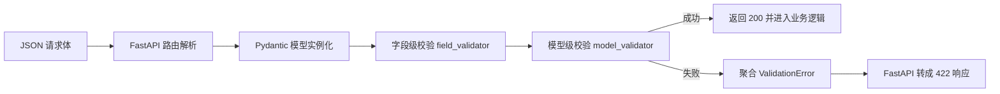

### Q100 · Pydantic 模型配置与 ORM 对象转换

> 难度:★★☆ | 标签:Pydantic v2, ORM

**问**:如何让 Pydantic 模型直接接收 ORM 对象?`model_config` 有哪些常用配置?

**答**:v2 中设置 `model_config = ConfigDict(from_attributes=True)`(v1 的 `orm_mode`)后,可用 `Model.model_validate(orm_obj)` 从任意带属性的对象(ORM 实例、dataclass)构造模型,`response_model` 也能直接序列化 ORM 查询结果。常用配置还有 `frozen=True` 不可变、`extra='forbid'` 拒绝未知字段、`strict=True` 严格类型、`json_schema_extra` 补充文档示例。

```python
# file: code/03_Web后端开发/q100_from_attributes.py
try:
    from pydantic import BaseModel, ConfigDict
except ImportError:
    print("该题演示需要第三方库 pydantic:pip install pydantic,原理见正文")
    raise SystemExit(0)

class UserORM:
    """模拟一个 ORM 对象"""
    def __init__(self):
        self.id = 1
        self.name = 'alice'
        self.password_hash = 'secret'
        self.created_at = '2026-01-01'

class UserOut(BaseModel):
    model_config = ConfigDict(from_attributes=True, extra='forbid')
    id: int
    name: str
    created_at: str

user = UserORM()
print(UserOut.model_validate(user))   # password_hash 被过滤
```

**追问**:
- from_attributes 的原理?——v2 从对象属性(而非仅 dict)读取数据,兼容 ORM 实例;等价 v1 的 orm_mode,迁移时直接改配置名。
- extra='forbid' 什么时候开?——对外 API 入参要严格:多传字段直接 422,避免「拼错字段名静默被忽略」;内部模型可保持 ignore。
- strict=True 与默认 lax 模式的差异?——lax 允许 '1'→1 等隐式转换,strict 全部拒绝;对接不可控上游时 lax 省事,内部服务间用 strict 暴露问题。

### Q101 · Pydantic 嵌套模型与复杂校验场景

> 难度:★★★ | 标签:Pydantic v2, 复杂校验

**问**:如何校验"列表内至少一项"或"字段间互斥"这类复杂规则?如何对敏感字段做脱敏?

**答**:跨字段规则用 `@model_validator(mode='after')`,集合元素校验用 `Field(min_length=...)` 限定列表长度或 `field_validator` 逐项检查;脱敏用 `@field_serializer` 控制序列化输出,或定义单独的 In/Out 模型对。也可以用 `Annotated` + `Before/After` 模式控制校验时机:Before 在类型转换前处理原始输入。

```python
# file: code/03_Web后端开发/q101_complex_validate.py
try:
    from pydantic import BaseModel, field_validator, model_validator
except ImportError:
    print("该题演示需要第三方库 pydantic:pip install pydantic,原理见正文")
    raise SystemExit(0)

class BatchDeleteIn(BaseModel):
    ids: list[int]

    @field_validator('ids')
    @classmethod
    def no_empty(cls, v: list[int]) -> list[int]:
        if not v:
            raise ValueError('ids 不能为空')
        if len(v) != len(set(v)):
            raise ValueError('ids 存在重复')
        return v

class NotifyIn(BaseModel):
    email: str | None = None
    phone: str | None = None

    @model_validator(mode='after')
    def exclusive_channel(self):
        if bool(self.email) == bool(self.phone):
            raise ValueError('email 与 phone 必须二选一')
        return self

print(BatchDeleteIn(ids=[1, 2]).model_dump())
print(NotifyIn(phone='13800000000').model_dump())
```

**追问**:
- 跨字段校验抛什么异常?——`ValidationError` 由 model_validator 内 raise ValueError 即可,FastAPI 统一转 422,不要自己返回 Response。
- 同一字段多处校验的执行顺序?——Field 约束 → field_validator(before→after) → model_validator;理解顺序才能定位「为什么我的校验没生效」。
- 序列化脱敏怎么做?——`@field_serializer` 按需遮蔽(手机号打码),或按角色定义不同 Out 模型;在序列化层做,别污染存储层。

### Q102 · FastAPI 依赖注入基础 Depends

> 难度:★★☆ | 标签:FastAPI, 依赖注入

**问**:什么是 FastAPI 的依赖注入系统?相比手动调用函数有什么好处?

**答**:`Depends(func)` 声明依赖后,FastAPI 在进入路由前自动执行依赖函数并把返回值注入参数,依赖本身也可再声明依赖,形成依赖树。好处:复用业务逻辑(认证、分页、DB session)、参数自动校验、便于测试时用 `dependency_overrides` 替换实现。依赖是"声明式"的,与路由解耦,还能在 `dependencies=[...]` 中作为不注入返回值的副作用依赖使用。

```python
# file: code/03_Web后端开发/q102_depends_basic.py
try:
    from fastapi import FastAPI, Depends, HTTPException, Query
except ImportError:
    print("该题演示需要第三方库 fastapi:pip install fastapi[all],原理见正文")
    raise SystemExit(0)

app = FastAPI()

def pagination(page: int = Query(1, ge=1), size: int = Query(10, le=100)):
    return {'page': page, 'size': size}

def fake_db():
    return {'conn': 'db-conn'}

def get_current_user(token: str = Query(...), db: dict = Depends(fake_db)):
    if token != 'abc':
        raise HTTPException(401, 'invalid token')
    return {'user': 'alice', 'db': db}

@app.get('/items')
def list_items(pager: dict = Depends(pagination), user=Depends(get_current_user)):
    return {'pager': pager, 'user': user['user']}

@app.get('/admin', dependencies=[Depends(get_current_user)])  # 只校验不注入
def admin():
    return {'msg': 'ok'}
```

**追问**:
- 依赖函数可以是 async 的吗?——可以,且与 async 路由共用事件循环;注意不要在 async 依赖里写阻塞调用。
- dependencies=[Depends(...)] 不接收返回值的用法?——副作用依赖(鉴权、限流、审计),返回值丢弃;把「必须先做某事」声明在路由装饰器上。
- 依赖注入和中间件怎么分工?——横切全站流量(日志/限流)用中间件;按路由组合的业务前置(认证、分页、DB)用依赖,粒度更细且可复用。
- 依赖抛异常怎么变成 4xx?——依赖内 raise HTTPException,FastAPI 走正常异常处理返回;依赖失败路由不会执行。
### Q103 · 依赖注入的缓存与依赖树

> 难度:★★☆ | 标签:FastAPI, Depends

**问**:同一请求内多个路由参数依赖同一个函数,会执行几次?如何控制?

**答**:默认同一请求内依赖结果会被缓存,同一依赖树中 `Depends(func)` 多处引用只执行一次,适合"取一次当前用户、多处使用";显式传 `use_cache=False` 可禁用缓存强制重执行。依赖可以层层嵌套构成树,嵌套深度没有限制,FastAPI 会按依赖关系自动解析执行顺序,子依赖的参数同样支持校验与注入。

```python
# file: code/03_Web后端开发/q103_dependency_cache.py
try:
    from fastapi import FastAPI, Depends
except ImportError:
    print("该题演示需要第三方库 fastapi:pip install fastapi[all],原理见正文")
    raise SystemExit(0)

app = FastAPI()
counter = {'n': 0}

def expensive_check() -> str:
    counter['n'] += 1
    return f'check-{counter["n"]}'

def handler_a(v: str = Depends(expensive_check)):
    return v

def handler_b(v: str = Depends(expensive_check)):   # 与 A 共享缓存
    return v

@app.get('/once')
def once(a=Depends(handler_a), b=Depends(handler_b)):
    return {'a': a, 'b': b}   # expensive_check 同一请求只执行 1 次

@app.get('/fresh')
def fresh(a=Depends(handler_a, use_cache=False),
          b=Depends(handler_b, use_cache=False)):
    return {'a': a, 'b': b}   # 各执行 1 次,结果不同
```

**追问**:
- use_cache=False 的典型场景?——依赖有副作用(取新时间戳、生成本次请求 ID)或同一依赖需要不同参数实例化时,禁用请求内缓存。
- 依赖缓存的粒度是什么?——单个请求;跨请求不共享,所以不会泄漏状态,但也别在依赖里做重缓存,那是 lru_cache/Redis 的事。
- 怎么在测试里替换依赖?——`app.dependency_overrides[get_db] = fake_db`,比 mock patch 更显式,测试结束清理 overrides。

### Q104 · yield 依赖与资源清理

> 难度:★★★ | 标签:FastAPI, 依赖注入

**问**:`yield` 形式的依赖是怎么执行的?异常会发生在哪一段?

**答**:`yield` 依赖把函数分成两段:`yield` 之前的代码在路由处理前执行并注入返回值,之后的代码在响应发送后执行,天然适合管理数据库 session、临时文件等需要清理的资源——即使路由抛异常也会执行清理部分。路由或子依赖抛出的异常会传播到 yield 之后,可在那里用 `try/except` 感知失败并回滚,但要注意此时不能再修改已发出的响应。

```python
# file: code/03_Web后端开发/q104_yield_dependency.py
try:
    from fastapi import FastAPI, Depends, HTTPException
except ImportError:
    print("该题演示需要第三方库 fastapi:pip install fastapi[all],原理见正文")
    raise SystemExit(0)

app = FastAPI()
logs: list[str] = []

def db_session():
    logs.append('session open')
    session = {'in_tx': True}
    try:
        yield session                     # 注入给路由
        session['in_tx'] = False          # 正常结束:提交
        logs.append('commit')
    except Exception:
        logs.append('rollback')           # 路由抛异常:回滚
        raise
    finally:
        logs.append('session close')      # 无论成败都清理

@app.get('/ok')
def ok(session: dict = Depends(db_session)):
    return {'data': 'ok'}

@app.get('/boom')
def boom(session: dict = Depends(db_session)):
    raise HTTPException(400, 'bad request')
# 连续请求 /ok、/boom 后 logs 依次为 open->commit->close / open->rollback->close
```

**追问**:
- yield 依赖里抛异常会怎样?——路由抛的异常先穿过依赖的 yield 处(可捕获做回滚),未捕获则继续向异常处理器传播;此时响应未发出,仍可改变结果。
- yield 依赖和 BackgroundTasks 的清理顺序?——清理段在响应发送后、后台任务执行前完成;依赖清理里不要假设响应已成功送达。
- 一个请求多个 yield 依赖的退出顺序?——与进入顺序相反(LIFO),类似栈;共享资源的依赖要按「后借先还」设计。

### Q105 · lifespan 与应用启动/关闭钩子

> 难度:★★☆ | 标签:FastAPI, 生命周期

**问**:FastAPI 推荐的启动/关闭逻辑怎么写?老的 on_event 为什么被弃用?

**答**:推荐用 `@asynccontextmanager` 实现 `lifespan`:yield 前是启动逻辑(建立连接池、预热缓存),yield 后是关闭逻辑(释放资源),整体作为一个协程传给 `FastAPI(lifespan=...)`。老的 `@app.on_event('startup'/'shutdown')` 已被弃用,因为它把启动关闭逻辑分散、且无法表达"有状态的异步上下文管理器"。注意 lifespan 期间不能接收请求,适合做一次性初始化。

```python
# file: code/03_Web后端开发/q105_lifespan.py
from contextlib import asynccontextmanager
try:
    from fastapi import FastAPI
    import uvicorn
except ImportError:
    print("该题演示需要第三方库 fastapi:pip install fastapi[all],原理见正文")
    raise SystemExit(0)

pool: dict = {}

@asynccontextmanager
async def lifespan(app: FastAPI):
    pool['redis'] = 'fake-redis-conn'     # startup:初始化连接池/加载配置
    print('app starting, pool ready')
    yield
    pool.clear()                          # shutdown:释放资源
    print('app shutting down, pool closed')

app = FastAPI(lifespan=lifespan)

@app.get('/cache')
def read_cache():
    return {'redis': pool.get('redis')}

if __name__ == '__main__':
    uvicorn.run(app, port=8000)
```

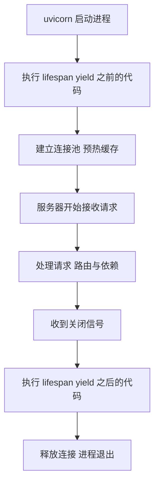

**追问**:
- lifespan 和 Depends(yield) 时机差在哪?——lifespan 是进程级一次性执行,Depends 是请求级执行与清理。
- lifespan 里能起常驻后台任务吗?——能,yield 前创建 asyncio Task 并保存引用,yield 后 cancel+gather 干净收场。
- 多 worker 部署时 lifespan 跑几次?——每个 worker 各跑一次;全局唯一任务(如定时器)要么加分布式锁,要么挪出应用进程。
- on_event 为什么被弃用?——分散在两个钩子、无法表达有状态的异步上下文;lifespan 一个 asynccontextmanager 全表达。
### Q106 · FastAPI 中间件的编写与用途

> 难度:★★☆ | 标签:FastAPI, 中间件

**问**:如何给 FastAPI 写自定义中间件?典型用途有哪些?

**答**:中间件通过 `@app.middleware('http')` 或 `app.add_middleware(SomeMiddleware)` 注册,包裹整个请求处理过程,典型用途:请求日志与耗时统计、统一响应头(如 Request-ID)、全局限流、异常兜底转 JSON。`@app.middleware('http')` 是函数式写法,`add_middleware` 是类式写法(支持构造参数),多个中间件按注册顺序反向包裹,构成洋葱模型。

```python
# file: code/03_Web后端开发/q106_middleware.py
import time
import uuid
try:
    from fastapi import FastAPI, Request
except ImportError:
    print("该题演示需要第三方库 fastapi:pip install fastapi[all],原理见正文")
    raise SystemExit(0)

app = FastAPI()

@app.middleware('http')
async def add_request_id(request: Request, call_next):
    rid = request.headers.get('x-request-id', str(uuid.uuid4())[:8])
    start = time.perf_counter()
    response = await call_next(request)          # 交给内层处理
    cost = round((time.perf_counter() - start) * 1000, 2)
    response.headers['x-request-id'] = rid
    response.headers['x-cost-ms'] = str(cost)
    return response

@app.middleware('http')
async def log_requests(request: Request, call_next):
    print(f'-> {request.method} {request.url.path}')
    response = await call_next(request)
    print(f'<- {request.url.path} done')
    return response

@app.get('/')
def root():
    return {'msg': 'hello'}
```

**追问**:
- BaseHTTPMiddleware 的性能坑?——它为每个请求包一层任务与内存流,大并发下开销明显;纯 ASGI 函数式中间件更快。
- 中间件里能修改请求体吗?——能但要小心:读过的 body 要重新塞回 receive 通道,否则路由拿不到;常见于签名校验中间件。
- Request-ID 应该在哪一层生成?——最外层中间件生成并塞入日志上下文(contextvars)与响应头,下游服务透传,全链路可检索。

### Q107 · 中间件洋葱模型与执行顺序

> 难度:★★★ | 标签:中间件, 洋葱模型

**问**:多个中间件时请求和响应的执行顺序是怎样的?请结合洋葱模型解释。

**答**:中间件像洋葱一层层包裹路由:请求从外层向内层穿过,响应从内层向外层返回,每个中间件的 `call_next` 前半段处理请求、后半段处理响应。FastAPI 中后注册的 `add_middleware` 反而处于最外层;这与 Django 的 `MIDDLEWARE` 列表相反——Django 列表第一项最外层。理解顺序才能正确设计如"日志在外层、限流在里层"的层级关系。

```python
# file: code/03_Web后端开发/q107_onion_order.py
try:
    from fastapi import FastAPI, Request
except ImportError:
    print("该题演示需要第三方库 fastapi:pip install fastapi[all],原理见正文")
    raise SystemExit(0)

app = FastAPI()
trace: list[str] = []

def make_mw(name: str):
    async def mw(request: Request, call_next):
        trace.append(f'{name} in')
        response = await call_next(request)
        trace.append(f'{name} out')
        return response
    return mw

app.middleware('http')(make_mw('A'))   # A 先注册,处于内层
app.middleware('http')(make_mw('B'))   # B 后注册,处于外层

@app.get('/')
def root():
    trace.append('handler')
    return {'ok': True}
# 请求顺序:B in -> A in -> handler -> A out -> B out
```

**追问**:
- 为什么后注册的 add_middleware 在最外层?——注册实现是「包一层」,后包的自然在外;与 Django MIDDLEWARE 列表第一项最外层相反,跨框架容易记混。
- 限流和日志中间件谁在外?——日志在最外(记录所有请求含被拒的),限流靠内;鉴权在限流内还是外按「未认证是否计数」决定。
- 异常处理器和中间件的执行顺序?——ExceptionMiddleware 在内层处理 HTTPException,兜底 Exception 处理器在最外;中间件只能看到未处理完的异常。


### Q108 · BackgroundTasks 后台任务

> 难度:★★☆ | 标签:FastAPI, BackgroundTasks

**问**:FastAPI 里如何执行响应后的后台任务?它适合什么场景,什么时候应该换任务队列?

**答**:在路由参数声明 `BackgroundTasks`,用 `tasks.add_task(func, *args)` 注册,任务在响应发送后于同一事件循环(或线程池,取决于函数是否 async)执行,适合发通知、写审计日志、清临时文件这类轻量异步收尾。它不持久化、不重试、随进程退出丢失,也不适合 CPU 密集任务;需要可靠投递时应使用 Celery/RQ/ARQ 等外部任务队列。

```python
# file: code/03_Web后端开发/q108_background_tasks.py
import time
try:
    from fastapi import FastAPI, BackgroundTasks
    import uvicorn
except ImportError:
    print("该题演示需要第三方库 fastapi:pip install fastapi[all],原理见正文")
    raise SystemExit(0)

app = FastAPI()
sent: list[str] = []

def send_email(to: str, subject: str):
    time.sleep(1)                      # 同步函数:自动放入线程池执行
    sent.append(f'{to}:{subject}')

@app.post('/register')
def register(email: str, tasks: BackgroundTasks):
    tasks.add_task(send_email, email, 'welcome')   # 响应后执行
    return {'msg': 'registered, email will be sent'}

if __name__ == '__main__':
    uvicorn.run(app, port=8000)
```

**追问**:
- 多个 add_task 的执行顺序?——按注册顺序依次执行;同步任务在线程池,async 任务在事件循环。
- BackgroundTasks 失败了怎么办?——无人重试也不持久化,进程退出即丢;可靠场景必须上任务队列(Celery/ARQ)+ 重试策略。
- 后台任务和依赖清理谁先执行?——依赖清理先、后台任务后(响应发送后);顺序影响「任务里还能不能用 session」的判断。
- CPU 密集任务放 BackgroundTasks 会怎样?——占住事件循环拖垮全部请求;丢线程/进程池或独立 worker。
### Q109 · FastAPI WebSocket 处理

> 难度:★★★ | 标签:FastAPI, WebSocket

**问**:FastAPI 中如何实现 WebSocket 连接?如何在连接建立时做认证?

**答**:用 `@app.websocket('/ws')` 声明端点,通过 `await ws.accept()` 握手、`ws.receive_text()/send_text()` 收发消息,`WebSocketDisconnect` 捕获断开。WebSocket 无法标准地携带 Authorization 头,认证常通过查询参数传 token、或依赖 `Cookie`、或在 `accept()` 前校验 `ws.headers`/`ws.query_params` 后再决定 accept 还是 close。生产中还需处理心跳与连接管理器广播。

```python
# file: code/03_Web后端开发/q109_websocket.py
try:
    from fastapi import FastAPI, WebSocket, WebSocketDisconnect
except ImportError:
    print("该题演示需要第三方库 fastapi:pip install fastapi[all],原理见正文")
    raise SystemExit(0)

app = FastAPI()

class Hub:
    def __init__(self):
        self.active: list[WebSocket] = []

    async def connect(self, ws: WebSocket, token: str):
        if token != 'abc':                 # 握手前认证
            await ws.close(code=4001)
            return
        await ws.accept()
        self.active.append(ws)

    def disconnect(self, ws: WebSocket):
        if ws in self.active:
            self.active.remove(ws)

    async def broadcast(self, text: str):
        for ws in list(self.active):
            await ws.send_text(text)

hub = Hub()

@app.websocket('/ws')
async def ws_endpoint(ws: WebSocket, token: str = ''):
    await hub.connect(ws, token)
    try:
        while True:
            msg = await ws.receive_text()
            await hub.broadcast(f'echo: {msg}')
    except WebSocketDisconnect:
        hub.disconnect(ws)
```

**追问**:
- WebSocket 认证的常见做法?——accept 之前校验 query token/cookie,不合法直接 `close(code=1008)`;连接建立后每条消息还可带签名校验防会话劫持。
- 断线重连怎么设计?——客户端指数退避重连,服务端用连接 ID 恢复订阅;心跳(ping/pong 帧或应用层)探测半开连接。
- WebSocket 广播怎么落地?——进程内连接注册表 + 跨进程 pub/sub(Redis channels),单进程内存表在多 worker 下只能覆盖本进程连接。

### Q110 · 文件上传与大小限制

> 难度:★★☆ | 标签:FastAPI, 文件上传

**问**:FastAPI 如何处理单文件与多文件上传?大文件上传要注意什么?

**答**:用 `UploadFile` 类型声明参数(配合 `File(...)`),它基于 SpooledTemporaryFile,超过阈值的文件写入磁盘而不占满内存,提供 `filename/content_type` 元数据和异步 `read/write/seek` 方法;多文件用 `list[UploadFile]`。大文件上传应分块读取(`await file.read(chunk_size)` 流式处理)、限制大小(在中间件或校验层判断)、并在反向代理层配置 `client_max_body_size`。

```python
# file: code/03_Web后端开发/q110_file_upload.py
try:
    from fastapi import FastAPI, UploadFile, File, HTTPException
except ImportError:
    print("该题演示需要第三方库 fastapi:pip install fastapi[all],原理见正文")
    raise SystemExit(0)

app = FastAPI()
MAX_SIZE = 1024 * 1024  # 1MB

@app.post('/upload')
async def upload(file: UploadFile = File(...)):
    if file.content_type not in ('text/plain', 'image/png'):
        raise HTTPException(400, 'unsupported file type')
    size = 0
    while chunk := await file.read(64 * 1024):   # 分块流式读取
        size += len(chunk)
        if size > MAX_SIZE:
            raise HTTPException(413, 'file too large')
    return {'filename': file.filename, 'size': size}

@app.post('/uploads')
async def upload_many(files: list[UploadFile] = File(...)):
    return {'count': len(files), 'names': [f.filename for f in files]}
```

**追问**:
- UploadFile 与 bytes 参数的区别?——bytes 全量进内存,UploadFile 用 SpooledTemporaryFile 超阈值落盘;大文件必须 UploadFile + 分块 read。
- 上传大小限制在哪几层设?——Nginx client_max_body_size(第一道)、应用校验、SpooledTemporaryFile 阈值;只靠应用层时恶意请求已占满带宽。
- 文件名能信吗?——不能,filename 可能为空、含路径穿越或双扩展名;落盘用 uuid 重命名,扩展名白名单校验 content_type。

### Q111 · HTTPException 与自定义异常处理

> 难度:★★☆ | 标签:FastAPI, 异常处理

**问**:业务中如何优雅地抛出和处理 HTTP 错误?如何自定义错误响应格式?

**答**:业务校验失败直接 `raise HTTPException(status_code, detail)`,FastAPI 转成 `{"detail": ...}` 的 JSON;需要统一错误结构时,通过 `@app.exception_handler(CustomError)` 注册自定义异常处理器,返回约定格式;也可以让业务异常继承 HTTPException 携带错误码。原则:让异常沿调用栈抛出,在处理器层统一转换为响应,业务代码不拼错误 JSON。

```python
# file: code/03_Web后端开发/q111_custom_exception.py
try:
    from fastapi import FastAPI, Request
    from fastapi.responses import JSONResponse
except ImportError:
    print("该题演示需要第三方库 fastapi:pip install fastapi[all],原理见正文")
    raise SystemExit(0)

app = FastAPI()

class BizError(Exception):
    def __init__(self, code: int, message: str):
        self.code = code
        self.message = message

@app.exception_handler(BizError)
async def biz_error_handler(request: Request, exc: BizError):
    return JSONResponse(
        status_code=400,
        content={'code': exc.code, 'message': exc.message,
                 'path': request.url.path},
    )

@app.get('/items/{item_id}')
def get_item(item_id: int):
    if item_id > 100:
        raise BizError(40001, 'item not found')
    return {'id': item_id}
```

**追问**:
- HTTPException 的 headers 参数干什么用?——401 附 `WWW-Authenticate: Bearer`、429 附 `Retry-After`,标准要求放在响应头而非 body。
- 自定义异常处理器能拿到 request 吗?——能,handler 签名是 `(request, exc)`,可按路径/客户端定制响应并记录上下文。
- 业务异常该继承 HTTPException 吗?——推荐继承它携带 status_code,或自定义异常 + 处理器转换;业务层绝不能直接拼 Response。

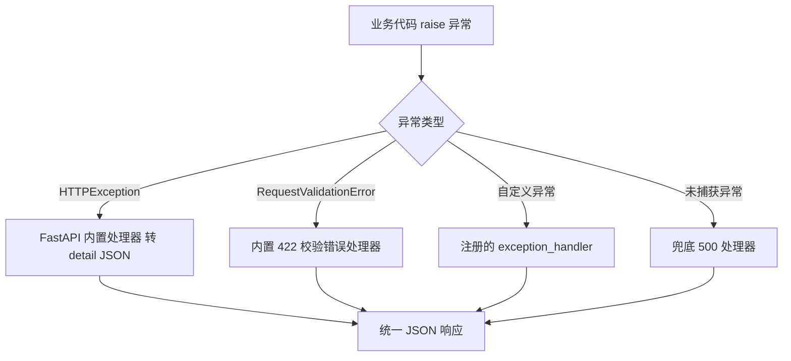

### Q112 · 全局兜底异常与 500 处理

> 难度:★★☆ | 标签:FastAPI, 异常处理

**问**:如何保证未预期异常不把堆栈直接暴露给客户端?

**答**:注册 `@app.exception_handler(Exception)` 兜底所有未捕获异常,返回脱敏的 500 响应,同时把完整堆栈记录到日志,给客户端只暴露通用错误信息与请求 ID 便于排查。注意兜底处理器运行在 ServerErrorMiddleware 层,返回的 Response 会替换默认的白页 500。配合 `--log-config` 或结构化日志(如 structlog)把异常与上下文关联起来。

```python
# file: code/03_Web后端开发/q112_global_handler.py
import logging
import uuid
try:
    from fastapi import FastAPI, Request
    from fastapi.responses import JSONResponse
except ImportError:
    print("该题演示需要第三方库 fastapi:pip install fastapi[all],原理见正文")
    raise SystemExit(0)

logger = logging.getLogger('app')
app = FastAPI()

@app.exception_handler(Exception)
async def unhandled_handler(request: Request, exc: Exception):
    rid = request.headers.get('x-request-id', str(uuid.uuid4())[:8])
    logger.exception('unhandled error rid=%s', rid)      # 完整堆栈进日志
    return JSONResponse(                                  # 对外脱敏
        status_code=500,
        content={'code': 50000, 'message': 'internal server error', 'rid': rid},
    )

@app.get('/boom')
def boom():
    return 1 / 0
```

**追问**:
- 兜底处理器里必须做什么?——记录完整堆栈与 request-id、返回脱敏 500(不带内部细节)、打告警指标;堆栈只进日志不进响应。
- ServerErrorMiddleware 和 ExceptionMiddleware 的差别?——后者处理已注册的已知异常;前者兜底未知异常,位于最外层。
- 如何避免 5xx 雪崩式增长?——异常率指标 + 告警,配套熔断降级;500 突增往往是上游依赖故障,先看错误分类再扩容。

### Q113 · OAuth2 密码模式与 JWT 登录流程

> 难度:★★★ | 标签:OAuth2, JWT, 安全

**问**:描述一个 OAuth2 Password 模式 + JWT 的完整登录鉴权流程。

**答**:流程:1) 客户端 POST `/token` 提交用户名密码(表单格式);2) 服务端校验后签发含过期时间与用户标识的 JWT 返回;3) 客户端后续请求在 `Authorization: Bearer <token>` 头携带;4) 受保护接口用依赖解码 JWT 校验签名与过期,取回当前用户;5) token 过期走 refresh token 或重新登录。OAuth2PasswordBearer 只负责"提取 token"并标记 OpenAPI 安全方案,真正的解码校验在自定义依赖里完成。

```python
# file: code/03_Web后端开发/q113_jwt_login.py
from datetime import datetime, timedelta, timezone
try:
    from fastapi import FastAPI, Depends, HTTPException, status
    from fastapi.security import OAuth2PasswordBearer, OAuth2PasswordRequestForm
    from jose import jwt, JWTError   # pip install python-jose[cryptography]
except ImportError:
    print("该题演示需要第三方库 fastapi、python-jose:pip install fastapi[all] python-jose[cryptography],原理见正文")
    raise SystemExit(0)

SECRET = 'change-me-in-prod'
ALG = 'HS256'
app = FastAPI()
oauth2_scheme = OAuth2PasswordBearer(tokenUrl='token')  # 仅提取 Bearer token

def create_token(username: str) -> str:
    payload = {'sub': username,
               'exp': datetime.now(timezone.utc) + timedelta(hours=1)}
    return jwt.encode(payload, SECRET, algorithm=ALG)

@app.post('/token')
def login(form: OAuth2PasswordRequestForm = Depends()):
    # 实际项目应查库并用 passlib/bcrypt 校验哈希
    if form.username != 'alice' or form.password != 'wonderland':
        raise HTTPException(status.HTTP_401_UNAUTHORIZED, 'bad credentials')
    return {'access_token': create_token(form.username), 'token_type': 'bearer'}

def get_current_user(token: str = Depends(oauth2_scheme)) -> str:
    try:
        payload = jwt.decode(token, SECRET, algorithms=[ALG])
        return payload['sub']
    except JWTError:
        raise HTTPException(status.HTTP_401_UNAUTHORIZED, 'token invalid')

@app.get('/me')
def me(user: str = Depends(get_current_user)):
    return {'user': user}
```

**追问**:
- OAuth2 密码模式现在还推荐吗?——OAuth 2.1 已废弃密码模式,建议授权码+PKCE;面试要能说出「示例常用,生产应换」。
- JWT 放 cookie 还是 Authorization 头?——头方式免疫 CSRF 但要防 XSS;cookie 要 HttpOnly+SameSite;二选一都有对应防线,关键是说出来。
- refresh token 怎么安全轮换?——一次性使用,旧 refresh 换新时旧 token 立即作废;检测到已用 refresh 再次出现则全家族撤销(疑似被盗)。

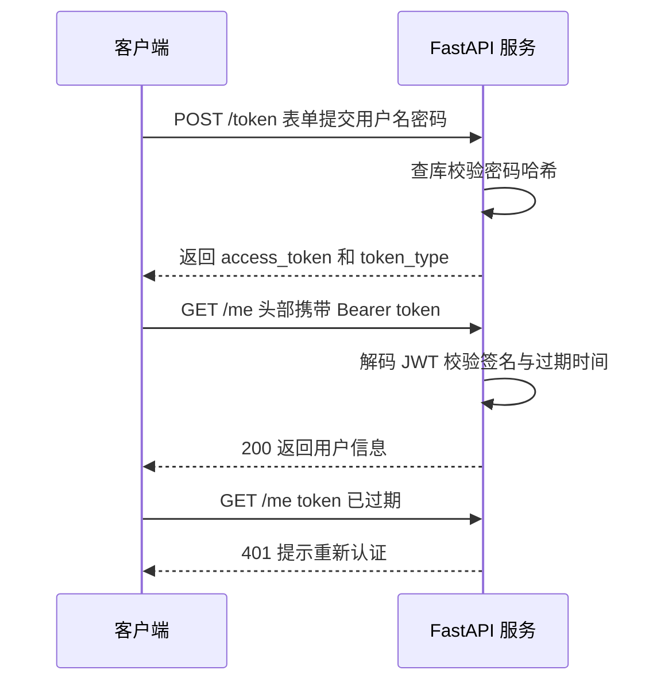

### Q114 · JWT 的安全实践

> 难度:★★★ | 标签:JWT, 安全

**问**:JWT 有哪些安全风险?生产中要注意哪些实践?

**答**:JWT 默认只防篡改不防泄露,且签发后在过期前无法撤销。实践要点:1) 短有效期 + refresh token 轮换;2) 使用 `alg` 白名单校验,防止 `alg=none` / 算法混淆攻击;3) HS256 密钥足够强,或改用 RS256 非对称签名让验证方只持公钥;4) payload 只放非敏感信息(它是 Base64 可读,不是加密);5) 需要主动注销时引入服务端黑名单或版本号,配合 Redis 存储失效状态。

```python
# file: code/03_Web后端开发/q114_jwt_best_practice.py
try:
    from jose import jwt, JWTError
except ImportError:
    print("该题演示需要第三方库 python-jose:pip install python-jose(正文已讲清原理,安装后可运行)")
    raise SystemExit(0)

SECRET = 'a-very-long-random-secret-key-at-least-32-bytes'
ALLOWED_ALGS = ['HS256']            # 显式白名单,防算法混淆

def decode_token(token: str) -> dict:
    try:
        # algorithms 白名单必传;verify_exp 默认校验过期
        payload = jwt.decode(token, SECRET, algorithms=ALLOWED_ALGS)
    except JWTError as e:
        raise PermissionError(f'invalid token: {e}')
    if 'sub' not in payload:
        raise PermissionError('missing sub')
    return payload

def revoke(token: str, blacklist: set[str]):
    payload = decode_token(token)
    blacklist.add(token)            # 简化示例:生产用 Redis + TTL

blacklist: set[str] = set()
```

**追问**:
- Session 和 JWT 撤销的本质区别?——Session 服务端有状态可随时删除;JWT 无状态只能靠黑名单或短过期补救。
- alg 混淆攻击是什么?——攻击者把 RS256 token 改标 HS256,用公钥当 HMAC 密钥骗过校验;库必须显式白名单 algorithms=['RS256']。
- JWT payload 能放敏感信息吗?——不能,Base64 只是编码;要敏感信息就得 JWE 加密或干脆服务端存会话。
- 登出即失效怎么做?——jti/版本号写 Redis 黑名单,校验依赖多查一次;或者短过期(5-15min)让风险窗口可控。
### Q115 · CORS 跨域配置

> 难度:★★☆ | 标签:CORS, 安全

**问**:什么是 CORS?浏览器跨域请求为什么会失败?FastAPI 如何配置?

**答**:CORS 是浏览器的同源策略放行机制:跨域请求先发 OPTIONS 预检,服务端必须返回 `Access-Control-Allow-Origin` 等响应头,浏览器才放行实际请求;服务端到服务端调用不存在 CORS。FastAPI 用 `CORSMiddleware` 配置:`allow_origins` 必须写明确域名列表,不要用 `["*"]` 同时 `allow_credentials=True`——带 cookie 的请求该组合无效且不安全。

```python
# file: code/03_Web后端开发/q115_cors.py
try:
    from fastapi import FastAPI
    from fastapi.middleware.cors import CORSMiddleware
except ImportError:
    print("该题演示需要第三方库 fastapi:pip install fastapi[all],原理见正文")
    raise SystemExit(0)

app = FastAPI()

app.add_middleware(
    CORSMiddleware,
    allow_origins=['https://app.example.com'],  # 明确列出前端域名
    allow_credentials=True,                      # 允许携带 cookie
    allow_methods=['GET', 'POST', 'PUT', 'DELETE'],
    allow_headers=['Authorization', 'Content-Type'],
)

@app.get('/data')
def data():
    return {'ok': True}
```

**追问**:
- allow_origins=['*'] 加 credentials=True 会怎样?——规范禁止,浏览器拒绝带 cookie 的跨域响应;按域名白名单配置才是正解。
- 预检 OPTIONS 请求要过鉴权吗?——不要,预检本身无凭证;鉴权逻辑要放行 OPTIONS,否则跨域请求全卡在预检。
- 服务端到服务端需要 CORS 吗?——不需要,CORS 是浏览器同源策略的放行机制;curl/服务间调用不受它约束。

### Q116 · Flask 应用工厂模式

> 难度:★★☆ | 标签:Flask, 应用工厂

**问**:什么是 Flask 应用工厂?为什么生产项目都推荐它?

**答**:应用工厂是一个 `create_app(config) -> Flask` 的函数,把 app 创建、配置加载、扩展初始化、蓝图注册集中管理。好处:1) 支持多环境/多实例配置(测试、开发、生产各建一个 app);2) 延迟导入避免循环引用;3) 配合 Flask-SQLAlchemy 等 `db.init_app(app)` 的延迟初始化模式;4) 测试可以为每个用例创建独立 app。是官方推荐的组织大型 Flask 项目的方式。

```python
# file: code/03_Web后端开发/q116_app_factory.py
try:
    from flask import Flask
except ImportError:
    print("该题演示需要第三方库 flask:pip install flask,原理见正文")
    raise SystemExit(0)

def create_app(config_name: str = 'dev') -> Flask:
    app = Flask(__name__)
    app.config.from_mapping(
        DEBUG=config_name == 'dev',
        SECRET_KEY='dev-secret',
        DATABASE='app.db',
    )

    @app.get('/health')
    def health():
        return {'status': 'ok', 'env': config_name}

    return app

app = create_app('dev')

if __name__ == '__main__':
    app.run(port=5000)
```

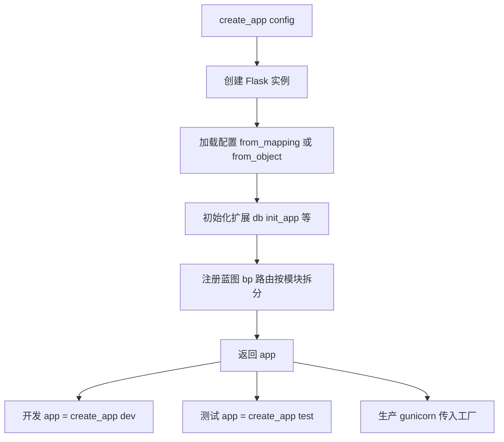

**追问**:
- Gunicorn 如何运行工厂?——`gunicorn "myapp:create_app('prod')"` 直接引用工厂调用。
- 工厂模式怎么支持多环境?——`create_app(ConfigClass)` 按环境注入配置对象;测试传 TestConfig 覆盖数据库与密钥。
- 工厂里延迟导入解决什么?——循环引用:扩展对象模块级创建、init_app 时绑定;导入顺序不再敏感。
- gunicorn 怎么引用工厂?——`gunicorn 'myapp:create_app("prod")'` 调用表达式,gunicorn 负责 import 并调用。
### Q117 · Flask 蓝图 Blueprint

> 难度:★☆☆ | 标签:Flask, 蓝图

**问**:蓝图解决什么问题?url_prefix 和静态资源怎么配?

**答**:Blueprint 把路由、模板、静态文件按功能模块组织,工厂中 `app.register_blueprint(bp, url_prefix='/api')` 统一挂载;蓝图中 `url_for('bp_name.endpoint')` 生成带前缀的链接,避免硬编码 URL。蓝图不能独立运行,必须注册到 app;大型项目常按 users/orders/auth 等领域各建一个蓝图。

```python
# file: code/03_Web后端开发/q117_blueprint.py
try:
    from flask import Flask, Blueprint, jsonify, url_for
except ImportError:
    print("该题演示需要第三方库 flask:pip install flask,原理见正文")
    raise SystemExit(0)

users_bp = Blueprint('users', __name__, url_prefix='/api/users')

@users_bp.get('')
def list_users():
    return jsonify([{'id': 1, 'name': 'alice'}])

@users_bp.get('/<int:uid>')
def get_user(uid: int):
    return jsonify({'id': uid, 'name': 'alice'})

def create_app() -> Flask:
    app = Flask(__name__)
    app.register_blueprint(users_bp)
    with app.test_request_context():
        print(url_for('users.get_user', uid=42))  # /api/users/42
    return app

if __name__ == '__main__':
    create_app().run(port=5000)
```

**追问**:
- 蓝图和工厂怎么配合?——工厂 create_app 内 register_blueprint,扩展用 init_app 延迟绑定;测试可反复创建独立 app 实例。
- url_for 在蓝图里怎么写?——`url_for('bp.endpoint')` 带蓝图名前缀,避免硬编码路径;前缀变更时链接自动跟随。
- 蓝图能注册两次吗?——同一 app 上同名蓝图重复注册报错;多实例需求用工厂创建多个 app。

### Q118 · Flask 上下文机制:application context 与 request context

> 难度:★★★ | 标签:Flask, 上下文

**问**:Flask 的 current_app、request、g 为什么能在"全局"使用却互不串扰?

**答**:Flask 把"应用对象"和"请求对象"分别封装进 Application Context 与 Request Context 两个栈(LocalProxy),通过 werkzeug 的 thread-local(协程隔离)实现:每个线程/协程只能看到自己的栈,所以多并发下 `request` 指向各自请求而互不干扰。`current_app` 代理栈顶 app,离开应用上下文访问会抛 `RuntimeError`——这正是离线脚本要 `with app.app_context()` 的原因;`g` 是挂在应用上下文上的请求级共享命名空间。

```python
# file: code/03_Web后端开发/q118_flask_context.py
try:
    from flask import Flask, current_app, g, request
except ImportError:
    print("该题演示需要第三方库 flask:pip install flask,原理见正文")
    raise SystemExit(0)

app = Flask(__name__)
app.config['DB'] = 'sqlite:///:memory:'

def get_db():
    if 'db' not in g:                      # g 生命周期:一个请求
        g.db = current_app.config['DB']    # 请求内缓存连接
    return g.db

@app.get('/who')
def who():
    return {'db': get_db(), 'path': request.path}

# 离线/测试脚本中必须手动推上下文
with app.app_context():
    print(current_app.config['DB'])

with app.test_request_context('/who'):
    print(get_db(), request.path)
```

**追问**:
- app context 和 request context 谁包含谁?——push request context 时会自动 push 一个 app context;请求结束按相反顺序弹出。
- 离线脚本为什么报 RuntimeError: Working outside of application context?——current_app/g 依赖上下文栈;脚本要 `with app.app_context():` 手动压栈。
- Flask 的 LocalProxy 怎么实现并发隔离?——werkzeug Local 基于线程/协程 id 的字典,每个执行流看到自己的栈顶。
- g 对象和全局变量差在哪?——g 按请求/上下文隔离且请求结束自动清空;模块级全局在多并发下共享且要自己管生命周期。
### Q119 · Flask 请求钩子 before/after_request

> 难度:★★☆ | 标签:Flask, 钩子

**问**:Flask 的四个请求钩子分别在什么时机执行?有什么典型用途?

**答**:`before_request` 在视图前执行(认证、记录开始时间);`after_request` 在视图正常返回后执行且必须接收并返回 response(加响应头、耗时统计);`teardown_request` 在异常时也执行(清理资源);`teardown_appcontext` 在应用上下文弹出时执行(关闭 DB 连接)。`after_request` 收到异常响应对象可统一加工;before_request 返回非 None 值会短路,直接作为响应。

```python
# file: code/03_Web后端开发/q119_flask_hooks.py
import time
try:
    from flask import Flask, g, request
except ImportError:
    print("该题演示需要第三方库 flask:pip install flask,原理见正文")
    raise SystemExit(0)

app = Flask(__name__)
logs: list[str] = []

@app.before_request
def start_timer():
    g.start = time.perf_counter()
    logs.append(f'start {request.path}')

@app.after_request
def add_header(response):
    cost = round((time.perf_counter() - g.start) * 1000, 2)
    response.headers['X-Cost-Ms'] = str(cost)
    logs.append(f'end {request.path}')
    return response

@app.teardown_appcontext
def close_db(exc):
    logs.append('teardown app context')   # 关闭 g 中缓存连接的典型位置

@app.get('/')
def index():
    return {'ok': True}

if __name__ == '__main__':
    app.run(port=5000)
```

**追问**:
- before_request 返回非 None 会怎样?——短路:该返回值直接作为响应,后续 before_request 与视图不执行;可用于维护窗口拦截。
- after_request 在视图抛异常时还执行吗?——不执行(走异常路径),teardown_request 才执行;要处理异常响应要用 errorhandler。
- 数据库会话的清理放哪个钩子?——teardown_appcontext,它在应用上下文弹出时必定执行,无论成功异常;放 after_request 会漏异常路径。

### Q120 · Flask 信号与错误处理

> 难度:★★☆ | 标签:Flask, signals

**问**:Flask 信号 signals 和钩子的区别是什么?如何统一处理错误返回 JSON?

**答**:信号是基于 blinker 的观察者机制:`request_started`、`request_finished`、`got_request_exception` 等由框架广播,任意多处的订阅者收到通知但不改变流程;钩子则参与请求处理链并可修改响应。信号适合日志、埋点、解耦的监控。错误统一处理用 `@app.errorhandler(HTTPException)` 或自定义异常类,注册处理器后视图直接 raise 即可。

```python
# file: code/03_Web后端开发/q120_flask_signal_error.py
try:
    from flask import Flask, jsonify, request
    from flask.signals import request_finished
except ImportError:
    print("该题演示需要第三方库 flask:pip install flask,原理见正文")
    raise SystemExit(0)

app = Flask(__name__)

@request_finished.connect_via(app)
def audit(sender, response, **extra):
    print(f'audit: {request.path} -> {response.status_code}')

class APIError(Exception):
    def __init__(self, message: str, status: int = 400):
        super().__init__(message)
        self.message = message
        self.status = status

@app.errorhandler(APIError)
def handle_api_error(e: APIError):
    return jsonify({'error': e.message}), e.status

@app.get('/items/<int:item_id>')
def get_item(item_id: int):
    if item_id > 100:
        raise APIError('item not found', 404)
    return jsonify({'id': item_id})

if __name__ == '__main__':
    app.run(port=5000)
```

**追问**:
- 信号和钩子怎么选?——需要修改流程/响应用钩子;只做旁路观察(埋点、审计)用信号,解耦且不侵入请求链。
- got_request_exception 典型用途?——统一异常上报与指标计数;注意它不能改变响应,改响应要 errorhandler。
- 自定义信号怎么发?——`signal.send(app)` 用 blinker 声明 Namespace 信号,订阅者按需连接;避免在热路径高频发送。

### Q121 · Jinja2 模板引擎与继承

> 难度:★★☆ | 标签:Jinja2, 模板

**问**:Jinja2 的模板继承、宏和过滤器分别解决什么问题?XSS 如何防护?

**答**:模板继承用 `` + `` 实现布局复用(子模板填充父模板的 block);`` 复用片段,`` 定义可复用组件;过滤器 `{{ value | filter }}` 处理显示格式,自定义用 `app.add_template_filter`。安全上,`{{ }}` 输出自动转义防 XSS,`| safe` 会关闭转义,只可用于可信内容;`render_template_string` 渲染用户输入的模板会造成 SSTI 漏洞,必须避免。

```python
# file: code/03_Web后端开发/q121_jinja2_render.py
try:
    from jinja2 import Environment, FileSystemLoader, select_autoescape
except ImportError:
    print("该题演示需要第三方库 jinja2:pip install jinja2(正文已讲清原理,安装后可运行)")
    raise SystemExit(0)

env = Environment(
    loader=FileSystemLoader('templates'),
    autoescape=select_autoescape(['html']),   # 自动转义防 XSS
)

base_tpl = """
<html><body>
  
</body></html>
"""

child_tpl = """


  <h1>{{ user.name }}</h1>
  <p>{{ user.bio | upper }}</p>
  {{ evil | e }}

"""

env.globals['base'] = env.from_string(base_tpl)
tmpl = env.from_string(child_tpl)
html = tmpl.render(user={'name': 'alice', 'bio': 'hello'}, evil='<script>')
print('script' not in html.lower())   # True,已转义
```

**追问**:
- SSTI 的攻击路径是什么?——`render_template_string(user_input)` 让用户输入当模板执行,可读出对象链到 `__globals__` 拿敏感数据;用户内容永远作为变量传入。
- |safe 的使用纪律?——仅限服务端可信 HTML(如渲染后的富文本经 bleach 清洗);对用户输入关转义等于开 XSS 大门。
- 模板里能调复杂逻辑吗?——能但不应:模板只做展示,业务计算放视图/服务层;filter/macro 封装展示逻辑。

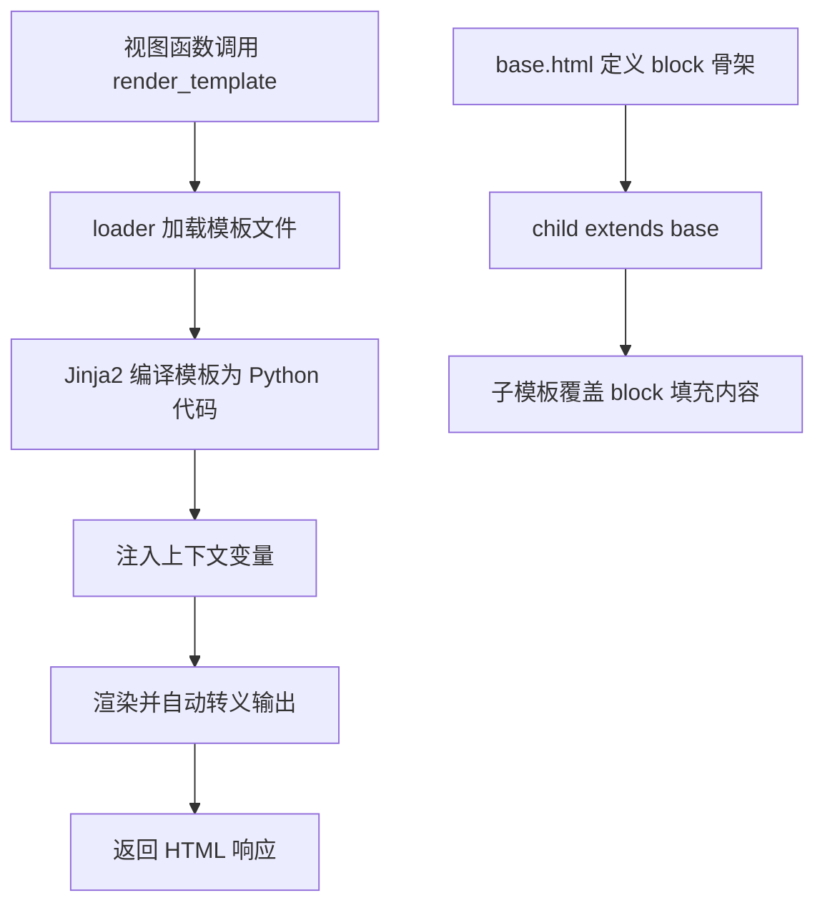

### Q122 · Django MTV 架构

> 难度:★★☆ | 标签:Django, MTV

**问**:解释 Django 的 MTV 模式,它与 MVC 的对应关系是什么?

**答**:Django 的 MTV:Model 负责数据与业务规则(对应 MVC 的 Model)、Template 负责展示层(对应 View)、View 负责接收请求返回响应的业务逻辑(对应 Controller)。请求路径是:URLconf 按 url 匹配到 View,View 调用 Model 读写数据、渲染 Template,返回 HttpResponse。对比 MVC 只是命名侧重不同,Django 把"控制器"职责交给了框架自身的 URL 分发。

```python
# file: code/03_Web后端开发/q122_django_mtv.py
# Django 项目关键文件示意(模块级代码,展示三层协作)
# urls.py  -> path 映射到 views
# views.py -> 业务逻辑
# models.py-> 数据层
# templates/xxx.html -> 展示层

URLS = {  # 模拟 urls.py
    '/books/': 'book_list',
    '/books/<id>/': 'book_detail',
}

def book_list(request):          # views.py
    from myapp.models import Book
    books = Book.objects.all()   # models.py:ORM 查询
    context = {'books': books}   # 传给 templates 渲染
    return {'template': 'book_list.html', 'context': context}

# 流程:请求 -> urls.py 匹配 -> view -> model 读写 -> template 渲染 -> response
print(book_list.__doc__ or 'MTV flow demo')
```

**追问**:
- MTV 里 View 对应 MVC 的什么?——Controller 的职责(接收请求返回响应);MVC 的 View 职责由 Template 承担,差异主要是命名。
- Django 没有显式 Controller 吗?——URLconf 分发 + View 函数共同承担;框架本身把控制器逻辑内置了。
- 为什么这个命名差异是高频考点?——它考察「理解职责而非背名词」:能画出请求路径 URLconf→View→Model→Template 就算答对。

### Q123 · Django ORM 模型定义与常用字段

> 难度:★★☆ | 标签:Django, ORM

**问**:如何定义 Django Model?一对一、一对多、多对多关系分别用什么字段?

**答**:模型继承 `models.Model`,每个字段映射数据库列,关系字段:外键 `ForeignKey`(一对多,多的那方持有)、`OneToOneField`(一对一)、`ManyToManyField`(多对多,Django 自动建中间表);都要写 `on_delete` 策略(CASCADE/SET_NULL/PROTECT)。常用 `Meta` 控制 ordering 和表名,`__str__` 提供可读表示,`related_name` 定义反向查询名。

```python
# file: code/03_Web后端开发/q123_django_models.py
# file: myapp/models.py  (Django 模块级代码)
try:
    from django.db import models
except ImportError:
    print("该题演示需要第三方库 django:pip install django,原理见正文")
    raise SystemExit(0)

class Author(models.Model):
    name = models.CharField(max_length=50, unique=True)
    bio = models.TextField(blank=True)

    class Meta:
        ordering = ['name']

    def __str__(self):
        return self.name

class Book(models.Model):
    title = models.CharField(max_length=200)
    author = models.ForeignKey(Author, on_delete=models.CASCADE,
                               related_name='books')       # 一对多
    price = models.DecimalField(max_digits=8, decimal_places=2)
    tags = models.ManyToManyField('Tag', blank=True)        # 多对多
    created_at = models.DateTimeField(auto_now_add=True)

class Tag(models.Model):
    name = models.CharField(max_length=30, unique=True)

# author.books.all()        反向查询
# book.tags.all()           多对多查询
# Book.objects.filter(author__name='alice')   跨表双下划线
```

**追问**:
- on_delete=PROTECT 什么时候用?——业务上不允许删除被引用对象(如财务记录);CASCADE 会连带删除,SET_NULL 要允许空值,选错就是数据事故。
- ManyToManyField 的 through 什么时候需要?——关系本身带属性(订单-商品的数量、加入时间)时自定义中间表;纯关联用默认表。
- related_name 不写会怎样?——默认 `<model>_set`,可读性差且重构易碎;显式命名是团队规范项。

### Q124 · Django 迁移机制

> 难度:★★☆ | 标签:Django, migration

**问**:`makemigrations` 和 `migrate` 的区别是什么?迁移冲突怎么处理?

**答**:`makemigrations` 把 models.py 的变更生成为迁移文件(版本化的 schema diff,存于 app/migrations/),`migrate` 把未应用的迁移按依赖顺序写入数据库并记录在 django_migrations 表;`sqlmigrate` 可预览 SQL,`showmigrations` 查看状态。多人协作产生的分支迁移冲突,用 `makemigrations --merge` 合并或 rebase 后重新生成;危险操作(删列)应先确认无引用,`--fake` 只改记录不动表,慎用。

```python
# file: code/03_Web后端开发/q124_django_migration.py
# 常用迁移命令(在项目根目录执行,注释形式自洽说明)
# python manage.py makemigrations          # models 变更 -> migrations/*.py
# python manage.py migrate                 # 应用迁移到数据库
# python manage.py showmigrations          # 查看迁移应用状态
# python manage.py sqlmigrate app 0002     # 预览某迁移的 SQL
# python manage.py migrate app 0001        # 回滚到指定迁移

# migrations/0002_add_price.py 生成内容示意
try:
    from django.db import migrations, models
except ImportError:
    print("该题演示需要第三方库 django:pip install django,原理见正文")
    raise SystemExit(0)

class Migration(migrations.Migration):
    dependencies = [('myapp', '0001_initial')]   # 依赖链保证顺序

    operations = [
        migrations.AddField(
            model_name='book',
            name='price',
            field=models.DecimalField(default=0, max_digits=8,
                                      decimal_places=2),
        ),
    ]
```

**追问**:
- 加了非空字段没有默认值会怎样?——makemigrations 会交互式询问一次性默认值或允许先置空,避免对存量数据报错。
- --fake 什么时候用?——手工已执行同等 DDL 或历史库补记录;乱用会造成 schema 与迁移记录不一致,后续迁移连环失败。
- 迁移冲突怎么产生与解决?——两个分支各生成同号迁移;`makemigrations --merge` 合并依赖,或 rebase 后重生成。
- 删列前要确认什么?——老版本代码是否还在读该列、是否有索引/视图依赖;先停写→灰度→删列是安全顺序。
### Q125 · QuerySet 惰性与 N+1 优化

> 难度:★★★ | 标签:Django, ORM 性能

**问**:QuerySet 是懒加载的吗?如何解决模板中遍历外键导致的 N+1 问题?

**答**:QuerySet 创建时不发 SQL,在迭代、切片、len()/list() 等"求值"时才查询,且结果有缓存(同一 queryset 二次迭代不再查库)。N+1 指循环访问外键字段时每行触发一次额外查询:`select_related('author')` 用 SQL JOIN 一次取回外键/一对一关联,`prefetch_related('tags')` 对多对多/反向关系分两条查询后在 Python 层拼装;`only/defer` 控制列加载,`exists/count` 替代无谓的全量取回。

```python
# file: code/03_Web后端开发/q125_queryset_nplus1.py
# 自包含演示:用内存对象 + SQL 计数器模拟 QuerySet,对比 N+1 与两种预取策略
class QueryStats:
    """模拟 django.db.connection.queries:记录"数据库"被查询的次数"""
    count = 0

    @classmethod
    def hit(cls, sql):
        cls.count += 1

class Author:
    def __init__(self, name):
        self.name = name

class Tag:
    def __init__(self, name):
        self.name = name

class Book:
    def __init__(self, title, author, tags):
        self.title = title
        self._author = author
        self._tags = list(tags)
        self._author_loaded = False   # False 时访问 author/tags 属性会"再查一次库"
        self._tags_loaded = False

    @property
    def author(self):
        if not self._author_loaded:   # N+1 的 N:每本书触发一次额外查询
            QueryStats.hit(f"SELECT * FROM author WHERE id = {id(self._author) % 100}")
            self._author_loaded = True
        return self._author

    @property
    def tags(self):
        if not self._tags_loaded:
            QueryStats.hit(f"SELECT * FROM tag WHERE book_id = '{self.title}'")
            self._tags_loaded = True
        return self._tags

BOOKS = [
    Book("三体", Author("刘慈欣"), [Tag("科幻"), Tag("小说")]),
    Book("呐喊", Author("鲁迅"), [Tag("文学")]),
    Book("朝花夕拾", Author("鲁迅"), [Tag("文学")]),
]

def bad_nplus1():
    QueryStats.count = 0
    QueryStats.hit("SELECT * FROM book")        # 迭代求值:第 1 条
    return [f'{b.title} by {b.author.name}' for b in BOOKS]
    # 每本书额外查询一次 author -> 1 + N 条 SQL(N=3 时共 4 条)

def good_select_related():
    # 模拟 select_related('author'):JOIN 一次取回,关联对象迭代前已装填
    QueryStats.count = 0
    for b in BOOKS:
        b._author_loaded = True
    QueryStats.hit("SELECT ... JOIN author ON author.id = book.author_id")
    return [f'{b.title} by {b.author.name}' for b in BOOKS]

def good_prefetch_related():
    # 模拟 prefetch_related('tags'):书 1 条 + 标签 1 条,共 2 条 SQL
    QueryStats.count = 0
    for b in BOOKS:
        b._tags_loaded = True
    QueryStats.hit("SELECT * FROM book")
    QueryStats.hit("SELECT * FROM tag WHERE book_id IN (...)")
    return [{b.title: [t.name for t in b.tags]} for b in BOOKS]
    # 注意:先 prefetch 再 all(),不要再写 b.tags.filter(...) 产生新查询

print(bad_nplus1(), "SQL 条数:", QueryStats.count)             # 4 条(1+N,N=3)
print(good_select_related(), "SQL 条数:", QueryStats.count)    # 1 条
print(good_prefetch_related(), "SQL 条数:", QueryStats.count)  # 2 条
```

**追问**:
- prefetch_related 的 Prefetch 对象有什么用?——自定义子查询与过滤:`Prefetch('tags', queryset=Tag.objects.filter(active=True))`,避免取回无用关联。
- select_related 能接多深?——跨多级外键 `select_related('a__b__c')` 一次 JOIN 取回;JOIN 过多会让单查询变慢,按访问路径权衡。
- 怎么在开发期发现 N+1?——`connection.queries` 计数、django-debug-toolbar、nplusone 检测库;测试断言查询次数是更硬的防线。

### Q126 · Django 信号机制

> 难度:★★☆ | 标签:Django, signal

**问**:Django 信号是什么?post_save 和 pre_save 的区别?使用时有什么坑?

**答**:信号是模型生命周期等事件的广播机制:实例在 `save()` 内先触发 `pre_save`(写库前,可修改待存值)再触发 `post_save`(写库后,`created=True` 表示是新建,适合发通知、清缓存);删除对应 pre/post_delete,m2m_changed 监听多对多变化。坑:信号隐式耦合难追踪,建议放 app 的 signals.py 并在 AppConfig.ready() 中注册;批量操作 `bulk_create/update()` 不触发 save 信号;receiver 要保证幂等以防重连重复执行。

```python
# file: code/03_Web后端开发/q126_django_signals.py
# myapp/signals.py (模块级代码)
try:
    from django.db.models.signals import post_save, pre_save
    from django.dispatch import receiver
    from myapp.models import Book
except ImportError:
    print("该题演示需要第三方库 django,且需在含 myapp.models 的 Django 项目上下文中运行:pip install django,原理见正文")
    raise SystemExit(0)

audit_log: list[str] = []

@receiver(pre_save, sender=Book)
def normalize_title(sender, instance, **kwargs):
    instance.title = instance.title.strip()      # 写库前修正数据

@receiver(post_save, sender=Book)
def on_book_saved(sender, instance, created, **kwargs):
    if created:
        audit_log.append(f'book created: {instance.title}')  # 建索引/发通知
    else:
        audit_log.append(f'book updated: {instance.title}')  # 清缓存

# myapp/apps.py 中注册:
# class MyAppConfig(AppConfig):
#     def ready(self):
#         import myapp.signals  # noqa: 导入即注册 receiver
```

**追问**:
- 为什么 bulk_create 不触发 save 信号?——它绕过模型 save() 直接拼批量 SQL;需要信号逻辑时改为循环 save 或在 bulk 后手动补事件。
- 信号放在哪注册?——app 的 signals.py + AppConfig.ready() 导入;否则接收器可能未被加载,静默失效。
- signals 的替代方案?——显式 service 层调用、领域事件入队;隐式魔法多了以后,调用链不可读是主要代价。

### Q127 · Django 中间件栈与自定义中间件

> 难度:★★★ | 标签:Django, 中间件

**问**:Django MIDDLEWARE 列表的顺序有什么影响?如何写一个自定义中间件?

**答**:`MIDDLEWARE` 是有序列表,第一个在最外层:请求按列表正序穿过各层的处理(如 SecurityMiddleware 先做安全检查),响应按逆序返回;process_view/异常处理/模板响应各有插入点。自定义中间件用函数式(`def mw(get_response)`)或类式(`__init__/__call__`),典型用途:Request-ID、租户识别、性能埋点。内置栈包含 Security、Session、Common、Csrf、Auth 等,顺序有官方约定,勿随意打乱。

```python
# file: code/03_Web后端开发/q127_django_middleware.py
# myapp/middleware.py (Django 模块级代码)
import time
import uuid

def request_id_middleware(get_response):
    def middleware(request):
        rid = request.headers.get('X-Request-ID', str(uuid.uuid4())[:8])
        request.rid = rid
        start = time.perf_counter()
        response = get_response(request)            # 内层处理
        response['X-Request-ID'] = rid
        response['X-Cost-Ms'] = str(round((time.perf_counter() - start) * 1000, 2))
        return response
    return middleware

class TimingMiddleware:
    def __init__(self, get_response):
        self.get_response = get_response

    def __call__(self, request):
        self.start = time.perf_counter()
        response = self.get_response(request)
        print(f'{request.path} took {time.perf_counter() - self.start:.3f}s')
        return response

# settings.py 注册(列表第一项最外层):
# MIDDLEWARE = [
#     'django.middleware.security.SecurityMiddleware',
#     'myapp.middleware.request_id_middleware',
#     'myapp.middleware.TimingMiddleware',
#     ... 其余内置中间件 ...
# ]
```

**追问**:
- 自定义中间件放 MIDDLEWARE 哪个位置?——Request-ID/日志放最前(覆盖一切);依赖认证的中间件必须在 AuthenticationMiddleware 之后。
- 函数式和类式中间件怎么选?——简单无状态用函数式;需要构造参数与实例状态(如限流器引用)用类式 `__init__(get_response)`。
- 中间件抛异常会怎样?——向上传给外层中间件与异常处理器;中间件内部要捕获自己关心的异常,别让清理逻辑漏执行。


### Q128 · DRF 序列化器 Serializer

> 难度:★★☆ | 标签:DRF, Serializer

**问**:DRF Serializer 如何做序列化与反序列化校验?ModelSerializer 省了什么?

**答**:Serializer 是"双向适配器":`.data` 把 ORM 对象转 dict(JSON),`is_valid()` 校验外部输入后 `.validated_data` 供业务使用、`.save()` 创建/更新实例;校验层次为字段级 `validate_<field>` → 对象级 `validate` → 自定义 validators。`ModelSerializer` 依据模型自动生成字段与 validators,`PrimaryKeyRelatedField` 处理关联,`read_only/write_only` 控制方向;只读敏感字段务必显式声明,防止批量赋值漏洞。

```python
# file: code/03_Web后端开发/q128_drf_serializer.py
# Django + DRF 模块级代码(需 INSTALLED_APPS 含 rest_framework)
try:
    from rest_framework import serializers
except ImportError:
    print("该题演示需要第三方库 djangorestframework:pip install djangorestframework(正文已讲清原理,安装后可运行)")
    raise SystemExit(0)

class AuthorSerializer(serializers.Serializer):
    id = serializers.IntegerField(read_only=True)
    name = serializers.CharField(max_length=50)

    def validate_name(self, value: str) -> str:
        if not value.strip():
            raise serializers.ValidationError('name 不能为空')
        return value.strip()

class BookSerializer(serializers.ModelSerializer):
    author = AuthorSerializer(read_only=True)
    author_id = serializers.IntegerField(write_only=True)

    class Meta:
        model_name = 'Book'   # 实际代码写 model = Book
        fields = ['id', 'title', 'price', 'author', 'author_id']
        read_only_fields = ['id']

    def validate_price(self, value):
        if value <= 0:
            raise serializers.ValidationError('price 必须大于 0')
        return value

    def create(self, validated_data):
        validated_data.pop('author_id', None)
        # 实际: return Book.objects.create(**validated_data)
        return validated_data
```

**追问**:
- is_valid() 通过后 save() 必须调吗?——只读接口只要 validated_data;写操作 save() 才落库,两者职责不同。
- ModelSerializer 怎么控制暴露字段?——fields 元组白名单、read_only_fields、自定义 SerializerMethodField;全量暴露 model 字段是越权泄漏来源。
- 字段级与对象级校验的执行顺序?——先 validate_<field> 再对象级 validate;跨字段逻辑放 validate(),字段格式放字段级。

### Q129 · DRF ViewSet 与 Router

> 难度:★★☆ | 标签:DRF, ViewSet

**问**:ViewSet 相比 APIView 的优势是什么?Router 生成了哪些路由?

**答**:`ModelViewSet` 把 list/retrieve/create/update/partial_update/destroy 六个标准动作聚合到一个类,配合 `DefaultRouter` 自动生成 RESTful 路由表,代码量远低于逐个写 APIView;`@action` 装饰器追加自定义端点(如 `ViewSet` 上的 `down()`)。权限/过滤/分页通过类属性 `permission_classes/queryset` 声明,配合 `get_serializer_class()` 按动作切换序列化器。

```python
# file: code/03_Web后端开发/q129_drf_viewset.py
# Django + DRF 模块级代码
try:
    from rest_framework import viewsets, routers
    from rest_framework.decorators import action
    from rest_framework.response import Response
except ImportError:
    print("该题演示需要第三方库 djangorestframework:pip install djangorestframework(正文已讲清原理,安装后可运行)")
    raise SystemExit(0)

class BookViewSet(viewsets.ModelViewSet):
    queryset = None          # 实际: Book.objects.all()
    serializer_class = None  # 实际: BookSerializer

    @action(detail=True, methods=['post'])
    def publish(self, request, pk=None):
        # 实际: book = self.get_object(); book.status = 'published'; book.save()
        return Response({'id': pk, 'status': 'published'})

# urls.py:
router = routers.DefaultRouter()
# router.register(r'books', BookViewSet)
# 自动生成:
# GET    /books/        -> list
# POST   /books/        -> create
# GET    /books/{pk}/   -> retrieve
# PUT    /books/{pk}/   -> update
# PATCH  /books/{pk}/   -> partial_update
# DELETE /books/{pk}/   -> destroy
# POST   /books/{pk}/publish/ -> 自定义 action
urlpatterns = router.urls if hasattr(routers, 'DefaultRouter') else []
```

**追问**:
- ViewSet 和 APIView 怎么选?——标准 CRUD + Router 自动路由用 ViewSet;非标准端点、需要完全控制方法映射用 APIView。
- @action(detail=False) 是什么意思?——作用于集合级(`GET /users/active`),detail=True 作用于单个对象(`POST /users/42/down`)。
- get_serializer_class 的常见用法?——按 self.action 返回不同序列化器:list 用简版、create 用完整版,避免一个 serializer 包打天下。

### Q130 · DRF 分页配置与游标分页

> 难度:★★☆ | 标签:DRF, 分页

**问**:DRF 有哪几种分页方式?深度分页问题怎么解决?

**答**:内置三种:`PageNumberPagination`(`?page=2&size=10`,实现简单但大偏移量查询慢)、`LimitOffsetPagination`(`?limit=&offset=`,灵活但同样受深分页拖累)、`CursorPagination`(基于游标如 created_at+id,只能顺序翻页但性能稳定,适合信息流)。全局用 `DEFAULT_PAGINATION_CLASS`,也可自定义分页类调整 page_size_query_param、max_page_size 防止拉全量。深分页本质靠"游标 + 索引"或限制最大页码解决。

```python
# file: code/03_Web后端开发/q130_drf_pagination.py
# Django + DRF 模块级代码
try:
    from rest_framework.pagination import (
        PageNumberPagination, CursorPagination,
    )
    from rest_framework.response import Response
except ImportError:
    print("该题演示需要第三方库 djangorestframework:pip install djangorestframework(正文已讲清原理,安装后可运行)")
    raise SystemExit(0)

class StandardPagination(PageNumberPagination):
    page_size = 10
    page_size_query_param = 'size'      # ?size=20 动态页大小
    max_page_size = 100                 # 上限防滥用

class FeedCursorPagination(CursorPagination):
    page_size = 20
    ordering = '-created_at'            # 游标基于该排序键

class BookListAPI:
    pagination_class = StandardPagination

    def paginate(self, queryset, request):
        paginator = self.pagination_class()
        page = paginator.paginate_queryset(queryset, request)
        return paginator.get_paginated_response(page)
        # 响应: {"count": 123, "next": "...?page=2", "previous": null, "results": [...]}

print(StandardPagination().page_size)   # 10
```

**追问**:
- 为什么 CursorPagination 性能稳定?——基于有序唯一游标(如 created_at+id)做范围查询,翻页不随 offset 增长变慢;代价是只能顺序翻、不能跳页。
- 怎么防止 page_size 拉全量?——分页类里设 max_page_size,超限强制截断;漏配的接口会被一次循环翻页拖垮。
- 深分页的数据库侧解法?——延迟关联/游标(见 Q184),`LIMIT 100000,20` 之前必须先想到游标化改造。

### Q131 · DRF 认证与权限体系

> 难度:★★★ | 标签:DRF, 认证, 权限

**问**:DRF 的认证和权限是两层什么关系?如何实现"登录可读、管理员可写"?

**答**:认证 Authentication 先确定 `request.user`(TokenAuthentication/JWTAuth 等,多个类按序尝试),权限 Permission 再基于该身份判断放行(`IsAuthenticated`、`IsAdminUser`、自定义 `has_permission`/`has_object_permission`);DRF 请求顺序为:认证 → 权限 → 节流 → 视图。组合方式:全局 `DEFAULT_AUTHENTICATION_CLASSES` 兜底,视图级 `authentication_classes/permission_classes` 覆盖;对象级权限在 has_object_permission 中做资源属主校验。

```python
# file: code/03_Web后端开发/q131_drf_permission.py
# Django + DRF 模块级代码
try:
    from rest_framework.permissions import BasePermission, SAFE_METHODS
    from rest_framework.authentication import TokenAuthentication
except ImportError:
    print("该题演示需要第三方库 djangorestframework:pip install djangorestframework(正文已讲清原理,安装后可运行)")
    raise SystemExit(0)

class IsAdminOrReadOnly(BasePermission):
    """安全方法放行,写操作仅管理员"""
    def has_permission(self, request, view):
        if request.method in SAFE_METHODS:
            return bool(request.user and request.user.is_authenticated)
        return bool(request.user and request.user.is_staff)

    def has_object_permission(self, request, view, obj):
        # 对象级:普通用户只能读自己创建的资源
        if request.method in SAFE_METHODS:
            return True
        return request.user.is_staff or getattr(obj, 'owner_id', None) == request.user.id

class BookViewSet:
    authentication_classes = [TokenAuthentication]
    permission_classes = [IsAdminOrReadOnly]
    # 请求流程: Token 认证确定 user -> has_permission -> get_object -> has_object_permission
```

**追问**:
- 认证和权限的执行顺序?——认证先确定身份,权限再判断放行,然后节流,最后进视图;顺序错了权限判断会拿不到 user。
- has_permission 与 has_object_permission 区别?——前者视图级(能否访问该端点),后者对象级(能否操作这条数据);对象级要显式调用 get_object 后触发。
- 多认证类的优先级?——按列表顺序尝试,第一个成功者生效;JWT 与 Session 混合部署时把 API 客户端用的放前面。

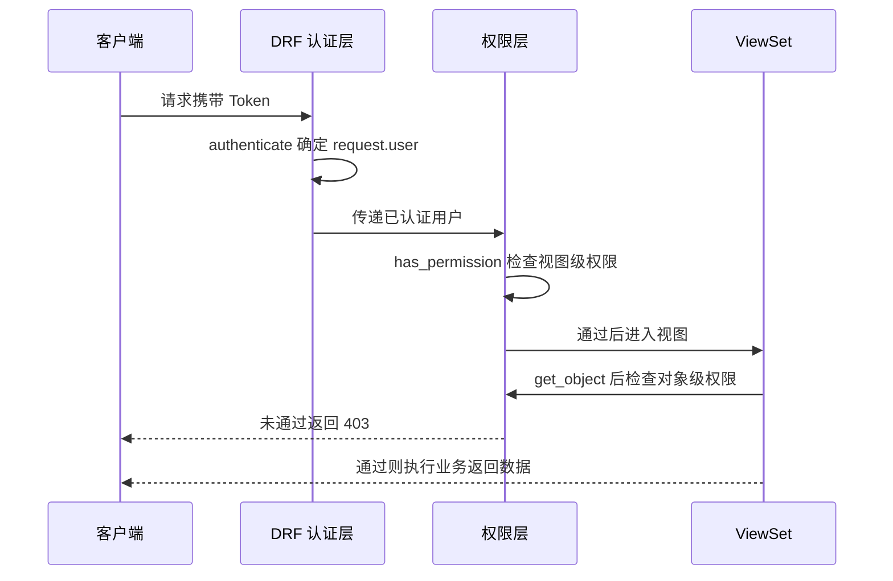

### Q132 · Session 与 JWT 认证机制对比

> 难度:★★★ | 标签:Session, JWT, 认证

**问**:Session 和 JWT 两种认证方案各自的工作流程与优缺点是什么?如何选型?

**答**:Session:登录后服务端存储会话(内存/Redis/DB),下发 `Set-Cookie: sessionid=...`,后续请求浏览器自动带 Cookie,服务端查存储确认身份;有状态、可随时踢人、安全属性可控(HttpOnly),但多实例需共享存储。JWT:无状态,签名自包含用户信息,天然适合分布式与移动端,但不可撤销、泄露即失控。选型:同源 Web 应用推荐 Session+Cookie;前后端分离/多端/网关间调用用 JWT(短过期+refresh);混合架构可 JWT 落 Redis 兼顾可撤销性。

```python
# file: code/03_Web后端开发/q132_session_jwt.py
import hmac
import base64
import json

SECRET = b'change-me'

def make_session(store: dict, user: str) -> str:
    sid = 'sess-0001'
    store[sid] = {'user': user}                 # 服务端保存状态
    return sid

def check_session(store: dict, sid: str):
    return store.get(sid, {}).get('user')       # 有状态:查存储

def b64(data: bytes) -> str:
    return base64.urlsafe_b64encode(data).rstrip(b'=').decode()

def sign_jwt(payload: dict) -> str:
    header = b64(json.dumps({'alg': 'HS256'}).encode())
    body = b64(json.dumps(payload).encode())
    sig = hmac.new(SECRET, f'{header}.{body}'.encode(), 'sha256').hexdigest()
    return f'{header}.{body}.{sig}'             # 无状态:签名即凭证

session_store: dict = {}
sid = make_session(session_store, 'alice')
token = sign_jwt({'sub': 'alice', 'exp': 4102444800})
print(check_session(session_store, sid), sign_jwt.__name__)
```

**追问**:
- JWT 在多实例下真的无状态吗?——验证签名本地即可;但一旦要撤销(登出/封号)就得引入共享黑名单,退化为半有状态。
- Session 集中存储的选型?——Redis 主流:过期自动管理、读写快;DB 存储便于审计但每次请求多一跳。
- 混合方案长什么样?——JWT 内嵌 session 版本号或 jti 落 Redis,签发快、可撤销;网关统一校验,业务服务无感。


### Q133 · Cookie 安全属性

> 难度:★★☆ | 标签:Cookie, 安全

**问**:HttpOnly、Secure、SameSite 分别防什么?如何组合设置一个登录 Cookie?

**答**:`HttpOnly` 禁止 JS 读取,防 XSS 窃取;`Secure` 仅 HTTPS 传输,防明文嗅探;`SameSite=Lax/Strict` 限制跨站携带,防 CSRF(Lax 允许顶级导航 GET,Strict 全禁,`None` 必须配 Secure);再加 `Path/Domain` 限定范围与 `Max-Age/Expires` 控制生命周期。登录态 Cookie 推荐组合:HttpOnly + Secure + SameSite=Lax + 合理过期时间;CSRF Token 作为纵深防御仍建议保留。

```python
# file: code/03_Web后端开发/q133_cookie_attrs.py
try:
    from fastapi import FastAPI, Response
except ImportError:
    print("该题演示需要第三方库 fastapi:pip install fastapi[all],原理见正文")
    raise SystemExit(0)

app = FastAPI()

@app.post('/login')
def login(username: str, password: str, response: Response):
    # 实际:校验密码后签发 session id 或 JWT
    response.set_cookie(
        key='sessionid',
        value='fake-session-id',
        httponly=True,       # 防 XSS 读取
        secure=True,         # 仅 HTTPS
        samesite='lax',      # 防 CSRF,允许顶级导航
        max_age=3600,        # 1 小时
        path='/',
    )
    return {'msg': 'logged in'}

@app.post('/logout')
def logout(response: Response):
    response.delete_cookie('sessionid', path='/')
    return {'msg': 'logged out'}
```

**追问**:
- SameSite=None 什么时候用?——跨站场景(第三方嵌入、SSO 回跳)必须显式 None 且强制 Secure;默认 Lax 已挡大多数 CSRF。
- HttpOnly 挡得住 XSS 吗?——挡住 cookie 窃取,挡不住 XSS 本身;还能伪造请求(带 cookie 自动附上),CSRF token 与 CSP 仍要。
- Domain 属性设宽有什么风险?——`Domain=.example.com` 让所有子域可携带,任一子域 XSS 即波及全站;尽量不设 Domain。

### Q134 · CSRF 原理与防护

> 难度:★★☆ | 标签:CSRF, 安全

**问**:CSRF 攻击的原理是什么?为什么 JWT 放 Header 就天然免疫?

**答**:CSRF 利用浏览器"自动携带 Cookie"的行为:恶意站点诱导已登录用户发起跨站请求,服务器误认为是用户本人操作。防护核心是"验证请求来自本站同源表单":Django 内置 CsrfViewMiddleware 校验表单/头部的 csrftoken 与 Cookie 双提交;SameSite=Lax 已挡住绝大多数跨站 POST;JWT 放在 Authorization 头由 JS 显式携带,浏览器不会自动附加,故免疫 CSRF——代价是 token 必须防 XSS 窃取。

```python
# file: code/03_Web后端开发/q134_csrf.py
import secrets

# Django 内置方案的双提交校验逻辑示意
SESSIONS: dict[str, str] = {}     # session_id -> csrf_token

def issue_token(session_id: str) -> str:
    token = secrets.token_urlsafe(32)
    SESSIONS[session_id] = token          # ① Cookie/Session 侧存一份
    return token                          # ② 表单 hidden 字段发一份

def verify(session_id: str, form_token: str) -> bool:
    expected = SESSIONS.get(session_id)
    return bool(expected) and secrets.compare_digest(expected, form_token)

# settings.py: MIDDLEWARE 需含 CsrfViewMiddleware
# 模板: <form></form>
# 前后端分离: 前端从 cookie 取 csrftoken 放入 X-CSRFToken 头

sid = 'sess-0001'
tok = issue_token(sid)
print(verify(sid, tok), verify(sid, 'evil-token'))
```

**追问**:
- 双提交 Cookie 的原理?——CSRF token 同时放 cookie 与表单/头,服务端比对一致才放行;攻击者跨站读不到本站 cookie 所以拼不出匹配值。
- 纯 API(JSON Token 头携带)还需要 CSRF 防护吗?——浏览器不会自动附 Authorization 头,天然免疫;但 token 存 cookie 的 SPA 仍要防。
- SameSite=Lax 放行了什么?——顶级导航的 GET(链接跳转);所以 GET 请求必须保持无副作用,否则 Lax 也防不住。

### Q135 · Django 模板与静态文件管理

> 难度:★★☆ | 标签:Django, static

**问**:Django 开发与生产环境如何组织模板和静态文件?collectstatic 干什么的?

**答**:模板通过 `TEMPLATES[DIRS]` 加全局目录、app 内 `templates/` 自动发现;静态文件同理,app 的 `static/` + `STATICFILES_DIRS` 在开发期由 `runserver` 自动服务。生产环境执行 `collectstatic` 把所有静态文件汇总到 `STATIC_ROOT`,交给 Nginx/CDN 直接服务(不要走 Django);`` 标签生成带版本指纹的 URL,配合 ManifestStaticFilesStorage 做缓存失效。

```python
# file: code/03_Web后端开发/q135_django_static.py
# settings.py 关键配置(模块级自洽示意)
DEBUG = True
BASE_DIR = '/srv/myproject'

TEMPLATES = [{
    'BACKEND': 'django.template.backends.django.DjangoTemplates',
    'DIRS': [f'{BASE_DIR}/templates'],        # 全局模板目录
    'APP_DIRS': True,                          # 自动发现各 app 的 templates/
    'OPTIONS': {'context_processors': [
        'django.template.context_processors.request',
        'django.contrib.auth.context_processors.auth',
    ]},
}]

STATIC_URL = '/static/'
STATICFILES_DIRS = [f'{BASE_DIR}/assets']     # 项目级静态目录
STATIC_ROOT = f'{BASE_DIR}/staticfiles'       # collectstatic 汇总目标
MEDIA_URL = '/media/'                          # 用户上传
MEDIA_ROOT = f'{BASE_DIR}/media'

# 开发期: runserver 自动服务 static
# 生产: python manage.py collectstatic 后由 Nginx alias /static/ -> STATIC_ROOT
print(STATIC_ROOT)
```

**追问**:
- 为什么生产不让 Django 服务静态文件?——Python 处理静态文件浪费 worker 且慢;Nginx/CDN 直服,Django 只出动态。
- 静态文件缓存怎么失效?——ManifestStaticFilesStorage 给文件名加内容指纹,内容变文件名变,引用同步更新,缓存永不脏。
- collectstatic 的文件冲突怎么办?——不同 app 同名静态文件按 STATICFILES_DIRS 顺序覆盖;命名加 app 前缀是惯例。

### Q136 · Gunicorn 与 Uvicorn 部署选择

> 难度:★★☆ | 标签:Gunicorn, Uvicorn, 部署

**问**:同步 Django 项目和异步 FastAPI 项目分别怎么选部署组合?worker 类型如何决定?

**答**:WSGI 栈:Gunicorn 管理 worker 进程承载 Flask/Django(同步);ASGI 栈:FastAPI/Django-async 用 Uvicorn 启动,生产建议 `gunicorn -k uvicorn.workers.UvicornWorker`(Gunicorn 做进程管理与崩溃重启,Uvicorn 做协议与事件循环)。worker 类型按应用特征选:IO 密集用 gevent/uvicorn worker,CPU 密集用 sync+多进程;Django 双栈时 ASGI 是未来方向,可用 asgi.py + Uvicorn。

```python
# file: code/03_Web后端开发/q136_gunicorn_conf.py
# gunicorn_conf.py —— Gunicorn 的 Python 配置文件,可直接被 -c 引用
import multiprocessing

bind = '127.0.0.1:8000'
workers = multiprocessing.cpu_count() * 2 + 1   # 经验公式
worker_class = 'uvicorn.workers.UvicornWorker'  # ASGI 应用用这个
# worker_class = 'sync'                          # 纯同步 WSGI 用这个
timeout = 30                # worker 超时被杀
graceful_timeout = 20
keepalive = 5
accesslog = '-'
errorlog = '-'
preload_app = True          # 主进程预加载,省内存但注意 fork 安全

# 启动示例:
# 同步 Flask:   gunicorn -c gunicorn_conf.py myapp.wsgi:application
# 异步 FastAPI: gunicorn -c gunicorn_conf.py myapp.asgi:app
```

**追问**:
- Gunicorn 管理 UvicornWorker 的意义?——Gunicorn 负责 worker 生命周期、优雅重启、超时回收;Uvicorn 只管协议与事件循环,各司其职。
- sync worker 遇到慢客户端会怎样?——worker 被占住等客户端;必须前置 Nginx 做请求缓冲,或改异步 worker。
- 优雅重启怎么实现?——`kill -HUP` 让 Gunicorn 拉起新 worker、旧 worker 处理完存量请求退出;发布不丢在途请求。

### Q137 · Worker 数量与容量评估

> 难度:★★★ | 标签:部署, 容量

**问**:生产环境 worker 和线程数如何估算?内存与 CPU 如何权衡?

**答**:经典起点:CPU-bound 应用 `workers = CPU 核数`(避免争抢),IO-bound 用 `核数*2+1` 再加线程或换异步 worker;内存受限时用 `workers = 可用内存 / 单 worker 内存` 反推。线程模型下 `threads = workers * 每进程线程数`,受 GIL 限制线程只对 IO 等待有效。压测才是最终依据:用 wrk/locust 找到吞吐拐点与 p99 延迟达标配置,并给数据库连接池留余量(每 worker 连接数 × workers ≤ DB max_connections)。

```python
# file: code/03_Web后端开发/q137_worker_sizing.py
def estimate_workers(cpu_cores: int, per_worker_mb: int,
                     total_mb: int, io_bound: bool = True) -> dict:
    by_cpu = cpu_cores * 2 + 1 if io_bound else cpu_cores
    by_mem = max(total_mb // per_worker_mb, 1)
    workers = min(by_cpu, by_mem)
    return {
        'recommended_workers': workers,
        'limited_by': 'cpu' if by_cpu <= by_mem else 'memory',
        'note': '最终以压测 p99 与吞吐拐点为准',
    }

# 4 核 8G,单 worker 约 400MB 的 IO 密集服务
print(estimate_workers(cpu_cores=4, per_worker_mb=400, total_mb=8192))
# {'recommended_workers': 9, 'limited_by': 'memory', ...}
```

**追问**:
- 为什么是「核数*2+1」而不是更多?——IO 等待期间线程切换让 CPU 保持忙;线程过多上下文切换开销反噬,经验值来自实测拐点。
- 数据库连接数怎么算余量?——每 worker 连接池 × workers ≤ DB max_connections 的 70-80%,给运维与批处理留头寸。
- 压测要看哪些指标定容?——吞吐拐点、P99、错误率、CPU/内存;单看 QPS 会选到延迟爆炸的配置。

### Q138 · Nginx 反向代理配置要点

> 难度:★★☆ | 标签:Nginx, 反向代理

**问**:Nginx 在 Python Web 架构中的角色是什么?代理给 Gunicorn/Uvicorn 要注意哪些配置?

**答**:Nginx 负责 TLS 终止、静态文件直服、请求缓冲、负载均衡与限流,屏蔽后端进程细节。代理要点:`proxy_pass` 指向 upstream;必须传 `Host` 与 `X-Forwarded-For/X-Forwarded-Proto` 让应用拿到真实客户端 IP 与协议(FastAPI 中 Uvicorn 用 `--proxy-headers` + `--forwarded-allow-ip` 信任);`client_max_body_size` 放开上传限制;`proxy_read_timeout` 覆盖慢接口;WebSocket 需要 Upgrade/Connection 头,但普通请求不能带这两个头。upstream 的 `keepalive` 必须配合 `proxy_http_version 1.1`,并用 map 让普通请求的 Connection 头为空、仅 WS 请求传 upgrade,否则长连接全部失效。

```nginx
# file: code/03_Web后端开发/q138_nginx.conf
map $http_upgrade $connection_upgrade {
    default upgrade;
    ''      '';   # 普通请求不带 Connection 头,保留 upstream keepalive
}

upstream app_pool {
    server 127.0.0.1:8000;
    server 127.0.0.1:8001;
    keepalive 32;
}

server {
    listen 443 ssl;
    server_name api.example.com;

    ssl_certificate     /etc/ssl/fullchain.pem;
    ssl_certificate_key /etc/ssl/privkey.pem;

    client_max_body_size 20m;         # 匹配应用上传上限
    proxy_read_timeout 60s;

    location /static/ {
        alias /srv/myproject/staticfiles/;   # 静态文件直服
        expires 30d;
    }

    location / {
        proxy_pass http://app_pool;
        proxy_http_version 1.1;              # upstream keepalive 的前提
        proxy_set_header Host $host;
        proxy_set_header X-Real-IP $remote_addr;
        proxy_set_header X-Forwarded-For $proxy_add_x_forwarded_for;
        proxy_set_header X-Forwarded-Proto $scheme;
        proxy_set_header Upgrade $http_upgrade;      # WebSocket 支持
        proxy_set_header Connection $connection_upgrade;   # 普通请求为空,仅 WS 为 upgrade
    }
}
```

**追问**:
- 不传 X-Forwarded-For 会有什么问题?——应用把 Nginx IP 当客户端 IP,限流、审计、风控全部失效;要 `--proxy-headers` + 白名单可信代理。
- proxy_read_timeout 设多少?——大于后端最慢接口(含长轮询);SSE/WebSocket 场景要单独调 proxy_buffering off。
- 请求缓冲为什么重要?——Nginx 先收完再转后端,慢客户端不占用应用 worker;上传大文件场景反而要注意 body 过大先落地。

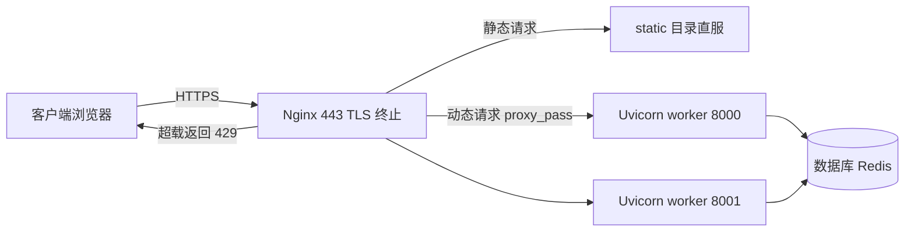

### Q139 · 限流的常见算法

> 难度:★★★ | 标签:限流, 高可用

**问**:固定窗口、滑动窗口、令牌桶、漏桶四种限流算法的区别是什么?

**答**:固定窗口计数最简单,但窗口边界处允许 2 倍突刺;滑动窗口按时间片加权统计消除突刺;漏桶以恒定速率放行,强行平滑但无法应对合理突发;令牌桶按速率生成令牌、桶有容量,允许短时突发又限制平均速率,是最常用选择。分布式场景用 Redis + Lua 保证计数原子性;限流键按 IP/用户/接口粒度选择,超出返回 429 并附 Retry-After。

```python
# file: code/03_Web后端开发/q139_rate_limit_algo.py
import time

class TokenBucket:
    """令牌桶:rate 个/秒,容量 burst 允许突发"""
    def __init__(self, rate: float, burst: int):
        self.rate = rate
        self.burst = burst
        self.tokens = float(burst)
        self.last = time.monotonic()

    def allow(self, cost: int = 1) -> bool:
        now = time.monotonic()
        self.tokens = min(self.burst, self.tokens + (now - self.last) * self.rate)
        self.last = now
        if self.tokens >= cost:
            self.tokens -= cost
            return True
        return False

class FixedWindow:
    """固定窗口:实现简单但有边界突刺"""
    def __init__(self, limit: int, window: float):
        self.limit = limit
        self.window = window
        self.count = 0
        self.start = time.monotonic()

    def allow(self) -> bool:
        now = time.monotonic()
        if now - self.start >= self.window:
            self.count, self.start = 0, now
        self.count += 1
        return self.count <= self.limit

bucket = TokenBucket(rate=5, burst=10)
print(sum(bucket.allow() for _ in range(15)))   # 前 15 次约放行 10+若秒
```

**追问**:
- Redis+Lua 为什么能保证限流原子?——计数、判断、过期在一个脚本内执行,单线程模型下不被插队;应用层两步操作有竞态。
- 限流键的粒度怎么选?——用户 > IP > 接口 组合:登录接口按 IP,业务接口按用户;按 IP 在 NAT 后会误伤。
- 429 之后客户端该做什么?——读 Retry-After 指数退避,失败进入熔断;无脑立即重试等于自我放大。

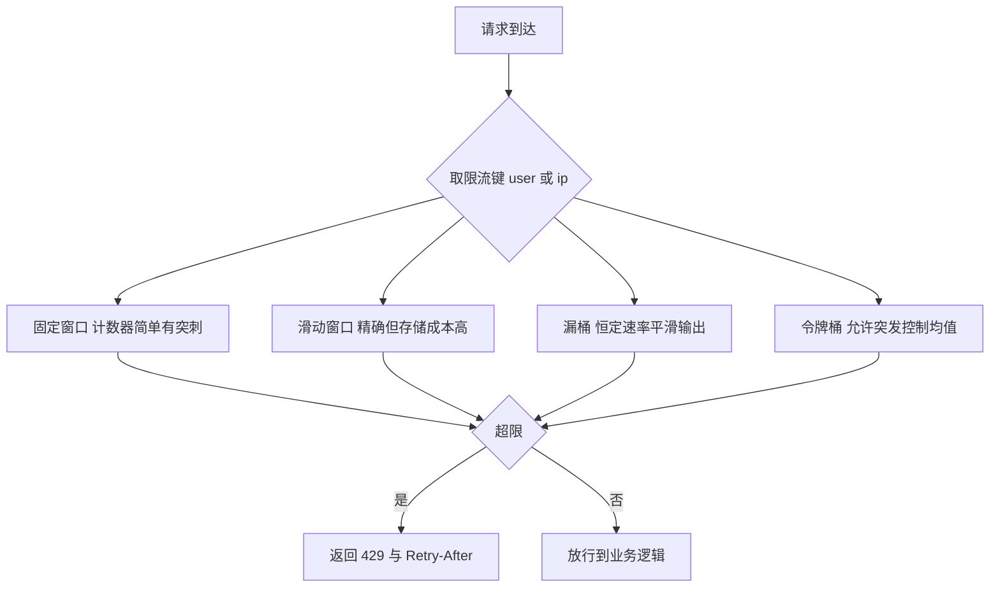

### Q140 · FastAPI 中间件实现 IP 限流

> 难度:★★☆ | 标签:FastAPI, 限流

**问**:如何在 FastAPI 里实现一个简单的按 IP 限流中间件?分布式部署怎么改?

**答**:在中间件里取 `request.client.host` 作为键,配合 Q139 的计数器判断,超限直接返回 429 JSON 响应(不进入路由)。单机内存计数即可;多实例部署必须把计数器外移到 Redis(用 INCR + EXPIRE 的原子脚本),并注意经过 Nginx 后真实 IP 要从 `X-Forwarded-For` 解析,同时只信任可信代理头防伪造。

```python
# file: code/03_Web后端开发/q140_fastapi_ratelimit.py
import time
from collections import defaultdict, deque
try:
    from fastapi import FastAPI, Request, Response
    from fastapi.responses import JSONResponse
except ImportError:
    print("该题演示需要第三方库 fastapi:pip install fastapi[all],原理见正文")
    raise SystemExit(0)

app = FastAPI()
WINDOW = 10       # 秒
LIMIT = 5         # 每窗口最多 5 次
hits: dict[str, deque] = defaultdict(deque)

@app.middleware('http')
async def rate_limit(request: Request, call_next):
    # 生产: 真实 IP 从 X-Forwarded-For 解析且只信任可信代理
    ip = request.client.host if request.client else 'unknown'
    now = time.monotonic()
    q = hits[ip]
    while q and q[0] <= now - WINDOW:
        q.popleft()
    if len(q) >= LIMIT:
        return JSONResponse(status_code=429,
                            content={'detail': 'too many requests'})
    q.append(now)
    return await call_next(request)

@app.get('/ping')
def ping():
    return {'msg': 'pong'}
```

**追问**:
- 多实例部署限流计数放哪?——Redis INCR+EXPIRE 原子脚本,键含接口与窗口;进程内计数每实例各一份,总量失控。
- 从 X-Forwarded-For 取 IP 为什么有伪造风险?——该头可被客户端伪造追加,只能取「可信代理写入的最后一跳」;Uvicorn 用 --forwarded-allow-ip 白名单。
- 限流被触发后返回什么?——429 + Retry-After + 简洁 JSON;别让限流响应本身又很重。

### Q141 · 幂等接口设计:Idempotency-Key

> 难度:★★★ | 标签:幂等性, 分布式

**问**:支付下单这类非幂等 POST 如何保证网络重试不重复扣款?

**答**:标准做法是 Idempotency-Key:客户端为每笔业务操作生成唯一键(如 UUID)随请求发送;服务端以键为锁/缓存——首次请求执行业务并存储"键 → 响应结果",重试命中则直接返回已存结果,不重复执行;处理中的重复请求可返回 409 或挂起等待。实现要点:键需带过期时间与租户隔离,结果存储与业务写入要在同一事务或用 Redis SETNX + 消息表保证原子性。

```python
# file: code/03_Web后端开发/q141_idempotency_key.py
try:
    from fastapi import FastAPI, Header, HTTPException
except ImportError:
    print("该题演示需要第三方库 fastapi:pip install fastapi[all],原理见正文")
    raise SystemExit(0)

app = FastAPI()
results: dict[str, dict] = {}          # 生产用 Redis + TTL

@app.post('/payments')
def create_payment(amount: int,
                   idempotency_key: str = Header(...)):
    if idempotency_key in results:      # 重试:返回首次结果
        return results[idempotency_key]
    if amount <= 0:
        raise HTTPException(400, 'amount must be positive')
    # 实际: 在同一事务中写入订单 + 存储幂等记录
    resp = {'order_id': f'pay-{len(results) + 1:04d}', 'amount': amount}
    results[idempotency_key] = resp
    return resp
# 客户端: 相同 Idempotency-Key 重发 N 次,服务端只扣款一次
```

**追问**:
- 与数据库唯一索引去重的区别?——唯一索引是最终防线,幂等键在入口层提前返回一致响应,两者通常叠加使用。
- 幂等键的结果存多久、按什么隔离?——带 TTL(覆盖最大重试窗口)且键空间含租户/用户维度;全局唯一键会被碰撞误命中。
- 处理中的重复请求怎么办?——SETNX 标记 processing,后来的返回 409 或轮询等待;完成态写回后重试者拿到原响应。
- Redis 记录和 DB 写入不一致怎么办?——同一事务做不到就「先 DB 后 Redis + 消息表补偿」;以 DB 唯一约束为最终防线。
### Q142 · API 版本管理策略

> 难度:★★☆ | 标签:API 设计, 版本

**问**:API 为什么要版本化?URL 版本和 Header 版本各有什么优劣?

**答**:版本化让破坏性变更(改字段语义、删字段)在不中断老客户端的前提下演进。主流方案:URL 版本 `https://api.example.com/v1/users` 直观、易路由、可缓存,最常用;Header 版本 `Accept: application/vnd.myapp.v2+json` 保持 URL 稳定但调试不直观。原则:非破坏性变更(加可选字段)不升版本,破坏性变更才升;同一版本内只做向后兼容演进;FastAPI 用 APIRouter 按 prefix 拆分版本目录,老版本设废弃期并返回 Sunset 头。

```python
# file: code/03_Web后端开发/q142_api_version.py
try:
    from fastapi import FastAPI, APIRouter, Request
except ImportError:
    print("该题演示需要第三方库 fastapi:pip install fastapi[all],原理见正文")
    raise SystemExit(0)

app = FastAPI(title='versioned api')

v1 = APIRouter(prefix='/v1', deprecated=True)   # 标记废弃
v2 = APIRouter(prefix='/v2')

@v1.get('/users/{uid}')
def get_user_v1(uid: int):
    return {'id': uid, 'name': 'alice', 'email': 'a@x.com'}

@v2.get('/users/{uid}')
def get_user_v2(uid: int, request: Request):
    # v2 只加字段不改语义:向后兼容,不破坏 v1 客户端
    return {'id': uid, 'name': 'alice',
            'profile': {'email': 'a@x.com'}}

app.include_router(v1)
app.include_router(v2)
```

**追问**:
- URL 版本和 Header 版本怎么选?——优先 URL 版本:可缓存、可路由、调试直观;Header 版本只在网关能力成熟时用。
- 同一版本内怎么兼容演进?——只加可选字段、不改字段语义、新增端点;删字段/改类型必须升版本并给 Sunset 头过渡期。
- 废弃的旧版本怎么下线?——监控旧版本流量→公告 Sunset→返回弃用头→流量归零后下线;直接关停等于制造事故。

### Q143 · 异步应用中的阻塞调用与 CPU 密集处理

> 难度:★★★ | 标签:asyncio, 性能

**问**:async 路由里调了阻塞函数会怎样?CPU 密集任务怎么不拖垮事件循环?

**答**:async 路由中的阻塞调用(同步 requests、time.sleep、重 CPU 计算)会卡住整个事件循环,所有并发请求一起超时——这是 ASGI 应用最常见的事故。解法:IO 阻塞换成异步库(aiohttp/asyncpg/redis.asyncio)或用 `run_in_threadpool`(FastAPI 对同步 def 路由自动这么做的机制);CPU 密集用 `loop.run_in_executor` 抛给进程池,或干脆拆成独立 worker/任务队列。混合部署时同步与异步 worker 分池。

```python
# file: code/03_Web后端开发/q143_blocking_offload.py
import asyncio
import time
from concurrent.futures import ProcessPoolExecutor
try:
    from fastapi import FastAPI
    from fastapi.concurrency import run_in_threadpool
    import httpx   # pip install httpx
except ImportError:
    print("该题演示需要第三方库 fastapi:pip install fastapi[all],原理见正文")
    raise SystemExit(0)

app = FastAPI()
process_pool = ProcessPoolExecutor(max_workers=2)

def heavy_cpu(n: int) -> int:          # CPU 密集,放进程池
    return sum(i * i for i in range(n))

def blocking_io() -> str:              # 阻塞 IO,放线程池
    time.sleep(1)
    return 'done'

@app.get('/cpu/{n}')
async def cpu_route(n: int):
    loop = asyncio.get_running_loop()
    result = await loop.run_in_executor(process_pool, heavy_cpu, n)
    return {'result': result}

@app.get('/io')
async def io_route():
    # 错误示范: time.sleep(1) 直接写在 async 里会阻塞事件循环
    out = await run_in_threadpool(blocking_io)
    async with httpx.AsyncClient() as client:   # 正确: 异步 HTTP
        await client.get('https://httpbin.org/get')
    return {'out': out}
```

**追问**:
- 怎么发现 async 路由里的阻塞调用?——压测 P99 与并发不匹配、事件循环延迟指标告警、debug 模式慢回调日志;三件套任一异常都要查。
- run_in_threadpool 的线程池多大?——Starlette 默认 anyio 线程池(默认 40);全应用共享,慢调用会挤占,要单独池隔离。
- 同步 def 路由 FastAPI 会怎么处理?——自动丢线程池执行,所以同步路由不会卡事件循环,但并发受线程池大小限制。

### Q144 · 接口自动化测试:pytest 与 TestClient

> 难度:★★☆ | 标签:pytest, 测试

**问**:如何不启动真实服务器测试 FastAPI/Flask 接口?依赖如何 mock?

**答**:Starlette 的 `TestClient`(基于 httpx)在进程内直接调用 ASGI app,无需监听端口,可用 `with client` 触发 lifespan;Flask 对应 `app.test_client()`。依赖替换用 FastAPI 的 `app.dependency_overrides[原依赖] = 假依赖`,比 patch 更干净;fixture 管理测试数据与 app 生命周期,数据库用 SQLite 内存库或 testcontainers。断言覆盖状态码、响应结构与副作用。

```python
# file: code/03_Web后端开发/q144_pytest_testclient.py
try:
    from fastapi import FastAPI, Depends
    from fastapi.testclient import TestClient
except ImportError:
    print("该题演示需要第三方库 fastapi:pip install fastapi[all],原理见正文")
    raise SystemExit(0)

app = FastAPI()

def get_current_user():
    return {'user': 'real'}

@app.get('/me')
def me(user: dict = Depends(get_current_user)):
    return user

client = TestClient(app)

def test_me():
    resp = client.get('/me')
    assert resp.status_code == 200
    assert resp.json() == {'user': 'real'}

def test_me_mocked():
    app.dependency_overrides[get_current_user] = lambda: {'user': 'fake'}
    try:
        resp = client.get('/me')
        assert resp.json() == {'user': 'fake'}
    finally:
        app.dependency_overrides.clear()   # 用完清理,防止影响其他用例

test_me()
test_me_mocked()
print('all tests passed')
```

**追问**:
- TestClient 与真实服务的差别?——进程内调用,无网络栈与代理层;Header/Cookie/HTTPS 行为要单独验证,别把它当集成测试全覆盖。
- dependency_overrides 比 patch 好在哪?——类型安全、只替换 DI 层、随 app 生命周期管理;patch 全局对象容易串用例。
- 测试数据库怎么隔离?——每用例事务回滚或 testcontainers 独立实例;SQLite 与生产方言差异要心里有数,关键 SQL 用同库验证。

### Q145 · 框架选型:Django vs Flask vs FastAPI

> 难度:★★☆ | 标签:架构, 选型

**问**:三个主流框架如何选型?各自适用场景和组合生态是什么?

**答**:Django 是全家桶:ORM/Admin/Auth/迁移开箱即用,适合内容型、管理后台、需要快速交付完整业务的项目;Flask 微内核+扩展自由组合,适合中小服务、原型和需要高度定制的团队;FastAPI 原生异步+类型驱动校验+自动 OpenAPI 文档,适合高并发 API 网关、AI 推理服务、微服务。性能上 FastAPI/Uvicorn 在 IO 密集场景领先,但瓶颈常在数据库而非框架;选型还要看团队熟悉度与生态(如 Django+DRF 做 API、Flask+SQLAlchemy)。

```python
# file: code/03_Web后端开发/q145_framework_compare.py
DECISION = {
    'Django': {
        '适合': ['管理后台', '内容型网站', '重业务 CRUD', '团队大交付急'],
        '生态': ['Django ORM', 'DRF', 'Admin', 'Celery'],
        '风格': '全家桶 约定优于配置',
    },
    'Flask': {
        '适合': ['中小服务', '原型验证', '需要灵活定制'],
        '生态': ['SQLAlchemy', 'Flask-Login', 'Flask-Migrate'],
        '风格': '微内核 扩展自由组合',
    },
    'FastAPI': {
        '适合': ['高并发 API', '微服务', 'AI 推理服务', '需要自动文档'],
        '生态': ['Pydantic v2', 'Uvicorn', 'SQLAlchemy async', 'ARQ'],
        '风格': '异步优先 类型驱动',
    },
}

for name, info in DECISION.items():
    print(name, '->', info['风格'])
# 结论: 瓶颈多在数据库与外部 IO;先定团队与业务形态,再定框架
```

**追问**:
- 性能不是框架选型的第一因素吗?——通常不是,数据库与外部调用才是瓶颈;团队熟悉度、生态、招聘难度权重更高。
- 从 Flask 迁 FastAPI 值不值?——高并发 IO 与类型校验收益明显;存量同步代码多、团队不熟 asyncio 时收益打折。
- Django 也能做高并发 API 吗?——DRF+Django3 ASGI 可以,但每请求开销与同步默认习惯使其更适合业务复杂度高的中后台。

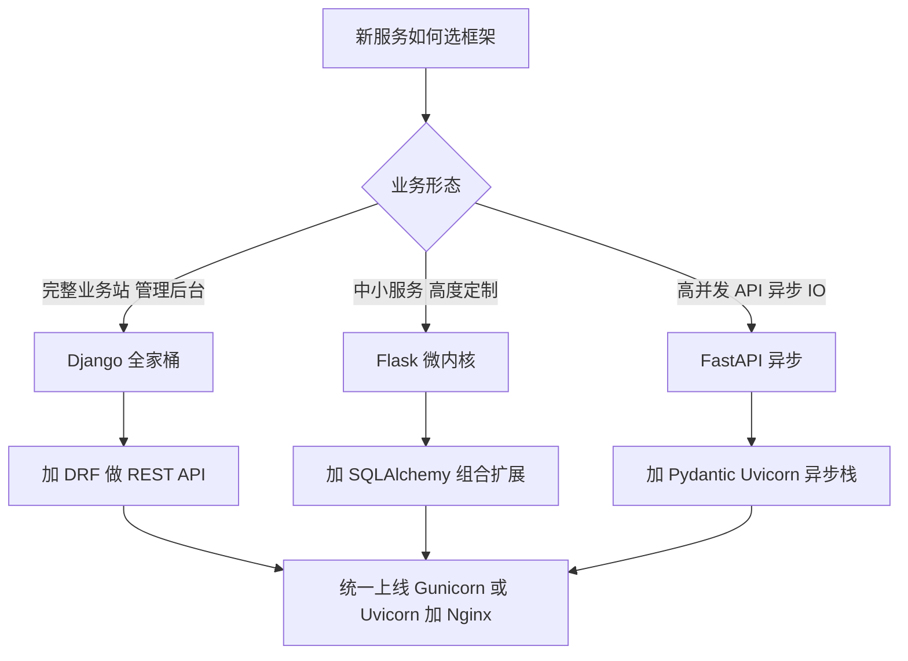
