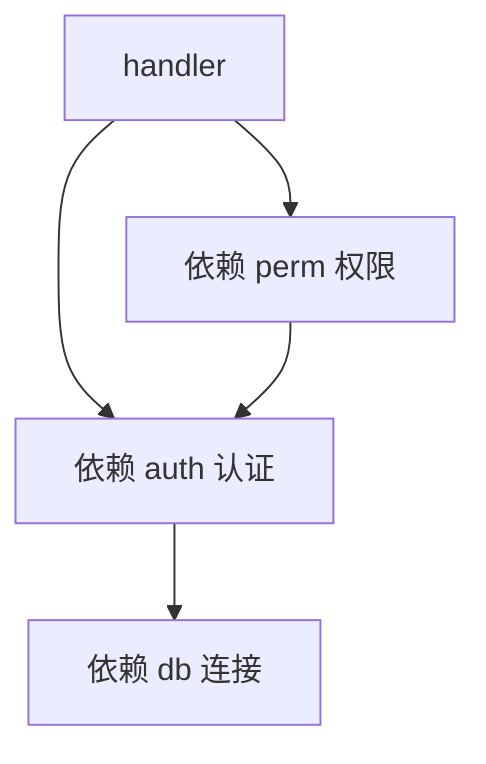
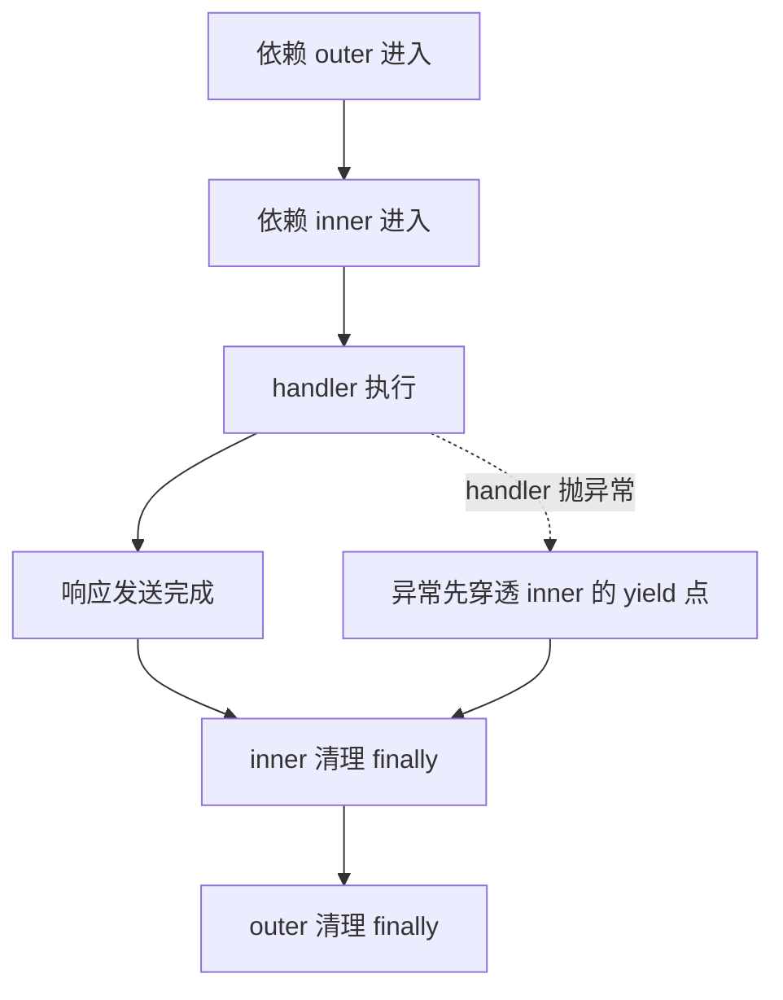
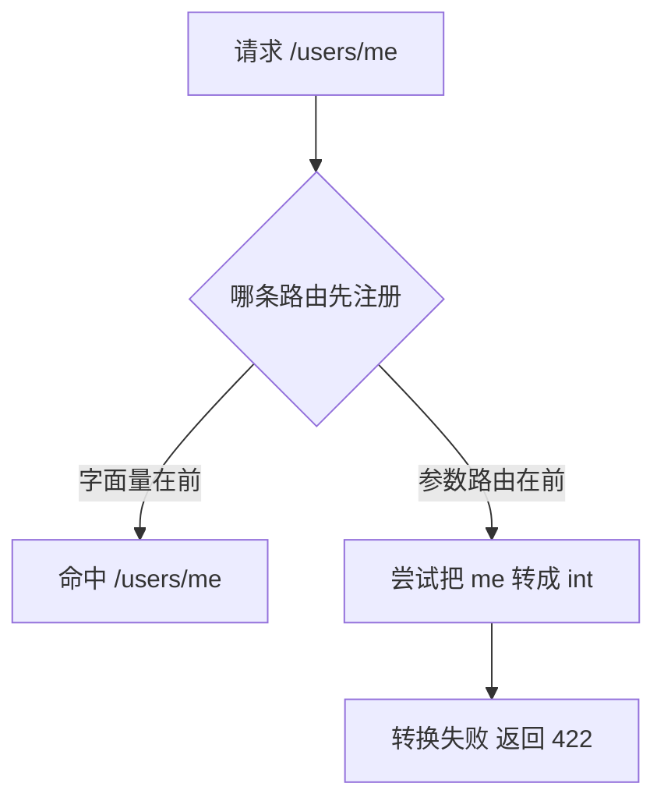
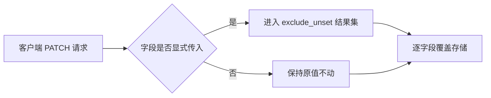
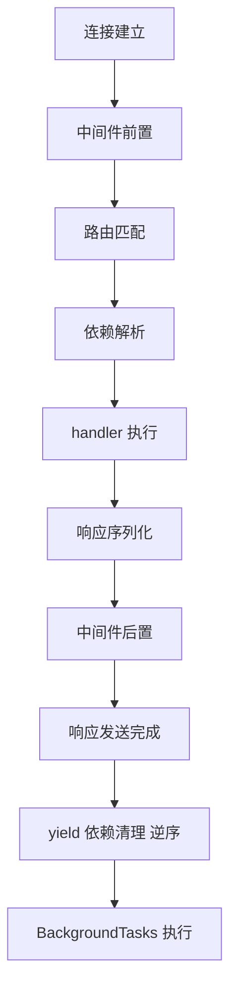
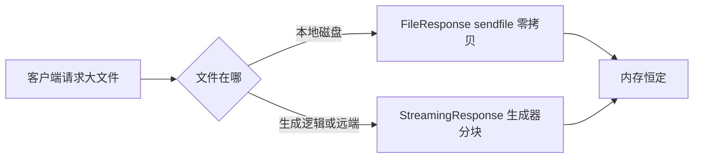
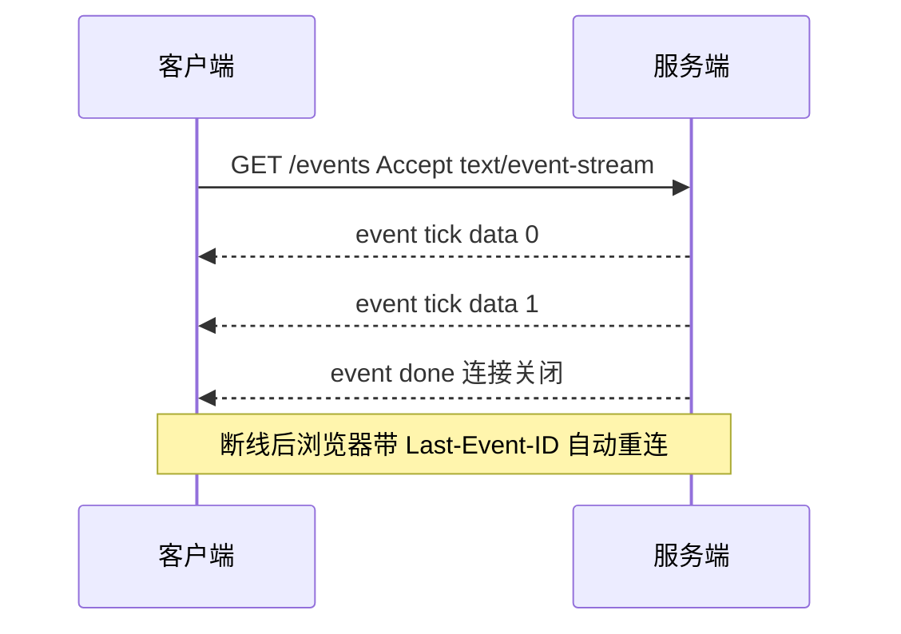
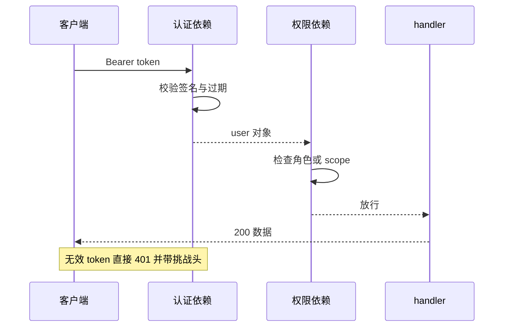
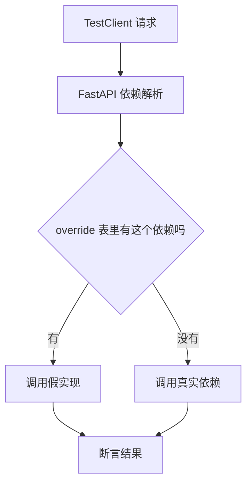

# 第 3 类 · Web 后端开发(50 题 · Q711–Q760)

本文件是 FastAPI 进阶篇:依赖注入深水区、Pydantic v2 校验与序列化、请求生命周期与中间件、流式与实时通信、认证与权限、多环境配置、测试与 OpenAPI,最后落到性能与分层架构。
共 50 题(Q711–Q760),默认已掌握 03a 中 FastAPI 基础(Q095–Q115),题目刻意避开基础概念,聚焦工程深水区。
代码运行方式:`pip install "fastapi[standard]" httpx pydantic-settings orjson "sqlalchemy[asyncio]" aiosqlite` 后用 `python` 直接执行,每题代码自带 TestClient 风格验证。
建议先看 mermaid 图再记结论:依赖树、生命周期、认证链路、限流模型是本篇的结构化主线。

### Q711 · 嵌套依赖与依赖树解析顺序

> 难度:★★★☆ | 标签:FastAPI, 依赖注入

**问**:FastAPI 的依赖可以嵌套依赖,请讲讲它解析一棵依赖树的顺序,以及同一依赖被多个分支引用时会发生什么?

**答**:FastAPI 按**深度优先**逐个解析依赖:先解析 handler 直接声明的依赖,再递归解析每个依赖的子依赖,全部完成后才执行 handler。同一请求内,同一个依赖默认只解析一次(`use_cache=True`),即使它被多个分支引用,所有分支拿到的是**同一个返回对象**。解析失败的依赖会短路整个请求,后面的依赖和 handler 都不会执行。路由级、全局依赖会在路径操作依赖之前解析。



```python
# file: code/03_Web后端开发/q711_nested_dep.py
try:
    from fastapi import Depends, FastAPI
    from fastapi.testclient import TestClient
except ImportError:
    print("pip install fastapi httpx 后再运行")
    raise SystemExit(0)

calls = []
app = FastAPI()

def dep_db():
    calls.append("db")
    return "db-conn"

def dep_auth(db: str = Depends(dep_db)):
    calls.append("auth")
    return f"user@{db}"

def dep_perm(user: str = Depends(dep_auth)):
    calls.append("perm")
    return f"perm[{user}]"

@app.get("/only-auth")
def only_auth(user: str = Depends(dep_auth)):
    return {"user": user}

@app.get("/with-perm")
def with_perm(p: str = Depends(dep_perm), user: str = Depends(dep_auth)):
    return {"p": p, "user": user}

client = TestClient(app)
print(client.get("/only-auth").json())
print(client.get("/with-perm").json())
print("解析顺序:", calls)  # 同一请求内 db 与 auth 只解析一次
```

**追问**:
- 依赖树是并行解析的吗?——不是,串行深度优先,框架没有做并行,所以依赖链太长会叠加延迟。
- 两个分支想拿到两个独立实例怎么办?——给其中一个 `Depends(fn, use_cache=False)`,或让依赖返回可复制语义的对象。

### Q712 · yield 依赖的清理顺序与异常传播

> 难度:★★★☆ | 标签:FastAPI, 依赖注入, 资源管理

**问**:多个 yield 依赖的清理代码按什么顺序执行?handler 抛异常时,依赖里的 yield 能感知到吗?

**答**:yield 依赖的 `yield` 之前是"进入"阶段,之后是"清理"阶段;多个依赖的清理按**进入的逆序(LIFO)**执行,和 `contextmanager` 嵌套语义一致。handler 或后续依赖抛出的异常会**穿透 yield 点**传播进依赖,可以在 `except` 里捕获感知;`finally` 则无论如何都会执行。清理代码在**响应发送完成之后**运行,所以里面只能做资源释放和记日志,不能再修改响应。



```python
# file: code/03_Web后端开发/q712_yield_teardown.py
try:
    from fastapi import Depends, FastAPI
    from fastapi.testclient import TestClient
except ImportError:
    print("pip install fastapi httpx 后再运行")
    raise SystemExit(0)

log = []
app = FastAPI()

def dep_outer():
    log.append("outer: enter")
    try:
        yield "outer"
    finally:
        log.append("outer: exit")

def dep_inner():
    log.append("inner: enter")
    try:
        yield "inner"
        log.append("inner: after-yield-正常")
    except Exception:
        log.append("inner: 捕获到 handler 异常")
        raise
    finally:
        log.append("inner: finally")

@app.get("/ok")
def ok(a: str = Depends(dep_outer), b: str = Depends(dep_inner)):
    return {"a": a, "b": b}

@app.get("/boom")
def boom(a: str = Depends(dep_outer), b: str = Depends(dep_inner)):
    raise RuntimeError("业务异常")

client = TestClient(app, raise_server_exceptions=False)
print(client.get("/ok").json())
print(client.get("/boom").status_code)
print("\n".join(log))
```

**追问**:
- 清理阶段再抛异常会怎样?——异常发生在响应已发出之后,无法改变响应,只会被服务器记录,所以清理代码要自己兜底 try。
- 想在依赖里提交数据库事务,yield 后 commit 可靠吗?——可靠且是标准做法,但注意事务周期横跨整个响应过程,长事务要谨慎。

### Q713 · 类作为依赖与参数化依赖工厂

> 难度:★★★☆ | 标签:FastAPI, 依赖注入

**问**:面试里常问"什么能当 FastAPI 依赖",类的实例、工厂函数行不行?分别怎么用?

**答**:任何**可调用对象**都能当依赖。类作为依赖时,FastAPI 会解析它的 `__init__` 签名并实例化,handler 拿到实例;把配置固化在实例属性里,`__call__` 作为真正入口,这是"可配置依赖"的标准写法。闭包工厂解决"同一逻辑、不同参数"的复用:外层函数接收配置返回内层函数作为依赖。两种方式都天然支持子依赖与 `Annotated` 别名。

```python
# file: code/03_Web后端开发/q713_class_dep.py
try:
    from fastapi import Depends, FastAPI
    from fastapi.testclient import TestClient
except ImportError:
    print("pip install fastapi httpx 后再运行")
    raise SystemExit(0)

app = FastAPI()

class Paginator:
    def __init__(self, max_size: int = 50):
        self.max_size = max_size

    def __call__(self, page: int = 1, size: int = 20):
        size = min(size, self.max_size)
        return {"offset": (page - 1) * size, "limit": size}

pager = Paginator(max_size=100)

def make_header_dependency(name: str):
    def dep():
        return {f"X-{name}-Limit": "60"}
    return dep

@app.get("/items", dependencies=[Depends(make_header_dependency("Quota"))])
def items(pg: dict = Depends(pager)):
    return pg

client = TestClient(app)
print(client.get("/items?page=3&size=999").json())
```

**追问**:
- 类依赖的实例生命周期是什么?——每次请求解析到它时实例化一次,实例不跨请求共享,想共享要用模块级单例或 lifespan。
- `Depends(SomeClass)` 不加括号和 `Depends(SomeClass())` 有区别吗?——前者让 FastAPI 解析 `__init__` 参数作为子依赖;后者是依赖"实例对象",`__init__` 参数只能用默认值,不能再注入。

### Q714 · use_cache 与依赖的请求级缓存边界

> 难度:★★★★ | 标签:FastAPI, 依赖注入

**问**:依赖注入的缓存是什么粒度?`use_cache=False` 什么场景必须用?

**答**:依赖缓存粒度是**单次请求**:同一依赖在同一请求内只调用一次,多个引用共享同一返回对象;跨请求之间**绝不复用**,所以依赖不能当全局缓存用。需要每请求新实例的场景必须 `use_cache=False`,典型是数据库会话:两个依赖各自要独立事务时,共享同一个 session 会互相污染。缓存键是依赖可调用对象本身,所以参数化的工厂产物(闭包)每个都是独立键。

```python
# file: code/03_Web后端开发/q714_dep_cache.py
try:
    from fastapi import Depends, FastAPI
    from fastapi.testclient import TestClient
except ImportError:
    print("pip install fastapi httpx 后再运行")
    raise SystemExit(0)

app = FastAPI()
ids = []

def shared_token():
    ids.append("shared")
    return object()

def per_call_token():
    ids.append("fresh")
    return object()

def cached(a=Depends(shared_token), b=Depends(shared_token)):
    return a is b

def uncached(x=Depends(per_call_token), y=Depends(per_call_token, use_cache=False)):
    return x is not y

@app.get("/cached")
def cached_ep(v: bool = Depends(cached)):
    return {"same_instance": v}

@app.get("/uncached")
def uncached_ep(v: bool = Depends(uncached)):
    return {"different_instance": v}

client = TestClient(app)
print(client.get("/cached").json())
print(client.get("/uncached").json())
print("依赖调用次数:", ids)
```

**追问**:
- 想做"请求内共享上下文"怎么办?——定义一个返回字典/数据类对象的依赖,其他依赖和 handler 都引用它,往里写即可。
- use_cache 对类依赖生效吗?——生效,同一个类对象在请求内只会实例化一次,除非显式关掉。

### Q715 · 全局依赖与路由级依赖的叠加顺序

> 难度:★★★☆ | 标签:FastAPI, 依赖注入

**问**:全局依赖、include_router 依赖、路由级依赖同时存在时,执行顺序是怎样的?各适合放什么?

**答**:三类依赖都会执行,顺序是**全局 → router 级 → include_router 级 → 路径级**,任一依赖抛异常立即短路。全局依赖放请求追踪、基础审计这类横切逻辑;router 级放模块级前置,比如整个 admin 模块都要的管理员校验;路径级放最具体的业务前置。层级划分让鉴权策略"声明一次、处处生效",避免每个 handler 重复粘贴。

```python
# file: code/03_Web后端开发/q715_dep_layers.py
try:
    from fastapi import APIRouter, Depends, FastAPI
    from fastapi.testclient import TestClient
except ImportError:
    print("pip install fastapi httpx 后再运行")
    raise SystemExit(0)

order = []
app = FastAPI(dependencies=[Depends(lambda: order.append("app"))])
router = APIRouter(dependencies=[Depends(lambda: order.append("router"))])

def path_dep():
    order.append("path")

@router.get("/ping", dependencies=[Depends(path_dep)])
def ping():
    return {"ok": True}

app.include_router(router, dependencies=[Depends(lambda: order.append("include"))])

client = TestClient(app)
client.get("/ping")
print("依赖执行顺序:", order)
```

**追问**:
- 全局依赖能拿到 request 吗?——能,依赖签名声明 `request: Request` 即可,常用来做请求埋点。
- 依赖抛 401 后,后面的依赖和 handler 还执行吗?——都不执行,异常沿解析过程直接短路返回。

### Q716 · Annotated 依赖与请求级上下文对象

> 难度:★★★☆ | 标签:FastAPI, 依赖注入, Annotated

**问**:团队统一用 Annotated 写依赖有什么好处?多个依赖之间怎么共享数据?

**答**:`Annotated[类型, Depends(fn)]` 把类型和依赖绑定成**可复用的类型别名**,handler 签名只剩类型,干净且对 mypy 友好,这是 FastAPI 官方现在推荐的风格。依赖之间共享数据的标准做法是定义一个**请求级上下文对象依赖**:第一个依赖创建并挂到 `request.state`,其余依赖和 handler 引用同一个对象读写。中间件、异常处理器也能通过 `request.state` 读到同一份上下文。

```python
# file: code/03_Web后端开发/q716_annotated_ctx.py
try:
    from typing import Annotated
    from fastapi import Depends, FastAPI, Request
    from fastapi.testclient import TestClient
except ImportError:
    print("需要 Python 3.9+ 并 pip install fastapi httpx")
    raise SystemExit(0)

app = FastAPI()

class RequestCtx(dict):
    pass

def get_ctx(request: Request) -> RequestCtx:
    ctx = RequestCtx(path=request.url.path)
    request.state.ctx = ctx
    return ctx

Ctx = Annotated[RequestCtx, Depends(get_ctx)]

def add_user(ctx: Ctx) -> str:
    ctx["user"] = "alice"
    return ctx["user"]

@app.get("/me")
def me(ctx: Ctx, user: Annotated[str, Depends(add_user)]) -> dict:
    return {"path": ctx["path"], "user": user}

client = TestClient(app)
print(client.get("/me").json())
```

**追问**:
- Annotated 写法和默认值写法能混用吗?——语法上可以,但同一参数别混,团队统一选 Annotated。
- request.state 是什么?——Starlette 每请求的命名空间对象,默认为空,适合在中间件、依赖、异常处理器之间挂数据。

### Q717 · APIRouter 分层组织与前缀规划

> 难度:★★☆☆ | 标签:FastAPI, 路由组织

**问**:项目变大后路由怎么组织?prefix 和 tags 应该按什么维度切?

**答**:按**业务域**拆 router(用户、订单、商品),每个 router 自己带 `prefix` 与 `tags`,主应用只做 `include_router` 组装,版本号放在 include 时统一拼(`prefix="/api/v1"`)。prefix 必须以 `/` 开头、不能以 `/` 结尾;同一个业务域内"列表"和"详情"用 `""` 与 `"/{id}"` 区分,避免尾斜杠重定向。tags 对应 OpenAPI 分组,是文档可读性的关键。

```python
# file: code/03_Web后端开发/q717_router_org.py
try:
    from fastapi import APIRouter, FastAPI
    from fastapi.testclient import TestClient
except ImportError:
    print("pip install fastapi httpx 后再运行")
    raise SystemExit(0)

app = FastAPI()
users = APIRouter(prefix="/users", tags=["用户"])
items = APIRouter(prefix="/items", tags=["商品"])

@users.get("/{user_id}")
def get_user(user_id: int):
    return {"user_id": user_id}

@items.get("")
def list_items():
    return {"items": []}

@items.get("/{item_id}")
def get_item(item_id: int):
    return {"item_id": item_id}

app.include_router(users, prefix="/api/v1")
app.include_router(items, prefix="/api/v1")

client = TestClient(app)
print(client.get("/api/v1/users/7").json())
print(client.get("/api/v1/items").json())
```

**追问**:
- 请求 `/api/v1/items/` 多了尾斜杠会怎样?——Starlette 默认 `redirect_slashes` 会 307 重定向到无斜杠路径,规范上应统一路径并测试这条。
- prefix 拼接发生在什么时候?——include_router 时拼接,子 router 内部只关心自己的相对路径,便于复用与测试。

### Q718 · 路由匹配顺序与字面量路径遮蔽

> 难度:★★★☆ | 标签:FastAPI, 路由匹配

**问**:`/users/me` 和 `/users/{user_id}` 同时存在时,声明顺序重要吗?匹配失败表现是什么?

**答**:路由按**注册顺序**匹配,第一个命中的路由接管请求,所以字面量路径必须声明在参数路径**之前**,否则 `/users/me` 会被参数路由吃掉。参数路由类型转换失败返回 **422** 而不是继续尝试下一条路由,这与很多人直觉相反。想拦截数字以外的值,给 Path 参数加 `pattern` 约束,或声明为 str 类型自行判断。



```python
# file: code/03_Web后端开发/q718_route_order.py
try:
    from fastapi import APIRouter, FastAPI
    from fastapi.testclient import TestClient
except ImportError:
    print("pip install fastapi httpx 后再运行")
    raise SystemExit(0)

app = FastAPI()

@app.get("/users/me")          # 必须先注册字面量
def me():
    return {"who": "me"}

@app.get("/users/{user_id}")   # 再注册参数路由
def user(user_id: int):
    return {"user_id": user_id}

client = TestClient(app)
print(client.get("/users/me").json())
print(client.get("/users/42").json())
print(client.get("/users/abc").status_code)  # 参数路由 422, 不会回落到字面量
```

**追问**:
- 想让 `/users/abc` 返回 404 而不是 422 怎么办?——把参数声明为 str,在 handler 里做语义判断抛 404,或用 Path 的 pattern 约束并接受 422 语义。
- 路由多了以后顺序怎么管理?——固定路径集中注册在参数路径之前,或在 CI 里加一条"字面量优先"的 lint 规则。

### Q719 · mount 子应用与 include_router 的边界

> 难度:★★★☆ | 标签:FastAPI, Starlette

**问**:include_router 和 mount 挂子应用有什么本质区别?什么时候必须用 mount?

**答**:`include_router` 是把路由**复制进主应用**,共享主应用的中间件、依赖、异常处理器和 OpenAPI 文档。`mount` 是挂一个**独立 ASGI 应用**:子应用有自己的生命周期、中间件栈、`/docs`,主应用按前缀转发,OpenAPI 默认**不合并**。需要独立技术栈(另一个 FastAPI 服务、静态目录、不同框架)、独立中间件或独立文档时用 mount;只是组织代码用 include_router。

```python
# file: code/03_Web后端开发/q719_mount_subapp.py
try:
    from fastapi import FastAPI
    from fastapi.testclient import TestClient
except ImportError:
    print("pip install fastapi httpx 后再运行")
    raise SystemExit(0)

inner = FastAPI(title="inner")

@inner.get("/health")
def inner_health():
    return {"app": "inner"}

outer = FastAPI(title="outer")

@outer.get("/health")
def outer_health():
    return {"app": "outer"}

outer.mount("/sub", inner)

client = TestClient(outer)
print(client.get("/health").json())      # 命中 outer 自己的路由
print(client.get("/sub/health").json())  # 前缀转发给子应用
```

**追问**:
- 子应用的 Swagger 能出现在主应用文档里吗?——默认不能,需要手动聚合 OpenAPI 或在文档页里分别链接两个 docs。
- mount 之后子应用里的路径参数怎么解析?——前缀在 mount 层剥掉,子应用看到的是剥完前缀的 path,两边互不感知。

### Q720 · field_validator 的 mode 与校验信息

> 难度:★★★☆ | 标签:Pydantic v2, 校验

**问**:Pydantic v2 里 field_validator 的 mode=before 和 mode=after 有什么区别?什么时候必须用 before?

**答**:`mode="before"` 在**类型解析之前**执行,拿到的是原始输入(str/dict/任意对象),适合做输入规整,比如把逗号分隔字符串拆成列表;`mode="after"` 在类型解析之后执行,拿到的是已转换的目标类型,适合做值域校验。同一个字段可以叠多个 validator,按声明顺序执行。`info.data` 能拿到**之前字段**的校验结果,所以字段声明顺序会影响它。

```python
# file: code/03_Web后端开发/q720_field_validator.py
try:
    from pydantic import BaseModel, ValidationError, field_validator
except ImportError:
    print("pip install pydantic v2 后再运行")
    raise SystemExit(0)

class Order(BaseModel):
    items: list[str] = []

    @field_validator("items", mode="before")
    @classmethod
    def split_str(cls, v, info):
        if isinstance(v, str):
            return [x for x in v.split(",") if x]
        return v

    @field_validator("items")
    @classmethod
    def not_empty(cls, v, info):
        if not v:
            raise ValueError("至少购买一件商品")
        return v

print(Order(items="a,b,c").items)
try:
    Order(items="")
except ValidationError as e:
    print("校验失败:", e.errors()[0]["msg"])
```

**追问**:
- validator 抛出的异常怎么变成 422?——Pydantic 把 ValueError 收集进 ValidationError,FastAPI 的 RequestValidationError 处理器统一转成 422 响应。
- 需要用"后面字段"的值怎么办?——field_validator 只能看到前面的字段,跨字段校验应改用 model_validator。

### Q721 · model_validator 跨字段校验

> 难度:★★★☆ | 标签:Pydantic v2, 校验

**问**:比如 start 必须小于 end、密码和确认密码一致,这类跨字段校验在 v2 里怎么写?

**答**:用 `model_validator`。`mode="before"` 接收**原始输入整体**(dict 甚至非 dict),适合做输入形态归一,比如把 `"10-20"` 字符串拆成两个字段;`mode="after"` 拿到**已构造好的模型实例**,适合做字段间关系断言,校验失败抛 ValueError,Pydantic 会包装成 ValidationError。after 阶段模型默认可变,可以顺手做规整后再返回 self。

```python
# file: code/03_Web后端开发/q721_model_validator.py
try:
    from pydantic import BaseModel, model_validator
except ImportError:
    print("pip install pydantic v2 后再运行")
    raise SystemExit(0)

class Range(BaseModel):
    start: int
    end: int
    label: str = "range"

    @model_validator(mode="before")
    @classmethod
    def coerce_pair(cls, data):
        if isinstance(data, str) and "-" in data:
            a, b = data.split("-", 1)
            data = {"start": a, "end": b}
        return data

    @model_validator(mode="after")
    def check_order(self):
        if self.start >= self.end:
            raise ValueError("start 必须小于 end")
        self.label = f"{self.label}:{self.start}-{self.end}"
        return self

print(Range("10-20").model_dump())
try:
    Range(start=5, end=2)
except Exception as e:
    print("失败类型:", type(e).__name__)
```

**追问**:
- before 阶段输入不是 dict 会怎样?——需要自己处理任意形态,比如字符串先解析,否则内部字段访问报错,错误信息对用户不友好。
- 校验之间有依赖导致顺序敏感怎么办?——把强依赖逻辑都收敛到一个 after 校验器,before 只做形态归一。

### Q722 · 别名体系:alias 与 populate_by_name

> 难度:★★★☆ | 标签:Pydantic v2, 序列化

**问**:对接外部系统字段是驼峰、内部代码是蛇形,Pydantic v2 怎么优雅处理双向映射?

**答**:三种别名各司其职:`alias` 同时用于**解析和序列化**;`validation_alias` 只管解析、`serialization_alias` 只管序列化,可以拆开配不同名字。`populate_by_name=True` 允许"内部字段名"也参与解析,内外两套名字都收。序列化时用 `model_dump(by_alias=True)` 输出对外命名,实现"对内 snake_case、对外 camelCase"。全局驼峰互转可以用 `alias_generator=to_camel` 统一生成。注意:只配 `serialization_alias` 时该别名**不参与验证**,外部传 `createdAt` 会被忽略并因缺 `created_at` 抛 ValidationError;要同时支持解析需再配 `validation_alias`(或直接用 `alias`)。

```python
# file: code/03_Web后端开发/q722_alias.py
try:
    from pydantic import BaseModel, ConfigDict, Field
except ImportError:
    print("pip install pydantic v2 后再运行")
    raise SystemExit(0)

class User(BaseModel):
    model_config = ConfigDict(populate_by_name=True)
    user_name: str = Field(alias="userName")
    created_at: int = Field(validation_alias="createdAt", serialization_alias="createdAt", ge=0)

raw = {"userName": "alice", "createdAt": 1700000000}
u = User(**raw)                        # 外部命名解析
print(u.user_name)
print(u.model_dump(by_alias=True))     # 对外 camelCase
print(User(user_name="bob", created_at=1).user_name)  # 内部名也能构造
```

**追问**:
- validation_alias 可以配 AliasChoices 吗?——可以,`AliasChoices("userName", "user_name")` 让多个来源字段名都命中。
- 返回响应时 FastAPI 会自动 by_alias 吗?——response_model 序列化默认尊重模型的 alias 配置,但显式传 by_alias 更稳,团队应统一约定。

### Q723 · computed_field 计算字段

> 难度:★★☆☆ | 标签:Pydantic v2, 序列化

**问**:模型里想暴露一个"由其他字段算出来"的字段,比如面积、全名,不想存库也不想每次手动拼,怎么做?

**答**:用 `@computed_field` 装饰 property:它参与**序列化与 JSON Schema**,`model_dump`、`model_dump_json`、OpenAPI 文档都会带上;普通 `@property` 只在 Python 侧可访问,不进序列化结果。computed_field 还可以配 alias 控制输出名,并会被响应模型裁剪逻辑一并处理。注意计算逻辑要幂等、便宜,别在里面做 IO。

```python
# file: code/03_Web后端开发/q723_computed_field.py
try:
    from pydantic import BaseModel, computed_field
except ImportError:
    print("pip install pydantic v2 后再运行")
    raise SystemExit(0)

class Rect(BaseModel):
    w: float
    h: float

    @property
    def area(self) -> float:        # 普通 property 不进序列化
        return self.w * self.h

    @computed_field(alias="area2x")
    @property
    def area2x(self) -> float:      # 计算字段进序列化
        return self.area * 2

r = Rect(w=3, h=4)
print(r.area)
print(r.model_dump())
```

**追问**:
- computed_field 能被 include/exclude 控制吗?——能,和普通字段一样参与 exclude/include 字段选择。
- 计算成本高怎么办?——加缓存 property(functools.cached_property 需确认与模型可变性兼容),或把计算下推到查询层。

### Q724 · 嵌套模型的 PATCH 更新与 exclude_unset

> 难度:★★★★ | 标签:Pydantic v2, PATCH

**问**:PATCH 接口"只更新客户端传了的字段",为什么 exclude_unset 是关键字?它和 exclude_defaults 差在哪?

**答**:`exclude_unset` 只保留**调用方显式传入**的字段,这是 PATCH 语义的正确工具;`exclude_defaults` 会把"显式传了但恰好等于默认值"的字段也丢掉,二者在"传 null 清空字段"场景表现完全不同:显式传 None 想清空,必须用 exclude_unset 才能保留。exclude_unset 对**嵌套子模型递归生效**,但"嵌套对象整体传入会整体替换"这个坑要靠在视图层拆解处理。FastAPI 里配合 `Body(embed=True)` 或专用 Patch 模型使用。



```python
# file: code/03_Web后端开发/q724_partial_update.py
try:
    from pydantic import BaseModel
except ImportError:
    print("pip install pydantic v2 后再运行")
    raise SystemExit(0)

class UserPatch(BaseModel):
    name: str | None = None
    email: str | None = None
    age: int | None = None

stored = {"name": "alice", "email": "a@x.com", "age": 30}

def apply_patch(stored: dict, patch: UserPatch) -> dict:
    for k, v in patch.model_dump(exclude_unset=True).items():
        stored[k] = v
    return stored

print(apply_patch(dict(stored), UserPatch(name="bob")))   # 只改 name
print(apply_patch(dict(stored), UserPatch(email=None)))   # 显式 None 才清空
```

**追问**:
- 客户端没传和传了 null 怎么区分?——`model_fields_set` 集合记录了显式传入的字段,序列化和更新逻辑都应以它为准。
- 嵌套对象想部分更新怎么办?——先取出已有子对象,把传入合并后再校验,或前端约定嵌套必须整传。

### Q725 · ConfigDict 常用配置项

> 难度:★★★☆ | 标签:Pydantic v2, 配置

**问**:Pydantic v2 的 model_config 你常用哪些配置?分别解决什么问题?

**答**:`extra="forbid"` 拒绝未知字段,对外 API 建议开启,防止拼写错误的字段被静默吞掉;`from_attributes=True` 替代 v1 的 orm_mode,让模型能从 ORM 对象属性构造;`frozen=True` 让实例不可变、可哈希,适合做缓存键;`str_strip_whitespace=True` 自动去字符串空白;`strict=True` 关闭隐式类型转换(str 不再转 int)。这些配置也可用 `@dataclass` 式基类下发到一组模型。

```python
# file: code/03_Web后端开发/q725_config_dict.py
try:
    from pydantic import BaseModel, ConfigDict
except ImportError:
    print("pip install pydantic v2 后再运行")
    raise SystemExit(0)

class Strict(BaseModel):
    model_config = ConfigDict(extra="forbid", str_strip_whitespace=True, frozen=True)
    name: str

class FromAttr(BaseModel):
    model_config = ConfigDict(from_attributes=True)
    uid: int

class Obj:
    uid = 9

s = Strict(name="  alice ")
print(repr(s.name))
try:
    Strict(name="x", extra_field=1)
except Exception as e:
    print("多余字段被拒:", type(e).__name__)
print(FromAttr.model_validate(Obj()).uid)
```

**追问**:
- extra 的三种取值?——ignore 静默丢弃、forbid 报错、allow 保留到 `__pydantic_extra__`,对外接口选 forbid 最安全。
- 什么时候用 strict?——解析内部可信数据时追求确定性;对接外部输入时保留 lax 转换对用户更友好。

### Q726 · TypeAdapter 与 RootModel 非模型校验

> 难度:★★★☆ | 标签:Pydantic v2

**问**:校验目标不是 BaseModel 而是裸类型,比如 dict[str, int]、list[str],Pydantic v2 怎么做?

**答**:`TypeAdapter(类型)` 可以校验/序列化**任意类型注解**,不需要包一层模型,适合校验配置片段、消息队列 payload、缓存 JSON。顶层就是 list 或 dict 时,业务上又想定义成"模型"获得文档能力,用 `RootModel[...]` 包住根类型,数据放在 `.root` 属性。两者都享受同一套 ValidationError 与性能优化。

```python
# file: code/03_Web后端开发/q726_type_adapter.py
try:
    from pydantic import RootModel, TypeAdapter, ValidationError
except ImportError:
    print("pip install pydantic v2 后再运行")
    raise SystemExit(0)

adapter = TypeAdapter(dict[str, int])
print(adapter.validate_python({"a": "1"}))
print(adapter.dump_python({"b": 2}))

class Tags(RootModel[list[str]]):
    pass

print(Tags.model_validate(["x", "y"]).root)
try:
    TypeAdapter(list[int]).validate_python(["1", "a"])
except ValidationError as e:
    print("错误条数:", e.error_count())
```

**追问**:
- TypeAdapter 应该每次创建吗?——不要,它是带编译开销的对象,模块级创建一次复用。
- RootModel 的场景举例?——顶层 JSON 数组接口、包装第三方返回值,同时想给它加校验器和文档描述。

### Q727 · 序列化控制:dump 的字段选择

> 难度:★★★☆ | 标签:Pydantic v2, 序列化

**问**:model_dump 的 include/exclude 怎么用?嵌套字段怎么精细控制?

**答**:`exclude={"password"}` 顶层排除,`include={"name", "addr"}` 白名单式输出;嵌套用 dict 指定层级,如 `exclude={"addr": {"zip_code"}}` 只排除子模型的一个字段。`exclude_none`、`exclude_unset`、`exclude_defaults` 是三类常用过滤器,PATCH 场景用 unset,输出瘦身用 none。原则:**敏感字段用专门的输出模型裁剪,而不是到处写 exclude**,否则新增字段容易漏。

```python
# file: code/03_Web后端开发/q727_dump_control.py
try:
    from pydantic import BaseModel
except ImportError:
    print("pip install pydantic v2 后再运行")
    raise SystemExit(0)

class Addr(BaseModel):
    city: str
    zip_code: str

class User(BaseModel):
    name: str
    password: str
    addr: Addr

u = User(name="a", password="secret", addr={"city": "BJ", "zip_code": "100000"})
print(u.model_dump(exclude={"password"}))
print(u.model_dump(include={"name", "addr"}, exclude={"addr": {"zip_code"}}))
print(u.model_dump_json())
```

**追问**:
- include 和 exclude 同时给会怎样?——include 优先圈定范围,exclude 在其基础上再排除,能组合出精细视图。
- 为什么推荐输出模型而不是 exclude?——响应模型在 OpenAPI 里能看到真实结构,exclude 是调用点行为,文档与实际不一致。

### Q728 · 请求生命周期全景

> 难度:★★★★ | 标签:FastAPI, 生命周期

**问**:一个请求从进来到离开,FastAPI 里各环节的顺序是什么?依赖清理和后台任务排在哪?

**答**:顺序是:**中间件前置 → 路由匹配 → 依赖解析(yield 前半) → handler → 响应序列化 → 中间件后置 → 响应发送完成 → yield 依赖清理(逆序) → BackgroundTasks**。理解这条链能解释很多"怪现象":中间件后置代码在依赖清理之前跑;清理慢不拖慢客户端感知但占资源;后台任务在响应后才执行,失败客户端无感。异常发生时按洋葱向外传播,清理仍会执行。



```python
# file: code/03_Web后端开发/q728_lifecycle.py
try:
    from fastapi import Depends, FastAPI, Request
    from fastapi.testclient import TestClient
except ImportError:
    print("pip install fastapi httpx 后再运行")
    raise SystemExit(0)

events = []
app = FastAPI()

@app.middleware("http")
async def trace_mw(request: Request, call_next):
    events.append("mw: before")
    request.state.events = events
    resp = await call_next(request)
    events.append("mw: after")
    return resp

def dep(request: Request):
    request.state.events.append("dep")

@app.get("/ping")
def ping(request: Request, _=Depends(dep)):
    request.state.events.append("handler")
    return {"ok": True}

client = TestClient(app)
client.get("/ping")
print(events)
```

**追问**:
- 为什么清理和后台任务都压到响应之后?——避免客户端等资源释放,代价是清理代码不能假设请求上下文仍可用。
- 中间件后置能改响应体吗?——能改 BaseHTTPMiddleware 返回的 Response 对象头,但此时流式响应体尚未消费,改体要小心。

### Q729 · 纯 ASGI 中间件与 BaseHTTPMiddleware

> 难度:★★★★ | 标签:FastAPI, 中间件, ASGI

**问**:自定义中间件该继承 BaseHTTPMiddleware 还是写纯 ASGI 类?各自代价是什么?

**答**:BaseHTTPMiddleware 写起来像 async 函数(`dispatch(request, call_next)`),直观但有历史包袱:它把下游包成独立 task,曾带来 contextvars 不下传、后台任务异常难传播、性能开销等问题(新版本已大幅缓解)。纯 ASGI 中间件直接操作 `scope/receive/send`,零包装、行为最透明,适合计时、改响应头、限流这类横切逻辑。原则:**能用纯 ASGI 就用纯 ASGI**,需要读改请求体或复杂分支才考虑 BaseHTTPMiddleware。

```python
# file: code/03_Web后端开发/q729_asgi_mw.py
import time
try:
    from fastapi import FastAPI
    from fastapi.testclient import TestClient
except ImportError:
    print("pip install fastapi httpx 后再运行")
    raise SystemExit(0)

class TimingMiddleware:
    def __init__(self, app):
        self.app = app

    async def __call__(self, scope, receive, send):
        if scope["type"] != "http":
            await self.app(scope, receive, send)
            return
        start = time.perf_counter()

        async def send_wrapped(message):
            if message["type"] == "http.response.start":
                ms = int((time.perf_counter() - start) * 1000)
                headers = list(message.get("headers", []))
                headers.append((b"x-process-ms", str(ms).encode()))
                message = {**message, "headers": headers}
            await send(message)

        await self.app(scope, receive, send_wrapped)

app = FastAPI()

@app.get("/hi")
def hi():
    return {"hi": True}

app.add_middleware(TimingMiddleware)

client = TestClient(app)
r = client.get("/hi")
print(r.json(), r.headers.get("x-process-ms") is not None)
```

**追问**:
- BaseHTTPMiddleware 的 contextvars 问题是什么?——下游在独立 task 里跑,任务内 set 的 contextvar 不回传到外层,日志过滤器可能拿不到请求级变量。
- 纯 ASGI 中间件怎么传配置?——`add_middleware(Cls, key=value)`,构造函数以关键字参数接收。

### Q730 · add_middleware 的注册顺序与洋葱方向

> 难度:★★★☆ | 标签:FastAPI, 中间件

**问**:连续 add_middleware 三次,请求先经过哪个?想让日志中间件统计所有其他中间件的耗时,应该怎么排?

**答**:`add_middleware` 是**压栈**:后注册的包在最外层,请求先经过后注册者。所以"最外层"中间件要**最后**注册——日志/计时想覆盖全部耗时,它的 add 调用必须放在其他中间件之后。`@app.middleware("http")` 装饰器本质也是 add_middleware,按代码执行到那一行的顺序压栈。官方 CORS 中间件建议放到能覆盖所有响应的位置,正是这个规则的体现。

```python
# file: code/03_Web后端开发/q730_mw_order.py
try:
    from fastapi import FastAPI
    from fastapi.testclient import TestClient
except ImportError:
    print("pip install fastapi httpx 后再运行")
    raise SystemExit(0)

trace = []
app = FastAPI()

class MarkA:
    def __init__(self, app):
        self.app = app
    async def __call__(self, scope, receive, send):
        trace.append("A-in")
        await self.app(scope, receive, send)
        trace.append("A-out")

class MarkB:
    def __init__(self, app):
        self.app = app
    async def __call__(self, scope, receive, send):
        trace.append("B-in")
        await self.app(scope, receive, send)
        trace.append("B-out")

app.add_middleware(MarkA)  # 先注册
app.add_middleware(MarkB)  # 后注册者在最外层

@app.get("/t")
def t():
    return {"ok": True}

client = TestClient(app)
client.get("/t")
print(trace)
```

**追问**:
- 输出顺序是什么?——B-in、A-in、A-out、B-out:B 最外层,A 的收尾代码先于 B 执行。
- 中间件顺序错了会有什么后果?——典型是把 GZip 放在计费/签名中间件内侧,导致统计的是压缩前体量或签名验到压缩后的数据。

### Q731 · 请求体一次性消费与中间件读体

> 难度:★★★★ | 标签:FastAPI, ASGI, 请求体

**问**:为什么中间件里读了请求体,下游接口就拿不到了?正确的读法是什么?

**答**:HTTP 请求体是 ASGI 的 `http.request` **事件流,默认只能消费一次**;中间件读掉后,下游的 receive 再也拿不到数据。正确做法是:纯 ASGI 中间件读完 body 后**重建一个可重放的事件流**再传给下游;现代 Starlette 的 BaseHTTPMiddleware 已内置缓存请求体,函数式中间件里 `await request.body()` 通常安全。大请求体场景应避免在中间件整读——那会把流式上传变成全量内存。

```python
# file: code/03_Web后端开发/q731_body_once.py
try:
    from fastapi import FastAPI, Request
    from fastapi.testclient import TestClient
except ImportError:
    print("pip install fastapi httpx 后再运行")
    raise SystemExit(0)

app = FastAPI()

class BodyPeekMiddleware:
    def __init__(self, app):
        self.app = app

    async def __call__(self, scope, receive, send):
        if scope["type"] != "http":
            await self.app(scope, receive, send)
            return
        chunks = []
        while True:
            msg = await receive()
            chunks.append(msg.get("body", b""))
            if not msg.get("more_body"):
                break
        seen = b"".join(chunks)
        replayed = [{"type": "http.request", "body": seen, "more_body": False}]

        async def receive_replay():
            if replayed:
                return replayed.pop(0)
            return {"type": "http.disconnect"}

        scope = dict(scope, body_size=len(seen))
        await self.app(scope, receive_replay, send)

app.add_middleware(BodyPeekMiddleware)

@app.post("/echo")
async def echo(request: Request):
    raw = await request.body()
    return {"len": len(raw), "size_seen": request.scope.get("body_size")}

client = TestClient(app)
print(client.post("/echo", content=b"hello").json())
```

**追问**:
- receive 和 send 是什么?——ASGI 的两条事件通道:receive 收请求事件,body 以带 more_body 标记的分块到达;send 发响应事件。
- 要在中间件做签名校验读 body,怎么权衡?——只读一次并重放流;或下沉到依赖层做,让 FastAPI 自己解析后再验签,避免手撕流。

### Q732 · BackgroundTasks 原理与升级到任务队列的边界

> 难度:★★★☆ | 标签:FastAPI, 后台任务

**问**:BackgroundTasks 的任务什么时候执行?什么时候必须换 Celery/Arq 这类队列?

**答**:任务注册到响应对象的 background 列表,**响应发送完成后在同一进程内执行**,失败无重试、不持久化、无并发控制。适合毫秒级副作用:发确认邮件、清缓存、记埋点。一旦出现以下信号就该升级队列:任务**必须不丢**(要持久化)、**要重试**、**耗时长**(几十秒以上)、**要多机扩容**、**要延时/定时**。两者可并存:轻任务 bg,重任务在依赖里把消息投给队列。

```python
# file: code/03_Web后端开发/q732_bg_boundary.py
try:
    from fastapi import BackgroundTasks, FastAPI
    from fastapi.testclient import TestClient
except ImportError:
    print("pip install fastapi httpx 后再运行")
    raise SystemExit(0)

done = []
app = FastAPI()

def send_email(to: str):
    done.append(f"mail->{to}")

@app.post("/signup")
def signup(email: str, bg: BackgroundTasks):
    bg.add_task(send_email, to=email)
    return {"queued": True}

client = TestClient(app)
print(client.post("/signup?email=a@b.c").json())
print("任务已执行:", done)  # TestClient 请求完成后后台任务已同步跑完
```

**追问**:
- bg 任务抛异常会怎样?——异常进服务器日志,客户端无感知且任务丢失,这正是需要队列的信号。
- bg 任务能访问请求上下文吗?——不能直接注入 Request,要在注册时把需要的值作为参数显式传入。

### Q733 · 大文件流式下载与 FileResponse

> 难度:★★★☆ | 标签:FastAPI, 流式响应

**问**:下载几个 G 的文件,接口怎么写才不会把内存打爆?FileResponse 和 StreamingResponse 怎么选?

**答**:核心是**分块**:StreamingResponse 接收生成器,边生成边发送,内存占用恒定;但本地静态大文件首选 `FileResponse`,它走操作系统 **sendfile 零拷贝**,更快且省 CPU。生成器里不能有同步阻塞 IO,否则卡死事件循环;无法预知 Content-Length 时服务器自动 chunked 编码。文件名、类型头配好 `Content-Disposition`,配合下一题的 Range 才是完整方案。



```python
# file: code/03_Web后端开发/q733_stream_download.py
try:
    from fastapi import FastAPI
    from fastapi.responses import StreamingResponse
    from fastapi.testclient import TestClient
except ImportError:
    print("pip install fastapi httpx 后再运行")
    raise SystemExit(0)

app = FastAPI()

def chunk_file(total_kb: int, chunk_kb: int = 8):
    for _ in range(0, total_kb, chunk_kb):
        yield b"x" * (chunk_kb * 1024)

@app.get("/download")
def download():
    return StreamingResponse(
        chunk_file(32),
        media_type="application/octet-stream",
        headers={"Content-Disposition": 'attachment; filename="blob.bin"'},
    )

client = TestClient(app)
r = client.get("/download")
print(r.status_code, len(r.content), r.headers["content-type"])
```

**追问**:
- 生成器中途抛异常怎么办?——响应已发部分无法撤回,连接中断,只能记日志,设计上尽量在响应前完成可能失败的准备动作。
- 为什么 FileResponse 更快?——它设置 sendfile 标志,数据从页缓存直接进网卡,不经过 Python 内存拷贝。

### Q734 · 超大文件分块上传与 413 前置拦截

> 难度:★★★★ | 标签:FastAPI, 流式上传

**问**:上传 10G 文件,UploadFile 还合适吗?怎么边读边拒超限请求?

**答**:UploadFile 会先写入临时文件(超过内存阈值落盘),中等文件没问题;超大文件应直接 `request.stream()` **分块读**,边读边写对象存储或临时文件。分块读的额外好处是**超限提前 413**:累计大小超过阈值立刻返回,不用把整个文件读完再拒,省带宽省内存。断点续传由客户端 Range/分片协议配合,服务端按分片号幂等落盘。

```python
# file: code/03_Web后端开发/q734_stream_upload.py
try:
    from fastapi import FastAPI, Request
    from fastapi.testclient import TestClient
except ImportError:
    print("pip install fastapi httpx 后再运行")
    raise SystemExit(0)

app = FastAPI()
MAX_BYTES = 1024  # 演示上限 1KB

@app.post("/upload")
async def upload(request: Request):
    size = 0
    async for chunk in request.stream():
        size += len(chunk)
        if size > MAX_BYTES:
            return {"error": "too large", "size": size}  # 超限提前拒绝
    return {"size": size}

client = TestClient(app)
print(client.post("/upload", content=b"a" * 500).json())
print(client.post("/upload", content=b"a" * 2000).json())
```

**追问**:
- 读取 stream 时客户端断开会怎样?——receive 会等到 disconnect 事件,要配超时防止挂死连接。
- UploadFile 的落盘阈值是多少?——小文件在内存(SpooledTemporaryFile 阈值约 1MB),超过才写临时文件,清理由框架负责。

### Q735 · SSE 服务端推送

> 难度:★★★★ | 标签:FastAPI, SSE, 实时通信

**问**:AI 流式输出、任务进度推送这类场景,SSE 怎么实现?和 WebSocket 怎么选?

**答**:SSE 是**单向 HTTP 长连接**:`Content-Type: text/event-stream`,消息以 `data:` 行加空行分隔,用 StreamingResponse 输出 async 生成器即可。相比 WebSocket,SSE 更简单,天然兼容 HTTP 基础设施(鉴权、代理、证书),浏览器自带断线重连并携带 `Last-Event-ID`;只需要服务端到客户端推送(行情、进度、LLM 输出)就选 SSE,需要双向低延迟再上 WebSocket。反向代理必须**关闭响应缓冲**,否则消息被攒住不吐。



```python
# file: code/03_Web后端开发/q735_sse.py
import asyncio
try:
    from fastapi import FastAPI
    from fastapi.responses import StreamingResponse
    from fastapi.testclient import TestClient
except ImportError:
    print("pip install fastapi httpx 后再运行")
    raise SystemExit(0)

app = FastAPI()

async def tick(n: int):
    for i in range(n):
        yield f"event: tick\ndata: {{\"i\": {i}}}\n\n"
        await asyncio.sleep(0.01)
    yield "event: done\ndata: bye\n\n"

@app.get("/events")
def events():
    return StreamingResponse(
        tick(3),
        media_type="text/event-stream",
        headers={"Cache-Control": "no-cache"},
    )

client = TestClient(app)
with client.stream("GET", "/events") as r:
    body = "".join(r.iter_text())
print(body.strip().replace("\n", " | "))
```

**追问**:
- SSE 怎么做心跳?——定期 yield 一个注释行 `: ping` 或 event: ping,既保活又穿透代理的空闲超时。
- SSE 能双向吗?——不能,上行用普通 HTTP 请求即可,不必要地用 WebSocket 会增加运维复杂度。

### Q736 · WebSocket 房间广播与连接管理

> 难度:★★★★ | 标签:FastAPI, WebSocket

**问**:做一个聊天室,连接管理和广播怎么设计?连接异常关闭怎么处理?

**答**:核心是一个**连接注册表**:按房间维护 WebSocket 集合,join 时 accept 并登记,broadcast 时遍历发送,发送失败就把连接踢出。异常关闭用 `WebSocketDisconnect` 捕获,finally 里保证清理。注意这是**单进程模型**:多 worker 部署时连接分散在各进程,跨进程广播必须引入外部通道(Redis pub/sub、消息队列),这是面试常考的边界意识。

```python
# file: code/03_Web后端开发/q736_ws_room.py
try:
    from fastapi import FastAPI, WebSocket, WebSocketDisconnect
    from fastapi.testclient import TestClient
except ImportError:
    print("pip install fastapi httpx 后再运行")
    raise SystemExit(0)

app = FastAPI()

class Room:
    def __init__(self):
        self.conns: list[WebSocket] = []

    async def join(self, ws: WebSocket):
        await ws.accept()
        self.conns.append(ws)

    def leave(self, ws: WebSocket):
        if ws in self.conns:
            self.conns.remove(ws)

    async def broadcast(self, text: str):
        for ws in list(self.conns):
            try:
                await ws.send_text(text)
            except Exception:
                self.leave(ws)

room = Room()

@app.websocket("/ws/{room_id}")
async def ws_endpoint(ws: WebSocket, room_id: str):
    await room.join(ws)
    try:
        while True:
            msg = await ws.receive_text()
            await room.broadcast(f"[{room_id}] {msg}")
    except WebSocketDisconnect:
        room.leave(ws)

client = TestClient(app)
with client.websocket_connect("/ws/1") as w1, client.websocket_connect("/ws/1") as w2:
    w1.send_text("hello")
    print(w1.receive_text())
    print(w2.receive_text())
```

**追问**:
- 多 worker 下广播怎么打通?——每个 worker 订阅 Redis 频道,收到消息后向本进程房间成员转发。
- 广播时某个客户端慢怎么办?——每连接带发送队列与水位,超水位踢掉慢消费者,避免一个客户端拖住整个房间。

### Q737 · WebSocket 心跳与优雅断开

> 难度:★★★★ | 标签:FastAPI, WebSocket, 可用性

**问**:TCP 连接假死怎么办?WebSocket 的心跳、超时与断开怎么设计?

**答**:对端断网或 NAT 超时后 TCP 不一定立刻感知,表现为连接"假死"。方案是应用层心跳:`asyncio.wait_for(receive, timeout)` 等消息,超时后发 ping 要求 pong,再超时就主动 close 并清理注册表。优雅断开的两件事:服务端 close 带明确 code(如 4000 表示业务下线),客户端据此决定是否重连;服务端退出前广播 close,给客户端迁移窗口。

```python
# file: code/03_Web后端开发/q737_ws_heartbeat.py
import asyncio
try:
    from fastapi import FastAPI, WebSocket, WebSocketDisconnect
    from fastapi.testclient import TestClient
except ImportError:
    print("pip install fastapi httpx 后再运行")
    raise SystemExit(0)

app = FastAPI()
IDLE_TIMEOUT = 0.2

@app.websocket("/ws")
async def ws(ws: WebSocket):
    await ws.accept()
    try:
        while True:
            try:
                msg = await asyncio.wait_for(ws.receive_text(), timeout=IDLE_TIMEOUT)
                await ws.send_text(f"echo:{msg}")
            except asyncio.TimeoutError:
                await ws.send_text("ping")                      # 空闲先探活
                pong = await asyncio.wait_for(ws.receive_text(), timeout=IDLE_TIMEOUT)
                if pong != "pong":
                    break                                       # 假死, 断开
    except (WebSocketDisconnect, asyncio.TimeoutError):
        pass
    finally:
        await ws.close()

client = TestClient(app)
with client.websocket_connect("/ws") as w:
    w.send_text("hi")
    print(w.receive_text())   # echo:hi
    print(w.receive_text())   # 空闲超时后收到 ping
    w.send_text("pong")
```

**追问**:
- 为什么不用 WebSocket 协议自带的 ping/pong 帧?——协议帧由库和系统代理控制,应用层心跳可控且能穿透只转发数据的中间设备。
- 客户端重连怎么避免风暴?——指数退避加抖动,服务端返回的 close code 里给出是否可重连的语义。

### Q738 · 认证依赖链与 401/403 语义

> 难度:★★★★ | 标签:FastAPI, 认证, 授权

**问**:从 token 到"这个用户能不能删这条数据",FastAPI 里正确的依赖分层是什么?401 和 403 怎么区分?

**答**:分三层:`OAuth2PasswordBearer` 只负责**提取 token**;`get_current_user` 负责解析、验证并抛 401(未认证,必须带 `WWW-Authenticate: Bearer` 响应头);权限依赖在 current_user 之上做角色/scope 检查,失败抛 **403**(已认证但无权限)。handler 只依赖最高层语义,不碰原始 token。这条链让认证策略集中在依赖里,handler 保持纯粹。



```python
# file: code/03_Web后端开发/q738_auth_chain.py
try:
    from fastapi import Depends, FastAPI, HTTPException, status
    from fastapi.security import OAuth2PasswordBearer
    from fastapi.testclient import TestClient
except ImportError:
    print("pip install fastapi httpx 后再运行")
    raise SystemExit(0)

app = FastAPI()
oauth2 = OAuth2PasswordBearer(tokenUrl="/login")
FAKE = {"token1": {"username": "alice", "role": "admin"},
        "token2": {"username": "bob", "role": "user"}}

async def get_current_user(token: str = Depends(oauth2)) -> dict:
    user = FAKE.get(token)
    if not user:
        raise HTTPException(status_code=status.HTTP_401_UNAUTHORIZED,
                            headers={"WWW-Authenticate": "Bearer"})
    return user

async def require_admin(user: dict = Depends(get_current_user)) -> dict:
    if user["role"] != "admin":
        raise HTTPException(status_code=status.HTTP_403_FORBIDDEN)
    return user

@app.get("/me")
def me(user: dict = Depends(get_current_user)):
    return user

@app.delete("/items/{iid}")
def del_item(iid: int, user: dict = Depends(require_admin)):
    return {"deleted": iid, "by": user["username"]}

client = TestClient(app)
print(client.get("/me", headers={"Authorization": "Bearer token1"}).json())
print(client.get("/me").status_code)                                  # 401
print(client.delete("/items/1", headers={"Authorization": "Bearer token2"}).status_code)  # 403
```

**追问**:
- token 过期和 token 无效都返回 401 吗?——都返回 401,细分原因放 body 的 detail,避免向攻击者暴露 token 状态细节。
- 为什么不在 handler 里直接判断角色?——散落各处无法统一审计和测试,权限必须收敛到依赖或中间件一层。

### Q739 · Refresh token 双令牌机制

> 难度:★★★★ | 标签:FastAPI, JWT, 认证

**问**:access token 过期太快体验差,太慢又不安全,refresh token 机制怎么设计?

**答**:双令牌分工:**access token 短命**(5-15 分钟)随每个请求携带、无状态校验;**refresh token 长命**(天级)只在刷新端点出现,服务端存储(哈希后入库/Redis)以便吊销。三个关键设计:refresh **轮换**(一次一用,旧 token 第二次使用判定泄露,吊销整个家族)、**绑定上下文**(设备指纹/IP 变化要求重新登录)、access 无法主动失效所以敏感操作仍要查会话。签名校验用 `hmac.compare_digest` 这类恒时比较。

```python
# file: code/03_Web后端开发/q739_refresh_token.py
import hashlib, hmac, json, time
try:
    from fastapi import FastAPI, HTTPException
    from pydantic import BaseModel
    from fastapi.testclient import TestClient
except ImportError:
    print("pip install fastapi httpx 后再运行")
    raise SystemExit(0)

SECRET = b"dev-secret"
app = FastAPI()

def sign(payload: dict) -> str:
    body = json.dumps(payload, separators=(",", ":"), sort_keys=True)
    mac = hmac.new(SECRET, body.encode(), hashlib.sha256).hexdigest()
    return f"{body}.{mac}"

def verify(token: str) -> dict:
    body, mac = token.rsplit(".", 1)
    good = hmac.new(SECRET, body.encode(), hashlib.sha256).hexdigest()
    if not hmac.compare_digest(mac, good):
        raise HTTPException(401, "签名无效")
    payload = json.loads(body)
    if payload["exp"] < time.time():
        raise HTTPException(401, "已过期")
    return payload

class Tokens(BaseModel):
    access: str
    refresh: str

@app.post("/login")
def login() -> Tokens:
    now = int(time.time())
    return Tokens(
        access=sign({"sub": "alice", "typ": "access", "exp": now + 60}),
        refresh=sign({"sub": "alice", "typ": "refresh", "exp": now + 86400}),
    )

@app.post("/refresh")
def refresh(refresh_token: str):
    payload = verify(refresh_token)
    if payload["typ"] != "refresh":
        raise HTTPException(401, "需要 refresh token")
    now = int(time.time())
    return {"access": sign({"sub": payload["sub"], "typ": "access", "exp": now + 60})}

client = TestClient(app)
t = client.post("/login").json()
print("access 长度:", len(t["access"]))
r = client.post("/refresh", params={"refresh_token": t["refresh"]}).json()
print("换发的 access 类型:", verify(r["access"])["typ"])
```

**追问**:
- refresh token 被盗怎么办?——轮换机制下旧 token 再次使用即触发泄露判定,可吊销整个令牌家族并要求重新登录。
- 为什么 access 不落库?——无状态省一次存储查询,代价是无法即时吊销,靠短过期和黑名单兜底。

### Q740 · 权限依赖工厂 require_scope

> 难度:★★★☆ | 标签:FastAPI, 授权, RBAC

**问**:接口很多、权限点很多,怎么避免每个接口手写一遍权限判断?

**答**:写一个**权限依赖工厂**:接收 scope 参数返回依赖闭包,配合 Annotated 定义成语义别名(`ReadItem`、`AdminOnly`),handler 签名里一个类型就完成授权声明。工厂内部只依赖 `current_user`,形成"认证 → 权限"的复用链。权限点命名建议 `资源:动作` 三段式,与 scope/网关限流维度对齐,审计日志直接可用。

```python
# file: code/03_Web后端开发/q740_perm_factory.py
try:
    from typing import Annotated
    from fastapi import Depends, FastAPI, HTTPException
    from fastapi.testclient import TestClient
except ImportError:
    print("pip install fastapi httpx 后再运行")
    raise SystemExit(0)

app = FastAPI()
CURRENT = {"username": "alice", "scopes": {"item:read"}}

def current_user() -> dict:
    return CURRENT

def require_scope(scope: str):
    def dep(user: Annotated[dict, Depends(current_user)]) -> dict:
        if scope not in user["scopes"]:
            raise HTTPException(403, f"缺少权限 {scope}")
        return user
    return dep

ReadItem = Annotated[dict, Depends(require_scope("item:read"))]
AdminOnly = Annotated[dict, Depends(require_scope("admin"))]

@app.get("/items")
def list_items(user: ReadItem):
    return {"by": user["username"]}

@app.post("/items")
def create_item(user: AdminOnly):
    return {"created_by": user["username"]}

client = TestClient(app)
print(client.get("/items").json())
print(client.post("/items").status_code)
```

**追问**:
- 对象级权限(只能改自己的数据)放哪层?——放 `get_object` 类的取数依赖或 service 层,凭据是资源归属字段,不能只靠 scope。
- 权限点怎么跟文档对齐?——用 `Security` 与 SecurityScopes 声明到 OpenAPI,文档里能看到每个接口要求的 scope。

### Q741 · API Key 与 Bearer 多认证并存

> 难度:★★★☆ | 标签:FastAPI, 认证

**问**:同一套 API 既给人用(JWT)又给内部服务用(API Key),认证层怎么组织?

**答**:定义多个 Security scheme(APIKeyHeader、OAuth2PasswordBearer),都设 `auto_error=False` 让它们"尝试但不强拒",再用一个聚合依赖做**或逻辑**:命中任一方案就构造统一 principal(如 `user:alice`、`service:pay-service`),全未命中才 401。principal 统一成字符串或数据类后,下游权限逻辑不关心凭证来自哪种方案。多方案并存的审计点:在日志里记录认证方式,便于区分人为误用与服务间调用。

```python
# file: code/03_Web后端开发/q741_multi_auth.py
try:
    from fastapi import Depends, FastAPI, HTTPException, Security
    from fastapi.security import APIKeyHeader, OAuth2PasswordBearer
    from fastapi.testclient import TestClient
except ImportError:
    print("pip install fastapi httpx 后再运行")
    raise SystemExit(0)

app = FastAPI()
api_key_scheme = APIKeyHeader(name="X-API-Key", auto_error=False)
bearer_scheme = OAuth2PasswordBearer(tokenUrl="/login", auto_error=False)
KEYS = {"svc-123": "service-a"}

def any_auth(api_key: str | None = Security(api_key_scheme),
             token: str | None = Security(bearer_scheme)) -> str:
    if api_key and api_key in KEYS:
        return f"service:{KEYS[api_key]}"
    if token == "user-token":
        return "user:alice"
    raise HTTPException(401, "缺少有效凭证")

@app.get("/who")
def who(principal: str = Depends(any_auth)):
    return {"principal": principal}

client = TestClient(app)
print(client.get("/who", headers={"X-API-Key": "svc-123"}).json())
print(client.get("/who", headers={"Authorization": "Bearer user-token"}).json())
print(client.get("/who").status_code)
```

**追问**:
- 为什么 auto_error 要设 False?——默认 True 时缺 header 直接 403,轮不到聚合依赖做"尝试多种方案"的或逻辑。
- API Key 相比 JWT 的取舍?——Key 简单、可即时吊销但每次要查存储;JWT 无状态但难吊销,服务间低频调用 Key 更合适。

### Q742 · pydantic-settings 多环境配置与优先级

> 难度:★★★☆ | 标签:pydantic-settings, 配置

**问**:dev/staging/prod 三套环境,配置怎么组织?环境变量、.env、默认值谁覆盖谁?

**答**:用 `pydantic-settings` 的 BaseSettings 定义强类型配置,`env_prefix` 隔离命名空间(如 APP_DB_URL),`env_file=".env"` 支持本地开发。优先级从高到低:**构造参数 > 环境变量 > .env 文件 > 字段默认值**,这条链保证了"同一段代码,不同环境只换注入"。多环境差异通过环境注入解决,而不是维护三个配置类;类型错误在**启动时**就报,比运行时炸好得多。

```python
# file: code/03_Web后端开发/q742_settings.py
import os
try:
    from pydantic_settings import BaseSettings, SettingsConfigDict
except ImportError:
    print("pip install pydantic-settings 后再运行")
    raise SystemExit(0)

class Settings(BaseSettings):
    model_config = SettingsConfigDict(env_prefix="APP_", env_file=".env", extra="ignore")
    env: str = "dev"
    debug: bool = False
    db_url: str = "sqlite:///dev.db"
    redis_url: str = "redis://localhost:6379/0"

os.environ["APP_ENV"] = "prod"
os.environ["APP_DEBUG"] = "false"

s = Settings()
print(s.env, s.debug, s.db_url)
print("构造参数优先级最高:", Settings(env="staging").env)
```

**追问**:
- bool 类型的环境变量怎么解析?——接受 true/false/1/0/yes/no 等,pydantic-settings 负责转换,写错启动即报。
- .env 会上到生产吗?——不应该,生产只用真实环境变量或密钥服务,.env 只服务本地与 CI。

### Q743 · 敏感配置与密钥注入

> 难度:★★★☆ | 标签:pydantic-settings, 安全

**问**:数据库密码、JWT 密钥这类敏感配置,代码里怎么处理才不会随手泄露到日志?

**答**:三条纪律:密钥只从**环境变量或密钥服务**注入,绝不写进代码和入库的 .env;用 `SecretStr` 类型承载,它的 repr 是掩码,误打日志只输出 `**********`,显式 `get_secret_value()` 才取真值;启动时校验必填密钥,**缺了直接 fail-fast**,而不是等运行时才用空密钥跑起来。SecretStr 配合 pydantic-settings 是零成本的最佳实践。

```python
# file: code/03_Web后端开发/q743_secret_config.py
import os
try:
    from pydantic import SecretStr
    from pydantic_settings import BaseSettings
except ImportError:
    print("pip install pydantic-settings 后再运行")
    raise SystemExit(0)

os.environ["DB_PASSWORD"] = "hunter2"

class Settings(BaseSettings):
    db_password: SecretStr = SecretStr("")

s = Settings()
print("日志安全打印:", s.db_password)
print("真实值按需取出:", s.db_password.get_secret_value() == "hunter2")
print("掩码不会含明文:", "hunter2" not in str(s))
```

**追问**:
- SecretStr 能进 JSON 序列化吗?——默认序列化也是掩码,必须显式取值,这个"多一步"正是防泄露设计。
- 多个服务共享密钥怎么管理?——统一从 Vault/KMS/编排 secret 注入,轮换时改注入层,应用支持热更新或滚动重启。

### Q744 · httpx AsyncClient 与 ASGITransport 异步测试

> 难度:★★★☆ | 标签:FastAPI, 测试, httpx

**问**:测试异步接口,httpx 的 ASGITransport 怎么用?它和 TestClient 的本质区别是什么?

**答**:`httpx.AsyncClient(transport=httpx.ASGITransport(app=app))` 在**进程内直接调用 ASGI 应用**,不经过网络,能测真正的 async 代码路径且运行在当前事件循环里。TestClient 是同步包装(内部起 portal 跑事件循环),用起来简单但测不到 async 特有的行为(如取消传播)。注意 ASGITransport **不会自动执行 lifespan**,需要 lifespan 的测试用 asgi-lifespan 的 LifespanManager。异步测试通常配 pytest-asyncio 的 `@pytest.mark.asyncio`。

```python
# file: code/03_Web后端开发/q744_async_test.py
import asyncio
try:
    import httpx
    from fastapi import FastAPI
except ImportError:
    print("pip install fastapi httpx 后再运行")
    raise SystemExit(0)

app = FastAPI()

@app.get("/async-hi")
async def hi():
    return {"hi": True}

async def main():
    transport = httpx.ASGITransport(app=app)
    async with httpx.AsyncClient(transport=transport, base_url="http://test") as c:
        r = await c.get("/async-hi")
        print(r.status_code, r.json())

asyncio.run(main())
```

**追问**:
- ASGITransport 会启动端口吗?——不会,请求直接在进程内交给应用,没有 TCP 开销,适合高频单元测试。
- 想测 lifespan 该怎么做?——用 asgi-lifespan 的 LifespanManager 包住 app,或继续用 TestClient 的 with 语法。

### Q745 · dependency_overrides 依赖覆盖测试

> 难度:★★★☆ | 标签:FastAPI, 测试, 依赖注入

**问**:怎么在不改业务代码的情况下,把测试里的数据库、外部服务替换成假实现?

**答**:`app.dependency_overrides[原依赖] = 假实现` 是 FastAPI 内置的依赖替换机制,键是**依赖函数对象**,值是替代函数;覆盖**子依赖会自动作用于整棵依赖树**,所以只需替换最底层的 get_db / get_client。测试结束 `clear()` 恢复,pytest 里做成 fixture 最稳。这个机制的前提是业务按依赖倒置组织——所有资源访问都从依赖拿,测试才有的放矢。



```python
# file: code/03_Web后端开发/q745_dep_override.py
try:
    from fastapi import Depends, FastAPI
    from fastapi.testclient import TestClient
except ImportError:
    print("pip install fastapi httpx 后再运行")
    raise SystemExit(0)

def get_db():
    raise RuntimeError("测试中不应触达真库")

app = FastAPI()

@app.get("/users")
def users(db: str = Depends(get_db)):
    return {"db": db}

app.dependency_overrides[get_db] = lambda: "fake-db"

client = TestClient(app)
print(client.get("/users").json())
app.dependency_overrides.clear()
```

**追问**:
- 中间件和 lifespan 也能覆盖吗?——不能,override 只作用于依赖体系,中间件要靠环境变量/配置注入开关。
- 假实现和 monkeypatch 替换模块函数哪个好?——依赖覆盖更显式、不污染全局状态、恢复容易,优先用前者。

### Q746 · 测试中的 lifespan 与资源管理

> 难度:★★★☆ | 标签:FastAPI, 测试, lifespan

**问**:应用启动时建连接池,测试怎么保证它被正确初始化和销毁?

**答**:`TestClient(app)` 必须**用 with 语句**才会在进入时执行 lifespan(启动建池)、退出时执行清理,等价于 pytest fixture 的 setup/teardown。多个用例共享昂贵资源时,把"with TestClient(app)"放进 session 级 fixture,资源只建一次;单测要隔离状态就把 lifespan 里的资源做成可注入。断言清理逻辑(池是否关闭)可直接检查 lifespan 闭包维护的状态对象。

```python
# file: code/03_Web后端开发/q746_lifespan_fixture.py
from contextlib import asynccontextmanager
try:
    from fastapi import FastAPI
    from fastapi.testclient import TestClient
except ImportError:
    print("pip install fastapi httpx 后再运行")
    raise SystemExit(0)

state = {}

@asynccontextmanager
async def lifespan(app: FastAPI):
    state["pool"] = "connection-pool"
    yield
    state.clear()

app = FastAPI(lifespan=lifespan)

@app.get("/pool")
def pool():
    return {"pool": state.get("pool")}

with TestClient(app) as client:   # with 才触发 lifespan
    print(client.get("/pool").json())
print("退出后资源已清理:", state)
```

**追问**:
- 不用 with 直接 TestClient(app).get 会怎样?——lifespan 不执行,依赖池的接口直接 500,这是新手测试常见的坑。
- 测试里怎么模拟启动失败?——lifespan 里抛异常,断言 TestClient 进入时抛出,验证 fail-fast 行为。

### Q747 · OpenAPI 文档定制

> 难度:★★☆☆ | 标签:FastAPI, OpenAPI

**问**:生成的 Swagger 文档要加服务描述、扩展字段、统一 tags,应该在哪几个层面定制?

**答**:三个层面:实例参数(`title/version/description/openapi_tags`)管全局元信息;路由参数(`tags/summary/response_model/status_code/deprecated`)管单个接口;`app.openapi` 整体覆写可以给 schema 加扩展字段(如 `x-contact`、`x-rate-limit`)或后处理 components。缓存 `app.openapi_schema` 避免每次请求重新生成。文档即契约,定制应服务于前端联调与网关配置的消费场景。

```python
# file: code/03_Web后端开发/q747_openapi_custom.py
try:
    from fastapi import FastAPI
    from fastapi.openapi.utils import get_openapi
except ImportError:
    print("pip install fastapi 后再运行")
    raise SystemExit(0)

app = FastAPI(
    title="订单服务",
    version="2.1.0",
    description="内部订单 API",
    openapi_tags=[{"name": "orders", "description": "订单相关"}],
)

@app.get("/orders", tags=["orders"])
def list_orders():
    return []

def custom_openapi():
    if app.openapi_schema:
        return app.openapi_schema
    schema = get_openapi(title=app.title, version=app.version,
                         description=app.description, routes=app.routes)
    schema["info"]["x-contact"] = "team-orders@example.com"
    app.openapi_schema = schema
    return app.openapi_schema

app.openapi = custom_openapi
spec = app.openapi()
print(spec["info"]["title"], spec["info"].get("x-contact"))
```

**追问**:
- 怎么从 OpenAPI 文档生成客户端代码?——CI 里用 openapi-generator 或 datamodel-code-generator,把 schema 当唯一事实源。
- operation_id 有什么用?——决定生成代码的函数名,手动指定可避免自动命名在重构后漂移。

### Q748 · 自定义 APIRoute 注入通用逻辑

> 难度:★★★★ | 标签:FastAPI, 路由, 源码

**问**:想给一组路由统一加签名校验、审计这类逻辑,除了中间件和依赖还有什么手段?

**答**:继承 `APIRoute` 重写 `get_route_handler`,在原始 handler 外包一层自定义处理,再通过 `APIRouter(route_class=SignedRoute)` 整组生效。它比中间件**更靠内**(能拿到路由参数、路径操作上下文),比依赖**更统一**(不用每个路由声明)。适合签名校验、请求重放保护、路由级审计。注意该方法返回的是 async 处理函数,异常要自己转响应。

```python
# file: code/03_Web后端开发/q748_custom_route.py
try:
    from fastapi import APIRouter, FastAPI, Request, Response
    from fastapi.routing import APIRoute
    from fastapi.testclient import TestClient
except ImportError:
    print("pip install fastapi httpx 后再运行")
    raise SystemExit(0)

class SignedRoute(APIRoute):
    def get_route_handler(self):
        original = super().get_route_handler()

        async def custom_handler(request: Request) -> Response:
            if request.headers.get("x-signature") != "secret":
                return Response("bad signature", status_code=401)
            return await original(request)

        return custom_handler

app = FastAPI()
router = APIRouter(route_class=SignedRoute)

@router.get("/data")
def data():
    return {"ok": True}

app.include_router(router)

client = TestClient(app)
print(client.get("/data").status_code)
print(client.get("/data", headers={"x-signature": "secret"}).json())
```

**追问**:
- get_route_handler 什么时候被调用?——注册路由时调用一次并缓存 handler,不是每请求执行,包装逻辑零运行时开销。
- 它和依赖的执行顺序?——先走依赖解析,再进入 handler 包装层,所以签名校验发生在依赖之后,要前置校验就用依赖或中间件。

### Q749 · 多版本并存与接口弃用流程

> 难度:★★★☆ | 标签:FastAPI, 版本管理

**问**:v1 还有流量,新接口要上 v2,双版本并存的工程落地怎么做?怎么安全下线 v1?

**答**:用两个 APIRouter(prefix="/v1" / "/v2") 组装同一应用,旧版路由标 `deprecated=True`(文档里显示删除线并标注)。下线走标准流程:**公告并响应 Sunset/Deprecation 头 → 双跑观察各版本流量 → 流量归零 → 移除代码**。共享逻辑下沉到 service 层,两个版本只保留薄薄的序列化差异;不要复制粘贴 handler,否则 bug 要修两遍。

```python
# file: code/03_Web后端开发/q749_deprecation.py
try:
    from fastapi import APIRouter, FastAPI
    from fastapi.testclient import TestClient
except ImportError:
    print("pip install fastapi httpx 后再运行")
    raise SystemExit(0)

app = FastAPI()
v1 = APIRouter(prefix="/v1", deprecated=True)
v2 = APIRouter(prefix="/v2")

@v1.get("/price", description="将于 2026-12-31 下线,请迁移 /v2/price")
def price_v1():
    return {"price": 100}

@v2.get("/price")
def price_v2():
    return {"price": 100.0, "currency": "CNY"}

app.include_router(v1)
app.include_router(v2)

client = TestClient(app)
print(client.get("/v1/price").json())
print(client.get("/v2/price").json())
```

**追问**:
- Sunset 头是什么?——RFC 8594,声明资源停用时间点,客户端和网关可据此安排迁移与告警。
- 怎么统计 v1 还剩多少调用方?——网关按路径前缀打指标,或对 v1 路由加专用埋点,按 API Key/来源维度聚合。

### Q750 · response_model 裁剪响应

> 难度:★★★☆ | 标签:FastAPI, 响应模型

**问**:handler 返回的对象带了密码、内部字段,怎么保证不会漏出去?

**答**:`response_model` 是**出口白名单**:FastAPI 按声明模型重新序列化,未声明的字段直接丢弃,即使 handler 返回了它们;列表接口用 `response_model=list[ItemOut]` 同样生效。它是防敏感泄露的最后一道闸,也是 OpenAPI 文档的输出契约。原则是**设计专用输出模型**,而不是依赖 `response_model_exclude_*` 在调用点打补丁——后者每处都要记得写,漏一处就泄一次。

```python
# file: code/03_Web后端开发/q750_response_model.py
try:
    from fastapi import FastAPI
    from fastapi.testclient import TestClient
    from pydantic import BaseModel
except ImportError:
    print("pip install fastapi httpx 后再运行")
    raise SystemExit(0)

class UserOut(BaseModel):
    id: int
    name: str

app = FastAPI()

@app.get("/users/{uid}", response_model=UserOut)
def get_user(uid: int):
    # 即使内部对象带敏感字段, 出口只保留声明字段
    return {"id": uid, "name": "alice", "password": "should-not-leak", "token": "x"}

client = TestClient(app)
print(client.get("/users/1").json())
```

**追问**:
- response_model 会做类型转换吗?——会,按模型校验并转换,还可能触发 Pydantic 校验错误,输入输出模型要分开定义。
- 想少写一遍模型有捷径吗?——用 `response_model_exclude_unset` 等参数应急,长期还是维护独立的输入/输出模型对。

### Q751 · orjson 与自定义响应序列化

> 难度:★★★☆ | 标签:FastAPI, 性能, orjson

**问**:接口序列化开销大,换 orjson 能带来多少收益?怎么全局启用?

**答**:orjson 用 Rust 实现,序列化速度通常是标准 json 的数倍且直接输出 bytes。启用方式:`pip install orjson` 后把 `default_response_class=ORJSONResponse` 设到 FastAPI 实例(全局)或单路由。注意三点:orjson 原生支持 datetime/UUID/dataclass,不需要 default 钩子兜底;收益只在**大响应体、高 QPS**场景明显,先用 profile 确认序列化真是瓶颈;混合场景可用 default_response_class 配合个别路由的 JSONResponse 微调。

```python
# file: code/03_Web后端开发/q751_orjson.py
try:
    from fastapi import FastAPI
    from fastapi.responses import ORJSONResponse
    from fastapi.testclient import TestClient
except ImportError:
    print("pip install orjson fastapi httpx 后再运行")
    raise SystemExit(0)

app = FastAPI(default_response_class=ORJSONResponse)

@app.get("/big")
def big():
    return {"items": [{"id": i, "name": f"item-{i}"} for i in range(1000)]}

client = TestClient(app)
r = client.get("/big")
print(r.status_code, len(r.content))
```

**追问**:
- orjson 输出和标准库有差异吗?——是 bytes 不是 str、默认紧凑无空格、浮点格式化更精确,逐字节 diff 的用例要注意。
- 响应里要自定义类型怎么办?——用 ORJSONResponse 的 default 参数或在模型里转好基础类型,不要塞自定义对象到响应里。

### Q752 · lifespan 共享 httpx 连接池

> 难度:★★★★ | 标签:FastAPI, httpx, 性能

**问**:每个请求新建 httpx 客户端调外部 API,有什么问题?正确的姿势是什么?

**答**:每请求新建 AsyncClient 会丢失**连接复用、DNS 缓存、TLS 会话复用**,高并发下 TIME_WAIT 堆积、延迟放大。正确做法:在 lifespan 里创建**一个共享的 AsyncClient**(配 timeout 与 Limits 连接池上限)挂到 `app.state`,所有请求复用,关闭时统一 aclose。连接池上限要协调:应用池 ≤ 下游可承受并发,否则会把下游打挂。超时要分层配置 connect/read/write/pool。


```python
# file: code/03_Web后端开发/q752_httpx_pool.py
from contextlib import asynccontextmanager
try:
    import httpx
    from fastapi import FastAPI, Request
    from fastapi.testclient import TestClient
except ImportError:
    print("pip install fastapi httpx 后再运行")
    raise SystemExit(0)

@asynccontextmanager
async def lifespan(app: FastAPI):
    async with httpx.AsyncClient(
        timeout=2.0, limits=httpx.Limits(max_connections=50)
    ) as client:
        app.state.http = client
        yield

app = FastAPI(lifespan=lifespan)

@app.get("/probe")
async def probe(request: Request):
    return {"has_client": hasattr(request.app.state, "http")}

with TestClient(app) as c:
    print(c.get("/probe").json())
```

**追问**:
- Limits 里 max_keepalive_connections 管什么?——空闲保持的连接数,调太小会频繁握手,太大占用下游连接。
- 单例客户端线程安全吗?——AsyncClient 设计为多协程共享,跨 worker 进程不共享,每个进程各有自己的池。

### Q753 · SQLAlchemy 异步会话依赖

> 难度:★★★★ | 标签:FastAPI, SQLAlchemy, 数据库

**问**:FastAPI 接异步 SQLAlchemy,session 的生命周期怎么管理?连接池参数怎么配?

**答**:标准模式:create_async_engine + async_sessionmaker,依赖里 `async with SessionLocal() as session` 用 **yield 依赖**返回,请求结束自动归还。要点:一个请求一个 session;`expire_on_commit=False` 避免提交后属性过期再触发惰性查询;连接池参数(pool_size、max_overflow、pool_recycle、pool_pre_ping)按 DB 的 max_connections 与 worker 数规划,总连接 = worker 数 ×(pool_size + max_overflow)。

```python
# file: code/03_Web后端开发/q753_async_session.py
try:
    from contextlib import asynccontextmanager
    from typing import AsyncIterator
    from sqlalchemy import text
    from sqlalchemy.ext.asyncio import AsyncSession, async_sessionmaker, create_async_engine
except ImportError:
    print("pip install sqlalchemy aiosqlite fastapi httpx 后再运行")
    raise SystemExit(0)
try:
    from fastapi import Depends, FastAPI
    from fastapi.testclient import TestClient
except ImportError:
    print("pip install fastapi httpx 后再运行")
    raise SystemExit(0)

engine = create_async_engine("sqlite+aiosqlite://")  # 生产用 postgresql+asyncpg 并配池参数
SessionLocal = async_sessionmaker(engine, expire_on_commit=False)

async def get_session() -> AsyncIterator[AsyncSession]:
    async with SessionLocal() as session:
        yield session

app = FastAPI()

@app.get("/ok")
async def ok(session: AsyncSession = Depends(get_session)):
    result = await session.execute(text("SELECT 1"))
    return {"first": result.scalar()}

with TestClient(app) as c:
    print(c.get("/ok").json())
```

**追问**:
- session 要不要在一个请求里显式 commit?——业务写路径显式 commit,读路径自动只读,禁止把 commit 藏在依赖里造成意外提交。
- yield 依赖和 session 释放的时机?——响应发送后清理阶段归还连接,所以 handler 里不要把 session 传给后台任务。

### Q754 · ETag 与条件请求

> 难度:★★★☆ | 标签:FastAPI, HTTP 缓存

**问**:接口响应内容不常变,怎么利用 HTTP 缓存省带宽?ETag 的协商流程是什么?

**答**:服务端对响应内容算指纹作为 `ETag` 返回;客户端下次带 `If-None-Match`,内容没变就返回 **304 空体**,省掉响应体传输。配合 `Cache-Control` 控制是否走本地缓存,强缓存与协商缓存组合使用。ETag 计算要便宜(内容哈希或版本号),对高频大响应要权衡计算成本;数据可变性强的接口别乱加,缓存错误比慢更伤。

```python
# file: code/03_Web后端开发/q754_etag.py
import hashlib
try:
    from fastapi import FastAPI, Request, Response
    from fastapi.testclient import TestClient
except ImportError:
    print("pip install fastapi httpx 后再运行")
    raise SystemExit(0)

app = FastAPI()

@app.get("/report")
def report(request: Request):
    payload = b"report-version-7"
    etag = '"' + hashlib.md5(payload).hexdigest() + '"'
    if request.headers.get("if-none-match") == etag:
        return Response(status_code=304, headers={"ETag": etag})
    return Response(content=payload, media_type="text/plain", headers={"ETag": etag})

client = TestClient(app)
r1 = client.get("/report")
print(r1.status_code, r1.headers["etag"])
r2 = client.get("/report", headers={"If-None-Match": r1.headers["etag"]})
print(r2.status_code, len(r2.content))
```

**追问**:
- ETag 和 Last-Modified 选哪个?——ETag 更精确但要算;Last-Modified 秒级精度且免费,静态资源两者都给。
- 304 响应还带其他头吗?——应带 ETag 与缓存指令等元信息头,不带响应体。

### Q755 · 202 Accepted 异步任务接口

> 难度:★★★☆ | 标签:FastAPI, 异步模式

**问**:导出报表要跑两分钟,接口怎么设计?同步等待行吗?

**答**:同步等待会**占住 worker 两分钟**,是容量杀手。标准模式:POST 创建任务立即返回 **202 Accepted** + 任务资源 ID(Location 头指向状态地址);GET 轮询或 SSE 推进度;任务状态机 queued→running→done/failed,终态保留一段时间后清理。前端拿 done 后的下载地址取结果。配套要点:任务幂等键防重复提交、按用户限流提交频率、任务结果设 TTL。

```python
# file: code/03_Web后端开发/q755_202_pattern.py
import uuid
try:
    from fastapi import FastAPI, HTTPException
    from fastapi.testclient import TestClient
except ImportError:
    print("pip install fastapi httpx 后再运行")
    raise SystemExit(0)

app = FastAPI()
jobs: dict[str, dict] = {}

@app.post("/exports", status_code=202)
def create_export():
    job_id = uuid.uuid4().hex
    jobs[job_id] = {"status": "running", "progress": 40}  # 模拟异步推进
    return {"job_id": job_id, "status": "running"}

@app.get("/exports/{job_id}")
def get_export(job_id: str):
    job = jobs.get(job_id)
    if not job:
        raise HTTPException(404)
    return job

client = TestClient(app)
r = client.post("/exports")
print(r.status_code, r.json())
print(client.get(f"/exports/{r.json()['job_id']}").json())
print(client.get("/exports/nope").status_code)
```

**追问**:
- 202 响应该带什么头?——Location 指向任务状态资源,便于通用客户端跟进。
- 轮询间隔怎么定?——前端指数退避(如 1s 起步翻倍封顶),或改用 SSE/WebSocket 由服务端推完成事件。

### Q756 · 统一响应包络与错误模型

> 难度:★★★☆ | 标签:FastAPI, 错误处理

**问**:前端要求所有接口返回 {code, message, data},怎么在不污染每个 handler 的情况下统一?

**答**:成功侧用响应模型包装或自定义 Response 类;错误侧用 **exception_handler** 把 RequestValidationError、HTTPException、兜底 Exception 全部映射成同一结构。建议给业务错误码建枚举并保持与 HTTP 状态码的映射一致(传输层错误用 HTTP 状态,业务结果用包络 code)。校验错误的 errors 里可能带原始输入值,对外要过滤。别把所有错误都包成 HTTP 200,否则网关监控和重试策略全部失灵。

```python
# file: code/03_Web后端开发/q756_envelope.py
try:
    from fastapi import FastAPI, Request
    from fastapi.exceptions import RequestValidationError
    from fastapi.responses import JSONResponse
    from fastapi.testclient import TestClient
except ImportError:
    print("pip install fastapi httpx 后再运行")
    raise SystemExit(0)

app = FastAPI()

@app.get("/items")
def items(price: int):
    return {"code": "OK", "data": {"price": price}}

@app.exception_handler(RequestValidationError)
async def on_validate(request: Request, exc: RequestValidationError):
    return JSONResponse(status_code=422, content={
        "code": "VALIDATION_ERROR",
        "detail": exc.errors()[:3],
    })

client = TestClient(app)
print(client.get("/items?price=5").json())
print(client.get("/items?price=abc").status_code)
```

**追问**:
- 包络和 HTTP 语义冲突吗?——不冲突但要求纪律:状态码仍准确,包络只承载业务语义,监控按状态码统计。
- errors() 里的 input 字段有风险吗?——v2 会带用户原始输入,回显给前端可能泄露内部结构,对外前要裁剪。

### Q757 · 代理后的真实客户端 IP

> 难度:★★★★ | 标签:FastAPI, 代理, 安全

**问**:限流和审计都依赖客户端 IP,经过 Nginx 后怎么取才是对的?为什么不能取 X-Forwarded-For 第一个值?

**答**:`X-Forwarded-For` 是**客户端可以随意伪造的请求头**,每一跳代理只是追加。取第一个值等于信攻击者。正确规则:只信任**自己部署的代理写入的部分**——已知可信代理层数 N,取列表右侧倒数第 N 个;直连场景用 `request.client.host`。Uvicorn 开 `--proxy-headers --forwarded-allow-ips=网段` 会自动修正 request.client。IP 参与限流、风控、审计,取错直接造成封禁绕过或误杀。


```python
# file: code/03_Web后端开发/q757_client_ip.py
try:
    from fastapi import FastAPI, Request
    from fastapi.testclient import TestClient
except ImportError:
    print("pip install fastapi httpx 后再运行")
    raise SystemExit(0)

TRUSTED_PROXIES = 1  # 信任的代理层数

def client_ip(request: Request) -> str:
    forwarded = request.headers.get("x-forwarded-for", "")
    if forwarded:
        parts = [p.strip() for p in forwarded.split(",")]
        return parts[-TRUSTED_PROXIES]   # 取右侧可信层写入的地址
    return request.client.host if request.client else "unknown"

app = FastAPI()

@app.get("/ip")
def ip(request: Request):
    return {"ip": client_ip(request)}

client = TestClient(app)
r = client.get("/ip", headers={"X-Forwarded-For": "1.2.3.4, 10.0.0.9"})
print(r.json())  # 不取被伪造的 1.2.3.4
```

**追问**:
- X-Real-IP 可以信吗?——它同样只是请求头,除非由你的代理强制覆盖写入,否则和 XFF 一样不可信。
- 多层 CDN 场景怎么配?——每一层都记录并保留链路,按真实部署的代理拓扑定 N,并定期核对拓扑变更。

### Q758 · Range 断点续传下载

> 难度:★★★★ | 标签:FastAPI, HTTP 协议

**问**:大文件下载中断了要能续传,Range 请求的服务端逻辑怎么写?

**答**:三步:首响应带 `Accept-Ranges: bytes` 告知支持分段;收到 `Range: bytes=start-end` 头时返回 **206** + `Content-Range: bytes start-end/total`,只回对应切片;区间非法(start 越界或 start>end)返回 **416** 并附 `Content-Range: bytes */total`。文件可能被替换时要配 **ETag/If-Range**:版本变了拒绝续传旧区间,防止客户端拼出混合版本。生产上大文件优先交给 Nginx 的 sendfile 或对象存储签名 URL,应用只做鉴权。

```python
# file: code/03_Web后端开发/q758_range_download.py
try:
    from fastapi import FastAPI, Request, Response
    from fastapi.testclient import TestClient
except ImportError:
    print("pip install fastapi httpx 后再运行")
    raise SystemExit(0)

app = FastAPI()
BLOB = bytes(range(256)) * 4  # 1024 字节模拟文件

@app.get("/file")
def get_file(request: Request):
    total = len(BLOB)
    headers = {"Accept-Ranges": "bytes", "Content-Type": "application/octet-stream"}
    rng = request.headers.get("range")
    if not rng:
        return Response(content=BLOB, headers=headers)
    start_s, end_s = rng.replace("bytes=", "").split("-")
    start = int(start_s or 0)
    end = int(end_s) if end_s else total - 1
    end = min(end, total - 1)
    if start > end or start >= total:
        return Response(status_code=416, headers={"Content-Range": f"bytes */{total}"})
    headers["Content-Range"] = f"bytes {start}-{end}/{total}"
    return Response(content=BLOB[start:end + 1], status_code=206, headers=headers)

client = TestClient(app)
print(client.get("/file").status_code, client.get("/file").headers.get("accept-ranges"))
r = client.get("/file", headers={"Range": "bytes=100-199"})
print(r.status_code, r.headers["content-range"], len(r.content))
```

**追问**:
- Content-Range 里 end 是闭区间吗?——是,包含 end 本身,和 Python 切片的右开区间不同,手写时最容易错这里。
- If-Range 匹配失败返回什么?——返回完整 200 响应,客户端丢弃已下载部分重新开始。

### Q759 · 接口超时控制与取消传播

> 难度:★★★★ | 标签:FastAPI, asyncio, 超时

**问**:一个依赖外部慢查询的接口,应用层怎么做超时?超时后资源会泄漏吗?

**答**:用 `asyncio.wait_for(coro, timeout)` 包住可等待对象,超时抛 TimeoutError 并**向内部协程注入 CancelledError**,底层 IO 真正中断、连接随之释放——前提是驱动正确响应取消(asyncpg/httpx 都会)。分层原则:网关超时 > 应用超时 > 内部调用超时,每层都要显式设;事件循环本身没有"请求级总超时",uvicorn 的 keep-alive 不是处理超时。取消不是异常路径而是常态路径,清理逻辑必须用 try/finally 兜住。

```python
# file: code/03_Web后端开发/q759_timeout.py
import asyncio
try:
    from fastapi import FastAPI, HTTPException
    from fastapi.testclient import TestClient
except ImportError:
    print("pip install fastapi httpx 后再运行")
    raise SystemExit(0)

app = FastAPI()

async def slow_db_query():
    await asyncio.sleep(5)
    return "row"

@app.get("/report")
async def report():
    try:
        row = await asyncio.wait_for(slow_db_query(), timeout=0.1)
    except asyncio.TimeoutError:
        raise HTTPException(504, "上游查询超时")
    return {"row": row}

client = TestClient(app)
print(client.get("/report").status_code)
```

**追问**:
- 同步驱动包线程池执行能被取消吗?——不能真正中断线程,只能等它跑完,这也是异步栈要全链路异步的原因。
- 客户端提前断开,服务端怎么停掉无用工作?——轮询 `request.is_disconnected()`,或监听 http.disconnect 事件后取消内部任务。

### Q760 · service/repository 分层与依赖倒置

> 难度:★★★☆ | 标签:FastAPI, 架构

**问**:项目大了之后 handler 直接写 SQL 有什么问题?分层在 FastAPI 里怎么落地?

**答**:三层职责:路由层只做**参数解析与编排**;service 层承载业务规则与事务边界;repository 层只管数据存取,暴露领域语义的方法。FastAPI 的依赖注入是天然的**组合根**:`get_service()` 依赖里组装 repository,测试时用 dependency_overrides 换假实现,各层可独立替换。判断标准:handler 里出现 SQL 或第三方 SDK 就是越层信号;小项目可退化为两层,但路由不摸存储这条底线要守住。

```python
# file: code/03_Web后端开发/q760_layered.py
from dataclasses import dataclass
try:
    from fastapi import Depends, FastAPI
    from fastapi.testclient import TestClient
except ImportError:
    print("pip install fastapi httpx 后再运行")
    raise SystemExit(0)

@dataclass
class UserRepo:                     # 只管存取
    storage: dict

    def get(self, uid: int):
        return self.storage.get(uid)

@dataclass
class UserService:                  # 只管业务
    repo: UserRepo

    def profile(self, uid: int) -> dict:
        user = self.repo.get(uid)
        if not user:
            return {"id": uid, "name": "guest"}
        return {"id": uid, "name": user["name"]}

_storage = {1: {"name": "alice"}}

def get_service() -> UserService:   # 组合根
    return UserService(repo=UserRepo(storage=_storage))

app = FastAPI()

@app.get("/users/{uid}")
def get_user(uid: int, svc: UserService = Depends(get_service)):
    return svc.profile(uid)

client = TestClient(app)
print(client.get("/users/1").json())
print(client.get("/users/2").json())
```

**追问**:
- service 之间能互相依赖吗?——可以但要防止环,复杂业务用事件或拆分领域服务,组合根负责装配。
- repository 返回 ORM 对象还是 DTO?——向 service 返回 ORM 对象可接受,跨层到路由用响应模型转换,别把 ORM 对象直接塞进缓存。
