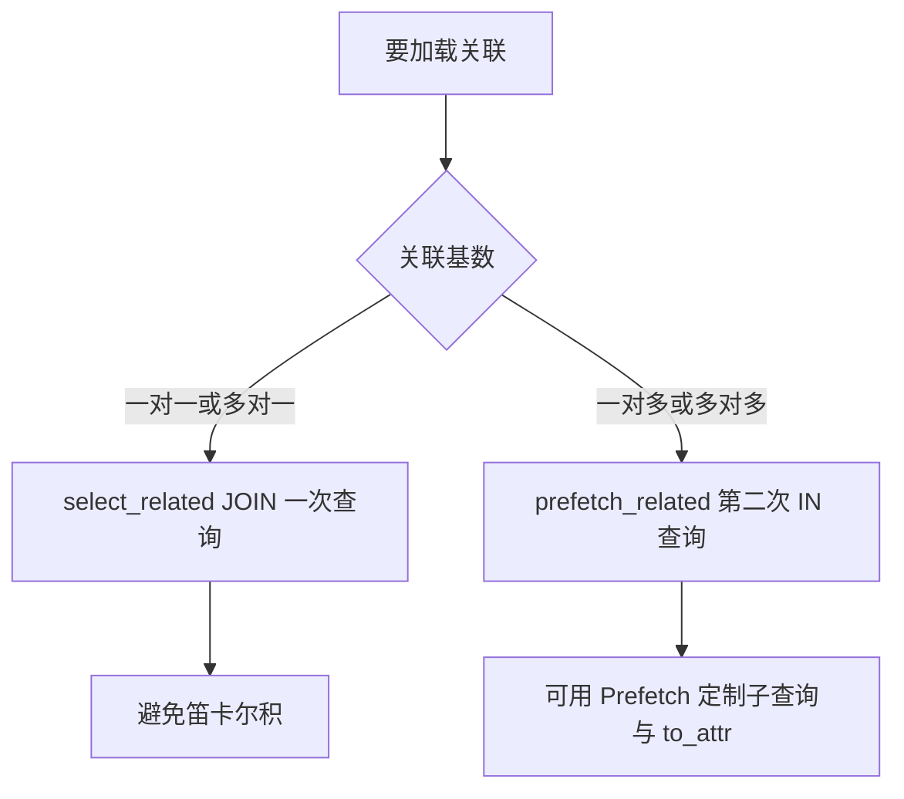
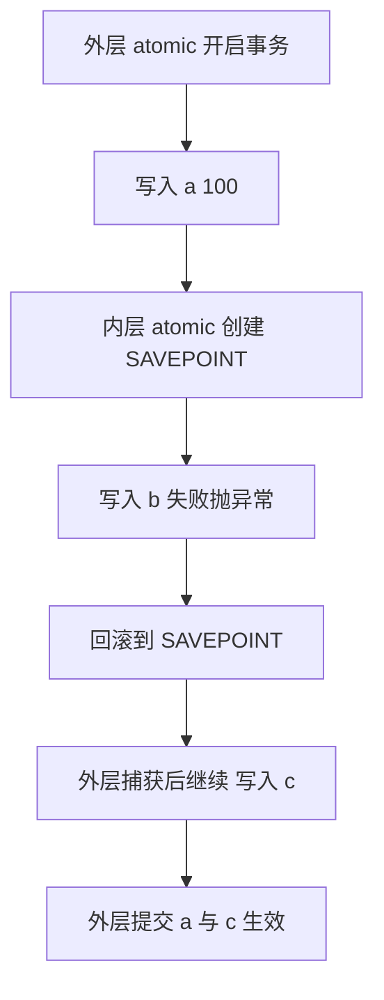
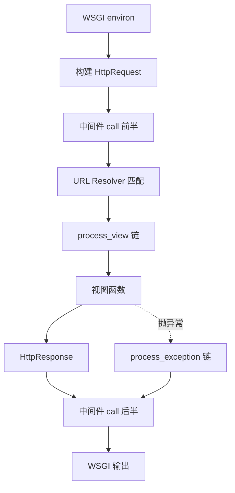
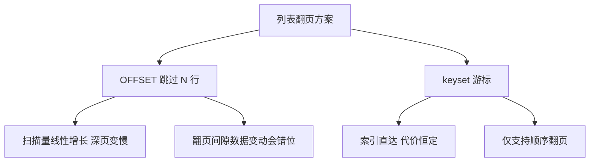
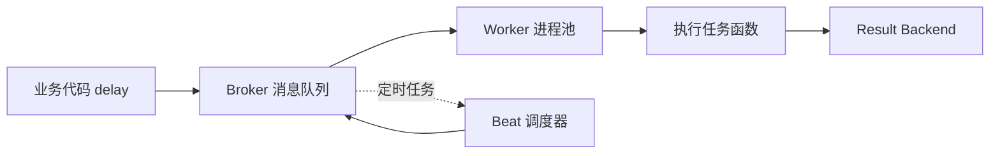
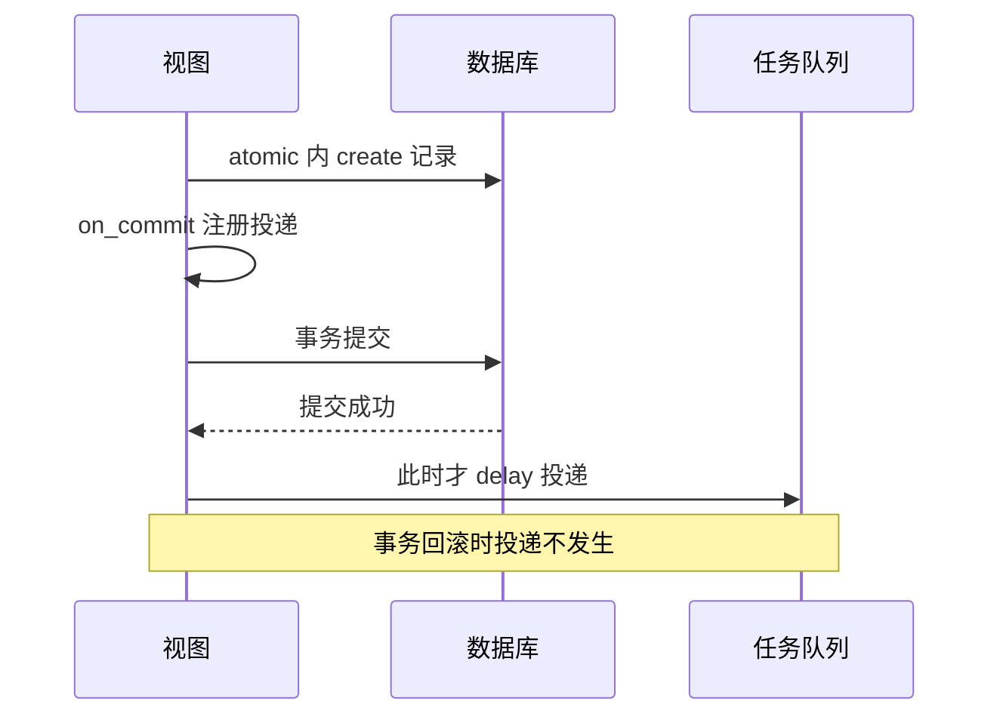
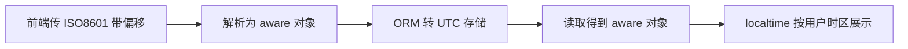
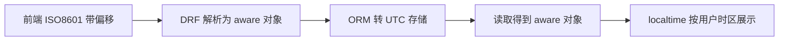

# 第 3 类 · Web 后端开发(50 题 · Q761–Q810)

本文件是 Django 与 DRF 深入篇:ORM 深水区(关联加载、表达式、事务与锁)、模型工程与信号、中间件钩子与请求管线、自定义用户模型、DRF 序列化器与视图源码式理解、分页过滤节流、admin 与缓存、Celery 任务设计、多租户与 i18n/时区、生产化清单。
共 50 题(Q761–Q810),默认已掌握 03a 中 Django/DRF 基础(Q122–Q135),聚焦深水区与工程决策。
每题代码是**单文件自洽**的 Django 模块:settings.configure + 内存 SQLite + schema_editor 建表,`pip install django djangorestframework` 后直接 python 执行。
复习主线:QuerySet 的执行模型、请求管线顺序、任务队列的三要素(幂等、重试、路由)。

### Q761 · select_related 与 prefetch_related 深水区

> 难度:★★★★ | 标签:Django ORM, N+1

**问**:select_related 和 prefetch_related 的底层机制差异是什么?各自的适用边界与误用后果?

**答**:`select_related` 生成 **SQL JOIN**,一次查询把关联行取回,适合 ForeignKey/OneToOne;`prefetch_related` 做**第二次 IN 查询**后在 Python 层拼接,适合 M2M 与反向外键。误用方向相反:该 join 的用 prefetch 变两次查询(尚可),对反向一对多/M2M 误用 select_related 会直接抛 `FieldError`(它只接正向 ForeignKey/OneToOne);JOIN 行数膨胀是手写 JOIN 或 SQLAlchemy `joinedload` 的问题,不是 Django select_related 的行为。进阶手段是 `Prefetch` 对象:给关联注入过滤条件的子 QuerySet,或用 `to_attr` 缓存成列表避免重复取。



```python
# file: code/03_Web后端开发/q761_select_related.py
try:
    import django
    from django.conf import settings
except ImportError:
    print("该题演示需要第三方库 django:pip install django,原理见正文")
    raise SystemExit(0)

settings.configure(
    DEBUG=True,
    DATABASES={"default": {"ENGINE": "django.db.backends.sqlite3", "NAME": ":memory:"}},
    INSTALLED_APPS=[],
    USE_TZ=True,
)
django.setup()

from django.db import connection, models

class Author(models.Model):
    name = models.CharField(max_length=32)
    class Meta:
        app_label = "demo"

class Book(models.Model):
    title = models.CharField(max_length=64)
    author = models.ForeignKey(Author, on_delete=models.CASCADE)
    class Meta:
        app_label = "demo"

with connection.schema_editor() as se:
    se.create_model(Author)
    se.create_model(Book)

a = Author.objects.create(name="鲁迅")
Book.objects.bulk_create([Book(title=f"书{i}", author=a) for i in range(3)])

connection.queries_log.clear()
for b in Book.objects.select_related("author"):
    _ = b.author.name
print("select_related 查询数:", len(connection.queries))

connection.queries_log.clear()
for b in Book.objects.prefetch_related("author"):
    _ = b.author.name
print("prefetch_related 查询数:", len(connection.queries))
```

**追问**:
- prefetch_related 传 ForeignKey 会怎样?——能跑但退化为额外 IN 查询,不如 select_related 的一条 JOIN。
- Prefetch 的 to_attr 解决什么?——把结果挂到自定义列表属性,比默认缓存描述符更省内存且可预排序。

### Q762 · only 与 defer 的字段裁剪与隐形 N+1

> 难度:★★★★ | 标签:Django ORM, 性能

**问**:only/defer 生成的 SQL 有什么不同?它们最大的坑是什么?

**答**:`only("id","title")` 与 `defer("body")` 都让 SELECT **只取部分列**,省带宽省内存,适合大文本字段列表页。最大的坑:访问**未加载字段会触发一次额外的延迟加载查询**,写在循环里就是隐形 N+1,而且不像关联 N+1 那样显眼。与 select_related 组合时,only 的字段清单必须覆盖关联所需的连接列,否则 join 白做。

```python
# file: code/03_Web后端开发/q762_only_defer.py
try:
    import django
    from django.conf import settings
except ImportError:
    print("该题演示需要第三方库 django:pip install django,原理见正文")
    raise SystemExit(0)

settings.configure(
    DEBUG=True,
    DATABASES={"default": {"ENGINE": "django.db.backends.sqlite3", "NAME": ":memory:"}},
    INSTALLED_APPS=[],
    USE_TZ=True,
)
django.setup()

from django.db import connection, models

class Article(models.Model):
    title = models.CharField(max_length=64)
    body = models.TextField(default="")
    class Meta:
        app_label = "demo"

with connection.schema_editor() as se:
    se.create_model(Article)

Article.objects.bulk_create([Article(title=f"t{i}", body="x" * 100) for i in range(3)])

connection.queries_log.clear()
articles = list(Article.objects.only("id", "title"))
print("SQL 里取了 body 吗:", "body" in connection.queries[0]["sql"].split())
articles[0].body  # 访问未加载字段触发第二次查询
print("当前总查询数:", len(connection.queries))
```

**追问**:
- only 之后对模型实例 save 会怎样?——只更新已加载字段,Django 自动处理,但并发覆盖风险仍在。
- 怎么发现这类隐形 N+1?——测试里用 CaptureQueriesContext 断言查询数上限,或接 django-debug-toolbar/nplusone 工具。

### Q763 · Q 对象与动态查询构建

> 难度:★★★☆ | 标签:Django ORM, 查询

**问**:筛选条件由前端任意组合(且/或/非),怎么安全地动态构建 QuerySet?

**答**:用 `Q` 对象做布尔代数:`&`、`|`、`~` 组合,优先级用括号控制。动态构建的标准模式是**从基线 Q 起步逐步 &=**,而不是拼字符串条件;空条件场景给恒真/恒假对象兜底,避免 filter() 全表。所有值参数化由 ORM 保证,不存在注入;需要"字段值之间比较"时再上 F 表达式。复杂到一定程度的动态条件,应该抽象成专门的查询构建器而不是散在视图里。

```python
# file: code/03_Web后端开发/q763_q_objects.py
try:
    import django
    from django.conf import settings
except ImportError:
    print("该题演示需要第三方库 django:pip install django,原理见正文")
    raise SystemExit(0)

settings.configure(
    DEBUG=True,
    DATABASES={"default": {"ENGINE": "django.db.backends.sqlite3", "NAME": ":memory:"}},
    INSTALLED_APPS=[],
    USE_TZ=True,
)
django.setup()

from django.db import connection, models
from django.db.models import Q

class Product(models.Model):
    name = models.CharField(max_length=32)
    price = models.IntegerField(default=0)
    active = models.BooleanField(default=True)
    class Meta:
        app_label = "demo"

with connection.schema_editor() as se:
    se.create_model(Product)

Product.objects.bulk_create([
    Product(name="手机", price=3000),
    Product(name="耳机", price=300),
    Product(name="书", price=30, active=False),
])

filters = Q(active=True)                       # 基线条件
filters &= Q(name__contains="机") | Q(price__gte=300)  # 用户勾选的组合
print(list(Product.objects.filter(filters).values_list("name", flat=True)))
print(Product.objects.filter(~Q(name="书")).count())
```

**追问**:
- 多个 filter 连写和 Q 合并一样吗?——同一多值关联上连续 filter 是**每次独立子查询再 AND**,与 Q 里的 OR 语义不同,经典考点。
- 恒真条件怎么表达?——`Q(pk__isnull=False)` 这类永真谓词,让动态拼接有稳定的初始值。

### Q764 · F 表达式与原子更新

> 难度:★★★☆ | 标签:Django ORM, 并发

**问**:`obj.count += 1; obj.save()` 有什么并发问题?F 表达式怎么解决?

**答**:读-改-写三步之间有窗口,两个并发请求都读到 5 就都写 6,**丢失更新**。F 表达式把运算下推成单条 `UPDATE ... SET count = count + 1`,由数据库原子完成;update() 不触发 save/signals,是刻意的轻量路径。F 还能在 filter 里比较**同一行的两个字段**。扣减类业务(库存、余额)的标准组合是 F + 行锁 + 条件更新(count >= n 才更新),用返回的行数判断是否成功。

```python
# file: code/03_Web后端开发/q764_f_expression.py
try:
    import django
    from django.conf import settings
except ImportError:
    print("该题演示需要第三方库 django:pip install django,原理见正文")
    raise SystemExit(0)

settings.configure(
    DEBUG=True,
    DATABASES={"default": {"ENGINE": "django.db.backends.sqlite3", "NAME": ":memory:"}},
    INSTALLED_APPS=[],
    USE_TZ=True,
)
django.setup()

from django.db import connection, models
from django.db.models import F

class Account(models.Model):
    owner = models.CharField(max_length=32)
    balance = models.IntegerField(default=0)
    class Meta:
        app_label = "demo"

with connection.schema_editor() as se:
    se.create_model(Account)

Account.objects.create(owner="a", balance=100)
Account.objects.filter(owner="a").update(balance=F("balance") - 30)  # 单条原子 UPDATE
a = Account.objects.get(owner="a")
print(a.balance)

updated = Account.objects.filter(owner="a", balance__gte=200).update(balance=F("balance") - 200)
print("条件扣款成功笔数:", updated)  # 0 表示余额不足, 天然防超扣
```

**追问**:
- F 更新后实例内存里的值是新的吗?——不是,要 refresh_from_db 或用 F 结果的返回值,否则新旧值混用出 bug。
- update() 为什么不触发信号?——它是 QuerySet 级批量 UPDATE,绕过实例生命周期,这是选它的原因也是要用它的纪律。

### Q765 · annotate 与 Subquery/Exists 子查询

> 难度:★★★★ | 标签:Django ORM, 查询

**问**:每个作者要带"作品数"和"最新作品名",一次查询怎么做?

**答**:聚合用 `annotate(Count("book"))` 一次 GROUP BY 搞定;"每行的最新关联值"用 `Subquery`:内层 QuerySet 通过 `OuterRef` 引用外层行,`values(...)[:1]` 限定单值。相比 join 整表再聚合,Subquery 走相关子查询,大表下更可控。EXISTS 判断用 `Exists()` 包子查询配 annotate 布尔列。注意 annotate 后的聚合值参与 filter 时要用 alias,避免隐式 HAVING 语义混乱。

```python
# file: code/03_Web后端开发/q765_annotate_subquery.py
try:
    import django
    from django.conf import settings
except ImportError:
    print("该题演示需要第三方库 django:pip install django,原理见正文")
    raise SystemExit(0)

settings.configure(
    DEBUG=True,
    DATABASES={"default": {"ENGINE": "django.db.backends.sqlite3", "NAME": ":memory:"}},
    INSTALLED_APPS=[],
    USE_TZ=True,
)
django.setup()

from django.db import connection, models
from django.db.models import Count, OuterRef, Subquery

class Author(models.Model):
    name = models.CharField(max_length=32)
    class Meta:
        app_label = "demo"

class Book(models.Model):
    title = models.CharField(max_length=64)
    author = models.ForeignKey(Author, on_delete=models.CASCADE)
    class Meta:
        app_label = "demo"

with connection.schema_editor() as se:
    se.create_model(Author)
    se.create_model(Book)

a1, a2 = Author.objects.create(name="甲"), Author.objects.create(name="乙")
Book.objects.create(title="甲一", author=a1)
Book.objects.create(title="甲二", author=a1)
Book.objects.create(title="乙一", author=a2)

latest = Book.objects.filter(author=OuterRef("pk")).order_by("-id").values("title")[:1]
qs = Author.objects.annotate(book_count=Count("book"), latest_title=Subquery(latest))
print(list(qs.values("name", "book_count", "latest_title")))
```

**追问**:
- annotate 与 aggregate 的区别?——annotate 给每行加计算列(分组到模型行),aggregate 出单个汇总值字典。
- Subquery 拿多列怎么办?——一次只取一个值列,多列要写多个 Subquery 或用 JSONArray 聚合技巧。

### Q766 · 批量写入 bulk_create 与 bulk_update

> 难度:★★★☆ | 标签:Django ORM, 性能

**问**:要插入几万行,循环 save 为什么不行?bulk 系列的注意事项?

**答**:循环 save 每行一次 INSERT 加一轮信号和字段准备,几万行就是几万次往返;`bulk_create(objs, batch_size=n)` 合并成批量 INSERT,batch_size 控制单批大小避免 SQL 过长或参数超限。注意事项:bulk_create **不触发 post_save 信号、不调用 save()**;主键回填依赖后端 RETURNING(新 Django + SQLite/PG 支持),`ignore_conflicts=True` 时主键不回填;`bulk_update` 按字段名批量 UPDATE,同样跳过信号。批量导入的信号/业务钩子要在调用处显式补偿。

```python
# file: code/03_Web后端开发/q766_bulk_ops.py
try:
    import django
    from django.conf import settings
except ImportError:
    print("该题演示需要第三方库 django:pip install django,原理见正文")
    raise SystemExit(0)

settings.configure(
    DEBUG=True,
    DATABASES={"default": {"ENGINE": "django.db.backends.sqlite3", "NAME": ":memory:"}},
    INSTALLED_APPS=[],
    USE_TZ=True,
)
django.setup()

from django.db import connection, models

class Product(models.Model):
    name = models.CharField(max_length=32)
    price = models.IntegerField(default=0)
    class Meta:
        app_label = "demo"

with connection.schema_editor() as se:
    se.create_model(Product)

Product.objects.bulk_create(
    [Product(name=f"p{i}", price=i) for i in range(5)], batch_size=2
)
products = list(Product.objects.all())
for p in products:
    p.price *= 10
Product.objects.bulk_update(products, ["price"], batch_size=3)
print(list(Product.objects.values_list("name", "price")))
```

**追问**:
- bulk_create 和 update_or_create 混合的幂等导入怎么做?——先 ignore_conflicts 批插,再按唯一键 bulk_update 修正字段。
- 大批量导入还要注意什么?——包一层 transaction.atomic 减少提交次数,导入期间可延后索引与约束校验。

### Q767 · 事务 atomic、嵌套与保存点

> 难度:★★★★ | 标签:Django ORM, 事务

**问**:atomic 可以嵌套吗?嵌套时内部回滚外部还在,这是什么机制?ATOMIC_REQUESTS 的取舍?

**答**:`transaction.atomic()` 可嵌套:最外层开 BEGIN,内层变成 **SAVEPOINT**,内层异常回滚到保存点、外层可以捕获后继续,这是"局部失败不拖垮整体"的标准手段。但**异常若穿透最外层,全部回滚**。`ATOMIC_REQUESTS=True` 把每个请求包进事务,写路径省心,代价是长请求持锁久、第三方慢调用也被卷进事务——大请求应显式管理事务而非依赖它。atomic 块内禁止手动 commit/rollback 和捕获异常后继续用失效连接。



```python
# file: code/03_Web后端开发/q767_atomic_savepoint.py
try:
    import django
    from django.conf import settings
except ImportError:
    print("该题演示需要第三方库 django:pip install django,原理见正文")
    raise SystemExit(0)

settings.configure(
    DEBUG=True,
    DATABASES={"default": {"ENGINE": "django.db.backends.sqlite3", "NAME": ":memory:"}},
    INSTALLED_APPS=[],
    USE_TZ=True,
)
django.setup()

from django.db import connection, models, transaction

class Ledger(models.Model):
    owner = models.CharField(max_length=32)
    amount = models.IntegerField(default=0)
    class Meta:
        app_label = "demo"

with connection.schema_editor() as se:
    se.create_model(Ledger)

try:
    with transaction.atomic():
        Ledger.objects.create(owner="a", amount=100)
        try:
            with transaction.atomic():          # 内层变成 SAVEPOINT
                Ledger.objects.create(owner="b", amount=-1)
                raise ValueError("内层失败")
        except ValueError:
            pass                                 # 只回滚内层
        Ledger.objects.create(owner="c", amount=50)
except ValueError:
    pass

print(list(Ledger.objects.values_list("owner", "amount")))
```

**追问**:
- 怎么判断当前是否已在事务里?——`connection.in_atomic_block`,写库工具方法据此决定是否自己开 atomic。
- SAVEPOINT 回滚后外层还能继续吗?——能,这正是保存点语义;但如果数据库连接本身报错(如死锁)就要整体重来。

### Q768 · select_for_update 行锁与死锁预防

> 难度:★★★★ | 标签:Django ORM, 并发控制

**问**:并发扣库存除了 F 表达式,行锁怎么用?注意什么?

**答**:`select_for_update()` 在事务内对选中行加排他锁,直到事务结束,其他事务的同类读取会等待。铁律:**必须在 atomic 块内**,否则 Django 抛 TransactionManagementError;锁定要**按固定顺序**访问资源,多行锁定统一排序,防死锁。SQLite 不支持 FOR UPDATE(引擎级并发模型不同),PostgreSQL/MySQL 才有完整语义;还可配 `nowait=True`/`skip_locked=True` 做抢占式任务队列。锁内只做短操作,慢 IO 会放大锁等待。

```python
# file: code/03_Web后端开发/q768_select_for_update.py
try:
    import django
    from django.conf import settings
except ImportError:
    print("该题演示需要第三方库 django:pip install django,原理见正文")
    raise SystemExit(0)

settings.configure(
    DEBUG=True,
    DATABASES={"default": {"ENGINE": "django.db.backends.sqlite3", "NAME": ":memory:"}},
    INSTALLED_APPS=[],
    USE_TZ=True,
)
django.setup()

from django.db import NotSupportedError, connection, models, transaction

class Account(models.Model):
    owner = models.CharField(max_length=32)
    balance = models.IntegerField(default=0)
    class Meta:
        app_label = "demo"

with connection.schema_editor() as se:
    se.create_model(Account)

Account.objects.create(owner="a", balance=100)

try:
    with transaction.atomic():
        for acc in Account.objects.select_for_update().filter(owner="a"):
            acc.balance -= 10
            acc.save()
    print("行锁扣减后余额:", Account.objects.get(owner="a").balance)
except NotSupportedError:
    print("SQLite 不支持 FOR UPDATE, 生产用 PostgreSQL/MySQL")
```

**追问**:
- skip_locked 的典型场景?——多个 worker 用 SELECT FOR UPDATE SKIP LOCKED 抢任务行,天然实现工作队列。
- F 表达式和行锁怎么选?——单字段原子运算用 F 足够;要先读后判断多字段业务规则再写,用行锁包住读改写。

### Q769 · QuerySet 求值时机与结果缓存

> 难度:★★★☆ | 标签:Django ORM, QuerySet

**问**:QuerySet 的惰性求值具体指什么?什么时候会"偷偷"再查一次库?

**答**:QuerySet 构造时只记录描述,**首次迭代/len/list/bool 判断才发 SQL**,并把结果缓存在 `._result_cache`;之后再次迭代同一 QuerySet 用缓存。任何**链式调用(filter/orderby/切片生成新对象)都返回新 QuerySet、缓存为空,必再查库**。另一类易错点:`if qs:` 触发完整求值,`qs.exists()`、`qs.count()` 是替代的轻量判断;模板里两次遍历同一变量有缓存,遍历两个"看起来一样"的变量就是两次查询。

```python
# file: code/03_Web后端开发/q769_queryset_cache.py
try:
    import django
    from django.conf import settings
except ImportError:
    print("该题演示需要第三方库 django:pip install django,原理见正文")
    raise SystemExit(0)

settings.configure(
    DEBUG=True,
    DATABASES={"default": {"ENGINE": "django.db.backends.sqlite3", "NAME": ":memory:"}},
    INSTALLED_APPS=[],
    USE_TZ=True,
)
django.setup()

from django.db import connection, models

class Article(models.Model):
    title = models.CharField(max_length=64)
    class Meta:
        app_label = "demo"

with connection.schema_editor() as se:
    se.create_model(Article)

Article.objects.bulk_create([Article(title=f"t{i}") for i in range(3)])

connection.queries_log.clear()
qs = Article.objects.all()
print("count 触发查询:", len(connection.queries) == 1)
list(qs)
print("迭代触发查询:", len(connection.queries) == 2)
list(qs)
print("二次迭代走缓存:", len(connection.queries) == 2)
list(qs.order_by("-id"))
print("链式后重新查询:", len(connection.queries) == 3)
```

**追问**:
- exists() 和 count() 谁更快?——判断有无用 exists(短路 LIMIT 1),需要数字才用 count,两者都不读全行。
- 迭代大表怎么省内存?——iterator(chunk_size) 分块拉取,让缓存不驻留全量结果。

### Q770 · values/values_list 与大数据导出

> 难度:★★★☆ | 标签:Django ORM, 性能

**问**:导出百万行数据到 CSV,怎么不把进程内存打爆?

**答**:三个组合拳:`values_list` 只要需要的列(跳过模型实例化开销,省一半内存与 CPU);`iterator(chunk_size)` 分块拉取避免结果集整体驻留;流式写出到响应或文件,而不是攒成大字符串。模板层不要套上 deferring 之外的逻辑;真正海量导出走异步任务生成文件再给下载链接,HTTP 请求里同步导出百万行本身就是反模式。

```python
# file: code/03_Web后端开发/q770_export.py
import csv
import io
try:
    import django
    from django.conf import settings
except ImportError:
    print("该题演示需要第三方库 django:pip install django,原理见正文")
    raise SystemExit(0)

settings.configure(
    DEBUG=True,
    DATABASES={"default": {"ENGINE": "django.db.backends.sqlite3", "NAME": ":memory:"}},
    INSTALLED_APPS=[],
    USE_TZ=True,
)
django.setup()

from django.db import connection, models

class Article(models.Model):
    title = models.CharField(max_length=64)
    class Meta:
        app_label = "demo"

with connection.schema_editor() as se:
    se.create_model(Article)

Article.objects.bulk_create([Article(title=f"t{i}") for i in range(5)])

buf = io.StringIO()
writer = csv.writer(buf)
writer.writerow(["id", "title"])
rows = Article.objects.values_list("id", "title").iterator(chunk_size=100)
for row in rows:
    writer.writerow(row)
print("导出行数:", len(buf.getvalue().strip().splitlines()))
```

**追问**:
- iterator 在 SQLite 和 PostgreSQL 上行为一样吗?——PG 有服务端游标真流式,SQLite 是客户端分块取,语义近似内存表现不同。
- 导出要过滤敏感列怎么办?——values_list 白名单列,或在序列化层统一脱敏,导出路径也要过权限。

### Q771 · 信号滥用与替代方案

> 难度:★★★★ | 标签:Django, 信号, 架构

**问**:post_save 里发通知、清缓存,为什么被老手诟病?替代方案是什么?

**答**:信号的问题:调用关系**隐式**,读代码看不到副作用;`update()`、`bulk_create`、`bulk_update` **不触发**信号,行为不一致;同一请求里 save 多次会连环触发;测试要手动断开连接。替代:把"保存后要做的事"放进 **service 层显式调用**,数据流一目了然、易测试。信号保留给真正横切、与业务无关的插件式场景(审计组件),且必须在 app config 的 ready() 注册。另一个必考点:`get_or_create`、update_fields 都会改变信号的 kwargs 行为。

```python
# file: code/03_Web后端开发/q771_signal_abuse.py
try:
    import django
    from django.conf import settings
except ImportError:
    print("该题演示需要第三方库 django:pip install django,原理见正文")
    raise SystemExit(0)

settings.configure(
    DEBUG=True,
    DATABASES={"default": {"ENGINE": "django.db.backends.sqlite3", "NAME": ":memory:"}},
    INSTALLED_APPS=[],
    USE_TZ=True,
)
django.setup()

from django.db import connection, models
from django.db.models.signals import post_save
from django.dispatch import receiver

class Order(models.Model):
    no = models.CharField(max_length=32)
    class Meta:
        app_label = "demo"

audit = []

@receiver(post_save, sender=Order)
def sync_audit(sender, instance, created, **kwargs):
    audit.append(f"审计:{instance.no}")

with connection.schema_editor() as se:
    se.create_model(Order)

Order.objects.create(no="A1")                    # 触发信号
Order.objects.bulk_create([Order(no="A2")])      # bulk 不触发
Order.objects.filter(no="A1").update(no="A1b")   # update 不触发
print(audit)
```

**追问**:
- 信号该在哪注册?——应用 AppConfig.ready() 里 import receivers 模块,避免模型加载竞态。
- 想 bulk 写入也走审计怎么办?——在 service 层统一封装写入入口,审计作为显式步骤,不指望信号补位。

### Q772 · 自定义用户模型:AbstractUser 与 AbstractBaseUser

> 难度:★★★★ | 标签:Django, 用户模型

**问**:为什么自定义用户模型必须在第一个迁移之前定?两种基类怎么选?

**答**:`AbstractUser` 继承后**加字段**(保留 username、权限体系),`AbstractBaseUser` 从零定义(自己实现 USERNAME_FIELD 与 BaseUserManager),适合手机号/邮箱登录体系。必须趁早的原因:用户表被外键、迁移、admin 全局引用,中途更换等于重写历史迁移,官方文档明确"项目开始就定制"。所有指向用户的外键用 `settings.AUTH_USER_MODEL` 字符串,不要直接 import 用户类,否则循环导入与替换困难。

```python
# file: code/03_Web后端开发/q772_custom_user.py
try:
    import django
    from django.conf import settings
except ImportError:
    print("该题演示需要第三方库 django:pip install django,原理见正文")
    raise SystemExit(0)

settings.configure(
    DEBUG=True,
    DATABASES={"default": {"ENGINE": "django.db.backends.sqlite3", "NAME": ":memory:"}},
    INSTALLED_APPS=[],
    USE_TZ=True,
)
django.setup()

from django.contrib.auth.base_user import AbstractBaseUser, BaseUserManager
from django.db import connection, models

class UserManager(BaseUserManager):
    def create_user(self, username: str, password: str):
        user = self.model(username=username)
        user.set_password(password)
        user.save(using=self._db)
        return user

class CustomUser(AbstractBaseUser):
    username = models.CharField(max_length=32, unique=True)
    is_active = models.BooleanField(default=True)
    USERNAME_FIELD = "username"
    objects = UserManager()
    class Meta:
        app_label = "demo"

with connection.schema_editor() as se:
    se.create_model(CustomUser)

u = CustomUser.objects.create_user(username="alice", password="s3cret!")
print("密码校验:", u.check_password("s3cret!"))
print("存储的是哈希:", u.password.startswith("pbkdf2"))
```

**追问**:
- USERNAME_FIELD 的要求?——必须是唯一字段,且自定义 Manager 要实现 create_user/create_superuser 约定。
- 第三方包引用 User 模型怎么办?——统一用 get_user_model() 或 settings.AUTH_USER_MODEL,生态都支持。

### Q773 · 模型继承三种方式

> 难度:★★★☆ | 标签:Django ORM, 模型设计

**问**:abstract、multi-table、proxy 三种继承的区别与选型?

**答**:**abstract**:基类不建表,字段复制进子类,是"公共字段 Mixin",默认首选;**multi-table**:父类子类各一张表,子表隐式 OneToOne 指向父表,查询父类要 join 子类,开销大且查询语义容易混乱,尽量少用;**proxy**:同一张表换 Python 行为(加方法、改默认排序、换 manager),不改 schema,适合给同一数据不同业务视角。判断顺序:复用字段用 abstract,只是行为不同用 proxy,真的"is-a 且子类字段会独立增长"才考虑多表。

```python
# file: code/03_Web后端开发/q773_model_inherit.py
try:
    import django
    from django.conf import settings
except ImportError:
    print("该题演示需要第三方库 django:pip install django,原理见正文")
    raise SystemExit(0)

settings.configure(
    DEBUG=True,
    DATABASES={"default": {"ENGINE": "django.db.backends.sqlite3", "NAME": ":memory:"}},
    INSTALLED_APPS=[],
    USE_TZ=True,
)
django.setup()

from django.db import connection, models

class Timestamped(models.Model):           # abstract: 公共字段 Mixin
    created_at = models.DateTimeField(auto_now_add=True)
    class Meta:
        abstract = True
        app_label = "demo"

class Post(Timestamped):
    title = models.CharField(max_length=64)
    class Meta:
        app_label = "demo"

class Draft(Post):                          # proxy: 同表不同行为
    class Meta:
        proxy = True
        app_label = "demo"

    @property
    def label(self):
        return f"草稿:{self.title}"

with connection.schema_editor() as se:
    se.create_model(Post)

p = Post.objects.create(title="hello")
print(Draft.objects.get(pk=p.pk).label)
print("proxy 同表:", Post._meta.db_table == Draft._meta.db_table)
```

**追问**:
- 多表继承查询父类会带出子类吗?——不会自动,访问子类属性触发额外查询,这就是它的性能税。
- abstract Meta 里 app_label 会继承吗?——abstract 模型的 Meta 除 abstract 外可被子类继承,app_label 通常写在具体子类。

### Q774 · 数据迁移 RunPython 与历史模型

> 难度:★★★★ | 标签:Django, 迁移

**问**:写 data migration 为什么必须用 apps.get_model 而不是直接 import 模型?

**答**:迁移要在**任意历史时点可重放**,直接 import 拿到的是"当前代码"的模型,字段可能与该迁移时点的 schema 不一致,导致隐蔽数据错误;`apps.get_model(app_label, model_name)` 迁移框架提供的**历史模型快照**才与当时的迁移状态匹配。规范写法:函数签名 `(apps, schema_editor)`,配 `reverse_code` 保证可回滚;大表迁移分批 iteration 防止长事务;新加字段带 default 的迁移策略见在线 DDL 题。

```python
# file: code/03_Web后端开发/q774_data_migration.py
try:
    import django
    from django.conf import settings
except ImportError:
    print("该题演示需要第三方库 django:pip install django,原理见正文")
    raise SystemExit(0)

settings.configure(
    DEBUG=True,
    DATABASES={"default": {"ENGINE": "django.db.backends.sqlite3", "NAME": ":memory:"}},
    INSTALLED_APPS=[],
    USE_TZ=True,
)
django.setup()

from django.db import connection, models

class Author(models.Model):
    name = models.CharField(max_length=32)
    slug = models.SlugField(default="")
    class Meta:
        app_label = "demo"

with connection.schema_editor() as se:
    se.create_model(Author)
Author.objects.create(name="鲁迅")

def gen_slug(apps, schema_editor):       # 与真实迁移文件里的签名一致
    Author = apps.get_model("demo", "Author")
    for a in Author.objects.all().iterator():
        a.slug = f"author-{a.pk}"
        a.save(update_fields=["slug"])

class FakeApps:                          # 单文件演示: 模拟迁移框架注入
    @staticmethod
    def get_model(app, name):
        return Author

gen_slug(FakeApps, connection.schema_editor())
print(list(Author.objects.values("name", "slug")))
```

**追问**:
- reverse_code 不写会怎样?——默认不可逆,回滚该迁移会报错,数据迁移应显式给 noop 或反向逻辑。
- 大表数据迁移怎么避免锁库?——按主键分批 update 循环提交,或改造为读旧写新的应用层策略。

### Q775 · Django 中间件钩子:process_view 与 process_exception

> 难度:★★★★ | 标签:Django, 中间件

**问**:函数式中间件之外,Django 中间件类还有哪些钩子?各自的触发时机与返回值语义?

**答**:完整钩子族:`__init__`(启动时一次)、`__call__`(每请求包裹前后)、`process_view`(URL 解析后、视图执行前,返回 None 继续、返回 Response 则跳过视图与其他 process_view)、`process_exception`(视图抛异常时,返回 None 让异常继续上抛、返回 Response 则吞掉异常)、`process_template_response`(视图返回带 render 方法的对象时)。顺序敏感点:`__call__` 前半按 MIDDLEWARE 顺序、后半逆序;process_view 全部正序,process_exception 逆序。

```python
# file: code/03_Web后端开发/q775_django_middleware.py
try:
    import django
    from django.conf import settings
except ImportError:
    print("该题演示需要第三方库 django:pip install django,原理见正文")
    raise SystemExit(0)

def request_log(get_response):
    def middleware(request):
        request.META["X-Tenant"] = request.META.get("HTTP_X_TENANT", "public")
        response = get_response(request)
        response["X-Process-Flag"] = "ok"
        return response
    return middleware

settings.configure(
    DEBUG=True,
    ALLOWED_HOSTS=["*"],
    MIDDLEWARE=["__main__.request_log", "django.middleware.common.CommonMiddleware"],
    ROOT_URLCONF="__main__",
    DATABASES={"default": {"ENGINE": "django.db.backends.sqlite3", "NAME": ":memory:"}},
    INSTALLED_APPS=[],
    USE_TZ=True,
)
django.setup()

from django.http import HttpResponse
from django.urls import path

def index(request):
    return HttpResponse(f"tenant={request.META['X-Tenant']}")

urlpatterns = [path("", index)]

from django.test import Client

c = Client()
r = c.get("/", HTTP_X_TENANT="acme")
print(r.status_code, r.content.decode(), r["X-Process-Flag"])
```

**追问**:
- process_view 返回 Response 会发生什么?——视图与后续中间件的 process_view 被跳过,直接进入响应阶段,可用于短路的鉴权钩子。
- 钩子注册顺序和 MIDDLEWARE 列表的关系?——调用前半正序、后半逆序;process_exception 从最内层向外找第一个肯处理的。

### Q776 · Django 请求到响应的完整管线

> 难度:★★★★ | 标签:Django, 请求生命周期

**问**:从 WSGI handler 进来,一个请求经过哪些环节到响应出去?各层能干预什么?

**答**:管线:WSGIHandler 收到 environ → 构建 HttpRequest → **中间件栈 call 前半** → URL Resolver 匹配 → **process_view 链** → 视图(可读 ORM、触发信号) → 返回 HttpResponse → **中间件 call 后半** → 异常路径则 process_exception 链 → WSGI 输出。每层职责:中间件管横切(会话、CSRF、压缩),URLconf 管映射,视图管编排,模板/序列化管呈现。理解顺序才能解释"为什么会话中间件必须在认证之前"这类约束。



**追问**:
- 为什么 SessionMiddleware 必须在 AuthenticationMiddleware 之前?——认证要从 request.session 读用户,顺序颠倒认证拿不到会话直接失效。
- 视图里抛 Http404 与返回 404 响应有区别吗?——Http404 走异常处理链(会被 process_exception 之后的 handler 与 404 页面渲染处理),直接返回则是普通响应。

```python
# file: code/03_Web后端开发/q776_pipeline_hooks.py
try:
    import django
    from django.conf import settings
except ImportError:
    print("该题演示需要第三方库 django:pip install django,原理见正文")
    raise SystemExit(0)

events = []

class FullHooks:
    def __init__(self, get_response):
        self.get_response = get_response
        events.append("init")

    def __call__(self, request):
        events.append("call-in")
        response = self.get_response(request)
        events.append("call-out")
        return response

    def process_view(self, request, view_func, args, kwargs):
        events.append("process_view")
        return None

    def process_exception(self, request, exception):
        events.append("process_exception")
        return None

settings.configure(
    DEBUG=True,
    ALLOWED_HOSTS=["*"],
    MIDDLEWARE=["__main__.FullHooks"],
    ROOT_URLCONF="__main__",
    DATABASES={"default": {"ENGINE": "django.db.backends.sqlite3", "NAME": ":memory:"}},
    INSTALLED_APPS=[],
    USE_TZ=True,
)
django.setup()

from django.http import HttpResponse
from django.urls import path

def boom(request):
    raise ValueError("视图内异常")

urlpatterns = [path("boom", boom)]

from django.test import Client

c = Client()
c.get("/boom", raise_request_exception=False)
print("钩子触发顺序:", events)
```

### Q777 · DRF 序列化器上下文 context 传递

> 难度:★★★☆ | 标签:DRF, 序列化器

**问**:SerializerMethodField 里要用当前用户做判断,context 怎么传进来?视图到序列化器的默认上下文有什么?

**答**:实例化时传 `Serializer(data, context={"request": request})`,序列化器内部用 `self.context` 读取;DRF 视图的 `get_serializer` 默认注入 **view 与 request** 两个键,所以 `self.context["request"].user` 是惯用法。context 让"同一个序列化器,不同视角输出不同"(管理员多字段、本人可见标记)。注意 context 是**弱契约**:团队要约定键名,或封装 get_serializer_context 统一供数。

```python
# file: code/03_Web后端开发/q777_serializer_context.py
try:
    import django
    from django.conf import settings
except ImportError:
    print("该题演示需要第三方库 django、djangorestframework:pip install django djangorestframework,原理见正文")
    raise SystemExit(0)

settings.configure(
    DEBUG=True,
    INSTALLED_APPS=["rest_framework"],
    DATABASES={"default": {"ENGINE": "django.db.backends.sqlite3", "NAME": ":memory:"}},
    USE_TZ=True,
)
django.setup()

from rest_framework import serializers

class CommentIn(serializers.Serializer):
    body = serializers.CharField()

    def validate_body(self, value):
        for w in self.context.get("banned_words", set()):
            if w.lower() in value.lower():
                raise serializers.ValidationError(f"包含敏感词 {w}")
        return value

class CommentOut(serializers.Serializer):
    body = serializers.CharField()
    mine = serializers.SerializerMethodField()

    def get_mine(self, obj):
        return obj.get("owner") == self.context.get("viewer")

bad = CommentIn(data={"body": "剧透:主角死了"}, context={"banned_words": {"剧透"}})
print(bad.is_valid(), bad.errors)
out = CommentOut({"body": "很好看", "owner": "alice"}, context={"viewer": "alice"})
print(out.data)
```

**追问**:
- 序列化器嵌套时 context 会传给子序列化器吗?——会,context 沿嵌套传递,深度依赖 context 是可读性坏味道,及时收敛。
- to_representation 里怎么拿请求用户?——`self.context["request"].user`,但注意测试直调序列化器时必须手动给 context。

### Q778 · DRF 校验钩子与执行顺序

> 难度:★★★☆ | 标签:DRF, 校验

**问**:validate_<field> 与 validate() 的执行顺序?校验失败怎么映射到响应?

**答**:顺序:**字段级验证器(含 validate_<field>)逐字段执行 → 对象级 validate(attrs)**,任一步失败即停止收集错误。字段级错误映射到字段名,validate() 里抛的 ValidationError 落到 `non_field_errors`(可自定义 NON_FIELD_ERRORS_KEY)。`is_valid(raise_exception=True)` 直接抛被 DRF 异常处理器转成 400;跨字段断言放 validate(),单纯格式放字段级或 validators 列表,层次清晰才能复用。

```python
# file: code/03_Web后端开发/q778_validators.py
try:
    import django
    from django.conf import settings
except ImportError:
    print("该题演示需要第三方库 django、djangorestframework:pip install django djangorestframework,原理见正文")
    raise SystemExit(0)

settings.configure(
    DEBUG=True,
    INSTALLED_APPS=["rest_framework"],
    DATABASES={"default": {"ENGINE": "django.db.backends.sqlite3", "NAME": ":memory:"}},
    USE_TZ=True,
)
django.setup()

from rest_framework import serializers

order = []

class Signup(serializers.Serializer):
    name = serializers.CharField()
    password = serializers.CharField()
    password2 = serializers.CharField()

    def validate_name(self, value):
        order.append("field:name")
        return value.strip()

    def validate(self, attrs):
        order.append("object:validate")
        if attrs["password"] != attrs["password2"]:
            raise serializers.ValidationError("两次密码不一致")
        return attrs

s = Signup(data={"name": " alice ", "password": "x", "password2": "x"})
print(s.is_valid(), s.validated_data["name"])
print(order)
```

**追问**:
- 想让所有错误一次性收集完怎么做?——默认会收集字段级错误继续跑对象级,但字段级失败的字段不会进 validated_data。
- 校验器写在哪一层?——格式类放字段 validators,业务类放 validate(),跨模型唯一性用 UniqueTogetherValidator 声明。

### Q779 · ModelSerializer 嵌套写入 create/update

> 难度:★★★★ | 标签:DRF, 序列化器

**问**:ModelSerializer 的可嵌套关系字段默认只读,要支持嵌套创建(订单带明细),怎么写?

**答**:嵌套 writable 关系必须**自己实现 create/update**:从 validated_data 弹出子列表,先建主对象再批量建子对象;更新语义要明确——整体替换(删旧建新)还是 diff 更新,两者一致性问题不同。要点:主子对象在**一个事务**里创建;批量插子行用 bulk_create;验证子行的业务约束(如明细不为空)放在 validate()。DRF 不替你做这些,是因为"正确的嵌套写语义"本来就是业务决策。

```python
# file: code/03_Web后端开发/q779_nested_write.py
try:
    import django
    from django.conf import settings
except ImportError:
    print("该题演示需要第三方库 django、djangorestframework:pip install django djangorestframework,原理见正文")
    raise SystemExit(0)

settings.configure(
    DEBUG=True,
    INSTALLED_APPS=["rest_framework"],
    DATABASES={"default": {"ENGINE": "django.db.backends.sqlite3", "NAME": ":memory:"}},
    USE_TZ=True,
)
django.setup()

from django.db import connection, models, transaction
from rest_framework import serializers

class Poll(models.Model):
    question = models.CharField(max_length=64)
    class Meta:
        app_label = "demo"

class Choice(models.Model):
    poll = models.ForeignKey(Poll, related_name="choices", on_delete=models.CASCADE)
    text = models.CharField(max_length=64)
    class Meta:
        app_label = "demo"

with connection.schema_editor() as se:
    se.create_model(Poll)
    se.create_model(Choice)

class ChoiceS(serializers.ModelSerializer):
    class Meta:
        model = Choice
        fields = ["text"]

class PollS(serializers.ModelSerializer):
    choices = ChoiceS(many=True)
    class Meta:
        model = Poll
        fields = ["id", "question", "choices"]

    def create(self, validated_data):
        choices = validated_data.pop("choices")
        with transaction.atomic():
            poll = Poll.objects.create(**validated_data)
            Choice.objects.bulk_create([Choice(poll=poll, **c) for c in choices])
        return poll

data = {"question": "选谁", "choices": [{"text": "A"}, {"text": "B"}]}
s = PollS(data=data)
print(s.is_valid(raise_exception=False))
poll = s.save()
print(poll.question, poll.choices.count())
```

**追问**:
- 嵌套更新的删除语义怎么定?——整体替换最简单但会重建主键;要保 ID 就按 ID diff 增删改,建议在文档里写死。
- validated_data 里的嵌套结构长什么样?——关系键变成字典/列表的普通 Python 结构,pop 出来即用。

### Q780 · SerializerMethodField 与 source 的边界

> 难度:★★☆☆ | 标签:DRF, 序列化器

**问**:输出字段与模型字段对不上时,source 和 SerializerMethodField 怎么选?

**答**:`source="profile.bio"` 适合**取值路径**不同但仍是纯取数(支持跨关系点路径);`SerializerMethodField` 适合**需要计算、拼接、条件逻辑**的输出,实现 get_<field>(obj)。两者都是只读字段。注意点:source 跨关系会触发关联加载,注意 N+1;MethodField 里避免做查询,数据该在 view 层 prefetch 好;写路径需要同名输入时必须另建输入模型,读写模型分离是 DRF 的常态。

```python
# file: code/03_Web后端开发/q780_source_method.py
try:
    import django
    from django.conf import settings
except ImportError:
    print("该题演示需要第三方库 django、djangorestframework:pip install django djangorestframework,原理见正文")
    raise SystemExit(0)

settings.configure(
    DEBUG=True,
    INSTALLED_APPS=["rest_framework"],
    DATABASES={"default": {"ENGINE": "django.db.backends.sqlite3", "NAME": ":memory:"}},
    USE_TZ=True,
)
django.setup()

from django.db import connection, models
from rest_framework import serializers

class Profile(models.Model):
    bio = models.CharField(max_length=64, default="")
    class Meta:
        app_label = "demo"

class User(models.Model):
    name = models.CharField(max_length=32)
    profile = models.OneToOneField(Profile, on_delete=models.CASCADE)
    class Meta:
        app_label = "demo"

with connection.schema_editor() as se:
    se.create_model(Profile)
    se.create_model(User)

u = User.objects.create(name="alice", profile=Profile.objects.create(bio="dev"))

class UserOut(serializers.ModelSerializer):
    bio = serializers.CharField(source="profile.bio", read_only=True)
    upper_name = serializers.SerializerMethodField()

    class Meta:
        model = User
        fields = ["name", "bio", "upper_name"]

    def get_upper_name(self, obj):
        return obj.name.upper()

print(UserOut(User.objects.select_related("profile").get(pk=u.pk)).data)
```

**追问**:
- source 指向不存在的属性会怎样?——序列化时抛 AttributeError,通常由错误的字段路径或漏 prefetch 引起。
- MethodField 能参与写吗?——不能,只读;写路径请显式声明可写字段或拆输入序列化器。

### Q781 · ViewSet 的 as_view 与请求分发源码式理解

> 难度:★★★★ | 标签:DRF, ViewSet

**问**:ViewSet.as_view({"get": "list"}) 这个映射表背后发生了什么?一次请求在 ViewSet 里走哪些步骤?

**答**:Router 或手动 as_view 把 **HTTP 方法映射到 action 名**,生成一个视图闭包;请求进来后 `initialize_request` 把 Django request 包装成 DRF Request,`initial` 依次执行 **版本协商、认证、权限检查、节流**,然后按映射调 action(如 list),list 内部走 `get_queryset → filter_queryset → paginate → get_serializer`,最后 finalize_response 包装。理解这条链就能定位:401 在认证、403 在权限、429 在节流、422 在序列化器校验。

```python
# file: code/03_Web后端开发/q781_viewset_flow.py
try:
    import django
    from django.conf import settings
except ImportError:
    print("该题演示需要第三方库 django、djangorestframework:pip install django djangorestframework,原理见正文")
    raise SystemExit(0)

settings.configure(
    DEBUG=True,
    INSTALLED_APPS=["rest_framework"],
    DATABASES={"default": {"ENGINE": "django.db.backends.sqlite3", "NAME": ":memory:"}},
    USE_TZ=True,
)
django.setup()

from django.db import connection, models
from django.test import RequestFactory
from rest_framework import serializers, viewsets

class Note(models.Model):
    text = models.CharField(max_length=64)
    class Meta:
        app_label = "demo"

with connection.schema_editor() as se:
    se.create_model(Note)
Note.objects.create(text="n1")

class NoteS(serializers.ModelSerializer):
    class Meta:
        model = Note
        fields = "__all__"

class NoteViewSet(viewsets.ModelViewSet):
    queryset = Note.objects.all()
    serializer_class = NoteS

factory = RequestFactory()
view = NoteViewSet.as_view({"get": "list", "post": "create"})
resp = view(factory.get("/notes"))
resp.render()
print(resp.status_code, resp.content.decode()[:40])
```

**追问**:
- get_queryset 什么时候被调用?——每次请求调用(不是启动时),因此可以做按请求的过滤,这也是数据隔离的切入点。
- self.action 在哪一步可用?——initialize_request 时写入,权限类和 get_serializer 常用它区分动作。

### Q782 · Router 源码式理解:SimpleRouter 生成了什么

> 难度:★★★☆ | 标签:DRF, Router

**问**:router.register 之后 urlpatterns 里到底多了什么?list 与 retrieve 的 URL 怎么来的?

**答**:SimpleRouter 内部维护 routes 模板:标准动作生成 `{prefix}`(list/create)与 `{prefix}/{lookup}`(retrieve/update/destroy),额外动作由 `@action(detail=...)` 追加;每条 URL 配上 name(如 `note-list`)供 reverse。DefaultRouter 在此基础上加 API root 视图与 format 后缀。理解模板就能解释:lookup_value_regex 控制主键匹配形态、自定义 action 的 url_path/name 如何反向解析。

```python
# file: code/03_Web后端开发/q782_router_urls.py
try:
    import django
    from django.conf import settings
except ImportError:
    print("该题演示需要第三方库 django、djangorestframework:pip install django djangorestframework,原理见正文")
    raise SystemExit(0)

settings.configure(
    DEBUG=True,
    INSTALLED_APPS=["rest_framework"],
    DATABASES={"default": {"ENGINE": "django.db.backends.sqlite3", "NAME": ":memory:"}},
    USE_TZ=True,
)
django.setup()

from rest_framework import routers, serializers, viewsets

class NoteS(serializers.Serializer):
    text = serializers.CharField()

class NoteViewSet(viewsets.ModelViewSet):
    queryset = []
    serializer_class = NoteS

    from rest_framework.decorators import action

    @action(detail=True, methods=["post"])
    def publish(self, request, pk=None):
        pass

router = routers.SimpleRouter()
router.register(r"notes", NoteViewSet)
for url in router.urls:
    print(str(url.pattern), url.name)
```

**追问**:
- detail=False 的 action URL 长什么样?——挂在集合上,如 /notes/recent/;detail=True 挂在实例上 /notes/{pk}/publish/。
- 两个 ViewSet 注册同名前缀会怎样?——URL name 冲突,reverse 失败,要用不同的 basename。

### Q783 · 深分页 OFFSET 的性能问题与 keyset 改造

> 难度:★★★★ | 标签:DRF, 分页, 性能

**问**:LIMIT OFFSET 翻到第 10 万页为什么慢?游标分页的原理和约束?

**答**:OFFSET N 要**扫过并丢弃前 N 行**,页码越深越慢,且翻页间隙数据变动会导致重复/漏行。keyset(游标)分页记住"上一页最后一行的排序键",下一页用 `WHERE sort_key < :cursor ORDER BY sort_key DESC LIMIT n`,索引直达、代价恒定、翻页期间稳定。约束:排序键必须**唯一且有序**(单列唯一或组合键),只支持顺序翻页不能跳页。DRF 的 CursorPagination 即此思想,自定义场景用 `pk__lt` 手写。



```python
# file: code/03_Web后端开发/q783_keyset.py
try:
    import django
    from django.conf import settings
except ImportError:
    print("该题演示需要第三方库 django:pip install django,原理见正文")
    raise SystemExit(0)

settings.configure(
    DEBUG=True,
    DATABASES={"default": {"ENGINE": "django.db.backends.sqlite3", "NAME": ":memory:"}},
    INSTALLED_APPS=[],
    USE_TZ=True,
)
django.setup()

from django.db import connection, models

class Item(models.Model):
    name = models.CharField(max_length=32)
    class Meta:
        app_label = "demo"

with connection.schema_editor() as se:
    se.create_model(Item)

Item.objects.bulk_create([Item(name=f"i{i}") for i in range(20)])

def page(cursor=None, size=5):
    qs = Item.objects.order_by("-id")
    if cursor is not None:
        qs = qs.filter(id__lt=cursor)
    rows = list(qs.values_list("id", flat=True)[:size])
    return rows, rows[-1] if rows else None

page1, cur = page()
page2, _ = page(cur)
print("第一页:", page1)
print("游标后第二页:", page2)
```

**追问**:
- CursorPagination 的 cursor 为什么要签名?——防止客户端篡改排序方向与锚点做注入,签名串里编码了位置参数。
- 业务一定要跳页怎么办?——给管理端用 offset(数据小),C 端列表用 keyset,两者按场景分接口。

### Q784 · 过滤与搜索工程化

> 难度:★★★★ | 标签:DRF, django-filter

**问**:列表接口的过滤、搜索、排序,工程上怎么组织才不会在 get_queryset 里堆满 if?

**答**:分层组织:固定业务范围放 `get_queryset`(租户、可见性,不可由请求参数覆盖);字段过滤用 **django-filter 的 FilterSet** 声明式映射参数到查询;全文搜索用 DRF 内置 `SearchFilter`(多字段 OR,支持前缀语法);排序用 `OrderingFilter` 并**白名单 ordering_fields** 防任意列排序拖库。自定义过滤逻辑实现 BaseFilterBackend。原则:过滤是产品语义,要可测试、可复用、有白名单,而不是视图里的散装 if。

```python
# file: code/03_Web后端开发/q784_filterset.py
try:
    import django
    from django.conf import settings
except ImportError:
    print("该题演示需要第三方库 django、djangorestframework:pip install django djangorestframework,原理见正文")
    raise SystemExit(0)

settings.configure(
    DEBUG=True,
    INSTALLED_APPS=["rest_framework"],
    DATABASES={"default": {"ENGINE": "django.db.backends.sqlite3", "NAME": ":memory:"}},
    USE_TZ=True,
)
django.setup()

from django.db import connection, models
from django.test import RequestFactory
from rest_framework import filters, serializers, viewsets
from rest_framework.test import APIRequestFactory

class Product(models.Model):
    name = models.CharField(max_length=32)
    price = models.IntegerField(default=0)
    class Meta:
        app_label = "demo"

with connection.schema_editor() as se:
    se.create_model(Product)

Product.objects.bulk_create([
    Product(name="手机", price=3000),
    Product(name="耳机", price=300),
    Product(name="充电器", price=99),
])

class ProductS(serializers.ModelSerializer):
    class Meta:
        model = Product
        fields = ["name", "price"]

class PriceRange(filters.BaseFilterBackend):
    def filter_queryset(self, request, queryset, view):
        lo = request.query_params.get("min_price")
        hi = request.query_params.get("max_price")
        if lo is not None:
            queryset = queryset.filter(price__gte=int(lo))
        if hi is not None:
            queryset = queryset.filter(price__lte=int(hi))
        return queryset

class ProductViewSet(viewsets.ReadOnlyModelViewSet):
    queryset = Product.objects.all()
    serializer_class = ProductS
    filter_backends = [PriceRange, filters.OrderingFilter]
    ordering_fields = ["price", "name"]
    ordering = ["name"]

req = APIRequestFactory().get("/products", {"min_price": "100", "ordering": "-price"})
resp = ProductViewSet.as_view({"get": "list"})(req)
resp.render()
print(resp.content.decode()[:80])
```

**追问**:
- SearchFilter 的性能边界?——ORM 的 icontains 是 LIKE 全扫,生产搜索应上全文索引或外部搜索引擎。
- 过滤参数校验失败怎么响应?——FilterSet 校验抛 ValidationError 转 400,参数白名单外的直接忽略或报错,团队统一即可。

### Q785 · DRF 统一异常响应

> 难度:★★★☆ | 标签:DRF, 异常处理

**问**:怎么让 DRF 的 404、403、校验错误都返回同一种 JSON 结构?

**答**:自定义 `EXCEPTION_HANDLER`:先调 DRF 默认处理器拿到(响应或 None),None 表示未捕获异常交给 Django 500;有响应时把 `resp.data` 重包成统一结构并保留状态码。业务异常可自定义 APIException 子类携带错误码。注意点:未认证场景 401 要保留 WWW-Authenticate 语义;日志在 handler 里记 traceback;**不要**在 handler 里吞异常返回 200。

```python
# file: code/03_Web后端开发/q785_exception_handler.py
try:
    import django
    from django.conf import settings
except ImportError:
    print("该题演示需要第三方库 django、djangorestframework:pip install django djangorestframework,原理见正文")
    raise SystemExit(0)

def envelope_handler(exc, context):
    from rest_framework.views import exception_handler as default_handler
    resp = default_handler(exc, context)
    if resp is None:
        return resp
    detail = resp.data.get("detail") if isinstance(resp.data, dict) else None
    resp.data = {
        "code": resp.status_code,
        "message": str(detail) if detail else "request failed",
        "errors": None if detail else resp.data,
    }
    return resp

settings.configure(
    DEBUG=True,
    INSTALLED_APPS=["rest_framework"],
    REST_FRAMEWORK={"EXCEPTION_HANDLER": "__main__.envelope_handler"},
    DATABASES={"default": {"ENGINE": "django.db.backends.sqlite3", "NAME": ":memory:"}},
    USE_TZ=True,
)
django.setup()

from rest_framework.exceptions import NotFound
from rest_framework.test import APIRequestFactory
from rest_framework.views import APIView

class Boom(APIView):
    def get(self, request):
        raise NotFound("资源不存在")

resp = Boom.as_view()(APIRequestFactory().get("/boom"))
resp.render()
print(resp.status_code, resp.content.decode())
```

**追问**:
- default_handler 返回 None 的情况?——非 APIException/Http404/PermissionDenied 的未知异常,应记录日志后交给 Django 返回 500。
- 自定义业务异常类怎么设计?——继承 APIException,带 status_code 与 default_detail,handler 里原样透传 detail。

### Q786 · 对象级权限与 get_object

> 难度:★★★★ | 标签:DRF, 权限

**问**:用户 A 能不能访问用户 B 的订单,这个判断应该在哪做?has_object_permission 何时触发?

**答**:对象级授权两个挂点:重写 `get_object`(取数后校验归属,失败抛 PermissionDenied),或用 DRF 的 `has_object_permission`——但它**只在 retrieve/update/destroy 这类已取对象的动作触发**,list 不会调用,所以列表范围必须在 get_queryset 过滤,否则"列表泄数据、详情才拦截"。铁律:**数据隔离在 get_queryset,对象校验在取数点**,两层都要;只靠前端隐藏入口不叫权限。

```python
# file: code/03_Web后端开发/q786_obj_permission.py
try:
    import django
    from django.conf import settings
except ImportError:
    print("该题演示需要第三方库 django、djangorestframework:pip install django djangorestframework,原理见正文")
    raise SystemExit(0)

settings.configure(
    DEBUG=True,
    INSTALLED_APPS=["rest_framework"],
    DATABASES={"default": {"ENGINE": "django.db.backends.sqlite3", "NAME": ":memory:"}},
    USE_TZ=True,
)
django.setup()

from django.db import connection, models
from django.test import RequestFactory
from rest_framework import serializers, viewsets
from rest_framework.exceptions import PermissionDenied
from rest_framework.test import APIRequestFactory

class Note(models.Model):
    text = models.CharField(max_length=64)
    owner = models.CharField(max_length=32)
    class Meta:
        app_label = "demo"

with connection.schema_editor() as se:
    se.create_model(Note)

Note.objects.create(text="mine", owner="alice")
Note.objects.create(text="theirs", owner="bob")

class NoteS(serializers.ModelSerializer):
    class Meta:
        model = Note
        fields = ["text", "owner"]

class NoteViewSet(viewsets.ReadOnlyModelViewSet):
    queryset = Note.objects.all()
    serializer_class = NoteS

    def get_object(self):
        obj = super().get_object()
        if obj.owner != self.request.headers.get("X-User", ""):
            raise PermissionDenied("只能访问自己的笔记")
        return obj

    def get_queryset(self):
        qs = super().get_queryset()
        user = self.request.headers.get("X-User", "")
        if user:
            qs = qs.filter(owner=user)   # 列表层的数据隔离
        return qs

factory = APIRequestFactory()
view = NoteViewSet.as_view({"get": "retrieve"})
r1 = view(factory.get("/notes/2", HTTP_X_USER="alice"), pk=2)
r1.render()
print("取他人笔记:", r1.status_code)
r2 = view(factory.get("/notes/1", HTTP_X_USER="alice"), pk=1)
r2.render()
print("取自己笔记:", r2.status_code)
```

**追问**:
- has_object_permission 为什么覆盖不到 list?——list 没有取单个对象的过程,DRF 只对 get_object 路径调用对象权限。
- 归属判断写在 serializer 行不行?——不行,序列化器管数据形状,授权属于访问控制,混在一起无法统一审计。

### Q787 · DRF 节流 throttling 配置与自检

> 难度:★★★☆ | 标签:DRF, 限流

**问**:DRF 内置节流怎么配?AnonRateThrottle 与 ScopedRateThrottle 的区别?

**答**:节流类决定**维度**:AnonRateThrottle 按匿名 IP,UserRateThrottle 按用户,ScopedRateThrottle 按"视图声明的 throttle_scope"细分场景(登录 5/分、搜索 30/分),自定义类继承 BaseThrottle 重写 allow_request 可做租户维度。速率在 `DEFAULT_THROTTLE_RATES` 配置,超限抛 429 带 Retry-After。实现基于缓存计数(locmem/Redis),多 worker 用共享缓存才是真全局限流;测试时注意清缓存。

```python
# file: code/03_Web后端开发/q787_throttle.py
try:
    import django
    from django.conf import settings
except ImportError:
    print("该题演示需要第三方库 django、djangorestframework:pip install django djangorestframework,原理见正文")
    raise SystemExit(0)

settings.configure(
    DEBUG=True,
    INSTALLED_APPS=["rest_framework"],
    REST_FRAMEWORK={"DEFAULT_THROTTLE_RATES": {"anon": "3/m"}},
    CACHES={"default": {"BACKEND": "django.core.cache.backends.locmem.LocMemCache"}},
    DATABASES={"default": {"ENGINE": "django.db.backends.sqlite3", "NAME": ":memory:"}},
    USE_TZ=True,
)
django.setup()

from rest_framework.response import Response
from rest_framework.throttling import AnonRateThrottle
from rest_framework.test import APIRequestFactory
from rest_framework.views import APIView

class Ping(APIView):
    throttle_classes = [AnonRateThrottle]

    def get(self, request):
        return Response({"ok": True})

factory = APIRequestFactory()
view = Ping.as_view()
codes = [view(factory.get("/ping")).status_code for _ in range(4)]
print(codes)  # 第 4 次被 429
```

**追问**:
- 多 worker 部署节流为什么会失效?——默认 LocMemCache 是进程内缓存,每个 worker 各算各的,必须换 Redis 等共享缓存。
- 429 响应里应该有什么?——Retry-After 头给出建议等待时间,响应体说明限流维度,客户端据此退避。

### Q788 · DRF 版本化机制

> 难度:★★★☆ | 标签:DRF, 版本管理

**问**:DRF 的版本化 scheme 有哪几种?request.version 怎么参与序列化?

**答**:内置 scheme:URLPathVersioning(/v1/ 路径)、AcceptHeaderVersioning(Accept 头参数)、QueryParameterVersioning、HostNameVersioning、NamespaceVersioning。`determine_version` 在 initial 阶段解析出 `request.version`,序列化器据此切换字段(新版多字段、旧版裁剪),配合 reverse 的 version 参数做跨版本链接。选型惯例:C 端 API 用 URLPath(直观、可缓存、日志清晰),内部 API 用 Accept 头。ALLOWED_VERSIONS 兜住非法版本返回 404。

```python
# file: code/03_Web后端开发/q788_versioning.py
try:
    import django
    from django.conf import settings
except ImportError:
    print("该题演示需要第三方库 django、djangorestframework:pip install django djangorestframework,原理见正文")
    raise SystemExit(0)

settings.configure(
    DEBUG=True,
    INSTALLED_APPS=["rest_framework"],
    REST_FRAMEWORK={
        "DEFAULT_VERSIONING_CLASS": "rest_framework.versioning.HeaderVersioning",
        "DEFAULT_VERSION": "v1",
        "ALLOWED_VERSIONS": ["v1", "v2"],
    },
    DATABASES={"default": {"ENGINE": "django.db.backends.sqlite3", "NAME": ":memory:"}},
    USE_TZ=True,
)
django.setup()

from rest_framework.response import Response
from rest_framework.test import APIRequestFactory
from rest_framework.views import APIView

class Echo(APIView):
    def get(self, request):
        return Response({"version": request.version})

factory = APIRequestFactory()
r1 = Echo.as_view()(factory.get("/echo", HTTP_ACCEPT="application/json; version=v2"))
print(r1.data)
r2 = Echo.as_view()(factory.get("/echo"))
print(r2.data)
```

**追问**:
- 版本化对缓存的影响?——URL 路径版本天然参与缓存键,Accept 头版本要确保代理层 Vary: Accept,否则缓存串版本。
- 版本之间共享代码怎么组织?——序列化器按版本目录分,业务逻辑共用 service,版本层只做形状差异。

### Q789 · Renderer 与内容协商

> 难度:★★★☆ | 标签:DRF, 内容协商

**问**:怎么让同一接口根据 Accept 返回裸 JSON 或带包络的 JSON?

**答**:DRF 的 `renderer_classes` 决定响应形态,内容协商按 Accept 头选择 renderer。自定义 renderer 继承 JSONRenderer 重写 render,把 data 包进统一结构;BrowsableAPIRenderer 是调试用的 HTML 形态。工程建议:**对机器客户端关掉 Browsable**(减少 XSS 面与性能开销),包络渲染器只挂在需要兼容旧前端的版本上,新版本直接裸 JSON 加标准状态码。

```python
# file: code/03_Web后端开发/q789_renderer.py
try:
    import django
    from django.conf import settings
except ImportError:
    print("该题演示需要第三方库 django、djangorestframework:pip install django djangorestframework,原理见正文")
    raise SystemExit(0)

settings.configure(
    DEBUG=True,
    INSTALLED_APPS=["rest_framework"],
    DATABASES={"default": {"ENGINE": "django.db.backends.sqlite3", "NAME": ":memory:"}},
    USE_TZ=True,
)
django.setup()

from rest_framework.renderers import JSONRenderer
from rest_framework.response import Response
from rest_framework.test import APIRequestFactory
from rest_framework.views import APIView

class EnvelopeRenderer(JSONRenderer):
    def render(self, data, accepted_media_type=None, renderer_context=None):
        return super().render(
            {"code": 0, "data": data}, accepted_media_type, renderer_context
        )

class Ping(APIView):
    renderer_classes = [EnvelopeRenderer]

    def get(self, request):
        return Response({"hello": True})

resp = Ping.as_view()(APIRequestFactory().get("/ping"))
resp.render()
print(resp.content.decode())
```

**追问**:
- 404 也走 renderer 吗?——DRF 处理的异常响应走 renderer,统一包络要连异常处理器一起改。
- 状态码和包络 code 不一致会被前端挑战吗?——会,所以包络设计要文档化,并保证 code 与状态码的映射表唯一。

### Q790 · get_queryset 数据隔离与按角色过滤

> 难度:★★★★ | 标签:DRF, 数据隔离

**问**:普通用户只能看自己的数据,管理员能看全部,这套逻辑写在哪才是对的?

**答**:统一收敛在 `get_queryset`:从 request 解析身份,基线 QuerySet 上叠加隔离条件,ViewSet 的 list/retrieve/get_object 全部走它,一处生效。反面教材:在 URL 传 user_id 参数决定范围(可伪造)、在每个 action 里复制粘贴 filter(漏一处就泄)。管理员旁路用集中判断;更复杂的可见性规则(部门、分享)下沉为 queryset 方法或专门的可视性模块。**get_queryset 是数据安全的总闸门**,代码评审重点看它。

```python
# file: code/03_Web后端开发/q790_queryset_isolation.py
try:
    import django
    from django.conf import settings
except ImportError:
    print("该题演示需要第三方库 django、djangorestframework:pip install django djangorestframework,原理见正文")
    raise SystemExit(0)

settings.configure(
    DEBUG=True,
    INSTALLED_APPS=["rest_framework"],
    DATABASES={"default": {"ENGINE": "django.db.backends.sqlite3", "NAME": ":memory:"}},
    USE_TZ=True,
)
django.setup()

from django.db import connection, models
from rest_framework import serializers, viewsets
from rest_framework.test import APIRequestFactory

class Order(models.Model):
    owner = models.CharField(max_length=32)
    amount = models.IntegerField(default=0)
    class Meta:
        app_label = "demo"

with connection.schema_editor() as se:
    se.create_model(Order)

Order.objects.create(owner="alice", amount=100)
Order.objects.create(owner="bob", amount=200)

class OrderS(serializers.ModelSerializer):
    class Meta:
        model = Order
        fields = ["owner", "amount"]

class OrderViewSet(viewsets.ReadOnlyModelViewSet):
    serializer_class = OrderS

    def get_queryset(self):
        qs = Order.objects.all()
        user = self.request.headers.get("X-User", "anon")
        if user != "admin":
            qs = qs.filter(owner=user)   # 数据隔离总闸门
        return qs

factory = APIRequestFactory()
list_view = OrderViewSet.as_view({"get": "list"})
r1 = list_view(factory.get("/orders", HTTP_X_USER="alice"))
r1.render()
print("alice 看到:", r1.content.decode())
r2 = list_view(factory.get("/orders", HTTP_X_USER="admin"))
r2.render()
print("admin 看到条数:", r2.content.decode().count("owner"))
```

**追问**:
- retrieve 越权会怎样?——get_object 基于隔离后的 queryset,查不到返回 404,与显式 403 的取舍要统一(建议 404 不暴露存在性)。
- 隔离字段加索引吗?——必须,租户/owner 列是所有查询的前导过滤列,复合索引以它开头。

### Q791 · admin 定制:list_display 与 action

> 难度:★★☆☆ | 标签:Django, admin

**问**:admin 列表要显示计算列、加搜索、批量操作,怎么定制?

**答**:ModelAdmin 三件套:`list_display` 自定义列(模型方法或 ModelAdmin 方法,注意 list_select_related 防 N+1)、`search_fields`/`list_filter` 检索、`actions` 批量动作(标准签名 `(modeladmin, request, queryset)`,配 @admin.action 装饰器给描述与权限)。进阶:inlines 内联编辑关联对象、readonly_fields 保护关键字段、自定义 AdminSite 做多 admin 站点。admin 是内部工具,但**权限与审计同样不能少**,敏感数据的导出动作要走日志。

```python
# file: code/03_Web后端开发/q791_admin_custom.py
try:
    import django
    from django.conf import settings
except ImportError:
    print("该题演示需要第三方库 django:pip install django,原理见正文")
    raise SystemExit(0)

settings.configure(
    DEBUG=True,
    DATABASES={"default": {"ENGINE": "django.db.backends.sqlite3", "NAME": ":memory:"}},
    INSTALLED_APPS=[
        "django.contrib.admin", "django.contrib.auth",
        "django.contrib.contenttypes", "django.contrib.sessions",
        "django.contrib.messages",
    ],
    TEMPLATES=[{
        "BACKEND": "django.template.backends.django.DjangoTemplates",
        "DIRS": [], "APP_DIRS": True, "OPTIONS": {},
    }],
    USE_TZ=True,
)
django.setup()

from django.contrib import admin
from django.db import connection, models

class Book(models.Model):
    title = models.CharField(max_length=64)
    price = models.IntegerField(default=0)
    class Meta:
        app_label = "demo"

with connection.schema_editor() as se:
    se.create_model(Book)
Book.objects.create(title="Python cookbook", price=99)

site = admin.AdminSite(name="demo")

@admin.action(description="全部设为免费")
def make_free(modeladmin, request, queryset):
    queryset.update(price=0)

@admin.register(Book, site=site)
class BookAdmin(admin.ModelAdmin):
    list_display = ["title", "price"]
    search_fields = ["title"]
    actions = [make_free]

ma = BookAdmin(Book, site)
make_free(ma, None, Book.objects.filter(title="Python cookbook"))
print("action 生效:", Book.objects.get().price == 0)
print("列表列:", BookAdmin.list_display)
```

**追问**:
- list_display 自定义方法怎么加排序?——方法上设 admin.display(description=..., ordering="price") 指定可排序依据。
- admin 里怎么防误操作?——关键动作用 confirm 表单、has_delete_permission 关掉删除、重要模型 readonly。

### Q792 · Django 缓存层级与模板片段缓存

> 难度:★★★☆ | 标签:Django, 缓存

**问**:Django 的缓存从粗到细有哪几层?模板片段缓存的 key 怎么管理?

**答**:由粗到细:`cache_page` 整页缓存(含 vary 头)、`cache_control` 指示客户端与代理、**模板片段缓存** ``、低层 API `cache.get/set` 手工控制。片段缓存 key 由名字与 `vary_on` 参数生成(`make_template_fragment_key` 可编程失效);失效策略是难点,数据变更时用 signal 或 service 层显式 delete。多级组合原则:**越细粒度越精准、越粗粒度越省心**,按页面热度选择。

```python
# file: code/03_Web后端开发/q792_fragment_cache.py
try:
    import django
    from django.conf import settings
except ImportError:
    print("该题演示需要第三方库 django:pip install django,原理见正文")
    raise SystemExit(0)

settings.configure(
    DEBUG=True,
    CACHES={"default": {"BACKEND": "django.core.cache.backends.locmem.LocMemCache"}},
    INSTALLED_APPS=[],
    TEMPLATES=[{
        "BACKEND": "django.template.backends.django.DjangoTemplates",
        "DIRS": [], "APP_DIRS": False, "OPTIONS": {},
    }],
    USE_TZ=True,
)
django.setup()

from django.core.cache import cache
from django.core.cache.utils import make_template_fragment_key
from django.template import Context, Template

tpl = Template("静态横幅{{ name }}")
print(tpl.render(Context({"name": "alice"})))
key = make_template_fragment_key("hero")
print("片段缓存存在:", cache.get(key) is not None)
cache.delete(key)
print("删除后需重渲染:", cache.get(key) is None)
```

**追问**:
- cache_page 与 CDN 缓存的分工?——cache_page 减源站计算,CDN 减回源,后者靠 Cache-Control 控制,两者要一致设计。
- 缓存 key 里要放租户吗?——要,多租户缓存的 key 必须带租户维度,否则数据串租户是最严重的事故之一。

### Q793 · Celery 架构与任务执行链路

> 难度:★★★☆ | 标签:Celery, 任务队列

**问**:画一下 Celery 的架构:一次 delay 调用之后发生了什么?

**答**:链路:业务代码调用 `task.delay(args)` → 任务消息(函数名+参数序列化)投递到 **broker**(Redis/RabbitMQ)→ **worker** 进程消费消息、反序列化、执行函数 → 结果(可选)写入 **result backend** → 业务方用 AsyncResult 取结果。关键概念:任务按名字路由(不传代码),worker 并发模型 prefork/gevent/eventlet,消息 ack 与重投递决定"至少一次"语义——这正是任务必须**幂等**的根因。beat 是独立的定时投递器,与 worker 分离。



```python
# file: code/03_Web后端开发/q793_celery_concepts.py
import queue
import threading
import time

broker: queue.Queue = queue.Queue()
results: dict = {}

def worker(wid: int):
    while True:
        task = broker.get()
        if task is None:
            break
        name, args, task_id = task
        time.sleep(0.01)
        results[task_id] = f"{name} 完成 by worker-{wid} args={args}"
        broker.task_done()

threads = [threading.Thread(target=worker, args=(i,), daemon=True) for i in range(2)]
for t in threads:
    t.start()

def send_task(name: str, *args) -> str:   # producer 视角: 只投递不执行
    tid = f"{name}-1"
    broker.put((name, args, tid))
    return tid

tid = send_task("send_email", "a@b.c")
broker.join()
for _ in threads:
    broker.put(None)
for t in threads:
    t.join()
print(results[tid])
```

**追问**:
- broker 挂了任务会怎样?——delay 抛连接错误,消息不落地;已投递的消息在 broker 持久化配置下可恢复,生产要开持久化与镜像。
- 结果为什么可以不用 backend?——多数业务不关心返回值,靠副作用与状态表即可,省一套存储与过期管理。

### Q794 · 任务重试策略与退避

> 难度:★★★★ | 标签:Celery, 重试

**问**:任务失败了怎么重试才不会雪崩?哪些错误不该重试?

**答**:Celery 声明式重试:`autoretry_for=(异常类,)` + `retry_backoff=True`(指数退避)+ `retry_jitter=True`(抖动打散)+ `max_retries`,等价于手写 try/except 里 self.retry(countdown=...)。**只重试可恢复错误**(网络抖动、临时 5xx);参数错误、业务规则拒绝重试无意义直接进死信。软硬超时:soft_time_limit 抛可捕获异常做清理,hard_time_limit 强杀。重试的任务必须幂等,否则重试即重复扣款。

```python
# file: code/03_Web后端开发/q794_retry_backoff.py
import random
import time

attempts = {"n": 0}

def flaky_task() -> str:
    attempts["n"] += 1
    if attempts["n"] < 3:
        raise RuntimeError("第三方抖动")
    return "ok"

def autoretry(func, retries: int = 3, base: float = 0.05):
    last = None
    for i in range(retries + 1):
        try:
            return func()
        except Exception as e:
            last = e
            if i < retries:
                time.sleep(base * 2 ** i + random.random() * base)  # 退避+抖动
    raise last

print(autoretry(flaky_task), "尝试次数:", attempts["n"])
```

**追问**:
- retry_backoff=2 的间隔序列?——2s、4s、8s 乘 jitter,指数增长让故障方有时间恢复。
- 死信任务怎么处理?——重试耗尽落 failed 状态表,接告警与人工重放入口,不要让任务无声消失。

### Q795 · 任务幂等设计

> 难度:★★★★ | 标签:Celery, 幂等

**问**:为什么说"队列是至少一次投递"?支付回调任务怎么做到重复执行也安全?

**答**:broker 的 ack 重投机制决定了任务**可能被执行多次**,幂等不是优化是必需。设计三件套:**业务唯一键**(订单号而非任务 ID)、**已处理记录**(处理前插唯一约束行或 Redis SETNX,命中直接返回上次结果)、**状态机**(只允许合法状态迁移,重复回调撞上已完成状态直接跳过)。配套:任务函数纯化——同一输入多次执行产生同一结果;副作用外部化到幂等接口(上游支付网关的幂等键)。

```python
# file: code/03_Web后端开发/q795_task_idempotent.py
ledger: dict = {}

def charge(order_id: str, amount: int) -> str:
    if order_id in ledger:
        return f"幂等命中 {order_id}"
    ledger[order_id] = amount
    return f"扣款 {amount}"

print(charge("o1", 100))
print(charge("o1", 100))   # broker 重投也安全
print(charge("o2", 50))
```

**追问**:
- 唯一约束冲突了怎么处理?——捕获 IntegrityError 视为"已被处理",读出既有结果返回,这就是把数据库当锁用。
- 任务内部分两步,第一步成功第二步失败怎么办?——拆成两个串行任务或用状态表记录断点,重试从断点续跑。

### Q796 · 任务路由与队列拆分

> 难度:★★★☆ | 标签:Celery, 队列

**问**:为什么报表生成和短信发送不能放同一个队列?路由怎么配?

**答**:共享队列会发生**队头阻塞**:几个慢报表堵住后面所有短信,SLA 完全不同的任务互相拖累。按"耗时+优先级+扩容维度"拆队列(默认/快/慢/batch),`task_routes` 把任务名映射到队列,worker 用 `-Q` 订阅各自队列并独立扩缩容。要点:有默认队列兜底防漏配;监控按队列看积压;跨机器部署时慢队列 worker 不占用 API 机器资源。

```python
# file: code/03_Web后端开发/q796_task_route.py
ROUTING = {
    "report.*": {"queue": "slow"},
    "notify.*": {"queue": "fast"},
}

def route_for(task_name: str) -> str:
    for pattern, cfg in ROUTING.items():
        head = pattern.split("*")[0]
        if task_name.startswith(head):
            return cfg["queue"]
    return "default"

print(route_for("report.daily"), route_for("notify.sms"), route_for("misc.export"))
```

**追问**:
- 任务优先级和队列优先选哪个?——同队列优先级依赖 broker 支持(Redis/AMQP 有差异),队列拆分是更显式可控的方案。
- 队列积压怎么响应?——先看是否可临时扩 worker,再判断是否要降级(丢弃低优任务)或熔断上游投递。

### Q797 · beat 定时任务与分布式锁

> 难度:★★★☆ | 标签:Celery, 定时任务

**问**:beat 多实例部署会怎样?定时任务的防重怎么做才稳?

**答**:beat 靠本地调度表投递,多实例会**重复投递**,所以 beat 全局只跑一个(k8s 单副本/主备选主)。防重双保险:任务内部再加**分布式锁**(Redis SETNX 带 TTL 或数据库行锁),锁命中直接退出,防 beat 重叠调度、人工误触发和消息重复。锁要有 TTL 防死锁、执行时长要续期或控制在 TTL 内;定时窗口错峰(避开整点)也能降低碰撞概率。

```python
# file: code/03_Web后端开发/q797_beat_lock.py
import time

lock_store: dict = {}

def try_lock(name: str, ttl: float) -> bool:
    now = time.time()
    holder = lock_store.get(name)
    if holder and holder > now:
        return False
    lock_store[name] = now + ttl
    return True

def nightly_job() -> str:
    if not try_lock("nightly-report", ttl=3600):
        return "已被其他节点执行"
    return "执行报表生成"

print(nightly_job())
print(nightly_job())
```

**追问**:
- 锁的 TTL 比任务执行时间短了怎么办?——用带续期的看门狗(执行中定期延长 TTL),或把 TTL 设为任务上限并接受偶发双跑配合幂等。
- 任务延迟执行怎么补偿?——记录计划执行时间,任务开头检查当前时间与计划的偏差,超窗任务跳过或告警。

### Q798 · 事务边界:on_commit 再发任务

> 难度:★★★★ | 标签:Django, Celery, 事务

**问**:atomic 里 create 完就 delay 发邮件,为什么会出现"邮件发了记录却没有"?怎么修?

**答**:`delay` 立即投递,但事务**尚未提交**;若事务随后回滚,worker 却已经拿着不存在的数据干活——幽灵消息。修复:`transaction.on_commit(lambda: task.delay(...))`,把投递挂到**提交成功之后**,回滚则不投递。它解决的是"数据库状态与外部副作用的一致性"方向;反方向(worker 先成功、提交失败)要靠下游幂等兜底。测试里 `TestCase` 包事务导致 on_commit 不触发,要用 `captureOnCommitCallbacks` 或 TransactionTestCase。



```python
# file: code/03_Web后端开发/q798_on_commit.py
try:
    import django
    from django.conf import settings
except ImportError:
    print("该题演示需要第三方库 django:pip install django,原理见正文")
    raise SystemExit(0)

settings.configure(
    DEBUG=True,
    DATABASES={"default": {"ENGINE": "django.db.backends.sqlite3", "NAME": ":memory:"}},
    INSTALLED_APPS=[],
    USE_TZ=True,
)
django.setup()

from django.db import connection, models, transaction

class Mail(models.Model):
    to = models.CharField(max_length=64)
    class Meta:
        app_label = "demo"

with connection.schema_editor() as se:
    se.create_model(Mail)

sent: list = []

def dispatch_mail(to: str):
    sent.append(f"mail->{to}")

with transaction.atomic():
    Mail.objects.create(to="a@b.c")
    transaction.on_commit(lambda: dispatch_mail("a@b.c"))
    print("事务未提交时已发送:", len(sent))
print("提交后已发送:", sent)

try:
    with transaction.atomic():
        Mail.objects.create(to="x")
        transaction.on_commit(lambda: dispatch_mail("x"))
        raise RuntimeError("回滚")
except RuntimeError:
    pass
print("回滚后不应发送:", "mail->x" not in sent)
```

**追问**:
- on_commit 的回调顺序?——按注册顺序执行,无嵌套事务时的标准行为;嵌套中只在外层提交时触发。
- 提交后投递前进程崩了怎么办?——消息丢失,要更强保证用事务发件箱(outbox 表+轮询投递),on_commit 是低成本折中。

### Q799 · 多租户方案选型

> 难度:★★★★ | 标签:Django, 多租户, 架构

**问**:SaaS 的多租户有哪几种隔离方案?各自的安全、成本、扩展性怎么权衡?

**答**:三种:**库级隔离**(每租户一库,最强隔离、备份迁移按租户走,成本高、连接数爆炸);**schema 隔离**(PG schema,隔离与成本折中,迁移要跑 N 份);**行级隔离**(共享表加 tenant 列,成本最低、易做大租户,风险是漏加过滤就串数据)。选型看合规要求与租户规模:大客户要独立库、长尾客户行级,混合部署。行级方案的生死线是**强制过滤**:统一 manager/中间件注入租户条件 + 复合索引前导租户列。

```python
# file: code/03_Web后端开发/q799_tenancy.py
import contextvars

current_tenant: contextvars.ContextVar = contextvars.ContextVar("tenant", default="public")

class TenantTable:
    def __init__(self):
        self.rows: list = []

    def insert(self, tenant: str, data: dict):
        self.rows.append({"tenant": tenant, **data})

    def scoped(self) -> list:
        t = current_tenant.get()
        return [r for r in self.rows if r["tenant"] == t]

orders = TenantTable()
orders.insert("acme", {"id": 1})
orders.insert("globex", {"id": 2})

token = current_tenant.set("acme")
print(orders.scoped())
current_tenant.reset(token)
```

**追问**:
- 行级隔离为什么必须配复合索引?——所有查询都带 tenant= 条件,索引以租户列开头才不会扫全表。
- 租户数据要物理删除(合规)怎么落地?——删除作业按租户批处理并留审计,行级方案要遍历所有含租户列的表。

### Q800 · 行级多租户实现:中间件 + Manager 过滤

> 难度:★★★★ | 标签:Django, 多租户

**问**:行级租户在 Django 里怎么落地,才能保证"开发者不可能忘加过滤"?

**答**:三件套:**中间件/认证层**把租户放进 contextvar;**自定义 Manager** 的 get_queryset 恒定追加 `filter(tenant=当前租户)`,模型默认用它;`all_objects` 作为显式逃生口供后台任务与运维脚本用。配合:所有含租户表建 (tenant, ...) 复合索引;跨租户访问(客服)走显式授权接口并审计;迁移与回填脚本用 all_objects。原则:**默认安全,越权显式**。

```python
# file: code/03_Web后端开发/q800_tenant_manager.py
import contextvars
try:
    import django
    from django.conf import settings
except ImportError:
    print("该题演示需要第三方库 django:pip install django,原理见正文")
    raise SystemExit(0)

settings.configure(
    DEBUG=True,
    DATABASES={"default": {"ENGINE": "django.db.backends.sqlite3", "NAME": ":memory:"}},
    INSTALLED_APPS=[],
    USE_TZ=True,
)
django.setup()

from django.db import connection, models

CURRENT_TENANT: contextvars.ContextVar = contextvars.ContextVar("tenant", default="public")

class TenantManager(models.Manager):
    def get_queryset(self):
        return super().get_queryset().filter(tenant=CURRENT_TENANT.get())

class Invoice(models.Model):
    tenant = models.CharField(max_length=32)
    amount = models.IntegerField(default=0)
    objects = TenantManager()      # 默认隔离
    all_objects = models.Manager() # 显式逃生口
    class Meta:
        app_label = "demo"

with connection.schema_editor() as se:
    se.create_model(Invoice)

with connection.schema_editor() as se:
    pass
Invoice.all_objects.bulk_create([
    Invoice(tenant="acme", amount=100),
    Invoice(tenant="globex", amount=200),
])

token = CURRENT_TENANT.set("acme")
print("租户内可见:", Invoice.objects.count())
CURRENT_TENANT.reset(token)
print("逃生口全量:", Invoice.all_objects.count())
```

**追问**:
- contextvar 在异步视图下可靠吗?——可靠,ASGI 每请求独立 context,Django 3.x 起支持;同步 WSGI 用线程本地等价。
- 外键关联到租户表要注意什么?——关联查询走隔离 manager 天然带过滤,但 raw SQL 和 values 聚合要人工复查租户条件。

### Q801 · i18n:gettext 翻译工程

> 难度:★★☆☆ | 标签:Django, i18n

**问**:Django 的国际化流程是什么?gettext 和 gettext_lazy 用在什么不同位置?

**答**:流程:代码里用 `gettext("Welcome")` 标注 → `makemessages` 扫描生成 .po → 翻译填写 → `compilemessages` 编译成 .mo → LocaleMiddleware 按 Accept-Language/cookie 激活语言。**gettext_lazy** 用于模块级/模型字段定义期(字符串延迟到渲染时才翻译,避免启动时锁定语言),**gettext** 用于请求期逻辑。复数与上下文用 ngettext/pgettext;别自己拼英文句子再替换,粒度到完整句子才可翻译。

```python
# file: code/03_Web后端开发/q801_i18n.py
try:
    import django
    from django.conf import settings
except ImportError:
    print("该题演示需要第三方库 django:pip install django,原理见正文")
    raise SystemExit(0)

settings.configure(
    DEBUG=True,
    USE_I18N=True,
    LANGUAGES=[("en", "English"), ("zh-hans", "简体中文")],
    INSTALLED_APPS=[],
    USE_TZ=True,
)
django.setup()

from django.utils import translation
from django.utils.translation import gettext as _

print(_("Welcome"))   # 未安装 .mo 目录时原样返回 msgid
print(_("Hello %(name)s") % {"name": "alice"})
with translation.override("zh-hans"):
    print("当前语言:", translation.get_language())
print("恢复后语言:", translation.get_language())
```

**追问**:
- 模型字段用 lazy 字符串有什么坑?——迁移文件里会固化字符串,改 msgid 会产生迁移噪音,命名要一步到位。
- 翻译缺失怎么兜底?——msgid 即英文原文是天然兜底,再配上 CI 检查 po 覆盖率。

### Q802 · 时区处理:USE_TZ 与 aware datetime

> 难度:★★★★ | 标签:Django, 时区

**问**:USE_TZ=True 之后,数据库存的是什么?naive 和 aware 混用会出什么事?

**答**:USE_TZ=True 时 ORM 把所有 datetime 转成 **UTC 存储**,读出的是带 tzinfo 的 aware 对象;展示层用 `localtime()` 转用户时区(TIME_ZONE 或按用户的 timezone)。**naive 与 aware 比较直接抛 TypeError**,这是最常见的崩溃源;构造 aware 用 `timezone.make_aware` 或 `timezone.now()`,禁止 `datetime.now()`。前端约定传 ISO8601 带偏移量;定时任务用 aware 时间并考虑 DST 跳变。





```python
# file: code/03_Web后端开发/q802_timezone.py
import datetime
try:
    import django
    from django.conf import settings
except ImportError:
    print("该题演示需要第三方库 django:pip install django,原理见正文")
    raise SystemExit(0)

settings.configure(
    DEBUG=True,
    USE_TZ=True,
    TIME_ZONE="Asia/Shanghai",
    INSTALLED_APPS=[],
    DATABASES={"default": {"ENGINE": "django.db.backends.sqlite3", "NAME": ":memory:"}},
)
django.setup()

from django.utils import timezone

naive = datetime.datetime(2026, 1, 1, 8, 0)
aware = timezone.make_aware(naive)
print("aware:", aware.isoformat())
print("转本地时区:", timezone.localtime(aware))
print("now 是 aware:", timezone.now().utcoffset() is not None)
try:
    naive < timezone.now()
except TypeError as e:
    print("混比崩溃:", type(e).__name__)
```

**追问**:
- 为什么坚持全 UTC 存储?——单一时区真相源,多时区展示与跨区计算不歧义,夏令时切换不出重复/缺失时段。
- 前端只传日期不带时区怎么办?——约定按用户时区解释并服务端 make_aware,别存 naive,边界(生日这类纯日期)用 DateField。

### Q803 · Django 生产部署清单

> 难度:★★★☆ | 标签:Django, 部署

**问**:Django 上生产的 settings 检查清单有哪些?漏一项分别会出什么事故?

**答**:核心项:`DEBUG=False`(否则报错页泄源码与配置)、`ALLOWED_HOSTS` 白名单(否则 Host 头攻击/请求直接被拒)、`SECRET_KEY` 从环境注入(否则签名伪造)、`collectstatic` + 静态服务交给 Nginx/CDN、`SECURE_SSL_REDIRECT`/HSTS、`CSRF_TRUSTED_ORIGINS`、数据库 `CONN_MAX_AGE`、日志配置落盘或 stdout。可用系统检查(`deploy` checks)+ 自写清单脚本固化进 CI。

```python
# file: code/03_Web后端开发/q803_deploy_checklist.py
import os

def check_settings(s: dict) -> list:
    problems = []
    if s.get("DEBUG", True):
        problems.append("DEBUG 必须为 False")
    if s.get("ALLOWED_HOSTS") in (None, [], ["*"]):
        problems.append("ALLOWED_HOSTS 必须白名单具体域名")
    if not s.get("SECRET_KEY"):
        problems.append("SECRET_KEY 必须来自环境变量或密钥服务")
    if s.get("SECURE_SSL_REDIRECT") is not True:
        problems.append("建议开启 HTTPS 强制跳转")
    return problems

prod = {
    "DEBUG": False,
    "ALLOWED_HOSTS": ["api.example.com"],
    "SECRET_KEY": os.environ.get("DJANGO_SECRET_KEY", ""),
    "SECURE_SSL_REDIRECT": True,
}
print("检查结果:", check_settings(prod))
```

**追问**:
- DEBUG=False 后 500 白屏怎么排查?——看日志的异常栈,ALLOWED_HOSTS 与静态路径是最常见的两个假白屏原因。
- python manage.py check --deploy 是什么?——官方部署安全检查器,覆盖 SECURE_* 与传输安全配置,应纳入发布流水线。

### Q804 · Django ASGI 部署与异步视图

> 难度:★★★☆ | 标签:Django, ASGI

**问**:Django 跑在 ASGI 下和 WSGI 有什么区别?异步视图怎么写、什么场景值得?

**答**:ASGI 模式(asgi.py + uvicorn/daphne)支持 async 视图、Channels 的 WebSocket、长轮询;WSGI 只能同步。异步视图 `async def view(request)`,收益只在**视图内有真正异步 IO**(asyncpg、httpx 异步)时兑现;同步 ORM 调用塞进 async 视图反而要线程池转发。整个技术栈要一致:要么全异步(异步 ORM + 异步客户端),要么老实同步,混用是性能陷阱。

```python
# file: code/03_Web后端开发/q804_asgi_django.py
import asyncio
try:
    import django
    from django.conf import settings
except ImportError:
    print("该题演示需要第三方库 django:pip install django,原理见正文")
    raise SystemExit(0)

settings.configure(
    DEBUG=True,
    ALLOWED_HOSTS=["*"],
    INSTALLED_APPS=[],
    ROOT_URLCONF="__main__",
    USE_TZ=True,
)
django.setup()

from django.http import HttpResponse

async def hello(request):
    return HttpResponse("async ok")

from django.urls import path

urlpatterns = [path("async-hello", hello)]

from django.core.asgi import get_asgi_application

application = get_asgi_application()   # 真实部署交给 uvicorn/daphne

async def call_once():
    async def receive():
        return {"type": "http.request", "body": b""}

    sent: list = []

    async def send(msg):
        sent.append(msg)

    scope = {
        "type": "http", "method": "GET", "path": "/async-hello",
        "headers": [], "query_string": b"",
    }
    await application(scope, receive, send)
    return sent

sent = asyncio.run(call_once())
print("ASGI 响应状态:", sent[0]["status"])
```

**追问**:
- 同步中间件在 ASGI 下还能用吗?——Django 会做适配,但同步中间件会把异步请求线程化,链路尽量统一。
- Channels 的定位?——在 ASGI 上加 channel layer 的 WebSocket/后台消费框架,现在推荐原生 AsyncConsumer 或 Starlette 方案按需选。

### Q805 · 数据库连接管理与 CONN_MAX_AGE

> 难度:★★★☆ | 标签:Django, 数据库

**问**:Django 默认每个请求新建数据库连接,CONN_MAX_AGE 是怎么优化的?边界在哪?

**答**:默认 `CONN_MAX_AGE=0`:每请求建连、结束关闭,PG 建连开销(认证、fork)在高 QPS 下很可观。设 `CONN_MAX_AGE=60` 开启持久连接,连接保留复用;`CONN_HEALTH_CHECKS=True` 在复用前 ping,剔除被服务端踢掉的死连。边界:持久连接是**每进程一份**,worker 多时总连接数 = 进程数,要 ≤ DB max_connections 的预算;PG 更彻底的池化用 pgbouncer(transaction 模式),此时要禁用服务端会话特性。

```python
# file: code/03_Web后端开发/q805_conn_persist.py
try:
    import django
    from django.conf import settings
except ImportError:
    print("该题演示需要第三方库 django:pip install django,原理见正文")
    raise SystemExit(0)

settings.configure(
    DEBUG=True,
    DATABASES={"default": {
        "ENGINE": "django.db.backends.sqlite3", "NAME": ":memory:",
        "CONN_MAX_AGE": 60, "CONN_HEALTH_CHECKS": True,
    }},
    INSTALLED_APPS=[],
    USE_TZ=True,
)
django.setup()

from django.db import connection

with connection.cursor() as cur:
    cur.execute("SELECT 1")
print("连接被保留复用:", connection.connection is not None)
print("CONN_MAX_AGE:", connection.settings_dict["CONN_MAX_AGE"])
```

**追问**:
- 长连接遇到 MySQL wait_timeout 断连怎么办?——开 CONN_HEALTH_CHECKS 并把 CONN_MAX_AGE 设小于 wait_timeout,或用 pgbouncer。
- 总连接数怎么算?——gunicorn worker × 线程/协程数 × 每连接池大小,再与 DB max_connections 对账,留管理连接余量。

### Q806 · 大表上的 Django 迁移策略

> 难度:★★★★ | 标签:Django, 迁移, 在线 DDL

**问**:给亿级订单表加一列,Django migrate 直接跑会发生什么?正确流程是什么?

**答**:加列本身多数库是元数据操作,但**带默认值/非空约束**可能触发表重写长时间锁表(MySQL 尤甚);加索引、改列类型同理。策略:expand-migrate-contract——先加可空列(无默认值)的轻量迁移 → 代码双写、历史数据**分批回填**(按主键范围循环) → 校验后加约束/删旧列。MySQL 用 pt-osc/gh-ost 在线改表;PG 11+ 加常量默认值列是 O(1),但要小心 NOT NULL+DEFAULT 组合。原则:**迁移脚本与代码版本解耦,每步可回滚**。

```python
# file: code/03_Web后端开发/q806_online_ddl.py

def plan_add_column(big_table: str, column: str) -> list:
    return [
        f"迁移A: {big_table} 加可空列 {column} 不带默认值, 秒级完成",
        f"代码双写: 新写入同时填旧字段与 {column}",
        f"回填: 按主键分批 UPDATE 历史行, 控制每批速率",
        f"迁移B: 数据对齐后收紧约束, 观察一个发布周期",
        f"迁移C: 移除旧字段与双写代码",
    ]

for step in plan_add_column("orders", "status_v2"):
    print(step)
```

**追问**:
- 怎么预估一条 DDL 的风险?——看表行数、存储引擎对在线 DDL 的支持、是否触发表重建,预发用同量级数据演练。
- Django 迁移锁和业务锁冲突怎么办?——低峰执行、设置 lock_timeout 快速失败重试,避免排队雪崩。

### Q807 · DRF 测试:APIRequestFactory 与 force_authenticate

> 难度:★★★☆ | 标签:DRF, 测试

**问**:DRF 的测试工具和 Django 的 Client 有什么区别?怎么模拟登录用户?

**答**:`APIRequestFactory` 构造的是** DRF Request 管线认可的请求**,直接调 ViewSet/View 可控中间层;`force_authenticate(request, user=u)` 绕过认证器直接注入用户,比伪造 token 稳定。区别于 Django Client:DRF 测试聚焦视图层行为(序列化、权限、节流),不跑完整中间件栈;要端到端时用 Django Client 配 APIClient。断言响应用 `resp.status_code` 与渲染后的 content,权限和节流场景记得检查 403/429 路径。

```python
# file: code/03_Web后端开发/q807_drf_testing.py
try:
    import django
    from django.conf import settings
except ImportError:
    print("该题演示需要第三方库 django、djangorestframework:pip install django djangorestframework,原理见正文")
    raise SystemExit(0)

settings.configure(
    DEBUG=True,
    INSTALLED_APPS=["rest_framework"],
    DATABASES={"default": {"ENGINE": "django.db.backends.sqlite3", "NAME": ":memory:"}},
    USE_TZ=True,
)
django.setup()

from django.db import connection, models
from rest_framework import serializers, viewsets
from rest_framework.permissions import IsAuthenticated
from rest_framework.test import APIRequestFactory, force_authenticate

class Note(models.Model):
    text = models.CharField(max_length=64)
    class Meta:
        app_label = "demo"

with connection.schema_editor() as se:
    se.create_model(Note)
Note.objects.create(text="n1")

class NoteS(serializers.ModelSerializer):
    class Meta:
        model = Note
        fields = "__all__"

class NoteViewSet(viewsets.ModelViewSet):
    queryset = Note.objects.all()
    serializer_class = NoteS
    permission_classes = [IsAuthenticated]

class FakeUser:
    is_authenticated = True
    username = "alice"

factory = APIRequestFactory()
view = NoteViewSet.as_view({"get": "list"})

req = factory.get("/notes")
force_authenticate(req, user=FakeUser())
r1 = view(req)
r1.render()
print("已认证:", r1.status_code)

r2 = view(factory.get("/notes"))
r2.render()
print("未认证:", r2.status_code)
```

**追问**:
- force_authenticate 和 token 认证测试怎么取舍?——单测视图逻辑用 force,认证链路本身有专门的集成测试覆盖。
- 测试要不要跑节流?——要,清空缓存后循环调用断言 429,防止有人顺手关掉限流。

### Q808 · 查询诊断:CaptureQueriesContext 与 N+1 断言

> 难度:★★★☆ | 标签:Django, 测试, 性能

**问**:怎么在测试里防住 N+1 回归?

**答**:用 `django.test.utils.CaptureQueriesContext(connection)` 捕获上下文内的 SQL,断言**查询条数上限**;比数条数更进一步的是断言 SQL 形态(是否含 JOIN)。配合 django-debug-toolbar 在开发环境实时看,CI 里跑查询数守卫测试。同类思路推广:每接口设"最大查询数"预算,超了要么修要么显式豁免,防止性能随业务迭代悄悄劣化。

```python
# file: code/03_Web后端开发/q808_query_debug.py
try:
    import django
    from django.conf import settings
except ImportError:
    print("该题演示需要第三方库 django:pip install django,原理见正文")
    raise SystemExit(0)

settings.configure(
    DEBUG=True,
    DATABASES={"default": {"ENGINE": "django.db.backends.sqlite3", "NAME": ":memory:"}},
    INSTALLED_APPS=[],
    USE_TZ=True,
)
django.setup()

from django.db import connection, models
from django.test.utils import CaptureQueriesContext

class Book(models.Model):
    title = models.CharField(max_length=64)
    class Meta:
        app_label = "demo"

class Author(models.Model):
    name = models.CharField(max_length=32)
    class Meta:
        app_label = "demo"

class Book(models.Model):
    title = models.CharField(max_length=64)
    author = models.ForeignKey(Author, on_delete=models.CASCADE, null=True)
    class Meta:
        app_label = "demo"

with connection.schema_editor() as se:
    se.create_model(Author)
    se.create_model(Book)

a = Author.objects.create(name="甲")
Book.objects.bulk_create([Book(title=f"b{i}", author=a) for i in range(3)])

def n_plus_one():
    for b in Book.objects.all():
        _ = b.author.name

def fixed():
    for b in Book.objects.select_related("author"):
        _ = b.author.name

with CaptureQueriesContext(connection) as ctx1:
    n_plus_one()
with CaptureQueriesContext(connection) as ctx2:
    fixed()
print("修复前查询数:", len(ctx1.captured_queries))
print("修复后查询数:", len(ctx2.captured_queries))
```

**追问**:
- 断言查询数会不会太脆?——设宽松上限(如 ≤5)并注释豁免理由,重结构断言优于精确数字。
- 生产上怎么看真实 N+1?——APM 按 trace 聚合 DB span 数,单请求 DB 查询数异常即告警。

### Q809 · 自定义 Manager 与 QuerySet 链式封装

> 难度:★★★☆ | 标签:Django ORM, 设计

**问**:业务查询逻辑堆在视图里,怎么用自定义 QuerySet 收编?

**答**:继承 `models.QuerySet` 写领域查询方法(`published()`、`popular(n)`),保持**返回 QuerySet** 以支持继续链式;`QuerySet.as_manager()` 挂成 objects。分工原则:QuerySet 放"查询语义",Manager 做入口与不返回集合的便捷方法,模型类放单实例行为。收益:查询可组合、可复用、可测试,视图里只剩 `Post.objects.published().popular()` 这种领域语言。

```python
# file: code/03_Web后端开发/q809_manager.py
try:
    import django
    from django.conf import settings
except ImportError:
    print("该题演示需要第三方库 django:pip install django,原理见正文")
    raise SystemExit(0)

settings.configure(
    DEBUG=True,
    DATABASES={"default": {"ENGINE": "django.db.backends.sqlite3", "NAME": ":memory:"}},
    INSTALLED_APPS=[],
    USE_TZ=True,
)
django.setup()

from django.db import connection, models

class PublishedQuerySet(models.QuerySet):
    def published(self):
        return self.filter(status="p")

    def popular(self, n: int = 3):
        return self.order_by("-views")[:n]

class Post(models.Model):
    title = models.CharField(max_length=64)
    status = models.CharField(max_length=1, default="d")
    views = models.IntegerField(default=0)
    objects = PublishedQuerySet.as_manager()
    class Meta:
        app_label = "demo"

with connection.schema_editor() as se:
    se.create_model(Post)

Post.objects.bulk_create([
    Post(title="a", status="p", views=10),
    Post(title="b", status="p", views=30),
    Post(title="c", status="p", views=20),
    Post(title="d", status="d", views=99),
])
print(list(Post.objects.published().popular(2).values_list("title", flat=True)))
```

**追问**:
- 自定义 Manager 和 QuerySet 都要实现吗?——常见做法 QuerySet 承载全部,Manager 继承 `models.Manager.from_queryset(PublishedQuerySet)` 获得同名方法。
- 领域查询和通用过滤怎么划分?——固定业务语义进 QuerySet,参数化的动态条件留给 filter_backends。

### Q810 · 数据库读写分离与 Router

> 难度:★★★★ | 标签:Django, 读写分离

**问**:读写分离的 Router 怎么写?主从延迟带来的读己之写问题怎么解决?

**答**:实现 `database_routers.Router`:db_for_read 返回副本、db_for_write 返回主库、allow_relation 与 allow_migrate 控制关系与迁移(迁移只落主库),配置到 `DATABASE_ROUTERS`。主从延迟的坑:写后立刻读(注册后登录态)读到旧副本。对策:写后一段时间**粘住主库**(session 标记或缓存时间窗)、关键读显式走主库(using("default"))、或副本按需降级。事务必须整体在主库,Router 里把事务内读也导回主库。

```python
# file: code/03_Web后端开发/q810_db_router.py
try:
    import django
    from django.conf import settings
except ImportError:
    print("该题演示需要第三方库 django:pip install django,原理见正文")
    raise SystemExit(0)

settings.configure(
    DEBUG=True,
    DATABASES={
        "default": {"ENGINE": "django.db.backends.sqlite3", "NAME": ":memory:"},
        "replica": {"ENGINE": "django.db.backends.sqlite3", "NAME": ":memory:"},
    },
    INSTALLED_APPS=[],
    USE_TZ=True,
)
django.setup()

class PrimaryReplicaRouter:
    def db_for_read(self, model, **hints):
        return "replica"

    def db_for_write(self, model, **hints):
        return "default"

    def allow_relation(self, obj1, obj2, **hints):
        return True

    def allow_migrate(self, db, app_label, **hints):
        return db == "default"

from django.db import models

class KV(models.Model):
    k = models.CharField(max_length=8)
    class Meta:
        app_label = "demo"

router = PrimaryReplicaRouter()
print("读走:", router.db_for_read(KV))
print("写走:", router.db_for_write(KV))
print("迁移只落主库:", router.allow_migrate("replica", "demo") is False)
```

**追问**:
- 刚写入的数据要立刻展示怎么办?——写操作后把用户粘主库几十秒,或该接口显式 using 主库读。
- 跨库事务怎么办?——Router 方案下没有跨库事务,跨库一致性要靠异步任务与对账,别指望 ORM 帮你。
