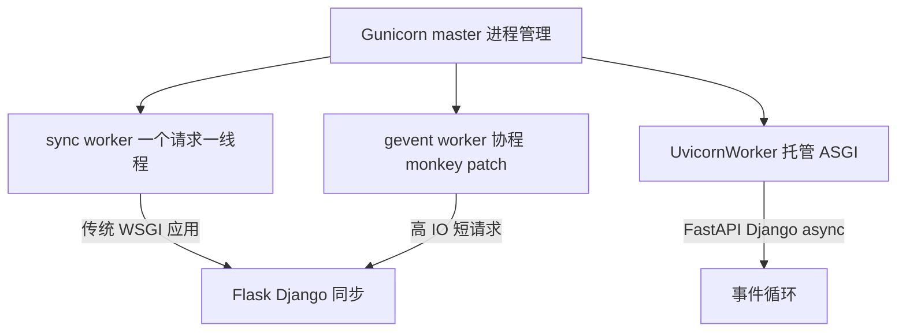
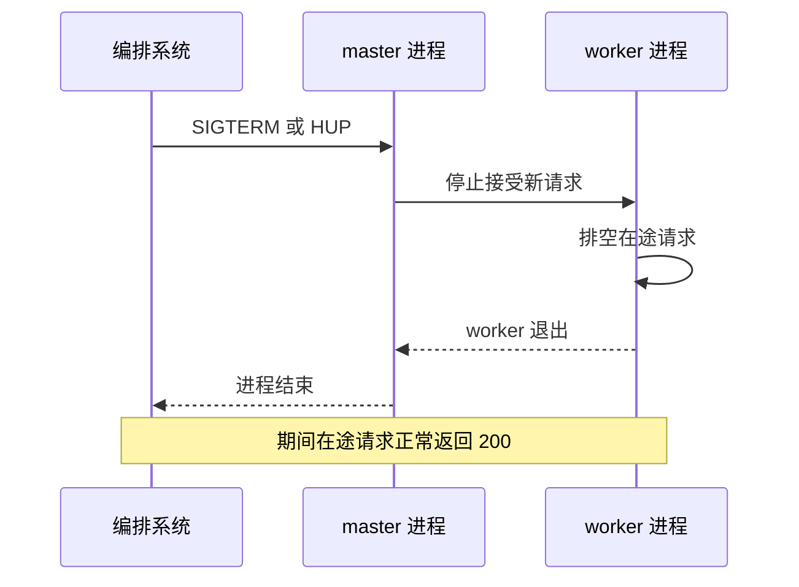
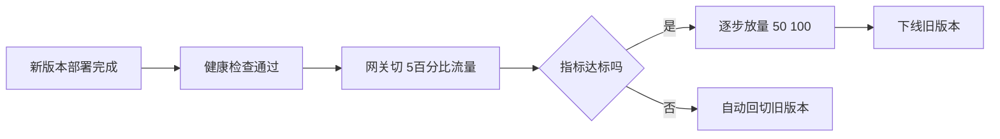
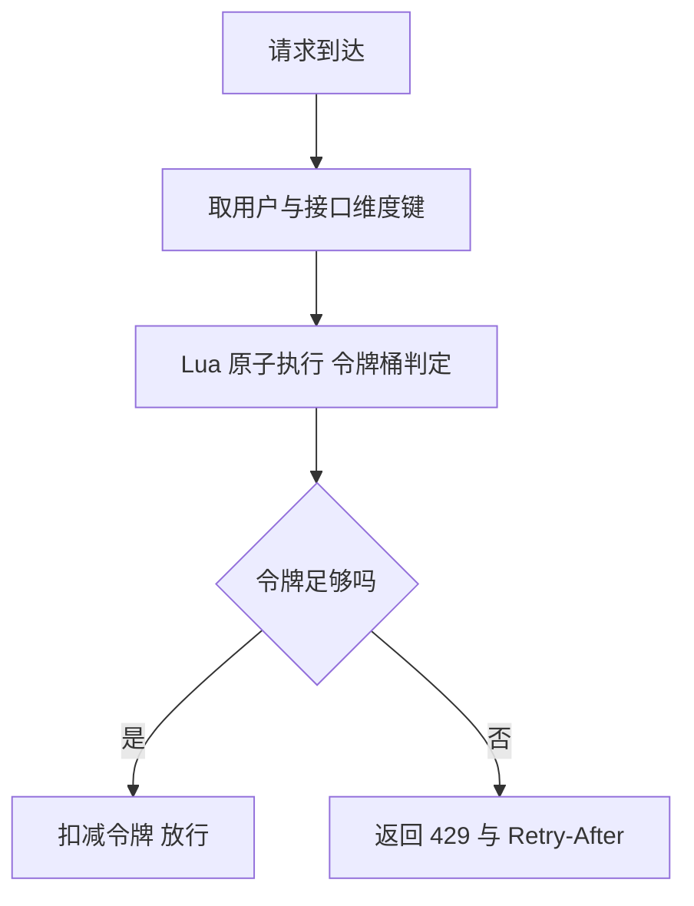
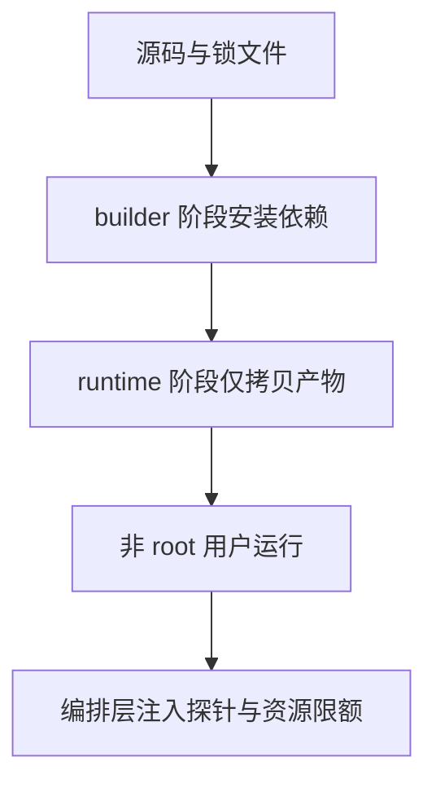
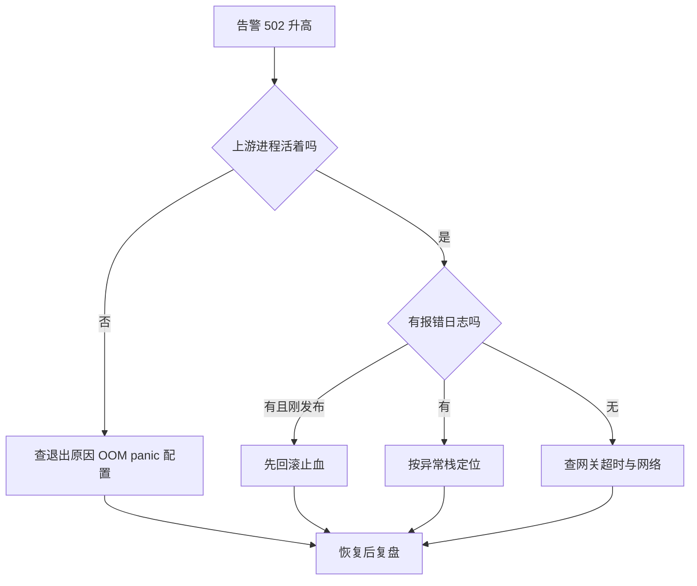
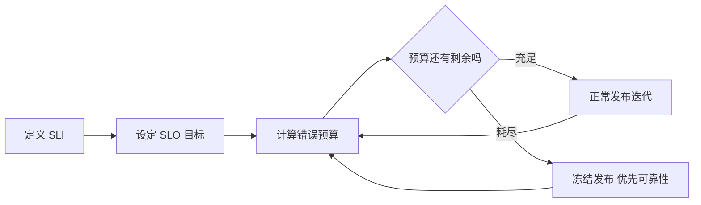

# 第 3 类 · Web 后端开发(45 题 · Q811–Q855)

本文件是生产部署与治理篇:Gunicorn/Uvicorn 部署深水区、优雅发布与健康检查、灰度与蓝绿、静态文件与 CDN、日志与 APM/链路追踪、重试与限流熔断、安全防线(CORS/CSRF/SSRF/上传)、API 网关与容器化、K8s 探针、事故复盘方法论(502/慢查询/内存/CPU)、SLO 与告警治理,最后以综合设计题收尾。
共 45 题(Q811–Q855),多数代码为纯标准库实现(可直接 python 运行),涉及框架处带 ImportError 降级提示。
复习主线:发布要可回滚、故障要可定位、变更要可观测——所有题都在回答这三个问题。

### Q811 · Gunicorn worker 类型深水区

> 难度:★★★★ | 标签:Gunicorn, worker

**问**:sync、gevent、UvicornWorker 三种 worker 的模型差异?各适合什么应用?

**答**:**sync worker** 一个请求占一个进程/线程,模型最简单、行为最可预期,适合 WSGI 应用短请求,并发上限 = worker 数 × threads;**gevent worker** 用协程 monkey patch 把阻塞 IO 变成可切换,单进程扛高 IO 并发,但要求全链路兼容(数据库驱动、C 扩展都可能不配合),且与真正的 asyncio 生态不通;**UvicornWorker** 让 Gunicorn 只做进程管理,事件循环里跑 ASGI 应用,是 FastAPI/Django-async 的标准组合。CPU 密集任何 worker 类型都救不了,要拆进程或下推。



```python
# file: code/03_Web后端开发/q811_worker_types.py
import asyncio
import threading
import time

def sync_io(total: int, delay: float = 0.01) -> None:
    for _ in range(total):
        time.sleep(delay)          # 阻塞式 IO: 串行等待

async def async_io(total: int, delay: float = 0.01) -> None:
    await asyncio.gather(*(asyncio.sleep(delay) for _ in range(total)))

t0 = time.perf_counter()
sync_io(20)
t1 = time.perf_counter()
asyncio.run(async_io(20))
t2 = time.perf_counter()
print(f"sync 模型耗时 {t1 - t0:.2f}s, 事件循环耗时 {t2 - t1:.2f}s")
print("线程演示:", threading.active_count(), "个活动线程")
```

**追问**:
- gevent 的 monkey patch 为什么必须入口第一行?——必须在任何模块导入标准库 socket/threading 之前打补丁,晚打会出现部分代码用真阻塞的混合态。
- UvicornWorker 下还要配 threads 吗?——不需要,事件循环内并发由协程承担,threads 参数对 ASGI worker 无意义。

### Q812 · Uvicorn 直接部署的关键参数

> 难度:★★★☆ | 标签:Uvicorn, 部署

**问**:裸跑 uvicorn 上生产,哪几个命令行参数必须显式设置?

**答**:`--workers N` 多进程(N 按 CPU 与内存评估);`--limit-concurrency` 并发上限,超过直接 503,是过载保护阀门,防止无限排队拖垮整个实例;`--timeout-keep-alive` 与网关侧对齐,避免连接堆积;`--proxy-headers --forwarded-allow-ips` 修正真实客户端 IP;`--backlog` 内核 accept 队列。注意 uvicorn 自身**不做进程守护**,崩溃拉起要靠 systemd/K8s,或者用 Gunicorn 的 UvicornWorker 获得进程管理。

```python
# file: code/03_Web后端开发/q812_uvicorn_flags.py

FLAGS = {
    "--workers 4": "多进程, 数量按 CPU 核数与内存评估, 不是越多越好",
    "--limit-concurrency 200": "超过并发的请求返回 503, 防雪崩的过载阀",
    "--timeout-keep-alive 5": "空闲连接回收, 与 Nginx keepalive 对齐",
    "--backlog 2048": "内核 accept 队列长度, 突发流量缓冲",
    "--proxy-headers --forwarded-allow-ips 10.0.0.0/8": "信任代理并修正 client IP",
}
for flag, note in FLAGS.items():
    print(f"{flag}: {note}")
```

**追问**:
- limit-concurrency 设多大?——按压测出的单进程安全并发定,宁可早 503 让重试与降级接管,不可让延迟无界增长。
- uvicorn 与 gunicorn+uvicorn worker 怎么选?——K8s 里单容器单进程常直接 uvicorn(靠编排做守护);虚拟机多 worker 或需要 pre-fork 语义时用 gunicorn 托管。

### Q813 · 优雅重启与 SIGTERM 处理

> 难度:★★★★ | 标签:发布, 信号

**问**:滚动发布时怎么保证在途请求不被掐断?Gunicorn 的 HUP 和 USR2 有什么区别?

**答**:优雅重启的语义:收到 SIGTERM 后**停止接受新连接 → 排空在途请求(有上限时间)→ 清理资源 → 退出**。Gunicorn 里 `HUP` 重载配置并逐个重启 worker(平滑但老 worker 先死);`USR2` 起一个新 master 接管监听、老 master 用 `WINCH` 退流量,实现**不停机换二进制**。K8s 场景配 preStop sleep + readiness 摘流,terminationGracePeriodSeconds 要大于 graceful timeout,否则 KILL 兜底前请求被硬断。



```python
# file: code/03_Web后端开发/q813_graceful.py
import os
import signal
import threading
import time

shutting_down = False
inflight = 0

def on_term(signum, frame):
    global shutting_down
    shutting_down = True                      # 1. 不再接新请求
    while inflight > 0:                       # 2. 排空在途请求
        time.sleep(0.005)
    print("3. 释放连接池与后台任务后退出")

signal.signal(signal.SIGTERM, on_term)

def handle():
    global inflight
    inflight += 1
    time.sleep(0.05)
    inflight -= 1

t = threading.Thread(target=handle)
t.start()
t.join()
os.kill(os.getpid(), signal.SIGTERM)          # 模拟编排系统发信号
time.sleep(0.1)
```

**追问**:
- 为什么 kill -9 是发布禁忌?——跳过一切清理:在途请求硬断、连接池泄漏、锁未释放,下游跟着报错。
- 排空时间怎么定?——覆盖接口 p99 耗时再加余量(如 30s),配合客户端重试与网关摘流,宁可杀少数长请求也不无限等。

### Q814 · 健康检查:liveness 与 readiness 分离

> 难度:★★★☆ | 标签:健康检查, 可用性

**问**:健康检查接口应该查数据库吗?liveness 和 readiness 的语义差别?

**答**:**liveness(/healthz)只回答"进程还活着"**,失败触发重启,所以绝不能依赖外部服务——DB 抖一下把所有实例重启就是雪崩放大器。**readiness(/readyz)回答"能否接流量"**,失败只摘流不重启,可以检查关键依赖(数据库连接、缓存、配置加载)。两者分开后,依赖故障的爆炸半径是"暂时摘流"而不是"全量重启"。健康检查还要注意:不打访问日志、不计入限流、返回体要小。

```python
# file: code/03_Web后端开发/q814_health_endpoints.py
try:
    from fastapi import FastAPI
    from fastapi.responses import JSONResponse
    from fastapi.testclient import TestClient
except ImportError:
    print("pip install fastapi httpx 后再运行")
    raise SystemExit(0)

db_ok = True
app = FastAPI()

@app.get("/healthz")
def healthz():
    return {"ok": True}                       # 进程活着就 200, 不查依赖

@app.get("/readyz")
def readyz():
    if not db_ok:                             # 依赖不可用就摘流
        return JSONResponse(status_code=503, content={"ok": False})
    return {"ok": True}

client = TestClient(app)
print("healthz:", client.get("/healthz").status_code)
print("readyz(依赖正常):", client.get("/readyz").status_code)
db_ok = False
print("readyz(依赖故障):", client.get("/readyz").status_code)
```

**追问**:
- 启动很慢的服务还需要什么探针?——startupProbe 给足启动时间,启动完成前不跑 liveness,避免被误杀。
- 健康检查挂了但业务正常是什么问题?——通常是探针实现引入了新依赖(如查了慢表),探针要最简、超时要短。

### Q815 · 蓝绿发布与金丝雀灰度

> 难度:★★★★ | 标签:发布, 灰度

**问**:蓝绿和金丝雀的本质区别?灰度的分流键为什么必须稳定?

**答**:蓝绿是**两套完整环境瞬时切换**,回滚秒级但资源双倍,适合大版本;金丝雀是**同一环境内小流量逐步放量**(1% → 5% → 25% → 100%),每档观察错误率与延迟,达标才进下一档,不达标自动回切。分流键必须**稳定**(用户 ID/租户哈希),同一用户始终命中同一版本,否则会话、缓存、灰度逻辑全乱。数据库变更不能靠环境切换解决——它要跨版本兼容,见下一题。



```python
# file: code/03_Web后端开发/q815_canary.py

def route_canary(user_id: str, canary_pct: int) -> str:
    bucket = sum(ord(c) for c in user_id) % 100   # 稳定哈希分桶
    return "canary" if bucket < canary_pct else "stable"

alloc = {"canary": 0, "stable": 0}
for i in range(1000):
    alloc[route_canary(f"user{i}", 10)] += 1
print("灰度分流分布:", alloc)
print("同一用户稳定:", route_canary("user42", 10) == route_canary("user42", 10))
```

**追问**:
- 灰度期间怎么算"达标"?——预先定义指标与阈值(错误率、p99、核心业务转化),样本足够才决策,避免小样本抖动误杀。
- 有状态连接(WebSocket)怎么灰度?——新连接走灰度,存量连接保持旧版本直到自然断开,配合连接迁移协议。

### Q816 · 发布与数据库变更的兼容两阶段

> 难度:★★★★ | 标签:发布, 数据库

**问**:为什么"改代码"和"改表"不能一个版本一起上?expand-contract 怎么执行?

**答**:滚动发布中**新旧版本共存**,新代码读了还不存在的列、旧代码遇到已删的列,都会当场爆炸。expand-contract 三步:**expand**:加列/加表,新旧字段双写,读仍走旧字段;**migrate**:回填历史数据,读切到新字段;**contract**:观察一个完整发布周期后,删除旧字段与双写代码。每一步都是独立发布单元,回滚点清晰。规矩:**任何 schema 变更都要先假设旧代码还要活一个周期**。

```python
# file: code/03_Web后端开发/q816_expand_contract.py

def phase_plan(current: dict, target: dict) -> list:
    return [
        "expand: 新旧字段同时写 old_price 与 price_v2, 读仍走 old_price",
        "migrate: 回填历史行 price_v2, 校验对齐后读切换新字段",
        "contract: 观察一个发布周期后移除 old_price 与双写代码",
    ]

for step in phase_plan({}, {}):
    print(step)
```

**追问**:
- 双写不一致怎么兜底?——定期对账脚本比对两字段差异并告警修复,对账通过才允许进 contract。
- 加 NOT NULL 约束放哪一步?——放 migrate 之后:先全量回填,再加约束,顺序颠倒会卡在历史数据上。

### Q817 · 静态文件指纹与 CDN 缓存策略

> 难度:★★★☆ | 标签:CDN, 缓存

**问**:前端发新版本,用户还在用旧 JS 文件怎么办?静态资源的缓存头怎么配?

**答**:标准方案:**内容指纹文件名 + 永久强缓存**。构建产物带 hash(app.a1b2c3.js),`Cache-Control: public, max-age=31536000, immutable`——内容变了文件名就变,永远不存在新旧混淆;入口 HTML 用 `no-cache` 走协商缓存,保证引用到最新指纹。发布顺序:**先发静态资源(新指纹文件),再发引用它的 HTML**,反向顺序会让新 HTML 引用不存在的资源。注意 Cookie 不要带给静态域名,省流量也降安全面。

```python
# file: code/03_Web后端开发/q817_static_cache.py
import hashlib

def fingerprint(content: bytes) -> str:
    return hashlib.sha256(content).hexdigest()[:8]

def asset_url(name: str, content: bytes) -> str:
    return f"/static/{name}.{fingerprint(content)}.css"

def cache_headers(is_fingerprinted: bool) -> dict:
    if is_fingerprinted:
        return {"Cache-Control": "public, max-age=31536000, immutable"}
    return {"Cache-Control": "no-cache"}   # 入口 HTML 走协商缓存

print(asset_url("app", b"body{color:red}"))
print(cache_headers(True), cache_headers(False))
```

**追问**:
- immutable 是什么作用?——告诉浏览器该资源永不变化,连协商请求(304 往返)都省掉,除非文件名变化。
- CDN 缓存了错误版本怎么救?——源站修复后主动刷新 CDN(purge),并检查指纹机制是否失效——指纹正确时根本不该出现该问题。

### Q818 · 全链路超时预算与 504 治理

> 难度:★★★★ | 标签:超时, 504

**问**:客户端 30 秒超时、网关 60 秒、应用 10 秒,这个配置有什么问题?超时链怎么设计?

**答**:超时必须**逐层递减**:外层超时要大于内层总和,否则外层先断,内层还在白干,客户端重试又叠加新请求形成重试风暴。常见 504 链条:网关 proxy_read_timeout 小于应用处理时间。设计方法:从最内层(DB 查询)向上逐层加预算(DB 800ms → RPC 2s → 应用 2.5s → 网关 3s),每层超时留余量;配合重试预算控制放大倍数。


```python
# file: code/03_Web后端开发/q818_timeout_budget.py

limits = {"gateway": 3000, "app": 2500, "rpc": 2000, "db": 800}
ok = limits["db"] <= limits["rpc"] <= limits["app"] <= limits["gateway"]
print("嵌套预算合法:", ok)
for layer, ms in limits.items():
    print(f"{layer}: {ms}ms")
```

**追问**:
- 连接超时和读超时的区别?——connect 是建立 TCP/池获取的时间,read 是等待响应数据的时间,慢下游常调 read 而保持 connect 短促失败。
- 超时后要不要重试?——只重试幂等请求且带总预算,非幂等 POST 重试等于重复下单。

### Q819 · 结构化日志与采集管道

> 难度:★★★☆ | 标签:日志, 可观测性

**问**:日志要能按 request_id 全链路检索,应用侧和采集侧各怎么设计?

**答**:应用侧:**一行一条 JSON**(时间、级别、消息、request_id、trace_id、耗时、关键字段),写 **stdout**;自定义 Formatter 注入 contextvar 里的 request_id。采集侧:容器驱动/agent(filebeat、fluentbit)收集 stdout → 统一管道做解析与脱敏 → 存储检索(Loki/Elasticsearch)。原则:解析在写入时完成(结构化),采集端不做复杂正则;日志是给机器检索的,人类可读交给查询界面。

```python
# file: code/03_Web后端开发/q819_json_log.py
import json
import logging
import time

class JsonFormatter(logging.Formatter):
    def format(self, record):
        return json.dumps({
            "ts": time.strftime("%Y-%m-%dT%H:%M:%S", time.gmtime(record.created)),
            "level": record.levelname,
            "msg": record.getMessage(),
            "request_id": getattr(record, "request_id", None),
        }, ensure_ascii=False)

log = logging.getLogger("app")
handler = logging.StreamHandler()
handler.setFormatter(JsonFormatter())
log.addHandler(handler)
log.setLevel(logging.INFO)

log.info("订单创建成功", extra={"request_id": "req-42"})
log.warning("下游超时", extra={"request_id": "req-42"})
```

**追问**:
- 为什么写 stdout 而不是自己写文件?——容器环境文件生命周期与进程绑定,日志轮转、收集、销毁都交给平台,应用只管输出。
- 日志量控制怎么做?——分级采样(DEBUG 默认关)、大对象只打摘要、按 SLO 侧仪表盘评估,禁止打印 body 全文。

### Q820 · 访问日志与慢请求观测

> 难度:★★☆☆ | 标签:观测, 延迟

**问**:接口突然变慢,访问日志应该提供哪些信息才能快速下钻?

**答**:访问日志每条带:method、path(路由模板而非具体 ID,防高基数)、status、**耗时、request_id、上游服务耗时**、客户端标识。分析看 **p50/p95/p99 而不是平均值**——平均值掩盖长尾。应用记录自身处理耗时,网关记录全链路耗时,两者相减就是网络与网关开销;结合慢查询日志/下游 span,能把"慢"定位到具体环节。给慢请求单独打 slow log(超阈值才记)比全量分析更省。

```python
# file: code/03_Web后端开发/q820_slow_log.py

lat = [12, 15, 11, 300, 14, 900, 13, 16, 12, 14]
lat.sort()

def percentile(data: list, p: int) -> float:
    k = max(0, min(len(data) - 1, int(round(p / 100 * (len(data) - 1)))))
    return data[k]

print("p50:", percentile(lat, 50))
print("p95:", percentile(lat, 95))
print("p99:", percentile(lat, 99))
print("慢请求样本:", [x for x in lat if x > 200])
```

**追问**:
- 为什么 path 要用路由模板?——/users/123 记具体 ID 会造成标签基数爆炸,存储与查询都被拖垮,模板化后才能按接口聚合。
- p99 抖动怎么排查?——按 request_id 找长尾样本下钻 trace,常见根因是 GC、连接池等待、缓存失效穿透。

### Q821 · APM 与 tracing 基础概念

> 难度:★★★☆ | 标签:APM, tracing

**问**:APM 里的 trace 和 span 是什么?采样率怎么权衡?

**答**:**trace** 是一次请求的完整调用树,**span** 是树上一个计时节点(处理请求、查库、调下游),父子 span 组成时间线。观测价值:耗时分布一目了然——应用自身慢还是下游慢、哪个 SQL 慢;错误定位直接给出异常发生的精确位置。采样率控制开销:头部采样(入口决定整条 trace 是否记录)省资源但可能漏掉罕见错误;尾部采样(收集完再挑慢/错的)观测价值高但存储成本大。关键指标:应用耗时占比、下游耗时占比、错误 span 分布。

```python
# file: code/03_Web后端开发/q821_apm_span.py
from __future__ import annotations

import time
from typing import Optional

class Span:
    def __init__(self, name: str, parent_id: Optional[int] = None):
        self.name = name
        self.parent_id = parent_id
        self.t0 = time.perf_counter()

    def end(self):
        self.ms = round((time.perf_counter() - self.t0) * 1000, 1)

trace = []
root = Span("GET /orders")
trace.append(root)
child = Span("SELECT orders", parent_id=0)
trace.append(child)
time.sleep(0.01)
child.end()
root.end()
for s in trace:
    print(s.name, "parent:", s.parent_id, "ms:", s.ms)
```

**追问**:
- trace_id 和 request_id 什么关系?——request_id 是业务关联标识,trace_id 是链路追踪体系的标识,成熟的体系里 request_id 就用 trace_id。
- 不接 APM 能手工近似吗?——能,中间件计时 + 各依赖打点 + 日志聚合,就是手工版 span 树,规模化后必然要 APM。

### Q822 · 请求 ID 与 contextvars 链路注入

> 难度:★★★★ | 标签:请求 ID, contextvars

**问**:怎么让一次请求里所有日志自动带上同一个 request_id?为什么用 contextvars 而不是全局变量?

**答**:中间件入口生成/透传 request_id(优先取上游头,如网关注入),**set 进 contextvar**,日志 Filter 从 contextvar 读取,业务代码零感知;响应头回传 request_id 便于用户报障。必须用 contextvars 因为它是**协程/线程安全的请求级存储**:全局变量会串请求,threading.local 在 asyncio 下同一线程跑多个协程也会串。透传规则:入口信任内网来源的 request_id,对外部请求重新生成,防止日志注入伪造。


```python
# file: code/03_Web后端开发/q822_request_id.py
import logging
import uuid
from contextvars import ContextVar

request_id_var: ContextVar = ContextVar("request_id", default="-")

class ReqIdFilter(logging.Filter):
    def filter(self, record):
        record.request_id = request_id_var.get()
        return True

try:
    from fastapi import FastAPI, Request
    from fastapi.testclient import TestClient
except ImportError:
    print("pip install fastapi httpx 后再运行")
    raise SystemExit(0)

log = logging.getLogger("app")
log.addFilter(ReqIdFilter())
log.addHandler(logging.StreamHandler())

app = FastAPI()

@app.middleware("http")
async def rid(request: Request, call_next):
    rid_value = request.headers.get("x-request-id") or uuid.uuid4().hex
    token = request_id_var.set(rid_value)
    resp = await call_next(request)
    request_id_var.reset(token)
    resp.headers["x-request-id"] = rid_value
    return resp

@app.get("/work")
def work():
    log.info("处理业务")
    return {"ok": True}

client = TestClient(app)
r = client.get("/work", headers={"x-request-id": "req-abc"})
print("透传的 id:", r.headers["x-request-id"])
r2 = client.get("/work")
print("自动生成 32 位:", len(r2.headers["x-request-id"]) == 32)
```

**追问**:
- contextvar 要在 finally 里 reset 吗?——中间件场景请求结束上下文销毁可不 reset,长生命周期协程(后台任务)必须 reset 防泄漏。
- 后台任务里 request_id 丢了怎么办?——在注册任务时把 request_id 作为参数传过去,任务内重新 set。

### Q823 · 跨服务 trace 上下文传播

> 难度:★★★☆ | 标签:tracing, W3C

**问**:调用下游服务时,链路信息怎么传过去?为什么不该自造私有追踪头?

**答**:标准是 **W3C Trace Context** 的 `traceparent` 头:`00-{trace_id}-{span_id}-{flags}`,版本-链路-当前 span-采样标记。服务端解析后:trace_id 沿用实现全链路串联,自己的 span_id 生成新值,调用再下游时把 header 换成自己 span。不自造头的原因:APM/网关/多语言生态都认标准头,自造的私有协议每接一个服务都要写一次适配,最终必然收敛回标准。

```python
# file: code/03_Web后端开发/q823_trace_context.py

def make_traceparent(trace_id: str, span_id: str, sampled: bool = True) -> str:
    flags = "01" if sampled else "00"
    return f"00-{trace_id}-{span_id}-{flags}"

def parse_traceparent(header: str) -> dict:
    _, trace_id, span_id, flags = header.split("-")
    return {"trace_id": trace_id, "span_id": span_id, "sampled": flags == "01"}

tp = make_traceparent("4bf92f3577b34da6a3ce929d0e0e4736", "00f067aa0ba902b7")
print(tp)
print(parse_traceparent(tp))
```

**追问**:
- flags 里的采样标记有什么用?——下游据此决定是否记录自己的 span,保证同一条 trace 的采样决策一致。
- 消息队列场景怎么传播?——把 traceparent 放进消息属性/头,消费端解析后接续链路。

### Q824 · 重试语义:退避、Jitter 与重试风暴

> 难度:★★★★ | 标签:重试, 稳定性

**问**:下游抖动,客户端重试为什么反而把它打死?正确的重试策略是什么?

**答**:故障时所有客户端**同步周期性重试**,流量被放大数倍,下游彻底失去恢复窗口——重试风暴。正确策略:**指数退避 + jitter**(随机化打散重试时间点)、**重试预算**(如重试流量不超过总请求 10%,超了就熔断停止重试)、**只重试幂等请求**、**尊重 Retry-After**(429/503 给的等待时间必须遵守)。分级:连接失败可快速重试,读超时可重试,写请求绝不盲目重试。

```python
# file: code/03_Web后端开发/q824_retry_budget.py
import random

def retry_call(attempts: list, max_retry: int = 3, budget_ms: float = 100) -> str:
    spent = 0.0
    for i in range(max_retry + 1):
        cost = random.uniform(10, 80)
        spent += cost
        attempts.append(f"try{i}:{cost:.0f}ms")
        if cost < 50:
            return "ok"
        if spent > budget_ms:
            attempts.append("预算耗尽 停止重试")
            break
    return "failed"

res: list = []
print(retry_call(res), res)
```

**追问**:
- jitter 为什么必要?——去掉随机性后所有客户端的重试点重合,形成周期性脉冲,等于没有退避。
- 重试预算谁维护?——客户端侧滑动窗口统计重试占比,超预算期间新失败直接快速失败,保护彼此。

### Q825 · 基于 Redis 的分布式令牌桶限流

> 难度:★★★★ | 标签:限流, Redis

**问**:单机内存限流多 worker 就失效了,分布式限流怎么做?

**答**:把令牌桶状态放 **Redis**,用 Lua 脚本保证"计算余量 + 扣减"的原子性:tokens = min(capacity, tokens + elapsed × rate),够就扣并返回允许,不够返回拒绝。维度按 需求组合:用户、API key、接口、租户。要点:Redis 挂了的策略(降级放行还是拒绝,建议放行+告警)、时钟偏差用 Redis 的 TIME、热 key 用本地预扣减。分层限流:网关粗粒度 → 应用细粒度,互为补充。



```python
# file: code/03_Web后端开发/q825_token_bucket.py
import time

class TokenBucket:
    def __init__(self, capacity: int, refill_per_sec: float):
        self.capacity = capacity
        self.rate = refill_per_sec
        self.tokens = float(capacity)
        self.last = time.monotonic()

    def allow(self, n: int = 1) -> bool:
        now = time.monotonic()
        self.tokens = min(self.capacity, self.tokens + (now - self.last) * self.rate)
        self.last = now
        if self.tokens >= n:
            self.tokens -= n
            return True
        return False

bucket = TokenBucket(capacity=5, refill_per_sec=2)
print("连发 8 个:", [bucket.allow() for _ in range(8)])
time.sleep(0.6)                                # 补充约 1.2 个令牌
print("等待后两连发:", [bucket.allow() for _ in range(2)])
```

**追问**:
- Lua 里为什么要用 Redis 服务端时间?——多客户端时钟不一致会让补币计算漂移,服务端时间保证所有节点看到同一时钟。
- 限流键的粒度怎么定?——限流的目的是保护自身与公平,按"最细的有身份维度+接口"组合,过粗会误伤,过细失去保护意义。

### Q826 · 熔断器与降级设计

> 难度:★★★★ | 标签:熔断, 降级

**问**:下游持续报错,一直重试只会拖死自己,熔断器怎么工作?降级返回什么?

**答**:熔断器三态:**closed**(正常,统计失败率)、**open**(失败率超阈值直接快速失败,不再打下游,给对方恢复窗口)、**half-open**(冷却期后放少量探测请求,成功则恢复)。降级预案按业务分级:读缓存旧值、返回默认值、功能降级文案,写操作排队延后。要点:熔断维度是"依赖+操作"粒度;open 期间的失败是**毫秒级**的,这是它保护自身线程/协程的关键;恢复要渐进放量防抖动。

```python
# file: code/03_Web后端开发/q826_circuit_breaker.py
import time

class CircuitBreaker:
    def __init__(self, fail_threshold: int = 3, cool: float = 0.2):
        self.fail_threshold = fail_threshold
        self.cool = cool
        self.fails = 0
        self.opened_at = 0.0

    @property
    def state(self) -> str:
        if self.fails < self.fail_threshold:
            return "closed"
        if time.monotonic() - self.opened_at < self.cool:
            return "open"
        return "half-open"

    def call(self, func, *args):
        if self.state == "open":
            raise RuntimeError("熔断中 直接降级")
        try:
            result = func(*args)
            self.fails = 0
            return result
        except Exception:
            self.fails += 1
            if self.fails >= self.fail_threshold:
                self.opened_at = time.monotonic()
            raise

def flaky(ok: bool) -> str:
    if not ok:
        raise ConnectionError("downstream")
    return "data"

cb = CircuitBreaker()
for ok in [False, False, False, False]:
    try:
        cb.call(flaky, ok)
    except Exception as e:
        print(type(e).__name__, cb.state)
time.sleep(0.25)
print("冷却后状态:", cb.state)
```

**追问**:
- 熔断和限流的区别?——限流主动控制输入速率保护双方,熔断是对依赖健康度的被动反应,常组合使用。
- half-open 探测并发了怎么办?——只放行一个探测请求(原子计数),其余按 open 处理,防止探测流量再次压垮下游。

### Q827 · CORS 误配清单与安全细节

> 难度:★★★☆ | 标签:CORS, 安全

**问**:`allow_origins=["*"]` 配 credentials=true 会怎样?CORS 还有哪些高频误配?

**答**:规范禁止 `Access-Control-Allow-Origin: *` 与 `Allow-Credentials: true` 共存——等于向任意网站开放带 Cookie 的读写权限,是最危险的误配。正确做法:**Origin 白名单逐个匹配**并回显具体 Origin,凭证场景必须加 `Vary: Origin` 防止代理缓存串头。其他高频坑:预检 OPTIONS 被业务鉴权拦截(要放行)、通配子域正则过宽(https://*.example.com 匹配了 evil-example.com)、把 CORS 当鉴权用(CORS 只是浏览器约束,防不了 curl)。

```python
# file: code/03_Web后端开发/q827_cors_detail.py

def cors_headers(origin: str, allowlist: set, with_credentials: bool) -> dict:
    if origin in allowlist:
        h = {"Access-Control-Allow-Origin": origin}
        if with_credentials:
            h["Access-Control-Allow-Credentials"] = "true"
            h["Vary"] = "Origin"
        return h
    return {}   # 不命中白名单就不放行

print(cors_headers("https://app.example.com", {"https://app.example.com"}, True))
print(cors_headers("https://evil.example.net", {"https://app.example.com"}, True))
```

**追问**:
- CORS 防不住服务端到服务端的调用?——对,CORS 是浏览器执行的策略,服务器间调用与 curl 完全不受限,鉴权必须独立存在。
- 预检请求怎么处理才对?——中间件层直接应答 OPTIONS(带 Allow-Methods/Headers),不进入业务路由与认证。

### Q828 · SameSite 时代的 CSRF 防线

> 难度:★★★☆ | 标签:CSRF, SameSite

**问**:现代浏览器默认 SameSite=Lax 之后,CSRF token 还需要吗?API 场景呢?

**答**:SameSite=Lax 让跨站请求**不自动携带 Cookie**,挡住了绝大多数传统 CSRF(跨站 POST/表单)。但防线要纵深:老浏览器与 SameSite=None 的会话仍需 CSRF token;现代方案是**双提交 Cookie**(token 同时在 Cookie 与请求头,服务端比对)或 **Origin/Referer 校验**。纯 API 场景:Authorization 头不自动携带,天然免疫 CSRF;用 Cookie 认证的 SPA 仍要保留防线。另外 CSRF token 要与会话绑定,登录后轮换。

```python
# file: code/03_Web后端开发/q828_samesite_csrf.py
from __future__ import annotations

from typing import Optional

def cookie_policy(name: str, same_site: str, secure: bool) -> str:
    parts = [f"{name}=v", f"SameSite={same_site}"]
    if secure:
        parts.append("Secure")
    return "; ".join(parts)

def csrf_guard(same_site: str, origin_header: Optional[str], trusted: set) -> str:
    if same_site in ("Lax", "Strict"):
        return "SameSite 已挡住跨站写请求"
    if origin_header:
        host = origin_header.split("/")[2] if "/" in origin_header else origin_header
        if host not in trusted:
            return "Origin 不在白名单 拒绝"
    return "需要 CSRF token 校验"

print(cookie_policy("sid", "Lax", True))
print(csrf_guard("Lax", "https://evil.com", {"api.example.com"}))
print(csrf_guard("None", "https://api.example.com", {"api.example.com"}))
```

**追问**:
- Lax 放行哪些跨站请求?——顶层导航的安全方法(GET 链接跳转),POST/DELETE 等写方法一律不带 Cookie。
- 双提交为什么有效?——攻击者能诱导请求却读不到目标域的 Cookie,无法把 token 放进自定义头,比对必然失败。

### Q829 · SSRF 原理与防护清单

> 难度:★★★★ | 标签:SSRF, 安全

**问**:服务端根据用户传的 URL 拉取资源,会有什么风险?防护清单是什么?

**答**:SSRF:攻击者让服务器去请求**内网地址**——云元数据服务(169.254.169.254 拿凭证)、内部管理接口、Redis/数据库端口。防护清单:协议白名单(仅 http/https,禁 file/gopher/dict);**解析后的 IP 校验**(拒绝环回、私网、链路本地段);禁用或逐跳校验**重定向**(302 跳内网是经典绕过);DNS rebinding 防御——校验和连接用同一份解析结果;出网走独立代理并隔离权限。核心原则:校验发生在**连接的目标 IP**上,不是域名上。

```python
# file: code/03_Web后端开发/q829_ssrf_guard.py
import ipaddress
from urllib.parse import urlparse

BLOCKED = [
    ipaddress.ip_network(n) for n in (
        "127.0.0.0/8", "10.0.0.0/8", "172.16.0.0/12",
        "192.168.0.0/16", "169.254.0.0/16", "0.0.0.0/8",
    )
]

def is_safe_url(raw: str, resolved_ips: list) -> bool:
    if urlparse(raw).scheme not in ("http", "https"):
        return False                     # 协议白名单
    for s in resolved_ips:               # 用解析后的 IP 判定
        ip = ipaddress.ip_address(s)
        if any(ip in net for net in BLOCKED):
            return False
    return True

print("公网 URL:", is_safe_url("https://api.example.com/x", ["93.184.216.34"]))
print("元数据服务:", is_safe_url("http://internal.local/x", ["169.254.169.254"]))
print("file 协议:", is_safe_url("file:///etc/passwd", []))
```

**追问**:
- 为什么校验域名不够?——域名解析可指向内网,且存在 DNS rebinding:校验时解析公网、连接时换内网,必须在连接时对 IP 校验。
- 元数据服务还有什么缓解手段?——云厂商支持元数据 v2(要求先取 session token),从根上挡住直接 GET。

### Q830 · 文件上传安全

> 难度:★★★★ | 标签:安全, 文件上传

**问**:除了大小限制,文件上传还有哪些必须做的安全校验?

**答**:清单:**类型双重校验**——扩展名白名单 + 内容魔数嗅探(MIME 头可伪造,内容才是真相);**文件名重写**——basename 防路径穿越、去特殊字符、最终用随机名存储,用户原始名只作展示元数据;**存储隔离**——上传目录不放可执行权限,与 Web 根分离,理想是直接进对象存储;**访问控制**——私有文件走签名 URL;图片做二次编码(剥掉多态 payload);必要时接病毒扫描。回显下载时的 Content-Type 与 Content-Disposition:attachment 也要配,防存储型 XSS。

```python
# file: code/03_Web后端开发/q830_upload_safety.py
import hashlib
import os
import re

ALLOWED_EXT = {".png", ".jpg", ".pdf"}
MAGIC = {b"\x89PNG\r\n\x1a\n": "png", b"%PDF-": "pdf", b"\xff\xd8\xff": "jpg"}

def safe_name(filename: str) -> str:
    base = os.path.basename(filename)               # 防路径穿越
    base = re.sub(r"[^A-Za-z0-9._-]", "_", base)
    return base[:64] or "upload.bin"

def sniff_and_check(data: bytes, filename: str) -> str:
    ext = os.path.splitext(safe_name(filename))[1].lower()
    if ext not in ALLOWED_EXT:
        raise ValueError("扩展名不允许")
    for magic, kind in MAGIC.items():
        if data.startswith(magic):
            if kind != ext.lstrip("."):
                raise ValueError("魔数与扩展名不符")
            digest = hashlib.sha256(data).hexdigest()[:12]
            return f"/store/{digest}.{kind}"        # 内容寻址的随机存储名
    raise ValueError("文件内容不是允许的类型")

print(sniff_and_check(b"\x89PNG\r\n\x1a\nxxxx", "../../etc/passwd.png"))
print(safe_name("../../etc/passwd.png"))
try:
    sniff_and_check(b"MZ fake exe", "evil.png")
except ValueError as e:
    print("拦截:", e)
```

**追问**:
- 为什么扩展名校验不可靠?——攻击者把 HTML/脚本内容伪装成 .jpg,MIME 与扩展名都能伪造,只有魔数加二次编码相对可靠。
- 直接把上传内容回显到页面有什么风险?——存储型 XSS:SVG/HTML 可携带脚本,必须隔离域存储或强制 attachment 下载。

### Q831 · 日志脱敏与敏感数据治理

> 难度:★★★☆ | 标签:日志, 合规

**问**:排查问题要打印请求参数,怎么避免密码、token 被写进日志?

**答**:三道闸:**写入前脱敏**——敏感字段(password/token/authorization/身份证/手机号)用正则或字段名单掩码,中间件与日志 Filter 统一做;**结构化白名单**——日志只打明确需要的字段,而不是整个 body/headers;**分级管理**——DEBUG 级详细日志默认关闭,生产只留 INFO 摘要。治理侧:定期扫描日志样本反向发现泄露(打分关键字),日志存储的访问权限与加密对齐敏感等级。原则:日志为排障服务,不为数据复刻服务。

```python
# file: code/03_Web后端开发/q831_log_redact.py
import re

SENSITIVE = re.compile(r"(password|token|authorization|card_no)[=:]\s*([^\s,&]+)", re.I)

def redact(msg: str) -> str:
    return SENSITIVE.sub(lambda m: f"{m.group(1)}=***", msg)

SENSITIVE_KEYS = {"password", "token", "authorization"}

def redact_dict(d: dict) -> dict:
    return {k: ("***" if k.lower() in SENSITIVE_KEYS else v) for k, v in d.items()}

print(redact("POST /login password=hunter2 token=abc123 ip=1.2.3.4"))
print(redact_dict({"password": "x", "note": "ok"}))
```

**追问**:
- 手机号日志要完全禁掉吗?——不必,做部分掩码(138****1234)保留排查可用性,完整号码属高敏仅在合规存储里。
- 异常栈里藏了敏感值怎么办?——异常消息要受控(不拼入原始输入),全局兜底日志对 message 再过一遍脱敏器。

### Q832 · API 网关的职责边界

> 难度:★★★☆ | 标签:API 网关

**问**:网关应该承担什么?哪些事放网关、哪些必须留在服务里?

**答**:网关管**横切与边界**:路由与协议转换、粗粒度认证(JWT 签名校验后注入身份头)、全局限流与配额、TLS 终止、访问日志与 trace 注入、WAF/黑名单、灰度路由。**留在服务里**的:细粒度授权(对象级权限)、业务校验、数据隔离——网关只认身份不懂数据归属。两条纪律:透传前**重写不可信的入站头**(X-Forwarded-*、X-User 不能由外部伪造直达);网关本身要高可用,它挂了等于全站挂,配置变更要走发布流程。

```python
# file: code/03_Web后端开发/q832_gateway_role.py

GATEWAY_DUTIES = {
    "路由与转发": "按 path 与 host 路由到服务, 剥离外部前缀",
    "认证卸载": "统一校验 JWT, 内网转发时注入可信身份头",
    "限流与配额": "按 key 与租户限制, 保护后端容量",
    "观测": "访问日志, trace 注入, 指标导出",
    "安全": "TLS 终止, WAF, IP 黑名单",
}
for duty, note in GATEWAY_DUTIES.items():
    print(f"{duty}: {note}")
```

**追问**:
- 网关注入的 X-User 头为什么可信?——因为入口处网关会剥离外部同名头再注入,直连内网服务要有网络隔离配合,否则头可被伪造。
- BFF 和网关的区别?——BFF 是面向端的服务(聚合与裁剪,含业务逻辑),网关是无业务的基础设施层,两者常搭配。

### Q833 · 容器化要点:镜像与 PID 1

> 难度:★★★☆ | 标签:Docker, 容器

**问**:把 Python 服务打进镜像,有哪些直接影响稳定性的细节?

**答**:四件事:CMD 用 **exec 形式**(`CMD ["gunicorn", ...]`),让应用进程成为 PID 1 正确接收 SIGTERM——shell 形式会让 SIGTERM 落在 sh 上,优雅停机失效;**多阶段构建**,builder 装依赖、runtime 只拷产物,镜像小、攻击面小;**非 root 用户**运行;依赖用**锁文件**保证可复现。另有:镜像 tag 不可变(不用 latest 部署)、健康检查交给编排探针、时区与 locale 显式设置。ENTRYPOINT + CMD 组合传参要理解 exec 语义,否则信号全断。



```python
# file: code/03_Web后端开发/q833_dockerfile_notes.py

DOCKERFILE = """
FROM python:3.12-slim AS builder
WORKDIR /app
COPY requirements.txt .
RUN pip install --prefix=/install -r requirements.txt

FROM python:3.12-slim
RUN useradd -m appuser
WORKDIR /app
COPY --from=builder /install /usr/local
COPY . .
USER appuser
CMD ["gunicorn", "-b", "0.0.0.0:8000", "app:app"]
"""
print(DOCKERFILE)
print("要点: exec 形式 CMD 让进程直接收到 SIGTERM")
```

**追问**:
- 为什么 PID 1 收不到 SIGTERM?——shell 形式下 PID 1 是 sh,它不转发信号给子进程;exec 形式应用自己当 PID 1,必须自己处理信号(Gunicorn 内置)。
- 镜像里要不要装 curl 做健康检查?——优先用编排原生探针(httpGet),避免为探针装工具扩大镜像。

### Q834 · K8s 探针与资源限额落地

> 难度:★★★★ | 标签:Kubernetes, 容量

**问**:Python 服务上 K8s,requests/limits 和三个探针分别怎么定?

**答**:探针分工:liveness 失败=重启(只查进程自身)、readiness 失败=摘流(可查关键依赖)、startupProbe 保护慢启动。资源:**requests 按 p95 压测值**定(调度依据),**limits 留余量**(Python 的 fork 写时复制与内存碎片,内存 limit 太紧会 OOMKill);CPU limit 慎用, throttling 会拉高 p99。优雅退出链:preStop sleep 数秒等摘流生效 → SIGTERM 排空 → terminationGracePeriodSeconds 覆盖全程。Gunicorn 多 worker 时 grace period 要按最慢在途请求估。

```python
# file: code/03_Web后端开发/q834_k8s_probe.py

PROBES = {
    "startupProbe": "给慢启动服务留足时间, 失败超阈值才重启",
    "livenessProbe": "失败就重启容器, 绝不依赖外部服务",
    "readinessProbe": "失败只摘流量不重启, 可检查关键依赖",
    "resources.requests": "调度依据, 按压测 p95 定",
    "resources.limits": "超过即 OOMKill 或 CPU 节流, 内存要留余量",
}
for key, note in PROBES.items():
    print(f"{key}: {note}")
```

**追问**:
- 内存 limit 被 OOMKill 的典型原因?——fork 多进程写时复制膨胀、一次性大对象(整表读入)、缓存无界增长,先用压测观测峰值再定 limit。
- CPU limit 为什么慎设?——CFS 限流把时间片切碎,GC/序列化瞬间被掐,表现为 p99 尖刺,常见做法只设 request 不设 limit。

### Q835 · 配置与密钥管理实践

> 难度:★★★☆ | 标签:配置, 密钥

**问**:配置的注入方式有哪几种?密钥和普通配置为什么要分开管?

**答**:注入优先级:编排 **secrets/参数存储**(Vault、KMS、云 Secret Manager)→ 环境变量 → 配置文件。密钥与配置分离的原因:生命周期不同——配置改了随时发,密钥要**可轮换、可审计、最小可见**;存储不同——密钥绝不进 git 与镜像。实践:启动时缺密钥 fail-fast;支持热更新(文件挂载+signal 重载)或滚动重启完成轮换;访问密钥的服务身份而非个人凭证;审计每次读取。

```python
# file: code/03_Web后端开发/q835_secrets_mgmt.py
from __future__ import annotations

import os
from typing import Optional

def load_secret(key: str, fallback_file: Optional[str] = None) -> str:
    value = os.environ.get(key)
    if value:
        return value
    if fallback_file and os.path.exists(fallback_file):
        with open(fallback_file, "r", encoding="utf-8") as f:
            return f.read().strip()          # docker/kubernetes secret 文件挂载
    raise RuntimeError(f"缺少密钥 {key}")    # 启动即失败

os.environ["DB_PASSWORD"] = "from-env"
print("环境变量注入:", load_secret("DB_PASSWORD") != "")
try:
    load_secret("NOT_EXIST")
except RuntimeError as e:
    print("fail-fast:", e)
```

**追问**:
- 环境变量放密钥的风险?——子进程继承、ps 可见、崩溃转储可能带上,敏感级别高的走文件挂载或专用 API 运行时拉取。
- 密钥轮换怎么做到无停机?——双密钥过渡:新密钥写入后先支持验签两把,全部换发完成再停用旧密钥。

### Q836 · 数据库备份恢复与演练

> 难度:★★★☆ | 标签:备份, 容灾

**问**:备份策略怎么定?"有备份"和"能恢复"差在哪?

**答**:策略四要素:**全量**(每日)、**增量/WAL 归档**(分钟级 RPO)、**保留周期**(日备 7 天+周备 4 周+月备 12 月)、**异地副本**(对象存储跨区)。关键认知:没**演练**过的备份等于没有——恢复演练要在隔离环境真跑,量出 **RTO**(多久恢复服务)与 RPO(丢多少数据),对齐业务承诺。备份本身要加密、权限分离(能备份的人不能删备份)、防勒索的不可变存储。注意备份里的敏感数据同样受合规约束。

```python
# file: code/03_Web后端开发/q836_backup_policy.py

POLICY = {
    "全量": "每日一次, 加密后异地对象存储",
    "增量与归档": "WAL 连续归档, RPO 分钟级",
    "保留": "7 天日备 + 4 周周备 + 12 月月备",
    "演练": "每季度隔离环境恢复并跑数据校验脚本",
}

def rpo_rto(rpo_min: int, rto_min: int) -> str:
    return f"RPO {rpo_min} 分钟, RTO {rto_min} 分钟"

for k, v in POLICY.items():
    print(f"{k}: {v}")
print(rpo_rto(5, 30))
```

**追问**:
- 恢复演练校验什么?——行数抽样、关键业务一致性校验、应用连上备库跑冒烟用例,通过才算恢复成功。
- 误删数据怎么救?——优先从延迟从库/快照恢复到时间点(PITR),这也是 WAL 归档保留窗口的依据。

### Q837 · 502 事故复盘方法论

> 难度:★★★★ | 标签:事故复盘, 502

**问**:凌晨告警 502 飙升,你的排查顺序是什么?复盘要产出什么?

**答**:**止血优先**:502=网关拿到无效响应(上游断连),先看上游进程是否存活——死了看退出原因(OOM/panic/配置错),刚发布先回滚;活着则查应用日志异常与网关错误日志(`upstream prematurely closed`)。定位后恢复,再复盘五问:什么变更触发、为何测试没拦住、为何告警滞后、为何恢复慢、**加什么机制防复发**(守护、探针、回滚自动化)。复盘产出:时间线、根因、影响面、带 owner 和 deadline 的行动项。



```python
# file: code/03_Web后端开发/q837_502_triage.py

def triage(upstream_alive: bool, app_log_error: bool, recently_deployed: bool) -> str:
    if not upstream_alive:
        return "进程死了: 查退出原因 OOM panic 配置错误"
    if app_log_error and recently_deployed:
        return "疑似新版本缺陷: 先回滚止血再定位"
    if app_log_error:
        return "应用报错: 按异常日志定位"
    return "检查网关到应用的网络与超时配置"

print(triage(False, False, False))
print(triage(True, True, True))
print(triage(True, False, False))
```

**追问**:
- 502 和 504 怎么快速区分责任?——502 上游主动断/崩,查应用;504 等超时,查慢在哪一层,两者日志特征不同。
- 复盘的行动项怎么避免烂尾?——进缺陷跟踪系统带 owner 与截止时间,下次同类告警的 runbook 同步更新。

### Q838 · 慢查询事故复盘与索引治理

> 难度:★★★★ | 标签:慢查询, 数据库

**问**:一个新上线的接口拖垮了数据库,从发现到修复的路径是什么?

**答**:路径:慢查询日志/监控定位到 SQL → `EXPLAIN` 看执行计划 → 分类修复:缺索引(补)、选择性差(复合/覆盖索引)、深分页(改 keyset)、隐式类型转换使索引失效(改写) → 预发验证 → 上线后观察。系统性治理:新 SQL 上线前 review 执行计划、慢查询阈值告警、定期审查索引使用率(未用索引删除)。深层教训常是**容量假设错误**:开发库 1 万行跑得欢,生产 1 亿行全表扫。

```python
# file: code/03_Web后端开发/q838_slow_query.py

def explain_hint(sql: str, has_index: bool, rows_scanned: int, rows_returned: int) -> str:
    selectivity = rows_returned / max(rows_scanned, 1)
    if not has_index:
        return "全表扫描: 为过滤列建索引或改写查询"
    if selectivity < 0.05:
        return "索引选择性差: 考虑复合索引或覆盖索引"
    if rows_scanned > 100000:
        return "扫描量过大: 分页改 keyset 或强制 LIMIT"
    return "执行计划正常: 查锁等待与连接池"

print(explain_hint("SELECT * FROM orders WHERE user_id=1", False, 500000, 10))
print(explain_hint("SELECT * FROM orders WHERE status='x'", True, 400000, 300000))
```

**追问**:
- 隐式类型转换怎么让索引失效?——字符串列用数字比较(MySQL 里 varchar 列 = 12345),优化器放弃索引,统一类型是根治。
- 加索引就一定快吗?——写路径变慢、优化器可能不选,大表加索引本身是重操作,要评估后低峰执行。

### Q839 · 内存持续上涨复盘

> 难度:★★★★ | 标签:内存, 排查

**问**:进程 RSS 一周涨了 3 倍,怎么判断是泄漏还是碎片?怎么定位与止血?

**答**:先分两类:**对象涨**(真泄漏:缓存无界、闭包/全局列表累积、连接未释放)用 tracemalloc 快照对比、objgraph 看对象增长;**RSS 涨但对象不多**(glibc 碎片、多进程 fork 复制、C 扩展驻留)用内存剖析工具看分配源。止血:Gunicorn `--max-requests` + jitter 让 worker 定期重生;K8s 内存 limit 自动重建。根治:给缓存加上界(LRU/TTL)、修复引用持有、评估分配器(MALLOC_ARENA_MAX、jemalloc)。观测上 RSS 要设告警趋势而非只看瞬时。

```python
# file: code/03_Web后端开发/q839_memory_triage.py
import tracemalloc

def gen_batch() -> list:
    return [[i] * 10 for i in range(1000)]

tracemalloc.start()
keep1 = gen_batch()
snap1 = tracemalloc.take_snapshot()
keep2 = gen_batch()
snap2 = tracemalloc.take_snapshot()
diff = snap2.compare_to(snap1, "lineno")
print("当前追踪内存字节:", tracemalloc.get_traced_memory()[0])
print("增长最快的分配点:")
for stat in diff[:2]:
    print(" ", stat.traceback.format()[-1], stat.size_diff)
tracemalloc.stop()
```

**追问**:
- max-requests 为什么要配 jitter?——所有 worker 同一时刻重生会造成抖动尖峰,jitter 错开重生时间。
- 缓存怎么设上界?——functools.lru_cache(maxsize) 或带 TTL 的外部缓存,全局 dict 当缓存是泄漏最常见来源。

### Q840 · CPU 打满复盘:py-spy 与火焰图

> 难度:★★★★ | 标签:CPU, 性能分析

**问**:CPU 100% 但 QPS 没涨,怎么在线上无侵入地定位热点?

**答**:`py-spy top/dump` **无侵入采样**正在运行的进程,直接看热点栈——不用改代码不用重启;火焰图(speedscope 火焰格式)可视化聚合调用占比。CPU 打满常见根因:低效算法(O(n²) 随数据量增长)、正则灾难性回溯、序列化大对象、 GC 压力、死循环。区分**单请求热点**(优化代码)与**容量不足**(扩容+限流)。开发态可用 cProfile 精确复现,但线上优先采样器(开销低、无停机)。

```python
# file: code/03_Web后端开发/q840_cpu_triage.py
import cProfile
import io
import pstats

def hot_loop(n: int) -> int:
    total = 0
    for i in range(n):
        total += i * i
    return total

profiler = cProfile.Profile()
profiler.enable()
hot_loop(200000)
profiler.disable()
buf = io.StringIO()
pstats.Stats(profiler, stream=buf).sort_stats("cumulative").print_stats(3)
print("\n".join(buf.getvalue().splitlines()[:8]))
```

**追问**:
- 正则回溯为什么危险?——嵌套量词在部分输入上指数级回溯,单条请求能打满一个核,防御是限制输入长度与改写模式。
- py-spy 的 dump 和 top 区别?——dump 打印当前所有线程栈快照(卡死分析),top 持续采样按占比排序(热点分析)。

### Q841 · 磁盘打满与日志轮转

> 难度:★★☆☆ | 标签:磁盘, 日志

**问**:磁盘 100% 会引发什么连锁故障?预防怎么做?

**答**:磁盘打满的连锁:应用日志写失败 → 数据库/WAL 写入失败 → 临时文件失败,服务整体瘫痪,比多数代码 bug 破坏面更大。预防:**应用写 stdout** 日志交给平台;容器日志驱动设 max-size/max-file;主机侧 logrotate 按日切割+压缩+过期删除;监控磁盘水位(80% 告警,90% 严重);临时文件与上传目录也要限额清理。告警要给"增长速率"而不只是绝对值——缓慢逼近比突然打满更常见。

```python
# file: code/03_Web后端开发/q841_disk_rotate.py
import os

def rotate_policy(log_dir: str, keep: int = 5) -> list:
    return [
        f"每天切割 {log_dir}/app.log 按日期命名",
        "压缩 3 天前的归档 gzip",
        f"保留最近 {keep} 份, 超出删除最旧",
        "容器环境: stdout 输出, 日志驱动设 max-size",
    ]

for line in rotate_policy("/var/log/app"):
    print(line)
st = os.statvfs("/")
free_gb = st.f_bavail * st.f_frsize / 1024 ** 3
print(f"当前根分区可用: {free_gb:.1f} GB")
```

**追问**:
- 日志轮转怎么配合应用?——应用要支持日志文件重开(SIGUSR1 或 logrotate 的 copytruncate),否则句柄还指着旧文件继续写。
- 容器日志驱动的默认行为?——json-file 默认无上限,不加 max-size 迟迟早早打满宿主机,是经典事故来源。

### Q842 · 灰度指标观测与自动回滚

> 难度:★★★★ | 标签:灰度, 自动化

**问**:灰度靠人盯发布群可靠吗?自动回滚怎么设计?

**答**:不可靠——人盯会疲劳、会迟到。自动回滚三要素:**预定义指标**(错误率、p99、核心业务指标)、**阈值与样本量**(样本不足不决策防抖动误杀)、**决策引擎**(每档放量后评估,不达标自动回切并告警)。回滚要演练过:回滚动作本身(镜像回退、配置回退、DB 不回滚)必须是无损幂等操作。注意区分:基础设施指标(错误率)可以全自动,业务指标异动(转化率)半自动——需要人确认再执行,避免误回滚放大故障。

```python
# file: code/03_Web后端开发/q842_auto_rollback.py

def decide(metrics: dict, thresholds: dict) -> str:
    if metrics["error_rate"] > thresholds["error_rate"]:
        return "回滚: 错误率超标"
    if metrics["p99_ms"] > thresholds["p99_ms"]:
        return "回滚: 延迟超标"
    if metrics["sample_count"] < thresholds["min_sample"]:
        return "继续观察: 样本不足"
    return "放量"

th = {"error_rate": 0.01, "p99_ms": 800, "min_sample": 100}
print(decide({"error_rate": 0.002, "p99_ms": 500, "sample_count": 500}, th))
print(decide({"error_rate": 0.05, "p99_ms": 500, "sample_count": 500}, th))
print(decide({"error_rate": 0.002, "p99_ms": 500, "sample_count": 10}, th))
```

**追问**:
- 灰度的错误率基线怎么定?——用旧版本同时段指标做对照,而不是绝对值,吸收日常波动。
- 数据库变更已经执行了怎么回滚?——回滚代码不回滚 schema(expand 阶段的兼容性此时兑现),数据修复走补偿迁移。

### Q843 · 发布 checklist 与变更门禁

> 难度:★★☆☆ | 标签:变更管理

**问**:为什么每次发布都要过 checklist?怎么让它不流于形式?

**答**:checklist 的本质是**把复盘结论固化成流程**:回滚方案与负责人、DB 变更已评审且向后兼容、灰度指标已配置、避开业务高峰、发布后观察期。让流程不流于形式靠**门禁自动化**:变更系统强制字段(没有回滚方案不能提单)、CI 检查测试与覆盖率、发布系统校验窗口期与灰度配置。紧急发布保留"先止血后补单"通道但必须补记录——没有记录的变更,下次故障时无从复盘。

```python
# file: code/03_Web后端开发/q843_release_checklist.py

CHECKLIST = [
    "变更单含回滚方案与负责人",
    "数据库变更已评审且向后兼容",
    "关键路径测试与灰度指标已配置",
    "发布窗口避开业务高峰",
    "发布后观察 30 分钟核心指标",
]

passed = {name: True for name in CHECKLIST[:4]}
print("门禁通过:", all(passed.values()))
print("未完成项:", [c for c in CHECKLIST if c not in passed])
```

**追问**:
- checklist 太长没人看怎么办?——按变更类型分级(代码/配置/DB),只保留与该类型相关的硬门禁项,其余做提示。
- 周五下午能不能发版?——取决于是否有自动回滚与值班能力,机制健全的团队可以随时发,不健全的团队才靠窗口期硬约束。

### Q844 · SLA/SLO/SLI 与错误预算

> 难度:★★★★ | 标签:SLO, 可靠性

**问**:这三个概念分别是什么?错误预算怎么驱动可靠性决策?

**答**:**SLI** 是测量指标(成功率、p99 延迟),**SLO** 是内部目标(99.9% 成功率),**SLA** 是对外承诺(违约赔偿)。**错误预算 = 1 − SLO**,即可失败的额度:预算充足时放心发布迭代;预算烧完冻结功能发布、优先修可靠性。这套机制的价值是把"稳定 vs 迭代"的争论变成**数据决策**:产品与工程共同定 SLO(定在用户可感知层面,如"请求成功且 p99 < 800ms"),而不是各自拍脑袋。



```python
# file: code/03_Web后端开发/q844_error_budget.py

def remaining_budget(budget_minutes: float, used_minutes: float) -> float:
    return 1 - used_minutes / budget_minutes

month_min = 30 * 24 * 60
slo = 0.999
budget_min = month_min * (1 - slo)
print("月错误预算分钟:", round(budget_min, 1))
left = remaining_budget(budget_min, 10)
print("已用 10 分钟后剩余比例:", round(left, 3))
print("决策:", "冻结发布" if left <= 0 else "可继续发布")
```

**追问**:
- SLO 定 100% 行不行?——不行,预算为零等于禁止一切迭代,团队会开始隐藏故障,SLO 要定在"用户几乎无感"的水平。
- 多窗口告警是什么?——结合 1h/6h 的烧钱率(预算消耗速率)同时超阈值才告警,比单阈值更准且更少误报。

### Q845 · 告警治理与值班响应

> 难度:★★★☆ | 标签:告警, SRE

**问**:告警天天响、值班麻木怎么办?好告警的标准是什么?

**答**:好告警三标准:**可执行**(收到后知道做什么)、**有时限**(不打处理就会更糟)、**有 runbook**(附带处置步骤)。分级:P1 电话叫醒(核心链路不可用)、P2 IM 通知(工作时段处理)、P4 仅记录。治理手段:基于 SLO 烧钱率的多窗口告警替代裸阈值;每周清理误报与低价值告警(两周没人处理的就降级);合并风暴告警(同一根因只报一次)。告警噪音是可靠性最大的隐形杀手——它让真告警被淹没。

```python
# file: code/03_Web后端开发/q845_alert_design.py

ALERTS = [
    {"name": "5xx 比例超 1% 持续 5 分钟", "severity": "P1", "action": "电话"},
    {"name": "p99 延迟超阈值 15 分钟", "severity": "P2", "action": "IM 通知"},
    {"name": "磁盘水位 80%", "severity": "P2", "action": "IM 通知"},
    {"name": "单实例重启一次", "severity": "P4", "action": "仅记录"},
]

p1 = [a["name"] for a in ALERTS if a["severity"] == "P1"]
print("电话级告警:", p1)
print("各分级数量:", {s: sum(1 for a in ALERTS if a["severity"] == s)
                     for s in {"P1", "P2", "P4"}})
```

**追问**:
- 告警聚合怎么做?——按服务+根因维度合并时间窗内的重复告警,故障时先报"什么坏了"再给受影响清单。
- 值班交接要包含什么?——进行中的事件、待处理告警、近期变更日历、已知临时规避手段。

### Q846 · 无责复盘文化落地

> 难度:★★☆☆ | 标签:复盘, 工程文化

**问**:复盘会开成追责大会,下次谁还敢说实话?无责复盘怎么做才不是形式?

**答**:无责复盘的原则:**追系统不追个人**——人在当时的上下文里做了合理决策,要问的是"系统为什么允许这个失误发生"。模板四块:影响(时间范围、用户量、损失)、时间线(发现/响应/定位/恢复各环节)、根因(技术根因+防线为何失守)、行动项(预防/检测/缓解三类,带 owner 与 deadline)。落地的标志:**行动项真的被执行**、复盘文档公开共享、同类事故不再复发。小事故也要简版复盘,组织记忆就是这样积累的。

```python
# file: code/03_Web后端开发/q846_postmortem.py

TEMPLATE = {
    "影响": "时间范围, 受影响用户与请求量, 损失估计",
    "时间线": "发现, 响应, 定位, 恢复各环节时刻与动作",
    "根因": "技术根因, 以及为何防线没有拦住",
    "行动项": "预防 检测 缓解三类, 每项有负责人与截止时间",
}
for section, note in TEMPLATE.items():
    print(f"[{section}] {note}")
```

**追问**:
- 行动项怎么排优先级?——能自动化拦截的(校验、门禁)优先于流程约定,检测类(告警)次之,文档类最后。
- 复盘范围多大合适?——影响用户或触发 P1/P2 的都要复盘,深度与影响成正比,重点是产出可执行改进。

### Q847 · 依赖升级与供应链安全

> 难度:★★★☆ | 标签:供应链, 安全

**问**:requirements.txt 不锁版本会怎样?依赖管理的安全实践有哪些?

**答**:不锁版本导致**构建不可复现**——同样的代码在不同时间装出不同依赖,新版本引入 bug 或恶意变更时无法归因。实践:**锁文件**(pip-tools/uv/poetry lock)固定精确版本;私有源或可信镜像,防 typosquatting(拼错包名);定期 `pip-audit`/safety 扫 CVE;新依赖评审(许可证、维护活跃度、下载量);构建产物记录哈希实现可复现。升级节奏:定期小步升级优于一次性大版本跳变,安全补丁走加急通道。

```python
# file: code/03_Web后端开发/q847_supply_chain.py
import hashlib

def drift(deps: dict, lock: dict) -> list:
    keys = set(deps) | set(lock)
    return [k for k in sorted(keys) if deps.get(k) != lock.get(k)]

deps = {"fastapi": "0.115.0", "httpx": "0.27.0"}
lock = {"fastapi": "0.115.0", "httpx": "0.27.2"}
print("版本漂移:", drift(deps, lock))
print("构建产物哈希:", hashlib.sha256(b"wheel-bytes").hexdigest()[:16])
```

**追问**:
- typosquatting 是什么?——发布与知名包名字相近的恶意包(如 requets),靠手滑安装,防御靠私有源白名单与评审。
- CVE 扫描报了一堆怎么办?——按可达性分级:真用到的、有修复版的先升,无修复的评估缓解措施并记录豁免理由。

### Q848 · 数据库连接池耗尽治理

> 难度:★★★★ | 标签:连接池, 数据库

**问**:接口突然大量报"获取连接超时",数据库本身负载不高,怎么回事?

**答**:这是**连接池耗尽**的典型画像:池大小 < 并发需求、慢查询/长事务**占用连接不放**、或连接泄漏未归还。数据库负载不高恰恰说明问题在应用侧——请求在池外排队。治理:对账总连接预算(worker 数 × 每进程池大小 ≤ DB max_connections 留余量);获取连接设**快速超时**(宁可 503 也不无限排队);慢查询治理缩短占用时长;事务边界最小化(别把 RPC 包进事务);泄漏检测(借出超时告警)。

```python
# file: code/03_Web后端开发/q848_pool_exhausted.py
import queue
import threading
import time

pool: queue.Queue = queue.Queue(maxsize=2)
for _ in range(2):
    pool.put("conn")

def query(i: int, timeout: float = 0.05) -> str:
    try:
        conn = pool.get(timeout=timeout)     # 快速失败, 不无限排队
    except queue.Empty:
        return f"req{i}: 连接等待超时"
    time.sleep(0.08)                         # 慢查询长期占用连接
    pool.put(conn)
    return f"req{i}: ok"

results: list = []
threads = [threading.Thread(target=lambda i=i: results.append(query(i))) for i in range(4)]
for t in threads:
    t.start()
for t in threads:
    t.join()
print(sorted(results))
```

**追问**:
- 池大小怎么定?——不是越大越好:连接过多让数据库上下文切换恶化,经验值从核数的 2-4 倍起步压测调整。
- 怎么检测连接泄漏?——给借出连接打标,持有时间超阈值(如 30s)告警,日志里能定位到未归还的业务路径。

### Q849 · 优雅停机与 SIGTERM 的应用侧行为

> 难度:★★★☆ | 标签:停机, 信号

**问**:容器收到 SIGTERM 后,uvicorn/Gunicorn 分别做什么?应用代码要配合什么?

**答**:uvicorn 收 SIGTERM:停止接受新连接 → 等待在途请求完成 → 执行 lifespan 关闭(释放连接池)→ 退出;SIGINT 行为更激进(中断在途)。Gunicorn master 把信号转发给 worker 并等排空(graceful_timeout 兜底)。应用代码配合三点:**lifespan/atexit 里释放资源**(连接池、消费线程)、后台任务要有退出检查点(shutting_down 标志)、不能假设进程永生——半完成的写操作要靠幂等与客户端重试兜底。

```python
# file: code/03_Web后端开发/q849_sigterm.py
import signal

def shutdown_plan(sig: int) -> str:
    if sig == signal.SIGTERM:
        return "停止 accept, 排空在途请求, 关闭 lifespan 资源"
    if sig == signal.SIGINT:
        return "快速退出, 中断在途请求"
    if sig == signal.SIGHUP:
        return "gunicorn 平滑重载 worker"
    return "未知信号"

print("SIGTERM:", shutdown_plan(signal.SIGTERM))
print("SIGINT:", shutdown_plan(signal.SIGINT))
```

**追问**:
- SIGKILL 之后还来得及清理吗?——来不及,这是不可捕获的兜底,所以 grace period 要足够长,KILL 只是最后手段。
- WebSocket 长连接怎么优雅停机?——先广播 close 帧给客户端触发主动迁移,再排空,超出宽限才硬断。

### Q850 · 双写与数据迁移切换方案

> 难度:★★★★ | 标签:数据迁移, 双写

**问**:老库迁新库(或老表迁新表),怎么做到业务无感且可回退?

**答**:标准五阶段:**双写**(新库同步写,读仍走老库)→ **回填**(历史数据批量迁移+对账)→ **读切换**(灰度切读流量到新库,观察一致性)→ **停写老库** → 下线。关键工程点:裸双写有一半失败的一致性问题,生产级方案用**事务发件箱**(本地消息表)或对账修复兜底;读切换必须可按流量百分比回退;对账脚本按主键分片全量比对,差异自动修复并留痕。原则:每个阶段独立可回滚,数据以"最终一致+对账收敛"为目标。

```python
# file: code/03_Web后端开发/q850_dual_write.py

class Legacy:
    def __init__(self):
        self.rows = {}

class Target:
    def __init__(self):
        self.rows = {}

legacy, target = Legacy(), Target()

def write_order(order_id: str, amount: int, dual: bool = True) -> str:
    legacy.rows[order_id] = amount
    if dual:
        target.rows[order_id] = amount
    return "dual-write ok"

write_order("o1", 100)
write_order("o2", 50, dual=False)     # 迁移前的旧路径数据

backfill = {k: v for k, v in legacy.rows.items() if k not in target.rows}
target.rows.update(backfill)          # 回填补齐
print("一致性校验:", legacy.rows == target.rows)
```

**追问**:
- 双写期间两库延迟不一致怎么读?——读路径固定走老库直到回填与对账完成,新库读在灰度验证通过后放量。
- 切换后发现新库有坑怎么退?——回退到读老库+恢复双写,前提是双写一直没停,这就是"回滚点在每个阶段边界"的意义。

### Q851 · 契约测试与消费者驱动

> 难度:★★★☆ | 标签:契约测试, 微服务

**问**:服务 A 升级把响应字段改了,下游全炸——怎么在 CI 里拦住?

**答**:消费者驱动契约测试(CDC):消费者声明它依赖的接口契约(字段与类型),发布到契约仓库;提供者 CI 拉取所有消费者契约**回放验证**,破坏契约直接拦截合并。与集成测试的区别:契约测试把"跨服务兼容"前置到各自 CI,不需要起全套环境。配合演进规则:响应字段**只加不改不删**(删除走弃用周期),破坏性变更升 major 版本。轻量替代:OpenAPI schema 校验响应——成本最低的守门员。

```python
# file: code/03_Web后端开发/q851_contract_test.py

CONTRACT = {
    "GET /users/{id}": {
        "id": "int", "name": "str", "email": "str|null",
    },
}

TYPES = {"int": int, "str": str, "str|null": (str, type(None))}

def validate_contract(actual: dict, schema: dict) -> list:
    errors = []
    for field, typ in schema.items():
        if field not in actual:
            errors.append(f"{field} 缺失")
        elif not isinstance(actual[field], TYPES[typ]):
            errors.append(f"{field} 类型应为 {typ}")
    return errors

sample = {"id": "1", "name": "alice"}
print(validate_contract(sample, CONTRACT["GET /users/{id}"]))
sample_ok = {"id": 1, "name": "alice", "email": None}
print(validate_contract(sample_ok, CONTRACT["GET /users/{id}"]))
```

**追问**:
- 契约测试和 E2E 测试的分工?——契约管"接口形状兼容"(CI 快速拦截),E2E 管"业务流程正确"(少量关键路径),层次不同不互相替代。
- 新增字段会让消费者炸吗?——按此模式不会,消费者只校验自己声明的字段,这正是消费者驱动的宽容性。

### Q852 · 混沌工程与故障演练入门

> 难度:★★★☆ | 标签:混沌工程, 演练

**问**:混沌工程就是随机搞破坏吗?怎么控制爆炸半径?

**答**:混沌工程是**受控实验验证韧性假设**:先定义稳态(健康指标基线)→ 注入故障(延迟、错误、实例杀、网络分区、依赖宕)→ 观察系统是否维持稳态 → 发现弱点修复。爆炸半径控制:**从预发环境开始**,生产注入限制在小流量/单实例、随时可中止(kill switch)、演练窗口避开高峰、有明确回滚条件。入门路径:先把"杀一个实例服务自愈"这类基础场景跑通,再升级到依赖故障。没有监控告警的团队先别做混沌——连结果都观测不到。

```python
# file: code/03_Web后端开发/q852_chaos.py

def inject_failure(kind: str, service: dict) -> str:
    if kind == "latency":
        service["p99_ms"] *= 2
        return "注入 200ms 延迟, 观察 SLO 与重试行为"
    if kind == "error":
        service["error_rate"] += 0.02
        return "注入 2% 错误, 验证熔断与降级"
    if kind == "kill":
        return "杀一个实例, 验证摘流与自愈"
    return "未知故障类型"

svc = {"p99_ms": 200, "error_rate": 0.001}
print(inject_failure("latency", svc))
print(inject_failure("error", svc))
print(inject_failure("kill", svc))
```

**追问**:
- 稳态假设怎么定义?——把"系统健康"量化成可测指标(错误率、延迟分位、队列积压),注入前后对比,漂移即暴露弱点。
- 演练发现的问题怎么闭环?——和事故复盘同流程:缺陷进跟踪系统,修复后重放同一实验验证。

### Q853 · 多活与容灾基础

> 难度:★★★★ | 标签:容灾, 多活

**问**:异地多活的核心矛盾是什么?单元化解决什么问题?

**答**:核心矛盾:**数据一致性 vs 访问延迟**——跨地域强同步写延迟不可接受,异步复制又有丢失窗口。演进:冷备(只有数据,恢复小时级)→ 热备读多活(写主地域,读就近)→ **单元化**(用户按分片绑定单元,读写都在单元内闭环,故障时整体切单元)。切流要点:数据未同步窗口的丢失评估(RPO)、单元内闭环避免跨单元写冲突、**平时演练切流**(真灾难时切不动等于没有多活)。多数业务到"热备读多活+关键链路单元化"已是合理终点。

```python
# file: code/03_Web后端开发/q853_multi_region.py

STRATEGIES = {
    "冷备": "另一地域仅存数据备份, 恢复小时级",
    "热备读多活": "两地部署, 写走主地域, 读就近",
    "单元化": "用户按分片绑定单元, 读写单元内闭环, 故障整体切流",
}

def failover_note() -> str:
    return "主地域故障: GSLB 切流 + 数据层提升, 依赖 RPO 与 RTO 评估"

for k, v in STRATEGIES.items():
    print(f"{k}: {v}")
print(failover_note())
```

**追问**:
- 为什么平时要演练切流?——切流涉及 DNS/网关/数据层多层联动,不演练到真灾难时几乎必然切不动或切错。
- 单元化按什么分片?——按用户 ID 哈希最常见,保证同一用户的请求与数据落在同一单元,冲突最少。

### Q854 · 防爬与接口签名加固

> 难度:★★★☆ | 标签:防爬, 签名

**问**:开放 API 怎么防重放和恶意爬取?签名方案怎么设计?

**答**:核心是 **HMAC 请求签名**:客户端对 method+path+时间戳+nonce 用密钥计算 HMAC 放入头,服务端同钥重算并恒时比较。三件防重放:**时间窗**(偏差超过 60 秒拒绝)、**nonce 去重**(窗口内不重复)、**密钥不落地前端**(服务端代理签名或短期凭证)。配合限流、风控(频率/行为特征)、必要时 JS 挑战。注意:纯前端应用的密钥终归可被提取,签名只能提高成本,真正的边界是限流与风控分级。

```python
# file: code/03_Web后端开发/q854_api_sign.py
from __future__ import annotations

import hashlib
import hmac
import time
from typing import Optional

SECRET = b"api-secret"

def sign_request(method: str, path: str, ts: int, nonce: str) -> str:
    msg = f"{method}\n{path}\n{ts}\n{nonce}".encode()
    return hmac.new(SECRET, msg, hashlib.sha256).hexdigest()

def verify(method, path, ts, nonce, sig, now: Optional[int] = None, window: int = 60) -> bool:
    now = now or int(time.time())
    if abs(now - ts) > window:
        return False                      # 防 replay 的时间窗
    expected = sign_request(method, path, ts, nonce)
    return hmac.compare_digest(expected, sig)

ts = int(time.time())
sig = sign_request("GET", "/v1/data", ts, "n1")
print("合法签名:", verify("GET", "/v1/data", ts, "n1", sig))
print("过期重放:", verify("GET", "/v1/data", ts - 3600, "n1", sig))
```

**追问**:
- 为什么用 hmac.compare_digest?——普通 == 是短路的,恒时比较消除时间侧信道,防止逐字节爆破签名。
- nonce 存哪?——Redis SETNX 带窗口期 TTL,天然过期清理,量大时用布隆过滤器预筛。

### Q855 · 综合设计:可观测的 API 服务

> 难度:★★★★ | 标签:系统设计, 综合

**问**:面试压轴题——"设计一个生产级 API 服务,要求高可用、可观测、可演进",你的答题框架是什么?

**答**:先**澄清约束**(QPS 量级、一致性要求、SLA 承诺),再画**请求链路**(客户端 → 网关 → 服务 → 依赖),然后按五个维度展开:**功能正确**(接口语义、状态码、幂等、边界输入)、**可观测**(request_id 贯穿、结构化日志、指标、基于 SLO 的告警)、**容量**(压测基线、连接池与 worker 对账、超时预算逐层递减)、**安全**(认证链、对象级授权、输入校验、限流熔断、密钥管理)、**演进**(版本化、expand-contract 的兼容发布、回滚方案)。高级感来自**主动讲权衡**:每个选择说清代价,并把之前所有题目知识点挂到这条链路上。

```python
# file: code/03_Web后端开发/q855_design_review.py

REVIEW_RUBRIC = {
    "功能正确": "接口语义, 状态码, 幂等, 边界输入",
    "可观测": "request id, 结构化日志, 指标, SLO 告警",
    "容量": "压测基线, 连接池对账, 超时预算",
    "安全": "认证授权, 输入校验, 限流熔断, 密钥管理",
    "演进": "版本化, 兼容发布, 回滚方案",
}

def review(design: dict) -> list:
    return [f"{k}: {'已覆盖' if v else '缺失'}" for k, v in design.items()]

design = {k: True for k in REVIEW_RUBRIC}
design["容量"] = False
print(review(design))
```

**追问**:
- 面试时间不够,五个维度先讲哪个?——先讲与岗位最相关的(后端岗讲容量与可观测),再快速覆盖其余,永远留出"权衡与风险"的收尾。
- 怎么体现"可演进"?——版本化策略、双跑与灰度机制、扩展点(依赖注入/插件化)这三个词点出来即可。
