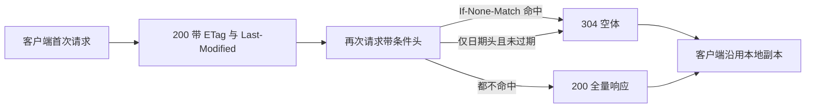
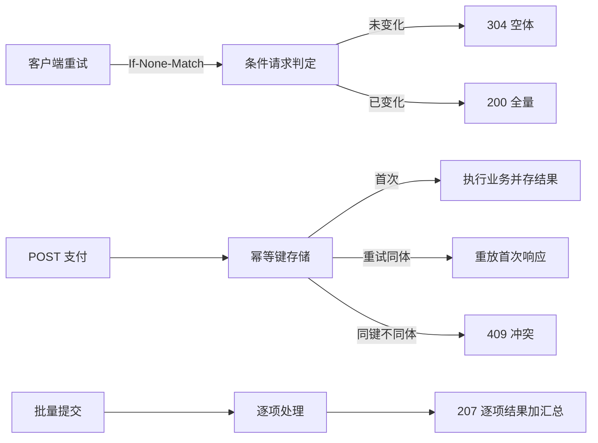
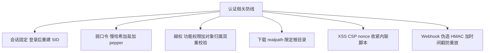
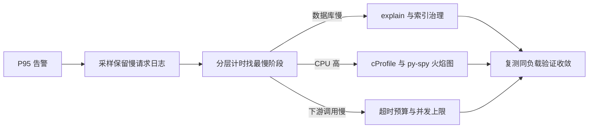
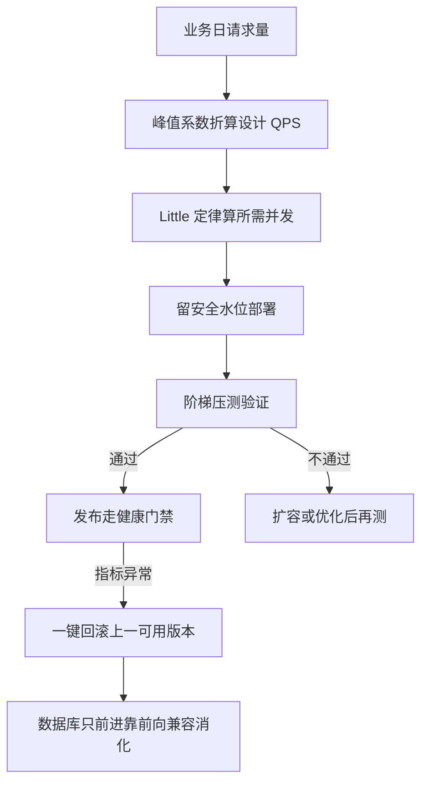
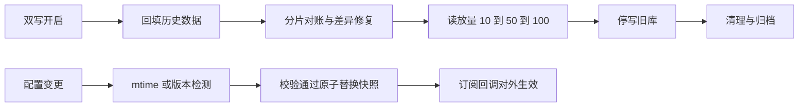
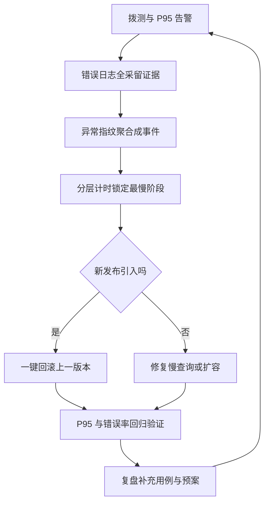

# 第 3 类 · Web 后端开发(夜间扩产)

本文件是第 3 类的扩产补遗,共 45 题(Q1346–Q1390),覆盖四条主线:接口设计补遗(条件请求、幂等键约定、批量部分成功、分页与错误码契约、弃用流程)、安全专题深入(会话固定、密码哈希与 pepper、越权检测用例、路径穿越、CSP、Webhook 签名)、性能与容量(压缩取舍、缓存头、慢接口定位、标准库压测、水位估算)、线上治理(发布回滚、双写放量与对账、配置热更新、日志采样、异常聚合告警)。
多数代码为纯标准库可直接运行;涉及 FastAPI 的题目用 try/except ImportError 降级为等价的纯逻辑演示,保证无第三方依赖也能完整跑通。
复习主线:契约先想清楚、默认安全、变可退——接口怎么定义、防线怎么落、出了事怎么退。

### Q1346 · 条件请求:If-None-Match 的完整解析

> 难度:★★★ | 标签:HTTP 缓存, 接口设计

**问**:除了最简单的单 ETag 比对,If-None-Match 还有哪些合法形态?中间件里怎么把解析做对?

**答**:`If-None-Match` 可以是逗号分隔的多个实体标签、带 `W/` 前缀的弱标签,或 `*`(表示任意实体存在即命中)。判定要用**弱比较**(忽略 `W/` 前缀只比标签本体),且客户端发来的列表必须逐项解析而不是整个字符串相等——这是新手中间件最常见的 bug。命中就返回 304 并回带 ETag 与缓存指令,不命中才真正生成响应体。把这套解析收敛成纯函数,单测覆盖 `*`、多标签、弱标签三种形态,中间件只做组装。

```python
# file: code/03_Web后端开发/q1346_conditional_request.py
"""条件请求:If-None-Match 的解析与 304 判定(纯标准库)。"""


def parse_if_none_match(value):
    """解析 If-None-Match,返回 [(weak: bool, tag: str)];* 表示任意实体。"""
    if not value:
        return []
    value = value.strip()
    if value == "*":
        return [(False, "*")]
    tags = []
    for part in value.split(","):
        part = part.strip()
        if not part:
            continue
        weak = part.startswith("W/")
        if weak:
            part = part[2:]
        tags.append((weak, part.strip()))
    return tags


def not_modified(etag, if_none_match):
    """按 RFC 7232 的弱比较判定:命中返回 True,服务端应回 304。"""
    tags = parse_if_none_match(if_none_match)
    if not tags:
        return False
    if any(tag == "*" for _, tag in tags):
        return True
    ours = etag[2:] if etag.startswith("W/") else etag
    return any(tag == ours for _, tag in tags)


resource_etag = '"v7"'
print("单标签命中:", not_modified(resource_etag, '"v7"'))
print("多标签命中:", not_modified(resource_etag, '"v6", "v7"'))
print("星号命中:", not_modified(resource_etag, "*"))
print("弱标签命中:", not_modified(resource_etag, 'W/"v7"'))
print("不命中:", not_modified(resource_etag, '"v8"'))
print("空头不命中:", not_modified(resource_etag, None))
```

**追问**:
- If-None-Match 和 If-Modified-Since 同时带时听谁的?——规范规定 If-None-Match 优先,只有前者缺席才看日期。
- 304 能省多少?——省掉整个响应体的传输与序列化,CPU 只剩指纹计算,大响应收益最明显。

### Q1347 · Last-Modified 与 If-Modified-Since 的秒级陷阱

> 难度:★★★ | 标签:HTTP 缓存, 接口设计

**问**:用 Last-Modified 做协商缓存,为什么会出现"内容没变却总回 200"?怎么修?

**答**:HTTP 日期只有**秒级精度**,而数据库时间戳常带微秒;服务端拿完整精度的时间戳去和秒级精度的请求头比较,几乎永远判"已修改"。正确做法是双方都截断到秒再比,并且服务端生成 Last-Modified 时就用 `format_datetime(usegmt=True)` 输出 GMT 格式。另一个坑:如果一秒内资源被改了多次,Last-Modified 感知不到,这类资源应改用 ETag 或在写入时保证秒级单调。它和 If-None-Match 并存时后者优先。

```python
# file: code/03_Web后端开发/q1347_last_modified.py
"""Last-Modified 协商:秒级精度对齐后再比较(纯标准库)。"""
from datetime import datetime, timezone
from email.utils import format_datetime, parsedate_to_datetime


def not_modified_since(last_modified, if_modified_since):
    """last_modified 为 aware datetime;头缺失返回 False 表示要发全量。"""
    if not if_modified_since:
        return False
    client_seen = parsedate_to_datetime(if_modified_since)
    lm = last_modified.replace(microsecond=0)  # 截断到秒,与 HTTP 日期同精度
    return lm <= client_seen


last_modified = datetime(2026, 10, 31, 12, 0, 0, 500000, tzinfo=timezone.utc)
header = format_datetime(last_modified.replace(microsecond=0), usegmt=True)
print("Last-Modified 头:", header)
print("客户端缓存与当前一致 ->", not_modified_since(last_modified, header))
print("资源在客户端缓存之后更新过 ->", not_modified_since(last_modified, "Sat, 01 Oct 2026 00:00:00 GMT"))
print("缺头 ->", not_modified_since(last_modified, None))
```

**追问**:
- 静态文件该用哪个?——两者都给:Last-Modified 免费、ETag 精确,Nginx 对静态文件默认就是这套组合。
- 为什么必须用 GMT?——HTTP 日期规范只接受 GMT,本地时区会被解析失败或判错。



### Q1348 · 幂等键的传递约定与冲突判定

> 难度:★★★ | 标签:幂等性, 接口设计

**问**:Idempotency-Key 除了"带着就行",工程上还要约定什么?同键不同内容怎么处理?

**答**:约定四件事:键放在 `Idempotency-Key` 请求头(不要混在业务体里)、格式建议 UUID 且长度设上限(如 255)、作用域是 **租户 + 路由**(不同租户/接口的键互不可见)、键要有 TTL(常见 24 小时)。最关键的是**键与请求体绑定**:服务端存储首次请求的指纹(体哈希),重试时指纹一致才重放旧响应,不一致说明客户端复用了键,必须回 **409/422** 而不是把旧结果错发给新业务——这比"忘了带键"严重得多。

```python
# file: code/03_Web后端开发/q1348_idem_key_convention.py
"""幂等键约定:校验、作用域与同键不同体的冲突判定(纯标准库)。"""
import hashlib
import uuid

MAX_KEY_LEN = 255


def check_key(route, tenant, key):
    """校验幂等键约定,返回 (ok, http_status, scope)。"""
    if not key:
        return False, 400, None
    if len(key) > MAX_KEY_LEN:
        return False, 400, None
    return True, None, f"{tenant}:{route}"


def decide(store, scope, key, body_bytes):
    """返回 (action, status):execute 执行 / replay 重放 / conflict 冲突。"""
    fingerprint = hashlib.sha256(body_bytes).hexdigest()[:16]
    record = store.get((scope, key))
    if record is None:
        return "execute", 200, fingerprint
    if record["fingerprint"] != fingerprint:
        return "conflict", 409, fingerprint
    return "replay", 200, fingerprint


store = {}
ok, _, scope = check_key("/payments", "tenant-a", str(uuid.uuid4()))
print("键合法:", ok, "作用域:", scope)

fp1 = hashlib.sha256(b'{"amount": 100}').hexdigest()[:16]
store[(scope, "k1")] = {"fingerprint": fp1, "response": {"order": "pay-0001"}}
print("同键同体:", decide(store, scope, "k1", b'{"amount": 100}')[:2])
print("同键不同体:", decide(store, scope, "k1", b'{"amount": 999}')[:2])
print("缺键:", check_key("/payments", "tenant-a", "")[:2])
```

**追问**:
- 客户端重试时能换键吗?——不能,换键等于新请求;重试必须原样带上首次的键。
- 键要参与去重的并发控制吗?——要,首请求未完成时同键并发应挂起或回 409,见下一题。

### Q1349 · 幂等键存储:并发首请求与结果重放

> 难度:★★★★★ | 标签:幂等性, 并发

**问**:两个相同幂等键的请求同时到达,怎么保证业务只执行一次、且两个请求都拿到结果?

**答**:核心是**单飞(single-flight)**:以键为粒度加互斥锁,首个拿到锁的请求执行业务并写入"键 → 响应",后来者在锁上等待,醒来后发现记录已存在就直接重放,全程业务只执行一次。生产实现通常用 Redis `SET NX` 抢租约 + 结果回写,本地单机版用 `threading.Lock` 即可演示语义。存储要带 TTL 防止无限膨胀;结果必须与业务写入同事务或用事务发件箱,否则"业务成功、结果没存"会产生重放空洞。

```python
# file: code/03_Web后端开发/q1349_idem_store.py
"""幂等键存储:并发首请求只执行一次,其余重放(纯标准库)。"""
import threading
import time


class IdempotencyStore:
    def __init__(self, ttl_seconds=300):
        self.ttl = ttl_seconds
        self.records = {}            # key -> {"result": .., "expires": ..}
        self.locks = {}              # key -> Lock,实现单飞
        self.guard = threading.Lock()

    def _key_lock(self, key):
        with self.guard:
            return self.locks.setdefault(key, threading.Lock())

    def execute(self, key, work):
        """返回 (result, replayed):只有持锁者真正执行 work。"""
        lock = self._key_lock(key)
        with lock:
            now = time.monotonic()
            rec = self.records.get(key)
            if rec and rec["expires"] > now:
                return rec["result"], True
            result = work()
            self.records[key] = {"result": result, "expires": now + self.ttl}
            return result, False


store = IdempotencyStore()
calls = []
barrier = threading.Barrier(2)


def do_work(tag):
    calls.append(tag)
    time.sleep(0.05)                 # 模拟业务耗时,放大并发窗口
    return f"order-{tag}"


def worker(tag):
    barrier.wait()                   # 两个请求同时发起
    result, replayed = store.execute("pay-1", lambda: do_work(tag))
    print(f"worker-{tag}: result={result} replayed={replayed}")


threads = [threading.Thread(target=worker, args=(i,)) for i in (1, 2)]
for t in threads:
    t.start()
for t in threads:
    t.join()
print("业务执行次数:", len(calls), "必须为 1")
```

**追问**:
- 处理中的第三个请求怎么办?——可以回 409 或轮询等待,支付类建议等待后重放,体验最好。
- Redis 租约挂了怎么办?——租约带 TTL 自动过期,执行方续约;拿不到租约的请求重试或拒绝,绝不能直接执行。

### Q1350 · 批量接口的部分成功设计

> 难度:★★★ | 标签:接口设计, 批量

**问**:批量创建 100 条数据,第 37 条失败,这个接口该怎么响应?

**答**:两种契约要提前选定:**全有或全无**(事务回滚,语义简单但一条坏数据拖垮整批)和**部分成功**(逐项处理,返回逐项结果)。选部分成功就用 207 Multi-Status 或 200 包一层逐项数组:每项带索引、业务 ID、status 与失败原因,**单项失败绝不中断其他项**,顶层附 summary(total/succeeded/failed)让调用方不用自己数。失败原因要给程序可读的 code 和人可读的 message;响应顺序必须与请求顺序一致,方便对位。

```python
# file: code/03_Web后端开发/q1350_batch_partial.py
"""批量接口部分成功:逐项结果 + 汇总统计(纯标准库,fastapi 可用时挂路由)。"""
try:
    from fastapi import FastAPI
    HAS_FASTAPI = True
except ImportError:
    HAS_FASTAPI = False
    print("[降级] 未安装 fastapi,以下用纯函数演示同一响应结构")


def process_batch(items):
    """逐项独立处理,返回 {results, summary},顺序与请求一致。"""
    results = []
    for item in items:
        try:
            if item["amount"] <= 0:
                raise ValueError("amount 必须为正数")
            results.append({"index": item["index"], "id": item["id"],
                            "status": "success", "data": {"fee": item["amount"] // 100}})
        except (KeyError, ValueError) as exc:
            results.append({"index": item.get("index"), "id": item.get("id"),
                            "status": "failed", "error": {"code": "INVALID_AMOUNT",
                                                          "message": str(exc)}})
    ok = sum(1 for r in results if r["status"] == "success")
    return {"results": results,
            "summary": {"total": len(results), "succeeded": ok, "failed": len(results) - ok}}


if HAS_FASTAPI:
    app = FastAPI()

    @app.post("/v1/fees/batch")
    def batch_route(items: list):
        return process_batch(items)
    print("[fastapi] 已注册 POST /v1/fees/batch 路由示例")

resp = process_batch([
    {"index": 0, "id": "a1", "amount": 250},
    {"index": 1, "id": "a2", "amount": -1},
    {"index": 2, "id": "a3", "amount": 80},
])
print(resp["summary"])
for r in resp["results"]:
    tail = r.get("error", {}).get("message", "ok")
    print(r["index"], r["status"], tail)
```

**追问**:
- 什么时候必须选全有或全无?——账务、库存这类要求批次原子性的场景,宁可让客户端修好数据重提。
- 批量里有依赖顺序怎么办?——按序处理并在失败项之后标记 skipped,或直接拒绝混合批次。



### Q1351 · 批量请求的上限与分片

> 难度:★★ | 标签:接口设计, 批量

**问**:客户端一次想提交 5 万条,批量接口的边界怎么定?

**答**:三层防线:请求体条数硬上限(超出直接 413 并告诉客户端分批)、单批内部再按固定大小分片处理(便于限流、事务拆分与进度上报)、响应里给出可续传的游标或批次号。上限要写进文档并允许服务端调整,客户端从 413 的提示里能算出安全批量;分片大小取"单批最坏耗时可接受"的值,和单条成本相乘倒推。别用无上限的批量——它是最容易把 worker 池打爆的接口形态。

```python
# file: code/03_Web后端开发/q1351_batch_chunk.py
"""批量接口的上限与内部分片(纯标准库)。"""

MAX_BODY_ITEMS = 1000      # 单请求条数上限,超出 413
CHUNK_SIZE = 100           # 服务端内部再分片的大小


def chunked(items, size):
    for i in range(0, len(items), size):
        yield items[i:i + size]


def handle_batch(ids):
    if len(ids) > MAX_BODY_ITEMS:
        return 413, {"error": "BATCH_TOO_LARGE",
                     "message": f"单请求最多 {MAX_BODY_ITEMS} 条,请分批提交"}
    return 200, {"chunks": [len(c) for c in chunked(ids, CHUNK_SIZE)]}


print(handle_batch(list(range(260))))
print(handle_batch(list(range(1500))))
```

**追问**:
- 413 响应里要带什么?——带上限值与建议批量,客户端才能自动降级重试。
- 分片之间要一个事务吗?——不要,逐片提交配幂等键,失败片单独重试。

### Q1352 · 游标分页规范:不透明游标与防篡改

> 难度:★★★★ | 标签:分页, 接口设计

**问**:对外暴露的 cursor 分页,游标里该放什么?怎么防止客户端伪造游标乱翻数据?

**答**:游标只承载"排序键 + 方向"的最小信息,序列化后做 **base64 + HMAC 签名**变成不透明字符串——客户端只能原样回传,不能拼改。签名校验失败要返回 400,而不是悄悄回退到第一页(那会把翻页 bug 变成数据 bug)。翻页以"严格大于上一页最后一个排序键"取下一页,天然免疫写入造成的漂移;排序键必须唯一(单一列不唯一时叠加主键做复合排序)。页大小作为参数校验上下限,has_more 用"是否取到了 size+1 条"判断而不是 count 全表。

```python
# file: code/03_Web后端开发/q1352_cursor_page.py
"""不透明游标:base64 排序键 + HMAC 签名防篡改(纯标准库)。"""
import base64
import hashlib
import hmac
import json

SECRET = b"change-me-from-env"
PAGE_SIZE = 3


def make_cursor(sort_key, secret=SECRET):
    payload = base64.urlsafe_b64encode(json.dumps({"k": sort_key}).encode()).decode().rstrip("=")
    sig = hmac.new(secret, payload.encode(), hashlib.sha256).hexdigest()[:16]
    return payload + "." + sig


def parse_cursor(cursor, secret=SECRET):
    """返回排序键;签名不符或格式非法返回 None,调用方回 400。"""
    try:
        payload, sig = cursor.rsplit(".", 1)
        expect = hmac.new(secret, payload.encode(), hashlib.sha256).hexdigest()[:16]
        if not hmac.compare_digest(sig, expect):
            return None
        pad = "=" * (-len(payload) % 4)
        return json.loads(base64.urlsafe_b64decode(payload + pad))["k"]
    except (ValueError, KeyError):
        return None


rows = [{"id": i, "score": 90 - i} for i in range(1, 9)]


def page_after(rows, cursor):
    key = parse_cursor(cursor) if cursor else None
    if cursor and key is None:
        return None, None                      # 伪造游标:400
    start = 0 if key is None else next(i for i, r in enumerate(rows) if r["id"] == key) + 1
    window = rows[start:start + PAGE_SIZE]
    has_more = start + PAGE_SIZE < len(rows)
    next_cursor = make_cursor(window[-1]["id"]) if has_more else None
    return {"items": window, "next_cursor": next_cursor, "has_more": has_more}, None


cursor = None
for _ in range(4):
    page, err = page_after(rows, cursor)
    if err is not None:
        print("400 拒绝伪造游标")
        break
    print([r["id"] for r in page["items"]], "next:", page["next_cursor"])
    if not page["has_more"]:
        break
    cursor = page["next_cursor"]

tampered = make_cursor(2)
tampered = tampered[:-1] + ("0" if tampered[-1] != "0" else "1")
print("篡改游标解析结果:", parse_cursor(tampered))
```

**追问**:
- cursor 和 offset 分页怎么选?——列表实时变动或深翻页用 cursor,管理后台低频浅翻页用 offset 简单直接。
- 游标里的排序键要加密吗?——签名已防篡改;不想泄露内部 ID 分布就再加一层加密,但可读性换安全要权衡。

### Q1353 · 分页参数的约定与校验

> 难度:★★ | 标签:分页, 接口设计

**问**:page 和 size 这两个参数,接口文档里要锁死哪些规则?

**答**:四条铁律:类型必须是整数且给默认值(page=1, size=20)、size 设上限(如 100)防止 `size=100000` 打爆内存、越界值返回 400 并在 message 里写清边界、偏移量由服务端计算而不是让客户端传 offset(避免 page 与 offset 不一致)。总数 count 是昂贵操作,大表要么不返回总数改用 has_more,要么放到响应头按需提供。这些规则落在统一入口校验一次,别散在每个 handler 里。

```python
# file: code/03_Web后端开发/q1353_page_params.py
"""分页参数的统一校验与归一化(纯标准库)。"""

DEFAULT_PAGE, DEFAULT_SIZE, MAX_SIZE = 1, 20, 100


def normalize_page_params(page, size):
    """返回 (params, errors):非法时 params 为 None 并给出全部错误。"""
    try:
        p, s = int(page), int(size)
    except (TypeError, ValueError):
        return None, ["page 与 size 必须是整数"]
    errors = []
    if p < DEFAULT_PAGE:
        errors.append(f"page 必须 >= {DEFAULT_PAGE}")
    if s < 1:
        errors.append("size 必须 >= 1")
    if s > MAX_SIZE:
        errors.append(f"size 不得超过 {MAX_SIZE}")
    if errors:
        return None, errors
    return {"page": p, "size": s, "offset": (p - 1) * s}, []


print(normalize_page_params("2", "50"))
print(normalize_page_params("0", "500"))
print(normalize_page_params("abc", "20"))
```

**追问**:
- count 很慢又必须要总数怎么办?——缓存近似总数、用估算(explain rows)或改成"加载更多"式 has_more 交互。
- 游标分页还需要这些参数吗?——size 校验照留,page/offset 换成 cursor 参数,同样只允许服务端解析。

### Q1354 · 业务错误码的注册表与编码规范

> 难度:★★★ | 标签:错误码, 接口设计

**问**:团队几十个服务,业务错误码怎么设计才不会乱成一锅粥?

**答**:建**集中注册表**:每个错误有稳定 code(如 `U1001`)、语义名、HTTP 状态映射、是否可重试四要素;code 用域前缀 + 序号(U 用户、C 客户端流控、P 支付、S 系统),序号只增不改——code 一旦对外发布就是契约,改名会炸客户端。所有 handler 只引用语义名,响应体由注册表统一渲染,杜绝手写字符串。注册表同时是文档源:可以自动生成错误码页面对外发布,新增错误必须先注册后使用,review 时看 diff 就能发现抢号。

```python
# file: code/03_Web后端开发/q1354_error_registry.py
"""业务错误码注册表:域前缀加序号,集中登记并渲染(纯标准库)。"""

REGISTRY = {
    "USER_NOT_FOUND":       {"code": "U1001", "http": 404, "retryable": False},
    "USER_LOCKED":          {"code": "U1002", "http": 423, "retryable": False},
    "RATE_LIMITED":         {"code": "C2001", "http": 429, "retryable": True},
    "BALANCE_INSUFFICIENT": {"code": "P3001", "http": 422, "retryable": False},
    "UPSTREAM_TIMEOUT":     {"code": "S5001", "http": 504, "retryable": True},
}

codes = [m["code"] for m in REGISTRY.values()]
assert len(codes) == len(set(codes)), "错误码必须全局唯一"


def render(name, detail=None):
    meta = REGISTRY[name]
    body = {"code": meta["code"], "error": name, "retryable": meta["retryable"]}
    if detail:
        body["detail"] = detail
    return meta["http"], body


def catalog():
    """按域前缀分组,自动生成文档目录。"""
    grouped = {}
    for name, meta in REGISTRY.items():
        grouped.setdefault(meta["code"][0], []).append((meta["code"], name))
    return grouped


print(render("RATE_LIMITED", "60 秒后重试"))
for prefix, rows in sorted(catalog().items()):
    print(prefix, sorted(rows))
```

**追问**:
- 错误码和 HTTP 状态什么关系?——HTTP 状态管传输层语义(网关、重试、监控都认它),业务 code 管精确定位,两者映射要一致不能乱来。
- 错误码能复用已下线的号码吗?——不能,序号只增不复用,避免新旧行为在长缓存客户端里混淆。

### Q1355 · 错误响应中 details 的结构契约

> 难度:★★ | 标签:错误码, 接口设计

**问**:校验失败要返回多个字段错误,details 结构怎么定才稳定?有什么绝对不能放进响应?

**答**:定三层:message 给人看(一句中文概括),error 给程序判断(语义名),details 是数组、每项固定 `field + reason(+ input)`,字段路径用点分字符串(`body.address.city`)。**敏感输入绝不能回显**:password、token、身份证这类字段即使客户端传了,details 里也只能有校验结论不能有原值——回显错误输入是最常见的泄露路径。details 的 key 一旦发布就不许改名,加字段可以、删字段要按弃用流程走。

```python
# file: code/03_Web后端开发/q1355_error_details.py
"""校验错误收敛为稳定 details 结构,并过滤敏感输入(纯标准库)。"""

SENSITIVE = {"password", "token", "id_card", "bank_no"}


def validation_error(raw_errors):
    details = []
    for e in raw_errors:
        field = ".".join(str(p) for p in e["loc"])
        item = {"field": field, "reason": e["msg"]}
        if field.split(".")[-1] not in SENSITIVE:
            item["input"] = e.get("input")     # 非敏感字段才回显原值
        details.append(item)
    return {"error": "VALIDATION_FAILED", "message": "请求参数校验失败", "details": details}


raw = [
    {"loc": ("body", "email"), "msg": "不是合法邮箱", "input": "a#example.com"},
    {"loc": ("body", "password"), "msg": "至少 8 位", "input": "secret123"},
    {"loc": ("body", "address", "city"), "msg": "不能为空", "input": None},
]
import json
print(json.dumps(validation_error(raw), ensure_ascii=False, indent=1))
```

**追问**:
- 字段路径要不要带 body/query 前缀?——要,同名参数在不同位置含义不同,定位报错必须有位置信息。
- details 里能给内部堆栈吗?——绝对不行,堆栈只进服务端日志,对外是信息泄露。

### Q1356 · 接口弃用的标准落地:Sunset 头与调用方盘点

> 难度:★★★ | 标签:弃用, 接口治理

**问**:接口要下线了,除了群里喊一嗓子,工程上应该做哪几件事?

**答**:让弃用**机器可读**:响应加 `Deprecation` 头标记弃用、`Sunset` 头(RFC 8594)给出确切下线日期、`Link rel="sunset"` 指向迁移文档;到期后路由返回 **410 Gone** 而不是 404,明确告诉调用方"曾存在、已永久移除"。同时开启**调用方盘点**:对弃用路由按 API Key / User-Agent 记审计日志,排出还没迁移的大头,逐个催迁——流量没归零之前不能硬删。版本共存与路由组织是另一道题,这里聚焦"下线动作"本身。

```python
# file: code/03_Web后端开发/q1356_sunset_audit.py
"""接口弃用:Deprecation/Sunset 头与调用方盘点(纯标准库,fastapi 可用时挂路由)。"""
from datetime import date

try:
    from fastapi import FastAPI
    HAS_FASTAPI = True
except ImportError:
    HAS_FASTAPI = False
    print("[降级] 未安装 fastapi,以下用纯函数演示同一逻辑")

ROUTES = {
    "GET /v1/orders": {"sunset": date(2026, 12, 31)},
    "GET /v2/orders": {"sunset": None},
}
audit = {}   # path -> {caller: count}


def handle(method_path, today, caller="api-key-unknown"):
    meta = ROUTES[method_path]
    headers = {}
    if meta["sunset"]:
        headers["Deprecation"] = "true"
        headers["Sunset"] = meta["sunset"].strftime("%a, %d %b %Y") + " 00:00:00 GMT"
        headers["Link"] = '<https://docs.example.com/migrate>; rel="sunset"'
        audit.setdefault(method_path, {})
        audit[method_path][caller] = audit[method_path].get(caller, 0) + 1
        if today > meta["sunset"]:
            return 410, headers
    return 200, headers


if HAS_FASTAPI:
    app = FastAPI()

    @app.get("/v1/orders")
    def orders_v1():
        status, headers = handle("GET /v1/orders", date.today())
        return status, headers
    print("[fastapi] 已注册带 Sunset 逻辑的 /v1/orders 示例路由")

print(handle("GET /v1/orders", date(2026, 11, 2)))
print(handle("GET /v1/orders", date(2027, 1, 5)))
handle("GET /v1/orders", date(2027, 1, 5), caller="partner-x")
handle("GET /v1/orders", date(2027, 1, 5), caller="partner-x")
handle("GET /v1/orders", date(2027, 1, 5), caller="mobile-app")
print("待迁移调用方排行:", sorted(audit["GET /v1/orders"].items(), key=lambda kv: -kv[1]))
```

**追问**:
- 为什么下线用 410 不用 404?——404 无法区分"从未存在"和"已弃用",410 让客户端立即停止重试并触发迁移告警。
- Sunset 到期当天直接 410 吗?——先观察一周 410 比例与调用方工单,确认无关键流量再删代码。


### Q1357 · 接口变更的兼容性判定清单

> 难度:★★★ | 标签:接口设计, 兼容性

**问**:哪些接口改动是破坏性的?发布前怎么机器化地审一遍?

**答**:判据是"旧客户端会不会坏":请求侧**新增必填字段、收紧校验、改名**是破坏性的;响应侧**删字段、改类型、改语义**(同名字段含义变化)是破坏性的。而响应新增字段、请求放宽校验、增加可选参数都是安全的。把规则写成 diff 检查器挂在 CI:拿新旧的 schema 对比,产出 breaking/safe 清单,有 breaking 就要求走新版本或审批。语义变化机器查不出来,要在 review 清单里人肉过——这也是 schema 文档化(OpenAPI)的价值所在。

```python
# file: code/03_Web后端开发/q1357_compat_rules.py
"""接口 schema 变更的兼容性检查器(纯标准库)。"""


def diff_api(old, new):
    """old/new: {request_required: [..], response_fields: {字段: 类型}}"""
    breaking, safe = [], []
    for f in old["request_required"]:
        if f not in new["request_required"]:
            safe.append(f"请求移除必填字段 {f}:放宽,兼容")
    for f in new["request_required"]:
        if f not in old["request_required"]:
            breaking.append(f"请求新增必填字段 {f}:旧客户端将 422")
    for f, t in old["response_fields"].items():
        if f not in new["response_fields"]:
            breaking.append(f"响应删除字段 {f}:旧客户端可能取空崩溃")
        elif new["response_fields"][f] != t:
            breaking.append(f"响应字段 {f} 类型 {t} 改为 {new['response_fields'][f]}")
    for f, t in new["response_fields"].items():
        if f not in old["response_fields"]:
            safe.append(f"响应新增字段 {f}:向前兼容")
    return breaking, safe


old = {"request_required": ["user_id", "amount"],
       "response_fields": {"id": "int", "name": "str", "fee": "int"}}
new = {"request_required": ["user_id", "amount", "currency"],
       "response_fields": {"id": "int", "name": "str", "amount": "int"}}
breaking, safe = diff_api(old, new)
print("破坏性变更:")
for b in breaking:
    print(" -", b)
print("安全变更:")
for s in safe:
    print(" -", s)
```

**追问**:
- 必须加一个必填参数又不想开新版本怎么办?——先以可选发布并在文档标注"即将必填",观察一个版本周期无调用方缺省后再收紧。
- 枚举值加新值算破坏吗?——对写死 switch 的客户端算,文档里要声明"枚举开放扩展",客户端按未知值兜底。

### Q1358 · 会话固定攻击与登录后的会话重建

> 难度:★★★ | 标签:会话安全, 认证

**问**:什么是会话固定?登录成功那一刻必须做哪个动作?

**答**:会话固定是攻击者先拿到一个会话 ID(自己访问站点获得,或诱导受害者用带指定 SID 的链接访问),诱使受害者在这个已知 SID 上完成登录,于是攻击者凭同一个 SID 获得已认证身份。防线就一句话:**认证状态发生跃迁(匿名变登录、提权、改密码)时必须废弃旧 Session ID 并重新生成**,新会话不继承旧的任何状态映射。配套还要有:SID 只走 HttpOnly Cookie、登录页不接受 URL 里的 SID、闲置超时与绝对过期双保险。

```python
# file: code/03_Web后端开发/q1358_session_fixation.py
"""会话固定防护:登录时废弃旧 SID 重新生成(纯标准库)。"""
import secrets

sessions = {}   # sid -> {"user": 用户名或 None}


def new_session():
    sid = secrets.token_urlsafe(32)
    sessions[sid] = {"user": None}
    return sid


def login_vulnerable(sid, user):
    sessions[sid]["user"] = user          # 错误示范:沿用攻击者预置的 SID
    return sid


def login_safe(sid, user):
    sessions.pop(sid, None)               # 正确:作废旧 SID,防止固定
    new_sid = new_session()
    sessions[new_sid]["user"] = user
    return new_sid


attacker_sid = new_session()
print("攻击者预置 SID:", attacker_sid[:16], "...")

victim_sid_vuln = login_vulnerable(attacker_sid, "alice")
print("未防护:受害者登录后 SID 未变 ->", victim_sid_vuln == attacker_sid)
print("攻击者用同一 SID 访问 ->", sessions[attacker_sid])

victim_sid_safe = login_safe(new_session(), "alice")
print("已防护:新 SID 与旧 SID 必然不同 ->", victim_sid_safe != attacker_sid)
print("旧 SID 已失效 ->", attacker_sid not in sessions)
```

**追问**:
- 已经上线多年的系统能补这个修复吗?——能,登录处重建 SID 属于向后兼容改动,唯一影响是用户需重登一次的边界场景。
- SID 重建和 CSRF Token 重建是一回事吗?——不是,但同类原则:安全状态都应在登录时刷新,CSRF Token 也要随会话重建。

### Q1359 · Session ID 的生成强度与比较方式

> 难度:★★ | 标签:会话安全, 密码学

**问**:Session ID 用 `random` 生成行不行?比较两个 SID 用 `==` 有什么问题?

**答**:不行:Python 的 `random` 是 Mersenne Twister,不是密码学安全的,攻击者观察到少量输出就能预测后续状态,必须用 `secrets`(底层 os.urandom)。强度上 SID 至少 128 位熵,`secrets.token_urlsafe(32)` 提供 256 位,配合足够长过期策略可以认为不可穷举。比较时用 `hmac.compare_digest` 恒定时间比较,防止逐字节短路带来的计时侧信道(单独看收益小,但这是零成本的正确习惯)。另外 SID 永远不要出现在 URL 里,只走 HttpOnly + Secure Cookie。

```python
# file: code/03_Web后端开发/q1359_sid_strength.py
"""Session ID 的生成强度与恒定时间比较(纯标准库)。"""
import hmac
import secrets

# 弱示例:顺序号完全可预测,仅作对照
weak_sids = [f"SID-{i:08d}" for i in range(3)]
print("弱 SID 可预测:", weak_sids)

strong = secrets.token_urlsafe(32)          # 32 字节 = 256 位熵
print("强 SID 示例:", strong[:16], "... 熵 bits:", 32 * 8)

# 恒定时间比较:避免逐字节短路带来的计时侧信道
a, b = secrets.token_urlsafe(32), secrets.token_urlsafe(32)
print("compare_digest 自身:", hmac.compare_digest(strong, strong))
print("compare_digest 他人:", hmac.compare_digest(strong, b))
```

**追问**:
- 用 uuid4 做 SID 行吗?——可以,uuid4 底层也是 CSPRNG,122 位熵达标;自增 ID、时间戳、uuid1 绝对不行。
- 为什么不在 SID 里编码用户信息?——SID 必须是不透明随机串,任何可读结构都给攻击者提供信息。

### Q1360 · 密码哈希选型与验证流程

> 难度:★★★★ | 标签:密码存储, 安全

**问**:存用户密码,为什么不能用 SHA-256?bcrypt、argon2 怎么选?

**答**:SHA-256 太快,GPU 每秒能算几十亿次,拖库后爆破极易;密码哈希必须用**故意慢、且带盐**的算法:首选 argon2id(抗 GPU 与内存耗尽设计,内存参数可调),其次 bcrypt(成熟稳定,注意 72 字节截断),标准库兜底是 PBKDF2-HMAC-SHA256(OWASP 建议 60 万次以上迭代)。每个密码独立随机盐(防彩虹表),存储串自带算法标识与参数(如 `pbkdf2_sha256$100000$salt$hash`),将来升级算法时能按用户逐一重哈希。验证恒定时间比较,登录失败做速率限制。

```python
# file: code/03_Web后端开发/q1360_password_hash.py
"""密码哈希:生产选 argon2 或 bcrypt,这里用标准库 PBKDF2 演示同等流程。"""
import hashlib
import hmac
import os

try:
    import argon2
    print("[环境] 已安装 argon2-cffi,生产应使用 argon2.PasswordHasher")
except ImportError:
    print("[降级] 未安装 argon2-cffi,以下用标准库 PBKDF2-HMAC-SHA256 演示")


def hash_password(password, iterations=100_000):
    salt = os.urandom(16)                                # 每密码独立随机盐
    dk = hashlib.pbkdf2_hmac("sha256", password.encode(), salt, iterations)
    return f"pbkdf2_sha256${iterations}${salt.hex()}${dk.hex()}"


def verify_password(stored, password):
    algo, iters, salt_hex, dk_hex = stored.split("$")
    dk = hashlib.pbkdf2_hmac("sha256", password.encode(),
                             bytes.fromhex(salt_hex), int(iters))
    return hmac.compare_digest(dk.hex(), dk_hex)          # 恒定时间比较


stored = hash_password("S3cure-pass!")
print("存储串:", stored[:40], "...")
print("正确密码:", verify_password(stored, "S3cure-pass!"))
print("错误密码:", verify_password(stored, "wrong-password"))
```

**追问**:
- 盐和 pepper 是一回事吗?——不是,盐存库防彩虹表,pepper 是不在库里的应用级密钥,见下一题。
- 迭代次数怎么定?——以"登录耗时 100ms 左右、机器最快的那台"为基准,并随硬件定期上调。

### Q1361 · Pepper:应用级密钥的第二道防线

> 难度:★★★★ | 标签:密码存储, 密钥管理

**问**:加了盐为什么还要 pepper?pepper 怎么落地?

**答**:盐只防彩虹表,**防不了拖库后的本地爆破**——盐就存在库里,和哈希一起被拖走。pepper 是一个**不存在数据库里**的应用级全局密钥,对已哈希结果再叠一层 HMAC:数据库泄露时攻击者没有 pepper,连离线爆破都无从发起,必须先攻破应用服务器才能拿到。落地要点:pepper 来自环境变量或 KMS(不进代码库)、轮换采用"新 pepper 计算、旧 pepper 验证后重哈希"的双读策略、pepper 长度至少 32 字节随机。它不替代慢哈希,是慢哈希之上的增援。

```python
# file: code/03_Web后端开发/q1361_pepper.py
"""pepper:对慢哈希结果再叠一层应用级 HMAC(纯标准库)。"""
import hashlib
import hmac
import os


def load_pepper():
    pepper = os.environ.get("APP_PEPPER")
    if not pepper:
        pepper = "demo-pepper-change-me"
        print("[降级] 未设置 APP_PEPPER,使用演示值;生产必须来自 KMS 或环境变量")
    return pepper.encode()


PEPPER = load_pepper()


def with_pepper(base_hash_hex):
    return hmac.new(PEPPER, base_hash_hex.encode(), hashlib.sha256).hexdigest()


def verify(base_hash_hex, stored):
    return hmac.compare_digest(with_pepper(base_hash_hex), stored)


base = hashlib.pbkdf2_hmac("sha256", b"pw", b"salt", 100_000).hex()
stored = with_pepper(base)
print("校验通过:", verify(base, stored))

wrong = hmac.new(b"other-pepper", base.encode(), hashlib.sha256).hexdigest()
print("pepper 不符即失败(拖库者无 pepper 时正是这种局面):", verify(base, wrong))
```

**追问**:
- pepper 泄露了怎么办?——轮换 pepper 并让用户重哈希,和密钥泄露应急同流程;影响面远小于"没有 pepper 时拖库"。
- 双 pepper 过渡期怎么验证?——存储串带上 pepper 版本号,验证时按版本选 pepper,登录成功即用新版本重哈希。



### Q1362 · 水平越权:对象归属校验

> 难度:★★★ | 标签:越权, 安全测试

**问**:用户 A 把 URL 里的订单 ID 换成用户 B 的,怎么保证拿不到?

**答**:水平越权(IDOR)的根因是**只按 ID 查、不按归属过滤**。修复模式是让数据访问永远带上主体:`WHERE id = ? AND owner = ?`,或查出对象后显式比对 `obj.owner == current_user`,否则按 **404** 处理——用与"不存在"完全一致的响应,不泄露对象存在性。归属关系复杂时(管理员可见全部、协作成员可见部分)抽成统一的 `can_read(user, obj)` 谓词,所有出口复用。测试上把"改 ID 遍历"做成回归用例矩阵,每个对象型接口都要有。

```python
# file: code/03_Web后端开发/q1362_idor.py
"""水平越权:对象归属校验,拒绝时与不存在同响应(纯标准库)。"""

orders = {1: {"owner": "alice", "amount": 100},
          2: {"owner": "bob", "amount": 200}}


def get_order_vulnerable(order_id, current_user):
    return orders.get(order_id)              # 只按 ID 查,存在越权


def get_order_safe(order_id, current_user):
    obj = orders.get(order_id)
    if obj is None or obj["owner"] != current_user:
        return None                          # 与不存在同响应,不泄露存在性
    return obj


print("未防护:alice 拿到 bob 的订单 ->", get_order_vulnerable(2, "alice"))
print("已防护:alice 访问 bob 的订单 ->", get_order_safe(2, "alice"))
print("已防护:alice 访问自己的订单 ->", get_order_safe(1, "alice"))

assert get_order_safe(2, "alice") is None
assert get_order_safe(2, "bob") is not None
assert get_order_safe(99, "alice") is None
print("越权用例全部通过")
```

**追问**:
- 返回 403 还是 404?——对外 404 更安全(不确认存在),内部管理端可用 403 表达权限不足。
- 批量接口怎么防?——查询集永远叠加归属过滤(owner=scoped queryset),逐项校验既慢又容易漏。

### Q1363 · 垂直越权:能力矩阵与默认拒绝

> 难度:★★★ | 标签:越权, 权限设计

**问**:普通用户调用了只有管理员能用的接口,系统该怎么拦?权限模型怎么组织?

**答**:垂直越权防的是"低权限用了高权限功能",解法是**角色 → 权限(能力)矩阵** + 每个端点声明所需能力:中间件在进入 handler 前检查 `permission in role_permissions[role]`,不满足直接 403。两条设计纪律:一是**默认拒绝**——未登记的角色、未登记的权限一律不允许,新增能力必须显式授权;二是权限粒度到"动作"而非"页面"(如 user.delete 而不是 admin.page),这样菜单、API、任务可以共用一套判定。矩阵集中成配置,变更走 review,避免散落各处的 `if role == "admin"`。

```python
# file: code/03_Web后端开发/q1363_vertical_authz.py
"""垂直越权:角色能力矩阵与默认拒绝(纯标准库)。"""

ROLES = {
    "admin":   {"user.read", "user.delete", "order.read"},
    "support": {"user.read", "order.read"},
    "user":    {"order.read"},
}


def authorize(role, permission):
    """默认拒绝:未知角色或未登记权限一律 False。"""
    return permission in ROLES.get(role, set())


TESTS = [
    ("admin", "user.delete", True),
    ("support", "user.read", True),
    ("support", "user.delete", False),
    ("user", "user.read", False),
    ("ghost", "user.read", False),        # 未知角色默认拒绝
    ("admin", "billing.export", False),   # 未登记权限默认拒绝
]
for role, perm, expect in TESTS:
    got = authorize(role, perm)
    assert got == expect, (role, perm, got)
    print(f"{role:8s} {perm:14s} -> {got}")
print("垂直越权用例全部通过,默认拒绝生效")
```

**追问**:
- 水平和垂直越权要在哪一层一起防?——认证之后统一做:先功能权限(垂直),再对象归属(水平),两层缺一不可。
- 超级管理员要例外吗?——模型上不留例外,admin 也走显式能力集合,审计时才有完整证据链。

### Q1364 · 越权检测的用例矩阵生成

> 难度:★★★★ | 标签:越权, 自动化测试

**问**:怎么把越权测试从"想起来才测"变成每次发布自动跑?

**答**:把越权用例参数化成矩阵:**端点 × 主体(资源属主 / 其他普通用户 / 不存在用户 / 各角色)× 期望**(属主 200,其他人 403 或 404,未知角色一律拒绝)。矩阵可以从路由表自动生成骨架,再人工补期望值;挂进 CI 后,任何新端点没进矩阵就报缺(用路由注册时的装饰器强制登记)。运行时断言两点:状态码符合期望、且被拒响应体不泄露对象字段。这套矩阵同时覆盖水平与垂直两类,发布前全量回归。

```python
# file: code/03_Web后端开发/q1364_authz_matrix.py
"""越权回归:端点 x 主体 x 期望 的用例矩阵自动执行(纯标准库)。"""

documents = {101: {"owner": "u1", "title": "doc-a"},
             102: {"owner": "u2", "title": "doc-b"}}


def api_get(doc_id, user):
    """模拟对象接口:归属不符与不存在同响应 404。"""
    doc = documents.get(doc_id)
    if doc is None or doc["owner"] != user:
        return 404
    return 200


def build_cases(documents, actors=("u1", "u2", "u9")):
    cases = []
    for doc_id, meta in documents.items():
        for user in actors:
            expect = 200 if meta["owner"] == user else 404
            cases.append((f"GET /docs/{doc_id} as {user}", doc_id, user, expect))
    return cases


failures = 0
for name, doc_id, user, expect in build_cases(documents):
    got = api_get(doc_id, user)
    ok = got == expect
    failures += not ok
    print(("PASS" if ok else "FAIL"), name, "expect", expect, "got", got)
print("用例总数:", len(build_cases(documents)), "失败:", failures)
assert failures == 0
```

**追问**:
- 期望值用 403 还是 404?——对外对象接口统一 404 防存在性泄露,矩阵按接口分组的策略字段决定。
- 矩阵会爆炸吗?——按"能力组"合并相同权限的端点,矩阵规模是端点数 x 主体数,通常几百条以内。

### Q1365 · 文件下载的路径穿越防护

> 难度:★★★ | 标签:文件安全, 下载

**问**:下载接口 `/download?name=report.pdf` 被传了 `../../etc/passwd`,怎么防?

**答**:两条规则:先做**字面校验**(拒绝空名、绝对路径、盘符与反斜杠等平台技巧),再做**归一化判定**——`os.path.realpath` 拼接后必须仍落在根目录之内(`candidate == root or startswith(root + os.sep)`),否则拒绝。realpath 会解析 `..` 和**符号链接**,所以即使攻击者在可写目录里植入指向 /etc 的软链也会被拦。最后下载永远用 basename 重新构造文件名,Content-Disposition 里不带任何用户可控路径。绝不要只靠字符串过滤 `..`——编码变体和软链都能绕过。

```python
# file: code/03_Web后端开发/q1365_path_traversal.py
"""文件下载路径穿越防护:realpath 归一化后限定根目录(纯标准库)。"""
import os

ROOT = os.path.realpath("/tmp/q1365_demo_files")
os.makedirs(os.path.join(ROOT, "docs"), exist_ok=True)


def safe_join(root, name):
    """返回安全的绝对路径;非法输入返回 None。"""
    if not name or name.startswith(("/", "\\")) or ":" in name[:2]:
        return None                                    # 绝对路径与盘符
    candidate = os.path.realpath(os.path.join(root, name))
    if candidate != root and not candidate.startswith(root + os.sep):
        return None                                    # 归一化后越界
    return candidate


cases = ["docs/a.txt", "ok.txt", "../../etc/passwd", "/etc/passwd",
         "docs/../../escape", "docs/../../../etc/passwd"]
for c in cases:
    print(f"{c!r:28s} ->", safe_join(ROOT, c))

assert safe_join(ROOT, "../../etc/passwd") is None
assert safe_join(ROOT, "docs/a.txt") is not None
print("路径穿越用例通过;生产实现返回 404 并记录审计日志")
```

**追问**:
- 用户上传目录和下载根目录共用吗?——不共用,上传目录若可执行或含软链就是事故源,下载白名单用独立的只读根。
- Nginx 前置能替代应用层防护吗?——alias 配置正确能挡住大部分,但应用层 realpath 校验仍要有,纵深防御。

### Q1366 · Content-Disposition 的文件名注入

> 难度:★★ | 标签:HTTP 头, 文件安全

**问**:下载文件名来自用户输入,会有什么风险?怎么安全地放进响应头?

**答**:两类风险:**头注入**(文件名里带 CRLF 可以拆出额外响应头)和**编码与路径混淆**(引号、反斜杠破坏头结构,非 ASCII 乱码)。防御是先剥离 CR/LF/引号/路径分隔符,再用双字段写法:`filename="ascii 兜底"` 给老客户端,`filename*=UTF-8''percent-encoded` 给现代客户端按 RFC 5987 处理中文。同时响应加 `X-Content-Type-Options: nosniff`,Content-Type 按真实类型给,防止下载内容被浏览器嗅探执行。

```python
# file: code/03_Web后端开发/q1366_disposition.py
"""安全构造 Content-Disposition 文件名(纯标准库)。"""
from urllib.parse import quote


def content_disposition(name):
    # 剥离会造成头注入与结构破坏的字符
    cleaned = "".join(ch for ch in name if ch not in '\r\n"\\/')
    ascii_fallback = cleaned.encode("ascii", "ignore").decode() or "download"
    return (f'attachment; filename="{ascii_fallback}"; '
            f"filename*=UTF-8''{quote(cleaned)}")


print(content_disposition("月度报表 2026.xlsx"))
evil = 'a.txt"\r\nX-Injected: 1'
safe = content_disposition(evil)
print("恶意输入已消毒 ->", safe.replace("\r\n", "|"))
assert "\r" not in safe and "\n" not in safe
```

**追问**:
- 为什么还要 ascii 兜底?——老浏览器与部分代理不认 filename*,双字段保证兼容且非 ASCII 不乱码。
- 下载 HTML 要不要强制 attachment?——要,凡用户可控内容的下载都带 attachment,防同源渲染成页面偷 Cookie。

### Q1367 · CSP 内容安全策略与 nonce 方案

> 难度:★★★ | 标签:CSP, XSS

**问**:CSP 是什么?为什么生产环境推荐 nonce 而不是 allowlist 域名?

**答**:CSP 是浏览器执行的安全策略,用响应头声明"哪些来源的脚本/样式可以执行",是 **XSS 的最后一道防线**——即使注入成功,脚本也跑不起来。推荐形态:`default-src 'self'` 打底,脚本用 `script-src 'nonce-随机值' 'strict-dynamic'`,每个响应生成一次性 nonce 并只加在可信 `<script nonce>` 上,这样不需要枚举第三方域名,也杜绝了 `'unsafe-inline'`。上线策略用 `Content-Security-Policy-Report-Only` 先观察违规报告,收敛后再强制执行;`frame-ancestors 'none'`、`object-src 'none'`、`base-uri 'self'` 是常配的加固项。

```python
# file: code/03_Web后端开发/q1367_csp.py
"""CSP 头构造与 nonce 注入(纯标准库,fastapi 可用时挂中间件)。"""
import secrets

try:
    from fastapi import FastAPI, Request
    HAS_FASTAPI = True
except ImportError:
    HAS_FASTAPI = False
    print("[降级] 未安装 fastapi,以下演示头构造逻辑")


def csp_header(nonce):
    return "; ".join([
        "default-src 'self'",
        f"script-src 'self' 'nonce-{nonce}' 'strict-dynamic'",
        "style-src 'self'",
        "img-src 'self' data:",
        "object-src 'none'",
        "base-uri 'self'",
        "frame-ancestors 'none'",
    ])


if HAS_FASTAPI:
    app = FastAPI()

    @app.middleware("http")
    async def csp_middleware(request: Request, call_next):
        response = await call_next(request)
        response.headers["Content-Security-Policy"] = csp_header(secrets.token_urlsafe(16))
        return response
    print("[fastapi] 已注册 CSP 中间件示例")

nonce = secrets.token_urlsafe(16)
header = csp_header(nonce)
print(header)
assert f"nonce-{nonce}" in header and "'unsafe-inline'" not in header
print("页面脚本写法:", f'<script nonce="{nonce}">')
```

**追问**:
- 报了违规怎么办?——Report-Only 模式把 report-uri 收到的违规按来源分类,合法的补 nonce/域名,恶意的就是 XSS 线索。
- CSP 能替代输出转义吗?——不能,转义是第一道,CSP 是纵深防御,两者都要。


### Q1368 · Webhook 签名验证:HMAC 与防重放

> 难度:★★★★ | 标签:Webhook, 签名

**问**:第三方回调你的 Webhook,怎么确认请求真来自对方而不是伪造?

**答**:标准三件套:双方约定签名密钥;对方用密钥对 **`时间戳.原始字节体`** 计算 HMAC-SHA256 放进头(如 `X-Signature`);你方验证时做三件事——用**原始请求体字节**重算(不能反序列化再拼,字段顺序会变)、`hmac.compare_digest` 恒定时间比较、检查时间戳在容忍窗口内(常见 ±5 分钟)防重放。密钥按渠道隔离并支持轮换(头里带 key id)。另外把验证结果当安全事件记录,验证失败立即 401 且不解析业务体,避免解析器漏洞被利用。

```python
# file: code/03_Web后端开发/q1368_webhook_sig.py
"""Webhook 签名验证:HMAC-SHA256 加时间戳防重放(纯标准库)。"""
import hashlib
import hmac
import time

SECRET = b"whsec_demo_key"


def sign(timestamp, body):
    return hmac.new(SECRET, f"{timestamp}.".encode() + body, hashlib.sha256).hexdigest()


def verify(timestamp, body, signature, tolerance=300):
    try:
        ts = int(timestamp)
    except (TypeError, ValueError):
        return False, "时间戳非法"
    if abs(time.time() - ts) > tolerance:
        return False, "超出重放容忍窗口"
    if not hmac.compare_digest(sign(timestamp, body), signature):
        return False, "签名不符"
    return True, "ok"


body = b'{"event": "payment.succeeded"}'
ts = str(int(time.time()))
sig = sign(ts, body)
print("正常回调:", verify(ts, body, sig))
print("体被篡改:", verify(ts, b'{"event": "payment.failed"}', sig))
print("重放旧包:", verify("1600000000", body, sign("1600000000", body)))
```

**追问**:
- 为什么要签时间戳而不只签 body?——只签 body 的签名永久有效,截获即可无限重放;时间戳把有效窗压到分钟级。
- 验证失败要重试吗?——不要回执任何细节,统一 401 并告警;对方平台自己有重试机制。

### Q1369 · 响应压缩的取舍与实现要点

> 难度:★★★ | 标签:性能, 压缩

**问**:所有接口都开 gzip 压缩好吗?压缩级别怎么选?

**答**:三个门槛决定压不压:客户端 Accept-Encoding 里有没有 gzip、内容类型是否可压(JSON/HTML/文本可压,图片视频已压缩再压反而变大)、体积是否超过阈值(如 860B 以下别压,收益抵不过开销)。级别上 gzip 1-9 是时间换体积:接口实时性要求高选 1-4,静态资源缓存收益大选 6-9;用 zlib 实测一条真实数据再定,不拍脑袋。动态响应压缩在 CPU 紧张时会把瓶颈从带宽挪到 CPU,要先看水位。

```python
# file: code/03_Web后端开发/q1369_compression.py
"""响应压缩决策与级别实测(纯标准库)。"""
import json
import time
import zlib

COMPRESSIBLE = {"application/json", "text/html", "text/plain"}
MIN_BYTES = 860


def should_compress(content_type, body, accept_encoding):
    if "gzip" not in accept_encoding.lower():
        return None
    if content_type not in COMPRESSIBLE or len(body) < MIN_BYTES:
        return None
    return 6                                     # 默认建议级别


def gzip_bytes(data, level):
    co = zlib.compressobj(level, zlib.DEFLATED, 16 + zlib.MAX_WBITS)
    return co.compress(data) + co.flush()


body = json.dumps([{"id": i, "name": "商品名称示例数据" * 3} for i in range(40)],
                  ensure_ascii=False).encode("utf-8")
print("原始大小:", len(body), "决策级别:", should_compress("application/json", body, "gzip, deflate"))
print("不该压:", should_compress("image/png", body, "gzip"), should_compress("application/json", body[:100], "gzip"))
for level in (1, 6, 9):
    t0 = time.perf_counter()
    out = gzip_bytes(body, level)
    cost = (time.perf_counter() - t0) * 1000
    print(f"level={level} 压缩后 {len(out)}B 比率 {len(out) / len(body):.0%} 耗时 {cost:.2f}ms")
```

**追问**:
- 压缩在网关做还是应用做?——默认网关做省应用 CPU;应用做则能把 ETag 和压缩内容绑定,减少重复计算。
- brotli 什么时候用?——静态资源预压缩场景压缩率明显更好;动态实时压缩的 CPU 成本要实测。

### Q1370 · Vary 头与压缩缓存的安全陷阱

> 难度:★★ | 标签:缓存, 安全

**问**:开了压缩的接口,缓存层要加哪个头?BREACH 类攻击和压缩有什么关系?

**答**:响应被按 `Accept-Encoding` 区分内容(压缩版/原始版),缓存必须带 **`Vary: Accept-Encoding`**,否则 gzip 客户端可能命中为非压缩客户端缓存的条目,反之出现乱码。Vary 的语义是"这些请求头的不同取值是不同的缓存条目",写 `Vary: *` 等于禁缓存。安全侧:BREACH 类攻击利用"响应 = 静态模板 + 攻击者可注入的反射内容 + 压缩"的信息侧信道推断页面里的密钥,含敏感 token 的页面要么不压缩,要么保证无反射点并加随机填充。共享缓存(CDN/代理)对带 Authorization 的响应默认不缓存,别画蛇添足。

```python
# file: code/03_Web后端开发/q1370_vary_breach.py
"""Vary 头对缓存键的影响(纯标准库)。"""


def cache_key(url, vary_headers, request_headers):
    parts = [url]
    for h in vary_headers:
        parts.append(f"{h}={request_headers.get(h, '')}")
    return "|".join(parts)


def serve(url, vary_headers, request_headers, store):
    key = cache_key(url, vary_headers, request_headers)
    if key not in store:
        store[key] = f"content-for-{key}"
    return key


store = {}
k1 = serve("/api/list", ["Accept-Encoding"], {"Accept-Encoding": "gzip"}, store)
k2 = serve("/api/list", ["Accept-Encoding"], {"Accept-Encoding": "identity"}, store)
print(k1)
print(k2)
print("缓存条目数:", len(store), "—— 缺 Vary 时两者会共用一条并出错")
```

**追问**:
- 反射内容加多少随机填充才安全?——无法给出安全量,业界结论是"含密钥页面避免压缩或保证无反射点",填充只是缓解。
- Vary: User-Agent 合理吗?——历史上用于区分浏览器,现代做法是响应自适应 + 尽量别用 UA 做键,否则缓存命中率崩塌。

### Q1371 · 缓存响应头的正确选型

> 难度:★★★ | 标签:HTTP 缓存, 接口设计

**问**:no-cache、no-store、max-age=0 各是什么意思?不同业务该给响应配什么缓存头?

**答**:`no-store` 禁止任何存储(含磁盘),敏感数据用;`no-cache` 是"可以存但每次用前必须回源验证"(配合 ETag 走 304),是最常被误解的指令;`max-age=0, must-revalidate` 效果接近 no-cache;`max-age=N` 是强缓存期内不回源,配合 `stale-while-revalidate` 可在过期后先回旧值再后台刷新。选型口诀:**鉴权与个人数据 no-store,公共目录类给短 max-age + SWR,实时性敏感的合同类文档用 no-cache + ETag**。私有接口永远补 `private`,防止进共享缓存。

```python
# file: code/03_Web后端开发/q1371_cache_control.py
"""按业务形态选择 Cache-Control 并做安全审计(纯标准库)。"""

POLICIES = {
    "auth_token":     "no-store",
    "user_profile":   "private, no-store",
    "public_catalog": "public, max-age=60, stale-while-revalidate=300",
    "contract_doc":   "public, max-age=0, must-revalidate",
}
SENSITIVE = {"auth_token", "user_profile"}


def audit(kind, header):
    if kind in SENSITIVE and "no-store" not in header:
        return "违规:敏感响应可被缓存"
    if "private" not in header and "public" not in header and "no-store" not in header:
        return "警告:未显式声明缓存可见性,默认可被共享缓存"
    return "ok"


for kind, header in POLICIES.items():
    print(f"{kind:15s} {header:55s} -> {audit(kind, header)}")
```

**追问**:
- no-cache 为什么常被误用成禁缓存?——名字误导,实际是"强制协商验证";真要禁用是 no-store。
- 304 多了也是浪费怎么办?——缩短 max-age 配合 SWR,把协商请求从"每次"降到"过期后一次"。

### Q1372 · 缓存新鲜度的计算:解析 Cache-Control

> 难度:★★★ | 标签:HTTP 缓存, 中间件

**问**:自己写一个 HTTP 缓存层,怎么根据响应头和 age 判断"这条缓存还能不能直接用"?

**答**:把 Cache-Control 解析成指令字典,再按优先级判定:`no-store` 直接不存;`no-cache` 或 `must-revalidate` 且过期 → 必须协商验证;有 `max-age` 且 `age < max-age` → 新鲜直接用;过期但落在 `stale-while-revalidate` 窗口内 → 可先回旧值同时后台刷新;窗口外 → 回源。age 要累计响应头 Age 与本地滞留时间。注意指令值都是字符串,解析要防御缺省与非法值;这套判定和 CDN 行为一致,写对了对齐排查很有帮助。

```python
# file: code/03_Web后端开发/q1372_freshness.py
"""Cache-Control 解析与新鲜度判定(纯标准库)。"""


def parse_cache_control(header):
    directives = {}
    for part in header.split(","):
        part = part.strip()
        if not part:
            continue
        if "=" in part:
            key, _, value = part.partition("=")
            directives[key.strip()] = value.strip().strip('"')
        else:
            directives[part] = True
    return directives


def num(directives, key):
    value = directives.get(key)
    try:
        return int(value)
    except (TypeError, ValueError):
        return 0


def cache_decision(directives, age):
    if directives.get("no-store"):
        return "do-not-store", 0
    if directives.get("no-cache"):
        return "revalidate-first", 0
    max_age = num(directives, "max-age")
    if age < max_age:
        return "fresh", max_age - age
    swr = num(directives, "stale-while-revalidate")
    if age < max_age + swr:
        return "serve-stale-then-refresh", max_age + swr - age
    return "refetch", 0


cases = [
    ("public, max-age=60", 30),
    ("public, max-age=60, stale-while-revalidate=300", 100),
    ("public, max-age=60, stale-while-revalidate=300", 500),
    ("no-cache", 0),
    ("no-store", 0),
]
for header, age in cases:
    print(f"{header:52s} age={age:3d} -> {cache_decision(parse_cache_control(header), age)}")
```

**追问**:
- max-age 缺省时按什么算?——回退到 Expires 与 Date 的差,再缺省按启发式(如 Last-Modified 距今 10%),生产建议总是显式给 max-age。
- 服务器时钟漂移影响吗?——age 按响应头的 Date 与请求时间差计算,时钟不准会整体偏移,NTP 是前提。

### Q1373 · 慢接口定位:分层计时找最慢一环

> 难度:★★★ | 标签:性能, 可观测

**问**:P99 从 200ms 涨到了 800ms,拿到一条慢请求后第一步做什么?

**答**:第一步不是看代码,是**把请求耗时拆到阶段**:认证、反序列化、数据库、下游调用、渲染各自计时,取慢样本聚合看哪一段占了增量——80% 的"接口慢"最后都落在 DB 和下游 RPC 两格。实现上用一个轻量计时器包住各阶段,输出到结构化日志,与 trace id 关联;再按阶段百分位(而不是平均值)看分布,确认是普遍慢还是长尾慢。定位到阶段后再上重武器:DB 慢看 explain 与索引,CPU 高看 py-spy 火焰图,下游慢查超时与并发上限。先分层再深挖,避免一上来就 profile 全进程。

```python
# file: code/03_Web后端开发/q1373_slow_stage.py
"""分层计时:把请求耗时拆到各阶段并找最慢一环(纯标准库)。"""
import time


class StageTimer:
    def __init__(self):
        self.spans = {}
        self._start = {}

    def begin(self, name):
        self._start[name] = time.perf_counter()

    def end(self, name):
        self.spans[name] = self.spans.get(name, 0.0) + time.perf_counter() - self._start.pop(name)

    def report(self):
        total = sum(self.spans.values()) or 1e-9
        return [(name, span, span / total)
                for name, span in sorted(self.spans.items(), key=lambda kv: -kv[1])]


timer = StageTimer()
timer.begin("auth")
time.sleep(0.002)
timer.end("auth")
timer.begin("db")
time.sleep(0.030)
timer.end("db")
timer.begin("downstream")
time.sleep(0.006)
timer.end("downstream")

for name, span, ratio in timer.report():
    print(f"{name:12s} {span * 1000:6.1f}ms  {ratio:.0%}")
print("结论:先攻占比最高的阶段,而不是全进程 profile")
```

**追问**:
- 生产能开 cProfile 吗?——不能常开,抽样短窗口或灰度实例上开,py-spy 采火焰图对在线服务更安全。
- 阶段计时本身有开销吗?——perf_counter 纳秒级,每请求几十个打点可忽略,但别在打点里做字符串拼接上报。

### Q1374 · 用 cProfile 定位 CPU 热点

> 难度:★★★ | 标签:性能, 剖析

**问**:确认是 CPU 阶段慢之后,怎么找到具体函数?

**答**:用标准库 `cProfile` 包住可疑代码段,按 `cumulative`(含子调用)和 `tottime`(纯自身)两个视角看:`tottime` 排最前的就是要优化或挪出热路径的函数,`cumulative` 用于确认调用链归属。注意 cProfile 有插桩开销且只能看 CPU,IO 等待要靠分层计时;输出给面试讲清楚三个数就够——ncalls(调用次数)、tottime、cumtime。定位后验证手段是改完重测同一负载,看 tottime 与总耗时同步下降,才算闭环。

```python
# file: code/03_Web后端开发/q1374_cprofile_hotspot.py
"""cProfile 热点定位(纯标准库)。"""
import cProfile
import hashlib
import io
import pstats
import random


def slow_hash(n):
    return [hashlib.sha256(str(i).encode()).hexdigest()[:8] for i in range(n)]


def slow_sort(n):
    data = [random.random() for _ in range(n)]
    data.sort()
    return len(data)


profiler = cProfile.Profile()
profiler.enable()
slow_hash(20000)
slow_sort(20000)
profiler.disable()

buf = io.StringIO()
pstats.Stats(profiler, stream=buf).sort_stats("tottime").print_stats(4)
print("\n".join(buf.getvalue().splitlines()[:14]))
```

**追问**:
- 为什么不直接在生产全程开 profile?——插桩开销可能到数倍,且输出巨大;生产用采样式 py-spy,cProfile 适合离线与压测环境。
- tottime 和 cumtime 谁先看?——先 tottime 找真凶,cumtime 用来解释它在哪条调用链上。



### Q1375 · 标准库压测脚本:并发发压与指标统计

> 难度:★★★★ | 标签:压测, 性能

**问**:没有 jmeter/locust,怎么快速验证一个接口能不能扛住目标 QPS?

**答**:标准库就够起步:`http.server` 起被压目标、`http.client` 配多线程发压、`perf_counter` 计时,输出 RPS 与 P50/P95/P99。要点:压测机与被压目标**分离**(同机压测互相抢 CPU 会失真);连接复用(keep-alive)贴近真实网关行为;预热若干请求再统计;并发线程数从目标并发(Little 定律)出发而不是越大越好。这个脚本适合开发自验与回归,正式容量结论仍要以独立压测环境的阶梯加压为准。

```python
# file: code/03_Web后端开发/q1375_load_test.py
"""最小压测:标准库起被压目标并多线程发压(纯标准库)。"""
import http.server
import json
import threading
import time
from http.client import HTTPConnection


class Handler(http.server.BaseHTTPRequestHandler):
    protocol_version = "HTTP/1.1"                # 保持长连接

    def do_GET(self):
        body = json.dumps({"ok": True}).encode()
        self.send_response(200)
        self.send_header("Content-Type", "application/json")
        self.send_header("Content-Length", str(len(body)))
        self.end_headers()
        self.wfile.write(body)

    def log_message(self, *args):
        pass


server = http.server.HTTPServer(("127.0.0.1", 0), Handler)
port = server.server_address[1]
threading.Thread(target=server.serve_forever, daemon=True).start()

RESULTS = []
lock = threading.Lock()
N_THREADS, N_REQ = 8, 25


def worker(n_req):
    conn = HTTPConnection("127.0.0.1", port, timeout=5)
    for _ in range(n_req):
        t0 = time.perf_counter()
        conn.request("GET", "/")
        resp = conn.getresponse()
        resp.read()
        with lock:
            RESULTS.append(time.perf_counter() - t0)
    conn.close()


threads = [threading.Thread(target=worker, args=(N_REQ,)) for _ in range(N_THREADS)]
start = time.perf_counter()
for t in threads:
    t.start()
for t in threads:
    t.join()
elapsed = time.perf_counter() - start
server.shutdown()
server.server_close()

RESULTS.sort()
total = N_THREADS * N_REQ


def pct(p):
    idx = min(int(len(RESULTS) * p), len(RESULTS) - 1)
    return RESULTS[idx] * 1000


print(f"requests={total} elapsed={elapsed:.2f}s rps={total / elapsed:.0f}")
print(f"p50={pct(0.5):.2f}ms p95={pct(0.95):.2f}ms p99={pct(0.99):.2f}ms")
print("提示:生产压测应在独立环境阶梯加压,避免同机互抢 CPU")
```

**追问**:
- 为什么压测曲线常见"先升后降"?——并发超过服务最佳并发后排队与上下文切换占主导,吞吐反而掉,压测要找拐点而不是堆并发。
- 怎么避免压测打出真实副作用?——打影子流量、专用压测账号与数据,写接口压测要带隔离标记。

### Q1376 · 压测指标解读:分位数怎么算才对

> 难度:★★ | 标签:压测, 统计

**问**:P95/P99 到底怎么算?为什么不能只看平均值?

**答**:分位数是把延迟样本升序排列后取第 p 百分位置的值,标准做法是线性插值:`k = (n-1)*p`,落在两样本之间就按小数部分加权。平均值会被大多数快请求稀释,一个 500ms 的尾部请求对均值影响很小,却直接决定最差 1% 用户的体验与超时配置,所以容量与告警按分位数设。工程细节:样本要来自稳定的预热后窗口;不同系统的分位数算法(近邻 vs 插值)有差异,跨系统对比指标时先对齐口径。

```python
# file: code/03_Web后端开发/q1376_percentile.py
"""线性插值分位数与均值对比(纯标准库)。"""

LAT = sorted([12, 13, 13, 14, 15, 15, 16, 18, 21, 24, 30, 45, 90, 120, 260])


def percentile(sorted_vals, p):
    if not sorted_vals:
        raise ValueError("空样本")
    k = (len(sorted_vals) - 1) * p
    f = int(k)
    c = min(f + 1, len(sorted_vals) - 1)
    return sorted_vals[f] + (sorted_vals[c] - sorted_vals[f]) * (k - f)


mean = sum(LAT) / len(LAT)
print(f"mean={mean:.1f}ms p50={percentile(LAT, 0.5):.1f}ms "
      f"p95={percentile(LAT, 0.95):.1f}ms p99={percentile(LAT, 0.99):.1f}ms max={LAT[-1]}ms")
print("结论:均值 47ms 看似健康,p99 已到 240ms,超时与体验要按分位数设计")
```

**追问**:
- P99 和 P999 选哪个盯?——对外关键接口盯 P99 与错误率,支付类可加 P999;盯太多分位数告警会发散。
- 样本太少算分位数有意义吗?——意义有限,分钟窗口内不足几十个样本时用近邻值并标注置信度低。

### Q1377 · 容量水位估算:Little 定律落地

> 难度:★★★ | 标签:容量, 性能

**问**:给你目标 QPS 和单请求耗时,怎么算要部署多少并发?水位怎么留?

**答**:用 Little 定律 `L = λ × W`:所需并发 = QPS × 平均耗时。例:500 QPS × 50ms = 25 平均并发,乘峰值系数(常见 2 倍,按流量波动定)得峰值并发,再乘安全余量(20%-40%)得到部署并发;反方向 `λ = L / W` 可验证"这套并发能扛的最大 QPS"。水位线的用途是**扩容触发器**:运行并发持续超过水位的 70%-80% 就扩容,而不是等打满。注意协程应用的理论并发上限不等于有效并发,IO 等待与下游连接池都会截断它,数字要靠压测校准。

```python
# file: code/03_Web后端开发/q1377_capacity_plan.py
"""Little 定律容量估算与水位(纯标准库)。"""


def capacity_plan(qps, latency_s, peak_factor=2.0, headroom=0.3):
    avg_conc = qps * latency_s                # Little 定律 L = λ W
    peak_conc = avg_conc * peak_factor
    provision = peak_conc * (1 + headroom)
    max_qps = provision / latency_s           # 反推可扛 QPS
    return {"avg_concurrency": round(avg_conc, 1), "peak": round(peak_conc, 1),
            "provision": round(provision, 1), "max_qps": round(max_qps)}


for name, qps, lat in (("读接口", 500, 0.05), ("导出接口", 20, 2.0), ("聚合接口", 2000, 0.08)):
    print(f"{name:6s}", capacity_plan(qps, lat))
print("扩容触发线:运行并发持续超过 provision 的 75%")
```

**追问**:
- 峰值系数从哪来?——历史流量按天/周取 P99 与均值之比,大促型业务再叠活动系数。
- 下游连接池怎么参与估算?——并发需求除以单请求占用连接数,池上限必须大于峰值并发,否则排队在池上表现为延迟抖动。

### Q1378 · 从业务指标倒推峰值 QPS

> 难度:★★ | 标签:容量, 规划

**问**:老板只给你"明天预计 500 万次请求",怎么变成部署依据?

**答**:三步折算:日请求量 × 峰值小时占比(经验 10%-20%)除以 3600 得峰值小时平均 QPS;再乘分钟级突发系数(2-3 倍)得设计 QPS;乘增长与大促系数得最终容量目标。反过来看日常水位:设计容量 / 设计 QPS 就是冗余倍数,一般要求能扛 2-3 倍峰值。这套折算的意义在于把模糊的业务数字翻译成可压测验证的工程指标,并且每个系数都可追溯、可复盘修正。

```python
# file: code/03_Web后端开发/q1378_peak_qps.py
"""从日请求量倒推峰值 QPS(纯标准库)。"""


def peak_qps(daily_requests, peak_hour_ratio=0.10, minute_factor=3.0):
    hour_qps = daily_requests * peak_hour_ratio / 3600
    return round(hour_qps * minute_factor)


print("日请求 500 万 ->", peak_qps(5_000_000), "QPS 设计值")
print("日请求 50 万 ->", peak_qps(500_000), "QPS 设计值")
print("大促 10 倍日量 ->", peak_qps(50_000_000), "QPS 设计值")
print("建议:按设计值做阶梯压测,确认延迟拐点高于它")
```

**追问**:
- 请求量和并发是一回事吗?——不是,QPS 是到达率,并发还要乘耗时(Little 定律),慢接口会让同样的 QPS 占用更多资源。
- 突发系数拍 3 倍合理吗?——用历史秒级流量的 P99.9 / 均值来定,没有数据就先按 3 倍留并记录复盘。

### Q1379 · 发布回滚脚本:版本台账与健康门禁

> 难度:★★★ | 标签:发布, 回滚

**问**:回滚"就是把旧版本发回去"吗?一个合格的回滚脚本应该具备什么?

**答**:不止。回滚脚本的三要素:**版本台账**(每次发布记录版本、时间、健康状态,知道"上一个好的是谁")、**健康门禁**(新版本健康检查不过就地停住,不覆盖当前可用版本)、**一键回滚**(选最近可用版本重发,回滚本身也要过健康检查,失败即升级人工)。脚本要幂等:重复执行不产生第二次变更。配合发布侧约定——回滚窗口内禁止数据库不兼容变更(见下一题)——才能真正做到"分钟级退回"。

```python
# file: code/03_Web后端开发/q1379_rollback.py
"""发布管理器:版本台账 + 健康门禁 + 回滚(纯标准库演示)。"""


class ReleaseManager:
    def __init__(self):
        self.live = None
        self.log = []

    def deploy(self, version, health):
        if health():
            self.live = version
            self.log.append((version, "live"))
            return True
        self.log.append((version, f"health-check failed, keep {self.live}"))
        return False

    def rollback(self, target, health):
        if health():
            self.live = target
            self.log.append((target, "rollback live"))
            return True
        self.log.append((target, "rollback failed, escalate to human"))
        return False


def healthy_v1():
    return True


def broken_v2():
    return False


rm = ReleaseManager()
print(rm.deploy("v1.4.2", healthy_v1), "live =", rm.live)
print(rm.deploy("v1.5.0", broken_v2), "live =", rm.live)     # 门禁拦住坏版本
print(rm.deploy("v1.4.2", healthy_v1), "live =", rm.live)    # 幂等重发
print(rm.rollback("v1.4.1", healthy_v1), "live =", rm.live)  # 主动回滚
for row in rm.log:
    print(row)
```

**追问**:
- 配置和数据库要不要跟着回滚?——配置回滚到发布前快照;数据库原则上不回滚,靠前向兼容设计消化(见下一题)。
- 回滚慢的最常见原因?——旧版本镜像已清理或静态资源指纹被覆盖,所以发布产物要保留 N 个版本且不可变。

### Q1380 · 回滚的数据库边界:变更可逆性审计

> 难度:★★★★ | 标签:发布, 数据库

**问**:应用能一键回滚,数据库为什么往往回不去?发布前怎么审?

**答**:因为 schema 变更多是**破坏性不可逆**的:drop column 直接删数据、rename column 断开旧代码的列名、加 NOT NULL 无默认值会重写全表甚至失败。工程原则是**应用可回滚、数据库只前进**:发布窗口内的 DDL 全部用前向兼容形态(加列带默认、先双写后删旧列、改名走新增加同步加切换),删除动作推迟到"回滚窗口关闭之后"的清理发布。审计脚本在 CI 扫描迁移 SQL,把 drop/rename/truncate 这类操作标红拦下,逼着作者改写成两阶段。

```python
# file: code/03_Web后端开发/q1380_db_rollback.py
"""迁移 SQL 的可逆性审计:破坏性操作拦截(纯标准库演示)。"""

DESTRUCTIVE = ("drop table", "drop column", "rename column", "truncate", "delete from")


def audit_migration(sql):
    findings = []
    for i, line in enumerate(sql.splitlines(), 1):
        low = line.strip().lower()
        for op in DESTRUCTIVE:
            if low.startswith(op):
                findings.append((i, op, "不可逆:请改为前向兼容两阶段"))
        if low.startswith("add column") and "not null" in low and "default" not in low:
            findings.append((i, "add column not null", "需带默认值,否则全表重写或失败"))
    return findings


sql = """add column nickname varchar(64)
add column level int not null default 0
drop column legacy_flag
truncate table logs"""
for row in audit_migration(sql):
    print(row)
print("审计结论:有不可逆操作,禁止在回滚窗口内执行")
```

**追问**:
- 加列带默认值在大表上就安全吗?——PG 11+、MySQL 8.0 的即时加列基本安全,旧版本仍可能锁表,要看版本与表大小。
- 误删列还能救吗?——只能靠备份 PITR 恢复到独立实例再抽数据,成本极高,所以审计要在 CI 拦而不是靠恢复。



### Q1381 · 双写切换的放量开关实现

> 难度:★★★ | 标签:数据迁移, 双写

**问**:读流量从旧库切到新库,怎么做到"按比例放量且随时能回"?

**答**:把切换做成**确定性放量开关**:按用户/租户主键哈希取模,小于目标百分比走新库,其余走旧库——同一个键每次落点相同,用户体验稳定;比例放进配置中心,0→10→50→100 阶梯推进,任意一档出问题把数字调回即完成回切,秒级生效。开关只管"读哪边",写侧在双写阶段已保证两边都有全量数据,所以读切可独立回滚。切忌按请求随机放量——同一用户在两个库之间跳,读到不一致数据还难以复现。

```python
# file: code/03_Web后端开发/q1381_read_switch.py
"""读切放量:按主键确定性哈希的百分比开关(纯标准库)。"""
import hashlib


def bucket(key, percent):
    if percent >= 100:
        return "new"
    if percent <= 0:
        return "old"
    h = int(hashlib.md5(key.encode()).hexdigest(), 16) % 100
    return "new" if h < percent else "old"


users = [f"user{i}" for i in range(200)]
for percent in (0, 10, 50, 100):
    switched = sum(1 for u in users if bucket(u, percent) == "new")
    print(f"percent={percent:3d} -> 新库承载 {switched}/200")

print("同一用户多次判定:", [bucket("user42", 30) for _ in range(3)], "确定性,可稳定回切")
```

**追问**:
- 为什么按用户而不是按请求放量?——保证同一用户读路径稳定,避免同一会话内新旧数据来回横跳。
- 放量期间两边数据不一致怎么办?——读切换之前必须完成回填与对账收敛(下一题),放量只暴露残余差异。

### Q1382 · 双写对账:分片比对与差异修复

> 难度:★★★★★ | 标签:数据迁移, 一致性

**问**:双写跑了几天,怎么确认两边数据真的一致?发现差异怎么修?

**答**:对账脚本分三步:**分片**——按主键哈希把键空间切成 N 片,逐片执行避免长事务与大查询;**比对**——每片内对两边做键集合差(缺失/多出)与值比对(不一致),只报告不臆断;**修复**——以源库为准回写差异并留修复审计(改了什么、何时、依据),修复后**再对账验证收敛**,"多出"类差异(目标库独有)必须人工确认,可能是脏写也可能是删除语义差异。指标上跟踪差异数随时间的收敛曲线,连续多轮为零才允许进入下一阶段。对账要可重复、可断点续跑,这是迁移能睡好觉的全部底气。

```python
# file: code/03_Web后端开发/q1382_reconcile.py
"""双写对账:分片比对、差异修复与收敛验证(纯标准库)。"""


def shard_of(key, shards=4):
    return sum(key.encode()) % shards


def reconcile(source, target, repair=False):
    report = {"missing": [], "mismatched": [], "extra": [], "repaired": []}
    for key in sorted(set(source) | set(target)):
        in_s, in_t = source.get(key), target.get(key)
        if in_s is None:
            report["extra"].append(key)          # 目标独有,需人工确认
            continue
        if in_t is None:
            report["missing"].append(key)
            if repair:
                target[key] = in_s
                report["repaired"].append((key, "created"))
        elif in_t != in_s:
            report["mismatched"].append((key, in_s, in_t))
            if repair:
                target[key] = in_s
                report["repaired"].append((key, "updated"))
    return report


source = {"o1": 100, "o2": 200, "o3": 300, "o4": 400}
target = {"o1": 100, "o2": 201, "o4": 400, "o5": 999}

first = reconcile(source, target)
print("首轮:", {k: v for k, v in first.items() if v})
reconcile(source, target, repair=True)
second = reconcile(source, target)
print("修复后再对账 missing:", second["missing"], "mismatched:", second["mismatched"])
print("extra 待人工确认:", second["extra"])
print("分片演示:", {s: [k for k in sorted(source) if shard_of(k) == s] for s in range(4)})
```

**追问**:
- 对账期间业务还在写,差异会不会永远追不完?——按更新时间做增量对账 + 最终一轮全量,或短暂停写窗口收口。
- 数值型字段怎么比?——金额用 Decimal 比对,时间统一到 UTC 秒精度,浮点一律转字符串定点比较。

### Q1383 · 配置热更新:mtime 检测与原子替换

> 难度:★★★ | 标签:配置, 热更新

**问**:配置改了不想重启进程,自己实现热更新要注意什么?

**答**:三个关键点:**检测**(定时或事件驱动比较文件 mtime/版本号,文件内容没变也别重载,可用内容哈希去抖)、**原子替换**(新配置完整加载校验通过后,才在锁内整体替换快照;加载失败沿用旧值并告警,绝不能让进程进入半新半旧状态)、**生效语义**(读方每次拿不可变快照,而不是共享可变 dict 被中途改掉)。还要注意:多个进程实例各自 reload 时间不同,存在短暂的版本不一致窗口,依赖配置做路由/限流的逻辑要容忍。k8s 环境下 ConfigMap 挂载也是符号链接替换,mtime 检测同样适用。

```python
# file: code/03_Web后端开发/q1383_hot_reload.py
"""配置热更新:mtime 检测 + 校验后原子替换快照(纯标准库)。"""
import json
import os
import tempfile
import threading
import time


class HotConfig:
    def __init__(self, path):
        self.path = path
        self._snapshot = self._load(path)
        self._mtime = os.stat(path).st_mtime_ns
        self._lock = threading.Lock()

    @staticmethod
    def _load(path):
        with open(path, encoding="utf-8") as f:
            return json.load(f)

    def maybe_reload(self):
        try:
            mtime = os.stat(self.path).st_mtime_ns
        except OSError:
            return False
        if mtime == self._mtime:
            return False
        try:
            snap = self._load(self.path)
        except (ValueError, OSError) as exc:
            print("配置损坏,沿用旧值:", exc)
            self._mtime = mtime          # 避免反复报错,等待人工修复
            return False
        with self._lock:
            self._snapshot = snap
            self._mtime = mtime
        return True

    @property
    def snapshot(self):
        with self._lock:
            return self._snapshot


tmp = tempfile.NamedTemporaryFile("w", suffix=".json", delete=False, encoding="utf-8")
json.dump({"timeout": 3, "retries": 2}, tmp)
tmp.close()
cfg = HotConfig(tmp.name)
print("初始:", cfg.snapshot)

time.sleep(0.02)
with open(tmp.name, "w", encoding="utf-8") as f:
    json.dump({"timeout": 5, "retries": 5}, f)
print("合法更新生效:", cfg.maybe_reload(), cfg.snapshot)

with open(tmp.name, "w", encoding="utf-8") as f:
    f.write("{bad json")
print("损坏配置沿用旧值:", cfg.maybe_reload() is False, cfg.snapshot)
os.unlink(tmp.name)
```

**追问**:
- 为什么先校验后替换而不是边读边改?——共享 dict 被读到一半换值会出现"timeout 新值 + retries 旧值"的杂交状态,快照替换天然避免。
- 怎么通知各模块生效?——订阅回调在锁外派发,模块自己决定是否重初始化连接池等重资源。

### Q1384 · 配置快照与订阅:请求内的一致性

> 难度:★★★★ | 标签:配置, 并发

**问**:配置热更新后,一个正在处理中的请求会看到"新值"吗?这有什么问题?

**答**:如果每个模块每次都直接读全局配置,同一请求处理到一半配置变了,会出现**前后读到不同版本**的逻辑漂移(例如限流阈值和放行判断用的不是同一份)。正确模式是**请求开始时取一次不可变快照**,整条链路只用这份快照;配置中心维护版本号,更新时原子推进版本并锁外派发订阅回调。这和数据库事务的"语句级一致性"是同一个思想:要么全旧要么全新,绝不杂交。快照对象必须不可变(拷贝或只读视图),否则照样被改。

```python
# file: code/03_Web后端开发/q1384_config_snapshot.py
"""配置版本化快照:请求内固定一次读取(纯标准库)。"""
import threading


class ConfigCenter:
    def __init__(self, initial):
        self._data = dict(initial)
        self._version = 1
        self._lock = threading.Lock()
        self._subs = []

    def update(self, changes):
        with self._lock:
            self._data.update(changes)
            self._version += 1
            version = self._version
        for cb in self._subs:            # 锁外回调,避免死锁
            cb(version)

    def subscribe(self, cb):
        self._subs.append(cb)

    def snapshot(self):
        with self._lock:
            return self._version, dict(self._data)   # 不可变快照


center = ConfigCenter({"ratio": 0.1, "flag": True})


def handle_request():
    version, cfg = center.snapshot()     # 请求开始固定快照
    return version, cfg["ratio"]


print(handle_request())
center.update({"ratio": 0.2})
print(handle_request())
center.subscribe(lambda v: print("配置已推进到版本", v))
center.update({"flag": False})
```

**追问**:
- 快照会拖慢热路径吗?——一次浅拷贝在配置几十个键的量级是微秒级,远小于一次锁内读多模块的成本。
- 长连接场景怎么办?——连接生命周期内绑定快照,订阅回调标记"需重建连接",在下一个安全点重建。

### Q1385 · 请求日志采样:保错误、去噪声

> 难度:★★★ | 标签:日志, 可观测

**问**:QPS 上万后日志存不起,怎么采样才不丢关键信息?

**答**:分层策略:**错误全采**(5xx 一条不丢,这是排障生命线)、**噪声丢弃**(404 扫描、429 限流这类高频低价值直接不记)、**成功头部采样**(按 trace_id 哈希确定性采样 1%-10%,同一 trace 命中与否全链路一致,见下一题)、**慢请求全采**(超过阈值即保留)。采样决策要前置到中间件里,而不是打完日志再过滤——省的正是序列化与 IO 成本。采样率做成配置可调,事故期间动态调高,平时回归低水位。

```python
# file: code/03_Web后端开发/q1385_log_sampling.py
"""请求日志采样:错误全采、噪声丢弃、确定性头部采样(纯标准库)。"""
import hashlib


def should_log(trace_id, status, base_rate=0.1):
    if status >= 500:
        return "keep", "error-full-sample"
    if status in (404, 429):
        return "drop", "noise-filter"
    h = int(hashlib.sha256(trace_id.encode()).hexdigest(), 16) % 10_000
    if h < base_rate * 10_000:
        return "keep", "head-sample"
    return "drop", "sampled-out"


kept = sum(1 for i in range(1000) if should_log(f"trace-{i}", 200)[0] == "keep")
print("200 请求按 10% 保留:", kept, "/1000")
print("5xx 全采:", should_log("t-x", 500))
print("404 丢弃:", should_log("t-y", 404))
print("确定性:", should_log("trace-42", 200) == should_log("trace-42", 200))
```

**追问**:
- 采样后怎么统计全量错误率?——指标(计数、直方图)不采样,只有日志与 trace 采样;两者职责分开。
- 为什么按 trace_id 而不是按请求随机?——保证同一条调用链要么全有日志要么全无,跨服务排障才完整。



### Q1386 · 跨服务一致性采样:上游决定下游跟随

> 难度:★★★★ | 标签:链路追踪, 日志

**问**:每个服务自己随机采样,为什么会导致一条链路只有半截日志?正确做法是什么?

**答**:链路的第一个服务(或网关)做**采样决策**,并把决定放进传播头(如 `X-Sampled: 1/0`)传下去;下游看到头就**跟随**,不再自行决策——这样同一条 trace 在所有服务要么全采要么全丢,跨服务拼图才完整。决策函数对同一 trace_id 必须确定(哈希取模),这样重试与重路由也不会改变采样结果。头部缺失(未知上游)时按本服务自身策略兜底。配套地,采样率按流量分域配置:核心支付链路采样率高,健康检查与静态资源接近 0。

```python
# file: code/03_Web后端开发/q1386_trace_sampling.py
"""跨服务一致性采样:上游决策加传播头,下游跟随(纯标准库)。"""
import hashlib


def sample_decision(trace_id, rate):
    return int(hashlib.sha256(("sampling:" + trace_id).encode()).hexdigest(), 16) % 100 < rate * 100


def upstream(trace_id, rate=0.5):
    keep = sample_decision(trace_id, rate)
    return keep, {"x-trace-id": trace_id, "x-sampled": "1" if keep else "0"}


def downstream(headers):
    if "x-sampled" in headers:
        return headers["x-sampled"] == "1"     # 尊重上游决定
    return False                               # 无头时按自身策略兜底


for tid in ("t-aaa", "t-bbb", "t-ccc"):
    keep, headers = upstream(tid)
    print(tid, "上游决策:", keep, "下游跟随:", downstream(headers),
          "一致:", keep == downstream(headers))
```

**追问**:
- 头被中间层吃掉了怎么办?——在网关层补齐传播头,并把"缺失传播头"作为可观测指标持续盯。
- 错误请求想强制保留怎么传?——约定 debug 标记头,入口服务遇 5xx 可提升采样并标注,但要防恶意刷 debug 头,需鉴权。

### Q1387 · 异常聚合:堆栈指纹与去重

> 难度:★★★★ | 标签:告警, 异常处理

**问**:同一个 bug 一分钟打出一万条告警,怎么把它们聚合成"一件事"?

**答**:给异常算**指纹**:异常类型 + 最内层 N 帧的函数名(忽略行号与文件路径的抖动)哈希成短串;相同指纹的异常在**聚合窗口**内只通知一次、计数累加,窗口结束输出"类型 + 次数 + 首末时间 + 代表堆栈"。指纹必须容忍无关变化:行号会随发布漂移,所以只用函数名;但也不能太粗——不同调用路径的同名帧会被合并,所以取最内层 2-3 帧 + 异常类型是常用平衡。聚合是告警治理的前置:先聚成事件,才有资格谈去重与升级。

```python
# file: code/03_Web后端开发/q1387_error_fingerprint.py
"""异常指纹:类型加最内层帧聚合(纯标准库)。"""
import hashlib
import traceback


def fingerprint(exc_type, tb_text):
    frames = []
    for line in tb_text.strip().splitlines():
        s = line.strip()
        if s.startswith("File ") and ", in " in s:
            frames.append(s.rsplit(" in ", 1)[1].strip())
    raw = exc_type + "@" + "|".join(frames[-3:])
    return hashlib.sha1(raw.encode()).hexdigest()[:12]


def capture(fn):
    try:
        fn()
        return None
    except Exception as exc:
        return fingerprint(type(exc).__name__, traceback.format_exc())


def boom_key():
    return {}["missing"]


def boom_value():
    return int("not-a-number")


fp1 = capture(boom_key)
fp2 = capture(boom_key)
fp3 = capture(boom_value)
print("同异常指纹一致:", fp1 == fp2, fp1)
print("不同异常指纹不同:", fp1 != fp3, fp3)
print("指纹稳定可做聚合键,窗口内只通知一次")
```

**追问**:
- 同类型不同来源的异常会误合并吗?——会,帧太浅时靠"类型 + 请求路由 + 顶部帧"补充分桶,聚合粒度可配。
- 窗口结束后的新异常怎么通知?——新窗口重新计数并再次通知,连续多窗口未恢复则升级(下一题)。

### Q1388 · 告警去重与静默:通知风暴治理

> 难度:★★★ | 标签:告警, 值班

**问**:除了聚合,告警系统还要做哪两件事防止把值班人练成"狼来了"?

**答**:**静默(silence)**与**恢复(resolved)闭环**:同一事件在静默期内重复触发只累计次数不再通知,超过静默期仍未恢复才再次提醒(升级节奏如 30 分钟、2 小时、换班);问题恢复时必须发送 resolved,并带上期间累计次数与持续时间,让事后复盘有据可查。再加两条纪律:每个告警必须绑定 runbook(处理手册),无 runbook 的告警不允许上线;静默要留审计(谁、何时、为何),防止"顺手静默"把真故障按住了。

```python
# file: code/03_Web后端开发/q1388_alert_dedup.py
"""告警去重:静默窗口与恢复闭环(纯标准库)。"""


class AlertManager:
    def __init__(self):
        self.state = {}

    def fire(self, key, now, silence=1800):
        st = self.state.setdefault(key, {"count": 0, "last_sent": -10 ** 9, "open": False})
        st["count"] += 1
        if not st["open"]:
            st["open"] = True
            st["last_sent"] = now
            return "notify"
        if now - st["last_sent"] >= silence:
            st["last_sent"] = now
            return f"notify-again x{st['count']}"
        return f"suppress count={st['count']}"

    def resolve(self, key):
        st = self.state.get(key)
        if st and st["open"]:
            st["open"] = False
            return f"resolved total={st['count']}"
        return None


am = AlertManager()
print("t=0    ", am.fire("5xx-spike", 0))
print("t=60   ", am.fire("5xx-spike", 60))       # 静默期内只计数
print("t=2000 ", am.fire("5xx-spike", 2000))     # 超静默期升级提醒
print("t=2100 ", am.fire("5xx-spike", 2100))
print("恢复   ", am.resolve("5xx-spike"))
```

**追问**:
- 静默和抑制(inhibit)的区别?——静默按事件键不再通知,抑制是"A 告警存在时压制相关的 B 告警"(如机房故障抑制其下所有实例告警)。
- 怎么发现该静默没静默的?——统计每类告警的通知次数与人工处理时长,通知多处理短的进告警治理清单。

### Q1389 · 主动拨测:可用性判定与连续失败告警

> 难度:★★ | 标签:拨测, 可用性

**问**:用户还没报障,系统怎么先知道自己挂了?

**答**:主动拨测:按固定间隔对关键路径(健康检查、登录、下单只读探针)发起真实请求,记录成功与延迟;可用性按滑动窗口计算(如最近 100 次),连续失败达到阈值立即告警——连续失败比可用性比例更敏感,能秒级发现硬故障,而比例用来判断 SLO 达成。拨测点要放在离用户近的位置(多地域),避免"本机自测永远绿";拨测本身失败要区分"服务挂"和"拨测器网络问题",双通道互证减少误报。

```python
# file: code/03_Web后端开发/q1389_probe.py
"""拨测结果评估:可用性、SLO 与连续失败告警(纯标准库)。"""

PROBES = [(True, 0.12), (True, 0.10), (False, 0.0), (False, 0.0),
          (False, 0.0), (True, 0.15), (True, 0.11)]


def evaluate(probes, slo=0.99, alert_after=3):
    ok = sum(1 for ok, _ in probes if ok)
    availability = ok / len(probes)
    streak = worst = 0
    for ok, _ in probes:
        streak = 0 if ok else streak + 1
        worst = max(worst, streak)
    lat = sorted(p[1] for p in probes if p[0])
    return {"availability": round(availability, 3), "meet_slo": availability >= slo,
            "max_consecutive_fail": worst, "alert": worst >= alert_after,
            "ok_p95_s": round(lat[min(int(len(lat) * 0.95), len(lat) - 1)], 2)}


print("故障窗口:", evaluate(PROBES))
print("健康窗口:", evaluate([(True, 0.1)] * 100))
```

**追问**:
- 拨测频率怎么定?——关键路径 10-30 秒一次,兼顾灵敏度与成本;频率翻倍意味着探测流量也翻倍,别打成本敏感的下游。
- 拨测全绿但用户报障?——拨测点与用户网络路径不同,补充 RUM(真实用户监控)数据交叉验证。

### Q1390 · 综合演练:一次慢接口事故的定位与处置

> 难度:★★★★ | 标签:综合, 故障处理

**问**:把这一节串起来:线上某接口 P95 飙升并开始出现 5xx,从发现到处置的完整链路是什么?

**答**:按闭环走六步:**发现**——拨测与 P95 告警先于人报障;**保留证据**——错误日志全采、慢请求样本带阶段计时;**定位**——按聚合指纹确认是单一异常还是多因,再按分层计时锁定最慢阶段(常是 DB);**决策**——判断是新发布引入(可回滚)还是数据量/慢查询类(需修复),优先选择可逆动作;**执行**——回滚或修复,验证 P95 与错误率回归;**复盘**——把根因变成用例进矩阵、把告警缺口补上。整条链路的每个环节都对应本节的一题:采样保证据、指纹聚事件、分层找阶段、台账助回滚。

```python
# file: code/03_Web后端开发/q1390_incident.py
"""综合演练:慢接口事故的定位与处置建议(纯标准库)。"""
import statistics

REQUESTS = [
    {"route": "/orders", "status": 200, "db": 0.9, "call": 0.1, "render": 0.05},
    {"route": "/orders", "status": 200, "db": 1.2, "call": 0.1, "render": 0.04},
    {"route": "/orders", "status": 200, "db": 2.5, "call": 0.2, "render": 0.05},
    {"route": "/orders", "status": 500, "db": 3.0, "call": 0.1, "render": 0.0},
    {"route": "/health", "status": 200, "db": 0.01, "call": 0.0, "render": 0.01},
]


def summarize(reqs):
    by_route = {}
    for r in reqs:
        by_route.setdefault(r["route"], []).append(r)
    report = {}
    for route, rows in by_route.items():
        totals = sorted(r["db"] + r["call"] + r["render"] for r in rows)
        p95 = totals[min(int(len(totals) * 0.95), len(totals) - 1)]
        err = sum(1 for r in rows if r["status"] >= 500) / len(rows)
        avg_stage = {s: statistics.mean(r[s] for r in rows) for s in ("db", "call", "render")}
        slowest = max(avg_stage, key=avg_stage.get)
        action = "回滚最近发布或治理慢查询" if (p95 > 1.0 or err > 0) else "观察"
        report[route] = {"p95_s": round(p95, 2), "error_rate": err,
                         "slowest_stage": slowest, "action": action}
    return report


for route, info in summarize(REQUESTS).items():
    print(route, info)
print("闭环:错误日志已全采 -> 指纹聚合 -> 定位 db 阶段 -> 可逆处置 -> 复盘进矩阵")
```

**追问**:
- 处置时先修数据还是先回滚?——先恢复服务(可逆动作),数据修复放事后,带着完整证据慢慢修。
- 复盘产出什么才算完成?——至少三件:根因结论与时间线、回归用例进 CI、告警或 runbook 的缺口补丁。


