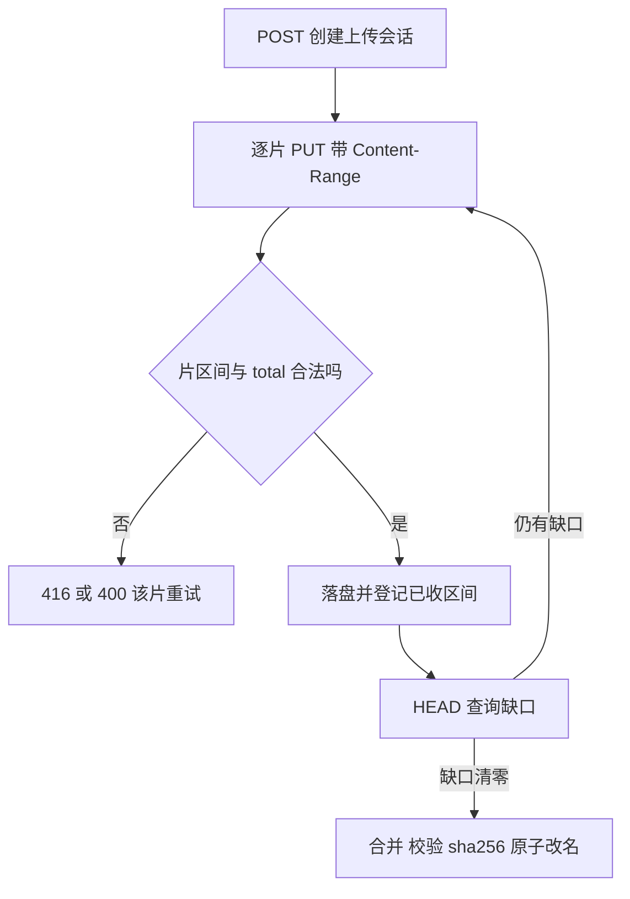
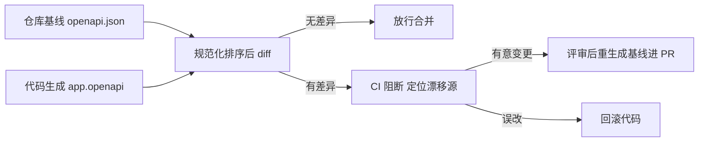
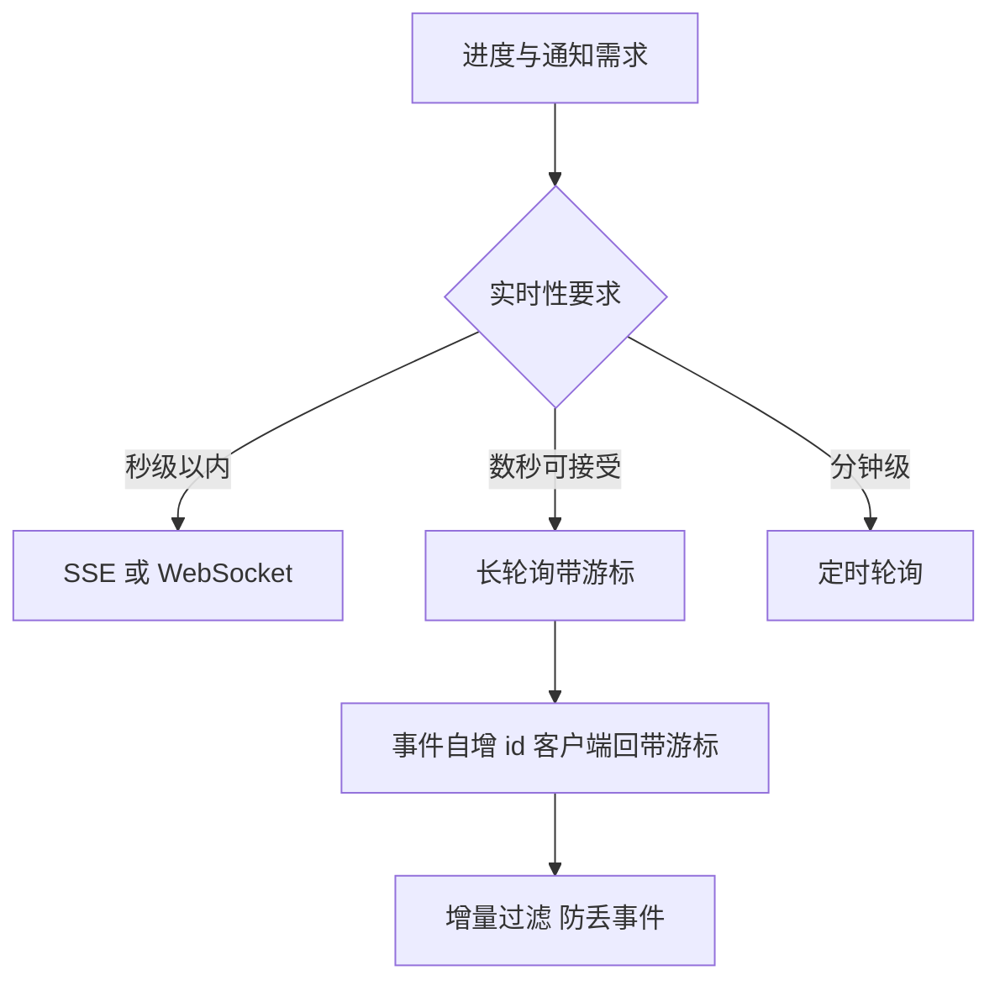
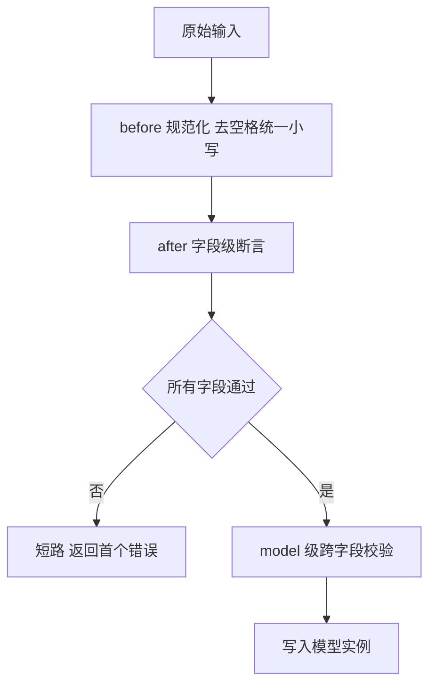
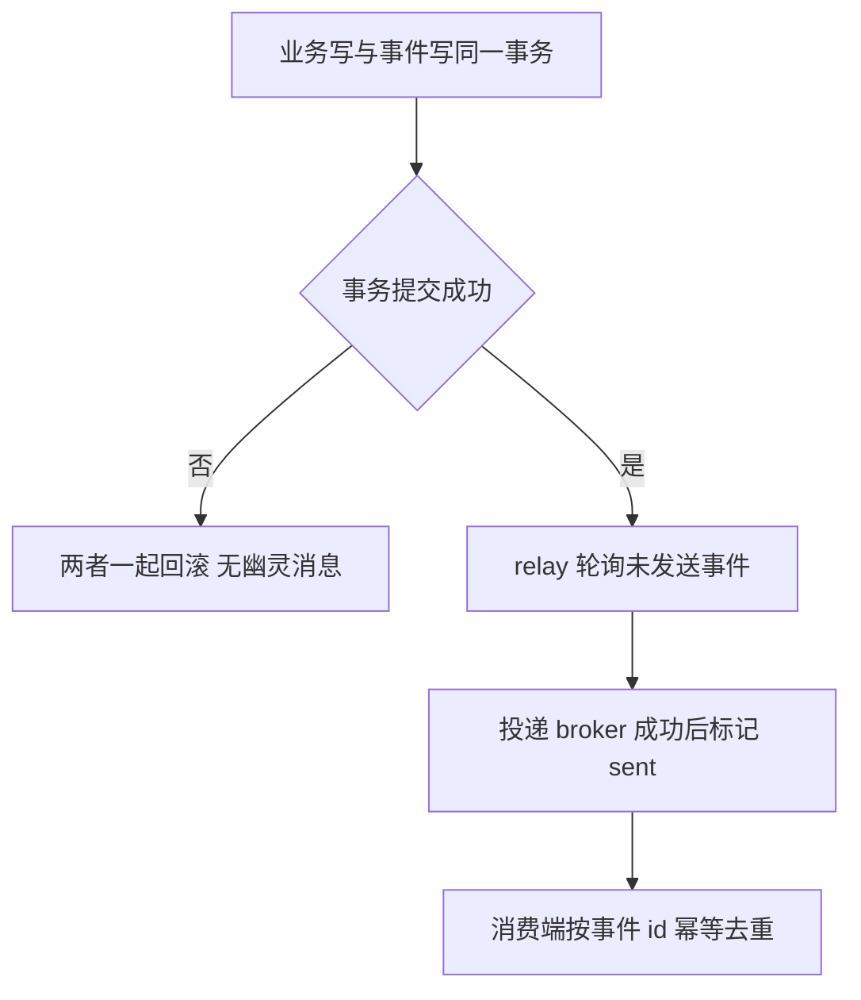
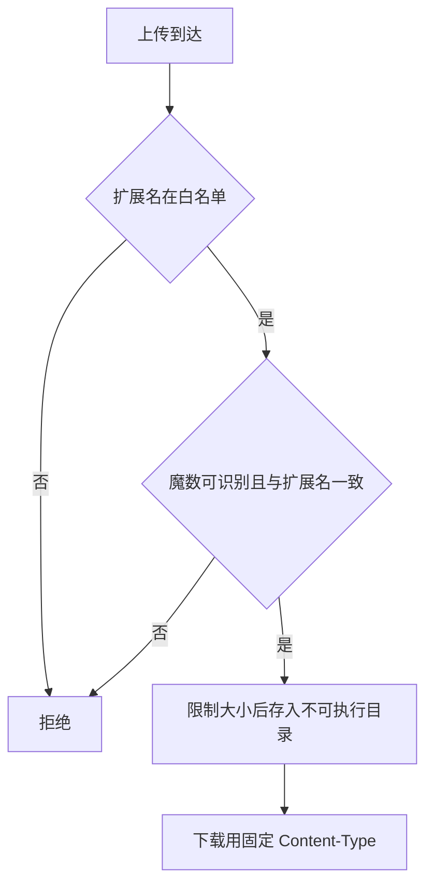
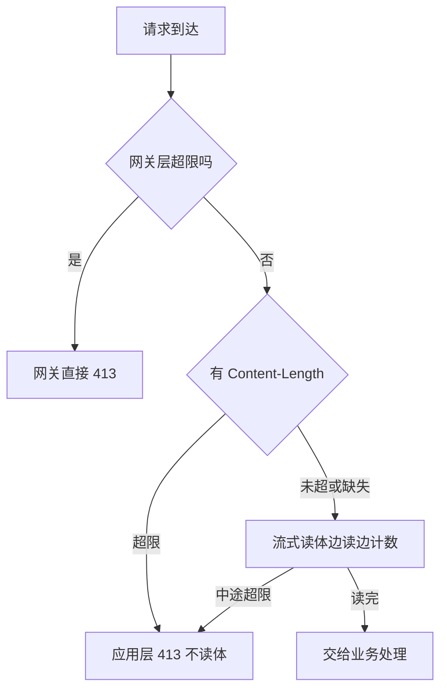
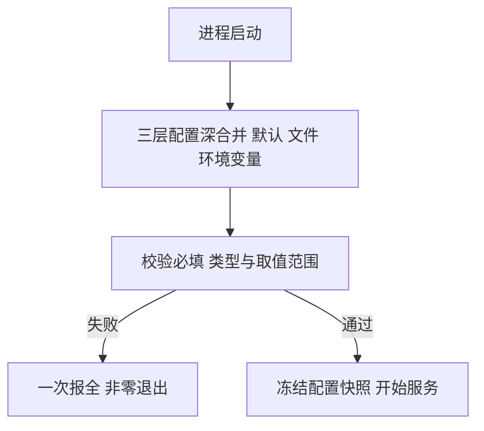
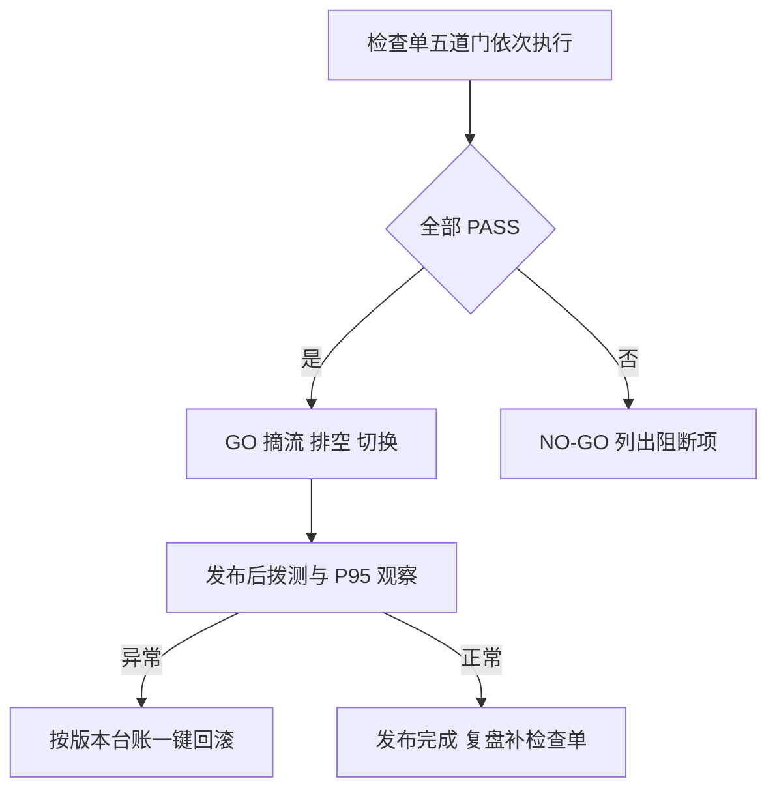

# 第 3 类 · Web 后端开发(夜间扩产二)

本文件是第 3 类的第二次夜间扩产,共 45 题(Q1616–Q1660),四条主线:接口工程补遗(RFC 7807 问题详情、ETag 强弱与 If-Match 乐观锁、Range 分片上传、Webhook 重试与死信、契约快照与 OpenAPI 漂移、BFF 聚合、长轮询进度端点)、框架深水区(response_model 裁剪、依赖缓存与 yield 清理、Pydantic 校验器顺序、Django values/annotate/raw SQL、事务内发消息的 Outbox)、安全补遗(登录限速锁定、重置 token 单次消费、上传魔数双校验、开放重定向、JSON 深度限制)、运维治理(慢接口 top、请求体限额、优雅发布双实例、探针分流、半开连接回收、配置覆盖与启动校验),最后以发布检查单收尾。
多数代码为纯标准库可直接运行;涉及 FastAPI/Pydantic/Django 的题目用 try/except ImportError 降级为等价的纯逻辑演示,保证无第三方依赖也能完整跑通;回环 HTTP 演示已按本机代理环境显式绕过 ProxyHandler。
复习主线:契约先行、默认拒绝、故障可退——每一题都在回答怎么判、怎么拦、怎么退。

### Q1616 · RFC 7807 问题详情响应

> 难度:★★☆☆ | 标签:HTTP, 错误处理

**问**:返回错误详情时,除了自家包络格式,标准里还有一套 application/problem+json,它的必选成员和工程约束是什么?

**答**:RFC 7807 定义了 `application/problem+json` 媒体类型,核心成员是 `type`(错误种类的 URI,默认 `about:blank`)、`title`(人读的一句话,与 type 绑定不变)、`status`(必须与 HTTP 状态码一致)、`detail`(本次具体原因)、`instance`(出错的请求路径)。工程约束三条:Content-Type 必须用 `application/problem+json` 而不是普通 json;status 成员和真实 HTTP 状态码必须一致,否则监控与网关判错;扩展成员放顶层平铺,不要另起嵌套包络。它和业务错误码注册表不冲突——扩展成员里放业务码即可。把构造与校验收敛成纯函数,用单测锁住必备成员。

```python
# file: code/03_Web后端开发/q1616_problem_json.py
"""RFC 7807 application/problem+json 的构造与必备成员校验(纯标准库)。"""
import json


def problem(status, title, detail=None, instance=None, ptype="about:blank", **extra):
    """构造符合 RFC 7807 的问题详情体;extra 是扩展成员。"""
    body = {"type": ptype, "title": title, "status": status}
    if detail is not None:
        body["detail"] = detail
    if instance is not None:
        body["instance"] = instance
    body.update(extra)
    return body


def validate(body, http_status):
    """校验必备成员与语义一致性,返回错误列表。"""
    errors = []
    if "type" not in body:
        errors.append("缺少 type")
    elif not body["type"].startswith(("http://", "https://", "about:")):
        errors.append("type 必须是 URI")
    if "title" not in body:
        errors.append("缺少 title")
    if "status" not in body:
        errors.append("缺少 status")
    elif body["status"] != http_status:
        errors.append("status 成员应与 HTTP 状态码一致")
    return errors


body = problem(422, "参数校验失败", detail="limit 不能超过 100", instance="/v1/orders?page=3",
               ptype="https://api.example.com/problems/invalid-param", limit=100)
print(json.dumps(body, ensure_ascii=False, sort_keys=True))
print("响应头 Content-Type: application/problem+json")
print("校验结果:", validate(body, 422) or "通过")

bad = {"type": "invalid-param", "status": 500}
print("坏样本:", validate(bad, 422))
```

**追问**:
- type 用相对路径行不行?——不行,type 必须是 URI,规范建议托管在稳定域名下供人查阅。
- 404 这类通用错误也要 problem+json 吗?——建议统一,about:blank 加 title 即可,客户端按状态码分流的路径不被破坏。

### Q1617 · 问题详情的 type 目录与扩展演进

> 难度:★★★☆ | 标签:HTTP, 接口演进

**问**:problem+json 的 type URI 和扩展字段,在多版本演进中怎么管理才不会坑到老调用方?

**答**:把每种错误注册成稳定的 type URI 目录(如 `https://api.example.com/problems/insufficient-funds`),code review 时新错误类型必须先进目录再上线,防止散落的魔法字符串。扩展成员遵守只增不改不删:老客户端按字段名读取,新增字段对它们不可见,所以加字段是兼容变更,改语义或删除都是破坏。title 与 type 绑定保持不变,`detail` 才是放动态信息的地方。未注册的 kind 直接在构造层抛错,让漂移在开发期暴露而不是线上。

```python
# file: code/03_Web后端开发/q1617_problem_ext.py
"""RFC 7807 的 type 目录注册与扩展成员演进(纯标准库)。"""
import json

# 错误目录: type URI 是机器可读的"错误种类", 一旦发布语义就要稳定
CATALOG = {
    "insufficient-funds": "https://api.example.com/problems/insufficient-funds",
    "invalid-param": "https://api.example.com/problems/invalid-param",
}


def problem(kind, status, title, detail=None, **ext):
    uri = CATALOG.get(kind)
    if uri is None:
        raise ValueError(f"未注册的错误类型: {kind}")     # 由调用处捕获
    body = {"type": uri, "title": title, "status": status}
    if detail:
        body["detail"] = detail
    body.update(ext)
    return body


# 扩展成员只能增不能删不能改语义: 老客户端按字段名读, 新增字段对它们不可见
v1 = problem("insufficient-funds", 422, "余额不足", detail="需要 120 元", balance=80.0)
v2 = problem("insufficient-funds", 422, "余额不足", detail="需要 120 元",
             balance=80.0, required=120.0, currency="CNY")
print("v1:", json.dumps(v1, ensure_ascii=False))
print("v2:", json.dumps(v2, ensure_ascii=False))
old_clients = {k: v2[k] for k in v1 if k in v2}
print("老客户端可见字段不变:", old_clients == v1)

try:
    problem("unknown-kind", 500, "x")
except ValueError as e:
    print("未注册类型被拦下:", e)
```

**追问**:
- type URI 会被客户端硬编码吗?——会,所以 URI 一旦发布只加版本不迁移,旧 URI 重定向到新文档。
- 扩展字段名冲突怎么办?——加业务前缀或命名空间,注册表里同时登记字段含义与版本。

### Q1618 · ETag 强/弱校验器的生成与比较

> 难度:★★☆☆ | 标签:HTTP 缓存, ETag

**问**:ETag 前面的 W/ 是什么意思?强校验器和弱校验器各自适用什么场景?

**答**:强校验器保证字节级一致(同一资源的每次表示完全相同),适合 If-Match 乐观锁与断点续传的 If-Range;弱校验器只保证语义等价(渲染结果相同但字节可能不同,比如页面里带时间戳),只适合 If-None-Match 这类内容变没变的协商缓存判定。生成策略上,内容哈希 sha256 天然是强标签,mtime 加 size 组合(类似 Nginx 的 W/ 前缀格式)是典型弱标签。比较语义两条:强比较要求双方都是强标签且完全相等;弱比较忽略 W/ 前缀只比标签本体。用错比较语义,乐观锁就会放过字节级差异。

```python
# file: code/03_Web后端开发/q1618_etag_validators.py
"""ETag 强/弱校验器: 生成策略与两种比较语义(纯标准库)。"""
import hashlib


def strong_etag(body):
    """内容哈希生成强标签: 字节级一致才相等。"""
    return '"' + hashlib.sha256(body).hexdigest()[:32] + '"'


def weak_etag(mtime, size):
    """mtime+size 生成弱标签: 语义等价即可, 类似 Nginx 的 W/"mtime-size"。"""
    return 'W/"%x-%x"' % (mtime, size)


def strip_weak(tag):
    return tag[2:] if tag.startswith("W/") else tag


def strong_eq(a, b):
    """强比较: 都必须是强标签且完全一致。"""
    return not a.startswith("W/") and not b.startswith("W/") and a == b


def weak_eq(a, b):
    """弱比较: 忽略 W/ 前缀, 只比标签本体。"""
    return strip_weak(a) == strip_weak(b)


e1 = strong_etag(b"hello")
print("强标签:", e1)
print("同内容重算一致:", e1 == strong_etag(b"hello"), "强比较:", strong_eq(e1, e1))
w1 = weak_etag(1730000000, 5)
plain = '"%x-%x"' % (1730000000, 5)
print("弱标签:", w1, "与无前缀版本弱比较:", weak_eq(w1, plain), "但强比较:", strong_eq(w1, plain))
w2 = weak_etag(1730000999, 5)
print("mtime 变了:", w2, "弱比较:", weak_eq(w1, w2))
print("规则: If-None-Match 用弱比较, If-Match 与 If-Range 必须强比较")
```

**追问**:
- 强标签能当弱标签用吗?——能,强蕴含弱;反之不行,If-Match 收到弱标签要直接拒绝。
- 大文件每次算哈希太贵怎么办?——不可变文件用内容哈希,可变文件用 mtime 加 size 的弱标签,Nginx 就是这个权衡。

### Q1619 · If-Match 乐观锁与 412 冲突

> 难度:★★★☆ | 标签:并发控制, HTTP

**问**:不用数据库行锁,纯 HTTP 层怎么防丢失更新?If-Match 的完整判定流程是什么?

**答**:乐观锁三步:GET 时响应带当前强 ETag;PUT 时客户端回带 `If-Match`;服务端比对当前 ETag,不一致返回 412 Precondition Failed,一致才应用修改并更新 ETag。判定顺序有讲究:没有 If-Match 返回 428 要求先读后写;带弱标签返回 400,因为 If-Match 按规范只接受强校验器;最后才比对值是否等于当前 ETag。两个人同时编辑,A 的旧 ETag 在 B 写入后必然失配,这就是冲突信号——客户端重 GET、合并、再提交,而不是盲目覆盖。要求资源必须存在或不存在的场景还有 `If-None-Match: *`。

```python
# file: code/03_Web后端开发/q1619_if_match_optimistic.py
"""If-Match 乐观锁: 并发 PUT 的冲突判定(纯标准库)。"""
import hashlib


def etag_of(doc):
    return '"' + hashlib.sha256(doc.encode()).hexdigest()[:16] + '"'


class Resource:
    def __init__(self, doc):
        self.doc = doc

    def get(self):
        return {"doc": self.doc, "etag": etag_of(self.doc)}

    def put(self, new_doc, if_match):
        if not if_match:
            return 428, "需要 If-Match 先读后写"          # 428 Precondition Required
        if if_match.startswith("W/"):
            return 400, "If-Match 只接受强校验器"
        if if_match != etag_of(self.doc):
            return 412, "资源已被他人修改, 请重新 GET"
        self.doc = new_doc
        return 200, {"doc": self.doc, "etag": etag_of(self.doc)}


res = Resource("v1 草稿")
first = res.get()
print("A 拿到:", first)

status, info = res.put("B 的修改", first["etag"])          # B 抢先写入
print("B 写入:", status, info)

status, info = res.put("A 的修改", first["etag"])          # A 用旧 ETag 提交
print("A 提交:", status, info)

second = res.get()
status, info = res.put("A 的修改", second["etag"])         # 重读后再提交
print("A 重读后提交:", status, info)

status, info = res.put("弱标签也拒", 'W/%s' % second["etag"])
print("弱标签 If-Match:", status, info)
```

**追问**:
- 412 之后客户端该怎么办?——重新 GET 拿新 ETag,提示用户合并差异后再提交,不能自动覆盖。
- ETag 生成有什么要求?——同一状态必须稳定一致、状态变化必须变化,所以优先内容哈希而不是随机数。

### Q1620 · 分片上传协议与断点续传

> 难度:★★★☆ | 标签:文件上传, HTTP

**问**:大文件分片上传的协议怎么设计?客户端断线重连后怎么知道还缺哪些分片?

**答**:三段式:先 POST 创建上传会话,拿到上传 URL、会话 ID 与 total;然后逐片 PUT,每片带 `Content-Range: bytes start-end/total`,服务端校验区间与 total 后落盘登记;客户端可随时 HEAD 查询进度。服务端只存已收区间列表,乱序到达没关系;缺口计算就是区间排序后扫描补洞。越界区间返回 416,total 不符返回 400,单片失败返回 5xx 让客户端只重试该片——已传部分不受影响。断线重连靠 HEAD 返回的缺口列表续传,这就是断点续传的全部秘密。

```python
# file: code/03_Web后端开发/q1620_chunk_upload_proto.py
"""Range 分片上传协议: Content-Range 登记、缺口计算与断点续传(纯标准库)。"""


class ChunkUpload:
    """服务端上传会话: 记录已落盘的闭区间列表。"""

    def __init__(self, total):
        self.total = total
        self.received = []                      # [(start, end)] 闭区间

    def put_chunk(self, content_range):
        """PUT 分片: Content-Range: bytes start-end/total。"""
        unit, rng = content_range.split()
        if unit != "bytes":
            return 400, "仅支持 bytes 单位"
        part, total = rng.split("/")
        if total != str(self.total):
            return 400, "total 与会话不符"
        start, end = (int(x) for x in part.split("-"))
        if start > end or end >= self.total:
            return 416, "区间越界"
        self.received.append((start, end))
        return 201, {"received": sorted(self.received)}

    def missing_ranges(self):
        """HEAD 查询: 已收区间之外就是缺口, 客户端按缺口补发。"""
        missing, cursor = [], 0
        for start, end in sorted(self.received):
            if start > cursor:
                missing.append((cursor, start - 1))
            cursor = max(cursor, end + 1)
        if cursor < self.total:
            missing.append((cursor, self.total - 1))
        return missing


up = ChunkUpload(1000)
print("发 0-399:", up.put_chunk("bytes 0-399/1000"))
print("乱序发 600-999:", up.put_chunk("bytes 600-999/1000"))
print("发越界片:", up.put_chunk("bytes 900-1200/1000"))
print("HEAD 查缺口:", up.missing_ranges())
print("按缺口补发 400-599:", up.put_chunk("bytes 400-599/1000")[0])
print("缺口清零:", up.missing_ranges(), "-> 可以调用合并")
```

**追问**:
- 分片大小怎么定?——常用 4-16MB,兼顾单片重试成本与请求数量,弱网调小。
- 会话要不要过期?——要,TTL 过期回收未完成会话的分片,防僵尸会话占满磁盘。



### Q1621 · 分片合并与完整性校验

> 难度:★★★☆ | 标签:文件上传, 数据完整性

**问**:全部分片到齐后,合并环节要做哪些校验?为什么合并要原子落盘?

**答**:合并前三道校验:按 start 排序后检查连续性,有缺口直接拒绝;拼起来的总长度与会话声明的 total 一致;整体 sha256 与客户端创建会话时声明的摘要一致——前两道防传输错误,第三道防内容损坏与替换。任何一道失败都整单拒绝,不能把半成品提交给业务层。落盘用写临时文件、fsync、os.replace 原子改名三连,并发读取方要么看到完整旧文件要么看到完整新文件,绝不会读到写了一半的结果。摘要比对失败的会话保留现场供排查,分片清理由后台任务统一做。

```python
# file: code/03_Web后端开发/q1621_chunk_merge.py
"""分片合并: 连续性校验、哈希完整性、原子落盘(纯标准库)。"""
import hashlib
import os
import tempfile


def merge_chunks(parts, total, expected_digest):
    """parts: [(start, data)]; 校验连续性与总量后合并, 返回合并字节与 sha256。"""
    parts = sorted(parts)
    cursor, buf = 0, []
    for start, data in parts:
        if start != cursor:
            raise ValueError(f"分片不连续: 期望从 {cursor} 开始, 实际 {start}")
        buf.append(data)
        cursor += len(data)
    blob = b"".join(buf)
    if len(blob) != total:
        raise ValueError(f"总长度不符: 期望 {total}, 实际 {len(blob)}")
    digest = hashlib.sha256(blob).hexdigest()
    if digest != expected_digest:
        raise ValueError("sha256 与客户端声明不符, 拒绝合并")
    return blob, digest


def atomic_write(path, blob):
    tmp = path + ".tmp"
    with open(tmp, "wb") as f:
        f.write(blob)
        f.flush()
        os.fsync(f.fileno())
    os.replace(tmp, path)                    # 原子改名, 半成品不会被读到


payload = b"A" * 400 + b"B" * 200 + b"C" * 400
chunks = [(0, payload[:400]), (400, payload[400:600]), (600, payload[600:])]
expected = hashlib.sha256(payload).hexdigest()

blob, digest = merge_chunks(chunks, len(payload), expected)
print("合并成功, sha256 前缀:", digest[:16], "长度:", len(blob))

target = os.path.join(tempfile.mkdtemp(), "upload.bin")
atomic_write(target, blob)
print("原子落盘:", os.path.exists(target), os.path.getsize(target))

corrupt = [(0, payload[:400]), (400, b"X" * 200), (600, payload[600:])]
try:
    merge_chunks(corrupt, len(payload), expected)
except ValueError as e:
    print("损坏分片被拒:", e)

try:
    merge_chunks([(0, payload[:400]), (600, payload[600:])], len(payload), expected)
except ValueError as e:
    print("缺口被拒:", e)
```

**追问**:
- 客户端声明的摘要也撒谎怎么办?——服务端算出的哈希才是事实,声明只是比对基准,不匹配就拒绝,不存在信任问题。
- 百 GB 文件内存放不下怎么办?——逐片流式追加到临时文件,边写边更新哈希,最后校验,全程内存只占一个分片。

### Q1622 · Webhook 重试的退避与抖动

> 难度:★★★☆ | 标签:Webhook, 可靠性

**问**:Webhook 投递失败后的重试策略怎么设计?为什么重试要加抖动?

**答**:三要素:指数退避、封顶上限、全抖动。每次延迟取 min(cap, base 乘 2 的 n-1 次方),再在其区间内随机取值,把重试在时间轴上摊开——否则对端恢复的瞬间会被所有积压重试同时打爆,这就是重试风暴。对端返回 429 或 503 并带 `Retry-After` 时,它表达了明确的恢复意图,优先级高于自己的退避公式。重试要有次数上限(常见 5-8 次),耗尽后进入死信,不能无限重试占用投递线程。同时投递要带投递 ID 让接收方幂等,因为网络超时时你并不知道对端是否已处理。

```python
# file: code/03_Web后端开发/q1622_webhook_retry.py
"""Webhook 投递重试: 指数退避 + 全抖动 + Retry-After 优先(纯标准库)。"""
import random

random.seed(7)                                   # 固定种子让演示可复现


def next_delay(attempt, retry_after=None, base=1.0, cap=60.0):
    if retry_after is not None:
        return float(retry_after)                # 对端明确指示就听对端的
    ceiling = min(cap, base * 2 ** (attempt - 1))
    return random.uniform(0, ceiling)            # full jitter 把重试打散


def deliver_schedule(statuses):
    """statuses: 每次投递的模拟状态码, None 表示成功。"""
    timeline, t = [], 0.0
    for attempt, status in enumerate(statuses, 1):
        timeline.append((attempt, round(t, 1), status if status else 200))
        if status is None:
            break
        retry_after = 30 if status == 429 else None
        t += next_delay(attempt, retry_after)
    return timeline


statuses = [503, 429, 500, None]
for attempt, at, status in deliver_schedule(statuses):
    print(f"第 {attempt} 次  t={at:>5}s  -> {status}")
print("要点: 退避防打爆对端, 抖动防同一时刻重放, Retry-After 是对端明确意图, 优先级最高")
```

**追问**:
- 抖动用 full 还是 equal?——full jitter,首个重试最密集时也被打散,实测冲突率最低。
- 超时算成功还是失败?——未知,按失败重试,靠接收方幂等键去重,而不是猜。

### Q1623 · Webhook 死信队列与人工重投

> 难度:★★★☆ | 标签:Webhook, 运维

**问**:Webhook 重试耗尽之后事件去哪了?死信队列要记录什么,怎么重投?

**答**:重试耗尽的事件进入死信队列,每条死信必须记录事件 ID、原始 payload、已尝试次数、最后响应状态码、失败原因与最终失败时间——没有这些,人工排查就是翻日志考古。event_id 在 pending 与 dead 里都作唯一键,防止重复入队;重投是把死信放回 pending 并清零尝试计数,走正常投递通道;投递成功后从两边移除。死信要有容量上限与告警(死信突增通常是对端挂了),重投接口必须有权限与审计,不能变成无鉴权的重放接口。按订阅方维度隔离,一个挂掉的消费方不能拖垮其他订阅。

```python
# file: code/03_Web后端开发/q1623_webhook_dlq.py
"""Webhook 死信队列: 入队、盘点与人工重投(纯标准库)。"""


class Dlq:
    def __init__(self, max_attempts):
        self.max = max_attempts
        self.pending = {}     # event_id -> {payload, attempts, ...}
        self.dead = {}        # event_id -> {..., reason}

    def record_failure(self, event_id, payload, status):
        item = self.pending.setdefault(event_id, {"payload": payload, "attempts": 0})
        item["attempts"] += 1
        item["last_status"] = status
        if item["attempts"] >= self.max:
            item["reason"] = "接收方持续 5xx, 重试耗尽" if status >= 500 else "接收方明确拒绝"
            self.dead[event_id] = self.pending.pop(event_id)

    def record_success(self, event_id):
        self.pending.pop(event_id, None)
        self.dead.pop(event_id, None)            # 重投成功可从死信移除

    def replay(self, event_id):
        if event_id in self.dead:
            item = self.dead.pop(event_id)
            item["attempts"] = 0
            self.pending[event_id] = item
            return True
        return False


dlq = Dlq(max_attempts=3)
dlq.record_failure("ev1", {"type": "order.paid"}, 503)
dlq.record_failure("ev1", {"type": "order.paid"}, 503)
dlq.record_failure("ev2", {"type": "user.signup"}, 503)
dlq.record_failure("ev2", {"type": "user.signup"}, 503)
dlq.record_success("ev2")                        # 第三次成了
dlq.record_failure("ev1", {"type": "order.paid"}, 503)
print("死信:", {k: (v["attempts"], v["reason"]) for k, v in dlq.dead.items()})
print("重投 ev1:", dlq.replay("ev1"), "重投不存在:", dlq.replay("ev9"))
dlq.record_failure("ev1", {"type": "order.paid"}, 200)
print("重投成功后 pending:", list(dlq.pending), "dead:", list(dlq.dead))
print("要点: event_id 唯一防重复入队; 死信要带原因与最后状态; 人工重投走白名单接口")
```

**追问**:
- 死信能自动重投吗?——可加冷却后自动重投一次的策略,但要限速,最终仍需人工确认。
- 接收方明确 4xx 也进死信吗?——进,但原因标记为明确拒绝,通常说明契约错了,重投无意义,要修调用方。

### Q1624 · 接口契约快照测试

> 难度:★★★☆ | 标签:测试, 接口契约

**问**:什么是接口契约快照测试?快照里应该锁什么、不该锁什么?

**答**:快照测试把响应序列化成一份基线快照入库,后续每次测试都重放当前响应并与快照比对,任何结构变化都会被 diff 出来。锁什么:字段名集合、嵌套结构、字段类型,以及语义稳定的字段值(如订单状态机枚举);不锁什么:自增 ID、时间戳、随机昵称这类每次都变的值——它们要么被掩码要么只锁类型。快照的价值是变更可视化:改一个序列化器,diff 立刻显示影响了哪些端点。它防的是无意破坏,配合人工审查才能放行有意变更。

```python
# file: code/03_Web后端开发/q1624_contract_snapshot.py
"""接口契约快照测试: 只锁结构与稳定字段(纯标准库)。"""
import json


def shape(value):
    """把值变成类型树: 字典递归, 列表取首个元素形状, 标量记类型名。"""
    if isinstance(value, dict):
        return {k: shape(v) for k, v in sorted(value.items())}
    if isinstance(value, list):
        return [shape(value[0])] if value else "empty[]"
    if isinstance(value, bool):
        return "bool"
    if isinstance(value, int):
        return "int"
    if isinstance(value, float):
        return "float"
    if isinstance(value, str):
        return "str"
    return type(value).__name__


def snapshot_response(resp):
    """快照 = 结构形状 + 指定的语义稳定字段值(随机值不进快照)。"""
    snap = shape(resp)
    snap["stable.id"] = resp.get("id")
    snap["stable.status"] = resp.get("status")
    return snap


ORDER_V1 = {"id": "ord_1", "status": "paid", "amount": 99.0,
            "buyer": {"uid": "u9", "nickname": "rand-3482"}}

snapshot = snapshot_response(ORDER_V1)
print("快照:", json.dumps(snapshot, ensure_ascii=False, sort_keys=True))
print("回归一致:", snapshot_response(ORDER_V1) == snapshot)

ORDER_V2 = dict(ORDER_V1, coupon=None)           # 新版本加了可选字段
diff = set(snapshot_response(ORDER_V2)) - set(snapshot)
print("新增字段触发快照 diff:", sorted(diff), "-> 人工确认后更新快照")
```

**追问**:
- 快照测试和单测什么关系?——单测验证逻辑对错,快照验证契约形状,互补不可替代。
- 快照数量爆炸怎么办?——按端点分组、只保留代表性用例,快照文件按模块拆分方便 review。

### Q1625 · 快照更新的 diff 审查门禁

> 难度:★★★☆ | 标签:测试, 研发流程

**问**:快照 diff 出现删除或类型变化时,合并门禁应该怎么分级处理?

**答**:把 diff 分三级:新增字段是兼容变更,快照随 PR 更新自动通过;删除字段与类型变化是破坏性变更,默认阻断合并;确需破坏时走评审豁免——提交说明标注 BREAKING、记录影响调用方、按弃用流程先加后删。门禁的判断要机器化:diff 分类器输出 breaking 列表,CI 看列表为空才放行,不靠人眼扫 diff。豁免记录进变更台账,回溯时能说清谁在哪个版本同意了删这个字段。这套流程把快照挂了从烦人的红灯变成契约治理的抓手。

```python
# file: code/03_Web后端开发/q1625_snapshot_review.py
"""快照更新治理: diff 分级与合并门禁(纯标准库)。"""


def classify_diff(old, new):
    added = sorted(set(new) - set(old))
    removed = sorted(set(old) - set(new))
    changed = sorted(k for k in set(old) & set(new) if old[k] != new[k])
    # 分级: 新增可选输出是兼容变更; 删除或类型变化是破坏性变更
    breaking = removed + changed
    return {"added": added, "removed": removed, "changed": changed, "breaking": breaking}


def merge_gate(diff, approved_breaking=False):
    if not diff["breaking"]:
        return "自动通过", "纯新增, 快照随 PR 更新"
    if approved_breaking:
        return "人工放行", "破坏性变更已评审: " + ", ".join(diff["breaking"])
    return "阻断合并", "请评审破坏性变更并在提交说明中标注 BREAKING"


old_snap = {"buyer": "dict", "id": "str", "status": "str", "stable.id": "ord_1"}

new_snap = dict(old_snap, coupon="NoneType")                # 兼容新增
diff_ok = classify_diff(old_snap, new_snap)
print("新增场景:", diff_ok)
print("门禁:", merge_gate(diff_ok))

removed_snap = {k: v for k, v in old_snap.items() if k != "buyer"}   # 删字段
diff_bad = classify_diff(old_snap, removed_snap)
print("删除场景门禁:", merge_gate(diff_bad))
print("评审后放行:", merge_gate(diff_bad, approved_breaking=True))
```

**追问**:
- 豁免被滥用怎么办?——豁免必须在 PR 描述写影响面与迁移指引,台账定期审计豁免率。
- 内部服务也要这么严吗?——调用方可控的服务可降级为通知加观察,对外 API 必须硬门禁。

### Q1626 · OpenAPI schema 漂移检测

> 难度:★★★☆ | 标签:OpenAPI, CI

**问**:OpenAPI 文档和代码不一致,怎么在 CI 里自动发现?

**答**:漂移检测两条路:一是实现即文档——CI 里从应用生成 schema(FastAPI 是 `app.openapi()`),与仓库基线 openapi.json 做结构 diff,有差异就阻断,想更新必须显式重新生成并进 PR;二是反向校验——用基线文件生成请求去打测试环境,断言响应符合 schema,发现文档吹牛代码撒谎。diff 粒度覆盖路径、方法、请求与响应模型三层的键集合与类型。漂移检测的价值不在文档好看,而在下游按文档写的 SDK、mock、调用方校验不会悄悄失效。

```python
# file: code/03_Web后端开发/q1626_schema_drift.py
"""OpenAPI schema 漂移检测: 代码生成 vs 仓库基线(纯标准库)。"""
try:
    from fastapi import FastAPI
    HAS_FASTAPI = True
except ImportError:
    HAS_FASTAPI = False
    print("[降级] 未安装 fastapi, 以下用路由表模拟 app.openapi() 的产出")

BASELINE = {
    "paths": {
        "/v1/orders": {"get": {"model": "OrderOut"},
                       "post": {"model": "OrderOut"}},
        "/v1/orders/{id}": {"get": {"model": "OrderOut"}},
    }
}


def generate_schema(routes):
    """由路由表生成 schema(真实项目里就是 app.openapi() 的结果)。"""
    paths = {}
    for path, methods in routes:
        paths.setdefault(path, {}).update(
            {m: {"model": resp} for m, resp in methods})
    return {"paths": paths}


ROUTES = [
    ("/v1/orders", [("get", "OrderOut"), ("post", "OrderOut")]),
    ("/v1/orders/{id}", [("get", "OrderOut")]),
    # 漂移源: 有人改了代码没更新基线, 多出一个 DELETE
    ("/v1/orders/{id}", [("delete", "None")]),
]


def diff_paths(base, gen):
    drift = []
    for path in sorted(set(base) | set(gen)):
        b, g = base.get(path, {}), gen.get(path, {})
        for method in sorted(set(b) | set(g)):
            if method not in b:
                drift.append(f"+ 代码新增 {method.upper()} {path}, 基线缺失")
            elif method not in g:
                drift.append(f"- 基线存在 {method.upper()} {path}, 代码已删")
            elif b[method] != g[method]:
                drift.append(f"~ {method.upper()} {path} 定义不一致")
    return drift


generated = generate_schema(ROUTES)
drift = diff_paths(BASELINE["paths"], generated["paths"])
print("漂移项:", drift if drift else "无, 基线与实现一致")
if HAS_FASTAPI:
    print("[提示] 真实项目在 CI 里跑 app.openapi() 与 openapi.json 的 diff")
```

**追问**:
- 基线文件冲突了怎么办?——以代码生成结果为准重新生成,由评审决定是否有意变更。
- 生成结果噪音大怎么办?——先做规范化排序再比对,过滤仅顺序差异。



### Q1627 · 破坏性变更的 diff 分级

> 难度:★★★★ | 标签:OpenAPI, 接口演进

**问**:schema diff 出来了,怎么机器判定哪些是破坏性变更?

**答**:分级规则可以完全机器化:响应删字段、字段改类型、请求新增必填、删除路径或方法、收窄枚举都是破坏;响应新增可选字段、请求放宽必填、新增路径、扩枚举是兼容。判定方向感来自一个问题:调用方会不会崩——调用方按文档读一个字段你删了就崩,你加了字段它看不见所以没事。把规则写成分类器,CI 输出 breaking 与 compatible 两组列表,破坏项存在就阻断,除非走快照豁免流程。特殊结构单独处理:oneof 变化、默认值变更、nullable 变化都可能破坏,规则表要持续维护。

```python
# file: code/03_Web后端开发/q1627_breaking_diff.py
"""OpenAPI 破坏性变更分级: diff 分类器(纯标准库)。"""

V1 = {
    "required": ["amount"],
    "response_fields": {"id": "str", "status": "str", "amount": "float"},
}
V2 = {
    "required": ["amount", "currency"],        # 新增必填 -> 破坏
    "response_fields": {"id": "str", "status": "str", "amount": "float", "coupon": "str|none"},
}
V3 = {
    "required": ["amount"],                     # 与 V1 相同 -> 不因必填破坏
    "response_fields": {"id": "str", "amount": "decimal"},   # 删字段 + 改类型 -> 破坏
}


def diff_operation(old, new, label):
    findings = []
    removed = sorted(set(old["response_fields"]) - set(new["response_fields"]))
    added = sorted(set(new["response_fields"]) - set(old["response_fields"]))
    for f in removed:
        findings.append(("breaking", f"{label}: 响应删除字段 {f}"))
    for f in added:
        findings.append(("compatible", f"{label}: 响应新增字段 {f}"))
    for f in sorted(set(old["response_fields"]) & set(new["response_fields"])):
        if old["response_fields"][f] != new["response_fields"][f]:
            findings.append(("breaking", f"{label}: 字段 {f} 类型变更"))
    for f in sorted(set(new["required"]) - set(old["required"])):
        findings.append(("breaking", f"{label}: 请求新增必填 {f}"))
    for f in sorted(set(old["required"]) - set(new["required"])):
        findings.append(("compatible", f"{label}: 请求放宽必填 {f}"))
    return findings


def verdict(findings):
    bad = [msg for level, msg in findings if level == "breaking"]
    return "阻断合并" if bad else "放行"


for old, new, label in ((V1, V2, "V1->V2"), (V1, V3, "V1->V3")):
    fs = diff_operation(old, new, label)
    for level, msg in fs:
        print(f"[{level:10}] {msg}")
    print("结论:", verdict(fs))
    print()

print("经验: 新增可选输出、放宽校验是兼容; 删字段、改类型、加必填是破坏")
```

**追问**:
- 改字段描述算破坏吗?——不算,描述只影响人;但改 format 如 date-time 变 date 要按类型变化处理。
- 破坏性变更一定不能上吗?——不是,配合版本化:新路径或新 media type 承载破坏,旧版本走弃用倒计时。

### Q1628 · BFF 多端裁剪视图

> 难度:★★☆☆ | 标签:BFF, 架构

**问**:移动端、Web 端、管理端都要订单数据,怎么避免一个接口伺候所有人?

**答**:BFF(Backend for Frontend)模式:领域服务保持单一模型,BFF 层为每种端定义独立的视图函数做裁剪——移动端小屏只留决策字段并做好脱敏,Web 端要明细但仍裁掉内部成本,管理端全量放行靠独立权限网关兜底。裁剪发生在 BFF 视图层而不是客户端,好处是上游契约稳定、各端字段需求各自演进;敏感字段在进入视图前就被挡住,不依赖前端自觉;payload 显著变小省流量。要点是视图函数必须纯:输入领域对象输出视图 dict,方便单测和契约快照。

```python
# file: code/03_Web后端开发/q1628_bff_projection.py
"""BFF 聚合模式: 同一领域对象按端裁剪出不同视图(纯标准库)。"""

ORDER = {
    "id": "ord_1", "status": "paid", "amount_cents": 9900, "currency": "CNY",
    "buyer": {"uid": "u9", "phone": "13800000000"},
    "items": [{"sku": "A1", "qty": 2, "cost_cents": 4000},
              {"sku": "B2", "qty": 1, "cost_cents": 1900}],
}


def money(cents, currency):
    return f"{cents / 100:.2f} {currency}"


def mobile_view(order):
    """移动端: 小屏要决策字段, 手机号脱敏, 绝不传内部成本。"""
    phone = order["buyer"]["phone"]
    return {"id": order["id"], "status": order["status"],
            "total": money(order["amount_cents"], order["currency"]),
            "item_count": sum(i["qty"] for i in order["items"]),
            "phone_masked": phone[:3] + "****" + phone[-2:]}


def web_view(order):
    """Web 端: 页面要明细, 依然裁掉成本字段。"""
    return {"id": order["id"], "status": order["status"],
            "total": money(order["amount_cents"], order["currency"]),
            "items": [{"sku": i["sku"], "qty": i["qty"]} for i in order["items"]]}


def admin_view(order):
    """管理端: 全量字段含成本, 由独立权限网关保证不外泄。"""
    return ORDER


print("mobile:", mobile_view(ORDER))
print("web:   ", web_view(ORDER))
print("admin 含成本:", "cost_cents" in admin_view(ORDER))
print("要点: 裁剪放在 BFF 视图层而不是客户端, 上游领域模型保持单一, 各端契约各自演进")
```

**追问**:
- BFF 会不会变成重复代码堆积?——会,所以视图要薄,聚合与编排下沉领域服务,BFF 只做投影与拼装。
- 字段裁剪用配置还是代码?——起步用代码,可 review 可快照;字段需求爆炸后再配置化。

### Q1629 · BFF 并行聚合的超时降级

> 难度:★★★★ | 标签:BFF, 容错

**问**:BFF 页面要同时取订单、推荐、画像三个下游,一个挂了怎么办?

**答**:并行聚合三原则:一是并行而非串行,总耗时取决于最慢下游而不是求和;二是给单源调用设超时(远小于端上超时,留出传输余量),超时的源立即放弃,用缺省数据兜底并显式标注 degraded,页面主体照常渲染;三是整体再加 deadline 兜底,防止每个源都没超但加起来超了。降级策略按业务分级:推荐位挂了换运营配置的静态列表,订单挂了页面直接报错——不是所有源都能降级,先在响应契约里定义清楚哪些字段可为 null。线程池演示里,超时的 future 还在后台跑,结果丢弃即可,不必强行取消已发出的请求。

```python
# file: code/03_Web后端开发/q1629_bff_aggregate.py
"""BFF 并行聚合: 整体 deadline、单源超时与降级(标准库线程池)。"""
import time
from concurrent.futures import ThreadPoolExecutor, TimeoutError as FutureTimeout


def upstream(name, seconds, payload):
    time.sleep(seconds)
    return payload


def aggregate(deadline=0.4):
    calls = {
        "order": (0.10, {"id": "ord_1", "status": "paid"}),
        "recommend": (0.60, {"items": ["A1"]}),      # 超过容忍阈值 -> 降级
        "profile": (0.15, {"nickname": "王工"}),
    }
    pool = ThreadPoolExecutor(max_workers=len(calls))
    futures = {k: pool.submit(upstream, k, s, p) for k, (s, p) in calls.items()}
    data, degraded = {}, []
    for key, fut in futures.items():
        try:
            data[key] = fut.result(timeout=deadline)
        except FutureTimeout:
            degraded.append(key)
            data[key] = {"degraded": True}            # 缺省兜底, 页面照样能开
    pool.shutdown(wait=False)
    return data, degraded


data, degraded = aggregate()
print("聚合结果:", data)
print("降级源:", degraded)
print("要点: BFF 的 deadline 要小于端上超时留出传输余量; 降级要在响应里显式标注, 不许静默吞掉")
```

**追问**:
- 降级数据从哪来?——静态默认值、缓存的上次成功结果、运营兜底配置,按业务选一。
- deadline 超了返回什么?——整体 503,或带 degraded 标记的部分响应,取决于端上有没有部分渲染能力。

### Q1630 · 长轮询任务进度端点

> 难度:★★★☆ | 标签:长轮询, 异步任务

**问**:任务进度条不想用 WebSocket,普通轮询又太浪费,长轮询端点怎么实现?

**答**:长轮询的核心是无变化就挂起:客户端带上一次看到的进度 since 发起请求,服务端发现状态没变就阻塞等待(条件变量或事件),一旦状态变化或到达超时立即返回最新状态。相比定时轮询,空闲时零请求、变化时秒级送达;相比 WebSocket,无需协议升级,网关兼容性好,实现也简单。服务端要点:等待设上限(如 30 秒)防连接堆积;since 用游标语义避免竞态;返回永远带当前全量进度,客户端渲染后立刻发起下一轮。真实 HTTP 演示里,第二次请求挂起约 0.25 秒后被进度更新唤醒,空闲期间没有空转请求。

```python
# file: code/03_Web后端开发/q1630_long_poll.py
"""长轮询任务进度端点: ThreadingHTTPServer 挂起等待, 状态变化即返回(纯标准库)。"""
import json
import threading
import time
import urllib.request
from http.server import BaseHTTPRequestHandler, ThreadingHTTPServer
from urllib.parse import parse_qs, urlsplit

state = {"progress": 0, "done": False}
cond = threading.Condition()


def worker():
    for p in (25, 50, 75, 100):
        time.sleep(0.25)
        with cond:
            state["progress"] = p
            state["done"] = p >= 100
            cond.notify_all()


class Handler(BaseHTTPRequestHandler):
    def log_message(self, *args):
        pass

    def do_GET(self):
        q = parse_qs(urlsplit(self.path).query)
        since = int(q.get("since", ["-1"])[0])       # 客户端上次看到的进度
        wait = float(q.get("wait", ["2"])[0])
        deadline = time.time() + wait
        with cond:
            while state["progress"] == since and not state["done"]:
                remaining = deadline - time.time()
                if remaining <= 0:
                    break
                cond.wait(timeout=min(0.2, remaining))
            body = json.dumps({"progress": state["progress"],
                               "done": state["done"]}).encode()
        self.send_response(200)
        self.send_header("Content-Type", "application/json")
        self.send_header("Content-Length", str(len(body)))
        self.end_headers()
        self.wfile.write(body)


server = ThreadingHTTPServer(("127.0.0.1", 0), Handler)
port = server.server_address[1]
threading.Thread(target=server.serve_forever, daemon=True).start()
threading.Thread(target=worker, daemon=True).start()

# 本机配置了 http_proxy, 回环请求必须显式绕过代理
opener = urllib.request.build_opener(urllib.request.ProxyHandler({}))


def poll(since, wait=2.0):
    t0 = time.time()
    with opener.open(f"http://127.0.0.1:{port}/progress?since={since}&wait={wait}",
                     timeout=10) as resp:
        data = json.loads(resp.read())
    return data, time.time() - t0


first, dt1 = poll(-1)
print(f"首次轮询立即返回: {first} 耗时 {dt1:.2f}s")
data, dt2 = poll(first["progress"], wait=2.0)
print(f"长轮询挂起直到进度变化: {data} 耗时 {dt2:.2f}s")
server.shutdown()
print("要点: 客户端把上次进度作为 since, 无变化时服务端挂起, 变化即返回, 省掉空轮询")
```

**追问**:
- 大量客户端同时挂起会怎样?——每连接一个协程或线程时成本很低;WSGI 线程池模型要防 worker 被挂起请求占满。
- 挂起期间服务重启怎么办?——客户端收到连接错误退化为短轮询重试,游标保证进度不丢。

### Q1631 · 长轮询游标与丢事件竞态

> 难度:★★★★ | 标签:长轮询, 架构选型

**问**:长轮询两次请求之间发生的事件会不会丢?选型上它和 SSE、WebSocket 怎么取舍?

**答**:会丢,如果服务端实现是返回最新 N 条而不是返回 id 大于游标的事件——两次轮询之间涌入超过 N 条就必然丢。正确做法是事件日志自增 id,客户端每次带上次见过的最大 id,服务端做增量过滤并回带 next_cursor;超时返回空响应也必须带 cursor。选型边界:秒级以内实时性或服务端持续推送选 SSE 或 WebSocket;数秒延迟可接受、请求响应模型够用选长轮询;分钟级容忍直接定时轮询。长轮询实现成本低、穿透代理能力强,是够用就好场景的首选。

```python
# file: code/03_Web后端开发/q1631_long_poll_race.py
"""长轮询的丢事件竞态: 游标过滤才是正确姿势(纯标准库)。"""

EVENTS = []


def publish(text):
    EVENTS.append({"id": len(EVENTS) + 1, "text": text})


def poll(cursor, hold_has_new=False):
    """cursor 是客户端已见的最大事件 id; hold_has_new 模拟挂起期间有事件到达。"""
    new = [e for e in EVENTS if e["id"] > cursor]
    if not new and hold_has_new:
        publish("挂起期间到达")
        new = [e for e in EVENTS if e["id"] > cursor]
    return {"events": new, "next_cursor": new[-1]["id"] if new else cursor, "held": not new}


# 正常路径: 挂起期间事件到达, 长轮询立即唤醒
r1 = poll(0, hold_has_new=True)
print("挂起唤醒:", r1)

# 竞态: 两次轮询之间涌入多条事件, 取"最新一条"的坏实现会丢事件
publish("e1")
publish("e2")
publish("e3")
buggy = EVENTS[-1:]
good = [e for e in EVENTS if e["id"] > 0]
print("坏实现 latest-1 拿到:", [e["text"] for e in buggy], "丢了", len(good) - len(buggy), "条")
print("游标过滤拿到:", [e["text"] for e in good], "next_cursor:", good[-1]["id"])
print("结论: 长轮询必须传游标做增量过滤, 超时空响应也要回带 next_cursor")
```

**追问**:
- 游标被客户端伪造怎么办?——游标是不透明整数,配合鉴权与按订阅隔离,伪造最多拿到自己订阅范围内的日志。
- 事件要不要保序?——按 id 排序投递,消费端按 id 去重排序,乱序到达也能恢复。



### Q1632 · response_model 的裁剪语义

> 难度:★★★☆ | 标签:FastAPI, 响应模型

**问**:FastAPI 的 response_model 到底怎么裁剪响应?多出来的字段和缺的字段分别会怎样?

**答**:response_model 是契约裁剪器:处理函数返回的对象可以比模型胖(ORM 对象带 password_hash 也没关系),序列化时只输出模型声明的字段,未声明的一律丢弃——这是把敏感字段挡在响应外的第一道闸;反过来,声明了的字段在返回对象里缺失或类型不匹配,会在开发测试期直接抛校验错误,而不是悄悄输出残缺 JSON。两层含义合起来:返回对象是内部实现,响应模型是对外契约,两者解耦。response_model 换来的不只是裁剪,还有文档:OpenAPI 的响应 schema 直接由此生成。

```python
# file: code/03_Web后端开发/q1632_response_model.py
"""response_model 的字段裁剪语义: 多余字段丢弃, 缺字段报错(纯标准库模拟)。"""
try:
    from fastapi import FastAPI
    HAS_FASTAPI = True
except ImportError:
    HAS_FASTAPI = False
    print("[降级] 未安装 fastapi, 以下用纯函数模拟 response_model 的裁剪行为")

RESPONSE_MODEL = {"id": str, "title": str, "owner_uid": str}


def serialize(obj, model=RESPONSE_MODEL):
    """按 response_model 裁剪: 声明内字段必须齐, 未声明字段一律丢弃。"""
    out = {}
    for name, typ in model.items():
        if name not in obj:
            raise ValueError(f"响应缺少声明字段: {name}")     # 由调用处捕获
        if not isinstance(obj[name], typ):
            raise TypeError(f"字段 {name} 类型不符: 期望 {typ.__name__}")
        out[name] = obj[name]
    return out


user = {"id": "u1", "title": "笔记一", "owner_uid": "u9",
        "password_hash": "secret", "is_admin": True}         # 多出的敏感字段
print("裁剪后:", serialize(user))

try:
    serialize({"id": "u1", "title": "t"})
except ValueError as e:
    print("缺字段:", e)

try:
    serialize({"id": 123, "title": "t", "owner_uid": "u9"})
except TypeError as e:
    print("类型不符:", e)

print("要点: 返回对象可以比模型胖, 但契约以 response_model 为准; 缺声明字段在开发期就暴露")
```

**追问**:
- 返回 ORM 对象也行吗?——行,from_attributes 读属性即可,推荐写法就是模型胖无所谓,契约瘦就行。
- 想临时多返回一个字段行吗?——不行,先加进 response_model,否则字段被丢弃,这正是契约的意义。

### Q1633 · 敏感字段隐藏与日志脱敏

> 难度:★★★☆ | 标签:FastAPI, 安全

**问**:response_model_exclude 掉 password_hash 就安全了吗?敏感字段的彻底方案是什么?

**答**:exclude 只护住这一个出口:嵌套结构里的同名字段不受外层 exclude 管;日志、异常堆栈、内部 RPC 这些旁路仍然带着完整对象;新同事明天写个新接口忘了 exclude 就漏了。彻底方案是分层读模型——敏感字段压根不进响应层能拿到的对象,查询时就用 values_list 或专门的 read model 投影;再加一层纵深:日志层做递归脱敏,对 password_hash、token、secret 等键名统一替换为星号,防上游忘了裁。原则:靠不带入,而不是挡出去。

```python
# file: code/03_Web后端开发/q1633_field_hide.py
"""敏感字段隐藏: exclude 只护出口, 分层读模型与日志脱敏才是纵深(纯标准库)。"""
import json

USER_ROW = {"id": "u1", "nickname": "王工", "email": "u1@example.com",
            "password_hash": "pbkdf2$..."}


def naive_exclude(obj, exclude):
    """坏味道: 只在序列化出口裁, 嵌套结构与日志路径仍然可能带出。"""
    return {k: v for k, v in obj.items() if k not in exclude}


def redact_for_log(obj):
    """纵深: 日志层统一递归脱敏, 防止上游忘了裁。"""
    sensitive = ("password_hash", "token", "secret")
    if isinstance(obj, dict):
        return {k: ("***" if any(s in k.lower() for s in sensitive) else redact_for_log(v))
                for k, v in obj.items()}
    if isinstance(obj, list):
        return [redact_for_log(v) for v in obj]
    return obj


print("出口裁剪:", naive_exclude(USER_ROW, {"password_hash"}))
leak = {"event": "user.update", "data": {"nickname": "王工", "password_hash": "pbkdf2$..."}}
print("日志若不脱敏会带出:", "password_hash" in json.dumps(leak))
print("脱敏后:", redact_for_log(leak))
print("结论: 敏感字段干脆不进读模型, 而不是靠出口 exclude 一层层堵")
```

**追问**:
- 已经在库里的旧日志怎么办?——只能轮转清理;新代码从写入口拦截,日志网关做二次脱敏。
- exclude_unsets 和 exclude 区别?——前者是序列化时跳过未设置字段,后者是显式排除声明字段;安全场景两者都不如换读模型。

### Q1634 · 依赖缓存的键与 use_cache 陷阱

> 难度:★★★★ | 标签:FastAPI, 依赖注入

**问**:同一个依赖在一条依赖链上被引用三次,会执行几次?什么情况下会执行多次?

**答**:默认 use_cache=True 时,缓存键由依赖可调用对象加其参数构成,同一请求内 get_db 被认证依赖、业务依赖、路由处理器各引用一次也只解析一次,全程同一个连接——这是请求级事务一致性的基础。执行多次的两种情况:一是 use_cache=False,每次引用都新建,典型事故是写事务的 session 和读校验的 session 不是同一个,校验通过提交却失败;二是带参数的依赖(如 Depends(paginator) 传不同 page),参数不同缓存键就不同,各解析一次——这通常是对的,但要意识到它已经不是一个实例。缓存作用域是一次请求,跨请求不共享,不要在依赖里放请求间共享的可变状态。

```python
# file: code/03_Web后端开发/q1634_dep_cache.py
"""依赖注入缓存: 同一请求内按可调用对象缓存, 不同参数各自缓存(纯标准库模拟)。"""


class RequestScope:
    """一次请求一个作用域: 缓存键 = 依赖可调用对象 + 其参数。"""

    def __init__(self):
        self.cache = {}
        self.log = []

    def resolve(self, dep_id, params=(), use_cache=True):
        key = (dep_id, params) if use_cache else None
        if key is not None and key in self.cache:
            self.log.append(f"hit {dep_id}{params}")
            return self.cache[key]
        self.log.append(f"call {dep_id}{params}")
        value = f"<{dep_id} 实例>"
        if key is not None:
            self.cache[key] = value
        return value


req = RequestScope()
# 场景1: get_db 被认证依赖与路由处理器同时依赖 -> 一次解析, 全请求同一个连接
db1 = req.resolve("get_db")
db2 = req.resolve("get_db")
print("同一请求内 get_db 复用:", db1 == db2)

# 场景2: 分页依赖带不同参数 -> 缓存键不同, 各解析一次, 互不污染
req.resolve("paginator", params=("page=1",))
req.resolve("paginator", params=("page=2",))
print("不同参数各解析一次:", req.log)

# 场景3: use_cache=False 的会话依赖被引用两次 -> 两个会话, 事务互不可见
req.resolve("session", use_cache=False)
req.resolve("session", use_cache=False)
print("use_cache=False 每次新建, 写了不回滚的假象就是这么来的")
print("调用序列:", req.log)
```

**追问**:
- 想让某依赖每次都新开怎么办?——use_cache=False 显式声明,但要能说清为什么需要两个实例。
- 缓存键包含子依赖吗?——键只由该依赖自身的可调用对象与参数决定,子依赖各自独立缓存,树上按需解析。

### Q1635 · 缓存命中的 yield 依赖只进出一次

> 难度:★★★☆ | 标签:FastAPI, 依赖注入

**问**:被缓存命中的 yield 依赖,setup 和 teardown 各执行几次?清理发生在什么时候?

**答**:一次。yield 依赖首次解析时执行 setup 并把生成器登记;后续引用走缓存命中,不再进入生成器;请求结束、响应发送完毕后,框架按登记栈倒序执行 teardown——后申请的资源先释放,比如先开事务再开连接,就要先提交事务再还连接。两个易错点:一是以为多次引用会多次 setup,结果在 setup 里做了重复计数;二是在 teardown 里假设还有请求上下文,实际上响应已经发出,teardown 只做资源释放,不做业务收尾。异常传播上,处理函数抛错时 teardown 仍会执行,生成器里用 try/finally 包住清理逻辑才可靠。

```python
# file: code/03_Web后端开发/q1635_yield_cache.py
"""缓存命中的 yield 依赖: 资源只进出各一次, 清理在响应后倒序执行(纯标准库模拟)。"""


class Scope:
    """模拟一次请求的依赖作用域。"""

    def __init__(self):
        self.cache = {}
        self.events = []
        self.stack = []

    def yield_dep(self, name, factory):
        if name in self.cache:
            self.events.append(f"{name}: 缓存命中, 不再 setup")
            return self.cache[name]
        self.events.append(f"{name}: setup 进入")
        value = factory()
        self.cache[name] = value
        self.stack.append(name)              # 登记, 供响应完成后清理
        return value

    def teardown(self):
        while self.stack:
            self.events.append(f"{self.stack.pop()}: teardown 清理")   # 后进先出


scope = Scope()
db = scope.yield_dep("db", lambda: "conn-1")
scope.yield_dep("db", lambda: "conn-2")      # 同请求第二次引用 -> 命中
scope.yield_dep("auth", lambda: "ctx")       # auth 内部也依赖 db -> 命中
scope.yield_dep("auth", lambda: "ctx2")
scope.teardown()
for e in scope.events:
    print(e)
print("要点: 命中的 yield 依赖不会重复 setup, teardown 倒序且发生在响应之后")
```

**追问**:
- teardown 顺序能自定义吗?——顺序由依赖树解析与登记顺序决定,想要确定顺序就控制依赖声明结构。
- yield 后抛异常会怎样?——异常向上传播,清理逻辑放 finally 才保证执行,别指望 yield 之后的代码必然跑到。

### Q1636 · Pydantic 校验器执行顺序

> 难度:★★★★ | 标签:Pydantic, 校验

**问**:Pydantic 里 field_validator 和 model_validator 的执行顺序到底是什么?

**答**:顺序规则:先按字段定义顺序逐字段执行,每个字段内部先 mode=before 再 mode=after;所有字段通过后,才执行 model_validator(mode=after) 的跨字段校验;任何一步失败立即短路,后面的校验器不再运行。两个推论:before 校验器拿到的是原始输入,所以能做清洗;after 拿到的是类型化后的值,所以能做强类型断言;model 级校验看到完整字段集,适合起止时间先后这类跨字段约束。执行顺序不要靠背,写一个记录执行序号的用例锁住它,升级 Pydantic 大版本时它就是回归哨兵。

```python
# file: code/03_Web后端开发/q1636_validator_order.py
"""Pydantic 校验器执行顺序: 字段级按定义顺序, 模型级收尾, 失败短路(纯标准库模拟)。"""
try:
    import pydantic
    HAS_PYDANTIC = True
except ImportError:
    HAS_PYDANTIC = False
    print("[降级] 未安装 pydantic, 以下用管线模拟同一执行顺序")


class Pipeline:
    """模拟: 每个字段先跑 before 校验器, 再跑 after, 最后模型级。"""

    def __init__(self):
        self.order = []

    def field_before(self, name, fn):
        def step(data):
            self.order.append(f"{name}.before")
            data[name] = fn(data.get(name))
        return step

    def field_after(self, name, fn):
        def step(data):
            self.order.append(f"{name}.after")
            if not fn(data.get(name)):
                raise ValueError(f"{name} 未通过格式校验")
        return step

    def model_after(self, fn):
        def step(data):
            self.order.append("model.after")
            fn(data)
        return step


def run(steps, data):
    for step in steps:
        step(data)          # 任一步失败即短路, 后面的校验器不再执行
    return data


p = Pipeline()
steps = [
    p.field_before("email", lambda v: str(v).strip().lower()),
    p.field_after("email", lambda v: "@" in v),
    p.field_before("age", lambda v: int(v)),
    p.field_after("age", lambda v: 0 <= v < 150),
    p.model_after(lambda d: d.update(summary=f'{d["email"]}-{d["age"]}')),
]
print("合法输入:", run(steps, {"email": " A@B.COM ", "age": "18"}))
print("执行顺序:", p.order)

bad = Pipeline()
steps_bad = [
    bad.field_before("email", lambda v: str(v).strip().lower()),
    bad.field_after("email", lambda v: "@" in v),
    bad.field_before("age", lambda v: int(v)),
    bad.field_after("age", lambda v: 0 <= v < 150),
]
try:
    run(steps_bad, {"email": "not-an-email", "age": "18"})
except ValueError as e:
    print("短路于:", e, "| 后续校验器不再执行, 已执行:", bad.order)
```

**追问**:
- before 与 after 里抛错的报错有何不同?——before 多是类型错误如解析失败,after 是业务断言错误,客户端文案要区分。
- 同一字段多个 before 校验器按什么顺序跑?——按装饰器注册顺序执行,定义顺序即执行顺序。

### Q1637 · 规范化先于校验的顺序实战

> 难度:★★★☆ | 标签:Pydantic, 校验

**问**:带空格大写的邮箱被格式校验拒绝了,怎么修才不是打补丁?

**答**:根因是校验器顺序错了:格式断言跑在规范化之前,看到的是脏数据。修法是把清洗逻辑挪进 mode=before 的校验器(去空格、统一小写、电话去分隔符),让 mode=after 的格式校验只面对干净数据;判断标准很直接——同一输入,规范化后能通过校验的就不该被拒。反面教材是把 strip 塞进 after 校验器里顺便做,等于清洗和断言耦合,别的字段复用时错误顺序又被复制一遍。规范化要有边界:去空格可以,静默删除非法字符不行,超出清洗能力的数据应该拒绝而不是猜用户想要什么。

```python
# file: code/03_Web后端开发/q1637_normalize_first.py
"""规范化必须先于校验: before 与 after 的顺序实战(纯标准库模拟)。"""


def wrong_order(raw):
    """坏味道: 先格式校验后规范化 -> 带空格或大写的合法输入被误拒。"""
    if "@" not in raw or " " in raw:
        return "拒绝"
    return "通过: " + raw.strip().lower()


def right_order(raw):
    """正确: mode=before 里先规范化, 格式校验看到的是干净数据。"""
    cleaned = raw.strip().lower()
    if "@" not in cleaned:
        return "拒绝"
    return "通过: " + cleaned


cases = [" A@B.COM ", "a@b.com", "not-email"]
for c in cases:
    print(repr(c), "坏顺序:", wrong_order(c), "| 好顺序:", right_order(c))

phone_raw = " 138 0000 0000 "
clean = phone_raw.strip().replace(" ", "")
print("电话规范化:", clean, "位数合法:", len(clean) == 11)
print("要点: 清洗放 before, 断言放 after; 两类逻辑混进同一个校验器最容易出隐性 bug")
```

**追问**:
- 规范化放客户端做行不行?——客户端可做体验优化,服务端必须重做,永远不能信任输入已清洗。
- 哪些字段最适合 before 清洗?——手机号、邮箱、身份证、金额全角转半角这类有明确规范形态的输入。



### Q1638 · values/values_list 的三种形态

> 难度:★★☆☆ | 标签:Django ORM, 查询

**问**:values() 和 values_list() 返回的到底是什么?和直接遍历模型实例差在哪?

**答**:values() 返回字典列表,values_list() 返回元组列表,flat=True 退化为单列值列表,named=True 退化为具名元组;三者共同点是都不实例化模型——跳过模型构造开销,内存与 CPU 显著下降,这是大数据导出的标准姿势。代价:实例方法、属性、缓存过的关联全部不可用,只拿到投影字段;外键列拿到的是 author_id 主键值而不是作者对象。链式调用是整体覆盖语义,后一个 values 的字段列表完全替换前一个,不是求并集。只需要列数据(导出、聚合输入、下拉选项)用 values 系;需要模型行为(保存、方法)就必须走实例。

```python
# file: code/03_Web后端开发/q1638_values_semantics.py
"""values/values_list 的语义: dict、tuple、flat 各拿到什么(纯标准库模拟)。"""
try:
    import django
    HAS_DJANGO = True
except ImportError:
    HAS_DJANGO = False
    print("[降级] 未安装 django, 以下用内存数据模拟 QuerySet 的三种取值形态")

ROWS = [
    {"id": 1, "title": "a", "author_id": 9},
    {"id": 2, "title": "b", "author_id": 9},
]


def values(*fields):
    return [{f: r[f] for f in fields} for r in ROWS]


def values_list(*fields, flat=False, named=False):
    if flat:
        if len(fields) != 1:
            raise TypeError("flat 只能取一列")             # 由调用处捕获
        return [r[fields[0]] for r in ROWS]
    if named:
        from collections import namedtuple
        nt = namedtuple("Row", fields)
        return [nt(*(r[f] for f in fields)) for r in ROWS]
    return [tuple(r[f] for f in fields) for r in ROWS]


print("values      ->", values("id", "title"))
print("values_list ->", values_list("id", "title"))
print("flat        ->", values_list("title", flat=True))
print("named       ->", values_list("id", "title", named=True)[0].id)
try:
    values_list("id", "title", flat=True)
except TypeError as e:
    print("多列 flat:", e)
print("注意: 两种形态都不实例化模型, 实例方法与属性不可用; 外键列拿到的是主键值")
```

**追问**:
- values 后再 save 行吗?——不行,字典没有 save,类型系统帮你挡住的第一层误用。
- named 和 values 怎么选?——named 兼顾元组性能与字段名可读性,列顺序变化的回归风险更小。

### Q1639 · values_list 的 named 与链式覆盖

> 难度:★★☆☆ | 标签:Django ORM, 查询

**问**:values_list(named=True) 好在哪?QuerySet 链式调用里 values 覆盖有什么坑?

**答**:named=True 返回 namedtuple,既有元组的省内存,又有属性访问的可读性:row.id、row.views 不依赖列顺序,查询字段调整时下游代码不容易静默错位,CSV 导出时表头与取值天然一一对应。链式覆盖的坑:values(id,title).values(id,views) 只有后者生效,前一个投影被整体替换——不是很多人以为的合并字段;把 values 写在循环里逐步累加字段是常见误用,应该一次性给出最终字段列表。还有一处:values_list(作者外键) 拿到的是主键,想要关联对象属性要走双下划线路径 values(author__name)。

```python
# file: code/03_Web后端开发/q1639_values_named.py
"""values_list 的 named、链式覆盖与外键语义(纯标准库模拟)。"""
from collections import namedtuple

ROWS = [{"id": 1, "title": "a", "author_id": 9, "views": 100},
        {"id": 2, "title": "b", "author_id": 9, "views": 200}]


def values_list(*fields, flat=False, named=False):
    if named:
        nt = namedtuple("Row", fields)
        return [nt(*(r[f] for f in fields)) for r in ROWS]
    if flat:
        return [r[fields[0]] for r in ROWS]
    return [tuple(r[f] for f in fields) for r in ROWS]


def chain_values(*stages):
    """模拟 QuerySet 链式: 每个 values 阶段整体替换投影, 只有最后一个生效。"""
    return [{f: r[f] for f in stages[-1]} for r in ROWS]


row = values_list("id", "views", named=True)[0]
print("named 按名访问:", row.id, row.views, "| 列名固定, 不随元组顺序漂移")
print("外键列拿到的是主键:", values_list("author_id")[0], "不是作者对象")
print("链式覆盖 values(id,title).values(id,views) ->", chain_values(("id", "title"), ("id", "views")))
print("CSV 导出用 named 最稳: 表头与取值一一对应")
```

**追问**:
- named 字段名有约束吗?——必须是合法标识符,跨表路径取最后一跳作字段名,冲突时用 annotate 的 alias 改名。
- flat 多列为什么报错?——flat 语义就是退化成一列,多列用 named 或默认元组。

### Q1640 · annotate 聚合的 join 放大

> 难度:★★★★ | 标签:Django ORM, SQL

**问**:annotate 里同时 Count 两个反关系,数字为什么会变大?怎么修?

**答**:根因是 join 笛卡尔放大:一个作者 2 本书、3 个奖,LEFT JOIN books 再 LEFT JOIN awards 后行数变成书乘奖的展开(每本书的行重复其奖项数),COUNT(b.id) 数到的是书乘奖的行数而不是书的数量——两个 Count 互相污染,一个变多,另一个碰巧对也别信。修法是把 Count 改成 distinct:`Count("books", distinct=True)`,底层生成 COUNT(DISTINCT b.id),代价是去重开销;更彻底的方案是把互相独立的聚合拆成多个查询或改用 Subquery 先聚合再外连,大表下更可控。这类 bug 的隐蔽点在于小数据集肉眼核对碰巧正确,数据量一大才爆。

```python
# file: code/03_Web后端开发/q1640_annotate_join.py
"""annotate 聚合的 join 放大: 两个反关系计数互相污染(标准库 sqlite3)。"""
import sqlite3

conn = sqlite3.connect(":memory:")
conn.executescript("""
CREATE TABLE authors (id INTEGER PRIMARY KEY, name TEXT);
CREATE TABLE books (id INTEGER PRIMARY KEY, author_id INT, title TEXT);
CREATE TABLE awards (id INTEGER PRIMARY KEY, book_id INT, name TEXT);
INSERT INTO authors VALUES (1, '王工');
INSERT INTO books VALUES (11, 1, '书一'), (12, 1, '书二');
INSERT INTO awards VALUES (91, 11, '奖一'), (92, 12, '奖A'), (93, 12, '奖B');
""")

one_join = conn.execute(
    "SELECT a.name, COUNT(b.id) FROM authors a "
    "LEFT JOIN books b ON b.author_id = a.id GROUP BY a.id").fetchall()
print("只 join books:", one_join)                       # 2 正确

two_joins = conn.execute(
    "SELECT a.name, COUNT(b.id), COUNT(w.id) FROM authors a "
    "LEFT JOIN books b ON b.author_id = a.id "
    "LEFT JOIN awards w ON w.book_id = b.id GROUP BY a.id").fetchall()
print("同时 join books+awards:", two_joins)              # 行数相乘, 计数互相污染

distinct = conn.execute(
    "SELECT a.name, COUNT(DISTINCT b.id), COUNT(DISTINCT w.id) FROM authors a "
    "LEFT JOIN books b ON b.author_id = a.id "
    "LEFT JOIN awards w ON w.book_id = b.id GROUP BY a.id").fetchall()
print("DISTINCT 修正:", distinct)
print("Django 对应: Count('books') 与 Count('books__awards') 同 annotate 必须都加 distinct=True")
```

**追问**:
- 加了 distinct 一定对吗?——对计数成立;Sum 与 Avg 不适用,要改子查询先聚合再外连。
- annotate 结果还能再 filter 吗?——可以,但分清 filter 在 annotate 前是过滤参与聚合的行,在后是按聚合结果过滤生成 HAVING。

### Q1641 · 相关子查询取每行最新值

> 难度:★★★★ | 标签:Django ORM, SQL

**问**:列表页每个作者都要显示最新作品名,除了 join 还有什么写法?Subquery 的本质是什么?

**答**:本质是相关子查询:内层查询用 OuterRef 引用外层每一行的主键,按 created_at 倒序取第一条,Django 写法 `Subquery(Book.objects.filter(author=OuterRef("pk")).order_by("-created_at").values("title")[:1])`,切片取一很重要——子查询必须单值单行,否则数据库报返回多行。它胜过 GROUP BY 求最大时间再 join 回原表的写法:回连方案在 created_at 撞车时会把一行变多行,而子查询的 LIMIT 1 天然确定。性能上相关子查询靠 author_id 与 created_at 的复合索引可以做到每行一次索引扫描,大表下比整表 join 去重更稳。

```python
# file: code/03_Web后端开发/q1641_subquery_outerref.py
"""相关子查询取每行最新关联值: Subquery/OuterRef 的 SQL 本质(标准库 sqlite3)。"""
import sqlite3

conn = sqlite3.connect(":memory:")
conn.executescript("""
CREATE TABLE authors (id INTEGER PRIMARY KEY, name TEXT);
CREATE TABLE books (id INTEGER PRIMARY KEY, author_id INT, title TEXT, created_at TEXT);
INSERT INTO authors VALUES (1, '王工'), (2, '李工');
INSERT INTO books VALUES (11, 1, '书一', '2026-01-01'), (12, 1, '书二', '2026-03-01'),
                         (13, 2, '书三', '2026-02-01');
""")

# 相关子查询: 内层用外层行的 author_id 过滤, 排序取第一条, 这就是 OuterRef 的本质
rows = conn.execute(
    "SELECT a.name, "
    "  (SELECT b.title FROM books b WHERE b.author_id = a.id "
    "   ORDER BY b.created_at DESC LIMIT 1) AS latest, "
    "  (SELECT COUNT(*) FROM books b WHERE b.author_id = a.id) AS total "
    "FROM authors a ORDER BY a.id").fetchall()
for r in rows:
    print(r)

# 反例: 先 GROUP BY 求最大时间再 join 回原表, created_at 撞车时一行会变多行
conn.execute("INSERT INTO books VALUES (14, 2, '书三修订', '2026-02-01')")
tie = conn.execute(
    "SELECT a.name, b.title FROM authors a "
    "JOIN (SELECT author_id, MAX(created_at) AS m FROM books GROUP BY author_id) t "
    "  ON t.author_id = a.id "
    "JOIN books b ON b.author_id = a.id AND b.created_at = t.m").fetchall()
print("MAX 回连在时间撞车时多行:", tie)
print("Django 写法: Subquery(Book.objects.filter(author=OuterRef('pk'))"
      ".order_by('-created_at').values('title')[:1])")
```

**追问**:
- 要最新作品名加总作品数怎么办?——数用外层聚合 Count,名用 Subquery,一个查询两路供给,不要都塞进子查询。
- Exists 和 Subquery 什么时候选?——只判断有没有用 Exists,EXISTS 子查询比 COUNT 更便宜。

### Q1642 · raw SQL 的参数化边界

> 难度:★★★★ | 标签:SQL 安全, Django ORM

**问**:什么时候允许写 raw SQL?写的时候安全边界在哪几条线上?

**答**:合理边界:ORM 表达不了的查询——窗口函数、递归 CTE、跨表批量 UPDATE、优化器提示——这些用 raw 是工程正解;能用 ORM 表达却图省事写 raw 是负债,丢了参数绑定、类型转换与防注入的框架层。安全底线三条:一是参数永远走占位符绑定,把输入当数据,拼接字符串在代码评审就该打回,IN 子句动态展开也是生成占位符而不是拼值;二是无法参数化的子句(ORDER BY 方向、表名)走白名单,输入不在名单就用安全默认值;三是 raw 查询集中放置并注释说明为什么绕过 ORM,便于审计。演示里拼接让 WHERE 条件整个失效,参数化后同样的输入只是普通字符串。

```python
# file: code/03_Web后端开发/q1642_raw_sql.py
"""raw SQL 的边界: 参数化是底线, IN 动态展开用占位符, 排序键走白名单(标准库 sqlite3)。"""
import sqlite3

conn = sqlite3.connect(":memory:")
conn.executescript("""
CREATE TABLE users (id INTEGER PRIMARY KEY, name TEXT, org TEXT);
INSERT INTO users VALUES (1, 'alice', 'A'), (2, 'bob', 'B'), (3, 'carol', 'A');
""")

# 1) 注入演示: 拼接把过滤条件整个吃掉(仅计数演示, 生产严禁)
attacker = "x' OR '1'='1"
bad_count = conn.execute("SELECT COUNT(*) FROM users WHERE name = '%s'" % attacker).fetchone()[0]
print("拼接的行数(被注入):", bad_count)

# 2) 参数化: 输入永远是数据, 不是代码
safe_count = conn.execute("SELECT COUNT(*) FROM users WHERE name = ?", (attacker,)).fetchone()[0]
print("参数化的行数:", safe_count)

# 3) 动态 IN: 占位符数量与参数一一对应, 而不是把列表拼进 SQL
ids = [1, 3]
marks = ",".join("?" * len(ids))
rows = conn.execute(f"SELECT name FROM users WHERE id IN ({marks})", ids).fetchall()
print("IN 展开:", [r[0] for r in rows])

# 4) ORDER BY 无法参数化: 排序方向必须走白名单
malicious = "name; DROP TABLE users"
allowed = {"name", "created_at"}
safe_order = malicious if malicious in allowed else "id"
print("白名单后的排序键:", safe_order)
print("raw SQL 的合理边界: 窗口函数、递归 CTE、批量 UPDATE JOIN 等 ORM 表达不了的查询")
```

**追问**:
- ORM 的 extra 和 raw 怎么选?——尽量 raw 方法加参数绑定,extra 已被视为遗留接口,新代码别用。
- 动态表名怎么处理?——表名走代码内白名单映射,永远不接用户输入。

### Q1643 · 事务内发消息与 Outbox 模式

> 难度:★★★★ | 标签:消息一致性, 事务

**问**:订单创建成功但 MQ 消息没发出去,或者反过来消息发了订单回滚了,怎么办?

**答**:这是数据库事务与消息投递无法共用一个事务的经典问题,解法是事务性发件箱(Transactional Outbox):业务写入与事件写入放同一个本地事务——订单 insert 与 outbox 表 insert 一起提交或一起回滚;独立的 relay 进程轮询 outbox 未发送行,投递到 broker 成功后标记 sent。两个关键性质:投递是至少一次(relay 可能在标记前崩溃导致重发),所以消费端必须按事件 ID 幂等;relay 只做投递不做业务,业务逻辑留在事务内,幽灵消息(业务回滚但消息已发)从根上消除。直接在事务里调 broker 发消息为什么不行:消息发出后事务回滚,消息收不回来,broker 侧已经扩散。

```python
# file: code/03_Web后端开发/q1643_outbox.py
"""事务内发消息的坑与 Outbox 模式(标准库 sqlite3)。"""
import sqlite3

conn = sqlite3.connect(":memory:")
conn.executescript("""
CREATE TABLE orders (id INTEGER PRIMARY KEY, status TEXT);
CREATE TABLE outbox (id INTEGER PRIMARY KEY AUTOINCREMENT, event TEXT, sent INT DEFAULT 0);
""")


def place_order(status="paid"):
    """正确: 业务写与事件写放同一个事务, 提交后由 relay 投递。"""
    with conn:
        conn.execute("INSERT INTO orders (status) VALUES (?)", (status,))
        conn.execute("INSERT INTO outbox (event) VALUES (?)", (f"order.{status}",))
    return conn.execute("SELECT MAX(id) FROM outbox").fetchone()[0]


def relay():
    """投递中继: 只读未发送事件, 发送成功才置位; 至少一次投递 + 消费端幂等。"""
    rows = conn.execute("SELECT id, event FROM outbox WHERE sent = 0").fetchall()
    sent = []
    for oid, event in rows:
        sent.append(event)                       # 此处假装调用 broker
        conn.execute("UPDATE outbox SET sent = 1 WHERE id = ?", (oid,))
    conn.commit()
    return sent


place_order()
print("下单后 outbox:", conn.execute("SELECT id, event, sent FROM outbox").fetchall())
print("relay 投递:", relay())
print("投递后 outbox:", conn.execute("SELECT id, event, sent FROM outbox").fetchall())


def place_order_rollback():
    """反例: 业务失败回滚, 但事务内直接发的消息不会跟着回滚。"""
    ghost = []
    try:
        with conn:
            conn.execute("INSERT INTO orders (status) VALUES ('bad')")
            ghost.append("order.bad")            # 事务内直接调 broker 的效果
            raise RuntimeError("下游约束失败")
    except RuntimeError as e:
        print("回滚原因:", e)
    return ghost


ghost = place_order_rollback()
print("幽灵消息(业务回滚但消息已发):", ghost)
print("outbox 模式下 orders 行数:", conn.execute("SELECT COUNT(*) FROM orders").fetchone()[0])
```

**追问**:
- relay 轮询延迟怎么压?——提交后额外触发一次即时拉取,轮询兜底;或用 CDC 监听 outbox 表变更。
- outbox 表会无限涨吗?——不会,已发送且过保留期的行归档清理,注意清理别和 relay 抢锁。



### Q1644 · 登录限速的双维度窗口

> 难度:★★★☆ | 标签:登录安全, 限流

**问**:登录接口的限速和普通接口限流有什么不同?为什么要分账号和 IP 两个维度?

**答**:登录限速数的是失败不是请求,成功登录不该消耗配额,否则办公室出口 IP 一人手滑全员遭殃。双维度防两类攻击:账号维度(如 15 分钟 5 次失败)防单账号爆破,IP 维度(如 15 分钟 10 次失败)防同一出口换账号撞库——只防账号维度,攻击者换着用户名试就绕过了。响应处理有讲究:401 用统一的用户名或密码错误,触发限速时 429 也用同一话术,不透露这个账号被锁了之类的细节,否则限速器变成账号存在性探测器。窗口实现用滑动窗口记录失败时间戳,配额检查不消费、失败才入窗。

```python
# file: code/03_Web后端开发/q1644_login_rate.py
"""登录限速: 按 IP 与按账号双维度失败窗口(纯标准库)。"""
from collections import deque

WINDOW, IP_LIMIT, ACCT_LIMIT = 900.0, 5, 5      # 15 分钟窗口


class FailWindow:
    """只记录失败: check 不消费, record 才入窗, 成功登录不清空其他键。"""

    def __init__(self):
        self.hits = {}

    def _prune(self, key, now):
        dq = self.hits.setdefault(key, deque())
        while dq and now - dq[0] >= WINDOW:
            dq.popleft()
        return dq

    def limited(self, key, now):
        limit = IP_LIMIT if key.startswith("ip:") else ACCT_LIMIT
        return len(self._prune(key, now)) >= limit

    def record(self, key, now):
        self._prune(key, now).append(now)


fails = FailWindow()


def login(ip, account, password, now):
    ip_key, acct_key = "ip:" + ip, "acct:" + account
    if fails.limited(ip_key, now) or fails.limited(acct_key, now):
        return 429, "尝试过于频繁, 请稍后再试"     # 统一话术, 不透露哪个维度触发
    if password != "right":
        fails.record(ip_key, now)
        fails.record(acct_key, now)
        return 401, "用户名或密码错误"
    return 200, "登录成功"


for i in range(6):
    print(f"alice 第{i + 1}次:", login("1.2.3.4", "alice", "wrong", i))
print("第7次 密码正确也被锁:", login("1.2.3.4", "alice", "right", 6))
print("同 IP 换账号 bob:", login("1.2.3.4", "bob", "right", 7))
print("换 IP 登录 bob:", login("5.6.7.8", "bob", "right", 8))
print("要点: 账号维度宽松防爆破单账号, IP 维度严格防撞库, 话术一致防枚举")
```

**追问**:
- IP 维度会不会误伤公司出口?——会,所以 IP 阈值比账号宽,超限给升级路径如人机验证而不是硬锁。
- 失败计数要不要随成功清零?——账号维度清零合理;IP 维度不清,防成功一次重置计数的洗配额攻击。

### Q1645 · 渐进式锁定与解锁

> 难度:★★★☆ | 标签:登录安全, 风控

**问**:连续失败多少次锁定合适?锁定策略怎么设计才既防爆破又不被拿来锁死别人?

**答**:渐进式延迟优于硬锁定:第 n 次失败后要求等待 base 乘 2 的 n-1 次方秒并封顶(1、2、4、8 秒到分钟级),攻击者的时间成本指数上升,正常用户的单次手滑几乎无感;硬锁定(如 10 次锁死)作为最后防线只对持续攻击生效,解锁走邮箱验证或客服,不给攻击者输错 N 次就能锁死任意账号的 DoS 把柄。配套三条:成功登录清零计数;锁定提示与限速话术一致,不暴露锁定状态;计数带时间衰减,半年前的失败不该影响今天。判断该延迟还是锁死看失败速率而不是绝对次数——正常用户不可能一分钟失败十次。

```python
# file: code/03_Web后端开发/q1645_lockout.py
"""渐进式锁定: 延迟翻倍、封顶与解锁(纯标准库)。"""

BASE_DELAY, CAP, HARD_LIMIT = 1.0, 3600.0, 10


class Account:
    def __init__(self):
        self.fail_count = 0

    def on_fail(self, now):
        self.fail_count += 1
        if self.fail_count < HARD_LIMIT:
            delay = min(CAP, BASE_DELAY * 2 ** (self.fail_count - 1))
            return f"再试需等待 {int(delay)}s"
        return "账号已锁定, 请通过邮箱解锁或联系客服"

    def on_success(self):
        self.fail_count = 0
        return "计数归零"


acct = Account()
for i in range(4):
    print(f"第{i + 1}次失败:", acct.on_fail(i))
print("成功登录:", acct.on_success(), "fail_count =", acct.fail_count)
for i in range(12):
    acct.on_fail(i)
print("连败 12 次后:", acct.on_fail(12))
print("要点: 渐进延迟让撞库脚本的单位成本指数上升; 锁定话术与限速保持一致, 不给枚举者反馈")
```

**追问**:
- 锁定状态放哪?——带 TTL 的缓存而非数据库行,防高频失败打爆计数表;硬锁定才落库。
- 攻击者换 IP 再来怎么办?——账号维度计数还在,单账号打不动;IP 维度叠加限速;必要时上全局风控画像。

### Q1646 · 密码重置 token 的单次消费

> 难度:★★★☆ | 标签:重置流程, 安全

**问**:密码重置链接里的 token 要满足哪些安全性质?怎么做到严格单次有效?

**答**:四个性质:不可预测(secrets.token_urlsafe(32) 的 256 位熵,别用时间戳加用户 ID 拼)、限时效(15 分钟左右的短 TTL)、单次有效、存储安全——库里只存 sha256 哈希,原文只在邮件里出现一次,拖库也撞不出可用 token。单次有效靠原子消费:一条 UPDATE 置位语句,条件带上 token 哈希、used 为 0、未过期,看 rowcount 是否为 1 判定成败——两个并发请求带同一 token 来,数据库行级原子性保证只有一个 rowcount 等于 1,不需要应用层加锁。校验失败要区分日志但不区分对外表现:统一提示链接无效或已过期。

```python
# file: code/03_Web后端开发/q1646_reset_token.py
"""密码重置 token: 存哈希、限时效、单次原子消费(标准库 secrets + sqlite3)。"""
import hashlib
import secrets
import sqlite3
import time

conn = sqlite3.connect(":memory:")
conn.execute("CREATE TABLE reset_tokens "
             "(token_hash TEXT PRIMARY KEY, user_id TEXT, expires REAL, used INT DEFAULT 0)")


def issue(user_id, now):
    raw = secrets.token_urlsafe(32)              # 只下发原文, 库里只存哈希
    conn.execute("INSERT INTO reset_tokens VALUES (?, ?, ?, 0)",
                 (hashlib.sha256(raw.encode()).hexdigest(), user_id, now + 900))
    conn.commit()
    return raw


def consume(raw, now):
    th = hashlib.sha256(raw.encode()).hexdigest()
    cur = conn.execute(
        "UPDATE reset_tokens SET used = 1 "
        "WHERE token_hash = ? AND used = 0 AND expires > ?",
        (th, now))
    conn.commit()
    if cur.rowcount == 1:
        return conn.execute("SELECT user_id FROM reset_tokens "
                            "WHERE token_hash = ?", (th,)).fetchone()[0]
    return None


t = time.time()
tok = issue("u9", t)
print("下发 token 前缀:", tok[:8], "...")
print("首次消费:", consume(tok, t + 10))
print("重复消费:", consume(tok, t + 20))
print("过期消费:", consume(issue("u1", t), t + 1800))
print("伪造 token:", consume("attacker-guess", t))
print("要点: 库里只有哈希防拖库撞 token; 消费用单条 UPDATE 原子置位, 并发重放只有一个成功")
```

**追问**:
- 用户要求重发链接怎么办?——生成新 token 并作废旧 token,旧链接自然失效。
- 为什么存哈希而不是明文?——token 即凭证,明文落库等于把一次性密码存进数据库,拖库即接管账号。

### Q1647 · 忘记密码的枚举防护

> 难度:★★★☆ | 标签:重置流程, 防枚举

**问**:忘记密码接口怎么防别人拿它探测哪些邮箱注册过?

**答**:核心是响应一致性:无论邮箱存在与否,状态码、响应体话术、响应耗时都保持一致——如果该邮箱存在重置邮件已发送,这句话对枚举者零信息量。实现要点三条:邮件只发给真实用户,token 与投递动作对不存在账号完全跳过;为了抹平时间差,不存在分支也执行等量的哈希与比较运算,避免存在响应几十毫秒、不存在响应几毫秒的旁信道;日志记录可区分,方便审计枚举行为但绝不外泄。同接口还有第二个坑:发码频率限制(同邮箱一分钟一条)防邮件轰炸,这个可以明确报错,因为它是防御动作而非信息泄露。

```python
# file: code/03_Web后端开发/q1647_reset_enum.py
"""忘记密码的枚举防护: 响应一致性与时间均衡(纯标准库)。"""
import hashlib
import hmac
import secrets

GENERIC = {"message": "如果该邮箱存在, 重置邮件已发送", "code": 0}
DUMMY = hashlib.sha256(b"constant-dummy-work").hexdigest()
outbox = []


def deliver(email, token):
    outbox.append((email, token))


def forgot(email, users):
    token = secrets.token_urlsafe(32)
    if email in users:
        deliver(email, token)
        digest = hashlib.sha256(token.encode()).hexdigest()
    else:
        digest = hashlib.sha256(secrets.token_urlsafe(32).encode()).hexdigest()
    hmac.compare_digest(digest, DUMMY)     # 枚举路径也走等量哈希比较, 抹平时间差
    return dict(GENERIC)


users = {"alice@example.com": "u1"}
r1 = forgot("alice@example.com", users)
r2 = forgot("mallory@example.com", users)
print("真实用户响应:", r1)
print("枚举者响应:  ", r2)
print("两次响应一致:", r1 == r2)
print("邮件只投给真实用户:", outbox)
print("要点: 存在与否的差异只体现在收件箱里, 绝不体现在 HTTP 响应的状态码话术和时延中")
```

**追问**:
- 响应时间真的能抹平吗?——近似抹平,统计上仍有残差,配合限速让采样成本变高即可。
- 注册接口是不是同样的问题?——是,该邮箱已注册就是枚举器,改为注册后发确认邮件或登录页统一提示。

### Q1648 · 上传扩展名为什么不可信

> 难度:★☆☆☆ | 标签:文件上传, 安全

**问**:为什么不能只看扩展名判断上传文件类型?

**答**:因为扩展名是文件名的一部分,完全由客户端控制:把 webshell 改名 shell.png 上传,扩展名校验通过,落地后如果存储目录可执行或被服务器按内容解析,就是远程代码执行;Content-Type 请求头同样由客户端随意填写。扩展名的正确角色是提示:与内容校验结果交叉验证(改名的文件立刻露馅),并决定下载时的展示方式;真正决定收不收的是服务端对文件内容魔数的校验。配套的存储纪律同样重要:上传目录不可执行、下载走固定 Content-Type 加下载头,不给内容类型嗅探机会。

```python
# file: code/03_Web后端开发/q1648_upload_ext.py
"""扩展名不可信: 同一个 .png 文件名可以装任何内容(纯标准库)。"""
import os

# 客户端提交的两个"图片", 名字都叫 .png
FILES = {
    "avatar.png": b"\x89PNG\r\n\x1a\n" + b"real-pixel-data",      # 真 PNG 魔数
    "shell.png": b"<?php system($_GET['c']); ?>" + b"\x00" * 8,   # 名字骗人
}

for name, data in FILES.items():
    ext = os.path.splitext(name)[1].lower()
    claimed = {"png": "图片", "jpg": "图片"}.get(ext, "未知")
    starts_png = data.startswith(b"\x89PNG")
    print(f"{name}: 扩展名说它是{claimed}, 内容是 PNG 吗 -> {starts_png}")
print("结论: 扩展名与 Content-Type 都由客户端控制, 只能当提示, 不能当依据")
print("上传存储目录必须不可执行, 提供下载时用固定 Content-Type, 防止服务端解析执行")
```

**追问**:
- 白名单和黑名单扩展名选哪个?——白名单,黑名单永远漏新种类。
- 图片是不是重画一遍就安全了?——重新编码能剥离恶意元数据与多合结构,是图片场景的有效加固。

### Q1649 · 魔数加扩展名的双校验

> 难度:★★★☆ | 标签:文件上传, 安全

**问**:上传文件的魔数加扩展名双校验怎么落地?双校验通过就绝对安全吗?

**答**:落地两步:先扩展名白名单,不在名单直接拒,把 png、jpg 之外的全部挡掉;再读文件头比对魔数(PNG 的 89 50 4E 47、JPEG 的 FF D8 FF、PDF 的 %PDF-、ZIP 的 PK 头),魔数不认识或与扩展名不一致都拒绝——改名伪装的文件在这一步现形。魔数取前几字节即可,注意 ZIP 系(docx、xlsx、apk)共用 PK 头,要按业务拆分白名单而不是都当 zip 放行。双校验不是终点:多合 polyglot 文件同时满足两种魔数、图片内嵌恶意元数据,还要靠存储目录不可执行、下载固定 Content-Type、图片重编码兜底;大小限制与病毒扫描按业务叠加。

```python
# file: code/03_Web后端开发/q1649_magic_bytes.py
"""魔数白名单 + 扩展名白名单的双校验落地(纯标准库)。"""

MAGIC = [
    (b"\x89PNG\r\n\x1a\n", "png"),
    (b"\xff\xd8\xff", "jpg"),
    (b"%PDF-", "pdf"),
    (b"PK\x03\x04", "zip"),
]
EXT_WHITELIST = {"png", "jpg"}


def sniff(data):
    for magic, kind in MAGIC:
        if data.startswith(magic):
            return kind
    return None


def accept(filename, data):
    ext = filename.rsplit(".", 1)[-1].lower() if "." in filename else ""
    if ext not in EXT_WHITELIST:
        return False, f"扩展名 {ext or '缺失'} 不在白名单"
    kind = sniff(data)
    if kind is None:
        return False, "魔数不认识, 拒绝"
    if ext != kind:
        return False, f"扩展名 {ext} 与魔数 {kind} 不一致"
    return True, f"{kind} 双校验通过"


samples = [
    ("a.png", b"\x89PNG\r\n\x1a\n" + b"x" * 10),
    ("b.jpg", b"\xff\xd8\xff" + b"y" * 10),
    ("c.png", b"PK\x03\x04" + b"z" * 10),          # zip 改名 png
    ("d.svg", b"<svg xmlns='x'>"),                  # 扩展名不在白名单
    ("e.png", b"GIF89a" + b"w" * 10),               # GIF 冒充 png
]
for name, data in samples:
    ok, why = accept(name, data)
    print(f"{name}: {'收' if ok else '拒'} - {why}")
print("要点: 双校验只看文件头仍不完美, 多合 polyglot 文件要靠存储隔离与固定 Content-Type 兜底")
```

**追问**:
- 大文件验魔数要先全量读吗?——不用,魔数只读头部几 KB,流式处理边读边验。
- SVG 为什么常被单独禁?——SVG 是 XML 可携带 script,是存储型 XSS 高发区,净化掉 script 与事件属性前不放行。



### Q1650 · 开放重定向的白名单防护

> 难度:★★★☆ | 标签:重定向, 安全

**问**:登录后按 next 参数跳转,怎么防开放重定向被钓鱼利用?

**答**:原则是默认拒绝、白名单放行:目标为空用站内默认页;目标是站内相对路径(以单个斜杠开头)直接放行;带 scheme 的绝对 URL 只允许受信主机白名单;其余一律回落默认页,不报错不解释。几个必须显式处理的绕过:双斜杠开头的协议相对地址,urlsplit 会解析出 netloc,不查主机就中招;反斜杠在浏览器语义里等于斜杠,能绕过前缀检查,必须先归一化或直接拒绝;javascript、data 等 scheme 在 urlsplit 里不是 http 或 https,直接拒。修复成本极低但收益大:开放重定向是钓鱼链的最后一跳,也是 OAuth 回调劫持的前置条件。

```python
# file: code/03_Web后端开发/q1650_open_redirect.py
"""开放重定向防护: 相对路径优先 + 受信主机白名单(纯标准库)。"""
from urllib.parse import urlsplit

TRUSTED_HOSTS = {"www.example.com", "example.com"}
DEFAULT = "/dashboard"


def safe_redirect(target):
    if not target:
        return DEFAULT
    if "\\" in target:                     # 浏览器把 \ 当 /, 必须先归一化拦截
        return DEFAULT
    parts = urlsplit(target)
    if parts.scheme and parts.scheme.lower() not in ("http", "https"):
        return DEFAULT                     # javascript: data: 一律拒
    if parts.netloc:
        host = (parts.hostname or "").lower()
        return target if host in TRUSTED_HOSTS else DEFAULT
    if not target.startswith("/") or target.startswith("//"):
        return DEFAULT                     # //evil.com 是协议相对地址, 会跳外域
    return target


cases = ["/orders?tab=1", "https://www.example.com/help",
         "https://evil.example.net/phish", "//evil.com/x",
         "javascript:alert(1)", "", "/\\evil.com"]
for c in cases:
    print(f"{c!r:36} -> {safe_redirect(c)}")
print("要点: 默认拒绝, 白名单放行; 一律优先用站内相对路径, 绝不拼接用户输入")
```

**追问**:
- 要跳第三方如支付网关怎么办?——显式枚举进白名单,不要动态匹配看起来像我们的域名。
- 校验放前端行吗?——不行,前端校验可绕过,服务端 Location 生成处才是唯一防线。

### Q1651 · 重定向目标解析的边界用例

> 难度:★★★★ | 标签:重定向, Web 安全

**问**:开放重定向的白名单逻辑写成必须以斜杠开头,为什么还不够?列举会被绕过的解析边界。

**答**:因为字符串前缀判断和浏览器 URL 解析语义不一致,至少五个边界会绕过:协议相对地址双斜杠开头,以斜杠开头但 netloc 是外域;反斜杠路径,浏览器把反斜杠归一化为斜杠后变成协议相对地址;userinfo 伪装,浏览器连接的主机是 at 符号后面的 evil.com,可信字符串只是用户名;特殊 scheme 缺主机,浏览器会补全成外部地址;百分号编码,解码后出现分隔符。正确做法是基于 urlsplit 解析:对 netloc 求主机名并查白名单,scheme 限定 http 与 https,检测并拒绝 CRLF 防响应头注入,先解码再判一次防编码绕过——一句话:校验解析结果,不校验原始字符串。

```python
# file: code/03_Web后端开发/q1651_redirect_parse.py
"""重定向目标解析的边界: 反斜杠、userinfo、scheme 与 CRLF(纯标准库)。"""
from urllib.parse import unquote, urlsplit

TRUSTED = {"www.example.com"}


def analyze(target):
    problems = []
    if "\\" in target:
        problems.append("反斜杠会被浏览器当斜杠, 绕过前缀检查")
    if "\r" in target or "\n" in target:
        problems.append("CRLF 可注入响应头")
    parts = urlsplit(target)
    if parts.scheme and parts.scheme.lower() not in ("http", "https"):
        problems.append(f"危险 scheme: {parts.scheme}")
    if parts.scheme in ("http", "https") and not parts.netloc:
        problems.append("特殊 scheme 缺主机, 浏览器会补全成外部地址")
    if parts.netloc:
        host = (parts.hostname or "").lower()
        userinfo, _, _ = parts.netloc.rpartition("@")
        if userinfo:
            problems.append(f"netloc 带 userinfo, 真实主机是 {host}")
        if host not in TRUSTED:
            problems.append(f"主机不在白名单: {host}")
    decoded = unquote(target)
    if decoded != target and ("//" in decoded or "\\" in decoded):
        problems.append(f"解码后出现路径分隔符: {decoded}")
    return problems


cases = [
    "/ok/path",
    "//evil.com",
    "/\\evil.com",
    "https://www.example.com@evil.com/",
    "https:evil.com",
    "javascript:alert(1)",
    "/redirect?url=%2F%2Fevil.com",
    "/a\r\nSet-Cookie: x=1",
]
for c in cases:
    print(f"{c!r:42} -> {analyze(c) or '通过'}")
print("要点: 校验必须基于 urlsplit 解析后的 netloc, 而不是字符串前缀; 先解码再判一次防绕过")
```

**追问**:
- urlsplit 自身有历史漏洞吗?——有,如前导空白绕过的 CVE,输入先 strip 并保持 Python 小版本更新。
- 重定向链里二级跳转还管吗?——本域内再跳一次也应复用同一校验函数,别让内部接口成为跳板。

### Q1652 · JSON 深度限制防栈爆

> 难度:★★★☆ | 标签:DoS 防护, JSON

**问**:一个几 KB 的 JSON 请求能把服务打挂?深度限制怎么实现?

**答**:JSON 解析是递归下降,嵌套深度超过解释器递归上限会抛 RecursionError——被捕获还算运气好;真正危险的是超深嵌套触发 C 栈溢出导致进程段错误,或解析超时占满 CPU,几 KB 的 body 就能打挂一个 worker,这是经典的解析器 DoS。防线在解析之前:用一次线性扫描统计最大嵌套深度(跟踪左右括号计数,跳过字符串字面量内部),超过阈值(64 层足够覆盖正常业务)直接以 400 拒绝,不给 json.loads 机会;再叠加 body 大小限制与解析超时。注意别用调大 recursionlimit 的方式修——那只会把 RecursionError 升级成不可恢复的段错误。

```python
# file: code/03_Web后端开发/q1652_json_depth.py
"""JSON 深度限制: 防 RecursionError 与 C 栈溢出(纯标准库)。"""
import json

MAX_DEPTH = 64


def measure_depth(text, limit=MAX_DEPTH):
    """迭代扫描嵌套深度, 字符串内的括号不算; 超限或结构非法返回 -1, 否则返回最大深度。"""
    depth, in_str, esc, maxd = 0, False, False, 0
    for ch in text:
        if in_str:
            if esc:
                esc = False
            elif ch == "\\":
                esc = True
            elif ch == '"':
                in_str = False
            continue
        if ch == '"':
            in_str = True
        elif ch in "[{":
            depth += 1
            maxd = max(maxd, depth)
            if depth > limit:
                return -1
        elif ch in "]}":
            depth -= 1
            if depth < 0:
                return -1
    if depth != 0 or in_str:
        return -1
    return maxd


def safe_loads(text):
    if measure_depth(text) == -1:
        raise ValueError("JSON 嵌套超限或结构非法")     # 由调用处捕获
    return json.loads(text)


deep = "[" * 5000 + "]" * 5000
try:
    json.loads(deep)
except RecursionError:
    print("直接 loads 深度 5000: RecursionError, 默认递归上限 1000 是最后防线而非设计")

try:
    safe_loads(deep)
except ValueError as e:
    print("safe_loads 拦下:", e)

legit = json.dumps({"a": {"b": [1, 2, {"c": 3}]}})
print("正常载荷深度:", measure_depth(legit), "解析:", safe_loads(legit))
crafted = "[" * 65 + "]" * 65
print("深度 65 载荷被限制拦截:", measure_depth(crafted) == -1)
```

**追问**:
- 为什么不直接 try/except RecursionError?——能接住一次,但依赖解释器在 C 栈溢出前抛出,极端输入下会段错误,前置深度检查才是确定性防线。
- 阈值取多少合适?——64 层,正常业务 JSON 很少超过 10 层,配置中心类深结构单独评估放宽。

### Q1653 · 慢接口 top 统计

> 难度:★★★☆ | 标签:可观测性, 性能

**问**:没有 APM 的服务,怎么用访问日志快速找出最该优化的接口?

**答**:做一个 top 统计:按方法加路由聚合(路径参数归一化,否则 /orders/1、/orders/2 各成一行),每条路由算 P95、均值、请求量、错误率,按 P95 排序取前 N。用 P95 而不是平均排序是关键——平均被海量快请求稀释,长尾才是用户体感;错误率列帮助区分慢(通常可优化)与坏(优先修复),健康检查这类高频快路由要过滤掉避免刷榜。样本量小的路由 P95 不稳,把请求量一起展示,榜单要带着 n 看才有结论。更进一步:日志里带分层计时,榜单直接指出最慢一环。

```python
# file: code/03_Web后端开发/q1653_slow_top.py
"""慢接口 top 统计: 聚合访问日志找 P95 最差的路由(纯标准库)。"""
import statistics

LOG = [
    "GET /v1/orders 412 200", "GET /v1/orders 388 200", "GET /v1/orders 980 200",
    "GET /v1/orders 1030 200", "GET /v1/orders 455 200", "GET /v1/orders 301 200",
    "GET /v1/orders 150 200", "GET /v1/orders 220 200",
    "POST /v1/pay 2100 200", "POST /v1/pay 2600 500", "POST /v1/pay 1900 200",
    "GET /v1/health 3 200", "GET /v1/health 2 200", "GET /v1/health 4 200",
]


def parse(lines):
    rows = []
    for line in lines:
        method, route, dur, status = line.split()
        rows.append({"route": f"{method} {route}", "ms": int(dur), "status": int(status)})
    return rows


def top_slow(rows, n=3):
    by = {}
    for r in rows:
        by.setdefault(r["route"], []).append(r)
    stats = []
    for route, items in by.items():
        ms = sorted(i["ms"] for i in items)
        p95 = ms[min(int(len(ms) * 0.95), len(ms) - 1)]
        err = sum(1 for i in items if i["status"] >= 500) / len(items)
        stats.append({"route": route, "p95_ms": p95, "avg_ms": int(statistics.mean(ms)),
                      "n": len(items), "err": err})
    return sorted(stats, key=lambda s: s["p95_ms"], reverse=True)[:n]


for s in top_slow(parse(LOG)):
    print(f'{s["route"]:16} p95={s["p95_ms"]}ms avg={s["avg_ms"]}ms '
          f'n={s["n"]} err={s["err"]:.0%}')
print("要点: 用 P95 而不是平均值排序, 长尾才是用户体感; err 列帮助区分慢和坏")
```

**追问**:
- 日志里没有耗时字段怎么办?——先在 access log 补 request_time 再谈统计;没有数据就没有优化。
- 排名会自己变吗?——会,流量结构、发布、缓存失效都会重排名,榜单要按天对比看趋势。

### Q1654 · 请求体大小限制两层防线

> 难度:★★☆☆ | 标签:请求体, 限流

**问**:请求体大小限制应该在哪几层做?应用层怎么在读体之前就拒绝?

**答**:分层设防:网关层的 client_max_body_size 是第一道,超限在应用进程外就被 413,保护最彻底;应用层是最后防线,防网关被绕过或配置漏掉。应用层两步:有 Content-Length 的请求先看头,超限直接 413,一个字节都不读——便宜且确定;chunked 或无长度声明时,流式读体边读边计数,一超限立刻掐断连接,不给慢速 POST 用小内存换长连接的机会。两个细节:Content-Length 非数字要 400 而不是当 0 放过;413 要规范响应,避免客户端还在写体导致连接 RST 噪声。限制阈值按业务分级:JSON 接口 MB 级,上传接口单独放行。

```python
# file: code/03_Web后端开发/q1654_body_limit.py
"""请求体大小限制: Content-Length 前置检查 + 流式计数兜底(纯标准库)。"""

MAX_BODY = 1024 * 1024                       # 1 MiB


class PayloadTooLarge(Exception):
    pass


def precheck(headers):
    """读体之前先看 Content-Length, 超限直接拒绝, 一个字节都不收。"""
    raw = headers.get("Content-Length")
    if raw is None:
        return None
    try:
        length = int(raw)
    except ValueError:
        return 400
    return 413 if length > MAX_BODY else None


def read_with_limit(chunks):
    """chunked 无长度场景: 边读边数, 一超限立刻掐断, 不给慢速攻击喂内存。"""
    total = 0
    for chunk in chunks:
        total += len(chunk)
        if total > MAX_BODY:
            raise PayloadTooLarge(f"流式读超过 {MAX_BODY}B")
        yield chunk


print("CL=2MiB  ->", precheck({"Content-Length": str(2 * 1024 * 1024)}))
print("CL=64KiB ->", precheck({"Content-Length": "65536"}), "(放行)")
print("CL=abc   ->", precheck({"Content-Length": "abc"}))

chunks = [b"x" * (512 * 1024)] * 3           # 共 1.5 MiB, 无 Content-Length
try:
    for _ in read_with_limit(chunks):
        pass
except PayloadTooLarge as e:
    print("流式拦下:", e)
print("要点: 应用层限额是最后防线, 网关层 client_max_body_size 是第一道, 两层都要有")
```

**追问**:
- 413 和 400 什么时候用哪个?——大小超限 413,头部格式非法 400,语义别混用。
- 为什么不能读进内存再检查?——读进来时内存已经被吃了,限制的意义就是不让这一步发生。



### Q1655 · 优雅发布的双实例切换

> 难度:★★★★ | 标签:发布, 优雅切换

**问**:双实例滚动发布怎么做到零掉线?摘流量、排空、退出的顺序为什么不能乱?

**答**:顺序是先摘流量再排空最后退出:先把旧实例从负载均衡摘除(readiness 翻 False,新请求全进新实例),再等它的在途请求自然完成(排空,设兜底超时防僵死连接),最后才发 SIGTERM 退出进程。顺序颠倒的代价:先退出等于给在途请求一个 RST,用户看到 502;不排空直接重启,连接池里的请求全断;不摘流量就停,负载均衡还会把新请求发给垂死实例。配套细节:SIGTERM 处理器先停止 accept 再等在途归零;健康检查在排空期就翻 False 让 LB 尽早摘除;新实例先过健康门禁再接流量,失败则保持旧实例服务——发布永远是先证明新的能打,再让旧的退场。

```python
# file: code/03_Web后端开发/q1655_graceful_switch.py
"""优雅发布: 双实例切换与在途请求排空(标准库线程演示)。"""
import threading
import time


class Instance:
    def __init__(self, name):
        self.name = name
        self.ready = True
        self.inflight = 0
        self.lock = threading.Lock()

    def handle(self, ms):
        with self.lock:
            self.inflight += 1
        time.sleep(ms / 1000.0)
        with self.lock:
            self.inflight -= 1
        return f"{self.name} 完成 {ms}ms 请求"

    @property
    def inflight_count(self):
        with self.lock:
            return self.inflight


A, B = Instance("A"), Instance("B")
pool = [A, B]
done = []


def pick():
    for inst in pool:
        if inst.ready:
            return inst
    return None


def traffic():
    for ms in (60, 60, 60, 60, 60, 60):
        inst = pick()
        if inst is None:
            done.append("丢弃(池空)")
            continue
        done.append(inst.handle(ms))


tt = threading.Thread(target=traffic)
tt.start()
time.sleep(0.05)                     # 让第一个请求落在 A 上且仍在途
print("开始发布: A 从池中摘除, ready=False")
A.ready = False                      # 新请求不再进 A, B 无缝接流
tt.join()
deadline = time.time() + 3
while A.inflight_count > 0 and time.time() < deadline:
    time.sleep(0.01)
print(f"A 排空完成, 在途 {A.inflight_count}")
print("发送 SIGTERM, A 退出; 全程 B 持续接流, 掉线请求 0 个")
print("已完成请求:", done)
print("要点: 先摘流量再排空, 存活探针保持 True 防重启, 排空设兜底超时防僵死")
```

**追问**:
- 排空超时了怎么办?——到兜底超时就强制退出并告警;长任务应改为可恢复的异步任务而不是吊在 HTTP 请求里。
- 数据库连接怎么排空?——先让在途请求完成再关池,避免事务被中途切断;进程退出时随连接关闭。

### Q1656 · 存活与就绪探针分流

> 难度:★★★☆ | 标签:健康检查, K8s

**问**:存活 liveness 和就绪 readiness 探针各管什么?混用会出什么事故?

**答**:职责分离:liveness 回答进程还活着吗,失败触发容器重启,只检查本地状态(进程能响应、关键线程未僵死),绝不依赖外部服务——DB 抖动把 liveness 打挂,全 pod 集体重启就是自残;readiness 回答现在能接活吗,失败只是从负载均衡摘除,用于发布排空、依赖不可用、过热限流,恢复后自动回归。混用的事故模式:把正在排空实现在 liveness 上,摘流量变成重启风暴——所有实例同时重启,容量瞬间归零;把依赖健康放进 liveness,上游抖动放大成全量重启。发布场景的正确组合:排空时 readiness 为 False 保持 liveness 为 True,进程退场交给 SIGTERM 而不是探针。

```python
# file: code/03_Web后端开发/q1656_probe_split.py
"""存活与就绪探针分流: 摘流量不等于重启(纯标准库状态机)。"""


class App:
    def __init__(self):
        self.state = "serving"       # serving | draining | dead

    def liveness(self):
        """失败 = 重启容器。只要进程没僵死就必须 True。"""
        return self.state != "dead"

    def readiness(self):
        """失败 = 摘出负载均衡。发布排空、过热限流时翻 False。"""
        return self.state == "serving"

    def begin_release(self):
        self.state = "draining"

    def finish_release(self):
        self.state = "serving"

    def crash(self):
        self.state = "dead"


app = App()
print("常态:     liveness", app.liveness(), "readiness", app.readiness())
app.begin_release()
print("排空中:   liveness", app.liveness(), "readiness", app.readiness(), "-> LB 摘除, 容器不重启")
app.finish_release()
print("发布完成: liveness", app.liveness(), "readiness", app.readiness())

print()
print("错误示范: 用 liveness 承担排空 -> 排空本该摘流量, 却触发容器重启, 在途请求全断,")
print("          多实例一起翻车就是重启风暴")
print("正确姿势: liveness 只看进程能不能响应本地探针, readiness 才看能不能接活")
app.crash()
print("进程僵死: liveness", app.liveness(), "-> 这才是重启的场景")
```

**追问**:
- 探针间隔与超时怎么定?——liveness 宽(间隔 10-30 秒、容忍几次失败),重启是重武器要慢触发;readiness 紧一些,摘流要快。
- 启动慢的应用怎么办?——配 startupProbe,启动期不跑 liveness,避免启动太慢被判死的循环重启。

### Q1657 · 半开连接的心跳回收

> 难度:★★★★ | 标签:连接管理, 稳定性

**问**:半开连接是什么?服务端怎么发现并清理对端已经死了的连接?

**答**:半开连接是一端认为连接还在而另一端已经消失的状态:客户端崩溃或断网没发 FIN,服务端的连接表里它还在,占着连接池、会话与内存,堆积起来就是连接耗尽。对端不可知,只能靠时间推断:应用层心跳(客户端周期性 ping,服务端刷新 last_seen)加服务端周期扫描,超过空闲阈值无心跳的连接判定为死连接回收。为什么不用 TCP keepalive 兜底就够:内核默认两小时才探测,且穿透 NAT 与网关时行为不可控;应用层心跳把间隔、语义、监控都握在自己手里。客户端侧对称的防线是读写超时:等响应超过阈值主动断开重连,别把请求吊死在死连接上。

```python
# file: code/03_Web后端开发/q1657_half_open.py
"""半开连接清理: 心跳刷新 last_seen, 周期扫描回收(纯标准库虚拟时钟)。"""

HEARTBEAT, IDLE_TIMEOUT = 3, 10


class Server:
    def __init__(self):
        self.conns = {}              # conn_id -> last_seen

    def accept(self, cid, now=0):
        self.conns[cid] = now

    def heartbeat(self, cid, now):
        if cid in self.conns:
            self.conns[cid] = now

    def sweep(self, now):
        dead = [c for c, seen in self.conns.items() if now - seen > IDLE_TIMEOUT]
        for c in dead:
            del self.conns[c]
        return dead


srv = Server()
srv.accept("clientA", 0)
srv.accept("clientB", 0)
for tick in range(1, 18):
    if tick % HEARTBEAT == 0:
        srv.heartbeat("clientB", tick)       # B 正常心跳
    if tick == 5:
        print("tick5: clientA 崩溃, 从此再无心跳(半开连接)")
    dead = srv.sweep(tick)
    if dead:
        print(f"tick{tick}: 回收半开连接 {dead}, 超过 {IDLE_TIMEOUT} tick 无心跳")
print("存活连接:", list(srv.conns))
print("要点: 半开连接对端不可知, 只能靠空闲超时加应用层心跳推断, 比裸 TCP keepalive 更可控")
```

**追问**:
- 心跳间隔怎么定?——空闲阈值的三分之一左右,太密浪费流量,太疏延长死连接存活时间。
- 回收时在途请求怎么办?——回收的是无心跳连接,大概率没有在途请求;保险起见回收动作记日志并支持灰度观察。

### Q1658 · 配置三层覆盖顺序

> 难度:★☆☆☆ | 标签:配置管理, 12-Factor

**问**:配置有默认值、环境文件、环境变量三个来源,优先级怎么定?合并要注意什么?

**答**:顺序约定:内置默认小于环境配置文件小于环境变量,越靠后越接近运行现场,优先级越高——默认值让服务开箱能起,文件承载环境差异,环境变量做运行时覆盖与敏感注入,这也是 12-Factor 的推荐。合并用深合并:字典逐层覆盖,标量直接替换;注意两个坑:一是环境变量全是字符串,合并前要按目标类型转换 bool 与 int,否则字符串端口一路带进运行时;二是列表类配置整体覆盖不逐项合并,避免半新半旧的中间态。配置解析做成纯函数(输入三层来源,输出最终配置快照),单测锁住优先级,谁改了顺序立刻红灯。

```python
# file: code/03_Web后端开发/q1658_config_order.py
"""配置三层覆盖顺序: 内置默认 < 环境文件 < 环境变量(纯标准库深合并)。"""
import copy

DEFAULTS = {"debug": False, "db": {"host": "localhost", "port": 5432, "name": "app"},
            "log_level": "INFO", "workers": 4}
FILE_CFG = {"db": {"host": "db.internal"}, "log_level": "WARNING"}
ENV_CFG = {"db": {"port": "6543"}, "debug": "true"}      # 环境变量都是字符串


def deep_merge(base, override):
    out = copy.deepcopy(base)
    for k, v in override.items():
        if isinstance(v, dict) and isinstance(out.get(k), dict):
            out[k] = deep_merge(out[k], v)
        else:
            out[k] = copy.deepcopy(v)
    return out


def coerce(env_cfg):
    """环境变量按约定转类型: bool 与数字要显式转换。"""
    fixed = {}
    for k, v in env_cfg.items():
        if k == "db":
            continue
        fixed[k] = (v.lower() == "true") if isinstance(v, str) and v.lower() in ("true", "false") else v
    fixed["db"] = {k: (int(x) if str(x).isdigit() else x) for k, x in env_cfg.get("db", {}).items()}
    return fixed


final = deep_merge(deep_merge(DEFAULTS, FILE_CFG), coerce(ENV_CFG))
for k, v in final.items():
    print(f"{k} = {v!r}")
print("顺序: 内置默认 -> 环境配置文件 -> 环境变量, 越靠后优先级越高, 12-Factor 用环境变量做运行时覆盖")
print("注意: 列表类配置整体覆盖不做合并, 避免半新半旧的中间态")
```

**追问**:
- 为什么不用一个大配置文件?——环境耦合:所有环境的值混在一起靠注释区分必然出错,分层让每层只管自己的事。
- 敏感项放文件里行吗?——不行,文件会进镜像或仓库,敏感项走环境变量或 secret 管理系统注入。

### Q1659 · 配置启动校验 fail-fast

> 难度:★★☆☆ | 标签:配置管理, fail-fast

**问**:配置错了为什么要在启动时就崩?启动校验应该检查哪些内容?

**答**:fail-fast 的理由:配置错误越晚暴露定位越贵——启动期报 secret_key 必填是一眼可见的报错,首个请求时抛 500 是线上事故加一场排查;而且带病启动会污染依赖它的所有请求。启动校验四类:必填项存在;类型正确(端口是 1-65535 的整数、workers 是正整数);取值合法(db_url 协议受支持、secret_key 非默认值);引用可解析(文件路径存在、下游地址可连通)。工程要求:一次校验报出全部错误而不是逐个试错,省发布来回;报错信息写清哪个键、期望什么、实际什么;校验通过后冻结配置快照,运行期只读——启动校验是配置的最后一道门,不是锦上添花。

```python
# file: code/03_Web后端开发/q1659_config_validate.py
"""配置启动校验: 缺什么一次报全, fail-fast 拒绝带病启动(纯标准库)。"""


class ConfigError(Exception):
    pass


REQUIRED = ("db_url", "port", "workers", "secret_key")


def validate(cfg):
    errors = []
    for key in REQUIRED:
        if key not in cfg:
            errors.append(f"{key} 必填")
    db_url = cfg.get("db_url", "")
    if db_url and not db_url.startswith(("postgres://", "mysql://", "sqlite://")):
        errors.append("db_url 协议不受支持")
    try:
        port = int(cfg["port"])
        if not 1 <= port <= 65535:
            errors.append(f"port 超出 1-65535: {port}")
    except (KeyError, ValueError, TypeError):
        errors.append("port 必须是 1-65535 的整数")
    workers = cfg.get("workers")
    if not isinstance(workers, int) or workers < 1:
        errors.append(f"workers 必须是 >= 1 的整数, 当前 {workers!r}")
    secret = cfg.get("secret_key", "")
    if secret in ("", "changeme", "secret"):
        errors.append("secret_key 不能为空或使用默认值")
    if errors:
        raise ConfigError("配置校验失败:\n  - " + "\n  - ".join(errors))
    return {"db_url": db_url, "port": port, "workers": workers}


bad = {"db_url": "ftp://x", "port": "80800", "workers": 0, "secret_key": "changeme"}
try:
    validate(bad)
except ConfigError as e:
    print("坏配置一次报全:")
    print(e)

good = {"db_url": "postgres://db/app", "port": "8000", "workers": 4, "secret_key": "from-vault"}
print("修复后启动:", validate(good))
print("要点: 校验放启动期而不是首个请求期; 一次报全所有错误, 省去逐个试错的发布来回")
```

**追问**:
- 校验失败进程退出码给多少?——非零,编排系统据此重启并告警,绝不能吞错继续起服务。
- 下游连通性检查会不会拖慢启动?——设短超时并允许延迟校验,首个使用时再验;结构性错误必须启动期拦下。



### Q1660 · 发布检查单引擎与 go/no-go

> 难度:★★★★ | 标签:发布, 综合设计

**问**:把这个专题的发布要素串起来:一次夜间发布的 go/no-go 检查单应该包含哪些门?

**答**:五道门对应五类事故源头:自动化测试门(单元加契约快照,防接口行为回退)、配置校验门(启动校验,防带病启动)、迁移可逆门(变更必须两阶段可回退,删列这类不可逆动作拆成加新列、迁移、删旧列)、排空演练门(摘流排空脚本演练过,防发布掉线)、回滚预案门(回滚脚本与版本台账就绪,防出事退不回去)。执行方式机器化:每道门是返回 PASS 或 FAIL 加证据的函数,检查单引擎汇总,全部 PASS 才 GO,任一 FAIL 列出阻断项——宁可延期,不带病上线。发布后还要闭环:拨测与 P95 观察,异常按台账一键回滚,复盘补检查单。

```python
# file: code/03_Web后端开发/q1660_release_checklist.py
"""收官综合: 发布检查单引擎, 全绿才 GO(纯标准库)。"""

FIX_MIGRATION = False


def gate_tests():
    return True, "单元与契约测试全绿"


def gate_config():
    return True, "配置校验通过, secret 来自 vault"


def gate_migration():
    if FIX_MIGRATION:
        return True, "迁移改为加列两阶段, 可随时回退"
    return False, "迁移含删列, 未做两阶段发布"


def gate_drain():
    return True, "readiness 摘流与排空已演练"


def gate_rollback():
    return True, "回滚脚本与版本台账就绪"


GATES = [("自动化测试", gate_tests), ("配置校验", gate_config),
         ("迁移可逆", gate_migration), ("排空演练", gate_drain),
         ("回滚预案", gate_rollback)]


def release():
    results = [(name, fn()) for name, fn in GATES]
    blockers = [name for name, (ok, _) in results if not ok]
    print("--- 发布检查单 ---")
    for name, (ok, note) in results:
        print(f"{'PASS' if ok else 'FAIL'}  {name}: {note}")
    print("决策:", "GO" if not blockers else f"NO-GO 阻断项: {', '.join(blockers)}")
    print()


print("第一轮:")
release()
FIX_MIGRATION = True
print("修复迁移后第二轮:")
release()
print("要点: 检查单把人脑记忆变成机器门禁, 任一项 FAIL 就 NO-GO, 宁可延期不可带病上线")
```

**追问**:
- 检查单会不会越加越长拖慢发布?——按变更类型裁剪:纯配置变更不跑迁移门;门禁自动化后单次全量检查应在分钟级。
- 紧急修复也要全门吗?——保留测试与回滚两道硬门,其余可豁免但必须记录豁免人与理由,事后补审。


