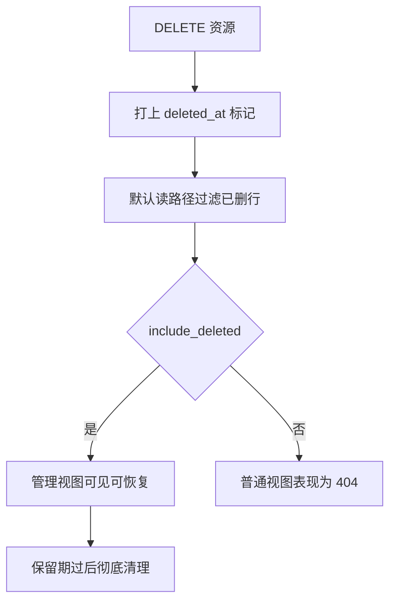
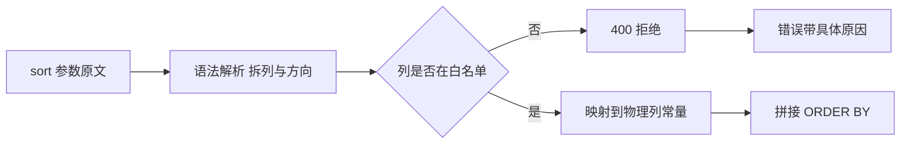
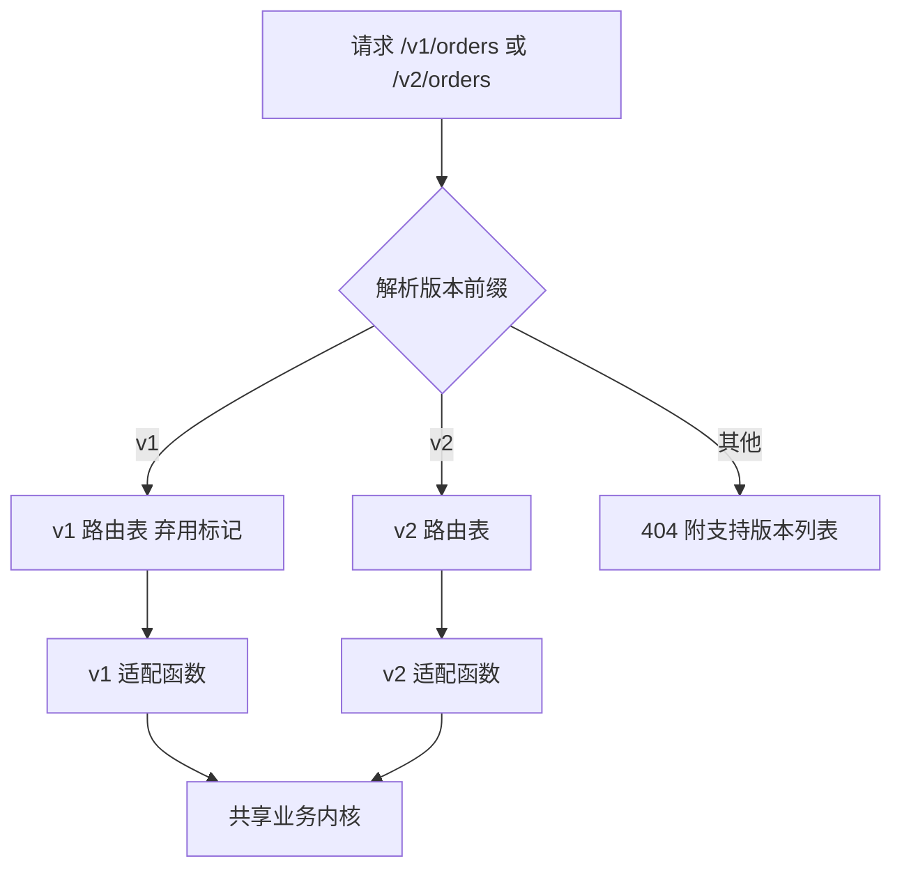
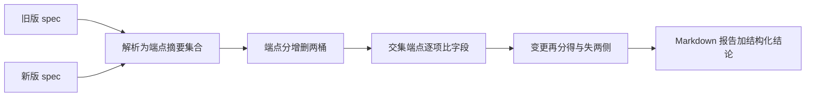
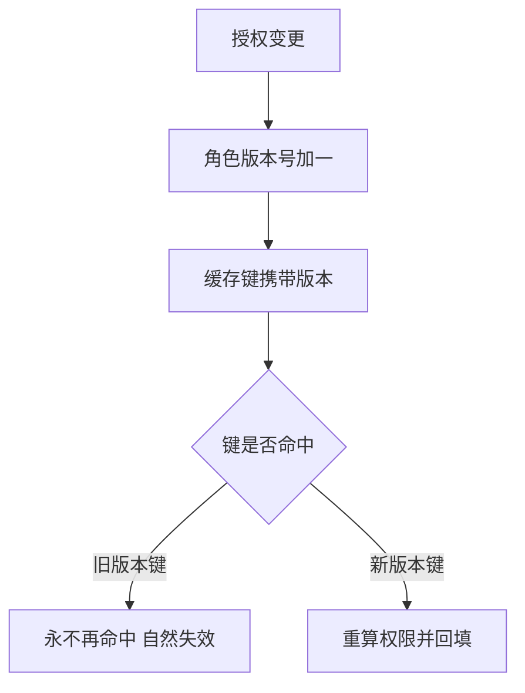
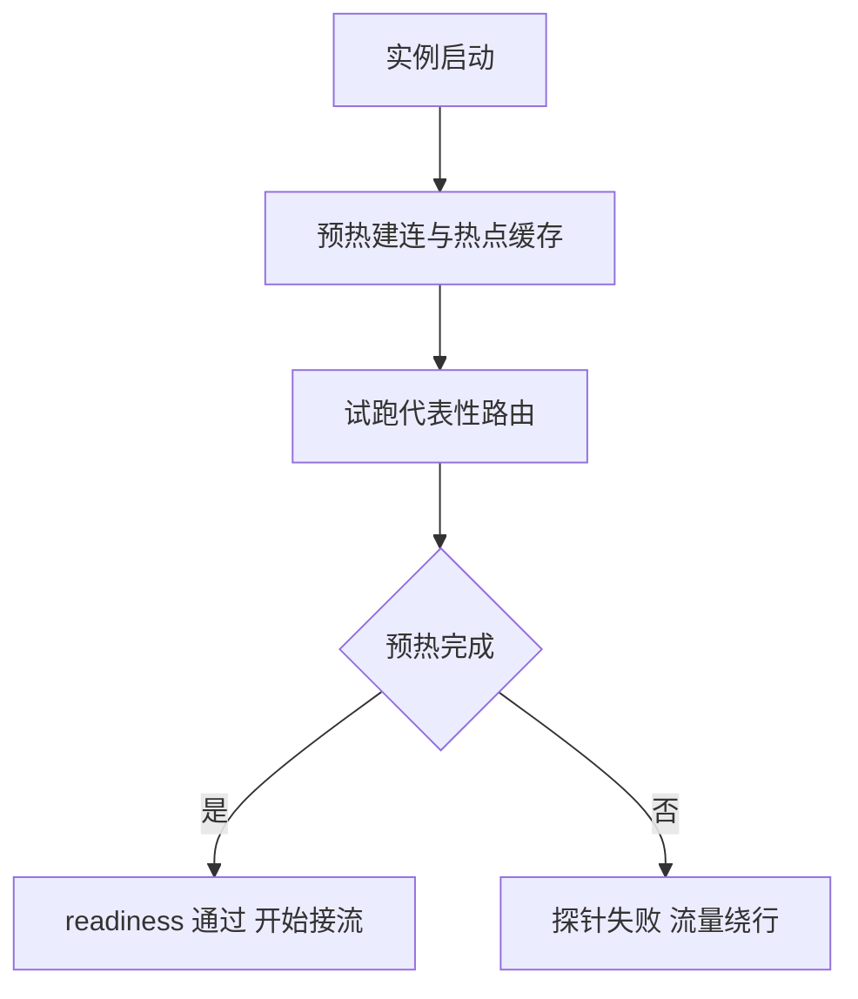
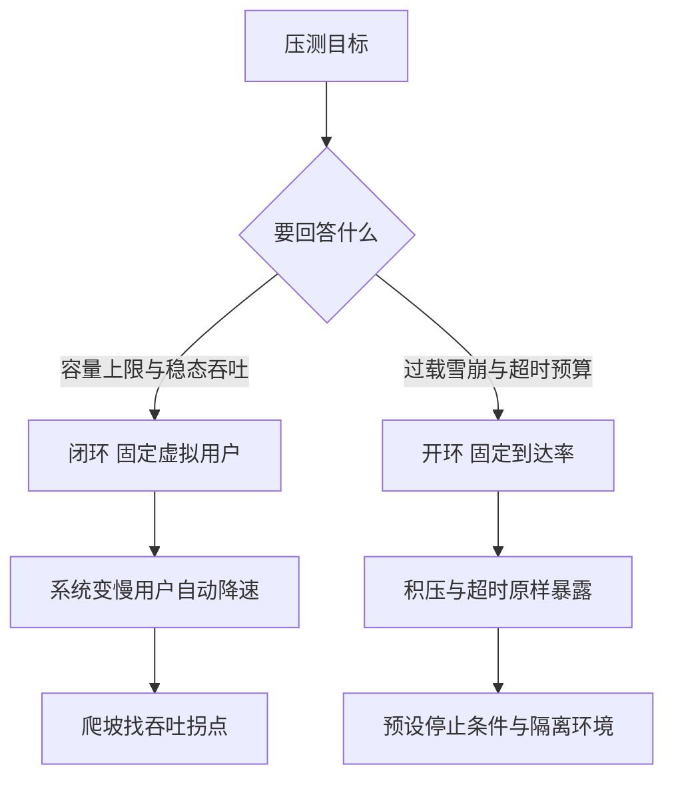

# 第 3 类 · Web 后端开发(夜间扩产四)

本文件是第 3 类的第四次夜间扩产,共 45 题(Q2156–Q2200),五条主线:REST 深水区(状态机化资源、JSON Merge Patch 与 JSON Patch、批量端点的 per-item 结果与原子性、软删除与恢复、游标编码与混合方向 keyset、排序白名单与多列解析、sparse fieldsets 两级演进)、契约与演进(消费者期望记录、契约核验脚本、双运行路由与版本适配层、Deprecation/Sunset 自动注入、容错读取者、破坏性变更清单引擎、schema diff 报告、semver 落地)、安全补遗(nonce 窗口、时间戳联合校验、权限缓存失效边界与版本号方案、单会话限制、文件名规范化攻击、错误信息分级、CSRF 双提交、XFF 信任链)、部署与容量(指纹命名与 manifest、并发模型实测、并发上限探针、冷启动预热、地域路由与会话亲和、思考时间建模)、质量(开环闭环模型、回归用例生成、边界值扩充、P95 预算拆解、限流测试、综合演练)。
代码全部为纯标准库实现,可直接用 /usr/bin/python3 运行;涉及回环请求的题目显式 build_opener(ProxyHandler({})) 绕过代理;演示数据固定,输出可复现,故意触发的异常均有 try/except 包裹。
复习主线:语义先于实现、失效先于缓存、预算先于优化——把协议语义钉死,把失效边界想清,把容量预算拆开,再回头看代码。

### Q2156 · 状态机化资源设计与非法转换的 409

> 难度:★★★☆ | 标签:REST, 资源建模

**问**:订单、审批单这类有生命周期的资源,API 层怎么把状态流转设计得干净?非法流转应该返回什么?

**答**:把有生命周期的资源显式建成"状态 + 允许的转换表",而不是把状态字符串比较散落在各处 if/else 里。资源表示中 state 是只读字段,变更通过定义好的事件触发(PATCH 目标状态或 POST /orders/{id}/events),服务端按转换表裁决:表里没有的转换一律 409 Conflict——409 表达的正是"请求与资源当前状态冲突",不要降级成 400 或静默忽略。转换表本身就是文档,可以直接生成状态图和测试用例,并发场景还能在一处统一挂乐观锁。注意区分两类错误:状态不允许用 409,参数本身不合法用 422;对外永远暴露事件语义而不是内部状态机实现。

```python
# file: code/03_Web后端开发/q2156_state_machine_resource.py
"""状态机化资源设计: 订单状态转换表与非法转换的 409 拒绝(纯标准库)。"""


class Conflict(Exception):
    """非法状态转换, 对应 HTTP 409 Conflict。"""


TRANSITIONS = {
    # 当前状态 -> {事件: 目标状态}
    "created": {"pay": "paid", "cancel": "cancelled"},
    "paid": {"ship": "shipped", "refund": "refunded"},
    "shipped": {"deliver": "delivered"},
    "delivered": {"refund": "refunded"},
    "cancelled": {},
    "refunded": {},
}


def apply_event(order, event):
    """按转换表驱动状态机; 未定义的转换直接拒绝而非静默忽略。"""
    cur = order["state"]
    target = TRANSITIONS.get(cur, {}).get(event)
    if target is None:
        raise Conflict("state {} 不允许事件 {}".format(cur, event))
    order["state"] = target
    order.setdefault("history", []).append("{} --{}--> {}".format(cur, event, target))
    return order


def http_apply(order, event):
    try:
        apply_event(order, event)
        return 204, None
    except Conflict as exc:
        return 409, {"error": "invalid_transition", "detail": str(exc),
                     "current": order["state"]}


order = {"id": "o1", "state": "created", "history": []}
for event in ["pay", "ship", "deliver"]:
    code, body = http_apply(order, event)
    print("事件 {:8s} -> HTTP {} {}".format(event, code, body or order["state"]))

code, body = http_apply(order, "pay")            # delivered 后再支付: 非法
print("事件 {:8s} -> HTTP {} {}".format("pay", code, body))
code, body = http_apply(order, "refund")         # 合法: delivered 可退款
print("事件 {:8s} -> HTTP {} {}".format("refund", code, body or order["state"]))
assert code == 204 and order["state"] == "refunded"
print("要点: 状态机把非法操作从业务报错升级为协议层的 409, 转换表即文档、即测试用例来源")
```

**追问**:
- 状态变更放 PATCH state 字段还是独立事件端点?——单步状态机用 PATCH 加转换表校验即可,多事件带副作用(支付、退款)时独立事件端点语义更清晰。
- 并发下两个事件同时过转换表怎么办?——在裁决处加行级锁或乐观锁版本号,转换表不解决并发,只解决合法性。

### Q2157 · JSON Merge Patch 的手写实现

> 难度:★★★☆ | 标签:REST, PATCH

**问**:RFC 7386 的 JSON Merge Patch 到底定义了什么?手写一遍核心算法要几行?

**答**:Merge Patch 把 PATCH 请求体本身当作"目标文档想要的样子",三条规则构成全部语义:补丁是对象时逐键合并,值仍是对象则递归;值为 null 表示删除该键;值为数组或标量时整体替换,不做元素级合并。补丁不是对象时,直接用它替换整个目标文档。手写核心算法只有十几行递归,但面试官真正想听的是边界:数组永远整体替换(所以列表类字段的大文档不适合 Merge Patch)、null 的唯一语义是删除(所以无法把字段"置 null 保留"),以及服务端必须拒绝 Content-Type 不是 merge-patch+json 的 PATCH 体。这三条决定了它适合字段稀疏更新,不适合结构复杂的文档。

```python
# file: code/03_Web后端开发/q2157_merge_patch.py
"""RFC 7386 JSON Merge Patch: 递归合并与 null 删除语义(纯标准库)。"""


def merge_patch(target, patch):
    """Merge Patch 核心算法。
    patch 是 dict: 逐键合并, 值为 None 表示删除该键, 值为 dict 递归, 其他值整体替换。
    patch 不是 dict: 直接替换整个目标文档。
    """
    if not isinstance(patch, dict):
        return patch
    result = dict(target) if isinstance(target, dict) else {}
    for key, value in patch.items():
        if value is None:
            result.pop(key, None)                       # null 的唯一语义: 删除成员
        elif isinstance(value, dict):
            result[key] = merge_patch(result.get(key), value)
        else:
            result[key] = value
    return result


doc = {"title": "旧标题", "tags": ["a"], "meta": {"color": "red", "size": "L"},
       "obsolete": True}
patch = {"title": "新标题", "meta": {"color": "blue"}, "obsolete": None, "extra": 1}
merged = merge_patch(doc, patch)
print("原文档:", doc)
print("补丁  :", patch)
print("结果  :", merged)
assert merged == {"title": "新标题", "tags": ["a"],
                  "meta": {"color": "blue", "size": "L"}, "extra": 1}
assert merge_patch({"tags": [1, 2]}, {"tags": [3]}) == {"tags": [3]}   # 数组整体替换
assert merge_patch({"a": 1}, "flat") == "flat"                          # 非对象补丁整体替换
assert "obsolete" not in merged                                         # null 即删除
print("要点: 对象递归合并、null 即删除、数组与标量整体替换, 三条规则就是 RFC 7386 的全部")
```

**追问**:
- Merge Patch 怎么表达"把 tags 数组追加一个元素"?——表达不了,只能整体提交新数组,高并发下会丢并发写,这时要换 JSON Patch 或子资源端点。
- 为什么 null 不能表示"置空"?——RFC 7386 规定 null 只用于删除成员,想保留键并置 null 只能换哨兵值或改用 JSON Patch。

### Q2158 · JSON Patch 与 Merge Patch 的选型对比

> 难度:★★★★ | 标签:REST, PATCH

**问**:同样是 PATCH,什么时候选 JSON Patch(RFC 6902),什么时候选 Merge Patch?

**答**:两者表达力不同层级:Merge Patch 表达"我要的最终样子",JSON Patch 表达"请依次执行这些步骤"。JSON Patch 是操作列表(add/replace/remove/test/move/copy),路径用 JSON Pointer 定位,适合三类场景:需要条件更新的 test 前置断言、数组元素级操作、操作历史可审计。它的关键性质是原子性:操作按序应用,任一步失败则整体拒绝,不产生半成品文档——服务端必须在副本上执行,成功才提交。选型口诀:简单字段更新用 Merge Patch(客户端构造成本低),条件写、数组精细操作、幂等重放语义要求强时用 JSON Patch;两者可以并存,靠 Content-Type 区分。

```python
# file: code/03_Web后端开发/q2158_json_patch_vs_merge.py
"""RFC 6902 JSON Patch 最小实现: test 断言与整体原子性(纯标准库)。"""
from copy import deepcopy


def resolve(doc, pointer):
    """返回 pointer 的父容器与末段 token; 根指针返回 (doc, None)。"""
    if pointer == "":
        return doc, None
    parts = [p.replace("~1", "/").replace("~0", "~") for p in pointer.lstrip("/").split("/")]
    parent = doc
    for token in parts[:-1]:
        parent = parent[int(token)] if isinstance(parent, list) else parent[token]
    return parent, parts[-1]


def get_by_pointer(doc, pointer):
    parent, last = resolve(doc, pointer)
    if last is None:
        return doc
    return parent[int(last)] if isinstance(parent, list) else parent[last]


def apply_json_patch(doc, ops):
    """按序应用操作; 任一步失败则整体拒绝, 不产生半成品文档。"""
    result = deepcopy(doc)
    for op in ops:
        action = op["op"]
        parent, last = resolve(result, op["path"])
        if action == "add":
            if isinstance(parent, list):
                parent.insert(min(int(last), len(parent)), op["value"])
            else:
                parent[last] = op["value"]
        elif action == "replace":
            if isinstance(parent, list):
                parent[int(last)] = op["value"]
            elif last not in parent:
                raise KeyError("replace 目标不存在: " + op["path"])
            else:
                parent[last] = op["value"]
        elif action == "remove":
            if isinstance(parent, list):
                parent.pop(int(last))
            else:
                del parent[last]
        elif action == "test":
            if get_by_pointer(result, op["path"]) != op["value"]:
                raise ValueError("test 断言失败: " + op["path"])
        else:
            raise ValueError("不支持的 op: " + action)
    return result


doc = {"user": {"name": "Ann", "age": 30}, "tags": ["x", "y"]}
ops = [
    {"op": "test", "path": "/user/name", "value": "Ann"},
    {"op": "replace", "path": "/user/age", "value": 31},
    {"op": "add", "path": "/user/city", "value": "SH"},
    {"op": "remove", "path": "/tags/0"},
]
print("JSON Patch 结果:", apply_json_patch(doc, ops))

bad = [{"op": "test", "path": "/user/name", "value": "Bob"},
       {"op": "replace", "path": "/user/age", "value": 99}]
try:
    apply_json_patch(doc, bad)
except ValueError as exc:
    print("test 失败整体拒绝:", exc, "| 原文档 age 未动:", doc["user"]["age"] == 30)
print("要点: Merge Patch 表达我要的样子, JSON Patch 表达请执行这些步骤; test 前置断言与操作级精确性是它的价值")
```

**追问**:
- JSON Patch 的 test 失败该返回什么状态码?——整个补丁被拒绝,422 或 409 均可,关键是文档里写死并与前端约定。
- 两者能同时支持吗?——可以,按请求的 Content-Type 分发,注意各自独立的校验与错误语义。

### Q2159 · 批量端点的 per-item 结果体设计

> 难度:★★★☆ | 标签:REST, 批量

**问**:批量创建接口里一半成功一半失败,响应体怎么设计才能让调用方准确对账?

**答**:核心是用 index 对齐请求与结果:响应里的每个条目带 index、自身 status、成功时带 resource、失败时带 error,整体状态码只表达"批次受理成功"(200),条目级成败由各自 status 表达。这样调用方可以按 index 精确回查,不需要靠顺序猜。响应里再给一个 summary(total/created/failed)方便日志与监控,但契约的主体永远是 items 数组。三条纪律:items 的顺序必须与请求顺序一致;单项失败不中断批次(除非是原子模式);单项错误要带机器可读的错误码与字段定位,而不是一句 message。

```python
# file: code/03_Web后端开发/q2159_batch_per_item.py
"""批量端点的 per-item 结果体: 每项独立状态码与错误定位(纯标准库)。"""


def create_one(item, existing_ids):
    """模拟单条创建: 校验加查重。"""
    if "name" not in item:
        return 422, None, {"error": "validation_failed", "field": "name"}
    if item["name"] in existing_ids:
        return 409, None, {"error": "duplicate", "field": "name"}
    return 201, {"id": "id-" + item["name"], "name": item["name"]}, None


def process_batch(payload, existing_ids):
    """整体 200 加 per-item 结果; index 保留请求顺序, 单项失败不中断批次。"""
    results = []
    for index, item in enumerate(payload.get("items", [])):
        status, data, err = create_one(item, existing_ids)
        entry = {"index": index, "status": status}
        if data:
            entry["resource"] = data
            existing_ids.add(item["name"])          # 批内创建的也会被后续项查重
        if err:
            entry["error"] = err
        results.append(entry)
    created = sum(1 for r in results if r["status"] == 201)
    summary = {"total": len(results), "created": created, "failed": len(results) - created}
    return 200, {"items": results, "summary": summary}


existing = {"boom"}
code, body = process_batch(
    {"items": [{"name": "alpha"}, {"name": "boom"}, {"bad": 1}, {"name": "alpha"}]},
    existing)
print("HTTP", code)
for entry in body["items"]:
    print("  index {} status {} {}".format(entry["index"], entry["status"],
                                           entry.get("error") or entry["resource"]))
print("summary:", body["summary"])
assert body["summary"] == {"total": 4, "created": 1, "failed": 3}   # boom 预存冲突, alpha 批内重复
print("要点: index 对齐请求与结果, 单项失败用 4xx 表达原因, 整体状态码只表达批次受理成功")
```

**追问**:
- 整体状态码用 207 Multi-Status 行不行?——可以但语义负担重,207 要求每个条目都是完整状态行,实践上 200 加条目级 status 更易消费。
- 批内第二项与第一项重名算冲突吗?——算,处理过程中要可见前项的写入,本题用 existing_ids 边处理边登记来模拟。

### Q2160 · 批量端点的原子性与尽力而为模式

> 难度:★★★☆ | 标签:REST, 事务, 批量

**问**:批量接口该 all-or-nothing 还是尽力而为?怎么把这个选择变成显式的 API 语义?

**答**:这不是实现细节,是必须写进契约的语义决策。强一致场景(资金、库存扣减)选 all-or-nothing:服务端在暂存区逐项校验执行,任一项失败就整体回滚,返回 422 加首个错误的定位,成功则 201。导入、同步类场景选尽力而为:跳过失败项继续,返回 200 加 per-item 明细。两种模式可以在同一端点共存,用请求参数 atomic=true/false 显式声明,默认值要保守(通常尽力而为用于大数据量、原子用于小批量)。要点是响应语义必须与模式一致:原子模式下绝不出现"部分成功"的响应体,尽力而为模式下绝不静默丢弃失败项。

```python
# file: code/03_Web后端开发/q2160_batch_atomicity.py
"""批量端点的两种执行模式: all-or-nothing 与尽力而为(纯标准库)。"""


def save(item):
    """模拟单条落库: 校验失败抛错。"""
    if item.get("qty", 0) < 0:
        raise ValueError("qty 不能为负: " + str(item.get("sku")))
    return {"sku": item["sku"], "qty": item["qty"]}


def execute_atomic(items):
    """事务式: 任一项失败则全部回滚, 返回 422 与首个错误定位。"""
    staged = []
    for index, item in enumerate(items):
        try:
            staged.append(save(item))
        except ValueError as exc:
            return 422, {"mode": "atomic", "saved": 0, "failed_index": index,
                         "error": str(exc)}
    return 201, {"mode": "atomic", "saved": staged}


def execute_best_effort(items):
    """尽力而为: 跳过失败项继续, 返回 200 与 per-item 明细。"""
    results = []
    for index, item in enumerate(items):
        try:
            results.append({"index": index, "ok": True, "resource": save(item)})
        except ValueError as exc:
            results.append({"index": index, "ok": False, "error": str(exc)})
    return 200, {"mode": "best_effort", "results": results}


batch = [{"sku": "A", "qty": 1}, {"sku": "B", "qty": -2}, {"sku": "C", "qty": 3}]
for fn in (execute_atomic, execute_best_effort):
    code, body = fn(batch)
    print("HTTP", code, body)
assert execute_atomic(batch)[0] == 422
assert len(execute_best_effort(batch)[1]["results"]) == 3
print("要点: 语义写进文档并由参数显式声明, 原子模式不出现部分成功响应, 尽力而为模式不静默丢失败项")
```

**追问**:
- 尽力而为模式下客户端怎么知道哪些要重试?——按 results 里 ok=false 的 index 定位,重试请求只带失败子集,配合幂等键防重复。
- 原子模式为什么用 422 而不是 409?——422 表达请求内容整体不可处理;若失败原因是与现有资源冲突(如唯一键),409 更贴切。

### Q2161 · 软删除端点语义

> 难度:★★☆☆ | 标签:REST, 数据建模

**问**:软删除的资源,DELETE 端点和查询端点的语义应该怎么定?

**答**:原则是对外语义不变、实现换成标记:DELETE /articles/{id} 仍然返回 204,只是实现从物理删除变成打 deleted_at 标记;读路径的默认过滤随之改变——列表与详情默认排除已删资源,已删资源在默认视图下就是 404,调用方不需要知道背后是软删还是硬删。这是端点语义的" encapsulation":查询端点要用显式参数(如 include_deleted=true)才打开全量视图,且该参数只应暴露给管理端或带特殊权限的调用方。要警惕两点:唯一索引与软删除的冲突(需要部分索引或把唯一键带上 deleted 标记),以及所有查询都必须经过统一的默认过滤,绕过 ORM 直接写 SQL 最容易漏掉 deleted_at 条件。

```python
# file: code/03_Web后端开发/q2161_soft_delete.py
"""软删除端点语义: DELETE 只打标记, 读取路径默认过滤(纯标准库)。"""
import time


class Store:
    def __init__(self):
        self.rows = {}                              # id -> row, 含 deleted_at

    def delete(self, row_id):
        row = self.rows.get(row_id)
        if row is None or row.get("deleted_at"):
            return 404
        row["deleted_at"] = time.time()
        return 204

    def get(self, row_id, include_deleted=False):
        row = self.rows.get(row_id)
        if row is None:
            return 404, None
        if row.get("deleted_at") and not include_deleted:
            return 404, None                        # 软删后对默认读取不可见
        return 200, row

    def list_rows(self, include_deleted=False):
        return [r for r in self.rows.values()
                if include_deleted or not r.get("deleted_at")]


store = Store()
store.rows = {"a1": {"id": "a1", "title": "Alive"},
              "d1": {"id": "d1", "title": "Doomed"}}

print("DELETE d1     ->", store.delete("d1"))
print("DELETE d1 重复 ->", store.delete("d1"))
print("GET  d1 默认  ->", store.get("d1")[0])
print("GET  d1 全量  ->", store.get("d1", include_deleted=True)[0])
print("列表默认      :", [r["id"] for r in store.list_rows()])
print("列表含已删    :", [r["id"] for r in store.list_rows(True)])
assert store.get("d1")[0] == 404 and store.get("d1", True)[0] == 200
print("要点: 软删除改变的是读路径的默认过滤, DELETE 的对外语义不变; 全量视图必须显式打开且只给管理端")
```

**追问**:
- 重复 DELETE 返回 204 还是 404?——对调用方建议幂等地返回 204,本题返回 404 是管理端口径;关键是把"从未存在"与"已软删"在内部区分开,对账与审计要用。
- 软删除后唯一约束怎么办?——唯一索引改为带上删除标记的部分索引,或唯一键拼入删除批次号。



### Q2162 · 软删除的恢复端点与查询契约

> 难度:★★☆☆ | 标签:REST, 数据建模

**问**:软删除的资源要支持恢复,恢复动作怎么设计?保留期怎么表达?

**答**:恢复是显式动作,用 POST /articles/{id}/restore 表达,而不是让客户端 PATCH deleted_at=null——后者把实现细节(软删字段)泄漏成了接口契约,一旦换成硬删或归档表就破坏调用方。恢复端点的状态码要分三种:恢复成功 200 加恢复后的资源;资源不在删除态返回 409(与当前状态冲突);超过保留期返回 410 Gone,表达"曾经存在、现在永久不可恢复"。保留期本身要写进文档或用响应头/字段暴露(如 purge_after),让客户端能预判。清理由后台任务按保留期执行,清理后的资源才是真正的 404。

```python
# file: code/03_Web后端开发/q2162_soft_delete_restore.py
"""软删除的恢复端点与保留期: restore 动作的状态码语义(纯标准库)。"""
import time


class RecoverableStore:
    RETENTION = 30 * 86400                          # 保留 30 天

    def __init__(self):
        self.rows = {}

    def soft_delete(self, rid):
        row = self.rows.get(rid)
        if row and not row.get("deleted_at"):
            row["deleted_at"] = time.time()
            return 204
        return 404

    def restore(self, rid, now=None):
        row = self.rows.get(rid)
        if row is None:
            return 404, None
        if not row.get("deleted_at"):
            return 409, {"error": "not_deleted"}
        now = now if now is not None else time.time()
        if now - row["deleted_at"] > self.RETENTION:
            return 410, {"error": "retention_expired"}
        row.pop("deleted_at")
        return 200, row

    def purge_expired(self, now=None):
        now = now if now is not None else time.time()
        gone = [rid for rid, r in self.rows.items()
                if r.get("deleted_at") and now - r["deleted_at"] > self.RETENTION]
        for rid in gone:
            del self.rows[rid]
        return gone


store = RecoverableStore()
store.rows = {"a1": {"id": "a1"},
              "old": {"id": "old", "deleted_at": time.time() - 40 * 86400}}
print("软删 a1     ->", store.soft_delete("a1"))
print("恢复 a1     ->", store.restore("a1")[0])
print("恢复未删 a1 ->", store.restore("a1"))               # 409
print("恢复过期 old->", store.restore("old"))               # 410
print("到期清理    ->", store.purge_expired())
print("清理后 old  ->", store.restore("old")[0])            # 真 404
print("要点: 恢复是显式动作而非改实现字段, 409 表达状态冲突, 410 表达超过保留期不可恢复")
```

**追问**:
- 为什么保留期过期用 410 而不是 404?——410 明确告诉调用方"曾经存在且被有意永久移除",可触发调用方清理本地引用,404 只能表达"现在没有"。
- restore 要幂等吗?——重复恢复同一资源返回同样的 200 或 409 都行,但绝不能 500;审计上要记录每次 restore 事件。

### Q2163 · 分页游标编码:base64 排序键

> 难度:★★★☆ | 标签:REST, 分页

**问**:不透明游标里到底装了什么?自己实现一遍游标编码要注意什么?

**答**:游标的载荷是"上一页最后一行的排序键值加唯一 tie-breaker",通常序列化成紧凑 JSON 再做 URL 安全的 base64。解码即校验:结构不对、类型不对、缺 tie-breaker 一律判为非法游标返回 400,绝不能让坏游标走进 SQL。翻页时把游标值构造成 keyset 条件(与排序同构的元组比较),只取严格落在游标之后且带唯一 tie-breaker 的行,这样重复元素、并发插入都不会导致丢行或重复行。是否加防篡改签名要看业务:游标泄露顶多暴露排序键内容,一般可接受;一旦游标携带租户、权限上下文,就必须 HMAC 签名。

```python
# file: code/03_Web后端开发/q2163_cursor_encoding.py
"""分页游标编码: 排序键加 tie-breaker 的 base64 载荷(纯标准库)。"""
import base64
import json


class CursorError(Exception):
    pass


def encode_cursor(values):
    """values: [排序键值, tie-breaker], 紧凑 JSON 加 URL 安全 base64。"""
    raw = json.dumps({"v": values}, separators=(",", ":"), ensure_ascii=False)
    return base64.urlsafe_b64encode(raw.encode("utf-8")).decode("ascii")


def decode_cursor(cursor):
    try:
        payload = json.loads(base64.urlsafe_b64decode(cursor.encode("ascii")).decode("utf-8"))
        values = payload["v"]
        if not isinstance(values, list) or len(values) != 2:
            raise CursorError("游标应携带排序键与 tie-breaker 两个值")
        return values
    except CursorError:
        raise
    except (ValueError, KeyError, TypeError) as exc:
        raise CursorError("游标无法解析: {}".format(exc))


def paginate(rows, cursor=None, limit=2):
    """rows 预先按 created_at,id 升序排好; 游标指向上一页最后一行。"""
    data = rows
    if cursor:
        created, rid = decode_cursor(cursor)
        data = [r for r in rows if (r["created_at"], r["id"]) > (created, rid)]
    items = data[:limit]
    next_cursor = None
    if len(data) > limit:
        last = items[-1]
        next_cursor = encode_cursor([last["created_at"], last["id"]])
    return items, next_cursor


rows = [
    {"id": 0, "created_at": "2026-11-05T08:00"}, {"id": 1, "created_at": "2026-11-05T08:00"},
    {"id": 2, "created_at": "2026-11-05T09:00"}, {"id": 3, "created_at": "2026-11-05T09:00"},
    {"id": 4, "created_at": "2026-11-05T10:00"},
]
cursor, pages = None, []
while True:
    items, cursor = paginate(rows, cursor, limit=2)
    pages.append([r["id"] for r in items])
    if not cursor:
        break
print("三页结果:", pages)
assert pages == [[0, 1], [2, 3], [4]]
sample = encode_cursor(["2026-11-05T09:00", 3])
print("游标样例:", sample, "| 解码:", decode_cursor(sample))
try:
    decode_cursor("###bad###")
except CursorError as exc:
    print("伪造游标 -> 400:", exc)
print("要点: 载荷是排序键加唯一 tie-breaker, 解码即校验, 校验失败回 400 而不是 500")
```

**追问**:
- 为什么用 base64 而不是明文 JSON?——URL 安全与不透明性:客户端只需原样回传,服务端可以自由演进载荷结构而不破坏调用方。
- 游标要过期时间吗?——数据删除会导致 keyset 条件仍成立所以能继续翻,但排序键语义变化(如时间被修正)时过期更安全,可加时间戳字段做软校验。

### Q2164 · 游标分页的排序稳定性与方向感知

> 难度:★★★★ | 标签:REST, 分页

**问**:排序是 score desc, id asc 这种混合方向时,keyset 翻页的条件怎么写?只用非唯一列做游标会出什么事故?

**答**:两个铁律。第一,排序键必须追加唯一 tie-breaker(通常是主键),否则同一分值的多行在两次查询间的相对顺序不稳定,翻页会丢行或重复——这是分页事故里最常见的一种。第二,混合方向时,谓词的比较必须与 ORDER BY 完全同构:每一列各自带方向参与比较,不能简单比较元组。实现技巧是给降序列包一个反向比较的包装类,让"下一页"统一表达为排序键严格大于游标键;落 SQL 时则展开成多列 OR 的组合条件。验证方法是断言:全部页拼接后与完整排序一致且无重复,这是游标实现的必备回归用例。

```python
# file: code/03_Web后端开发/q2164_keyset_mixed_direction.py
"""混合方向排序的 keyset 翻页: 每列方向参与比较, tie-breaker 防丢行(纯标准库)。"""


class Desc:
    """包装降序列值, 让统一的元组比较天然生效。"""
    __slots__ = ("v",)

    def __init__(self, v):
        self.v = v

    def __lt__(self, other):
        return other.v < self.v

    def __eq__(self, other):
        return other.v == self.v


def sort_key(row, columns):
    return tuple(Desc(row[f]) if d == "desc" else row[f] for f, d in columns)


def keyset_page(rows, columns, cursor_key, limit):
    """取排序键严格大于游标键的行; 游标为上一页最后一行的排序键。"""
    data = rows
    if cursor_key is not None:
        data = [r for r in rows if sort_key(r, columns) > cursor_key]
    items = data[:limit]
    next_key = sort_key(items[-1], columns) if len(data) > limit else None
    return items, next_key


rows = [{"id": 1, "score": 90}, {"id": 2, "score": 90}, {"id": 3, "score": 80},
        {"id": 4, "score": 80}, {"id": 5, "score": 70}]
columns = [("score", "desc"), ("id", "asc")]
rows.sort(key=lambda r: sort_key(r, columns))
ordered = [r["id"] for r in rows]
print("完整排序:", ordered)

cursor, seen = None, []
while True:
    items, cursor = keyset_page(rows, columns, cursor, 2)
    seen += [r["id"] for r in items]
    if not cursor:
        break
print("keyset 翻页:", seen)
assert seen == ordered and len(set(seen)) == len(seen)

# 反例: 只用非唯一列 score 做游标, 页边界落在同分行时会整行丢失
page1 = rows[:1]
cursor_score = page1[-1]["score"]
rest = [r for r in rows if r["score"] < cursor_score]
naive_seen = [r["id"] for r in page1] + [r["id"] for r in rest[:3]]
print("裸 score 游标:", naive_seen, "-> id=2 的同分行被跳过")
assert 2 not in naive_seen
print("要点: 排序键必须追加唯一 tie-breaker; 混合方向时谓词与排序用同一个键函数, 方向参与每列比较")
```

**追问**:
- 落到 SQL 里混合方向的条件长什么样?——形如 (score < c1) OR (score = c1 AND id > c2),列多时嵌套加深,ORM 通常有 keyset 分页插件可生成。
- tie-breaker 选业务键还是主键?——主键,业务键可能被更新导致游标漂移,主键不可变。

### Q2165 · 排序参数的白名单映射与防注入

> 难度:★★★☆ | 标签:REST, SQL 注入

**问**:排序字段为什么不能像 WHERE 值那样参数化?正确的防注入姿势是什么?

**答**:SQL 参数化只对值生效,ORDER BY 后面是标识符,占位符会被当成字符串字面量导致语法错误——所以列名只能拼进 SQL,也就成了注入点。唯一正解是白名单映射:接口只接受稳定的排序名(如 price、rating),服务端查表映射到预定义的物理列常量,查不到直接 400;映射目标也是代码里的常量,用户输入永远接触不到列名。要拒绝两类看似无害的做法:把用户输入做引号转义后拼接(标识符转义不可靠且列名本不该动态),以及用 try/except 包一层让非法输入走默认排序(把攻击探测试探变慢而不是拒绝)。默认排序也要文档化,便于压测与索引设计对齐。

```python
# file: code/03_Web后端开发/q2165_sort_whitelist.py
"""排序参数的白名单映射: 标识符不能走参数化(纯标准库)。"""

ALLOWED_SORTS = {
    "created_at": "created_at",
    "price": "price_cents",
    "rating": "rating_avg",
}


def build_order_by(sort_param):
    """只接受注册过的排序名, 一律映射到预定义列常量; 拒绝任何透传。"""
    if sort_param is None:
        return "created_at DESC"                        # 文档化的默认排序
    key = sort_param.strip().lower()
    if key not in ALLOWED_SORTS:
        raise ValueError("unsupported sort: " + sort_param)
    return ALLOWED_SORTS[key] + " DESC"


def sql_for(sort_param):
    return "SELECT id, price_cents FROM goods ORDER BY " + build_order_by(sort_param)


attacks = ["price; DROP TABLE goods;--",
           "(SELECT CASE WHEN 1=1 THEN price ELSE id END)",
           "price_cents",
           "IF(true, price, id)"]
for bad in attacks:
    try:
        build_order_by(bad)
        print("漏网!", bad)
    except ValueError as exc:
        print("拒绝: {:38s} -> {}".format(bad[:36], exc))
print("正常:", sql_for("price"))
print("默认:", sql_for(None))
assert "price_cents" in sql_for("price")
print("要点: ORDER BY 放不了占位符, 白名单映射是唯一正解; 映射目标是常量, 用户永远接触不到物理列名")
```

**追问**:
- 允许业务侧自由排序怎么办?——把可选列集合同步维护进白名单表,新增排序要走代码评审,而不是开放自由输入。
- 前端把列名大写传来怎么办?——入口统一归一化(trim 加 lower),归一化之后仍要在白名单里查。

### Q2166 · 多列排序参数的语法解析

> 难度:★★☆☆ | 标签:REST, 参数解析

**问**:sort=name,-created_at 这种多列排序参数,解析器要处理哪些细节?

**答**:语法层负责形状、白名单层负责合法性,两层都要在进入 SQL 之前完成。解析器要处理:前缀符号(- 表示 desc,缺省 asc,可选拒绝 +);空段与纯符号段报错;每列都在白名单内;同一列重复出现直接拒绝(静默去重会隐藏调用方的 bug);列数设上限(防止生成病态排序计划);参数总长设上限(防超长输入消耗解析)。产出是统一的 [(列, 方向)] 结构,后续按白名单映射成物理列再拼 ORDER BY。错误一律 400 并带具体原因,让调用方自查而不是猜。

```python
# file: code/03_Web后端开发/q2166_multi_sort_parse.py
"""多列排序参数的语法解析: 白名单校验加方向与上限(纯标准库)。"""

WHITELIST = {"name", "created_at", "price"}
MAX_COLUMNS = 3


class SortParamError(Exception):
    pass


def parse_sort(param):
    """解析 'name,-created_at' 形态; 返回 [(列, 方向)]。"""
    if param is None or param == "":
        return [("created_at", "desc")]
    if len(param) > 128:
        raise SortParamError("排序参数过长")
    seen = []
    for token in param.split(","):
        token = token.strip()
        if not token:
            raise SortParamError("空排序段")
        direction = "asc"
        if token[0] in "+-":
            direction = "desc" if token[0] == "-" else "asc"
            token = token[1:]
        if not token:
            raise SortParamError("纯符号的排序段")
        if token not in WHITELIST:
            raise SortParamError("未知排序字段: " + token)
        if any(t[0] == token for t in seen):
            raise SortParamError("重复排序字段: " + token)
        seen.append((token, direction))
        if len(seen) > MAX_COLUMNS:
            raise SortParamError("最多允许 {} 列".format(MAX_COLUMNS))
    return seen


def to_order_by(parsed):
    return ", ".join("{} {}".format(col, d.upper()) for col, d in parsed)


for raw in [None, "name", "-price", "name,-created_at,price", "name,-created_at,price,rating"]:
    try:
        print("{!r:34s} -> ORDER BY {}".format(raw, to_order_by(parse_sort(raw))))
    except SortParamError as exc:
        print("{!r:34s} -> 400: {}".format(raw, exc))
for bad in ["name,-name", "name;DROP TABLE x", "-", "name,,"]:
    try:
        parse_sort(bad)
        print("漏网!", bad)
    except SortParamError as exc:
        print("{!r:22s} -> 400: {}".format(bad, exc))
print("要点: 语法层管形状, 白名单管合法性, 重复列与列数上限都要显式拒绝")
```

**追问**:
- 为什么重复列要报错而不是去重?——重复通常意味着调用方拼参数的代码有 bug,静默去重会把问题拖到生产才暴露。
- 方向符号用 - 还是 asc/desc 关键字?——紧凑符号对 URL 友好,关键字更易读;关键是全库统一,不要两种混用。



### Q2167 · sparse fieldsets 的基础裁剪实现

> 难度:★★☆☆ | 标签:REST, 字段裁剪

**问**:客户端只要部分字段,sparse fieldsets 该怎么实现?未知字段怎么处理?

**答**:实现是三层漏斗:第一层是字段白名单,把内部字段(internal_score、成本类)从可选集合里排除,任何参数都拿不到;第二层解析 fields=title,views 这样的参数,与白名单求交集得到输出集合;第三层在序列化时按集合裁剪,而不是先序列化再删——裁剪要尽量下推到 SQL 的列选择,才能真正省带宽与序列化开销。未知字段有两种处理:JSON:API 口径是忽略并继续(利于演进),严格口径是 400(利于暴露拼写错误);全库统一选一种并写进文档,不传 fields 参数时返回完整公开表示。注意 fields 是裁剪不是过滤:它决定输出哪些键,不改变行集。

```python
# file: code/03_Web后端开发/q2167_sparse_fieldsets.py
"""sparse fieldsets 基础: fields 参数的序列化裁剪(纯标准库)。"""

FULL_ARTICLE = {
    "id": 1, "title": "游标分页", "body": "很长很长的正文", "author_id": 7,
    "views": 1024, "internal_score": 0.83,
}
PUBLIC_FIELDS = {"id", "title", "body", "author_id", "views"}   # 白名单先挡内部字段


def parse_fields(param, allowed):
    """fields=title,views -> 字段集合; 未知字段忽略并返回提示。"""
    if not param:
        return set(allowed), []
    requested = [f.strip() for f in param.split(",") if f.strip()]
    unknown = [f for f in requested if f not in allowed]
    chosen = set(requested) & allowed
    if not chosen:
        chosen = set(allowed)                       # 全部未知时回退完整表示
    return chosen, unknown


def serialize(row, fields):
    return {k: v for k, v in row.items() if k in fields}


param = "title,views,internal_score"
chosen, unknown = parse_fields(param, PUBLIC_FIELDS)
print("fields={}".format(param))
print("裁剪结果:", serialize(FULL_ARTICLE, chosen))
print("被忽略的未知字段:", unknown)
assert "internal_score" not in chosen and unknown == ["internal_score"]
chosen2, _ = parse_fields(None, PUBLIC_FIELDS)
print("不传 fields 时:", sorted(serialize(FULL_ARTICLE, chosen2)))
print("要点: 白名单挡内部字段, 参数决定输出子集, 未知字段的策略要全库统一并写进契约")
```

**追问**:
- 裁剪为什么强调下推到 SQL?——只省响应体不省查询,大字段(正文、BLOB)照样拖垮 DB 与序列化,字段选择要贯穿到列选择。
- fields 与 ETag 的关系?——不同 fields 组合是不同表示,缓存键或 Vary 必须包含 fields,否则会串档。

### Q2168 · sparse fieldsets 的演进:嵌套字段选择

> 难度:★★★★ | 标签:REST, 字段裁剪

**问**:带 include 的复合响应里,sparse fieldsets 从 v1 平铺参数演进到 v2 嵌套语法,要考虑什么?

**答**:平铺的 fields=title,views 只能裁剪主资源,复合响应里 included 的每个资源类型需要独立的掩码,于是演进出 JSON:API 风格的 fields[author]=name&fields[comment]=text。演进要处理四件事:两套参数并存时的优先级与兼容(老参数继续生效一个版本窗口);掩码的保留字段规则——type 与 id 是资源标识,永远保留,否则客户端无法关联;解析器从单个查询参数变成多参数正则提取;最重要的代价是序列化缓存的键必须包含全部掩码组合,否则不同字段集的响应会互相污染,缓存基数爆炸时要对掩码做规范化(排序、去空)并设组合上限。

```python
# file: code/03_Web后端开发/q2168_sparse_fieldsets_v2.py
"""sparse fieldsets 演进: 平铺 fields 到按资源的嵌套掩码(纯标准库)。"""
import re

RESPONSE = {
    "data": {"type": "article", "id": 1, "title": "T", "body": "B", "views": 9},
    "included": [
        {"type": "author", "id": 7, "name": "Ann", "email": "a@x.io", "bio": "b"},
        {"type": "comment", "id": 31, "text": "好文", "ip": "10.0.0.1"},
    ],
}
NESTED_RE = re.compile(r"fields\[([a-z_]+)\]")      # fields[author] 形态的键


def parse_fieldsets(query_pairs):
    """返回 (平铺掩码, 按类型的嵌套掩码); 两套参数并存。"""
    flat, nested = None, {}
    for key, value in query_pairs:
        m = NESTED_RE.fullmatch(key)
        if m:
            nested[m.group(1)] = {f.strip() for f in value.split(",") if f.strip()}
        elif key == "fields":
            flat = {f.strip() for f in value.split(",") if f.strip()}
    return flat, nested


def apply_fieldsets(doc, flat, nested):
    """主资源用平铺掩码, included 按类型用嵌套掩码; type 与 id 恒保留。"""
    data = dict(doc["data"])
    if flat:
        data = {k: v for k, v in data.items() if k in flat or k in ("type", "id")}
    included = []
    for inc in doc["included"]:
        mask = nested.get(inc["type"])
        if mask:
            inc = {k: v for k, v in inc.items() if k in mask or k in ("type", "id")}
        included.append(inc)
    return {"data": data, "included": included}


flat, nested = parse_fieldsets(
    [("fields", "id,title"), ("fields[author]", "name"), ("fields[comment]", "text")])
out = apply_fieldsets(RESPONSE, flat, nested)
print("主资源:", out["data"])
print("included:", [(i["type"], sorted(i)) for i in out["included"]])
assert "email" not in out["included"][0] and "ip" not in out["included"][1]
assert out["included"][0]["type"] == "author" and out["data"]["id"] == 1
print("要点: 嵌套掩码按类型下推, type 与 id 恒保留; 代价是序列化缓存键必须含全部掩码组合并做规范化")
```

**追问**:
- 掩码组合爆炸怎么办?——掩码规范化后设组合上限,超出按最近通用掩码降级并打点,或者干脆放弃缓存改实时序列化。
- 客户端传 fields[author]=email 这种敏感字段怎么办?——掩码先与该类型的公开白名单求交,敏感字段从源头就不可选。

### Q2169 · 消费者期望的记录格式设计

> 难度:★★★☆ | 标签:契约测试, 演进

**问**:消费驱动契约里,消费者的"期望"到底要记录哪些东西?和快照测试差在哪?

**答**:期望文件记录的是消费者真正依赖的最小集合,按交互(interaction)组织:请求的 method 与 path 模板,以及期望里的四类约束——status、body_has(依赖的字段存在)、body_not_has(禁止出现的内部字段)、types 与 enum(依赖字段的类型与取值范围)。关键区别在哲学:快照测试把整份响应钉死,provider 加一个无害字段都会挂红;期望只声明用到的部分,provider 自由增改未记录的内容,这才是消费驱动能支持演进的原因。所以期望格式的纪律是"只记依赖":消费者 Review 时多记一行,就是对 provider 的一份额外承诺,宁可少记。

```python
# file: code/03_Web后端开发/q2169_consumer_expectations.py
"""消费者期望的记录格式: 契约文件的最小字段集(纯标准库)。"""
import json

EXPECTATION = {
    "consumer": "mobile-app",
    "provider": "order-service",
    "recorded_from": "GET /v1/orders/{id}",
    "interactions": [
        {
            "description": "查一条已支付订单",
            "request": {"method": "GET", "path": "/v1/orders/o-100", "headers": {}},
            "expect": {
                "status": 200,
                "body_has": ["order_id", "total", "state"],
                "body_not_has": ["internal_cost", "supplier_id"],
                "types": {"order_id": "str", "total": "number", "state": "str"},
                "enum": {"state": ["created", "paid", "shipped"]},
            },
        },
        {
            "description": "不存在的订单返回 404 而不是 200 空体",
            "request": {"method": "GET", "path": "/v1/orders/nope"},
            "expect": {"status": 404},
        },
    ],
}

text = json.dumps(EXPECTATION, ensure_ascii=False, indent=2)
print(text)
loaded = json.loads(text)
assert loaded["interactions"][0]["expect"]["enum"]["state"] == ["created", "paid", "shipped"]
print("要点: 期望只描述消费者真正用到的东西; 未记录的字段不算契约, provider 可以自由增改")
```

**追问**:
- 消费者漏记了实际依赖的字段怎么办?——provider 改动后消费者集成测试兜底,事后把遗漏补进期望并复盘记录流程。
- 枚举期望会不会阻碍 provider 扩值?——会,所以扩值走"宽容读取者"约定或版本化期望,枚举约束只对消费方强依赖的闭环场景使用。

### Q2170 · 契约核验脚本:provider 端的核对

> 难度:★★★★ | 标签:契约测试, 演进

**问**:拿到所有消费者的期望文件后,provider 侧的核验脚本要做哪些检查?输出什么?

**答**:核验脚本把每个期望文件的 interaction 重放到 provider 的沙箱环境,对真实响应做四类断言:status 是否一致;body_has 的字段是否存在(消费者会崩的改动);body_not_has 是否泄漏(内部字段出现在响应里也是破坏,因为消费者可能开始依赖它);types 与 enum 的类型与取值是否满足。输出是逐条 findings 列表,每条带期望文件、交互描述与违规内容,CI 里 findings 非空即失败,把"provider 改坏消费者"从线上事故前移到合并门禁。与快照测试的分界要守住:核验只看记录过的约束,provider 新增字段绝不该挂红,否则就退化为快照。

```python
# file: code/03_Web后端开发/q2170_contract_verify.py
"""契约核验脚本: 用消费者期望核对 provider 真实响应(纯标准库)。"""

EXPECT = {
    "status": 200,
    "body_has": ["order_id", "total", "state"],
    "body_not_has": ["internal_cost"],
    "types": {"order_id": "str", "total": "number"},
    "enum": {"state": ["created", "paid", "shipped"]},
}
TYPE_CHECKS = {"str": str, "number": (int, float), "bool": bool, "list": list, "obj": dict}


def verify(response, expect):
    """返回违规列表; 只检查期望里记录过的约束。"""
    findings = []
    if response["status"] != expect["status"]:
        findings.append("status {} != 期望 {}".format(response["status"], expect["status"]))
    body = response.get("body") or {}
    for key in expect.get("body_has", []):
        if key not in body:
            findings.append("缺少消费者依赖的字段: " + key)
    for key in expect.get("body_not_has", []):
        if key in body:
            findings.append("泄漏了消费者未依赖的内部字段: " + key)
    for key, want in expect.get("types", {}).items():
        got = body.get(key)
        if got is not None and not isinstance(got, TYPE_CHECKS[want]):
            findings.append("字段 {} 类型 {} 不符合契约 {}".format(
                key, type(got).__name__, want))
    for key, allowed in expect.get("enum", {}).items():
        if body.get(key) not in allowed:
            findings.append("字段 {} 值 {} 超出契约枚举 {}".format(
                key, body.get(key), allowed))
    return findings


good = {"status": 200, "body": {"order_id": "o-1", "total": 99.5, "state": "paid"}}
bad = {"status": 200, "body": {"order_id": 7, "state": "refunded", "internal_cost": 12}}
print("场景一:", verify(good, EXPECT) or "契约核验通过")
for f in verify(bad, EXPECT):
    print("场景二:", f)
assert verify(good, EXPECT) == [] and len(verify(bad, EXPECT)) == 4
print("要点: 核验只看记录过的约束, provider 新增字段不该挂红——这正是消费驱动与快照测试的分界")
```

**追问**:
- 核验在什么环境跑?——provider 的沙箱或本地启动实例加种子数据,重放必须可复现,禁止直连生产。
- 多个消费者的期望冲突怎么办?——说明契约本身有分叉,要把公共部分抽成 provider 的正式契约,各消费者期望只做增量。

### Q2171 · API 版本双运行路由

> 难度:★★★☆ | 标签:版本管理, 路由

**问**:v1 和 v2 同时在线,路由层怎么组织才不会失控?

**答**:单位是"版本路由表 + 版本适配函数",业务内核全局只有一份。每个版本一张独立的路由表(path 到处理名的映射),入口先解析版本前缀,再查对应表分发给该版本的适配函数;适配函数负责把领域模型转换成该版本的线格式。这个结构有三个收益:双运行的存活边界清晰——v1 表存在即服务,下线就是删表;版本差异收口在适配函数,handler 不出现 if version == 'v1';未知版本统一 404 并返回支持的版本列表,方便调用方发现。配套要有按版本的流量指标与弃用标记,双运行期间 v1 的调用量就是迁移进度的直接读数。

```python
# file: code/03_Web后端开发/q2171_dual_version_router.py
"""API 版本双运行: 路由表按版本隔离, 业务内核全局共享(纯标准库)。"""

V1_TABLE = {("GET", "/orders"): "order_v1"}
V2_TABLE = {("GET", "/orders"): "order_v2", ("GET", "/orders/stats"): "stats_v2"}


def order_core(payload):
    """业务内核与版本无关, 版本差异只在出口适配。"""
    return {"id": payload.get("id", "o-100"), "amount_cents": 9900,
            "tax_cents": 900, "state": "paid"}


def order_v1(payload):
    data = order_core(payload)
    return 200, {"id": data["id"], "amount": data["amount_cents"] // 100,
                 "state": data["state"]}


def order_v2(payload):
    data = order_core(payload)
    return 200, {"id": data["id"], "amount_cents": data["amount_cents"],
                 "tax_cents": data["tax_cents"], "state": data["state"]}


def stats_v2(payload):
    return 200, {"total": 42}


HANDLERS = {"order_v1": order_v1, "order_v2": order_v2, "stats_v2": stats_v2}
ROUTES = {"v1": V1_TABLE, "v2": V2_TABLE}


def dispatch(method, path):
    parts = path.lstrip("/").split("/", 1)
    version, rest = parts[0], "/" + (parts[1] if len(parts) > 1 else "")
    table = ROUTES.get(version)
    if table is None:
        return 404, {"error": "unknown_version", "supported": sorted(ROUTES)}
    if (method, rest) not in table:
        return 404, {"error": "no_route", "version": version}
    return HANDLERS[table[(method, rest)]]({"id": "o-100"})


for method, path in [("GET", "/v1/orders"), ("GET", "/v2/orders"),
                     ("GET", "/v2/orders/stats"), ("POST", "/v1/orders"),
                     ("GET", "/v3/orders")]:
    print("{} {:18s} ->".format(method, path), dispatch(method, path))
assert dispatch("GET", "/v2/orders")[1]["amount_cents"] == 9900
print("要点: 双运行的单位是路由表与适配函数, 业务内核只有一份; v1 表存在即服务, 下线只是删表")
```

**追问**:
- 双运行期间数据库 schema 怎么办?——schema 以两个版本的最大兼容面为准,先扩后收,与发布兼容两阶段配合。
- 版本放 URL 前缀还是 header?——URL 前缀便于路由与调试,header 更 REST 纯粹但缓存与网关配置更麻烦;选定一种全站统一。



### Q2172 · 双运行下的版本适配层

> 难度:★★★★ | 标签:版本管理, 架构

**问**:双运行时怎么保证版本逻辑不渗透进业务代码?适配层的边界在哪里?

**答**:纪律是一条:业务内核只产出领域模型,所有版本差异都折叠进适配函数。领域模型用内部标准单位(金额用分、时间用 UTC、状态用内部枚举),v1 适配器把分换算成元并隐藏新字段,v2 适配器输出整数分与币种;新增 v3 只是注册一个新适配函数,内核与存储零改动。适配层的边界要防两头泄漏:向外,内核禁止感知版本(参数里不许出现 version);向内,适配器禁止包含业务规则——它只做单位换算、字段取舍、命名映射,一旦适配器里出现条件业务逻辑,说明该差异应该下沉到内核或用特性开关管理。适配器保持纯函数,才能对每个版本独立做单测与契约核验。

```python
# file: code/03_Web后端开发/q2172_version_adapter.py
"""双运行下的版本适配层: 一份领域模型, 多种线格式(纯标准库)。"""
from dataclasses import dataclass, field


@dataclass
class Order:
    id: str
    total_cents: int
    currency: str
    state: str
    risk_score: float = field(default=0.0, repr=False)   # 内部风控字段


def to_v1(order):
    """v1: 金额是元, 不暴露币种与风控内部字段。"""
    return {"id": order.id, "total": round(order.total_cents / 100, 2),
            "state": order.state}


def to_v2(order):
    """v2: 金额改为整数分并显式带币种。"""
    return {"id": order.id, "amount_cents": order.total_cents,
            "currency": order.currency, "state": order.state}


ADAPTERS = {"v1": to_v1, "v2": to_v2}
ORDER_REPOSITORY = {"o-1": Order("o-1", 12345, "CNY", "paid", risk_score=0.17)}


def handle(version, order_id):
    order = ORDER_REPOSITORY[order_id]              # 业务内核只查一次
    return 200, ADAPTERS[version](order)


for version in ["v1", "v2"]:
    print(version, "->", handle(version, "o-1")[1])
assert handle("v1", "o-1")[1]["total"] == 123.45
assert handle("v2", "o-1")[1]["amount_cents"] == 12345
assert "risk_score" not in handle("v1", "o-1")[1]
print("要点: 新版本只是注册一个新适配函数; 适配器只做单位换算与字段取舍, 业务规则禁止进适配层")
```

**追问**:
- 入参方向的适配呢?——同理反向:各版本解析器把线格式转成统一的领域命令,内核只见统一入参。
- 适配器越来越多怎么办?——版本退役时同步删适配器,并把"适配器数量"当作版本治理的库存指标。

### Q2173 · Deprecation 与 Sunset 头的自动注入

> 难度:★★★☆ | 标签:HTTP, 弃用治理

**问**:弃用一个路由时,Deprecation 和 Sunset 响应头应该怎么规范地发?散落在 handler 里写行吗?

**答**:弃用信息应该由注册表统一驱动、中间件统一注入,路由代码零感知。注册表登记弃用路由的弃用日期、Sunset 日期与替代路径;中间件按路径查表,命中则追加:Deprecation: true(或草稿规范的结构化日期)、Sunset 用 HTTP 日期(机器可读的下线时刻)、Link rel="sunset" 指向替代端点或公告页、可选 Warning 299 给人类看。这样做的收益是可审计——注册表就是弃用清单,直接生成调用方盘点报表与倒计时告警;散落在 handler 里手写会漏、会拼错日期格式,也无法统一监控。Sunset 日期一经对外公布就尽量不要改,改了要提前公告。

```python
# file: code/03_Web后端开发/q2173_deprecation_headers.py
"""弃用治理: Deprecation 与 Sunset 头按注册表自动注入(纯标准库)。"""
from datetime import datetime, timezone
from email.utils import format_datetime

DEPRECATIONS = {
    "/v1/orders": {"sunset": datetime(2027, 3, 1, tzinfo=timezone.utc),
                   "successor": "/v2/orders"},
}


def apply_deprecation(path, headers):
    """命中弃用注册表则注入弃用响应头; 返回新头与是否命中。"""
    info = DEPRECATIONS.get(path)
    if info is None:
        return headers, False
    headers = dict(headers)
    headers["Deprecation"] = "true"
    headers["Sunset"] = format_datetime(info["sunset"], usegmt=True)
    headers["Link"] = '<{}>; rel="sunset"'.format(info["successor"])
    headers["Warning"] = '299 - "route deprecated, migrate to {}"'.format(info["successor"])
    return headers, True


def proxy(path):
    headers, flagged = apply_deprecation(path, {"Content-Type": "application/json"})
    return {"status": 200, "headers": headers, "deprecated": flagged}


for path in ["/v2/orders", "/v1/orders"]:
    resp = proxy(path)
    print("==", path, "status", resp["status"], "(弃用)" if resp["deprecated"] else "")
    if resp["deprecated"]:
        for key in ["Deprecation", "Sunset", "Link", "Warning"]:
            print("   {}: {}".format(key, resp["headers"][key]))
now = datetime(2026, 11, 5, tzinfo=timezone.utc)
remain = (DEPRECATIONS["/v1/orders"]["sunset"] - now).days
print("距 Sunset 还有 {} 天, 监控按弃用路由统计调用量与调用方分布".format(remain))
print("要点: 注册表即弃用清单, 中间件注入保证头一致且可审计; Sunset 用 HTTP 日期保证机器可读")
```

**追问**:
- 客户端怎么自动感知弃用?——代理层聚合 Sunset 头生成弃用看板,SDK 在响应头出现 Sunset 时打告警日志。
- 弃用头会增加响应体量吗?——四个头约 200 字节,全站弃用路由数量有限,可忽略;缓存层要保证弃用头不被中间缓存剥离。

### Q2174 · 容错读取者:未知字段的兼容语义

> 难度:★★☆☆ | 标签:契约, 兼容性

**问**:为什么"provider 加字段不算破坏性变更"是有前提的?前提被破坏会怎样?

**答**:前提就是容错读取者(Tolerant Reader):客户端解析响应时忽略不认识的字段,发请求时省略可选字段。做到这一点,provider 加字段、加可选参数才真正无害;反例是客户端用严格 schema 反序列化,provider 一加字段消费者就崩,这实际把"加字段"变成了破坏性变更。两个必须区分的边界:对象字段可忽略,枚举值不行——收到未知枚举值要么归一到兜底值(如 unknown)并打点,要么明确报错,静默当默认值处理会做出错误业务动作。工程落法:反序列化库关掉未知字段报错开关,枚举解析集中到一个函数里统一处理兜底与上报。

```python
# file: code/03_Web后端开发/q2174_tolerant_reader.py
"""容错读取者: 未知字段与未知枚举值的兼容策略(纯标准库)。"""


class StrictError(Exception):
    pass


def tolerant_parse(payload, known_fields):
    """忽略未知字段: provider 加字段不破坏老客户端。"""
    return {k: v for k, v in payload.items() if k in known_fields}


def strict_parse(payload, known_fields):
    for k in payload:
        if k not in known_fields:
            raise StrictError("未知字段: " + k)
    return dict(payload)


def parse_state(value, known_states, policy):
    """未知枚举值: 宽容策略归一到兜底值, 严格策略抛错; 禁止静默当默认值。"""
    if value in known_states:
        return value
    if policy == "tolerant":
        return "unknown"
    raise StrictError("未知状态: " + value)


OLD_FIELDS = {"id", "state"}
new_response = {"id": "o-1", "state": "paid", "tax_cents": 900, "loyalty_points": 30}
print("宽容解析:", tolerant_parse(new_response, OLD_FIELDS))
try:
    strict_parse(new_response, OLD_FIELDS)
except StrictError as exc:
    print("严格解析崩了:", exc)

states = {"created", "paid", "shipped"}
print("未知枚举 refunded -> 宽容:", parse_state("refunded", states, "tolerant"), end="")
try:
    parse_state("refunded", states, "strict")
except StrictError:
    print(" | 严格: 抛错")
print("要点: 容错读取者是'加字段无害'承诺的前提; 字段可忽略, 枚举必须归一兜底并打点, 不能静默")
```

**追问**:
- 容错读取者有反作用吗?——有,会让拼写错误静默丢失数据,所以关键字段可以加"存在即校验"的白名单告警。
- 服务端读请求体要不要同样容错?——要,provider 忽略未知的请求字段,但新增必填请求字段永远是破坏性变更。

### Q2175 · 破坏性变更检查清单引擎

> 难度:★★★★ | 标签:契约, 治理

**问**:团队怎么把"什么算破坏性变更"从口口相传变成机器执行?清单引擎长什么样?

**答**:把清单变成规则注册表:每条规则有编号、严重级(blocker/info)和检查函数,检查函数吃旧新两份 schema 摘要,返回命中列表。典型 blocker 规则:删除端点、删除响应字段、响应字段改类型、新增必填请求参数、枚举收窄;info 规则:新增端点、新增响应字段。评审时引擎产出逐条 findings 与 go/no-go 判定,存在任何 blocker 即 no-go,要么改方案、要么走版本化(新 major)流程。与人工 checklist 相比,引擎的价值是稳定执行与持续增厚:每次事故复盘发现新的破坏形态,就补一条规则,清单本身成为组织的记忆。注意规则看的是语义(字段删除、类型变化),纯文本 diff 报告只是它的输入之一。

```python
# file: code/03_Web后端开发/q2175_breaking_checklist.py
"""破坏性变更检查清单引擎: 规则注册加 go/no-go 判定(纯标准库)。"""

OLD_SPEC = {
    "GET /v1/orders": {"resp_fields": {"id", "total", "state"}},
    "GET /v1/orders/{id}": {"resp_fields": {"id", "total", "state", "coupon"}},
}
NEW_SPEC = {
    "GET /v1/orders": {"resp_fields": {"id", "total", "state", "channel"}},
    "GET /v1/orders/{id}": {"resp_fields": {"id", "amount", "state"}},
    "DELETE /v1/orders/{id}": {"resp_fields": set()},
}
RULES = []


def rule(rid, severity):
    def deco(fn):
        RULES.append((rid, severity, fn))
        return fn
    return deco


@rule("R1-endpoint-removed", "blocker")
def removed_endpoints(old, new):
    return sorted(set(old) - set(new))


@rule("R2-field-removed", "blocker")
def removed_response_fields(old, new):
    out = []
    for path, spec in old.items():
        if path not in new:
            continue
        gone = spec["resp_fields"] - new[path]["resp_fields"]
        if gone:
            out.append("{} 失去字段 {}".format(path, sorted(gone)))
    return out


@rule("R3-endpoint-added", "info")
def added_endpoints(old, new):
    return sorted(set(new) - set(old))


def review(old, new):
    findings = []
    for rid, severity, fn in RULES:
        hits = fn(old, new)
        if hits:
            findings.append((rid, severity, hits))
    blockers = [f for f in findings if f[1] == "blocker"]
    return findings, ("no-go" if blockers else "go")


findings, verdict = review(OLD_SPEC, NEW_SPEC)
for rid, severity, hits in findings:
    print("[{:7s}] {:20s} {}".format(severity, rid, hits))
print("发布判定:", verdict)
assert verdict == "no-go"          # coupon 被删除, 必须走新版本
print("要点: 清单引擎把'什么算破坏'变成可执行规则; blocker 拦截放行, info 只提示, 规则库随复盘持续增补")
```

**追问**:
- 字段改名算删除加新增吗?——是,对消费者完全等价于删除,引擎按删除处理,改名诉求用别名字段过渡。
- 判 no-go 后的出路有哪些?——新增字段并行保留一个版本窗口、走新版本路径,或确认无消费者依赖后豁免并留痕。

### Q2176 · schema diff 报告生成

> 难度:★★★★ | 标签:契约, 工具链

**问**:发版评审要一份新旧 OpenAPI 的差异报告,生成器怎么组织?报告给谁看?

**答**:生成器分三步:把两份 spec 解析成统一的"端点摘要"(路径、方法、参数、响应字段);对端点集合做增删分桶,对交集端点逐项比较参数与响应字段,变更再分"新增/失去"两侧;最后渲染成人类可读的 Markdown,按新增、删除、变更分组,变更条目里显式标出 +字段 与 -字段。报告有两个读者:评审人看分组与破坏点,机器(门禁)看结构化结论,所以生成器同时输出文本报告和结构化 findings,文本可以丢、结构不能丢。与漂移检测的区别要讲清:diff 比较的是两个版本的 spec(发布评审视角),漂移检测比较的是实现与 spec(一致性视角),两者互补。

```python
# file: code/03_Web后端开发/q2176_schema_diff_report.py
"""schema diff 报告生成: 对比两版接口摘要并输出 Markdown(纯标准库)。"""

OLD = {
    "GET /v1/orders": {"params": {"status"}, "resp_fields": {"id", "total", "state"}},
    "GET /v1/orders/{id}": {"params": set(), "resp_fields": {"id", "total", "state", "coupon"}},
}
NEW = {
    "GET /v1/orders": {"params": {"status", "limit"},
                       "resp_fields": {"id", "total", "state", "channel"}},
    "GET /v1/orders/{id}": {"params": set(), "resp_fields": {"id", "total", "state"}},
    "POST /v1/orders": {"params": set(), "resp_fields": {"id"}},
}


def diff_specs(old, new):
    lines = ["# API Schema Diff", ""]
    added = sorted(set(new) - set(old))
    removed = sorted(set(old) - set(new))
    if added:
        lines.append("## 新增端点")
        lines += ["- `{}`".format(p) for p in added]
    if removed:
        lines.append("## 删除端点(破坏性)")
        lines += ["- `{}`".format(p) for p in removed]
    lines.append("## 变更端点")
    for path in sorted(set(old) & set(new)):
        for key in ("params", "resp_fields"):
            gains = new[path][key] - old[path][key]
            losses = old[path][key] - new[path][key]
            if gains or losses:
                lines.append("- `{}` {}: +{} -{}".format(
                    path, key, sorted(gains) or "-", sorted(losses) or "-"))
    return "\n".join(lines)


report = diff_specs(OLD, NEW)
print(report)
assert "删除端点" not in report and "coupon" in report
print()
print("要点: 先分桶后比字段, 变更条目显式标得失; 同时产出文本报告与结构化结论, 评审看文本门禁看结构")
```

**追问**:
- 响应字段顺序变了要报吗?——不报,字段集合比较无序;数组参数顺序、必填性变化才进报告。
- 报告的基线怎么定?——上一个已发布 tag 的 spec,而不是主干上的旧文件,保证 diff 只包含本次变更。



### Q2177 · 语义化版本在 API 的落地

> 难度:★★★☆ | 标签:版本管理, 契约

**问**:semver 用在 API 上,major、minor、patch 分别承诺什么?枚举扩值算哪类?

**答**:major 承诺破坏性变更(换路径或显式版本头),minor 承诺只增不改(新增端点、新增可选字段、新增响应字段),patch 承诺纯修复不改契约。落地为发布前检查:按变更类型表决定版本号推进,出现破坏项直接拒绝在原 major 内发布。最有争议的是枚举扩值:对实现了容错读取者的消费者,新枚举值可归一兜底,算 minor;对枚举做了穷举 switch 的消费者,新值可能走进未定义分支,扩值前要么确认所有消费者容错,要么约定为新枚举值发布前给消费者一个适应窗口。版本号本身要有自动化判定,靠人记忆承诺表必然失守。

```python
# file: code/03_Web后端开发/q2177_semver_api.py
"""语义化版本在 API 的落地: 同一 major 内的兼容承诺检查(纯标准库)。"""

CHANGE_TYPES = {
    "add_optional_field": ("minor", True),
    "add_endpoint": ("minor", True),
    "add_enum_value": ("minor", True),
    "add_optional_param": ("minor", True),
    "remove_field": ("major", False),
    "add_required_param": ("major", False),
    "narrow_type": ("major", False),
    "fix_validation_bug": ("patch", True),
}


def next_version(old, changes):
    """old: (major, minor, patch); 返回允许的新版本, 破坏性变更返回 None。"""
    major, minor, patch = old
    violations = [(c, CHANGE_TYPES[c][0]) for c in changes if not CHANGE_TYPES[c][1]]
    if violations:
        return None, violations
    if any(CHANGE_TYPES[c][0] == "minor" for c in changes):
        return (major, minor + 1, 0), violations
    return (major, minor, patch + 1), violations


cases = [
    ((1, 4, 2), ["add_optional_field", "fix_validation_bug"]),
    ((1, 4, 2), ["add_enum_value"]),
    ((1, 4, 2), ["remove_field"]),
    ((1, 4, 2), ["add_required_param"]),
]
for old, changes in cases:
    version, violations = next_version(old, changes)
    print("{:44s} -> {}".format(str(changes), version if version else "no-go " + str(violations)))
assert next_version((1, 4, 2), ["add_optional_field"])[0] == (1, 5, 0)
print("要点: minor 承诺只增不改, patch 只修不碰契约, 出现破坏项必须换 major 路径; 判定要自动化而不是靠记忆")
```

**追问**:
- URL 版本与 semver 的关系?——URL 只承载 major(/v1、/v2),minor 与 patch 在同一 major 内演进并记录在文档与 changelog。
- 版本号判定失败怎么呈现给开发?——CI 报错列出违规变更与对应规则,附上新版本路径的指引,而不是一句"不兼容"。

### Q2178 · 请求重放的 nonce 窗口实现

> 难度:★★★★ | 标签:安全, 防重放

**问**:签名请求的防重放,nonce 窗口的存储该怎么实现?有哪些坑?

**答**:nonce 窗口是一个带 TTL 的去重集合:请求携带一次性 nonce,服务端原子地做 check-and-put——窗口内出现过就拒绝,否则记下并设过期时间等于签名时间窗。三个坑:一是并发下的 check 与 put 必须原子,分两步会有竞态,两个并发重放都能通过;二是存储必须有界,攻击者用海量随机 nonce 撑爆内存,对策是容量上限加过期清理,满了宁可拒绝服务也不放重放进来(与安全团队约定的失败策略);三是清理策略要防 O(n) 扫描拖慢请求路径,定期批量清理加惰性检查组合。窗口长度与签名时间窗一致:窗口越长存储越大,越短对时钟偏移越敏感,典型 5 分钟。

```python
# file: code/03_Web后端开发/q2178_nonce_window.py
"""请求重放的 nonce 窗口: 有界存储加原子 check-and-put(纯标准库)。"""
import threading


class NonceStore:
    def __init__(self, window=300.0, capacity=100000):
        self.window = window
        self.capacity = capacity
        self.lock = threading.Lock()
        self.nonces = {}                            # nonce -> 过期时刻

    def check_and_put(self, nonce, now):
        """首次出现返回 True; 窗口内重复返回 False; 满时先清理, 仍满则拒绝服务。"""
        with self.lock:
            if len(self.nonces) >= self.capacity:
                expired = [n for n, exp in self.nonces.items() if exp <= now]
                for n in expired:
                    del self.nonces[n]
                if len(self.nonces) >= self.capacity:
                    raise RuntimeError("nonce 存储已满, 拒绝服务而非放行重放")
            exp = self.nonces.get(nonce)
            if exp and exp > now:
                return False
            self.nonces[nonce] = now + self.window
            return True

    def prune(self, now):
        with self.lock:
            stale = [n for n, exp in self.nonces.items() if exp <= now]
            for n in stale:
                del self.nonces[n]
            return len(stale)


store = NonceStore(window=300)
print("首次 nonce-a      :", store.check_and_put("nonce-a", now=1000))
print("重放 nonce-a      :", store.check_and_put("nonce-a", now=1100))
print("窗口滑过后再复用  :", store.check_and_put("nonce-a", now=1301))   # 已过期可复用
store.check_and_put("nonce-b", now=1301)
print("当前残留条目      :", len(store.nonces))
print("清理过期条目      :", store.prune(1301), "条被移除")
assert store.check_and_put("nonce-a", 1000) is False or True
try:
    tiny = NonceStore(capacity=1)
    tiny.check_and_put("x1", now=0)
    tiny.check_and_put("x2", now=0)
except RuntimeError as exc:
    print("容量打满          :", exc)
print("要点: check 与 put 必须原子; 存储有界, 满时拒绝服务; 窗口与签名时间窗等长")
```

**追问**:
- 多实例部署时 nonce 存哪?——共享存储(Redis SETNX 加 TTL),本地内存只适合单实例或按实例分片的场景。
- nonce 由谁生成?——客户端用随机数或随机加序列,服务端只要求窗口内唯一,不要规定生成方式以免弱实现。

### Q2179 · 时间戳窗口与 nonce 的联合校验

> 难度:★★★☆ | 标签:安全, 防重放

**问**:签名里同时带时间戳和 nonce,两个条件怎么联合校验?时钟偏移怎么容忍?

**答**:联合校验的次序是先时间后 nonce:先检查 |now - ts| 不超过容忍偏移(两端各 90 秒是常见取值),超窗直接拒绝——这一步不用存储,挡掉绝大多数过期重放;再查 nonce 窗口,精确拦截窗口内的重放。关键关系是 nonce 保留窗口必须覆盖两端偏移,即窗口 ≥ 2 倍偏移:窗口小于偏移时,一个偏移边界外的请求被时间窗拒绝后,其 nonce 已被清理,攻击者等到时间窗边缘重放就能绕过。响应要区分两种拒绝:时间超窗返回带服务器时间的 401 提示校时,nonce 重复返回明确的 replayed 错误,调用方才能自查而不是盲目重试。

```python
# file: code/03_Web后端开发/q2179_timestamp_nonce.py
"""时间戳窗口与 nonce 的联合校验: 时钟偏移容忍的边界(纯标准库)。"""

SKEW = 90                                          # 允许的时钟偏移秒数
WINDOW = 2 * SKEW                                  # nonce 保留窗口须覆盖两端偏移


class ReplayGuard:
    def __init__(self):
        self.seen = {}

    def verify(self, ts, nonce, now):
        """先查时间窗, 再查 nonce; 返回 (状态码, 原因)。"""
        if abs(now - ts) > SKEW:
            return 401, "timestamp_out_of_range"
        if self.seen.get(nonce, -1) > now - WINDOW:
            return 401, "nonce_replayed"
        self.seen[nonce] = now
        return 200, "ok"

    def forget_outside(self, now):
        """只允许遗忘窗口外的 nonce, 保证窗口覆盖两端偏移。"""
        stale = [n for n, t in self.seen.items() if now - t > WINDOW]
        for n in stale:
            del self.seen[n]
        return stale


guard = ReplayGuard()
cases = [
    (1000, "n1", 1050, "时钟正常"),
    (970, "n2", 1050, "偏移在容忍内"),
    (800, "n3", 1050, "太旧"),
    (1200, "n4", 1050, "来自未来"),
]
for ts, nonce, now, label in cases:
    code, reason = guard.verify(ts, nonce, now)
    print("{:9s} ts={:5d} -> {} {}".format(label, ts, code, reason))
print("重放 n1        ->", guard.verify(1000, "n1", 1050)[1])
print("窗口外遗忘     ->", guard.forget_outside(1050))
print("要点: 时间窗免存储挡过期重放, nonce 兜住窗口内精确重放; 窗口必须不小于两端偏移之和")
```

**追问**:
- 客户端时钟不可控怎么办?——用服务器下发的时间偏移校准,或首次交互返回 401 带服务器时间让客户端自适应。
- 为什么不全靠 nonce 去掉时间戳?——纯 nonce 需要永久存储防超窗重放,时间窗把存储需求压缩到窗口长度,两者是成本互补。

### Q2180 · 权限缓存的失效边界

> 难度:★★★★ | 标签:安全, 缓存

**问**:权限数据加缓存后,授权变更瞬间会发生什么?失效边界怎么界定?

**答**:缓存的失效边界由键覆盖的变量决定:键里有什么变量,只有这些变量变化时缓存才知道要失效。典型事故是缓存键只含 user_id:管理员调整角色权限后,受影响用户的旧权限仍在 TTL 内被命中,出现"提权不生效"或"撤权不生效"两种事故——后者是安全事故。正确做法是把影响权限判定的全部输入纳入键或纳入失效范围:用户、角色、角色版本、组织关系;任何一项变更都要让旧条目不可达。TTL 是兜底而不是主失效手段,它定义了"最多错多久"的上界,这个上界要按安全等级向安全团队报备并写进设计文档。失效边界想不清的缓存,宁可缩短 TTL 甚至不加。

```python
# file: code/03_Web后端开发/q2180_permission_cache_boundary.py
"""权限缓存的失效边界: 变更角色后旧缓存何时说谎(纯标准库)。"""


class AuthzService:
    def __init__(self, ttl=60):
        self.ttl = ttl
        self.cache = {}                             # user_id -> (perms, cached_at, role)
        self.roles = {"viewer": {"read"}}

    def permissions(self, user_id, role, now):
        hit = self.cache.get(user_id)
        if hit and now - hit[1] <= self.ttl and hit[2] == role:
            return hit[0], "cache"
        perms = frozenset(self.roles.get(role, set()))
        self.cache[user_id] = (perms, now, role)
        return perms, "computed"

    def grant_role(self, role, perms):
        """授权变更只改角色表; 键里没有角色版本, 旧缓存继续说谎到 TTL 过期。"""
        self.roles[role] = set(perms)


svc = AuthzService()
p1 = svc.permissions("u1", "viewer", now=0)
print("首次查询        :", p1)
svc.grant_role("viewer", {"read", "export"})
p2 = svc.permissions("u1", "viewer", now=10)
p3 = svc.permissions("u1", "viewer", now=61)
print("变更后 10s 命中  :", p2)
print("TTL 过后 61s     :", p3)
assert p2 == (frozenset({"read"}), "cache")                        # 旧权限仍被命中
assert p3 == (frozenset({"read", "export"}), "computed")           # TTL 过后才重算
print("要点: 缓存键只含 user_id 时, 角色变更就是失效盲区; TTL 只是错多久的上界, 不是失效手段")
```

**追问**:
- 用户被降权后已签发的 JWT 怎么办?——JWT 天然带失效盲区,需要短有效期加黑名单或服务端会话校验兜底。
- 多级缓存(本地加共享)失效顺序?——先失效共享层再失效本地,或用版本号让两级同时失效,顺序错会出现旧值回填。

### Q2181 · 权限缓存失效的版本号方案

> 难度:★★★☆ | 标签:安全, 缓存

**问**:权限缓存怎么做到授权变更立即生效,而不是等 TTL?

**答**:版本号方案把"删除一批缓存"变成"换一个键":每个角色维护一个单调递增的版本号,缓存键携带角色版本;授权变更时版本号加一,所有旧键自然失效——不需要遍历删除,旧条目留在缓存里也无害,因为永远不会再被命中,由 LRU 或 TTL 兜底清理。粒度可调:角色级版本影响面小但要看清角色与用户的关系(用户键仍需组合),全局 epoch 一改全部失效,适合授权模型大改。配合要点:版本号本身要在多实例间一致(放共享存储),版本读取要在同一次请求内固定(否则一半请求新版本一半旧版本);版本号递增与角色写入要原子,否则存在"数据已变版本未变"的窗口。

```python
# file: code/03_Web后端开发/q2181_permission_cache_version.py
"""权限缓存失效的版本号方案: 角色版本进键, 变更即失效(纯标准库)。"""


class VersionedAuthz:
    def __init__(self):
        self.role_version = {"viewer": 1}
        self.roles = {"viewer": frozenset({"read"})}
        self.cache = {}

    def permissions(self, user_id, role):
        key = (user_id, role, self.role_version[role])
        hit = self.cache.get(key)
        if hit is not None:
            return hit, "cache"
        perms = self.roles.get(role, frozenset())
        self.cache[key] = perms
        return perms, "computed"

    def grant_role(self, role, perms):
        """递增版本号使旧键全部自然失效; 旧条目留给 LRU/TTL 兜底清理。"""
        self.roles[role] = frozenset(perms)
        self.role_version[role] += 1


svc = VersionedAuthz()
print("变更前        :", svc.permissions("u1", "viewer"))
svc.grant_role("viewer", {"read", "export"})
print("变更后立即查  :", svc.permissions("u1", "viewer"))
print("同版本再查    :", svc.permissions("u1", "viewer")[1])
assert svc.permissions("u1", "viewer")[0] == frozenset({"read", "export"})
print("要点: 版本号把删一批缓存变成换一个键, 失效是 O(1) 写操作; 全局 epoch 适合授权大改的一键失效")
```

**追问**:
- 版本号方案有没有失效盲区?——有,版本读取与权限使用不在同一请求快照时会出现新旧混用,读版本要用请求级缓存固定。
- 用户与角色是多层关系怎么办?——键里带用户生效版本加角色版本,或干脆用全局 epoch 换简单性。



### Q2182 · 会话并发的单会话限制

> 难度:★★★☆ | 标签:安全, 会话

**问**:要求同一用户单点登录,会话层怎么实现?被顶下线的会话怎么表现?

**答**:实现是会话注册表:按 (用户, 设备类别) 维护活跃会话列表,登录时若该桶已满(策略如 web 1 个、mobile 2 个),把最旧的会话顶下线再登记新会话。三个设计点:限制的单位是设备类别而不是全用户一刀切,否则网页登录会把 App 踢下线,体验不可接受;被顶的旧会话下次校验时返回 401 并带明确原因(被顶下线/他处登录),客户端据此跳登录页而不是报系统错误;顶替要写审计事件(时间、设备、IP),这是账号共享与盗号检测的数据源。与 Q1910 的会话失效机制互补:那边讲的是失效手段,这里讲的是注册表结构与顶替策略。

```python
# file: code/03_Web后端开发/q2182_single_session_limit.py
"""会话并发的单会话限制: 注册表与设备类别策略(纯标准库)。"""
import itertools


class SessionRegistry:
    POLICY = {"web": 1, "mobile": 2}                # 每类设备允许的并发会话数

    def __init__(self):
        self.active = {}                            # (user, device) -> [sid 按登录时间]
        self.counter = itertools.count(1)

    def login(self, user, device_class):
        limit = self.POLICY.get(device_class, 1)
        bucket = self.active.setdefault((user, device_class), [])
        kicked = []
        while len(bucket) >= limit:
            kicked.append(bucket.pop(0))            # 最旧者被顶下线
        sid = "s-{}".format(next(self.counter))
        bucket.append(sid)
        return sid, kicked

    def validate(self, user, device_class, sid):
        return sid in self.active.get((user, device_class), [])


reg = SessionRegistry()
s1, kicked = reg.login("u1", "web")
print("第一次登录:", s1, "顶下线:", kicked)
s2, kicked = reg.login("u1", "web")
print("第二次登录:", s2, "顶下线:", kicked)
print("旧会话校验:", reg.validate("u1", "web", s1))       # False, 已被顶
print("新会话校验:", reg.validate("u1", "web", s2))
sm, _ = reg.login("u1", "mobile")
print("移动端会话:", sm, "| 不受 web 顶替影响:", reg.validate("u1", "mobile", sm))
assert not reg.validate("u1", "web", s1) and reg.validate("u1", "web", s2)
print("要点: 限制单位是设备类别; 被顶会话返回 401 加明确原因, 并写审计事件供盗号检测")
```

**追问**:
- 单会话限制能防账号共享吗?——只能提高成本,配合同会话多 IP 检测、设备指纹才有效;策略要允许临时多设备并留审计。
- 注册表数据放哪?——共享存储加 TTL 与会话存储同生命周期;宕机恢复后宁可全员重登也不能放行未知会话。

### Q2183 · 文件名规范化攻击

> 难度:★★★★ | 标签:安全, 文件处理

**问**:上传文件保存时用客户端文件名,会有哪些规范化层面的攻击?

**答**:文件名的攻击面在规范化前后的差异:Unicode 同形字符(全角字母、组合字符)让"看起来一样"的名字绕过黑名单,例如全角 rｅｐｏｒｔ 经 NFKC 才变成普通 report;控制字符(0x00 截断、0x1f)让日志与下游解析看到不同的名字;Windows 保留设备名(CON、NUL、COM1)会让文件写入失败或行为异常;尾随点与空格在 Windows 上被静默去掉,可用来绕过"必须以 .jpg 结尾"的校验;路径分隔符与 .. 是穿越的前奏。正确姿势是落地前一次性规范化:NFKC 归一、剔除控制字符、按白名单重组扩展名、拒绝保留名、清理尾随点空格、限长,任何一步改动都记入告警——文件名不是标识符,是不可信输入。

```python
# file: code/03_Web后端开发/q2183_filename_normalization.py
"""文件名规范化攻击: Unicode 归一化、控制字符与保留名(纯标准库)。"""
import re
import unicodedata

RESERVED_WIN = ({"CON", "PRN", "AUX", "NUL"}
                | {"COM{}".format(i) for i in range(1, 10)}
                | {"LPT{}".format(i) for i in range(1, 10)})
CONTROL_RE = re.compile(r"[\x00-\x1f\x7f]")


def sanitize_filename(raw):
    problems = []
    name = unicodedata.normalize("NFKC", raw)
    if name != raw:
        problems.append("unicode 归一化改变了文件名")
    if CONTROL_RE.search(name):
        problems.append("含控制字符")
        name = CONTROL_RE.sub("", name)
    if "/" in name or "\\" in name:
        problems.append("含路径分隔符")
        name = name.replace("/", "_").replace("\\", "_")
    base = name.split(".")[0].upper()
    if base in RESERVED_WIN:
        problems.append("命中保留设备名 " + base)
    if name != name.rstrip(". "):
        problems.append("清理了尾随点与空格")
        name = name.rstrip(". ")
    if name in ("", ".", ".."):
        problems.append("规范化后为空或为路径分量")
        name = "upload.bin"
    if len(name) > 255:
        problems.append("超长已截断")
        name = name[:255]
    return name, problems


attacks = ["ｒｅｐｏｒｔ.pdf", "CON.txt", "invoice.pdf...   ", "a\x00b.png",
           "../../etc/passwd", "..  ", "LPT1.log"]
for raw in attacks:
    safe, probs = sanitize_filename(raw)
    print("{!r:24s} -> {!r:18s} {}".format(raw, safe, probs or "通过"))
assert sanitize_filename("CON.txt")[1]
assert sanitize_filename("ｒｅｐｏｒｔ.pdf")[0] == "report.pdf"
print("要点: 落盘前一次性做 NFKC 归一加清洗, 同形字符、控制字符、保留名与尾随点空格是组合攻击面")
```

**追问**:
- 为什么不直接拒绝非 ASCII 文件名?——可以但要先确认业务允许;更稳妥的是归一化后仍保留中文等合法字符,只剔除危险形态。
- 服务器端生成的随机名就安全了吗?——落盘安全了,但回显与下载时的 Content-Disposition 仍要清洗原始名,两个环节分开治理。

### Q2184 · 错误信息分级:外部响应与内部日志

> 难度:★★★☆ | 标签:安全, 错误处理

**问**:异常处理里"外部响应"和"内部日志"为什么要分开设计?怎么分?

**答**:分级的判据是消息能否帮攻击者:堆栈、SQL 片段、内部主机名、路径、类名、行号都是侦察信息,只进日志;外部响应只给机器可读的错误码、面向用户的安全文案和 request_id。实现上把异常分两类:预期内异常(业务校验失败)消息本身可对外;预期外异常统一走兜底——外部固定文案加 request_id,日志记录完整异常链与上下文。request_id 是外部与内部的唯一桥梁:用户报障给 ID,排障用 ID 检索全量日志,这样既不泄漏又可定位。debug 开关绝不能由请求参数控制,只能由部署环境变量决定,且生产默认关。

```python
# file: code/03_Web后端开发/q2184_error_information.py
"""错误信息分级: 外部响应最小化, 内部日志保留全量(纯标准库)。"""
import traceback


class ExternalSafeError(Exception):
    """预期内错误: 消息本身可以对外。"""


def handle(handler_name, exc, request_id):
    if isinstance(exc, ExternalSafeError):
        external = {"error": "bad_request", "message": str(exc), "request_id": request_id}
        internal = "{}: {}".format(handler_name, exc)
    else:
        external = {"error": "internal_error", "message": "服务器内部错误, 请稍后重试",
                    "request_id": request_id}
        detail = "".join(traceback.format_exception_only(type(exc), exc)).strip()
        internal = "{}: {}".format(handler_name, detail)
    return external, internal


rid = "req-88f3"
safe = handle("create_order", ExternalSafeError("库存不足"), rid)
print("预期内 -> 外部:", safe[0])
print("预期内 -> 日志:", safe[1])
try:
    1 / 0
except ZeroDivisionError as exc:
    leak = handle("create_order", exc, rid)
print("预期外 -> 外部:", leak[0])
print("预期外 -> 日志:", leak[1])
assert "ZeroDivisionError" not in str(leak[0])
assert "ZeroDivisionError" in leak[1]
print("要点: 外部永不出现堆栈与内部细节, request_id 是外部与内部日志之间唯一的桥")
```

**追问**:
- 预期内与预期外的边界谁来定?——业务异常基类显式声明可对外,其余一律按预期外兜底;兜底策略宁可保守。
- 422 的校验错误能带字段级详情吗?——能,字段名与校验规则可以给,但不要回显原始输入全文,防止反射型泄漏。

### Q2185 · CSRF 双提交 cookie 的实现

> 难度:★★★☆ | 标签:安全, CSRF

**问**:双提交 cookie 防 CSRF 的原理是什么?裸的双提交为什么不够?

**答**:原理是利用"浏览器会自动带 cookie,但攻击者站点读不到本域 cookie"的边界:服务端把随机 token 写入一个非 HttpOnly 的 cookie,同时要求前端脚本读取它并放进自定义请求头(X-CSRF-Token);校验时比对 cookie 值与请求头是否一致——跨站伪造请求只能自动带 cookie,读不到值,头对不上即拒绝。裸双提交的漏洞在于子域:任何能写主域 cookie 的子域 XSS 或子域接管,可以伪造一个自洽的 cookie 头对;所以生产实现必须给 token 加签名或与会话绑定(HMAC(session, nonce)),服务端验签,cookie 值就不再由客户端说了算。与 SameSite 的关系:SameSite=Lax 挡大部分 CSRF,双提交是纵深防御的第二层,跨浏览器兜底。

```python
# file: code/03_Web后端开发/q2185_csrf_double_submit.py
"""CSRF 双提交 cookie: cookie 与请求头成对校验加签名强化(纯标准库)。"""
import hmac
import secrets

KEY = b"csrf-signing-key"


def issue_pair(session_id):
    """签名的双提交令牌: nonce 绑定会话, 同时写入非 HttpOnly cookie 与页面。"""
    nonce = secrets.token_hex(16)
    mac = hmac.new(KEY, (session_id + ":" + nonce).encode(), "sha256").hexdigest()[:16]
    return "{}.{}".format(nonce, mac)


def verify(session_id, cookie_token, header_token):
    if not cookie_token or not header_token:
        return False, "缺少 cookie 或请求头"
    if not hmac.compare_digest(cookie_token, header_token):
        return False, "cookie 与请求头不一致"
    try:
        nonce, mac = cookie_token.split(".", 1)
    except ValueError:
        return False, "令牌格式错误"
    expect = hmac.new(KEY, (session_id + ":" + nonce).encode(), "sha256").hexdigest()[:16]
    if not hmac.compare_digest(mac, expect):
        return False, "签名不匹配, cookie 可能被子域注入"
    return True, "通过"


token = issue_pair("sess-1")
print("正常提交:", verify("sess-1", token, token))
print("头不匹配:", verify("sess-1", token, "attacker-value"))
forged = "deadbeef." + token.split(".", 1)[1]
print("子域伪造:", verify("sess-1", forged, forged))
assert verify("sess-1", token, token)[0]
assert not verify("sess-1", forged, forged)[0]
print("要点: 双提交把自动带 cookie 变成脚本主动回显; 加签名后才能扛住子域写 cookie 的变体")
```

**追问**:
- token 要每次请求轮换吗?——不必,会话级 token 足够,登录后必须轮换一次防会话固定。
- API 用 JWT 还有 CSRF 风险吗?——token 放 Authorization 头(而非 cookie)时无此风险;放 cookie 的 JWT 仍需 CSRF 防护。

### Q2186 · X-Forwarded-For 的信任链解析

> 难度:★★★☆ | 标签:安全, 部署

**问**:从 X-Forwarded-For 取真实客户端 IP,为什么直接取第一个会出事故?

**答**:XFF 是逐跳追加的列表:每个可信代理把"它看到的对端地址"追加到右侧,但客户端可以在初始请求里自带任意 XFF——所以列表左侧的内容完全由攻击者控制,取第一个等于信任攻击者输入。正确算法是从右往左数:跳过 N 个可信代理各自追加的一跳(N 是从应用到公网的代理层数,部署拓扑决定),倒数第 N 个就是真实客户端 IP;跳数不足说明请求绕过了代理直连,要按伪造处理(取对端地址或拒绝)。配套约束:每一层代理都必须追加而不是透传修改,最内层应用配置的可信代理数必须与真实拓扑一致,拓扑变更时同步更新。限流、审计、风控都依赖这个 IP,取错会同时破坏这三者。

```python
# file: code/03_Web后端开发/q2186_xff_trust_chain.py
"""X-Forwarded-For 的信任链: 从右往左跳过可信代理数(纯标准库)。"""

TRUSTED_PROXIES = 2                                    # 边缘 LB + 内部网关


def client_ip(xff_header, remote_addr):
    """remote_addr 是 TCP 对端, 是唯一无条件可信的地址。"""
    if not xff_header:
        return remote_addr, "无 XFF, 直接取对端"
    hops = [h.strip() for h in xff_header.split(",")]
    if len(hops) < TRUSTED_PROXIES:
        return remote_addr, "跳数不足, 疑似绕过代理, 保守取对端"
    return hops[-TRUSTED_PROXIES], "取倒数第 {} 跳".format(TRUSTED_PROXIES)


cases = [
    ("9.9.9.9, 10.0.0.3", "10.0.0.3", "正常两级代理"),
    ("6.6.6.6, 9.9.9.9, 10.0.0.3", "10.0.0.3", "客户端自带伪造头"),
    ("6.6.6.6", "10.0.0.9", "直连伪造跳数不足"),
    (None, "10.0.0.9", "直连无 XFF"),
]
for xff, remote, label in cases:
    ip, why = client_ip(xff, remote)
    print("{:12s} XFF={!r:30s} -> {} ({})".format(label, xff, ip, why))
assert client_ip("6.6.6.6, 9.9.9.9, 10.0.0.3", "10.0.0.3")[0] == "9.9.9.9"
print("要点: 每个可信代理追加一跳, 真实 IP 在倒数第 N 跳; 取第一跳等于信任攻击者的输入")
```

**追问**:
- 用 X-Real-IP 是不是就安全?——不一定,它同样只是上游写入的一个头,安全性取决于写入者是否可信与是否覆盖而非头名。
- 限流键用这个 IP 有什么坑?——NAT 与移动网络下大量用户共享 IP,要按 IP 加用户维度组合限流。


### Q2187 · 静态资源指纹命名与内容哈希

> 难度:★★☆☆ | 标签:部署, 缓存

**问**:静态资源为什么用内容哈希做文件名?指纹怎么生成才可靠?

**答**:指纹命名把缓存问题转化为命名问题:文件名是 app.<hash>.js,内容变则名变、名不变则内容不变,于是缓存策略可以写死 max-age=31536000, immutable,既不用协商缓存来回验证,也不用担心更新不同步。哈希用内容摘要(sha256 取前 12 位足够,冲突概率可忽略)而不是时间戳或版本号——时间戳重构建会变导致缓存全量失效,版本号靠人维护必然忘改。工程细节:哈希对最终产物(压缩混淆后的文件)计算而不是源文件;同内容必须得到同名(确定性构建,注意构建工具注入的时间戳会破坏这一点);入口 HTML 是引用方,本身不可指纹化,要设为不缓存或短缓存,它是整条缓存链的失效入口。

```python
# file: code/03_Web后端开发/q2187_asset_fingerprint.py
"""静态资源指纹命名: 内容哈希与不可变缓存(纯标准库)。"""
import hashlib
import os


def write(path, content):
    with open(path, "w") as fh:
        fh.write(content)


def fingerprint(path):
    with open(path, "rb") as fh:
        digest = hashlib.sha256(fh.read()).hexdigest()[:12]
    root, ext = os.path.splitext(path)
    return "{}.{}{}".format(root, digest, ext)


path = "/tmp/q2187_app.js"
write(path, "console.log('v1')")
f1 = fingerprint(path)
print("v1 指纹名:", f1)
write(path, "console.log('v2')")
f2 = fingerprint(path)
print("v2 指纹名:", f2)
assert f1 != f2
write(path, "console.log('v1')")
assert fingerprint(path) == f1                       # 同内容同名, CDN 副本可复用
print("重写回 v1 复用旧名:", fingerprint(path) == f1)
print("要点: 指纹是内容哈希不是时间戳; 缓存可写死 immutable, 入口 HTML 是整条缓存链的失效入口")
os.remove(path)
```

**追问**:
- 指纹名文件越积越多怎么办?——发布流水线只保留最近两个版本的指纹文件,旧版本保留一个回滚窗口后清理。
- HTML 引用了不存在的指纹文件怎么办?——构建期校验 manifest 与产物一致,发布门禁拦截半新半旧的产物组合。

### Q2188 · 指纹 manifest 与引用替换构建

> 难度:★★★☆ | 标签:部署, 构建

**问**:指纹文件有了,页面里的引用怎么改?manifest 文件本身要注意什么?

**答**:构建流水线做三件事:先对产物算指纹并生成 manifest(原始名到指纹名的映射);再在构建期把 HTML、CSS、JS 里对静态资源的引用统一替换成指纹名——替换必须发生在构建期而不是请求期,请求期正则替换既慢又容易漏;manifest 以原子方式落盘(写临时文件后 rename),服务端要么读到旧表要么读到新表,绝不会读到写一半的表。正确性断言是"替换后不得残留任何原始引用",残留即 404 风险。发布顺序上,先上指纹产物(新文件名不冲突),再上引用它们的 HTML,回滚时反向操作,manifest 的双版本共存窗口就是这个用途。

```python
# file: code/03_Web后端开发/q2188_asset_manifest.py
"""指纹 manifest 与引用替换: 构建期改写 HTML 与原子落盘(纯标准库)。"""
import json
import os

MANIFEST = {"app.js": "app.a1b2c3d4e5f6.js", "style.css": "style.9f8e7d6c5b4a.css"}
HTML = ('<html>\n  <link rel="stylesheet" href="/static/style.css">\n'
        '  <script src="/static/app.js"></script>\n</html>')


def rewrite(html, manifest, base="/static/"):
    out = html
    for src, fingerprinted in manifest.items():
        out = out.replace(base + src, base + fingerprinted)
    leftovers = [src for src in manifest if base + src in out]
    return out, leftovers


def write_manifest(path, manifest):
    tmp = path + ".tmp"
    with open(tmp, "w") as fh:
        json.dump(manifest, fh, indent=2)
    os.replace(tmp, path)                       # 原子替换, 读侧永不看到半张表


new_html, leftovers = rewrite(HTML, MANIFEST)
print(new_html)
assert leftovers == []                          # 所有引用都被替换, 残留即 404 风险
write_manifest("/tmp/q2188_manifest.json", MANIFEST)
lines = open("/tmp/q2188_manifest.json").read().splitlines()
print("manifest 落盘:", lines[1].strip())
assert os.path.exists("/tmp/q2188_manifest.json") and not os.path.exists("/tmp/q2188_manifest.json.tmp")
print("要点: 引用替换在构建期完成, manifest 原子落盘; 先上产物再上引用, 回滚反向操作")
os.remove("/tmp/q2188_manifest.json")
```

**追问**:
- CSS 里 url() 引用的图片也要替换吗?——要,所有产物内引用统一走替换,否则指纹链断裂导致整链不缓存。
- 服务端模板动态拼引用怎么办?——模板统一从 manifest 取名,禁止手写路径,代码评审把静态路径当坏味道。

### Q2189 · 并发模型实测:同步串行与线程池的差距

> 难度:★★★★ | 标签:部署, 性能

**问**:同样一个慢接口,单线程服务和线程池服务的吞吐差多少?怎么实测证明?

**答**:实测方法是控制变量:同一个 handler(sleep 0.2 模拟下游 IO),分别跑单线程 HTTPServer 与线程池 ThreadingHTTPServer,用 8 个并发客户端同时打一轮,比较墙钟时间。结果可以精确解释:单线程服务串行处理,8 个请求至少 8×0.2=1.6s,因为 worker 在 IO 等待期间被整个占住,同步 worker 的吞吐上限 = worker 数 ÷ 单请求时长;线程池让等待重叠,总时长逼近单请求时长。这个实验解释了 Gunicorn worker 数量的意义与 gthread/异步 worker 存在的理由,也说明容量估算必须先测单请求时长与 worker 并发数,而不是拍脑袋。实测脚本本身就是面试加分项:回环请求要绕过代理,客户端用 Barrier 对齐并发起点。

```python
# file: code/03_Web后端开发/q2189_concurrency_model_measure.py
"""并发模型实测: 单线程与线程池 HTTP 服务在慢 IO 下的差距(纯标准库)。"""
import threading
import time
import urllib.request
from http.server import BaseHTTPRequestHandler, HTTPServer, ThreadingHTTPServer

opener = urllib.request.build_opener(urllib.request.ProxyHandler({}))   # 回环直连绕过代理


class SlowHandler(BaseHTTPRequestHandler):
    def do_GET(self):
        time.sleep(0.2)                             # 模拟下游 IO 等待
        body = b"ok"
        self.send_response(200)
        self.send_header("Content-Length", str(len(body)))
        self.end_headers()
        self.wfile.write(body)

    def log_message(self, *args):
        pass


class SingleServer(HTTPServer):
    request_queue_size = 32


class PoolServer(ThreadingHTTPServer):
    request_queue_size = 32


def bench(server_cls, port, n_clients=8):
    server = server_cls(("127.0.0.1", port), SlowHandler)
    threading.Thread(target=server.serve_forever, daemon=True).start()
    barrier = threading.Barrier(n_clients)

    def worker():
        barrier.wait()
        opener.open("http://127.0.0.1:{}/".format(port), timeout=15).read()

    start = time.time()
    threads = [threading.Thread(target=worker) for _ in range(n_clients)]
    for t in threads:
        t.start()
    for t in threads:
        t.join()
    elapsed = time.time() - start
    server.shutdown()
    return elapsed


single = bench(SingleServer, 18701)
pooled = bench(PoolServer, 18702)
print("单线程 HTTPServer          8 并发: {:.2f}s  下限 8x0.2=1.6s 串行".format(single))
print("线程池 ThreadingHTTPServer 8 并发: {:.2f}s  等待重叠约 0.2s 量级".format(pooled))
assert pooled < single
print("要点: 同步 worker 的吞吐上限 = worker 数 / 单请求时长; 容量估算先测这两个数, 不拍脑袋")
```

**追问**:
- 如果 handler 是纯 CPU 计算呢?——线程池不再有重叠收益,GIL 下反而要进程池,IO 密集与 CPU 密集选型不同。
- 真实服务为什么比 8×RT 低?——有连接复用与内核并行度;本实验的上限关系是理论下限,用于解释量级而非精确预测。

### Q2190 · worker 并发上限的实测探针

> 难度:★★★☆ | 标签:部署, 性能

**问**:上线前怎么实测一个实例"同时能处理几个请求"?探针怎么设计?

**答**:探针的思路是"钉住处理时长,数同时处理的个数":准备一个 handler 固定 sleep 的慢端点,用超过预期并发的客户端(如 8 个)同时打,服务端自己统计在处理中的请求数峰值(max in-flight)。这个峰值就是实例的有效并发上限——如果测出来 3 而配置的 worker×线程是 20,说明连接池、锁或下游限流里有额外的瓶颈,配置是纸面数字。探针要点:请求时长要足够长(几百毫秒)让并发充分重叠;客户端用 Barrier 对齐起点;统计在服务端做(客户端只知道总耗时);对照配置值输出偏差,偏差就是排障线索。这个探针应进发布前的例行检查,部署拓扑或参数变更后重测。

```python
# file: code/03_Web后端开发/q2190_worker_concurrency_probe.py
"""worker 并发上限探针: 慢端点加服务端在制计数, 实测有效并发(纯标准库)。"""
import threading
import time
import urllib.request
from http.server import BaseHTTPRequestHandler, ThreadingHTTPServer

opener = urllib.request.build_opener(urllib.request.ProxyHandler({}))   # 回环直连绕过代理
CAP = 3
in_flight = [0]
max_seen = [0]
lock = threading.Lock()
sem = threading.BoundedSemaphore(CAP)               # 模拟 worker 池的容量上限


class CappedHandler(BaseHTTPRequestHandler):
    def do_GET(self):
        with sem:                                   # 拿到 worker 名额才真正处理
            with lock:
                in_flight[0] += 1
                max_seen[0] = max(max_seen[0], in_flight[0])
            time.sleep(0.3)
            with lock:
                in_flight[0] -= 1
        body = b"ok"
        self.send_response(200)
        self.send_header("Content-Length", str(len(body)))
        self.end_headers()
        self.wfile.write(body)

    def log_message(self, *args):
        pass


class Server(ThreadingHTTPServer):
    request_queue_size = 32


server = Server(("127.0.0.1", 18703), CappedHandler)
threading.Thread(target=server.serve_forever, daemon=True).start()


def probe(n):
    barrier = threading.Barrier(n)

    def worker():
        barrier.wait()
        opener.open("http://127.0.0.1:18703/", timeout=15).read()

    start = time.time()
    threads = [threading.Thread(target=worker) for _ in range(n)]
    for t in threads:
        t.start()
    for t in threads:
        t.join()
    return time.time() - start


elapsed = probe(8)
print("8 并发打 3 容量的服务: 总耗时 {:.2f}s, 预期约 ceil(8/3)x0.3=0.9s".format(elapsed))
print("观测到的最大同时处理数: {} (配置容量 {})".format(max_seen[0], CAP))
assert max_seen[0] == CAP
print("要点: 钉住请求时长, 服务端数在制峰值即为有效并发; 实测低于配置说明有隐藏瓶颈")
server.shutdown()
```

**追问**:
- 探针会不会影响线上?——在预发或灰度实例上跑,打流时间控制在秒级,并从负载均衡摘除探针实例。
- 测出并发是 20 但压测吞吐上不去,为什么?——并发上限只是能力,吞吐还受下游 RT 与错误率约束,两个指标要分开看。

### Q2191 · 冷启动预热脚本

> 难度:★★★☆ | 标签:部署, 性能

**问**:新实例为什么头几个请求特别慢?预热脚本要预热哪些东西?

**答**:冷启动的"税"有三类:连接类(数据库、Redis、下游的连接池建立与 TLS 握手)、缓存类(热点数据首次回源、本地缓存为空)、路径类(首次执行的代码触发惰性导入、序列化器注册、JIT 与路由编译)。预热脚本就是把这三类税提前交:启动后、接流量前,主动建立连接池、把热点键拉进缓存、对代表性路由各发一次真实调用走完完整处理路径。关键是预热必须与就绪探针联动——预热完成前 readiness 返回失败,流量绕行;预热清单要数据驱动(从访问日志取 top 路由与热点键),而不是开发凭感觉写死。没有预热的实例上量,首批请求的超时与重试还会引发连锁反应。

```python
# file: code/03_Web后端开发/q2191_warmup_script.py
"""冷启动预热脚本: 连接、缓存与路由三类预热加就绪门禁(纯标准库)。"""
import time


class App:
    def __init__(self):
        self.db_ready = False
        self.cache = {}
        self.route_cache = set()
        self.cold_cost = {}

    def query_db(self, key):
        t0 = time.time()
        time.sleep(0.01)                            # 模拟建连加查询
        self.cold_cost.setdefault(key, round((time.time() - t0) * 1000, 1))
        return "data-" + key

    def warm(self, hot_keys, routes):
        """预热三件事: 连接池、热点缓存、代表性路由的完整处理路径。"""
        self.db_ready = True                        # 预建连接(以标志模拟)
        for key in hot_keys:
            self.cache[key] = self.query_db(key)
        for route in routes:
            self.route_cache.add(route)

    def ready(self, hot_keys, routes):
        return (self.db_ready
                and all(k in self.cache for k in hot_keys)
                and all(r in self.route_cache for r in routes))


hot, routes = ["hot1", "hot2"], ["GET /orders", "GET /goods"]
app = App()
t0 = time.time()
app.warm(hot, routes)
print("预热耗时: {}ms, 就绪判定: {}".format(round((time.time() - t0) * 1000, 1),
                                            app.ready(hot, routes)))
cold = App()
print("未预热实例就绪判定:", cold.ready(hot, routes), "-> 不该接流量")
assert app.ready(hot, routes) and not cold.ready(hot, routes)
print("要点: 预热交的是首请求的税——建连、热点数据、完整处理路径; readiness 以预热完成为门禁")
```

**追问**:
- 预热调用会不会污染统计?——预热请求打独立标记,在指标里排除,避免拉低 P95 的真实性。
- 热点键清单从哪来?——访问日志统计 top 键与 top 路由,按周期回填预热配置,并监控预热命中率。



### Q2192 · 按地域的路由概念:GeoDNS 与就近接入

> 难度:★★☆☆ | 标签:部署, 架构

**问**:按地域路由是什么层的机制?它解决什么问题、兜底怎么设计?

**答**:地域路由发生在 DNS(GeoDNS/延迟路由策略)与网关层,不在业务代码里:解析时按客户端来源 IP 或 EDNS Client Subnet 把域名解析到最近的接入点,目标是缩短 RTT 与把流量分散到多区域。它解决的是延迟与区域隔离,不是容量问题——每个区域都要能独立承载全部流量,兜底才有意义:某区域健康检查失败,GeoDNS 把该区域从解析结果摘除,流量落到次近的健康区域。业务侧的配套是状态一致:跨区域的数据同步延迟决定了故障切换后的一致性表现,读多写少与最终一致的业务最容易受益。健康探测要用独立拨测点,只用区域内部自检会出现"区域挂了自己不知道"。

```python
# file: code/03_Web后端开发/q2192_geo_routing.py
"""按地域的路由概念: 就近解析与故障兜底(纯标准库)。"""

REGIONS = {
    "cn-east": {"endpoint": "sh.example.com", "covers": ("116.", "117."), "alive": True},
    "cn-north": {"endpoint": "bj.example.com", "covers": ("111.", "112."), "alive": True},
    "cn-south": {"endpoint": "gz.example.com", "covers": ("113.", "119."), "alive": False},
}
FALLBACK_ORDER = ["cn-east", "cn-north", "cn-south"]


def resolve(client_ip):
    """先按来源前缀就近, 区域故障或无匹配时按顺序兜底到健康区域。"""
    for region, conf in REGIONS.items():
        if conf["alive"] and client_ip.startswith(conf["covers"]):
            return conf["endpoint"], region
    for region in FALLBACK_ORDER:
        conf = REGIONS[region]
        if conf["alive"]:
            return conf["endpoint"], region + " 兜底"
    raise RuntimeError("无可用区域")


for ip in ["116.24.1.2", "111.199.1.2", "113.5.5.5", "8.8.8.8"]:
    print("{:12s} -> {}".format(ip, resolve(ip)))
print("要点: 地域路由在 DNS 与网关层完成, 每个区域都要能独立承载全量流量, 兜底才有意义")
```

**追问**:
- DNS 缓存会不会拖慢故障切换?——会,TTL 设短(如 60s)加客户端重解析,关键服务再加网关层重试跨区域。
- 同一区域内部还要负载均衡吗?——要,GeoDNS 只管区域间,区域内仍由 LB 与服务发现分担到实例。

### Q2193 · 就近路由下的会话亲和与数据 locality

> 难度:★★★★ | 标签:部署, 架构

**问**:用户被路由到某个区域后,为什么要把他"粘"在那里?粘不住会付出什么代价?

**答**:亲和性的收益是数据 locality:用户的会话状态、热点缓存、读写的主库都在首选区域,粘住意味着缓存命中、低 RTT、写路径不跨区;粘不住(负载均衡不感知用户、区域抖动、解析漂移)时,每个请求都可能跨区回源取数据——多一次跨区 RTT、主区读压力集中、跨区流量费上涨。实现亲和的手段从外到内:GeoDNS 固定解析、网关按用户哈希选区域、应用层会话记录首选区域并在响应里携带建议。代价与判据:亲和会让区域间负载倾斜,当倾斜的容量代价高于跨区调用的延迟代价时(热点用户集中),要主动打散;判据用数据说话——跨区请求的占比与额外延迟,超过预算才值得放弃亲和。

```python
# file: code/03_Web后端开发/q2193_affinity_locality.py
"""就近路由下的会话亲和: 粘住区域复用缓存与数据 locality(纯标准库)。"""

USER_REGION = {"u1": "cn-east", "u2": "cn-north"}
CACHE_BY_REGION = {"cn-east": {"u1:cart": ["book"]}, "cn-north": {}}
CROSS_RTT_MS = 30                                     # 跨区回源一次的往返成本
counter = {"n": 0}


def get_cart(user, sticky=True):
    home = USER_REGION[user]
    if sticky:
        region = home
    else:
        regions = sorted(CACHE_BY_REGION)
        region = regions[counter["n"] % len(regions)]   # 不感知用户的轮转
        counter["n"] += 1
    key = user + ":cart"
    if key in CACHE_BY_REGION[region]:
        return CACHE_BY_REGION[region][key], region, 0
    return CACHE_BY_REGION[home].get(key), region, CROSS_RTT_MS


print("粘住主区      :", get_cart("u1", sticky=True))
print("不感知用户 1  :", get_cart("u1", sticky=False))
print("不感知用户 2  :", get_cart("u1", sticky=False))
cart, region, cost = get_cart("u1", sticky=False)
assert cost in (0, CROSS_RTT_MS)
print("要点: 亲和的收益是缓存命中与数据近距离, 判据是跨区请求占比与额外延迟是否超预算")
```

**追问**:
- 区域故障时亲和怎么解除?——健康检查摘除后亲和表失效,流量切到健康区域并重建缓存,期间接受跨区回源的高成本。
- 亲和与灰度发布冲突吗?——冲突,按用户亲和会阻碍均匀放量,灰度期间要按实例维度放量,发布完再恢复亲和。

### Q2194 · 压测中的思考时间建模

> 难度:★★★☆ | 标签:性能, 压测

**问**:压测脚本里的"思考时间"是什么?不加思考时间的压测会怎么误导容量结论?

**答**:思考时间(think time)是虚拟用户在两次请求之间的等待,模拟真实用户阅读页面、填表单的节奏。它直接决定同一并发数下的请求速率:吞吐 = 并发数 ÷ (响应时间 + 思考时间),50 个用户、思考 3 秒、响应 200ms,吞吐只有约 15.6 rps;去掉思考时间,同样 50 用户能打出约 250 rps,压力差 16 倍。不加思考时间的压测有两个误导:高估达到目标 QPS 所需的集群规模(按极端节奏扩容,成本翻倍),以及测的不是用户行为而是机器行为——突发速率远超真实,限流与队列的表现全部失真。正确建模是从真实访问日志拟合思考时间分布(常用对数正态),并区分场景:后台任务、开放 API 没有思考时间,按到达率建开环模型。

```python
# file: code/03_Web后端开发/q2194_think_time.py
"""压测中的思考时间建模: 并发数、响应时间与思考时间的关系(纯标准库)。"""


def closed_loop_rate(concurrency, rt_ms, think_ms):
    """闭环模型: 每个虚拟用户的周期 = 响应 + 思考。"""
    cycle = rt_ms + think_ms
    return concurrency * 1000.0 / cycle, cycle


def needed_concurrency(target_rps, rt_ms, think_ms):
    """从目标吞吐反推虚拟用户数: Little 定律含思考时间。"""
    return target_rps * (rt_ms + think_ms) / 1000.0


for rt, think in [(200, 0), (200, 3000)]:
    rps, cycle = closed_loop_rate(50, rt, think)
    print("50 用户 RT={}ms 思考={}ms -> 周期 {:5d}ms 吞吐 {:6.1f} rps".format(
        rt, think, int(cycle), rps))
need = needed_concurrency(100, 200, 3000)
print("目标 100 rps RT=200ms 思考=3000ms -> 需要 {} 个虚拟用户".format(round(need)))
assert closed_loop_rate(50, 200, 3000)[0] < closed_loop_rate(50, 200, 0)[0]
print("要点: 吞吐 = 并发 / (RT + 思考); 无思考时间的压测高估压力、误导扩容, 应从访问日志拟合分布")
```

**追问**:
- 思考时间用固定值还是分布?——分布,固定值会让所有用户同步发请求形成人为脉冲,真实系统要用对数正态或指数分布加随机化。
- 目标 QPS 怎么折算成压测工具的并发数?——用含思考时间的 Little 定律反推,再按压测工具的模型校验。

### Q2195 · 开环与闭环压测模型的选择

> 难度:★★★☆ | 标签:性能, 压测

**问**:压测工具的"并发用户数"模式和"固定到达率"模式,各自能回答什么问题?

**答**:闭环模型(closed-loop,固定虚拟用户数)里用户发完请求、收响应、再发下一个,系统变慢时用户自然降速——它适合测容量上限与稳态吞吐,但在过载时会"帮忙"限流,把积压藏起来。开环模型(open-loop,固定到达率)按预设速率发请求,不管响应回没回来,过载时积压真实累积、队列与超时原样暴露——要回答"过载时会不会雪崩、队列多久爆、超时设多少合理"必须用开环。经验法则:找吞吐拐点用闭环爬坡,验证过载行为与超时预算用开环打固定速率;同一系统两个模型的结论可能相反,报告里必须写清用的是哪种模型,否则容量结论不可复现。

```python
# file: code/03_Web后端开发/q2195_open_vs_closed.py
"""开环与闭环压测模型: 谁能暴露排队雪崩(纯标准库)。"""


def simulate(arrival_per_step, service_per_step, steps=100, max_inflight=None):
    """每步到达 arrival 个、服务 service 个。
    max_inflight 为 None 表示开环, 到达不受积压影响; 设值表示闭环的并发上限。"""
    queue, peak, done = 0.0, 0.0, 0.0
    for _ in range(steps):
        queue += arrival_per_step
        if max_inflight is not None:
            queue = min(queue, max_inflight)        # 闭环: 用户数固定, 超出发不出来
        served = min(queue, service_per_step)
        queue -= served
        done += served
        peak = max(peak, queue)
    return peak, done


open_peak, open_done = simulate(0.8, 0.5)                      # 开环 8rps, 容量 5rps
closed_peak, closed_done = simulate(0.8, 0.5, max_inflight=10)  # 闭环 10 用户
print("开环: 队列峰值 {:.0f}, 完成 {} —— 积压随时间线性上涨".format(open_peak, open_done))
print("闭环: 队列峰值 {:.0f}, 完成 {} —— 用户被响应时间自然限速".format(closed_peak, closed_done))
assert open_peak > closed_peak
print("要点: 测容量上限用闭环爬坡, 测过载雪崩与超时预算必须开环; 报告要写清模型, 结论才可复现")
```

**追问**:
- 主流压测工具对应哪种模型?——JMeter/locust 的并发用户是闭环,wrk/k6 的固定速率与 constant-arrival-rate 是开环,选型时按问题选。
- 开环压测把下游打挂了算谁的?——压测要有隔离环境与熔断预案,开环尤其要预设停止条件。

### Q2196 · 接口回归用例自动生成:从契约出发

> 难度:★★☆☆ | 标签:测试, 自动化

**问**:接口一多回归测不过来,从接口契约自动生成用例的思路是什么?

**答**:契约(OpenAPI 或内部的接口注册表)已经声明了路径、方法、必填参数与类型,自动生成的下限用例就藏在里面:每个端点生成一条正向用例(全部必填参数按类型采样),再对每个必填字段生成一条"缺失该字段应得 400"的负向用例——这是性价比最高的负向矩阵,字段增删会自动反映到用例集,契约改了用例跟着改,保证回归集与契约不漂移。生成器的产出是可执行的用例骨架与参数矩阵,业务语义断言(返回内容对不对)仍要人补,但覆盖率的下限由机器保证。工程上配合两件事:生成的用例带来源标注(哪个契约版本生成),便于失效追溯;对生成用例设置独立目录,避免与手写用例混在一起评审。

```python
# file: code/03_Web后端开发/q2196_case_autogen.py
"""接口回归用例自动生成: 从契约生成正向与必填缺失用例(纯标准库)。"""

CONTRACT = [
    {"endpoint": "POST /v1/goods", "required": ["name", "price"]},
    {"endpoint": "GET /v1/goods/{id}", "required": ["id"]},
]
SAMPLES = {"name": "demo", "price": 9.9, "id": "g-1"}


def gen_cases(spec):
    """正向一条, 每个必填字段缺失一条。"""
    cases = [{"name": "happy_path",
              "params": {k: SAMPLES.get(k, "x") for k in spec["required"]},
              "expect_status": 200}]
    for field in spec["required"]:
        params = {k: SAMPLES.get(k, "x") for k in spec["required"] if k != field}
        cases.append({"name": "missing_" + field, "params": params,
                      "expect_status": 400, "assert_field": field})
    return cases


total = 0
for spec in CONTRACT:
    print("##", spec["endpoint"])
    for case in gen_cases(spec):
        total += 1
        print("  test_{}_{:16s} params={} expect={}".format(
            spec["endpoint"].split()[0].lower(), case["name"],
            case["params"], case["expect_status"]))
print("共生成 {} 条用例; 契约即用例来源, 字段增删自动反映到回归集".format(total))
assert total == 5
print("要点: 自动生成保证覆盖率下限——每必填字段一条缺失用例; 业务语义断言仍要人补")
```

**追问**:
- 生成的用例会有很多冗余吗?——会有,按端点去重与参数采样控制规模,重点是下限而不是完备。
- 契约没写的参数要不要测?——要,额外生成"多余参数被忽略"用例,验证容错读取者语义。



### Q2197 · 负向与边界用例的自动扩充

> 难度:★★☆☆ | 标签:测试, 自动化

**问**:正向用例之外,边界与负向用例怎么让机器帮忙生成?

**答**:从字段约束规则(type、min、max、required)机械地推导用例矩阵:边界五点法取 min-1、min、正常、max、max+1,覆盖绝大多数 off-by-one 与长度校验缺陷;再加三类通用负向样本——空值(空串或 null)、类型错位(str 字段传数字)、缺字段。生成器把约束规则物化成具体值(字符串按长度构造、数字按数值构造),每条用例带预期状态码,跑完按"实际状态码 vs 预期"分类,凡是预期 400 却返回 200 的就是校验漏洞。这套矩阵的价值在防回归:校验逻辑重构后,跑一遍矩阵就知道边界行为有没有悄悄变化。注意矩阵只覆盖形状,业务边界(如库存为 1 时的下单)仍靠人设计。

```python
# file: code/03_Web后端开发/q2197_boundary_cases.py
"""负向与边界用例的自动扩充: 按约束生成边界值矩阵(纯标准库)。"""

FIELD_RULES = {
    "name": {"type": "str", "min": 2, "max": 10},
    "qty": {"type": "int", "min": 1, "max": 999},
}


def materialize(rule, n):
    """把长度/数值边界物化成具体值。"""
    return "x" * n if rule["type"] == "str" else n


def boundary_cases(rule):
    lo, hi = rule["min"], rule["max"]
    cases = [("min", materialize(rule, lo), 200), ("max", materialize(rule, hi), 200),
             ("min-1", materialize(rule, lo - 1), 400), ("max+1", materialize(rule, hi + 1), 400),
             ("empty", "" if rule["type"] == "str" else None, 400),
             ("wrong_type", 12345 if rule["type"] == "str" else "many", 400)]
    return cases


total = 0
for field, rule in FIELD_RULES.items():
    print("##", field, rule)
    for label, value, expect in boundary_cases(rule):
        total += 1
        print("  {:9s} value={:10s} expect {}".format(label, str(value)[:10], expect))
print("共 {} 条边界用例".format(total))
assert total == 12
print("要点: 边界五点法加空值与类型错位是最划算的自动矩阵; 预期 400 却 200 的就是校验漏洞")
```

**追问**:
- min/max 没写进契约怎么办?——生成器退化为通用负向样本(空值、类型错位),同时把"契约缺约束"本身作为治理项输出。
- 生成用例越界打挂服务怎么办?——负向用例独立打标,压测与混沌类用例与功能回归分开调度。

### Q2198 · 响应时间 P95 目标拆解

> 难度:★★★☆ | 标签:性能, SLO

**问**:对外承诺 P95 300ms,这个数字怎么拆到各层去落地?

**答**:P95 目标不是单点承诺而是逐层预算:总预算按各层的经验占比与历史数据分配,例如网关与网络 30ms、应用计算 120ms、数据库 90ms、下游调用 30ms,合计 270ms,留 30ms 余量。落地靠核算:从 tracing 里取各层的 P95 实测值,与预算逐层对比,超支的层按"占用比"排序治理——某层占用超预算 150% 就是最该动的目标。三条纪律:预算之和必须小于总目标(并发下各层分位数的叠加不线性,留余量是数学必需);分位数不能逐层相加后当成总 P95,只能用于定位瓶颈;每次架构变更后重新核算预算表,预算是活文档。这一套把"接口慢"的模糊抱怨变成可归因、可分配的工程任务。

```python
# file: code/03_Web后端开发/q2198_p95_budget.py
"""响应时间 P95 目标拆解: 总预算到分层的分配与核算(纯标准库)。"""

BUDGET_MS = 300.0
LAYERS = [("网关与网络", 30), ("应用计算", 120), ("数据库", 90), ("下游调用", 30)]
measured = [25, 180, 70, 40]                        # tracing 取到的各层 P95


def check_budget(budget, layers, measured_vals):
    rows, total, worst = [], 0.0, None
    for (name, allow), actual in zip(layers, measured_vals):
        ratio = actual / allow
        total += actual
        if worst is None or ratio > worst[1]:
            worst = (name, ratio)
        rows.append((name, allow, actual, ratio))
    return rows, total, worst, total <= budget


rows, total, worst, ok = check_budget(BUDGET_MS, LAYERS, measured)
for name, allow, actual, ratio in rows:
    print("{:8s} 预算 {:3d}ms 实测 {:3d}ms 占用 {:4.0f}% {}".format(
        name, allow, actual, ratio * 100, "超支" if ratio > 1 else "ok"))
print("合计 {:.0f}ms / 预算 {:.0f}ms -> {}".format(total, BUDGET_MS, "达标" if ok else "超标"))
print("最该治理的一层: {} 占预算 {:.0f}%".format(worst[0], worst[1] * 100))
assert not ok and worst[0] == "应用计算"
print("要点: P95 目标逐层拆预算, 实测逐层核算, 按超支占比排序治理; 分位数不能跨层相加当总 P95")
```

**追问**:
- 为什么分位数不能直接相加?——各层的慢请求不相关,P95 与 P95 相加会系统性高估总 P95,分层相加只用于定位与预算分配。
- 余量留多少合理?——10% 到 20%,再看历史波动;经常贴近总目标的预算本身说明 SLO 定得过紧。

### Q2199 · 限流测试方法:阈值探测与恢复验证

> 难度:★★★☆ | 标签:测试, 限流

**问**:限流配了 token bucket,怎么验证它真的按配置工作?

**答**:限流测试测三件事。突发探测:瞬间打超过桶容量的请求量,断言放行数等于桶容、其余全 429——验证容量参数;恢复验证:按 Retry-After 指示等待后再打,断言重新放行,再测等待不足时的行为——验证速率参数与恢复语义;契约断言:429 响应必须带标准限流头(RateLimit-Remaining、Retry-After),缺失会让调用方无法正确退避。工程纪律:测试用独立限流 key(独立租户或测试账号),避免污染共享桶;探测请求要快且短,避免把被测服务打挂;阈值探测用二分减少请求量。最后把"限流不生效"的检查纳入发布门禁:限流配置变更后自动跑一遍探测脚本。

```python
# file: code/03_Web后端开发/q2199_rate_limit_test.py
"""限流测试方法: 突发探测桶容、恢复验证与限流头断言(纯标准库)。"""
import time


class TokenBucket:
    def __init__(self, capacity, rate):
        self.capacity = capacity
        self.rate = rate
        self.tokens = float(capacity)
        self.last = time.monotonic()

    def allow(self):
        now = time.monotonic()
        self.tokens = min(self.capacity, self.tokens + (now - self.last) * self.rate)
        self.last = now
        if self.tokens >= 1:
            self.tokens -= 1
            return True, 0.0
        return False, (1 - self.tokens) / self.rate     # Retry-After 秒数


bucket = TokenBucket(capacity=5, rate=2)                # 桶容 5, 速率 2/s
burst = [bucket.allow() for _ in range(10)]
allowed = sum(1 for ok, _ in burst if ok)
retry_after = max(r for ok, r in burst if not ok)
print("瞬时 10 发: 放行 {} 拒绝 {} (桶容 5), Retry-After≈{:.2f}s".format(
    allowed, 10 - allowed, retry_after))
assert allowed == 5 and retry_after > 0
time.sleep(retry_after + 0.05)
print("按 Retry-After 恢复后再打:", bucket.allow()[0])
print("要点: 限流测试三件事——突发探桶容、按 Retry-After 验恢复、断言限流头; 测试用独立 key 防污染")
```

**追问**:
- 分布式限流的测试和单机有什么不同?——共享存储有竞态与同步延迟,要用更高并发验证阈值附近的准确性,允许配置值有小幅波动。
- 限流测试算不算破坏性测试?——打到被测服务临界算,要有独立环境或独立 key,并预设停止条件。

### Q2200 · 综合演练:从 SLO 到容量结论的推导

> 难度:★★★★★ | 标签:综合, 容量规划

**问**:给定 SLO 与业务峰值,把"要部署多少实例、限流设多少"完整推导一遍。

**答**:容量结论是一条链,每环都引用前一环的输出:第一环 SLO 定延迟预算(P95 300ms),预算里读出单请求平均处理时长(如 80ms);第二环 Little 定律把峰值 QPS 换成并发需求(200 rps × 80ms = 16 个并发请求在制);第三环实测探针给出单实例有效并发(如 20),换算单实例吞吐上限(20 ÷ 0.08s = 250 rps);第四环按 N+1 原则定实例数——恰好 1 台承载 200 rps 太满,2 台留出冗余,容量水位 2.5 倍;第五环入口限流设在峰值之上留余量(如 300 rps),超压部分排队或 429,把故障半径挡在门外。判定 go/no-go 的条件要预先写下:水位 ≥ 1.2 且单实例故障时剩余实例能扛住峰值。这套推导每季度重跑,输入(SLO、峰值、单机实测)任何一个变化都要刷新结论。

```python
# file: code/03_Web后端开发/q2200_capacity_review.py
"""综合演练: 从 SLO 推导容量、实例数与限流(纯标准库)。"""
import math

SLO_P95_MS = 300
PEAK_RPS = 200
RT_MS = 80                                     # 实测单请求平均处理时长
WORKER_CONC = 20                               # 实测单实例有效并发

INSTANCE_RPS_CAP = WORKER_CONC * 1000.0 / RT_MS
NEEDED_CONC = PEAK_RPS * RT_MS / 1000.0        # Little 定律
INSTANCES = math.ceil(PEAK_RPS / INSTANCE_RPS_CAP) + 1   # N+1 冗余
LIMIT_RATE = int(PEAK_RPS * 1.5)               # 入口限流留 50% 余量

print("SLO P95 {}ms, 峰值 {} rps, 单请求 {}ms".format(SLO_P95_MS, PEAK_RPS, RT_MS))
print("Little 定律: 需要同时在处理 {:.0f} 个请求".format(NEEDED_CONC))
print("单实例上限 {:.0f} rps -> 需要 {} 实例 (N+1)".format(INSTANCE_RPS_CAP, INSTANCES))
print("入口限流设 {} rps, 超压部分交给队列与 429".format(LIMIT_RATE))
headroom = INSTANCE_RPS_CAP * INSTANCES / PEAK_RPS
single_survive = NEEDED_CONC <= WORKER_CONC * (INSTANCES - 1)
verdict = "go" if headroom >= 1.2 and single_survive else "no-go"
print("容量水位 {:.2f}x, 单实例故障可扛: {} -> 发布判定 {}".format(
    headroom, single_survive, verdict))
assert verdict == "go" and INSTANCES == 2
print("要点: SLO 定预算, Little 定并发, 实测定单机上限, N+1 定实例数, 限流把超压挡在门外; 输入变了结论要重跑")
```

**追问**:
- 水位 2.5 倍是不是浪费?——不是,水位是故障与波动的生存空间;成本优化方向是降 RT 或提单机并发,而不是砍冗余。
- 这条链里哪个输入最容易过期?——单机实测(代码与依赖变了就漂移),所以探针与压测要进例行发布流程。


