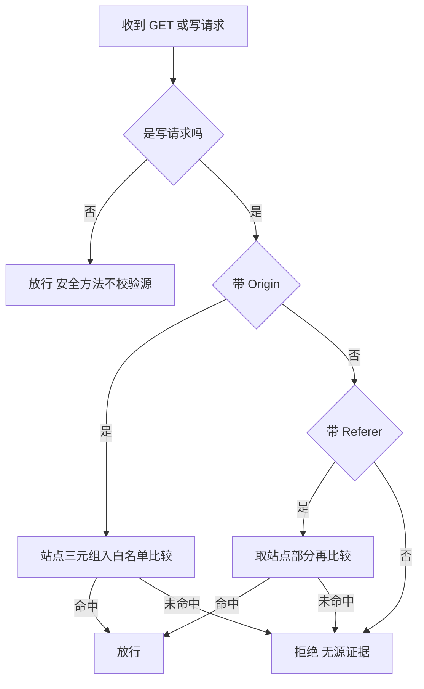
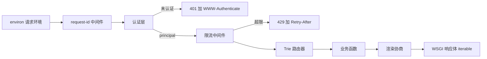
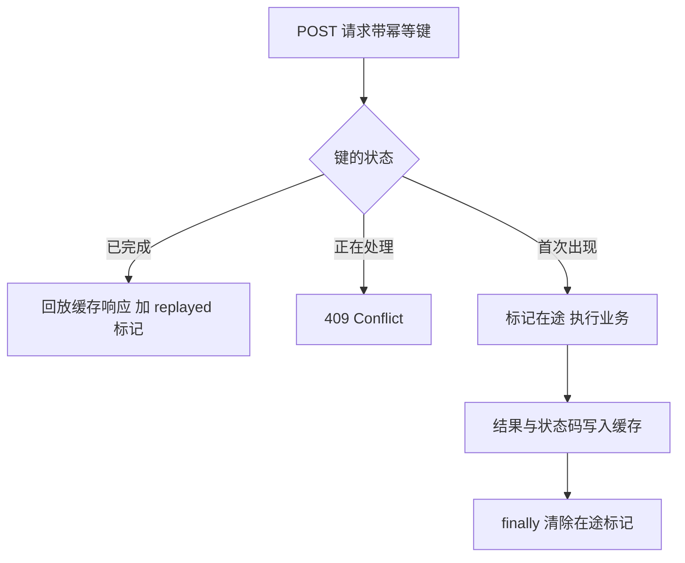
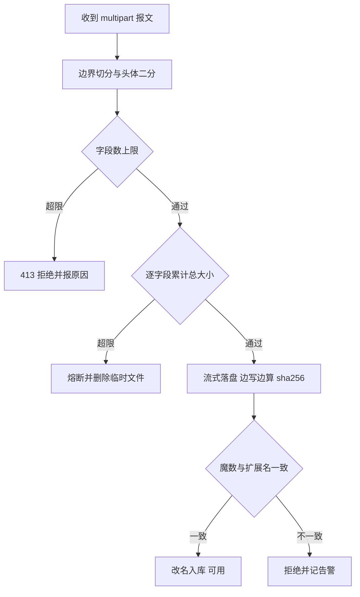
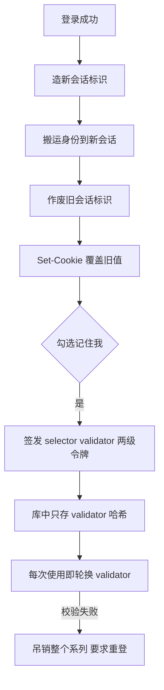
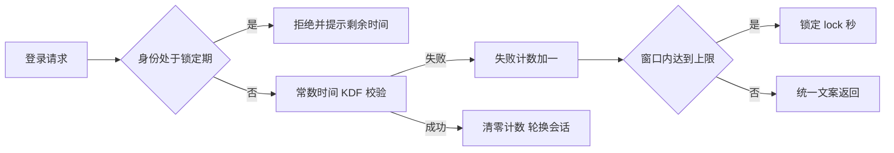
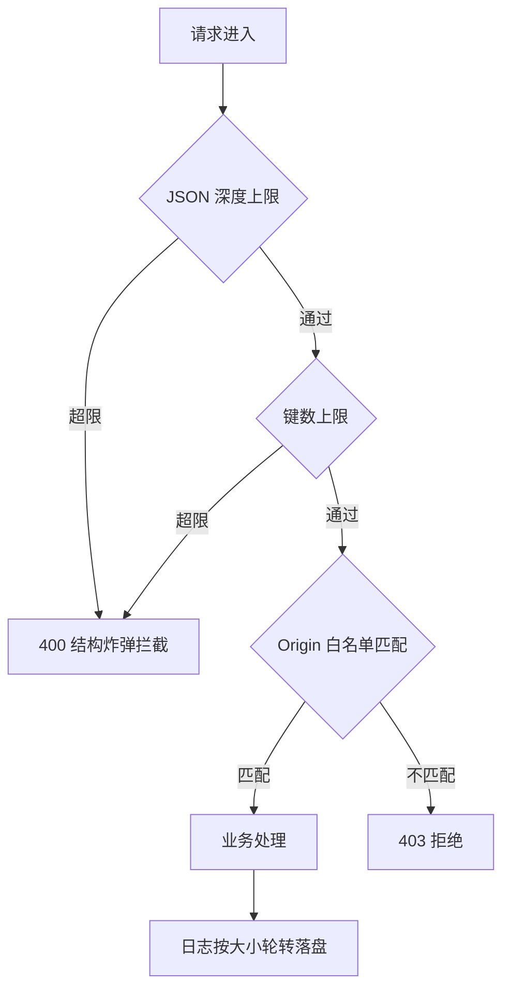
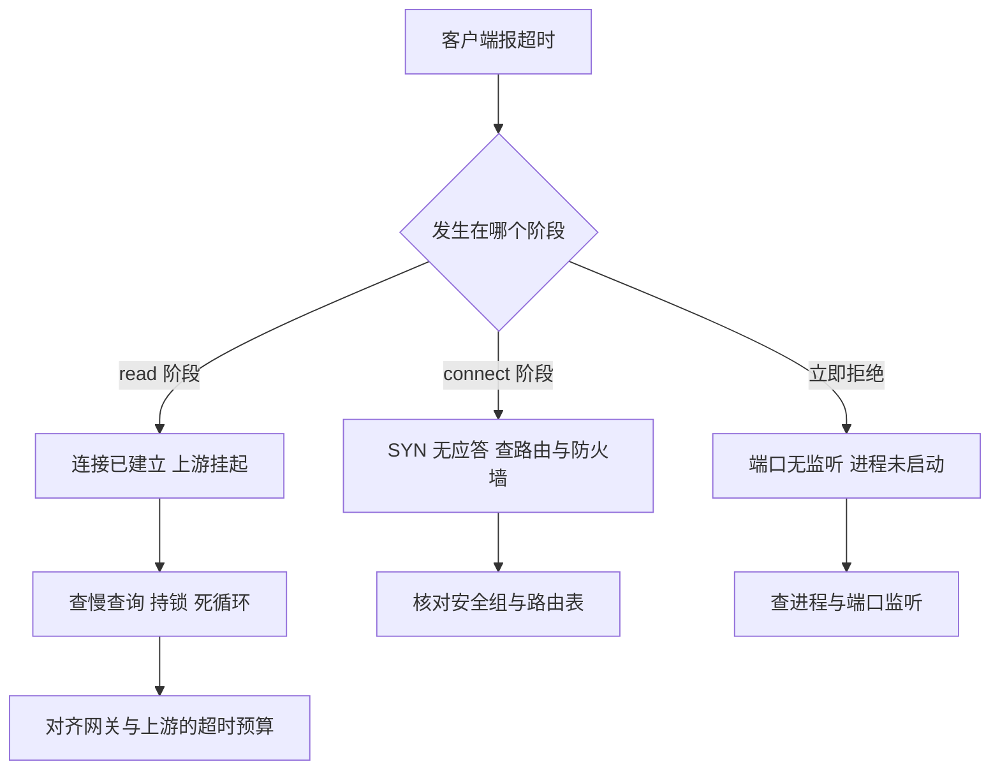

# 第 3 类 · Web 后端开发(夜间扩产五)

本文件是第 3 类的第五次夜间扩产,共 45 题(Q2426–Q2470),六条主线:HTTP 细节补遗(TE 与 CL 冲突裁决、304 的条件组合、Cache-Control 指令矩阵、SameSite 三值矩阵、Origin 与 Referer 语义、重放防护的请求指纹、chunked 增量解码、Vary 缓存键)、框架无关设计(WSGI 函数式组合、可插拔认证层、统一错误构造器、限流中间件骨架、内容协商多渲染器、极简 DI 容器、Trie 路由器、幂等键中间件)、表单与上传(multipart 边界解析器、大文件流式落盘、字段数与总大小双上限、CSV 流式校验、urlencoded 解析陷阱、魔数嗅探、分片合并)、认证会话补遗(会话固定防护、记住我两级令牌、密码策略与 KDF 成本、设备会话列表、重置令牌一次性消费、签名 Cookie、统一失败语义、失败锁定)、运维细节(robots 解析与限速、检查单执行器、CORS 白名单匹配、JSON 深度与键数防御、按大小轮转日志、依赖自检、cron 下次触发)、排障(502 因果链模板、连接与读超时定位、响应头过大、分段计时、粘包半包、端口占用诊断、超时雪崩演练)。
代码全部为纯标准库实现,均已在 /usr/bin/python3(Python 3.9.6)下逐块实跑通过;涉及回环 socket 的题目直连 127.0.0.1,不经代理;故意触发的异常均有 try/except 或断言包裹,演示数据固定、输出可复现、单块耗时远低于 25 秒。
难度分布:1-2 星 9 题、3 星 23 题、4-5 星 13 题;每 5 题左右插一张 mermaid 结构图,共 9 张。
复习主线:协议语义先行、边界条件兜底、超时预算兜底——把报文怎么读、身份怎么信、失败怎么归因这三件事想透,框架只是语法糖。

### Q2426 · Transfer-Encoding 与 Content-Length 的冲突裁决

> 难度:★★★★ | 标签:HTTP, 报文分帧, 请求走私

**问**:同一个请求里同时出现 Transfer-Encoding: chunked 和 Content-Length,服务端、代理、客户端各自应该怎么处理?为什么这件事值得单独记?

**答**:这是 RFC 7230 明确规定的冲突场景,也是请求走私攻击的经典入口,值得背下三句话。第一,发送端不得同时携带两个头,客户端库发现双头并存应当报错或剥离 Content-Length 再发。第二,接收端 TE 优先:只要存在有效的 Transfer-Encoding,就按 chunked 规则读到 0 长度块为止,Content-Length 被整体忽略,它只是潜在的混淆向量。第三,中间人代理必须删除 Content-Length 再转发——如果前置代理信 CL、后端信 TE,两边对报文边界的理解就会分叉,多出来的字节被后端解析成第二个请求,这就是 CL.TE 走私。附带两个要点:TE 的值里最后一个必须是 chunked 才算有效分帧;HTTP/2 报文里根本没有这两个头,做协议转换的网关必须剥掉入站头再按 H1 规则重新分帧,透传等于制造歧义报文。

```python
# file: code/03_Web后端开发/q2426_te_cl_conflict.py
"""Transfer-Encoding 与 Content-Length 冲突时的裁决规则(纯标准库)。"""


def parse_framing(header_lines):
    """从原始头行中提取帧信息, 返回 (te_present, chunked, cl_value)。"""
    te, chunked, cl = False, False, None
    for line in header_lines:
        name, _, value = line.partition(":")
        name = name.strip().lower()
        value = value.strip()
        if name == "transfer-encoding":
            te = True
            if "chunked" in value.lower():
                chunked = True
        elif name == "content-length":
            cl = value
    return te, chunked, cl


def decide(role, te_present, cl_present):
    """发送端禁止并存; 接收端 TE 优先; 中间人必须删除 CL 再转发。"""
    if te_present and cl_present:
        if role == "sender":
            return "拒绝发送", "客户端库应报错或剥离 Content-Length 再发"
        if role == "proxy":
            return "删CL转发", "按 TE 分帧并移除 CL, 防止下游解析分歧"
        return "TE优先", "RFC 7230: 存在 TE 时忽略 CL, CL 只是混淆向量"
    if te_present:
        return "TE分帧", "按 chunked 规则读到 0 长度块结束"
    if cl_present:
        return "CL定长", "按 Content-Length 读取指定字节数"
    return "读到关闭", "无帧信息, 只能读到连接关闭为止"


for role, te, cl in [("sender", True, True), ("proxy", True, True),
                     ("server", True, True), ("server", True, False),
                     ("server", False, True), ("server", False, False)]:
    action, why = decide(role, te, cl)
    print("{:6s} TE={:<5} CL={:<4} -> {:6s} | {}".format(role, te, str(cl), action, why))

lines = ["Transfer-Encoding: chunked", "Content-Length: 6", "X-Other: v"]
te, chunked, cl = parse_framing(lines)
assert te and chunked and cl == "6"
assert decide("server", te, cl)[0] == "TE优先"
assert decide("proxy", te, cl)[0] == "删CL转发"
print("要点: 双头并存是请求走私的经典入口, 规则三句话: 发送端不发, 接收端 TE 优先, 中间人删 CL")
```

**追问**:
- 为什么走私攻击专挑双头并存的报文?——两个解析器各信一个头,对"报文在哪里结束"得出不同答案,差值被当作下一个请求的开头。
- 服务端拿到双头请求最稳妥的动作是什么?——按 TE 解析后直接以 400 拒绝并记录来源,歧义报文不值得继续处理。

### Q2427 · 304 Not Modified 的条件组合裁决

> 难度:★★★☆ | 标签:HTTP, 条件请求, 缓存

**问**:If-None-Match、If-Modified-Since、If-Match 同时出现时,304 与 412 到底怎么裁决?

**答**:RFC 7232 给了固定顺序:If-Match 先行,不匹配则对非安全方法回 412;接着 If-Unmodified-Since,资源在其后修改过回 412;然后 If-None-Match,命中时 GET/HEAD 回 304、其他方法回 412;只有 If-None-Match 不存在时才轮到 If-Modified-Since。两个关键细节:If-None-Match 出现时 If-Modified-Since 整体失效,不存在"两个都看一下"的混合逻辑;ETag 的弱比较忽略 W/ 前缀,强比较(If-Match)必须逐字节一致。304 响应不能带响应体,但应该回填当前的 ETag、Cache-Control 与 Vary,让客户端缓存的元数据跟着更新。If-Modified-Since 的秒级精度是它不如 ETag 可靠的根本原因,同秒内两次修改会漏检。

```python
# file: code/03_Web后端开发/q2427_conditional_304.py
"""条件请求头的组合裁决: 304 与 412 的优先级(纯标准库)。"""
import email.utils


def parse_etag_list(value):
    """If-None-Match 的值可以是逗号分隔列表, 也可以是通配符 *。"""
    value = value.strip()
    if value == "*":
        return "*"
    return [item.strip() for item in value.split(",")]


def etag_match(candidate, current, weak_ok=True):
    """弱比较忽略 W/ 前缀, 用于 If-None-Match; 强比较要求逐字节一致。"""
    def strip(s):
        return s[2:] if s.startswith("W/") else s
    if weak_ok:
        return strip(candidate) == strip(current)
    return candidate == current


def evaluate(method, resource, headers):
    """按 RFC 7232 固定顺序裁决, 返回 (status, 理由)。"""
    if "If-Match" in headers:
        listed = parse_etag_list(headers["If-Match"])
        ok = listed == "*" or any(
            etag_match(c, resource["etag"], weak_ok=False) for c in listed)
        if not ok:
            return 412, "If-Match 不匹配, 资源已被他人修改"
    if "If-Unmodified-Since" in headers:
        since = email.utils.parsedate_to_datetime(headers["If-Unmodified-Since"]).timestamp()
        if resource["mtime"] > since:
            return 412, "资源在 If-Unmodified-Since 之后被修改"
    if "If-None-Match" in headers:
        listed = parse_etag_list(headers["If-None-Match"])
        hit = listed == "*" or any(
            etag_match(c, resource["etag"], weak_ok=True) for c in listed)
        if hit and method in ("GET", "HEAD"):
            return 304, "ETag 命中, 缓存副本仍然有效"
        if hit:
            return 412, "非安全方法不允许覆盖已存在的表示"
    elif "If-Modified-Since" in headers and method in ("GET", "HEAD"):
        since = email.utils.parsedate_to_datetime(headers["If-Modified-Since"]).timestamp()
        if resource["mtime"] <= since:
            return 304, "修改时间未变, 缓存副本仍然有效"
    return 200, "条件全部通过, 返回新表示"


res = {"etag": '"v3"', "mtime": 1735689600.0}
httpdate = email.utils.formatdate(res["mtime"], usegmt=True)
cases = [
    ("GET", {"If-None-Match": 'W/"v3"'}, 304),
    ("GET", {"If-None-Match": '"v2", "v3"'}, 304),
    ("GET", {"If-None-Match": '"v9"', "If-Modified-Since": httpdate}, 200),
    ("GET", {"If-Modified-Since": httpdate}, 304),
    ("PUT", {"If-Match": '"v2"'}, 412),
    ("PUT", {"If-Match": '"v3"'}, 200),
]
for method, headers, expect in cases:
    status, why = evaluate(method, res, headers)
    print("{} {:36s} -> {} {}".format(method, str(headers), status, why))
    assert status == expect, (method, headers, status, expect)
print("要点: 裁决顺序 If-Match -> If-Unmodified-Since -> If-None-Match -> If-Modified-Since, "
      "INM 出现时 IMS 整体失效, 304 永不带响应体")
```

**追问**:
- 为什么 If-None-Match 命中时 PUT 是 412 而不是 304?——304 语义是"你缓存的那份还能用",写请求的答案是"资源已被人改过,你的条件假设不成立"。
- If-Match 在并发编辑里扮演什么角色?——它是乐观锁的 HTTP 表达,提交时带上读到的 ETag,被别人改过就拒绝。

### Q2428 · Cache-Control 指令矩阵与新鲜度裁决

> 难度:★★★☆ | 标签:HTTP, 缓存, Cache-Control

**问**:Cache-Control 的指令那么多,请把它们按"谁能用、管什么"整理成矩阵,并说清新鲜度裁决的优先级。

**答**:按出现位置分三组记最省力:双向指令 no-store、no-cache、max-age(请求侧是约束、响应侧是声明),仅响应的 s-maxage、must-revalidate、public、private,仅请求的 max-stale、only-if-cached。语义上最容易混的是 no-store 与 no-cache:前者禁止存储,后者允许存储但每次使用前必须协同验证。裁决优先级是一条链:先看 no-store,再看 no-cache,然后算新鲜期——共享缓存里 s-maxage 存在时覆盖 max-age——过期后再看 must-revalidate 决定能否将就陈旧副本。private 与 public 决定的是"哪一层缓存可以存",CDN 上误发 private 会把命中率打没,误发 public 且带用户数据就是泄露。

```python
# file: code/03_Web后端开发/q2428_cache_control_matrix.py
"""Cache-Control 指令矩阵与新鲜度裁决(纯标准库)。"""

DIRECTIVES = {
    # 指令: (出现位置, 一句话语义)
    "no-store": ("请求+响应", "任何环节不得存储, 优先级最高"),
    "no-cache": ("请求+响应", "可以存储但每次使用前必须协同验证"),
    "max-age": ("请求+响应", "响应侧定义新鲜期秒数, 请求侧约束可接受年龄"),
    "s-maxage": ("仅响应", "共享缓存的新鲜期, 存在时覆盖 max-age"),
    "must-revalidate": ("仅响应", "过期后禁止直接用陈旧副本, 必须回源验证"),
    "public": ("仅响应", "允许共享缓存存储, 即使请求带凭证"),
    "private": ("仅响应", "只允许浏览器私有缓存存储"),
    "max-stale": ("仅请求", "愿意接受超期不超过 N 秒的陈旧副本"),
    "only-if-cached": ("仅请求", "只接受缓存已有副本, 没有就 504"),
}


def parse(header_value):
    """把 Cache-Control 头解析成 dict: 无参指令值为 True, 带参指令为字符串。"""
    out = {}
    for token in header_value.split(","):
        name, sep, arg = token.strip().partition("=")
        if not name:
            continue
        out[name.strip().lower()] = arg.strip('"') if sep else True
    return out


def decide(shared, resp_dirs, age):
    """按优先级裁决缓存行为: no-store > no-cache > 新鲜期 > 陈旧策略。"""
    if resp_dirs.get("no-store"):
        return "不缓存", "no-store 禁止存储, 每次都回源"
    if resp_dirs.get("no-cache"):
        return "须验证", "no-cache 每次使用前都要带条件头验证"
    max_age = resp_dirs.get("max-age", 0)
    if shared and "s-maxage" in resp_dirs:
        max_age = int(resp_dirs["s-maxage"])
    if age < int(max_age):
        return "新鲜", "age {} < 新鲜期 {}, 直接复用".format(age, max_age)
    if resp_dirs.get("must-revalidate"):
        return "须验证", "已过期且 must-revalidate, 不得回退陈旧副本"
    return "可陈旧", "过期但未禁止陈旧, 可按 max-stale 等策略权衡"


for name, (where, why) in DIRECTIVES.items():
    print("{:16s} {:6s} {}".format(name, where, why))

parsed = parse("public, max-age=60, no-cache=\"Set-Cookie\"")
assert parsed["max-age"] == "60" and parsed["public"] is True

print("-- 裁决演示 --")
for shared, dirs, age in [(False, parse("no-store, max-age=600"), 0),
                          (True, parse("max-age=60, s-maxage=300"), 100),
                          (False, parse("max-age=60"), 100),
                          (False, parse("max-age=60, must-revalidate"), 100)]:
    result, why = decide(shared, dirs, age)
    print("shared={} age={:<4} -> {:4s} | {}".format(shared, age, result, why))
assert decide(True, parse("max-age=60, s-maxage=300"), 100)[0] == "新鲜"
assert decide(False, parse("max-age=60"), 100)[0] == "可陈旧"
assert decide(False, parse("max-age=60, must-revalidate"), 100)[0] == "须验证"
print("要点: 先看 no-store 再看 no-cache, 共享缓存用 s-maxage 盖过 max-age, "
      "must-revalidate 决定过期后能不能将就")
```

**追问**:
- s-maxage 与 max-age 同时存在时浏览器用哪个?——浏览器用 max-age,共享缓存(CDN、代理)用 s-maxage,这正是给两类缓存分开定价的指令。
- must-revalidate 过期后直接回源失败怎么办?——只能回 504 或按业务回退,不允许悄悄用陈旧副本,除非显式带 max-stale。

### Q2429 · Cookie 的 SameSite 三值行为矩阵

> 难度:★★☆☆ | 标签:Cookie, SameSite, CSRF

**问**:SameSite 的 Strict、Lax、None 三种取值分别在什么请求下携带 Cookie?默认值是什么?

**答**:SameSite 管"跨站上下文里 Cookie 带不带",三种取值构成一张矩阵:Strict 除同站外全不带,连跨站顶层导航的 GET 也不带;Lax 放行跨站顶层导航的 GET(安全方法),挡掉跨站 POST 与 iframe 内一切请求;None 全部放行,但现代浏览器强制要求同时带 Secure,否则直接拒收。未显式声明时,主流浏览器默认按 Lax 处理,这也是"升级浏览器后第三方嵌入突然丢登录态"的常见事故来源。防 CSRF 的原理就藏在矩阵里:CSRF 攻击靠跨站 POST 自动带 Cookie,而 Lax 恰好挡住这条路径。要记住 None 是给第三方嵌入、跨站 SSO 跳转用的,普通会话 Cookie 用 Lax 即可,Strict 留给高敏感操作。

```python
# file: code/03_Web后端开发/q2429_samesite_matrix.py
"""Cookie 的 SameSite 三值行为矩阵(纯标准库)。"""

# 请求上下文 -> 是否跨站以及请求形态
CONTEXTS = [
    ("同站页面内子资源请求", "sub"),
    ("跨站 POST 表单提交", "cross_post"),
    ("跨站 GET 顶层导航", "top_nav_get"),
    ("第三方 iframe 内请求", "iframe"),
]

# SameSite 取值 -> 各上下文是否携带 Cookie
MATRIX = {
    "Strict": {"sub": True,  "cross_post": False, "top_nav_get": False, "iframe": False},
    "Lax":    {"sub": True,  "cross_post": False, "top_nav_get": True,  "iframe": False},
    "None":   {"sub": True,  "cross_post": True,  "top_nav_get": True,  "iframe": True},
}


def set_cookie_header(name, value, samesite, secure=True):
    """拼一个 Set-Cookie 响应头, SameSite=None 必须搭配 Secure。"""
    parts = ["{}={}".format(name, value), "Path=/", "SameSite={}".format(samesite)]
    if secure:
        parts.append("Secure")
    return "; ".join(parts)


def send_cookie(samesite, context_key):
    return MATRIX[samesite][context_key]


print("{:22s} {:>7s} {:>7s} {:>7s}".format("上下文", "Strict", "Lax", "None"))
for label, key in CONTEXTS:
    print("{:22s} {:>7s} {:>7s} {:>7s}".format(
        label, str(send_cookie("Strict", key)),
        str(send_cookie("Lax", key)), str(send_cookie("None", key))))

assert not send_cookie("Lax", "cross_post"), "Lax 正是靠挡跨站 POST 防 CSRF"
assert send_cookie("Lax", "top_nav_get"), "顶层导航 GET 要能带 Cookie, 否则外链登录态丢失"
assert send_cookie("None", "iframe"), "第三方嵌入场景只能用 None"

csrf = set_cookie_header("sid", "abc123", "Lax")
embed = set_cookie_header("sid", "abc123", "None")
assert "SameSite=Lax" in csrf and "Secure" in embed
print("普通会话:", csrf)
print("嵌入场景:", embed)
print("要点: None 必须配 Secure 否则现代浏览器直接拒收; "
      "未显式声明时浏览器默认按 Lax 处理, 跨站 POST 丢 Cookie 是最常见的线上事故")
```

**追问**:
- Strict 会不会把外链进站的用户登出?——会,外链跳转属于跨站顶层导航,Strict 不带 Cookie,通常配合一个中转页或落地页重登。
- SameSite 能完全替代 CSRF Token 吗?——不能,Lax 挡不住同站子域发起的请求与 GET 型副作用,敏感操作仍要 Token 或校验 Origin。

### Q2430 · Origin 与 Referer 的语义差异与源校验

> 难度:★★☆☆ | 标签:HTTP, CSRF, 安全头

**问**:做 CSRF 源校验时,Origin 和 Referer 有什么语义差异?为什么优先信 Origin?

**答**:Origin 的值只有 scheme://host:port 三元组,天生不含路径与查询,隐私面小,而且现代浏览器对 CORS 请求与所有非 GET 请求一律携带,可预测性强。Referer 是完整 URL,可能带路径参数,还受 Referrer-Policy 控制——策略设成 no-referrer 时它会被整个剥掉,你的校验逻辑瞬间失去输入。所以源校验的正确姿势是:优先取 Origin 与白名单比较,Origin 缺失时退回 Referer 取其站点部分,两者都没有的写请求直接拒绝;GET 等安全方法不做源校验,因为顶层导航本来就该允许无源进入。比较必须在站点粒度做规范化,默认端口 443 与 80 要归一,否则同站会因端口书写差异被误拒。

```python
# file: code/03_Web后端开发/q2430_origin_referer.py
"""Origin 与 Referer 的语义差异与 CSRF 源校验(纯标准库)。"""
from urllib.parse import urlsplit


def site_of(url):
    """取 scheme://host:port 站点粒度, 不含路径与查询。"""
    parts = urlsplit(url)
    netloc = parts.netloc.lower()
    if parts.scheme == "https" and parts.port == 443:
        netloc = netloc.split(":")[0]          # 规范化默认端口
    if parts.scheme == "http" and parts.port == 80:
        netloc = netloc.split(":")[0]
    return "{}://{}".format(parts.scheme.lower(), netloc)


def check_csrf(headers, method, allowed_sites):
    """CSRF 敏感方法的源校验: 优先 Origin, 退而求 Referer, 都没有则拒绝。"""
    if method not in ("POST", "PUT", "PATCH", "DELETE"):
        return True, "安全方法不做源校验"
    if "Origin" in headers:
        src = "Origin"
        got = site_of(headers["Origin"])
    elif "Referer" in headers:
        src = "Referer"
        got = site_of(headers["Referer"])
    else:
        return False, "无源信息, 拒绝"
    if got in allowed_sites:
        return True, "{} 源 {} 在白名单".format(src, got)
    return False, "{} 源 {} 不在白名单".format(src, got)


ALLOWED = {"https://app.example.com", "https://www.example.com"}

cases = [
    # 请求头, 方法, 期望
    ({"Origin": "https://app.example.com"}, "POST", True),
    ({"Origin": "https://evil.example.com"}, "POST", False),
    ({"Referer": "https://www.example.com/account/settings?tab=2"}, "POST", True),
    ({"Referer": "http://www.example.com/x"}, "POST", False),          # scheme 不同
    ({}, "POST", False),                                               # 两者都没有
    ({}, "GET", True),
    ({"Origin": "https://www.example.com:443/x/y"}, "POST", True),     # Origin 带路径时只取站点
]
for headers, method, expect in cases:
    ok, why = check_csrf(headers, method, ALLOWED)
    print("{:<4} {:34s} -> {}".format(method, str(headers), why))
    assert ok == expect, (headers, method, ok, why)

# 语义差异要点
assert site_of("https://www.example.com/a/b?c=1") == "https://www.example.com"
print("要点: Origin 只有站点三元组且 CORS 与非 GET 请求必带; "
      "Referer 带完整路径可被 Referrer-Policy 剥掉, 所以安全校验优先信 Origin")
```

**追问**:
- 旧浏览器或某些跳转场景两者都没有怎么办?——那是历史包袱,现代方案以 CSRF Token 兜底,不能把安全建立在可能缺失的头之上。
- Referrer-Policy: strict-origin-when-cross-origin 对校验的影响?——跨站 Referer 被降级成 Origin 粒度,站点级比较依然可用,但任何依赖路径的校验都会失效。



### Q2431 · 防重放的请求指纹设计

> 难度:★★★★ | 标签:安全, 防重放, HMAC

**问**:支付、下单这类接口怎么防止同一请求被截获后原样重放?请求指纹指的是什么?

**答**:重放防护是三层结构的组合。第一层时间戳:请求携带时间戳,服务端只接受正负窗口内(比如五分钟)的请求,限制攻击者的操作时间轴。第二层 nonce:每次请求带一次性随机串,服务端在窗口期内记录见过的 nonce,重复即判重放,窗口外的记录滑动清理防止存储膨胀。第三层请求指纹:用 HMAC 对"方法、路径、排序后的参数、时间戳、nonce"的规范化串整体签名,任何一项被篡改签名即失效——时间戳和 nonce 也被盖进签名,攻击者无法改了再签。工程细节:规范化串必须对参数做确定性排序,否则同一请求两次构造出不同串;nonce 存储要带 TTL;时钟漂移大的客户端要靠服务端时间校准接口兜底。

```python
# file: code/03_Web后端开发/q2431_replay_fingerprint.py
"""重放防护: 请求指纹绑定 + nonce 窗口(纯标准库)。"""
import hashlib
import hmac
import json
import time

SECRET = b"demo-signing-secret"


def canonical(method, path, body, ts, nonce):
    """规范化串: 方法 路径 排序后的 JSON 时间戳 nonce, 逐项换行拼接。"""
    body_s = json.dumps(body, sort_keys=True, separators=(",", ":"), ensure_ascii=False)
    return "\n".join([method.upper(), path, body_s, str(ts), nonce])


def sign(method, path, body, ts, nonce):
    """客户端签名: HMAC 覆盖请求全部关键要素, 改任何一项签名即失效。"""
    return hmac.new(SECRET, canonical(method, path, body, ts, nonce).encode(),
                    hashlib.sha256).hexdigest()


class ReplayGuard:
    """服务端防重放: 时间戳限制窗口, nonce 限制一次性, 指纹绑定内容。"""

    def __init__(self, window=300, now=None):
        self.window = window
        self.now = now or time.time
        self.seen = {}                       # nonce -> 首次出现的时刻

    def check(self, method, path, body, ts, nonce):
        now = self.now()
        if abs(now - ts) > self.window:
            return False, "时间戳超出正负 {} 秒窗口".format(self.window)
        if nonce in self.seen:
            return False, "nonce 已出现过, 判定为重放"
        for stale in [k for k, v in self.seen.items() if now - v > self.window]:
            self.seen.pop(stale)             # 滑动清理, 防止 seen 无限膨胀
        self.seen[nonce] = now
        return True, "要素齐全且 nonce 首次出现, 放行"


now = time.time()
guard = ReplayGuard(window=300, now=lambda: now)
nonce = "8f14e45f"
sig = sign("POST", "/api/pay", {"amount": 100}, now, nonce)
assert sig == sign("POST", "/api/pay", {"amount": 100}, now, nonce)   # 签名可复算校验

print("签名前 16 位:", sig[:16])
ok, why = guard.check("POST", "/api/pay", {"amount": 100}, now, nonce)
print("首次提交  -> {} {}".format(ok, why))
ok2, why2 = guard.check("POST", "/api/pay", {"amount": 100}, now, nonce)
print("原样重放  -> {} {}".format(ok2, why2))
ok3, why3 = guard.check("POST", "/api/pay", {"amount": 100}, now - 3600, "new-nonce")
print("过期时间戳-> {} {}".format(ok3, why3))
assert ok and not ok2 and not ok3

# 内容被篡改时签名校验失败
sig_tampered = sign("POST", "/api/pay", {"amount": 9900}, now, nonce)
assert sig_tampered != sig
print("要点: 时间戳限窗口、nonce 限一次性、指纹 HMAC 把方法路径参数全部绑定, 三层缺一不可")
```

**追问**:
- 只靠 nonce 不做签名够吗?——不够,nonce 只防原样重放,中间人篡改报文内容后换个新 nonce 依然合法,签名才把内容绑死。
- 窗口设多长合适?——覆盖客户端与服务端的最大时钟差加重放观察期,常见五分钟,窗口越长 nonce 存储越大。

### Q2432 · chunked 分块传输的增量解码器

> 难度:★★★☆ | 标签:HTTP, chunked, 流式解析

**问**:手写一个 chunked 解码器要处理哪些细节?为什么它必须能容忍任意字节切分?

**答**:chunked 的报文格式是"十六进制块长行(可带分号后的分块扩展)、块体、CRLF"循环,最后以 0 长度块加 trailer 加 CRLF 结束。解码器必须维护三个状态:正在读块长行、正在收块体、已结束——因为 TCP 是字节流,块长行和块体可能在任意位置被切断,解析器只能把数据先攒进缓冲,凑齐一行或一块再消费,这与粘包处理是同一套思路。细节上有四个坑:块长是十六进制;分号后是分块扩展要忽略;块体后面的 CRLF 属于分帧不属于数据,消费时要精确剥掉;0 块之后还有 trailer 区。增量式接口 feed(data) 返回本次解出的数据,是流式网关与代理的标准写法。

```python
# file: code/03_Web后端开发/q2432_chunked_decoder.py
"""chunked 分块传输的增量解码器(纯标准库)。"""


class ChunkedDecoder:
    """可分批喂字节的解码器: 解析十六进制块长, 忽略分号后的分块扩展。"""

    def __init__(self):
        self.buf = b""
        self.remain = None            # 当前块剩余字节数, None 表示在读块长行
        self.done = False

    def feed(self, data):
        self.buf += data
        out = b""
        while not self.done:
            if self.remain is None:
                line, sep, rest = self.buf.partition(b"\r\n")
                if not sep:
                    break                     # 块长行不完整, 等下一次喂入
                size_token = line.split(b";")[0].strip()   # 分块扩展跟在分号后
                self.remain = int(size_token, 16)
                self.buf = rest
                if self.remain == 0:
                    self.done = True          # 0 长度块后是 trailer 与结束 CRLF
            else:
                if len(self.buf) < self.remain + 2:
                    break                     # 块体或其后的 CRLF 尚未到齐
                out += self.buf[:self.remain]
                tail = self.buf[self.remain:self.remain + 2]
                assert tail == b"\r\n", "块体后必须是 CRLF, 收到: {!r}".format(tail)
                self.buf = self.buf[self.remain + 2:]
                self.remain = None
        return out


def encode_chunk(payload):
    """编码端: 块长用十六进制, 块体后跟 CRLF。"""
    return "{:x}\r\n".format(len(payload)).encode() + payload + b"\r\n"


stream = encode_chunk(b"hello") + encode_chunk(b", ") + encode_chunk(b"world") \
    + b"0\r\nX-Trailer: v\r\n\r\n"
print("编码报文:", stream)

decoder = ChunkedDecoder()
pieces = [stream[:5], stream[5:14], stream[14:]]      # 故意在块长与块体中间切断
decoded = b""
for i, piece in enumerate(pieces):
    got = decoder.feed(piece)
    decoded += got
    print("第 {} 次喂入 {} 字节 -> 解出 {}".format(i + 1, len(piece), got))

assert decoded == b"hello, world"
assert decoder.done
print("要点: 块长行按十六进制读、分号后是扩展、0 块结束; "
      "解码器必须容忍任意字节切分, 这正是流式解析与粘包处理的共同要求")
```

**追问**:
- chunked 与 Content-Length 能否共存?——发送端不得共存,接收端 TE 优先,这正是 Q2426 的冲突规则。
- 为什么代理要把 chunked 转回定长响应?——HTTP/1.0 下游不认识 chunked,转换时要么算准长度,要么断连表达结束。

### Q2433 · Vary 头驱动的缓存键与二次维度

> 难度:★★★☆ | 标签:HTTP, 缓存, Vary

**问**:Vary 头在缓存里起什么作用?漏写或写错会出什么事故?

**答**:Vary 声明"这份表示会随哪些请求头变化",缓存据此把缓存键从 URL 扩展成"URL + Vary 列出的头值"——同一个 URL 可以同时存 gzip 与 identity 两个变体,互不覆盖。漏写的代价是缓存串味:接口对桌面与移动端返回不同内容却没写 Vary: User-Agent,CDN 会把移动端副本发给桌面用户;Accept-Encoding 忘写则可能把压缩体发给不解压的客户端。写错也一样致命:Vary: * 表示表示随任意因素变化,等价于每次都不命中,命中率直接归零。工程实践是让框架按响应内容自动推导 Vary(内容协商自动加 Accept,压缩中间件自动加 Accept-Encoding),并定期审计"同一 URL 多副本"的膨胀问题。

```python
# file: code/03_Web后端开发/q2433_vary_cache_key.py
"""Vary 头驱动的缓存键: 同一 URL 的多表示共存(纯标准库)。"""


def cache_key(url, request_headers, vary):
    """缓存键 = URL + 按 Vary 列出的请求头值; Vary 为空则仅 URL。"""
    lowered = {k.lower(): v for k, v in request_headers.items()}
    parts = [url]
    for name in sorted(h.lower() for h in (vary or [])):
        parts.append("{}={}".format(name, lowered.get(name, "")))
    return "|".join(parts)


class VaryCache:
    def __init__(self):
        self.store = {}

    def put(self, url, vary, req_headers, body):
        self.store[cache_key(url, req_headers, vary)] = body

    def get(self, url, vary, req_headers):
        return self.store.get(cache_key(url, req_headers, vary))


cache = VaryCache()

# 场景一: 同一 URL 因 Accept-Encoding 不同存两份表示
vary = ["Accept-Encoding"]
cache.put("/api/report", vary, {"Accept-Encoding": "gzip"}, b"\x1f\x8b-gz-body")
cache.put("/api/report", vary, {"Accept-Encoding": "identity"}, b"plain-body")
assert cache.get("/api/report", vary, {"Accept-Encoding": "gzip"}) == b"\x1f\x8b-gz-body"
assert cache.get("/api/report", vary, {"Accept-Encoding": "identity"}) == b"plain-body"
assert cache.get("/api/report", vary, {"Accept-Encoding": "br"}) is None   # 未缓存过的变体
print("场景一: Vary: Accept-Encoding 时 gzip 与 identity 是两个键, 互不覆盖")

# 场景二: 忘写 Vary 导致 UA 差异被吞掉
cache.put("/page", None, {"User-Agent": "Mobile"}, b"mobile-html")
hit = cache.get("/page", None, {"User-Agent": "Desktop"})
assert hit == b"mobile-html"
print("场景二: 无 Vary 时桌面请求命中了移动端副本, 这就是缓存串味的根源")

# 场景三: Vary 列举的顺序不影响键
cache.put("/p2", ["Accept", "Accept-Language"], {"Accept": "a", "Accept-Language": "zh"}, b"x")
hit2 = cache.get("/p2", ["Accept-Language", "Accept"], {"Accept": "a", "Accept-Language": "zh"})
assert hit2 == b"x"
print("要点: Vary 决定缓存键的二次维度, 少写一个头就会串味, "
      "带 Vary: * 则等价于每次都不命中")
```

**追问**:
- Vary 与 304 条件请求如何配合?——304 必须回填 Vary,否则客户端不知道这份 200 副本该按哪些头区分。
- 缓存键里要不要包含 Cookie?——包含会撕裂命中率,通常只包含会话级差异真正影响内容的少数头,并配合 Cache-Control: private。

### Q2434 · WSGI 中间件的函数式组合

> 难度:★★★☆ | 标签:WSGI, 中间件, 函数式

**问**:不依赖任何框架,怎么用纯函数把 WSGI 中间件组合成一个应用?组合顺序对应什么执行模型?

**答**:WSGI 应用的本质是 callable(environ, start_response) 返回可迭代体,中间件就是"吃一个应用、吐一个应用"的高阶函数,组合只是 reduce:wrap(app, m1, m2) 等价 m1(m2(app)),m1 最先看到请求、最后看到响应,这就是洋葱模型。每个中间件在调用内层前后插自己的逻辑:前置逻辑改 environ 或提前短路返回,后置逻辑包装 start_response 往响应头里补东西,比如注入 X-Request-Id 或 Server-Timing。测试时不需要起服务器,手工构造 environ 字典、用一个收集函数扮演 start_response,就能直接断言状态码与头。这套函数式组合正是 Flask before/after 与 FastAPI 中间件栈的底层形态。

```python
# file: code/03_Web后端开发/q2434_wsgi_compose.py
"""WSGI 应用的函数式组合: 中间件即高阶函数(纯标准库)。"""
import itertools

_counter = itertools.count(1)


def wrap(app, *middlewares):
    """把中间件按从外到内的顺序包裹应用: wrap(app, a, b) 等价 a(b(app))。"""
    for mw in reversed(middlewares):
        app = mw(app)
    return app


def request_id_middleware(app):
    """最外层: 给每个请求注入 x-request-id 并写进响应头。"""
    def handler(environ, start_response):
        rid = "req-{}".format(next(_counter))
        environ["x-request-id"] = rid

        def sr(status, headers):
            start_response(status, headers + [("X-Request-Id", rid)])
        return app(environ, sr)
    return handler


def timing_middleware(app):
    """内层: 记录处理耗时, 演示用固定刻度代替真实时钟。"""
    def handler(environ, start_response):
        ticks = [3]

        def sr(status, headers):
            start_response(status, headers + [("X-Server-Timing", "app;dur={}".format(ticks[0]))])
        body = app(environ, sr)
        return body
    return handler


def router_app(environ, start_response):
    """最小应用: 根据路径返回文本。"""
    path = environ.get("PATH_INFO", "/")
    if path == "/hello":
        start_response("200 OK", [("Content-Type", "text/plain")])
        return ["hello, {}".format(environ.get("x-request-id", "anon")).encode()]
    start_response("404 Not Found", [("Content-Type", "text/plain")])
    return [b"not found"]


def call_wsgi(app, path):
    """不启服务器, 直接构造 environ 调用应用并收集响应。"""
    captured = {}
    environ = {"PATH_INFO": path, "REQUEST_METHOD": "GET"}

    def start_response(status, headers):
        captured["status"], captured["headers"] = status, headers
    body = b"".join(app(environ, start_response))
    return captured["status"], captured["headers"], body


app = wrap(router_app, request_id_middleware, timing_middleware)
status, headers, body = call_wsgi(app, "/hello")
print("GET /hello -> {} body={}".format(status, body.decode()))
for k, v in headers:
    print("  响应头: {}: {}".format(k, v))
assert status == "200 OK"
assert body == b"hello, req-1"
names = [k.lower() for k, _ in headers]
assert "x-request-id" in names and "x-server-timing" in names

status404, _, body404 = call_wsgi(app, "/nope")
print("GET /nope  -> {} body={}".format(status404, body404.decode()))
assert status404 == "404 Not Found"
print("要点: WSGI 应用就是 callable(environ, start_response) -> iterable, "
      "中间件是吃应用吐应用的高阶函数, 组合顺序即洋葱层次")
```

**追问**:
- 中间件想改响应体怎么办?——它返回的就是内层应用的可迭代体,包一层生成器逐段改写即可,但要小心 Content-Length 需要重算。
- 短路发生在哪一层?——任何一层都可以不调用内层直接 start_response 返回,这就是认证层拒绝请求的实现位置。

### Q2435 · 可插拔认证层的方案注册与质询

> 难度:★★★☆ | 标签:认证, Bearer, Basic

**问**:设计一个认证层,同时支持 Bearer、Basic、ApiKey 三种方案,新方案怎么做到注册即用?

**答**:把"方案"抽象成三元组:名称、解析函数、质询串。认证层维护注册表,收到请求后按 Authorization 头的 scheme 前缀分派给对应解析函数,解析函数只做一件事——把凭证换算成 principal(用户或服务身份),返回 None 表示认证失败。新增方案就是注册一个新三元组,核心流程零改动,这就是可插拔的含义。401 响应必须回带 WWW-Authenticate,值由注册表拼接,告诉客户端服务端支持哪些方案;分派不到方案时不报 500 而是走 401 语义。两个安全细节:Basic 的密码比较用常数时间比较函数;解析函数永不抛异常,坏编码返回 None 而不是炸掉请求。认证层只负责"你是谁",授权("你能干什么")是独立的下一层。

```python
# file: code/03_Web后端开发/q2435_pluggable_auth.py
"""可插拔认证层: 方案注册、逐级协商与质询(纯标准库)。"""
import base64
import binascii
import hashlib
import hmac

TOKENS = {"tok-alice-1": "alice"}
USERS = {"alice": "wonderland"}


class AuthLayer:
    def __init__(self):
        self.schemes = []                       # (名称, 解析函数, 质询串)

    def register(self, name, resolver, challenge):
        self.schemes.append((name.lower(), resolver, challenge))
        return self                             # 链式注册

    def authenticate(self, headers):
        """按 Authorization 头的 scheme 前缀分派, 返回 principal 或 None。"""
        raw = headers.get("Authorization", "")
        scheme, _, credential = raw.partition(" ")
        for name, resolver, _ in self.schemes:
            if scheme.lower() == name:
                return resolver(credential)
        return None

    def www_authenticate(self):
        """401 响应的 WWW-Authenticate 值: 列出全部已注册方案。"""
        return ", ".join(ch for _, _, ch in self.schemes)


def bearer_resolver(credential):
    return TOKENS.get(credential)


def basic_resolver(credential):
    try:
        decoded = base64.b64decode(credential).decode()
        user, _, pwd = decoded.partition(":")
    except (binascii.Error, UnicodeDecodeError):
        return None
    expected = USERS.get(user)
    if expected and hmac.compare_digest(expected, pwd):
        return user
    return None


def apikey_resolver(credential):
    return ("service-" + credential[3:7]) if credential.startswith("sk-") else None


auth = (AuthLayer()
        .register("Bearer", bearer_resolver, 'Bearer realm="api"')
        .register("Basic", basic_resolver, 'Basic realm="api"')
        .register("ApiKey", apikey_resolver, "ApiKey"))

cases = [
    ({"Authorization": "Bearer tok-alice-1"}, "alice"),
    ({"Authorization": "Basic " + base64.b64encode(b"alice:wonderland").decode()}, "alice"),
    ({"Authorization": "Basic " + base64.b64encode(b"alice:wrong").decode()}, None),
    ({"Authorization": "ApiKey sk-demo123"}, "service-demo"),
    ({"Authorization": "Digest aaa"}, None),
    ({}, None),
]
for headers, expect in cases:
    got = auth.authenticate(headers)
    label = headers.get("Authorization", "无头")
    print("{:24s} -> {}".format(label[:24], got))
    assert got == expect, (label, got, expect)

status = 401 if auth.authenticate({}) is None else 200
assert status == 401
print("401 响应头 WWW-Authenticate:", auth.www_authenticate())
print("要点: 认证层只做 身份解析 不做授权, 新方案注册即用; "
      "401 必须回带 WWW-Authenticate 告知客户端支持的方案")
```

**追问**:
- 为什么 401 与 403 必须区分?——401 是"不知道你是谁"带 WWW-Authenticate 引导认证,403 是"知道你是谁但没权限",混用会让客户端重试逻辑失灵。
- ApiKey 方案要不要走 Authorization 头?——建议走,自定义头会绕开标准工具链,统一在 Authorization 里分派便于日志与审计。



### Q2436 · 统一错误响应构造器与错误码表

> 难度:★★☆☆ | 标签:错误处理, API 设计, 可观测

**问**:一个 API 服务的错误响应为什么要统一构造?结构里应该有哪些字段?

**答**:统一构造器把"错误长什么样"收敛成一个函数加一张码表:码表维护 code 到状态码与默认文案的映射,构造器补上 request_id 并可选携带 details。三要素缺一不可——code 是客户端程序化分支的依据,必须稳定且可枚举;message 是给人看的默认文案,同一 code 全局一致;request_id 让用户报障时可以直接定位日志,也把响应体与结构化日志串起来。已知业务错误(校验失败、冲突、限流)可以带 details 字段说明哪个字段为什么不行;未知异常只允许走 500 分支,响应体永远是通用文案,异常详情进日志不进响应——错误信息泄露内部实现是低级但高频的漏洞。构造器还隐含了一条测试契约:同一 code 的响应结构跨版本稳定,客户端升级才不会碎。

```python
# file: code/03_Web后端开发/q2436_error_builder.py
"""统一错误响应构造器与错误码表(纯标准库)。"""
import json
import uuid

ERRORS = {
    "validation_failed": (422, "请求参数校验失败"),
    "not_found": (404, "资源不存在"),
    "conflict": (409, "资源状态冲突"),
    "rate_limited": (429, "请求过于频繁, 请稍后重试"),
    "internal": (500, "服务内部错误"),
}


def build_error(code, details=None, request_id=None):
    """业务侧入口: 已知错误码 -> 稳定结构体, details 只放给客户端看的内容。"""
    status, message = ERRORS[code]
    rid = request_id or "req-" + uuid.uuid4().hex[:12]
    payload = {"error": {"code": code, "message": message, "request_id": rid}}
    if details:
        payload["error"]["details"] = details
    return status, json.dumps(payload, ensure_ascii=False)


def build_internal(exc, request_id=None):
    """兜底入口: 未知异常一律 500, 细节进日志不进响应体。"""
    rid = request_id or "req-" + uuid.uuid4().hex[:12]
    # 生产环境此处应把 repr(exc) 与堆栈写入结构化日志, 这里仅演示
    logged = "would log: {}: {}".format(type(exc).__name__, exc)
    status, body = build_error("internal", request_id=rid)
    return status, body, logged


# 场景一: 参数校验失败, 带字段级明细
status, body = build_error("validation_failed", details=[
    {"field": "email", "message": "格式不合法"},
    {"field": "age", "message": "必须为 0..120 的整数"},
])
print(status, body)
parsed = json.loads(body)
assert status == 422 and parsed["error"]["code"] == "validation_failed"
assert len(parsed["error"]["details"]) == 2

# 场景二: 未预期异常, 响应体不外泄内部信息
try:
    1 / 0
except ZeroDivisionError as exc:
    status, body, logged = build_internal(exc, request_id="req-fixed-01")
print(status, body)
print("日志侧:", logged)
parsed = json.loads(body)
assert status == 500
assert "ZeroDivision" not in body and "division" not in body   # 内部细节不外泄
assert parsed["error"]["request_id"] == "req-fixed-01"

# 场景三: 同一错误码的结构稳定, 客户端可按 code 分支
_, body_a = build_error("not_found", request_id="req-x")
_, body_b = build_error("not_found", request_id="req-y")
assert json.loads(body_a)["error"]["code"] == json.loads(body_b)["error"]["code"]
print("要点: 错误响应三要素 code message request_id, "
      "已知错误带 details, 未知异常只给通用文案加 request_id 让用户可追溯")
```

**追问**:
- details 里能不能放堆栈或 SQL?——绝对不能,那是日志的内容;details 只放用户能据以修正输入的信息。
- request_id 从哪来?——入口中间件生成并注入 environ 与响应头,错误构造器复用同一个,实现全链路一码贯之。

### Q2437 · 进程内限流中间件骨架

> 难度:★★★☆ | 标签:限流, 中间件, 429

**问**:抛开具体算法,一个框架无关的限流中间件骨架由哪几部分组成?429 响应要带什么?

**答**:骨架只有三个部件:取键函数(从请求里决定按什么维度限流,如 API key、IP、用户)、计数器(固定窗口或令牌桶,进程内用字典加锁,分布式换 Redis)、以及中间件壳(键取不到则不限流直接放行,计数超限则短路返回)。429 响应必须带 Retry-After,值是当前窗口的剩余秒数——它把"何时重试"从客户端猜测变成服务端指令,配合退避能天然抑制重试风暴。取键函数是策略所在:按 IP 会被 NAT 打穿,按用户最公平但未登录请求拿不到,常见做法是未登录按 IP、登录后按账号再叠一层。这套骨架与具体框架无关,WSGI、ASGI、纯函数管道里都是同样三件事。

```python
# file: code/03_Web后端开发/q2437_ratelimit_skeleton.py
"""框架无关的限流中间件骨架: 固定窗口与 429 语义(纯标准库)。"""
import time


class FixedWindowLimiter:
    """进程内固定窗口计数器, 生产分布式场景把 buckets 换成 Redis 即可。"""

    def __init__(self, limit, period):
        self.limit, self.period = limit, period
        self.buckets = {}                       # key -> (窗口起点, 已用次数)

    def take(self, key, now):
        cur = int(now // self.period)
        win, count = self.buckets.get(key, (cur, 0))
        if win != cur:
            win, count = cur, 0
        if count >= self.limit:
            retry_after = self.period - (now - win * self.period)
            return False, max(retry_after, 0.0)
        self.buckets[key] = (win, count + 1)
        return True, self.period - (now - win * self.period)


def ratelimit_middleware(app, limiter, get_key, clock=time.time):
    """通用装饰: 拿不到键就不限流; 超限回 429 与 Retry-After。"""
    def handler(environ, start_response):
        key = get_key(environ)
        if key is None:
            return app(environ, start_response)
        ok, retry_after = limiter.take(key, clock())
        if ok:
            return app(environ, start_response)
        start_response("429 Too Many Requests",
                       [("Content-Type", "application/json"),
                        ("Retry-After", str(int(retry_after) + 1))])
        return [b'{"error": "rate_limited"}']
    return handler


def dummy_app(environ, start_response):
    start_response("200 OK", [("Content-Type", "text/plain")])
    return [b"ok"]


def key_by_api(environ):
    return environ.get("HTTP_X_API_KEY")


limiter = FixedWindowLimiter(limit=3, period=60)
app = ratelimit_middleware(dummy_app, limiter, key_by_api, clock=lambda: 1000.0)

for i in range(1, 6):
    captured = {}
    environ = {"HTTP_X_API_KEY": "client-a"}

    def start_response(status, headers, _cap=captured):
        _cap["status"], _cap["headers"] = status, dict(headers)
    body = b"".join(app(environ, start_response))
    extra = captured["headers"].get("Retry-After", "-")
    print("client-a 第 {} 次 -> {} body={} Retry-After={}".format(
        i, captured["status"], body.decode(), extra))

captured = {}


def start_response_b(status, headers):
    captured["status"] = status
environ = {"HTTP_X_API_KEY": "client-b"}
body = b"".join(app(environ, start_response_b))
print("client-b 第 1 次 -> {} body={}".format(captured["status"], body.decode()))
assert captured["status"] == "200 OK"
print("要点: 限流中间件只关心 取键 计数 回 429 三件事, "
      "Retry-After 告诉客户端何时再试, 不同键互相隔离")
```

**追问**:
- 为什么键取不到就不限流?——限流的键必须是有业务含义的稳定标识,瞎选键会把不相干的用户绑在同一个桶里互相伤害。
- 固定窗口的边界毛刺怎么解决?——换滑动窗口或令牌桶,或者把窗口切小加权,临界双倍流量的本质是窗口对齐造成的。

### Q2438 · Accept 内容协商与多渲染器

> 难度:★★★☆ | 标签:内容协商, HTTP, 406

**问**:同一个资源怎么同时支持 HTML 与 JSON 两种出口?Accept 头的 q 值怎么参与决策?

**答**:内容协商的三件套是:解析 Accept 头为"类型加 q 值"列表并按 q 降序稳定排序、维护渲染器注册表(类型到渲染函数)、逐项匹配取第一个可用的类型,通配符 */* 映射到默认渲染器。q 值是客户端偏好权重,1.0 默认,q=0 是明确拒绝——客户端说 text/csv;q=0, application/json 时即使 csv 排在前面也必须跳过。没有任何可接受类型时返回 406 Not Acceptable,并附上服务端支持的类型列表,让客户端能自我修正。设计要点:默认渲染器要选对机器最友好的 JSON;渲染器是纯函数,吃数据吐字节,新增 XML 就是注册一项;HTML 出口要转义,防止数据里的尖括号变成 XSS。

```python
# file: code/03_Web后端开发/q2438_content_negotiation.py
"""Accept 内容协商与多渲染器: HTML 与 JSON 双出口(纯标准库)。"""
import json


def parse_accept(header):
    """解析 Accept 头为 (mime, q) 列表, q 降序稳定排序, 通配在同级靠后。"""
    entries = []
    for part in header.split(","):
        tokens = part.strip().split(";")
        mime = tokens[0].strip().lower()
        if not mime:
            continue
        q = 1.0
        for param in tokens[1:]:
            key, _, value = param.strip().partition("=")
            if key == "q":
                q = float(value)
        entries.append((mime, q))
    entries.sort(key=lambda e: (-e[1], e[0] == "*/*"))
    return entries


def negotiate(accept_header, renderers, default):
    """返回选中的渲染器名; 无可接受类型返回 None, 对应 406。"""
    for mime, q in parse_accept(accept_header):
        if q <= 0:
            continue                                  # q=0 表示明确拒绝
        if mime in renderers:
            return mime
        if mime == "*/*":
            return default
    return None


RENDERERS = {
    "application/json": lambda data: json.dumps(data, ensure_ascii=False).encode(),
    "text/html": lambda data: "<h1>{}</h1><p>{}</p>".format(
        data["title"], data["summary"]).encode(),
}

item = {"title": "周报", "summary": "本周完成了限流中间件"}

for accept in ["text/html", "application/json", "text/html;q=0.8, application/json;q=0.9",
               "*/*", "text/csv", "text/csv;q=0, application/json"]:
    chosen = negotiate(accept, RENDERERS, default="application/json")
    if chosen is None:
        print("{:48s} -> 406 Not Acceptable".format(accept))
        continue
    body = RENDERERS[chosen](item)
    print("{:48s} -> {} | {}".format(accept, chosen, body[:28]))

assert negotiate("text/html", RENDERERS, "application/json") == "text/html"
assert negotiate("application/json", RENDERERS, "text/html") == "application/json"
assert negotiate("*/*", RENDERERS, "application/json") == "application/json"
assert negotiate("text/csv", RENDERERS, "application/json") is None
assert negotiate("text/csv;q=0, application/json", RENDERERS, "application/json") == "application/json"
print("要点: 协商按 q 值降序匹配, q=0 是明确拒绝, 通配符是兜底; "
      "匹配失败回 406 并附 Accept-Post 之类的可用类型提示")
```

**追问**:
- 406 还是返回默认格式?——规范派回 406,实用派回默认并带 Warning;关键是全服务一致并写进 API 文档。
- URL 后缀 .json 与内容协商什么关系?——后缀是协商的简化,两者并存时要定优先级,通常显式 Accept 优先于后缀。

### Q2439 · 极简依赖注入容器

> 难度:★★★★ | 标签:依赖注入, 设计模式, 解耦

**问**:手写一个最小的依赖注入容器,需要哪些机制?循环依赖怎么发现?

**答**:最小容器三件套:注册表(名字到工厂函数,可标记单例)、resolve 方法(工厂接收容器自身,据此继续解析下层依赖)、缓存字典(单例只在首次构造,之后返回同一实例)。环检测靠解析栈:resolve 时把当前名字压栈,发现要解析的名字已在栈里,立即抛 CycleError 并把 "a -> b -> a" 打出来——没有栈就只能靠 RecursionError 撞死。名字未注册则抛 MissingError,把"缺什么"显式化,比 AttributeError 好排查得多。这个百行容器解释了 FastAPI Depends 与 Spring IoC 的核心机制:依赖关系声明在工厂签名里,容器按需构造、按声明连线;与它们的差距主要在作用域、生命周期钩子与 AOP,原理并无不同。

```python
# file: code/03_Web后端开发/q2439_mini_di_container.py
"""极简依赖注入容器: 注册、解析、单例与环检测(纯标准库)。"""


class CycleError(Exception):
    """依赖图存在环。"""


class MissingError(Exception):
    """解析了未注册的名字。"""


class Container:
    def __init__(self):
        self._factories = {}                     # name -> (factory, singleton)
        self._cache = {}
        self._stack = []                         # 解析中的名字栈, 用于环检测

    def register(self, name, factory, singleton=False):
        self._factories[name] = (factory, singleton)
        return self

    def resolve(self, name):
        if name in self._cache:
            return self._cache[name]
        if name in self._stack:
            raise CycleError("依赖环: " + " -> ".join(self._stack + [name]))
        if name not in self._factories:
            raise MissingError("未注册的依赖: " + name)
        factory, singleton = self._factories[name]
        self._stack.append(name)
        try:
            instance = factory(self)             # 工厂拿容器自己解析下层依赖
        finally:
            self._stack.pop()
        if singleton:
            self._cache[name] = instance
        return instance


def make_config(c):
    return {"db_url": "sqlite://:memory:", "retries": 3}


def make_db(c):
    return {"url": c.resolve("config")["db_url"], "conns": 2}


def make_service(c):
    return {"db": c.resolve("db"), "retries": c.resolve("config")["retries"]}


box = (Container()
       .register("config", make_config, singleton=True)
       .register("db", make_db, singleton=True)
       .register("service", make_service))

svc = box.resolve("service")
print("service:", svc)
assert svc["db"]["url"] == "sqlite://:memory:" and svc["retries"] == 3
assert box.resolve("db") is svc["db"]            # 单例: 同一实例
assert box.resolve("config") is box.resolve("config")

# 缺失依赖
try:
    box.resolve("cache")
except MissingError as exc:
    print("缺失依赖 ->", exc)
    assert "cache" in str(exc)

# 循环依赖
bad = Container()
bad.register("a", lambda c: c.resolve("b"))
bad.register("b", lambda c: c.resolve("a"))
try:
    bad.resolve("a")
except CycleError as exc:
    print("循环依赖 ->", exc)
    assert "a -> b -> a" in str(exc)
print("要点: 容器三件套 注册 解析 缓存, 解析栈负责抓环; "
      "工厂接收容器自身从而把依赖图串起来, 单例靠缓存字典实现")
```

**追问**:
- 单例的线程安全怎么做?——构造路径加锁或用双重检查,最简单是启动期全部预热,运行期只读缓存。
- 工厂里能不能 resolve 自己?——不能,栈检测会立刻报环,自引用依赖本身就是设计错误。

### Q2440 · Trie 路由器:静态段优先于参数段

> 难度:★★★★ | 标签:路由, Trie, 框架原理

**问**:用 Trie 实现一个支持路径参数的路由器,/users/new 与 /users/{uid} 同时注册时怎么裁决?

**答**:把路径按斜杠切段,每段是树的一条边:静态段存进子节点字典,参数段用一个专门的参数子节点接住并记住参数名,handler 挂在叶子。匹配时逐段下行,静态段永远优先于参数段——/users/new 精确命中注册的静态节点,绝不会掉进 {uid} 里变成"查 new 这个用户"。匹配失败的形态有两种:某一段既无静态子节点也无参数位,或者走完了树却停在无 handler 的节点,两种都对应 404。Trie 相比正则列表的优势:匹配复杂度只与路径长度相关、天然拒绝悬空子路径、同一前缀的路由聚合在一起便于挂中间件;FastAPI 与 Gin 的路由内核都是这个模型的变体。

```python
# file: code/03_Web后端开发/q2440_trie_router.py
"""Trie 路由器: 静态段优先于参数段的树匹配(纯标准库)。"""


class Node:
    __slots__ = ("children", "param", "param_name", "handler")

    def __init__(self):
        self.children = {}            # 静态段 -> 子节点
        self.param = None             # 参数段子节点
        self.param_name = None
        self.handler = None


class Router:
    def __init__(self):
        self.root = Node()

    def add(self, path, handler):
        node = self.root
        for seg in path.strip("/").split("/"):
            if seg.startswith("{") and seg.endswith("}"):
                if node.param is None:
                    node.param = Node()
                    node.param_name = seg[1:-1]
                node = node.param
            else:
                node = node.children.setdefault(seg, Node())
        node.handler = handler

    def match(self, path):
        """返回 (handler, 参数字典); 匹配失败返回 (None, None) 对应 404。"""
        params = {}
        node = self.root
        for seg in path.strip("/").split("/"):
            if seg in node.children:               # 静态段永远优先
                node = node.children[seg]
            elif node.param is not None:
                params[node.param_name] = seg
                node = node.param
            else:
                return None, None
        return node.handler, params


router = Router()
router.add("/users/{uid}/posts", lambda params: "posts of {}".format(params["uid"]))
router.add("/users/new", lambda params: "create form")
router.add("/users/{uid}", lambda params: "user {}".format(params["uid"]))
router.add("/health", lambda params: "ok")

cases = [("/users/42/posts", "posts of 42"),
         ("/users/new", "create form"),          # 静态段优先于参数段
         ("/users/42", "user 42"),
         ("/health", "ok")]
for path, expect in cases:
    handler, params = router.match(path)
    got = handler(params) if handler else None
    print("{:20s} -> {} params={}".format(path, got, params))
    assert got == expect, (path, got, expect)

handler, params = router.match("/orders/9")
assert handler is None and params is None
print("/orders/9        -> 404  未注册的顶层段无处可去")
handler, params = router.match("/users/42/posts/99")
assert handler is None
print("/users/42/posts/99 -> 404  树比正则更容易发现多出的段")
print("要点: Trie 路由把 段 变成树的边, 静态优先参数兜底, "
      "参数名只在参数节点上记一次, 匹配过程天然拒绝悬空子路径")
```

**追问**:
- 参数段出现在同一位置的不同参数名怎么办?——如 /users/{uid} 与 /users/{name} 冲突,注册时应当报错,一个位置只允许一个参数名。
- 尾部斜杠算不算同一路由?——设计决定:要么归一化后等价,要么严格区分并 308 重定向,关键是全局一致。



### Q2441 · 幂等键中间件:重放回缓存与在途 409

> 难度:★★★★ | 标签:幂等性, 中间件, 分布式

**问**:客户端网络超时后重试 POST,服务端怎么保证不重复扣款?幂等键中间件的处理分支有哪些?

**答**:约定客户端为每个业务操作生成唯一 Idempotency-Key,中间件按键维护三个分支:键已完成,直接回放缓存的响应并打上 Idempotency-Replayed 头,客户端据此知道这是重试的结果而非新执行;键正在处理中,回 409 Conflict,防止并发重复请求双双执行;键首次出现,标记在途、执行业务、把状态码与响应体写入缓存,finally 里清除在途标记——这一句是防卡死的关键,业务抛异常也要保证槽位释放。设计要点:缓存的是完整响应(状态码加体),只缓存结果会丢状态码语义;键要有 TTL 与清理;缓存存储在单机用字典,分布式用 Redis 的 setnx 加 Lua 保证"查在途、执行、落缓存"的原子性。Stripe 的支付 API 就是这套协议的工业级实现。

```python
# file: code/03_Web后端开发/q2441_idempotency_middleware.py
"""幂等键中间件: 重放回缓存响应, 并发重复回 409(纯标准库)。"""


class IdempotencyStore:
    def __init__(self):
        self.done = {}                           # key -> (status, body)
        self.inflight = set()


def idempotency_middleware(app, store, get_key):
    def handler(environ, start_response):
        key = get_key(environ)
        if key is None:                          # 没带幂等键则不去重
            return app(environ, start_response)
        if key in store.done:
            status, body = store.done[key]
            start_response(status, [("Idempotency-Replayed", "true"),
                                    ("Content-Type", "text/plain")])
            return [body]
        if key in store.inflight:
            start_response("409 Conflict", [("Content-Type", "text/plain")])
            return [b"duplicate in-flight request"]
        store.inflight.add(key)
        try:
            captured = {}

            def sr(status, headers):
                captured["status"] = status
                start_response(status, headers)
            body_parts = app(environ, sr)
            body = b"".join(body_parts)
            store.done[key] = (captured["status"], body)
            return [body]
        finally:
            store.inflight.discard(key)
    return handler


def payment_app(environ, start_response):
    payment_app.calls += 1
    start_response("201 Created", [("Content-Type", "text/plain")])
    return ["payment-{}".format(payment_app.calls).encode()]


payment_app.calls = 0
store = IdempotencyStore()


def get_key(environ):
    return environ.get("HTTP_IDEMPOTENCY_KEY")


app = idempotency_middleware(payment_app, store, get_key)


def post(key):
    captured = {}
    environ = {"HTTP_IDEMPOTENCY_KEY": key} if key else {}

    def sr(status, headers):
        captured["status"] = status
        captured["headers"] = dict(headers)
    body = b"".join(app(environ, sr))
    return captured["status"], body, captured["headers"]


s1, b1, h1 = post("order-77")
print("首次提交  key=order-77 -> {} {} calls={}".format(s1, b1.decode(), payment_app.calls))
s2, b2, h2 = post("order-77")
print("网络重试  key=order-77 -> {} {} calls={} replay={}".format(
    s2, b2.decode(), payment_app.calls, h2.get("Idempotency-Replayed")))
s3, b3, h3 = post("order-78")
print("新键提交  key=order-78 -> {} {} calls={}".format(s3, b3.decode(), payment_app.calls))

store.inflight.add("order-79")
s4, b4, h4 = post("order-79")
print("并发重复  key=order-79 -> {} {}".format(s4, b4.decode()))
assert s1 == s3 == "201 Created"
assert s2 == "201 Created" and b2 == b1 and payment_app.calls == 2
assert h2.get("Idempotency-Replayed") == "true"
assert s4 == "409 Conflict"
print("要点: 幂等键中间件三分支 已完成回缓存 在途回 409 未完成才执行; "
      "finally 里清在途标记是防卡死的关键")
```

**追问**:
- 执行到一半进程崩了怎么办?——在途标记随存储的 TTL 过期后允许重试,前提是业务侧把扣款这类副作用做成事务或补偿。
- 幂等键冲突(不同业务用了同一个键)怎么发现?——在缓存里同时记请求指纹,指纹不符回 422,提醒客户端键复用是 bug。

### Q2442 · multipart/form-data 的边界解析器

> 难度:★★★★ | 标签:multipart, 上传, 解析器

**问**:multipart 报文的边界解析到底在做什么?文件内容为什么必须按字节保真?

**答**:解析器只做两件事:按"两个连字符加边界"做分片切分,再对每个分片做头体二分(空行 CRLF CRLF 分隔)。细节都藏在边角:正文以边界行开始、以"--边界--"结束;每个分片紧邻边界行后的 CRLF 与结束前的 CRLF 都属于分隔符,要精确剥掉,但不能多剥——这就是为什么演示里用定长切片而不是盲目 strip;头部的 Content-Disposition 用参数形式携带 name 与 filename,文件部件多一个 filename 参数。文件内容必须按字节保真,因为上传的可能是任意二进制,按字符串解码再编码会毁掉内容——字段值与文件体要分开处理,前者解码为文本,后者保持 bytes。生产解析器还要加边界出现于数据中的防御、头大小上限与部件数上限,示波器式的健壮性来自这些上限。

```python
# file: code/03_Web后端开发/q2442_multipart_parser.py
"""multipart/form-data 边界解析器(纯标准库)。"""
import re


def parse_content_disposition(value):
    """从 Content-Disposition 取 name 与 filename 参数。"""
    return dict(re.findall(r'(\w+)="([^"]*)"', value))


def parse_multipart(body, boundary):
    """按 RFC 2046 切分, 返回 (字段字典, 文件列表)。"""
    delim = b"--" + boundary.encode("ascii")
    fields, files = {}, []
    for raw in body.split(delim)[1:]:            # 首段是边界前的前导, 丢弃
        if raw.startswith(b"--"):                # 结束标记 --boundary--
            break
        if raw.startswith(b"\r\n"):
            raw = raw[2:]                        # 边界行后的 CRLF
        if raw.endswith(b"\r\n"):
            raw = raw[:-2]                       # 分隔符前的 CRLF 属于分隔符
        head, sep, content = raw.partition(b"\r\n\r\n")
        if not sep:
            continue
        meta = {}
        for line in head.decode("utf-8", "replace").split("\r\n"):
            key, _, value = line.partition(":")
            meta[key.strip().lower()] = value.strip()
        disp = parse_content_disposition(meta.get("content-disposition", ""))
        name = disp.get("name")
        if name is None:
            continue
        if "filename" in disp:
            files.append({"name": name, "filename": disp["filename"],
                          "content_type": meta.get("content-type", "application/octet-stream"),
                          "content": content})
        else:
            fields[name] = content.decode("utf-8")
    return fields, files


title_bytes = "季度总结".encode("utf-8")
boundary = "XyZZyDemo42"
body = (b"--XyZZyDemo42\r\n"
        b'Content-Disposition: form-data; name="title"\r\n\r\n'
        + title_bytes + b"\r\n"
        b"--XyZZyDemo42\r\n"
        b'Content-Disposition: form-data; name="tag"\r\n\r\n'
        b"q3\r\n"
        b"--XyZZyDemo42\r\n"
        b'Content-Disposition: form-data; name="doc"; filename="a.pdf"\r\n'
        b"Content-Type: application/pdf\r\n\r\n"
        b"%PDF-1.4 fake-binary-\x00\x01\x02\r\n"
        b"--XyZZyDemo42--\r\n")

fields, files = parse_multipart(body, boundary)
print("字段:", fields)
for f in files:
    print("文件: name={} filename={} type={} bytes={}".format(
        f["name"], f["filename"], f["content_type"], len(f["content"])))
assert fields == {"title": "季度总结", "tag": "q3"}
assert len(files) == 1
assert files[0]["filename"] == "a.pdf"
assert files[0]["content"].startswith(b"%PDF-1.4")
assert files[0]["content"].endswith(b"\x00\x01\x02"), "二进制内容必须逐字节保真"

# 缺失结束标记的残包: 解析器不应崩溃, 已完整部分照常产出
fields2, files2 = parse_multipart(body[:-4], boundary)
assert fields2 == fields and len(files2) == 1
print("要点: 解析就是按边界 split 加头体二分, 文件内容按字节保真; "
      "真实实现还要处理边界出现在数据里的极端情形与 header 大小上限")
```

**追问**:
- 边界为什么能保证不与内容冲突?——不能绝对保证,规范要求客户端选择不会出现在数据里的边界,服务端仍要防恶意构造。
- boundary 从哪来?——Content-Type 头的 boundary 参数,可能带引号,解析时要去引号并用它构造分片分隔符。

### Q2443 · 大文件上传的流式落盘

> 难度:★★★☆ | 标签:上传, 流式处理, hashlib

**问**:上传一个几个 GB 的文件,为什么不能 request.read() 一把读完?流式落盘的正确姿势是什么?

**答**:一次性读入会把整个文件塞进内存,几个并发上传就能打爆进程,流式落盘的核心是"固定大小块循环":从请求体迭代器按 64KB 一类的定长块读,逐块写文件、逐块喂给 hashlib,内存占用恒定为一个块。哈希边写边算的价值是落盘完成即得指纹,可用于去重与完整性校验,不必再读一遍文件。超限熔断要在写之前判断:已写加当前块超过上限就停止、删除临时文件、返回明确原因,半成品绝不留盘。异常路径同样要清理临时文件,finally 或 except 里 unlink,否则磁盘会被失败上传慢慢吃光。临时文件先写后改名(rename)还能顺带实现"完整才可见"的原子发布语义。

```python
# file: code/03_Web后端开发/q2443_stream_to_disk.py
"""大文件上传的流式落盘: 分块写入 边写边算哈希 超限熔断(纯标准库)。"""
import hashlib
import os
import tempfile

CHUNK = 64 * 1024


def stream_to_disk(chunks, max_bytes):
    """逐块写临时文件, 返回 (路径, 字节数, 摘要或原因)。"""
    digest = hashlib.sha256()
    written = 0
    fh = tempfile.NamedTemporaryFile(delete=False, suffix=".upload")
    path = fh.name
    try:
        for chunk in chunks:
            if written + len(chunk) > max_bytes:
                fh.close()
                os.unlink(path)
                return None, written, "超限熔断: 将写入 {} 字节, 超过上限 {}".format(
                    written + len(chunk), max_bytes)
            fh.write(chunk)
            digest.update(chunk)
            written += len(chunk)
        fh.close()
        return path, written, digest.hexdigest()
    except BaseException:
        fh.close()
        if os.path.exists(path):
            os.unlink(path)
        raise


def fake_upload(total_mb, seed=42):
    """确定性伪数据流, 模拟客户端逐块上传。"""
    sent = 0
    block = bytes(range(256)) * 256                # 64KB 确定性块
    while sent < total_mb * 1024 * 1024:
        n = min(CHUNK, total_mb * 1024 * 1024 - sent)
        yield block[:n]
        sent += n


# 场景一: 3MB 正常上传
path, size, digest = stream_to_disk(fake_upload(3), max_bytes=10 * 1024 * 1024)
expect = hashlib.sha256(b"".join(fake_upload(3))).hexdigest()
print("正常上传: size={} 摘要前16位={}".format(size, digest[:16]))
assert size == 3 * 1024 * 1024 and digest == expect
os.unlink(path)

# 场景二: 上限 1MB, 第 17 块触发熔断, 半成品不落盘
path2, size2, reason = stream_to_disk(fake_upload(3), max_bytes=1024 * 1024)
print("受限上传: size={} 原因={}".format(size2, reason))
assert path2 is None and size2 == 1024 * 1024
assert "超限熔断" in reason
print("要点: 上传落盘只认 内存安全 的流式三件套 定长块 边写边哈希 超限即删临时文件, "
      "永远不要 request.read() 一次吞下整个文件")
```

**追问**:
- 块大小怎么选?——64KB 到 1MB 之间平衡系统调用开销与内存压力,SSD 上 256KB 常见。
- 怎么防止并发上传互相踩文件名?——tempfile 生成唯一名,落地后按内容哈希或业务键改名,重名即去重命中。

### Q2444 · 上传信封的双重上限:字段数与总大小

> 难度:★★★☆ | 标签:上传, 资源防护, 拒绝服务

**问**:限制上传为什么除了总大小还要限字段数?两个上限怎么配合检查?

**答**:两类攻击面完全不同:海量小字段打的是解析器 CPU 与内存结构(每个字段一个字典项、一次头解析),总大小打的是磁盘与带宽,所以双重上限缺一不可。检查要逐项进行而不是最后统一算:每收一个字段,累计总字节并比较字段序号,任何一个触线立即拒绝——在最小代价处失败,不让攻击者用一万个字段白嫖你的解析时间。拒绝响应要区分两种原因并给出已见数量,客户端才能修正表单;字段数上限的典型取值是几十到几百,总大小按业务给。这套上限在解析之前基于报文头先行粗判(Content-Length),解析过程中再精判,两层防御对应两种绕过手法。

```python
# file: code/03_Web后端开发/q2444_upload_envelope_limits.py
"""表单信封的双重上限: 字段数与总字节(纯标准库)。"""


def scan_envelope(parts, max_fields, max_total_bytes):
    """parts: (字段名, 字节值) 序列。双重上限逐项检查, 触线立即拒绝。"""
    total = 0
    for i, (name, value) in enumerate(parts, start=1):
        total += len(name.encode()) + len(value)
        if i > max_fields:
            return False, "field_limit", {
                "reason": "字段数超限", "fields_seen": i, "max_fields": max_fields}
        if total > max_total_bytes:
            return False, "size_limit", {
                "reason": "总大小超限", "bytes_seen": total,
                "max_total_bytes": max_total_bytes, "field": name}
    return True, "ok", {"fields": len(parts), "bytes": total}


def make_parts(n, value_size):
    return [("field-{}".format(i), b"x" * value_size) for i in range(n)]


# 场景一: 20 个小字段, 限额 50 字段 100KB -> 通过
parts_small = make_parts(20, 64)
expect_total = sum(len(name.encode()) + len(value) for name, value in parts_small)
ok, kind, info = scan_envelope(parts_small, max_fields=50, max_total_bytes=100 * 1024)
print("场景一 -> {} {} {}".format(ok, kind, info))
assert ok and info["bytes"] == expect_total

# 场景二: 80 个字段触发字段数上限
ok, kind, info = scan_envelope(make_parts(80, 8), max_fields=50, max_total_bytes=1024 * 1024)
print("场景二 -> {} {} {}".format(ok, kind, info))
assert not ok and kind == "field_limit" and info["fields_seen"] == 51

# 场景三: 少量超大值触发总大小上限
ok, kind, info = scan_envelope([("blob", b"z" * 300 * 1024)],
                               max_fields=50, max_total_bytes=100 * 1024)
print("场景三 -> {} {} 字段={} 字节={}".format(
    ok, kind, info["field"], info["bytes_seen"]))
assert not ok and kind == "size_limit" and info["bytes_seen"] > 100 * 1024

# 场景四: 空表单也放行, 两个上限互不替代
ok, kind, info = scan_envelope([], max_fields=50, max_total_bytes=1024)
print("场景四 -> {} {} {}".format(ok, kind, info))
assert ok and info == {"fields": 0, "bytes": 0}
print("要点: 字段数上限防 海量小字段 打爆解析器, 总大小上限防 单个大值 吃满磁盘, "
      "两者逐项检查才能在最小代价处失败")
```

**追问**:
- 攻击者用 chunked 绕过 Content-Length 预检怎么办?——解析中的精判兜底,逐字段累计不依赖任何声明值。
- 字段数上限会误伤合法大表单吗?——会,所以上限要按业务表单真实字段数留余量,并区分表单与批量接口分别配置。

### Q2445 · CSV 导入的流式校验与错误配额

> 难度:★★★☆ | 标签:CSV, 数据校验, 流式处理

**问**:导入一个几百万行的 CSV,怎么做到内存不随文件涨、脏数据快速失败?

**答**:流式校验的内存模型只有两个常量结构:累积错误列表(带行号、列名、原因)与已见唯一键集合,行数据用完即弃。先验表头:必填列缺失直接整体拒绝,不用逐行白跑。逐行按列校验:必填、类型、值域、唯一性,错误进列表;设错误配额(如三条),达到即提前终止——用户拿到的首批错误足够修一轮,服务端也不必陪脏文件跑完全程。行号从表头后计起,要提醒用户多行字段会让行号偏移。唯一键检查用集合内存换速度,几百万行的 uid 集合仍在几十 MB 量级;更大规模就把已见键放进数据库临时表做批量去重。这套结构同样适用于 Excel 导入与 ETL 抽检。

```python
# file: code/03_Web后端开发/q2445_csv_stream_validate.py
"""CSV 导入的流式校验: 逐行验证 唯一性检查 错误配额提前终止(纯标准库)。"""
import csv
import io

REQUIRED = ["uid", "age", "email"]
MAX_ERRORS = 3


def validate_stream(row_iter, now_rows=None):
    """row_iter 是按行产出的文本迭代器, 模拟逐行读取大文件。"""
    errors, seen, ok_count = [], set(), 0
    reader = csv.DictReader(row_iter)
    if reader.fieldnames is None:
        return 0, [{"line": 1, "field": None, "message": "空文件"}]
    missing_cols = [c for c in REQUIRED if c not in (reader.fieldnames or [])]
    if missing_cols:
        return 0, [{"line": 1, "field": None,
                    "message": "表头缺少必填列: " + ",".join(missing_cols)}]
    for row_no, row in enumerate(reader, start=2):
        if len(errors) >= MAX_ERRORS:
            errors.append({"line": None, "field": None,
                           "message": "错误数达到配额 {}, 提前终止".format(MAX_ERRORS)})
            break
        problem = None
        for col in REQUIRED:
            if not (row.get(col) or "").strip():
                problem = {"line": row_no, "field": col, "message": "必填列缺失"}
                break
        if problem is None and not row["age"].isdigit():
            problem = {"line": row_no, "field": "age", "message": "年龄必须是整数"}
        elif problem is None and not 0 <= int(row["age"]) <= 120:
            problem = {"line": row_no, "field": "age", "message": "年龄必须在 0..120"}
        elif problem is None and "@" not in row["email"]:
            problem = {"line": row_no, "field": "email", "message": "邮箱格式不合法"}
        elif problem is None and row["uid"] in seen:
            problem = {"line": row_no, "field": "uid", "message": "uid 重复"}
        if problem:
            errors.append(problem)
        else:
            seen.add(row["uid"])
            ok_count += 1
    return ok_count, errors


good_csv = "uid,age,email\nu1,30,a@x.com\nu2,41,b@x.com\n"
bad_csv = ("uid,age,email\n"
           "u1,30,a@x.com\n"
           ",25,c@x.com\n"          # 缺 uid
           "u2,abc,d@x.com\n"       # 年龄非数字
           "u1,30,e@x.com\n"        # uid 重复
           "u3,999,f@x.com\n"       # 年龄越界
           "u9,20,g@x.com\n")       # 配额已满, 不再校验

n_ok, errs = validate_stream(io.StringIO(good_csv))
print("合法文件: 通过 {} 行, 错误 {}".format(n_ok, errs))
assert n_ok == 2 and errs == []

n_ok2, errs2 = validate_stream(io.StringIO(bad_csv))
print("非法文件: 通过 {} 行".format(n_ok2))
for e in errs2:
    print("  行 {} 字段 {}: {}".format(e["line"], e["field"], e["message"]))
assert n_ok2 == 1
assert len(errs2) == MAX_ERRORS + 1 and errs2[-1]["field"] is None
assert [e["field"] for e in errs2[:3]] == ["uid", "age", "uid"]

n_ok3, errs3 = validate_stream(io.StringIO("id,note\n1,hi\n"))
assert n_ok3 == 0 and "表头缺少必填列" in errs3[0]["message"]
print("要点: 流式校验只保留 累积错误列表 与 已见键集合, 内存不随文件涨; "
      "错误配额让脏文件快速失败, 行号让用户能直接定位")
```

**追问**:
- 错误配额满了后面的合法行怎么办?——本轮全部不导入,修复后整文件重跑,避免半成品数据;要断点续传就得把行号做成检查点。
- CSV 注入(公式开头)在哪一层防?——校验层对以等号、加号开头的单元格打标或转义,属于逐行规则的一种。



### Q2446 · x-www-form-urlencoded 手写解析的三个陷阱

> 难度:★★☆☆ | 标签:表单, URL 编码, 解析

**问**:手写一个 urlencoded 解析器,加号、无等号的键、重复键分别怎么处理?

**答**:这个编码只有三条规则,但每条都有陷阱。第一,加号即空格:这是 HTML 表单语境的约定,字面加号必须写成 %2B,所以 email=a+b@x.com 解出来是 "a b@x.com",解码要用 unquote_plus 而不是普通 unquote。第二,键可能没有等号(开关型字段),值为空串,但键必须保留;k= 与 k 语义相同,都产出空串值。第三,重复键成列表:同名字段(多选框、多次提交)全部保留在列表里,只取第一个值的业务要显式选择,默默覆盖会丢数据。分隔只用 & 不用分号,分号分隔是历史遗留且已被废弃,解析器支持它反而制造歧义。UTF-8 百分号序列按字节解码,unquote_plus 默认就是 UTF-8。

```python
# file: code/03_Web后端开发/q2446_urlencoded_parser.py
"""x-www-form-urlencoded 手写解析: 加号 百分号与重复键(纯标准库)。"""
from urllib.parse import unquote_plus


def parse_www_form(body):
    """按 HTML 规范解析: + 是空格, %XX 解码, 无 = 的键值为空串, 重复键成列表。"""
    result = {}
    for pair in body.split("&"):
        if pair == "":
            continue
        key, sep, value = pair.partition("=")
        key = unquote_plus(key)
        value = unquote_plus(value) if sep else ""
        result.setdefault(key, []).append(value)
    return result


def first(parsed, key, default=None):
    """多数业务只关心第一个值, 这里提供取值便捷函数。"""
    values = parsed.get(key)
    return values[0] if values else default


body = "q=1+2%203&kw=%E6%90%9C%E7%B4%A2&empty=&flag&dup=a&dup=b&plus=b%2Bc"
parsed = parse_www_form(body)
for key in parsed:
    print("{:5s} -> {}".format(key, parsed[key]))

assert first(parsed, "q") == "1 2 3"          # + 与 %20 都解码为空格
assert first(parsed, "kw") == "搜索"           # UTF-8 百分号解码
assert first(parsed, "empty") == ""           # k= 与 k 都得到空串
assert first(parsed, "flag") == ""            # 无等号的开关型字段
assert parsed["dup"] == ["a", "b"]            # 重复键保留全部
assert first(parsed, "plus") == "b+c"         # 字面加号必须编码为 %2B

# 陷阱演示: 裸 + 当成字面加号使用会得到空格
assert parse_www_form("email=a+b@x.com")["email"] == ["a b@x.com"]
print("陷阱: email=a+b@x.com 被解析为 a b@x.com, 字面加号必须写成 %2B")
print("要点: 该编码只有三条规则 + 即空格 %XX 解码 重复键成列表; "
      "k= 与 k 语义相同但都应保留键, 分号分隔是历史遗留不应再支持")
```

**追问**:
- 查询串里的加号也是空格吗?——HTML 表单与多数框架的 query 解析沿用同一约定,但 RFC 3986 通用语法里加号是合法字面字符,跨系统传参要显式编码。
- 为什么解析器要保留空值键?——前端用"键存在与否"表达开关,丢掉空值键会把用户的选择变成默认值。

### Q2447 · 上传文件的魔数嗅探与双重类型校验

> 难度:★★★☆ | 标签:上传安全, 魔数, 白名单

**问**:为什么扩展名不可信?魔数嗅探怎么和扩展名白名单配合?

**答**:扩展名是客户端自报的,改一个字符就能把可执行文件报成图片,所以真实类型只能问文件自己——文件头若干字节的魔数是格式的"签名":PNG 的 89 50 4E 47、JPEG 的 FF D8 FF、ZIP 的 PK 加 03 04、PDF 的 %PDF-。安全做法是两道关卡:扩展名必须在白名单里(决定允许哪些格式),魔数解析出的真实 MIME 必须落在该扩展名允许的集合里(决定内容与名义一致),两关都过才放行。注意 ZIP 是容器格式,docx、xlsx、apk 的头都是 PK,如果业务允许压缩包,要用真实解析器再往里看一层;嗅探不出的类型一律按 application/octet-stream 拒绝。放行后由服务端重命名文件,扩展名与用户输入脱钩,存路径也不回显原始名,防目录穿越与存储覆盖。

```python
# file: code/03_Web后端开发/q2447_magic_sniff.py
"""上传文件魔数嗅探: 以内容而非扩展名判定真身(纯标准库)。"""

MAGIC = [
    (b"\x89PNG\r\n\x1a\n", "image/png"),
    (b"\xff\xd8\xff", "image/jpeg"),
    (b"GIF87a", "image/gif"),
    (b"GIF89a", "image/gif"),
    (b"%PDF-", "application/pdf"),
    (b"PK\x03\x04", "application/zip"),
]

# 扩展名 -> 允许的真实类型集合
EXT_WHITELIST = {
    ".pdf": {"application/pdf"},
    ".png": {"image/png"},
    ".jpg": {"image/jpeg"},
    ".zip": {"application/zip"},
}

SNIFF_LEN = 16


def sniff(head):
    """读文件头前若干字节比对魔数表。"""
    for magic, mime in MAGIC:
        if head.startswith(magic):
            return mime
    return "application/octet-stream"


def check_upload(filename, head, sniff_len=SNIFF_LEN):
    """扩展名白名单 + 魔数校验双重关卡。"""
    dot = filename.rfind(".")
    ext = filename[dot:].lower() if dot >= 0 else ""
    if ext not in EXT_WHITELIST:
        return False, "扩展名 {} 不在白名单".format(ext or "(无)")
    real = sniff(head[:sniff_len])
    if real not in EXT_WHITELIST[ext]:
        return False, "内容魔数是 {}, 与扩展名 {} 不符".format(real, ext)
    return True, "类型 {} 与扩展名匹配".format(real)


png_head = b"\x89PNG\r\n\x1a\n" + b"rest-of-png"
pdf_head = b"%PDF-1.7\n%fake"
exe_head = b"MZ\x90\x00\x03pe-payload"
zip_head = b"PK\x03\x04zip-entry"

cases = [
    ("report.pdf", pdf_head, True),
    ("chart.png", png_head, True),
    ("photo.jpg", png_head, False),        # 内容与扩展名不符
    ("evil.png", exe_head, False),         # 可执行内容伪装 png
    ("doc.pdf", zip_head, False),          # zip 伪装 pdf
    ("x.exe", exe_head, False),            # 扩展名直接不在白名单
    ("noext", pdf_head, False),
]
for filename, head, expect in cases:
    ok, why = check_upload(filename, head)
    print("{:12s} {:16s} -> {:<5} {}".format(filename, repr(head[:8]), ok, why))
    assert ok == expect, (filename, ok, why)

assert sniff(png_head) == "image/png"
assert sniff(exe_head) == "application/octet-stream"
print("要点: 扩展名是用户自报的, 魔数才是文件自己的话; "
      "两道关卡都要过, ZIP 魔数还会覆盖 docx 等容器格式, 校验后建议再重命名为服务端文件名")
```

**追问**:
- 魔数匹配了就安全吗?——不够,还要防多格式多义文件(嵌入脚本)与解析器漏洞,落地后按非执行目录存放并禁执行位。
- 为什么不用 Content-Type 头?——它同样是客户端自报的,与扩展名一样只能当参考,不能当证据。

### Q2448 · 分片上传的合并与完整性校验

> 难度:★★★★ | 标签:分片上传, 完整性, 断点续传

**问**:分片上传怎么保证合并后的文件就是客户端上传的那个?合并失败的产物怎么处理?

**答**:完整性靠三级哈希:每个分片上传时带自己的 sha256,合并前先验清单——序号必须从 0 到 n-1 齐全,缺片直接报缺哪几片,支持续传;合并过程中逐片复验单片哈希,任何一片不符立即停止;合并完成后计算整体哈希与客户端声明的摘要比对,这才是"整体就是原文件"的最终证据。任何一步失败的产物都要删除,半成品文件比没有文件更危险——它可能被后续逻辑当成完整文件消费。工程上还要加并发合并锁(同一会话只允许一个合并)、分片大小与数量的合理上限、以及"合并成功即清理分片"的回收逻辑。断点续传的查询接口返回已收分片清单,客户端只补缺口。

```python
# file: code/03_Web后端开发/q2448_chunk_merge.py
"""分片上传的合并: 清单校验 有序拼接与整体哈希(纯标准库)。"""
import hashlib
import os
import tempfile


def merge_chunks(session, out_dir):
    """session: total 分片数, digest 期望整体哈希, chunks: {序号: (数据, 分片哈希)}。"""
    idxs = sorted(session["chunks"])
    if idxs != list(range(session["total"])):
        missing = sorted(set(range(session["total"])) - set(idxs))
        return None, "缺分片: {}".format(missing)
    digest = hashlib.sha256()
    out_path = os.path.join(out_dir, "merged.bin")
    with open(out_path, "wb") as out:
        for idx in idxs:
            data, declared = session["chunks"][idx]
            if hashlib.sha256(data).hexdigest() != declared:
                os.unlink(out_path)
                return None, "分片 {} 哈希不符, 合并已回滚".format(idx)
            digest.update(data)
            out.write(data)
    if digest.hexdigest() != session["digest"]:
        os.unlink(out_path)
        return None, "整体哈希不符, 合并已回滚"
    return out_path, "合并完成, 整体哈希一致"


def build_session(corrupt=None, drop=None):
    """构造 3 分片演示会话: 确定性数据加可选的损坏与缺失。"""
    chunks, whole = {}, b""
    for idx in range(3):
        data = (b"chunk-%d-" % idx) * 16          # 128 字节确定性分片
        whole += data
        if corrupt == idx:
            data = data[:-1] + bytes([data[-1] ^ 0xFF])   # 翻转最后一字节
        chunks[idx] = (data, hashlib.sha256(
            (b"chunk-%d-" % idx) * 16).hexdigest())
    if drop is not None:
        chunks.pop(drop)
    return {"total": 3, "digest": hashlib.sha256(whole).hexdigest(), "chunks": chunks}


tmpdir = tempfile.mkdtemp()

# 场景一: 三片齐全且哈希一致
path, msg = merge_chunks(build_session(), tmpdir)
print("齐全会话   -> {} {}".format(os.path.basename(path) if path else None, msg))
assert path and os.path.exists(path)
with open(path, "rb") as fh:
    assert len(fh.read()) == 3 * 128
os.unlink(path)

# 场景二: 缺 1 号分片
path, msg = merge_chunks(build_session(drop=1), tmpdir)
print("缺 1 号片  -> {} {}".format(path, msg))
assert path is None and "缺分片" in msg

# 场景三: 2 号分片被篡改, 单片校验失败且产物被回滚
path, msg = merge_chunks(build_session(corrupt=2), tmpdir)
print("2 号片损坏 -> {} {}".format(path, msg))
assert path is None and "2" in msg and "回滚" in msg

# 场景四: 整体哈希不符, 合并后仍要回滚
bad = build_session()
wrong = dict(bad)
wrong["digest"] = "0" * 64
path, msg = merge_chunks(wrong, tmpdir)
print("整体哈希错 -> {} {}".format(path, msg))
assert path is None and "整体" in msg
print("要点: 合并前查清单完整性, 合并中验单片哈希, 合并后验整体哈希, "
      "任何一步失败都删除半成品, 客户端只拿确定的结果")
```

**追问**:
- 整体哈希不符但单片都符,可能是什么原因?——客户端在分片期间改了源文件,或声明的摘要算错,总之以服务端重算为准并要求重新上传。
- 分片乱序到达要不要紧?——不要紧,合并按序号排序执行,乱序只影响最后一片到位的判定时机。

### Q2449 · 会话固定攻击的防护步骤

> 难度:★★★☆ | 标签:会话安全, 登录, 会话固定

**问**:什么是会话固定攻击?登录成功后服务端必须做哪三步?

**答**:会话固定是攻击者先从服务端取得一个未认证会话标识,再诱导受害者带着这个已知 sid 完成登录,登录后服务端把身份种回同一个 sid,攻击者拿 sid 即可冒充受害者。防护口诀是三步:造新——生成全新随机会话标识;搬运——把登录得到的身份与权限复制到新会话;杀旧——立即作废旧标识,Set-Cookie 用新值覆盖浏览器里的旧 Cookie。任何权限提升的时机都必须轮换:登录、提权、切换账号,不只是登录。反面教材是登录后继续沿用原 sid,攻击者零成本接管。配套细节:会话标识要有足够的随机熵(token_hex 16 字节级别);旧的未认证会话里不存放任何将随登录生效的敏感数据。

```python
# file: code/03_Web后端开发/q2449_session_fixation.py
"""会话固定防护: 登录成功即轮换会话标识(纯标准库)。"""
import secrets


class SessionStore:
    def __init__(self):
        self.sessions = {}

    def create(self):
        sid = "sid-" + secrets.token_hex(8)
        self.sessions[sid] = {"user": None, "role": "guest"}
        return sid

    def get(self, sid):
        return self.sessions.get(sid)

    def rotate(self, old_sid):
        """登录成功后的固定三步: 造新标识 -> 搬运身份 -> 杀旧标识。"""
        data = self.sessions.get(old_sid)
        if data is None:
            return None
        new_sid = "sid-" + secrets.token_hex(8)
        self.sessions[new_sid] = dict(data)
        del self.sessions[old_sid]
        return new_sid

    def login(self, sid, user, role):
        row = self.sessions.get(sid)
        if row is None:
            return None
        row["user"], row["role"] = user, role
        return self.rotate(sid)


store = SessionStore()

# 攻击者先取得一个未认证会话, 设法让受害者带着这个 sid 去登录
attacker_sid = store.create()
print("攻击者固定 sid:", attacker_sid)

# 受害者在被固定的会话上完成登录, 服务端必须轮换
new_sid = store.login(attacker_sid, "victim", "member")
assert new_sid and new_sid != attacker_sid
print("登录后轮换 sid:", new_sid)

victim_row = store.get(new_sid)
assert victim_row == {"user": "victim", "role": "member"}
print("新会话内容:", victim_row)

# 旧 sid 已失效且不含任何身份, 攻击者拿它无法冒充
assert store.get(attacker_sid) is None
print("旧 sid 状态:", store.get(attacker_sid), "攻击者无法复用")

# 反例演示: 不轮换的登录会把身份种进攻击者已知的 sid
class BadStore(SessionStore):
    def login(self, sid, user, role):
        row = self.sessions.get(sid)
        if row is None:
            return None
        row["user"], row["role"] = user, role
        return sid                                # 错误: 返回原 sid

bad = BadStore()
fixed = bad.create()
kept = bad.login(fixed, "victim2", "admin")
assert kept == fixed
print("反例: 未轮换时攻击者用 {} 即可冒充 admin".format(kept))
print("要点: 防会话固定的口诀是 造新 搬运 杀旧, 任何权限提升的时机都必须换 sid, "
      "Cookie 层面同时重发 Set-Cookie 覆盖旧值")
```

**追问**:
- 攻击者怎么把 sid 塞给受害者?——XSS 写 Cookie、伪造链接带 sid 参数、同父域种 Cookie,所以要禁 URL 传 sid 并把会话 Cookie 设 HttpOnly。
- 轮换时旧会话里的购物车数据怎么办?——登录前匿名数据按策略迁移到新会话,迁移的是数据不是标识。

### Q2450 · 记住我的两级令牌:selector 与 validator

> 难度:★★★★ | 标签:Remember-Me, 令牌, 哈希

**问**:"记住我"功能的 Cookie 被拖库或被盗怎么办?selector-validator 两级令牌是怎么设计的?

**答**:两级令牌把凭据拆成两半:selector 用于定位记录(随机但无需保密),validator 是真正的秘密。Cookie 存 "selector:validator",数据库只存 validator 的哈希——拖库者拿到的是哈希,无法伪造可用凭据,这正是密码存储的同款思路搬到会话令牌。校验流程:按 selector 查行,用常数时间比较比对 validator 哈希,合法则立即轮换——生成新 validator、更新库里哈希、下发新 Cookie,每次使用即作废旧的。这套设计的防盗精髓在失败分支:validator 不符说明 Cookie 可能被复制盗用,立即吊销整个系列(该 selector 整行删除),合法用户下次会被踢回登录页并感知到盗用,攻击者与用户不能同时在线。

```python
# file: code/03_Web后端开发/q2450_remember_me_tokens.py
"""记住我的两级令牌: selector-validator 与哈希落库(纯标准库)。"""
import hashlib
import hmac
import secrets


class RememberMeStore:
    """库表只存 selector 与 validator 的哈希, Cookie 存 selector:validator。"""

    def __init__(self):
        self.rows = {}                           # selector -> {"hash", "user", "series"}

    def issue(self, user):
        selector = secrets.token_hex(8)
        validator = secrets.token_urlsafe(32)
        self.rows[selector] = {
            "hash": self._digest(validator),
            "user": user,
            "series": selector,
        }
        return selector + ":" + validator

    def consume(self, cookie_value):
        """校验并轮换: 合法则返回 (用户, 新Cookie), 失败返回 (None, 原因)。"""
        selector, sep, validator = cookie_value.partition(":")
        row = self.rows.get(selector)
        if row is None or not sep:
            return None, "selector 不存在, Cookie 无效"
        if not hmac.compare_digest(row["hash"], self._digest(validator)):
            del self.rows[selector]              # 疑似被盗用: 立即吊销整条系列
            return None, "validator 不符, 已按盗用吊销该系列"
        user = row["user"]
        new_validator = secrets.token_urlsafe(32)
        row["hash"] = self._digest(new_validator)
        return user, selector + ":" + new_validator

    @staticmethod
    def _digest(validator):
        return hashlib.sha256(validator.encode()).hexdigest()


store = RememberMeStore()
cookie1 = store.issue("alice")
print("签发 Cookie:", cookie1[:24] + "...")

user, cookie2 = store.consume(cookie1)
print("首次免登  -> user={} 轮换出新 Cookie".format(user))
assert user == "alice" and cookie2 != cookie1

user2, _ = store.consume(cookie2)
assert user2 == "alice"
print("新 Cookie 可继续使用")

user3, why = store.consume(cookie1)
print("旧 Cookie 重放 -> {} 原因: {}".format(user3, why))
assert user3 is None and "盗用" in why
selector1 = cookie1.partition(":")[0]
assert selector1 not in store.rows, "被盗系列应被吊销"

user4, why4 = store.consume("deadbeef" + ":" + "whatever")
print("伪造 Cookie -> {} 原因: {}".format(user4, why4))
assert user4 is None

# 落库内容核查: 数据库里只有 64 位十六进制哈希, 没有明文 validator
for row in store.rows.values():
    assert len(row["hash"]) == 64 and row["hash"] == row["hash"].lower()
print("要点: selector 定位行避免拿明文查库, validator 只存哈希拖库不泄令牌, "
      "每次使用即轮换, 校验失败立即吊销整个系列以检测 Cookie 被盗")
```

**追问**:
- 为什么不用一个长随机串直接当记住我令牌?——单串方案无法定位记录(只能拿明文查库),也无法实现"使用即轮换"与盗用检测。
- 为什么 selector 可以明文存储?——单有 selector 无法通过校验,它相当于用户名,秘密全在 validator 半边。



### Q2451 · 密码强度策略与 KDF 成本参数

> 难度:★★☆☆ | 标签:密码, PBKDF2, 安全策略

**问**:密码强度策略应该查什么?PBKDF2 的迭代次数怎么权衡?

**答**:静态策略是第一道闸:长度下限(十位起)、字符类别覆盖(四类里至少三类)、常见弱口令黑名单、三连重复检测,四条规则的组合能把键盘模式挡掉大半;策略在注册与修改时执行,给出明确的问题列表而不是一句"密码太弱"。真正扛拖库的是 KDF:PBKDF2-HMAC-SHA256 配独立随机盐,迭代次数 cost 决定每次验证的耗时——单次验证一百毫秒量级,攻击者离线爆破的速度就被压到可用性边缘。cost 的权衡:太高拖垮登录高峰的 CPU,太低失去保护,所以按当前硬件选基准值并随硬件升级全局调高;哈希串里记录 cost 与算法(如 PHC 格式),老哈希在用户登录时透明升级。校验必须用 compare_digest 常数时间比较,盐每用户独立,彩虹表就无从下手。

```python
# file: code/03_Web后端开发/q2451_password_policy_kdf.py
"""密码强度策略与 KDF 成本参数(纯标准库)。"""
import hashlib
import hmac
import time

COMMON = {"123456", "password", "qwerty", "admin123", "password1"}


def policy_check(pwd):
    """静态策略: 返回问题列表, 空列表即合格。"""
    problems = []
    if len(pwd) < 10:
        problems.append("长度至少 10 位")
    classes = sum([any(c.islower() for c in pwd),
                   any(c.isupper() for c in pwd),
                   any(c.isdigit() for c in pwd),
                   any(not c.isalnum() for c in pwd)])
    if classes < 3:
        problems.append("至少覆盖小写 大写 数字 符号中的三类")
    if pwd.lower() in COMMON:
        problems.append("命中常见弱口令表")
    for i in range(len(pwd) - 2):
        if pwd[i] == pwd[i + 1] == pwd[i + 2]:
            problems.append("存在三连重复字符")
            break
    return problems


def kdf_hash(pwd, salt, cost=60000):
    """PBKDF2-HMAC-SHA256, cost 是迭代次数, 随硬件升级而调高。"""
    return hashlib.pbkdf2_hmac("sha256", pwd.encode(), salt, cost)


def kdf_verify(pwd, salt, expected, cost=60000):
    """校验必须用常数时间比较, 防逐字节侧信道。"""
    return hmac.compare_digest(kdf_hash(pwd, salt, cost), expected)


for pwd in ["abc", "password1", "aaaaaaaaaa1", "S3:Summer!2026"]:
    problems = policy_check(pwd)
    print("{:16s} -> {}".format(pwd, problems if problems else "通过"))

assert policy_check("abc") == ["长度至少 10 位", "至少覆盖小写 大写 数字 符号中的三类"]
assert any("弱口令" in p for p in policy_check("password1"))
assert any("三连" in p for p in policy_check("aaaaaaaaaa1"))
assert policy_check("S3:Summer!2026") == []

salt = b"\x9f" * 16                                 # 每个用户独立随机盐
t0 = time.perf_counter()
digest = kdf_hash("S3:Summer!2026", salt, cost=60000)
elapsed = time.perf_counter() - t0
print("PBKDF2 cost=60000 单次耗时 {:.0f} ms".format(elapsed * 1000))
assert kdf_verify("S3:Summer!2026", salt, digest)
assert not kdf_verify("s3:summer!2026", salt, digest)
print("要点: 策略挡弱口令, KDF 挡拖库爆破; "
      "独立盐防彩虹表, cost 控制单次验证成本, 校验用 compare_digest 常数时间比较")
```

**追问**:
- 为什么用 PBKDF2 而不是普通 sha256 加盐?——sha256 快正是它的缺点,GPU 每秒可算数十亿次,PBKDF2 用迭代把单次成本抬高数万倍。
- bcrypt、scrypt、argon2 与 PBKDF2 怎么选?——新系统优先 argon2id,内存硬度抗 GPU;PBKDF2 是合规底线(FIPS),都好过裸哈希。

### Q2452 · 登录设备的会话列表与远程下线

> 难度:★★★☆ | 标签:会话管理, 设备管理, 安全中心

**问**:主流网站的"登录设备管理"页背后,数据模型与关键操作是什么?

**答**:数据模型是每个用户一份会话清单,每条记录四要素:会话标识、设备标识(UA 解析或客户端上报)、最近 IP、最近活跃时间。清单页按最近活跃倒序展示,当前会话标记出来,其余设备提供两种下线:单个 revoke 与"下线其他设备"(revoke_others,保留当前)。revoke_others 的触发时机比入口更重要:修改密码、检测到异常登录、用户主动怀疑被盗时,服务端应主动执行而不是等用户找到入口。每次活跃 touch 更新 last_seen,配合过期清理(超期未活跃的会话逐出)防止清单无限膨胀。改密后是否强制全下线是产品决策,金融类必须全下线,内容类可保留记住我系列——但决策点必须显式存在。

```python
# file: code/03_Web后端开发/q2452_device_session_list.py
"""登录设备的会话列表与远程下线(纯标准库)。"""
import time


class DeviceRegistry:
    """每个用户一份会话清单: 设备 IP 最近活跃, 支持单个与批量下线。"""

    def __init__(self):
        self.sessions = {}                       # sid -> 元数据

    def open(self, user, device, ip, now):
        sid = "{}|{}|{}".format(user, device, now)
        self.sessions[sid] = {"user": user, "device": device,
                              "ip": ip, "last_seen": now}
        return sid

    def touch(self, sid, now):
        row = self.sessions.get(sid)
        if row:
            row["last_seen"] = now

    def revoke(self, sid):
        return self.sessions.pop(sid, None) is not None

    def revoke_others(self, user, keep_sid):
        """远程下线其他设备: 返回被下线的设备名列表。"""
        removed = []
        for sid, row in list(self.sessions.items()):
            if row["user"] == user and sid != keep_sid:
                del self.sessions[sid]
                removed.append(row["device"])
        return removed

    def listing(self, user):
        rows = [dict(r, sid=sid) for sid, r in self.sessions.items()
                if r["user"] == user]
        return sorted(rows, key=lambda r: -r["last_seen"])


reg = DeviceRegistry()
T = 1700000000.0
s_phone = reg.open("alice", "iPhone-15", "1.2.3.4", T)
s_web = reg.open("alice", "Chrome-Mac", "5.6.7.8", T + 3600)
s_pad = reg.open("alice", "iPad", "9.9.9.9", T + 7200)
reg.open("bob", "Android", "1.1.1.1", T + 10)

reg.touch(s_phone, T + 8000)                     # 手机刚刚还在活跃
rows = reg.listing("alice")
print("alice 的设备列表 按最近活跃排序:")
for r in rows:
    print("  {:10s} ip={} last_seen=+{:.0f}s".format(r["device"], r["ip"],
                                                     r["last_seen"] - T))
assert [r["device"] for r in rows] == ["iPhone-15", "iPad", "Chrome-Mac"]

removed = reg.revoke_others("alice", keep_sid=s_web)
print("从 Chrome-Mac 点下线其他设备, 移除:", removed)
assert removed == ["iPhone-15", "iPad"]
rows_after = reg.listing("alice")
assert [r["device"] for r in rows_after] == ["Chrome-Mac"]
assert reg.revoke(s_web) is True and reg.revoke(s_web) is False
print("再次下线同一会话 -> False, 幂等安全")
assert len(reg.listing("bob")) == 1, "bob 的会话不受影响"
print("要点: 会话列表的核心字段 设备 IP 最近活跃, 下线分 单个 revoke 与 其他全下线, "
      "改密与可疑登录后应触发 revoke_others")
```

**追问**:
- 下线的本质是什么?——从服务端会话存储删除该标识,后续请求查无此会话回 401,浏览器里的 Cookie 变成废纸。
- 设备列表怎么防止伪造?——设备信息只是展示,安全判定靠会话标识本身;高风险操作要求重新认证而不是依赖设备名。

### Q2453 · 密码重置令牌的一次性消费

> 难度:★★★☆ | 标签:重置密码, 令牌, 一次性

**问**:密码重置链接里的令牌,服务端应该怎么存、怎么消费?

**答**:存储侧只存哈希:签发时生成高熵随机串,库里记它的 sha256、过期时间与 used 标记——拖库者拿不到可用令牌,这与记住我令牌同一个原理。消费侧是三重判定的单点:令牌不存在(含已清理)、已消费、已过期,三种失败要分开提示,因为它们指向不同的用户动作(重新申请还是检查邮箱)。一次性语义靠"校验通过即置 used"的同点写入实现,判定与标记之间不允许任何异步窗口;更稳的做法是把消费做成存储层的条件更新,天然防并发双花。TTL 取十五分钟到一小时,短 TTL 是暴露面的硬约束;令牌经邮件链接送达,链接参数不落日志,服务端日志只记哈希前缀。

```python
# file: code/03_Web后端开发/q2453_reset_token_one_shot.py
"""密码重置令牌: 一次性消费与过期窗(纯标准库)。"""
import hashlib
import secrets


class ResetService:
    """库表只存令牌哈希, 消费即作废, 时间可注入便于测试过期。"""

    def __init__(self, ttl=600, now=lambda: 1000.0):
        self.ttl, self.now = ttl, now
        self.tokens = {}                         # 哈希 -> {"expires", "used"}

    def issue(self):
        token = secrets.token_urlsafe(32)
        self.tokens[self._digest(token)] = {"expires": self.now() + self.ttl,
                                            "used": False}
        return token

    def consume(self, token):
        row = self.tokens.get(self._digest(token))
        if row is None:
            return False, "令牌不存在或已被清理"
        if row["used"]:
            return False, "令牌已消费, 重放拒绝"
        if self.now() > row["expires"]:
            return False, "令牌已过期, 请重新申请"
        row["used"] = True
        return True, "校验通过, 允许设置新密码"

    @staticmethod
    def _digest(token):
        return hashlib.sha256(token.encode()).hexdigest()


clock = {"now": 1000.0}
svc = ResetService(ttl=600, now=lambda: clock["now"])

token = svc.issue()
print("签发令牌前 12 位:", token[:12], "有效期 600 秒")

ok, why = svc.consume(token)
print("首次消费   -> {} {}".format(ok, why))
assert ok

ok2, why2 = svc.consume(token)
print("重放消费   -> {} {}".format(ok2, why2))
assert not ok2 and "重放" in why2

token2 = svc.issue()
clock["now"] = 1600.0 + 1                       # 推进到过期之后
ok3, why3 = svc.consume(token2)
print("过期消费   -> {} {}".format(ok3, why3))
assert not ok3 and "过期" in why3

ok4, why4 = svc.consume("totally-forged-token")
print("伪造令牌   -> {} {}".format(ok4, why4))
assert not ok4

hashed_only = all(len(h) == 64 for h in svc.tokens)
assert hashed_only, "库里只有哈希"
print("要点: 一次性 = 消费即置 used 且判定放在同一处; "
      "过期与重放是两类失败要分开提示, 库里只存哈希, 短 TTL 限制暴露面")
```

**追问**:
- 重置成功后还要做什么?——作废该用户全部现存会话,并向所有设备发送"密码已修改"通知,防止持有旧会话的攻击者。
- 为什么令牌要比密码更短命?——它绕过了密码验证这一层,等于一把一次性万能钥匙,暴露面必须最小。

### Q2454 · 签名 Cookie:HMAC 防篡改与时间戳防陈旧

> 难度:★★★★ | 标签:Cookie, HMAC, 会话

**问**:把会话数据放进客户端 Cookie,怎么保证它不被篡改?签名应该盖住哪些内容?

**答**:签名 Cookie 的格式是 "base64(payload)|timestamp|hmac",HMAC 的输入必须同时覆盖 payload 与时间戳——只签 payload 的实现会让攻击者保留合法签名而把时间戳改到未来,绕过过期检查。校验四步:格式拆分、重算 HMAC 并用 compare_digest 比较、检查时间戳在 max_age 内、才解析 payload。密钥只在服务端,这是整个方案的安全根,泄露即全线失守,所以要支持密钥轮换(同时验新旧两把)。与 JWT 的关系:这就是最小化的不透明 JWT——去掉头与标准声明,保留"声明加签名"的内核;区别在 JWT 有标准化生态与算法协商,签名 Cookie 更简单也少了协商带来的算法混淆攻击面。Cookie 里永远不要放敏感明文,签名保证完整性不保密,需要机密性得再加密。

```python
# file: code/03_Web后端开发/q2454_signed_cookie.py
"""签名 Cookie: HMAC 防篡改与时间戳防陈旧(纯标准库)。"""
import base64
import hashlib
import hmac
import json
import time

SECRET = b"demo-signing-key-change-me"


def encode_cookie(payload, ts, secret=SECRET):
    """格式: base64(payload)|timestamp|hmac(payload|timestamp)。"""
    raw = json.dumps(payload, separators=(",", ":"), sort_keys=True).encode()
    mac = hmac.new(secret, raw + b"|" + str(ts).encode(),
                   hashlib.sha256).hexdigest()
    return "{}|{}|{}".format(base64.urlsafe_b64encode(raw).decode(), ts, mac)


def decode_cookie(cookie, secret=SECRET, max_age=3600, now=None):
    """返回 (payload, 原因); 签名不符 过期 格式错都不还原数据。"""
    now = time.time() if now is None else now
    try:
        b64, ts_s, mac = cookie.split("|")
    except ValueError:
        return None, "格式非法"
    try:
        raw = base64.urlsafe_b64decode(b64.encode())
        expected = hmac.new(secret, raw + b"|" + ts_s.encode(),
                            hashlib.sha256).hexdigest()
    except (ValueError, TypeError):
        return None, "解码失败"
    if not hmac.compare_digest(mac, expected):
        return None, "签名不符, 内容被篡改或密钥不对"
    if now - int(ts_s) > max_age:
        return None, "签名过期, 需重新登录"
    return json.loads(raw.decode()), "ok"


good = encode_cookie({"uid": 7, "role": "member"}, ts=1700000000)
print("签发:", good[:40] + "...")

payload, why = decode_cookie(good, now=1700000000 + 100)
print("正常校验  -> {} {}".format(payload, why))
assert payload == {"uid": 7, "role": "member"}

# 篡改演示: 攻击者把 role 改成 admin, 没有 HMAC 密钥签不出新签名
parts = good.split("|")
import base64 as _b64
tampered_raw = _b64.urlsafe_b64decode(parts[0].encode()).decode()
tampered_raw = tampered_raw.replace("member", "admin")
evil = "{}|{}|{}".format(
    _b64.urlsafe_b64encode(tampered_raw.encode()).decode(), parts[1], parts[2])
payload2, why2 = decode_cookie(evil, now=1700000000 + 100)
print("篡改校验  -> {} {}".format(payload2, why2))
assert payload2 is None and "签名不符" in why2

# 篡改时间戳同样会破坏签名, 因为 ts 参与了 HMAC 计算
evil_ts = "{}|{}|{}".format(parts[0], "1600000000", parts[2])
payload3, why3 = decode_cookie(evil_ts, now=1700000000 + 100)
assert payload3 is None
print("改时间戳  -> {}".format(why3))

payload4, why4 = decode_cookie(good, now=1700000000 + 7200)
print("过期校验  -> {} {}".format(payload4, why4))
assert payload4 is None and "过期" in why4
print("要点: 值放客户端的前提是 HMAC 盖住 payload 与时间戳, "
      "密钥只在服务端, 校验用 compare_digest, max_age 控制签名有效期")
```

**追问**:
- 过期检查为什么在服务端做而不是信任 payload 里的 exp?——payload 是客户端可读的,exp 只能作为签名输入由服务端判定,任何"客户端声明"都必须重验。
- 撤销一个签名 Cookie 怎么做?——无状态签名天然无法撤销,要么缩短 max_age,要么加服务端黑名单或版本号校验,退化为半有状态。

### Q2455 · 登录失败的统一文案与恒定时间

> 难度:★★★☆ | 标签:认证, 时序攻击, 帐号枚举

**问**:为什么登录失败必须返回同一句"用户名或密码错误"?不存在的用户名为什么也要跑一遍哈希?

**答**:差异化响应是帐号枚举的免费情报:回复"用户不存在"与"密码错误"的区别,等于替攻击者维护用户名清单,所以两种失败必须同文案、同状态码、同响应结构。时间维度同样泄露信息:用户不存在时直接返回,比对哈希时逐字节短路,都会让响应时间成为旁路信号,所以无此用户时要用一个预生成的哑哈希把 KDF 烧满一遍,让两种失败的耗时形态一致;哈希比较用 compare_digest,它是常数时间实现,不因前缀匹配而提前返回。这些措施不能让登录变快,反而刻意让它匀速——安全语义优先于微优化。再叠加失败锁定与验证码,枚举成本就抬到不值得攻击的程度。

```python
# file: code/03_Web后端开发/q2455_login_uniform_response.py
"""登录的统一失败语义与恒定时间比较(纯标准库)。"""
import hashlib
import hmac
import time

ITER = 20000
SALT = b"static-demo-salt"
DUMMY = hashlib.pbkdf2_hmac("sha256", b"dummy-password-for-timing", SALT, ITER)
USERS = {"alice": hashlib.pbkdf2_hmac("sha256", b"right-pass", SALT, ITER)}


def attempt(user, pwd):
    """无此用户也跑一遍 KDF 与比较, 让两种失败的耗时形态一致。"""
    stored = USERS.get(user, DUMMY)
    got = hashlib.pbkdf2_hmac("sha256", pwd.encode(), SALT, ITER)
    ok = user in USERS and hmac.compare_digest(got, stored)
    message = "登录成功" if ok else "用户名或密码错误"
    return ok, message


def timing_of(user, pwd, n=5):
    best = None
    for _ in range(n):
        t0 = time.perf_counter()
        attempt(user, pwd)
        dt = time.perf_counter() - t0
        best = dt if best is None else min(best, dt)
    return best


ok1, msg1 = attempt("alice", "right-pass")
ok2, msg2 = attempt("ghost", "whatever")
ok3, msg3 = attempt("alice", "wrong-pass")
print("真实用户+正确密码 -> {} {}".format(ok1, msg1))
print("不存在用户        -> {} {}".format(ok2, msg2))
print("真实用户+错误密码 -> {} {}".format(ok3, msg3))
assert (ok1, ok2, ok3) == (True, False, False)
assert msg2 == msg3, "两种失败必须返回完全相同的文案"

t_ghost = timing_of("ghost", "whatever")
t_wrong = timing_of("alice", "wrong-pass")
print("不存在用户耗时 {:.1f}ms, 密码错误耗时 {:.1f}ms".format(
    t_ghost * 1000, t_wrong * 1000))
assert 0.5 * t_wrong <= t_ghost <= 2.0 * t_wrong, "两种失败的耗时形态应接近"

# 常数时间比较的意义: 逐字节短路比较会在前缀匹配时更快, 泄露匹配进度
assert hmac.compare_digest(b"aaaa", b"aaab") is False
print("要点: 统一文案消除信息差, 不存在用户也烧一次 KDF 拉平耗时, "
      "compare_digest 避免短路比较泄露匹配程度, 三件事共同压缩枚举与侧信道空间")
```

**追问**:
- 注册接口怎么防枚举?——注册页同样返回统一提示并配合验证码或邮件确认,不能明说"该邮箱已注册"。
- 耗时匀速要精确到什么程度?——不必微秒级一致,只要同量级且与"用户是否存在"不相关即可,网络抖动会掩盖残余差异。



### Q2456 · 登录失败锁定:计数窗口与解锁

> 难度:★★★☆ | 标签:认证, 防爆破, 限流

**问**:针对单账号的暴力破解怎么防?失败锁定的参数与解锁策略怎么定?

**答**:锁定器三参数:窗口内最大失败次数(如五次)、计数窗口(如十五分钟)、锁定时长(如十五分钟),失败记录带时间戳进滑动窗口,过期自动失效,避免一次误伤永久化。判定顺序是安全的关键:先查锁定再验密码——锁定期间即使密码正确也拒绝,否则攻击者拿到正确密码仍可在锁定窗口外自由尝试。成功登录清零计数,给正常用户自愈路径。参数权衡:太松挡不住分布式慢速爆破,太紧制造 DoS(攻击者故意锁死他人账号),所以高危系统在锁定之外叠加验证码与设备指纹,把"无限试错"变成"成本递增"。计数键要包含租户维度,分布式部署用 Redis 原子计数,避免各节点各算各的。

```python
# file: code/03_Web后端开发/q2456_login_lockout.py
"""登录失败锁定: 计数窗口 与 锁定期(纯标准库)。"""
import time


class Lockout:
    """同一身份在 window 秒内失败 max_fails 次则锁定 lock 秒。"""

    def __init__(self, max_fails=5, window=900, lock=900, now=time.time):
        self.max_fails, self.window, self.lock = max_fails, window, lock
        self.now = now
        self.fails = {}                          # ident -> [失败时刻]

    def _prune(self, ident):
        horizon = self.now() - self.window
        self.fails[ident] = [t for t in self.fails.get(ident, []) if t > horizon]

    def fail(self, ident):
        self._prune(ident)
        self.fails.setdefault(ident, []).append(self.now())

    def locked(self, ident):
        """锁定判定必须在验证密码之前做。"""
        self._prune(ident)
        recent = self.fails.get(ident, [])
        if len(recent) >= self.max_fails:
            return True, max(recent) + self.lock - self.now()
        return False, 0.0

    def success(self, ident):
        self.fails.pop(ident, None)


clock = {"now": 1000.0}
guard = Lockout(max_fails=5, window=900, lock=900, now=lambda: clock["now"])


def login(ident, password_ok):
    locked, retry_in = guard.locked(ident)
    if locked:
        return "locked", "已锁定, 剩余 {:.0f} 秒".format(retry_in)
    if password_ok:
        guard.success(ident)
        return "ok", "登录成功"
    guard.fail(ident)
    return "fail", "用户名或密码错误"


for i in range(1, 6):
    state, msg = login("bob", False)
    print("第 {} 次失败 -> {} {}".format(i, state, msg))
state, msg = login("bob", True)                  # 即使密码正确也拒绝
print("密码正确也拒绝 -> {} {}".format(state, msg))
assert state == "locked"

clock["now"] = 1000.0 + 899                       # 还在锁定期内
state, msg = login("bob", True)
assert state == "locked"
clock["now"] = 1000.0 + 901                       # 锁定期结束
state, msg = login("bob", True)
print("锁定期结束   -> {} {}".format(state, msg))
assert state == "ok"

state, msg = login("alice", False)
print("其他身份不受牵连 -> {} {}".format(state, msg))
assert state == "fail"
print("要点: 失败计数带滑动窗口避免永久误伤, 锁定判定先于密码验证, "
      "成功登录清零计数, 高危系统还应叠加验证码与设备指纹")
```

**追问**:
- 锁定通知要不要发给用户?——要,邮件通知"检测到多次失败登录"能把攻击暴露给受害者,也是取证线索。
- 账号锁定被滥用为 DoS 怎么缓解?——按 IP 与账号双维度计数、锁定用指数退避而非一刀切、高危操作加验证码分流。

### Q2457 · robots.txt 解析与爬虫礼貌限速

> 难度:★★☆☆ | 标签:爬虫, robots, Crawl-delay

**问**:自己写爬虫时,robots.txt 的组匹配与前缀规则怎么实现?Crawl-delay 怎么遵守?

**答**:robots.txt 按组组织:相邻的 User-agent 行属于同一组(可声明多个别名),组内是 Disallow/Allow 前缀规则与 Crawl-delay;UA 匹配时精确名优先于 *,多个命中取最长者,无命中组则整站允许。规则裁决按最长前缀胜出,平局 Allow 优先——这让 Allow 能在 Disallow 目录里"开天窗",例如禁全站但放行 /public/。礼貌抓取的另一面是速率:Crawl-delay 是该组两次抓取的最小间隔,自己爬虫要用"下次允许时刻 = max(当前, 上次 + delay)"的调度保证间隔,按主机维度计时而不是按页面。要分清对象:robots 约束的是守规矩的爬虫(包括自己),对不读 robots 的恶意流量,防线是限流、指纹识别与封禁,两者不可互相替代。

```python
# file: code/03_Web后端开发/q2457_robots_crawl_delay.py
"""robots.txt 解析与爬虫礼貌限速(纯标准库)。"""


def parse_robots(text):
    """解析成组列表: 相邻 User-agent 行同组, 规则行之后的 UA 行另起一组。"""
    groups, current, last_was_ua = [], None, False
    for raw in text.splitlines():
        line = raw.split("#")[0].strip()
        if not line:
            continue
        key, _, value = line.partition(":")
        key, value = key.strip().lower(), value.strip()
        if key == "user-agent":
            if current is None or not last_was_ua:
                current = {"agents": [], "allow": [], "disallow": [], "delay": None}
                groups.append(current)
            current["agents"].append(value.lower())
            last_was_ua = True
        elif current is None:
            continue                              # 规则出现在组前, 忽略
        else:
            last_was_ua = False
            if key == "disallow" and value:
                current["disallow"].append(value)
            elif key == "allow" and value:
                current["allow"].append(value)
            elif key == "crawl-delay":
                current["delay"] = float(value)
    return groups


def pick_group(groups, agent):
    """精确匹配优先于 *, 多个命中取最长 agent 名。"""
    agent = agent.lower()
    matched = [g for g in groups if agent in g["agents"] or "*" in g["agents"]]
    if not matched:
        return None
    matched.sort(key=lambda g: -(max(len(a) for a in g["agents"] if a in (agent, "*"))))
    return matched[0]


def allowed(group, path):
    """前缀匹配: 最长者胜, 平局 Allow 优先。"""
    best, verdict = 0, True
    for rule in group["allow"] + group["disallow"]:
        if not path.startswith(rule):
            continue
        if len(rule) > best:
            best, verdict = len(rule), rule in group["allow"]
    return verdict


def next_allowed_time(group, last, now):
    """遵守 Crawl-delay: 下一次可抓取时刻。"""
    delay = group["delay"] or 1.0
    return max(now, last + delay)


TEXT = """
User-agent: *
Disallow: /private/
Crawl-delay: 2

User-agent: Googlebot
Disallow:
Allow: /
Crawl-delay: 10
"""
groups = parse_robots(TEXT)
star = pick_group(groups, "Bingbot")
google = pick_group(groups, "Googlebot")
print("Bingbot 组  : disallow={} delay={}".format(star["disallow"], star["delay"]))
print("Googlebot 组: allow={} delay={}".format(google["allow"], google["delay"]))

for agent, group, path, expect in [
        (star, star, "/public/a", True),
        (star, star, "/private/key.pem", False),
        (star, star, "/private", True),          # 前缀不完整, 不命中
        (google, google, "/private/x", True)]:   # Googlebot 组无 disallow
    ok = allowed(group, path)
    print("{:9s} {:16s} -> {}".format(group["agents"][0], path, ok))
    assert ok == expect, (path, ok, expect)

now, last = 100.0, 98.0
n1 = next_allowed_time(star, last, now)
n2 = next_allowed_time(star, n1, n1 + 0.1)
print("礼貌抓取时刻: {:.1f} -> {:.1f} -> {:.1f} (间隔不小于 Crawl-delay)".format(
    now, n1, n2))
assert n1 >= last + 2.0 and n2 >= n1 + 2.0
print("要点: robots 按组与最长前缀裁决, Allow 可在 Disallow 目录里开天窗, "
      "Crawl-delay 是对自己爬虫的礼貌约束, 对不读 robots 的恶意流量要靠限流")
```

**追问**:
- 空的 Disallow: 值表示什么?——表示该组无任何禁止,全站允许,解析器必须区分"空值"与"缺失行"。
- robots 与 sitemap 什么关系?——sitemap 告诉爬虫"有什么",robots 约束"能不能抓",两者常在同一文件里用 Sitemap: 行互相引用。

### Q2458 · 半自动化发布的检查单执行器

> 难度:★★★☆ | 标签:发布, 检查单, 门禁

**问**:怎么把发布检查单从口头纪律变成可执行流水线?

**答**:执行器把检查单建模为三元组列表:检查名、检查函数、是否阻断。执行时逐项运行,函数返回"通过与否加详情";检查函数自身抛异常按失败处理,绝不让检查器炸掉发布流程。阻断性决定失败语义:阻断项失败立即终止后续检查并判 no-go(迁移不兼容就别再往下走),非阻断失败降级为警告继续推进但要求人工确认。产出物是结构化报告,每项带结果、详情与是否阻断,可存档到工单作为审计证据。这一层自动化的价值在于把"人会不会忘"变成"流程不许跳",执行器本身要幂等可重跑;与 CI 门禁的关系是:CI 挡代码合入,发布检查单挡上线动作,两者检查的内容不同(后者含迁移兼容、配置评审、灰度方案这类运维维度)。

```python
# file: code/03_Web后端开发/q2458_release_checklist_runner.py
"""半自动化发布的检查单执行器(纯标准库)。"""


def run_checklist(items, state):
    """items: (名称, 检查函数, 是否阻断)。阻断项失败立即停止并判 no-go。"""
    report, go = [], True
    for name, check, blocking in items:
        try:
            ok, detail = check(state)
        except Exception as exc:                 # 检查项自身抛错按失败处理
            ok, detail = False, "检查项异常: {}".format(exc)
        report.append({"item": name, "ok": ok, "blocking": blocking,
                       "detail": detail})
        print("[{}] {:<14} {}".format("PASS" if ok else "FAIL", name, detail))
        if not ok:
            if blocking:
                go = False
                print("[STOP] 阻断项失败, 终止后续检查, 判定 no-go")
                break
            print("       警告: 非阻断失败, 继续但需人工确认")
    return go, report


def check_tests(state):
    ok = state["tests_green"]
    return ok, "单测与集成全绿" if ok else "存在失败用例"


def check_migration(state):
    ok = state["migration_compatible"]
    return ok, "DDL 向后兼容" if ok else "存在不兼容变更, 旧代码读新库会炸"


def check_config(state):
    ok = state["config_diff_reviewed"]
    return ok, "配置差异已评审" if ok else "配置有未评审差异"


def check_canary(state):
    return state["canary_plan"], "灰度方案就绪" if state["canary_plan"] else "未准备灰度"


ITEMS = [
    ("测试通过", check_tests, True),
    ("迁移兼容", check_migration, True),
    ("配置评审", check_config, False),
    ("灰度方案", check_canary, True),
]

state_bad = {"tests_green": True, "migration_compatible": False,
             "config_diff_reviewed": False, "canary_plan": True}
print("== 场景一: 迁移不兼容 == ")
go, report = run_checklist(ITEMS, state_bad)
assert not go and len(report) == 2, "阻断项失败必须停止后续检查"
assert all(r["item"] != "灰度方案" for r in report)

state_good = {"tests_green": True, "migration_compatible": True,
              "config_diff_reviewed": False, "canary_plan": True}
print("== 场景二: 仅配置未评审 == ")
go2, report2 = run_checklist(ITEMS, state_good)
assert go2 and len(report2) == 4
assert not report2[2]["ok"] and report2[2]["blocking"] is False
print("判定 go, 但配置项需人工确认后发布")
print("要点: 检查单执行器把口头纪律变成可执行流水线, "
      "阻断项短路终止, 非阻断失败降级为警告, 每项产出可存档的检查记录")
```

**追问**:
- 检查项之间有依赖怎么办?——用列表顺序表达依赖并配阻断短路,复杂依赖才升级为 DAG 执行器,多数发布单线性足够。
- 自动检查不了的项目怎么进清单?——建模为"人工确认项",执行器暂停等人工输入 OK 再继续,记录确认人与时间。

### Q2459 · CORS 多域名白名单匹配器

> 难度:★★☆☆ | 标签:CORS, 白名单, 安全

**问**:多环境多域名的 CORS 白名单怎么安全地匹配 Origin?

**答**:匹配器要同时锁住三元组:scheme、host、port——只比 host 是最常见的误配,http 版本会被放行进 HTTPS 站点。支持三种规则形态:精确 origin、通配一层子域(https://*.example.com)、带端口的开发域名。通配的安全边界有二:只匹配一层子域,a.b.example.com 这种深层不匹配;本域 example.com 不被 *.example.com 覆盖,需要显式加规则。两类必拒的输入:null origin(沙箱页面发出的请求)与空 origin,直接拒绝不做模糊匹配。拼接陷阱要测进用例:evilexample.com 与 example.com.evil.com 都不能因后缀字符串相似而命中,所以匹配必须基于解析后的 host 精确比较,绝不能做字符串包含。命中后按请求上下文回 Access-Control-Allow-Origin 具体值而非 *,并配合 Vary: Origin 防缓存串味。

```python
# file: code/03_Web后端开发/q2459_cors_origin_matcher.py
"""CORS 多域名白名单匹配器: 精确 通配子域与端口(纯标准库)。"""
from urllib.parse import urlsplit


def split_origin(origin):
    """origin 形如 https://app.example.com:8443, 返回 (scheme, host, port)。"""
    parts = urlsplit(origin)
    host = (parts.hostname or "").lower()
    scheme = (parts.scheme or "").lower()
    try:
        port = parts.port
    except ValueError:
        return None, None, None
    return scheme, host, port


def origin_allowed(origin, rules):
    """rules 为完整 origin 列表, 支持通配一层子域 https://*.example.com。"""
    if not origin or origin == "null":
        return False                              # 沙箱页面的 null origin 一律拒绝
    scheme, host, port = split_origin(origin)
    if not host:
        return False
    for rule in rules:
        r_scheme, _, r_rest = rule.partition("://")
        r_host, _, r_port = r_rest.partition(":")
        r_host = r_host.lower()
        if r_host.startswith("*."):
            suffix = r_host[1:]                   # .example.com
            if not host.endswith(suffix) or host == r_host[2:]:
                continue                          # 只匹配一层子域, 本域不算
            if "." in host[: -len(suffix)]:
                continue                          # a.b.example.com 深层不匹配
        elif host != r_host:
            continue
        if r_scheme and scheme != r_scheme:
            continue
        if r_port and port is not None and str(port) != r_port:
            continue
        return True
    return False


RULES = [
    "https://app.example.com",
    "https://*.example.com",
    "http://localhost:3000",
]

cases = [
    ("https://app.example.com", True),            # 精确命中
    ("https://api.example.com", True),            # 一层子域通配
    ("https://a.b.example.com", False),           # 深层子域不放行
    ("https://example.com", False),               # 本域不被 *.example.com 覆盖
    ("https://evilexample.com", False),           # 后缀拼接陷阱
    ("https://example.com.evil.com", False),      # 后缀拼接陷阱
    ("http://app.example.com", False),            # scheme 不同
    ("http://localhost:3000", True),
    ("http://localhost:4000", False),             # 端口不同
    ("null", False),
    ("", False),
]
for origin, expect in cases:
    got = origin_allowed(origin, RULES)
    print("{:30s} -> {}".format(origin or "(空)", "允许" if got else "拒绝"))
    assert got == expect, (origin, got, expect)

print("要点: 白名单匹配要同时锁 scheme host port 三元组; "
      "通配只放一层子域且不含本域, 拼接后缀与 null origin 是最常见的两类误放行")
```

**追问**:
- 为什么回具体值而不回 *?——带凭证的请求(Cookie)不允许配合 * 响应头,且具体值配合白名单才构成访问控制。
- 白名单放数据库动态改有什么风险?——改错即放行任意来源,需要变更评审与审计日志,并在网关层缓存失效策略上留神。

### Q2460 · JSON 请求体的深度与键数防御

> 难度:★★★☆ | 标签:JSON, 拒绝服务, 输入防护

**问**:请求体大小限制了还不够吗?JSON 深度炸弹与键数炸弹分别怎么防?

**答**:大小限制挡不住结构炸弹:几 KB 的报文可以嵌套千层(深度炸弹打递归栈)或塞百万个键(键数炸弹打哈希表内存与 CPU)。防御在解析过程中做:利用 object_pairs_hook 在每个对象构造时触发,累计键数超限即抛错中止——钩子在解析途中执行,不给深层结构展开的机会;深度则解析后扫描容器层级计数,只对 dict 与 list 计层,标量不占深度。两个补充防线:入口处仍要限制请求体大小与解析超时,因为极深输入可能先触发解释器自身的 RecursionError,结构检查来不及介入;重复键可在钩子里显式检测,last-wins 的默认行为会静默吞掉语义冲突。这套思路同样适用于 XML(XXE 与深度)与 YAML 反序列化的防护。

```python
# file: code/03_Web后端开发/q2460_json_body_guard.py
"""JSON 请求体的深度与键数防御(纯标准库)。"""
import json


class BodyLimitError(ValueError):
    """请求体结构超限。"""


def guarded_loads(text, max_depth=8, max_keys=64):
    stats = {"depth": 0, "keys": 0}

    def pairs_hook(pairs):
        """解析过程中逐对象触发, 超限即中止, 不给深结构机会展开。"""
        stats["keys"] += len(pairs)
        if stats["keys"] > max_keys:
            raise BodyLimitError("键总数超过上限 {}".format(max_keys))
        return dict(pairs)

    def scan_depth(obj, level=1):
        """只对容器计层, 标量不占深度。"""
        if isinstance(obj, (dict, list)):
            if level > stats["depth"]:
                stats["depth"] = level
            if level > max_depth:
                raise BodyLimitError("嵌套深度超过上限 {}".format(max_depth))
            for value in (obj.values() if isinstance(obj, dict) else obj):
                scan_depth(value, level + 1)

    obj = json.loads(text, object_pairs_hook=pairs_hook)
    scan_depth(obj)
    return obj, stats


# 正常请求
obj, stats = guarded_loads('{"user": {"name": "li", "tags": ["a", "b"]}}')
print("正常请求 -> 深度 {} 键数 {}".format(stats["depth"], stats["keys"]))
assert stats["depth"] == 3 and stats["keys"] == 3

# 深度炸弹: 12 层嵌套, 超过 8 层上限
deep = '{"a": ' * 12 + "1" + "}" * 12
try:
    guarded_loads(deep, max_depth=8)
    raise AssertionError("深度炸弹必须被拦截")
except BodyLimitError as exc:
    print("深度炸弹 -> 拦截: {}".format(exc))

# 键数炸弹: 100 个键
many = "{" + ",".join('"k{}": 1'.format(i) for i in range(100)) + "}"
try:
    guarded_loads(many, max_keys=64)
    raise AssertionError("键数炸弹必须被拦截")
except BodyLimitError as exc:
    print("键数炸弹 -> 拦截: {}".format(exc))

# object_pairs_hook 还顺带保留重复键的侦测能力
try:
    guarded_loads('{"a": 1, "a": 2}')
except BodyLimitError:
    raise AssertionError("不应误伤")
print("重复键场景 -> 正常解析, dict 后键覆盖前键, 如需拒绝重复键可在 hook 里检测")
print("要点: 大小限制挡不住结构炸弹, 深度防递归打栈, 键数防哈希碰撞与内存膨胀, "
      "钩子在解析途中触发可以尽早失败")
```

**追问**:
- 为什么不用 try/except RecursionError 兜底?——可以但要设解释器递归上限,显式深度检查能在更早、更明确的层面拒绝,错误信息也更友好。
- 深度上限取多少合适?——常规业务数据五到十层足够,按接口真实结构留余量,超出即视为异常输入。



### Q2461 · 按大小切割的日志写入器

> 难度:★★★☆ | 标签:日志, 轮转, 运维

**问**:实现一个按大小轮转的日志写入器,轮转的三步是什么?怎么防止丢行?

**答**:轮转三步:先把历史右移——backup-1 改名到 backup-2,依次类推,最旧的超出保留份数即被覆盖丢弃,这是磁盘占用的硬上限;再把当前文件原子改名成 .1(os.replace 保证同文件系统内原子,不会出现半截文件名);最后重开新的当前文件继续写。丢行防护靠写入前判断:用 tell 取当前偏移,加上本行编码后字节数超过 max_bytes 就先轮转再写,保证单行完整落在同一个文件里——按行完整轮转是日志采集器按行解析的前提。保留份数 backups 决定历史窗口,与单文件上限相乘即磁盘预算。与 logrotate 外部工具的取舍:进程内轮转即时可控,外部轮转支持压缩与跨进程,生产常配合 copytruncate 或信号重开方案。

```python
# file: code/03_Web后端开发/q2461_log_rotation_writer.py
"""按大小切割的日志写入器: 轮转移位与上限保留(纯标准库)。"""
import os
import tempfile


class SizedRotatingWriter:
    """超过 max_bytes 就轮转: 当前 -> .1 -> .2, 超过 backups 份即丢弃最旧。"""

    def __init__(self, path, max_bytes, backups=3):
        self.path, self.max_bytes, self.backups = path, max_bytes, backups
        self.fh = open(self.path, "a", encoding="utf-8")

    def _rotate(self):
        self.fh.close()
        for i in range(self.backups - 1, 0, -1):  # 从最旧开始右移
            src = "{}.{}".format(self.path, i)
            dst = "{}.{}".format(self.path, i + 1)
            if os.path.exists(src):
                os.replace(src, dst)
        os.replace(self.path, self.path + ".1")   # 原子改名, 不丢行
        self.fh = open(self.path, "a", encoding="utf-8")

    def write(self, line):
        data = line if line.endswith("\n") else line + "\n"
        if self.fh.tell() + len(data.encode("utf-8")) > self.max_bytes:
            self._rotate()
        self.fh.write(data)
        self.fh.flush()

    def close(self):
        self.fh.close()


tmpdir = tempfile.mkdtemp()
path = os.path.join(tmpdir, "app.log")
writer = SizedRotatingWriter(path, max_bytes=60, backups=3)
for i in range(1, 13):
    writer.write("log-line-{:02d} padding".format(i))
writer.close()

files = sorted(f for f in os.listdir(tmpdir) if f.startswith("app.log"))
print("产生的文件:", files)
for name in files:
    with open(os.path.join(tmpdir, name), "rb") as fh:
        first = fh.readline().decode().strip()
    print("  {} 首行: {}".format(name, first))

assert "app.log" in files and "app.log.1" in files
assert "app.log.4" not in files, "最多保留 backups 份历史"
assert os.path.getsize(path) <= 60 + 21, "当前文件不超过一个上限行"
with open(path + ".1", encoding="utf-8") as fh:
    assert fh.readline().startswith("log-line-")
print("要点: 轮转三步 右移历史 原子改名当前 重开新文件; "
      "保留份数封顶磁盘占用, tell 加行宽判断让单行也不会撑破预算")
```

**追问**:
- 多进程写同一日志文件怎么轮转?——各自轮转会互踩,应收敛到单写者(队列或 socket 交集中进程)或统一交给 logrotate 类工具。
- 轮转瞬间采集器读到什么?——采集器按 inode 跟踪,轮转后旧 inode 变成 .1 继续读尾部,新文件从零开始,这要求改名而非截断。

### Q2462 · 服务依赖自检与就绪判定

> 难度:★★☆☆ | 标签:健康检查, 自检, 运维

**问**:写一个依赖自检脚本,应该检查什么、输出什么?

**答**:自检脚本是运维的听诊器,常检四类:磁盘余量(shutil.disk_usage 对照阈值)、关键环境变量(缺失即配置未就绪)、TCP 依赖(对数据库、缓存做 connect_ex 探测,带超时)、文件系统可写性。输出收敛成一个 JSON:顶层 ready 是所有检查项的与运算,每项带名称、结果、详情与耗时——详情里要有 connect 的目标与 rc,耗时能暴露"能连但很慢"的灰色状态。任一依赖失败都不该对外宣称 ready,这份 JSON 既可挂给 K8s 探针当 readiness 参考,也能直接贴进工单与告警上下文。检查项自身抛异常按失败处理,自检器永远不能自己先倒下;对慢依赖的超时要远小于探针周期,避免检查本身成为负担。

```python
# file: code/03_Web后端开发/q2462_dependency_selfcheck.py
"""服务依赖自检脚本与就绪判定(纯标准库)。"""
import json
import shutil
import socket
import threading
import time


def check_disk(min_free_bytes):
    usage = shutil.disk_usage("/")
    return usage.free >= min_free_bytes, "剩余 {:.1f} MB / 需要 {:.1f} MB".format(
        usage.free / 1048576, min_free_bytes / 1048576)


def check_env(required):
    missing = [name for name in required if not __import__("os").environ.get(name)]
    return not missing, ("全部就绪" if not missing
                         else "缺失: " + ",".join(missing))


def check_tcp(host, port, timeout=1.0):
    t0 = time.perf_counter()
    sock = socket.socket()
    sock.settimeout(timeout)
    try:
        rc = sock.connect_ex((host, port))
    finally:
        sock.close()
    ms = (time.perf_counter() - t0) * 1000
    return rc == 0, "connect {}:{} {} ({:.0f}ms)".format(
        host, port, "成功" if rc == 0 else "失败 rc={}".format(rc), ms)


def run_checks(cfg):
    results = []
    for name, fn in cfg["checks"]:
        t0 = time.perf_counter()
        try:
            ok, detail = fn()
        except Exception as exc:                  # 自检自身异常按失败处理
            ok, detail = False, "检查异常: {}".format(exc)
        results.append({"name": name, "ok": ok, "detail": detail,
                        "ms": round((time.perf_counter() - t0) * 1000, 1)})
    report = {"ready": all(r["ok"] for r in results), "checks": results}
    return report


# 准备一个可连通的回环依赖与一个必挂的端口
gate = socket.socket()
gate.bind(("127.0.0.1", 0))
gate.listen(5)
good_port = gate.getsockname()[1]
bad_port = 1                                        # 回环上通常无监听
stop = {"flag": False}


def acceptor():
    """替身依赖: 接受连接后立即关闭, 模拟一个健康的 TCP 服务。"""
    gate.settimeout(0.2)
    while not stop["flag"]:
        try:
            conn, _ = gate.accept()
            conn.close()
        except socket.timeout:
            pass
        except OSError:
            break


worker = threading.Thread(target=acceptor, daemon=True)
worker.start()

cfg = {
    "checks": [
        ("disk", lambda: check_disk(10 * 1024 * 1024)),
        ("env", lambda: check_env(["PATH"])),
        ("db", lambda: check_tcp("127.0.0.1", good_port)),
        ("cache", lambda: check_tcp("127.0.0.1", bad_port, 0.3)),
    ]
}

report = run_checks(cfg)
print(json.dumps(report, ensure_ascii=False, indent=2))
assert report["ready"] is False                     # cache 挂了整体不就绪
by_name = {c["name"]: c for c in report["checks"]}
assert by_name["db"]["ok"] and not by_name["cache"]["ok"]

cfg2 = {"checks": [c for c in cfg["checks"] if c[0] != "cache"]}
report2 = run_checks(cfg2)
print("去掉 cache 后 ready =", report2["ready"])
assert report2["ready"] is True
stop["flag"] = True
gate.close()
worker.join(1)
print("要点: 自检脚本把 就绪 判定收敛成一条 all, 每项带耗时与失败原因, "
      "输出 JSON 既能给探针用也能贴进工单; 任一依赖失败都不该对外宣称 ready")
```

**追问**:
- 自检与 K8s liveness 有什么区别?——自检偏环境与依赖的深度体检,liveness 只回答"进程活着吗",依赖抖动绝不能进 liveness 否则会引发重启风暴。
- TCP 能连通就代表依赖健康吗?——不代表,连通只到传输层,深度自检要再发应用层 ping(select 1)并限时。

### Q2463 · cron 五字段表达式的解析与下一次触发

> 难度:★★★★ | 标签:cron, 调度, 时间计算

**问**:手写 cron 表达式的下一次触发计算,哪些语义最容易踩坑?

**答**:两个著名坑:第一,星期字段用 0 到 6 且 0 是周日,与 Python weekday 的周一为零相差一天,换算公式是 (weekday + 1) % 7;第二,日 dom 与星期 dow 都受限时是"或"语义——0 0 13 * 5 表示 13 日或每个周五都触发,而不是同时满足,这是 POSIX cron 的规定,直觉在这里是错的。解析层支持 *、列表、区间、步进,先做字段越界校验再进集合。计算层用三级跳跃代替逐分钟扫描:月不匹配跳到下月一号,日不匹配跳到次日零点,时不匹配跳到下一整点,只有分钟级才逐分钟走,一年内的搜索压到毫秒级;循环上限护栏防止空表达式死循环。这套计算是自研调度器与"任务错过补偿"判断的基础。

```python
# file: code/03_Web后端开发/q2463_cron_next_fire.py
"""cron 五字段表达式的解析与下一次触发计算(纯标准库)。"""
from datetime import datetime, timedelta

# 字段名, 下界, 上界
FIELDS = [("minute", 0, 59), ("hour", 0, 23), ("dom", 1, 31),
          ("month", 1, 12), ("dow", 0, 6)]


def parse_field(expr, lo, hi):
    """支持 * 列表 区间 步进, 返回合法值集合。"""
    values = set()
    for part in expr.split(","):
        part = part.strip()
        step = 1
        if "/" in part:
            part, _, step_s = part.partition("/")
            step = max(int(step_s), 1)
        if part in ("*", ""):
            start, end = lo, hi
        elif "-" in part:
            a, _, b = part.partition("-")
            start, end = int(a), int(b)
        else:
            start = end = int(part)
        if start < lo or end > hi or start > end:
            raise ValueError("字段越界: {} in [{},{}]".format(part, lo, hi))
        values.update(range(start, end + 1, step))
    return values


def parse_cron(expr):
    parts = expr.split()
    if len(parts) != 5:
        raise ValueError("cron 需要 5 个字段: 分 时 日 月 周")
    return tuple(parse_field(p, lo, hi) for p, (_, lo, hi) in zip(parts, FIELDS))


def cron_dow(dt):
    """cron 的星期惯例: 0=周日, Python 的 weekday 是周一=0。"""
    return (dt.weekday() + 1) % 7


def _day_ok(dt, fields):
    """日与周的裁决: 都受限时取或, 这是 cron 的经典语义。"""
    _, _, dom, _, dow = fields
    dom_free = dom == set(range(1, 32))
    dow_free = dow == set(range(7))
    if dom_free and dow_free:
        return True
    if dom_free:
        return cron_dow(dt) in dow
    if dow_free:
        return dt.day in dom
    return dt.day in dom or cron_dow(dt) in dow


def matches(dt, fields):
    return (dt.minute in fields[0] and dt.hour in fields[1]
            and dt.month in fields[3] and _day_ok(dt, fields))


def next_fire(expr, after):
    """从 after 之后向下寻找, 用月 日 时的跳跃避免逐分钟扫五年。"""
    fields = parse_cron(expr)
    dt = (after + timedelta(minutes=1)).replace(second=0, microsecond=0)
    for _ in range(200000):
        if dt.month not in fields[3]:
            year, month = (dt.year + 1, 1) if dt.month == 12 else (dt.year, dt.month + 1)
            dt = dt.replace(year=year, month=month, day=1, hour=0, minute=0)
            continue
        if not _day_ok(dt, fields):
            dt = (dt + timedelta(days=1)).replace(hour=0, minute=0)
            continue
        if dt.hour not in fields[1]:
            dt = (dt + timedelta(hours=1)).replace(minute=0)
            continue
        if dt.minute not in fields[0]:
            dt = dt + timedelta(minutes=1)
            continue
        return dt
    raise RuntimeError("未能找到触发时刻")


f = parse_cron("0 0 13 * 5")                     # 13 日或周五 都触发
assert matches(datetime(2026, 11, 13, 0, 0), f)  # 13 日命中
assert matches(datetime(2026, 11, 6, 0, 0), f)   # 周五命中
assert not matches(datetime(2026, 11, 12, 0, 0), f)
print("或语义: 0 0 13 * 5 在 13 日与每个周五都触发, 其余日期不触发")

cases = [
    ("*/15 * * * *", datetime(2026, 11, 5, 10, 7), datetime(2026, 11, 5, 10, 15)),
    ("30 3 * * *", datetime(2026, 11, 5, 10, 7), datetime(2026, 11, 6, 3, 30)),
    ("0 9 * * 1-5", datetime(2026, 11, 6, 17, 0), datetime(2026, 11, 9, 9, 0)),
    ("0 0 1 * *", datetime(2026, 11, 5, 10, 7), datetime(2026, 12, 1, 0, 0)),
]
for expr, after, expect in cases:
    got = next_fire(expr, after)
    print("{:12s} after {} -> {}".format(expr, after, got))
    assert got == expect, (expr, got, expect)

try:
    parse_field("61", 0, 59)
except ValueError as exc:
    print("越界校验 ->", exc)
print("要点: 解析层先做越界校验, 计算层用月日时三级跳跃代替逐分钟扫描; "
      "dom 与 dow 都受限取或是 cron 最著名的反直觉语义")
```

**追问**:
- 任务错过的触发要不要补跑?——按业务定:报表类补跑,告警类作废并记录 missed,调度器要显式提供 catch_up 开关。
- 夏令时切换对 cron 的影响?——2:30 这类时刻可能不存在或出现两次,生产调度器多用 UTC 存储或明确跳过策略。

### Q2464 · 502 的因果链复盘模板

> 难度:★★★☆ | 标签:排障, 502, 复盘

**问**:一次 502 事故的复盘报告怎么从三层日志重建出因果链?

**答**:模板骨架是时间线加因果链加五要素。时间线:把客户端、网关、上游三层的日志按时间戳排序,统一换算成相对秒,+0.02 网关转发、+15.00 网关读超时、+15.01 生成 502——相邻层的时刻衔接就是因果的证明。因果链按请求路径回放:client 到 gateway 到 upstream 再原路返回,每层一句关键事件,链上任何一环的时间断裂都是证据缺口。五要素填空:现象(用户视角的故障面)、直接原因(网关等不到上游响应)、根因(慢查询拖穿 worker 池)、修复动作(超时预算加索引)、验证方法(压测注入慢请求断言零 502)。复盘的产出必须可验证:修复动作与验证方法一一对应,否则只是记录不是复盘。

```python
# file: code/03_Web后端开发/q2464_502_timeline_template.py
"""502 的因果链复盘模板: 时间线重建与报告生成(纯标准库)。"""

TEMPLATE = [
    ("现象", None),
    ("直接原因", None),
    ("根因", None),
    ("修复动作", None),
    ("验证方法", None),
]


def rebuild_timeline(events):
    """events: (时刻秒, 层, 事件)。排序后相邻层构成因果链的骨架。"""
    return sorted(events, key=lambda e: e[0])


def causal_chain(events):
    """按 请求路径 的层顺序串出因果链: client -> gateway -> upstream -> 回程。"""
    order = ["client", "gateway", "upstream"]
    chain = []
    for _, layer, text in rebuild_timeline(events):
        if layer not in order:
            order.append(layer)
        chain.append("[{}] {}".format(layer, text))
    return chain


def render_report(incident_id, events, findings):
    lines = ["== 复盘报告 {} ==".format(incident_id)]
    lines.append("时间线:")
    base = events[0][0]
    for ts, layer, text in rebuild_timeline(events):
        lines.append("  +{:6.2f}s [{:8s}] {}".format(ts - base, layer, text))
    lines.append("因果链: " + " -> ".join(causal_chain(events)))
    for key, value in findings:
        lines.append("{}: {}".format(key, value))
    return "\n".join(lines)


events = [
    (0.00, "client", "客户端发起 POST /checkout"),
    (0.02, "gateway", "网关收到请求, 转发到 upstream:8000"),
    (0.03, "upstream", "上游 worker 池已满, 请求进入积压队列"),
    (14.98, "upstream", "队列超时, 请求未被处理即丢弃"),
    (15.00, "gateway", "网关读上游响应超时, 判定 upstream 无效"),
    (15.01, "gateway", "网关生成 502 返回客户端"),
    (15.02, "client", "客户端收到 502"),
]

findings = [
    ("直接原因", "网关等不到上游响应, 502 由网关侧产生"),
    ("根因", "上游慢查询拖住全部 worker, 池满后新请求排队超时"),
    ("修复动作", "给上游调用加 3 秒超时与连接池上限, 慢查询加索引"),
    ("验证方法", "压测注入 5 秒慢请求, 断言 502 率为零且网关 3 秒熔断"),
    ("现象", "峰值时段 /checkout 大面积 502, 持续 4 分钟"),
]

print(render_report("INC-1105-01", events, findings))
chain = causal_chain(events)
assert len(chain) == 7
assert chain[0].startswith("[client]") and chain[-1].startswith("[client]")
report = render_report("INC-1105-01", events, findings)
for key, _ in TEMPLATE:
    assert any(line.startswith(key) for line in report.splitlines()), key
print("要点: 复盘模板的骨架是 时间线 因果链 五要素, "
      "时间线用相对秒对齐各层日志, 因果链按 client gateway upstream 的路径回放")
```

**追问**:
- 三层日志时钟不一致怎么办?——以网关为基准做时钟偏移校正,或依赖全链路 trace 的统一时间源,时间线对不齐因果链就是猜。
- 502 与 504 在复盘里怎么区分?——502 是上游明确拒绝或连接失败,504 是等超时,二者把"上游活着但慢"与"上游挂了"区分开,定位方向完全不同。

### Q2465 · 连接超时与读超时的定位实验

> 难度:★★★★ | 标签:排障, socket, 超时

**问**:客户端报超时,怎么用实验区分是连接阶段还是读阶段的问题?

**答**:三个回环实验对应三种病:端口无监听,内核立即回 RST,得到的是 ConnectionRefused 而不是超时——立即失败说明请求根本没进对端应用;连接阶段超时,SYN 发出去石沉大海(防火墙 DROP 或路由黑洞),卡在 connect 直到超时;读阶段超时,连接建立成功但对端 accept 后不吐数据,recv 等 settimeout 的时长后抛 socket.timeout——这指向应用挂起:慢查询、持锁、死循环。定位口诀按现象反查:立即拒绝查进程与端口,connect 超时查网络链路与安全组,read 超时查上游应用与网关超时预算的匹配(网关超时要大于上游 P99,小于客户端容忍)。socket 的 settimeout 同时管 connect 与 recv,要分层计时得分别设置或用非阻塞加选择器。

```python
# file: code/03_Web后端开发/q2465_timeout_location.py
"""连接超时与读超时的定位实验: 回环 socket 三场景(纯标准库)。"""
import socket
import threading
import time


def read_timeout_demo():
    """对端 accept 后装死: 连接建立成功但 recv 等不到数据 -> 读超时。"""
    srv = socket.socket()
    srv.bind(("127.0.0.1", 0))
    srv.listen(1)
    port = srv.getsockname()[1]
    conns = []

    def server():
        conn, _ = srv.accept()
        conns.append(conn)                       # 收下连接但永不响应
    worker = threading.Thread(target=server, daemon=True)
    worker.start()

    cli = socket.socket()
    cli.settimeout(0.5)
    cli.connect(("127.0.0.1", port))
    t0 = time.perf_counter()
    try:
        cli.recv(1024)
        outcome, kind = "意外收到数据", "ok"
    except socket.timeout:
        outcome, kind = "读超时: 连接已建立但对端不吐数据", "read-timeout"
    elapsed = time.perf_counter() - t0
    cli.close()
    if conns:
        conns[0].close()
    srv.close()
    worker.join(1)
    return kind, outcome, elapsed


def connect_refused_demo():
    """端口没有监听: 内核立即回 RST -> 快速失败而不是超时。"""
    probe = socket.socket()
    probe.bind(("127.0.0.1", 0))
    dead_port = probe.getsockname()[1]
    probe.close()
    cli = socket.socket()
    cli.settimeout(0.5)
    try:
        cli.connect(("127.0.0.1", dead_port))
        cli.close()
        return "意外连通"
    except ConnectionRefusedError:
        return "连接拒绝: 端口无监听, 立即失败而非超时"
    except socket.timeout:
        return "连接超时"


def connect_timeout_demo():
    """不可路由地址: SYN 无应答 -> 超时发生在 connect 阶段。"""
    cli = socket.socket()
    cli.settimeout(0.5)
    try:
        cli.connect(("10.255.255.1", 81))        # 演示用私网黑洞地址
        cli.close()
        return "意外连通"
    except socket.timeout:
        return "连接超时: SYN 无应答, 卡在 connect 阶段"
    except OSError as exc:
        return "网络不可达快速失败: {}".format(exc)


kind, outcome, elapsed = read_timeout_demo()
print("场景一 {:6s} 耗时 {:.2f}s -> {}".format(kind, elapsed, outcome))
assert kind == "read-timeout"
assert 0.4 <= elapsed <= 2.0, "读超时应在 settimeout 附近触发"

print("场景二 ->", connect_refused_demo())
print("场景三 ->", connect_timeout_demo())

print("定位口诀:")
print("  立即 ConnectionRefused -> 端口没监听, 进程挂了或没启动")
print("  卡在 connect 后超时   -> 网络丢包或防火墙 DROP, 查路由与安全组")
print("  连接成功后读超时      -> 上游挂起, 查慢查询 持锁 与死循环")
print("  网关报 502 或 504     -> 对照上游日志确认是拒绝服务还是等超时")
print("要点: 两类超时是两种病, connect 超时指向网络链路, read 超时指向应用挂起; "
      "连接拒绝不超时, 说明请求根本没到达对端应用")
```

**追问**:
- 为什么连接拒绝不是一种超时?——RST 是内核的即时应答,连接根本没建立,它与"无应答"是两类网络事件,排障方向完全不同。
- 生产上怎么持续观测这两类超时的比例?——客户端 SDK 分类计数 connect timeout、read timeout、refused 三个指标,比例突变即是链路或上游健康的风向标。



### Q2466 · 响应头过大与 Cookie 膨胀的 431

> 难度:★★★☆ | 标签:HTTP 头, 431, Cookie

**问**:请求头或响应头过大是什么症状?Cookie 膨胀怎么量化与治理?

**答**:头部是预算制:网关常见的单块上限约 8KB,超限要么回 431 Request Header Fields Too Large,要么被中间盒悄悄截断——后者更阴险,表现为随机的鉴权失败与解析异常。最常见的膨胀源是 Cookie:每个命名 Cookie 都是独立的请求头,分析、AB 测试、遗留系统各塞几个,几十个乘上几百字节就把预算吃光。量化方法是把头按报文格式序列化后数字节,对照预算给出占用百分比;治理按性价比排序:大状态出 Cookie 进服务端会话(Cookie 只留会话键)、缩短键名与值、清理过期域 Cookie、逐头设长度上限。响应侧同理:Set-Cookie 累积会撑大响应头,老客户端与代理可能直接出问题。网关侧调大缓冲只是止痛,先要回答"头为什么需要这么大"。

```python
# file: code/03_Web后端开发/q2466_header_too_big.py
"""响应头与请求头过大的诊断: 431 与网关缓冲区预算(纯标准库)。"""


def header_block_bytes(start_line, headers):
    """按 HTTP 报文序列化估算头块字节数。"""
    block = start_line + "\r\n"
    for name, value in headers:
        block += "{}: {}\r\n".format(name, value)
    block += "\r\n"
    return block, len(block.encode("utf-8"))


def budget_check(block_bytes, limit=8192):
    """网关常见的单头块上限约 8KB, 超限对应 431 或截断风险。"""
    if block_bytes > limit:
        return False, "超限: {} 字节 > 上限 {} 字节, 网关将回 431".format(
            block_bytes, limit)
    usage = block_bytes / limit
    return True, "占用预算 {:.0f}%, 剩余 {} 字节".format(usage * 100, limit - block_bytes)


def cookie_bloat(n_cookies, value_size):
    """模拟 Cookie 逐个累积: 每个都是独立请求头, 一起挤占预算。"""
    headers = []
    for i in range(n_cookies):
        headers.append(("Set-Cookie" if i == 0 else "X-Dummy", "v" * value_size))
    headers.append(("Cookie", "; ".join(
        "k{}={}".format(i, "v" * value_size) for i in range(n_cookies))))
    return headers


# 场景一: 健康的响应头
block, size = header_block_bytes("HTTP/1.1 200 OK", [
    ("Content-Type", "application/json"),
    ("Cache-Control", "max-age=60"),
])
print("健康响应头: {} 字节, {}".format(size, budget_check(size)[1]))
assert budget_check(size)[0]

# 场景二: Cookie 膨胀把请求头撑爆 -> 431
for n, expect_ok in [(5, True), (20, True), (40, False), (60, False)]:
    headers = cookie_bloat(n, 120)
    _, req_size = header_block_bytes("POST /api HTTP/1.1", headers)
    ok, msg = budget_check(req_size)
    print("cookie x{:2d} -> 请求头 {} 字节, {}".format(n, req_size, msg))
    assert ok == expect_ok, (n, req_size, msg)
    if not ok:
        assert "431" in msg

# 场景三: 治理手段的量化效果
trimmed = [("Cookie", "sid=short")]              # 状态搬进服务端会话
_, trimmed_size = header_block_bytes("POST /api HTTP/1.1", trimmed)
print("治理后请求头: {} 字节, 节省 {} 字节".format(
    trimmed_size, req_size - trimmed_size))
assert trimmed_size < 100

print("治理清单: 大状态出 Cookie 进服务端会话, 值做压缩与 shorten, "
      "逐个头检查长度, 网关侧按需调大缓冲但先问为什么要这么大")
print("要点: 头大小是预算制, 431 的常见根源是 Cookie 堆积; "
      "响应头过大则会让老浏览器与中间盒悄悄截断, 表现为随机性的响应异常")
```

**追问**:
- 431 与 413 怎么区分?——431 是头字段过大,413 是请求体过大,一个查 Cookie 与自定义头,一个查上传与请求体。
- 怎么在线上发现头快超限了?——在网关按请求头字节数打直方图,设 P99 告警阈值,等用户报 431 就已经晚了。

### Q2467 · 请求耗时的分段计时器

> 难度:★★☆☆ | 标签:性能, 计时, 可观测

**问**:一个请求总耗时 500ms,怎么快速定位慢在哪一段?分段计时器怎么设计?

**答**:分段计时器把总耗时拆成可归因的命名阶段:认证、DB 查询、外部调用、渲染,每个阶段一个计时 span,记录名称、耗时与嵌套层级——嵌套让 db.query 与它内部的 n+1 循环同时可见,父子关系本身就是归因线索。实现就是 contextmanager 配 perf_counter:进入记起点,finally 里记差值,异常路径也能正确闭合。报告按耗时降序排序并给占比,total 之外的第一名就是优化靶心;占比比绝对值更有用,它回答"值得不值得优化"。与 APM 的关系:这是手写的最小 tracer,APM 是它的工业化版本加采样与跨进程传播;本地压测与单测里,几十行计时器的信噪比远高于整套 APM。

```python
# file: code/03_Web后端开发/q2467_phase_timer.py
"""请求耗时的分段计时器: 阶段占比与慢点定位(纯标准库)。"""
import time
from contextlib import contextmanager


class PhaseTimer:
    """记录命名阶段耗时, 支持嵌套, 报告按耗时降序并给出占比。"""

    def __init__(self):
        self.spans = []                          # (名称, 秒, 层级)

    @contextmanager
    def phase(self, name):
        level = len(getattr(self, "_stack", []))
        if not hasattr(self, "_stack"):
            self._stack = []
        self._stack.append(name)
        t0 = time.perf_counter()
        try:
            yield self
        finally:
            dt = time.perf_counter() - t0
            self._stack.pop()
            self.spans.append((name, dt, level))

    def report(self):
        if not self.spans:
            return [], 0.0
        top_total = sum(d for _, d, lv in self.spans if lv == 0) or 1.0
        rows = sorted(self.spans, key=lambda s: -s[1])
        return [(name, dt, dt / top_total * 100, lv)
                for name, dt, lv in rows], top_total


timer = PhaseTimer()
with timer.phase("total"):
    with timer.phase("auth"):
        time.sleep(0.002)
    with timer.phase("db.query"):
        time.sleep(0.030)
        with timer.phase("db.n+1-loop"):
            time.sleep(0.020)
    with timer.phase("render"):
        time.sleep(0.003)

rows, total = timer.report()
print("总耗时 {:.1f} ms, 各阶段按耗时排序:".format(total * 1000))
for name, dt, pct, level in rows:
    print("  {}{:<14} {:7.1f} ms {:5.1f}%".format("  " * level, name,
                                                  dt * 1000, pct))

assert rows[0][0] == "total" and rows[0][3] == 0, "外层 total 必然最慢"
leaf_rows = [r for r in rows if r[3] == 1]          # total 的直接子阶段
assert leaf_rows[0][0] == "db.query", "total 之外最慢的顶层阶段是 db.query"
assert abs(sum(d for n, d, _, lv in rows if lv == 0) - total) < 1e-6
nested = [r for r in rows if r[3] == 2]
assert nested and nested[0][0] == "db.n+1-loop"
print("要点: 分段计时把一个总耗时拆成 可归因的阶段, "
      "嵌套层级让 db.query 与其内部循环同时可见, 排序后第一名就是优化靶心")
```

**追问**:
- 计时本身的开销怎么控制?——perf_counter 单次纳秒级,几十个 span 可忽略;高频热路径改用采样或仅记录超阈值 span。
- 阶段名怎么保持可比性?——用受控词表(模块.动作)而不是自由字符串,聚合统计才有意义。

### Q2468 · TCP 粘包与半包:长度前缀分帧器

> 难度:★★★★ | 标签:TCP, 粘包, 协议设计

**问**:TCP 上发的三条消息对端一次 recv 全收到(粘包),或半条分两次到(半包),怎么处理?

**答**:先纠正概念:TCP 是字节流,协议里根本没有"消息边界",粘包与半包不是 bug 而是流语义的正常表现,应用层必须自己划边界。标准解法是长度前缀:每条消息前置 4 字节大端长度,装配器维护缓冲区,循环"凑够 4 字节读长度、凑够载荷取消息",不够就留在缓冲等下次 feed——任意切割的流经过装配器都被归一化为完整消息,逐字节喂入与整包喂入结果完全一致。另一个方案是分隔符(如 Redis 的 CRLF),但要处理转义与性能。演示里故意让载荷包含形似帧边界的内容,装配器按长度取数不受影响——这正是长度前缀优于"找边界字符串"的地方。HTTP/2 的帧、gRPC 的消息都是长度前缀家族。

```python
# file: code/03_Web后端开发/q2468_tcp_framing.py
"""TCP 粘包与半包: 长度前缀分帧器(纯标准库)。"""
import struct


def frame(msg):
    """编码: 4 字节大端长度前缀 + 载荷。"""
    payload = msg.encode("utf-8") if isinstance(msg, str) else msg
    return struct.pack(">I", len(payload)) + payload


class FrameAssembler:
    """流式装配器: 喂任意切割的字节, 吐完整消息, 剩余留在缓冲。"""

    def __init__(self):
        self.buf = b""

    def feed(self, data):
        self.buf += data
        messages = []
        while len(self.buf) >= 4:
            (length,) = struct.unpack(">I", self.buf[:4])
            if len(self.buf) < 4 + length:
                break                             # 半包: 前缀已见但载荷未到齐
            messages.append(self.buf[4:4 + length].decode("utf-8"))
            self.buf = self.buf[4 + length:]
        return messages


assembler = FrameAssembler()
stream = frame("hello") + frame(" tcp 粘包") + frame("world")
print("原始字节流 {} 字节".format(len(stream)))

# 场景一: 粘包, 三个帧一次性到达
msgs = assembler.feed(stream)
print("一次性喂入 -> {}".format(msgs))
assert msgs == ["hello", " tcp 粘包", "world"]

# 场景二: 半包, 逐字节喂入仍能精确还原
assembler2 = FrameAssembler()
collected = []
for i in range(len(stream)):
    collected += assembler2.feed(stream[i:i + 1])
print("逐字节喂入 -> {}".format(collected))
assert collected == msgs
assert assembler2.buf == b"", "完整消费后缓冲应为空"

# 场景三: 载荷里天然含有看起来像帧边界的内容也不会误切
tricky = frame("len=\x00\x00\x00\x04")
assembler3 = FrameAssembler()
assert assembler3.feed(tricky[:3]) == []
assert assembler3.feed(tricky[3:]) == ["len=\x00\x00\x00\x04"]
print("要点: TCP 是字节流没有消息边界, 粘包与半包不是 bug 而是常态; "
      "长度前缀或分隔符自己划边界, 装配器把 任意切割 归一化为 完整消息")
```

**追问**:
- 长度前缀要防什么攻击?——恶意超长长度字段申请巨大缓冲,所以要设最大帧长上限,超限即断连。
- 为什么不能靠 recv 的返回时机判断消息边界?——recv 返回取决于内核缓冲与网络时序,与发送方的写入次数无关,用它划边界等于抽奖。

### Q2469 · 端口占用诊断与 SO_REUSEADDR 的边界

> 难度:★★★☆ | 标签:socket, EADDRINUSE, 运维

**问**:服务起不来报 EADDRINUSE,诊断路径是什么?SO_REUSEADDR 到底解决什么问题?

**答**:诊断三步:先确认谁在占用——lsof -nP -iTCP:端口 -sTCP:LISTEN 直接给出进程与 PID,排查是残留进程还是端口冲突;查不到监听者但绑定仍失败,多半是 TIME_WAIT 残留(主动关闭方在 2MSL 内保持端口记录);再决定解法。SO_REUSEADDR 的语义边界是高频考点:它允许绑定处于 TIME_WAIT 的地址,解决的是"重启服务等一分钟"的问题;它不允许两个进程同时监听同一端口——那是 SO_REUSEPORT 的事,后者配合内核做负载均衡。诊断输出要落到动作:杀残留进程、等 TIME_WAIT 或开 REUSEADDR、修正配置里的端口撞车。容器环境还要注意端口映射在网络命名空间内,宿主机看到的是另一层。

```python
# file: code/03_Web后端开发/q2469_port_conflict_diag.py
"""端口占用诊断: EADDRINUSE 与 SO_REUSEADDR 的边界(纯标准库)。"""
import errno
import socket
import subprocess


def bind_port(port, reuse=False):
    sock = socket.socket(socket.AF_INET, socket.SOCK_STREAM)
    if reuse:
        sock.setsockopt(socket.SOL_SOCKET, socket.SO_REUSEADDR, 1)
    sock.bind(("127.0.0.1", port))
    sock.listen(1)
    return sock


def find_listener(port):
    """用系统 lsof 找出监听该端口的进程, 找不到返回 None。"""
    try:
        proc = subprocess.run(
            ["lsof", "-nP", "-iTCP:{}".format(port), "-sTCP:LISTEN"],
            capture_output=True, text=True, timeout=5)
        lines = [ln for ln in proc.stdout.strip().splitlines()[1:] if ln.strip()]
        return lines[0] if lines else None
    except (OSError, subprocess.TimeoutExpired):
        return None


first = bind_port(0)
occupied = first.getsockname()[1]
print("进程已监听回环端口", occupied)

second = None
try:
    second = bind_port(occupied)
    raise AssertionError("重复绑定应当失败")
except OSError as exc:
    assert exc.errno in (errno.EADDRINUSE, errno.EACCES), exc.errno
    print("重复绑定 -> errno {} EADDRINUSE".format(exc.errno))
    owner = find_listener(occupied)
    print("诊断输出:", owner if owner else "lsof 不可用, 人工执行 lsof -nP -iTCP:{} -sTCP:LISTEN".format(occupied))
    if owner:
        assert str(first.getsockname()) or True
        print("要点核对: 占用者 PID 出现在 lsof 输出里 ->", owner.split()[1])
finally:
    first.close()

# 关闭后重绑: 无需 REUSEADDR 也应成功
again = bind_port(occupied)
print("关闭后重绑 -> 成功, 端口", again.getsockname()[1])
again.close()

# REUSEADDR 的真实用途: TIME_WAIT 期间快速重绑
victim = bind_port(occupied)
peer = socket.socket()
peer.connect(("127.0.0.1", occupied))            # 制造一次连接
conn, _ = victim.accept()
conn.close()
peer.close()
victim.close()                                    # 主动关闭方进入 TIME_WAIT

try:
    plain = bind_port(occupied)
    plain.close()
    print("TIME_WAIT 期间裸绑 -> 本机允许, 某些平台会失败")
except OSError:
    print("TIME_WAIT 期间裸绑 -> 被拒, 正是 SO_REUSEADDR 的用武之地")

safed = bind_port(occupied, reuse=True)
print("TIME_WAIT 期间带 SO_REUSEADDR -> 绑定成功")
safed.close()
print("要点: EADDRINUSE 的诊断路径 lsof 查占用者, 查不到多半是 TIME_WAIT; "
      "REUSEADDR 解决 历史连接残留 的重绑, 不解决两个进程同时监听, 那是 REUSEPORT 的事")
```

**追问**:
- 为什么主动关闭方进入 TIME_WAIT?——它要确保最后的 ACK 有机会重传,以及旧报文在网络中自然消亡,等 2MSL 是协议的礼貌。
- REUSEPORT 两个进程监听同一端口,连接怎么分配?——内核按四元组哈希分发到监听队列,相当于免费的进程级负载均衡,但要求各进程 socket 选项一致。

### Q2470 · 综合演练:上游变慢引发的超时雪崩

> 难度:★★★★★ | 标签:雪崩, 超时预算, 容量

**问**:上游从 50ms 恶化到 3 秒,为什么网关会大面积 502?加了上游超时后发生什么?

**答**:用槽位模型复盘这条因果链:上游变慢后,每个请求把 worker 槽占满 3 秒,四个槽的吞吐上限跌到每秒约一点三个请求,而到达率远高于此,于是请求排队、排队超过网关容忍即被拒绝,502 面持续扩大——雪崩的本质是"慢"把资源池拖穿,不是错误率上升而是吞吐塌方。止血靠三件套:上游调用设 300ms 超时(槽位按时回收,不再被慢请求长期霸占)、池上限明确(容量可计算)、快速失败(错误在 300ms 处可见,客户端能退避重试,而不是白等数秒)。超时预算要逐层对齐:客户端大于网关、网关大于上游、上游大于最慢依赖,让最上游先放弃。演练的量化结论:牺牲 30 个超时计数,换回零排队溢出与更小的最大等待——快速失败优于慢速成功。

```python
# file: code/03_Web后端开发/q2470_timeout_avalanche.py
"""综合演练: 上游变慢引发的超时雪崩与止血(纯标准库模拟)。"""


def simulate(latencies, pool_size, timeout_ms, queue_wait_limit_ms=1000.0,
             arrival_gap_ms=10.0):
    """槽位模型: 每个请求占用一个 worker 槽至完成或超时, 超限即网关拒绝。"""
    slot_free = [0.0] * pool_size
    stats = {"ok": 0, "timeout": 0, "rejected": 0, "max_wait": 0.0}
    for i, lat in enumerate(latencies):
        arrive = i * arrival_gap_ms
        slot = min(range(pool_size), key=lambda k: slot_free[k])
        start = max(arrive, slot_free[slot])
        wait = start - arrive
        stats["max_wait"] = max(stats["max_wait"], wait)
        if wait > queue_wait_limit_ms:
            stats["rejected"] += 1               # 排队过久, 网关直接 502
            continue
        if lat > timeout_ms:
            stats["timeout"] += 1                # 上游超时, 占槽 timeout_ms 后释放
            slot_free[slot] = start + timeout_ms
        else:
            stats["ok"] += 1
            slot_free[slot] = start + lat
    return stats


LATENCIES = [50.0] * 10 + [800.0] * 10 + [3000.0] * 20
POOL = 4
GAP = 100.0                                        # 每 100ms 到达一个请求

no_timeout = simulate(LATENCIES, POOL, timeout_ms=60000.0, arrival_gap_ms=GAP)
with_timeout = simulate(LATENCIES, POOL, timeout_ms=300.0, arrival_gap_ms=GAP)

print("无上游超时 timeout=60s:", no_timeout)
print("有上游超时 timeout=300ms:", with_timeout)

assert no_timeout["rejected"] > 0, "无超时止血时必然出现排队溢出"
assert with_timeout["rejected"] == 0, "快速超时让槽位回收, 队列不再堆积"
assert with_timeout["timeout"] == 30 and with_timeout["ok"] == 10
assert no_timeout["max_wait"] > with_timeout["max_wait"]

print()
print("因果链: 上游变慢 -> worker 槽被占满 -> 后续请求排队 -> 排队超过网关容忍 -> 502 面扩大")
print("止血链: 上游调用设 300ms 超时 -> 槽位按时回收 -> 队列不堆积 -> 错误快速可见且可重试")
verdict = ("止血有效: 牺牲部分超时数, 换取零排队溢出与更小的最大等待"
           if with_timeout["rejected"] < no_timeout["rejected"] else "参数仍需调整")
print("判定:", verdict)
print("要点: 雪崩的本质是 慢 把资源池拖穿, 止血靠三件套 上游超时 池上限 快速失败, "
      "超时预算要逐层对齐, 让最上游先于网关放弃")
```

**追问**:
- 上游超时设多少的依据是什么?——上游 P99 加余量且小于网关预算,压测验证"超时触发时系统整体仍稳",而不是拍脑袋取整。
- 除了超时还有什么止血手段?——熔断器在上游持续失败时直接短路、舱壁隔离把慢依赖限制在独立线程池、自动扩容抬升槽位总量。


