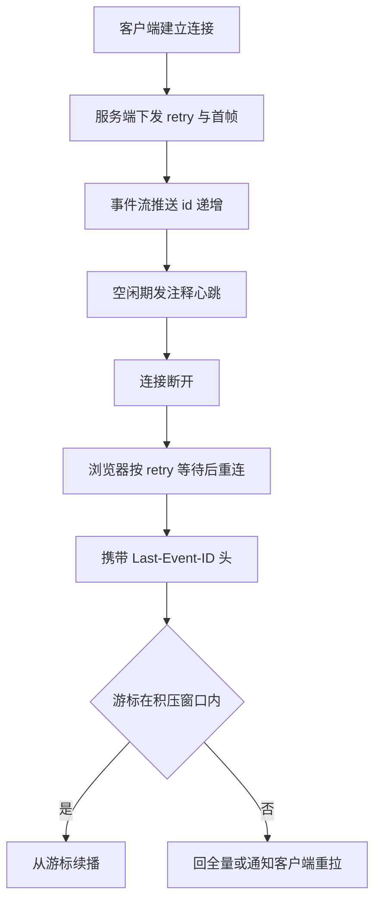
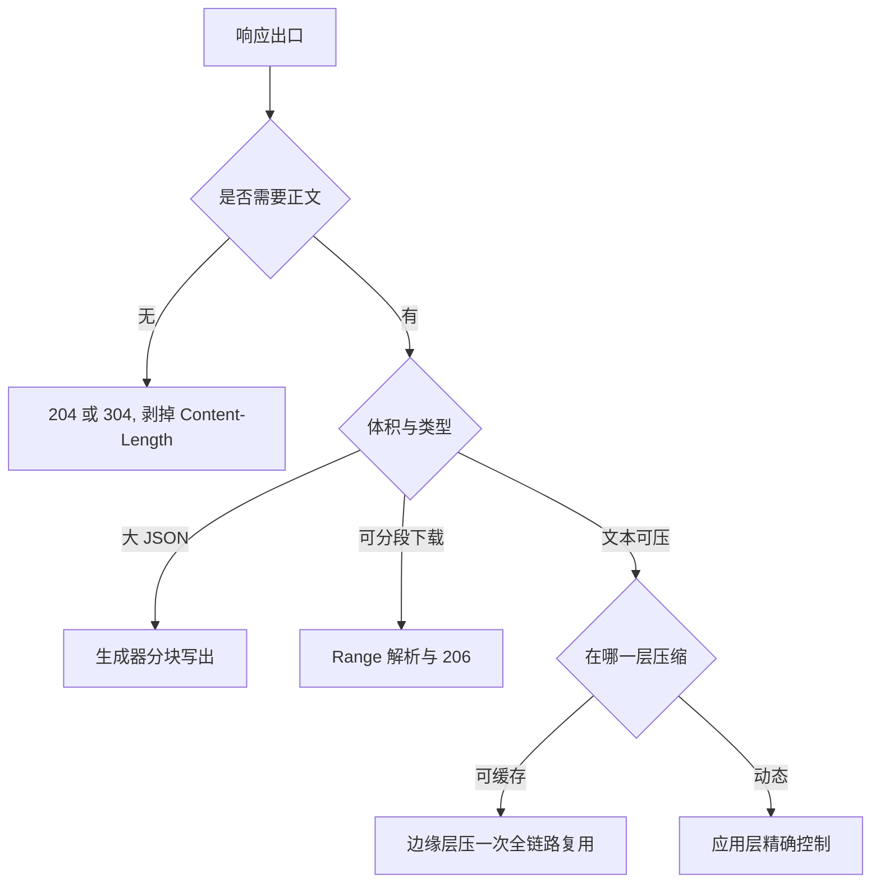
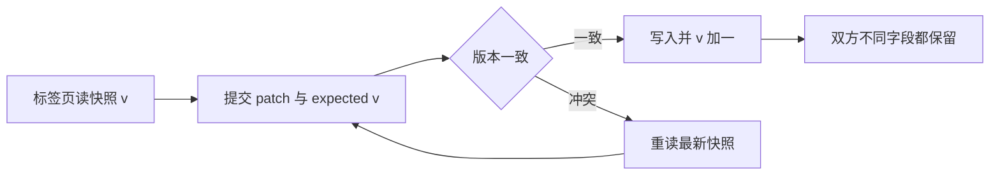
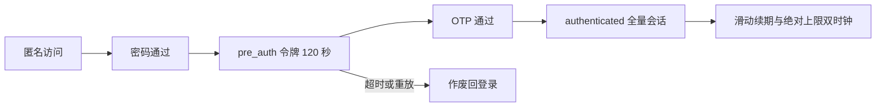
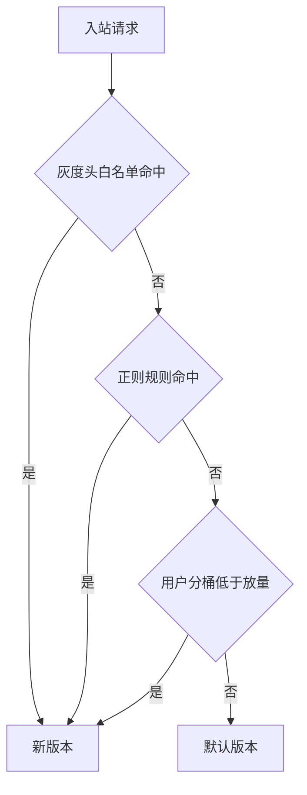
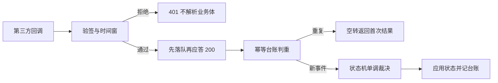
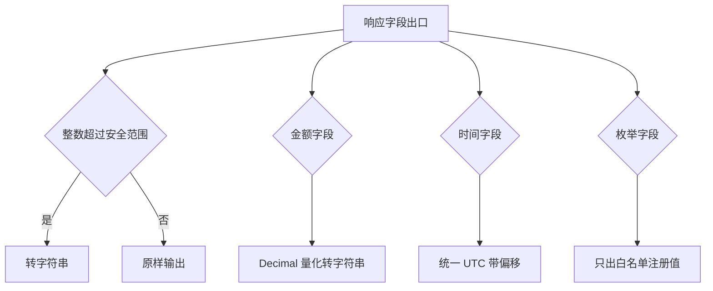

# 第 3 类 · Web 后端开发(夜间扩产六)

本文件是第 3 类的第六次夜间扩产,共 45 题(Q2696–Q2740),五条主线:请求处理补遗(多值查询参数、数组式键约定、流式 JSON 增量解析、双层解码陷阱、路径规范化先行、主机头信任边界、指纹去重缓存、charset 与 BOM 容错)、响应工程(SSE 的 retry 与注释心跳、大 JSON 分块写出、多区间 Range、ETag 四策略选型、压缩分层、trace-id 兜底注入、204 空体形态、客户端断开感知、RFC 5987 文件名)、状态与会话(无状态会话字段预算、滑动续期双时钟、多标签页 CAS 合并、登出黑名单、权限版本号实时生效、匿名会话合并、过期回收、跨子域 Domain 收敛、两步登录中间态)、集成模式(多渠道验签模板、回调幂等落库、乱序拒收、超时重试契约、灰度头匹配引擎、服务发现缓存、对象存储签名直传、保鲜缓存与降级快照、先落队再应答)、数据交换(时区感知时间、JS 安全整数、金额字符串传输、枚举向前兼容、深嵌套扁平化、三态 PATCH、多语言回退链、二进制字段传输选择)。
代码 45 块全部在 /usr/bin/python3(Python 3.9.6)下逐块实跑通过;其中 4 个 FastAPI 块(Q2696、Q2707、Q2711、Q2728)缺库时按设计降级为 exit 0 并给出提示,另在装有 fastapi + httpx 的临时环境中验证了框架路径;涉及回环 socket 的题目直连 127.0.0.1 不经代理;故意触发的异常均有 try/except 包裹,演示数据固定、输出可复现、单块耗时远低于 25 秒。
难度分布:1-2 星 9 题、3 星 23 题、4-5 星 13 题;每 5-6 题插一张 mermaid 结构图,共 8 张。
复习主线:报文读法先行、裁决顺序固定、降级路径显式——把"解码恰好一次、先规范化再授权、先落库再执行、宁可标旧不编数据"这几条纪律想透,框架只是语法糖。

### Q2696 · 查询参数的多值解析与重复键约定

> 难度:★★☆☆ | 标签:FastAPI, 查询参数

**问**:同一个查询参数出现多次,你的服务该怎么解析?重复键和逗号分隔两种多值约定在框架层各是什么表现?

**答**:先定契约再写代码:重复键与分隔符是两种约定,同一接口只认一种并写进文档。重复键形态 `/search?tag=a&tag=b`:Starlette 的 `query_params.getlist("tag")` 保序聚合全部值,而 `.get()` 只返回最后一个重复值,两者混用会静默丢数据;FastAPI 把参数声明成 list 类型即可自动聚合,缺省给空列表。逗号形态 `/search?tags=a,b`:到框架这层仍是一个字符串,切不切分是业务层契约,要自己 split 并处理值里含逗号的转义。补两条校验纪律:空值是否合法要显式声明(解析时 keep_blank_values),值内出现 `&` 与 `=` 必须要求客户端百分号编码,解析层不替业务猜。

```python
# file: code/03_Web后端开发/q2696_query_multivalue.py
"""查询参数的多值解析: 重复键聚合与逗号两种约定(FastAPI + 标准库对照)。"""
import sys

try:
    from fastapi import FastAPI, Query, Request
    from fastapi.testclient import TestClient
except ImportError:
    print("未安装 fastapi/httpx, 降级用标准库演示核心语义:")
    from urllib.parse import parse_qs
    print("重复键 ->", parse_qs("tag=py&tag=web&tag=py"))  # 自动聚合为列表
    print("逗号式 ->", parse_qs("tag=py,web"))             # 仍是单字符串, 需业务层自行 split
    sys.exit(0)

app = FastAPI()


@app.get("/search")
def search(tags: list = Query(default=[]), page: int = Query(default=1, ge=1)):
    """参数声明成 list, FastAPI 会把同名重复键聚合成列表, 缺省为空列表。"""
    return {"tags": tags, "page": page}


@app.get("/raw")
async def raw(request: Request):
    """绕开声明式绑定: getlist 拿全量保序, get 只拿最后一个重复值, 混用会静默丢数据。"""
    return {
        "all": request.query_params.getlist("tag"),
        "last": request.query_params.get("tag"),
    }


client = TestClient(app)
r1 = client.get("/search", params=[("tags", "py"), ("tags", "web")])
assert r1.json() == {"tags": ["py", "web"], "page": 1}, r1.json()
r2 = client.get("/search", params={"tags": "py,web"})
assert r2.json()["tags"] == ["py,web"], "逗号约定到框架这层还是一个值, 切分是业务契约"
r3 = client.get("/raw", params=[("tag", "a"), ("tag", "b")])
assert r3.json() == {"all": ["a", "b"], "last": "b"}
print("重复键聚合:", r1.json()["tags"])
print("逗号约定不自动切分:", r2.json()["tags"])
print("getlist 保序拿全量, get 只剩最后一个:", r3.json())
```

**追问**:
- 为什么 Starlette 的 .get() 拿到的是最后一个重复值?——QueryParams 底层是重复键后写覆盖先写的多维字典语义,要拿全量必须显式 getlist。
- FastAPI 把参数声明成 list 后,校验在哪个粒度做?——list[str] 会逐个元素做类型与约束校验,任一元素失败整条请求 422;错误必须可见,而不是悄悄丢值。
- 两种多值约定在 HTTP 语义上等价吗?——RFC 3986 对重复键与逗号都没有多值语义,拆不拆分是框架与业务约定;网关和日志看到的是原始 query string,归一化只能在入口做一次。
- 生产陷阱?——不同客户端混用两种约定,灰度期同一接口两种口径,统计与检索结果分裂;契约写进 OpenAPI 并在入口校验,混用直接 400。

### Q2697 · 数组式查询键 ids[] 的解析约定

> 难度:★★★☆ | 标签:查询参数, 参数约定

**问**:前端有人传 ids[]=1&ids[]=2,有人传 ids[0]=1&ids[2]=3,还有人传裸键 ids=1,服务端怎么统一?

**答**:三种写法并存是现实:裸键重复、追加式 `ids[]`、下标式 `ids[n]`。解析层先把它们归进统一视图——追加式进列表、下标式按下标落位且稀疏下标原样保留(是否补 None 还是紧凑化是业务决策,解析层不做主)、裸键单独收,`filters[status]` 这类字母下标不做嵌套展开。最重要的纪律是:同一基名混用多种写法视为客户端违约,直接 400 而不是猜。深嵌套对象语法不要在查询串里扩展,劝客户端改用 JSON 请求体,查询串约定只保留到一层数组,语法复杂度每加一层解析 bug 翻一倍。

```python
# file: code/03_Web后端开发/q2697_array_key_parse.py
"""数组式查询键的解析约定: ids[] 追加式与 ids[0] 下标式(纯标准库)。"""
import re
from urllib.parse import parse_qs

INDEXED = re.compile(r"^(?P<base>[^\[\]]+)\[(?P<idx>\d*)\]$")


def parse_array_keys(qs):
    """把多种数组写法解析成统一视图。

    每个键基名对应一个槽位: plain 收裸键, list 收 ids[] 追加式,
    indexed 收 ids[0] 下标式(稀疏下标原样保留, 填充策略交给调用方)。
    filters[status] 这类字母下标不做嵌套展开, 深嵌套应该改用 JSON 请求体。
    """
    flat = parse_qs(qs, keep_blank_values=True)
    view = {}
    for key, values in flat.items():
        m = INDEXED.match(key)
        if m:
            base, idx = m.group("base"), m.group("idx")
            slot = view.setdefault(base, {"plain": [], "list": [], "indexed": {}})
            if idx == "":
                slot["list"].extend(values)
            else:
                slot["indexed"][int(idx)] = values[0]
        else:
            slot = view.setdefault(key, {"plain": [], "list": [], "indexed": {}})
            slot["plain"].extend(values)
    return view


def contract_check(view):
    """同一个基名混用多种写法视为客户端违约, 服务端应回 400 而不是猜。"""
    return [
        base
        for base, slot in view.items()
        if sum(bool(slot[k]) for k in ("plain", "list", "indexed")) > 1
    ]


v1 = parse_array_keys("ids[]=1&ids[]=2&active=1")
assert v1["ids"]["list"] == ["1", "2"], v1
assert v1["active"]["plain"] == ["1"]
v2 = parse_array_keys("ids[0]=1&ids[2]=3")
assert v2["ids"]["indexed"] == {0: "1", 2: "3"}, v2
v3 = parse_array_keys("ids=1&ids[]=2&ids[5]=9")
assert contract_check(v3) == ["ids"], v3
v4 = parse_array_keys("ids[]=&ids[]=x")
assert v4["ids"]["list"] == ["", "x"], v4  # keep_blank_values 保住空值
print("追加式   ", v1["ids"])
print("下标稀疏 ", v2["ids"]["indexed"])
print("混用违约 ", contract_check(v3))
print("空串保留 ", v4["ids"]["list"])
```

**追问**:
- ids[2] 独自出现时,下标 0 和 1 怎么处理?——原样保留为 {2: value},补位与紧凑化交给调用方,解析层不隐藏信息。
- keep_blank_values 为什么必须开?——否则 ids[]= 会整个消失,空值也是一种业务输入,静默丢弃会造成难查的差异。

### Q2698 · 请求体的流式 JSON 增量解析

> 难度:★★★★ | 标签:流式解析, JSON, 性能

**问**:客户端一次 POST 十万条记录的大 JSON 数组,不想等全部收完再处理,怎么边收边解析?

**答**:核心是"缓冲 + raw_decode"循环:chunk 追加进缓冲,用 `JSONDecoder.raw_decode` 尝试解码,成功就吐出一个完整对象并前移偏移;抛 JSONDecodeError 说明半个对象没到齐,静默等下一块。两种形态:JSON 数组流式解析要自己消费元素间的逗号与收尾的右括号;NDJSON(每行一个对象)实现最简单也最抗错,坏行只影响自己。收益两条:内存峰值从全量字符串降到单块大小,首条处理时间提前到第一个对象就绪。框架层对应 FastAPI 的流式请求体与生成器消费,语义一致;字符串里的逗号右括号不会误判,因为只有处于值之间的位置才检查分隔符。

```python
# file: code/03_Web后端开发/q2698_stream_json_incremental.py
"""请求体的流式 JSON 增量解析: 边收边出, 不必等整个报文(纯标准库)。"""
import json


class ArrayStreamParser:
    """流式解析一个 JSON 数组: 每喂一段 chunk, 返回本轮凑齐的完整元素。

    关键点: 用 raw_decode 在缓冲区上尝试解码, 解不动说明数据还没到齐,
    静默等下一块; 元素间的逗号与收尾的右括号在值之间消费。
    """

    def __init__(self):
        self.buf = ""
        self.started = False
        self.finished = False
        self.dec = json.JSONDecoder()

    def feed(self, chunk):
        self.buf += chunk if isinstance(chunk, str) else chunk.decode("utf-8")
        out = []
        while not self.finished:
            self.buf = self.buf.lstrip()
            if not self.buf:
                break
            if not self.started:
                if self.buf[0] != "[":
                    raise ValueError("顶层必须是 JSON 数组")
                self.started = True
                self.buf = self.buf[1:].lstrip()
                continue
            if self.buf[0] == "]":
                self.finished = True
                self.buf = self.buf[1:]
                break
            if self.buf[0] == ",":
                self.buf = self.buf[1:]
                continue
            try:
                obj, end = self.dec.raw_decode(self.buf)
            except json.JSONDecodeError:
                break  # 半个对象, 等下一块
            out.append(obj)
            self.buf = self.buf[end:]
        return out


def ndjson_feed(lines_iter):
    """NDJSON 形态: 每行一个独立 JSON 对象, 增量语义最简单也最抗错。"""
    for line in lines_iter:
        line = line.strip()
        if line:
            yield json.loads(line)


payload = json.dumps(
    [{"id": i, "name": "item%d" % i, "note": "],配,"} for i in range(50)],
    ensure_ascii=False,
)
parser = ArrayStreamParser()
got = []
for i in range(0, len(payload), 17):  # 故意按 17 字节硬切, 跨对象边界
    got.extend(parser.feed(payload[i:i + 17]))
assert parser.finished and got == json.loads(payload), (len(got), parser.finished)
print("数组增量解析: %d 个对象, 与整体解码结果一致" % len(got))

nd = '{"a":1}\n{"b":2}\n\n{"c":3}\n'
assert list(ndjson_feed(nd.splitlines(keepends=True))) == [{"a": 1}, {"b": 2}, {"c": 3}]
bad = ArrayStreamParser()
try:
    bad.feed('{"x":1')
except ValueError as e:
    print("NDJSON 跳过空行通过; 顶层数组约束生效:", e)
```

**追问**:
- 为什么不直接对缓冲反复 json.loads?——整缓冲 loads 要等全量且失败后无法定位已完成部分;raw_decode 恰好返回消费偏移,这是流式语义的关键。
- 解析到非法 JSON 怎么终止?——顶层数组约束在第一个字节就拒绝,元素级错误在 raw_decode 持续失败且连接结束时以 400 收尾。

### Q2699 · 双层解码陷阱:解码次数与加号语义

> 难度:★★★☆ | 标签:URL 编码, 安全

**问**:WAF 明明拦截了路径穿越,攻击者用 %252e%252e%252f 怎么就绕过去了?

**答**:%25 是 % 自身的编码:这段载荷解码一次得到 `%2e%2e%2f`(无害文本),再解一次才变成 `../`。WAF 与应用各解一次,看到的就不是同一个路径,这是双层解码绕过的根源。防线两条:全链路约定解码恰好一次——路由层解一次,之后所有安全校验都基于解码后的值,任何人不得再 unquote;可加可疑度检测,解码一次后再解一次若值仍变化就拒绝,正常单层编码的中文不会被误伤。高频伴生陷阱是加号:查询串里 `+` 表示空格而 `%2B` 才是字面加号,路径里 `+` 就是加号,unquote 与 unquote_plus 不能混用,编码再解码必须可还原。

```python
# file: code/03_Web后端开发/q2699_double_decode.py
"""URL 双层解码陷阱: 每一段只允许解码一次(纯标准库)。"""
from urllib.parse import quote, unquote, unquote_plus

# %25 是 '%' 自身的编码: 攻击者把 ../ 编码两次, WAF 解一次看到的是无害的 %2e
raw = "/api/%252e%252e%252fadmin"
once = unquote(raw)
twice = unquote(once)
print("原始    ", raw)
print("解码一次", once)
print("解码两次", twice)
assert once == "/api/%2e%2e%2fadmin"
assert twice == "/api/../admin"


def double_decode_risk(raw_path):
    """解码一次之后若再解一次还会变化, 说明存在被二次解释的空间, 直接拒绝。"""
    once = unquote(raw_path)
    return unquote(once) != once


assert double_decode_risk("/api/%252e%252e/admin")
assert not double_decode_risk("/api/%e4%bd%a0%E5%A5%BD")  # 正常单层编码的中文
assert not double_decode_risk("/api/plain-path")

# 加号陷阱: 查询串里 '+' 表示空格, 路径里 '+' 就是加号, 两个解码器不能混用
assert unquote_plus("q=java+web") == "q=java web"
assert unquote("q=java+web") == "q=java+web"
assert unquote_plus("q=java%2Bweb") == "q=java+web"  # %2B 永远是字面加号
# 编码再解码必须还原: quote 的缺省 safe='/' 会放过斜杠, 安全场景应 safe=''
assert quote(unquote("/a b", errors="strict"), safe="") == "%2Fa%20b"
print("单层语义稳定: 加号按段解释, 编码解码可还原")
```

**追问**:
- 解码一次应该在哪里做?——在拥有该段编码语义的边界做:查询串交给 parse_qs,路径交给路由器,规范化与鉴权排在其后。
- 检测到双层编码为什么直接拒而不是再解一次?——再解一次等于加入解码军备竞赛,拒绝把裁决权留在规范侧,正常客户端永远不需要编码两次。

### Q2700 · 路径规范化先行:点段与编码绕过

> 难度:★★★★ | 标签:路径规范化, 安全, 网关

**问**:为什么网关的鉴权必须用规范化后的路径匹配,拿原始请求行匹配不行吗?

**答**:原始路径是攻击者的画布:`%2e%2e` 编码点段、`%61` 字母编码、重复斜杠都能让"看起来不在 /admin 下"的请求规范化后正是 /admin,naive 的原始前缀匹配全被绕过。正确顺序固定:先解码一次、再拒绝任何点段(网关策略不替客户端做穿越归并,语义最稳)、最后合并重复斜杠,Windows 反斜杠与 NUL 一并拒绝;授权只看规范化结果,原始路径仅用于日志与告警,它同时是审计"谁在试探"的证据。先匹配再解码或匹配原始值,都是把裁决权交给攻击者。normalization 必须发生在鉴权之前、且只发生一次,顺序错了两层防线互相打架。

```python
# file: code/03_Web后端开发/q2700_path_normalize.py
"""路径规范化先行: 点段与编码变形的绕过防护(纯标准库)。"""
import posixpath
import re
from urllib.parse import unquote

ADMIN_PREFIX = "/admin"


class BadPath(ValueError):
    """路径含非法字符或点段越界。"""


def normalize_path(raw):
    """规范化顺序固定: 先解码一次, 再拒绝点段, 最后合并斜杠。

    先解码再校验是硬顺序: %2e%2e 必须先变回 .. 才会被规则拦住;
    网关策略直接拒绝任何点段, 不替客户端做穿越归并, 语义最简单最稳。
    """
    path = unquote(raw)  # 解码永远只做一次
    if "\\" in path or "\x00" in path:
        raise BadPath("非法字符")
    if path == ".." or path.startswith("../") or path == "/.." or "/../" in path or path.endswith("/.."):
        raise BadPath("点段越界")
    path = re.sub(r"/{2,}", "/", path)  # 合并重复斜杠
    return posixpath.normpath(path)


def authorize(raw, is_admin):
    """授权只看规范化后的路径; 原始路径仅用于日志与告警。"""
    norm = normalize_path(raw)
    if norm == ADMIN_PREFIX or norm.startswith(ADMIN_PREFIX + "/"):
        return is_admin, norm
    return True, norm


CASES = [
    "/api/%2e%2e%2fadmin/secrets",  # 编码点段: naive 放行, 规范化后拒绝
    "/%61dmin/keys",                # 编码字母: 解码后才露出 /admin 前缀
    "/api//admin//keys",            # 重复斜杠: 合并后不在管理区
    "/admin/console",               # 明文管理路径
    "/public/info",
]
for raw in CASES:
    naive = raw.startswith(ADMIN_PREFIX)
    try:
        norm = normalize_path(raw)
        ok, _ = authorize(raw, is_admin=False)
        print("%-30s -> %-24s naive=%-5s strict=%s" % (raw, norm, naive, ok))
    except BadPath as e:
        print("%-30s -> 拒绝: %-12s  naive=%-5s strict=False" % (raw, e, naive))

assert normalize_path("/api//x//y") == "/api/x/y"
assert normalize_path("/%61dmin/keys") == "/admin/keys"
for bad in ("/api/admin/../admin/users", "/out/../../etc", "/a%00b", "/a\\b"):
    try:
        normalize_path(bad)
    except BadPath:
        print("拒绝:", bad)
```

**追问**:
- 为什么选择拒绝点段而不是消化它?——RFC 3986 规定发送方不应产出点段,正常客户端不需要;消化在根边界 /.. 上有歧义,拒绝的语义没有歧义。
- 重复斜杠要不要拒绝?——合并即可,规范化后再匹配;严格拒绝会误伤大量合法前端库生成的链接。

### Q2701 · 主机头的信任边界与白名单

> 难度:★★★☆ | 标签:Host 头, 安全

**问**:密码重置邮件里的链接是怎么拼出来的?攻击者怎么借 Host 头投毒?

**答**:如果链接基址取自请求的 Host 头,攻击者构造 `Host: attacker.io` 的重置请求,服务器就把含重置 token 的链接发到攻击者域名——这叫 Host 注入,危害直达账号接管。防线三层:入站 Host 过白名单,整域精确匹配(`www.example.com.attacker.io` 这种子串陷阱必须挡住)、大小写不敏感、允许带端口但域名与端口分开校验;生成对外链接永远用配置基址,不用请求里的 Host,多域名接入时重置类敏感链接只认主站域名;代理链上的绝对 URI 请求行可能携带第二个主机名,网关要统一裁决并丢弃冲突方。Host 头是客户端可控输入,信任级别与查询参数相同。

```python
# file: code/03_Web后端开发/q2701_host_trust.py
"""主机头的信任边界: 白名单校验与链接生成(纯标准库)。"""
from urllib.parse import urlsplit

ALLOWED_HOSTS = {"www.example.com", "api.example.com"}
BASE_URL = "https://www.example.com"  # 生成对外链接永远用配置基址


def host_allowed(host_header):
    """Host 允许带端口且大小写不敏感; 只做整域精确匹配, 不做子串匹配。

    urlsplit 前补 // 让 'host:port' 能按 netloc 解析, 拿到的 hostname 已去端口并小写。
    """
    if not host_header:
        return False
    host = urlsplit("//" + host_header).hostname or ""
    return host in ALLOWED_HOSTS


def reset_link(host_header, token):
    """重置链接的域名取配置基址而非请求 Host, 防止 Host 注入投毒。

    即使 Host 合法, 链接也走 BASE_URL: 多域名接入时重置页只认主站域名。
    """
    if not host_allowed(host_header):
        raise ValueError("非法 Host")
    return BASE_URL + "/reset?token=" + token


cases = [
    ("www.example.com", True),
    ("WWW.EXAMPLE.COM:443", True),
    ("www.example.com.attacker.io", False),  # 子串匹配会放过它
    ("attacker.io", False),
    ("", False),
]
for host, want in cases:
    got = host_allowed(host)
    assert got == want, (host, got)
    print("%-30s allow=%s" % (repr(host), got))

print("合法 Host 重置链接:", reset_link("www.example.com", "t123"))
try:
    reset_link("attacker.io", "t123")
except ValueError as e:
    print("注入 Host 被拒:", e)
print("即使 Host 合法也走配置基址:", reset_link("api.example.com", "t123"))
```

**追问**:
- 白名单为什么不能用子串匹配?——全等语义才挡得住 example.com.attacker.io;子串匹配等于把白名单的钥匙递给攻击者。
- Host 缺失的 HTTP/1.0 请求怎么处理?——按非法请求拒绝或回退配置默认域,绝不静默取系统 hostname 拼链接。


### Q2702 · 重复提交的指纹去重缓存

> 难度:★★★☆ | 标签:幂等性, 去重, 防抖

**问**:用户狂点提交按钮,后端怎么在不动业务代码的前提下挡住重复下单?

**答**:服务端自保的防抖层:对方法、路径、规范化请求体与用户维度做确定性哈希得到指纹,放进短 TTL 去重缓存——窗口内同指纹的第二次请求直接拒绝,窗口外同一内容是新的合法提交。三个工程要点:规范化必须 sort_keys,否则键序不同算两次;必须带用户维度,否则不同用户互相误伤;与 Idempotency-Key 分工清楚——那是客户端声明的重试语义要重放旧结果,这是服务端防抖只拒绝不代客重放,两层叠加才是完整方案。并发实现用锁保护插入与清扫,过期条目在每次插入时顺手清理,存储天然有界。

```python
# file: code/03_Web后端开发/q2702_dedup_fingerprint.py
"""重复提交的指纹去重缓存: 短窗口内同指纹直接拒绝(纯标准库)。"""
import hashlib
import json
import threading


def fingerprint(method, path, body, user_id):
    """指纹 = 方法 + 路径 + 规范化请求体 + 用户, 顺序无关地覆盖提交内容。

    json.dumps 加 sort_keys 保证同一份数据两次构造出同一串;
    缺 user 维度会把不同用户互相误伤, 缺 body 维度会漏掉内容不同但路径相同的请求。
    """
    canonical = json.dumps(
        {"m": method, "p": path, "b": body, "u": user_id},
        sort_keys=True,
        separators=(",", ":"),
        ensure_ascii=False,
    )
    return hashlib.sha256(canonical.encode("utf-8")).hexdigest()


class DedupCache:
    """短 TTL 去重: 命中说明窗口内有完全相同的提交在途或刚落库。

    与 Idempotency-Key 的分工: 那是客户端声明的重试语义, 重放旧结果;
    这是服务端自保的防抖, 同指纹第二次直接拒绝, 不代客重放。
    """

    def __init__(self, window=5.0, now=lambda: 0.0):
        self.window = window
        self._now = now
        self._seen = {}
        self._lock = threading.Lock()

    def check(self, fp):
        """返回 (accepted, first_seen)。窗口外或未见过的指纹登记并放行。"""
        t = self._now()
        with self._lock:
            self._seen = {k: v for k, v in self._seen.items() if t - v <= self.window}
            if fp in self._seen:
                return False, self._seen[fp]
            self._seen[fp] = t
            return True, t


clock = {"t": 100.0}
cache = DedupCache(window=5.0, now=lambda: clock["t"])
fp = fingerprint("POST", "/api/orders", {"sku": "A1", "qty": 2}, "u1")

ok1, t1 = cache.check(fp)
assert ok1, "首次提交应放行"
ok2, _ = cache.check(fp)
assert not ok2, "窗口内重复提交应被拒"
clock["t"] = 106.0  # 推进时钟越过窗口
ok3, _ = cache.check(fp)
assert ok3, "窗口外同一内容是新的合法提交"

other = fingerprint("POST", "/api/orders", {"qty": 2, "sku": "A1"}, "u1")
assert other == fp, "键序不同的同内容请求必须产生同一指纹"
diff_user = fingerprint("POST", "/api/orders", {"sku": "A1", "qty": 2}, "u2")
assert diff_user != fp, "不同用户互不影响"
print("首次放行 t=%s, 窗口内重复拒绝, 窗口外重新放行" % t1)
print("指纹与键序无关; 用户维度隔离; 窗口=%s" % cache.window)
```

**追问**:
- 指纹去重和幂等键中间件能互相替代吗?——不能:前者按内容拒绝、窗口秒级,后者按声明重放、窗口小时级,拦截对象与语义都不同。
- 窗口设多长合适?——覆盖人类重复点击与网络重试的典型间隔,几秒到一分钟;太长会误杀合法的相同操作,如连续两次买同一商品。

### Q2703 · 请求体的 charset 与 BOM 容错

> 难度:★★☆☆ | 标签:编码, 请求解析

**问**:客户端发的 JSON 有时带 BOM,有时 charset 声明缺失,解析层怎么容错?

**答**:解码一次到位,三层策略:声明了 charset 就按声明来,utf-8 且开头有 BOM 时换 utf-8-sig 一次性剥掉——它只认开头的 BOM,正文里出现 U+FEFF 码位不受影响,比 decode 后手动 lstrip 稳;声明缺失走回退链,utf-8 失败再试 gbk,这是对接历史系统的现实;回退仍失败就显式 400,绝不猜到乱码为止。配套纪律:响应永远带 charset=utf-8 从源头减少歧义;GBK 回退只保留在明确允许老客户端的接口,新接口一律 utf-8 硬校验,防止回退链掩盖真正的编码 bug。json.loads 遇到带 BOM 的 str 会直接抛 Unexpected UTF-8 BOM,所以 BOM 处理必须在 loads 之前。

```python
# file: code/03_Web后端开发/q2703_charset_bom.py
"""请求体的 charset 与 BOM 容错: 解码一次到位(纯标准库)。"""
import json

BOM = b"\xef\xbb\xbf"


def decode_body(raw, charset="utf-8"):
    """按声明字符集解码; BOM 用 utf-8-sig 一次剥掉; 声明缺失时回退链兜底。

    utf-8-sig 只在开头有 BOM 时剥掉它, 正文里出现 U+FEFF 码位不受影响;
    比 decode 后手动 lstrip 更不容易误伤内容。
    """
    declared = (charset or "").split(";")[0].strip().lower() or None
    if declared == "utf-8" and raw.startswith(BOM):
        declared = "utf-8-sig"
    if declared:
        return raw.decode(declared)
    for enc in ("utf-8", "gbk"):
        try:
            return raw.decode(enc)
        except UnicodeDecodeError:
            continue
    raise UnicodeDecodeError("utf-8", raw, 0, 1, "无可用字符集")


def parse_json_body(raw, charset="utf-8"):
    return json.loads(decode_body(raw, charset))


payload = {"msg": "你好", "ok": True}
utf8 = json.dumps(payload, ensure_ascii=False).encode("utf-8")
gbk = json.dumps(payload, ensure_ascii=True).encode("gbk")

assert parse_json_body(utf8) == payload
assert parse_json_body(BOM + utf8, "utf-8") == payload
assert parse_json_body(gbk, None) == payload  # 无声明: utf-8 失败, 回退 gbk
try:
    parse_json_body(b"\xff\xfe\x00", None)
except UnicodeDecodeError as e:
    print("双回退仍失败 -> 400 显式报错:", e.reason)

mid = decode_body("中\ufeff尾".encode("utf-8"), "utf-8")
assert mid == "中\ufeff尾", "正文中段的 U+FEFF 必须保留"
print("BOM 剥除 / 回退链 / 正文中段保留 均通过")
```

**追问**:
- 为什么不用 errors='replace' 兜底?——替换字符会静默篡改数据,订单备注与姓名里的坏字节必须显式失败让客户端修,而不是入库后不可追。
- BOM 在正文中段出现怎么办?——那不是 BOM 是零宽字符,原样保留;utf-8-sig 只剥开头,正是这个语义。

### Q2704 · If-Range 的裁决:强标签与整秒日期

> 难度:★★★☆ | 标签:HTTP 协议, Range, 缓存

**问**:断点续传中途文件被更新过,客户端的 Range 请求怎么避免拼出混合版本?

**答**:If-Range 就是为此设计的:客户端续传时把上次响应的 ETag 或 Last-Modified 放进 If-Range,服务端先裁决再决定 206 还是退回 200 全量。规则三条:值是引号包裹的标签时按 ETag 强比较,弱标签 W/ 不允许出现在 If-Range,直接回 200;值是 HTTP 日期时与 Last-Modified 整秒相等才算命中——秒级精度意味着秒内两次变更无法区分,有秒内变更风险的资源必须用 ETag;解析不了的值一律回 200 全量,绝不猜。没有 If-Range 的裸 Range 在文件变更后会静默拼出前半旧后半新的混合文件,这种损坏往往要到文件被使用时才暴露。

```python
# file: code/03_Web后端开发/q2704_if_range.py
"""If-Range 的裁决: 只认强 ETag 或精确到秒的日期(纯标准库)。"""
import calendar
from email.utils import parsedate_to_datetime

ETAG = '"abc123"'
MTIME = calendar.timegm((2026, 11, 3, 0, 0, 0))  # Last-Modified: 2026-11-03 整秒


def if_range_decision(if_range, current_etag, current_mtime):
    """返回 (status, note)。命中返回 206 可续传, 未命中返回 200 全量。

    规则三条: 值形如引号包裹的标签时按 ETag 比, 且必须是强标签;
    值是 HTTP 日期时与 Last-Modified 整秒相等才算命中;
    解析不了的非法值一律回 200 全量, 绝不猜。
    """
    if if_range is None:
        return 206, "无条件头, 直接按 Range 切"
    value = if_range.strip()
    if value.startswith('"') or value.startswith('W/"'):
        if value.startswith("W/"):
            return 200, "弱 ETag 不允许出现在 If-Range, 回全量"
        if value == current_etag:
            return 206, "强 ETag 命中, 继续续传"
        return 200, "版本已变, 旧区间作废"
    try:
        want = parsedate_to_datetime(value).timestamp()
        return (206, "日期命中") if int(want) == int(current_mtime) else (200, "日期不符")
    except (TypeError, ValueError):
        return 200, "无法解析, 回全量"


cases = [
    (None, 206),
    ('"abc123"', 206),
    ('"other"', 200),
    ('W/"abc123"', 200),
    ("Wed, 04 Nov 2026 00:00:00 GMT", 200),
    ("garbage-input", 200),
]
for value, want in cases:
    status, note = if_range_decision(value, ETAG, MTIME)
    assert status == want, (value, status, note)
    print("%-34s -> %s  %s" % (repr(value), status, note))

status, note = if_range_decision("Tue, 03 Nov 2026 00:00:00 GMT", ETAG, MTIME)
assert status == 206, note
print("日期精确命中 ->", status, note)
```

**追问**:
- If-Range 命中后还要不要看 If-None-Match?——两者语义独立:If-Range 只裁决区间是否仍匹配,缓存协商由 If-None-Match 单独处理,可以并存。
- If-Range 给了但请求没带 Range 头呢?——If-Range 被忽略,按普通 GET 处理,它只对 Range 请求有意义。

### Q2705 · SSE 的 retry 字段与 Last-Event-ID 续播

> 难度:★★★★ | 标签:SSE, 推送, 重连

**问**:SSE 断线重连的节奏谁说了算?客户端刷新后怎么从断点继续收?

**答**:两个机制配合。服务端在事件流里下发 `retry: 3000`,告诉浏览器断线后等多久再连,负载高时动态调大,这是服务端控制重连风暴的阀门;每个事件带 `id:`,浏览器记住最后收到的 id,重连时通过 Last-Event-ID 请求头带回来,服务端按游标从积压日志续播。工程细节三条:id 用单调递增序号即可;重放窗口(积压条数)要明确定界,游标比最老积压还旧说明缺口补不齐,只能回全量或让客户端重拉;多行 data 拆成多行 data 字段,帧内字段顺序按 retry、id、event、data 排最稳。重连协议是 SSE 可靠性的全部,没有 id 就只有全量重发。

```python
# file: code/03_Web后端开发/q2705_sse_retry.py
"""SSE 的事件重试字段: retry 与 Last-Event-ID 的重连协议(纯标准库)。"""
import time


def sse_event(data, event_id=None, event_type=None, retry_ms=None):
    """把一帧业务数据编成 SSE 报文, 字段顺序固定: retry 在前最稳。

    retry: 告诉浏览器断线后的重连等待, 服务端可按负载动态加大;
    id:   客户端重连时通过 Last-Event-ID 头带回来, 服务端从此序号续播。
    """
    lines = []
    if retry_ms is not None:
        lines.append("retry: %d" % retry_ms)
    if event_id is not None:
        lines.append("id: %s" % event_id)
    if event_type is not None:
        lines.append("event: %s" % event_type)
    for row in str(data).splitlines() or [""]:
        lines.append("data: %s" % row)
    return "\n".join(lines) + "\n\n"


class SseServer:
    """带重放窗口的推送源: 记住每个事件的 id, 断线重连按游标续播。"""

    def __init__(self, backlog=100):
        self.backlog = backlog
        self.log = []
        self.seq = 0

    def publish(self, data, retry_ms=None):
        self.seq += 1
        frame = sse_event(data, event_id=str(self.seq), retry_ms=retry_ms)
        self.log.append((self.seq, frame))
        if len(self.log) > self.backlog:
            self.log.pop(0)
        return frame

    def replay_from(self, last_event_id):
        """Last-Event-ID 比最老积压还旧就说明缺口补不齐, 只能回全量或让客户端重拉。"""
        if last_event_id is None:
            return [f for _, f in self.log]
        cursor = int(last_event_id)
        if self.log and cursor < self.log[0][0]:
            return None  # 缺口超出积压
        return [f for sid, f in self.log if sid > cursor]


srv = SseServer()
frames = [srv.publish("msg%d" % (i + 1), retry_ms=3000 if i == 0 else None) for i in range(5)]
assert frames[0].startswith("retry: 3000\nid: 1\ndata: msg1\n\n"), frames[0]
assert frames[-1].startswith("id: 5\ndata: msg5\n\n"), frames[-1]

client_state = "3"  # 浏览器崩在收到 id=3 之后
missed = srv.replay_from(client_state)
assert len(missed) == 2 and missed[0].startswith("id: 4"), missed
gap = srv.replay_from("0")
assert gap is None, "游标早于积压窗口应判缺口"
print("重连续播 2 帧:", [f.splitlines()[0] for f in missed])
print("多行 data 会被拆成多行 data 字段:",
      sse_event("a\nb").count("data:") == 2)
```

**追问**:
- Last-Event-ID 能被客户端伪造吗?——能,它就是普通请求头,服务端要按会话校验游标归属与可见范围,不能盲信。
- retry 能对单个事件单独设置吗?——retry 是流级状态,设置后对后续所有重连生效,想调整就在需要的事件帧里重发一次 retry 行。

### Q2706 · SSE 的注释心跳与代理缓冲穿透

> 难度:★★★☆ | 标签:SSE, 反向代理, 长连接

**问**:SSE 部署到 Nginx 后面,事件总是成簇到达,是怎么回事?

**答**:中间某层在做响应缓冲:事件攒到缓冲区满或连接结束才一次性下发。解法是穿透三件套:响应头 `Cache-Control: no-cache` 禁缓存、`X-Accel-Buffering: no` 明确告诉 Nginx 别缓冲、`Connection: keep-alive` 保持长连;再加注释心跳——空闲时定期发 `: ping` 这样的注释帧,以冒号开头的行浏览器不派发任何事件,但能定期冲刷链路缓冲、让代理判定连接存活。心跳间隔必须小于链路上最短的读超时,一般 15 秒量级;事件流开头可先垫一段注释把代理的初始缓冲顶出去。任何一层缓冲都会让实时推送退化为批处理,穿透配置要跟着部署拓扑走。

```python
# file: code/03_Web后端开发/q2706_sse_heartbeat.py
"""SSE 的注释心跳与代理穿透: 让长连接穿过会缓冲的中间层(纯标准库)。"""


def sse_event(data, event_id=None):
    lines = []
    if event_id is not None:
        lines.append("id: %s" % event_id)
    lines.append("data: %s" % data)
    return "\n".join(lines) + "\n\n"


def sse_headers():
    """穿透三件套: 禁缓存, 告诉 Nginx 别缓冲, 明确保活。

    任何一层缓冲都会让事件攒到缓冲区满才下去, 客户端表现为延迟成簇到达。
    """
    return {
        "Content-Type": "text/event-stream",
        "Cache-Control": "no-cache",
        "X-Accel-Buffering": "no",
        "Connection": "keep-alive",
    }


class HeartbeatSse:
    """空闲超interval就发注释行 ': ping', 注释帧不会触发客户端 message 事件。"""

    def __init__(self, interval=15.0):
        self.interval = interval
        self.last_sent = 0.0
        self.seq = 0

    def on_event(self, now, data):
        self.last_sent = now
        self.seq += 1
        return sse_event(data, event_id=str(self.seq))

    def on_tick(self, now):
        """返回注释帧或 None: 由事件循环每秒调一次。"""
        if now - self.last_sent >= self.interval:
            self.last_sent = now
            return ": ping %d\n\n" % int(now)
        return None


stream = HeartbeatSse(interval=15.0)
out = [stream.on_event(0.0, "hello")]
for t in (5.0, 14.0, 15.0, 20.0, 35.0):
    frame = stream.on_tick(t)
    if frame:
        out.append(frame)
assert out[0] == "id: 1\ndata: hello\n\n"
assert out[1].startswith(": ping"), out[1]
assert out[1].count("data:") == 0, "注释帧不携带 data, 客户端不派发事件"
print("心跳帧序列:", [f.splitlines()[0] for f in out[1:]])
print("响应头:", sse_headers())
```

**追问**:
- 注释心跳会不会触发客户端回调?——不会,注释帧不构成 message 事件,浏览器层面完全无感,只耗极小带宽。
- 客户端代理(企业网关)也缓冲怎么办?——注释帧垫大初始缓冲加心跳是通用手段,再不行只能降级到轮询,那是链路能力问题。



### Q2707 · 大 JSON 响应的分块写出

> 难度:★★★★ | 标签:流式响应, 性能, FastAPI

**问**:导出接口要返回几百 MB 的 JSON 数组,直接 json.dumps 会发生什么,怎么改?

**答**:json.dumps 先在内存里攒完整字符串,峰值内存是数据量的数倍,首字节也要等全量序列化完,TTFB 极差。改成生成器分块:先产出 `[`,之后每块若干元素序列化、以前置逗号拼接后产出,最后补 `]`——拼接规则写死在生成器里,内存峰值只剩单块,客户端还能边收边解析。验证口径两条:分块拼接结果必须与整体序列化逐字节一致,块内序列化的 separators 要与整体对齐(默认带空格,必须显式用紧凑分隔符,否则对不上);tracemalloc 实测峰值差一个量级。框架层用 FastAPI 的 StreamingResponse 包住生成器,chunked 编码自动处理,客户端断开还能传导回生成器提前终止。

```python
# file: code/03_Web后端开发/q2707_chunked_json.py
"""大 JSON 响应的分块写出: 生成器边算边写, 不攒完整字符串(缺库降级)。"""
import json
import tracemalloc

try:
    from fastapi import FastAPI
    from fastapi.responses import StreamingResponse
    from fastapi.testclient import TestClient
    HAS_FASTAPI = True
except ImportError:
    HAS_FASTAPI = False
    print("未安装 fastapi/httpx, 框架部分跳过, 标准库演示生成器分块核心")

ITEMS = [{"id": i, "name": "item-%05d" % i, "tags": ["a", "b"]} for i in range(2000)]


def iter_json_array(items, chunk_size=500):
    """逐块产出 JSON 数组文本: 首块补 [ 后缀, 后续块自带前置逗号。

    内存里永远只有当前块, TTFB 提前到第一个块就绪时, 客户端可边收边解析。
    """
    yield "["
    first = True
    for i in range(0, len(items), chunk_size):
        piece = ",".join(json.dumps(x, ensure_ascii=False, separators=(",", ":"))
                         for x in items[i:i + chunk_size])
        yield piece if first else "," + piece
        first = False
    yield "]"


EXPECTED = json.dumps(ITEMS, ensure_ascii=False, separators=(",", ":"))

tracemalloc.start()
full = json.dumps(ITEMS, ensure_ascii=False)
full_peak = tracemalloc.get_traced_memory()[1]
tracemalloc.stop()

tracemalloc.start()
sizes = []
for piece in iter_json_array(ITEMS):
    sizes.append(len(piece))
stream_peak = tracemalloc.get_traced_memory()[1]
tracemalloc.stop()

assert "".join(iter_json_array(ITEMS)) == EXPECTED, "分块拼接必须与整体序列化逐字节一致"
assert full_peak > stream_peak * 5, (full_peak, stream_peak)
print("整体序列化峰值 %d KB, 分块峰值 %d KB, 单块最大 %d KB"
      % (full_peak // 1024, stream_peak // 1024, max(sizes) // 1024))
assert "".join(iter_json_array([])) == "[]"

if HAS_FASTAPI:
    app = FastAPI()

    @app.get("/items")
    def items():
        return StreamingResponse(iter_json_array(ITEMS), media_type="application/json")

    r = TestClient(app).get("/items")
    assert r.status_code == 200 and r.json() == ITEMS
    print("FastAPI StreamingResponse 输出与整体序列化一致, 分块随生成器逐段下发")
```

**追问**:
- 客户端边收边解析怎么处理半截块?——用流式 JSON 增量解析器喂进去,分块写出与流式解析是同一条流水线的两端。
- 分块大小怎么定?——网络 MTU 与压缩窗口的整数倍附近,几 KB 到几十 KB;太小帧开销大,太大失去流式收益。

### Q2708 · 多区间 Range 的解析与 byteranges 响应

> 难度:★★★★ | 标签:HTTP 协议, Range, 下载

**问**:视频客户端发来 bytes=0-4,10-19,-100,服务端怎么解析、怎么响应?

**答**:解析按 RFC 7233 落:逗号切分逐段处理,`a-b` 常规区间钳到 [0, total),`-N` 后缀区间取最后 N 字节,start>end 或起点越界的段丢弃;全部段不可满足才回 416 并带 `Content-Range: bytes */total`,部分可满足就只回可满足的那些。重叠与相邻区间要合并升序,避免冗余传输。响应形态分两路:单区间直接 206 加 Content-Range;多区间用 multipart/byteranges 封装,每段自带 Content-Range 与分隔边界,结尾补闭界。注意区间语义是双闭区间,end 是含在内的最后字节;Range 头整体非法(前缀都不是 bytes=)按无 Range 处理还是 416,各实现要固定一种并写进文档。

```python
# file: code/03_Web后端开发/q2708_multi_range.py
"""多区间 Range 的解析与 byteranges 响应(纯标准库)。"""
import re

TOTAL = 1000
BODY = bytes((i * 7) % 256 for i in range(TOTAL))


def parse_ranges(spec, total):
    """解析 bytes= 头: 返回 (合并后的区间列表, 是否可满足)。

    后缀写法 -N 取最后 N 字节; 起点越界或 start>end 的区间丢弃;
    全部区间不可满足返回 416, 部分可满足只回可满足的那些(RFC 7233)。
    """
    if not spec or not spec.strip().lower().startswith("bytes="):
        return None, False
    raw = []
    for part in spec.split("=", 1)[1].split(","):
        part = part.strip()
        m = re.match(r"^(\d*)-(\d*)$", part)
        if not m or (not m.group(1) and not m.group(2)):
            continue  # 非法段直接丢弃
        if m.group(1) == "":
            n = int(m.group(2))
            if n <= 0 or total == 0:
                continue
            raw.append((max(0, total - n), total - 1))
        else:
            start, end = int(m.group(1)), int(m.group(2) or total - 1)
            if start > end or start >= total:
                continue
            raw.append((start, min(end, total - 1)))
    if not raw:
        return [], False
    raw.sort()
    merged = [list(raw[0])]
    for s, e in raw[1:]:
        if s <= merged[-1][1] + 1:  # 相邻或重叠则并区间
            merged[-1][1] = max(merged[-1][1], e)
        else:
            merged.append([s, e])
    return [tuple(r) for r in merged], True


def build_response(body, ranges):
    """单区间走 Content-Range, 多区间走 multipart/byteranges。"""
    if len(ranges) == 1:
        s, e = ranges[0]
        return 206, body[s:e + 1], "bytes %d-%d/%d" % (s, e, len(body))
    boundary = "sep7f3d2a1c"
    chunks = []
    for s, e in ranges:
        chunks.append(("--%s\r\nContent-Range: bytes %d-%d/%d\r\n\r\n"
                       % (boundary, s, e, len(body))).encode("ascii") + body[s:e + 1] + b"\r\n")
    chunks.append(("--%s--\r\n" % boundary).encode("ascii"))
    return 206, b"".join(chunks), "multipart/byteranges; boundary=%s" % boundary


for spec in ("bytes=0-4,10-19", "bytes=0-499,250-749", "bytes=-100", "bytes=2000-3000", "bytes=2000-3000,5-9", "bytes=abc"):
    ranges, ok = parse_ranges(spec, TOTAL)
    if not ok:
        print("%-24s -> 416, Content-Range: bytes */%d" % (spec, TOTAL))
        continue
    status, payload, note = build_response(BODY, ranges)
    print("%-24s -> %d 区间%s" % (spec, status, ranges))

assert parse_ranges("bytes=0-4,10-19", TOTAL)[0] == [(0, 4), (10, 19)]
assert parse_ranges("bytes=0-499,250-749", TOTAL)[0] == [(0, 749)]
assert parse_ranges("bytes=-100", TOTAL)[0] == [(900, 999)]
assert parse_ranges("bytes=2000-3000", TOTAL) == ([], False)
assert parse_ranges("bytes=2000-3000,5-9", TOTAL)[0] == [(5, 9)]
s, payload, note = build_response(BODY, [(0, 4), (10, 19)])
head = payload.index(b"\r\n\r\n") + 4  # 第一段的正文起点
assert payload[head:head + 5] == BODY[0:5] and b"bytes 10-19/1000" in payload
print("multipart 首段正文与源字节一致, 边界与 Content-Range 齐全")
```

**追问**:
- 多区间响应的 ETag 怎么处理?——与单区间一致用同一个强 ETag,区间划分不影响资源版本,If-Range 校验逻辑不变。
- 区间数量要不要设上限?——要,区间数乘以平均收益不抵 multipart 开销时直接给全量或 416,几十段以上的请求基本是滥用。

### Q2709 · ETag 生成策略的四种选型对比

> 难度:★★☆☆ | 标签:HTTP 缓存, ETag

**问**:ETag 有好几种生成方式,静态资源、动态接口、聚合列表各该用哪种?

**答**:四种策略各有生态位,选型看三个问题:要字节一致还是语义一致、生成成本摊不摊得起、跨实例是否要求一致。内容哈希:字节级强标签,跨实例天然一致,代价是每次全量哈希,适合动态小响应;mtime+size:近乎零成本,但秒级以下不敏感、多实例时钟难对齐,只能配弱标签,适合静态文件(Nginx 就是这个格式);构建版本号:部署期生成、请求期零成本、跨实例绝对一致,适合有发布流水线的资源;语义指纹:剔除 updated_at 等易变字段、键序归一后哈希,字节不同语义相同也算命中,适合聚合列表与多视图数据。实测同一负载,内容哈希的成本是 mtime 组合的数倍,小响应无感,大对象要掂量。

```python
# file: code/03_Web后端开发/q2709_etag_strategies.py
"""ETag 生成的四种策略对比: 强度、成本与跨实例一致性(纯标准库)。"""
import hashlib
import json
import time


def etag_content(body):
    """内容哈希: 字节级强标签, 换实例也一致; 代价是每次全量哈希。"""
    return '"' + hashlib.sha256(body).hexdigest()[:32] + '"'


def etag_meta(mtime_ns, size):
    """mtime+size: 近乎零成本, 但秒级以下不敏感且多实例时钟难对齐, 只配弱标签。"""
    return 'W/"%x-%x"' % (mtime_ns // 1000, size)


def etag_version(version):
    """构建版本号: 部署期生成, 请求期零成本且跨实例绝对一致, 强标签。"""
    return '"v%s"' % version


def etag_semantic(obj, volatile=("updated_at",)):
    """语义指纹: 剔除易变字段并做键序归一后哈希, 字节不同但语义相同也算命中。"""
    cleaned = {k: v for k, v in obj.items() if k not in volatile}
    norm = json.dumps(cleaned, sort_keys=True, separators=(",", ":"))
    return 'W/"sem-' + hashlib.sha256(norm.encode("utf-8")).hexdigest()[:24] + '"'


BODY_A = b'{"id":1,"name":"a"}'
BODY_B = b'{"id":1,"name":"a"} '
assert etag_content(BODY_A) == etag_content(BODY_A)
assert etag_content(BODY_A) != etag_content(BODY_B), "一字节之差内容哈希必须不同"

obj1 = {"id": 1, "name": "a", "updated_at": "2026-01-01", "k2": "v2"}
obj2 = {"k2": "v2", "name": "a", "updated_at": "2026-06-01", "id": 1}
assert etag_semantic(obj1) == etag_semantic(obj2), "键序与易变字段不影响语义指纹"

t0 = time.perf_counter()
for _ in range(2000):
    etag_content(BODY_A)
t_hash = (time.perf_counter() - t0) / 2000 * 1e6
t0 = time.perf_counter()
for _ in range(2000):
    etag_meta(1762128000123456789, len(BODY_A))
t_meta = (time.perf_counter() - t0) / 2000 * 1e6
print("内容哈希 %.1f us/次, mtime+size %.2f us/次" % (t_hash, t_meta))
print("选型: 静态文件用 mtime+size 弱标签, 动态小响应用内容哈希,")
print("      有构建号的资源用版本号, 聚合列表用语义指纹")
```

**追问**:
- 弱标签能用于 If-Match 乐观锁吗?——不能,If-Match 要求强比较,弱标签会放过字节级差异,If-Range 断点续传同理。
- 内容哈希截断到多少位合适?——64 到 128 位十六进制足够,碰撞概率可忽略,再长只浪费响应头空间。

### Q2710 · 响应压缩放在哪一层做

> 难度:★★★☆ | 标签:压缩, 性能, 架构分层

**问**:gzip 应该在应用里压,还是交给 Nginx?CDN 又算哪一层?

**答**:层级选择的四个门槛:内容类型(已压缩的 image/video/zip 再压只会变大)、体积(860B 以下收益抵不过 CPU)、可缓存性、应用 CPU 水位。结论矩阵:可缓存内容在边缘层压一次全链路复用,收益最大;动态大响应不可缓存,应用层压能按内容类型精确控制,但 CPU 紧张时挪给反代层,挪不动就放弃,把 CPU 留给业务;小响应谁都不压。两条事故红线:Content-Encoding 值里 gzip 重复就是双重压缩,响应直接损坏,客户端表现为神秘解码失败;输出依赖 Accept-Encoding 就必须回 Vary: Accept-Encoding,否则代理会把压缩版本缓存后发给不支持的客户端。压缩层级是部署约定,要与反向代理和 CDN 的配置一起评审。

```python
# file: code/03_Web后端开发/q2710_compress_layer.py
"""响应压缩放在哪一层做: 应用层、反代层还是边缘层(纯标准库)。"""
import zlib

COMPRESSIBLE_PREFIX = ("application/json", "text/", "application/javascript")
ALREADY_COMPRESSED = ("image/", "video/", "audio/", "application/zip",
                      "application/pdf", "application/wasm")
MIN_BYTES = 860


def choose_layer(content_type, size, cacheable, cpu_saturated):
    """返回 (layer, reason)。层级选错要么白烧 CPU, 要么缓存键分裂。"""
    if any(content_type.startswith(p) for p in ALREADY_COMPRESSED):
        return "skip", "内容本身已压缩, 再压只会变大"
    if not any(content_type.startswith(p) for p in COMPRESSIBLE_PREFIX):
        return "skip", "未知或不可压类型"
    if size < MIN_BYTES:
        return "skip", "体积不足, 压缩收益抵不过 CPU 开销"
    if cacheable:
        return "cdn", "可缓存内容在边缘压一次, 全链路复用压缩结果"
    if cpu_saturated:
        return "nginx", "应用 CPU 紧张, 把压缩挪到反代层, 挪不动就放弃"
    return "app", "动态响应体积大且不可缓存, 应用层按内容类型精确控制"


def detect_double_encoding(headers):
    """Content-Encoding 值里 gzip 重复出现, 就是双重压缩事故。"""
    enc = headers.get("Content-Encoding")
    if not enc:
        return False
    tokens = [t.strip().lower() for t in enc.split(",") if t.strip()]
    return len(tokens) != len(set(tokens)) or tokens.count("gzip") > 1


CASES = [
    ("application/json", 10240, False, False),
    ("image/png", 10240, False, False),
    ("text/html", 300, False, False),
    ("application/json", 10240, True, False),
    ("application/json", 10240, False, True),
]
for ct, size, cacheable, cpu in CASES:
    layer, reason = choose_layer(ct, size, cacheable, cpu)
    print("%-20s %6dB cache=%-5s cpu=%-5s -> %-6s %s" % (ct, size, cacheable, cpu, layer, reason))

assert choose_layer(*CASES[0])[0] == "app"
assert choose_layer(*CASES[1])[0] == "skip"
assert choose_layer(*CASES[3])[0] == "cdn"
assert choose_layer(*CASES[4])[0] == "nginx"

assert not detect_double_encoding({"Content-Encoding": "gzip"})
assert detect_double_encoding({"Content-Encoding": "gzip, gzip"})
co = zlib.compressobj(6, zlib.DEFLATED, 16 + zlib.MAX_WBITS)
twice = co.compress(b"x" * 100) + co.flush()
print("双重压缩检测通过; 记住输出依赖 Accept-Encoding 时必须回 Vary 头")
```

**追问**:
- 边缘层压缩了,源站还要压吗?——不要,只压一次;源站再压就是双重压缩,层级间要有明确的责任边界。
- br 和 gzip 怎么选?——看客户端支持面与 CPU 预算:br 压缩率高约两成但更耗 CPU,静态资源预压缩后两者成本都可控。

### Q2711 · 错误响应的 trace-id 兜底注入

> 难度:★★★☆ | 标签:可观测性, 错误处理, contextvars

**问**:用户报障只发一张截图,怎么保证任何错误响应都能让他报出一个可查的编号?

**答**:trace-id 兜底注入中间件:入口生成或透传(上游网关注入的合法头优先),存进 contextvar,所有错误出口——业务异常、框架 4xx、未捕获 500——统一从 contextvar 取值写进错误体与 X-Trace-Id 响应头,连 500 都带号,这是用户报障的凭据。兜底链设计:透传头先过格式校验(长度、字符集白名单)才采信,防日志注入;没透传就现场生成 uuid4;异常处理器不能假设中间件已 set,要独立兜底。FastAPI 两层都要配:middleware 设值,exception_handler(Exception) 兜未捕获异常,测试时 TestClient 要 raise_server_exceptions=False 才能看到 500 响应体。错误体的 trace_id 与响应头的 X-Trace-Id 必须同值,否则工单对不上。

```python
# file: code/03_Web后端开发/q2711_trace_id_inject.py
"""错误响应的 trace-id 兜底注入: 连 500 都要能被用户报障(缺库降级)。"""
import sys
import uuid
from contextvars import ContextVar

trace_var = ContextVar("trace_id", default=None)

try:
    from fastapi import FastAPI, Request
    from fastapi.responses import JSONResponse
    from fastapi.testclient import TestClient
    HAS_FASTAPI = True
except ImportError:
    HAS_FASTAPI = False
    print("未安装 fastapi/httpx, 框架部分跳过, 标准库演示兜底链核心")


def resolve_trace(request_headers):
    """兜底链: 上游透传头 > contextvar 既有值 > 现场生成。

    透传头只信网关, 对外请求要重生成, 防止日志被伪造的 id 污染。
    """
    upstream = request_headers.get("x-trace-id")
    if upstream and 8 <= len(upstream) <= 64 and all(c.isalnum() or c == "-" for c in upstream):
        return upstream
    return trace_var.get() or uuid.uuid4().hex


def error_body(status, message, trace_id):
    """所有错误出口共用一个构造器, trace_id 同时进 body 和响应头。"""
    return {"error": {"code": "HTTP_%d" % status, "message": message, "trace_id": trace_id}}


if HAS_FASTAPI:
    app = FastAPI()

    @app.middleware("http")
    async def trace_middleware(request: Request, call_next):
        trace_var.set(resolve_trace(request.headers))
        response = await call_next(request)
        response.headers["X-Trace-Id"] = trace_var.get()
        return response

    @app.exception_handler(Exception)
    async def unhandled(request: Request, exc: Exception):
        """未捕获异常的兜底: 500 也必须带 trace_id, 这是用户报障的凭据。"""
        trace_id = resolve_trace(request.headers)
        return JSONResponse(status_code=500, content=error_body(500, "internal error", trace_id),
                            headers={"X-Trace-Id": trace_id})

    @app.get("/boom")
    async def boom():
        raise RuntimeError("oops")

    client = TestClient(app, raise_server_exceptions=False)
    r = client.get("/boom", headers={"X-Trace-Id": "gw-abc-123"})
    assert r.status_code == 500
    assert r.headers["X-Trace-Id"] == "gw-abc-123", r.headers
    assert r.json()["error"]["trace_id"] == "gw-abc-123"
    r2 = client.get("/boom")
    assert len(r2.json()["error"]["trace_id"]) == 32
    print("透传 trace 回显:", r.headers["X-Trace-Id"])
    print("无透传时现场生成:", r2.json()["error"]["trace_id"][:8], "...")
else:
    assert resolve_trace({"x-trace-id": "gw-abc-123"}) == "gw-abc-123"
    assert resolve_trace({}) is not None and len(resolve_trace({})) == 32
    assert resolve_trace({"x-trace-id": "bad id!!"}) != "bad id!!", "非法字符的透传头不采信"
    print("标准库兜底链: 合法透传 > 生成, 非法透传拒绝")
```

**追问**:
- trace-id 和 W3C traceparent 什么关系?——traceparent 是标准化 trace 上下文含采样位,trace-id 是简化版;内部系统可以直接以 traceparent 为源提取 trace-id。
- 500 的错误体里能放堆栈吗?——不能,堆栈只进日志;错误体放 trace_id 与人话描述,详情靠 trace_id 到日志系统查。

### Q2712 · 204 与空响应体的正确形态

> 难度:★★☆☆ | 标签:HTTP 协议, 状态码

**问**:DELETE 成功了该返回什么?为什么很多接口返回 200 加一个 success true?

**答**:204 No Content 是首选:语义明确"成功且无正文",客户端无 body 可读,服务端省一次序列化。形态契约三条:204 不得携带任何正文,且 MUST NOT 带 Content-Length(RFC 9110),Transfer-Encoding 同理——很多框架默认给空响应补 Content-Length: 0,要记得剥掉;304 同样无正文,但 Content-Length 允许,而 ETag 这类条件字段必须回传,否则客户端缓存协商失效;205 的语义是让客户端重置表单,不是 204 的同义词。200 包 success 的写法把"成功"变成需要解析的约定,通用客户端与缓存都无法识别,是 REST 语义的退步。DELETE/PUT 成功回 204,创建回 201,读取回 200,这套语义稳定后客户端代码也简单。

```python
# file: code/03_Web后端开发/q2712_empty_body_204.py
"""204 与空响应体的正确形态: 没有正文就不能再带 Content-Length(纯标准库)。"""


def check_empty_response(status, headers, body=b""):
    """校验空体响应的形态契约, 返回违规列表。

    204 不得有正文, 且 MUST NOT 带 Content-Length(RFC 9110 8.6)与 Transfer-Encoding;
    304 不得有正文, 但 Content-Length 允许, 而 ETag 这类条件字段必须回传;
    205 同样无正文; 205 的语义是让客户端重置表单, 不是 204 的同义词。
    """
    bad = []
    if status == 204:
        if body:
            bad.append("204 携带了正文")
        if "Content-Length" in headers:
            bad.append("204 不应带 Content-Length")
        if "Transfer-Encoding" in headers:
            bad.append("204 不应带 Transfer-Encoding")
    elif status == 304:
        if body:
            bad.append("304 携带了正文")
        if "ETag" not in headers:
            bad.append("304 应回传条件请求用到的 ETag")
    if status == 205 and body:
        bad.append("205 同样不应有正文")
    return bad


CASES = [
    (204, {}, b""),
    (204, {"Content-Length": "0"}, b""),
    (204, {"Content-Type": "application/json"}, b"null"),
    (304, {"ETag": '"v1"'}, b""),
    (304, {}, b""),
    (205, {"Content-Length": "0"}, b""),
]
for status, headers, body in CASES:
    issues = check_empty_response(status, headers, body)
    print("%d %-30s -> %s" % (status, headers or "空头", issues or "合规"))

assert check_empty_response(204, {}, b"") == []
assert check_empty_response(204, {"Content-Length": "0"}, b"") == ["204 不应带 Content-Length"]
assert check_empty_response(204, {"Content-Type": "application/json"}, b"null") == ["204 携带了正文"]
assert check_empty_response(304, {"ETag": '"v1"'}, b"") == []
assert check_empty_response(304, {}, b"") == ["304 应回传条件请求用到的 ETag"]
# DELETE/PUT 成功回 204: 成功语义明确, 无正文可读, 也省一次序列化
print("经验: 204 是 DELETE/PUT 的首选成功码, 框架默认加 Content-Length 时要记得剥掉")
```

**追问**:
- 204 带 Content-Type 算违规吗?——不算,头字段可以描述未来 GET 会返回的内容;违规的只有正文与 Content-Length。
- HEAD 请求的响应呢?——无正文但头与 GET 一致,Content-Length 表示假想正文长度,这是合法且必要的。



### Q2713 · 客户端提前断开的写入感知与清理

> 难度:★★★★ | 标签:socket, 流式响应, 资源清理

**问**:大文件下载到一半客户端跑路了,服务端怎么知道、该做什么?

**答**:写入侧感知:逐块写出时 sendall 会在连接断开后抛 BrokenPipeError 或 ConnectionResetError,捕获后立即停止生成后续数据并走 finally 清理——关连接、释放生成器状态、记"客户端中断"日志,而不是当 500 报警。通用模式是把生成器包一层 guarded_send,断开异常就地转成静默终止。两个工程要点:慢生成场景每块之间要留出 RST 到达的时间,否则数据全写进发送缓冲区,服务端毫无感知直到缓冲耗尽;提前断开是常态不是故障,打点用于统计下载完成率,不进错误告警。客户端取消是省资源的机会,继续无谓计算才是事故——尤其生成器背后连着数据库大查询时。

```python
# file: code/03_Web后端开发/q2713_client_abort.py
"""客户端提前断开: 写入侧感知与资源清理(纯标准库, 回环 socket 直连)。"""
import socket
import threading
import time

HOST = "127.0.0.1"
CHUNK = b"x" * 4096
N_CHUNKS = 25
events = []
ready = threading.Event()
holder = {}


def server_once():
    """逐块写大响应; 客户端断开后 send 抛错, 捕获后必须走清理而非重试。"""
    srv = socket.socket()
    srv.setsockopt(socket.SOL_SOCKET, socket.SO_REUSEADDR, 1)
    srv.bind((HOST, 0))
    srv.listen(1)
    holder["port"] = srv.getsockname()[1]
    ready.set()
    conn, _ = srv.accept()
    try:
        conn.sendall(b"HTTP/1.1 200 OK\r\nContent-Length: %d\r\n\r\n" % (len(CHUNK) * N_CHUNKS))
        for i in range(N_CHUNKS):
            try:
                conn.sendall(CHUNK)
                time.sleep(0.02)  # 模拟慢生成, 给 RST 到达留时间
            except (BrokenPipeError, ConnectionResetError, OSError) as e:
                events.append("client_gone_at_chunk_%d: %s" % (i, type(e).__name__))
                break
        else:
            events.append("finished")
    finally:
        conn.close()
        events.append("cleaned_up")
        srv.close()


t = threading.Thread(target=server_once, daemon=True)
t.start()
ready.wait(3)

cli = socket.create_connection((HOST, holder["port"]), timeout=3)
cli.recv(1024)          # 只读一小口就跑路
cli.close()
t.join(timeout=5)

assert any(e.startswith("client_gone_at_chunk") for e in events), events
assert "cleaned_up" in events, events
print("事件序列:", events)


def guarded_send(conn, gen):
    """通用模式: 逐块写出, 断开异常就地转成静默终止, finally 保证清理。"""
    try:
        for piece in gen:
            conn.sendall(piece)
        return "done"
    except (BrokenPipeError, ConnectionResetError):
        return "aborted"


class Gone:
    def sendall(self, _):
        raise BrokenPipeError()


result = guarded_send(Gone(), iter([b"1", b"2"]))
assert result == "aborted"
print("guarded_send 在断开时返回 aborted, 不再继续无谓的计算")
```

**追问**:
- asyncio 下怎么感知?——写入协程收到 CancelledError 或 ConnectionResetError,语义相同,finally 清理位置也一样。
- 怎么区分正常完成和中断?——循环走完记 finished,异常分支记 client_gone,两个计数器就是下载完成率的分子分母。

### Q2714 · 非 ASCII 文件名的 RFC 5987 编码

> 难度:★★★☆ | 标签:Content-Disposition, 编码, 下载

**问**:下载中文文件名的文件,浏览器显示乱码或下划线,Content-Disposition 该怎么写?

**答**:filename 头参数最早只支持 ASCII,非 ASCII 必须用 RFC 5987 的 filename* 扩展:`filename*=UTF-8''%E5%AD%A3%E5%BA%A6.pdf`,格式是 charset 后接两个单引号再接百分号编码,空格斜杠引号都不进 safe。兼容写法是两个都给:filename 填 ASCII 兜底名给老客户端,filename* 给现代浏览器,后者优先解析。三条安全纪律:CR/LF 出现在文件名里直接拒绝,防头注入;引号与反斜杠也走 filename* 路径,不塞进引号串;解析端优先 filename*、回退 filename,并按声明的 charset 解码。生成与解析要成对实现并做往返测试,只测生成不测解析的文件名功能一定在某个浏览器上翻车。

```python
# file: code/03_Web后端开发/q2714_rfc5987_filename.py
"""非 ASCII 文件名的 Content-Disposition 编码: RFC 5987 filename*(纯标准库)。"""
import re
from urllib.parse import quote, unquote


def content_disposition(filename, disposition="attachment"):
    """ASCII 安全名直接进 filename 引号串; 含非 ASCII 或特殊字符时补 filename*。

    filename* 按 RFC 5987 编码: charset''percent-encoded, 空格斜杠引号都不进 safe;
    filename 仍带一个 ASCII 兜底名, 给不认识 filename* 的老客户端。
    """
    if any(c in filename for c in "\r\n"):
        raise ValueError("非法文件名")
    if all(32 <= ord(c) < 127 for c in filename) and '"' not in filename and "\\" not in filename:
        return '%s; filename="%s"' % (disposition, filename)
    return '%s; filename="download"; filename*=UTF-8\'\'%s' % (disposition, quote(filename, safe=""))


def parse_filename(header):
    """优先解析 filename*, 拿不到再退 filename; 返回 (名字, 来源)。"""
    m = re.search(r"filename\*=([^']*)''([^;\s]+)", header)
    if m:
        return unquote(m.group(2)), m.group(1) or "UTF-8"
    m = re.search(r'filename="([^"]*)"', header)
    return (m.group(1), "ASCII") if m else (None, None)


h1 = content_disposition("report.pdf")
h2 = content_disposition("季度报告.pdf")
h3 = content_disposition('we"ird name.txt')
assert h1 == 'attachment; filename="report.pdf"', h1
assert parse_filename(h1) == ("report.pdf", "ASCII")
name, enc = parse_filename(h2)
assert name == "季度报告.pdf" and enc == "UTF-8", (name, enc)
name3, enc3 = parse_filename(h3)
assert name3 == 'we"ird name.txt' and enc3 == "UTF-8"
print("ASCII   :", h1)
print("中文    :", h2)
print("含引号  :", h3)
try:
    content_disposition("a\r\nb")
except ValueError as e:
    print("头注入拒绝:", e)
```

**追问**:
- 为什么不用 RFC 2047 的 =?UTF-8?= 形式?——那是邮件标题语法,浏览器对它在 Content-Disposition 里的支持混乱,5987 是唯一跨浏览器一致的方案。
- filename* 与 filename 同时存在时以谁为准?——现代浏览器以 filename* 为准,fallback 只给不认识 5987 的老客户端,两者内容可以不同。

### Q2715 · 无状态会话的字段取舍与体积预算

> 难度:★★★☆ | 标签:会话, JWT, 设计

**问**:把会话做成签名令牌,哪些字段能放进去?塞到什么程度会出事?

**答**:取舍标准一句话:身份与授权事实可以进,一切可变的工作数据进服务端。可进:sub、roles 或 scope、权限版本、exp/iat、会话版本;不进:购物车、浏览历史这类高频写入数据(每次变更都要重签发,写放大且覆盖冲突),PII 一律不进——签名保完整性不保密,泄露即裸奔。体积是硬约束:Cookie 全长 4KB,令牌留 3800 字节预算,实测塞了 40 条购物车加浏览历史的令牌 7KB 直接超限,超预算的 Cookie 或头会被代理丢弃,用户表现为永远登不上。编码用紧凑分隔符 JSON 加 urlsafe base64,HMAC 截断到 16 字节对会话完整性足够,关键是 payload 本身瘦身。

```python
# file: code/03_Web后端开发/q2715_stateless_session_fields.py
"""无状态会话的字段取舍与体积预算: 进什么留什么(纯标准库)。"""
import base64
import hashlib
import hmac
import json

SECRET = b"session-key"
HEADER_BUDGET = 3800  # Cookie 全长 4KB, 留出属性与转义余量


def encode_session(payload, secret=SECRET):
    """紧凑编码: JSON 定长分隔符 + urlsafe base64 + 截断 HMAC。

    截断到 16 字节 hex 对会话完整性足够; 关键是 payload 本身必须瘦身。
    """
    raw = json.dumps(payload, separators=(",", ":"), sort_keys=True).encode("utf-8")
    sig = hmac.new(secret, raw, hashlib.sha256).hexdigest()[:16]
    return base64.urlsafe_b64encode(raw).decode("ascii").rstrip("=") + "." + sig


def decode_session(token, secret=SECRET):
    b64, sig = token.rsplit(".", 1)
    raw = base64.urlsafe_b64decode(b64 + "=" * (-len(b64) % 4))
    if not hmac.compare_digest(hmac.new(secret, raw, hashlib.sha256).hexdigest()[:16], sig):
        raise ValueError("签名不符")
    return json.loads(raw)


SLIM = {"sub": "u1", "roles": ["user"], "ver": 3, "exp": 1794192000, "iat": 1794105600}
BLOATED = dict(
    SLIM,
    cart=[{"sku": "s%02d" % i, "qty": 2, "note": "x" * 80} for i in range(40)],
    profile={"addr": "某市某区某街道 100 号 2 栋 301", "phone": "13800000000", "real_name": "张三"},
    recent_views=["p%03d" % i for i in range(100)],
)

t_slim = encode_session(SLIM)
t_fat = encode_session(BLOATED)
assert len(t_slim) <= HEADER_BUDGET, len(t_slim)
assert len(t_fat) > HEADER_BUDGET, len(t_fat)
assert decode_session(t_slim) == SLIM
try:
    bad = t_slim[:-2] + "zz"
    decode_session(bad)
except ValueError as e:
    print("篡改拒绝:", e)
print("瘦身令牌 %dB, 塞满工作数据的令牌 %dB, 预算 %dB" % (len(t_slim), len(t_fat), HEADER_BUDGET))
print("取舍: 身份与授权事实可进; 购物车/浏览历史等工作数据进服务端; PII 一律不进")
```

**追问**:
- 为什么工作数据不进令牌?——读写频率不对等:令牌是读多写少的身份证明,购物车是写多读少的状态,放同一载体则写放大与并发冲突都无法收敛。
- 预算超了最先裁什么?——先裁列表类字段的长度与条数,再裁历史轨迹类字段;身份字段永远最后动。

### Q2716 · 会话续期的滑动窗口与绝对上限

> 难度:★★★☆ | 标签:会话, 过期策略

**问**:会话 30 分钟过期,用户操作到第 29 分钟被踢下线,怎么设计才对?

**答**:双时钟:滑动窗口管空闲——每次活跃请求把空闲线顺延到 now 加 idle_ttl,活跃用户永不误伤;绝对上限管总时长——created_at 加 max_ttl 永不顺延,银行类会话 12 小时强制重认证,防的是"永不断线的会话"成为劫持目标。实现上 expires_at 取两者较小值,touch 时先判两条过期线再顺延;封顶后继续活跃,到期时间也钉死在 max_ttl,到点必须重认证。测试时间线要覆盖三段:顺延期、封顶期(到期时间不再变化)、强制失效点,再加闲置会话走空闲线的对照;每一断言对应一个用户可感知的行为,不是凑代码覆盖。

```python
# file: code/03_Web后端开发/q2716_sliding_renewal.py
"""会话续期的滑动窗口: 空闲超时与绝对上限双时钟(纯标准库)。"""


class SlidingSessions:
    """expires_at = min(last_seen + idle_ttl, created_at + max_ttl)。

    活跃用户靠 touch 不断顺延空闲线, 但绝对上限永不顺延:
    银行类会话 12 小时强制重认证, 就是这条 max_ttl 兜的底。
    """

    def __init__(self, idle_ttl=1800.0, max_ttl=86400.0, now=lambda: 0.0):
        self.idle_ttl = idle_ttl
        self.max_ttl = max_ttl
        self._now = now
        self.store = {}

    def create(self, sid, user):
        t = self._now()
        self.store[sid] = {"user": user, "created": t, "last": t,
                           "expires_at": min(t + self.idle_ttl, t + self.max_ttl)}
        return self.store[sid]["expires_at"]

    def touch(self, sid):
        """每次活跃请求调用; 三种结果: 新到期时间 / idle_expired / absolute_expired。"""
        s = self.store.get(sid)
        if s is None:
            return "missing"
        t = self._now()
        if t - s["last"] > self.idle_ttl:
            del self.store[sid]
            return "idle_expired"
        if t - s["created"] >= self.max_ttl:
            del self.store[sid]
            return "absolute_expired"
        s["last"] = t
        s["expires_at"] = min(t + self.idle_ttl, s["created"] + self.max_ttl)
        return s["expires_at"]


clock = {"t": 0.0}
ss = SlidingSessions(idle_ttl=1800.0, max_ttl=86400.0, now=lambda: clock["t"])
ss.create("s1", "u1")
clock["t"] = 1000.0
assert ss.touch("s1") == 2800.0, "活跃顺延空闲线"
clock["t"] = 2000.0
assert ss.touch("s1") == 3800.0
capped_at = None
for t in range(3000, 86301, 1000):  # 用户一直活跃, 每 1000 秒动一次
    clock["t"] = float(t)
    r = ss.touch("s1")
    if r == 86400.0 and capped_at is None:
        capped_at = t  # 到期时间被绝对上限封顶, 不再顺延
assert capped_at == 85000.0, capped_at  # 85000 起到达 min 上界
clock["t"] = 86300.0
assert ss.touch("s1") == 86400.0, "封顶后继续活跃也停在 86400"
clock["t"] = 86500.0
assert ss.touch("s1") == "absolute_expired", "活跃也必须重认证"
ss.create("s2", "u2")
clock["t"] = 88400.0
assert ss.touch("s2") == "idle_expired", "不活跃的会话到空闲线就死"
print("时间线: 顺延 -> 84600 秒起封顶 86400 -> 86500 强制重认证; 闲置 s2 空闲过期")
```

**追问**:
- touch 每请求写一次存储,压力怎么破?——节流:距上次顺延超过一个窗口(如四分之一 idle_ttl)才写,牺牲少量精度换写放大。
- max_ttl 到期时用户正在操作怎么办?——按设计就是强制重认证,体验靠静默刷新机制兜,安全上限不能为体验让步。

### Q2717 · 多标签页的会话写竞争与 CAS 合并

> 难度:★★★★ | 标签:会话, 并发控制, CAS

**问**:用户开两个标签页改购物车,一个加 B 一个加 D,结果 B 丢了,怎么修?

**答**:这是读-改-写覆盖丢失:两个标签页都基于同一份快照修改,后写者整值覆盖,先写者的字段无痕消失。两层修复:写入带版本号做 CAS——提交时携带读到的 expected version,不匹配就拒绝并重读重放,不同字段的改动都能存活;patch 只带自己改过的字段,不要把整份快照回传。残余问题要承认:CAS 合并解决字段间竞争,同一字段内的列表并发仍需增量语义(add/remove 操作而非整值替换),数量类字段用旧值加增量;重试要有上限,超限回给客户端"页面已过期请刷新"。服务端可以再加每会话写序列化,把竞争收口到单点,但那要求会话操作有明确的入口层。

```python
# file: code/03_Web后端开发/q2717_tab_race_merge.py
"""多标签页的会话写竞争: 覆盖丢失与版本化合并(纯标准库)。"""


class VersionedStore:
    """每个键带版本号, 写入必须携带读到的版本, 不匹配即拒绝(CAS)。"""

    def __init__(self):
        self.data = {}
        self.version = {}

    def read(self, key):
        return dict(self.data.get(key, {})), self.version.get(key, 0)

    def write(self, key, value, expected):
        if self.version.get(key, 0) != expected:
            return False
        self.data[key] = dict(value)
        self.version[key] = expected + 1
        return True


def lww_write(store, key, value):
    """裸覆盖: 谁后写谁赢, 早写的改动无痕丢失。"""
    store.data[key] = dict(value)
    store.version[key] = store.version.get(key, 0) + 1


def merge_write(store, key, patch, racer=None, max_retry=3):
    """读-合-写 CAS 循环: 失败就重读重放; patch 只放自己改过的字段。

    racer 参数模拟并发对手在读取与写入之间抢跑, 仅供演示竞争路径。
    """
    data, v = store.read(key)
    for attempt in range(1, max_retry + 1):
        if racer:
            racer(data, v)
        merged = dict(data)
        merged.update(patch)
        if store.write(key, merged, v):
            return True, attempt
        data, v = store.read(key)
    return False, max_retry


store = VersionedStore()
base = {"cart": ["A"], "coupon": None}
store.data["sess1"] = dict(base)

# 裸覆盖: 标签页 A 加了 B, 标签页 C 拿着旧快照加 D, B 被吃掉
lww_write(store, "sess1", {"cart": ["A", "B"], "coupon": None})
lww_write(store, "sess1", {"cart": ["A", "D"], "coupon": None})
assert store.data["sess1"]["cart"] == ["A", "D"], "裸覆盖丢失了标签页 A 的 B"

# CAS: C 读取与写入之间, 标签页 A 抢先改了 coupon, C 首写撞版本, 重读合并后双方都保留
store2 = VersionedStore()
store2.data["sess1"] = dict(base)
raced = {"done": False}


def racer(data, v):
    if not raced["done"]:
        raced["done"] = True
        assert store2.write("sess1", dict(data, coupon="VIP"), v), "标签页 A 抢先写 coupon"


ok, tries = merge_write(store2, "sess1", {"cart": ["A", "D"]}, racer=racer)
assert ok and tries == 2, (ok, tries)
final = store2.data["sess1"]
assert final == {"cart": ["A", "D"], "coupon": "VIP"}, final
print("裸覆盖结果:", store.data["sess1"]["cart"], "(同字段整值替换仍需增量语义)")
print("CAS 合并结果:", final, "重试 %d 次" % tries)
```

**追问**:
- 为什么不干脆每次写都广播同步各标签页?——可以但要引入广播通道(WebStorage 事件或 WebSocket),成本在客户端一致性维护;CAS 是无通道前提下的最低保障。
- 版本号放在会话级还是字段级?——会话级实现简单但竞争率高,写频繁的会话升到字段级,按竞争热度分层。



### Q2718 · 登出的令牌失效列表与自动出列

> 难度:★★★☆ | 标签:JWT, 登出, 黑名单

**问**:JWT 无状态,用户点登出后令牌还在有效期,怎么让它立刻失效?

**答**:登出即拉黑:把令牌的 jti 写进失效列表,TTL 精确取令牌剩余寿命——令牌过期后黑名单条目自动出列,存储只保存"还没死但被禁"的窗口,这是存储有界的关键。校验顺序固定:先验签名与过期,再查黑名单,命中立即拒绝;已过期的令牌禁止入列,白占内存。三个工程点:没有 jti 的令牌用 payload 的带密钥哈希现算一个,不必改签发体系;黑名单要放共享存储(Redis)才能跨实例生效;全端登出走会话版本号方案批量作废,黑名单留给单点登出。黑名单查的是"已签发但被吊销",与权限版本号管"声明集合过期"互补,不要混为一谈。

```python
# file: code/03_Web后端开发/q2718_logout_denylist.py
"""登出的令牌失效列表: jti 黑名单与到期自动出列(纯标准库)。"""
import hashlib
import hmac
import json


def token_jti(payload, secret):
    """无状态令牌的 jti: 对 payload 做带密钥哈希即可, 不必真发 UUID。"""
    raw = json.dumps(payload, sort_keys=True, separators=(",", ":")).encode("utf-8")
    return hmac.new(secret, raw, hashlib.sha256).hexdigest()[:16]


class DenyList:
    """登出即写 jti, TTL 取令牌剩余寿命, 到点自动出列, 存储只增不减是错的。"""

    def __init__(self, now=lambda: 0.0):
        self._banned = {}
        self._now = now

    def revoke(self, jti, exp):
        t = self._now()
        if exp <= t:
            return False  # 已过期令牌天然失效, 不占黑名单
        self._banned[jti] = exp
        self._banned = {k: v for k, v in self._banned.items() if v > t}  # 顺手清扫
        return True

    def is_denied(self, jti):
        exp = self._banned.get(jti)
        if exp is None:
            return False
        if exp <= self._now():
            del self._banned[jti]
            return False
        return True


class Auth:
    """校验顺序固定: 先验签名与过期, 再查黑名单, 黑名单命中立即拒绝。"""

    def __init__(self, secret, deny, now=lambda: 0.0):
        self.secret, self.deny, self._now = secret, deny, now

    def check(self, payload):
        if payload["exp"] <= self._now():
            return "expired"
        if self.deny.is_denied(token_jti(payload, self.secret)):
            return "revoked"
        return "ok"


SECRET = b"k"
clock = {"t": 0.0}
now = lambda: clock["t"]
deny = DenyList(now)
auth = Auth(SECRET, deny, now)

tok = {"sub": "u1", "exp": 100.0}
jti = token_jti(tok, SECRET)
assert auth.check(tok) == "ok"
deny.revoke(jti, tok["exp"])
assert auth.check(tok) == "revoked", "登出后令牌必须被拒"
clock["t"] = 101.0
assert auth.check(tok) == "expired"
assert not deny.is_denied(jti), "过期的黑名单条目应自动出列"
deny.revoke(token_jti({"sub": "u2", "exp": 90.0}, SECRET), 90.0)  # 已过期令牌拒绝入列
assert len(deny._banned) == 0
print("登出即拒 -> 到期转 expired -> 黑名单条目自动清空, 存储有界")
```

**追问**:
- 为什么 TTL 取剩余寿命而不是固定值?——固定 TTL 要么短于令牌寿命拦不住,要么长于寿命白白膨胀;剩余寿命恰好覆盖威胁窗口且自动清零。
- 黑名单丢了(缓存重启)怎么办?——接受窗口内风险并靠短 exp 兜底,或黑名单落持久层;两者取舍要在设计时定,不是事故后再定。

### Q2719 · 令牌内权限的实时生效

> 难度:★★★★ | 标签:权限, JWT, 授权

**问**:管理员被降权了,但他手里 24 小时的 JWT 还写着 admin,怎么让它立刻失效?

**答**:令牌内声明必然陈旧,方案是权限版本号:令牌带 perm_version,服务端为每用户维护当前版本,bump 是权限变更的唯一写点——版本一加,该用户全部旧令牌立即变陈旧。校验顺序:过期 > 版本 > 权限,版本不一致返回特定错误码引导客户端走刷新拿新令牌,新令牌按最新权限签发。组合拳三件:版本号保实时、短 exp 加静默刷新保收敛速度、高危操作(支付、改密)无论令牌多新都再查一次存储。纯黑名单方案在降权场景不适用——旧令牌并没被登出,只是权限变了,版本号表达的正是"声明集合过期"这个语义。

```python
# file: code/03_Web后端开发/q2719_perm_realtime.py
"""令牌内权限的实时生效: 权限版本号拒收过期声明(纯标准库)。"""


class PermAuth:
    """令牌里带 perm_version, 服务端为每个用户维护当前版本。

    版本一致才进入权限判定, 不一致返回 stale_perm 引导客户端刷新;
    bump 是权限变更的唯一写点, 改权限 = 版本加一, 全量旧令牌立即变陈旧。
    """

    def __init__(self, now=lambda: 0.0):
        self.pv = {}
        self.tokens = {}
        self._now = now

    def issue(self, user, perms, ttl=3600.0):
        version = self.pv.get(user, 1)
        self.tokens[user] = {"sub": user, "perms": list(perms), "pv": version,
                             "exp": self._now() + ttl}
        return dict(self.tokens[user])

    def bump(self, user):
        self.pv[user] = self.pv.get(user, 1) + 1

    def check(self, token, required):
        if token["exp"] <= self._now():
            return "expired"
        if self.pv.get(token["sub"], 1) != token["pv"]:
            return "stale_perm"
        return "ok" if required in token["perms"] else "forbidden"


clock = {"t": 0.0}
auth = PermAuth(now=lambda: clock["t"])
tok = auth.issue("u1", ["admin", "read"])
assert auth.check(tok, "admin") == "ok"

clock["t"] = 10.0
auth.bump("u1")  # 管理员被降权: 不等令牌过期, 立即生效
assert auth.check(tok, "admin") == "stale_perm", "未过期令牌也必须被拒收"
fresh = auth.issue("u1", ["read"])  # 客户端拿 401 后刷新, 新令牌只带 read
assert fresh["pv"] == 2
assert auth.check(fresh, "admin") == "forbidden"
assert auth.check(fresh, "read") == "ok"
clock["t"] = 3700.0
assert auth.check(fresh, "read") == "expired"
print("降权 -> 旧令牌 stale_perm -> 刷新后 admin=forbidden, read=ok")
print("兜底顺序: 过期 > 版本 > 权限; 高危操作建议再查一次存储 regardless 令牌")
```

**追问**:
- 版本号检查每请求一次远端读,怎么扛?——用户版本号进本地缓存带秒级 TTL,实时性让渡一个秒级窗口;高危操作单独绕过缓存直查。
- 版本号和会话版本号是一回事吗?——粒度不同:会话版本号作废登录态,权限版本号只作废声明集合;降权用后者,踢人用前者。

### Q2720 · 匿名会话与登录会话的数据合并

> 难度:★★★☆ | 标签:会话, 数据合并, 电商

**问**:未登录用户先加了购物车,登录后怎么把匿名会话并进账号,还不重复累加?

**答**:字段级策略先行:购物车同 SKU 数量取大者而不是求和——重复触发登录合并时求和会翻倍,取大天然幂等;列表字段(收藏、浏览历史)并集保序,用户侧在前;档案字段用户已有值优先,匿名侧只补空缺。幂等护栏:合并完成后匿名会话打 merged 墓碑,重复触发(网络重试、多端同时登录)读墓碑直接返回已合并结果。时序上合并发生在登录成功响应之前或与登录同事务,避免窗口期两边并发写;合并完成后匿名 Cookie 置空失效。合并策略要按业务显式选择,采购类场景求和才是对的,取大只是"意图去重"假设,写进注释而不是藏在实现里。

```python
# file: code/03_Web后端开发/q2720_anon_merge.py
"""匿名会话与登录会话的数据合并: 字段级策略与幂等护栏(纯标准库)。"""


def merge_sessions(anon, user):
    """匿名会话并入登录会话, 三条字段策略:

    - 购物车: 同 SKU 数量取大者, 避免重复登录时翻倍;
    - 列表字段(收藏/浏览历史): 并集保序, 用户侧在前;
    - 档案字段(收货地址等): 用户已有值优先, 匿名侧只补空缺。
    返回 (merged, anon_cleared)。
    """
    merged = {}
    for sku, qty in user.get("cart", {}).items():
        anon_qty = anon.get("cart", {}).get(sku, 0)
        merged[sku] = max(qty, anon_qty)
    for sku, qty in anon.get("cart", {}).items():
        merged.setdefault(sku, qty)
    favorites = list(user.get("favorites", []))
    favorites.extend(x for x in anon.get("favorites", []) if x not in favorites)
    merged_view = {"cart": merged, "favorites": favorites}
    for key, value in user.items():
        if key not in ("cart", "favorites"):
            merged_view[key] = value
    for key, value in anon.items():
        if key not in ("cart", "favorites") and key not in merged_view:
            merged_view[key] = value
    return merged_view, True


def apply_merge_once(store, anon_id, user_id, merge_fn=merge_sessions):
    """幂等护栏: 合并完成后匿名会话打上 merged 墓碑, 重复触发不再二次并。"""
    anon = store.get(anon_id)
    if anon is None or anon.get("_merged"):
        return store.get(user_id), False
    merged, _ = merge_fn(anon, store.get(user_id, {}))
    store[user_id] = merged
    store[anon_id] = {"_merged": True}
    return merged, True


store = {
    "anon1": {"cart": {"A": 2, "C": 1}, "favorites": ["p9"], "coupon": "NEW10"},
    "u1": {"cart": {"A": 1, "B": 3}, "favorites": ["p1", "p9"], "addr": "北京"},
}
merged, _ = merge_sessions(store["anon1"], store["u1"])
assert merged["cart"] == {"A": 2, "B": 3, "C": 1}, merged["cart"]
assert merged["favorites"] == ["p1", "p9"], merged["favorites"]
assert merged["addr"] == "北京" and merged["coupon"] == "NEW10"

final, applied1 = apply_merge_once(store, "anon1", "u1")
assert applied1 and final["cart"] == {"A": 2, "B": 3, "C": 1}
again, applied2 = apply_merge_once(store, "anon1", "u1")
assert not applied2, "墓碑挡住二次合并"
assert again["cart"] == {"A": 2, "B": 3, "C": 1}, "二次触发读到的是已合并结果, 数量没有翻倍"
print("购物车取大:", final["cart"])
print("收藏并集保序:", final["favorites"], "| 档案用户优先, 匿名补空 | 墓碑幂等生效")
```

**追问**:
- 为什么收藏用并集而购物车用取大?——收藏是集合语义天然幂等;数量是可变量,取大假设同一意图不重复,若业务是真累加要显式传策略参数。
- 多端同时登录同一账号怎么保证只合并一次?——墓碑写在账号侧而不是匿名会话侧,加分布式锁或唯一约束,匿名会话 id 记入已合并台账。

### Q2721 · 会话过期的回收:惰性判定与批量清扫

> 难度:★★☆☆ | 标签:会话, 内存管理

**问**:会话表只增不减,内存天天涨,过期清理怎么做?

**答**:惰性与清扫必须配合。惰性:读到时判过期顺手删,实现最简,但冷会话(用户走了再也不来)永远等不到读取,内存只增不减;定期清扫:后台按批量上限扫过期键,给存储体积一个确定上界,批量上限防止一次清扫拖垮请求处理。实现要给两个数:发现的过期数与本次删除数,监控清扫积压(发现远大于删除说明频次不够)。容量视角:会话稳态规模等于创建速率乘以 TTL,清扫只保证不超稳态,真要降内存得缩 TTL 或外置到 Redis 的原生过期机制,让它替你做这件事。

```python
# file: code/03_Web后端开发/q2721_session_sweep.py
"""会话过期的回收: 惰性判定与定期清扫配合(纯标准库)。"""


class SessionStore:
    """惰性: 读到才判过期, 实现最简但冷数据会长期占内存;
    清扫: 定期批量删, 给存储体积一个上界, 两者缺一不可。
    """

    def __init__(self, now=lambda: 0.0):
        self.sessions = {}
        self._now = now

    def create(self, sid, user, ttl=3600.0):
        self.sessions[sid] = {"user": user, "expires_at": self._now() + ttl}

    def get(self, sid):
        s = self.sessions.get(sid)
        if s is not None and s["expires_at"] > self._now():
            return s
        self.sessions.pop(sid, None)  # 惰性删除: 撞见了才清
        return None

    def sweep(self, batch=100):
        """返回 (发现的过期数, 本次删除数); 批量上限防止清扫拖垮请求处理。"""
        t = self._now()
        expired = [sid for sid, s in self.sessions.items() if s["expires_at"] <= t]
        for sid in expired[:batch]:
            del self.sessions[sid]
        return len(expired), min(len(expired), batch)


clock = {"t": 0.0}
store = SessionStore(now=lambda: clock["t"])
for i in range(250):
    store.create("s%d" % i, "u", ttl=10.0 if i < 240 else 100000.0)
clock["t"] = 20.0

assert store.get("s0") is None, "惰性判定: 过期会话读即删"
found, removed = store.sweep(batch=100)
assert (found, removed) == (239, 100), (found, removed)  # s0 已被惰性删掉
found2, removed2 = store.sweep(batch=100)
assert (found2, removed2) == (139, 100)
found3, removed3 = store.sweep(batch=100)
assert (found3, removed3) == (39, 39)
assert len(store.sessions) == 10, "三轮清扫后只剩未过期的 10 个"
assert store.get("s240") is not None, "未过期会话不受清扫影响"
print("过期 240 个: 惰性删 1 个, 批量清扫按 100/轮 三轮清完, 存储 250 -> 10")
```

**追问**:
- 扫描全部键会不会太慢?——分桶:按过期时间片组织索引,清扫只扫到期时间片,复杂度从全量降到批量。
- 清扫和业务请求抢锁怎么办?——清扫用独立连接与短批次,单批毫秒级让出;积压再大也分多次清,不追求一次清完。

### Q2722 · 跨子域会话共享的 Domain 收敛

> 难度:★★★☆ | 标签:Cookie, 会话, 安全

**问**:多个子域应用要共享登录态,Cookie 的 Domain 怎么配才不引火烧身?

**答**:规则先记住:不写 Domain 属性的 Cookie 是 host-only,只有设置它的精确主机收到;写了 Domain=example.com,所有子域包括 evil.example.com 都收到。共享的代价因此明确:任何一个子域被 XSS 或供应链攻破,主域会话 Cookie 就裸奔,子域越多爆炸半径越大。收敛策略三步:默认 host-only;确需共享才把 Domain 收到主域,并全线 Secure 加 HttpOnly 加 SameSite;高敏感会话收敛到专用认证域,业务子域只持短期授权令牌。匹配校验时后缀必须带点,notexample.com 不是 example.com 的子域;前导点写法与不带点等价,新代码统一不带点。

```python
# file: code/03_Web后端开发/q2722_cookie_domain.py
"""跨子域会话共享的 Domain 收敛: 给谁看就看谁(纯标准库)。"""


def cookie_scope(set_cookie_value):
    """解析 Set-Cookie 的作用域: 有 Domain 属性则含所有子域, 无则仅限精确主机。"""
    parts = [p.strip() for p in set_cookie_value.split(";")]
    name_value = parts[0]
    attrs = {}
    for p in parts[1:]:
        if "=" in p:
            k, v = p.split("=", 1)
            attrs[k.strip().lower()] = v.strip()
        else:
            attrs[p.strip().lower()] = True
    domain = attrs.get("domain")
    host_only = domain is None
    if domain:
        domain = domain.lstrip(".").lower()  # 前导点早已废弃, 兼容处理
    secure = "secure" in attrs
    httponly = "httponly" in attrs
    samesite = attrs.get("samesite", "Lax").capitalize()
    return {"name_value": name_value, "domain": domain, "host_only": host_only,
            "secure": secure, "httponly": httponly, "samesite": samesite}


def receives(cookie, host):
    """host 是否能收到该 Cookie: host-only 要求全等, 否则 host 是 domain 本身或其子域。"""
    if cookie["host_only"]:
        return host == cookie["domain"]
    return host == cookie["domain"] or host.endswith("." + cookie["domain"])


CASES = [
    ("sid=abc; Domain=example.com; Secure; HttpOnly; SameSite=Lax", "example.com"),
    ("sid=abc; Domain=example.com; Secure; HttpOnly; SameSite=Lax", "api.example.com"),
    ("sid=abc; Secure; HttpOnly; SameSite=Strict", "app.example.com"),
    ("sid=abc; Domain=example.com; Secure; HttpOnly; SameSite=Lax", "evil.example.com"),
]
for raw, host in CASES:
    c = cookie_scope(raw)
    label = "Domain=%s" % c["domain"] if c["domain"] else "host-only"
    print("%-14s %-22s <- %-18s 收到=%s" % (c["name_value"], label, host, receives(c, host)))

c_shared = cookie_scope("sid=abc; Domain=example.com; Secure; HttpOnly")
assert receives(c_shared, "example.com") and receives(c_shared, "api.example.com")
c_narrow = cookie_scope("sid=abc; Secure; HttpOnly; SameSite=Strict")
assert c_narrow["host_only"] and not receives(c_narrow, "api.example.com")
assert not receives(c_shared, "notexample.com"), "后缀匹配必须带点, notexample.com 不是 example.com 的子域"
print("收敛原则: 会话 Cookie 默认 host-only; 确需跨子域时 Domain 收到主域并全线 Secure")
```

**追问**:
- 子域被攻破能偷走主域 Cookie 吗?——Domain 收敛后能;HttpOnly 挡住 XSS 直接读,但挡不住网络层,所以高价值会话不做域级共享。
- Domain 能设成别的域吗?——不能,只能设当前主机或其父域,浏览器直接拒绝跨域 Set-Cookie。

### Q2723 · 两步登录的中间态会话

> 难度:★★★☆ | 标签:认证, MFA, 状态机

**问**:密码过了但 OTP 还没验,这个中间态怎么建模才安全?

**答**:状态机建模:anonymous 到 pre_auth 再到 authenticated。密码通过后签发 pre_auth 令牌,三重限制钉死:scope 固定为 login-continue,业务接口的会话检查在 scope 上直接拒绝;TTL 很短(2 分钟);一次性——升级成功的 jti 用后即焚,重放拒绝。OTP 验证把 pre_auth 升级为全量会话并作废中间态,超时不验自动作废。细节:同参数两次签发必须加 nonce 区分,否则两次签名相同,升级一张就废掉另一张;pre_auth 令牌泄露的爆炸半径被限制在"能完成一次登录",远小于可访问业务的会话。中间态也要限速,OTP 尝试次数挂在 pre_auth 令牌上,超限作废重来。

```python
# file: code/03_Web后端开发/q2723_two_step_login.py
"""两步登录的中间态会话: pre-auth 令牌单用途升级(纯标准库)。"""
import hashlib
import hmac
import json

SECRET = b"two-step-key"


def sign(payload):
    raw = json.dumps(payload, sort_keys=True, separators=(",", ":")).encode("utf-8")
    return hmac.new(SECRET, raw, hashlib.sha256).hexdigest()[:16]


class LoginFlow:
    """状态机: anonymous -> pre_auth(密码通过) -> authenticated(OTP 通过)。

    pre_auth 令牌: scope 钉死为 login-continue, TTL 很短, 一次性, 不能访问业务。
    """

    def __init__(self, now=lambda: 0.0, pre_ttl=120.0):
        self._now = now
        self.pre_ttl = pre_ttl
        self.pending = {}   # jti -> {"sub": user, "exp": ...}
        self.used = set()   # 已升级的 jti, 防重放
        self.sessions = {}
        self._nonce = 0

    def password_ok(self, user):
        # 同参数两次签发必须可区分: 不加 nonce, 两次签名相同, 升级一张就废掉另一张
        self._nonce += 1
        payload = {"sub": user, "scope": "login-continue",
                   "exp": self._now() + self.pre_ttl, "n": self._nonce}
        jti = sign(payload)
        self.pending[jti] = payload
        return jti

    def otp_ok(self, jti):
        if jti in self.used:
            return "replayed"
        p = self.pending.get(jti)
        if p is None or p["exp"] <= self._now():
            return "invalid_or_expired"
        self.used.add(jti)
        del self.pending[jti]
        self.sessions[p["sub"]] = {"scope": "authenticated"}
        return "authenticated"

    def business_access(self, jti):
        """pre_auth 令牌不许碰业务接口: scope 检查在会话判定之前。"""
        p = self.pending.get(jti)
        return "denied_pre_auth" if p else "no_session"


clock = {"t": 0.0}
flow = LoginFlow(now=lambda: clock["t"])
jti = flow.password_ok("u1")
assert flow.business_access(jti) == "denied_pre_auth", "中间态令牌不能访问业务"
assert flow.otp_ok(jti) == "authenticated"
assert flow.otp_ok(jti) == "replayed", "升级成功的 jti 不允许二次使用"
jti2 = flow.password_ok("u1")
clock["t"] = 121.0
assert flow.otp_ok(jti2) == "invalid_or_expired", "中间态 2 分钟不过就作废"
print("流程: 密码通过发 pre_auth(120s, 单用途) -> OTP 升级 -> jti 用后即焚")
print("拒绝矩阵: 业务访问 denied, 重放 replayed, 超时 invalid_or_expired")
```

**追问**:
- OTP 次数限制挂在哪个状态上?——挂在 pre_auth 令牌上,每个令牌限 N 次,超限作废,锁定的是登录流程而非全局账号。
- 中间态能跳过 OTP 直接给全量会话吗?——不能,pre_auth 的 scope 就是干这个的;任何放行路径都从 scope 检查过,没有旁路。



### Q2724 · 多渠道回调验签的模板化适配

> 难度:★★★★ | 标签:Webhook, 签名, 架构

**问**:接了五家第三方的回调,五家签名头都不一样,验签代码怎么组织?

**答**:模板化适配:定义统一入口 verify_callback(channel, headers, body, now),内部按渠道分发到注册的适配器,每个适配器实现"取签名材料、重算、恒定时间比较、时间窗检查"四步,输出统一的 ok 与 reason。差异全部收在适配器里:时间戳加多签名形态(t=、v1=、v1=,密钥轮换时逐个比较)、前缀形态(sha256=hex)、双头形态(X-Timestamp 加 X-Signature);有的协议本身不带时间戳,防重放就显式交给 event_id 去重层,不能假装验签能防重放。铁律:验签失败是安全事件,记录原始头并立即 401,绝不解析业务体,避免解析器漏洞被当入口。新增渠道只加一个适配器加一个注册项,主流程零改动。

```python
# file: code/03_Web后端开发/q2724_multichannel_verify.py
"""多渠道回调验签的模板化适配: 一套模板接各家头约定(纯标准库)。"""
import hashlib
import hmac


def verify_stripe_style(headers, body, secret_map, now, tolerance):
    """X-Signature: t=<ts>,v1=<hex>[,v1=<hex2>], 签名盖住 ts.body, 支持密钥轮换多签名。"""
    kid = headers.get("X-Key-Id", "default")
    secret = secret_map.get(kid)
    if secret is None:
        return False, "unknown_key_id"
    ts, sigs = None, []
    for part in headers.get("X-Signature", "").split(","):
        k, _, v = part.strip().partition("=")
        if k == "t":
            ts = int(v) if v.isdigit() else None
        elif k == "v1":
            sigs.append(v)
    if ts is None or abs(now - ts) > tolerance:
        return False, "timestamp_out_of_window"
    signed = ("%d." % ts).encode() + body
    for v in sigs:
        want = hmac.new(secret, signed, hashlib.sha256).hexdigest()
        if hmac.compare_digest(want, v):
            return True, "ok"
    return False, "bad_signature"


def verify_vcs_style(headers, body, secret_map, now, tolerance):
    """X-Signature: sha256=<hex of body>, 协议本身不带时间戳, 防重放交给 event_id 去重。"""
    sig = headers.get("X-Signature", "")
    if not sig.startswith("sha256="):
        return False, "bad_prefix"
    kid = headers.get("X-Key-Id", "default")
    secret = secret_map.get(kid)
    if secret is None:
        return False, "unknown_key_id"
    want = hmac.new(secret, body, hashlib.sha256).hexdigest()
    return hmac.compare_digest(want, sig[7:]), "ok"


CHANNELS = {"pay": verify_stripe_style, "vcs": verify_vcs_style}
SECRETS = {"default": b"old-key", "key2": b"new-key"}


def verify_callback(channel, headers, body, now, tolerance=300):
    """模板入口: 渠道名选适配器, 输出统一的 ok/reason; 失败一律先拒后查, 不碰业务体。"""
    verifier = CHANNELS.get(channel)
    if verifier is None:
        return {"ok": False, "reason": "unknown_channel"}
    ok, reason = verifier(headers, body, SECRETS, now, tolerance)
    return {"ok": ok, "reason": reason}


body = b'{"order":"o1","amount":100}'
t = 1000000.0
ok_headers = {"X-Signature": "t=1000000,v1=%s" % hmac.new(b"old-key", b"1000000." + body, hashlib.sha256).hexdigest()}
assert verify_callback("pay", ok_headers, body, t) == {"ok": True, "reason": "ok"}
tampered = dict(ok_headers, X_Signature=ok_headers["X-Signature"])
bad = verify_callback("pay", ok_headers, body + b" ", t)
assert bad == {"ok": False, "reason": "bad_signature"}
stale = {"X-Signature": "t=999000,v1=%s" % hmac.new(b"old-key", b"999000." + body, hashlib.sha256).hexdigest()}
assert verify_callback("pay", stale, body, t)["reason"] == "timestamp_out_of_window"
new_sig = {"X-Key-Id": "key2", "X-Signature": "t=1000000,v1=%s" % hmac.new(b"new-key", b"1000000." + body, hashlib.sha256).hexdigest()}
assert verify_callback("pay", new_sig, body, t) == {"ok": True, "reason": "ok"}

vcs_sig = "sha256=" + hmac.new(b"old-key", body, hashlib.sha256).hexdigest()
assert verify_callback("vcs", {"X-Signature": vcs_sig}, body, t) == {"ok": True, "reason": "ok"}
assert verify_callback("vcs", {"X-Signature": "md5=nope"}, body, t)["reason"] == "bad_prefix"
assert verify_callback("ghost", {}, body, t)["reason"] == "unknown_channel"
print("pay: 时间戳窗口 + 多签名轮换通过; vcs: 前缀协议通过; 伪造与超窗全部拒绝")
```

**追问**:
- 密钥轮换时新旧两把怎么并存?——头里带 key id 选密钥,签名逐候选比较,轮换窗口内新旧都有效,窗口结束撤旧密钥。
- 时间窗多大合适?——三到五分钟,再大防重放形同虚设;对端时钟漂移大就提供时间校准接口,不放宽窗口。

### Q2725 · 异步回调的幂等落库与状态机

> 难度:★★★★ | 标签:幂等性, 状态机, 回调

**问**:支付回调重复推送、乱序推送、非法状态转换一起来,落库层怎么兜住?

**答**:唯一索引先落库再执行:(channel, event_id) 建唯一键,回调先插入,插不进说明重复投递,直接回首次落库的结果——重投不重放副作用,这是幂等的本体,并发双投也靠数据库唯一约束的原子性挡住。状态机管合法性:每状态定义允许的下一状态集合,created 到 paid 到 shipped 单向推进,非法转换同样落库并记失败原因,下次重投同一事件命中索引原样返回,不会在状态推进后再被误判。输出三态:stored 新处理、duplicate 回放、failed 非法转换,调用方按状态应答,这些都算"已受理"回 200,只有验签失败才 4xx。副作用与台账同事务,这是幂等成立的物理前提。

```python
# file: code/03_Web后端开发/q2725_callback_idem.py
"""异步回调的幂等落库与状态机: 重投不重放副作用(纯标准库)。"""

ALLOWED = {"created": {"paid"}, "paid": {"shipped"}, "shipped": set()}


class CallbackStore:
    """(channel, event_id) 唯一索引先落库再执行, 重复投递直接回首次结果。

    非法状态转换也落库: 下次重投同一事件时命中索引原样返回,
    不会在状态推进后再被误判为非法。
    """

    def __init__(self):
        self.seen = {}
        self.orders = {}

    def handle(self, channel, event_id, order, action):
        key = (channel, event_id)
        if key in self.seen:
            return {"status": "duplicate", "result": self.seen[key]}
        current = self.orders.get(order, "created")
        if action not in ALLOWED.get(current, set()):
            self.seen[key] = {"ok": False, "why": "illegal_%s_to_%s" % (current, action)}
            return {"status": "stored", "result": self.seen[key]}
        self.orders[order] = action
        self.seen[key] = {"ok": True, "state": action}
        return {"status": "stored", "result": self.seen[key]}


store = CallbackStore()
r1 = store.handle("pay", "e1", "o1", "paid")
assert r1 == {"status": "stored", "result": {"ok": True, "state": "paid"}}
r2 = store.handle("pay", "e1", "o1", "paid")
assert r2["status"] == "duplicate" and r2["result"] == r1["result"], "重投回放首次结果"
assert store.orders["o1"] == "paid", "副作用只发生一次"

r3 = store.handle("pay", "e2", "o1", "created")  # 乱序旧事件: paid 退回 created 非法
assert r3["status"] == "stored" and not r3["result"]["ok"]
r4 = store.handle("pay", "e2", "o1", "created")
assert r4["status"] == "duplicate" and r4["result"] == r3["result"]

r5 = store.handle("pay", "e3", "o1", "shipped")
assert r5["result"]["ok"], "合法转换继续推进"
assert store.orders["o1"] == "shipped"
print("正常链: created->paid->shipped 各一次副作用")
print("重复投递 -> duplicate 原结果; 非法转换 -> 落库失败结果, 重投不再重算")
```

**追问**:
- 唯一索引和应用层判重谁先?——落库即判重,靠唯一约束原子性挡并发双投;应用层预查只是省一次插入,不是正确性保障。
- 非法转换为什么也落库?——落库才有稳定的重投语义,否则同一事件第一次非法、重投时状态已推进,两次结果不一致,对端无法收敛。

### Q2726 · 回调乱序的拒收与单调裁决

> 难度:★★★★ | 标签:回调, 一致性, 水位

**问**:状态回调 v3 先到、v2 后到,v2 把状态覆盖回去了,怎么防?

**答**:每实体维护单调水位(updated_at 与 seq),事件到达先裁决:updated_at 严格大于水位才应用;相等时 seq 更大才应用;否则判 stale_drop,状态不被回退。关键语义:拒收不是错误,同样应答 200——乱序是网络常态,让发送方停止重试即可,回 5xx 只会引来无意义的重推风暴。同秒并发靠 seq 决胜负,完全相同的水位视为重投丢弃。到达序 5、3、4、6 的批次,终态必须是 6,测试就按乱序批次写断言。水位必须与业务状态同事务提交,否则裁决窗口本身有竞态;水位用事件侧的逻辑时间,接收时间只反映到达顺序,会把晚到的旧事件当新事件。

```python
# file: code/03_Web后端开发/q2726_callback_order.py
"""回调乱序与旧事件的拒收: 按实体裁决单调性(纯标准库)。"""


def apply_event(store, event):
    """每实体维护 updated_at 与 seq 两个单调水位。

    裁决: updated_at 更大才应用; 相等时 seq 更大才应用; 旧事件拒收但同样应答 200,
    让发送方停止重试, 旧数据绝不覆盖新数据。
    """
    ent = store.setdefault(event["entity"], {"state": None, "updated_at": -1, "seq": -1})
    newer = (event["updated_at"] > ent["updated_at"]
             or (event["updated_at"] == ent["updated_at"] and event["seq"] > ent["seq"]))
    if not newer:
        return "stale_drop"
    ent["state"] = event["state"]
    ent["updated_at"] = event["updated_at"]
    ent["seq"] = event["seq"]
    return "applied"


store = {}
assert apply_event(store, {"entity": "o1", "state": "shipped", "updated_at": 300, "seq": 3}) == "applied"
assert apply_event(store, {"entity": "o1", "state": "paid", "updated_at": 200, "seq": 2}) == "stale_drop", "旧事件拒收"
assert store["o1"]["state"] == "shipped", "拒收后状态不被回退"
assert apply_event(store, {"entity": "o1", "state": "closed", "updated_at": 300, "seq": 4}) == "applied", "同秒靠 seq 决胜负"
assert apply_event(store, {"entity": "o1", "state": "ghost", "updated_at": 300, "seq": 4}) == "stale_drop", "完全相同的水位视为重投"

# 乱序批次: 到达顺序 5,3,4,6 -> 最终状态必须是 6
trail = []
for ev in ({"entity": "o2", "state": "s5", "updated_at": 500, "seq": 5},
           {"entity": "o2", "state": "s3", "updated_at": 300, "seq": 3},
           {"entity": "o2", "state": "s4", "updated_at": 400, "seq": 4},
           {"entity": "o2", "state": "s6", "updated_at": 600, "seq": 6}):
    trail.append(apply_event(store, ev))
assert store["o2"]["state"] == "s6" and trail == ["applied", "stale_drop", "stale_drop", "applied"]
print("到达序 5,3,4,6 -> 应用 5 拒 3 拒 4 应用 6, 终态 s6")
print("拒收也是 200: 乱序不是错误, 让对端停止重试即可")
```

**追问**:
- 水位用事件时间还是接收时间?——事件侧逻辑时间;接收时间是到达顺序,用它裁决等于宣布「谁来得晚谁正确」。
- 事件真的丢了(没有 v3)怎么办?——拒收只防回退不防丢失,靠对账与查询接口补,水位裁决是最后防线不是同步机制。

### Q2727 · 超时与重试的客户端契约

> 难度:★★★☆ | 标签:超时, 重试, 接口契约

**问**:你提供一个下单接口,客户端该配几秒超时、重试几次,这个契约怎么定并落地?

**答**:契约写四条并进文档与 SDK 默认值:超时预算,每操作一个上限,客户端超出预算的配置判违规;重试上限,按操作幂等性定——GET 可重试 2 次,非幂等 POST 重试必须携带幂等键,支付类 retries 为 0 靠查询补单;总预算,attempts 乘单次超时不超过 deadline,防止重试把用户等待放大 N 倍;Retry-After 优先,服务端给了就必须等够,客户端自己的退避只能取更长者。落地做成校验函数:validate_client(op, timeout, retries, has_key) 返回违规列表,SDK 初始化时执行,违规 fail-fast 而不是运行时事故。契约的本质是把"重试是安全的"从口头承诺变成机器可验证的配置约束。

```python
# file: code/03_Web后端开发/q2727_timeout_contract.py
"""超时与重试的客户端契约: 预算、幂等与 Retry-After(纯标准库)。"""

CONTRACT = {
    "GET /items": {"timeout": 2.0, "retries": 2, "idempotent": True},
    "POST /orders": {"timeout": 3.0, "retries": 1, "idempotent": False, "requires_key": True},
    "POST /pay": {"timeout": 5.0, "retries": 0, "idempotent": False, "requires_key": True},
}


def validate_client(op, timeout, retries, has_key):
    """客户端配置对照契约, 返回违规列表。

    非幂等操作的重试必须携带幂等键, 否则第一次失败后的重试就是双倍下单。
    """
    c = CONTRACT[op]
    bad = []
    if timeout > c["timeout"]:
        bad.append("timeout %.1fs 超出预算 %.1fs" % (timeout, c["timeout"]))
    if retries > c["retries"]:
        bad.append("retries=%d 超出上限 %d" % (retries, c["retries"]))
    if not c["idempotent"] and retries > 0 and not (c.get("requires_key") and has_key):
        bad.append("非幂等操作重试必须携带幂等键")
    return bad


def deadline_ok(op, attempts, deadline):
    """总预算: attempts 次超时 + 重试间隔之和不得突破 deadline。"""
    return attempts * CONTRACT[op]["timeout"] <= deadline


def next_retry_after(retry_after_header, elapsed):
    """服务端给了 Retry-After 就必须等够, 客户端自己的退避只能取更长者。"""
    return max(float(retry_after_header or 0), elapsed)


assert validate_client("GET /items", 2.0, 2, False) == []
assert validate_client("GET /items", 5.0, 2, False) == ["timeout 5.0s 超出预算 2.0s"]
assert validate_client("GET /items", 2.0, 5, False) == ["retries=5 超出上限 2"]
v = validate_client("POST /orders", 3.0, 1, False)
assert v == ["非幂等操作重试必须携带幂等键"], v
assert validate_client("POST /orders", 3.0, 1, True) == []
assert validate_client("POST /pay", 5.0, 3, True) == ["retries=3 超出上限 0"], "支付不重试, 靠查询补单"
assert deadline_ok("POST /orders", 2, 6.0) and not deadline_ok("POST /orders", 3, 6.0)
assert next_retry_after("30", 10) == 30.0 and next_retry_after(None, 10) == 10
print("契约四条: 超时预算 / 重试上限 / 幂等键门槛 / Retry-After 优先")
```

**追问**:
- 为什么支付的重试次数是 0?——支付有对账与补单闭环,盲目重试制造双扣;确定性由服务端状态查询保证,客户端只提交不重试。
- Retry-After 之后还要加自己的退避吗?——取两者较大值即可;服务端明确给了等待时长,再叠加退避只是浪费可用时间。

### Q2728 · 灰度路由的头匹配引擎

> 难度:★★★★ | 标签:灰度发布, 路由, FastAPI

**问**:新版本想先放 20% 用户,再对 beta 用户全量,路由规则怎么实现?

**答**:头匹配引擎三层:白名单(in 匹配 X-Gray-User)保内部账号先行、正则匹配区域标记、稳定百分比放量——对用户标识做带盐哈希取桶,桶号低于放量比例即命中,同一用户每次落到同一桶,放量比例只增不减时用户不会被来回切换。评估顺序固定:白名单、正则、百分比、默认版本,命中即走。实现落点:网关或中间件按头路由,并把命中版本回显进响应头(X-Backend),观测与回滚都有依据;盐值换版等于重新洗牌,放量期间禁止换盐。无灰度头的请求稳定走默认,天然兼容老客户端;千名用户的分桶分布要实测近似均匀,偏斜说明哈希选错。

```python
# file: code/03_Web后端开发/q2728_gray_header_route.py
"""灰度路由的头匹配引擎: 白名单、正则与稳定百分比(缺库降级)。"""
import hashlib
import re
import sys

try:
    from fastapi import FastAPI, Request
    from fastapi.testclient import TestClient
    HAS_FASTAPI = True
except ImportError:
    HAS_FASTAPI = False
    print("未安装 fastapi/httpx, 框架部分跳过, 标准库演示匹配引擎")


def bucket(salt, value, percent_base=100):
    """稳定分桶: 同一用户每次哈希到同一桶, 放量比例只增不减时用户不会被来回切换。"""
    digest = hashlib.md5((salt + "|" + value).encode("utf-8")).hexdigest()
    return int(digest, 16) % percent_base


def match_rule(rule, headers):
    value = None
    for k, v in headers.items():
        if k.lower() == rule["header"].lower():
            value = v
            break
    if value is None:
        return False
    kind = rule["matcher"]
    if kind == "in":
        return value in rule["values"]
    if kind == "regex":
        return re.search(rule["pattern"], value) is not None
    if kind == "percent":
        return bucket(rule["salt"], value) < rule["percent"]
    return False


def route(headers, rules, default="v1"):
    for r in rules:
        if match_rule(r, headers):
            return r["backend"]
    return default


RULES = [
    {"header": "X-Gray-User", "matcher": "in", "values": ["u1", "u7"], "backend": "v2"},
    {"header": "X-Region", "matcher": "regex", "pattern": "^beta-", "backend": "v2"},
    {"header": "X-User", "matcher": "percent", "percent": 50, "salt": "2026Q4", "backend": "v2"},
]
assert route({}, RULES) == "v1", "无头走默认版本"
assert route({"X-Gray-User": "u7"}, RULES) == "v2", "白名单优先"
assert route({"X-Region": "beta-sh-1"}, RULES) == "v2"
assert route({"X-Region": "prod-sh-1"}, RULES) == "v1", "正则未中落到百分比规则, 头不在则默认版本"
u100 = bucket("2026Q4", "u100")
assert route({"X-User": "u100"}, RULES) == ("v2" if u100 < 50 else "v1")
assert all(route({"X-User": "u100"}, RULES) == route({"X-User": "u100"}, RULES) for _ in range(5))
in_v2 = sum(bucket("2026Q4", "u%d" % i) < 50 for i in range(1000))
assert 450 <= in_v2 <= 550, "分桶应近似均匀: %d" % in_v2
print("分桶 u100=%d, 千名用户命中 v2 的 %d 个, 白名单 > 正则 > 百分比" % (u100, in_v2))

if HAS_FASTAPI:
    app = FastAPI()

    @app.middleware("http")
    async def gray(request: Request, call_next):
        backend = route(dict(request.headers), RULES)
        response = await call_next(request)
        response.headers["X-Backend"] = backend
        return response

    @app.get("/api")
    async def api():
        return {"ok": True}

    client = TestClient(app)
    assert client.get("/api").headers["X-Backend"] == "v1"
    assert client.get("/api", headers={"X-Gray-User": "u1"}).headers["X-Backend"] == "v2"
    print("中间件按头路由, X-Backend 回显命中版本")
```

**追问**:
- 为什么用哈希分桶而不是随机数?——随机数同一用户时中时不中,体验分裂且回滚无法判定;哈希分桶给每个用户一个稳定身份刻度。
- 灰度规则越来越长,怎么治理?——规则引擎化加过期时间,每条规则带生效窗口与负责人,过期自动失效,防止规则列表变成考古现场。



### Q2729 · 内部调用的服务发现缓存

> 难度:★★★☆ | 标签:服务发现, 缓存, 微服务

**问**:每个请求都查一次注册中心太重,服务发现结果怎么缓存又不失真?

**答**:三层策略:TTL 内直接用缓存,挡住解析压力;解析结果为空是确定性答案,进短负缓存,防止下游刚缩容时的空结果风暴;解析抛错是故障,TTL 到期刷新失败时继续供旧值并打降级标记——服务降级优于请求失败,旧实例列表比请求发不出去强。TTL 取值是失真与压力的平衡:实例变更延迟最多 TTL,一般秒级到 30 秒;负缓存明显短于正缓存(5 秒量级),空结果要尽快重探。多实例的解析风暴加抖动,TTL 附随机偏移防止同时到期。从未成功的服务返回空列表而非异常,让调用方统一走"无可用实例"分支;缓存的失真由调用侧的连接失败摘除与熔断兜底。

```python
# file: code/03_Web后端开发/q2729_discovery_cache.py
"""内部调用的服务发现缓存: TTL、负缓存与刷新失败供旧值(纯标准库)。"""


class DiscoveryCache:
    """实例列表缓存三层策略:

    - TTL 内直接用缓存, 挡住解析压力;
    - 解析结果为空是确定性答案, 进短负缓存, 防止空结果风暴;
    - 解析抛错是故障, TTL 到期后刷新失败继续供旧值并标记, 服务降级优于请求失败。
    """

    def __init__(self, resolver, ttl=30.0, neg_ttl=5.0, now=lambda: 0.0):
        self.resolver = resolver
        self.ttl = ttl
        self.neg_ttl = neg_ttl
        self._now = now
        self.cache = {}
        self.stale_served = []

    def get(self, service):
        t = self._now()
        entry = self.cache.get(service)
        if entry and t < entry["until"]:
            return entry["endpoints"]
        try:
            eps = self.resolver(service)
        except Exception:
            eps = None  # 故障, 与"确定性为空"区分开
        if eps is not None and not eps:
            self.cache[service] = {"endpoints": [], "until": t + self.neg_ttl}
            return []
        if eps:
            self.cache[service] = {"endpoints": eps, "until": t + self.ttl}
            return eps
        # 刷新失败: 还有旧值就续一段短命并标记, 没有则负缓存
        if entry and entry["endpoints"]:
            self.cache[service] = {"endpoints": entry["endpoints"], "until": t + self.neg_ttl}
            self.stale_served.append(service)
            return entry["endpoints"]
        self.cache[service] = {"endpoints": [], "until": t + self.neg_ttl}
        return []


class ScriptResolver:
    """按调用次序吐结果, 统计调用次数。"""

    def __init__(self, script):
        self.script = list(script)
        self.calls = []

    def __call__(self, service):
        self.calls.append(service)
        item = self.script.pop(0)
        if isinstance(item, Exception):
            raise item
        return item


clock = {"t": 0.0}
now = lambda: clock["t"]
resolver = ScriptResolver([["a:1", "a:2"], Exception("registry down"), [], ["a:3"]])
dc = DiscoveryCache(resolver, ttl=30.0, neg_ttl=5.0, now=now)

assert dc.get("a") == ["a:1", "a:2"]
assert dc.get("a") == ["a:1", "a:2"] and resolver.calls == ["a"], "TTL 内不再解析"
clock["t"] = 31.0
assert dc.get("a") == ["a:1", "a:2"], "解析抛错供旧值, 服务不中断"
assert dc.stale_served == ["a"]
clock["t"] = 37.0  # 旧值续命到期, 这次解析成功但返回空列表
assert dc.get("a") == [] and resolver.calls == ["a", "a", "a"], "确定性为空进负缓存"
clock["t"] = 43.0
assert dc.get("a") == ["a:3"] and resolver.calls[-1] == "a"
assert dc.get("ghost") == [], "从未成功的服务返回空列表而非异常"
print("调用轨迹:", resolver.calls, "降级供旧值:", dc.stale_served)
```

**追问**:
- 旧值里已下线的实例怎么办?——调用侧配合:连接失败快速摘除该实例并触发主动刷新,缓存失真由调用侧熔断兜底。
- 要不要主动推送替代轮询?——推送把变更延迟降到秒内,但要处理推送丢失与断线重连,缓存加 TTL 是保底,推送是优化。

### Q2730 · 对象存储的签名直传与回调确认

> 难度:★★★★ | 标签:对象存储, 直传, 签名

**问**:大文件上传为什么不让应用中转?预签名 URL 的签名要盖住哪些内容?

**答**:应用只签不发字节:客户端拿预签名 URL 直接 PUT 对象存储,应用不经手文件流,带宽与内存都不占。签名材料必须覆盖方法、桶、对象键与到期时间——换任何一项都验不过;对象键按用户与业务路径由服务端生成,防止越权覆盖他人文件;到期时间控制窗口;尺寸上限两层:预签名声明纳入校验,存储侧硬限制,回调复核兜底。回调确认闭环:存储上传完成后回调应用,应用校验回调签名与尺寸,把记录从 pending 置 ready,重复回调幂等忽略。校验顺序固定:到期、方法与对象匹配、重算签名、尺寸上限,全部通过才收货,顺序错了就是把伪造请求放进了解析器。

```python
# file: code/03_Web后端开发/q2730_presign_upload.py
"""对象存储的签名直传与回调确认: 应用不经手文件字节(纯标准库)。"""
import hashlib
import hmac


def presign(bucket, key, method, expires, secret, now):
    """签名覆盖方法、桶、键与到期时间; 客户端拿到的 URL 换任何一项都验不过。"""
    exp = now + expires
    material = "\n".join([method, bucket, key, str(exp)])
    sig = hmac.new(secret, material.encode("utf-8"), hashlib.sha256).hexdigest()[:32]
    return {"method": method, "bucket": bucket, "key": key, "expires": exp, "sig": sig}


def verify_presign(grant, method, bucket, key, secret, now, max_size, declared_size):
    """校验顺序: 到期 -> 方法与对象匹配 -> 重算签名 -> 尺寸上限。"""
    if now > grant["expires"]:
        return "expired"
    if method != grant["method"] or bucket != grant["bucket"] or key != grant["key"]:
        return "mismatch"
    material = "\n".join([grant["method"], grant["bucket"], grant["key"], str(grant["expires"])])
    want = hmac.new(secret, material.encode("utf-8"), hashlib.sha256).hexdigest()[:32]
    if not hmac.compare_digest(want, grant["sig"]):
        return "bad_signature"
    if declared_size > max_size:
        return "too_large"
    return "ok"


SECRET = b"storage-key"
MAX_SIZE = 10 * 1024 * 1024
clock = {"t": 1000.0}
now = lambda: clock["t"]

grant = presign("media", "upload/u1/report.pdf", "PUT", 900, SECRET, now())
assert verify_presign(grant, "PUT", "media", "upload/u1/report.pdf", SECRET, now(), MAX_SIZE, 2048) == "ok"
assert verify_presign(grant, "PUT", "media", "upload/u2/other.pdf", SECRET, now(), MAX_SIZE, 1) == "mismatch", "换 key 即失效"
assert verify_presign(grant, "DELETE", "media", "upload/u1/report.pdf", SECRET, now(), MAX_SIZE, 1) == "mismatch"
assert verify_presign(grant, "PUT", "media", "upload/u1/report.pdf", b"wrong", now(), MAX_SIZE, 1) == "bad_signature"
clock["t"] = 1901.0
assert verify_presign(grant, "PUT", "media", "upload/u1/report.pdf", SECRET, now(), MAX_SIZE, 1) == "expired"


class UploadRecord:
    """直传后凭存储回调关单: 校验回调签名与尺寸, 才把记录从 pending 置 ready。"""

    def __init__(self, secret):
        self.secret = secret
        self.records = {}

    def pending(self, key):
        self.records[key] = "pending"

    def confirm(self, key, size, etag, sig):
        if self.records.get(key) != "pending":
            return "unknown_key"
        want = hmac.new(self.secret, ("%s|%d|%s" % (key, size, etag)).encode("utf-8"),
                        hashlib.sha256).hexdigest()[:16]
        if not hmac.compare_digest(want, sig):
            return "bad_callback_signature"
        if size > MAX_SIZE:
            return "too_large"
        self.records[key] = "ready"
        return "ready"


rec = UploadRecord(SECRET)
rec.pending("upload/u1/report.pdf")
sig = hmac.new(SECRET, b"upload/u1/report.pdf|2048|etag1", hashlib.sha256).hexdigest()[:16]
assert rec.confirm("upload/u1/report.pdf", 2048, "etag1", sig) == "ready"
assert rec.confirm("upload/u1/report.pdf", 2048, "etag1", sig) == "unknown_key", "ready 后重复回调忽略"
print("直传链: 预签名(到期+方法+对象+尺寸) -> PUT -> 回调验签 -> pending 置 ready")
```

**追问**:
- 客户端拿到 URL 后恶意上传超大文件怎么办?——尺寸上限在预签名时声明并校验,存储侧硬限制,回调复核兜底,三层缺一不可。
- 签名 URL 泄露了怎么办?——窗口短加对象键不可猜;高敏感内容改用每次下载临时签名,上传与下载分开授权。

### Q2731 · 外部数据的保鲜缓存与降级快照

> 难度:★★★☆ | 标签:缓存, 降级, 依赖治理

**问**:汇率、配置这类外部数据,上游抖动时接口该怎么表现?

**答**:三层读法:新鲜窗口内直接用缓存不碰上游;过期先刷新,成功则更新窗口;刷新失败退回最后快照并带 stale 标记——宁可标旧也不编数据,消费方按标记决定文案,比如"汇率以结算时为准"。两条红线:快照有自己的最大陈旧度 max_stale,超过就不再供旧值显式失败,陈旧数据超龄会变成错误的业务决策;没有快照且上游不可用时直接抛错,绝不返回编造的默认值。读法轨迹可观测:refreshed、fresh、stale 三态计数是上游健康度的直接指标,stale 突增先于用户投诉。刷新失败要进退避冷却,别让每个请求都去敲一个已经倒下的上游。

```python
# file: code/03_Web后端开发/q2731_fresh_cache_snapshot.py
"""外部数据的保鲜缓存与降级快照: 宁可标旧, 不编数据(纯标准库)。"""


class FetchError(Exception):
    pass


class FreshCache:
    """三层读法: 新鲜窗口直接用; 过期刷新, 失败退快照并标 stale;
    无快照或快照超过 max_stale 就显式抛错, 调用方决定降级文案。
    """

    def __init__(self, fetcher, ttl=60.0, max_stale=86400.0, now=lambda: 0.0):
        self.fetcher = fetcher
        self.ttl = ttl
        self.max_stale = max_stale
        self._now = now
        self.items = {}

    def get(self, key):
        t = self._now()
        entry = self.items.get(key)
        if entry and t < entry["until"]:
            return entry["value"], "fresh"
        try:
            value = self.fetcher(key)
            self.items[key] = {"value": value, "until": t + self.ttl, "fetched_at": t}
            return value, "refreshed"
        except FetchError:
            if entry and t - entry["fetched_at"] <= self.max_stale:
                return entry["value"], "stale"
            raise


class ScriptFetcher:
    def __init__(self, script):
        self.script = list(script)

    def __call__(self, key):
        item = self.script.pop(0)
        if isinstance(item, Exception):
            raise item
        return item


clock = {"t": 0.0}
now = lambda: clock["t"]
fetcher = ScriptFetcher([6.8, FetchError("upstream down"), FetchError("upstream down")])
fc = FreshCache(fetcher, ttl=60.0, max_stale=900.0, now=now)

v, m = fc.get("usd")
assert (v, m) == (6.8, "refreshed")
clock["t"] = 10.0
assert fc.get("usd") == (6.8, "fresh"), "TTL 内不再请求上游"
clock["t"] = 70.0
assert fc.get("usd") == (6.8, "stale"), "刷新失败退快照并标记"
clock["t"] = 1000.0  # 超过 max_stale, 快照也不可信
try:
    fc.get("usd")
except FetchError:
    print("快照过期 -> 显式失败, 由调用方给降级文案")
empty = FreshCache(ScriptFetcher([FetchError("down")]), now=now)
try:
    empty.get("usd")
except FetchError:
    print("无快照且上游不可用 -> 不编造默认值, 直接抛错")
print("读法轨迹: refreshed -> fresh -> stale -> 超限抛错, 快照永远带标记出门")
```

**追问**:
- 刷新失败要不要退避?——要,失败后进入指数退避的刷新冷却,否则高并发把每个请求都变成一次注定失败的探测。
- 快照要不要对消费方可见陈旧时长?——要,stale 标记最好带龄值,消费方按龄决定文案与风控策略,这是「标旧」的价值所在。

### Q2732 · 回调的先落队再应答模式

> 难度:★★★☆ | 标签:异步处理, 消息队列, 可靠性

**问**:第三方回调处理要几秒,对方超时重试反而雪崩,怎么解?

**答**:接收与处理解耦:回调进来先验签、落持久队列,立即应答 200——全程微秒级,对端永不超时;业务处理由异步消费者按自己的节奏做。可靠性模型是至少一次投递:崩溃发生在生效之后应答之前,对端重投同一事件,处理器的幂等台账(事件级去重,与业务效果同一事务提交)保证重投空转,总效果恰好一次。两个易错点:幂等台账必须与效果同事务,分开提交就存在"生效了但台账没记"的窗口,重投会双倍生效;应答 200 的语义是"已受理"不是"已处理完成",进度与结果走独立查询端点。队列积压按深度自适应并行,接收侧永远不限流回调——对端的重试风暴比积压危险得多。

```python
# file: code/03_Web后端开发/q2732_ack_then_queue.py
"""回调的先落队再应答: 验签 200 快回, 处理交给异步消费(纯标准库)。"""


class AckQueue:
    """接收与处理解耦: 队列持久化落定后才应答, 处理器崩溃由至少一次投递兜底,
    事件级去重保证重投不会二次生效。"""

    def __init__(self):
        self.queue = []
        self.acked = set()      # 已应答的事件
        self.applied = set()    # 处理器侧的去重台账
        self.effects = []

    def receive(self, event_id, payload):
        """真实实现里这里先验签再写持久队列, 全程微秒级, 回调方永不超时。"""
        self.queue.append((event_id, payload))
        self.acked.add(event_id)
        return 200

    def process(self, crash_on=None):
        """消费循环: pop -> 去重检查 -> 生效与台账同事务提交 -> 应答; crash_on 模拟应答前崩溃。"""
        while self.queue:
            eid, payload = self.queue.pop(0)
            if eid in self.applied:
                continue  # 幂等台账命中: 空转
            self.effects.append(("apply", eid, payload))
            self.applied.add(eid)  # 生效与台账必须同一个事务, 这条线断了幂等就没了
            if crash_on == eid:
                raise RuntimeError("handler crashed after apply, before ack")


q = AckQueue()
q.receive("e1", {"order": "o1", "state": "paid"})
q.receive("e2", {"order": "o2", "state": "paid"})
try:
    q.process(crash_on="e1")
except RuntimeError:
    print("e1 生效后崩在应答前: 副作用已提交, 应答丢失")
# 对端没等到 200 会重投 e1, e2 也留在队列里
q.queue.append(("e1", {"order": "o1", "state": "paid"}))
q.queue.append(("e2", {"order": "o2", "state": "paid"}))
q.process()
assert q.applied == {"e1", "e2"}, q.applied
applies = [e for e in q.effects if e[0] == "apply"]
assert len(applies) == 2, applies
assert [e[1] for e in applies].count("e1") == 1, "e1 重投命中台账空转, 业务效果恰好一次"
print("接收即应答 200; 应答前崩溃由重投兜底, 台账保证总效果 = 每事件一次")
```

**追问**:
- 幂等台账为什么必须与效果同事务?——分开提交就存在崩溃窗口:效果生效了台账没记,重投会双倍生效;同事务让「生效」与「已记」原子成立。
- 队列本身宕了怎么办?——队列要持久化且接收与落队同事务;极端情况回 5xx 让对端重试,宁可让对端重试也不能丢事件。

### Q2733 · 时区感知的时间序列化

> 难度:★★★☆ | 标签:时间, 时区, 序列化

**问**:接口里时间字段时区满天飞,排序时对不上,序列化怎么定规矩?

**答**:全链路一个标准:存储与传输一律 UTC 带偏移的 ISO 8601(`2026-11-04T16:30:00+00:00`),展示层再转用户本地时区。出接口:aware datetime 统一 astimezone 到 UTC 再 isoformat,naive 时间直接拒收——不猜时区,猜一次错一串;入接口:兼容 Z 与数值偏移,解析后统一转回 aware UTC 再进业务。经典陷阱要写进文档:东八区 0 点 30 分是 UTC 前一天 16 点 30,日期字段必须声明按哪个时区取,两个时区差一天;排序与比较只有 aware datetime 之间才安全,naive 与 aware 混比直接抛异常,反而是好事——把隐患挡在写入时。

```python
# file: code/03_Web后端开发/q2733_tz_aware_time.py
"""时区感知的时间序列化: 全链路一个标准, 偏移量随报文走(纯标准库)。"""
from datetime import datetime, timedelta, timezone

UTC = timezone.utc
CST = timezone(timedelta(hours=8))


def serialize(dt):
    """出接口一律转 UTC 并带 +00:00 偏移; naive 时间直接拒收, 不猜时区。"""
    if dt.tzinfo is None:
        raise ValueError("naive datetime 必须先补时区")
    return dt.astimezone(UTC).isoformat()


def parse(text):
    """入接口兼容 Z 与数值偏移, 统一转回 aware UTC。"""
    return datetime.fromisoformat(text.replace("Z", "+00:00")).astimezone(UTC)


created = datetime(2026, 11, 5, 0, 30, tzinfo=CST)  # 北京时间凌晨 0:30
text = serialize(created)
assert text == "2026-11-04T16:30:00+00:00", text  # 东八区 0:30 是 UTC 前一天 16:30
back = parse(text)
assert back == created and back.tzinfo is not None

utc_day = parse(text).date()
local_day = created.astimezone(CST).date()
assert utc_day != local_day, "日期字段必须声明按哪个时区取, 两个时区差一天"

try:
    serialize(datetime(2026, 11, 5, 12, 0))
except ValueError as e:
    print("naive 拒收:", e)
print("序列化:", text, "| 原始偏移 +08:00 保留在入参, 出参统一 UTC")
print("排序/比较用 aware datetime 永不出错; 展示层再转用户本地时区")
```

**追问**:
- 为什么出参统一 UTC 而不是保留客户端偏移?——统一刻度才能排序聚合与跨服务比较;偏移信息在解析时已可还原,响应端不需要冗余表达。
- 数据库里存的是 naive 时间怎么办?——迁移:先按应用约定时区补 tzinfo 再统一转 UTC;迁移完成前新旧字段并存校验,不做隐式转换。

### Q2734 · 大整数的 JS 安全范围

> 难度:★★☆☆ | 标签:JSON, 数据类型, 兼容性

**问**:雪花 ID 传给前端后订单对不上号,这是什么问题?

**答**:JS 的 Number 是 IEEE 754 双精度,尾数只有 53 位,超过 2^53-1(9007199254740991)的整数在 JSON.parse 时静默丢精度——雪花 ID 十九位,末位直接变 0,前端拿它回查当然对不上。约定三条:出接口超过安全范围的整数自动转字符串,递归变换要在 json.dumps 之前做——注意 json.dumps 的 default 钩子对 int 不会触发,int 本身可序列化,这是最容易踩的实现坑;入接口宽松收,字符串与整数都认,校验后统一转 int 存库;布尔要先于整数判断(bool 是 int 子类,递归变换别把 true 变成串)。双向约定写进接口文档:出转串,入两者都收,后端永远存 int。

```python
# file: code/03_Web后端开发/q2734_bigint_safe_range.py
"""大整数的 JS 安全范围: 超过 2^53-1 就按字符串走(纯标准库)。"""
import json

MAX_SAFE = 2 ** 53 - 1  # JS Number.MAX_SAFE_INTEGER


def js_safe(value):
    """出接口的整数出口: |v| 超过安全范围就转字符串, 调用方无需感知。

    注意 json.dumps 的 default 钩子不会对 int 触发(int 本身可序列化),
    所以必须先递归变换再 dumps, 这是最容易踩的实现坑。
    """
    if isinstance(value, bool):
        return value
    if isinstance(value, int):
        return str(value) if abs(value) > MAX_SAFE else value
    if isinstance(value, dict):
        return {k: js_safe(v) for k, v in value.items()}
    if isinstance(value, list):
        return [js_safe(x) for x in value]
    return value


def dump(obj):
    return json.dumps(js_safe(obj), ensure_ascii=False)


def accept_id(raw):
    """入接口宽松收: 字符串与整数都认, 校验后统一成 int 存库。"""
    if isinstance(raw, int):
        return raw
    if isinstance(raw, str) and raw.isdigit():
        return int(raw)
    raise ValueError("非法 id")


snowflake = 7266410535277015041  # 典型雪花 ID, 远超 2^53-1
payload = {"id": snowflake, "count": 42, "parent": -snowflake}
text = dump(payload)
assert '"id": "7266410535277015041"' in text and '"count": 42' in text
parsed = json.loads(text)
assert isinstance(parsed["id"], str)
assert accept_id(parsed["id"]) == snowflake and accept_id(42) == 42
try:
    accept_id("12x")
except ValueError as e:
    print("非法 id 拒收:", e)

as_double = int(float(snowflake))  # JS Number 是 IEEE 754 双精度, 尾数只有 53 位
assert as_double != snowflake, "JS 端 JSON.parse 会静默丢精度"
print("Python 往返无损, 但 JS 拿到 Number 会变成 %d, 字符串传输才无损" % as_double)
print("安全范围 %d; 超限自动转字符串, 双向约定: 出转串, 入两者都收" % MAX_SAFE)
```

**追问**:
- 为什么不用 BigInt 解决?——JSON 标准没有 BigInt 类型,JSON.parse 的 Number 语义改不了;字符串是唯一跨语言无损方案,JSON.parse 支持 reviver 也只是补丁。
- 小整数要不要也转字符串?——不要,安全范围内 Number 精确;全部转串会教坏客户端对类型的预期,按阈值分流即可。



### Q2735 · 浮点金额的字符串传输

> 难度:★★★☆ | 标签:金额, Decimal, 数据类型

**问**:金额字段用 float 传会有什么问题?接口契约该怎么定?

**答**:float 是二进制浮点,0.1 加 0.2 等于 0.30000000000000004,金额上就是分位误差,聚合与对账必然炸。契约三条款:出接口 Decimal 量化到分(或最小货币单位)后按字符串给,同时带 currency 与 scale 两个元数据;入接口只收字符串或整数,float 直接拒收——这是类型级拒收不是值校验,规则写进接口文档;格式白名单正则限定,科学计数法与千分位一律拒绝。服务端全程 Decimal 运算,quantize 配 ROUND_HALF_UP 在边界显式舍入,存储用 Decimal 列或整数分。金额一旦进了 float,精度就已经丢了,所有补救都是马后炮。

```python
# file: code/03_Web后端开发/q2735_money_as_string.py
"""浮点金额的字符串传输: Decimal 进出, float 拒收(纯标准库)。"""
import json
import re
from decimal import Decimal, ROUND_HALF_UP, InvalidOperation

CENT = Decimal("0.01")
MONEY_RE = re.compile(r"^-?\d+(\.\d+)?$")  # 明令禁止科学计数法与千分位
MONEY_MAX = Decimal("99999999.99")


def money_out(value):
    """出接口: Decimal 量化到分后按字符串给, currency 与 scale 一并声明。"""
    d = Decimal(value).quantize(CENT, rounding=ROUND_HALF_UP)
    return {"amount": str(d), "currency": "CNY", "scale": 2}


def money_in(raw):
    """入接口: 只收字符串或整数, float 直接拒收; 规则写进接口文档。"""
    if isinstance(raw, float):
        raise TypeError("金额禁止 float 进接口")
    if isinstance(raw, str):
        if not MONEY_RE.match(raw):
            raise ValueError("非法金额格式")
        d = Decimal(raw)
    elif isinstance(raw, int):
        d = Decimal(raw)
    else:
        raise ValueError("金额必须是字符串或整数")
    if abs(d) > MONEY_MAX:
        raise ValueError("超出金额上限")
    return d.quantize(CENT, rounding=ROUND_HALF_UP)


a = money_in("0.1")
b = money_in("0.2")
assert a + b == Decimal("0.30"), "Decimal 算术精确"
assert float(0.1) + float(0.2) == 0.30000000000000004, "float 的坑留在演示里"

out = money_out(a + b)
assert out == {"amount": "0.30", "currency": "CNY", "scale": 2}
text = json.dumps({"total": out})
back = money_in(json.loads(text)["total"]["amount"])
assert back == Decimal("0.30"), "字符串往返无损"

for bad in (0.1, "12.3.4", "1e3"):
    try:
        money_in(bad)
    except (TypeError, ValueError) as e:
        print("拒收 %-8r -> %s" % (bad, type(e).__name__))
print("约定: 金额一律字符串带币种与小数位, 服务端 Decimal 量化到分后再入库")
```

**追问**:
- 为什么入参连整数分也要认?——整数(分)是无损的,客户端用最小单位传值是合法选择;拒的是 float 这个类型,不是数值形式。
- 字符串金额会不会被注入?——格式白名单正则挡住一切非法字符,再加金额上限校验,字符串只是载体,校验语义不变。

### Q2736 · 枚举值的向前兼容

> 难度:★★★☆ | 标签:枚举, 兼容性, 接口演进

**问**:服务端新增了一个枚举值,老客户端解析直接崩,枚举怎么做到向前兼容?

**答**:读写分开治理。读方向(消费别人的数据):认识的值原样给;不认识的先查降级映射,新值翻译成旧语义;映射也没有就给默认值并保留原文,让调用方有能力感知与上报——三种路径都不抛异常,原文永远随行。写方向(自己发数据):只出白名单注册值,禁止运行时硬编码新值,新值上线走配置开关灰度,确认所有消费者能懂再放开。strict 模式留给网关已知所有消费者都升级之后,否则新服务发新值旧服务直接崩。枚举兼容是契约问题不是代码问题:新增枚举值在兼容性评审里算"破坏性变更待评估",不是无感上线。

```python
# file: code/03_Web后端开发/q2736_enum_forward_compat.py
"""枚举值的向前兼容: 未知值不炸, 降级映射并保留原文(纯标准库)。"""

STATUS = {"active", "frozen", "closed"}
LEGACY_MAP = {"pending_review": "active", "banned": "closed"}  # 新枚举 -> 旧客户端可懂的值


def read_status(raw, strict=False, known=STATUS):
    """读方向: 认识的原样给; 不认识的查降级映射; 还不行给默认值并保留原文。

    strict 只在网关已知所有消费者都升级后才打开, 否则新服务发新值旧服务直接崩。
    """
    if raw in known:
        return {"value": raw, "raw": raw, "known": True}
    mapped = LEGACY_MAP.get(raw)
    if mapped is not None:
        return {"value": mapped, "raw": raw, "known": False}
    if strict:
        raise ValueError("未知枚举: %r" % raw)
    return {"value": "active", "raw": raw, "known": False}


def write_status(value, allowed=STATUS):
    """写方向: 只出白名单内的值; 新值上线走配置开关灰度, 不做运行时硬编码。"""
    if value not in allowed:
        raise ValueError("禁止输出未注册枚举")
    return value


r1 = read_status("active")
assert r1 == {"value": "active", "raw": "active", "known": True}
r2 = read_status("pending_review")
assert r2 == {"value": "active", "raw": "pending_review", "known": False}, "新值降级为旧语义"
r3 = read_status("brand_new")
assert r3["value"] == "active" and r3["raw"] == "brand_new", "完全未知给默认并保留原文"
try:
    read_status("brand_new", strict=True)
except ValueError as e:
    print("strict 模式拒收:", e)
assert write_status("frozen") == "frozen"
try:
    write_status("draft")
except ValueError as e:
    print("写方向白名单:", e)
print("读: known 原样 / 降级映射 / 默认加原文; 写: 只出注册值, 新值靠灰度开关")
```

**追问**:
- 未知值给默认值会不会掩盖 bug?——会,所以必须保留原文并打点上报未知值计数,默认值是可用性,上报是可观测性,两者配套。
- 降级映射谁来维护?——值的定义方维护并随接口文档发布,消费方只声明自己支持的最低版本,映射表是契约的一部分。

### Q2737 · 深嵌套响应的扁平化与可逆重建

> 难度:★★★☆ | 标签:序列化, 数据转换

**问**:四层嵌套的响应要导出成表格,扁平化怎么做才能不失真、可还原?

**答**:flatten 递归展开:dict 走键名、list 走下标,路径用点分隔拼成 `a.b.0.c` 形式的单层表,叶子数即单元格数。可逆重建是关键:每层用双标记记录容器种类,数字路径段判为数组、其余为对象,最后统一剥壳还原;同名键既是数组又是对象的脏数据显式报错,不静默猜。两个固有局限要写进文档:键名本身含分隔符会产生歧义,导出前必须校验键名;空容器没有叶子,在扁平结果里不可见,是往返不可逆的唯一来源。扁平化只用于导出与展示视图,规范 API 仍返回原生嵌套——扁平是投影,不是存储形态。

```python
# file: code/03_Web后端开发/q2737_flatten_nested.py
"""深嵌套响应的扁平化: 点路径展开与可逆重建(纯标准库)。"""


def flatten(obj, prefix="", sep=".", out=None):
    """嵌套 dict/list 展开成 'a.b.0.c' 形式的单层表, 供 CSV 导出与表格展示。

    空容器没有叶子, 在扁平结果里不可见, 这是往返不可逆的唯一来源。
    """
    if out is None:
        out = {}
    if isinstance(obj, dict):
        for k, v in obj.items():
            flatten(v, "%s%s%s" % (prefix, sep, k) if prefix else str(k), sep, out)
    elif isinstance(obj, list):
        for i, v in enumerate(obj):
            flatten(v, "%s%s%d" % (prefix, sep, i) if prefix else str(i), sep, out)
    else:
        out[prefix] = obj
    return out


def unflatten(flat, sep="."):
    """逆操作: 每层用 __dict__/__list__ 双标记记容器种类, 最后统一剥壳。

    假定路径互不冲突(同一键既是数组又是对象视为脏数据);
    键名本身含 sep 时会歧义, 导出前必须校验键名。
    """
    root = {"__dict__": {}, "__list__": []}
    for path, value in flat.items():
        parts = path.split(sep)
        cur = root
        for i, p in enumerate(parts):
            kind = "__list__" if p.isdigit() else "__dict__"
            key = int(p) if p.isdigit() else p
            last = i == len(parts) - 1
            if kind == "__list__":
                lst = cur[kind]
                while len(lst) <= key:  # 数组按下标补位
                    lst.append(None)
            if last:
                cur[kind][key] = value
            else:
                if kind == "__list__":
                    nxt = cur[kind][key]
                else:
                    nxt = cur[kind].get(key)
                if not isinstance(nxt, dict):
                    nxt = {"__dict__": {}, "__list__": []}
                    cur[kind][key] = nxt
                cur = nxt
    return root


def rebuild(node):
    """剥壳: 非空 __list__ 优先判为数组, 非空 __dict__ 判为对象, 两者都空还原为 {}。"""
    if not isinstance(node, dict) or ("__dict__" not in node and "__list__" not in node):
        return node
    has_list, has_dict = bool(node["__list__"]), bool(node["__dict__"])
    if has_list and has_dict:
        raise ValueError("路径冲突: 同名键既是数组又是对象")
    if has_list:
        return [rebuild(x) for x in node["__list__"]]
    if has_dict:
        return {k: rebuild(v) for k, v in node["__dict__"].items()}
    return {}


src = {
    "order": {"id": "o1", "buyer": {"name": "Ann", "tags": ["vip", "new"]}},
    "items": [{"sku": "A", "qty": 2}, {"sku": "B", "qty": 1}],
    "total": 12.5,
}
flat = flatten(src)
assert flat["order.buyer.tags.1"] == "new" and flat["items.0.sku"] == "A"
assert len(flat) == 9, sorted(flat)
back = rebuild(unflatten(flat))
assert back == src, back
try:
    rebuild(unflatten({"a.0": 1, "a.b": 2}))
except ValueError as e:
    print("脏数据显式报错:", e)
print("展开键示例:", sorted(flat)[:3], "... 共 %d 个叶子, 重建与原结构逐值相等" % len(flat))
```

**追问**:
- 为什么不直接用 json 归一化到二维表?——JSON 数组元素可以是任意类型,二维表要求行列同构,扁平化先解决同构问题,列名即路径。
- list 下标会不会在删除后错位?——会,扁平化是快照语义;需要稳定标识的字段应该用 id 而不是下标,下标只服务展示。

### Q2738 · null、缺失与空串的三态语义

> 难度:★★☆☆ | 标签:PATCH, 语义, 接口设计

**问**:PATCH 更新时,客户端没传某字段、传了 null、传了空串,三种情况语义怎么定?

**答**:三态规则必须显式:键缺失表示不动该字段(客户端不知道或不想改);null 表示显式清空,可空字段置 None,必填字段进错误列表;空串表示写入空值,与 null 是两回事。实现要点:用哨兵对象区分"没出现"与"出现了但值是 None",判断依据是原始请求体的键集合,JSON 反序列化后缺失与 null 天然可分,别用 dict.get 的默认值糊在一起。必填字段的 null 拒绝但要返回明确错误;空体 PATCH 等价于无操作,不是错误。这套语义与 JSON Merge Patch 的 RFC 定义一致,写进接口文档后,前端"清空手机号该传什么"就再也不用猜了。

```python
# file: code/03_Web后端开发/q2738_tri_state.py
"""null、缺失与空串的三态语义: PATCH 更新的三种意图(纯标准库)。"""

MISSING = object()  # 哨兵: 键根本没出现在请求体里


def apply_patch(resource, raw_body):
    """三态规则:

    - 键缺失   -> 不动该字段(客户端不知道或不想改);
    - 值为 null -> 显式清空, 可空字段置 None, 必填字段报错;
    - 空串     -> 写入空串, 与 null 是两回事(姓名真的叫空串的业务不多, 但传真是)。
    raw_body 用解析时保留的键序集合判断"出现过", json 反序列化天然分不出缺失与 null。
    """
    updated = dict(resource)
    errors = []
    for key in ("name", "phone", "fax"):
        value = raw_body.get(key, MISSING)
        if value is MISSING:
            continue
        if value is None:
            if key == "name":
                errors.append("name 必填, 不能清空")
                continue
            updated[key] = None
        else:
            updated[key] = value
    return updated, errors


base = {"name": "Ann", "phone": "13800000000", "fax": None}
u1, e1 = apply_patch(base, {"phone": "139"})          # 只改 phone
assert e1 == [] and u1["name"] == "Ann" and u1["phone"] == "139" and u1["fax"] is None
u2, e2 = apply_patch(base, {"fax": None, "phone": None})  # 显式清空 fax 与 phone
assert e2 == [] and u2["phone"] is None and u2["fax"] is None and u2["name"] == "Ann"
u3, e3 = apply_patch(base, {"name": "", "phone": ""})     # 空串是合法值, 不是清空
assert e3 == [] and u3["name"] == "" and u3["phone"] == ""
u4, e4 = apply_patch(base, {"name": None})                # 必填字段拒绝清空
assert e4 == ["name 必填, 不能清空"] and u4["name"] == "Ann"
u5, _ = apply_patch(base, {})                              # 空体 = 无操作
assert u5 == base
print("缺失=不改, null=清空, 空串=写空值; 必填字段的 null 进 errors 不进结果")
```

**追问**:
- PUT 也有三态吗?——没有,PUT 是整资源替换,缺失即删除,这正是 PUT 与 PATCH 的语义分界。
- 怎么防止客户端把 null 当成没传?——契约文档加示例,校验器对必填字段的 null 返回专门错误码,测试用例覆盖三态各一条。

### Q2739 · 多语言字段的返回结构与回退链

> 难度:★★☆☆ | 标签:i18n, 接口设计

**问**:内容有多语言版本,响应里语言字段的结构和回退规则怎么定?

**答**:结构上字段用语言标签到文本的映射,服务端按请求的 Accept-Language 组装回退链:请求语言、语言主部(去掉地区后缀)、兜底 en、兜底 zh,链由服务端拼接,客户端只表达偏好。q 值解析要处理权重排序、缺省权重 1、非法权重容错;空串视为缺失,回退链永不返回半截结构,全链落空返回 null 并让客户端出默认文案。返回体带 matched 标记,客户端能区分"原生命中"与"兜底内容",翻译团队也能据此找翻译缺口。缓存要注意:多语言响应依赖 Accept-Language,这是 Vary 维度,CDN 缓存键必须带上,否则语言串缓存。

```python
# file: code/03_Web后端开发/q2739_i18n_fallback.py
"""多语言字段的返回结构与回退链: 按请求链路取, 永不空手(纯标准库)。"""

FIELD = {"zh": "你好", "en": "Hello", "ja": "こんにちは"}
MISSING_FIELD = {"zh": "只有中文"}


def parse_accept_language(header):
    """q 值排序: 语言标签与权重成对解析, q 缺省为 1, 同 q 按出现顺序。"""
    entries = []
    for i, part in enumerate((header or "").split(",")):
        seg = part.strip()
        if not seg:
            continue
        tag, _, q = seg.partition(";q=")
        try:
            weight = float(q) if q else 1.0
        except ValueError:
            weight = 1.0
        entries.append((-weight, i, tag.strip().lower()))
    return [tag for _, _, tag in sorted(entries)]


def chain_for(header):
    """请求语言 -> 语言主部 -> 兜底 en -> 兜底 zh, 链由服务端拼接, 客户端只给偏好。"""
    tags = parse_accept_language(header)
    chain = []
    for tag in tags:
        chain.append(tag)
        if "-" in tag:
            chain.append(tag.split("-")[0])
    chain.extend(["en", "zh"])
    return list(dict.fromkeys(chain))  # 去重保序


def resolve(field, header):
    for lang in chain_for(header):
        if lang in field and field[lang] != "":
            return {"text": field[lang], "matched": lang}
    return {"text": "", "matched": None}


assert parse_accept_language("zh-CN,zh;q=0.8,en;q=0.6") == ["zh-cn", "zh", "en"]
assert parse_accept_language("en;q=0.4,fr") == ["fr", "en"], "fr 权重 1 优先于 en 的 0.4"
r1 = resolve(FIELD, "zh-CN,zh;q=0.8,en;q=0.6")
assert r1 == {"text": "你好", "matched": "zh"}
r2 = resolve(FIELD, "de-DE,fr")
assert r2 == {"text": "Hello", "matched": "en"}, "链尾兜底 en 命中"
r3 = resolve(MISSING_FIELD, "ja-JP")
assert r3 == {"text": "只有中文", "matched": "zh"}, "ja->ja->en 都缺, 落到 zh"
r4 = resolve({}, "en")
assert r4["matched"] is None, "全链落空返回 null 并让客户端出默认文案"
print("回退链: zh-CN -> zh -> en -> zh; 空串视为缺失, 永不返回半截结构")
```

**追问**:
- 为什么链尾再兜一次 zh?——en 兜底覆盖国际用户,zh 兜底覆盖中文站点的存量内容;兜底顺序是产品决策,写成配置而不是硬编码。
- 语言标签大小写和地区后缀怎么归一?——解析时统一小写,主部提取保留原始子标签顺序;匹配先精确再主部,避免 zh-CN 匹配不到 zh 内容。

### Q2740 · Base64 与二进制字段的传输选择

> 难度:★★☆☆ | 标签:二进制, Base64, 接口设计

**问**:接口里要带一张小图标和一个 PDF,二进制字段该内联还是给链接?

**答**:三个维度定去向:大小、可缓存性、类型。base64 内联有恒定约三分之一的体积膨胀,塞进 JSON 还要拖累解析与缓存,所以只适合小体量:小图标内联成 data URL,合并请求数;可缓存的大媒体给稳定 URL,让 CDN 与浏览器强缓存接管,主响应保持苗条;不可缓存的大文件走独立下载接口按需取。实现上 data URL 的编解码要保留 Content-Type 信息(`data:image/png;base64,`),往返测试验证字节一致与类型还原;阈值 4KB 量级是经验值,过线就切引用。判断口诀:高频重复用的小资源内联,大而可缓存的给 URL,其余按需取——内联是便利性,引用是缓存效率,按资源生命周期选。

```python
# file: code/03_Web后端开发/q2740_binary_field.py
"""Base64 与二进制字段的传输选择: 内联还是引用(纯标准库)。"""
import base64

INLINE_LIMIT = 4096  # 超过 4KB 就别塞 JSON 了


def choose_transport(size, cacheable, content_type):
    """三个维度定去向: 大小、可缓存性、类型。

    - 小图标且要缓存 -> data URL 内联, 省一次请求;
    - 大文件或可缓存媒体 -> 独立 URL, 让 CDN 与浏览器缓存接管;
    - 中等大小动态内容 -> 引用接口按需取, 主响应保持苗条。
    """
    if content_type.startswith("image/") and size <= INLINE_LIMIT:
        return "inline", "小图标内联进 data URL, 合并请求数"
    if cacheable and size > INLINE_LIMIT:
        return "url", "可缓存媒体给稳定 URL, 交给 CDN 与强缓存"
    if size > INLINE_LIMIT:
        return "endpoint", "大体积单独走下载接口, 主响应不膨胀"
    return "inline", "小体量直接内联, 一次拿全"


def to_data_url(raw, content_type):
    return "data:%s;base64,%s" % (content_type, base64.b64encode(raw).decode("ascii"))


def from_data_url(text):
    head, _, b64 = text.partition(",")
    return base64.b64decode(b64), head[5:].split(";")[0]


raw = bytes(range(256)) * 8  # 2048 字节
url = to_data_url(raw, "image/png")
payload, ctype = from_data_url(url)
assert payload == raw and ctype == "image/png"
overhead = len(url) / len(raw) - 1
assert 0.30 < overhead < 0.40, "base64 膨胀率恒定约 33%%: %.1f%%" % (overhead * 100)

for size, cacheable, ct, want in [
    (1024, False, "image/png", "inline"),
    (10 * 1024 * 1024, True, "image/jpeg", "url"),
    (100 * 1024, False, "application/pdf", "endpoint"),
    (128, False, "application/json", "inline"),
]:
    got, why = choose_transport(size, cacheable, ct)
    assert got == want, (size, ct, got, want)
    print("%10dB %-18s -> %-8s %s" % (size, ct, got, why))
print("base64 膨胀 %.1f%%: 大文件内联是带宽放大器, 引用 URL 才能吃到缓存" % (overhead * 100))
```

**追问**:
- base64 膨胀为什么是三分之一而不是四分之一?——3 字节编 4 字符,膨胀 4/3 减 1 约 33%,还有 data URL 头与填充字符的零头。
- HTTP/2 下还有必要内联小图标吗?——连接复用降低了合并请求的收益,内联主要剩缓存劣势;小 SVG 直接内联文本或用雪碧图,base64 内联要重新评估。


