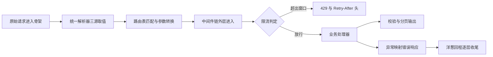
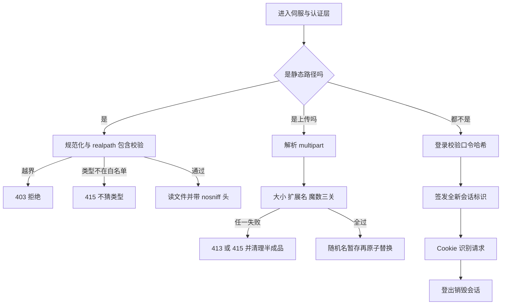
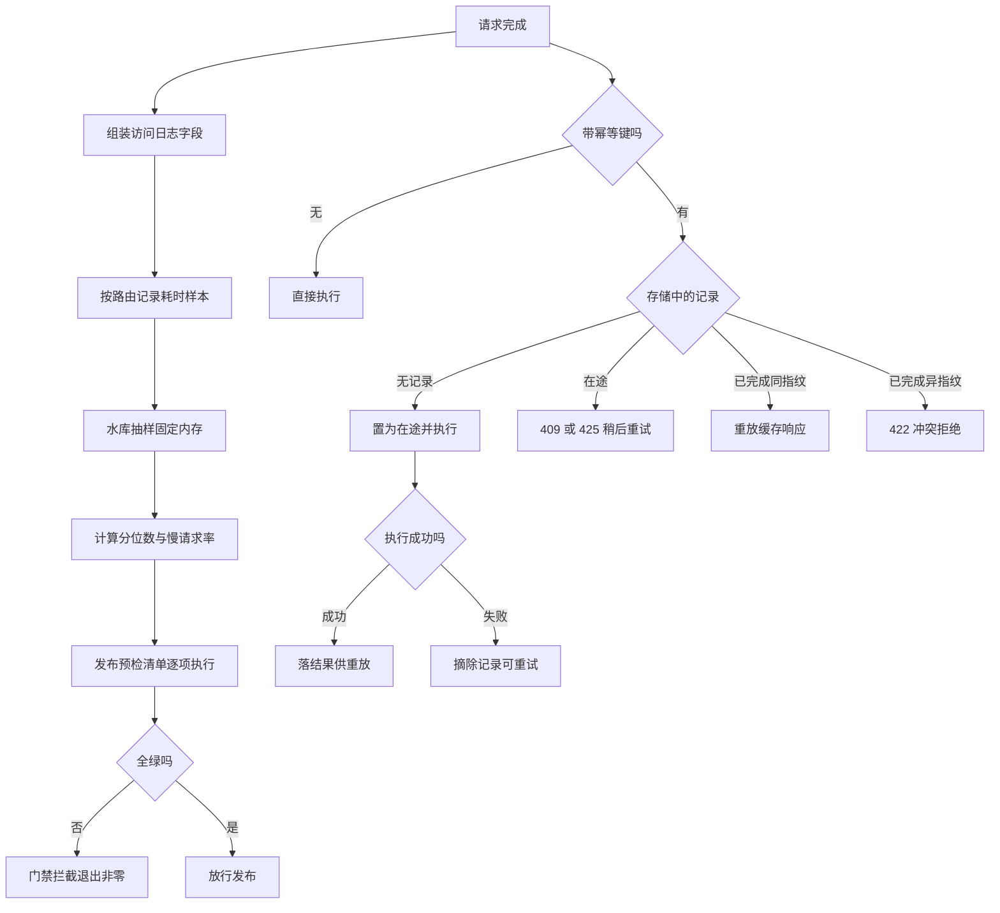
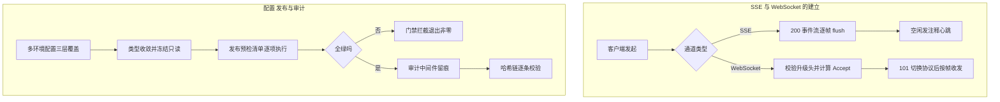

# 第 3 类 · Web 后端开发(收官扩产)

本文件是第 3 类的收官批扩充, 共 21 题(Q2918–Q2938), 主题是综合应用与查漏补缺: 每题给出一个可以直接落地的最小完整实现——CRUD 端点骨架、三源请求解析器、路由注册与反转、可组合中间件链、内存限流、静态文件安全伺服、CSV 流式导出、上传闭环、登录-会话-登出、JWT 手工签发校验、网关转发骨架、健康检查三件套、错误码映射、访问日志字段、幂等存储、发布预检、慢接口采样、SSE 推送、WebSocket 握手、多环境配置与审计中间件。
代码 21 块全部在 /usr/bin/python3(Python 3.9.6)下逐块实跑通过; Q2918 涉及 fastapi/pydantic, 缺库时按设计降级为 exit 0 的标准库内核演示; Q2935 的回环请求用 build_opener(ProxyHandler({})) 直连 127.0.0.1 不经代理; 故意触发的异常均有 try/except 包裹, 演示数据固定、输出可复现、单块耗时远低于 25 秒。
难度分布: 1-2 星 4 题、3 星 11 题、4-5 星 6 题; 每 5-6 题插一张 mermaid 结构图, 共 4 张。
复习主线: 先立骨架再谈优化——校验在前、失败清理、出处可查、结果可重放、留痕可验证, 把这五条纪律想透, Web 后端手写题就只剩套路。

### Q2918 · 完整 CRUD 端点骨架: 内存存储加校验加分页

> 难度:★★★☆ | 标签:FastAPI, CRUD, 分页

**问**:现在动手写一个资源 CRUD 接口的骨架, 内存存储即可: 创建、查列表、查详情、部分更新、删除都要有, 校验和分页你打算放在哪几层?

**答**:校验放最外层, 在进入业务逻辑前就把非法请求打成 422, 未知字段显式拒绝而不是静默丢弃; 分页是列表接口的出口契约, 三件套 page、page_size、total 一起返回, 且 page_size 必须有上限防御, 否则一次 page_size=100000 的请求就打穿内存。存储层即使只是内存字典也要固定排序键, 保证分页结果稳定可测。更新区分 PUT 与 PATCH 两种语义: PUT 全字段替换、PATCH 局部更新只校验出现的字段。删除与详情对不存在的资源统一 404, 让客户端能区分"没有"与"坏了"。

```python
# file: code/03_Web后端开发/q2918_crud_endpoints.py
"""完整 CRUD 端点骨架: 内存存储 + 字段校验 + 分页。

装有 fastapi 时走框架路径; 缺库时降级为等价的标准库内核演示(校验、CRUD、分页语义一致)。
"""
import sys

try:
    from typing import Optional
    from fastapi import FastAPI, HTTPException
    from pydantic import BaseModel, Field
    from fastapi.testclient import TestClient
except ImportError:
    print("未安装 fastapi/pydantic, 降级为标准库内核演示(同样的校验与分页语义):")

    class ValidationError(Exception):
        pass

    REQUIRED = {"title": str, "author": str}
    MAX_PAGE_SIZE = 50

    def validate_book(payload, partial=False):
        """创建要求全字段, 更新允许部分字段; 未知键拒绝, 类型不符拒绝。"""
        if not isinstance(payload, dict):
            raise ValidationError("请求体必须是对象")
        unknown = set(payload) - set(REQUIRED)
        if unknown:
            raise ValidationError("未知字段: %s" % ",".join(sorted(unknown)))
        for key, typ in REQUIRED.items():
            if key in payload:
                if not isinstance(payload[key], typ):
                    raise ValidationError("%s 必须是字符串" % key)
            elif not partial:
                raise ValidationError("缺少必填字段: %s" % key)
        return True

    class BookStore:
        def __init__(self):
            self._items = {}
            self._next_id = 1

        def create(self, payload):
            validate_book(payload)
            item = dict(payload, id=self._next_id)
            self._items[self._next_id] = item
            self._next_id += 1
            return item

        def get(self, item_id):
            if item_id not in self._items:
                raise KeyError(item_id)
            return self._items[item_id]

        def list(self, page=1, page_size=10):
            page_size = min(max(page_size, 1), MAX_PAGE_SIZE)  # page_size 上限防御
            page = max(page, 1)
            ordered = sorted(self._items.values(), key=lambda i: i["id"])
            start = (page - 1) * page_size
            return {"items": ordered[start:start + page_size], "page": page,
                    "page_size": page_size, "total": len(ordered)}

        def update(self, item_id, payload):
            validate_book(payload, partial=True)
            item = self.get(item_id)
            item.update(payload)
            return item

        def delete(self, item_id):
            item = self.get(item_id)
            del self._items[item_id]
            return item

    store = BookStore()
    b1 = store.create({"title": "流畅的Python", "author": "Ramalho"})
    b2 = store.create({"title": "Fluent Python 2e", "author": "Ramalho"})
    try:
        store.create({"title": "缺作者的书"})
    except ValidationError as e:
        print("创建缺字段被拒:", e)
    try:
        store.create({"title": "多余字段", "author": "x", "price": 1})
    except ValidationError as e:
        print("未知字段被拒:", e)
    store.update(b1["id"], {"title": "流畅的Python第2版"})
    page = store.list(page=1, page_size=1)
    print("分页: 第%s页 共%s条 返回%s条" % (page["page"], page["total"], len(page["items"])))
    store.delete(b2["id"])
    try:
        store.get(b2["id"])
    except KeyError:
        print("删除后读取 -> 404 语义")
    sys.exit(0)

# ---------- 框架路径 ----------
app = FastAPI()
BOOKS = {}
_next_id = 1
MAX_PAGE_SIZE = 50


class BookIn(BaseModel):
    title: str = Field(min_length=1, max_length=100)
    author: str = Field(min_length=1, max_length=50)


class BookPatch(BaseModel):
    title: Optional[str] = Field(default=None, min_length=1, max_length=100)
    author: Optional[str] = Field(default=None, min_length=1, max_length=50)


@app.post("/books", status_code=201)
def create_book(book: BookIn):
    global _next_id
    item = book.dict()
    item["id"] = _next_id
    _next_id += 1
    BOOKS[item["id"]] = item
    return item


@app.get("/books")
def list_books(page: int = 1, page_size: int = 10):
    page = max(page, 1)
    page_size = min(max(page_size, 1), MAX_PAGE_SIZE)
    ordered = sorted(BOOKS.values(), key=lambda i: i["id"])
    start = (page - 1) * page_size
    return {"items": ordered[start:start + page_size], "page": page,
            "page_size": page_size, "total": len(ordered)}


@app.get("/books/{book_id}")
def get_book(book_id: int):
    if book_id not in BOOKS:
        raise HTTPException(status_code=404, detail="book not found")
    return BOOKS[book_id]


@app.patch("/books/{book_id}")
def patch_book(book_id: int, patch: BookPatch):
    if book_id not in BOOKS:
        raise HTTPException(status_code=404, detail="book not found")
    data = {k: v for k, v in patch.dict().items() if v is not None}
    BOOKS[book_id].update(data)
    return BOOKS[book_id]


@app.delete("/books/{book_id}", status_code=204)
def delete_book(book_id: int):
    if book_id not in BOOKS:
        raise HTTPException(status_code=404, detail="book not found")
    del BOOKS[book_id]


client = TestClient(app)
r = client.post("/books", json={"title": "流畅的Python", "author": "Ramalho"})
assert r.status_code == 201, r.text
book_id = r.json()["id"]
client.post("/books", json={"title": "第二本", "author": "某人"})
assert client.get("/books", params={"page": 1, "page_size": 1}).json()["total"] == 2
assert client.get("/books/999").status_code == 404
assert client.post("/books", json={"title": ""}).status_code == 422
patched = client.patch("/books/%d" % book_id, json={"title": "流畅的Python第2版"})
assert patched.json()["title"].endswith("第2版")
assert client.delete("/books/%d" % book_id).status_code == 204
assert client.get("/books").json()["total"] == 1
print("框架路径: 创建/校验422/分页/404/更新/删除 全部通过")
```

**追问**:
- PATCH 的 partial 校验与 PUT 有什么差别?——PUT 是整体替换要求全字段, PATCH 是局部更新只校验出现的字段, 校验器必须能区分这两种模式。
- 列表接口为什么返回 total 而不是让客户端翻到空页?——total 让前端一次算出页数, 翻空页的隐式约定会在并发增删时产生跳页歧义。

### Q2919 · 统一请求解析器: 头/查询串/请求体三源取值

> 难度:★★★☆ | 标签:请求解析, 参数设计

**问**:一个参数可能出现在请求头、查询串或请求体里, 你的服务怎么统一取值? 优先级和可追溯性怎么设计?

**答**:核心是给一个显式的源顺序, 默认 body、query、header, 调用方可以用 sources 参数覆盖, 绝不做框架隐式魔法。get 返回 (值, 出处) 二元组, 出处让联调时"这个参数到底从哪来"从猜变成看, 也让日志能记录异常请求的取值路径。空串与缺失同权对待, 都算没有值, 避免 page= 这类空值悄悄绕过默认值。类型转换在取值层完成, 转型失败抛 Unresolvable 让端点统一映射 400, 错误信息带上字段名与来源。头名一律小写化匹配, 免得 X-Trace-Id 与 x-trace-id 被当成两个东西。

```python
# file: code/03_Web后端开发/q2919_request_resolver.py
"""统一的请求解析器: 头/查询串/请求体三源取值, 显式优先级与出处记录(纯标准库)。"""
from urllib.parse import parse_qs


class Unresolvable(Exception):
    """取值存在但无法转型, 在真实端点中应映射为 400。"""


class Request:
    """把三源收敛成一个取值入口: get 按显式顺序找第一个非空值并记录出处。"""

    def __init__(self, method="GET", path="/", headers=None, query="", body=None):
        self.method = method
        self.path = path
        self.headers = {k.lower(): v for k, v in (headers or {}).items()}
        self.query = parse_qs(query, keep_blank_values=True)
        self.body = body if isinstance(body, dict) else {}

    def get(self, name, default=None, sources=("body", "query", "header"), cast=None):
        """按 sources 顺序取第一个非空值, 返回 (值, 出处); 三源皆无给 default 与 None。"""
        for source in sources:
            raw, found = self._raw(name, source)
            if not found:
                continue
            return self._coerce(name, raw, cast, source), source
        return default, None

    def _raw(self, name, source):
        if source == "body":
            if name in self.body and self.body[name] not in (None, ""):
                return self.body[name], True
        elif source == "query":
            values = self.query.get(name)
            if values and values[0] != "":
                return values[0], True
        elif source == "header":
            raw = self.headers.get(name.lower())
            if raw not in (None, ""):
                return raw, True
        return None, False

    @staticmethod
    def _coerce(name, value, cast, source):
        if cast is None:
            return value
        try:
            return cast(value)
        except (TypeError, ValueError):
            raise Unresolvable("%r 在 %s 中无法转为 %s" % (name, source, cast.__name__))


req = Request(
    method="POST", path="/search",
    headers={"X-Trace-Id": "t-123", "Accept": "application/json"},
    query="page=2&page=3&q=web",
    body={"page": 9, "q": "python"},
)

page, src = req.get("page", cast=int)
print("page=%s 来自 %s, body 优先于 query" % (page, src))
assert (page, src) == (9, "body")

q, src = req.get("q")
print("q=%s 来自 %s" % (q, src))
assert (q, src) == ("python", "body")

trace, src = req.get("X-Trace-Id", sources=("header",))
print("trace=%s 只在头里, 显式声明单源" % trace)
assert (trace, src) == ("t-123", "header")

limit, src = req.get("limit", default=20, sources=("query", "body"))
print("limit 缺省 -> 默认值 %s, 出处 %s" % (limit, src))
assert (limit, src) == (20, None)

n1 = req.get("page", sources=("query",), cast=int)[0]
print("强制 query 源可拿到重复键首值:", n1)
assert n1 == 2

try:
    Request(query="page=abc").get("page", sources=("query",), cast=int)
except Unresolvable as e:
    print("转型失败 -> 400 语义:", e)

# 空串与缺失同权: keep_blank_values 解析出的空值不当作有值
empty, src = req.get("", sources=("header",))
print("空名取值 ->", empty, src)
assert empty is None and src is None
print("三源解析器演示通过")
```

**追问**:
- 为什么取值要记录出处?——排查参数覆盖错乱是联调最高频问题, 出处字段把定位从翻代码变成看返回值。
- 查询串里同名多值怎么办?——解析层只暴露首值, 多值语义应显式走 getlist 类接口, 混用 get 会静默丢数据。

### Q2920 · 路由表的注册与反转: match 与 url_for 双向

> 难度:★★★☆ | 标签:路由, 反向解析

**问**:手写一个路由表要支持带参数的路径注册、请求匹配, 还要能按路由名反查 URL, 你的 match 和 reverse 各怎么实现?

**答**:注册时把 `<int:id>`、`<str:slug>` 这样的参数段编译成正则命名组, int 段是 `\d+` 且匹配时顺带完成类型转换, 字面量段用 re.escape 防元字符注入。match 对整段正则做全串匹配, 长度严格一致, 不会出现 `/users/42/extra` 误命中; 没匹配到返回 None 让上层给 404, 而不是抛异常。反转 url_for 按注册的声明清单校验参数: 未注册路由名 KeyError、多余参数与缺参 ValueError、int 参数类型不符也报错, 错误在开发期暴露而不是上线后生成一个坏链接。路由名重复直接拒绝注册, 名字是反转的唯一索引。

```python
# file: code/03_Web后端开发/q2920_route_reverse.py
"""路由表的注册与反转: 参数化匹配 match + url_for 反查(纯标准库)。"""
import re
from urllib.parse import urlencode

SEG = re.compile(r"^<(int|str):([a-zA-Z_]\w*)>$")


class Router:
    def __init__(self):
        self.routes = {}    # name -> pattern
        self.matchers = []  # (compiled, name, converters) 保注册序

    def add(self, name, pattern):
        if name in self.routes:
            raise ValueError("路由名重复: %s" % name)
        converters = {}
        seg_patterns = []
        for seg in pattern.strip("/").split("/"):
            m = SEG.match(seg)
            if m:
                typ, pname = m.groups()
                converters[pname] = typ
                seg_patterns.append(r"(?P<%s>%s)" % (pname, r"\d+" if typ == "int" else "[^/]+"))
            else:
                seg_patterns.append(re.escape(seg))
        regex = "^" + "/".join(seg_patterns) + "$"
        self.routes[name] = pattern
        self.matchers.append((re.compile(regex), name, converters))

    def match(self, path):
        """返回 (路由名, 参数字典) 或 None; int 段顺带完成类型转换。"""
        target = path.strip("/")
        for compiled, name, converters in self.matchers:
            m = compiled.match(target)
            if not m:
                continue
            params = {}
            for key, raw in m.groupdict().items():
                params[key] = int(raw) if converters[key] == "int" else raw
            return name, params
        return None

    def url_for(self, name, query=None, **params):
        """反转查找: 按声明填充参数, 多参/缺参/类型不符都显式报错。"""
        if name not in self.routes:
            raise KeyError("未注册的路由名: %s" % name)
        pattern = self.routes[name]
        declared = {}
        for seg in pattern.strip("/").split("/"):
            m = SEG.match(seg)
            if m:
                declared[m.group(2)] = m.group(1)
        extra = set(params) - set(declared)
        missing = set(declared) - set(params)
        if extra:
            raise ValueError("多余参数: %s" % ",".join(sorted(extra)))
        if missing:
            raise ValueError("缺少参数: %s" % ",".join(sorted(missing)))
        out = []
        for seg in pattern.strip("/").split("/"):
            m = SEG.match(seg)
            if m:
                typ, pname = m.groups()
                value = str(params[pname])
                if typ == "int" and not value.isdigit():
                    raise ValueError("参数 %s 需要 int, 拿到 %r" % (pname, params[pname]))
                out.append(value)
            else:
                out.append(seg)
        url = "/" + "/".join(out) if out else "/"
        if query:
            url += "?" + urlencode(query)
        return url


router = Router()
router.add("user_detail", "/users/<int:id>")
router.add("comment", "/blog/<str:slug>/comments/<int:cid>")
router.add("home", "/")

hit = router.match("/users/42")
print("匹配:", hit)
assert hit == ("user_detail", {"id": 42})
assert router.match("/users/abc") is None, "int 段不吞非数字"
assert router.match("/blog/x/comments/7/extra") is None, "长度必须严格一致"

url = router.url_for("comment", query={"page": 2}, slug="hello-world", cid=7)
print("反转:", url)
assert url == "/blog/hello-world/comments/7?page=2"
assert router.url_for("user_detail", id=1) == "/users/1"
assert router.url_for("home") == "/"

for bad_call, expect in [
    (lambda: router.url_for("ghost", id=1), "未注册路由名"),
    (lambda: router.url_for("user_detail", id=1, extra=2), "多余参数"),
    (lambda: router.url_for("user_detail"), "缺少参数"),
    (lambda: router.url_for("user_detail", id="x"), "类型不符"),
]:
    try:
        bad_call()
        raise AssertionError("应当报错: %s" % expect)
    except (KeyError, ValueError) as e:
        print("反转报错被拒 [%s]:" % expect, e)

try:
    router.add("user_detail", "/users/<int:id>")
except ValueError as e:
    print("重名注册被拒:", e)
print("路由注册与反转演示通过")
```

**追问**:
- 反转查找为什么不做通配?——URL 里的通配会产生无法预测的链接, 只接受显式参数才能保证生成的 URL 可测试。
- 字面量段与参数段同形时怎么办?——注册顺序即优先级, 字面量段要排在参数段前, 否则 /users/new 会被 /users/\<int:id\> 吞掉。

### Q2921 · 中间件链的可组合实现: 函数式洋葱模型

> 难度:★★★☆ | 标签:中间件, 组合模式

**问**:框架的中间件本质是什么? 请现场用一个函数把若干中间件叠成洋葱模型, 并说明短路时各层的表现。

**答**:中间件本质是 fn(ctx, next) 形状的函数, next 是闭包出来的"调用下一层", build_chain 用递归 dispatch 把数组叠成洋葱, 最左在最外层。执行序是进入时按外到内、返回时按内到外, 所以计时中间件包住 handler、日志中间件能看到最终 status。短路就是某层不调用 next 直接返回, 内层完全不执行——鉴权失败时日志与计时层都不该留下痕迹, 这正是顺序即语义: 把日志放最外层, 401 也会留下 enter/leave 记录, 两种摆法各有用途。组合天然可复用, 同一批中间件换 handler 就换业务, 换顺序就换行为。

```python
# file: code/03_Web后端开发/q2921_middleware_compose.py
"""中间件链的可组合实现: 函数式洋葱模型、执行顺序与短路(纯标准库)。"""
import time


def build_chain(middlewares, handler):
    """把中间件从左到右叠成洋葱: 最左在最外层。每个中间件形如 fn(ctx, next)。"""
    def dispatch(ctx, i):
        if i == len(middlewares):
            return handler(ctx)

        def nxt():
            return dispatch(ctx, i + 1)

        return middlewares[i](ctx, nxt)

    def entry(ctx):
        return dispatch(ctx, 0)

    return entry


def auth_mw(ctx, nxt):
    """短路型中间件: 未登录直接返回 401, 内层完全不会执行。"""
    if ctx["headers"].get("authorization") != "Bearer ok":
        ctx["trace"].append("auth:401")
        return {"status": 401, "body": "unauthorized"}
    ctx["trace"].append("auth:pass")
    return nxt()


def logging_mw(ctx, nxt):
    ctx["trace"].append("log:enter")
    resp = nxt()
    ctx["trace"].append("log:leave status=%s" % resp["status"])
    return resp


def timing_mw(ctx, nxt):
    start = time.monotonic()
    resp = nxt()
    resp = dict(resp, duration_ms=int((time.monotonic() - start) * 1000))
    ctx["trace"].append("timing:done")
    return resp


def handler(ctx):
    ctx["trace"].append("handler")
    return {"status": 200, "body": "fine"}


app = build_chain([auth_mw, logging_mw, timing_mw], handler)

ctx_ok = {"headers": {"authorization": "Bearer ok"}, "trace": []}
resp = app(ctx_ok)
print("放行路径 trace:", ctx_ok["trace"])
assert resp["status"] == 200 and "duration_ms" in resp
assert ctx_ok["trace"] == ["auth:pass", "log:enter", "handler", "timing:done", "log:leave status=200"], "洋葱回程: 内层收尾先于外层"

ctx_bad = {"headers": {}, "trace": []}
resp = app(ctx_bad)
print("短路路径 trace:", ctx_bad["trace"])
assert resp["status"] == 401
assert ctx_bad["trace"] == ["auth:401"], "短路时日志与计时层都不应执行"

# 顺序即语义: 日志放最外层后, 401 也会留下 enter/leave 两条记录
app2 = build_chain([logging_mw, auth_mw, timing_mw], handler)
ctx3 = {"headers": {}, "trace": []}
resp2 = app2(ctx3)
print("日志外置时 trace:", ctx3["trace"])
assert ctx3["trace"] == ["log:enter", "auth:401", "log:leave status=401"]

# 组合可复用: 同一批中间件换 handler 即换业务
def other_handler(ctx):
    ctx["trace"].append("other")
    return {"status": 201, "body": "created"}

app3 = build_chain([auth_mw, logging_mw], other_handler)
ctx4 = {"headers": {"authorization": "Bearer ok"}, "trace": []}
assert app3(ctx4)["status"] == 201
print("换 handler 复用同一链:", ctx4["trace"])
print("中间件链演示通过")
```

**追问**:
- 中间件想读请求体会遇到什么问题?——体是一次性流, 中间件消费后处理器就拿不到, 必须先缓存 body 再伪造可重放流。
- 洋葱模型与管道模型差在哪?——洋葱模型每层有前后两个时机能包住下游, 管道只有进入时机, 计时这类收尾需求只有洋葱能自然表达。

### Q2922 · 请求限流的内存完整实现: 滑动窗口与自动清理

> 难度:★★★☆ | 标签:限流, 并发

**问**:给我一个不依赖 Redis 的单机限流完整方案: 数据结构、过期清理、并发安全和响应头都要考虑。

**答**:数据结构是每 key 一个时间戳列表, 判定时裁掉窗外旧样本再数个数, 这是滑动窗口日志, 精确无边界突发; 时钟做成可注入的 callable, 测试时手动推进就能复现窗口行为。并发安全靠一把 Lock 包住读裁写全程, 多线程并发打到同一 key 时放行总数恰好等于 limit, 不多不少。内存治理是容易被漏掉的一半: 海量独立 IP 会把字典撑爆, 必须有 sweep 周期清理只剩过期样本的 key。响应头无论放不放行都回——放行给 X-RateLimit-Limit/Remaining, 拒绝给 Retry-After, 让客户端能自我调节而不是盲目重试。

```python
# file: code/03_Web后端开发/q2922_rate_limit_memory.py
"""请求限流的内存完整实现: 滑动窗口日志 + 过期清理 + 线程安全与标准响应头(纯标准库)。"""
import threading


class FakeClock:
    """可手动推进的单调钟, 让窗口行为可复现。"""

    def __init__(self, start=1000.0):
        self.now = start

    def __call__(self):
        return self.now

    def advance(self, seconds):
        self.now += seconds


class SlidingWindowLimiter:
    """每 key 一个时间戳日志, 放行前裁掉窗外旧样本; 读写都在锁内。"""

    def __init__(self, limit, window_seconds, clock):
        self.limit = limit
        self.window = window_seconds
        self.clock = clock
        self._hits = {}
        self._lock = threading.Lock()

    def hit(self, key):
        """返回 (是否放行, 剩余额度, Retry-After 秒); 放行时也顺手裁剪。"""
        now = self.clock()
        with self._lock:
            window = [t for t in self._hits.get(key, []) if t > now - self.window]
            if len(window) >= self.limit:
                retry_after = int(self.window - (now - window[0])) + 1
                self._hits[key] = window
                return False, 0, retry_after
            window.append(now)
            self._hits[key] = window
            return True, self.limit - len(window), 0

    def sweep(self):
        """周期清理全空的 key, 防止海量独立 IP 把内存拖垮。"""
        now = self.clock()
        with self._lock:
            dead = [k for k, ts in self._hits.items() if not ts or ts[-1] <= now - self.window]
            for k in dead:
                del self._hits[k]
            return len(dead)

    def response_headers(self, allowed, remaining, retry_after):
        """无论放不放行, 都回标准头, 让客户端能自我调节。"""
        headers = {"X-RateLimit-Limit": str(self.limit)}
        if allowed:
            headers["X-RateLimit-Remaining"] = str(remaining)
        else:
            headers["Retry-After"] = str(retry_after)
        return headers


clock = FakeClock()
limiter = SlidingWindowLimiter(limit=3, window_seconds=60, clock=clock)

results = []
for i in range(4):
    allowed, remaining, retry = limiter.hit("ip:1.2.3.4")
    results.append((allowed, remaining, retry))
    if not allowed:
        print("第%d次被限 -> 429, Retry-After=%s, 响应头=%s" % (i + 1, retry, limiter.response_headers(allowed, remaining, retry)))
    else:
        print("第%d次放行, 剩余 %s" % (i + 1, remaining))
assert results == [(True, 2, 0), (True, 1, 0), (True, 0, 0), (False, 0, 61)]

# 窗口滑动: 推进 61 秒后最早的样本出窗, 恢复放行
clock.advance(61)
allowed, remaining, _ = limiter.hit("ip:1.2.3.4")
print("滑出窗口后恢复放行:", allowed)
assert allowed and remaining == 2

# 不同 key 互不影响
allowed, _, _ = limiter.hit("ip:5.6.7.8")
assert allowed

# 清理: 只剩过期样本的 key 会被 sweep 摘除
clock.advance(600)
removed = limiter.sweep()
print("sweep 清理掉 %s 个过期 key" % removed)
assert "ip:1.2.3.4" not in limiter._hits and "ip:5.6.7.8" not in limiter._hits and removed == 2

# 线程安全: 并发打到同一 key, 放行总数不得超过 limit
clock.advance(1000)
shared = SlidingWindowLimiter(limit=5, window_seconds=60, clock=clock)
allowed_count = []
lock = threading.Lock()

def worker():
    for _ in range(10):
        ok, _, _ = shared.hit("key:x")
        with lock:
            if ok:
                allowed_count.append(1)

threads = [threading.Thread(target=worker) for _ in range(8)]
for t in threads:
    t.start()
for t in threads:
    t.join()
print("50 次并发请求放行 %s 次" % len(allowed_count))
assert len(allowed_count) == 5
print("内存限流完整方案演示通过")
```

**追问**:
- 单机内存限流为什么不能直接上多副本?——每个进程各数各的窗口, 总额度是副本数的倍数, 要精确必须挪到 Redis 这类共享存储。
- 滑动窗口与固定窗口怎么选?——固定窗口省内存但窗口边界可双倍突发, 滑动窗口平滑但每请求都存时间戳, 按业务对突发的敏感度取舍。



### Q2923 · 静态文件的安全伺服: 从路径校验到响应头

> 难度:★★★☆ | 标签:静态文件, 安全, 路径穿越

**问**:让你从零写静态文件伺服, 除了能读文件回 200, 你会做哪些安全校验? 按什么顺序做?

**答**:裁决顺序固定四步: 先拒空字节, 再规范化路径——normpath 把点段折叠掉, 折叠后仍以 .. 开头或变绝对路径直接 403; 然后做 realpath 包含校验, 因为 normpath 不解析软链, 只有 realpath 后确认结果仍在根目录真实路径之内, 才能拦住软链逃逸; 最后才谈存在性与类型——不存在 404, 类型不在白名单 415, 白名单同时决定了 Content-Type, 绝不用 guess 猜类型再喂给浏览器。目录请求回退 index.html 而不开目录列表。响应头带 X-Content-Type-Options: nosniff 关掉浏览器的内容嗅探, 配 Cache-Control 让边缘层敢缓存。百分号解码发生在进本函数之前, 所以编码点段已经变回 .., 同样被拦。

```python
# file: code/03_Web后端开发/q2923_static_serve.py
"""静态文件的安全伺服: 路径校验 + 类型白名单 + 安全响应头(纯标准库)。"""
import os
import tempfile
from urllib.parse import unquote

MIME = {
    ".html": "text/html; charset=utf-8",
    ".css": "text/css; charset=utf-8",
    ".js": "text/javascript; charset=utf-8",
    ".json": "application/json",
    ".png": "image/png",
    ".jpg": "image/jpeg",
    ".txt": "text/plain; charset=utf-8",
    ".ico": "image/x-icon",
}


class StaticError(Exception):
    def __init__(self, status, reason):
        self.status = status
        self.reason = reason


def serve_static(root, url_path):
    """url_path 应已完成百分号解码; 本函数只信任规范化后的结果。"""
    if "\x00" in url_path:
        raise StaticError(400, "路径含空字节")
    rel = os.path.normpath(url_path.lstrip("/"))
    if rel in ("", "."):
        rel = "index.html"
    if rel.startswith("..") or os.path.isabs(rel):
        raise StaticError(403, "路径越界")
    root_real = os.path.realpath(root)
    full = os.path.realpath(os.path.join(root_real, rel))
    if full != root_real and not full.startswith(root_real + os.sep):
        raise StaticError(403, "软链或别名逃逸出根目录")
    if os.path.isdir(full):
        full = os.path.join(full, "index.html")  # 目录回退到 index, 不开目录列表
    if not os.path.isfile(full):
        raise StaticError(404, "文件不存在")
    ext = os.path.splitext(full)[1].lower()
    if ext not in MIME:
        raise StaticError(415, "类型不在白名单, 不猜测不伺服")
    with open(full, "rb") as f:
        data = f.read()
    return {
        "status": 200,
        "body": data,
        "headers": {
            "Content-Type": MIME[ext],
            "Content-Length": str(len(data)),
            "X-Content-Type-Options": "nosniff",
            "Cache-Control": "public, max-age=3600",
        },
    }


tmp = tempfile.mkdtemp()
root = os.path.join(tmp, "public")
os.makedirs(os.path.join(root, "css"))
with open(os.path.join(root, "index.html"), "w") as f:
    f.write("<h1>ok</h1>")
with open(os.path.join(root, "css", "app.css"), "w") as f:
    f.write("body{margin:0}")
with open(os.path.join(root, "evil.exe"), "w") as f:
    f.write("MZ binary junk")
outside = os.path.join(tmp, "secret.txt")
with open(outside, "w") as f:
    f.write("top secret")
os.symlink(outside, os.path.join(root, "leak.txt"))
os.symlink("/etc/passwd", os.path.join(root, "passwd"))

hit = serve_static(root, "/index.html")
print("正常伺服:", hit["headers"]["Content-Type"], len(hit["body"]), "字节")
assert hit["status"] == 200 and hit["body"] == b"<h1>ok</h1>"
assert hit["headers"]["X-Content-Type-Options"] == "nosniff"

hit = serve_static(root, "/css/app.css")
assert hit["headers"]["Content-Type"].startswith("text/css")
hit = serve_static(root, "/")
assert hit["body"] == b"<h1>ok</h1>", "根路径回退 index.html"

attacks = [
    ("/../etc/passwd", "点段上跳"),
    ("/css/../../../etc/passwd", "多层点段"),
    (unquote("/%2e%2e/etc/passwd"), "编码点段, 进函数前已解码一次"),
    ("/leak.txt", "软链指向根外"),
    ("/passwd", "软链指向系统文件"),
]
for path, why in attacks:
    try:
        serve_static(root, path)
        raise AssertionError("应当拦截: %s" % why)
    except StaticError as e:
        print("拦截 [%s] -> %s %s" % (why, e.status, e.reason))
        assert e.status in (403, 404)

try:
    serve_static(root, "/nope.html")
except StaticError as e:
    print("缺失文件 ->", e.status)
    assert e.status == 404
try:
    serve_static(root, "/evil.exe")
except StaticError as e:
    print("类型不在白名单 ->", e.status)
    assert e.status == 415
print("静态文件安全伺服演示通过")
```

**追问**:
- 为什么先 realpath 再前缀比对?——normpath 不解析软链, realpath 后做包含校验才拦得住别名与软链逃逸。
- ETag 与 Last-Modified 加在哪?——伺服层按文件 mtime 与大小生成, 配上 Cache-Control 浏览器才有条件请求可发。

### Q2924 · CSV 导出端点的流式生成: 分块产出恒定内存

> 难度:★★★☆ | 标签:CSV, 流式响应

**问**:一个 10 万行的 CSV 导出接口, 怎么做到不撑内存也不超时? 讲讲你的流式方案和编码细节。

**答**:出口是生成器: csv.writer 往一个 StringIO 写, 攒够 batch 行就 encode 成字节块 yield 给响应体迭代器, 内存峰值只与 batch 相关, 与总行数无关; 上游行数据用游标一次取一行, 不整表进列表, 验证方法是只拉两块后游标剩余量正好说明它是惰性拉取。编码三个细节: 首块用 utf-8-sig 带 BOM, Excel 打开才不乱码; 行结束符统一 \r\n 符合 RFC 4180; 含逗号引号换行的字段交给 csv 模块加引号转义, 回读可逆。空结果也要产出表头行, 客户端才能渲染空表格。响应头 Content-Disposition 用 attachment 触发下载, 大文件不要给 Content-Length, 用 chunked 传输。

```python
# file: code/03_Web后端开发/q2924_csv_stream.py
"""CSV 导出端点的流式生成: 生成器分块产出 + 恒定内存(纯标准库)。"""
import csv
import io


def csv_stream(header, rows, batch=128, bom=True):
    """把行迭代器切成固定大小的字节块, 逐块 yield; 内存峰值只与 batch 相关。

    首块用 utf-8-sig 加 BOM, Excel 打开才不乱码; 后续块纯 utf-8。
    """
    buf = io.StringIO()
    writer = csv.writer(buf, lineterminator="\r\n")
    writer.writerow(header)
    yield buf.getvalue().encode("utf-8-sig" if bom else "utf-8")
    buf.seek(0)
    buf.truncate(0)
    count = 0
    for row in rows:
        writer.writerow(row)
        count += 1
        if count % batch == 0:
            yield buf.getvalue().encode("utf-8")
            buf.seek(0)
            buf.truncate(0)
    if buf.tell():
        yield buf.getvalue().encode("utf-8")


def rows_from_db(total):
    """模拟数据库游标: 一次只取一行, 不整表进内存。"""
    for i in range(1, total + 1):
        if i == 7:
            yield (i, '含"引号"与,逗号的名字', "12.50")
        else:
            yield (i, "订单-%d" % i, "%.2f" % (i * 1.5))


HEADER = ["id", "name", "amount"]
TOTAL = 1000

chunks = list(csv_stream(HEADER, rows_from_db(TOTAL), batch=128))
sizes = [len(c) for c in chunks]
print("产出 %s 个字节块, 单块最大 %s 字节, 总计 %s 字节" % (len(chunks), max(sizes), sum(sizes)))
assert max(sizes) < 64 * 1024, "每块体积有上界, 与总行数无关"

payload = b"".join(chunks)
assert payload[:3] == b"\xef\xbb\xbf", "首块带 BOM"
assert payload.endswith(b"\r\n")

parsed = list(csv.reader(io.StringIO(payload.decode("utf-8-sig"))))
print("回读解析: 表头=%s, 数据行=%s" % (parsed[0], len(parsed) - 1))
assert parsed[0] == HEADER and len(parsed) - 1 == TOTAL
assert parsed[7] == ["7", '含"引号"与,逗号的名字', "12.50"], "csv 引号转义可逆"

# 空结果也要有表头, 客户端才能渲染空表格
empty = b"".join(csv_stream(HEADER, iter([]), batch=128))
assert empty.decode("utf-8-sig").strip() == ",".join(HEADER)

# 惰性验证: 只取前两块时, 上游行迭代器没有被消费完
# 第一块只含表头不消费行, 第二块才消费第一批 batch 行
lazy_rows = rows_from_db(TOTAL)
stream = csv_stream(HEADER, lazy_rows, batch=128)
next(stream)
next(stream)
del stream
consumed = len(list(lazy_rows))
print("只拉两块后游标剩余 %s 行未消费, 证明是惰性拉取" % consumed)
assert consumed == TOTAL - 128

# WSGI 出口: 直接把生成器交给响应体迭代器, 边生成边发送
wsgi_body = iter(csv_stream(HEADER, rows_from_db(5), batch=2))
headers = [
    ("Content-Type", "text/csv; charset=utf-8"),
    ("Content-Disposition", "attachment; filename=orders.csv"),
]
print("响应头:", dict(headers)["Content-Disposition"])
print("CSV 流式导出演示通过")
```

**追问**:
- 导出接口超时通常卡在哪?——同步把整表拼进内存再发, 大表必挂; 改游标加分块生成器后时间与内存都恒定。
- 数字列为什么按字符串写?——Excel 会把长数字转科学计数并丢精度, 单号与金额类字段按文本写入才安全。

### Q2925 · 文件上传的最小完整闭环: 校验落盘与失败清理

> 难度:★★★★ | 标签:文件上传, 安全, 原子写

**问**:现场实现一个最小但完整的文件上传处理: 从 multipart 解析到校验落盘, 失败时不能留垃圾, 你怎么做?

**答**:解析按 boundary 切段取带 filename 的 part, 教学版假设 boundary 不出现在文件内容里, 生产换框架解析器。校验三关按成本升序: 大小上限看 body 长度最先拒, 413; 扩展名白名单看文件名, 415; 魔数看内容开头字节与声明扩展名是否一致, 拦住改名上传的 exe。落盘三纪律: 永不用客户端文件名, 用 secrets 生成随机名, 原名只做展示元数据; 先写同目录 .part 暂存并 fsync, 再 os.replace 原子替换, 读者永远看不到半截文件; 任何一步失败都在 except 里删掉 .part, 不给磁盘留垃圾。扩展名从客户端文件名里取时做 lower 与白名单双重过滤, path 信息一律丢弃。

```python
# file: code/03_Web后端开发/q2925_upload_minimal.py
"""文件上传的最小完整闭环: multipart 解析 + 校验 + 原子落盘 + 失败清理(纯标准库)。"""
import os
import re
import secrets
import tempfile

MAX_SIZE = 1024
ALLOWED = {".png": b"\x89PNG\r\n\x1a\n", ".jpg": b"\xff\xd8"}


class UploadError(Exception):
    def __init__(self, status, reason):
        self.status = status
        self.reason = reason


def parse_multipart(body, content_type):
    """最小单文件解析: 按 boundary 切段, 取第一个带 filename 的 part。

    生产环境请用框架解析器; 本实现假设 boundary 不出现在文件内容里。
    """
    m = re.search(r'boundary="?([^";]+)"?', content_type or "")
    if not m:
        raise UploadError(400, "Content-Type 缺少 boundary")
    boundary = m.group(1).encode()
    segments = body.split(b"--" + boundary)
    for seg in segments[1:]:
        if seg.startswith(b"--"):        # --boundary-- 结束标记
            break
        if seg.startswith(b"\r\n"):      # boundary 行后的 CRLF
            seg = seg[2:]
        if seg.endswith(b"\r\n"):        # 下一边界前的 CRLF
            seg = seg[:-2]
        head, sep, data = seg.partition(b"\r\n\r\n")
        if not sep:
            continue
        filename = None
        for line in head.decode("utf-8", "replace").split("\r\n"):
            if line.lower().startswith("content-disposition") and 'name="file"' in line:
                fm = re.search(r'filename="([^"]*)"', line)
                if fm:
                    filename = fm.group(1)
        if filename is not None:
            return filename, data
    raise UploadError(400, "请求中未找到文件部分")


def handle_upload(root, body, content_type):
    """校验三关 -> 随机名暂存 -> 原子替换; 任何一步失败都清理干净。"""
    filename, data = parse_multipart(body, content_type)
    if len(data) > MAX_SIZE:
        raise UploadError(413, "超过大小上限 %d 字节" % MAX_SIZE)
    ext = os.path.splitext(filename)[1].lower()
    if ext not in ALLOWED:
        raise UploadError(415, "扩展名不在白名单")
    if not data.startswith(ALLOWED[ext]):
        raise UploadError(415, "魔数与扩展名不符, 疑似改名上传")
    os.makedirs(root, exist_ok=True)
    stored = os.path.join(root, secrets.token_hex(8) + ext)  # 永不使用客户端文件名
    tmp_path = stored + ".part"
    try:
        with open(tmp_path, "wb") as f:
            f.write(data)
            f.flush()
            os.fsync(f.fileno())
        os.replace(tmp_path, stored)  # 同目录原子替换, 不会出现半截文件
    except BaseException:
        if os.path.exists(tmp_path):
            os.remove(tmp_path)       # 失败清理, 不留 .part 垃圾
        raise
    return stored, len(data)


def multipart_body(filename, data, boundary=None):
    """构造测试用的 multipart/form-data 请求体。"""
    boundary = boundary or secrets.token_hex(16)
    part = (
        'Content-Disposition: form-data; name="file"; filename="%s"\r\n'
        "Content-Type: application/octet-stream\r\n\r\n" % filename
    ).encode()
    body = b"--" + boundary.encode() + b"\r\n" + part + data + b"\r\n"
    body += b"--" + boundary.encode() + b"--\r\n"
    return body, "multipart/form-data; boundary=%s" % boundary


tmp = tempfile.mkdtemp()
png = b"\x89PNG\r\n\x1a\n" + b"rest-of-png-bytes" * 10

body, ct = multipart_body("photo.png", png)
good_body, good_ct = body, ct
stored, size = handle_upload(tmp, body, ct)
print("合法上传落盘:", os.path.basename(stored), size, "字节")
assert stored.endswith(".png") and size == len(png)
with open(stored, "rb") as f:
    assert f.read() == png
assert os.path.basename(stored) != "photo.png", "客户端文件名只校验扩展名, 不用于落盘"

cases = [
    (multipart_body("big.png", png + b"x" * MAX_SIZE), "超过大小上限"),
    (multipart_body("shell.exe", png), "扩展名不在白名单"),
    (multipart_body("fake.png", b"MZ\x90\x00" + b"junk" * 10), "魔数与扩展名不符"),
    (b"not-multipart", "Content-Type: text/plain", "缺少 boundary"),
]
for case in cases:
    if len(case) == 2:
        (body, ct), why = case
    else:
        body, ct, why = case
    try:
        handle_upload(tmp, body, ct)
        raise AssertionError("应当被拒: %s" % why)
    except UploadError as e:
        print("拒绝 [%s] -> %s %s" % (why, e.status, e.reason))
        assert e.status in (400, 413, 415)

# 失败清理演示: 让 os.replace 模拟磁盘满, 验证 .part 不残留
real_replace = os.replace

def disk_full(src, dst):
    raise OSError(28, "模拟磁盘满")

os.replace = disk_full
try:
    handle_upload(tmp, good_body, good_ct)
except OSError as e:
    print("落盘失败:", e.strerror)
finally:
    os.replace = real_replace
leftover = [n for n in os.listdir(tmp) if n.endswith(".part")]
assert not leftover, "失败路径必须清理暂存文件"
print("失败清理后目录内容:", sorted(os.listdir(tmp)))
print("文件上传最小闭环演示通过")
```

**追问**:
- 为什么不用客户端文件名落盘?——文件名可能带路径穿越与特殊字符, 落盘一律随机名, 原名只作为展示元数据。
- .part 暂存再 os.replace 好在哪?——同目录临时文件加原子替换, 读者永远看不到半截文件, 崩溃后只需清理 .part。

### Q2926 · 登录-会话-登出的完整闭环实现

> 难度:★★★☆ | 标签:会话, 认证, Cookie

**问**:从用户提交密码到登出销毁, 会话的完整生命周期你能在一段代码里闭环吗? 中间的安全点有哪些?

**答**:五个安全点串成闭环: 口令存储用 PBKDF2 加盐哈希, 校验用恒定时间比较, 用户不存在也走一遍哈希, 抹平时序差避免枚举账号; 失败文案统一为"用户名或密码不正确", 不区分账号与口令错; 登录成功必须签发全新 sid, 永不复用客户端带来的标识, 断掉会话固定攻击; Cookie 下发带 HttpOnly 挡脚本读、SameSite=Lax 挡跨站携带、Max-Age 限生命周期, HTTPS 下再补 Secure; 登出即销毁服务端会话, Cookie 本体只是辅助清场。会话过期在请求路径上惰性删除, 不等批量清扫, 保证同一 Cookie 在过期后的第一次请求就失效。

```python
# file: code/03_Web后端开发/q2926_auth_loop.py
"""登录-会话-登出的完整闭环: 校验、签发、请求识别、登出销毁(纯标准库)。"""
import hashlib
import hmac
import http.cookies
import secrets
import time

SESSION_TTL = 3600
PBKDF2_ROUNDS = 20000  # 演示降低轮次; 生产按 OWASP 当前建议取值

_users = {}
SESSIONS = {}


def _register(username, password):
    salt = secrets.token_hex(8)
    digest = hashlib.pbkdf2_hmac("sha256", password.encode(), salt.encode(), PBKDF2_ROUNDS)
    _users[username] = {"salt": salt, "digest": digest}


def verify_password(username, password):
    """恒定时间比较, 缺用户也要走一遍哈希, 避免时序差暴露账号存在性。"""
    user = _users.get(username)
    salt = user["salt"] if user else "decoy-salt"
    candidate = hashlib.pbkdf2_hmac("sha256", password.encode(), salt.encode(), PBKDF2_ROUNDS)
    return user is not None and hmac.compare_digest(candidate, user["digest"])


def login(username, password, now=None):
    """成功必须签发全新 sid 防会话固定; 失败给统一文案不区分账号与口令错。"""
    if not verify_password(username, password):
        raise AuthError(401, "用户名或密码不正确")
    sid = secrets.token_urlsafe(32)
    now = time.time() if now is None else now
    SESSIONS[sid] = {"user": username, "created": now, "expires": now + SESSION_TTL}
    cookie = "sid=%s; Path=/; HttpOnly; SameSite=Lax; Max-Age=%d" % (sid, SESSION_TTL)
    return sid, cookie  # HTTPS 部署时追加 Secure


def current_user(cookie_header, now=None):
    """从 Cookie 头解析 sid 查会话; 过期即惰性删除, 不等到批量清扫。"""
    if not cookie_header:
        return None
    jar = http.cookies.SimpleCookie()
    try:
        jar.load(cookie_header)
    except http.cookies.CookieError:
        return None
    morsel = jar.get("sid")
    if morsel is None:
        return None
    session = SESSIONS.get(morsel.value)
    if session is None:
        return None
    now = time.time() if now is None else now
    if session["expires"] <= now:
        del SESSIONS[morsel.value]
        return None
    return session["user"]


def logout(sid):
    """登出即销毁服务端会话; Cookie 本体只能靠 Max-Age 辅助清场。"""
    return SESSIONS.pop(sid, None) is not None


class AuthError(Exception):
    def __init__(self, status, reason):
        self.status = status
        self.reason = reason


_register("alice", "correct-horse")

# 1. 错误口令 -> 401, 文案不区分账号与口令错
try:
    login("alice", "wrong-password")
except AuthError as e:
    print("错误口令 -> %s %s" % (e.status, e.reason))
try:
    login("ghost", "whatever")
except AuthError as e:
    print("不存在账号 -> %s %s (同一文案)" % (e.status, e.reason))

# 2. 正确口令 -> 签发会话并下发 Cookie
sid, cookie = login("alice", "correct-horse")
print("Set-Cookie:", cookie[:40], "...")
assert "HttpOnly" in cookie and "SameSite=Lax" in cookie

# 3. 带 Cookie 的请求 -> 识别出用户
assert current_user("sid=" + sid) == "alice"
assert current_user("other=x") is None
assert current_user("") is None
assert current_user("sid=" + "forged" + "x" * 30) is None, "伪造 sid 查无会话"

# 4. 会话固定: 即使客户端预带 sid, 登录也只发全新 sid
fixed = "A" * 43
_, cookie2 = login("alice", "correct-horse")
assert fixed not in cookie2, "登录永不复用客户端带来的会话标识"

# 5. 登出闭环: 销毁后同一 Cookie 立即失效
assert logout(sid) is True
assert current_user("sid=" + sid) is None
assert logout(sid) is False, "重复登出返回未登录语义"

# 6. 过期惰性删除
sid3, _ = login("alice", "correct-horse", now=1000.0)
SESSIONS[sid3]["expires"] = 1001.0
assert current_user("sid=" + sid3, now=2000.0) is None
assert sid3 not in SESSIONS, "过期会话被顺手回收"
print("登录-会话-登出闭环演示通过")
```

**追问**:
- 为什么登录成功要换新会话标识?——会话固定攻击让受害者用攻击者预置的 sid 登录, 登录后强制换新标识才能断开预置关联。
- 分布式部署下内存字典换什么?——换 Redis 等共享存储并把 TTL 交给它, 多副本才能共享会话且过期自动回收。

### Q2927 · JWT 签发与校验的最小实现

> 难度:★★★★ | 标签:JWT, 签名, 安全

**问**:不用第三方库, 手写 JWT 的签发与校验, 签名怎么算、声明怎么验、哪些攻击要防?

**答**:三段式 header.payload.signature, 前两段 JSON 做 base64url 无填充, 签名是 HMAC-SHA256 只覆盖前两段原文, 粘贴时顺序不能乱。校验顺序就是安全边界: 先用 compare_digest 验签, 签名不过直接拒绝, 之后才允许解析载荷——载荷是攻击者可控输入, 未验签就信任等于开门揖盗; 再查 alg 是否在允许清单, 拦 alg=none 与算法混淆; 最后验 exp 过期与 iss 签发者。要防的攻击清单: 改载荷保留旧签名重放、alg 降级到 none、跨用途串用令牌、过期令牌续用。密钥来自环境变量不进代码, 失败原因作为异常抛出, 让端点统一映射 401。

```python
# file: code/03_Web后端开发/q2927_jwt_minimal.py
"""JWT 签发与校验的最小实现: HS256 手工签名与声明校验(纯标准库)。"""
import base64
import hashlib
import hmac
import json
import time

SECRET = b"demo-secret-store-in-env-not-code"


class JwtError(Exception):
    pass


def _b64url(data):
    return base64.urlsafe_b64encode(data).rstrip(b"=").decode("ascii")


def _b64url_decode(segment):
    return base64.urlsafe_b64decode(segment + "=" * (-len(segment) % 4))


def issue(claims, secret=SECRET, expires_in=600, issuer="demo"):
    """三段式: 头.载荷.签名, 全部 base64url 无填充; 签名只覆盖前两段原文。"""
    header = {"alg": "HS256", "typ": "JWT"}
    now = int(time.time())
    payload = dict(claims)
    payload.setdefault("iat", now)
    payload["exp"] = now + expires_in
    payload["iss"] = issuer
    signing_input = (
        _b64url(json.dumps(header, separators=(",", ":"), sort_keys=True).encode())
        + "."
        + _b64url(json.dumps(payload, separators=(",", ":"), sort_keys=True).encode())
    )
    signature = hmac.new(secret, signing_input.encode("ascii"), hashlib.sha256).digest()
    return signing_input + "." + _b64url(signature)


def verify(token, secret=SECRET, issuer="demo"):
    """任何一步失败都抛 JwtError; 通过则返回 claims。校验顺序: 签名 -> 算法 -> 时间 -> 签发者。"""
    parts = token.split(".")
    if len(parts) != 3:
        raise JwtError("格式非法, 不是三段式")
    signing_input = (parts[0] + "." + parts[1]).encode("ascii")
    try:
        signature = _b64url_decode(parts[2])
    except Exception:
        raise JwtError("签名段不是合法 base64url")
    if not hmac.compare_digest(hmac.new(secret, signing_input, hashlib.sha256).digest(), signature):
        raise JwtError("签名不匹配")
    header = json.loads(_b64url_decode(parts[0]))
    if header.get("alg") != "HS256":
        raise JwtError("算法未被允许, 防 alg=none 与算法混淆")
    claims = json.loads(_b64url_decode(parts[1]))
    now = int(time.time())
    if claims.get("exp", 0) < now:
        raise JwtError("令牌已过期")
    if claims.get("iss") != issuer:
        raise JwtError("签发者不符")
    return claims


token = issue({"sub": "user-42", "role": "editor"}, expires_in=600)
print("签发长度:", len(token), "段数:", token.count(".") + 1)
claims = verify(token)
print("校验通过:", claims["sub"], claims["role"], "exp 在", claims["exp"] - int(time.time()), "秒后")
assert claims["sub"] == "user-42"

header_b64, payload_b64, sig_b64 = token.split(".")
forged = header_b64 + "." + _b64url(json.dumps({"sub": "attacker", "role": "admin", "exp": int(time.time()) + 999, "iat": int(time.time()), "iss": "demo"}, separators=(",", ":")).encode()) + "." + sig_b64
try:
    verify(forged)
except JwtError as e:
    print("改载荷重放旧签名 ->", e)

try:
    verify(token + "x")
except JwtError as e:
    print("签名末位加一字节 ->", e)

none_token = _b64url(b'{"alg":"none","typ":"JWT"}') + "." + payload_b64 + "."
try:
    verify(none_token)
except JwtError as e:
    print("alg=none 空签名 ->", e)

expired = issue({"sub": "user-42"}, expires_in=-10)
try:
    verify(expired)
except JwtError as e:
    print("过期令牌 ->", e)

wrong_issuer = issue({"sub": "u1"}, issuer="other")
try:
    verify(wrong_issuer)
except JwtError as e:
    print("签发者不符 ->", e)

try:
    verify("not-a-jwt")
except JwtError as e:
    print("残缺令牌 ->", e)

# 签名耗时对错误密钥与正确密钥一致(恒定时间比较), 不给爆破侧时序侧信道
start = time.monotonic()
for _ in range(200):
    try:
        verify(token, secret=b"wrong-secret-wrong-secret")
    except JwtError:
        pass
t_wrong = time.monotonic() - start
start = time.monotonic()
for _ in range(200):
    verify(token)
t_right = time.monotonic() - start
print("错误/正确密钥 200 次校验耗时: %.3fs vs %.3fs, 差距在噪声内" % (t_wrong, t_right))
print("JWT 最小实现演示通过")
```

**追问**:
- 为什么先验签名再读载荷?——载荷是攻击者可控输入, 未验签前解析并信任其字段等于开门揖盗, 顺序本身就是安全边界。
- HS256 与 RS256 怎么选?——HS256 签发与校验同钥适合单体内部, 需要第三方验签或多服务公钥分发就换 RS256。

### Q2928 · API 网关的转发骨架: 选路改写超时与错误映射

> 难度:★★★★ | 标签:API 网关, 转发, 容错

**问**:手写一个 API 网关的转发骨架: 按前缀选上游、改写请求头、设置超时并把上游故障映射成正确状态码。

**答**:选路用最长前缀优先, 否则 /api/users/ 会抢走 /api/users/admin/ 该去的专用上游; 无匹配路由给 404 而不是硬猜。头改写四件事: 剥掉 hop-by-hop 头因为它们只对单跳链路有意义; X-Forwarded-For 在链尾追加客户端 IP 而不是覆盖, 保留完整代理链, 且头名匹配要大小写不敏感; Host 换成上游地址, 原值搬进 X-Forwarded-Host; 协议写入 X-Forwarded-Proto。错误映射按故障性质分: 上游连不上是 502, 上游超时是 504, 网关自身没配置好才是 500, 客户端能从状态码直接读出该重试还是该找运维。真实实现里上游调用要带连接与读超时, 演示用异常模拟两类故障。

```python
# file: code/03_Web后端开发/q2928_gateway_forward.py
"""API 网关的转发骨架: 前缀路由、头改写、超时与错误映射(纯标准库, 上游用函数模拟)。"""
import time

HOP_BY_HOP = {"connection", "keep-alive", "proxy-authenticate", "proxy-authorization",
              "te", "trailer", "transfer-encoding", "upgrade"}


class UpstreamDown(Exception):
    pass


class UpstreamTimeout(Exception):
    pass


def select_upstream(path, route_table):
    """最长前缀优先, 避免短前缀抢走长路径。"""
    best = None
    for prefix in route_table:
        if path.startswith(prefix) and (best is None or len(prefix) > len(best)):
            best = prefix
    return best


def forward(request, route_table, timeout_ms=2000):
    """网关转发骨架: 选路 -> 改写 -> 调上游 -> 错误映射, 返回统一响应字典。"""
    prefix = select_upstream(request["path"], route_table)
    if prefix is None:
        return {"status": 404, "body": {"error": "no route"}}
    upstream, host = route_table[prefix]

    fwd_path = "/" + request["path"][len(prefix):]
    # 头名统一小写处理, 避免大小写变体漏改写
    headers = {k.lower(): v for k, v in request["headers"].items()
               if k.lower() not in HOP_BY_HOP}
    xff = headers.get("x-forwarded-for")
    headers["x-forwarded-for"] = (xff + ", " if xff else "") + request["client_ip"]
    headers["x-forwarded-host"] = headers.pop("host", "gateway.internal")
    headers["x-forwarded-proto"] = request.get("scheme", "https")
    headers["host"] = host

    start = time.monotonic()
    try:
        resp = upstream({"method": request["method"], "path": fwd_path,
                         "headers": headers, "body": request.get("body")})
    except UpstreamDown:
        return {"status": 502, "body": {"error": "upstream unavailable"}}
    except UpstreamTimeout:
        return {"status": 504, "body": {"error": "upstream timeout"}}
    spent = int((time.monotonic() - start) * 1000)
    if spent > timeout_ms:
        return {"status": 504, "body": {"error": "gateway timeout"}}
    return resp


def users_upstream(req):
    """模拟用户服务: 回显网关改写后的头, 验证透传正确。"""
    h = req["headers"]
    return {"status": 200,
            "body": {"path": req["path"], "xff": h.get("x-forwarded-for"),
                     "host": h.get("host")}}


def orders_upstream(req):
    raise UpstreamDown("order db connection refused")


def payments_upstream(req):
    raise UpstreamTimeout("read timeout after 2s")


ROUTES = {
    "/api/users/": (users_upstream, "users.svc"),
    "/api/users/admin/": (users_upstream, "admin.svc"),
    "/api/orders/": (orders_upstream, "orders.svc"),
    "/api/payments/": (payments_upstream, "payments.svc"),
}

request = {"method": "GET", "path": "/api/users/42/orders", "headers": {"host": "api.example.com",
           "connection": "keep-alive", "authorization": "Bearer abc"}, "client_ip": "203.0.113.7"}

resp = forward(request, ROUTES)
print("用户服务:", resp["body"])
assert resp["status"] == 200
assert resp["body"]["path"] == "/42/orders", "前缀已剥掉"
assert resp["body"]["xff"] == "203.0.113.7", "首次转发生成 XFF"
assert resp["body"]["host"] == "users.svc"

chained = forward(dict(request, client_ip="198.51.100.9",
                       headers={"host": "api.example.com", "X-Forwarded-For": "203.0.113.7"}), ROUTES)
print("多级链路 XFF:", chained["body"]["xff"])
assert chained["body"]["xff"] == "203.0.113.7, 198.51.100.9", "多级转发在链尾追加, 大小写不敏感"

longest = forward(dict(request, path="/api/users/admin/reset", client_ip="203.0.113.7"), ROUTES)
assert longest["body"]["host"] == "admin.svc", "最长前缀优先命中专用上游"

down = forward(dict(request, path="/api/orders/1", client_ip="1.1.1.1"), ROUTES)
print("上游宕机 ->", down["status"], down["body"]["error"])
assert down["status"] == 502

slow = forward(dict(request, path="/api/payments/1", client_ip="1.1.1.1"), ROUTES)
print("上游超时 ->", slow["status"], slow["body"]["error"])
assert slow["status"] == 504

missing = forward(dict(request, path="/api/unknown/x", client_ip="1.1.1.1"), ROUTES)
assert missing["status"] == 404
print("网关转发骨架演示通过")
```

**追问**:
- X-Forwarded-For 为什么追加而不是覆盖?——覆盖丢失前级链路, 追加才保留完整代理链, 信任判定永远只取可信段内的值。
- 网关该不该解析请求体?——能不解析就不解析, 流式透传保住内存与延迟, 只有内容级路由或改写才付出解析成本。



### Q2929 · 健康检查三件套: live/ready/startup 三探针

> 难度:★★☆☆ | 标签:健康检查, 编排

**问**:健康检查为什么会有 liveness、readiness、startup 三个口? 三者的判定逻辑和编排器行为分别是什么?

**答**:三个口回答三个不同问题, 混用会出事故。liveness 回答"进程还活着吗", 只查进程自身, 不碰任何依赖——依赖抖动时若把它混进来, 会触发容器重启风暴; 挂了编排器重启容器。readiness 回答"能接流量吗", 要查关键依赖, 坏了返回 503 并列出坏依赖品名, 编排器只摘流量不重启。startup 回答"启动完成了吗", 给慢启动应用一个缓冲期, 启动期返回 503 并报当前步骤与进度, 完成后翻 200 且此后恒 200, 避免慢启动应用被 readiness 在启动窗口内反复摘流。三探针的路径要与业务路由隔离, 不挂鉴权, 探针失败要能区分服务故障与探针故障。

```python
# file: code/03_Web后端开发/q2929_health_probes.py
"""健康检查三件套: liveness / readiness / startup 三探针的判定逻辑(纯标准库)。"""
import json

DEPS = {"db": False, "cache": False}
STARTUP_STEPS = ["加载配置", "连接数据库", "预热缓存", "恢复在途任务"]
startup_done = {"n": 0}


def liveness():
    """进程活着就 200, 不查任何依赖——避免依赖抖动导致容器被误杀重启。"""
    return 200, {"status": "ok"}


def readiness():
    """依赖全绿才 200; 有坏的给 503 并列出品名, 看板直接可读。"""
    bad = sorted(name for name, ok in DEPS.items() if not ok)
    if bad:
        return 503, {"status": "unavailable", "down": bad}
    return 200, {"status": "ok"}


def startup():
    """慢启动应用先 503 并报当前步骤; 全部完成后翻 200 且此后恒 200。"""
    if startup_done["n"] < len(STARTUP_STEPS):
        return 503, {"status": "starting",
                     "step": STARTUP_STEPS[startup_done["n"]],
                     "progress": "%d/%d" % (startup_done["n"], len(STARTUP_STEPS))}
    return 200, {"status": "ok"}


def probe(fn):
    status, body = fn()
    return status, json.dumps(body, ensure_ascii=False, sort_keys=True)


# 1. 进程刚拉起: 活着但不就绪, 启动探针报进度
print("启动期 live ->", probe(liveness))
print("启动期 ready ->", probe(readiness))
print("启动期 startup ->", probe(startup))
assert probe(liveness)[0] == 200
assert probe(readiness)[0] == 503
assert probe(startup)[0] == 503

# 2. 依赖陆续就绪, 启动步骤推进
DEPS["db"] = True
print("db 就绪后 ready ->", probe(readiness))
startup_done["n"] = 2
assert probe(startup)[0] == 503, "步骤未完仍 503"
DEPS["cache"] = True
startup_done["n"] = len(STARTUP_STEPS)
s3, b3 = probe(startup)
r3 = json.loads(b3)
assert s3 == 200 and r3 == {"status": "ok"}
print("全就绪 ready ->", probe(readiness))
print("启动完成 startup ->", (s3, b3))

# 3. 运行期缓存抖动: ready 503 但 live 仍 200, 编排器不该重启只该摘流量
DEPS["cache"] = False
s_live, _ = probe(liveness)
s_ready, b_ready = probe(readiness)
print("缓存抖动期 live=%s ready=%s body=%s" % (s_live, s_ready, b_ready))
assert (s_live, s_ready) == (200, 503)
assert json.loads(b_ready)["down"] == ["cache"]
DEPS["cache"] = True

# 4. 编排器视角的裁决表: 三探针组合决定行为
def orchestrate(live, ready, startup):
    if live != 200:
        return "重启容器"
    if startup != 200:
        return "等待启动完成"
    if ready != 200:
        return "摘除流量不重启"
    return "接入流量"

table = [(200, 200, 200), (200, 503, 200), (200, 200, 503), (500, 503, 503)]
for live, ready, st in table:
    print("live=%s ready=%s startup=%s -> %s" % (live, ready, st, orchestrate(live, ready, st)))
assert orchestrate(200, 503, 200) == "摘除流量不重启"
assert orchestrate(500, 503, 503) == "重启容器"
print("健康检查三件套演示通过")
```

**追问**:
- startup 与 readiness 都可能 503, 为什么必须分开?——startup 503 是"还没起完"等它, readiness 503 是"坏了"摘流量, 语义不同动作不同。
- 健康口要不要鉴权?——探针路径与业务路由隔离且内网可达即可, 挂鉴权会让探针失败被误判成服务故障。

### Q2930 · 错误码到 HTTP 状态的映射器: 注册表与一元出口

> 难度:★★☆☆ | 标签:错误码, HTTP 状态

**问**:业务错误码和 HTTP 状态码是两套体系, 你怎么把它们组织起来? 未注册的码和意外异常怎么兜底?

**答**:注册表一张: 错误码映射到 HTTP 状态与对外文案, 业务代码只抛 BizError(code), 状态码与文案永远从表里来, 不在业务代码里散落 set_status。映射器做三层兜底: 注册过的码按表映射, 可以附 detail; 未注册的码按 500 兜底给通用文案, 错误码名可以回显方便开发者发现漏注册, 但绝不编一个状态码出去; 非业务异常一律 500, 内部细节只进日志不进响应体, 响应带 trace_id 让用户报障时能串起服务端日志。注册表自身要自检: 业务错误应映射到 4xx 段, 状态码不重复使用, 这两条在测试里断言。

```python
# file: code/03_Web后端开发/q2930_error_mapper.py
"""错误码到 HTTP 状态的映射器: 注册表 + 兜底 + 异常一元出口(纯标准库)。"""

ERROR_REGISTRY = {
    "USER_NOT_FOUND": (404, "用户不存在"),
    "USER_LOCKED": (423, "账号已锁定"),
    "QUOTA_EXCEEDED": (429, "配额不足"),
    "PAYMENT_DECLINED": (402, "支付被拒绝"),
    "VALIDATION_FAILED": (422, "请求参数不合法"),
}


class BizError(Exception):
    """业务异常只带错误码; HTTP 状态与对外文案一律从注册表来。"""

    def __init__(self, code, detail=None):
        self.code = code
        self.detail = detail
        entry = ERROR_REGISTRY.get(code)
        if entry:
            self.http_status, self.user_message = entry
        else:
            self.http_status, self.user_message = 500, "服务内部错误"


def to_response(err, trace_id=""):
    body = {"code": err.code, "message": err.user_message}
    if err.detail:
        body["detail"] = err.detail
    if trace_id:
        body["trace_id"] = trace_id
    return err.http_status, body


def handle(fn, *args, **kwargs):
    """一元出口: 业务异常按表映射, 其余异常一律 500 且不外泄内部细节。"""
    try:
        return 200, fn(*args, **kwargs)
    except BizError as e:
        return to_response(e, trace_id="trace-demo-01")
    except Exception:
        return 500, {"code": "INTERNAL", "message": "服务内部错误", "trace_id": "trace-demo-01"}


def get_user(uid):
    if uid == 404:
        raise BizError("USER_NOT_FOUND", "uid=%d" % uid)
    if uid == 423:
        raise BizError("USER_LOCKED")
    if uid == 999:
        raise BizError("CODE_TYPO_NOT_REGISTERED")
    if uid == 500:
        raise RuntimeError("connection refused")  # 内部故障细节只进日志
    return {"uid": uid, "name": "alice"}


status, body = handle(get_user, 1)
print("正常路径:", status, body)
assert status == 200

status, body = handle(get_user, 404)
print("注册码映射:", status, body)
assert (status, body["code"]) == (404, "USER_NOT_FOUND")

status, body = handle(get_user, 423)
assert (status, body["message"]) == (423, "账号已锁定")

status, body = handle(get_user, 999)
print("未注册码兜底 -> 500 通用文案, 错误码名可回显但细节不外泄:", body)
assert status == 500 and body["message"] == "服务内部错误" and "detail" not in body

status, body = handle(get_user, 500)
print("未知异常兜底:", status, body)
assert status == 500 and "connection refused" not in str(body), "内部细节不进响应体"

# 注册表自检: 状态码段位要跟语义一致, 4xx 业务错 5xx 系统错
for code, (http_status, _) in ERROR_REGISTRY.items():
    assert 400 <= http_status < 500, "%s 应映射到 4xx 段" % code
assert len({v[0] for v in ERROR_REGISTRY.values()}) == len(ERROR_REGISTRY), "状态码不重复使用"
print("错误码映射器演示通过")
```

**追问**:
- 响应里为什么要带 trace_id?——用户报障时只有状态码没法查, trace_id 能直接串起服务端日志定位那一次请求。
- 注册表漏注册的码会发生什么?——按 500 兜底返回通用文案, 宁可暴露为服务端错误提醒补表, 也不能编一个状态码出去。

### Q2931 · 访问日志的完整字段: 从请求到一行 JSON

> 难度:★★★☆ | 标签:访问日志, 可观测

**问**:一行访问日志应该有哪些字段? 每个字段从请求的哪个部位提取, 哪些东西绝对不能落日志?

**答**:字段集要稳定, 值可缺但键不缺, 采集端才能按列解析。时间双钟: 墙钟出 ts 给人看, 单调钟算 duration_ms 不受校时影响。身份链: request_id 优先复用上游传来的, 没有才自己生成; client_ip 只在直连方是可信代理时采信 XFF 链最左值, 否则落直连地址防伪造; user 从认证上下文取。聚合维度: route 落模板如 GET /api/users/{id} 不落原始 path, 否则基数无限撑爆聚合。隐私纪律: 查询串常被塞 token, 只落 query_bytes 字节数不落原文; authorization 与 cookie 这类头整个不进日志; error 落异常类名不落堆栈, 5xx 才有值。

```python
# file: code/03_Web后端开发/q2931_access_log_fields.py
"""访问日志的完整字段: 从请求与响应中提取一行结构化 JSON(纯标准库)。"""
import json
import time
import uuid

TRUSTED_PROXIES = {"10.0.0.2"}  # 只有直连方是可信代理时, 才采信 XFF 链
UA_KEY = "user-agent"


def client_ip(headers, remote_addr):
    """真实客户端 IP: 可信代理链内才采信 XFF 最左值, 否则用直连地址防伪造。"""
    xff = headers.get("x-forwarded-for")
    if xff and remote_addr in TRUSTED_PROXIES:
        return xff.split(",")[0].strip()
    return remote_addr


def log_line(request, response, started_wall, started_mono, user=None):
    """一行访问日志的完整字段; 字段有但值可缺, 键名永远稳定。"""
    duration_ms = int((time.monotonic() - started_mono) * 1000)
    path, _, query = request["path"].partition("?")
    headers = request.get("headers", {})
    record = {
        "ts": time.strftime("%Y-%m-%dT%H:%M:%SZ", time.gmtime(started_wall)),
        "request_id": request.get("request_id") or uuid.uuid4().hex,
        "method": request["method"],
        "route": request.get("route", path),      # 低基数路由模板, 便于聚合
        "path": path,
        "query_bytes": len(query),                # 不落原文, 查询串可能带令牌
        "status": response["status"],
        "bytes_out": response.get("bytes_out", 0),
        "duration_ms": duration_ms,
        "client_ip": client_ip(headers, request.get("remote_addr", "-")),
        "scheme": headers.get("x-forwarded-proto", "http"),
        "user": user or request.get("user", "anonymous"),
        "ua": headers.get(UA_KEY, "-"),
        "error": response.get("error"),
    }
    return json.dumps(record, ensure_ascii=False, separators=(",", ":"))


# 请求一: 正常 200, 经过可信代理, XFF 指向真实客户端
started_wall = time.time() - 0.12
started_mono = time.monotonic() - 0.12
req1 = {
    "request_id": "req-0001", "method": "GET",
    "path": "/api/users/42", "route": "GET /api/users/{id}",
    "remote_addr": "10.0.0.2", "user": "alice",
    "headers": {"x-forwarded-for": "203.0.113.7, 10.0.0.2",
                "x-forwarded-proto": "https", "user-agent": "demo-agent/1.0"},
}
line1 = log_line(req1, {"status": 200, "bytes_out": 358}, started_wall, started_mono)
rec1 = json.loads(line1)
print("日志一:", line1)
assert rec1["client_ip"] == "203.0.113.7", "可信链内取 XFF 最左"
assert rec1["scheme"] == "https" and rec1["route"].endswith("{id}")
assert rec1["status"] == 200 and rec1["error"] is None

# 请求二: 直连且伪造 XFF -> 必须落直连地址
req2 = {"method": "POST", "path": "/api/orders?token=secret-value",
        "remote_addr": "198.51.100.9",
        "headers": {"x-forwarded-for": "1.2.3.4", "user-agent": "curl/8"}}
line2 = log_line(req2, {"status": 201, "bytes_out": 64}, time.time(), time.monotonic())
rec2 = json.loads(line2)
print("日志二:", line2)
assert rec2["client_ip"] == "198.51.100.9", "不可信直连不采信 XFF"
assert "secret-value" not in line2, "查询串原文不落日志"

# 请求三: 5xx 带 error 字段, 便于按 error 聚合告警
req3 = {"method": "POST", "path": "/api/orders", "remote_addr": "10.0.0.3",
        "request_id": "req-0003", "headers": {}}
line3 = log_line(req3, {"status": 500, "bytes_out": 120, "error": "ValueError"},
                 time.time(), time.monotonic())
rec3 = json.loads(line3)
print("日志三:", line3)
assert rec3["error"] == "ValueError" and rec3["user"] == "anonymous"

# 字段完整性: 三条日志键集合一致, 采集端才能按列解析
k1, k2, k3 = set(rec1), set(rec2), set(rec3)
assert k1 == k2 == k3
print("字段集:", ",".join(sorted(k1)))
print("访问日志字段演示通过")
```

**追问**:
- 为什么 path 落原文而查询串只落字节数?——查询串常被塞 token 与隐私参数, 落原文等于把敏感数据搬进日志体系, 只记长度够定位又不泄密。
- route 字段为什么用模板不用原始 path?——原始 path 基数无限会撑爆聚合维度, 模板化后一条路由一行统计才有意义。

### Q2932 · 接口幂等性的存储实现: 指纹冲突与在途互斥

> 难度:★★★★ | 标签:幂等, 存储, 并发

**问**:幂等键的服务端存储怎么实现? 首次执行、并发重复、同键异体、失败重试四种情况分别怎么裁决?

**答**:存储以幂等键为单位维护两种状态: inflight 在途与 done 已完成, 每条记录存请求指纹 fingerprint、响应与过期时间。指纹是方法加路径加体的规范化哈希, 是同键异体的检测依据。四种裁决: 无记录或已过期, 置为在途放行执行; 已完成且指纹一致, 直接重放缓存响应, 加 Idempotency-Replayed 头; 已完成但指纹不一致, 说明客户端复用错了键, 返回 422 冲突并告警; 记录还在途, 返回 409 或 425 让客户端稍后重试, 绝不并发执行两次。失败请求不落结果而是摘除记录, 客户端重试等于全新请求; 把失败结果固化成可重放, 会把偶发故障变成永久失败。并发争抢靠锁保证 go 恰好一次。

```python
# file: code/03_Web后端开发/q2932_idempotency_store.py
"""接口幂等性的存储实现: 指纹冲突、在途互斥与结果重放(纯标准库)。"""
import hashlib
import json
import threading


class FakeClock:
    def __init__(self, start=1000.0):
        self.now = start

    def __call__(self):
        return self.now

    def advance(self, seconds):
        self.now += seconds


class IdempotencyStore:
    """以幂等键为单位的存储: go 可执行 / replay 重放 / busy 在途 / conflict 指纹不符。"""

    def __init__(self, ttl=600, clock=None):
        self.ttl = ttl
        self.clock = clock or FakeClock()
        self._lock = threading.Lock()
        self._entries = {}

    @staticmethod
    def fingerprint(method, path, body):
        """同键不同体的检测依据: 方法+路径+体的规范化哈希。"""
        raw = json.dumps([method, path, body], sort_keys=True, ensure_ascii=False).encode()
        return hashlib.sha256(raw).hexdigest()

    def begin(self, key, fingerprint):
        now = self.clock()
        with self._lock:
            entry = self._entries.get(key)
            if entry and entry["expires"] > now:
                if entry["state"] == "done":
                    if entry["fingerprint"] != fingerprint:
                        return "conflict", None      # 同键异体: 客户端 bug, 直接拒绝
                    return "replay", entry["response"]
                return "busy", None                  # 在途: 让客户端稍后重试
            self._entries[key] = {"state": "inflight", "fingerprint": fingerprint,
                                  "response": None, "expires": now + self.ttl}
            return "go", None

    def finish(self, key, response):
        with self._lock:
            entry = self._entries.get(key)
            if entry and entry["state"] == "inflight":
                entry["state"] = "done"
                entry["response"] = response

    def fail(self, key):
        """失败要摘除记录, 否则失败结果会被永久重放。"""
        with self._lock:
            return self._entries.pop(key, None) is not None


clock = FakeClock()
store = IdempotencyStore(ttl=600, clock=clock)
fp = store.fingerprint("POST", "/api/orders", {"sku": "A1", "qty": 1})


def execute():
    """模拟扣库存下单, 返回响应体。"""
    return {"order_id": "o-1001", "total": 99.0}


# 1. 首次请求: go -> 执行 -> 落结果
verdict, _ = store.begin("key-1", fp)
assert verdict == "go"
resp = execute()
store.finish("key-1", resp)
print("首次请求执行并落缓存:", resp)

# 2. 网络抖动重发同键同体 -> 重放, 不再执行
verdict, cached = store.begin("key-1", fp)
assert verdict == "replay" and cached == resp
print("重发同键同体 -> 重放缓存响应, 加 Idempotency-Replayed: true 头")

# 3. 同键异体 -> 指纹冲突, 拒绝并告警
verdict, _ = store.begin("key-1", store.fingerprint("POST", "/api/orders", {"sku": "B2", "qty": 9}))
assert verdict == "conflict"
print("同键异体 -> 422 指纹冲突, 说明客户端复用错了键")

# 4. 在途互斥: 未 finish 前并发同键 -> busy
store.begin("key-2", fp)                       # 只 begin 不 finish, 模拟在途
verdict, _ = store.begin("key-2", fp)
assert verdict == "busy"
print("同键并发第二请求 -> 409/425 请稍后重试, 而不是重复扣库存")

# 5. 失败摘除: 执行失败后记录消失, 下一次可以重新执行
verdict, _ = store.begin("key-3", fp)
assert verdict == "go"
store.fail("key-3")
verdict, _ = store.begin("key-3", fp)
assert verdict == "go", "失败后允许重试"
store.finish("key-3", execute())
print("失败摘除后可重试, 成功结果才可重放")

# 6. TTL 过期: 过期记录视同不存在, 但指纹仍在途的窗口由客户端重试承担
clock.advance(601)
verdict, _ = store.begin("key-1", fp)
assert verdict == "go", "过期后同键视为新请求"
print("TTL 过期后同键重新放行, 超长间隔的重复由业务对账兜底")

# 7. 并发压力: 多线程争抢同一键, go 恰好一次
store2 = IdempotencyStore(ttl=600, clock=FakeClock())
fp2 = store2.fingerprint("POST", "/api/orders", {"sku": "A1"})
go_count, busy_count = [], []
barrier = threading.Barrier(8)

def racer():
    barrier.wait()
    verdict, _ = store2.begin("race", fp2)
    (go_count if verdict == "go" else busy_count).append(1)

threads = [threading.Thread(target=racer) for _ in range(8)]
for t in threads:
    t.start()
for t in threads:
    t.join()
print("8 线程争抢: go=%s busy=%s" % (len(go_count), len(busy_count)))
assert len(go_count) == 1 and len(busy_count) == 7
print("幂等存储实现演示通过")
```

**追问**:
- 幂等键要存失败结果吗?——不存, 失败即摘除, 重试是全新请求; 存失败结果会把偶发故障固化成永久失败。
- 同键异体该返回什么?——422 语义冲突并告警, 这是客户端 bug 信号, 静默放行反而造成重复副作用。

### Q2933 · 优雅发布前的检查脚本: 清单式预检与门禁退出码

> 难度:★★☆☆ | 标签:发布, 预检, 门禁

**问**:优雅发布前你会跑哪些预检? 把它们写成一个脚本, 怎么保证检查器自己坏了也不会误放行?

**答**:预检清单四类: 环境变量齐全、配置可解析且含关键字段、旧实例健康口当前是绿的、数据库迁移版本与代码版本对齐——任何一类不过都不该继续发布。脚本的门禁语义靠退出码表达: 全绿 exit 0, 任何一项挂 exit 非 0, CI 据此拦截发布, 人不参与判断。健壮性的关键一步是检查器自身异常也判失败: 逐项 try/except, 检查函数崩了输出"检查器异常"并计为 FAIL, 绝不静默放行, 因为预检的价值就是把不确定性挡在线下。每项检查输出 PASS 或 FAIL 加一句 detail, 报告直接可贴进发布工单。

```python
# file: code/03_Web后端开发/q2933_release_preflight.py
"""优雅发布前的检查脚本: 清单式预检与门禁退出码(纯标准库)。"""
import json
import sys

REQUIRED_ENV = ["DB_URL", "REDIS_URL", "JWT_SECRET"]


def make_checks(env, config_text, health_status, db_version, code_version):
    """把一次发布的上下文收进闭包, 返回可执行的检查清单。"""

    def check_env():
        missing = [k for k in REQUIRED_ENV if not env.get(k)]
        if missing:
            return False, "缺少环境变量: " + ",".join(missing)
        return True, "必需环境变量齐全"

    def check_config():
        try:
            cfg = json.loads(config_text)
        except ValueError as e:
            return False, "配置不可解析: %s" % e
        if "port" not in cfg:
            return False, "配置缺 port 字段"
        return True, "配置可解析, port=%s" % cfg["port"]

    def check_health():
        """旧实例健康口必须当前是绿的, 否则先修再发。"""
        if health_status != 200:
            return False, "健康口返回 %s" % health_status
        return True, "健康口 200"

    def check_migration():
        if db_version != code_version:
            return False, "库版本 %s 与代码版本 %s 不一致, 先迁移" % (db_version, code_version)
        return True, "迁移版本一致 v%s" % db_version

    return [
        ("环境变量", check_env),
        ("配置可解析", check_config),
        ("旧实例健康", check_health),
        ("迁移对齐", check_migration),
    ]


def run_preflight(checks):
    """逐项执行; 检查器自身崩溃算失败, 绝不静默放行。"""
    results = []
    for name, fn in checks:
        try:
            ok, detail = fn()
        except Exception as exc:
            ok, detail = False, "检查器异常: %s" % exc
        results.append({"check": name, "ok": ok, "detail": detail})
    return results


def report(results, title):
    print("---- %s ----" % title)
    failed = 0
    for r in results:
        mark = "PASS" if r["ok"] else "FAIL"
        if not r["ok"]:
            failed += 1
        print("%s  %s -- %s" % (mark, r["check"], r["detail"]))
    print("结论: %d/%d 通过" % (len(results) - failed, len(results)))
    return failed == 0


green = run_preflight(make_checks(
    env={"DB_URL": "postgres://x", "REDIS_URL": "redis://x", "JWT_SECRET": "s"},
    config_text='{"port": 8000, "workers": 4}',
    health_status=200, db_version=3, code_version=3))
ok_green = report(green, "发布预检: 预期全绿")
assert ok_green

red = run_preflight(make_checks(
    env={"DB_URL": "postgres://x", "REDIS_URL": "", "JWT_SECRET": "s"},
    config_text='{"workers": 4',
    health_status=503, db_version=2, code_version=3))
ok_red = report(red, "发布预检: 预期四项全挂")

assert not ok_red
assert [r["check"] for r in red if not r["ok"]] == ["环境变量", "配置可解析", "旧实例健康", "迁移对齐"]

# 门禁语义: 全绿才退出 0, 任何一项挂即非零, CI 据此拦发布
sys.exit(0 if ok_green else 1)
```

**追问**:
- 预检为什么放在发布流水线里而不是运行时?——预检是门禁, 挂了就停成本最低, 运行时才发现等于把故障发到线上。
- 哪些检查适合预检哪些适合冒烟?——静态事实如配置可解析、版本对齐放预检, 行为事实如登录链路可用放发布后冒烟。



### Q2934 · 慢接口的采样统计: 水库抽样与分位数

> 难度:★★★☆ | 标签:采样, 分位数, 可观测

**问**:想持续统计每个接口的 p95 与慢请求率, 但流量很大, 全量存耗时样本不现实, 你的采样方案是什么?

**答**:按路由分桶做水库抽样 reservoir sampling: 每条路由只保留 k 个样本, 前 k 条直接进池, 之后第 n 条以 k/n 概率随机替换池中一条, 数学上保证每条历史记录等概率在池, 样本数恒为 k 不随流量增长。分位数从样本池排序后取位估算 p50、p95、p99, 监控要的是趋势与量级, 样本估算足够稳定, 精确分位数要全量数据成本不成比例。慢请求率必须全量计数而不是抽样——它是告警的分子, 抽样会让低频慢调用漏报, 而一个计数器便宜到不值得省。有了每路由的 report, 慢接口 top 榜就是按 slow_rate 排序取前几名。

```python
# file: code/03_Web后端开发/q2934_slow_sampling.py
"""慢接口的采样统计: 水库抽样固定内存 + 分位数与慢请求率(纯标准库)。"""
import random


class RouteSampler:
    """每条路由只保留 k 个水库样本, 常数内存下估算分位数; 计数器走全量。"""

    def __init__(self, k=200, slow_ms=800):
        self.k = k
        self.slow_ms = slow_ms
        self._samples = {}
        self._count = {}
        self._slow = {}

    def record(self, route, duration_ms):
        self._count[route] = n = self._count.get(route, 0) + 1
        if duration_ms >= self.slow_ms:
            self._slow[route] = self._slow.get(route, 0) + 1
        bucket = self._samples.setdefault(route, [])
        if len(bucket) < self.k:
            bucket.append(duration_ms)
        else:
            j = random.randint(0, n - 1)   # 以 k/n 概率入样, 每条记录等概率
            if j < self.k:
                bucket[j] = duration_ms

    def report(self, route):
        data = sorted(self._samples[route])

        def pct(p):
            return data[min(int(len(data) * p), len(data) - 1)]

        n = self._count[route]
        return {
            "count": n,
            "sampled": len(data),
            "p50_ms": pct(0.50),
            "p95_ms": pct(0.95),
            "p99_ms": pct(0.99),
            "slow_rate": round(self._slow.get(route, 0) / n, 4) if n else 0.0,
        }


random.seed(7)
sampler = RouteSampler(k=100, slow_ms=800)

# 模拟流量: 常规耗时指数分布, 每 97 笔混入一笔慢调用
for i in range(3000):
    d = 30 + random.expovariate(1 / 120)
    if i % 97 == 0:
        d += 1500
    sampler.record("GET /api/orders", d)

for i in range(500):
    sampler.record("GET /api/health", 2 + random.random() * 3)
for i in range(800):
    sampler.record("GET /api/users", 50 + random.expovariate(1 / 90))

r1 = sampler.report("GET /api/orders")
print("orders:", r1)
r2 = sampler.report("GET /api/health")
print("health:", r2)

assert r1["count"] == 3000 and r1["sampled"] == 100, "样本数恒为 k"
assert r1["p50_ms"] < r1["p95_ms"] < r1["p99_ms"], "分位数单调"
assert 0.009 <= r1["slow_rate"] <= 0.012, "慢请求率约 1/97, 全量计数不抽样"
assert r2["p99_ms"] < 10 and r2["slow_rate"] == 0.0

# 样本池在扰动下仍稳定: 再打 10 万条也不扩内存
for i in range(100000):
    sampler.record("GET /api/orders", 40 + random.random() * 60)
r3 = sampler.report("GET /api/orders")
print("扰动后:", r3)
assert r3["sampled"] == 100

# top 榜: 按慢请求率排序, 找治理对象
routes = ["GET /api/orders", "GET /api/health", "GET /api/users"]
top = sorted(routes, key=lambda r: -sampler.report(r)["slow_rate"])[:2]
print("慢接口 top:", top)
assert top[0] == "GET /api/orders"
print("采样统计演示通过")
```

**追问**:
- 为什么 p99 用样本估算就够?——监控要的是趋势与量级, 水库样本足够稳定, 精确分位数要全量数据成本不成比例。
- 慢请求率为什么必须全量计数?——它是告警的分子, 抽样会让低频慢调用漏报, 而计数器便宜到不值得省。

### Q2935 · SSE 推送的完整最小实现: 标准库服务端与客户端

> 难度:★★★☆ | 标签:SSE, 实时推送

**问**:用标准库从零实现一个 SSE 推送: 服务端帧格式、客户端解析、心跳和断开分别怎么处理?

**答**:服务端三件事: 响应头 Content-Type 必须是 text/event-stream 配 Cache-Control: no-cache, 再加 X-Accel-Buffering: no 提醒反代别缓冲; 帧格式是 id、event、data 各一行, 空行结束一帧, 每帧写完立刻 flush, 不然缓冲会攒批变成"假死推送"; 空闲期发 ": heartbeat" 注释行做心跳, 穿透代理缓冲且客户端按规范忽略。客户端按行读流, 空行结算一帧, 冒号开头跳过, 字段值去掉首个空格, 同名字段按规范叠加。客户端断开是常态, 服务端捕获 BrokenPipeError 直接结束处理函数, 不当错误记日志。回环测试要走 build_opener(ProxyHandler({})) 绕开代理。

```python
# file: code/03_Web后端开发/q2935_sse_minimal.py
"""SSE 推送的完整最小实现: 标准库服务端与回环客户端(直连不经代理)。"""
import json
import threading
import time
import urllib.request
from http.server import BaseHTTPRequestHandler, ThreadingHTTPServer


class SSEHandler(BaseHTTPRequestHandler):
    def do_GET(self):
        if self.path != "/events":
            self.send_error(404)
            return
        self.send_response(200)
        self.send_header("Content-Type", "text/event-stream; charset=utf-8")
        self.send_header("Cache-Control", "no-cache")
        self.send_header("X-Accel-Buffering", "no")  # 提醒反代别缓冲
        self.end_headers()
        try:
            for i in range(1, 4):
                payload = json.dumps({"seq": i, "text": "第%d条推送" % i}, ensure_ascii=False)
                self.wfile.write(("id: %d\n" % i).encode())
                self.wfile.write(b"event: tick\n")
                self.wfile.write(("data: %s\n" % payload).encode())
                self.wfile.write(b"\n")          # 空行才是一帧的结束
                self.wfile.flush()               # 每帧即刷, 否则缓冲会攒批
                time.sleep(0.05)
            self.wfile.write(b": heartbeat\n\n")  # 注释行做心跳, 客户端忽略
            self.wfile.flush()
        except (BrokenPipeError, ConnectionResetError):
            pass  # 客户端断开是常态, 不当错误记日志

    def log_message(self, fmt, *args):
        pass


def loopback_opener():
    """回环请求必须绕开 http_proxy。"""
    return urllib.request.build_opener(urllib.request.ProxyHandler({}))


server = ThreadingHTTPServer(("127.0.0.1", 0), SSEHandler)
port = server.server_address[1]
thread = threading.Thread(target=server.serve_forever, daemon=True)
thread.start()

try:
    resp = loopback_opener().open("http://127.0.0.1:%d/events" % port, timeout=5)
    ctype = resp.headers.get("Content-Type")
    print("响应类型:", ctype)
    assert ctype.startswith("text/event-stream")

    frames, current = [], {}
    for raw in resp:                          # 逐行读到服务端关闭
        line = raw.decode("utf-8").rstrip("\n")
        if line == "":                        # 空行: 一帧结束
            if current:
                frames.append(current)
                current = {}
            continue
        if line.startswith(":"):              # 注释心跳, 直接忽略
            continue
        field, _, value = line.partition(":")
        if value.startswith(" "):
            value = value[1:]
        current[field] = value                # 同名字段叠加是 SSE 规范行为
    print("收到 %d 帧" % len(frames))
    assert len(frames) == 3
    assert [f["id"] for f in frames] == ["1", "2", "3"]
    assert all(f["event"] == "tick" for f in frames)
    first = json.loads(frames[0]["data"])
    assert first == {"seq": 1, "text": "第1条推送"}
    print("首帧:", frames[0])
finally:
    server.shutdown()
    server.server_close()
    thread.join(timeout=2)
print("SSE 最小实现演示通过")
```

**追问**:
- 反向代理后 SSE 收不到推送先查什么?——先查代理缓冲, 关闭 proxy_buffering 或靠 X-Accel-Buffering: no, 数据被攒在缓冲里是最常见原因。
- SSE 与轮询怎么选?——单向低频推送选 SSE 省去反复建连, 需要客户端高频上行或二进制帧就上 WebSocket。

### Q2936 · WebSocket 握手的完整服务端: 升级校验与帧解析

> 难度:★★★★★ | 标签:WebSocket, 协议, 握手

**问**:浏览器发起 WebSocket 连接时, 服务端的握手是怎么完成的? 现场实现升级校验与 Sec-WebSocket-Accept 的计算, 并解析一个客户端帧。

**答**:握手仍是 HTTP: 校验 GET 方法、Upgrade 头必须是 websocket、Connection 头必须含 upgrade、Sec-WebSocket-Key 必须是 16 字节的 base64。Accept 的算法固定: 把客户端 key 拼上 RFC 6455 固定魔串 GUID 后取 SHA-1 再 base64, RFC 附录给了黄金值 s3pPLMBiTxaQ9kYGzzhZRbK+xOo=, 实现对不对一测便知; 任何不合规格直接 400 或 405, 不降级不猜测。101 之后连接变成帧通道: 客户端帧必须带掩码——这是协议级防护, 让客户端字节流不可预测, 防止中间代理把帧误当响应缓存; 帧头低 7 位是长度, 126 与 127 是扩展长度哨兵, 载荷用 4 字节掩码逐字节异或还原。服务端帧绝不掩码, 方向不对称。

```python
# file: code/03_Web后端开发/q2936_ws_handshake.py
"""WebSocket 握手的完整服务端: 升级校验、Accept 计算与首帧掩码解析(纯标准库)。"""
import base64
import hashlib

GUID = "258EAFA5-E914-47DA-95CA-C5AB0DC85B11"  # RFC 6455 固定魔串


class HandshakeError(Exception):
    def __init__(self, status, reason):
        self.status = status
        self.reason = reason


def parse_request(raw):
    try:
        lines = raw.decode("latin-1").split("\r\n")
        method, target, _version = lines[0].split(" ", 2)
    except (ValueError, IndexError):
        raise HandshakeError(400, "请求行非法")
    headers = {}
    for line in lines[1:]:
        if not line:
            continue
        key, _, value = line.partition(":")
        headers[key.strip().lower()] = value.strip()
    return method, target, headers


def handshake(raw):
    """校验升级请求并产出 101 响应字节; 任何不合规格直接拒绝。"""
    method, target, h = parse_request(raw)
    if method != "GET":
        raise HandshakeError(405, "握手必须是 GET")
    if h.get("upgrade", "").lower() != "websocket":
        raise HandshakeError(400, "缺少 Upgrade: websocket")
    if "upgrade" not in h.get("connection", "").lower():
        raise HandshakeError(400, "Connection 头必须含 upgrade")
    key = h.get("sec-websocket-key")
    if not key:
        raise HandshakeError(400, "缺少 Sec-WebSocket-Key")
    try:
        if len(base64.b64decode(key)) != 16:
            raise ValueError
    except Exception:
        raise HandshakeError(400, "Sec-WebSocket-Key 不是 16 字节的 base64")
    accept = base64.b64encode(hashlib.sha1((key + GUID).encode("ascii")).digest()).decode("ascii")
    response = (
        "HTTP/1.1 101 Switching Protocols\r\n"
        "Upgrade: websocket\r\n"
        "Connection: Upgrade\r\n"
        "Sec-WebSocket-Accept: " + accept + "\r\n"
        "\r\n"
    )
    return response.encode("ascii"), target


def decode_client_frame(frame):
    """解析客户端首帧; RFC 6455 规定客户端帧必须掩码, 服务端帧绝不掩码。"""
    if len(frame) < 2:
        raise HandshakeError(400, "帧过短")
    b0, b1 = frame[0], frame[1]
    opcode = b0 & 0x0F
    length = b1 & 0x7F
    masked = bool(b1 & 0x80)
    offset = 2
    if length == 126:
        length = int.from_bytes(frame[2:4], "big")
        offset = 4
    elif length == 127:
        length = int.from_bytes(frame[2:10], "big")
        offset = 10
    if not masked:
        raise HandshakeError(400, "客户端帧必须带掩码")
    mask = frame[offset:offset + 4]
    payload = bytes(b ^ mask[i % 4] for i, b in enumerate(frame[offset + 4:offset + 4 + length]))
    return opcode, payload


def encode_client_frame(payload, mask=b"\x01\x02\x03\x04"):
    """构造测试用的带掩码文本帧 opcode=0x1。"""
    masked = bytes(b ^ mask[i % 4] for i, b in enumerate(payload))
    header = bytes([0x81, 0x80 | len(payload)])
    return header + mask + masked


# 1. 标准握手: RFC 6455 示例密钥, 期望 Accept 值固定
raw = (
    b"GET /chat HTTP/1.1\r\n"
    b"Host: server.example.com\r\n"
    b"Upgrade: websocket\r\n"
    b"Connection: Upgrade\r\n"
    b"Sec-WebSocket-Key: dGhlIHNhbXBsZSBub25jZQ==\r\n"
    b"Sec-WebSocket-Version: 13\r\n"
    b"\r\n"
)
resp, target = handshake(raw)
print(resp.decode().strip())
assert b"101 Switching Protocols" in resp
assert b"s3pPLMBiTxaQ9kYGzzhZRbK+xOo=" in resp, "RFC 6455 附录的黄金值"
assert target == "/chat"

# 2. 非法握手逐个拒绝
bad_cases = [
    (raw.replace(b"Upgrade: websocket\r\n", b"Upgrade: h2c\r\n"), 400, "Upgrade 不是 websocket"),
    (raw.replace(b"Connection: Upgrade\r\n", b"Connection: keep-alive\r\n"), 400, "Connection 缺 upgrade"),
    (raw.replace(b"Sec-WebSocket-Key: dGhlIHNhbXBsZSBub25jZQ==\r\n", b""), 400, "缺 Key"),
    (raw.replace(b"Sec-WebSocket-Key: dGhlIHNhbXBsZSBub25jZQ==\r\n",
                 b"Sec-WebSocket-Key: tooshort\r\n"), 400, "Key 不是 16 字节"),
    (raw.replace(b"GET /chat HTTP/1.1", b"POST /chat HTTP/1.1"), 405, "非 GET"),
]
for bad, status, why in bad_cases:
    try:
        handshake(bad)
        raise AssertionError("应当拒绝: %s" % why)
    except HandshakeError as e:
        print("拒绝 [%s] -> %s" % (why, e.status))
        assert e.status == status

# 3. 握手后收发帧: 掩码解码还原客户端消息
frame = encode_client_frame(b"hello ws")
opcode, payload = decode_client_frame(frame)
print("首帧解码 opcode=%s payload=%r" % (opcode, payload))
assert (opcode, payload) == (0x1, b"hello ws")

unmasked = bytes([0x81, len(b"hello ws")]) + b"hello ws"  # 掩码位清零的违规帧
try:
    decode_client_frame(unmasked)
    raise AssertionError("未掩码帧应当被拒")
except HandshakeError as e:
    print("未掩码客户端帧 ->", e.status, e.reason)
    assert e.status == 400
print("WebSocket 握手服务端演示通过")
```

**追问**:
- 为什么客户端帧必须掩码?——让客户端发出的字节流不可预测, 防止中间代理把帧内容误当响应缓存, 是协议级防护。
- 101 之后还能走 HTTP 语义吗?——不能, 连接已变成裸 TCP 帧通道, 原有的超时与错误语义都要在帧层重新定义。

### Q2937 · 配置对象的多环境加载: 覆盖顺序与冻结

> 难度:★★☆☆ | 标签:配置, 多环境

**问**:多环境下配置对象怎么加载? 覆盖顺序、类型收敛、只读约束和 fail-fast 你怎么在代码里落实?

**答**:三层覆盖顺序固定: 基础默认值在最底, 环境文件 dev/test/prod 中间层, APP_ 前缀的环境变量最上层, 顺序错了会变成环境变量改不动线上行为。类型收敛以默认值的类型为准: 环境变量天生是字符串, 端口按 int 转布尔按语义解析, 不收敛会出现 "9000" 字符串端口悄悄改变行为; 转型失败在启动期就抛, 这就是 fail-fast, 比运行到一半才炸便宜得多。必填项为空直接拒绝启动, 未知环境名显式报错并列出可选值, 未认识的 APP_ 变量忽略防止拼错键悄悄生效。加载产物是冻结对象: 属性访问, 写入抛 TypeError, 拼错键抛 AttributeError 在第一时间暴露, 配置从此不可被运行期代码偷偷改。

```python
# file: code/03_Web后端开发/q2937_config_loader.py
"""配置对象的多环境加载: 分层覆盖 + 类型收敛 + 冻结只读(纯标准库)。"""
import os


BASE = {"debug": False, "port": 8000, "log_level": "info", "db_url": ""}
ENV_FILES = {
    "dev": {"debug": True, "log_level": "debug", "db_url": "sqlite:///dev.db"},
    "test": {"debug": True, "log_level": "warning", "db_url": "sqlite:///:memory:"},
    "prod": {"debug": False, "log_level": "warning", "db_url": "postgres://prod/db"},
    "staging": {"debug": False, "log_level": "info", "db_url": ""},
}
ENV_PREFIX = "APP_"


def parse_bool(raw):
    lowered = raw.strip().lower()
    if lowered in ("1", "true", "yes", "on"):
        return True
    if lowered in ("0", "false", "no", "off"):
        return False
    raise ValueError("布尔配置无法解析: %r" % raw)


class FrozenConfig:
    """只读配置对象: 属性访问, 拒绝写入, 配置错误在启动期暴露。"""

    def __init__(self, data):
        object.__setattr__(self, "_data", dict(data))

    def __getattr__(self, name):
        try:
            return object.__getattribute__(self, "_data")[name]
        except KeyError:
            raise AttributeError("配置无此项: %s" % name)

    def __setattr__(self, name, value):
        raise TypeError("配置对象只读, 请在加载层改")

    def as_dict(self):
        return dict(object.__getattribute__(self, "_data"))


def load(env_name, environ):
    """三层覆盖: 基础默认 -> 环境文件 -> APP_ 前缀环境变量; 类型按默认值收敛。"""
    if env_name not in ENV_FILES:
        raise ValueError("未知环境: %s, 可选: %s" % (env_name, ",".join(sorted(ENV_FILES))))
    merged = dict(BASE)
    merged.update(ENV_FILES[env_name])
    for key, raw in environ.items():
        if not key.startswith(ENV_PREFIX):
            continue
        name = key[len(ENV_PREFIX):].lower()
        if name not in merged:
            continue  # 不认识的 APP_ 变量忽略, 防止拼错悄悄生效
        current = merged[name]
        if isinstance(current, bool):
            merged[name] = parse_bool(raw)
        elif isinstance(current, int):
            merged[name] = int(raw)
        else:
            merged[name] = raw
    if not merged["db_url"]:
        raise ValueError("db_url 未配置, fail-fast 拒绝启动")
    return FrozenConfig(merged)


cfg = load("dev", {})
print("dev:", cfg.as_dict())
assert cfg.debug is True and cfg.port == 8000 and cfg.log_level == "debug"

cfg = load("prod", {"APP_PORT": "9000", "APP_DEBUG": "1", "APP_LOG_LEVEL": "info"})
print("prod+env:", cfg.as_dict())
assert cfg.port == 9000 and isinstance(cfg.port, int), "字符串环境变量收敛为 int"
assert cfg.debug is True, "布尔环境变量按语义解析"

cfg = load("test", {"APP_DEBUG": "0"})
assert cfg.debug is False

for bad_env, why in [
    ({"APP_PORT": "abc"}, "int 转型失败"),
    ({"APP_DEBUG": "maybe"}, "布尔解析失败"),
]:
    try:
        load("prod", bad_env)
        raise AssertionError("应当报错: %s" % why)
    except ValueError as e:
        print("启动期报错 [%s]:" % why, e)

try:
    load("staging", {})
except ValueError as e:
    print("必填缺失 fail-fast:", e)

try:
    load("uat", {})
except ValueError as e:
    print("未知环境拒绝:", e)

cfg = load("prod", {})
try:
    cfg.port = 1
    raise AssertionError("配置对象应当只读")
except TypeError as e:
    print("写入被拒:", e)
try:
    cfg.por
except AttributeError as e:
    print("拼错键暴露:", e)
print("多环境配置加载演示通过")
```

**追问**:
- 为什么环境变量要按默认值类型收敛?——环境变量天生是字符串, 不收敛会出现字符串端口这种悄悄改变行为的坑。
- 改配置为什么不允许运行期直接写?——直接写绕过校验与冻结且组件间不可见, 要改就回加载层重启或走热更新通道。

### Q2938 · 审计日志中间件: 变更留痕与哈希链防篡改

> 难度:★★★★ | 标签:审计日志, 中间件, 防篡改

**问**:审计日志和普通访问日志有什么本质区别? 实现一个审计中间件, 怎么保证留痕不可被悄悄篡改?

**答**:本质区别在生命周期与可信要求: 访问日志是排障数据, 可轮转可丢弃; 审计是合规证据, 要回答谁在什么时候对什么做了什么、结果如何, 必须长期留存且防篡改。中间件按两个维度收窄音量: 只审计写方法 POST/PUT/PATCH/DELETE, 只审计敏感前缀如 admin 与 billing, 读流量不进审计; 被拒绝的请求也要留痕——谁尝试过什么本身就是安全信号。防篡改用哈希链: 每条记录的摘要覆盖全部字段并串上前一条摘要, 改任何历史字段或删除中间一条, 后续的 prev 对不上, 逐条校验立刻报出断链位置, 篡改从"悄悄"变成"必然被发现"。生产上再把链头锚点定期写到外部只读存储, 防御整段重写。

```python
# file: code/03_Web后端开发/q2938_audit_middleware.py
"""审计日志中间件: 变更留痕、结果记录与哈希链防篡改(纯标准库)。"""
import hashlib
import json
import time

AUDITED_METHODS = {"POST", "PUT", "PATCH", "DELETE"}
AUDITED_PREFIXES = ("/api/admin/", "/api/billing/")


class AuditTrail:
    """哈希链: 每条记录的摘要覆盖全部字段与前一条摘要, 改任何一条都会断链。"""

    def __init__(self):
        self.records = []
        self._prev = "0" * 64

    def append(self, who, what, when, result):
        record = {"seq": len(self.records) + 1, "prev": self._prev,
                  "who": who, "what": what, "when": when, "result": result}
        payload = {k: v for k, v in record.items()}
        record["digest"] = hashlib.sha256(
            json.dumps(payload, sort_keys=True, ensure_ascii=False).encode()).hexdigest()
        self._prev = record["digest"]
        self.records.append(record)
        return record

    def verify(self):
        prev = "0" * 64
        for record in self.records:
            body = {k: v for k, v in record.items() if k != "digest"}
            expect = hashlib.sha256(
                json.dumps(body, sort_keys=True, ensure_ascii=False).encode()).hexdigest()
            if record["prev"] != prev or record["digest"] != expect:
                return False, record["seq"]
            prev = record["digest"]
        return True, None


def audit_middleware(handler, trail):
    """只审计写方法与敏感前缀; 读流量不进审计, 控制音量。"""
    def wrapped(ctx):
        if ctx["method"] not in AUDITED_METHODS or \
                not any(ctx["path"].startswith(p) for p in AUDITED_PREFIXES):
            return handler(ctx)
        response = handler(ctx)
        trail.append(
            who=ctx.get("user", "anonymous"),
            what="%s %s" % (ctx["method"], ctx["path"]),
            when=time.strftime("%Y-%m-%dT%H:%M:%SZ", time.gmtime()),
            result={"status": response["status"], "changed": response.get("changed", [])},
        )
        return response
    return wrapped


def admin_handler(ctx):
    if ctx["path"] == "/api/admin/users/42/role" and ctx["method"] == "POST":
        return {"status": 200, "changed": ["user:42.role->editor"]}
    if ctx["path"] == "/api/billing/refund" and ctx["method"] == "POST":
        return {"status": 403, "changed": []}
    return {"status": 200, "changed": []}


trail = AuditTrail()
app = audit_middleware(admin_handler, trail)

app({"method": "GET", "path": "/api/admin/users", "user": "alice"})       # 读, 不审计
app({"method": "POST", "path": "/api/public/signup", "user": "bob"})      # 非敏感前缀, 不审计
app({"method": "POST", "path": "/api/admin/users/42/role", "user": "alice"})
app({"method": "POST", "path": "/api/billing/refund", "user": "mallory"})  # 失败请求也留痕

print("审计条数:", len(trail.records))
assert len(trail.records) == 2
for rec in trail.records:
    print("审计:", rec["who"], rec["what"], "->", rec["result"])
assert trail.records[0]["who"] == "alice" and trail.records[0]["result"]["changed"] == ["user:42.role->editor"]
assert trail.records[1]["result"]["status"] == 403, "被拒的请求也要审计"

ok, bad_seq = trail.verify()
print("链校验:", ok)
assert ok and bad_seq is None

# 防篡改: 悄悄改一条历史记录的执行者, 链立即断
trail.records[0]["who"] = "nobody"
ok, bad_seq = trail.verify()
print("篡改后链校验: 断在 seq=%s" % bad_seq)
assert not ok and bad_seq == 1

# 删除中间一条同样会断链
trail2 = AuditTrail()
app2 = audit_middleware(admin_handler, trail2)
for ctx in [
    {"method": "POST", "path": "/api/admin/users/42/role", "user": "alice"},
    {"method": "POST", "path": "/api/admin/users/43/role", "user": "alice"},
    {"method": "POST", "path": "/api/admin/users/44/role", "user": "alice"},
]:
    app2(ctx)
del trail2.records[1]
ok, bad_seq = trail2.verify()
assert not ok and bad_seq == 3, "删除 seq=2 后, seq=3 的 prev 与前条摘要对不上"
print("删链中断在 seq=%s" % bad_seq)
print("审计中间件演示通过")
```

**追问**:
- 审计日志与访问日志为什么分开放?——审计是合规证据要防篡改长期留存, 访问日志是排障数据可轮转丢弃, 生命周期完全不同。
- 失败请求为什么也审计?——谁在什么时候尝试了什么本身就是安全信号, 只记成功会让探测与越权尝试完全隐身。


