# 第 4 章 · 数据库与缓存

本章覆盖 Python 后端面试中占比最高的数据库与缓存知识:MySQL 事务/索引/慢查询、SQLAlchemy 与连接池、Redis 数据结构/持久化/高可用缓存模式,以及分库分表与幂等设计。
每题先给"面试官口吻"的问题,再给核心答案与可运行代码,纯逻辑部分仅用标准库,涉及 MySQL/Redis 的示例用 pymysql、SQLAlchemy 2.x、redis-py 写出自洽最小示例。
文中穿插 mermaid 图,帮助把隔离级别、缓存三大问题、连接池时序、分库分表拓扑等"必考图"画进脑子。
建议先通读理解原理,再把 code/04_database/ 下的示例亲手跑一遍,面试时能"讲原理 + 写代码"是最稳的组合。

---

### Q146 · 事务 ACID 与 InnoDB 的实现

> 难度:★★★ | 标签:MySQL, 事务

**问**:请解释事务的 ACID 四个特性,并说明 InnoDB 分别靠什么机制实现?

**答**:原子性靠 undo log,事务失败时按回滚日志逆向补偿;持久性靠 redo log 与 WAL 机制,先写日志再刷数据页,宕机后可重放恢复;隔离性靠锁 + MVCC 共同实现;一致性是最终目的,由前三者加上主键、外键等约束共同保证。面试时强调"一致性是结果,其余三个是手段"是加分项。

```python
# file: code/04_数据库与缓存/q146_acid_transaction.py
"""用 pymysql 演示转账事务:任一步失败整体回滚,保证原子性"""
import contextlib

TRANSFER_OUT = "UPDATE account SET balance = balance - %s WHERE id = %s AND balance >= %s"
TRANSFER_IN = "UPDATE account SET balance = balance + %s WHERE id = %s"


def get_conn():
    import pymysql  # pip install pymysql
    return pymysql.connect(
        host="127.0.0.1", user="root", password="", database="demo",
        autocommit=False, charset="utf8mb4",
    )


@contextlib.contextmanager
def transaction(conn):
    """标准事务上下文:正常提交,异常回滚并向上抛出"""
    try:
        yield conn
        conn.commit()
    except Exception:
        conn.rollback()
        raise


def transfer(conn, src: int, dst: int, amount: int) -> None:
    with transaction(conn), conn.cursor() as cur:
        n = cur.execute(TRANSFER_OUT, (amount, src, amount))
        if n == 0:
            raise ValueError("余额不足或账户不存在, 主动抛出触发回滚")
        cur.execute(TRANSFER_IN, (amount, dst))


if __name__ == "__main__":
    try:
        conn = get_conn()
    except Exception as exc:  # 本地无 MySQL 时给出提示, 逻辑本身自洽
        print("无可用 MySQL, 仅演示:", exc)
    else:
        try:
            transfer(conn, src=1, dst=2, amount=100)
            print("转账成功")
        except Exception as exc:
            print("转账失败已回滚:", exc)
        finally:
            conn.close()
```

**追问**:
- 为什么不能用两条独立 UPDATE 代替事务?——两条语句之间宕机或失败会造成钱"凭空消失",只有事务能保证原子性。
- autocommit=True 时还用显式开启事务吗?——需要,用 `START TRANSACTION` 或框架的 transaction 上下文,把多条语句绑定成一个原子单元。

---

### Q147 · 四种隔离级别与并发现象

> 难度:★★★★ | 标签:MySQL, 事务, 隔离级别

**问**:SQL 标准定义了哪四种隔离级别?分别会出现什么读现象?InnoDB 默认是哪一种?

**答**:从低到高是 READ UNCOMMITTED、READ COMMITTED、REPEATABLE READ、SERIALIZABLE。现象上:RU 会出现脏读;RC 消除脏读但存在不可重复读与幻读;RR 消除不可重复读,InnoDB 通过 MVCC + 间隙锁在 RR 下基本杜绝幻读,这也是 MySQL 的默认级别;SERIALIZABLE 完全串行化,并发最低。

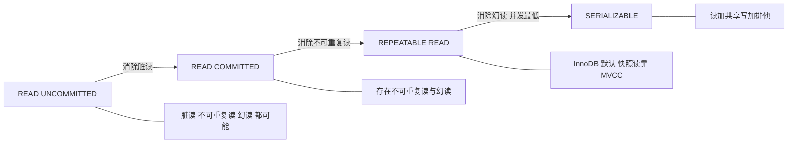

```python
# file: code/04_数据库与缓存/q147_isolation_levels.py
"""纯逻辑模拟三种读现象, 帮助面试时口头推演"""
from dataclasses import dataclass, field


@dataclass
class Database:
    committed: dict = field(default_factory=dict)   # 已提交数据
    uncommitted: dict = field(default_factory=dict)  # 未提交数据

    def write(self, key: str, value: int) -> None:
        self.uncommitted[key] = value

    def commit(self) -> None:
        self.committed.update(self.uncommitted)
        self.uncommitted.clear()

    def rollback(self) -> None:
        self.uncommitted.clear()


def dirty_read(db: Database, key: str) -> int:
    """READ UNCOMMITTED: 读到别人未提交的值"""
    return db.uncommitted.get(key, db.committed.get(key, 0))


def committed_read(db: Database, key: str) -> int:
    """READ COMMITTED: 每次读最新已提交值 -> 两次读可能不同即不可重复读"""
    return db.committed.get(key, 0)


if __name__ == "__main__":
    db = Database(committed={"x": 100})
    db.write("x", 999)                      # 事务 A 修改但未提交
    print("RU 视角读到:", dirty_read(db, "x"))      # 999 脏读
    db.rollback()                           # A 回滚
    print("回滚后 RC 第一次读:", committed_read(db, "x"))  # 100
    db.write("x", 200)
    db.commit()                             # B 提交了新值
    print("RC 第二次读:", committed_read(db, "x"))        # 200 不可重复读
```

**追问**:
- RC 和 RR 在 MVCC 上的区别?——RC 每条 SELECT 都生成新的 ReadView,RR 只在事务第一次快照读时生成并复用。
- Oracle/PostgreSQL 默认是什么?——都是 READ COMMITTED,和 MySQL 不同,跨库要留意。

---

### Q148 · MVCC 多版本并发控制原理

> 难度:★★★★ | 标签:MySQL, MVCC

**问**:说说 InnoDB MVCC 的工作原理,它如何做到"读不加锁、读写不冲突"?

**答**:每行记录隐藏 trx_id(最后修改事务)与 roll_pointer(指向 undo log 版本链)。事务做快照读时生成 ReadView,包含活跃未提交事务列表与高低水位;沿版本链从新到旧找第一个"对自己可见"的版本:是自己创建的可见;小于活跃事务最小 id 的必已提交、可见;大于等于高水位(快照之后才开始的事务)不可见;其余区间看是否在活跃列表,不在即已提交可见。写操作仍然加锁,读走版本链不加锁,从而实现读写并行。

```python
# file: code/04_数据库与缓存/q148_mvcc_demo.py
"""用版本链 + ReadView 模拟 InnoDB 可见性判断"""
from dataclasses import dataclass
from typing import Optional


@dataclass
class RowVersion:
    value: str
    trx_id: int                      # 创建该版本的事务 id
    prev: Optional["RowVersion"] = None  # 更旧的版本


@dataclass
class ReadView:
    creator: int                     # 当前事务 id
    active: frozenset                # 生成快照时仍在运行的未提交事务 id 集合
    next_trx_id: int                 # 生成快照时的下一个事务 id(高水位下界)

    def visible(self, version: RowVersion) -> bool:
        trx = version.trx_id
        if trx == self.creator:
            return True              # 自己改的当然可见
        if trx >= self.next_trx_id:  # 快照之后才开始的事务, 一律不可见
            return False
        if self.active and trx < min(self.active):
            return True              # 比最早活跃事务更早, 必已在快照前提交
        return trx not in self.active  # 中间区间: 不在活跃列表即已提交


def snapshot_read(head: Optional[RowVersion], view: ReadView) -> str:
    """沿版本链从新到旧找第一个可见版本"""
    cur = head
    while cur is not None:
        if view.visible(cur):
            return cur.value
        cur = cur.prev
    return "<deleted>"


if __name__ == "__main__":
    # trx 5 写入 v1, trx 8 覆盖为 v2, trx 8 尚未提交, 系统下一个事务 id 是 9
    v1 = RowVersion(value="v1", trx_id=5)
    v2 = RowVersion(value="v2", trx_id=8, prev=v1)

    rr_view = ReadView(creator=7, active=frozenset({8}), next_trx_id=9)  # trx7 开启快照时 8 未提交
    print("RR 快照读到:", snapshot_read(v2, rr_view))       # v1, 看不见未提交的 v2

    # RC 每次读都新建视图: 此时 trx8 已提交(不再活跃), 高水位推进到 9
    rc_view = ReadView(creator=7, active=frozenset(), next_trx_id=9)
    print("trx8 提交后 RC 读到:", snapshot_read(v2, rc_view))  # v2
```

**追问**:
- 快照读和当前读的区别?——普通 SELECT 是快照读走 MVCC;UPDATE/DELETE/SELECT FOR UPDATE 是当前读,读最新版本并加锁。
- RR 下的"幻读"为什么只是基本杜绝?——快照读靠 MVCC,当前读靠间隙锁,两者混用时仍可能出现幻读,需显式加锁保持一致。

---

### Q149 · 死锁的产生与避免

> 难度:★★★ | 标签:MySQL, 锁, 死锁

**问**:什么是死锁?InnoDB 如何处理死锁?写代码时如何避免?

**答**:两个事务互相持有对方需要的锁并循环等待,即死锁。InnoDB 通过 wait-for graph 检测死锁,回滚代价小的事务(报 1213 错误)。工程上避免死锁的核心是:多行/多资源操作按固定顺序加锁、事务尽量短、批量更新先排序、给热点行加合适的索引避免锁升级为全表扫描锁。

```python
# file: code/04_数据库与缓存/q149_deadlock_order.py
"""线程锁模拟死锁: 乱序加锁会互相等待, 统一顺序即可避免"""
import threading

lock_a = threading.Lock()
lock_b = threading.Lock()


def transfer_bad(name: str, first, second, timeout: float = 0.3) -> None:
    """先抢 first 再抢 second, 两线程顺序相反就可能死锁"""
    got_first = first.acquire(timeout=timeout)
    if not got_first:
        print(name, "第一阶段等待超时退出")
        return
    got_second = second.acquire(timeout=timeout)
    if not got_second:
        first.release()
        print(name, "第二阶段等待超时, 释放已持有锁避免死锁")
        return
    try:
        print(name, "同时持有两把锁, 执行业务")
    finally:
        second.release()
        first.release()


def transfer_safe(name: str, wanted: list, timeout: float = 0.3) -> None:
    """按全局固定顺序(如按锁 id 排序)加锁, 不会循环等待"""
    ordered = sorted(wanted, key=id)
    for lk in ordered:
        if not lk.acquire(timeout=timeout):
            for held in ordered[:ordered.index(lk)]:
                held.release()
            print(name, "获取失败, 按序回退")
            return
    try:
        print(name, "安全地同时持有两把锁")
    finally:
        for lk in reversed(ordered):
            lk.release()


if __name__ == "__main__":
    print("--- 乱序 + 超时防护 ---")
    t1 = threading.Thread(target=transfer_bad, args=("T1", lock_a, lock_b))
    t2 = threading.Thread(target=transfer_bad, args=("T2", lock_b, lock_a))
    t1.start(); t2.start(); t1.join(); t2.join()

    print("--- 固定顺序 ---")
    t1 = threading.Thread(target=transfer_safe, args=("T1", [lock_a, lock_b]))
    t2 = threading.Thread(target=transfer_safe, args=("T2", [lock_b, lock_a]))
    t1.start(); t2.start(); t1.join(); t2.join()
```

**追问**:
- 应用层遇到 1213 错误怎么办?——捕获后带随机退避重试有限次,保证事务体可重入。
- innodb_lock_wait_timeout 和死锁检测的关系?——前者是锁等待超时(默认 50s)兜底,后者是主动检测并立刻打破循环等待。

---

### Q150 · 为什么用 B+Tree 做索引

> 难度:★★★★ | 标签:MySQL, 索引

**问**:InnoDB 为什么选 B+Tree 而不是哈希表、红黑树或 B-Tree?

**答**:哈希表只支持等值查询不支持范围;红黑树/跳表是二叉或对数扇出,数据量大时树太高,磁盘 IO 次数多;B-Tree 数据存在所有节点,单节点能放的 key 更少。B+Tree 非叶子节点只存 key、叶子存数据,扇出极大(千万级数据通常 3~4 层),叶子节点按序双向链表相连,范围查询与排序天然高效,且树高稳定查询性能可预期。

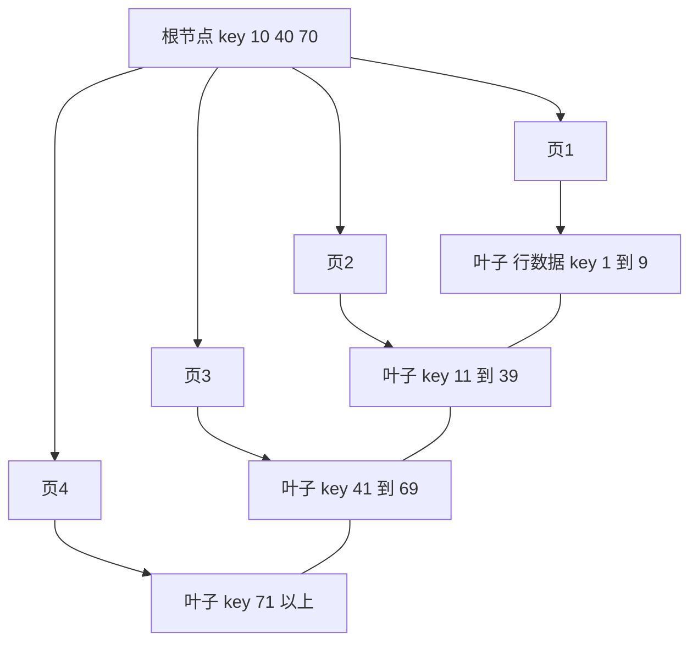

```python
# file: code/04_数据库与缓存/q150_btree_demo.py
"""简化两级 B+Tree: 演示根节点路由到叶子与叶子链表范围扫描"""
from bisect import bisect_right
from dataclasses import dataclass, field
from typing import Optional


@dataclass
class Leaf:
    keys: list = field(default_factory=list)
    values: list = field(default_factory=list)
    next: Optional["Leaf"] = None  # 模拟叶子间的双向链表

    def range_scan(self, lo, hi):
        """叶子链表上的范围扫描: 索引高效支持 BETWEEN / ORDER BY 的原因"""
        out, node, i = [], self, bisect_right(self.keys, lo) - 1
        while node:
            while i < len(node.keys) and node.keys[i] < hi:
                out.append((node.keys[i], node.values[i]))
                i += 1
            node, i = node.next, 0
        return out


@dataclass
class Branch:
    """非叶子节点: 只存分隔 key 与子节点指针"""
    separators: list                # 例: [11, 41, 71]
    children: list

    def find_leaf(self, key) -> Leaf:
        idx = bisect_right(self.separators, key)
        child = self.children[idx]
        return child.find_leaf(key) if isinstance(child, Branch) else child


if __name__ == "__main__":
    l1, l2, l3 = Leaf([1, 5, 9], ["a", "b", "c"]), Leaf([11, 25], ["d", "e"]), Leaf([41, 60], ["f", "g"])
    l1.next, l2.next = l2, l3
    root = Branch([11, 41], [l1, l2, l3])

    print("等值查找 key=25:", root.find_leaf(25).values[root.find_leaf(25).keys.index(25)])
    print("范围扫描 5..45:", l1.range_scan(5, 45))
```

**追问**:
- 一个 3 层 B+Tree 大约能存多少行?——按 16KB 页、非叶子扇出约 1000、行约 1KB 估算,3 层约 2000 万行;10 亿行通常需要 4 层。
- B+Tree 适合什么索引列?——区分度高、有序、类型小的列;随机写会造成页分裂,自增主键顺序写入可减少分裂。

---

### Q151 · 聚簇索引与二级索引

> 难度:★★★ | 标签:MySQL, 索引

**问**:什么是聚簇索引和二级索引?为什么说"回表"会拖慢查询?

**答**:InnoDB 是索引组织表,聚簇索引即主键索引,叶子节点存整行数据;二级索引(普通索引)叶子存"索引列 + 主键值"。用二级索引查询时若所需列不在索引里,需拿主键回聚簇索引再查一次,即回表;回表次数多时性能急剧下降,优化手段是覆盖索引或减少 SELECT *。

```python
# file: code/04_数据库与缓存/q151_clustered_index.py
"""pymysql 演示二级索引查询与回表, 附 EXPLAIN 观察"""
TABLE_SQL = """
CREATE TABLE IF NOT EXISTS user_info (
  id BIGINT PRIMARY KEY AUTO_INCREMENT,
  name VARCHAR(32) NOT NULL,
  age INT NOT NULL,
  KEY idx_name (name)
) ENGINE=InnoDB DEFAULT CHARSET=utf8mb4
"""

QUERIES = {
    "回表查询": "SELECT id, name, age FROM user_info WHERE name = 'alice'",
    "覆盖索引查询": "SELECT id, name FROM user_info WHERE name = 'alice'",
    "看是否走索引": "EXPLAIN SELECT id, name, age FROM user_info WHERE name = 'alice'",
}

if __name__ == "__main__":
    try:
        import pymysql
        conn = pymysql.connect(host="127.0.0.1", user="root", password="", database="demo")
    except Exception as exc:
        print("无可用 MySQL, 仅说明:", exc)
        print("回表: idx_name 叶子只有 name+id, 取 age 必须回聚簇索引再查一次")
        print("覆盖: SELECT id, name 所需列全在二级索引里, EXPLAIN Extra 出现 Using index")
    else:
        with conn.cursor() as cur:
            cur.execute(TABLE_SQL)
            for label, sql in QUERIES.items():
                cur.execute(sql)
                print(label, "->", cur.fetchall())
        conn.close()
```

**追问**:
- 为什么推荐自增主键?——顺序插入避免页分裂,且主键越短二级索引越小。
- 没有主键会怎样?——InnoDB 会选唯一非空索引或生成隐藏 ROW_ID 作聚簇索引,不可控,务必显式建主键。

---

### Q152 · 覆盖索引

> 难度:★★★ | 标签:MySQL, 索引, 性能优化

**问**:什么是覆盖索引?如何利用它优化一个高频查询?

**答**:查询所需的所有列都包含在某个二级索引中,无需回表,EXPLAIN 的 Extra 显示 Using index。做法是把 SELECT 与 WHERE/ORDER BY 涉及的列组合成联合索引,代价是索引变大、写入变慢,所以要为高频查询精打细算地建。

```python
# file: code/04_数据库与缓存/q152_covering_index.py
"""验证覆盖索引: 建联合索引后观察 Extra 出现 Using index"""
import sqlite3  # 标准库即可演示同样的索引原理, MySQL 下用 EXPLAIN 观察同理

SETUP = [
    "CREATE TABLE orders (id INTEGER PRIMARY KEY, user_id INTEGER, status TEXT, amount REAL)",
    "CREATE INDEX idx_user_status ON orders(user_id, status)",
]


def count_by_user(conn: sqlite3.Connection, user_id: int) -> int:
    """SELECT 只用 user_id/status/id, 全部可从索引取得 -> 覆盖索引"""
    sql = "SELECT COUNT(*) FROM orders WHERE user_id = ? AND status = 'paid'"
    row = conn.execute(sql, (user_id,)).fetchone()
    plan = conn.execute("EXPLAIN QUERY PLAN " + sql, (user_id,)).fetchall()
    return row[0], plan


if __name__ == "__main__":
    conn = sqlite3.connect(":memory:")
    for sql in SETUP:
        conn.execute(sql)
    conn.executemany(
        "INSERT INTO orders(user_id, status, amount) VALUES (?, ?, ?)",
        [(i % 100, "paid" if i % 3 else "new", 9.9) for i in range(1000)],
    )
    conn.commit()
    total, plan = count_by_user(conn, 7)
    print("user 7 已支付订单数:", total)
    for step in plan:
        print("执行计划:", step)  # SEARCH orders USING COVERING INDEX 说明无需回表
```

**追问**:
- 如何判断查询是否覆盖?——EXPLAIN Extra 出现 Using index;反例是 Using filesort / Using temporary,需要进一步优化。
- 联合索引 (user_id, status) 和两个单列索引怎么选?——该组合查询选联合索引,一次定位;多个单列索引大概率只用到其一。

---

### Q153 · 联合索引与最左前缀原则

> 难度:★★★★ | 标签:MySQL, 索引

**问**:联合索引 (a, b, c) 支持哪些查询条件?为什么有最左前缀原则?

**答**:联合索引按 a 排序,a 相同再按 b,再按 c。查询条件必须从最左列开始连续命中:WHERE a=1、a=1 AND b=2、a=1 AND b=2 AND c=3 都能用上(部分或全部);WHERE b=2 或 b=2 AND c=3 用不上,因为索引内部不是按 b 全局有序的。范围查询列之后的列停止有序,如 a>1 AND b=2 只有 a 生效。

```python
# file: code/04_数据库与缓存/q153_leftmost_prefix.py
"""纯逻辑判断一个查询能命中联合索引的前几列"""
COMPOSITE = ("a", "b", "c")


def usable_prefix(where_cols: set) -> tuple:
    """返回可以走索引的连续最左前缀, 遇到缺口立即停止"""
    used = []
    for col in COMPOSITE:
        if col in where_cols:
            used.append(col)
        else:
            break
    return tuple(used)


CASES = [
    {"a"},
    {"a", "b"},
    {"a", "b", "c"},
    {"b", "c"},          # 缺 a, 全部失效
    {"a", "c"},          # b 缺失, c 用不上索引(排序断链)
]

if __name__ == "__main__":
    for cols in CASES:
        print(f"WHERE {sorted(cols)} -> 命中前缀: {usable_prefix(cols) or '无'}")
    # 数据佐证: 索引内部排列 (1,1,1)(1,1,2)(1,2,1)(2,1,1)...
    # b 的取值只在同一 a 内有序, 全局不有序, 所以跳过 a 无法使用 b
```

**追问**:
- ORDER BY b 能用上 (a,b,c) 吗?——仅当 WHERE 把 a 固定为等值后,索引内 b 才有序,此时可避免 filesort。
- 范围条件放前面还是后面?——把等值列放前、范围列放后,如 (status, created_at) 中 status=xx AND created_at>xx 两列都能用。

---

### Q154 · 常见索引失效场景

> 难度:★★★★ | 标签:MySQL, 索引, SQL 优化

**问**:列举至少五个导致索引失效的写法,并说明原因。

**答**:① 对索引列使用函数或运算:`DATE(create_time)=...`、`id+1=10`;② 前导模糊 `LIKE '%abc'`;③ 隐式类型转换,字符串列传了数字;④ OR 连接了非索引列;⑤ 联合索引不满足最左前缀;另外优化器估计回表代价高于全表扫描时也会主动放弃索引。共同本质:破坏了索引的有序性,或走索引比全表更贵。

```python
# file: code/04_数据库与缓存/q154_index_failure.py
"""静态检查 SQL 中的常见索引失效写法"""
import re

RULES = [
    ("函数作用于索引列", re.compile(r"(WHERE|AND|OR)\s+\w+\s*\(", re.I)),
    ("对索引列做算术运算", re.compile(r"(WHERE|AND)\s+\w+\s*[+\-*/]\s*\d", re.I)),
    ("前导模糊 LIKE", re.compile(r"LIKE\s+'%", re.I)),
    ("隐式类型转换风险", re.compile(r"(WHERE|AND)\s+\w*(name|code|phone)\w*\s*=\s*\d+", re.I)),
]


def find_failures(sql: str) -> list:
    return [name for name, pat in RULES if pat.search(sql)]


if __name__ == "__main__":
    samples = [
        "SELECT * FROM t WHERE create_time = '2024-01-01'",          # 正常
        "SELECT * FROM t WHERE DATE(create_time) = '2024-01-01'",     # 函数
        "SELECT * FROM t WHERE id + 1 = 10",                          # 运算
        "SELECT * FROM t WHERE name LIKE '%abc'",                     # 前导模糊
        "SELECT * FROM t WHERE user_name = 12345",                    # 数字比字符串
    ]
    for sql in samples:
        issues = find_failures(sql)
        print("有风险" if issues else "OK", issues, "<-", sql)
    # 改写思路: DATE(col)=d 改成 col 范围比较; LIKE '%abc' 改倒排/全文索引
```

**追问**:
- `WHERE phone = 13800000000`(phone 是 varchar)会怎样?——发生隐式转换等价于对列套 CAST,索引失效,务必保持类型一致。
- 优化器为什么不走索引也能是"正确"的?——回表代价大时全表扫描更快,EXPLAIN 的 rows 与 possible_keys 可辅助判断。

---

### Q155 · 用 EXPLAIN 分析执行计划

> 难度:★★★ | 标签:MySQL, EXPLAIN

**问**:拿到一条慢 SQL,你会重点看 EXPLAIN 输出的哪些字段?

**答**:重点看 type(访问类型,至少到 range,ALL 表示全表扫描)、key 与 key_len(实际用的索引及长度)、rows(预估扫描行数)、Extra(Using index 好,Using filesort / Using temporary 坏)。分析路径:先看 type 和 rows 定位是否全表,再看 key_len 判断联合索引用了几列,最后依据 Extra 决定加索引还是改写 SQL。

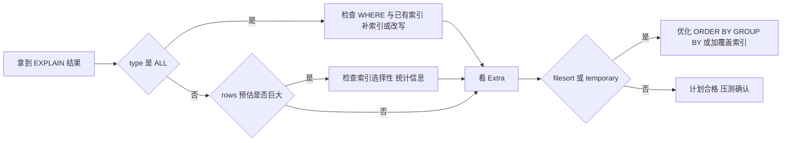

```python
# file: code/04_数据库与缓存/q155_explain_parse.py
"""解析 EXPLAIN 结果行, 自动标记可疑计划(以常见字段为例)"""
from typing import Any

BAD_TYPES = {"ALL", "index"}           # 全表/全索引扫描
BAD_EXTRA = ("Using filesort", "Using temporary")
GOOD_EXTRA = "Using index"


def review_plan(rows: list[dict[str, Any]]) -> list:
    findings = []
    for row in rows:
        table = row.get("table", "?")
        if row.get("type") in BAD_TYPES:
            findings.append(f"{table}: 全表扫描 type={row['type']}")
        if row.get("rows", 0) and int(row["rows"]) > 100_000:
            findings.append(f"{table}: 预估扫描 {row['rows']} 行 过大")
        extra = row.get("Extra", "")
        for bad in BAD_EXTRA:
            if bad in extra:
                findings.append(f"{table}: {bad} 需要优化排序或分组")
        if GOOD_EXTRA in extra:
            findings.append(f"{table}: 覆盖索引生效 Using index")
    return findings


if __name__ == "__main__":
    plan = [
        {"table": "orders", "type": "ALL", "rows": 500000, "Extra": "Using where; Using filesort"},
        {"table": "users", "type": "eq_ref", "rows": 1, "Extra": "Using index"},
    ]
    for msg in review_plan(plan):
        print(msg)
```

**追问**:
- type 从优到差大致顺序?——system > const > eq_ref > ref > range > index > ALL。
- EXPLAIN ANALYZE 与普通 EXPLAIN 的区别?——前者真正执行并给出实际行数与耗时,验证预估是否失真。

---

### Q156 · 慢查询定位与治理

> 难度:★★★ | 标签:MySQL, 慢查询, 监控

**问**:线上出现慢查询,你的完整排查流程是什么?

**答**:先确认慢日志开关与阈值(long_query_time),从慢日志/监控取 TOP 慢 SQL;对每条 EXPLAIN 分析(见 Q155),判断缺索引、回表过多、扫描行数过大;必要时用 `SHOW PROFILE`/performance_schema 看时间花在哪个阶段。治理上:加或改索引、改写 SQL、批量改分页方式,最后在测试环境验证并观察上线后慢日志趋势。

```python
# file: code/04_数据库与缓存/q156_slow_query.py
"""解析 MySQL 慢日志文本, 聚合 TOP 慢 SQL(参数归一化)"""
import re
from collections import defaultdict

SAMPLE = """
# Time: 2024-05-01T10:00:00
# Query_time: 3.2 Lock_time: 0.001 Rows_sent: 10 Rows_examined: 900000
SELECT * FROM orders WHERE user_name = 'alice' ORDER BY created_at;
# Time: 2024-05-01T10:01:00
# Query_time: 2.8 Lock_time: 0.001 Rows_sent: 10 Rows_examined: 880000
SELECT * FROM orders WHERE user_name = 'bob' ORDER BY created_at;
"""

QUERY_TIME_RE = re.compile(r"Query_time:\s*([\d.]+)")
SQL_RE = re.compile(r"^(SELECT|UPDATE|DELETE|INSERT).*", re.I | re.S)


def normalize(sql: str) -> str:
    """把字面量换成 ? 聚合同模板"""
    return re.sub(r"'[^']*'", "?", sql.strip().rstrip(";"))


def top_slow(log_text: str, top_n: int = 3) -> list:
    stat = defaultdict(lambda: [0, 0.0])   # 模板 -> [次数, 总耗时]
    for block in log_text.split("# Time: ")[1:]:
        m = QUERY_TIME_RE.search(block)
        s = SQL_RE.search(block)
        if m and s:
            tpl = normalize(s.group(0))
            stat[tpl][0] += 1
            stat[tpl][1] += float(m.group(1))
    return sorted(stat.items(), key=lambda kv: kv[1][1], reverse=True)[:top_n]


if __name__ == "__main__":
    for tpl, (cnt, total) in top_slow(SAMPLE):
        print(f"共 {cnt} 次 累计 {total:.1f}s  模板: {tpl}")
```

**追问**:
- Rows_examined 远大于 Rows_sent 说明什么?——扫描了大量无效行,通常是缺索引或索引选择性差。
- 慢日志和业务侧 APM 怎么配合?——APM 定位到接口与 SQL 模板,慢日志提供 DB 侧证据,双端对齐再优化。

---

### Q157 · 数据库连接池的原理

> 难度:★★★ | 标签:数据库, 连接池

**问**:为什么需要数据库连接池?它有哪些关键参数和机制?

**答**:TCP 建连 + TLS + 认证的开销是毫秒级,高并发下频繁建断连接会拖垮性能,连接池通过复用长连接解决。关键机制:预建最小连接、上限池大小、空闲超时回收、借出/归还、健康检查(ping)与失效重建。池不是越大越好,过大反而增加 DB 上下文切换,经验公式约为 CPU 核数 * 2 + 磁盘数,再按压测调整。

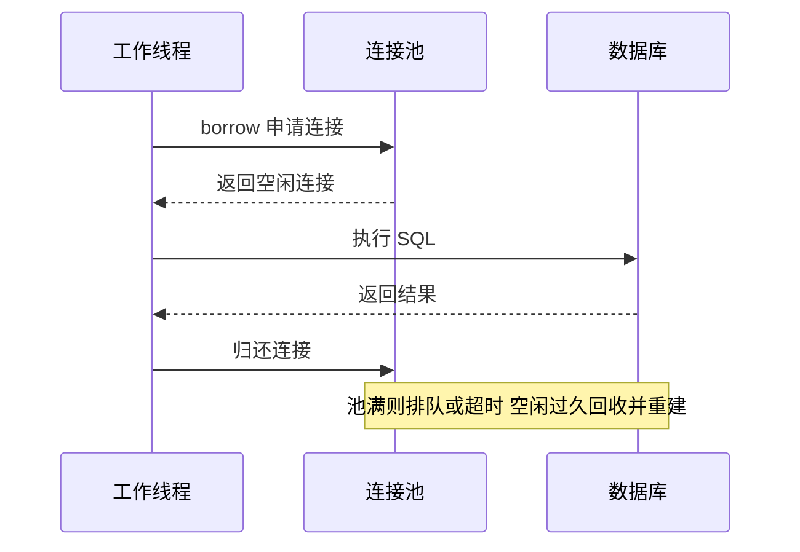

```python
# file: code/04_数据库与缓存/q157_pool_concept.py
"""用队列模拟连接池的借出与归还语义"""
import queue


class FakeConn:
    def __init__(self, cid: int):
        self.cid, self.in_use = cid, False

    def execute(self, sql: str) -> str:
        return f"conn#{self.cid} 执行 {sql}"


class MiniPool:
    def __init__(self, size: int = 3):
        self.idle: queue.Queue = queue.Queue(maxsize=size)
        for i in range(size):
            self.idle.put(FakeConn(i))

    def borrow(self, timeout: float = 1.0) -> FakeConn:
        try:
            return self.idle.get(timeout=timeout)
        except queue.Empty:
            raise RuntimeError("连接池已耗尽, 请调大池或检查连接泄漏")

    def give_back(self, conn: FakeConn) -> None:
        self.idle.put(conn)


if __name__ == "__main__":
    pool = MiniPool()
    c1 = pool.borrow()
    print(c1.execute("SELECT 1"))
    pool.give_back(c1)
    print("池中空闲连接数:", pool.idle.qsize())
```

**追问**:
- 连接泄漏是什么,怎么发现?——借出不归还导致池耗尽;用池的 in_use 统计、超时强制回收、代码上保证 finally/with 归还。
- SQLAlchemy 的 pool_size / max_overflow 分别是什么?——常驻连接数与可临时溢出的连接数,超出 max_overflow + pool_size 会等待 pool_timeout。

---

### Q158 · 手写一个简易连接池

> 难度:★★★ | 标签:数据库, 连接池, Python

**问**:如果不依赖框架,如何用标准库实现一个线程安全的连接池?

**答**:核心是"线程安全的空闲队列 + 借出归还上下文管理器 + 归还时健康检查",`queue.LifoQueue` 天然满足线程安全且后借出的连接更可能仍活跃(时间局部性)。生产中直接用 SQLAlchemy 的 QueuePool 或 DBUtils 即可,但面试能手写语义更佳。

```python
# file: code/04_数据库与缓存/q158_connection_pool.py
"""线程安全连接池: LifoQueue + 上下文管理器 + 健康检查"""
import queue
import threading
from contextlib import contextmanager


class Conn:
    def __init__(self, cid: int):
        self.cid = cid
        self.closed = False

    def ping(self) -> bool:
        return not self.closed        # 真实场景换成 conn.ping()

    def execute(self, sql: str) -> str:
        return f"conn#{self.cid}: {sql}"


class Pool:
    def __init__(self, factory, size: int = 3):
        self._factory = factory
        self._idle: queue.LifoQueue = queue.LifoQueue(maxsize=size)
        self._lock = threading.Lock()
        self._total = 0
        self._size = size

    def _create(self):
        with self._lock:
            if self._total < self._size:
                self._total += 1
                return self._factory(self._total)
        raise RuntimeError("池已满且无空闲连接")

    @contextmanager
    def borrow(self, timeout: float = 2.0):
        try:
            conn = self._idle.get(timeout=timeout)
        except queue.Empty:
            conn = self._create()     # 池空且未达上限则新建
        if not conn.ping():           # 归还前的连接可能已失效
            conn = self._factory(conn.cid)
        try:
            yield conn
        finally:
            self._idle.put(conn)


if __name__ == "__main__":
    pool = Pool(lambda i: Conn(i), size=2)

    def worker(tid: int):
        with pool.borrow() as conn:
            print(f"线程{tid} ->", conn.execute("SELECT 1"))

    ts = [threading.Thread(target=worker, args=(i,)) for i in range(5)]
    for t in ts: t.start()
    for t in ts: t.join()
```

**追问**:
- 为什么要用 LifoQueue 而不是 FIFO?——最近归还的连接被复用概率高,连接越久空闲越可能被服务端踢掉。
- 如何处理数据库重启后池内连接全部失效?——归还与借出时 ping,失败即重建;并支持整体预热重连。

---

### Q159 · SQLAlchemy 2.x Core 用法

> 难度:★★★ | 标签:SQLAlchemy, Core

**问**:SQLAlchemy 的 Core 和 ORM 有什么区别?什么时候选 Core?

**答**:Core 是"SQL 表达式语言",围绕 Table 对象构造 SQL,所见即所得、开销小、可控性强,适合批量处理、报表和性能敏感场景;ORM 在其上叠加对象关系映射与 Unit of Work,适合业务建模。2.x 统一了 API:用 `Engine` + `Connection` + `select()/insert()` 表达式,执行时通过 `connection.execute()`。

```python
# file: code/04_数据库与缓存/q159_sqlalchemy_core.py
"""SQLAlchemy 2.x Core 最小示例: sqlite3 可直接运行"""

try:
    from sqlalchemy import (
        create_engine, MetaData, Table, Column, Integer, String, insert, select,
    )
except ImportError:
    print("该题演示需要第三方库 sqlalchemy:pip install sqlalchemy>=2.0,原理见正文")
    raise SystemExit(0)

engine = create_engine("sqlite:///:memory:", echo=False)
metadata = MetaData()

users = Table(
    "users", metadata,
    Column("id", Integer, primary_key=True, autoincrement=True),
    Column("name", String(32), nullable=False),
    Column("age", Integer),
)

if __name__ == "__main__":
    metadata.create_all(engine)          # 建表
    with engine.begin() as conn:         # begin 自动提交事务
        conn.execute(insert(users), [
            {"name": "alice", "age": 30},
            {"name": "bob", "age": 25},
        ])

    stmt = select(users.c.name).where(users.c.age >= 26).order_by(users.c.name)
    with engine.connect() as conn:
        for row in conn.execute(stmt):
            print(dict(row._mapping))
```

**追问**:
- `engine.begin()` 与 `engine.connect()` 区别?——begin 包含事务并在退出时提交,connect 不自动提交,需手动 conn.commit()(2.0 风格)。
- Core 性能优于 ORM 的原因?——省去对象状态追踪与 Unit of Work 刷库,SQL 完全由你控制。

---

### Q160 · SQLAlchemy 2.x ORM 用法

> 难度:★★★ | 标签:SQLAlchemy, ORM

**问**:用 ORM 建模并完成一次增查,2.x 的推荐写法是什么?

**答**:2.x 用 `DeclarativeBase` + `Mapped`/`mapped_column` 声明模型,类型注解驱动;写操作通过 `Session.add()` + `session.commit()`,查询用 `session.scalars(select(Model)...)` 返回对象列表。ORM 适合业务复杂、对象间有关联的场景,代价是学习成本和 N+1 风险(见 Q162)。

```python
# file: code/04_数据库与缓存/q160_sqlalchemy_orm.py
"""SQLAlchemy 2.x ORM 风格: DeclarativeBase + Mapped"""
from typing import Optional

try:
    from sqlalchemy import String, create_engine, select
    from sqlalchemy.orm import DeclarativeBase, Mapped, mapped_column, Session
except ImportError:
    print("该题演示需要第三方库 sqlalchemy:pip install sqlalchemy>=2.0,原理见正文")
    raise SystemExit(0)


class Base(DeclarativeBase):
    pass


class User(Base):
    __tablename__ = "orm_users"

    id: Mapped[int] = mapped_column(primary_key=True, autoincrement=True)
    name: Mapped[str] = mapped_column(String(32))
    age: Mapped[Optional[int]]

    def __repr__(self) -> str:
        return f"User(id={self.id}, name={self.name!r})"


if __name__ == "__main__":
    engine = create_engine("sqlite:///:memory:")
    Base.metadata.create_all(engine)

    with Session(engine) as session:            # 写: add + commit
        session.add_all([User(name="alice", age=30), User(name="bob", age=25)])
        session.commit()

    with Session(engine) as session:            # 读: select 表达式
        stmt = select(User).where(User.age >= 26).order_by(User.id)
        for user in session.scalars(stmt):
            print(user)
```

**追问**:
- `session.scalars` 和 `session.execute` 的区别?——scalars 直接取第一列并返回标量/对象,execute 返回 Row,需要 `row._mapping` 或下标取值。
- 模型里的 relationship 何时配置?——定义一对多/多对多关联与级联时,配合 `selectinload/joinedload` 控制加载方式。

---

### Q161 · Session 生命周期与对象状态

> 难度:★★★★ | 标签:SQLAlchemy, ORM, session

**问**:SQLAlchemy 的 Session 应该遵循怎样的生命周期?ORM 对象有哪些状态?

**答**:Session 是 Unit of Work,生命周期应为"一次请求一个 Session":请求开始创建,结束 commit/rollback 并 close,可用上下文管理器或框架中间件托管。对象五种状态:transient(未入 session)、pending(已 add 尚未 flush)、persistent(已入库且被 session 跟踪)、detached(close 后脱离)、deleted(标记删除)。commit 时 flush 发出 SQL,过期属性在下次访问时重新加载(expire_on_commit=True)。

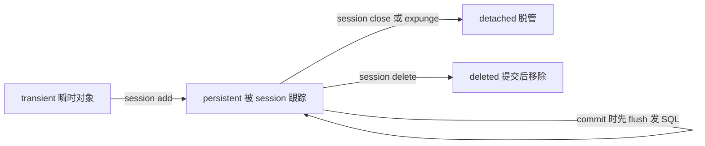

```python
# file: code/04_数据库与缓存/q161_session_lifecycle.py
"""用标准库模拟 SQLAlchemy Session 的 Unit of Work 状态机"""
from dataclasses import dataclass, field


@dataclass
class FakeUser:
    id: int = 0
    name: str = ""

    def __hash__(self):
        # dataclass 默认 eq=True 会把 __hash__ 置 None,对象进 set 会 TypeError;
        # ORM 的 Unit of Work 按对象身份跟踪,这里按身份散列,同一实例在 session
        # 各集合(new/dirty/persistent)中始终可识别
        return hash(id(self))


class FakeSession:
    """模拟 session 的 add / commit / close 与对象状态迁移"""

    def __init__(self):
        self.new, self.dirty, self.dead = set(), set(), set()
        self.persistent = set()
        self._seq = 0
        self.open = True

    def add(self, obj):
        self._check_open()
        self.new.add(obj)

    def _touch(self, obj):
        self._check_open()
        if obj in self.persistent:
            self.dirty.add(obj)

    def commit(self):
        self._check_open()
        print("flush:", [(o.name, "INSERT") for o in self.new],
              [(o.name, "UPDATE") for o in self.dirty])
        self._seq += len(self.new)
        for i, o in enumerate(self.new, start=self._seq):
            o.id = i
        self.persistent |= self.new
        self.new.clear()
        self.dirty.clear()

    def close(self):
        self.persistent.clear()      # 对象变 detached
        self.open = False

    def _check_open(self):
        if not self.open:
            raise RuntimeError("session 已关闭, 对象已 detached")


if __name__ == "__main__":
    session = FakeSession()
    u = FakeUser(name="alice")       # transient
    session.add(u)                   # -> pending/persistent 前
    u.name = "alice2"
    session.commit()                 # flush + 持久化
    session.close()                  # u 变 detached, 再操作会报错
    try:
        session.add(FakeUser())
    except RuntimeError as exc:
        print("捕获:", exc)
```

**追问**:
- expire_on_commit=False 有什么影响?——commit 后不再过期属性,访问 detached 对象不触发新查询,但要承担数据过期风险。
- 为什么 Web 场景推荐请求级 Session?——事务边界与请求对齐,避免长事务持锁,也保证同一请求内对象身份一致。

---

### Q162 · N+1 查询问题与解决方案

> 难度:★★★★ | 标签:SQLAlchemy, ORM, 性能

**问**:什么是 N+1 查询?如何在 SQLAlchemy 中发现并解决?

**答**:查 1 次主列表,再对每条记录各查 1 次关联对象,共 N+1 条 SQL,列表越大越慢。解决:SQLAlchemy 用 `selectinload`(第二条 IN 批量查)或 `joinedload`(LEFT JOIN 一次取回);另一种通用思路是手动收集 id 后一次 IN 查询再按 id 组装。发现手段:echo SQL、APEX 类分析工具、监控 DB QPS。

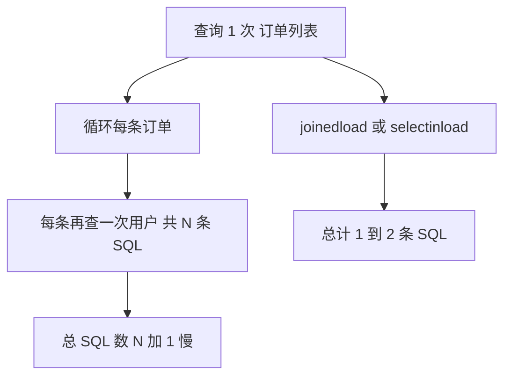

```python
# file: code/04_数据库与缓存/q162_n_plus_one.py
"""纯逻辑模拟 N+1 与两种批量加载的查询次数对比"""


class FakeDB:
    def __init__(self):
        self.users = {1: "alice", 2: "bob", 3: "carol"}
        self.orders = [{"id": i, "user_id": i % 3 + 1} for i in range(1, 31)]
        self.queries = 0

    def get_orders(self) -> list:
        self.queries += 1
        return self.orders

    def get_user(self, uid: int):
        self.queries += 1
        return self.users.get(uid)

    def get_users(self, uids: list) -> dict:
        self.queries += 1
        return {u: self.users[u] for u in set(uids)}


def lazy_load(db: FakeDB) -> list:
    """典型 N+1: 访问每条订单的 user 都触发一次查询"""
    return [(o["id"], db.get_user(o["user_id"])) for o in db.get_orders()]


def selectin_load(db: FakeDB) -> list:
    """先取订单, 收集 user_id 后一次 IN 查询, 再内存组装"""
    orders = db.get_orders()
    users = db.get_users([o["user_id"] for o in orders])
    return [(o["id"], users[o["user_id"]]) for o in orders]


if __name__ == "__main__":
    for fn in (lazy_load, selectin_load):
        db = FakeDB()
        fn(db)
        print(f"{fn.__name__}: SQL 次数 = {db.queries}")
    # SQLAlchemy 中对应: selectinload(Order.user) 或 joinedload(Order.user)
```

**追问**:
- selectinload 和 joinedload 怎么选?——多对一/一对一用 joinedload 少一次往返;一对多集合加载用 selectinload,避免 JOIN 产生笛卡尔积行数膨胀。
- 不用 ORM 时如何防 N+1?——代码评审 + ORM/SQL 层打点统计每请求 SQL 数,超过阈值告警。

---

### Q163 · 批量插入的性能优化

> 难度:★★★ | 标签:MySQL, 批量写入

**问**:要往表里插 10 万行,有哪些优化手段?

**答**:① 逐条 INSERT 改 `executemany`/多值 INSERT,减少网络往返与解析;② 显式事务包裹,避免每条一个 commit 的 fsync;③ 大批量分片提交(如每 5000 条),防 redo/undo 膨胀;④ 关闭或延后非必需索引与约束校验(LOAD DATA 最快);⑤ ORM 用 `bulk_insert_mappings` 或 Core `insert()` 多行。实测 executemany 常比逐条快一个数量级。

```python
# file: code/04_数据库与缓存/q163_bulk_insert.py
"""sqlite3 对比逐条插入与 executemany 的耗时"""
import sqlite3
import time

N = 20_000
CREATE = "CREATE TABLE t (id INTEGER, name TEXT)"


def bench(label: str, fn) -> None:
    conn = sqlite3.connect(":memory:")
    conn.execute(CREATE)
    start = time.perf_counter()
    fn(conn)
    cost = time.perf_counter() - start
    print(f"{label}: {cost:.3f}s")
    conn.close()


def insert_one_by_one(conn: sqlite3.Connection) -> None:
    for i in range(N):
        conn.execute("INSERT INTO t VALUES (?, ?)", (i, f"name{i}"))
    conn.commit()                      # 全程一个大事务


def insert_executemany(conn: sqlite3.Connection) -> None:
    rows = [(i, f"name{i}") for i in range(N)]
    conn.executemany("INSERT INTO t VALUES (?, ?)", rows)  # 单条多值语句
    conn.commit()


if __name__ == "__main__":
    bench("逐条 execute", insert_one_by_one)
    bench("executemany", insert_executemany)
```

**追问**:
- MySQL 下 executemany 为什么特别快?——pymysql 会把多参数重写成一条多值 INSERT `VALUES (...),(...)`。
- 分片大小如何定?——受 max_allowed_packet 与事务内存限制,常用 1000~10000 行/批,压测确定。

---

### Q164 · Alembic 数据库迁移管理

> 难度:★★★ | 标签:SQLAlchemy, Alembic, 迁移

**问**:团队如何管理表结构变更?说说 Alembic 的工作流程。

**答**:Alembic 为每次变更生成带版本号的迁移脚本(up/down),数据库用 alembic_version 表记录当前版本,`upgrade head` 按链回放未应用脚本。流程:模型变更 → `alembic revision --autogenerate` 生成差异 → 人工审查脚本 → 测试库验证 → 各环境 `upgrade head`。要点:autogenerate 结果必须人工检查(它识别不了改列名等语义变更),脚本只前进不修改历史。

```python
# file: code/04_数据库与缓存/q164_alembic_workflow.py
"""封装常用 Alembic 命令; 未安装时打印等价手工命令"""
import shutil
import subprocess

STEPS = [
    (["alembic", "init", "migrations"], "初始化迁移目录(仅首次)"),
    (["alembic", "revision", "--autogenerate", "-m", "add orders table"], "生成差异脚本"),
    (["alembic", "upgrade", "head"], "应用全部待执行迁移"),
    (["alembic", "downgrade", "-1"], "回滚上一个版本"),
    (["alembic", "history", "--verbose"], "查看版本链"),
]

if __name__ == "__main__":
    has_alembic = shutil.which("alembic") is not None
    for cmd, desc in STEPS:
        print(f"[{desc}] {' '.join(cmd)}")
        if has_alembic and cmd[0:2] == ["alembic", "history"]:
            subprocess.run(cmd, check=False)
    # env.py 关键配置: target_metadata = 模型 Base.metadata
    # sqlalchemy.url 建议从环境变量读取, 避免把生产连接串写进仓库
```

**追问**:
- autogenerate 有什么坑?——无法感知列重命名(会生成 drop+add 丢数据)、服务端默认值和部分索引,必须人工审查。
- 多人并行开发版本冲突怎么办?——出现多 heads 时用 `alembic merge` 合并版本链。

---

### Q165 · Redis 为什么快与数据结构总览

> 难度:★★★ | 标签:Redis, 数据结构

**问**:Redis 为什么这么快?它常用的数据结构有哪些?

**答**:快的原因:纯内存操作、单线程命令执行避免锁与上下文切换(6.0 后网络 IO 多线程但命令仍单线程)、IO 多路复用 epoll、高效数据结构(SDS 跳表 ziplist/listpack 等)。常用结构:String/Hash/List/Set/ZSet,另有 BitMap、HyperLogLog、GEO、Stream。选型要看业务语义:计数用 String 的 INCR,排行榜用 ZSet,标签交集聚合用 Set。

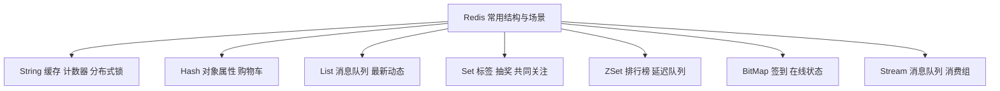

```python
# file: code/04_数据库与缓存/q165_redis_overview.py
"""redis-py 五大结构最小示例; 无 Redis 时用内存字典模拟语义"""
try:
    import redis
    client = redis.Redis(host="127.0.0.1", port=6379, decode_responses=True)
    client.ping()
except Exception as exc:
    print("无可用 Redis, 仅打印语义:", exc)
else:
    client.set("counter", 0)
    print("String INCR:", client.incr("counter"))                  # 1

    client.hset("cart:u1", mapping={"sku1": 2, "sku2": 1})
    print("Hash 购物车:", client.hgetall("cart:u1"))               # {'sku1': '2', ...}

    client.rpush("mq:orders", "o1", "o2")
    print("List 出队:", client.lpop("mq:orders"))                  # o1

    client.sadd("tag:python", "u1", "u2")
    client.sadd("tag:redis", "u2", "u3")
    print("Set 交集:", client.sinter("tag:python", "tag:redis"))   # {'u2'}

    client.zadd("rank", {"alice": 90, "bob": 95})
    print("ZSet 榜单:", client.zrevrange("rank", 0, -1, withscores=True))
```

**追问**:
- ZSet 底层实现?——元素少用 listpack,多时 skiplist + dict 双结构,支持 O(logN) 插入与 O(1) 查分。
- 单线程为什么还快?——瓶颈在内存与网络而非 CPU,单线程省去锁竞争;大 key 或慢命令会阻塞,要避免。

---

### Q166 · 五大结构的典型业务场景与实现

> 难度:★★★ | 标签:Redis, 业务设计

**问**:给出三个用 Redis 数据结构解决实际问题的例子,并写伪代码级实现。

**答**:① 接口限流:INCR + EXPIRE 实现固定窗口计数;② 排行榜:ZSet 的 ZINCRBY + ZREVRANGE;③ 购物车:Hash 存 userId→skuId→数量,HINCRBY 增减。共同思路是把"状态 + 原子操作"放进 Redis,避免应用层加锁。

```python
# file: code/04_数据库与缓存/q166_redis_use_cases.py
"""限流器: KV 接口语义下实现, DictKV 可直接跑, redis-py 用同名命令"""


class DictKV:
    """模拟 INCR 与 EXPIRE 的最小 KV 存储"""

    def __init__(self):
        self._data: dict = {}
        self._ttl: dict = {}

    def incr(self, key: str) -> int:
        self._data[key] = self._data.get(key, 0) + 1
        return self._data[key]

    def expire(self, key: str, seconds: int) -> None:
        self._data.setdefault(key, 0)
        self._ttl[key] = seconds          # 真实 Redis 到期自动删除


def is_allowed(kv: DictKV, user: str, limit: int = 5, window: int = 60) -> bool:
    """固定窗口限流: 每用户每 window 秒最多 limit 次"""
    key = f"rate:{user}:{int(window)}"
    count = kv.incr(key)
    if count == 1:
        kv.expire(key, window)
    return count <= limit


if __name__ == "__main__":
    kv = DictKV()
    for i in range(7):
        ok = is_allowed(kv, "alice")
        print(f"第 {i + 1} 次请求: {'通过' if ok else '被限流'}")
    # redis-py 等价: pipe = client.pipeline(); pipe.incr(key); pipe.expire(key, window); pipe.execute()
```

**追问**:
- 固定窗口有什么边界问题?——窗口交界处可能瞬时双倍流量,改滑动窗口(ZSet 存时间戳 ZREMRANGEBYSCORE)或令牌桶。
- Hash 存购物车相比 String 序列化 JSON 的优势?——可单字段读写,HINCRBY 原子增减,避免读改写的竞态。

---

### Q167 · RDB 与 AOF 持久化

> 难度:★★★ | 标签:Redis, 持久化

**问**:Redis 的 RDB 和 AOF 有什么区别?如何选择?

**答**:RDB 是某时刻全量快照,二进制紧凑、恢复快,但 save 点之间宕机会丢数据;AOF 记录每条写命令,appendfsync everysec 时最多丢 1 秒,文件大恢复慢,靠 AOF rewrite 压缩。生产常用混合持久化(4.0+ aof-use-rdb-preamble):重写时先写 RDB 全量再追加增量 AOF,兼得恢复速度与低丢失。纯缓存场景也可只靠主从复制不持久化。

```python
# file: code/04_数据库与缓存/q167_rdb_aof.py
"""用文件模拟 RDB 快照与 AOF 追加日志的恢复过程"""
import json
import os

SNAP, LOG = "/tmp/q167_snap.json", "/tmp/q167.aof"


def rdb_snapshot(state: dict) -> None:
    with open(SNAP, "w", encoding="utf-8") as f:     # 全量覆盖写, 类似 SAVE
        json.dump(state, f)


def aof_append(command: str, *args) -> None:
    with open(LOG, "a", encoding="utf-8") as f:      # 只追加写命令
        f.write(json.dumps([command, *args]) + "\n")


def load() -> dict:
    state = {}
    if os.path.exists(SNAP):                          # 先载入快照
        with open(SNAP, encoding="utf-8") as f:
            state = json.load(f)
    if os.path.exists(LOG):                           # 再重放 AOF 增量
        with open(LOG, encoding="utf-8") as f:
            for line in f:
                cmd, *args = json.loads(line)
                if cmd == "SET":
                    state[args[0]] = args[1]
                elif cmd == "DEL":
                    state.pop(args[0], None)
    return state


if __name__ == "__main__":
    rdb_snapshot({"k1": "v1"})
    aof_append("SET", "k2", "v2")
    aof_append("SET", "k1", "v1_new")
    aof_append("DEL", "k1")
    print("恢复结果:", load())     # {'k2': 'v2'} 快照 + 日志重放
```

**追问**:
- AOF 的三种 fsync 策略?——always 最安全最慢、everysec 折衡(推荐)、no 交给 OS 最快但可能丢较多。
- AOF rewrite 做什么?——根据当前内存数据生成等价最小命令集替换旧 AOF,期间新写命令写入缓冲区续上。

---

### Q168 · 过期键删除策略

> 难度:★★★ | 标签:Redis, 过期

**问**:Redis 如何删除过期 key?为什么不用定时器逐个删除?

**答**:Redis 采用惰性删除 + 定期抽样删除的组合:访问 key 时检查过期则删(惰性);后台每 100ms 从设置了过期时间的 key 中抽样检查,过期即删,若过期比例过高则继续下一轮(定期)。为每个 key 建定时器代价太高且 CPU 不可控,所以不用主动定时删除;内存不足时还有淘汰策略兜底(见 Q169)。

```python
# file: code/04_数据库与缓存/q168_expiry_policy.py
"""模拟惰性删除与定期抽样删除"""
import random
import time


class MiniRedis:
    def __init__(self):
        self.data: dict = {}
        self.expire_at: dict = {}

    def setex(self, key: str, value: str, ttl: float) -> None:
        self.data[key] = value
        self.expire_at[key] = time.time() + ttl

    def _expired(self, key: str) -> bool:
        return key in self.expire_at and time.time() > self.expire_at[key]

    def get(self, key: str):
        """惰性删除: 访问时检查并清理"""
        if self._expired(key):
            self.data.pop(key, None)
            self.expire_at.pop(key, None)
            return None
        return self.data.get(key)

    def active_cycle(self, samples: int = 5) -> int:
        """定期删除: 每轮从带 TTL 的 key 中抽样, 模拟每 100ms 一次"""
        keys = list(self.expire_at)
        removed = 0
        for key in random.sample(keys, min(samples, len(keys))):
            if self._expired(key):
                self.data.pop(key, None)
                self.expire_at.pop(key, None)
                removed += 1
        return removed


if __name__ == "__main__":
    r = MiniRedis()
    r.setex("k1", "v", 0.05)   # 很快过期
    r.setex("k2", "v", 100)
    print("立即读 k1:", r.get("k1"))
    time.sleep(0.1)
    print("0.1s 后读 k1:", r.get("k1"), " 已被惰性删除")
    print("主动抽样清理数量:", r.active_cycle())
```

**追问**:
- 大量 key 同时过期会怎样?——定期删除循环加长占用主线程,应给 TTL 加随机抖动(见 Q172)。
- 惰性删除的缺陷?——再也不被访问的过期 key 占内存,需配合定期删除与内存淘汰。

---

### Q169 · 内存淘汰策略

> 难度:★★★ | 标签:Redis, 内存管理

**问**:Redis 达到 maxmemory 后有哪些淘汰策略?怎么选?

**答**:八种策略:noeviction(默认,写报错)、allkeys-lru / volatile-lru、allkeys-lfu / volatile-lfu、allkeys-random / volatile-random、volatile-ttl。缓存场景推荐 allkeys-lru 或 allkeys-lfu(有冷热差异时);带 TTL 且只想淘汰临时数据用 volatile-*;当 Redis 当存储用则 noeviction,由业务保证容量。LFU 用 Morris 计数器近似频率,适合偶发批量扫描不会污染热数据。

```python
# file: code/04_数据库与缓存/q169_eviction_policy.py
"""实现 allkeys-lru 淘汰: OrderedDict 近似 Redis 的 LRU 淘汰池"""
from collections import OrderedDict


class LRUCache:
    def __init__(self, maxmemory: int = 3):
        self._data: OrderedDict = OrderedDict()
        self._maxmemory = maxmemory

    def set(self, key, value) -> None:
        if key in self._data:
            self._data.move_to_end(key)     # 访问即置为新
        self._data[key] = value
        while len(self._data) > self._maxmemory:
            victim, _ = self._data.popitem(last=False)   # 淘汰最久未用
            print(f"内存超限, 淘汰 key={victim}")

    def get(self, key):
        if key not in self._data:
            return None
        self._data.move_to_end(key)
        return self._data[key]


if __name__ == "__main__":
    cache = LRUCache(maxmemory=3)
    cache.set("a", 1)
    cache.set("b", 2)
    cache.set("c", 3)
    cache.get("a")            # a 变热
    cache.set("d", 4)         # 淘汰 b
    print("get a:", cache.get("a"), "get b:", cache.get("b"))
```

**追问**:
- Redis 的 LRU 是精确 LRU 吗?——不是,采样近似:随机取 maxmemory-samples 个 key 淘汰其中最久未用的,省去全局链表开销。
- LFU 的实现要点?——每个对象 8bit 对数计数器 + 衰减时间,计数增长随频率变慢,长期不访问会衰减。

---

### Q170 · 缓存穿透

> 难度:★★★★ | 标签:缓存, Redis, 高可用

**问**:什么是缓存穿透?有哪些对策?

**答**:查询根本不存在的数据,缓存与 DB 都没有,每次都打到 DB,常被恶意攻击利用。对策:① 缓存空值(短 TTL)挡住重复请求;② 布隆过滤器前置,判定"一定不存在"就直接返回;③ 参数校验与接口限流,拦截非法 id。布隆过滤器有误判率但不漏判,适合海量 id 判存。

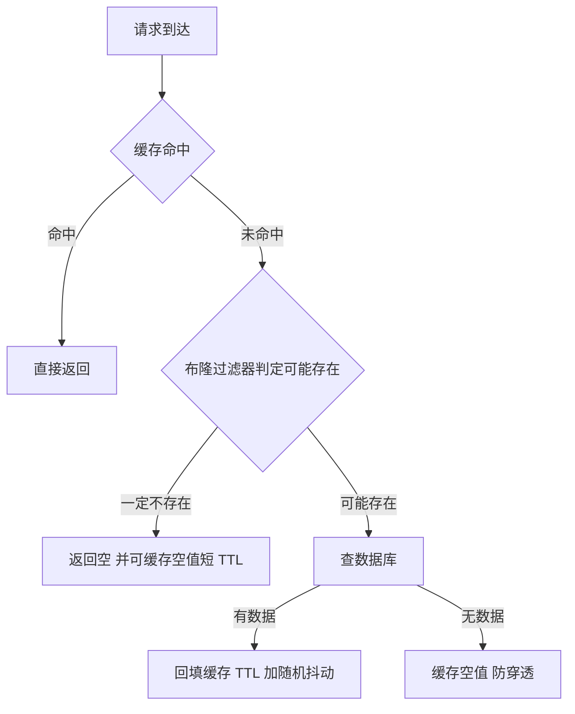

```python
# file: code/04_数据库与缓存/q170_cache_penetration.py
"""简易布隆过滤器 + 空值缓存防穿透"""
import hashlib


class BloomFilter:
    def __init__(self, bits: int = 1 << 12, hashes: int = 3):
        self.bits = bytearray(bits // 8)
        self.size = bits
        self.hashes = hashes

    def _positions(self, item: str):
        for i in range(self.hashes):
            h = int(hashlib.md5(f"{i}:{item}".encode()).hexdigest(), 16)
            yield h % self.size

    def add(self, item: str) -> None:
        for p in self._positions(item):
            self.bits[p // 8] |= 1 << (p % 8)

    def might_contain(self, item: str) -> bool:
        return all(self.bits[p // 8] >> (p % 8) & 1 for p in self._positions(item))


class Cache:
    EMPTY = object()          # 空值标记

    def __init__(self):
        self.store: dict = {}
        self.bloom = BloomFilter()
        self.db_calls = 0

    def add_id(self, key: str):
        self.bloom.add(key)

    def get(self, key: str, db_loader):
        if key in self.store:
            return self.store[key], "cache"
        if not self.bloom.might_contain(key):     # 一定不存在, 拦截
            return None, "bloom"
        self.db_calls += 1
        value = db_loader(key)
        self.store[key] = value if value is not None else self.EMPTY
        return value, "db"


if __name__ == "__main__":
    cache = Cache()
    cache.add_id("item:1")
    loader = lambda k: {"item:1": "数据A"}.get(k)
    print(cache.get("item:1", loader))     # db 加载
    print(cache.get("item:1", loader))     # cache 命中
    print(cache.get("item:404", loader))   # bloom 拦截, db_calls 不增加
    print("DB 查询次数:", cache.db_calls)
```

**追问**:
- 布隆过滤器为什么不能删元素?——一个 bit 被多个元素共享,删除会误伤;需要删除用 Counting Bloom 或布谷鸟过滤器。
- 空值缓存的 TTL 如何定?——短 TTL(如 60s)平衡攻击防护与数据一致性,配合过期抖动。

---

### Q171 · 缓存击穿

> 难度:★★★★ | 标签:缓存, Redis, 并发

**问**:什么是缓存击穿?怎么解决热点 key 过期瞬间的大量并发重建?

**答**:某个热点 key 过期的一瞬间,大量请求同时未命中,同时去查 DB 并回填,瞬间压垮 DB。对策:① 互斥锁(singleflight):只放一个请求去重建,其他等待或读旧值;② 逻辑过期:key 永不过期,value 里带过期时间,发现过期后异步重建、先返回旧值;③ 热点 key 适当延长 TTL 或提前续期。

```python
# file: code/04_数据库与缓存/q171_cache_breakdown.py
"""互斥锁 singleflight: 同一 key 并发重建只放行一个"""
import threading
import time


class SingleFlightCache:
    def __init__(self):
        self.store: dict = {}
        self.key_locks: dict = {}
        self._guard = threading.Lock()
        self.db_calls = 0

    def _lock_for(self, key: str) -> threading.Lock:
        with self._guard:                       # 只保护锁表的创建
            return self.key_locks.setdefault(key, threading.Lock())

    def get(self, key: str, loader):
        if key in self.store:
            return self.store[key]
        lk = self._lock_for(key)
        with lk:                                # 同 key 串行, 其余线程在此等待
            if key in self.store:               # 双重检查: 等待期间别人已重建
                return self.store[key]
            self.db_calls += 1
            value = loader(key)
            self.store[key] = value
            return value


if __name__ == "__main__":
    cache = SingleFlightCache()

    def slow_loader(key: str) -> str:
        time.sleep(0.1)                          # 模拟 DB 慢查询
        return f"value-of-{key}"

    def worker(results: list, i: int):
        results[i] = cache.get("hot:key", slow_loader)

    results = [None] * 20
    threads = [threading.Thread(target=worker, args=(results, i)) for i in range(20)]
    for t in threads: t.start()
    for t in threads: t.join()
    print("20 个并发请求, DB 实际查询次数:", cache.db_calls)   # 1
```

**追问**:
- 互斥锁方案的缺点?——请求串行化增加延迟,锁挂了会饿死;配合超时与逻辑过期缓解。
- 逻辑过期为什么能避免阻塞?——先返回旧值保证可用性,重建放到异步线程,牺牲短暂一致性换吞吐。

---

### Q172 · 缓存雪崩

> 难度:★★★★ | 标签:缓存, Redis, 高可用

**问**:什么是缓存雪崩?和击穿的区别是什么,如何防范?

**答**:雪崩是大面积 key 同时失效(或 Redis 实例整体宕机),请求洪峰全部落到 DB;击穿是单个热点 key 失效。防范:① TTL 加随机抖动,打散过期时间;② 多级缓存(本地 LRU + Redis);③ Redis 高可用(哨兵/集群)避免整体不可用;④ DB 侧限流熔断兜底;⑤ 关键数据预热,不依赖过期后重建。

```python
# file: code/04_数据库与缓存/q172_cache_avalanche.py
"""TTL 随机抖动打散过期时间"""
import random
import statistics

BASE_TTL = 3600


def ttl_with_jitter(base: int = BASE_TTL, ratio: float = 0.1) -> float:
    """在 base 上下浮动 ratio 比例, 避免同一批 key 同时失效"""
    return base * (1 + random.uniform(-ratio, ratio))


if __name__ == "__main__":
    ttls = [ttl_with_jitter() for _ in range(1000)]
    same_time = sum(1 for t in ttls if abs(t - BASE_TTL) < BASE_TTL * 0.001)
    print(f"标准差 {statistics.pstdev(ttls):.1f}s, 极接近基准点的比例 {same_time / 1000:.1%}")
    print("秒级分布样例:", sorted(int(t) for t in ttls[:5]))
    # 固定 TTL 时 1000 个 key 的到期时间完全相同 -> 雪崩
    # 加抖动后到期时间均匀散开, DB 瞬时压力被摊平
```

**追问**:
- Redis 整体宕机怎么办?——哨兵自动故障转移 + 客户端限流熔断,恢复后用预热脚本按热度分批回填。
- 多级缓存的失效顺序?——先失效远端 Redis 再失效本地,或本地 TTL 更短,减少读到旧值的窗口。

---

### Q173 · Redis 分布式锁 SETNX

> 难度:★★★★ | 标签:Redis, 分布式锁

**问**:如何用 Redis 实现分布式锁?释放锁要注意什么?

**答**:加锁用 `SET key unique_value NX PX 30000`:NX 保证互斥,PX 设过期防死锁,unique_value 标识持有者。释放锁必须用 Lua 脚本"先比对 value 再删除",保证"检查 + 删除"原子性,防止误删别人的锁。锁值一般用"实例 ID + 线程 ID"或 UUID。

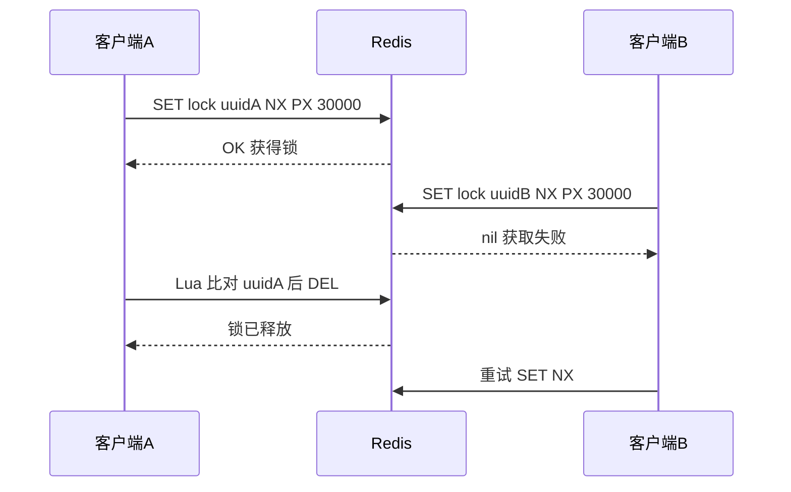

```python
# file: code/04_数据库与缓存/q173_distributed_lock.py
"""redis-py 分布式锁: SET NX PX 加锁 + Lua 原子释放"""
import uuid

RELEASE_LUA = """
if redis.call('GET', KEYS[1]) == ARGV[1] then
    return redis.call('DEL', KEYS[1])
else
    return 0
end
"""


class RedisLock:
    def __init__(self, client, key: str, ttl_ms: int = 30_000):
        self.client = client
        self.key = key
        self.ttl_ms = ttl_ms
        self.token = str(uuid.uuid4())       # 唯一持有者标识

    def acquire(self) -> bool:
        # NX 不存在才设置, PX 过期时间, 等价 SET key token NX PX ttl
        return bool(self.client.set(self.key, self.token, nx=True, px=self.ttl_ms))

    def release(self) -> bool:
        """Lua 保证比对与删除原子, 只能释放自己持有的锁"""
        result = self.client.eval(RELEASE_LUA, 1, self.key, self.token)
        return result == 1


if __name__ == "__main__":
    try:
        import redis
        client = redis.Redis(host="127.0.0.1", port=6379)
        client.ping()
    except Exception as exc:
        print("无可用 Redis, 关键点:", exc)
        print("1 加锁必须 SET NX PX 一条命令完成 2 释放必须 Lua 比对 value 再 DEL")
    else:
        lock1, lock2 = RedisLock(client, "order:lock:42"), RedisLock(client, "order:lock:42")
        print("A 加锁:", lock1.acquire())
        print("B 加锁:", lock2.acquire())        # False 互斥
        print("B 误删尝试:", lock2.release())     # False 不是自己的锁
        print("A 释放:", lock1.release())
        print("B 再次加锁:", lock2.acquire())
```

**追问**:
- 为什么不能直接 DEL?——锁过期后若 A 的业务还没执行完,锁可能已被他人持有,直接 DEL 会误删。
- 业务超时锁过期怎么办?——看门狗续期(见 Q174),或把临界区设计得足够短。

---

### Q174 · 分布式锁的续期与 Redlock 讨论

> 难度:★★★★ | 标签:Redis, 分布式锁

**问**:持锁任务执行时间不可控怎么办?了解 Redlock 吗,有什么争议?

**答**:用看门狗:后台线程定期(如 TTL/3)用 Lua 检查 value 后延长 PX,任务结束停止续期。Redlock 是向 N 个独立 Redis 实例依次加锁、多数成功且耗时小于 TTL 才算获得,旨在应对单实例故障时的锁安全性;争议在于 Martin Kleppmann 指出依赖时钟与进程暂停不可靠,关键业务建议用 fencing token(递增令牌)或改用 ZooKeeper/etcd 这类共识系统。

```python
# file: code/04_数据库与缓存/q174_lock_watchdog.py
"""看门狗续期: 后台线程定期延长 TTL, 任务结束后停止"""
import threading
import time


class FakeRedis:
    """最小 SET GET PEXPIRE 语义"""

    def __init__(self):
        self.store: dict = {}
        self.expire_at: dict = {}

    def set(self, key, value, px: int) -> bool:
        self.store[key] = value
        self.expire_at[key] = time.time() + px / 1000
        return True

    def extend(self, key, value, px: int) -> bool:
        if self.store.get(key) == value:            # 只有持有者能续期
            self.expire_at[key] = time.time() + px / 1000
            return True
        return False

    def alive(self, key) -> bool:
        return key in self.store and time.time() < self.expire_at[key]


class WatchdogLock:
    def __init__(self, client: FakeRedis, key: str, ttl_ms: int = 300):
        self.client, self.key, self.ttl_ms = client, key, ttl_ms
        self.token = "owner-1"
        self._stop = threading.Event()

    def acquire(self) -> bool:
        ok = self.client.set(self.key, self.token, px=self.ttl_ms)
        if ok:
            threading.Thread(target=self._renew, daemon=True).start()
        return ok

    def _renew(self):
        while not self._stop.wait(self.ttl_ms / 3000):   # 每 TTL/3 续一次
            if not self.client.extend(self.key, self.token, self.ttl_ms):
                return                                    # 锁已易主, 停止续期

    def release(self):
        self._stop.set()
        self.client.store.pop(self.key, None)


if __name__ == "__main__":
    c = FakeRedis()
    lock = WatchdogLock(c, "job:1")
    lock.acquire()
    time.sleep(0.5)                       # 远超过 0.3s 的 TTL
    print("0.5s 后锁仍然存活(看门狗续期):", c.alive("job:1"))
    lock.release()
    print("释放后:", c.alive("job:1"))
```

**追问**:
- fencing token 怎么工作?——锁服务发放单调递增令牌,存储端拒绝旧令牌写入,即使锁失效旧持有者也无法破坏数据。
- 看门狗线程挂了会怎样?——锁到期自动释放,业务侧必须有幂等与重试兜底,锁只做效率优化时才可接受。

---

### Q175 · Redis Pipeline 与批量操作

> 难度:★★★ | 标签:Redis, pipeline, 性能

**问**:pipeline 解决什么问题?和事务、Lua 有什么区别?

**答**:pipeline 把多条命令一次性发送,省去每条命令一个 RTT 的网络开销,吞吐可提升数倍到数十倍。注意:① pipeline 只攒包不保证原子性,中间可能穿插其他客户端命令;② 需要原子性用 MULTI/EXEC 或 Lua,pipeline 可与 MULTI 叠加;③ MGET/MSET 这类原生批量命令优先于 pipeline。

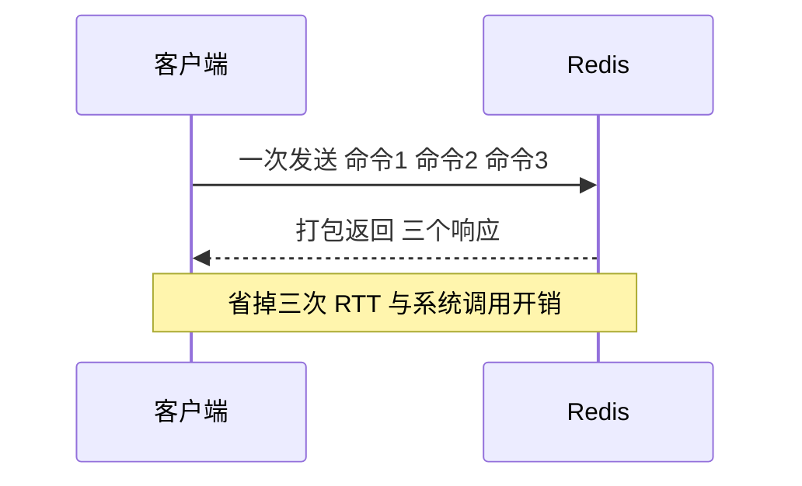

```python
# file: code/04_数据库与缓存/q175_redis_pipeline.py
"""redis-py pipeline 批量写; 无 Redis 时对比逐条与攒批的往返次数模型"""
try:
    import redis
    client = redis.Redis(host="127.0.0.1", port=6379, decode_responses=True)
    client.ping()
except Exception as exc:
    print("无可用 Redis, 原理说明:", exc)
    print("逐条: N 条命令 N 次 RTT; pipeline: N 条命令 1 次 RTT")
else:
    # 逐条写: 1000 次 RTT
    for i in range(100):
        client.set(f"batch:{i}", i)

    # pipeline 写: 1 次 RTT
    with client.pipeline(transaction=False) as pipe:   # transaction=False 纯攒包
        for i in range(100):
            pipe.set(f"batch:{i}", i * 10)
        pipe.incr("pipeline:runs")
        results = pipe.execute()                        # 一次性取回全部响应

    print("pipeline 返回响应数:", len(results))
    print("计数器:", client.get("pipeline:runs"))
```

**追问**:
- pipeline 有大小限制吗?——受客户端缓冲区与 maxmemory 影响,一般每批几百到几千条,分批发送。
- MULTI/EXEC 和 pipeline 的区别?——MULTI 保证命令原子连续执行但不回滚出错命令;pipeline 只优化网络,不保证原子。

---

### Q176 · 热 key 问题

> 难度:★★★★ | 标签:Redis, 热点, 架构

**问**:什么是热 key?发现和处理手段有哪些?

**答**:某个 key 的访问 QPS 远超其他 key,把流量集中到单个 Redis 分片甚至单节点网卡,造成局部过载。发现:redis-cli --hotkeys、monitor 采样、客户端埋点统计。处理:① 本地缓存兜底(应用进程内 LRU,容忍秒级不一致);② key 打散:把一个热点 key 拆成 N 个副本 key(如 key:0..N-1)读时随机取一个,写时全部更新;③ 读写分离/集群扩容分片;④ 极端场景直接推送本地广播。

```python
# file: code/04_数据库与缓存/q176_hot_key.py
"""热 key 治理: 本地 LRU 缓存 + 热 key 打散副本"""
from collections import OrderedDict
import random


class LocalLRU:
    def __init__(self, capacity: int = 2):
        self.data: OrderedDict = OrderedDict()
        self.capacity = capacity
        self.hits = 0

    def get(self, key):
        if key in self.data:
            self.data.move_to_end(key)
            self.hits += 1
            return self.data[key]
        return None

    def put(self, key, value):
        self.data[key] = value
        self.data.move_to_end(key)
        if len(self.data) > self.capacity:
            self.data.popitem(last=False)


REPLICAS = 4       # 热 key 打散成 4 个副本


def shard_key(key: str) -> str:
    return f"{key}:{random.randrange(REPLICAS)}"


class TieredCache:
    def __init__(self):
        self.local = LocalLRU()
        self.remote: dict = {}
        self.remote_reads = 0

    def load_remote(self, key: str, value: str):
        for i in range(REPLICAS):          # 写: 更新全部副本
            self.remote[f"{key}:{i}"] = value

    def get(self, key: str):
        hit = self.local.get(key)
        if hit is not None:
            return hit, "local"
        self.remote_reads += 1
        value = self.remote.get(shard_key(key))   # 读: 随机副本分流
        if value is not None:
            self.local.put(key, value)            # 回填本地
        return value, "remote"


if __name__ == "__main__":
    cache = TieredCache()
    cache.load_remote("hot:news", "头条内容")
    for _ in range(100):
        cache.get("hot:news")
    print(f"本地命中 {cache.local.hits} 次, 远端读取 {cache.remote_reads} 次")
    # 本地缓存把绝大部分读挡在进程内, 剩余读也被副本分散到多个分片
```

**追问**:
- 本地缓存一致性如何取舍?——热 key 通常允许秒级陈旧;要求强一致就不要用本地缓存,改走 DB/强一致链路。
- 热 key 和大 key 的区别?——热 key 是读流量集中,大 key 是单个 value 过大导致阻塞,治理手段完全不同。

---

### Q177 · 旁路缓存 Cache Aside 模式

> 难度:★★★★ | 标签:缓存, 一致性

**问**:描述 Cache Aside 的读写流程,为什么是"更新 DB 后删缓存"而不是更新缓存?

**答**:读:先读缓存,未命中读 DB 并回填;写:先更新 DB,再删除缓存(而非更新)。选删除的原因:① 写后值可能再被加工,懒加载避免无效计算;② 两个并发写时"更新缓存"可能把旧值最后写入,而删缓存后下次读会加载最新值,并发窗口更小。该模式仍有极小概率不一致(读旧 DB 值晚于写删完成才回填),可用延迟双删或订阅 binlog 兜底。

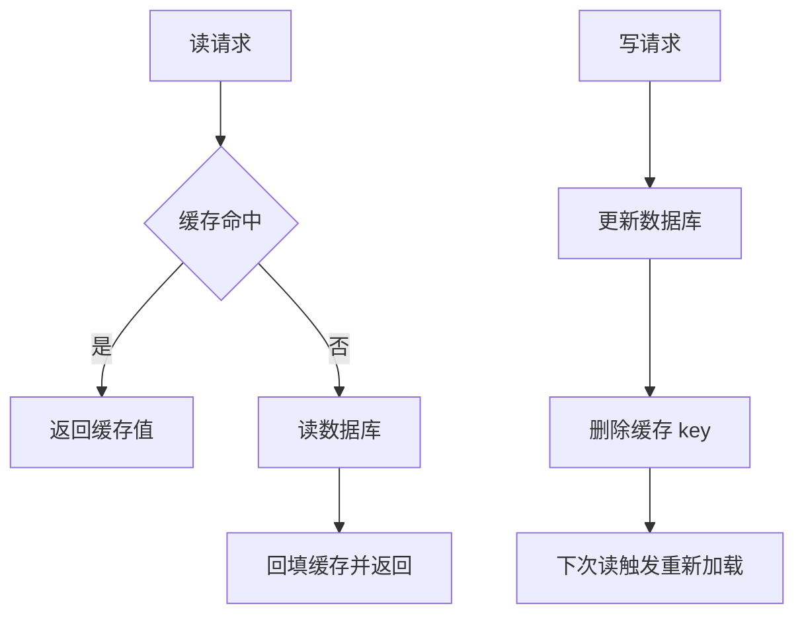

```python
# file: code/04_数据库与缓存/q177_cache_aside.py
"""Cache Aside 读写路径的最小实现"""


class CacheAsideService:
    def __init__(self):
        self.cache: dict = {}
        self.db: dict = {"item:1": "v1"}
        self.db_reads = 0

    def read(self, key: str):
        if key in self.cache:
            return self.cache[key], "cache"
        self.db_reads += 1
        value = self.db.get(key)
        if value is not None:
            self.cache[key] = value
        return value, "db"

    def write(self, key: str, value: str) -> None:
        self.db[key] = value        # 第一步: 更新 DB
        self.cache.pop(key, None)   # 第二步: 删除缓存, 而不是更新


if __name__ == "__main__":
    svc = CacheAsideService()
    print(svc.read("item:1"))        # cache 未建, 读 DB
    print(svc.read("item:1"))        # 命中缓存
    svc.write("item:1", "v2")
    print(svc.read("item:1"), "写后读到新值, 缓存已被删除并重载")
    print("DB 读次数:", svc.db_reads)
```

**追问**:
- 为什么不推荐"先删缓存再更新 DB"?——删除后、DB 提交前的读会把旧值写回缓存,脏数据存活整个 TTL。
- 更新缓存在什么场景合理?——写后读极少、计算缓存值代价低且强一致需求弱时,可考虑 Write-Through。

---

### Q178 · 缓存与数据库一致性与延迟双删

> 难度:★★★★ | 标签:缓存, 一致性

**问**:Cache Aside 还有不一致窗口,延迟双删是怎么回事?

**答**:不一致来源于并发"读旧值-写回缓存"与"写 DB-删缓存"的交错。延迟双删:写请求先删缓存、更新 DB、睡眠一小段时间(覆盖一次读路径的回填窗口)后再删一次缓存,把可能被旧读写回的脏值清掉。更工程化的方案是不在写路径删,而是订阅 binlog(如 canal)异步可靠地删缓存,天然解耦且可重试;配合兜底的过期 TTL,把不一致限制在秒级。

```python
# file: code/04_数据库与缓存/q178_delayed_double_delete.py
"""延迟双删: 两次删除 + 中间等待覆盖并发回填窗口"""
import threading
import time


class Service:
    def __init__(self, delay: float = 0.05):
        self.cache: dict = {}
        self.db: dict = {"item:1": "old"}
        self.delay = delay
        self.delete_log: list = []

    def _delete_cache(self, key: str):
        self.cache.pop(key, None)
        self.delete_log.append(round(time.time() - self.t0, 3))

    def write(self, key: str, value: str) -> None:
        self.t0 = time.time()
        self._delete_cache(key)                       # 第一次删
        self.db[key] = value                          # 更新 DB
        timer = threading.Timer(self.delay, self._delete_cache, args=(key,))
        timer.daemon = True
        timer.start()                                 # 延迟第二次删
        # 更好的替代: binlog 订阅(canal/Debezium)异步删缓存, 可靠可重试

    def read_concurrent(self, key: str) -> str:
        """模拟并发读: 先读缓存未命中, 读到 DB 后回填"""
        if key not in self.cache:
            self.cache[key] = self.db.get(key)
        return self.cache[key]


if __name__ == "__main__":
    svc = Service()
    svc.write("item:1", "new")              # 写入期间穿插一次旧读
    stale = svc.read_concurrent("item:1")   # 可能读到 old 并回填
    time.sleep(0.1)                         # 等第二次删除执行
    print("并发读回填值:", stale)
    print("两次删除时间点:", svc.delete_log)
    print("最终读:", svc.read_concurrent("item:1"), "已被第二次删除纠正")
```

**追问**:
- 延迟时间怎么定?——略大于一次"读 DB + 回填"的耗时(常见 500ms~1s),纯经验值,属于尽力而为。
- 为什么推荐 binlog 订阅方案?——删除操作来自 DB 变更事件,顺序与 DB 一致、可消费重试,不侵入业务代码。

---

### Q179 · 基于 binlog 的缓存同步

> 难度:★★★ | 标签:MySQL, binlog, 缓存一致性

**问**:如何用 binlog 保证缓存与数据库的最终一致?

**答**:MySQL binlog 记录行级变更,通过 canal/Debezium 之类的 CDC 组件伪装成从库订阅变更,投递到 MQ,消费者解析变更并删除/更新对应缓存。优点:与 DB 提交顺序一致、业务零侵入、消费失败可重试。注意幂等消费(见 Q180)与乱序处理(按主键分区分区保序)。

```python
# file: code/04_数据库与缓存/q179_binlog_sync.py
"""binlog 变更事件消费同步缓存(模拟 CDC 投递), 真实场景用 canal/MQ"""
from __future__ import annotations

from dataclasses import dataclass
from typing import Optional


@dataclass
class ChangeEvent:
    table: str
    op: str            # INSERT / UPDATE / DELETE
    key: str
    after: Optional[dict] = None


class CacheSyncer:
    def __init__(self):
        self.cache: dict = {}
        self.processed: set = set()          # 幂等: 事件 id 去重

    def on_change(self, event_id: str, event: ChangeEvent) -> None:
        if event_id in self.processed:       # MQ 至少一次投递 -> 必须幂等
            return
        self.processed.add(event_id)
        if event.op == "DELETE":
            self.cache.pop(f"{event.table}:{event.key}", None)
        else:
            self.cache[f"{event.table}:{event.key}"] = event.after


def fake_binlog_stream():
    """模拟 canal 投递到 MQ 的两次重复事件 + 一次更新"""
    yield ("evt-1", ChangeEvent("users", "UPDATE", "1", {"name": "alice"}))
    yield ("evt-1", ChangeEvent("users", "UPDATE", "1", {"name": "alice"}))  # 重复投递
    yield ("evt-2", ChangeEvent("users", "UPDATE", "1", {"name": "alice2"}))


if __name__ == "__main__":
    syncer = CacheSyncer()
    for event_id, event in fake_binlog_stream():
        syncer.on_change(event_id, event)
    print("缓存最终值:", syncer.cache)          # alice2, 重复事件被幂等吸收
```

**追问**:
- 直接更新缓存而不是删,配合 CDC 可以吗?——可以但要求事件严格有序且带上完整终值,乱序会把旧值写回,删除 + TTL 更稳。
- binlog 格式选哪种?——ROW 格式,能拿到行级前后镜像,STATEMENT 拿不到具体值。

---

### Q180 · 消息队列的重复消费与去重

> 难度:★★★★ | 标签:消息队列, 幂等, Redis

**问**:MQ 为什么会重复投递?消费端如何保证幂等?

**答**:MQ 普遍是 at-least-once:生产重发、broker 主从同步、消费超时未 ACK 重投都会造成重复,所以幂等必须在消费端保证。通用做法:以业务唯一键(订单号/事件 id)为键,消费前 `SET key NX EX ttl` 抢占去重标记,抢到才执行业务,执行失败删除标记让消息重投;要求更严落库时用唯一索引兜底(见 Q181)。

```python
# file: code/04_数据库与缓存/q180_mq_dedup.py
"""消费端幂等: Redis SETNX 去重 + 失败释放重投"""
import itertools


class FakeRedis:
    def __init__(self):
        self._set: set = set()

    def setnx(self, key: str) -> bool:
        if key in self._set:
            return False
        self._set.add(key)          # 真实命令: SET key 1 NX EX 86400
        return True

    def delete(self, key: str) -> None:
        self._set.discard(key)


class Consumer:
    def __init__(self):
        self.redis = FakeRedis()
        self.processed: list = []
        self._ids = itertools.count()

    def consume(self, message: dict) -> None:
        msg_id = message["id"]
        key = f"dedup:{msg_id}"
        if not self.redis.setnx(key):
            print(f"消息 {msg_id} 重复, 直接 ACK 跳过")
            return
        try:
            self.processed.append(message)
            print(f"消息 {msg_id} 业务处理完成")
        except Exception:
            self.redis.delete(key)   # 失败释放标记, 让 MQ 重投
            raise


if __name__ == "__main__":
    c = Consumer()
    c.consume({"id": "m1", "payload": "order-42"})
    c.consume({"id": "m1", "payload": "order-42"})   # 重复投递
    c.consume({"id": "m2", "payload": "order-43"})
    print("实际处理:", [m["id"] for m in c.processed])
```

**追问**:
- SETNX 成功但业务失败,标记要不要删?——要删,否则重投的消息永远被拦;若业务是"成功不可逆",失败也要记录原因并人工介入。
- 去重标记的 TTL 怎么定?——大于 MQ 最大重投窗口(常见 24h~72h),太短会漏拦长周期重复。

---

### Q181 · 唯一约束与幂等表设计

> 难度:★★★★ | 标签:MySQL, 幂等, 表设计

**问**:如何用数据库唯一约束实现接口幂等?设计一张幂等表要注意什么?

**答**:为业务唯一键建唯一索引(如 order_no、idempotency_key),重复请求插入时违反唯一约束直接判为重复返回首次结果,这是最可靠的最后防线,Redis 去重只是前置加速。设计要点:唯一键 + 状态字段 + 结果快照;插入冲突时查询已有记录返回;注意唯一键失效场景(软删除要用"键+deleted_at"或状态参与唯一性);批量插入用 INSERT IGNORE / ON DUPLICATE KEY 语义要明确。

```python
# file: code/04_数据库与缓存/q181_idempotent_table.py
"""sqlite3 演示唯一约束幂等: 重复请求返回首次结果"""
import sqlite3

SETUP = """
CREATE TABLE payment (
  id INTEGER PRIMARY KEY,
  idempotency_key TEXT NOT NULL UNIQUE,   -- 幂等唯一键
  order_no TEXT NOT NULL,
  amount INTEGER NOT NULL,
  status TEXT NOT NULL DEFAULT 'success'
)
"""


def pay(conn: sqlite3.Connection, key: str, order: str, amount: int) -> dict:
    try:
        conn.execute(
            "INSERT INTO payment(idempotency_key, order_no, amount) VALUES (?, ?, ?)",
            (key, order, amount),
        )
        conn.commit()
        return {"duplicated": False, "amount": amount}
    except sqlite3.IntegrityError:
        # MySQL 写法: INSERT ... ON DUPLICATE KEY UPDATE 或先 SELECT
        row = conn.execute(
            "SELECT amount, status FROM payment WHERE idempotency_key = ?", (key,)
        ).fetchone()
        return {"duplicated": True, "amount": row[0], "status": row[1]}


if __name__ == "__main__":
    conn = sqlite3.connect(":memory:")
    conn.execute(SETUP)
    print("首次请求:", pay(conn, "k-1", "o-100", 9900))
    print("重复请求:", pay(conn, "k-1", "o-100", 9900))   # 不会重复扣款
    print("表内记录数:", conn.execute("SELECT COUNT(*) FROM payment").fetchone()[0])
```

**追问**:
- 为什么不能只靠 Redis 去重?——Redis 标记可能过期/丢失,唯一约束是事务内强保证,两者是"加速 + 兜底"关系。
- 软删除为什么破坏唯一约束?——deleted 行仍占着唯一键,复用业务键会冲突;把 deleted_at 或 version 纳入唯一索引或改为物理删除+审计表。

---

### Q182 · 分库分表的拆分思路

> 难度:★★★★ | 标签:分库分表, 架构

**问**:单表数据量过大时要拆分,说说分库分表的整体思路。

**答**:先垂直后水平:垂直分库按业务域拆(订单库/用户库),垂直分表把大字段冷字段拆出;水平分库分表按分片键(常用 user_id)把行分散到 N 库 × M 表。路由策略:hash 取模(分布均匀,扩容难)、range 按时间(利于冷热分离,有热点)、一致性 hash(扩容迁移少)。拆分前先确认单表瓶颈(2000 万行只是经验值,要看 B+Tree 层高与查询模式),能用索引、归档、读写分离解决的不要急着拆。

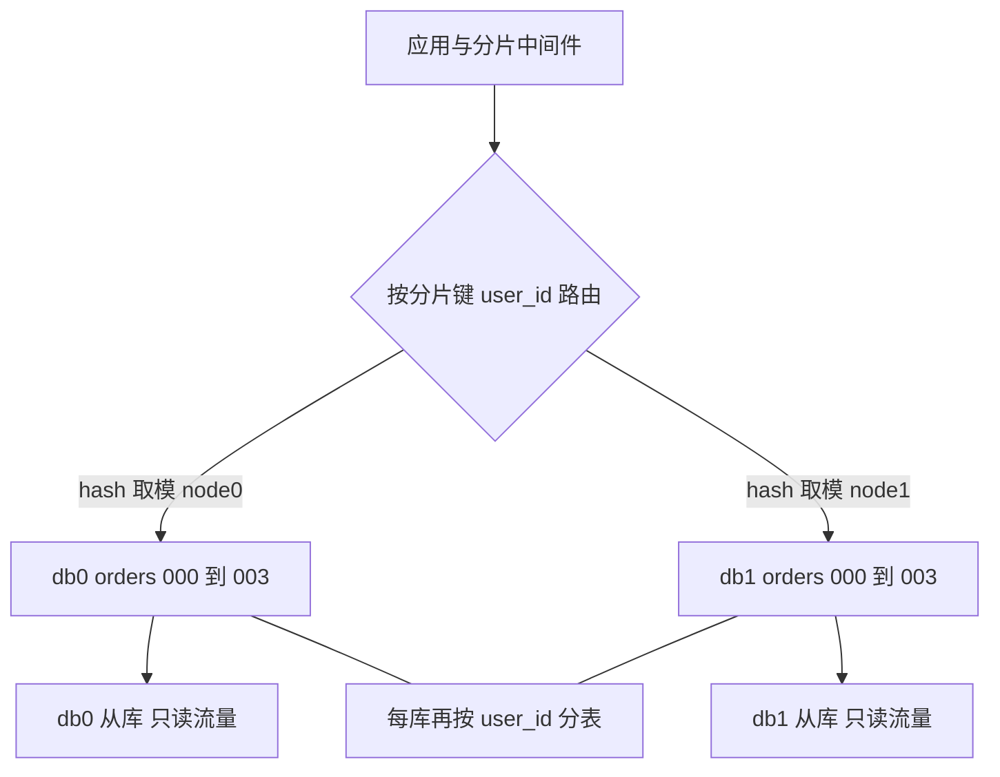

```python
# file: code/04_数据库与缓存/q182_sharding_router.py
"""水平分片路由: hash 取模 2 库 x 4 表"""
DB_COUNT, TABLE_PER_DB = 2, 4


def route(user_id: int) -> tuple:
    """返回 库名 与 表名"""
    shard = user_id % (DB_COUNT * TABLE_PER_DB)      # 全局槽位
    db = shard // TABLE_PER_DB
    table = shard % TABLE_PER_DB
    return f"db{db}", f"orders_{table:03d}"


if __name__ == "__main__":
    samples = [1, 2, 7, 8, 9999, 123456]
    for uid in samples:
        db, table = route(uid)
        print(f"user_id={uid} -> {db}.{table}")

    # 验证分布均匀性
    from collections import Counter
    dist = Counter(route(u)[0] for u in range(100_000))
    print("10 万用户分布:", dict(dist))
    # 扩容: 2 库扩 4 库需按新模数迁移, 一致性 hash 或 预分槽(如 1024 槽)可缓解
```

**追问**:
- 为什么用 user_id 而不是 order_id 做分片键?——用户维度查询(我的订单)可单分片命中;用 order_id 会让用户维查询扩散到全部分片。
- 什么是基因法?——把 user_id 的低位基因嵌入 order_id,订单 id 天然带用户分片信息,两种维度都能路由到单分片。

---

### Q183 · 分库分表后的全局 ID 与跨片查询

> 难度:★★★★ | 标签:分库分表, 分布式 ID

**问**:分表后自增主键会冲突,怎么生成全局 ID?跨分片的查询怎么办?

**答**:全局 ID 方案:① 号段模式(DB 一次取一段缓存本地);② 雪花算法 Snowflake(时间戳+机器 id+序列,趋势递增);③ Redis INCR / 独立 ID 服务。跨片查询:优先带分片键路由;不带分片键的查询走异构索引——把数据按另一维度冗余一份(如订单表按商家再存一份)或同步到 ES/宽表;跨片聚合在中间件层并行查询后内存归并,分页排序代价高,尽量设计上避免。

```python
# file: code/04_数据库与缓存/q183_snowflake_id.py
"""雪花算法生成趋势递增的 64 位全局 ID(纯标准库)"""
import threading
import time


class Snowflake:
    TIMESTAMP_BITS, WORKER_BITS, SEQ_BITS = 41, 10, 12
    EPOCH = 1704038400000        # 2024-01-01 起始纪元, ms

    def __init__(self, worker_id: int):
        assert 0 <= worker_id < (1 << self.WORKER_BITS)
        self.worker_id = worker_id
        self._seq = 0
        self._last_ts = -1
        self._lock = threading.Lock()

    def _now_ms(self) -> int:
        return int(time.time() * 1000)

    def next_id(self) -> int:
        with self._lock:
            ts = self._now_ms()
            if ts == self._last_ts:
                self._seq = (self._seq + 1) & ((1 << self.SEQ_BITS) - 1)
                if self._seq == 0:              # 同毫秒序列用尽, 等下一毫秒
                    while ts <= self._last_ts:
                        ts = self._now_ms()
            else:
                self._seq = 0
            if ts < self._last_ts:
                raise RuntimeError("时钟回拨, 拒绝发号")
            self._last_ts = ts
            return (
                ((ts - self.EPOCH) << (self.WORKER_BITS + self.SEQ_BITS))
                | (self.worker_id << self.SEQ_BITS)
                | self._seq
            )


if __name__ == "__main__":
    sf = Snowflake(worker_id=1)
    ids = [sf.next_id() for _ in range(5)]
    print("生成 ID:", ids)
    print("严格递增:", all(a < b for a, b in zip(ids, ids[1:])))
```

**追问**:
- 时钟回拨怎么处理?——小回拨等待、大回拨报警切备用 worker,或用逻辑时钟。
- 跨片 COUNT/排序为什么慢?——要向所有分片发请求再归并,数据量大时用汇总表/ES 离线统计替代实时聚合。

---

### Q184 · 深分页优化

> 难度:★★★ | 标签:MySQL, 分页, 性能

**问**:`LIMIT 1000000, 20` 为什么慢?如何优化深分页?

**答**:OFFSET 会取出前 offset+limit 行再丢弃,扫描行数随页码线性增长。优化:① 游标分页(_seek method):记录上一页末尾的有序键,`WHERE id > last_id LIMIT 20`,扫描恒定 20 行,要求排序键有序且可比较,不能跳页;② 延迟关联:先用覆盖索引取出主键,再回表 `JOIN` 取整行;③ 产品层限制跳页(改成只允许上/下一页)或用 ES 承担深翻页。

```python
# file: code/04_数据库与缓存/q184_deep_pagination.py
"""sqlite3 对比 OFFSET 深分页与游标分页的扫描代价"""
import sqlite3
import time

conn = sqlite3.connect(":memory:")
conn.execute("CREATE TABLE t (id INTEGER PRIMARY KEY, val TEXT)")
conn.executemany("INSERT INTO t(val) VALUES (?)", [(f"v{i}",) for i in range(100_000)])
conn.commit()

OFFSET_PAGE, CURSOR_LAST, SIZE = 90_000, 90_000, 20


def bench(label: str, sql: str, params: tuple) -> None:
    start = time.perf_counter()
    rows = conn.execute(sql, params).fetchall()
    print(f"{label}: {time.perf_counter() - start:.4f}s 首行 {rows[0][0]}")


# 传统 OFFSET: 扫描 90020 行再丢弃前 9 万行
bench(
    "OFFSET 深分页",
    "SELECT id FROM t ORDER BY id LIMIT ? OFFSET ?",
    (SIZE, OFFSET_PAGE),
)

# 游标分页: 用主键定位, 恒定扫描 SIZE 行
bench(
    "游标分页 seek",
    "SELECT id FROM t WHERE id > ? ORDER BY id LIMIT ?",
    (CURSOR_LAST, SIZE),
)

# 延迟关联思路(需要二级索引, sqlite 用 EXPLAIN 观察同理)
bench(
    "延迟关联",
    "SELECT t.id FROM t JOIN (SELECT id FROM t ORDER BY id LIMIT ? OFFSET ?) p ON t.id = p.id",
    (SIZE, OFFSET_PAGE),
)
```

**追问**:
- 游标分页的排序键有什么要求?——唯一且有序(常配 created_at+id 复合),否则会漏数据;多列游标用 (col, id) 元组比较。
- 为什么延迟关联能快?——子查询走覆盖索引只扫索引不回表,回表只对最终 20 行做。

---

### Q185 · 综合设计: 高并发读多写少服务

> 难度:★★★★★ | 标签:架构设计, 缓存, MySQL

**问**:设计一个"读多写少、峰值 QPS 高"的商品详情服务,说说整体方案?

**答**:分层:客户端/网关限流 → 本地 LRU 缓存兜底热 key → Redis 集群存商品 JSON(TTL 加抖动) → MySQL 主从(读走从库)兜底。写路径走 Cache Aside:更新 DB 后删缓存,配合 binlog 订阅可靠删除;防穿透用布隆过滤器 + 空值缓存,防击穿用 singleflight 互斥重建;详情页统计类数据(浏览量)异步写 Redis INCR 后定时批量落库。原则:缓存挡住 99% 读,MySQL 只承接写与缓存未命中的少量读,每层都有降级(缓存挂了限流读从库)。

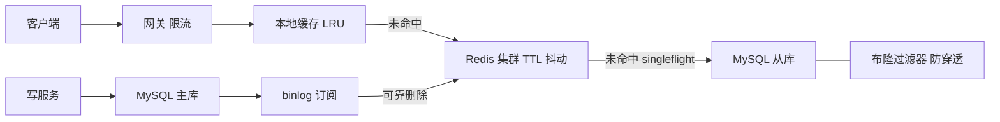

```python
# file: code/04_数据库与缓存/q185_service_design.py
"""综合小实现: 本地 LRU -> Redis 语义 -> DB 三级读取 + 互斥重建"""
import random
import threading
from collections import OrderedDict


class ProductDB:
    def __init__(self):
        self.data = {1: {"name": "手机", "price": 4999}}
        self.reads = 0

    def get(self, pid: int):
        self.reads += 1
        return self.data.get(pid)


class DetailService:
    def __init__(self, db: ProductDB, local_size: int = 2):
        self.db = db
        self.redis: dict = {}
        self.local: OrderedDict = OrderedDict()
        self.local_size = local_size
        self.key_locks: dict = {}
        self._guard = threading.Lock()

    @staticmethod
    def _ttl() -> float:
        return 300 * (1 + random.uniform(-0.1, 0.1))    # 雪崩防护: TTL 抖动

    def get(self, pid: int):
        if pid in self.local:                            # 第一级: 进程内
            self.local.move_to_end(pid)
            return self.local[pid], "local"
        if pid in self.redis:                            # 第二级: Redis
            self.local[pid] = self.redis[pid]
            return self.redis[pid], "redis"
        with self._lock_for(pid):                        # 第三级: 互斥回源
            if pid in self.redis:                        # 双重检查
                return self.redis[pid], "redis"
            value = self.db.get(pid)
            if value is not None:
                self.redis[pid] = value                  # 回填 + 抖动 TTL
                self.local[pid] = value
                if len(self.local) > self.local_size:
                    self.local.popitem(last=False)
            return value, "db"

    def _lock_for(self, pid: int) -> threading.Lock:
        with self._guard:
            return self.key_locks.setdefault(pid, threading.Lock())


if __name__ == "__main__":
    svc = DetailService(ProductDB())
    for _ in range(50):
        svc.get(1)
    print("50 次请求, DB 读次数:", svc.db.reads)     # 1
    print("再次读取:", svc.get(1))
```

**追问**:
- 缓存挂了怎么办?——降级为限流 + 直读从库并熔断,本地缓存延长兜底,恢复后预热。
- 浏览量这类计数如何落库?——Redis INCR 内存聚合,定时任务批量 UPDATE,牺牲实时性换 DB 写入量。
