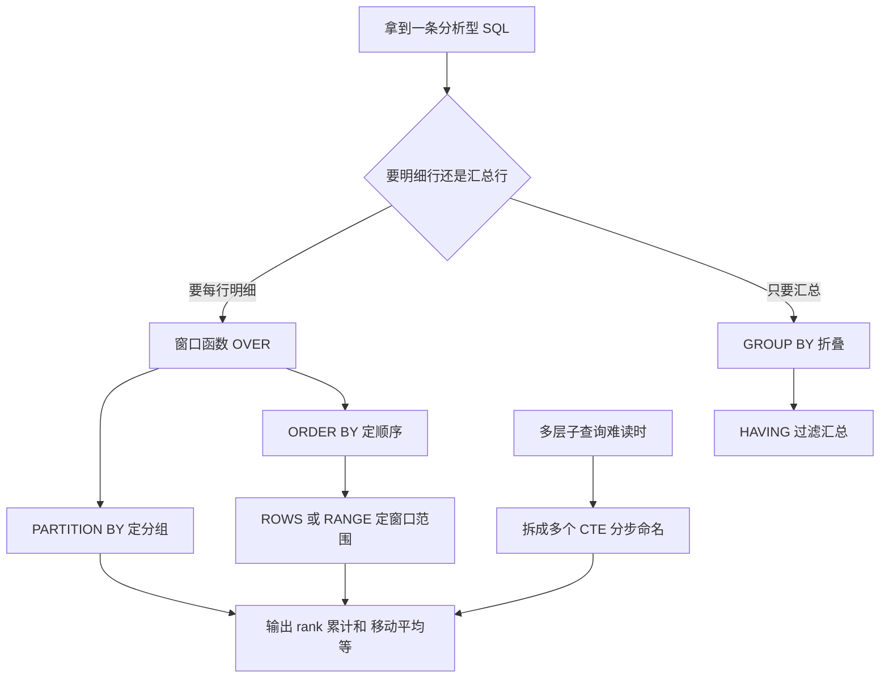
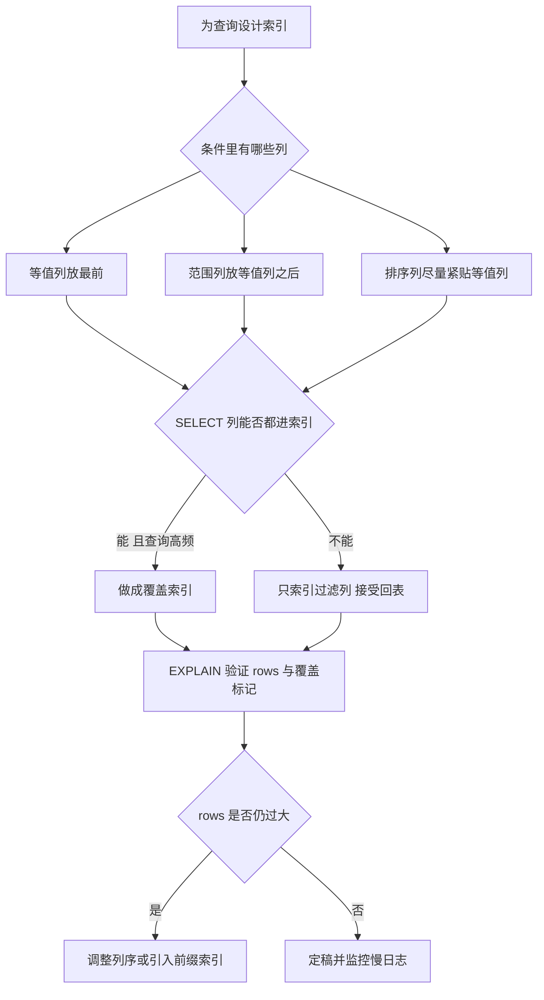
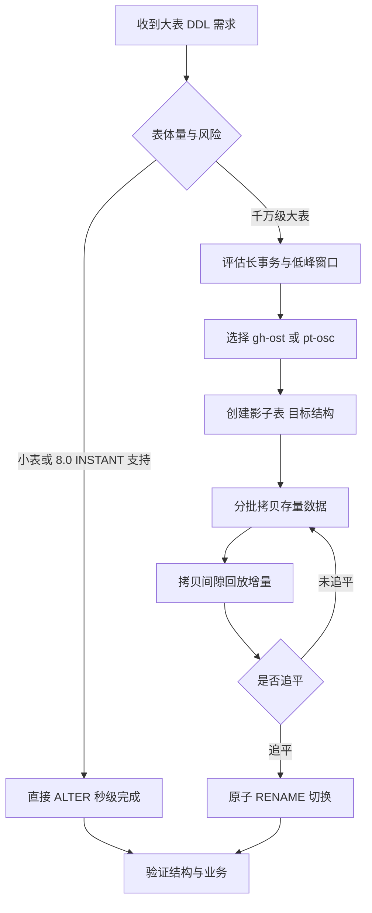
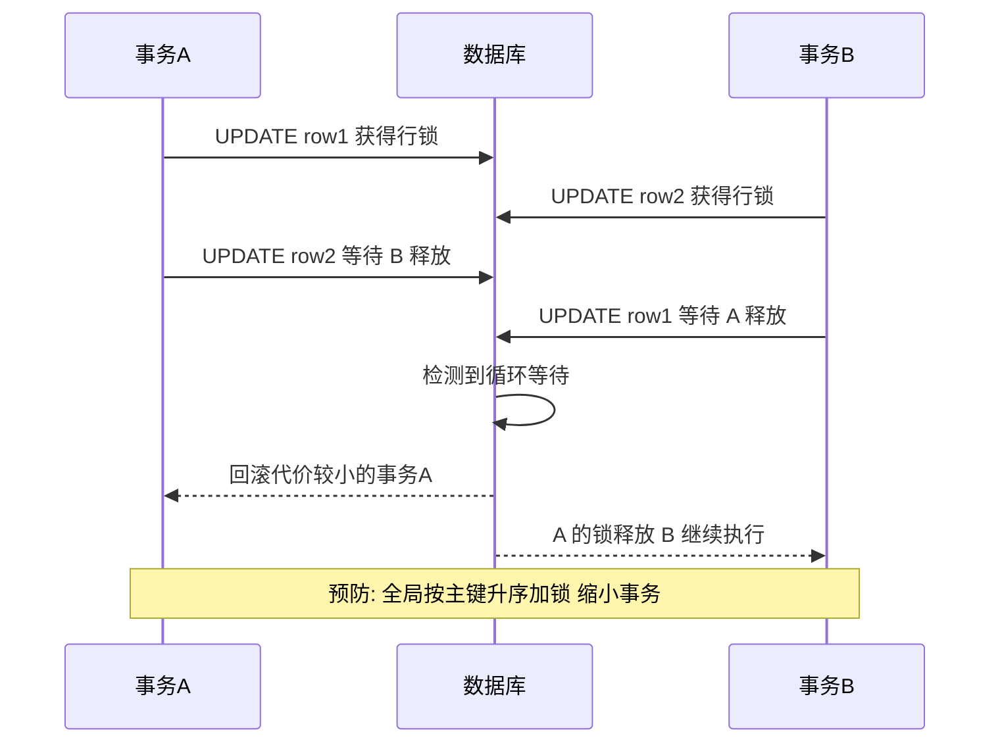
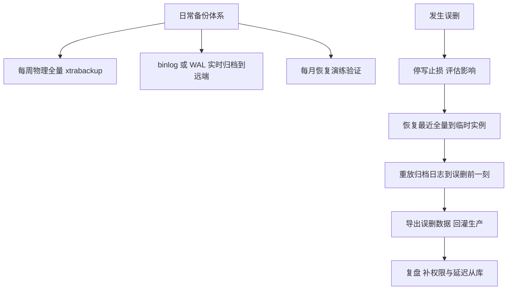
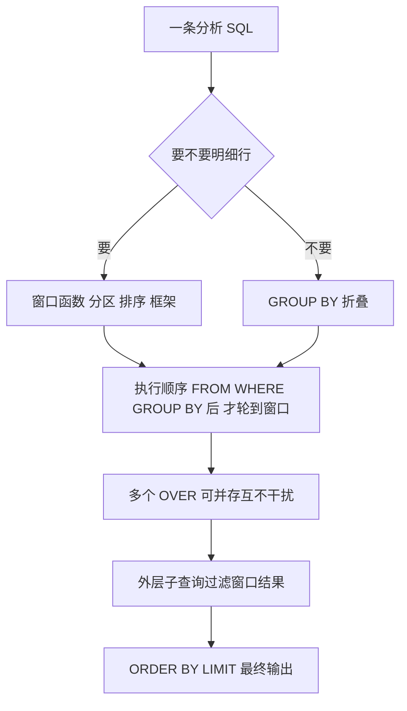
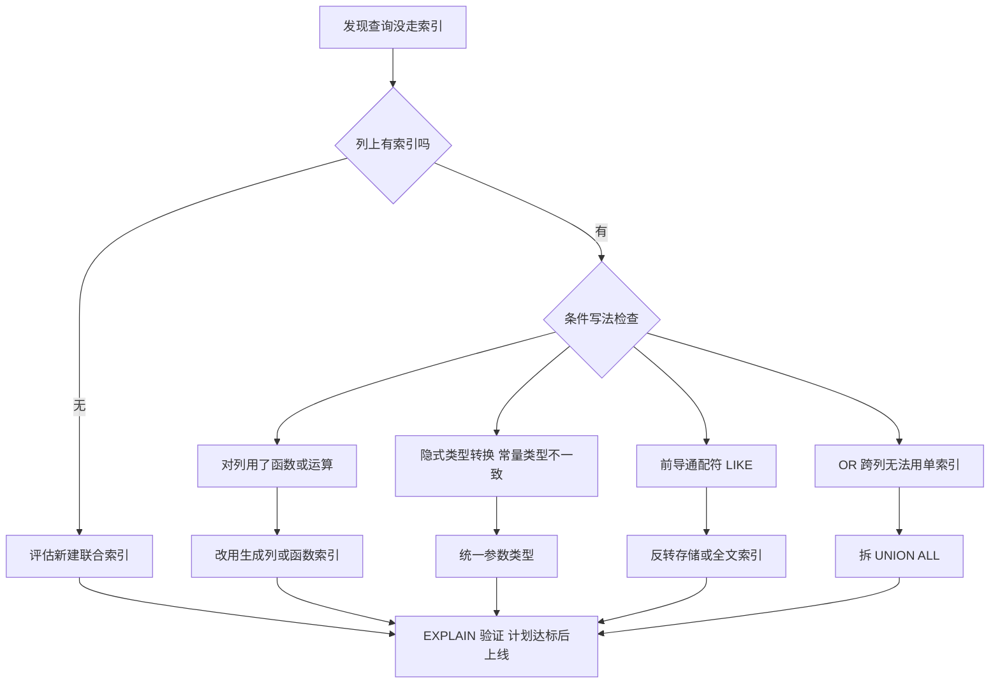
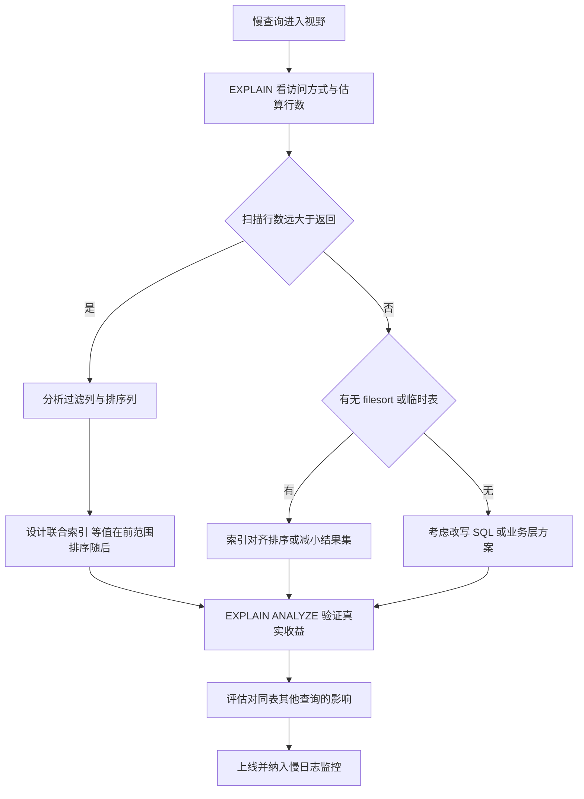
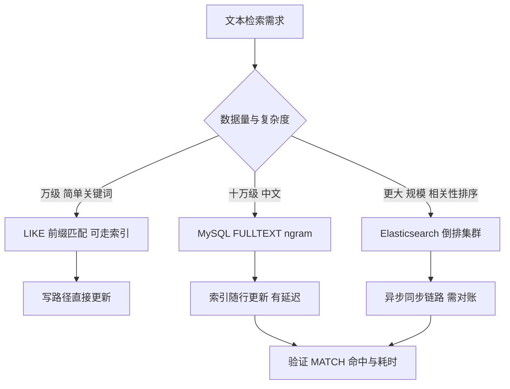
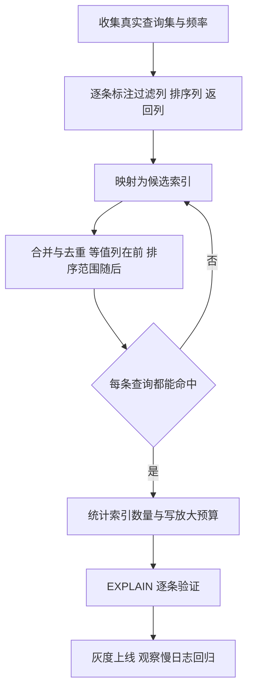

# 第 4 类 · 数据库与缓存(55)

本册聚焦 SQL 进阶与调优:窗口函数与 CTE、执行计划深读、索引设计进阶、大表 DDL、深分页、死锁案例分析、SQL 改写、归档备份与数据类型选型。
示例以标准库 sqlite3 真实跑通为主,MySQL 专有概念(间隙锁、ICP、Online DDL)在答案中给出原理与版本差异。
建议边读边跑 code/04_数据库与缓存/ 下对应脚本,并用 EXPLAIN QUERY PLAN 验证每一条结论。

---

### Q856 · 窗口函数基础: row_number / rank / dense_rank

> 难度:★★★☆ | 标签:SQL, 窗口函数

**问**:窗口函数 ROW_NUMBER、RANK、DENSE_RANK 有什么区别?并列名次时三者各返回什么?

**答**:三者都是"每行一个值"的排序窗口函数,区别只在并列值的处理。ROW_NUMBER 对每一行给唯一递增序号,并列也强行分先后;RANK 并列给相同名次,且跳过后续名次,如 1、2、2、4;DENSE_RANK 并列相同且不跳号,如 1、2、2、3。面试要点:需要"取每条第几名"用 ROW_NUMBER,需要"名次并列"语义用 RANK/DENSE_RANK;排序键不唯一时必须补 tie-breaker 列,否则 ROW_NUMBER 结果不稳定。

```python
# file: code/04_数据库与缓存/q856_window_rank.py
"""sqlite3 真实演示三种排序窗口函数在并列分时的差异"""
import sqlite3

DDL = """
CREATE TABLE score (name TEXT, class TEXT, score INT);
INSERT INTO score VALUES
 ('alice','A',95),('bob','A',92),('carol','A',92),('dave','A',88),
 ('erin','B',93),('frank','B',90);
"""

SQL = """
SELECT name, class, score,
       ROW_NUMBER() OVER (PARTITION BY class ORDER BY score DESC, name) AS rn,
       RANK()       OVER (PARTITION BY class ORDER BY score DESC)      AS rk,
       DENSE_RANK() OVER (PARTITION BY class ORDER BY score DESC)      AS drk
FROM score
ORDER BY class, rk
"""

if __name__ == "__main__":
    with sqlite3.connect(":memory:") as conn:
        conn.executescript(DDL)
        print("name  class score rn rk drk")
        for row in conn.execute(SQL):
            print(f"{row[0]:<6}{row[1]:<6}{row[2]:<6}{row[3]:<3}{row[4]:<3}{row[5]}")
```

**追问**:
- 想取每个班级分数第二高的学生怎么写?——把窗口结果包成子查询(或 CTE),外层过滤 `WHERE rn = 2`,SQLite/MySQL 8 也可用等价写法。
- ROW_NUMBER 的顺序会变吗?——会,排序键有并列时结果不保证稳定,必须追加唯一列(如 id)作为 tie-breaker。

---

### Q857 · 窗口函数累计求和与移动平均

> 难度:★★★☆ | 标签:SQL, 窗口函数

**问**:如何在 SQL 里算累计值和移动平均?ROWS 与 RANGE 框架有什么区别?

**答**:用 `SUM/AVG(...) OVER (ORDER BY ... ROWS BETWEEN ... AND ...)` 定义聚合范围:默认 `RANGE BETWEEN UNBOUNDED PRECEDING AND CURRENT ROW`,即从头累计到当前行。`ROWS BETWEEN 2 PRECEDING AND CURRENT ROW` 表示"前两行加当前行"的移动窗口。关键区别:ROWS 按物理行数划窗口,RANGE 按排序键的值划窗口,排序键有并列时 RANGE 会把同值行一起纳入,而 ROWS 不会。所以做"按天累计"且同一天有多行时,业务想合并同日应选 RANGE,想逐行滚动应选 ROWS。

```python
# file: code/04_数据库与缓存/q857_window_frame.py
"""演示累计求和与移动平均, 并对比 ROWS 与 RANGE 的差异"""
import sqlite3

DDL = """
CREATE TABLE daily (day TEXT, amount INT);
INSERT INTO daily VALUES
 ('d1',10),('d2',20),('d3',30),('d4',40),('d5',50);
"""

SQL = """
SELECT day, amount,
       SUM(amount) OVER (ORDER BY day) AS cum_sum,
       AVG(amount) OVER (ORDER BY day ROWS BETWEEN 2 PRECEDING AND CURRENT ROW) AS ma3
FROM daily
"""

if __name__ == "__main__":
    with sqlite3.connect(":memory:") as conn:
        conn.executescript(DDL)
        print(f"{'day':<5}{'amount':<8}{'cum':<6}{'ma3':>6}")
        for day, amount, cum, ma3 in conn.execute(SQL):
            print(f"{day:<5}{amount:<8}{cum:<6}{ma3:>6.1f}")
```

**追问**:
- 窗口函数能用在 WHERE 里吗?——不能,窗口函数在 SELECT 阶段计算,晚于 WHERE,需要先算进子查询/CTE 再外层过滤。
- 想算"每组内的累计"怎么办?——在 OVER 里加 `PARTITION BY 组列`,累计会在每组内重新开始。

---

### Q858 · 窗口函数解组内 TopN

> 难度:★★★☆ | 标签:SQL, 窗口函数

**问**:写 SQL 取每个分类下销量前 3 的商品,如果不用窗口函数你会怎么写?为什么窗口函数更好?

**答**:经典解法是先 `ROW_NUMBER() OVER (PARTITION BY category ORDER BY sales DESC)` 编号,再外层过滤 `rn <= 3`。老写法是相关子查询"比该商品销量高的不超过 2 个",或者自 join 计数,数据量大时复杂度和重复扫描都很差,而且处理并列名次很啰嗦。窗口函数只扫一遍并按分区计算,语义清晰、可扩展(改成 Top10 只改一个数字)。注意取"第 N 名"用 ROW_NUMBER,"前 N 名含并列"用 `RANK() <= N` 或 DENSE_RANK 视业务而定。

```python
# file: code/04_数据库与缓存/q858_topn_per_group.py
"""组内 TopN: 窗口函数编号 + 外层过滤, 并与自相关子查询对照"""
import sqlite3

DDL = """
CREATE TABLE goods (id INTEGER PRIMARY KEY, category TEXT, sales INT);
INSERT INTO goods (category, sales) VALUES
 ('book',100),('book',90),('book',90),('book',80),('book',70),
 ('toy',50),('toy',40),('toy',30);
"""

WINDOW_SQL = """
SELECT category, id, sales FROM (
  SELECT category, id, sales,
         ROW_NUMBER() OVER (PARTITION BY category ORDER BY sales DESC, id) AS rn
  FROM goods
) WHERE rn <= 3 ORDER BY category, rn
"""

SUBQ_SQL = """
SELECT g.category, g.id, g.sales
FROM goods g
WHERE (SELECT COUNT(*) FROM goods g2
       WHERE g2.category = g.category AND g2.sales > g.sales) < 2
ORDER BY g.category, g.sales DESC
"""

if __name__ == "__main__":
    with sqlite3.connect(":memory:") as conn:
        conn.executescript(DDL)
        print("窗口函数法:", conn.execute(WINDOW_SQL).fetchall())
        print("相关子查询:", conn.execute(SUBQ_SQL).fetchall())
```

**追问**:
- TopN 想并列时都取到怎么办?——把 ROW_NUMBER 换成 DENSE_RANK 再过滤 `<= 3`,并列名次都会保留。
- 数据量大时编号前的排序怎么优化?——给 `(category, sales DESC, id)` 建联合索引,让分区排序直接走索引顺序。

---

### Q859 · CTE 公用表表达式: 让复杂 SQL 可读

> 难度:★★☆☆ | 标签:SQL, CTE

**问**:WITH 子句是什么?和子查询相比有什么好处?CTE 会被优化器内联展开吗?

**答**:CTE(Common Table Expression)是 `WITH name AS (SELECT ...)` 定义的临时命名结果集,只在本条语句内有效,可定义多个并互相引用,把"一大坨嵌套"变成"分步流水线"。相比子查询,它消除重复代码、层次清晰、便于注释与调试(可单独跑每个 CTE)。在 MySQL 8/PostgreSQL 中普通 CTE 默认会被优化器内联(或可被物化),行为接近等价子查询;PostgreSQL 里可显式 `AS MATERIALIZED` 或 `AS NOT MATERIALIZED` 控制是否物化,MySQL 8.0 普通列 CTE 会物化一次供复用。面试要点:CTE 首要价值是可读性,其次才是复用。

```python
# file: code/04_数据库与缓存/q859_cte_pipeline.py
"""多级 CTE 分步计算: 每类目平均分 -> 高于平均的学生 -> 类目排名"""
import sqlite3

DDL = """
CREATE TABLE stu (name TEXT, category TEXT, score INT);
INSERT INTO stu VALUES
 ('a','math',90),('b','math',70),('c','math',80),
 ('d','eng',60),('e','eng',75),('f','eng',85);
"""

SQL = """
WITH class_avg AS (
  SELECT category, AVG(score) AS avg_score FROM stu GROUP BY category
),
above_avg AS (
  SELECT s.name, s.category, s.score, c.avg_score
  FROM stu s JOIN class_avg c USING (category)
  WHERE s.score > c.avg_score
)
SELECT category, name, score FROM above_avg ORDER BY category, score DESC
"""

if __name__ == "__main__":
    with sqlite3.connect(":memory:") as conn:
        conn.executescript(DDL)
        for row in conn.execute(SQL):
            print(row)
```

**追问**:
- 同一个子查询要引用两次怎么办?——不用复制两遍,定义一个 CTE,后面两处直接引用同一个名字。
- 递归 CTE 和普通 CTE 的区别?——递归 CTE 用 `WITH RECURSIVE`,锚点查询与递归查询用 UNION ALL 连接,反复执行直到不再产生新行。

---

### Q860 · 递归 CTE: 树形结构与层级展开

> 难度:★★★★ | 标签:SQL, 递归 CTE

**问**:员工表只有 manager_id,如何一条 SQL 查出某人的整条汇报链?递归 CTE 的执行过程是什么?

**答**:递归 CTE 由"锚点查询"(起点,如 CEO 或指定员工)加"递归查询"(基于上轮结果继续下钻,通常 `JOIN cte ON 子表.父键 = cte.子键`)构成,用 UNION ALL 连接,数据库循环执行递归部分直到返回空集。可以携带 depth 计数、path 字符串来辅助展示层级与防环。两个工程要点:一是 UNION ALL 比 UNION 少一次去重,树结构没有重复行时用它更快;二是必须在业务上保证有终止条件(树不能有环),必要时在递归里限制 depth 上限防止死循环。

```python
# file: code/04_数据库与缓存/q860_recursive_cte.py
"""递归 CTE 沿 manager_id 展开组织树, 携带层级与路径"""
import sqlite3

DDL = """
CREATE TABLE emp (id INTEGER PRIMARY KEY, name TEXT, manager_id INTEGER);
INSERT INTO emp VALUES
 (1,'ceo',NULL),(2,'cto',1),(3,'cfo',1),
 (4,'dev1',2),(5,'dev2',2),(6,'qa1',2),(7,'acc1',3);
"""

SQL = """
WITH RECURSIVE chain AS (
  SELECT id, name, manager_id, 1 AS depth, name AS path
  FROM emp WHERE name = 'ceo'
  UNION ALL
  SELECT e.id, e.name, e.manager_id, c.depth + 1, c.path || '->' || e.name
  FROM emp e JOIN chain c ON e.manager_id = c.id
)
SELECT depth, path FROM chain ORDER BY path
"""

if __name__ == "__main__":
    with sqlite3.connect(":memory:") as conn:
        conn.executescript(DDL)
        for depth, path in conn.execute(SQL):
            print(f"depth={depth}  {path}")
```

**追问**:
- 想查"某人所有下属"和"所有上级"分别怎么改?——锚点换成该员工、递归条件换成 `e.id = c.manager_id` 向上找,向下则是 `e.manager_id = c.id`。
- 树特别深会怎样?——每层都是一轮循环,深度大时轮次多,必要时在应用层缓存子树或改用物化路径/闭包表存储。

---



---

### Q861 · 执行计划深读: 全表扫描的代价

> 难度:★★★☆ | 标签:执行计划, 调优

**问**:什么叫全表扫描?它为什么慢,代价大概怎么估?

**答**:全表扫描(SCAN/ALL)是把表所有数据页从头到尾读一遍并逐行判断条件,时间约等于"数据页数 × 每页 IO 成本",数据在内存里也不省 CPU 解析。代价可以用行数 × 行宽估算:千万行宽表即使命中 OS 缓存也要做上亿次行判断,而走 B+ 树索引通常只需 3~4 层树高加若干叶子页。判断标准不是"见到全表扫描就有罪":小表扫描可能比回表更快,优化器有时故意选 SCAN。工程上用 `EXPLAIN`(MySQL)或 `EXPLAIN QUERY PLAN`(SQLite)确认访问方式,再看 rows 估算是否离谱。

```python
# file: code/04_数据库与缓存/q861_full_scan_cost.py
"""对比有无索引时同一查询的 EXPLAIN QUERY PLAN 访问方式"""
import sqlite3

if __name__ == "__main__":
    with sqlite3.connect(":memory:") as conn:
        conn.execute("CREATE TABLE orders (id INTEGER PRIMARY KEY, user_id INT, amount REAL)")
        conn.executemany("INSERT INTO orders (user_id, amount) VALUES (?, ?)",
                         [(i % 1000, i * 1.0) for i in range(10000)])

        plan1 = conn.execute(
            "EXPLAIN QUERY PLAN SELECT * FROM orders WHERE user_id = 42").fetchall()
        print("无索引:", plan1)

        conn.execute("CREATE INDEX idx_user ON orders (user_id)")
        plan2 = conn.execute(
            "EXPLAIN QUERY PLAN SELECT * FROM orders WHERE user_id = 42").fetchall()
        print("有索引:", plan2)
```

**追问**:
- 有索引优化器却选择全表扫描,一定是错的吗?——不一定,当条件命中行数占比很高(经验值超过 20%~30%)时,回表成本超过顺序扫描,全表扫描反而更优。
- 怎么量化"扫描了多少"?——MySQL 8/PG 用 EXPLAIN ANALYZE 看实际时间与行数;SQLite 没有 EXPLAIN ANALYZE,只能用 EXPLAIN QUERY PLAN 看访问方式,并用 ANALYZE 维护统计信息(详见 Q863)。

---

### Q862 · 执行计划深读: 访问类型从好到差的梯度

> 难度:★★★☆ | 标签:执行计划, MySQL

**问**:MySQL EXPLAIN 的 type 列有哪些取值?请按好坏排序并解释典型场景。

**答**:从好到差大致是:system/const(主键或唯一键等值,最多一行)、eq_ref(join 时被驱动表走主键/唯一键,一行)、ref(普通二级索引等值,多行)、range(索引范围扫描)、index(扫整棵索引树,顺序但全量)、ALL(全表扫描)。生产环境经验法则:核心查询至少到 range 以上,出现 index 或 ALL 就要警惕。SQLite 的 EXPLAIN QUERY PLAN 对应表述是 `SEARCH ... USING INDEX`(走索引)与 `SCAN ...`(全扫),可以互相印证。type 之外还要结合 key、rows、Extra(如 Using filesort、Using temporary)一起读。

```python
# file: code/04_数据库与缓存/q862_access_types.py
"""用 SQLite 展示 SCAN 与 SEARCH 两类访问路径, 对应 MySQL 的 ALL 与 ref"""
import sqlite3

if __name__ == "__main__":
    with sqlite3.connect(":memory:") as conn:
        conn.execute("CREATE TABLE t (id INTEGER PRIMARY KEY, a INT, b TEXT)")
        conn.executemany("INSERT INTO t (a, b) VALUES (?, ?)",
                         [(i % 500, f"k{i}") for i in range(5000)])
        conn.execute("CREATE INDEX idx_a ON t (a)")

        for sql in ("SELECT * FROM t", "SELECT * FROM t WHERE a = 7"):
            plan = conn.execute("EXPLAIN QUERY PLAN " + sql).fetchall()
            print(sql, "->", [p[3] for p in plan])
        print("MySQL 对照: 前者 type=ALL, 后者 type=ref")
```

**追问**:
- type=index 和 type=ALL 哪个好?——index 仍是"全量"只是按索引顺序扫,有时能免排序;数据量小时差距不大,量大时两者都要优化。
- const 和 eq_ref 的区别?——const 是独立查询单表等值唯一键;eq_ref 出现在 join 中,被驱动表按唯一键每次精确匹配驱动表的一行。

---

### Q863 · EXPLAIN ANALYZE 与估算偏差

> 难度:★★★☆ | 标签:执行计划, 统计信息

**问**:EXPLAIN 的 rows 估算和实际执行差很远会发生什么?怎么发现和修正?

**答**:EXPLAIN 只展示优化器"打算怎么做",行数来自统计信息(索引基数、采样)的估算;估算失真会让优化器选错 join 顺序或索引,比如把 10 行估成 10 万行后放弃索引。用 MySQL 8 或 PostgreSQL 的 `EXPLAIN ANALYZE` 可以看到每步"估算行 vs 实际行 vs 实际耗时"的偏差;SQLite 没有 EXPLAIN ANALYZE,对应手段是 `EXPLAIN QUERY PLAN` 看计划、`EXPLAIN` 看字节码、`ANALYZE` 维护统计信息。修正手段:执行 `ANALYZE TABLE` 更新统计信息,或针对倾斜列加直方图;应用层避免"刚批量导入就查询"导致的统计陈旧。面试时能讲出"估算驱动优化器,统计信息是优化器的眼睛"即可。

```python
# file: code/04_数据库与缓存/q863_explain_analyze.py
"""SQLite: QUERY PLAN 看计划, ANALYZE 维护统计信息; MySQL/PG 才有 EXPLAIN ANALYZE"""
import sqlite3

if __name__ == "__main__":
    with sqlite3.connect(":memory:") as conn:
        conn.execute("CREATE TABLE t (id INTEGER PRIMARY KEY, v INT)")
        conn.executemany("INSERT INTO t (v) VALUES (?)",
                         [(i % 10,) for i in range(5000)])
        conn.execute("CREATE INDEX idx_v ON t (v)")

        print("计划:", [r[3] for r in conn.execute(
            "EXPLAIN QUERY PLAN SELECT * FROM t WHERE v = 3").fetchall()])
        print("MySQL8/PG: EXPLAIN ANALYZE 给出 估算行 vs 实际行 vs 实际耗时")
        print("SQLite 替代: EXPLAIN 字节码计数 + ANALYZE 统计信息交叉验证")

        conn.execute("ANALYZE")
        print("ANALYZE 后统计:", conn.execute(
            "SELECT tbl, idx, stat FROM sqlite_stat1").fetchall())
```

**追问**:
- 统计信息多久更新一次?——MySQL 5.7 起默认自动重采样(innodb_stats_auto_recalc,表变化超 10% 触发),大变更后也可手动 ANALYZE。
- 优化器估算错还能强行干预吗?——可以,用 FORCE INDEX / 直方图 / 调整 join 顺序等 hint,但应作为最后手段并记录原因。

---

### Q864 · 联合索引列序设计: 等值、范围与排序

> 难度:★★★★ | 标签:索引, 联合索引

**问**:查询 `WHERE a=? AND b>? ORDER BY c` 该怎么设计联合索引?列顺序的原则是什么?

**答**:列序三原则:第一,等值条件列放最前(充分利用最左前缀,每列都是精确匹配可继续收敛);第二,范围列放在等值列之后(范围列之后的索引列无法再用于过滤,只能过滤已有结果);第三,若还想消除排序,排序列要接在等值列后面——但范围列与排序列通常只能二选一,因为范围扫描后索引顺序对排序列不再连续。本例若以 b 为范围条件,索引 `(a, b)` 后排序 c 仍需 filesort;若业务能接受"等值列 a + 排序列 c"的索引 `(a, c)` 再回表过滤 b,则可消除排序。选择取决于过滤性:区分度高的列靠前通常更优,最终以 EXPLAIN rows 验证。

```python
# file: code/04_数据库与缓存/q864_composite_order.py
"""对比两种联合索引下同一查询的计划: 索引列序决定能否消除排序"""
import sqlite3

SQL = "SELECT id FROM t WHERE a = 1 AND b > 50 ORDER BY c LIMIT 10"

def plan(conn, label):
    rows = conn.execute("EXPLAIN QUERY PLAN " + SQL).fetchall()
    print(label, [r[3] for r in rows])

if __name__ == "__main__":
    with sqlite3.connect(":memory:") as conn:
        conn.execute("CREATE TABLE t (id INTEGER PRIMARY KEY, a INT, b INT, c INT)")
        conn.executemany("INSERT INTO t (a, b, c) VALUES (?, ?, ?)",
                         [(i % 5, i % 100, i) for i in range(20000)])

        conn.execute("CREATE INDEX idx_a_b_c ON t (a, b, c)")
        plan(conn, "索引 a,b,c 范围列在前:")

        conn.execute("DROP INDEX idx_a_b_c")
        conn.execute("CREATE INDEX idx_a_c ON t (a, c)")
        plan(conn, "索引 a,c 排序列接等值列:")
```

**追问**:
- `(a,b)` 与 `(b,a)` 有区别吗?——有,只有能提供最左前缀 a 的查询才能用上前者;统计两个列各自出现等值条件的频率再定顺序。
- 范围列后面还能再挂列吗?——可以挂,但那部分列不再用于索引过滤,只能作为覆盖索引减少回表。

---

### Q865 · 覆盖索引实战: 让查询不回表

> 难度:★★★☆ | 标签:索引, 覆盖索引

**问**:什么是覆盖索引?如何确认查询用了覆盖索引?设计时要注意什么?

**答**:当查询所需的所有列(含 WHERE、ORDER BY、SELECT)都在某个二级索引里时,无需回聚簇索引取行,称为覆盖索引,SQLite 计划里显示 `USING COVERING INDEX`,MySQL Extra 显示 `Using index`。设计方法是把高频查询的 SELECT 列追加进联合索引尾部(如 `(user_id, status, created_at)` 服务 `WHERE user_id=? AND status=? ORDER BY created_at` 取 created_at 的场景)。注意权衡:每加一列索引就变大、写入变慢,只对高频核心查询做覆盖;避免 `SELECT *`,它几乎不可能被覆盖。

```python
# file: code/04_数据库与缓存/q865_covering_index.py
"""构造查询验证覆盖索引: 计划出现 USING COVERING INDEX 即免回表"""
import sqlite3

if __name__ == "__main__":
    with sqlite3.connect(":memory:") as conn:
        conn.execute("""CREATE TABLE orders (
            id INTEGER PRIMARY KEY, user_id INT, status TEXT, created_at TEXT)""")
        conn.executemany("INSERT INTO orders (user_id, status, created_at) VALUES (?,?,?)",
                         [(i % 100, "paid" if i % 3 else "new", f"2024-{i % 12 + 1:02d}")
                          for i in range(20000)])

        sql = ("SELECT created_at FROM orders "
               "WHERE user_id = 7 AND status = 'paid' ORDER BY created_at")

        conn.execute("CREATE INDEX idx_user_status ON orders (user_id, status)")
        p1 = conn.execute("EXPLAIN QUERY PLAN " + sql).fetchall()
        print("普通索引:", [r[3] for r in p1])

        conn.execute("DROP INDEX idx_user_status")
        conn.execute("CREATE INDEX idx_cover ON orders (user_id, status, created_at)")
        p2 = conn.execute("EXPLAIN QUERY PLAN " + sql).fetchall()
        print("覆盖索引:", [r[3] for r in p2])
```

**追问**:
- 覆盖索引还要回表吗?——不需要,这正是它的意义;只有 SELECT 列超出索引范围时才回表。
- 为什么 SELECT * 是覆盖索引杀手?——所有列都要取,二级索引不含全部列,必然回表,常常还让优化器直接放弃该索引。

---



---

### Q866 · 索引下推 ICP: 在存储引擎层提前过滤

> 难度:★★★★ | 标签:索引, MySQL

**问**:什么是 Index Condition Pushdown?它解决了什么问题?

**答**:ICP(MySQL 5.6+)把"能用索引列判断的 WHERE 条件"下推到 InnoDB 存储引擎层,在索引上逐条判断后再决定是否回表。没有 ICP 时,联合索引 `(name, age)` 上 `name LIKE '张%' AND age = 20` 会把所有姓张的索引项全部回表,再由 server 层过滤 age;有了 ICP,age 条件在索引里先过滤,回表次数大幅减少。收益取决于索引无法继续定位的"残留条件"的选择性;EXPLAIN 的 Extra 出现 `Using index condition` 即生效。SQLite 没有独立存储引擎架构(过滤本来就在取行路径上做),概念上天然具备,面试主要考 MySQL 场景。

```python
# file: code/04_数据库与缓存/q866_icp_concept.py
"""用 sqlite 模拟 ICP 收益: 联合索引前缀模糊 + 残留条件, 观察扫描与回表差"""
import sqlite3

if __name__ == "__main__":
    with sqlite3.connect(":memory:") as conn:
        conn.execute("CREATE TABLE user (id INTEGER PRIMARY KEY, name TEXT, age INT)")
        conn.executemany("INSERT INTO user (name, age) VALUES (?, ?)",
                         [(("张" if i % 2 else "李") + f"{i:05d}", i % 80)
                          for i in range(20000)])
        conn.execute("CREATE INDEX idx_name_age ON user (name, age)")

        sql = "SELECT * FROM user WHERE name LIKE '张%' AND age = 20"
        plan = conn.execute("EXPLAIN QUERY PLAN " + sql).fetchall()
        rows = conn.execute(sql).fetchall()
        print("计划:", [r[3] for r in plan])
        print(f"命中 {len(rows)} 行")
        print("MySQL 对照: 无 ICP 时全部张姓回表后过滤; 有 ICP 时在索引内先滤 age")
```

**追问**:
- ICP 和覆盖索引什么关系?——覆盖索引连回表都省了更优;ICP 是"必须回表但先在索引里过滤"的次优方案。
- 哪些条件推不下去?——涉及非索引列、函数计算、跨表的条件无法在引擎层判断,只能回表后由 server 层处理。

---

### Q867 · 回表与延迟关联: 深分页的本质优化

> 难度:★★★★ | 标签:索引, 深分页

**问**:为什么 `LIMIT 1000000, 20` 很慢?"先查 id 再关联"为什么快?

**答**:LIMIT 深偏移的问题是 MySQL/SQLite 都必须"定位到偏移处"——二级索引方式下前面 100 万行每行都要回表取整行数据,再全部丢弃,只留最后 20 行,回表成本乘以偏移量。延迟关联(covering + join)先用覆盖索引只取主键 `SELECT id FROM t ORDER BY id LIMIT 1000000, 20`(不回表,纯索引顺序扫描,便宜得多),再用 20 个 id 回聚簇索引精确取整行,回表从 100 万次降到 20 次。更彻底的方案是游标分页(seek 方法,Q871)。本质:把"大量无效回表"变成"少量有效回表"。

```python
# file: code/04_数据库与缓存/q867_deferred_join.py
"""对比直接 LIMIT 深偏移 与 先取 id 再回表 两种写法的耗时"""
import sqlite3
import time

if __name__ == "__main__":
    with sqlite3.connect(":memory:") as conn:
        conn.execute("""CREATE TABLE t (id INTEGER PRIMARY KEY,
                        user_id INT, payload TEXT)""")
        conn.executemany(
            "INSERT INTO t (user_id, payload) VALUES (?, ?)",
            [(i % 500, "x" * 50) for i in range(200000)])
        conn.execute("CREATE INDEX idx_user ON t (user_id, id)")

        off, size = 150000, 20

        t0 = time.perf_counter()
        direct = conn.execute(
            f"SELECT * FROM t WHERE user_id = 1 LIMIT {off}, {size}").fetchall()
        t1 = time.perf_counter()

        ids = [r[0] for r in conn.execute(
            f"SELECT id FROM t WHERE user_id = 1 ORDER BY id LIMIT {off}, {size}")]
        deferred = conn.execute(
            f"SELECT * FROM t WHERE id IN ({','.join(map(str, ids))})"
            f" ORDER BY id").fetchall()
        t2 = time.perf_counter()

        print(f"直接 LIMIT: {(t1 - t0) * 1000:.2f} ms, {len(direct)} 行")
        print(f"延迟关联: {(t2 - t1) * 1000:.2f} ms, {len(deferred)} 行")
```

**追问**:
- 主键排序的深分页也慢吗?——直接 LIMIT 同样要扫过偏移行,但免回表(聚簇索引自身含整行),比二级索引场景轻;仍建议改 seek 方法。
- 延迟关联后顺序会乱吗?——IN 的返回顺序不定,需按原排序键再 ORDER BY 一次,行数只有一页所以代价很小。

---

### Q868 · 前缀索引与选择性

> 难度:★★★☆ | 标签:索引

**问**:长字符串列(如 email、url)怎么建索引?前缀长度怎么选?

**答**:前缀索引只索引列值的前 N 个字符(MySQL:`ALTER TABLE t ADD INDEX (email(10))`),显著减小索引体积,但代价是无法覆盖该列、无法用于 ORDER BY,且区分度下降。长度选择标准是"选择性"逼近整列:`SELECT COUNT(DISTINCT LEFT(email, n)) / COUNT(*)`,取使选择性不再明显增长的最小 n,经验上 0.9 以上可用。SQLite 用表达式索引 `CREATE INDEX ON t (substr(email, 1, 10))` 实现同样效果,查询条件也要写成同样的表达式才能命中。另一个思路是对长串存 hash 列(如 md5/crc32)建索引,查询时等值匹配。

```python
# file: code/04_数据库与缓存/q868_prefix_selectivity.py
"""计算不同前缀长度的选择性, 并用 sqlite 表达式索引验证命中"""
import sqlite3
import random
import string

def selectivity(values, n):
    return len({v[:n] for v in values}) / len(values)

if __name__ == "__main__":
    random.seed(7)
    emails = ["".join(random.choices(string.ascii_lowercase, k=3))
              + f"@mail{i % 97}.com" for i in range(20000)]

    for n in (2, 4, 6, 8, 10):
        print(f"前缀 {n:>2} 选择性: {selectivity(emails, n):.4f}")

    with sqlite3.connect(":memory:") as conn:
        conn.execute("CREATE TABLE u (id INTEGER PRIMARY KEY, email TEXT)")
        conn.executemany("INSERT INTO u (email) VALUES (?)",
                         [(e,) for e in emails])
        conn.execute("CREATE INDEX idx_prefix ON u (substr(email, 1, 6))")
        sql = ("SELECT * FROM u WHERE substr(email, 1, 6) = substr(?, 1, 6) "
               "AND email = ?")
        plan = conn.execute("EXPLAIN QUERY PLAN " + sql,
                            (emails[0], emails[0])).fetchall()
        print("前缀索引计划:", [r[3] for r in plan])
```

**追问**:
- 前缀索引能加速排序吗?——不能,索引里只有截断值,ORDER BY 该列仍需 filesort。
- 和 hash 索引比怎么选?——hash 只支持等值且要维护生成列,前缀索引还能做范围与 LIKE 前缀匹配,按查询形态选。

---

### Q869 · 大表 Online DDL: 加字段与加索引的锁影响

> 难度:★★★★ | 标签:DDL, MySQL

**问**:给一张千万行的线上表加一列,直接 ALTER 会发生什么?MySQL 8 有哪些改进?

**答**:DDL 需要拿元数据锁 MDL:执行开始和结束各有一次短暂的 MDL 排他锁窗口,期间所有读写都被阻塞;若前面有长事务/慢查询持有该表 MDL 读锁,ALTER 会排队,后续所有新查询也会被它卡住,容易演变成全表不可用事故。MySQL 5.6+ 的 Online DDL 对多数操作(INPLACE)允许并发 DML,只在首尾短暂锁表;MySQL 8.0 的 `ALGORITHM=INSTANT` 让加列(末尾位置)只改元数据、秒级完成。工程纪律:先查 information_schema 的长事务,DDL 设 lock_wait_timeout 短超时,重试而非长等;超大表优先 gh-ost/pt-osc(Q870)。

```python
# file: code/04_数据库与缓存/q869_ddl_mdl.py
"""演示未提交事务持锁导致 DDL 被阻塞: 对应 MySQL MDL 排队事故模型"""
import sqlite3
import time

if __name__ == "__main__":
    conn_a = sqlite3.connect("q869_demo.db", isolation_level=None)
    conn_b = sqlite3.connect("q869_demo.db", isolation_level=None)
    conn_a.execute("PRAGMA busy_timeout=1500")
    conn_b.execute("PRAGMA busy_timeout=1500")
    conn_a.execute("CREATE TABLE IF NOT EXISTS t (id INTEGER PRIMARY KEY, v TEXT)")
    conn_a.execute("DELETE FROM t")

    conn_a.execute("BEGIN")
    conn_a.execute("INSERT INTO t (v) VALUES ('uncommitted')")
    print("连接A: 开启事务未提交, 持有写锁")

    t0 = time.perf_counter()
    try:
        conn_b.execute("ALTER TABLE t ADD COLUMN extra TEXT")
        print("连接B: DDL 成功")
    except sqlite3.OperationalError as e:
        print(f"连接B: DDL 被阻塞超时 {time.perf_counter() - t0:.1f}s -> {e}")
    finally:
        conn_a.execute("ROLLBACK")
        conn_b.close()
        conn_a.close()
```

**追问**:
- 为什么说"MDL 排队"比 DDL 本身更危险?——DDL 等待期间会堵住其后所有该表的查询,形成雪崩;所以要短超时快速失败并重试。
- 8.0 加列 INSTANT 有条件吗?——只支持加在末尾且不改存储格式时,其他操作仍需 INPLACE 甚至 COPY。

---

### Q870 · gh-ost 与 pt-osc: 大表改表工具原理

> 难度:★★★★ | 标签:DDL, gh-ost

**问**:gh-ost 和 pt-online-schema-change 的核心原理是什么?两者差异在哪?

**答**:共同套路是"影子表 + 增量回放 + 原子改名":按目标结构建 `_new` 影子表,分批把原表数据拷过去,同时持续把增量应用到影子表,最后用一次原子 RENAME TABLE 切换,整个过程原表可正常读写。差异在增量来源:pt-osc 用触发器捕获增量,触发器在原表上实时执行,有额外写放大;gh-ost 不用触发器,伪装成从库消费 binlog 回放,对主库更轻,还支持限速、暂停与动态控制,已是更主流的选择。风险点:外键/触发器表不支持、改名瞬间元数据锁、切换失败要有回滚预案。

```python
# file: code/04_数据库与缓存/q870_ghost_sim.py
"""用纯逻辑模拟 gh-ost 三阶段: 建影子表 分批拷贝 回放增量 原子切换"""
import itertools

def migrate(rows, changelog, batch=2):
    # 1) 影子表: 结构即目标结构, 这里直接用列表模拟
    shadow = {}
    source = dict(rows)
    for i in range(0, len(source), batch):
        for k in itertools.islice(source.keys(), i, i + batch):
            shadow[k] = source[k] + "_migrated"          # 模拟结构转换
        # 2) 拷贝间隙回放 binlog 增量
        for op, k, v in changelog[:]:
            if k not in shadow:
                shadow[k] = v + "_migrated"
                changelog.remove(op and (op, k, v))
        print(f"已拷贝 {min(i + batch, len(source))} 行, 影子表 {len(shadow)} 行")
    # 3) 原子切换: 真实 gh-ost 是 RENAME TABLE 原表与影子表互换
    return shadow

if __name__ == "__main__":
    rows = [(k, f"row{k}") for k in range(1, 7)]
    changelog = [("insert", 7, "row7")]
    result = migrate(rows, changelog)
    print("切换后新表:", result)
```

**追问**:
- 为什么最后切换要原子 RENAME 而不是先删旧表?——RENAME 一条语句完成新旧互换,业务无感知窗口;先删后建会出现表不存在的时间窗。
- 影子表期间数据一直变化,如何保证最终一致?——拷贝完成前 binlog 持续回放,拷贝追平后短暂停止写入流量完成切换,由工具保证时序。

---



### Q871 · 深分页: 游标分页 seek 方法

> 难度:★★★★ | 标签:分页, 优化

**问**:除了延迟关联,还有什么办法彻底解决深分页?游标分页的原理和局限是什么?

**答**:seek 方法(keyset pagination)不用 OFFSET,而是记住上一页最后一行的排序键,下一页改为 `WHERE (sort_key, id) < (last_key, last_id) ORDER BY sort_key DESC, id DESC LIMIT n`,直接从索引定位起点,扫描行数恒定约等于页大小,与页深无关。复合键比较 `(a, b) < (x, y)` 是行值比较,SQLite 与 MySQL 8 都支持,老版本可展开成 `(a < x) OR (a = x AND b < y)`。局限:只能顺序翻页(或配合记录的游标跳转),不支持随机跳页,前端要改成"下一页"交互或存游标 token。

```python
# file: code/04_数据库与缓存/q871_seek_pagination.py
"""对比 OFFSET 与 seek 两种深分页的耗时, 行数越大 seek 优势越明显"""
import sqlite3
import time

if __name__ == "__main__":
    with sqlite3.connect(":memory:") as conn:
        conn.execute("CREATE TABLE t (id INTEGER PRIMARY KEY, score INT)")
        conn.executemany("INSERT INTO t (score) VALUES (?)",
                         [(i % 10000,) for i in range(200000)])
        conn.execute("CREATE INDEX idx_score ON t (score, id)")

        t0 = time.perf_counter()
        conn.execute("SELECT * FROM t ORDER BY score DESC, id LIMIT 150000, 20").fetchall()
        t1 = time.perf_counter()

        row = conn.execute(
            "SELECT score, id FROM t ORDER BY score DESC, id LIMIT 1 OFFSET 149999"
        ).fetchone()
        cursor = conn.execute(
            "SELECT * FROM t WHERE (score, id) < (?, ?) "
            "ORDER BY score DESC, id LIMIT 20", (row[0], row[1]))
        seek_rows = cursor.fetchall()
        t2 = time.perf_counter()

        print(f"OFFSET 深分页: {(t1 - t0) * 1000:.1f} ms")
        print(f"seek 游标分页: {(t2 - t1) * 1000:.1f} ms, 取到 {len(seek_rows)} 行")
```

**追问**:
- seek 分页怎么知道有没有下一页?——多取一条(limit n+1),取到 n+1 条说明还有剩余,去掉最后一条返回。
- 用户坚持要跳转到第 1000 页怎么办?——限制最大可跳页数、预计算页首游标,或对跳页请求走延迟关联/搜索引擎方案。

---

### Q872 · count 优化: 大表行数统计

> 难度:★★★☆ | 标签:聚合, 优化

**问**:MyISAM 不带 WHERE 的 count(*) 为什么快?InnoDB 下大表 count 慢怎么优化?

**答**:MyISAM 存了精确总行数变量,无 WHERE 时直接读;InnoDB 的 MVCC 下"每个事务看到的行数不同",必须实际扫描(小代价可走最小的索引)才能给出本事务可见的 count。优化路径:对"总数仅供参考"的场景用 `EXPLAIN` 的估算行数或 information_schema 统计;需要精确但允许秒级延迟时维护计数器表(在业务事务里 upsert加减),或用缓存/异步任务定期刷新;展示层直接砍掉总数,只给"下一页"。count(*) 与 count(1) 无性能差异,count(col) 会跳过 NULL,语义不同。

```python
# file: code/04_数据库与缓存/q872_counter_table.py
"""用计数器表替代全表 count: 事务内同步增减, 查询 O1"""
import sqlite3

if __name__ == "__main__":
    with sqlite3.connect(":memory:") as conn:
        conn.executescript("""
            CREATE TABLE orders (id INTEGER PRIMARY KEY, status TEXT);
            CREATE TABLE counter (name TEXT PRIMARY KEY, cnt INT);
            INSERT INTO counter VALUES ('paid_orders', 0);
        """)

        def create_order(cur, status):
            cur.execute("INSERT INTO orders (status) VALUES (?)", (status,))
            if status == "paid":
                cur.execute(
                    "INSERT INTO counter (name, cnt) VALUES ('paid_orders', 1) "
                    "ON CONFLICT (name) DO UPDATE SET cnt = cnt + 1")

        for i in range(1000):
            with conn:
                create_order(conn.cursor(), "paid" if i % 2 else "new")

        print("全表 count:", conn.execute(
            "SELECT COUNT(*) FROM orders WHERE status='paid'").fetchone()[0])
        print("计数器表:", conn.execute(
            "SELECT cnt FROM counter WHERE name='paid_orders'").fetchone()[0])
```

**追问**:
- 计数器表会不会成为热点?——会,单行高频更新有锁竞争,可拆成 N 行分片累加,读时求和,或改用 Redis 计数。
- count(*) 能走覆盖索引吗?——能,优化器会挑最小的索引来数行数,所以也不要给 count 查询用 SELECT 列。

---

### Q873 · 批量 upsert: 冲突时更新

> 难度:★★★☆ | 标签:upsert, 批量

**问**:批量导入数据且可能主键冲突,怎么做?MySQL 与 SQLite 语法有什么差异?

**答**:标准做法是 `INSERT ... ON CONFLICT(唯一键) DO UPDATE`(SQLite/PostgreSQL)或 `INSERT ... ON DUPLICATE KEY UPDATE`(MySQL,0 行判断按全部唯一键),一条语句内由数据库原子地"存在则更新、不存在则插入",避免应用层先查后插的竞态。批量写用 executemany 一批提交,而不是逐行逐事务。注意:MySQL 的 ON DUPLICATE KEY UPDATE 会消耗自增 id 并可能带来主备 gap;SQLite 必须显式给冲突目标列。若"冲突就跳过",用 DO NOTHING / INSERT IGNORE。

```python
# file: code/04_数据库与缓存/q873_batch_upsert.py
"""sqlite3 演示批量 upsert: executemany + ON CONFLICT DO UPDATE"""
import sqlite3

UPSERT = """
INSERT INTO stock (sku, qty) VALUES (?, ?)
ON CONFLICT (sku) DO UPDATE SET qty = qty + excluded.qty
"""

if __name__ == "__main__":
    with sqlite3.connect(":memory:") as conn:
        conn.execute("CREATE TABLE stock (sku TEXT PRIMARY KEY, qty INT)")
        batches = [
            [("A1", 10), ("A2", 5)],
            [("A1", 3), ("A3", 8)],   # A1 冲突, 应累加而非报错
        ]
        for batch in batches:
            with conn:
                conn.executemany(UPSERT, batch)

        for sku, qty in conn.execute("SELECT sku, qty FROM stock ORDER BY sku"):
            print(sku, qty)
```

**追问**:
- excluded 是什么?——SQLite/PG 里代表"本次试图插入的那行",可引用其列值参与更新计算。
- upsert 和"先 SELECT 再决定"错在哪?——两个事务并发时都查到不存在然后都插入,除非再加锁,upsert 把判断下沉到数据库的原子操作里。

---

### Q874 · 死锁案例分析: 间隙锁互相卡位

> 难度:★★★★★ | 标签:死锁, 间隙锁, MySQL

**问**:两个事务各自 UPDATE 一条不存在的记录,为什么在 RR 隔离下会死锁?

**答**:RR 隔离下为防幻读,`UPDATE ... WHERE col = 不存在值` 会拿"间隙锁"(gap lock)锁住该值所在的区间——间隙锁之间彼此兼容,于是事务 A 与事务 B 同时持有同一间隙的 gap lock。接着 A 又插入该值,插入需要"插入意向锁",与 B 持有的间隙锁冲突而等待;B 随后也插入,同样等 A,B 等待队列形成环,InnoDB 检测到死锁回滚代价小的事务。典型业务形态:先 UPDATE 无则 INSERT 的"检查后写入"并发打在同一空档值上。缓解:降低隔离到 RC(无间隙锁但允许幻读)、用 INSERT ON DUPLICATE/upsert 一步到位、缩小事务与热点值打散。

```python
# file: code/04_数据库与缓存/q874_gap_lock_deadlock.py
"""用 sqlite 演示锁升级型死锁: 双方都持读再都要写, 形成互相等待"""
import sqlite3

if __name__ == "__main__":
    a = sqlite3.connect("q874_demo.db", isolation_level=None)
    b = sqlite3.connect("q874_demo.db", isolation_level=None)
    a.execute("PRAGMA busy_timeout=800")
    b.execute("PRAGMA busy_timeout=800")
    a.execute("CREATE TABLE IF NOT EXISTS t (id INTEGER PRIMARY KEY, v INT)")
    a.execute("DELETE FROM t")
    a.execute("INSERT INTO t VALUES (1, 0)")

    a.execute("BEGIN")
    b.execute("BEGIN")
    a.execute("SELECT * FROM t WHERE id = 1")   # A 持读快照
    b.execute("SELECT * FROM t WHERE id = 1")   # B 持读快照
    a.execute("UPDATE t SET v = v + 1 WHERE id = 1")  # A 申请写锁成功
    try:
        b.execute("UPDATE t SET v = v + 1 WHERE id = 1")  # B 等待 A
    except sqlite3.OperationalError as e:
        print("B 被阻塞放弃:", e)
        b.execute("ROLLBACK")                   # B 放弃并释放共享锁
    a.execute("COMMIT")
    b.close()
    a.close()
    print("MySQL RR 下类似场景: 双方同持间隙锁后互相等插入 -> InnoDB 判死锁回滚一方")
```

**追问**:
- 间隙锁只在 RR 有吗?——RR 下为防幻读大量使用;RC 隔离基本没有间隙锁,但引入不可重复读与幻读的可能。
- 怎么快速定位线上死锁?——`SHOW ENGINE INNODB STATUS` 的 LATEST DETECTED DEADLOCK 段,或开 innodb_print_all_deadlocks 记入错误日志,分析两条 SQL 的持锁与等待链。

---

### Q875 · 死锁案例分析: 加锁顺序不一致

> 难度:★★★☆ | 标签:死锁, 事务

**问**:转账 A 给 B 与 B 给 A 并发,为什么会死锁?最实用的预防手段是什么?

**答**:两个事务按相反顺序 UPDATE 两行:A 先锁 1 后等 2,B 先锁 2 后等 1,互相持有对方需要的行锁,经典"循环等待"。Coffman 四条件里"循环等待"最容易被破坏——规定全局加锁顺序(如永远按主键升序处理账户),所有事务一致遵守,即可结构性消除此类死锁。配合手段还有:缩小事务范围、把批量更新按主键排序后执行、降低隔离级别、依赖 InnoDB 死锁检测(默认开启)并让应用对死锁错误(1213)做指数退避重试。

```python
# file: code/04_数据库与缓存/q875_lock_order.py
"""双线程按不同顺序更新两行触发 SQLITE_BUSY, 再用统一顺序修复"""
import sqlite3
import threading

def setup():
    conn = sqlite3.connect("q875_demo.db", isolation_level=None)
    conn.execute("PRAGMA busy_timeout=300")
    conn.execute("CREATE TABLE IF NOT EXISTS acct (id INT PRIMARY KEY, bal INT)")
    conn.execute("DELETE FROM acct")
    conn.executemany("INSERT INTO acct VALUES (?, ?)", [(1, 100), (2, 100)])
    return conn

def transfer(conn, src, dst, amt, expect_fail):
    try:
        conn.execute("BEGIN IMMEDIATE")
        conn.execute("UPDATE acct SET bal = bal - ? WHERE id = ?", (amt, src))
        conn.execute("UPDATE acct SET bal = bal + ? WHERE id = ?", (amt, dst))
        conn.execute("COMMIT")
        print(f"转账 {src}->{dst} 成功")
    except sqlite3.OperationalError as e:
        conn.execute("ROLLBACK")
        print(f"转账 {src}->{dst} 失败: {e}" + ("" if expect_fail else " 不应发生"))

if __name__ == "__main__":
    setup()
    c1, c2 = sqlite3.connect("q875_demo.db"), sqlite3.connect("q875_demo.db")
    for c in (c1, c2):
        c.execute("PRAGMA busy_timeout=300")
    # 反序: 线程1 走 1->2, 线程2 走 2->1, 高概率一方等待超时
    t1 = threading.Thread(target=transfer, args=(c1, 1, 2, 10, True))
    t2 = threading.Thread(target=transfer, args=(c2, 2, 1, 10, True))
    t1.start(); t2.start(); t1.join(); t2.join()
    # 修复: 两个方向都按主键升序锁定
    transfer(c1, *sorted((1, 2)), 10, False)
    transfer(c2, *sorted((2, 1)), 10, False)
    print("最终余额:", c1.execute("SELECT * FROM acct").fetchall())
```

**追问**:
- 死锁检测和锁等待超时什么关系?——InnoDB 默认开启死锁检测主动回滚代价小的事务;关闭后靠 innodb_lock_wait_timeout 超时,高并发热点下检测本身也有 CPU 成本。
- 批量更新怎么防死锁?——先 ORDER BY 主键再逐条更新,保证所有事务的加锁路径一致。

---



---

### Q876 · 慢日志分析: 从日志到优化项

> 难度:★★★☆ | 标签:慢查询, 运维

**问**:MySQL 慢查询日志怎么开?拿到慢日志后如何系统地分析?

**答**:开启 `slow_query_log=ON`、`long_query_time`(如 0.5s)、`log_queries_not_using_indexes` 按需,线上常配合 `pt-query-digest` 聚合出 TopN:按总耗时/出现次数/平均耗时排序,先修"总耗时 × 频次"贡献最大的模式。单条日志关注 Query_time、Lock_time、Rows_sent vs Rows_examined——扫描行数远大于返回行数是索引不良的强信号。分析套路固定:看访问方式(type)→ 看扫描与返回行数比 → 看排序/临时表 → 决定加索引、改写 SQL 或改业务。注意采样时间要覆盖业务高峰,别拿凌晨空跑的日志自我安慰。

```python
# file: code/04_数据库与缓存/q876_slowlog_parse.py
"""解析一段慢日志样例, 按总耗时聚合出最该优化的语句模式"""
import re
from collections import defaultdict

SAMPLE = """
# Time: 2024-05-01T10:00:00
# Query_time: 2.1 Lock_time: 0.01 Rows_sent: 20 Rows_examined: 200000
SELECT * FROM orders WHERE user_id = 7 ORDER BY created_at;
# Time: 2024-05-01T10:05:00
# Query_time: 0.3 Lock_time: 0.02 Rows_sent: 5 Rows_examined: 60000
SELECT * FROM orders WHERE user_id = 9 ORDER BY created_at;
# Time: 2024-05-01T10:09:00
# Query_time: 1.5 Lock_time: 0.00 Rows_sent: 100 Rows_examined: 100
SELECT * FROM big_report WHERE day = '2024-04-30';
"""

PAT = re.compile(
    r"Query_time: ([\d.]+).*?Rows_sent: (\d+) Rows_examined: (\d+)\s+(.*?;)", re.S)

if __name__ == "__main__":
    stats = defaultdict(lambda: [0.0, 0, 0])
    for qt, sent, examined, sql in PAT.findall(SAMPLE):
        pattern = re.sub(r"= \S+", "= ?", sql.strip())[:60]
        stats[pattern][0] += float(qt)
        stats[pattern][1] += int(examined)
        stats[pattern][2] += 1
    for sql, (total, rows, n) in sorted(stats.items(), key=lambda x: -x[1][0]):
        print(f"总耗时 {total:>5.1f}s  次数 {n}  累计扫描 {rows} 行\n  {sql}")
```

**追问**:
- Rows_examined 远大于 Rows_sent 说明什么?——典型的没用好索引:大量无效扫描,优先考虑联合索引或改写查询。
- pt-query-digest 的价值在哪?——把成千上万条日志指纹化聚合,按贡献度排序,避免"逐条救火"。

---

### Q877 · SQL 改写: 相关子查询转 JOIN

> 难度:★★★☆ | 标签:改写, 优化

**问**:为什么说相关子查询慢?怎么把它改写成 JOIN?有语义陷阱吗?

**答**:相关子查询(Correlated Subquery)对外层每行执行一次,形如"对每个用户,数他的订单数",行数多时是 N 次重复执行,老版本 MySQL 表现尤差。改写通常有两条路:聚合后 JOIN——先 `GROUP BY user_id` 汇总,再与用户表 JOIN,把 N 次查询变成两次扫描;或直接 LEFT JOIN + GROUP BY。陷阱在于:若子查询里是 COUNT 这种无重复聚合,JOIN 后计数不变;若是 SUM 多行明细,JOIN 一对多再聚合会因中间表重复而行数膨胀,必须先聚合再 JOIN 或用 DISTINCT 去重。新版优化器对部分场景会自动做半连接/物化,但仍应写出让意图明确的形态。

```python
# file: code/04_数据库与缓存/q877_subquery_to_join.py
"""对比相关子查询与先聚合再 JOIN 两种写法的计划与结果一致性"""
import sqlite3
import time

if __name__ == "__main__":
    with sqlite3.connect(":memory:") as conn:
        conn.execute("CREATE TABLE users (id INTEGER PRIMARY KEY, name TEXT)")
        conn.execute("CREATE TABLE orders (id INTEGER PRIMARY KEY, user_id INT, amt REAL)")
        conn.executemany("INSERT INTO users (name) VALUES (?)",
                         [(f"u{i}",) for i in range(2000)])
        conn.executemany("INSERT INTO orders (user_id, amt) VALUES (?, ?)",
                         [(i % 2000, 10.0) for i in range(60000)])
        conn.execute("CREATE INDEX idx_o_user ON orders (user_id)")

        subq = ("SELECT u.name, (SELECT COUNT(*) FROM orders o "
                "WHERE o.user_id = u.id) AS cnt FROM users u")
        join = ("SELECT u.name, o.cnt FROM users u JOIN "
                "(SELECT user_id, COUNT(*) AS cnt FROM orders GROUP BY user_id) o "
                "ON o.user_id = u.id")

        t0 = time.perf_counter(); r1 = conn.execute(subq).fetchall(); t1 = time.perf_counter()
        r2 = conn.execute(join).fetchall(); t2 = time.perf_counter()
        print(f"相关子查询: {(t1-t0)*1000:.1f} ms, {len(r1)} 行")
        print(f"聚合后 JOIN: {(t2-t1)*1000:.1f} ms, {len(r2)} 行")
        print("结果一致:", sorted(r1) == sorted(r2))
```

**追问**:
- 什么情况子查询反而更快?——只需要判断存在性(EXISTS 语义)且外层行数少时,半连接短路很高效,不必教条全改。
- 怎么确认优化器是否已自动改写?——看 EXPLAIN 的 plan 形态:出现物化表或 MATERIALIZED/semi-join 相关提示即已转换。

---

### Q878 · SQL 改写: OR 条件拆 UNION ALL

> 难度:★★★☆ | 标签:改写, 索引

**问**:`WHERE a = 1 OR b = 2` 为什么常常全表扫描?怎么改?

**答**:OR 连接两个不同列的条件时,单棵索引无法同时服务两侧,优化器若没有 index_merge(如 SQLite 常见 `OR 优化`、MySQL 的 index_merge union)就会退化为全表扫描。改写思路是拆成两个子查询各走各的索引,再用 UNION ALL 合并:同一行只在其中一侧命中,天然不重;若同一行可能两侧同时命中需用 UNION(带去重)或对结果再排重。注意 UNION ALL 不去重、不排序,代价最小;改写后用 EXPLAIN 确认两个分支都走了索引才算成功。若两列命中率都很高,保留全表扫描反而可能更快,量化的依据仍是扫描行数对比。

```python
# file: code/04_数据库与缓存/q878_or_union.py
"""OR 跨列条件拆 UNION ALL, 对比执行计划"""
import sqlite3

if __name__ == "__main__":
    with sqlite3.connect(":memory:") as conn:
        conn.execute("CREATE TABLE t (id INTEGER PRIMARY KEY, a INT, b INT)")
        conn.executemany("INSERT INTO t (a, b) VALUES (?, ?)",
                         [(i % 100, i % 7) for i in range(50000)])
        conn.execute("CREATE INDEX idx_a ON t (a)")
        conn.execute("CREATE INDEX idx_b ON t (b)")

        or_sql = "SELECT * FROM t WHERE a = 1 OR b = 2"
        plan = conn.execute("EXPLAIN QUERY PLAN " + or_sql).fetchall()
        print("OR 写法:", [r[3] for r in plan])

        split_sql = ("SELECT * FROM t WHERE a = 1 UNION ALL "
                     "SELECT * FROM t WHERE b = 2 AND a <> 1")
        plan2 = conn.execute("EXPLAIN QUERY PLAN " + split_sql).fetchall()
        print("UNION ALL:", [r[3] for r in plan2])
        print("行数一致:", conn.execute(or_sql).fetchall().__len__(),
              conn.execute(split_sql).fetchall().__len__())
```

**追问**:
- 为什么第二段要加 `a <> 1`?——防止 a=1 且 b=2 的行在两个分支重复出现,保证与原 OR 语义等价;若用 UNION 则可自动去重但多一步哈希去重成本。
- index_merge 是什么?——MySQL 对同一张表用多个索引分别定位再合并结果集的机制,有时可用但常被改成显式 UNION 更稳定。

---

### Q879 · 数据归档与冷热分离

> 难度:★★★★ | 标签:架构, 归档

**问**:订单表三年涨到十亿行,查询越来越慢,归档方案怎么设计?

**答**:核心思路是冷热分离:热表保留近期可变数据,冷数据定期搬入归档库(同结构表或专库,甚至对象存储+Parquet)。落地要点:一,按时间分区或按归档批次切分,搬运用 `INSERT INTO archive SELECT ... LIMIT n` 小批量循环,每批独立事务,避免大事务和长锁;二,搬运期间业务仍在写旧区,用"批次边界冻结"——只搬 last_active_time 之前不再变化的记录,或暂停该分片写入的窗口;三,删除要延迟(如归档后保留 7 天软删缓冲),配合对账校验 count/校验和;四,归档表建立自己的索引与查询入口,业务侧提供"查历史订单"的降级路径。

```python
# file: code/04_数据库与缓存/q879_archive_batches.py
"""sqlite 演示分批归档: 小事务搬运 + 事后对账"""
import sqlite3

if __name__ == "__main__":
    with sqlite3.connect(":memory:") as conn:
        conn.executescript("""
            CREATE TABLE orders (id INTEGER PRIMARY KEY, day INT, amt REAL);
            CREATE TABLE orders_archive AS SELECT * FROM orders WHERE 0;
        """)
        conn.executemany("INSERT INTO orders (day, amt) VALUES (?, ?)",
                         [(i % 30, i * 1.0) for i in range(10000)])

        moved = 0
        while True:
            with conn:  # 每批独立事务, 控制锁持有时间
                cur = conn.execute(
                    "CREATE TEMP TABLE IF NOT EXISTS batch AS "
                    "SELECT id, day, amt FROM orders WHERE day < 10 LIMIT 1000")
                n = conn.execute("SELECT COUNT(*) FROM batch").fetchone()[0]
                if n == 0:
                    break
                conn.execute("INSERT INTO orders_archive SELECT * FROM batch")
                conn.execute("DELETE FROM orders WHERE id IN (SELECT id FROM batch)")
                moved += n
            conn.execute("DROP TABLE batch")

        hot = conn.execute("SELECT COUNT(*) FROM orders").fetchone()[0]
        cold = conn.execute("SELECT COUNT(*) FROM orders_archive").fetchone()[0]
        print(f"已归档 {moved} 行, 热表 {hot}, 归档表 {cold}, 对账 {hot + cold == 10000}")
```

**追问**:
- 为什么不能一条 `INSERT INTO ... SELECT` + `DELETE` 搞定?——单条语句是一个大事务,锁范围大、undo 巨大、主从延迟飙升,且中途失败全部回滚重来。
- 归档后主键冲突怎么办?——归档表用独立主键(原主键+来源批次)或与热表分区错开 id 区间。

---

### Q880 · 备份与恢复: 全量加增量到 PITR

> 难度:★★★★ | 标签:备份, 运维

**问**:数据库备份怎么做?误删数据后如何恢复到指定时间点?

**答**:标准组合是"周期性物理/逻辑全量备份 + 连续的 binlog/WAL 归档",恢复到任意时刻(PITR)的流程:先恢复最近一次全量,再从该备份对应位点开始重放 binlog 到目标时刻(误删语句之前),必要时用 `--start-datetime` 或 GTID 区间控制。工程要求:备份异机异地存储、定期做恢复演练(没演练过的备份等于没有)、用 xtrabackup 等物理备份工具保证大库速度与一致性、mysqldump 记得 `--single-transaction` 获得一致性快照。SQLite 教学场景里 `conn.backup()` 演示在线备份语义:备份期间源库可继续读写。

```python
# file: code/04_数据库与缓存/q880_backup_restore.py
"""sqlite3 在线备份 + 重放操作日志, 模拟 PITR 恢复思路"""
import sqlite3

if __name__ == "__main__":
    src = sqlite3.connect("q880_src.db")
    src.execute("CREATE TABLE IF NOT EXISTS ops (id INTEGER PRIMARY KEY, cmd TEXT)")
    src.execute("DELETE FROM ops")
    src.commit()                          # 备份前提交, 避免备份与未决事务冲突

    dest = sqlite3.connect("q880_bak.db")
    src.backup(dest)                      # 全量快照, 期间源库仍可写
    src.execute("INSERT INTO ops (cmd) VALUES ('delete_user')")
    src.commit()
    print("备份后源库新增了一条危险操作")

    # 恢复: 不重放危险操作, 只恢复到备份点
    restored = sqlite3.connect("q880_bak.db")
    print("恢复库 ops 行数:", restored.execute("SELECT COUNT(*) FROM ops").fetchone()[0])
    print("源库 ops 行数:", src.execute("SELECT COUNT(*) FROM ops").fetchone()[0])
    src.close(); dest.close(); restored.close()
```

**追问**:
- 逻辑备份和物理备份怎么选?——逻辑备份(mysqldump)可读可跨版本但大库慢;物理备份(xtrabackup)快、支持增量,常与 binlog 归档组合。
- 只有全量备份能恢复误删吗?——只能回到备份点;要恢复到误删前一秒必须依赖 binlog/WAL 增量重放,这也是 binlog 不能只保留 1 天的原因。

---



---

### Q881 · 字符集 utf8mb4 与排序规则 collation 的坑

> 难度:★★★☆ | 标签:字符集, 排序规则

**问**:为什么 MySQL 的 utf8 不是真 UTF-8?排序规则 collation 会带来哪些意外?

**答**:MySQL 的 utf8 是历史遗留的三字节实现,存不下 emoji 与部分生僻字,写库直接报错或截断,必须用 utf8mb4(四字节)。排序规则(collation)决定字符比较与排序:utf8mb4_general_ci 与 utf8mb4_0900_ai_ci(8.0 默认)对大小写、重音、某些字符的相等判定不同,跨库迁移或 join 两个不同 collation 的列会报非法混排或无法走索引。工程要点:库表列统一字符集与 collation、连接参数显式指定 charset、索引长度限制(767/3072 字节)与 utf8mb4 的 4 倍膨胀要一起评估。SQLite 是 TEXT 存 UTF-8,排序默认二进制,可用 NOCASE 或自定义 collation。

```python
# file: code/04_数据库与缓存/q881_collation.py
"""演示 emoji 存储与内置 collation 对排序比较的影响"""
import sqlite3

if __name__ == "__main__":
    with sqlite3.connect(":memory:") as conn:
        conn.execute("CREATE TABLE t (name TEXT)")
        conn.executemany("INSERT INTO t VALUES (?)",
                         [("apple",), ("Banana",), ("apple",), ("über",)])
        # 默认 BINARY: 大小写敏感
        print("BINARY 排序:", [r[0] for r in conn.execute("SELECT name FROM t ORDER BY name")])
        # NOCASE collation: 大小写不敏感比较
        print("NOCASE 排序:", [r[0] for r in conn.execute(
            "SELECT name FROM t ORDER BY name COLLATE NOCASE")])
        print("emoji 存储:", conn.execute(
            "SELECT length(?)", ("ok😀",)).fetchone()[0], "个字符(UTF-8 正常)")
        print("MySQL 对照: utf8 存 emoji 报错, 应统一 utf8mb4 + 0900_ai_ci")
```

**追问**:
- collation 不同导致 join 失败怎么处理?——统一两表列的 collation,或在连接条件显式 CONVERT/COLLATE,但会破坏索引,根治是统一建表规范。
- ci 后缀是什么意思?——case insensitive,比较时忽略大小写,所以 'Apple' 与 'apple' 相等,唯一索引下算重复值。

---

### Q882 · 浮点与 DECIMAL: 金额计算的底线

> 难度:★★☆☆ | 标签:数据类型, 精度

**问**:为什么金额字段不能用 float/double?0.1 + 0.2 != 0.3 怎么回事?

**答**:IEEE-754 浮点用二进制尾数表示,0.1 这类十进制小数无法精确表示,累加误差会累积,对账时出现 0.0099999 之类的分毫差异。数据库层金额用 DECIMAL(M,D)(MySQL)精确十进制;应用层用 decimal.Decimal,或更常见的"分为单位存 bigint"——整数没有精度问题且运算快。SQLite 没有独立 DECIMAL 类型,REAL 即浮点,所以演示里用"分"整数或 Decimal 在应用层处理,落库存整数分。比较浮点相等要用误差容忍,但金额场景直接换类型才是根治。

```python
# file: code/04_数据库与缓存/q882_float_decimal.py
"""浮点误差演示与两种金额方案: Decimal 与整数分"""
from decimal import Decimal

if __name__ == "__main__":
    print("浮点:", 0.1 + 0.2, "== 0.3 ?", (0.1 + 0.2) == 0.3)
    print("Decimal:", Decimal("0.1") + Decimal("0.2") == Decimal("0.3"))

    price = Decimal("19.99")
    qty = 3
    print("Decimal 金额:", price * qty)

    cents = 1999                       # 库里存分
    print("整数分金额:", cents * qty, "分 =", cents * qty / 100, "元")
    print("浮点做账的坑: 19.99 * 3 =", 19.99 * 3)
```

**追问**:
- DECIMAL(10,2) 的含义?——总共 10 位数字、其中 2 位小数,最大 99999999.99,超范围报错而不是静默截断。
- SUM 浮点列结果每次不同吗?——顺序相关,浮点加法不满足结合律,聚合顺序不同结果可能在末位抖动,对账场景必须用精确类型。

---

### Q883 · 时间字段类型选型: datetime / timestamp / bigint

> 难度:★★★☆ | 标签:数据类型, 时区

**问**:MySQL 里存时间用 datetime 还是 timestamp?存 epoch bigint 呢?

**答**:datetime 是"墙上时间",范围 1000-9999 年,8 字节,与时区无关——存什么读什么;timestamp 是 UTC 存储、按会话时区显示,范围到 2038 年(32 位秒数),写入门限校验,自动时区转换是优点也是坑。bigint 存 epoch 毫秒:比较排序快、跨语言无歧义,但可读性差、无内建日期函数(SQLite 常见做法)。选型建议:业务时间(生日、营业时间)用 datetime/DATE,需要多时区展示或自动更新语义用 timestamp 并统一 UTC 会话,日志类高频字段可 bigint。原则:全库统一一种约定,别混用。

```python
# file: code/04_数据库与缓存/q883_time_types.py
"""sqlite 演示 ISO 文本与 epoch 两种存储的时区行为与范围查询"""
import sqlite3
import time as t

if __name__ == "__main__":
    now = int(t.time())
    with sqlite3.connect(":memory:") as conn:
        conn.execute("""CREATE TABLE ev (id INTEGER PRIMARY KEY,
                        iso TEXT, epoch INT)""")
        conn.executemany("INSERT INTO ev (iso, epoch) VALUES (?, ?)",
                         [("2026-11-01 10:00:00", now - 3600),
                          ("2026-11-01 11:00:00", now),
                          ("1970-01-01 00:00:01", 1)])
        print("epoch 范围查(近两小时):",
              conn.execute("SELECT count(*) FROM ev WHERE epoch >= ?",
                           (now - 7200,)).fetchone()[0])
        print("ISO 范围查:",
              conn.execute("SELECT count(*) FROM ev WHERE iso >= '2026-11-01'").fetchone()[0])
        print("epoch 可读化:", conn.execute(
            "SELECT datetime(epoch, 'unixepoch', '+8 hours') FROM ev WHERE epoch = 1").fetchone())
        print("MySQL 对照: timestamp 2038 上限与自动时区转换是选型分水岭")
```

**追问**:
- timestamp 的 ON UPDATE CURRENT_TIMESTAMP 是什么?——行更新时自动刷新该列,常用于 updated_at;但这个"魔法"隐式易被忽略,团队规范里常改用应用层统一维护。
- 为什么时区坑多发生在显示层?——存 UTC 是干净的,坑在读出后用本地默认时区渲染,Python 里坚持 datetime.fromtimestamp(ts, tz=utc) 显式转换。

---

### Q884 · 大表 DDL 的锁: MDL 与长事务排队事故

> 难度:★★★★ | 标签:DDL, 锁

**问**:加索引会锁表吗?"加索引不锁表"的 Online DDL 为什么还出过线上事故?

**答**:Online DDL 的 INPLACE 阶段允许并发 DML,但 DDL 开始要获取 MDL 写锁做准备、结束要短暂排他提交元数据——只要此刻有未提交事务持有该表 MDL 读锁,DDL 就排队,而 DDL 一排队,其后所有新查询全部堵死,这是"加个索引拖垮全站"的经典链路。防护:DDL 前检查长事务并清理、设置 lock_wait_timeout(如 5s)让 DDL 快速失败重试、低峰执行、大表走 gh-ost。8.0 的 INSTANT 算法仅改元数据,加列/改默认值秒级,但改列类型、加 FULLTEXT 等仍走重建。SQLite 演示:活动事务期间 ALTER 直接被拒,直观呈现"DDL 撞上长事务"。

```python
# file: code/04_数据库与缓存/q884_ddl_blocked.py
"""活动事务未提交时执行 ALTER: 直观演示 DDL 与长事务冲突"""
import sqlite3

if __name__ == "__main__":
    import os
    if os.path.exists("q884.db"):                     # 重复运行前清理
        os.remove("q884.db")
    conn = sqlite3.connect("q884.db", isolation_level=None)
    conn.execute("PRAGMA busy_timeout=1000")
    conn.execute("CREATE TABLE IF NOT EXISTS t (id INTEGER PRIMARY KEY)")
    conn.execute("BEGIN")
    conn.execute("INSERT INTO t DEFAULT VALUES")     # 长事务持锁中

    try:
        conn.execute("ALTER TABLE t ADD COLUMN c TEXT")
        print("DDL 成功")
    except sqlite3.OperationalError as e:
        print("DDL 被阻塞:", e, "-> 对应 MySQL MDL 排队, 应短超时快速失败")
    finally:
        conn.execute("ROLLBACK")
        conn.close()
```

**追问**:
- 怎么发现"谁堵住了 DDL"?——MySQL 8 查 performance_schema.metadata_locks 与 sys.schema_table_lock_waits,能直接给出持锁会话与等待链。
- 加索引到底会不会锁写?——INPLACE 建索引期间 DML 可并发,只在首尾短锁;gh-ost 方案全程 DML 无感。

---

### Q885 · 窗口函数综合报表: 排名、占比、累计一步到位

> 难度:★★★★ | 标签:窗口函数, 综合案例

**问**:一条 SQL 同时给出每人销售额、类目内排名、占类目比重、全表累计,怎么写?

**答**:这正是窗口函数的主场:RANK() OVER (PARTITION BY category ORDER BY amt DESC) 得类目内名次;amt / SUM(amt) OVER (PARTITION BY category) 得占比——注意分母用了"只有 PARTITION 无 ORDER BY"的聚合窗口,对全分区求和;SUM(amt) OVER (ORDER BY seq ROWS UNBOUNDED PRECEDING) 得全表按时间累计。一个查询里多个窗口定义互不冲突,SQLite/MySQL 8/PG 都支持。这类题考察的是"窗口函数与 GROUP BY 不互斥、窗口在聚合后计算"的执行顺序理解。

```python
# file: code/04_数据库与缓存/q885_window_report.py
"""多窗口叠加: 类目排名 + 类目占比 + 全表累计 一条 SQL 完成"""
import sqlite3

if __name__ == "__main__":
    with sqlite3.connect(":memory:") as conn:
        conn.execute("CREATE TABLE sales (name TEXT, category TEXT, amt REAL, seq INT)")
        conn.executemany("INSERT INTO sales VALUES (?,?,?,?)", [
            ("A", "book", 100, 1), ("B", "book", 70, 2), ("C", "toy", 80, 3),
            ("D", "toy", 80, 4), ("E", "book", 30, 5)])

        sql = """
        SELECT name, category, amt,
               RANK() OVER (PARTITION BY category ORDER BY amt DESC) AS rk,
               ROUND(amt * 1.0 / SUM(amt) OVER (PARTITION BY category), 3) AS share,
               SUM(amt) OVER (ORDER BY seq ROWS UNBOUNDED PRECEDING) AS running
        FROM sales ORDER BY seq
        """
        print(f"{'name':<5}{'cat':<6}{'amt':<6}{'rk':<3}{'share':<7}{'running'}")
        for row in conn.execute(sql):
            print(f"{row[0]:<5}{row[1]:<6}{row[2]:<6.0f}{row[3]:<3}{row[4]:<7.3f}{row[5]:.0f}")
```

**追问**:
- 窗口函数与 GROUP BY 能同用吗?——能,GROUP BY 先折叠,窗口函数在折叠后的结果上计算,窗口里引用的是聚合后的列。
- 占比分母为什么不能直接 SUM(amt)?——裸 SUM 是聚合语义需要 GROUP BY,加 OVER (PARTITION BY category) 才变成"逐行返回分区内总和"的窗口聚合。

---



---

### Q886 · GROUP BY 优化: 松散扫描与索引对齐

> 难度:★★★★ | 标签:聚合, 优化

**问**:GROUP BY 为什么会慢?什么样的索引能让它免排序直接分组?

**答**:GROUP BY 常见成本是"先排序再分组"或临时表:数据无序时要把全量行按分组键排序(或建哈希临时表)才能吐出每组。若索引顺序恰好与分组键一致(MySQL 的 loose index scan / tight index scan),可以沿着索引顺序跳读,每组直接从第一个成员开始,免排序免临时表。SQLite 同理:对 (g) 建索引后 `GROUP BY g` 计划变为按索引扫描。优化要点:分组键尽量与索引前缀对齐;WHERE 先行减少进入分组的行;避免对聚合结果再叠一层多余排序。

```python
# file: code/04_数据库与缓存/q886_group_by_index.py
"""对比无索引与有索引时 GROUP BY 的执行计划"""
import sqlite3

if __name__ == "__main__":
    with sqlite3.connect(":memory:") as conn:
        conn.execute("CREATE TABLE t (id INTEGER PRIMARY KEY, g INT, v REAL)")
        conn.executemany("INSERT INTO t (g, v) VALUES (?, ?)",
                         [(i % 100, i * 1.0) for i in range(50000)])
        sql = "SELECT g, SUM(v) FROM t GROUP BY g"

        print("无索引:", [r[3] for r in
              conn.execute("EXPLAIN QUERY PLAN " + sql).fetchall()])
        conn.execute("CREATE INDEX idx_g ON t (g)")
        print("有索引:", [r[3] for r in
              conn.execute("EXPLAIN QUERY PLAN " + sql).fetchall()])
        print("MySQL 对照: Extra 出现 Using index for group-by 即松散扫描")
```

**追问**:
- loose 与 tight index scan 区别?——松散扫描每组只探首尾几行(适合 MIN/MAX 类);紧扫描仍需遍历组内行但顺序已就绪,无排序成本。
- 分组列不能全部进索引前缀怎么办?——退而求其次保证前缀对齐,剩余列在已分组的行上小规模处理,或改写为两次聚合。

---

### Q887 · ORDER BY 与 filesort: 排序从哪来

> 难度:★★★★ | 标签:排序, 优化

**问**:什么是 filesort?为什么建了索引还排序?LIMIT 对排序有什么影响?

**答**:filesort 不是"写文件",而是 MySQL 中"索引顺序给不出结果顺序"时在 sort_buffer 里做排序的代称,内存不够还会落盘临时文件、多路归并。消除办法是让排序键落在索引里:`ORDER BY a, b` 需要 (a, b) 或带等值前缀 (c, a, b) 的索引;方向不一致(ASC/DESC 混排)在 8.0 前需要倒序索引,8.0 支持降序索引。LIMIT 的影响:只取 TopN 时优化器用优先队列,内存开销受控,但深 LIMIT 与大偏移仍是老问题。SQLite 里排序显示为 `USE TEMP B-TREE FOR ORDER BY`,加对齐索引后消失。

```python
# file: code/04_数据库与缓存/q887_orderby_filesort.py
"""对比 ORDER BY 是否命中索引: TEMP B-TREE 出现与消失"""
import sqlite3

if __name__ == "__main__":
    with sqlite3.connect(":memory:") as conn:
        conn.execute("CREATE TABLE t (id INTEGER PRIMARY KEY, a INT, b INT)")
        conn.executemany("INSERT INTO t (a, b) VALUES (?, ?)",
                         [(i % 50, i % 7) for i in range(20000)])

        q1 = "SELECT * FROM t ORDER BY a, b"
        q2 = "SELECT * FROM t WHERE a = 3 ORDER BY b"

        conn.execute("CREATE INDEX idx_ab ON t (a, b)")
        for q in (q1, q2):
            print(q, "->", [r[3] for r in
                  conn.execute("EXPLAIN QUERY PLAN " + q).fetchall()])

        conn.execute("DROP INDEX idx_ab")
        conn.execute("CREATE INDEX idx_a ON t (a)")
        print("仅 a 索引时:", [r[3] for r in
              conn.execute("EXPLAIN QUERY PLAN " + q2).fetchall()])
```

**追问**:
- ORDER BY 列在索引里但方向相反会走索引吗?——MySQL 8.0 支持降序索引可完全消除排序;8.0 前只能整体反向扫描,混合方向仍需排序。
- sort_buffer 调多大合适?——按典型结果集宽度估,过大会挤占连接内存,几十万级排序结果应先在索引或业务层收敛。

---

### Q888 · JOIN 算法: Nested Loop / Block NL / Hash Join

> 难度:★★★★ | 标签:JOIN, 优化器

**问**:MySQL 的 JOIN 是怎么执行的?8.0 的 hash join 改变了什么?

**答**:MySQL 传统上是 Nested Loop Join(NLJ):外层每取一行,到内层索引里"点查"一次,内层有索引时总代价约"外层行数 × 索引查找",这是好情况;内层无可用索引则退化为 Block Nested Loop——把外层一批行装进 join buffer,整批与内层全表比对,内存换 IO 但仍是全表次数乘积级。MySQL 8.0.18 引入 Hash Join 替代 BNL:内层建哈希表后逐行探测,代价变为"两表各扫一遍 + 哈希查找",等值 join 无索引时数量级提升。SQLite/PG 一直有三算法(NL/Merge/Hash)按成本选择。Python 层面可以用列表模拟两种算法,直观看到复杂度差异。

```python
# file: code/04_数据库与缓存/q888_join_algorithms.py
"""纯逻辑实现 nested loop 与 hash join, 对比操作次数"""
from itertools import product

def nested_loop(a, b):
    ops = 0
    out = []
    for ra in a:
        for rb in b:
            ops += 1
            if ra["k"] == rb["k"]:
                out.append((ra, rb))
    return out, ops

def hash_join(a, b):
    ops = 0
    table = {}
    for rb in b:                      # build: 内表建哈希
        table.setdefault(rb["k"], []).append(rb)
    out = []
    for ra in a:                      # probe: 外表探测
        ops += 1
        for rb in table.get(ra["k"], ()):
            out.append((ra, rb))
    return out, ops

if __name__ == "__main__":
    A = [{"k": i % 100, "v": i} for i in range(1000)]
    B = [{"k": i % 100, "v": i} for i in range(1000)]
    _, ops1 = nested_loop(A, B)
    _, ops2 = hash_join(A, B)
    print(f"nested loop 比较 {ops1} 次, hash join {ops2} 次")
    print("MySQL 对照: 内表无索引的等值 JOIN 在 8.0.18 起用 hash join 替代 BNL")
```

**追问**:
- hash join 有什么限制?——只支持等值条件,哈希表要能装下(或走 grace hash 分区),排序类 join 仍需 merge join 或排序。
- 为什么说"内层表有索引"对 NLJ 至关重要?——NLJ 的每次内层访问从全表扫描降为索引点查,总代价由 M×N 降到 M×logN,这正是"小表驱动大表+索引"的根基。

---

### Q889 · 驱动表选择: 小表驱动大表与 join 顺序

> 难度:★★★☆ | 标签:JOIN, 优化

**问**:为什么说"小表驱动大表"?优化器选错了怎么办?

**答**:NLJ 的总代价近似"驱动表行数 × 被驱动表单次访问代价",驱动表越小,内层访问次数越少,所以用过滤后结果集小的表做驱动。注意"小"指过滤后的行数而非表的物理大小——WHERE 条件先把 1 亿行的表筛到 100 行,它就是"小表"。优化器基于统计信息自己选驱动顺序,失真时可用 STRAIGHT_JOIN(MySQL)或调整 SQL 写法强制;PG 用 join_collapse_limit 与语法顺序影响。SQLite 的查询计划能看到谁在前。另一个要点:被驱动表的连接列必须有索引,否则任何顺序都逃不掉 BNL/hash 全扫。

```python
# file: code/04_数据库与缓存/q889_driving_table.py
"""调整 join 顺序观察 sqlite 计划: 过滤后的表应做驱动"""
import sqlite3

if __name__ == "__main__":
    with sqlite3.connect(":memory:") as conn:
        conn.execute("CREATE TABLE big (id INTEGER PRIMARY KEY, uid INT, flag INT)")
        conn.execute("CREATE TABLE small (id INTEGER PRIMARY KEY, tag TEXT)")
        conn.executemany("INSERT INTO big (uid, flag) VALUES (?, ?)",
                         [(i % 1000, i % 200) for i in range(50000)])
        conn.executemany("INSERT INTO small (tag) VALUES (?)",
                         [(f"tag{i}",) for i in range(50)])
        conn.execute("CREATE INDEX idx_big_uid ON big (uid)")
        conn.execute("CREATE INDEX idx_big_flag ON big (flag)")

        j1 = ("SELECT s.tag, count(*) FROM big b JOIN small s ON s.id = b.uid "
              "WHERE b.flag = 7 GROUP BY s.tag")
        j2 = ("SELECT s.tag, count(*) FROM small s JOIN big b ON s.id = b.uid "
              "WHERE b.flag = 7 GROUP BY s.tag")
        for label, sql in (("big 驱动", j1), ("small 驱动", j2)):
            print(label, [r[3] for r in
                          conn.execute("EXPLAIN QUERY PLAN " + sql).fetchall()])
        print("两结果一致, 驱动顺序由优化器决定; 统计失真时用 STRAIGHT_JOIN 干预")
```

**追问**:
- STRAIGHT_JOIN 是什么?——MySQL 的 join 修饰符,强制按书写顺序驱动,优化器选错时的急救手段,但要写注释说明原因防止后续误改。
- 驱动表选错最坏会差多少?——内层访问次数从"过滤后几百行"变成"千万行",差几个数量级,所以统计信息与索引一样重要。

---

### Q890 · EXISTS / IN / JOIN: 半连接语义与 NULL 陷阱

> 难度:★★★★ | 标签:子查询, NULL

**问**:EXISTS 与 IN 有什么区别?NOT IN 遇到 NULL 为什么会"全军覆没"?

**答**:语义上,`x IN (子查询)` 与 `EXISTS(相关子查询)` 在"判断存在性"场景等价,优化器通常都能转成半连接(semi-join),性能差异更多来自旧版本实现而非语法本身。真正的分水岭是 NULL:IN 列表里出现 NULL 时,`x NOT IN (1, NULL)` 对任何 x 都无法判定为真——三值逻辑下要么 FALSE 要么 UNKNOWN,结果集直接为空;NOT EXISTS 不受影响,这就是"NOT IN 遇 NULL 必出事"的经典坑。工程规则:NOT 场景优先 NOT EXISTS 或 LEFT JOIN ... IS NULL;IN 的子查询列保证 NOT NULL;大数据量时把子查询物化或改 JOIN 由优化器接管。

```python
# file: code/04_数据库与缓存/q890_not_in_null.py
"""复现 NOT IN 遇 NULL 结果为空, 对照 NOT EXISTS 的正确语义"""
import sqlite3

if __name__ == "__main__":
    with sqlite3.connect(":memory:") as conn:
        conn.execute("CREATE TABLE users (id INTEGER PRIMARY KEY, name TEXT)")
        conn.execute("CREATE TABLE banned (user_id INT)")
        conn.executemany("INSERT INTO users (name) VALUES (?)",
                         [("a",), ("b",), ("c",)])
        conn.executemany("INSERT INTO banned (user_id) VALUES (?)",
                         [(2,), (None,)])         # 含 NULL

        not_in = "SELECT name FROM users WHERE id NOT IN (SELECT user_id FROM banned)"
        not_exists = ("SELECT u.name FROM users u WHERE NOT EXISTS "
                      "(SELECT 1 FROM banned x WHERE x.user_id = u.id)")
        print("NOT IN 结果:", [r[0] for r in conn.execute(not_in)], "<- 因 NULL 全空")
        print("NOT EXISTS:", [r[0] for r in conn.execute(not_exists)], "<- 正常排除 id=2")
        print("计划对照:")
        for sql in (not_in, not_exists):
            print(" ", [r[3] for r in conn.execute("EXPLAIN QUERY PLAN " + sql).fetchall()])
```

**追问**:
- IN 大列表有什么风险?——几千个常量的 IN 会让解析与计划开销巨大,应改临时表 JOIN 或分批;MySQL 还受 max_allowed_packet 限制。
- EXISTS 一定比 IN 快吗?——不一定,半连接物化后 IN 子查询只执行一次,EXISTS 反而逐行触发;让优化器基于统计选择,代码层面保持语义清晰。

---

### Q891 · 分区表: 按时间切片的价值与限制

> 难度:★★★★ | 标签:分区表, 架构

**问**:分区表是怎么工作的?什么时候用分区,什么时候直接分表?有什么限制?

**答**:分区把一张逻辑表按分区键(常用时间)切成物理段,查询带上分区键时可做"分区裁剪",只扫相关分区;删除过期数据用 `DROP PARTITION` 秒级完成,替代大 DELETE。限制要背熟:MySQL 要求分区键必须是每个唯一键(含主键)的组成部分,不支持外键;分区数有上限(8.0 为 8192);跨分区的唯一约束无法保证。什么时候不用:分区键不在高频查询条件里,或单表量未到千万级——这时分区只会增加复杂度。轻量替代是应用层按月分表加 UNION ALL 视图/路由层,可控性更好。

```python
# file: code/04_数据库与缓存/q891_partition_sim.py
"""应用层按月分表模拟分区裁剪与 DROP PARTITION 式过期清理"""
import sqlite3

if __name__ == "__main__":
    with sqlite3.connect(":memory:") as conn:
        for m in ("202401", "202402", "202403"):
            conn.execute(f"""CREATE TABLE log_{m}
                             (id INTEGER PRIMARY KEY, msg TEXT)""")
            conn.executemany(f"INSERT INTO log_{m} (msg) VALUES (?)",
                             [(f"log-{m}-{i}",) for i in range(3)])

        def query_partition(month):
            # 分区裁剪: 只打开目标分表
            return conn.execute(f"SELECT * FROM log_{month}").fetchall()

        print("查 202402:", query_partition("202402"))

        # 等价于 MySQL 的 DROP PARTITION: 直接删表, 秒级且不产生大事务
        conn.execute("DROP TABLE log_202401")
        tables = [r[0] for r in conn.execute(
            "SELECT name FROM sqlite_master WHERE type='table' ORDER BY name")]
        print("清理后剩余分表:", tables)
```

**追问**:
- 分区表跨分区查询还能走索引吗?——能,但会按分区逐个执行索引扫描再合并,分区数多时计划与缓存都会变差。
- DROP PARTITION 和 DELETE 大批量数据差别?——前者是元数据操作秒级无 undo;后者逐行删除、产生大事务与从库延迟。

---

### Q892 · 生成列与函数索引

> 难度:★★★☆ | 标签:索引, MySQL

**问**:`WHERE LOWER(email) = ?` 用不上索引怎么办?函数索引和生成列分别怎么用?

**答**:对列做函数运算会让普通索引失效,两条正路:MySQL 8.0.13+ 的函数索引 `CREATE INDEX idx ON t ((LOWER(email)))`,本质是隐藏的生成列;通用方案是显式生成列——`ALTER TABLE t ADD COLUMN email_lower VARCHAR(64) AS (LOWER(email)) STORED, ADD INDEX (email_lower)`,SQLite/PG 都支持生成列或表达式索引,查询条件要写成与索引表达式一致。生成列分 VIRTUAL(读时计算、不占存储)与 STORED(写入时物化、可加索引更稳),需要索引就用 STORED 或直接函数索引。注意通配符位置:`LIKE 'abc%'` 可走索引,`LIKE '%abc'` 不行,后者才需要反向串生成列或全文索引。

```python
# file: code/04_数据库与缓存/q892_generated_column.py
"""sqlite 生成列 + 索引: 让 LOWER 条件命中索引"""
import sqlite3

if __name__ == "__main__":
    with sqlite3.connect(":memory:") as conn:
        conn.execute("""CREATE TABLE u (
            id INTEGER PRIMARY KEY, email TEXT,
            email_lower TEXT GENERATED ALWAYS AS (lower(email)) STORED)""")
        conn.executemany("INSERT INTO u (email) VALUES (?)",
                         [(f"User{i}@Mail.com",) for i in range(10000)])
        conn.execute("CREATE INDEX idx_lower ON u (email_lower)")

        sql = "SELECT * FROM u WHERE email_lower = ?"
        plan = conn.execute("EXPLAIN QUERY PLAN " + sql, ("user8@mail.com",)).fetchall()
        print("计划:", [r[3] for r in plan])
        print("结果:", conn.execute(sql, ("user8@mail.com",)).fetchall())
```

**追问**:
- VIRTUAL 和 STORED 生成列怎么选?——只在读时省计算用 VIRTUAL(省存储);要建索引或计算昂贵则 STORED。
- 表达式索引的查询必须原样写表达式吗?——MySQL 8 优化器能自动匹配等价表达式;SQLite 需要查询条件与索引表达式形式一致。

---

### Q893 · 统计信息与直方图

> 难度:★★★★ | 标签:优化器, 统计信息

**问**:优化器怎么估算一个条件会命中多少行?统计信息陈旧或数据倾斜会出什么问题?

**答**:优化器依赖统计信息估算:索引基数(index cardinality)、列的 min/max 与 NDV 估算,再按范围比例折算行数;但索引基数对"倾斜列"严重失真——比如 status 列 99% 是 done,等值估算按平均分布会估成很少,实际扫 99% 的行,导致选错索引。MySQL 8.0 引入直方图(`ANALYZE TABLE t UPDATE HISTOGRAM ON status WITH 32 BUCKETS`),记录列值的分桶频率,倾斜列估算显著变准;PG 有更成熟的 ANALYZE + MCV。工程要点:批量导入后手动 ANALYZE、对关键倾斜列建直方图、监控"估算 vs 实际"偏差大的查询。

```python
# file: code/04_数据库与缓存/q893_stats_histogram.py
"""演示统计信息对估算的作用: ANALYZE 前后 sqlite_stat1 的变化"""
import sqlite3

if __name__ == "__main__":
    with sqlite3.connect(":memory:") as conn:
        conn.execute("CREATE TABLE t (id INTEGER PRIMARY KEY, status TEXT)")
        conn.executemany("INSERT INTO t (status) VALUES (?)",
                         [(v,) for v in ["done"] * 9900 + ["pending"] * 100])
        conn.execute("CREATE INDEX idx_status ON t (status)")

        print("ANALYZE 前统计信息表:",
              bool(conn.execute(
                  "SELECT count(*) FROM sqlite_master "
                  "WHERE name='sqlite_stat1'").fetchone()[0]))
        conn.execute("ANALYZE")
        for row in conn.execute("SELECT tbl, idx, stat FROM sqlite_stat1"):
            print("统计:", row, "含义: 表行数 索引平均每个键值对应行数")

        # 手工直方图思路: 按值分桶存频数, 应用层据此提示倾斜
        hist = dict(conn.execute(
            "SELECT status, COUNT(*) FROM t GROUP BY status"))
        print("简易直方图:", hist)
```

**追问**:
- 数据倾斜时优化器会怎么错?——把高频值的等值查询估算得很小而选索引,实际回表量巨大,反而不如全表扫描。
- 直方图为什么不默认对全库建?——收集与存储有成本,且写多读少的列频繁过期,只对已知倾斜的核心列建。

---

### Q894 · 页分裂与主键设计: 乱序插入的代价

> 难度:★★★★ | 标签:索引, InnoDB

**问**:为什么建议用自增主键?随机 UUID 主键在 InnoDB 里会引发什么?

**答**:InnoDB 是聚簇索引,数据行按主键顺序存放。自增主键插入永远追加到最右叶子页,页满即开新页,顺序且紧凑,缓存命中率高;随机主键(如 UUID v4)插入位置随机,频繁引发页分裂——页写满后要分裂出半空页,导致页利用率低(可能只有 70% 左右)、写放大、buffer pool 频繁换页,还让二级索引里的"主键指针"变大(16 字节 vs bigint 8 字节)。业务必须用 UUID 时:用有序 UUID(UUIDv7/雪花 ID)或把 UUID 放二级索引、自增做主键。SQLite 同理演示:随机主键插入明显慢于顺序主键。

```python
# file: code/04_数据库与缓存/q894_page_split.py
"""对比随机主键与自增主键的批量插入耗时, 量化乱序插入代价"""
import random
import sqlite3
import time

def bench(conn, keys):
    t0 = time.perf_counter()
    conn.execute("CREATE TABLE t (id INTEGER PRIMARY KEY, v TEXT)")
    conn.executemany("INSERT INTO t (id, v) VALUES (?, ?)",
                     [(k, "x" * 40) for k in keys])
    conn.commit()
    return (time.perf_counter() - t0) * 1000

if __name__ == "__main__":
    a = sqlite3.connect(":memory:")
    b = sqlite3.connect(":memory:")
    seq = list(range(100000))
    rnd = seq[:]
    random.seed(1)
    random.shuffle(rnd)
    print(f"自增顺序主键插入: {bench(a, seq):.0f} ms")
    print(f"随机主键插入:     {bench(b, rnd):.0f} ms")
    a.close(); b.close()
```

**追问**:
- 页分裂对查询也有影响吗?——有,分裂后页半空、树更高更胖,范围扫描要读更多页,缓存效率下降。
- 已经用 UUID 主键的老表怎么办?——新增雪花/自增代理主键、原 UUID 转唯一索引,通过双写迁移逐步切换。

---

### Q895 · 隐式类型转换: 索引失效的隐形杀手

> 难度:★★★☆ | 标签:类型转换, 索引

**问**:字符串列用数字去查会发生什么?MySQL 的隐式转换规则是什么?

**答**:MySQL 规则:字符串列与数字比较时,把"列"转成数字(MySQL 的类型转换优先级是数字 > 字符串),于是 `'123abc'`、`' 123'` 都会参与逐行计算,索引上的有序性失效,退化为全表扫描;反过来数字列用字符串查则会把常量转换,索引仍然可用。所以原则是"常量类型向列看齐,别让列去转换"。另外隐式转换还会带来比较错误:`'1a' = 1` 为真、身份证/手机号字符串尾缀精度问题(转 float 丢精度)。SQLite 情形不同:TEXT 列与整数比较按亲和性规则先把常量转成文本,索引仍可用——但也不能依赖,建议统一参数类型。

```python
# file: code/04_数据库与缓存/q895_type_conversion.py
"""演示 sqlite TEXT 亲和性下的类型转换行为, 并说明 MySQL 的相反规则"""
import sqlite3

if __name__ == "__main__":
    with sqlite3.connect(":memory:") as conn:
        conn.execute("CREATE TABLE t (phone TEXT)")
        conn.executemany("INSERT INTO t VALUES (?)",
                         [("13800000001",), ("13800000002",), ("bad_data",)])
        conn.execute("CREATE INDEX idx_phone ON t (phone)")

        plan_int = conn.execute("EXPLAIN QUERY PLAN SELECT * FROM t WHERE phone = ?",
                                (13800000001,)).fetchall()
        plan_str = conn.execute("EXPLAIN QUERY PLAN SELECT * FROM t WHERE phone = ?",
                                ("13800000001",)).fetchall()
        print("整型参数:", [r[3] for r in plan_int])
        print("字符串参数:", [r[3] for r in plan_str])
        print("MySQL 对照: TEXT 列 + 数字常量 -> 列转数字, 索引失效全表扫描")
        print("稳妥做法: 查询参数类型与列定义一致", conn.execute(
            "SELECT * FROM t WHERE phone = ?", ("13800000002",)).fetchall())
```

**追问**:
- 为什么数字列用字符串查不受影响?——MySQL 把常量转成数字后仍是等值比较,列本身未参与转换,索引保持有序。
- 这类问题怎么在上线前发现?——Code review 检查参数类型 + 慢日志观察 type=ALL 的意外全表扫 + 对外接口统一 DTO 类型。

---



---

### Q896 · 大事务的危害与拆分

> 难度:★★★★ | 标签:事务, 运维

**问**:一次性 DELETE 三千万行会出什么事?正确的批量处理怎么做?

**答**:大事务的危害是全方位的:长时间持有行锁与间隙锁阻塞业务,undo log 巨量膨胀拖慢所有读 MVCC,redo 写入集中导致 IO 尖峰与主从延迟,失败回滚可能比执行更久,还有被 max_execution_time/客户端超时腰斩的风险。正确姿势:小批量循环——每批 1000~5000 行、每批独立事务提交、批间 sleep 让复制与缓冲池喘息;删除按主键或索引切片,避免每批再全表扫描;记录进度断点支持续跑;配合低峰窗口与主从延迟监控。同样的原则适用于大 UPDATE、大批 INSERT 与 DDL 前的数据修正。

```python
# file: code/04_数据库与缓存/q896_batch_delete.py
"""分批删除: 每批独立事务, 打印进度, 总耗时可控"""
import sqlite3
import time

def delete_in_batches(conn, day_threshold, batch=2000):
    total = 0
    while True:
        with conn:  # 独立事务
            cur = conn.execute(
                "DELETE FROM log WHERE id IN "
                "(SELECT id FROM log WHERE day < ? LIMIT ?)",
                (day_threshold, batch))
            n = cur.rowcount
        total += n
        if n == 0:
            break
        print(f"本批删除 {n} 行, 累计 {total}")
        time.sleep(0.01)  # 模拟批间让路, 生产中可观察主从延迟决定
    return total

if __name__ == "__main__":
    with sqlite3.connect(":memory:") as conn:
        conn.execute("CREATE TABLE log (id INTEGER PRIMARY KEY, day INT)")
        conn.executemany("INSERT INTO log (day) VALUES (?)",
                         [(i % 365,) for i in range(20000)])
        t0 = time.perf_counter()
        deleted = delete_in_batches(conn, 180)
        print(f"共删除 {deleted} 行, 耗时 {(time.perf_counter() - t0) * 1000:.0f} ms")
        print("剩余行数:", conn.execute("SELECT COUNT(*) FROM log").fetchone()[0])
```

**追问**:
- 每批的 DELETE 为什么要先 IN (SELECT ... LIMIT)?——保证按主键切片、避免依赖游标状态,同时让删除路径走主键,批与批之间互不依赖。
- 批量中途程序挂了怎么办?——批间提交天然是断点,重启后按相同条件继续,删除是幂等条件不会重复造成错误。

---

### Q897 · 主从延迟: 读到旧数据怎么办

> 难度:★★★★ | 标签:复制, 架构

**问**:写完立刻读,从库读不到刚才的写入,怎么解决?

**答**:主从异步复制有窗口,写主库后立刻读从库会"读己之写失效"。方案按成本递增:关键路径强制走主库(写后 N 秒内该用户的读路由到主);从库返回前等待位点追平(MySQL `SELECT WAIT_FOR_EXECUTED_GTID_SET(gtid, timeout)` 或 semisync ack);会话粘性——写后把该用户短时间粘在主库;业务上把"写后读"改为写返回的数据直接回显而不回查。同时监控 Seconds_Behind_Master 与复制吞吐,延迟本身要靠消除大事务、批量化小事务、并行复制来治本。面试时强调"不是所有读都要强一致,先分类哪些必须读己之写"。

```python
# file: code/04_数据库与缓存/q897_read_your_writes.py
"""读写路由: 写后 N 秒内该用户的读走主库, 模拟读己之写会话粘性"""
import time

class Cluster:
    def __init__(self):
        self.primary = {"users": {"alice": 1}}
        self.replica = {"users": {"alice": 1}}
        self.sticky_until = {}          # user -> 走主库的截止时间

    def write(self, user, level):
        self.primary["users"][user] = level
        self.sticky_until[user] = time.monotonic() + 2.0   # 写后 2 秒粘主库

    def read(self, user):
        to_primary = time.monotonic() < self.sticky_until.get(user, 0)
        db = self.primary if to_primary else self.replica
        return db["users"][user], "主库" if to_primary else "从库"

if __name__ == "__main__":
    c = Cluster()
    c.write("alice", 99)                 # 主库已更新, 从库还在延迟中
    c.replica["users"]["alice"] = 1      # 模拟从库尚未同步
    print("写后立即读:", c.read("alice"))
    time.sleep(2.1)
    print("粘性过期后读:", c.read("alice"))
```

**追问**:
- 为什么不直接全量读写都走主库?——单主写入与读扩容的优势就没了,主库会被读流量打爆,读写分离的价值在于读水平扩展。
- GTID 在这里的作用?——给每个事务全局唯一编号,路由层能精确知道"我写到的位点是否已在从库执行",等待语义从模糊的时间变成确定的位点。

---

### Q898 · 半同步复制与 GTID 概念

> 难度:★★★★ | 标签:复制, MySQL

**问**:异步复制、半同步复制有什么区别?GTID 解决了什么问题?

**答**:异步复制:主库提交即返回,从库收到 binlog 才应用,主库宕机可能丢最新事务;半同步复制(5.5+):主库等待至少一个从库"已接收 binlog"的 ack 才向客户端返回成功,折衷了可用性与不丢数据(after_sync 等待的是写入 relay log,不是应用完成,性能损失有限);GROUP Replication/MGR 则更进一步用 Paxos 多数派。GTID = server_uuid:sequence,给事务全局身份,带来三件事:从库自动定位复制位点、主从切换不再手工算 binlog pos、容易判断某事务是否已在全拓扑执行。工程要点:半同步退化(ack 超时降级为异步)要监控,切换演练要覆盖 GTID 缺口检查。

```python
# file: code/04_数据库与缓存/q898_mini_replication.py
"""sqlite 模拟主从复制: oplog 表 + 位点应用, 体会 GTID 式位点思想"""
import sqlite3

def apply_oplog(replica, rows, start):
    applied = start
    for pos, cmd, arg in rows:
        if pos > start:
            replica.execute(cmd, (arg,))
            applied = pos
    replica.commit()
    return applied

if __name__ == "__main__":
    master = sqlite3.connect(":memory:")
    master.execute("CREATE TABLE log_replica (pos INTEGER PRIMARY KEY, cmd TEXT, arg INT)")
    for i, (cmd, arg) in enumerate([("INSERT INTO kv VALUES (?)", 1),
                                    ("INSERT INTO kv VALUES (?)", 2)], 1):
        master.execute("INSERT INTO log_replica VALUES (?, ?, ?)", (i, cmd, arg))
    master.execute("CREATE TABLE kv (k INTEGER PRIMARY KEY)")
    master.commit()

    replica = sqlite3.connect(":memory:")
    replica.execute("CREATE TABLE kv (k INTEGER PRIMARY KEY)")

    rows = master.execute("SELECT pos, cmd, arg FROM log_replica ORDER BY pos").fetchall()
    last = apply_oplog(replica, rows, start=0)
    print("从库已应用位点:", last,
          "数据:", replica.execute("SELECT * FROM kv").fetchall())
    # 增量: 从库记录自己的位点, 只应用新 oplog, 等价 GTID 断点续传
    master.execute("INSERT INTO log_replica VALUES (3, 'INSERT INTO kv VALUES (?)', 3)")
    last = apply_oplog(replica, rows + master.execute(
        "SELECT pos, cmd, arg FROM log_replica WHERE pos > ?", (last,)).fetchall(),
        start=last)
    print("增量后位点:", last, "数据:", replica.execute("SELECT * FROM kv").fetchall())
```

**追问**:
- 半同步等待的是"接收"还是"执行"?——标准 after_sync 只等从库把 binlog 落到 relay log,不等重放,所以延迟小但不保证从库已可读。
- GTID 缺口是什么?——同一 GTID 集合在不同节点缺失某些事务,切换前必须校验补齐,否则数据分叉。

---

### Q899 · 锁等待排查: 从报错到定位 SQL

> 难度:★★★★ | 标签:锁, 排查

**问**:线上出现 `Lock wait timeout exceeded`,你的排查步骤是什么?

**答**:第一步找到阻塞链:MySQL 8 查 `performance_schema.data_lock_waits` 与 `sys.innodb_lock_waits` 视图,直接给出"谁持有、谁等待、各自 SQL 与线程 id";第二步看持有者是不是"僵尸事务"——`information_schema.innodb_trx` 里 trx_started 很早、状态 sleeping 的连接,通常是应用层忘记提交或长事务,kill 之并修复代码;第三步评估策略:锁等待超时 innodb_lock_wait_timeout 默认 50s 太长,核心业务可调短快速失败+重试;第四步治本:缩小事务、给热点行加索引避免锁放大、统一加锁顺序。SQLite 场景对应 busy_timeout 与 SQLITE_BUSY 处理。

```python
# file: code/04_数据库与缓存/q899_lock_waits.py
"""模拟锁等待并用 sqlite 库内视图还原排查动作"""
import sqlite3

if __name__ == "__main__":
    holder = sqlite3.connect("q899_demo.db", isolation_level=None)
    waiter = sqlite3.connect("q899_demo.db", isolation_level=None)
    holder.execute("PRAGMA busy_timeout=1000")
    waiter.execute("PRAGMA busy_timeout=1000")
    holder.execute("CREATE TABLE IF NOT EXISTS t (id INTEGER PRIMARY KEY, v INT)")
    holder.execute("DELETE FROM t")
    holder.execute("INSERT INTO t VALUES (1, 0)")

    holder.execute("BEGIN")
    holder.execute("UPDATE t SET v = 1 WHERE id = 1")   # 持锁未提交的嫌疑事务
    try:
        waiter.execute("BEGIN")
        waiter.execute("UPDATE t SET v = 2 WHERE id = 1")
        waiter.execute("COMMIT")
    except sqlite3.OperationalError as e:
        print("等待方报错:", e)
        print("排查1: 查谁在持有 -> sqlite3_... 类似 innodb_trx/innodb_lock_waits")
        print("排查2: 持有事务状态:",
              holder.execute("PRAGMA journal_mode").fetchone(),
              "存在未提交事务 -> kill 或促其回滚")
    holder.execute("ROLLBACK")
    waiter.close(); holder.close()
```

**追问**:
- 怎么提前发现长事务?——定期巡检 information_schema.innodb_trx 中运行时间超阈值的连接,并给应用层的"事务里调用外部接口"加静态检查。
- 死锁和锁等待超时的区别?——死锁是等待成环被 InnoDB 主动检测并回滚一方;锁等待超时是单方面等太久没人成环,持有方可能只是慢或忘了提交。

---

### Q900 · SQL 调优综合案例: 从 8 秒到 80 毫秒

> 难度:★★★★★ | 标签:调优, 综合案例

**问**:一条 `SELECT ... WHERE user_id=? AND status=? ORDER BY created_at DESC LIMIT 20` 要 8 秒,给出完整调优过程。

**答**:标准五步:一、EXPLAIN 看访问方式,常见结论是全表扫描或走了 (user_id) 单列索引后对海量结果 filesort;二、计算扫描与返回比,10 万行换 20 行,问题在"过滤+排序"没有索引支撑;三、设计联合索引 `(user_id, status, created_at)`:等值等值排序全对齐,直接按序取前 20 条,若 SELECT 列少再扩成覆盖索引;四、验证 EXPLAIN 类型到 range/const 且无 filesort,EXPLAIN ANALYZE 确认实际行数接近估算;五、回归检查同表其他查询是否受益或受损(索引不是免费的),纳入慢日志持续观察。整个过程体现方法论:先测量、再假设、用计划验证,而不是凭感觉加索引。

```python
# file: code/04_数据库与缓存/q900_tuning_case.py
"""完整调优演示: 单列索引 + filesort 优化为三列联合索引直取"""
import sqlite3
import time

if __name__ == "__main__":
    with sqlite3.connect(":memory:") as conn:
        conn.execute("""CREATE TABLE orders (id INTEGER PRIMARY KEY,
                        user_id INT, status TEXT, created_at INT)""")
        conn.executemany("INSERT INTO orders (user_id, status, created_at) VALUES (?,?,?)",
                         [(i % 200, "paid" if i % 4 else "new", i)
                          for i in range(200000)])
        conn.execute("CREATE INDEX idx_user ON orders (user_id)")

        sql = ("SELECT id, created_at FROM orders "
               "WHERE user_id = 7 AND status = 'paid' "
               "ORDER BY created_at DESC LIMIT 20")

        t0 = time.perf_counter()
        conn.execute(sql).fetchall()
        slow = (time.perf_counter() - t0) * 1000
        plan_slow = conn.execute("EXPLAIN QUERY PLAN " + sql).fetchall()

        conn.execute("DROP INDEX idx_user")
        conn.execute("CREATE INDEX idx_best ON orders (user_id, status, created_at)")
        t1 = time.perf_counter()
        conn.execute(sql).fetchall()
        fast = (time.perf_counter() - t1) * 1000
        plan_fast = conn.execute("EXPLAIN QUERY PLAN " + sql).fetchall()

        print("优化前计划:", [r[3] for r in plan_slow], f"{slow:.1f} ms")
        print("优化后计划:", [r[3] for r in plan_fast], f"{fast:.1f} ms")
```

**追问**:
- 为什么 `(user_id, status, created_at)` 能同时消除过滤和排序?——两列等值定位后,created_at 在索引内仍有序,倒序扫描即可直接 LIMIT,不需要排序步骤。
- 如果 status 列还要支持单独查询呢?——加 `(status, created_at)` 索引服务单列场景,索引按查询组合设计,不存在万能索引。

---



---

### Q901 · 视图与物化视图: 汇总的两种形态

> 难度:★★☆☆ | 标签:视图, 架构

**问**:普通视图和物化视图的区别?MySQL 没有物化视图怎么办?

**答**:普通视图是存储的查询定义,不存数据,每次查询实时展开,适合权限裁剪与逻辑复用,但复杂视图每次都重算;物化视图把结果真实存下来,查询快但要处理刷新(全量重建/增量维护/定时),MySQL 没有原生物化视图,用"汇总表 + 定时/触发刷新"模拟,这也是最常见的大屏统计方案。设计权衡:实时性要求高用视图或汇总表内联更新,容忍分钟级延迟就定时批量刷新,代价低得多。SQLite 演示 VIEW 定义与手工刷新汇总表两种形态。

```python
# file: code/04_数据库与缓存/q901_view_materialized.py
"""普通视图实时计算 vs 汇总表定时刷新 两种形态对比"""
import sqlite3

if __name__ == "__main__":
    with sqlite3.connect(":memory:") as conn:
        conn.execute("CREATE TABLE orders (id INTEGER PRIMARY KEY, user_id INT, amt REAL)")
        conn.executemany("INSERT INTO orders (user_id, amt) VALUES (?, ?)",
                         [(i % 50, i * 1.0) for i in range(5000)])

        # 形态一: 普通视图, 每次查询实时聚合
        conn.execute("""CREATE VIEW v_user_stat AS
                        SELECT user_id, COUNT(*) AS cnt, SUM(amt) AS total
                        FROM orders GROUP BY user_id""")
        print("视图查询:", conn.execute(
            "SELECT * FROM v_user_stat WHERE user_id = 3").fetchall())

        # 形态二: 汇总表(物化), 定时全量或增量刷新
        conn.execute("""CREATE TABLE user_stat AS
                        SELECT user_id, COUNT(*) AS cnt, SUM(amt) AS total
                        FROM orders GROUP BY user_id""")
        conn.execute("INSERT INTO orders (user_id, amt) VALUES (3, 999.0)")
        conn.execute("""DELETE FROM user_stat""")
        conn.execute("""INSERT INTO user_stat
                        SELECT user_id, COUNT(*), SUM(amt)
                        FROM orders GROUP BY user_id""")
        print("汇总表刷新后:", conn.execute(
            "SELECT * FROM user_stat WHERE user_id = 3").fetchall())
```

**追问**:
- 汇总表怎么增量刷新而不是全量重算?——记录上次刷新位点(自增 id 或时间),只聚合新到的数据并用 upsert 合并进汇总行。
- 视图会带来性能坑吗?——会,嵌套视图层层展开后优化器可能选错计划,复杂视图建议在数据量大前显式化为表或 CTE。

---

### Q902 · 触发器与存储过程: 能力与取舍

> 难度:★★★☆ | 标签:触发器, 架构

**问**:什么场景会用触发器?为什么很多团队禁用存储过程和触发器?

**答**:触发器适合"数据完整性旁路"场景:审计日志、强制字段更新时间、级联清理等,DBA 视角它们保证"任何入口写入都受控"。反对的理由:逻辑黑盒——业务代码里看不到,出问题难排查;难以版本管理和测试;隐式拉长事务,锁持有更久;主从复制与迁移时行为差异容易踩坑。现代实践倾向把逻辑放在应用层或明确的领域服务,触发器只保留在"与业务无关的数据库自洽"场景。SQLite 支持触发器,演示审计场景,同时给出应用层等价实现的对比。

```python
# file: code/04_数据库与缓存/q902_trigger_audit.py
"""sqlite 触发器写审计日志, 并与应用层显式审计对照"""
import sqlite3

if __name__ == "__main__":
    with sqlite3.connect(":memory:") as conn:
        conn.executescript("""
            CREATE TABLE acct (id INTEGER PRIMARY KEY, bal INT);
            CREATE TABLE audit (id INTEGER PRIMARY KEY AUTOINCREMENT,
                                acct_id INT, old_bal INT, new_bal INT);
            CREATE TRIGGER trg_audit AFTER UPDATE ON acct
            BEGIN
              INSERT INTO audit (acct_id, old_bal, new_bal)
              VALUES (old.id, old.bal, new.bal);
            END;
            INSERT INTO acct VALUES (1, 100);
        """)
        conn.execute("UPDATE acct SET bal = bal - 30 WHERE id = 1")
        conn.commit()
        print("触发器审计:", conn.execute(
            "SELECT acct_id, old_bal, new_bal FROM audit").fetchall())
        print("取舍: 触发器任何入口都生效, 但逻辑隐于库内; 应用层审计更显式可测")
```

**追问**:
- 触发器里能做耗时操作吗?——不能,它在事务内同步执行,任何慢逻辑都会放大锁持有时间,触发器里只做轻量本地写。
- 迁移到不支持触发器的系统怎么办?——所以团队规范常禁止触发器;若已使用,迁移前要梳理触发器清单并转成应用层事件。

---

### Q903 · 自增 ID 用尽: 上限评估与迁移

> 难度:★★★☆ | 标签:主键, 容量

**问**:int 自增主键什么时候会不够用?怎么提前发现和迁移?

**答**:int 有符号上限 2147483647,写入峰值每秒 1 万的表约 2.5 天就用完一天 8.6 亿,常见消息表、流水表两三年即可触顶,所以新表默认 bigint(上限约 9.2e18)是底线。发现手段:监控 `AUTO_INCREMENT` 值与上限比值,超过 50% 告警。迁移路径:改列 bigint 本身是重量级 DDL(整表重建),所以更稳妥的顺序是"新表 bigint + 双写迁移 + 切换",或对允许的场景直接 ONLINE DDL 改类型;同时检查所有外键引用列一起改,否则类型不匹配再次失效。无符号 int 能翻倍到 42 亿,但只是续命不是解法。

```python
# file: code/04_数据库与缓存/q903_id_overflow.py
"""按写入速率估算自增 ID 耗尽时间, 演示容量规划"""
from datetime import datetime, timedelta

INT_MAX = 2_147_483_647
BIGINT_MAX = 9_223_372_036_854_775_807

def days_left(current, rate_per_sec, unsigned=False):
    cap = (4_294_967_295 if unsigned else INT_MAX) - current
    return cap / rate_per_sec / 86400

if __name__ == "__main__":
    for name, cur, rate in [("订单表", 1_900_000_000, 500),
                            ("消息流水", 2_000_000_000, 5000),
                            ("小业务表", 500_000_000, 10)]:
        print(f"{name}: 剩余 {days_left(cur, rate):.0f} 天耗尽"
              f" (按 {rate}/s, 有符号 int)")
    print(f"bigint 上限 {BIGINT_MAX}, 以 5000/s 也需 "
          f"{BIGINT_MAX / 5000 / 86400 / 365:.0f} 年")
```

**追问**:
- 改 bigint 的 DDL 对大表代价多大?——修改列类型通常要整表重建(COPY 级),千万级以上建议走 gh-ost 或双写迁移。
- 用完会发生什么?——插入报 Duplicate entry '2147483647' for key PRIMARY(MySQL 表现),写入全挂,所以必须提前告警而不是等报错。

---

### Q904 · 唯一索引与普通索引: change buffer 的取舍

> 难度:★★★☆ | 标签:索引, InnoDB

**问**:同一个列,建唯一索引还是普通索引?写多读少场景差在哪?

**答**:普通索引写操作可利用 change buffer:目标页不在 buffer pool 时,把"插入索引记录"缓存起来,等页被读入时再合并,减少随机 IO,写密集场景收益明显。唯一索引不行——插入前必须判断唯一性,必须把页读进来校验,change buffer 无用武之地,所以"写多读少、业务能保证唯一"时普通索引更快。但决策权通常不在性能:业务语义需要唯一约束(手机号、订单号)就必须唯一索引,唯一性在应用层校验存在竞态不可靠。两者读性能几乎一致。SQLite/PG 里 change buffer 概念不同, PG 用 HOT 更新,SQLite 无此机制,面试按 MySQL 讲。

```python
# file: code/04_数据库与缓存/q904_unique_vs_normal.py
"""演示唯一约束兜底重复写入, 说明唯一索引的业务价值"""
import sqlite3

if __name__ == "__main__":
    with sqlite3.connect(":memory:") as conn:
        conn.execute("CREATE TABLE signup (id INTEGER PRIMARY KEY, phone TEXT)")
        conn.execute("CREATE UNIQUE INDEX idx_phone ON signup (phone)")

        def signup(phone):
            try:
                conn.execute("INSERT INTO signup (phone) VALUES (?)", (phone,))
                conn.commit()
                return "ok"
            except sqlite3.IntegrityError:
                return "duplicate"

        print(signup("13800000001"))
        print(signup("13800000001"))   # 并发双击提交, 数据库层兜底
        print("说明: 应用层判重有竞态, 唯一索引是最终防线, 代价是失去 change buffer 加速")
```

**追问**:
- change buffer 什么时候反而有害?——写完立刻高频读的表(合并频繁)或唯一索引表,缓存合并开销不划算,可用 innodb_change_buffering 控制。
- 唯一索引冲突怎么优雅处理?——捕获冲突转 upsert(DO UPDATE/IGNORE)或返回业务错误,不要先 SELECT 后 INSERT。

---

### Q905 · 全文索引: FTS5 与倒排原理

> 难度:★★★☆ | 标签:全文索引, SQLite

**问**:LIKE '%关键词%' 为什么用不上索引?全文索引是怎么解决的?

**答**:前导通配符使 B+ 树无法定位前缀,只能全表逐行 substring 匹配。全文索引走倒排结构:分词后为每个词维护"词 -> 文档列表"的映射,查询先查词表再取文档列表合并,复杂度与结果集相关而非数据总量。SQLite 内置 FTS5 虚拟表,`CREATE VIRTUAL TABLE t USING fts5(content)` 后用 `MATCH '关键词'` 查询;MySQL 有 FULLTEXT 索引(ngram 分词支持中文),大数据量与复杂检索则交给 Elasticsearch。注意中文分词、相关性排序(BM25)、索引同步延迟这三点是面试常追问的落地细节。

```python
# file: code/04_数据库与缓存/q905_fts5_demo.py
"""sqlite FTS5 全文索引: 建虚拟表 插入检索 与 LIKE 性能对比"""
import sqlite3
import time

if __name__ == "__main__":
    with sqlite3.connect(":memory:") as conn:
        docs = [(f"第{i}篇 python 数据库与缓存 调优 文章内容{i % 7}",)
                for i in range(20000)]
        conn.execute("CREATE TABLE docs (content TEXT)")
        conn.executemany("INSERT INTO docs VALUES (?)", docs)

        try:
            conn.execute("CREATE VIRTUAL TABLE fts USING fts5(content)")
            conn.executemany("INSERT INTO fts VALUES (?)", docs)

            t0 = time.perf_counter()
            r1 = conn.execute("SELECT count(*) FROM docs WHERE content LIKE '%文章内容3%'").fetchone()
            t1 = time.perf_counter()
            r2 = conn.execute("SELECT count(*) FROM fts WHERE fts MATCH '文章内容3'").fetchone()
            t2 = time.perf_counter()
            print(f"LIKE: {r1[0]} 行 {(t1-t0)*1000:.1f} ms")
            print(f"FTS5 MATCH: {r2[0]} 行 {(t2-t1)*1000:.1f} ms")
        except sqlite3.OperationalError as e:
            print("当前 sqlite 编译未含 FTS5:", e)
```

**追问**:
- FTS5 怎么支持中文?——默认 unicode61 按空格分词对中文无效,需自定义分词器或按字切分,生产中文检索一般用 ES+ngram/IK。
- 全文索引什么时候失效更新?——FTS5 是独立虚拟表需同步插入删除,外部表内容触发器或 triggers 同步,否则检索结果陈旧。

---



### Q906 · SQLite 的 WAL 模式: 读写并发的钥匙

> 难度:★★★☆ | 标签:SQLite, 并发

**问**:SQLite 默认日志模式是什么问题?WAL 模式如何改善并发?

**答**:默认 rollback journal 模式下写事务要"备份原页 -> 改动 -> 提交时回滚备份或清除",写事务排斥读写,读写互堵。WAL(Write-Ahead Logging)把改动先追加到 -wal 文件,提交只需 fsync WAL;读者通过 WAL index 读"主库页 + WAL 中较新的页",于是读写不再互斥——一写多读并发,只有两个写事务之间互斥。代价:WAL 需要定期 checkpoint 合并回主库、不能跨网络文件系统、读到的可能是稍旧快照。Python 里 `PRAGMA journal_mode=WAL` 一句开启,配合 busy_timeout 使用,是桌面/小服务场景标配。

```python
# file: code/04_数据库与缓存/q906_wal_mode.py
"""开启 WAL 并验证: 写事务进行中读连接仍可读到快照"""
import sqlite3
import threading
import time

if __name__ == "__main__":
    w = sqlite3.connect("q906.db", isolation_level=None)
    r = sqlite3.connect("q906.db", isolation_level=None)
    w.execute("PRAGMA journal_mode=WAL")
    w.execute("CREATE TABLE IF NOT EXISTS t (v INT)")
    w.execute("DELETE FROM t")
    w.execute("INSERT INTO t VALUES (1)")
    print("日志模式:", r.execute("PRAGMA journal_mode").fetchone()[0])

    w.execute("BEGIN")
    w.execute("INSERT INTO t VALUES (2)")     # 未提交的写
    snapshot = r.execute("SELECT COUNT(*) FROM t").fetchone()[0]
    print("写事务未提交时读者看到:", snapshot, "行  <- MVCC 快照读, 不被阻塞")
    w.execute("COMMIT")
    print("提交后读者看到:", r.execute("SELECT COUNT(*) FROM t").fetchone()[0], "行")
    w.close(); r.close()
```

**追问**:
- WAL 什么时候把数据合回主库?——checkpoint(默认 WAL 达 1000 页或连接关闭时),可用 `PRAGMA wal_checkpoint(TRUNCATE)` 主动执行。
- WAL 下两个写事务并发会怎样?——仍互斥,后到者等 busy_timeout 后报 SQLITE_BUSY,写入吞吐仍是单写,只是读不再被写阻塞。

---

### Q907 · SQLite 的适用边界与并发写

> 难度:★★★☆ | 标签:SQLite, 选型

**问**:什么场景该用 SQLite,什么场景必须换 MySQL/PostgreSQL?多线程写要注意什么?

**答**:SQLite 适合嵌入式、桌面应用、移动端、单机小服务、测试夹具与只读分析库——它的优势是零运维、单文件、性能在单机读场景极佳。必须换的场景:多机并发写(网络文件系统上不可靠)、高并发写入竞争(整个库同一时刻仅一个写事务)、需要丰富权限/存储过程/水平扩展的体系。多线程纪律:默认连接不可跨线程共享(check_same_thread),每线程独立连接;写并发用 busy_timeout+WAL;短事务快速提交,别在事务里做 IO。它的写吞吐天花板是单写者,写并发量大的业务尽早换 C/S 数据库。

```python
# file: code/04_数据库与缓存/q907_sqlite_concurrency.py
"""多线程并发写: busy_timeout 兜底 + 短事务, 失败重试"""
import sqlite3
import threading

def writer(n, results):
    conn = sqlite3.connect("q907.db", isolation_level=None)  # 每线程独立连接
    conn.execute("PRAGMA busy_timeout=2000")
    for i in range(5):
        for _ in range(3):                    # 有限重试
            try:
                conn.execute("BEGIN IMMEDIATE")   # 显式拿写锁, 快进快出
                conn.execute("INSERT INTO t (tid, i) VALUES (?, ?)", (n, i))
                conn.execute("COMMIT")
                break
            except sqlite3.OperationalError:
                conn.execute("ROLLBACK")
        else:
            results.append((n, i, "fail"))

if __name__ == "__main__":
    setup = sqlite3.connect("q907.db", isolation_level=None)
    setup.execute("CREATE TABLE IF NOT EXISTS t (id INTEGER PRIMARY KEY, tid INT, i INT)")
    setup.execute("DELETE FROM t")
    setup.close()

    results = []
    threads = [threading.Thread(target=writer, args=(k, results)) for k in range(4)]
    [t.start() for t in threads]
    [t.join() for t in threads]
    conn = sqlite3.connect("q907.db")
    print("成功写入:", conn.execute("SELECT COUNT(*) FROM t").fetchone()[0],
          "失败:", len(results))
```

**追问**:
- SQLite 真的不能并发写吗?——同一时刻只有一个写事务,但配合 WAL、IMMEDIATE 事务和短事务,中低频写并发完全够用。
- 为什么测试夹具爱用 SQLite?——内存模式零 IO、毫秒级建库,单测里跑真实 SQL 验证逻辑,但方言差异(RR 之外的锁行为)要与生产库做集成测试互补。

---

### Q908 · SQL 注入与参数化: 为什么拼接永远不对

> 难度:★★★☆ | 标签:安全, 参数化

**问**:什么是 SQL 注入?参数化查询为什么能防住?ORM 还有风险吗?

**答**:注入的本质是"数据被当作代码执行":字符串拼接把用户输入嵌进 SQL 结构,攻击者用引号闭合原语句再附加任意逻辑(绕过 WHERE、UNION 拖库、堆叠语句)。参数化(prepared statement)把 SQL 结构与数据分离——SQL 先编译成模板,参数只作为绑定值填入占位符,永远不会改变语句结构,所以注入无从谈起。ORM 默认参数化,风险残留点:text() 拼接、动态表名/列名/排序字段(无法参数化,必须白名单校验)、存储过程动态拼接、日志与第三方接口的二次注入。原则:结构白名单,数据全参数化。

```python
# file: code/04_数据库与缓存/q908_sql_injection.py
"""同一条登录查询: 拼接被注入绕过, 参数化安全"""
import sqlite3

if __name__ == "__main__":
    with sqlite3.connect(":memory:") as conn:
        conn.execute("CREATE TABLE user (name TEXT, pwd TEXT)")
        conn.execute("INSERT INTO user VALUES ('admin', 's3cret')")

        evil = "' OR '1'='1"          # 攻击payload

        # 反面教材: f-string 拼接
        unsafe = f"SELECT * FROM user WHERE name='{evil}' AND pwd='x'"
        print("拼接查询返回:", conn.execute(unsafe).fetchall(), "<- 全表绕过")

        # 正确: 参数化
        safe = "SELECT * FROM user WHERE name = ? AND pwd = ?"
        print("参数化查询返回:", conn.execute(safe, (evil, "x")).fetchall(), "<- 当作普通字符串查无此人")
```

**追问**:
- 表名排序字段为什么不能参数化?——占位符只能绑"值",标识符在编译期就定型,动态结构只能白名单映射到允许的列名。
- 参数化能防越权吗?——不能,注入与权限是两回事,仍需最小权限账号、行级过滤与业务层鉴权。

---

### Q909 · EXPLAIN 方言差异: MySQL 与 PostgreSQL 侧重点

> 难度:★★★☆ | 标签:执行计划, PostgreSQL

**问**:MySQL 与 PostgreSQL 的执行计划体系有什么主要差异?读计划时各关注什么?

**答**:MySQL EXPLAIN 输出每张表的访问行(type/key/rows/Extra),8.0 加 EXPLAIN ANALYZE 真实执行;它的优化器相对保守,依赖统计信息+hint,常见结论是"看 type 梯度与 Extra 标记"。PostgreSQL 计划是树形节点(Seq Scan/Index Scan/Nested Loop/Hash Join/Sort),自带成本估算与实际行数的对比(EXPLAIN ANALYZE),BUFFER 选项能看页面读取;PG 的优化器对 join 重排与并行查询更激进。共同方法论:先看扫描方式与估算偏差,再看排序/哈希的内存溢出,最后用 ANALYZE 修正统计。SQLite 则用 EXPLAIN QUERY PLAN 的扁平列表,SCAN/SEARCH 关键字对应全扫与索引定位。

```python
# file: code/04_数据库与缓存/q909_explain_dialects.py
"""打印 sqlite 计划并给出三大数据库计划读法对照表"""
import sqlite3

MAPPING = """
三大数据库计划速查:
  SQLite   SCAN t            ~ 全表扫描       | SEARCH t USING INDEX ~ 索引定位
  MySQL    type=ALL           ~ 全表扫描       | type=ref/range       ~ 索引访问  Extra: Using filesort
  PG       Seq Scan           ~ 全表扫描       | Index Scan           ~ 索引访问  Sort 节点表示显式排序
"""

if __name__ == "__main__":
    with sqlite3.connect(":memory:") as conn:
        conn.execute("CREATE TABLE t (id INTEGER PRIMARY KEY, a INT, b TEXT)")
        conn.executemany("INSERT INTO t (a, b) VALUES (?, ?)",
                         [(i % 100, f"x{i}") for i in range(3000)])
        conn.execute("CREATE INDEX idx_a ON t (a)")

        for sql in ("SELECT * FROM t WHERE a = 5 ORDER BY b",
                    "SELECT * FROM t"):
            plan = conn.execute("EXPLAIN QUERY PLAN " + sql).fetchall()
            print(sql, "\n  ->", [r[3] for r in plan])
    print(MAPPING)
```

**追问**:
- 为什么同一 SQL 在两家数据库计划不同?——优化器实现、统计模型、join 算法(PG 有 hash join 更早)与成本参数不同,迁移 SQL 必须重新看计划而不是照搬索引。
- EXPLAIN ANALYZE 有副作用吗?——它真的执行语句,UPDATE/DELETE 会真实生效,测试要包在事务里回滚。

---

### Q910 · 索引设计综合案例: 一套查询集的索引方案

> 难度:★★★★★ | 标签:索引, 综合案例

**问**:订单表高频查询有五类:按订单号查详情、按用户查近期订单、商家维度的状态统计、待支付超时扫描、按时间导出。给出索引方案并论证取舍。

**答**:逐条映射:订单号是唯一业务键,唯一索引 `(order_no)`(或直接做主键);用户维度 `(user_id, created_at)` 服务"该用户按时间倒序一页页取";商家状态统计 `(merchant_id, status, created_at)`——等值+等值+排序/范围;超时扫描 `(status, expire_at)` 让定时任务 `WHERE status='pending' AND expire_at < now` 精准切片,避免全表;导出场景走 `created_at` 单列或直接依赖聚簇主键+分片扫描,低频不必额外建索引。取舍原则:每个索引都要有明确查询认领;写多读少的表控制索引数量;验证手段统一为 EXPLAIN 逐条过计划,再观察慢日志回归。

```python
# file: code/04_数据库与缓存/q910_index_design_case.py
"""订单表五类高频查询的索引方案与逐条 EXPLAIN 验证"""
import sqlite3

if __name__ == "__main__":
    with sqlite3.connect(":memory:") as conn:
        conn.execute("""CREATE TABLE orders (
            id INTEGER PRIMARY KEY, order_no TEXT UNIQUE,
            user_id INT, merchant_id INT, status TEXT,
            expire_at INT, created_at INT)""")
        conn.executemany(
            "INSERT INTO orders (order_no, user_id, merchant_id, status, expire_at, created_at) "
            "VALUES (?, ?, ?, ?, ?, ?)",
            [(f"NO{i:07d}", i % 1000, i % 50, ["pending", "paid", "done"][i % 3],
              1700000000 + i % 3600, 1700000000 + i) for i in range(50000)])

        conn.executescript("""
            CREATE INDEX idx_user_time    ON orders (user_id, created_at);
            CREATE INDEX idx_mch_status   ON orders (merchant_id, status, created_at);
            CREATE INDEX idx_status_exp   ON orders (status, expire_at);
        """)

        queries = {
            "订单号详情": "SELECT * FROM orders WHERE order_no = 'NO0000123'",
            "用户近期订单": "SELECT * FROM orders WHERE user_id = 7 "
                            "ORDER BY created_at DESC LIMIT 20",
            "商家状态统计": "SELECT count(*) FROM orders "
                            "WHERE merchant_id = 3 AND status = 'paid'",
            "超时扫描": "SELECT id FROM orders WHERE status = 'pending' "
                        "AND expire_at < 1700000100",
        }
        for name, sql in queries.items():
            plan = conn.execute("EXPLAIN QUERY PLAN " + sql).fetchall()
            uses_index = any("USING INDEX" in r[3] or "USING" in r[3] for r in plan)
            print(f"{name}: 走索引={uses_index}  {[r[3] for r in plan]}")
```

**追问**:
- 五个索引会不会太多?——本例四个索引都各司其职,是否合并要拿真实查询频率加权;无法服务的索引直接删掉。
- 为什么导出不单独建索引?——低频管理任务可以接受较慢的批量扫描,而多一个索引全体写入都要买单,成本收益不成立。

---




