# 第 4 类 · 数据库与缓存(55)

本册聚焦 ORM 与数据访问:SQLAlchemy 2.0 的 select/relationship/Session 状态机与事件钩子、连接池与泄漏排查、Repository 与 Unit of Work、读写分离与分表路由、乐观悲观锁、软删除与审计、测试夹具与迁移策略。
示例以 SQLAlchemy 2.x + SQLite 真实跑通为主,未安装时打印降级提示,纯逻辑部分仅用标准库;Django ORM 相关题目给出对照讲解。
建议关注每题的"对象状态"与"SQL 条数"两个视角,ORM 面试的本质是把对象操作翻译回 SQL 来评估。

---

### Q911 · SQLAlchemy 2.0 select 语法入门

> 难度:★★★☆ | 标签:SQLAlchemy, 查询

**问**:SQLAlchemy 2.0 的 select 写法和 1.x 的 query 有什么区别?执行结果怎么取?

**答**:2.0 统一了 ORM 与 Core:`select(User).where(User.id == 1)` 返回 Select 对象,通过 `session.execute()` 执行,ORM 实体用 `session.scalars()` 取标量行,列查询用 `.scalars()`/`.all()` 按列取。1.x 的 `session.query()` 风格在 2.0 属遗留,新代码统一 select 语法,好处是查询对象与 Core/异步完全一致、类型标注友好。常用形态:where 多条件用 & | 且要加括号、order_by、limit/offset、join、group_by,链式组装天然支持动态条件。

```python
# file: code/04_数据库与缓存/q911_select_20.py
"""SQLAlchemy 2.0 select 全家桶: where/order/limit/聚合"""
try:
    from sqlalchemy import create_engine, select, func
    from sqlalchemy.orm import Session, DeclarativeBase, Mapped, mapped_column
except ImportError:
    print("该题演示需要第三方库 sqlalchemy:pip install sqlalchemy>=2.0,原理见正文")
    raise SystemExit(0)

class Base(DeclarativeBase):
    pass

class User(Base):
    __tablename__ = "users"
    id: Mapped[int] = mapped_column(primary_key=True)
    name: Mapped[str]
    age: Mapped[int]

if __name__ == "__main__":
    engine = create_engine("sqlite://")
    Base.metadata.create_all(engine)
    with Session(engine) as s:
        s.add_all([User(name=n, age=a) for n, a in
                   [("a", 20), ("b", 30), ("c", 30)]])
        s.commit()

        print(s.scalars(select(User).where(User.age == 30)).all())
        print(s.scalar(select(func.count()).select_from(User)))
        print(s.scalars(select(User).order_by(User.age.desc(), User.id)
                        .limit(2)).all())
```

**追问**:
- scalars 与 execute 的区别?——execute 返回 Row 元组集合,scalars 取每行第一列(常用于实体或单列),count 之类单值用 scalar。
- 动态条件怎么拼?——预先构造 `conds = []`,按需 append,最后 `select(User).where(*conds)`,空列表表示无条件。

---

### Q912 · relationship 加载策略: selectinload 与 joinedload

> 难度:★★★★ | 标签:SQLAlchemy, relationship

**问**:joinedload 和 selectinload 都能解决 N+1,该选哪个?它们的 SQL 形态差在哪?

**答**:joinedload 用 LEFT OUTER JOIN 一次性把主表与关联表连接取出,一条 SQL,但结果集是笛卡尔积——一对多取 100 个父带 10 子会返回 1000 行,父子还可能触发去重;selectinload 先查主表,再拿主表主键 `IN (...)` 批量查子表,两条 SQL,行数不膨胀,对一对多最稳。经验法则:多对一/一对一用 joinedload(天然无膨胀),一对多用 selectinload,深层集合链用 selectinload 嵌套;还可以配 `lazy="selectin"` 把策略写死在 relationship 上。二者都可用 `contains_eager` 借手写 JOIN 填充。

```python
# file: code/04_数据库与缓存/q912_selectin_vs_joined.py
"""统计两种加载策略的 SQL 条数, 直观对比 joinedload 与 selectinload"""

try:
    from sqlalchemy import create_engine, ForeignKey, select, event
    from sqlalchemy.orm import (Session, DeclarativeBase, Mapped,
                                mapped_column, relationship, joinedload, selectinload)
except ImportError:
    print("该题演示需要第三方库 sqlalchemy:pip install sqlalchemy>=2.0,原理见正文")
    raise SystemExit(0)

class Base(DeclarativeBase):
    pass

class User(Base):
    __tablename__ = "users"
    id: Mapped[int] = mapped_column(primary_key=True)
    name: Mapped[str]
    orders: Mapped[list["Order"]] = relationship(back_populates="user")

class Order(Base):
    __tablename__ = "orders"
    id: Mapped[int] = mapped_column(primary_key=True)
    user_id: Mapped[int] = mapped_column(ForeignKey("users.id"))
    user: Mapped[User] = relationship(back_populates="orders")

if __name__ == "__main__":
    engine = create_engine("sqlite://")
    count = {"n": 0}

    @event.listens_for(engine, "before_cursor_execute")
    def _c(*a):
        count["n"] += 1

    Base.metadata.create_all(engine)
    with Session(engine) as s:
        for u in range(10):
            s.add(User(name=f"u{u}", orders=[Order() for _ in range(5)]))
        s.commit()

        for label, opt in (("joinedload", joinedload(User.orders)),
                           ("selectinload", selectinload(User.orders))):
            count["n"] = 0
            users = s.execute(select(User).options(opt)).unique().scalars().all()
            n_orders = sum(len(u.orders) for u in users)
            print(f"{label}: SQL {count['n']} 条, 取回 {n_orders} 个订单")
```

**追问**:
- 为什么 joinedload 对集合要加 distinct?——JOIN 使父行重复出现,SQLAlchemy 自动加 DISTINCT 去重(MySQL 8.0.2x 前用子查询),集合场景行数膨胀本质没变。
- contains_eager 什么时候用?——你已经手写 JOIN 做过滤/排序时,用 contains_eager 直接把连接结果填充进 relationship,避免再发一条查询。

---

### Q913 · lazy 策略谱系与 raiseload 防护

> 难度:★★★★ | 标签:SQLAlchemy, relationship

**问**:relationship 的 lazy 参数有哪些取值?怎么防止业务代码意外触发隐式查询?

**答**:lazy 决定"首次访问 relationship 属性时如何加载":默认 select(访问时单发一条,即 N+1 源头)、selectin/joined/subquery(首次访问用批量/连接方式)、raise/raise_on_sql(访问未加载属性直接抛异常,用于强制显式加载)、noload(永不加载)、dynamic(返回可继续过滤的查询,适合大集合)。工程价值:把核心 relationship 设为 `lazy="raise_on_sql"`,任何隐式懒加载都会在测试阶段爆炸式报错,逼团队显式写 options,这是根治 ORM 性能退化的有效纪律。异步框架下隐式懒加载会直接失败,raise 语义反而是常态。

```python
# file: code/04_数据库与缓存/q913_lazy_raise.py
"""lazy=raise_on_sql 演示: 未预加载就访问属性立即报错"""

try:
    from sqlalchemy import create_engine, ForeignKey, select
    from sqlalchemy.orm import (Session, DeclarativeBase, Mapped, mapped_column,
                                relationship, selectinload)
except ImportError:
    print("该题演示需要第三方库 sqlalchemy:pip install sqlalchemy>=2.0,原理见正文")
    raise SystemExit(0)

class Base(DeclarativeBase):
    pass

class User(Base):
    __tablename__ = "users"
    id: Mapped[int] = mapped_column(primary_key=True)
    orders: Mapped[list["Order"]] = relationship(
        back_populates="user", lazy="raise_on_sql")

class Order(Base):
    __tablename__ = "orders"
    id: Mapped[int] = mapped_column(primary_key=True)
    user_id: Mapped[int] = mapped_column(ForeignKey("users.id"))
    user: Mapped[User] = relationship(back_populates="orders")

if __name__ == "__main__":
    engine = create_engine("sqlite://")
    Base.metadata.create_all(engine)
    with Session(engine) as s:
        s.add(User(orders=[Order(), Order()]))
        s.commit()

        u = s.scalars(select(User).options(selectinload(User.orders))).one()
        print("预加载后访问:", len(u.orders), "个订单")

        u2 = s.scalars(select(User)).one()
        try:
            _ = u2.orders
        except Exception as e:
            print("未预加载访问被拦截:", type(e).__name__)
```

**追问**:
- dynamic lazy 为什么被 2.0 弃用提示?——它让"关系即查询"边界模糊且与异步/批量加载冲突,官方建议改为显式 select(Order).where(...)。
- noload 与 raiseload 区别?——noload 静默返回空,raiseload 显式报错;防护场景用 raise,确认永不使用的场景才用 noload。

---

### Q914 · Session 对象状态机: transient 到 detached

> 难度:★★★★ | 标签:SQLAlchemy, Session

**问**:一个 ORM 对象有哪几种状态?分别在什么操作后流转?

**答**:四态:transient(刚 new,无 session 无主键)、pending(加入 session,add 之后,等待 flush)、persistent(在 session 身份映射中且数据库有对应行,flush/查询后)、detached(曾被管理,现脱离 session,如 session.close 或 expunge 后)。关键机制是 identity map:同一 session 内同主键只会有一个对象实例,重复查询返回同一引用;detached 对象访问未加载的延迟属性会报 DetachedInstanceError——这是"session 关了还能不能用对象"问题的根源。inspect(obj) 可随时查看状态,面试能画清楚 add→flush→commit 的流转即可。

```python
# file: code/04_数据库与缓存/q914_object_states.py
"""用 inspect() 追踪一个对象从 transient 到 detached 的状态流转"""

try:
    from sqlalchemy import create_engine, inspect
    from sqlalchemy.orm import Session, DeclarativeBase, Mapped, mapped_column
except ImportError:
    print("该题演示需要第三方库 sqlalchemy:pip install sqlalchemy>=2.0,原理见正文")
    raise SystemExit(0)

class Base(DeclarativeBase):
    pass

class User(Base):
    __tablename__ = "users"
    id: Mapped[int] = mapped_column(primary_key=True)
    name: Mapped[str]

def state(obj):
    """inspect() 的状态标志位辅助"""
    i = inspect(obj)
    if i.transient: return "transient"
    if i.pending: return "pending"
    if i.detached: return "detached"
    return "persistent"

if __name__ == "__main__":
    engine = create_engine("sqlite://")
    Base.metadata.create_all(engine)
    u = User(name="a")
    print("new 后:", state(u))

    with Session(engine) as s:
        s.add(u)
        print("add 后:", state(u))
        s.flush()
        print("flush 后:", state(u), "id=", u.id)
    print("close 后:", state(u))
```

**追问**:
- 同一 session 两次查同主键会发几条 SQL?——第二条命中 identity map 直接返回同一对象(除非该对象已过期),这是 session 的一致性缓存。
- DetachedInstanceError 何时发生?——对象已脱离 session 且访问未加载的延迟属性,解决:在 session 内访问完、用 joinedload 预取、或合理使用 expire_on_commit=False。

---

### Q915 · expunge / detach 与 commit 顺序: 对象出层的正确姿势

> 难度:★★★★ | 标签:SQLAlchemy, Session

**问**:commit 之后对象为什么"失明"?想安全地把 ORM 对象传给其他层怎么办?

**答**:默认 expire_on_commit=True,commit 后所有属性被标记过期,下次访问任意属性会隐式开新事务回查——在已 close 的 session 上就是 DetachedInstanceError,在长连接上是意外的额外查询。出层策略三种:一、session 内完成全部属性访问再关闭;二、`session.expunge(obj)` 主动卸载(先确保属性已加载,或配合 refresh);三、常见工程配置 `expire_on_commit=False`,commit 后属性保持可读,代价是放弃"commit 后自动反映 DB 默认值"的新鲜度。顺序纪律:先 flush 拿到主键、再 commit、最后访问/序列化,序列化应转 DTO 而非 ORM 对象满天飞。

```python
# file: code/04_数据库与缓存/q915_expunge_commit.py
"""对比 expire_on_commit 两种设置与 expunge 的对象出层行为"""

try:
    from sqlalchemy import create_engine
    from sqlalchemy.orm import Session, DeclarativeBase, Mapped, mapped_column
except ImportError:
    print("该题演示需要第三方库 sqlalchemy:pip install sqlalchemy>=2.0,原理见正文")
    raise SystemExit(0)

class Base(DeclarativeBase):
    pass

class User(Base):
    __tablename__ = "users"
    id: Mapped[int] = mapped_column(primary_key=True)
    name: Mapped[str]

def demo(expire_on_commit, use_expunge):
    engine = create_engine("sqlite://")
    Base.metadata.create_all(engine)
    with Session(engine, expire_on_commit=expire_on_commit) as s:
        u = User(name="a")
        s.add(u)
        s.commit()
        if use_expunge:
            s.expunge(u)
        try:
            return f"expire={expire_on_commit} expunge={use_expunge} -> {u.name}"
        except Exception as e:
            return f"expire={expire_on_commit} expunge={use_expunge} -> {type(e).__name__}"

if __name__ == "__main__":
    print(demo(True, False))
    print(demo(False, False))
    print(demo(True, True))
```

**追问**:
- expunge 与 delete 的区别?——expunge 只把对象移出 session 不动数据库;delete 会标记删除并在 flush 时发 DELETE。
- expire_on_commit=False 有什么风险?——并发修改时本地对象可能与库不一致,长生命周期对象像"旧快照",核心写路径仍建议读改写都在一个 session 内完成。

---

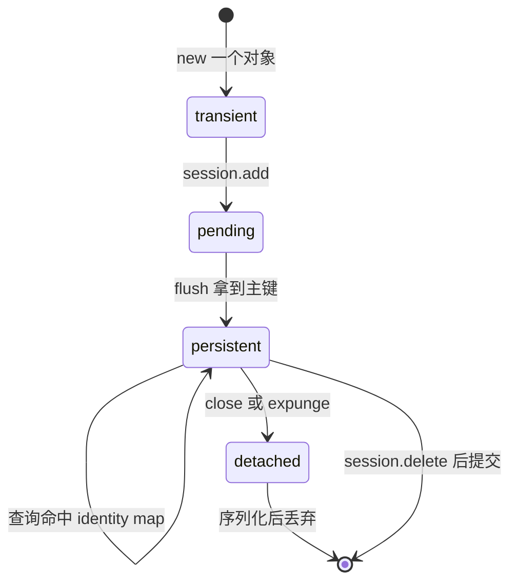

---

### Q916 · flush 与 autoflush: 何时真正发 SQL

> 难度:★★★★ | 标签:SQLAlchemy, Session

**问**:flush 和 commit 的关系?autoflush 会造成什么意外查询?

**答**:commit = flush(把 pending 变更写成 INSERT/UPDATE/DELETE)+ 提交事务;flush 只发 SQL 不提交,失败可回滚重试。autoflush=True(默认)时,任何查询执行前 session 先自动 flush 未决变更,保证"查到自己的修改"——副作用是查询可能意外触发写入,常见坑:查询抛 IntegrityError 而你以为是查询问题,其实是 autoflush 把脏对象刷出去了。批量导入可关 autoflush 降开销,但要自己管理 flush 节奏;flush 顺序按 mapper 依赖拓扑(先父后子),同一表内按主键排序,理解它才能解释外键顺序错误。

```python
# file: code/04_数据库与缓存/q916_autoflush.py
"""演示 autoflush: 查询前自动 flush 脏对象, 观察发出与未发出的 SQL"""

try:
    from sqlalchemy import create_engine, event, select
    from sqlalchemy.orm import Session, DeclarativeBase, Mapped, mapped_column
except ImportError:
    print("该题演示需要第三方库 sqlalchemy:pip install sqlalchemy>=2.0,原理见正文")
    raise SystemExit(0)

class Base(DeclarativeBase):
    pass

class User(Base):
    __tablename__ = "users"
    id: Mapped[int] = mapped_column(primary_key=True)
    name: Mapped[str]

if __name__ == "__main__":
    engine = create_engine("sqlite://")
    sqls = []
    @event.listens_for(engine, "before_cursor_execute")
    def _log(conn, cursor, stmt, *a):
        sqls.append(stmt[:40])
    Base.metadata.create_all(engine)

    with Session(engine) as s:                     # autoflush 默认开
        s.add(User(name="a"))
        s.execute(select(User))                    # 查询前自动 flush
        print("autoflush 开, SQL 序列:", sqls)
        print("行数:", s.scalar(select(__import__('sqlalchemy').func.count())
                                 .select_from(User)))

    sqls.clear()
    with Session(engine, autoflush=False) as s:
        s.add(User(name="b"))
        s.execute(select(User))
        print("autoflush 关, 查询不触发写入, 此刻行数:",
              s.scalar(select(__import__('sqlalchemy').func.count()).select_from(User)))
        s.flush()
        print("手动 flush 后行数:",
              s.scalar(select(__import__('sqlalchemy').func.count()).select_from(User)))
```

**追问**:
- 为什么查询前要自动 flush?——保证 session 内"读己之写":你刚改的对象立刻可见,避免同一事务内新旧混用。
- flush 顺序错了会怎样?——先插入子表会因外键为空/违反约束报错,SQLAlchemy 按 mapper 依赖自动排序,自引用表需显式 order_by 或分两次 flush。

---

### Q917 · 连接池参数与连接泄漏排查

> 难度:★★★★ | 标签:连接池, SQLAlchemy

**问**:SQLAlchemy 引擎的 pool_size、max_overflow、pool_recycle 分别控制什么?连接池耗尽怎么排查?

**答**:pool_size 是常驻连接数,max_overflow 是峰值允许临时多开的数量,超过 pool_size+max_overflow 的获取请求等待 pool_timeout 后抛 TimeoutError("QueuePool limit ... overflow");pool_recycle=N 让连接使用 N 秒后被回收,防止被 MySQL wait_timeout(默认 8 小时)掐死;pool_pre_ping 每次取用前发轻量探活,代价小、专治"陈旧连接报 2006"。泄漏排查:常见原因是"在请求外持有 session/连接不还"——比如把 connection 用于长生命缓存、事务里调用阻塞 IO;SQLAlchemy 有 echo_pool=True 打印取还轨迹,配合 `engine.pool.status()` 看水位,根修是统一依赖注入 session、保证 with 块归还。

```python
# file: code/04_数据库与缓存/q917_pool_settings.py
"""构造一个小连接池, 演示并发获取超时与 pool.status 水位"""
import threading
import time

try:
    from sqlalchemy import create_engine, text
except ImportError:
    print("该题演示需要第三方库 sqlalchemy:pip install sqlalchemy>=2.0,原理见正文")
    raise SystemExit(0)

if __name__ == "__main__":
    engine = create_engine(
        "sqlite:///q917_pool.db",               # 文件库使用 QueuePool, 支持池参数
        pool_size=2, max_overflow=0, pool_timeout=0.3, pool_pre_ping=True)

    def hold(i, out):
        try:
            with engine.connect() as conn:      # with 保证归还
                out.append(i)
                time.sleep(0.4)                 # 模拟慢查询占用
        except Exception:
            out.append(f"timeout-{i}")          # 池耗尽快速失败

    out = []
    threads = [threading.Thread(target=hold, args=(i, out)) for i in range(4)]
    t0 = time.perf_counter()
    try:
        [t.start() for t in threads]
        [t.join() for t in threads]
        print(f"全部完成 {out}, 总耗时 {time.perf_counter() - t0:.1f}s (串行化于池大小)")
    except Exception as e:
        print("池耗尽:", type(e).__name__)
    print("池状态:", engine.pool.status())
```

**追问**:
- pool_pre_ping 和 pool_recycle 二选一吗?——可并用;pre_ping 解决"拿到死连接",recycle 主动缩短连接寿命,高 QPS 下先开 pre_ping 观察再调 recycle。
- 连接泄漏的典型代码长什么样?——`session = Session()` 手动创建后异常路径没 close,或把 ORM 对象缓存到全局导致 session 引用常驻,统一用 with/依赖注入可根治。

---

### Q918 · SQLAlchemy 事件钩子: before_flush / after_insert 实战

> 难度:★★★★ | 标签:SQLAlchemy, 事件

**问**:SQLAlchemy 提供哪些常用事件钩子?给"所有变更写审计日志"该挂哪个事件?

**答**:常用层级:Session 级(before_flush/after_flush 拿到新增/修改/删除集合,适合审计与跨表协调)、Mapper 级(after_insert/after_update/after_delete,单对象回调,注意在 flush 事务内,别做耗时操作)、Attribute 级(set/setattr 拦截字段赋值,适合脏字段跟踪)、Engine 级(before_cursor_execute 计数与慢 SQL 监控)。审计日志最优挂 before_flush:一次拿到 session.new/dirty/deleted 三个集合与历史值(经 db.session.is_modified 或属性历史 inspect(obj).attrs.x.history),批量写入审计表,与业务同事务保证一致。陷阱:after_insert 里再写库必须用同一 connection,误用新 session 会死锁或绕过事务。

```python
# file: code/04_数据库与缓存/q918_event_hooks.py
"""before_flush 写审计表 + before_cursor_execute 统计 SQL 条数"""

try:
    from sqlalchemy import create_engine, event, select
    from sqlalchemy.orm import Session, DeclarativeBase, Mapped, mapped_column
except ImportError:
    print("该题演示需要第三方库 sqlalchemy:pip install sqlalchemy>=2.0,原理见正文")
    raise SystemExit(0)

class Base(DeclarativeBase):
    pass

class User(Base):
    __tablename__ = "users"
    id: Mapped[int] = mapped_column(primary_key=True)
    name: Mapped[str]

class Audit(Base):
    __tablename__ = "audit"
    id: Mapped[int] = mapped_column(primary_key=True)
    detail: Mapped[str]

if __name__ == "__main__":
    engine = create_engine("sqlite://")
    Base.metadata.create_all(engine)

    @event.listens_for(Session, "before_flush")
    def audit(session, flush_context, instances):
        for obj in session.new:
            if isinstance(obj, User):
                session.add(Audit(detail=f"insert {obj.name}"))
        for obj in session.dirty:
            if isinstance(obj, User):
                session.add(Audit(detail=f"update {obj.name}"))

    with Session(engine) as s:
        s.add(User(name="alice"))
        s.commit()
        u = s.scalars(select(User)).one()
        u.name = "alice2"
        s.commit()
        print("审计记录:", s.scalars(select(Audit.detail)).all())
```

**追问**:
- 钩子里能用另一个 session 吗?——不能,必须复用当前 session/connection,否则嵌套事务互相等待甚至死锁,且脱离了原事务的原子性。
- after_update 一定触发吗?——只有被标记修改的才触发;`is_modified(obj)` 为 False 或只改了主键场景要小心,需在 set 事件层面兜底。

---

### Q919 · hybrid_property: Python 属性与 SQL 表达式两栖

> 难度:★★★☆ | 标签:SQLAlchemy, 查询

**问**:普通 @property 与 hybrid_property 有什么区别?什么时候必须用后者?

**答**:@property 只在 Python 对象层工作,不能出现在 where/order_by 里——ORM 会因为不知道如何翻译成 SQL 而报错。hybrid_property 提供两栖定义:实例层用 Python 函数计算,类层默认同一函数被当作 SQL 表达式调用,复杂逻辑可用 @x.expression 自定义 SQL 版本。典型场景:全名字段 first+last、状态推导 is_expired、软删除过滤条件,这些既要读对象时算,又要进查询条件时翻译成 SQL,避免"写死在 SQL 里对象上没有"或反之的割裂。

```python
# file: code/04_数据库与缓存/q919_hybrid_property.py
"""hybrid_property 同时服务对象读取与 SQL 过滤"""

try:
    from sqlalchemy import create_engine, select
    from sqlalchemy.ext.hybrid import hybrid_property
    from sqlalchemy.orm import Session, DeclarativeBase, Mapped, mapped_column
except ImportError:
    print("该题演示需要第三方库 sqlalchemy:pip install sqlalchemy>=2.0,原理见正文")
    raise SystemExit(0)

class Base(DeclarativeBase):
    pass

class User(Base):
    __tablename__ = "users"
    id: Mapped[int] = mapped_column(primary_key=True)
    first: Mapped[str]
    last: Mapped[str]

    @hybrid_property
    def full_name(self):
        return f"{self.first} {self.last}"

    @full_name.expression
    def full_name(cls):
        return cls.first + " " + cls.last

if __name__ == "__main__":
    engine = create_engine("sqlite://")
    Base.metadata.create_all(engine)
    with Session(engine) as s:
        s.add_all([User(first="Ada", last="Lovelace"),
                   User(first="Alan", last="Turing")])
        s.commit()
        print("对象层:", s.scalars(select(User)).first().full_name)
        print("SQL 层:", s.scalars(select(User)
              .where(User.full_name == "Alan Turing")).one().first)
```

**追问**:
- hybrid 和 column_property 怎么选?——column_property 在查询时作为列表达式一次性求值适合纯派生列;hybrid 强在"对象与查询两用"且可写 setter。
- 表达式层能用 Python 函数吗?——不能,必须翻译成 SQL 构造(如 func.lower),否则运行时无法编译成 SQL。

---

### Q920 · Repository 模式: 隔离 ORM 的数据访问层

> 难度:★★★★ | 标签:架构, Repository

**问**:什么是 Repository 模式?在 SQLAlchemy 项目里怎么落地,收益是什么?

**答**:Repository 把"持久化操作"封装成面向领域的接口(get/save/list),业务层只依赖接口不接触 Session 与 ORM 模型,依赖倒置让单测可以换内存实现、换存储引擎不动业务。落地要点:一个聚合根一个 Repository;接口定义在领域层(Protocol/ABC),实现放在基础设施层注入;Repository 方法语义是业务动作(find_active_users)而非 CRUD 直译,避免退化为"贫血 DAO";事务边界不放在 Repository 内部,由上层 Unit of Work 统一管(Q921),否则跨仓储操作无法同事务。

```python
# file: code/04_数据库与缓存/q920_repository.py
"""Repository 模式: 接口 Protocol + SQLAlchemy 实现 + 业务服务"""
from __future__ import annotations
from typing import Protocol

try:
    from sqlalchemy import create_engine, select
    from sqlalchemy.orm import Session, DeclarativeBase, Mapped, mapped_column
except ImportError:
    print("该题演示需要第三方库 sqlalchemy:pip install sqlalchemy>=2.0,原理见正文")
    raise SystemExit(0)

class Base(DeclarativeBase):
    pass

class User(Base):
    __tablename__ = "users"
    id: Mapped[int] = mapped_column(primary_key=True)
    name: Mapped[str]
    active: Mapped[bool] = mapped_column(default=True)

class UserRepository(Protocol):
    def get(self, id_: int) -> User | None: ...
    def add(self, user: User) -> None: ...
    def list_active(self) -> list[User]: ...

class SqlUserRepository:
    def __init__(self, session: Session):
        self.session = session
    def get(self, id_: int):
        return self.session.get(User, id_)
    def add(self, user):
        self.session.add(user)
    def list_active(self):
        return list(self.session.scalars(
            select(User).where(User.active == True)))  # noqa: E712

def register(repo: UserRepository, name: str) -> User:
    """业务层只依赖接口, 不知道 ORM 存在"""
    u = User(name=name)
    repo.add(u)
    return u

if __name__ == "__main__":
    engine = create_engine("sqlite://")
    Base.metadata.create_all(engine)
    with Session(engine) as s:
        repo = SqlUserRepository(s)
        register(repo, "alice")
        register(repo, "bob")
        s.commit()
        print("活跃用户:", [u.name for u in repo.list_active()])
```

**追问**:
- Repository 与 DAO 的区别?——DAO 面向表做 CRUD,Repository 面向聚合根表达领域语义,并为聚合提供一致的存取入口。
- 单测怎么替换实现?——测试里写个 InMemoryUserRepository 维护 dict,业务服务代码零改动,这正是依赖倒置的验证点。

---

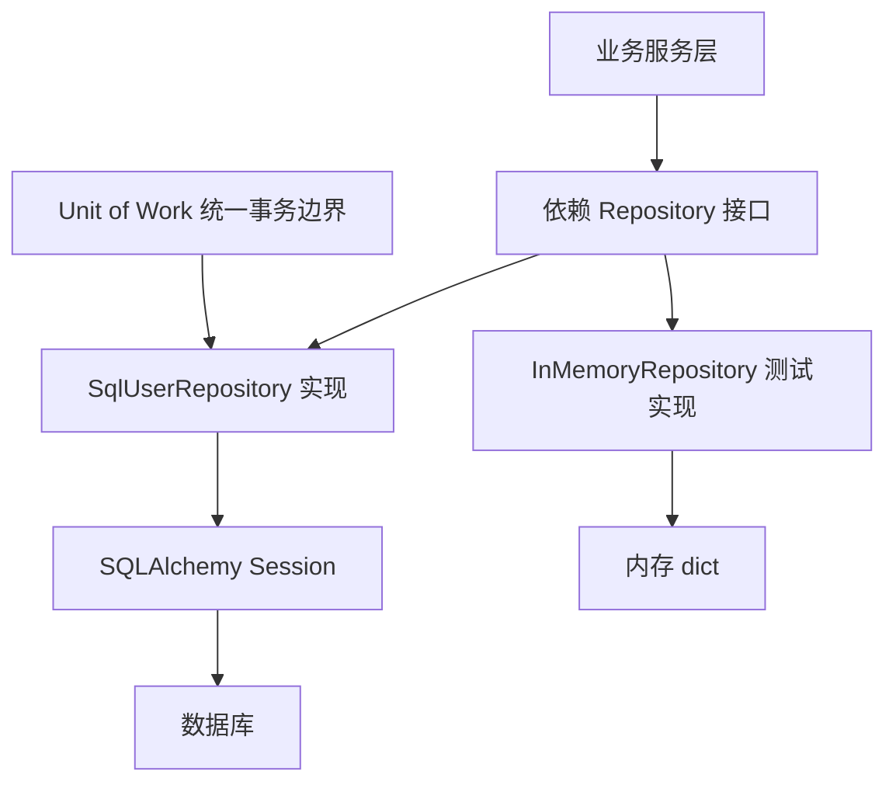

### Q921 · Unit of Work: 谁来提交事务

> 难度:★★★★ | 标签:架构, 事务

**问**:UnitOfWork 模式解决什么问题?和"每个方法自己 commit"比好在哪?

**答**:Unit of Work 把一次业务操作涉及的所有变更收集起来,在边界处一次性提交或整体回滚,核心诉求是原子性与事务边界的唯一归属。反模式是"每个 Repository 方法内部 commit"——跨仓储的业务动作(创建订单+扣库存+发券)被切成多个独立事务,中途失败留下半成品。SQLAlchemy 的 Session 本身就是 UoW:session.add/删除都是登记,commit 才落库;工程实现是提供 `with uow:` 上下文,退出时 commit/rollback,Repository 只登记不提交。注意 UoW 生命周期与请求绑定,不要进程级共享。

```python
# file: code/04_数据库与缓存/q921_unit_of_work.py
"""Unit of Work: 跨仓储操作一个事务, 失败整体回滚"""
import contextlib

try:
    from sqlalchemy import create_engine
    from sqlalchemy.orm import Session, DeclarativeBase, Mapped, mapped_column
except ImportError:
    print("该题演示需要第三方库 sqlalchemy:pip install sqlalchemy>=2.0,原理见正文")
    raise SystemExit(0)

class Base(DeclarativeBase):
    pass

class Order(Base):
    __tablename__ = "orders"
    id: Mapped[int] = mapped_column(primary_key=True)
    sku: Mapped[str]

class Stock(Base):
    __tablename__ = "stocks"
    id: Mapped[int] = mapped_column(primary_key=True)
    sku: Mapped[str]
    qty: Mapped[int]

class UoW:
    def __init__(self, engine):
        self.engine = engine
        self.session = None
    def __enter__(self):
        self.session = Session(self.engine)
        return self
    def __exit__(self, exc_type, *_):
        if exc_type:
            self.session.rollback()
        else:
            self.session.commit()
        self.session.close()

def place_order(uow, sku):
    stock = uow.session.get(Stock, 1)
    if stock.qty <= 0:
        raise ValueError("库存不足, 整体回滚")
    stock.qty -= 1
    uow.session.add(Order(sku=sku))

if __name__ == "__main__":
    engine = create_engine("sqlite://")
    Base.metadata.create_all(engine)
    with Session(engine) as s:
        s.add(Stock(sku="x", qty=1)); s.commit()

    with UoW(engine) as uow:               # 成功: 两个表一起提交
        place_order(uow, "x")
    with Session(engine) as s:
        print("成功后库存:", s.get(Stock, 1).qty, "订单数:",
              len(s.query(Order).all()))

    try:
        with UoW(engine) as uow:           # 失败: 整体回滚
            place_order(uow, "x")
            raise ValueError("下游支付失败")
    except ValueError as e:
        print("失败:", e)
    with Session(engine) as s:
        print("回滚后库存:", s.get(Stock, 1).qty)
```

**追问**:
- UoW 与事务上下文是一回事吗?——UoW 还包括变更追踪与聚合提交语义,事务只是其实现载体;小项目用 session 上下文管理器即可,不必造类。
- 异步任务里怎么用?——每个任务函数开独立 UoW,重试粒度等于任务粒度,避免复用请求级 session 跨事件循环。

---

### Q922 · 多数据源路由: 一个服务连多个库

> 难度:★★★★ | 标签:架构, 数据源

**问**:服务要同时访问订单库和用户库,代码层怎么组织?跨库怎么办?

**答**:每个数据源一个 Engine(独立连接池),Session 与 Engine 绑定,通常封装成按业务域划分的 UoW/Repository 集合:UserUoW 只会话用户库。配置集中管理连接串与池参数,不同库可独立调优。跨库操作没有分布式事务兜底时按最终一致性设计:先写主域,再用本地消息表/事件补偿从域,绝不在两个 session 之间"手工模拟提交"(两个 commit 不是原子)。读多写少的从库查询用只读 Engine 并明确只读纪律。命名上避免"全局 db 变量",依赖注入或显式注册中心持有引擎字典。

```python
# file: code/04_数据库与缓存/q922_multi_datasource.py
"""两个独立 Engine 的数据源注册中心 + 按域路由"""

try:
    from sqlalchemy import create_engine, text
except ImportError:
    print("该题演示需要第三方库 sqlalchemy:pip install sqlalchemy>=2.0,原理见正文")
    raise SystemExit(0)

class DataSources:
    def __init__(self):
        self._engines = {}

    def register(self, name, url, **pool_opts):
        self._engines[name] = create_engine(url, **pool_opts)

    def engine(self, name):
        if name not in self._engines:
            raise KeyError(f"数据源 {name} 未注册")
        return self._engines[name]

if __name__ == "__main__":
    ds = DataSources()
    ds.register("orders", "sqlite:///q922_orders.db")
    ds.register("users", "sqlite:///q922_users.db")

    with ds.engine("users").begin() as c:
        c.execute(text("CREATE TABLE IF NOT EXISTS users (id INTEGER PRIMARY KEY, name TEXT)"))
        c.execute(text("INSERT OR IGNORE INTO users (name) VALUES ('alice')"))
    with ds.engine("orders").begin() as c:
        c.execute(text("CREATE TABLE IF NOT EXISTS orders (id INTEGER PRIMARY KEY, user_id INT)"))
        c.execute(text("INSERT INTO orders (user_id) VALUES (1)"))

    uid = ds.engine("users").connect().execute(
        text("SELECT id FROM users WHERE name='alice'")).scalar()
    n = ds.engine("orders").connect().execute(
        text("SELECT count(*) FROM orders WHERE user_id=:u"), {"u": uid}).scalar()
    print(f"用户 {uid} 的订单数: {n}  <- 跨库由应用层协调, 非同一事务")
```

**追问**:
- 两个库的操作能放在一个事务里吗?——同进程两个独立连接没有原子性,需要 XA/TCC/SAGA 等分布式事务方案,普通业务用消息表+补偿更现实。
- 连接串里的密码放哪?——环境变量或密钥管理系统注入,配置文件不入库,这也符合安全底线。

---

### Q923 · 读写分离: 代码层的路由实现

> 难度:★★★★ | 标签:架构, 读写分离

**问**:不借助中间件,在 SQLAlchemy 层怎么做读写分离?要处理哪些坑?

**答**:核心是一个 RoutingSession:覆写 get_bind,按"是否写/是否强制主库"选择主库或从库 engine。判定规则:flush 阶段或含 INSERT/UPDATE/DELETE 的语句走主;读语句默认从库;提供 context 标记(如 after_write 时间内、显式 force_master)保证读己之写。坑有三个:一、同一事务里读写必须一致,事务开始时就定主从;二、复制延迟的读旧数据要按业务分类处理;三、从库故障要有剔除与恢复。中间件(ProxySQL/MyCat)做同样的路由在代理层,应用层实现的优势是可以精确感知业务语义(哪些读必须主库)。

```python
# file: code/04_数据库与缓存/q923_rw_routing.py
"""RoutingSession: 写走主库 读走从库, 写后短窗口粘主"""
import time

try:
    from sqlalchemy import create_engine, event, text
    from sqlalchemy.orm import Session
except ImportError:
    print("该题演示需要第三方库 sqlalchemy:pip install sqlalchemy>=2.0,原理见正文")
    raise SystemExit(0)

class RoutingSession(Session):
    def __init__(self, master, replica, sticky_sec=1.0, **kw):
        super().__init__(bind=master, **kw)
        self.master = master
        self.replica = replica
        self.sticky_until = 0.0
        self.sticky_sec = sticky_sec

    def get_bind(self, mapper=None, clause=None, **kw):
        if self._flushing or time.monotonic() < self.sticky_until:
            return self.master
        return self.replica

    def _on_write(self):
        self.sticky_until = time.monotonic() + self.sticky_sec

if __name__ == "__main__":
    import os
    for p in ("q923_master.db", "q923_replica.db"):   # 重复运行前清理
        if os.path.exists(p):
            os.remove(p)
    master = create_engine("sqlite:///q923_master.db")
    replica = create_engine("sqlite:///q923_replica.db")
    for e in (master, replica):
        with e.connect() as c:
            c.execute(text("CREATE TABLE IF NOT EXISTS kv (k TEXT PRIMARY KEY, v TEXT)"))
    chosen = []
    @event.listens_for(master, "before_cursor_execute")
    def _m(*a): chosen.append("master")
    @event.listens_for(replica, "before_cursor_execute")
    def _r(*a): chosen.append("replica")

    s = RoutingSession(master, replica)
    s._on_write()                                  # 业务侧识别为写路径
    s.execute(text("INSERT INTO kv VALUES ('a', '1')"))
    s.commit()
    print("写后立即读路由到:", end=" ")
    s.execute(text("SELECT * FROM kv")).all()
    print(chosen[-1])
    time.sleep(1.1)
    chosen.clear()
    s.execute(text("SELECT * FROM kv")).all()
    print("粘性过期后读路由到:", chosen[-1])
```

**追问**:
- 为什么写后要粘主库而不是每次读主?——全量读主等于没分离;粘性窗口只覆盖"读己之写"敏感期,是性能与一致性折衷。
- 事务中一条 SELECT 也走从库会怎样?——会出现事务内前后不一致(读到旧值后写入),所以 RoutingSession 判断 _flushing/事务状态,事务内统一主库。

---

### Q924 · 分表路由键设计: 按 user_id 取模与一致性哈希

> 难度:★★★★ | 标签:分表, 路由

**问**:订单表按 user_id 分 16 张表,路由代码怎么写?选路由键要注意什么?

**答**:最简单是 hash 取模:`table = tables[hash(user_id) % N]`,路由层(Repository 或中间件)把写与查都映射到目标表。选键三原则:一、高频查询必须带路由键,否则退化成广播查询(扫 16 张表);二、避免热点倾斜,大卖家/大 V 会把某片打爆,可按"买家 id 分表、卖家查询走二级索引或异构表";三、扩容友好——取模扩容要迁移大量数据,一致性哈希或"按 id 范围分片"只动边界。SQLite 演示 16 张分表的路由与跨片查询兜底,生产用 ShardingSphere 类中间件做同样的事。

```python
# file: code/04_数据库与缓存/q924_shard_routing.py
"""按 user_id 取模路由到 16 张分表, 含跨片查询兜底"""
import sqlite3

N_SHARDS = 16

def shard_table(user_id):
    return f"orders_{user_id % N_SHARDS:02d}"

if __name__ == "__main__":
    conn = sqlite3.connect(":memory:")
    for i in range(N_SHARDS):
        conn.execute(f"""CREATE TABLE orders_{i:02d}
                         (id INTEGER PRIMARY KEY, user_id INT, amt REAL)""")
    rows = [(uid, amt) for uid in range(100) for amt in (10.0, 20.0)]
    for uid, amt in rows:
        conn.execute(f"INSERT INTO {shard_table(uid)} (user_id, amt) VALUES (?, ?)",
                     (uid, amt))

    uid = 77
    print(f"user {uid} 路由到 {shard_table(uid)}:",
          conn.execute(f"SELECT * FROM {shard_table(uid)} WHERE user_id = ?",
                       (uid,)).fetchall())

    # 跨片兜底: UNION ALL 视图思路(仅限低频管理查询)
    union_sql = " UNION ALL ".join(
        f"SELECT user_id, amt FROM orders_{i:02d}" for i in range(N_SHARDS))
    total = conn.execute(
        f"SELECT count(*) FROM ({union_sql}) WHERE user_id = ?", (uid,)).fetchone()[0]
    print("广播查询结果:", total, "<- 应避免, 业务设计保证带路由键")
```

**追问**:
- 订单号里嵌入分片信息有什么好处?——订单号直接携带分片位(如 user_id 后 4 位),按订单号查询免查路由表,一次定位到表。
- 扩容 16 到 32 片怎么办?——取模要迁移一半数据;用一致性哈希只迁移相邻区间,或预分 1024 个逻辑分片映射到物理机,扩容只改映射。

---

### Q925 · 幂等写入: 唯一约束 + 冲突处理

> 难度:★★★★ | 标签:幂等, 约束

**问**:支付回调可能重复通知,写入层怎么保证幂等?get-or-create 有竞态吗?

**答**:幂等写入的基石是数据库唯一约束:以业务键(外部流水号 request_id/支付单号)建唯一索引,重复写入触发冲突,再按业务"返回已有结果"(DO NOTHING)或"合并更新"(DO UPDATE)处理。应用层 get-or-create(先查后插)在并发下有竞态——两个请求都查不到然后都插,一个必然撞唯一约束,所以正确姿势是"直接插入 + 捕获 IntegrityError + 回读",或 upsert 一步到位。配合幂等表(记录 request_id 处理结果)可把"重复请求返回相同响应"也做掉,这是消息消费与回调场景的标准答案。

```python
# file: code/04_数据库与缓存/q925_idempotent_write.py
"""唯一约束实现幂等: 重复回调返回既有结果"""
import sqlite3

SCHEMA = """
CREATE TABLE payment (
    request_id TEXT PRIMARY KEY,     -- 外部流水号: 幂等键
    order_no  TEXT NOT NULL, amount INT NOT NULL, status TEXT NOT NULL
);
"""

def handle_callback(conn, request_id, order_no, amount):
    try:
        conn.execute(
            "INSERT INTO payment (request_id, order_no, amount, status) "
            "VALUES (?, ?, ?, 'paid')", (request_id, order_no, amount))
        conn.commit()
        return "首次处理"
    except sqlite3.IntegrityError:
        conn.rollback()
        return "重复请求, 返回既有结果"

if __name__ == "__main__":
    conn = sqlite3.connect(":memory:")
    conn.executescript(SCHEMA)
    for i in range(3):                  # 模拟回调重试 3 次
        print(f"第{i + 1}次回调:", handle_callback(conn, "req-1", "O100", 9900))
    print("落库:", conn.execute("SELECT request_id, status FROM payment").fetchall())
```

**追问**:
- upsert 与"唯一约束+捕获异常"怎么选?——高频批量场景 upsert 一条语句更高效;需要"重复时执行特殊业务逻辑(如告警)"时捕获异常更灵活。
- 没有天然业务键怎么办?——客户端生成 UUID 作 request_id 随请求携带,服务端建唯一索引,这与"防重 token"是同一机制。

---

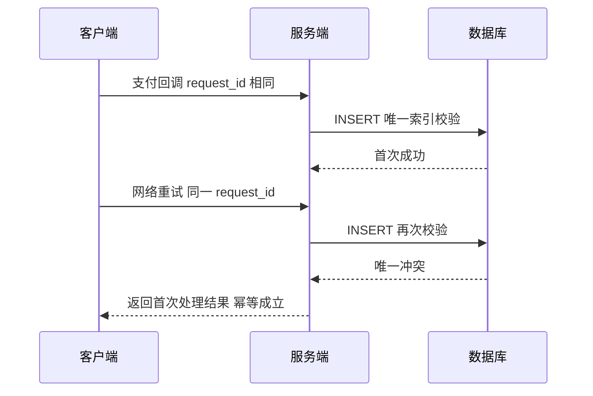

---

### Q926 · 乐观锁: 版本号与重试

> 难度:★★★★ | 标签:并发控制, 乐观锁

**问**:乐观锁怎么实现?为什么 UPDATE 的 WHERE 必须带版本号?冲突了怎么办?

**答**:乐观锁假设冲突少,不加锁,提交时校验:行上带 version 字段,`UPDATE t SET x=?, version=version+1 WHERE id=? AND version=?`,影响行数为 0 说明版本已被并发修改,读新值重试或按业务报"请刷新"。不带版本号的 UPDATE 会"后来者覆盖"丢失更新。SQLAlchemy 提供 version_id_col 自动维护与冲突抛 StaleDataError。重试要小心:整体重读-重算-再提交,循环次数上限 + 指数退避;适合读多写少、冲突代价小的场景,热点行(秒杀库存)冲突率一高重试风暴反而不如悲观锁。

```python
# file: code/04_数据库与缓存/q926_optimistic_lock.py
"""版本号乐观锁: 模拟并发更新冲突与重试成功"""
import sqlite3

def fetch(conn, oid):
    row = conn.execute(
        "SELECT id, qty, version FROM stock WHERE id = ?", (oid,)).fetchone()
    return {"id": row[0], "qty": row[1], "version": row[2]}

def update_with_version(conn, item, delta):
    cur = conn.execute(
        "UPDATE stock SET qty = qty + ?, version = version + 1 "
        "WHERE id = ? AND version = ?", (delta, item["id"], item["version"]))
    conn.commit()
    return cur.rowcount == 1

if __name__ == "__main__":
    conn = sqlite3.connect(":memory:")
    conn.execute("CREATE TABLE stock (id INTEGER PRIMARY KEY, qty INT, version INT)")
    conn.execute("INSERT INTO stock VALUES (1, 10, 0)")

    item = fetch(conn, 1)
    stale = dict(item)                       # 模拟另一个会话的旧快照
    ok = update_with_version(conn, item, 5)  # 会话A成功
    print("A 更新:", ok)
    ok2 = update_with_version(conn, stale, -3)  # B 拿旧版本提交
    print("B 旧版本提交:", ok2, "<- 版本不匹配被拒绝")
    fresh = fetch(conn, 1)
    print("B 重读后重试:", update_with_version(conn, fresh, -3),
          "当前:", fetch(conn, 1))
```

**追问**:
- StaleDataError 是怎么触发的?——SQLAlchemy 配 version_id_col 后,UPDATE 影响 0 行即认为行已被外部修改,flush 阶段抛出,由应用决定重试。
- 乐观锁和"先查后改"不加版本有什么区别?——后者在查与改之间数据可被他人改动而毫无感知;版本号把"我基于哪个事实"固化进 WHERE,冲突必然暴露。

---

### Q927 · 悲观锁: SELECT FOR UPDATE 与 SQLite 等价物

> 难度:★★★★ | 标签:并发控制, 悲观锁

**问**:SELECT FOR UPDATE 做了什么?SQLAlchemy 怎么写?没有 FOR UPDATE 的库怎么替代?

**答**:FOR UPDATE 在读取行时同步加排他行锁,其他事务对这些行的读(非锁定读除外)与写会被阻塞,直到当前事务提交,把"读-计算-写"变成受保护临界区,适合冲突率高的热点行。SQLAlchemy 用 `select(...).with_for_update()`,可加 nowait/skip_locked 控制等待策略:nowait 立即报错,skip_locked 跳过被锁行(任务队列取活的标配)。MySQL 支持 FOR UPDATE;SQLite 没有行锁,等价物是 `BEGIN IMMEDIATE`——把整个库当成临界区;PG 完整支持。纪律:FOR UPDATE 必须在事务里,用完尽快提交,别在锁内调外部接口。

```python
# file: code/04_数据库与缓存/q927_pessimistic_lock.py
"""SQLite 用 BEGIN IMMEDIATE 模拟悲观锁: 并发扣减库存不超卖"""
import sqlite3
import threading

def purchase(db_path, results):
    conn = sqlite3.connect(db_path, isolation_level=None)
    conn.execute("PRAGMA busy_timeout=3000")
    try:
        conn.execute("BEGIN IMMEDIATE")          # 相当于对库加写锁
        qty = conn.execute("SELECT qty FROM stock WHERE id=1").fetchone()[0]
        if qty > 0:
            conn.execute("UPDATE stock SET qty = qty - 1 WHERE id = 1")
            conn.execute("COMMIT")
            results.append("ok")
        else:
            conn.execute("COMMIT")
            results.append("sold out")
    except sqlite3.OperationalError as e:
        conn.execute("ROLLBACK")
        results.append(f"blocked: {e}")

if __name__ == "__main__":
    db = "q927.db"
    setup = sqlite3.connect(db, isolation_level=None)
    setup.execute("CREATE TABLE IF NOT EXISTS stock (id INTEGER PRIMARY KEY, qty INT)")
    setup.execute("DELETE FROM stock")
    setup.execute("INSERT INTO stock VALUES (1, 2)")
    setup.close()

    results = []
    threads = [threading.Thread(target=purchase, args=(db, results))
               for _ in range(5)]
    [t.start() for t in threads]
    [t.join() for t in threads]
    print("结果:", results)
    print("剩余库存:", sqlite3.connect(db).execute(
        "SELECT qty FROM stock WHERE id=1").fetchone()[0])
```

**追问**:
- FOR UPDATE 与普通 SELECT 的区别?——普通 SELECT 在 MVCC 下是无锁快照读,锁不住任何东西;FOR UPDATE 是当前读并加排他锁。
- skip_locked 的典型场景?——多个 worker 抢任务:`WHERE status='pending' ... FOR UPDATE SKIP LOCKED LIMIT 1`,各拿各的不互相阻塞。

---

### Q928 · 乐观锁 vs 悲观锁: 场景化选型

> 难度:★★★☆ | 标签:并发控制, 选型

**问**:给"商品详情页编辑、账户余额扣减、任务领取"三种场景选锁并说明理由。

**答**:决策变量是冲突概率与临界区成本。商品编辑:冲突低,乐观锁(版本号)+冲突提示,无锁开销;账户余额:热点行、资金敏感,悲观锁(FOR UPDATE)或数据库原子更新 `balance = balance - ? WHERE balance >= ?`,把校验下沉为条件更新;任务领取:worker 互相独立、要非阻塞,乐观 CAS + skip_locked 抢占。规律:冲突少用乐观(免锁、可重试),冲突高或必须等待公平性用悲观,能写成单条条件 UPDATE 的永远最优先(原子操作自带乐观语义)。混合策略常见:外层乐观重试若干次,超过阈值升级为悲观。

```python
# file: code/04_数据库与缓存/q928_lock_choice.py
"""条件 UPDATE 原子扣减: 单条 SQL 自带校验, 无需显式锁"""
import sqlite3
import threading

def deduct(db, amount, results):
    conn = sqlite3.connect(db, isolation_level=None)
    conn.execute("PRAGMA busy_timeout=3000")
    try:
        conn.execute("BEGIN IMMEDIATE")
        n = conn.execute("UPDATE acct SET bal = bal - ? WHERE id = 1 AND bal >= ?",
                         (amount, amount)).rowcount
        conn.execute("COMMIT")
        results.append("ok" if n else "insufficient")
    except sqlite3.OperationalError as e:
        conn.execute("ROLLBACK")
        results.append(f"busy: {e}")

if __name__ == "__main__":
    db = "q928.db"
    s = sqlite3.connect(db, isolation_level=None)
    s.execute("CREATE TABLE IF NOT EXISTS acct (id INTEGER PRIMARY KEY, bal INT)")
    s.execute("DELETE FROM acct")
    s.execute("INSERT INTO acct VALUES (1, 300)")
    s.close()

    results = []
    ts = [threading.Thread(target=deduct, args=(db, 100, results)) for _ in range(5)]
    [t.start() for t in ts]
    [t.join() for t in ts]
    print(results, "最终余额:", sqlite3.connect(db).execute(
        "SELECT bal FROM acct").fetchone()[0])
    print("要点: 条件 UPDATE 把锁竞争压缩进引擎, 应用层只见成功或不足")
```

**追问**:
- 乐观锁重试几次合适?——与冲突概率相关,通常 3 次 + 随机退避,超限转报错或升级悲观锁,避免重试风暴放大数据库压力。
- 条件 UPDATE 为什么算"乐观"?——它不预先持锁等待,提交时以 WHERE 谓词验证假设,失败即冲突,与版本号机制同源。

---

### Q929 · 软删除: 统一过滤的正确姿势

> 难度:★★★★ | 标签:软删除, 架构

**问**:软删除(is_deleted)带来什么问题?如何保证所有查询自动带上过滤条件?

**答**:软删除保留数据便于恢复与审计,但每个查询都要记得 `WHERE is_deleted = 0`,漏一处就是"删了还能查出来"的事故,唯一索引也会被已删除记录占位。统一方案:一、ORM 层全局钩子——SQLAlchemy 的 `with_loader_criteria`(do_orm_execute 事件)给所有该模型查询自动注入过滤;二、封装 query helper/Repository 基类,业务禁用裸查询;三、唯一键配合"删除时改写业务键"(phone 变 phone#del#id)绕开占位问题;四、高危场景(资金)建议硬删除+归档而非软删除,减少状态空间。恢复语义要一并设计:恢复时冲突检测。

```python
# file: code/04_数据库与缓存/q929_soft_delete.py
"""do_orm_execute + with_loader_criteria 全局注入软删过滤"""

try:
    from sqlalchemy import create_engine, select, event
    from sqlalchemy.orm import (Session, DeclarativeBase, Mapped, mapped_column,
                                with_loader_criteria)
except ImportError:
    print("该题演示需要第三方库 sqlalchemy:pip install sqlalchemy>=2.0,原理见正文")
    raise SystemExit(0)

class Base(DeclarativeBase):
    pass

class Doc(Base):
    __tablename__ = "docs"
    id: Mapped[int] = mapped_column(primary_key=True)
    title: Mapped[str]
    deleted: Mapped[bool] = mapped_column(default=False)

if __name__ == "__main__":
    engine = create_engine("sqlite://")
    Base.metadata.create_all(engine)

    @event.listens_for(Session, "do_orm_execute")
    def _soft_delete(execute_state):
        if not execute_state.is_column_load and not execute_state.is_relationship_load:
            execute_state.statement = execute_state.statement.options(
                with_loader_criteria(Doc, lambda cls: cls.deleted == False,  # noqa
                                     include_aliases=True))

    with Session(engine) as s:
        s.add_all([Doc(title="a"), Doc(title="b")])
        s.commit()
        s.query(Doc).filter(Doc.title == "a").update({"deleted": True})
        s.commit()
        print("自动过滤后可见:", [d.title for d in s.scalars(select(Doc))])
        raw = s.execute(select(Doc).execution_options(
            include_deleted=True) if False else select(Doc.title)).all()
        print("普通 select 也被过滤:", raw)
```

**追问**:
- 软删除行要不要占唯一索引?——占,常用"删除时把唯一列改写为含 id 的特殊值"或把唯一约束改为"部分索引"(PG 支持 WHERE deleted=0 的 partial index)。
- 计数/统计场景怎么避免软删数据混入?——同样依赖全局过滤钩子;绕过钩子的原生 SQL 要在 Repository 层集中评审。

---

### Q930 · 审计字段与变更历史表

> 难度:★★★☆ | 标签:审计, 架构

**问**:created_at/updated_at/created_by 怎么统一维护?核心表要精确变更历史怎么办?

**答**:基础审计四件套 created_at/updated_at/created_by/updated_by 用 ORM 默认值与事件统一注入:on insert 设置 created/updated,on update 刷新 updated(SQLAlchemy 的 onupdate 或 before_flush),操作人从请求上下文注入而不是散在各调用点。要精确到"谁在什么时候把余额从 100 改成 80"则用变更历史表:在 before_flush 里对比 dirty 对象的属性历史(inspect(obj).attrs.x.history),把字段级 diff 写入 audit_log(表名、主键、字段、旧值、新值、操作人、时间),与业务同事务。历史表只插不改,定期归档;大流量表选抽样或只记关键字段,别让审计成为写放大源。

```python
# file: code/04_数据库与缓存/q930_audit_history.py
"""before_flush 对比属性历史, 写字段级变更日志"""

try:
    from sqlalchemy import create_engine, event, select
    from sqlalchemy.orm import Session, DeclarativeBase, Mapped, mapped_column
    from sqlalchemy import inspect as sa_inspect
except ImportError:
    print("该题演示需要第三方库 sqlalchemy:pip install sqlalchemy>=2.0,原理见正文")
    raise SystemExit(0)

class Base(DeclarativeBase):
    pass

class Account(Base):
    __tablename__ = "accounts"
    id: Mapped[int] = mapped_column(primary_key=True)
    name: Mapped[str]
    balance: Mapped[int]

class ChangeLog(Base):
    __tablename__ = "change_log"
    id: Mapped[int] = mapped_column(primary_key=True)
    entity: Mapped[str]
    field: Mapped[str]
    old: Mapped[str]
    new: Mapped[str]

if __name__ == "__main__":
    engine = create_engine("sqlite://")
    Base.metadata.create_all(engine)

    @event.listens_for(Session, "before_flush")
    def log_changes(session, ctx, instances):
        for obj in session.dirty:
            insp = sa_inspect(obj)
            for field in ("name", "balance"):
                hist = insp.attrs[field].history
                if hist.has_changes():
                    session.add(ChangeLog(
                        entity=type(obj).__name__, field=field,
                        old=str(hist.deleted[0]), new=str(hist.added[0])))

    with Session(engine) as s:
        s.add(Account(name="alice", balance=100))
        s.commit()
        acc = s.scalars(select(Account)).one()
        acc.balance = 80
        s.commit()
        print("变更日志:", s.execute(
            select(ChangeLog.field, ChangeLog.old, ChangeLog.new)).all())
```

**追问**:
- updated_at 用数据库 onupdate 还是应用层?——数据库层保证任何入口写入都刷新,应用层(OB onupdate 参数)在跨 ORM 写入(如原生 SQL)时失效,核心表建议双保险。
- 历史表查询慢怎么办?——按实体与主键建索引、按月归档,或改用事件流(Kafka/binlog)供下游异步构建审计。

---

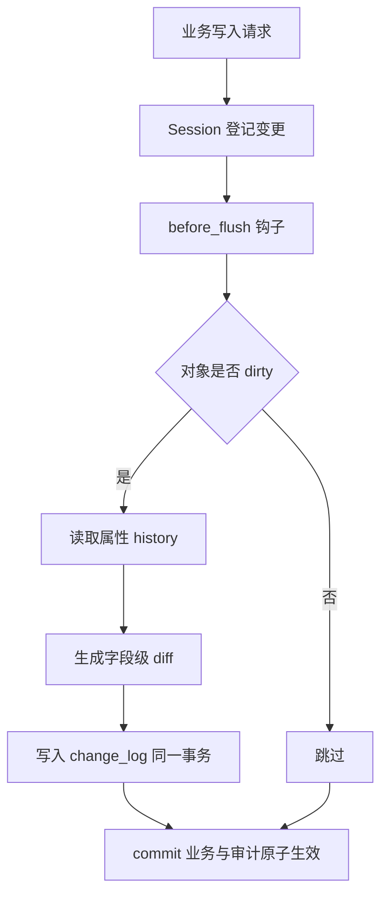

### Q931 · 测试用数据库: 事务回滚夹具

> 难度:★★★★ | 标签:测试, fixture

**问**:集成测试怎么做到每个用例拿到干净的数据库且速度快?事务回滚夹具的原理是什么?

**答**:两个主流方案:一是事务回滚夹具——每个测试开始开启事务、结束回滚,数据从不真正提交,速度极快;难点是业务代码自己 commit 会破坏隔离,解法是把 session 绑定到外层连接(connection.begin() 后 Session(bind=connection)),用 SAVEPOINT/嵌套事务让内部 commit 只释放到 savepoint。二是每用例建库/建表(create_all + 内存 SQLite,或 template database),简单可靠但稍慢。生产等价性上,SQLite 与 MySQL 行为有差异,核心链路要有真库跑的 CI。原则:测试数据构造走业务 API 或工厂函数,别手写魔法值 SQL。

```python
# file: code/04_数据库与缓存/q931_rollback_fixture.py
"""事务回滚夹具: 外层事务 + SAVEPOINT, 内部 commit 不落库"""

try:
    from sqlalchemy import create_engine, select, text
    from sqlalchemy.orm import Session, DeclarativeBase, Mapped, mapped_column
except ImportError:
    print("该题演示需要第三方库 sqlalchemy:pip install sqlalchemy>=2.0,原理见正文")
    raise SystemExit(0)

class Base(DeclarativeBase):
    pass

class Item(Base):
    __tablename__ = "items"
    id: Mapped[int] = mapped_column(primary_key=True)
    name: Mapped[str]

engine = create_engine("sqlite://")
Base.metadata.create_all(engine)

def biz_create(session: Session, name: str) -> Item:
    """业务代码: 像生产一样正常 commit"""
    item = Item(name=name)
    session.add(item)
    session.commit()
    return item

def db_case(conn):
    """模拟夹具: 外层事务内嵌 SAVEPOINT, commit 后还原到 savepoint"""
    outer = conn.begin()
    s = Session(bind=conn, join_transaction_mode="create_savepoint")
    try:
        biz_create(s, "from-test")
        n = s.scalar(select(__import__("sqlalchemy").func.count()).select_from(Item))
        return f"用例内可见 {n} 行"
    finally:
        s.close()
        outer.rollback()

if __name__ == "__main__":
    with engine.connect() as conn:
        print(db_case(conn))
    with engine.connect() as conn:
        n = conn.execute(text("SELECT count(*) FROM items")).scalar()
        print("夹具结束后数据库:", n, "行  <- 回滚彻底干净")
```

**追问**:
- join_transaction_mode=create_savepoint 是什么?——SQLAlchemy 2.0 的选项:session 加入已存在的外部事务时自动用 SAVEPOINT,业务 commit 只释放保存点,夹具仍可整体回滚。
- 什么时候不适用回滚夹具?——测试内容涉及提交后的行为(事务提交事件、主从、锁等待)时必须真提交,可用每用例独立库替代。

---

### Q932 · Alembic 迁移: revision 链与 upgrade/downgrade

> 难度:★★★☆ | 标签:Alembic, 迁移

**问**:Alembic 的工作流是怎样的?upgrade 与 downgrade 怎么写才可靠?

**答**:流程:alembic init 建目录与 env.py(绑定 Base.metadata 与引擎)、alembic revision --autogenerate 对比模型与库差异生成迁移脚本、alembic upgrade head 应用到最新。每个脚本有 revision id 与 down_revision,形成单向链,alembic current 查当前版本。可靠性要点:autogenerate 只是草稿,人工审查(它识别不了列类型细节变更、数据迁移)、downgrade 必须真的可回滚或标记不可逆、迁移与代码同仓库同版本发布、升级前备份。数据回填(新列填默认值)与 DDL 分开:先加可空列、分批回填、再加约束,这是零停机的基本功。

```python
# file: code/04_数据库与缓存/q932_alembic_flow.py
"""演示迁移脚本的 revision 链结构与 upgrade/downgrade 对称性"""
MIGRATIONS = {
    "a1": {"down": None, "up": "CREATE TABLE users (id INTEGER PRIMARY KEY, name TEXT)"},
    "b2": {"down": "a1", "up": "ALTER TABLE users ADD COLUMN age INT",
           "downgrade": "ALTER TABLE users DROP COLUMN age"},
}

def current(rev):
    return rev

def upgrade(conn, target):
    rev = current(None)
    for rid, m in MIGRATIONS.items():
        if rev is None or _after(rid, rev):
            conn.execute(m["up"]) if isinstance(m["up"], str) else None
            rev = rid
        if rid == target:
            break
    return rev

def _after(rid, rev):
    return rev is None or MIGRATIONS[rid]["down"] == rev or True

if __name__ == "__main__":
    import sqlite3
    conn = sqlite3.connect(":memory:")
    head = upgrade(conn, "b2")
    print("升级到:", head)
    print("结构:", conn.execute(
        "SELECT name FROM sqlite_master WHERE type='table'").fetchall())
    print("Alembic 真实流程: init -> autogenerate -> 人工审查 -> upgrade head")
    print("downgrade 与 upgrade 必须成对编写并演练")
```

**追问**:
- autogenerate 漏掉了什么?——表/列重命名(被识别为删+建)、数据迁移、函数索引细节,这些都要手写 op.execute 并人工审查。
- 多人并行生成迁移冲突怎么办?——两条链分叉时用 alembic merge 生成合并 revision,规范上约定短周期合并避免长期分叉。

---

### Q933 · 大表加列: 零停机迁移策略

> 难度:★★★★ | 标签:迁移, 大表

**问**:给亿级订单表加一个非空字段,怎么做到不停服?

**答**:核心是"扩展-收缩"两阶段。扩展:加可空列(8.0 INSTANT 秒级)或带默认值的列,应用同时写旧结构兼容代码(新列可空时旧代码不受影响);回填:后台任务分批 UPDATE 填历史值,每批小事务,避开高峰;收缩:确认全部写入已带新列后,再把列改为 NOT NULL/加索引(可能仍需 gh-ost)。应用侧配套:发版顺序是"先支持空列 -> 回填 -> 再上强约束代码",任何一步都可回滚。反向操作(删列)同理:先停用代码引用,再延迟删除列(可先改名为 _deprecated)。禁令:亿级表直接 `ALTER ... NOT NULL` 在低版本会整表重建并锁写。

```python
# file: code/04_数据库与缓存/q933_add_column_online.py
"""模拟零停机加列: 加可空列 -> 分批回填 -> 应用新列"""
import sqlite3

def backfill(conn, batch=3):
    total = 0
    while True:
        with conn:
            cur = conn.execute(
                "UPDATE orders SET region = 'cn' WHERE region IS NULL "
                "AND id IN (SELECT id FROM orders WHERE region IS NULL LIMIT ?)",
                (batch,))
            total += cur.rowcount
        if cur.rowcount == 0:
            break
    return total

if __name__ == "__main__":
    conn = sqlite3.connect(":memory:")
    conn.execute("CREATE TABLE orders (id INTEGER PRIMARY KEY, amt REAL)")
    conn.executemany("INSERT INTO orders (amt) VALUES (?)",
                     [(i * 1.0,) for i in range(10)])

    conn.execute("ALTER TABLE orders ADD COLUMN region TEXT")   # 可空列, 秒级
    print("扩展完成:", [c[1] for c in conn.execute("PRAGMA table_info(orders)")])

    n = backfill(conn)
    print(f"回填 {n} 行, 未回填:", conn.execute(
        "SELECT count(*) FROM orders WHERE region IS NULL").fetchone()[0])
    print("收缩: 应用确认全量写入带 region 后再收紧约束")
```

**追问**:
- 为什么回填要分批而不是一条 UPDATE?——单条是大事务:锁行多、undo 大、复制延迟,分批把风险摊开且可断点续跑。
- 新旧代码并存的过渡期怎么保证兼容?——新列可空期间旧代码照常运行;读方对 NULL 做兜底,直到回填完成才启用强语义。

---

### Q934 · ORM 下的注入边界: text() 与动态标识符

> 难度:★★★★ | 标签:安全, SQLAlchemy

**问**:用了 ORM 就不会 SQL 注入了吗?哪些地方仍是边界?

**答**:ORM 的常规 where/参数都是参数化,安全;但三类位置仍是注入面:一、text() 原生 SQL 里 f-string 拼接用户输入——必须用 text().bindparams() 绑定;二、动态标识符(表名、列名、排序方向)无法参数化,只能白名单映射;三、二阶注入——存进库的恶意值在别处被拼进 SQL(如导出功能拼列名)。规则:值用绑定参数,结构用白名单,一切"拼接出来的 SQL"都要过代码评审。演示同一条查询的安全与危险两种写法。

```python
# file: code/04_数据库与缓存/q934_orm_injection.py
"""text() 的安全绑定与危险拼接对比"""

try:
    from sqlalchemy import create_engine, text
    from sqlalchemy.orm import Session, DeclarativeBase, Mapped, mapped_column
except ImportError:
    print("该题演示需要第三方库 sqlalchemy:pip install sqlalchemy>=2.0,原理见正文")
    raise SystemExit(0)

class Base(DeclarativeBase):
    pass

class User(Base):
    __tablename__ = "users"
    id: Mapped[int] = mapped_column(primary_key=True)
    name: Mapped[str]

if __name__ == "__main__":
    engine = create_engine("sqlite://")
    Base.metadata.create_all(engine)
    with Session(engine) as s:
        s.add(User(name="admin")); s.commit()

        evil = "' OR '1'='1"

        # 危险: f-string 进 text()
        try:
            rows = s.execute(text(f"SELECT * FROM users WHERE name = '{evil}'")).all()
            print("危险拼接返回行数:", len(rows), "<- 被注入")
        except Exception as e:
            print("危险拼接异常:", type(e).__name__)

        # 安全: bindparams 绑定
        rows = s.execute(
            text("SELECT * FROM users WHERE name = :n").bindparams(n=evil)).all()
        print("参数化返回行数:", len(rows))

        # 动态排序: 白名单
        allowed = {"name": User.name, "id": User.id}
        key = allowed.get("name", User.id)
        print("白名单排序:", s.execute(
            text("SELECT name FROM users ORDER BY " +
                 ("name" if key is User.name else "id"))).all())
```

**追问**:
- bindparams 和直接 dict 传参区别?——等价,都是绑定参数;text() 里命名参数 + bindparams 只是显式声明,混用字符串模板才是风险。
- 白名单校验放在哪层?——数据访问层入口统一做,业务层传上来的动态字段先映射再进 SQL,不让原始字符串落到查询层。

---

### Q935 · JSON 字段: 使用场景与索引方案

> 难度:★★★★ | 标签:JSON, 索引

**问**:什么时候用 JSON 列?怎么对 JSON 内部字段建索引查询?

**答**:JSON 列适合"弱结构、读整体、低频条件查询"的数据:扩展属性、第三方原始报文、配置快照;不适合作为核心查询维度——所有结构化、要索引、要约束的字段都该是普通列。索引方案:MySQL 8 用生成列/函数索引把 `JSON_EXTRACT(info, '$.city')` 物化后建索引,或 8.0.17+ 的多值索引服务 MEMBER OF 数组查询;PG 的 GIN 索引直接支持 jsonb 路径查询;SQLite 用表达式索引 + json_extract,配合生成列更稳。设计纪律:JSON 内的"重要字段"迟早会升格为普通列,提前规划迁移路径。

```python
# file: code/04_数据库与缓存/q935_json_field.py
"""sqlite JSON 列 + 生成列索引: 按内部字段高效查询"""
import json
import sqlite3

if __name__ == "__main__":
    conn = sqlite3.connect(":memory:")
    conn.execute("""CREATE TABLE profile (
        id INTEGER PRIMARY KEY,
        info TEXT,
        city TEXT GENERATED ALWAYS AS (json_extract(info, '$.city')) VIRTUAL)""")
    conn.executemany("INSERT INTO profile (info) VALUES (?)",
                     [(json.dumps({"name": n, "city": c}),) for n, c in
                      [("alice", "BJ"), ("bob", "SH"), ("carol", "BJ")]])
    conn.execute("CREATE INDEX idx_city ON profile (city)")

    plan = conn.execute(
        "EXPLAIN QUERY PLAN SELECT * FROM profile WHERE city = 'BJ'").fetchall()
    print("计划:", [r[3] for r in plan])
    print("命中:", conn.execute(
        "SELECT json_extract(info, '$.name') FROM profile WHERE city = ?",
        ("BJ",)).fetchall())
```

**追问**:
- JSON 列会影响备份与迁移吗?——大 JSON 拖宽行与备份,迁移时 DDL 对 JSON 变更支持有限,结构演进要靠应用层版本号兼容。
- jsonb 与 json 的区别?——PG 的 jsonb 存解析后的二进制,可索引可高效查询,写入稍贵;MySQL 的 JSON 类型内部二进制类似 jsonb。

---

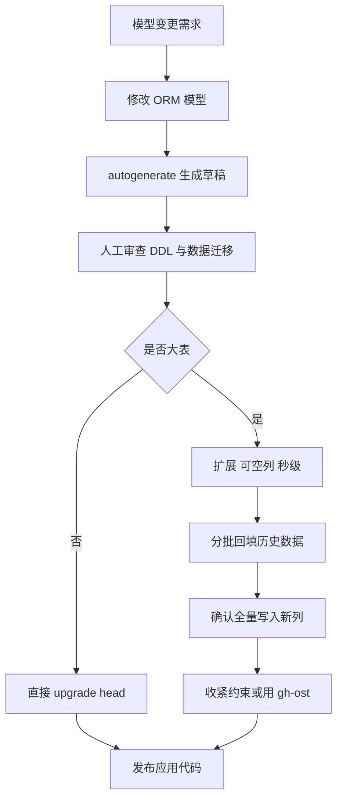

---

### Q936 · N+1 的变体与自动化检测

> 难度:★★★★ | 标签:N+1, 性能

**问**:除了关系懒加载,N+1 还有哪些变体?怎么在开发阶段自动发现?

**答**:变体一:列表页对每个元素单独查关联(经典);变体二:循环里逐条 update/delete(写 N+1);变体三:模板/序列化器里触发懒加载(Django serializer、pydantic from_orm 都会隐式遍历关系);变体四:分页后对每页元素查统计。检测手段:开发环境给引擎挂 before_cursor_execute 计数,单请求 SQL 条数超阈值告警;pytest 用 fixture 断言"该用例 SQL 条数 <= N";上线后 APM 按 trace 聚合。修复是三件套:selectinload/joinedload 预加载、批量 IN 查询在应用层拼装、写操作合并为 executemany/CASE WHEN。

```python
# file: code/04_数据库与缓存/q936_n1_detection.py
"""SQL 计数器: 用事件自动发现 N+1, 对比修复前后"""

try:
    from sqlalchemy import create_engine, event, ForeignKey, select
    from sqlalchemy.orm import (Session, DeclarativeBase, Mapped,
                                mapped_column, relationship, selectinload)
except ImportError:
    print("该题演示需要第三方库 sqlalchemy:pip install sqlalchemy>=2.0,原理见正文")
    raise SystemExit(0)

class Base(DeclarativeBase):
    pass

class Author(Base):
    __tablename__ = "authors"
    id: Mapped[int] = mapped_column(primary_key=True)
    books: Mapped[list["Book"]] = relationship(back_populates="author")

class Book(Base):
    __tablename__ = "books"
    id: Mapped[int] = mapped_column(primary_key=True)
    author_id: Mapped[int] = mapped_column(ForeignKey("authors.id"))
    author: Mapped[Author] = relationship(back_populates="books")

class SqlCounter:
    def __init__(self, engine):
        self.n = 0
        event.listen(engine, "before_cursor_execute", self._inc)
    def _inc(self, *a):
        self.n += 1
    def __enter__(self):
        self.n = 0
        return self
    def __exit__(self, *a):
        pass

if __name__ == "__main__":
    engine = create_engine("sqlite://")
    counter = SqlCounter(engine)
    Base.metadata.create_all(engine)
    with Session(engine) as s:
        s.add_all([Author(books=[Book()]) for _ in range(8)])
        s.commit()

        with counter as c:
            authors = s.scalars(select(Author)).all()
            total = sum(len(a.books) for a in authors)
        print(f"N+1: {total} 本, SQL {c.n} 条")

        with counter as c:
            authors = s.scalars(select(Author)
                                .options(selectinload(Author.books))).all()
            total = sum(len(a.books) for a in authors)
        print(f"selectinload: {total} 本, SQL {c.n} 条")
```

**追问**:
- 为什么序列化是 N+1 高发区?——DTO 转换逐字段访问 ORM 关系,触发隐藏的懒加载;把预加载策略与序列化字段清单对齐,或先转 dict 再喂 pydantic。
- SQL 条数阈值设多少?——经验值单请求 20~50 条告警,但关键是趋势与异常突增,别一刀切禁止多 SQL。

---

### Q937 · ORM 批量写入: executemany 与 insert().values 批量

> 难度:★★★☆ | 标签:SQLAlchemy, 批量

**问**:用 ORM 插 10 万行,怎么做才快?bulk_save_objects 为什么被弃用?

**答**:三条路径按快慢:一、Core 的 `session.execute(insert(User), [dicts])` —— executemany 批量绑定,2.0 官方推荐,可配合 INSERT..RETURNING 拿回主键;二、逐对象 add + 单次 commit,对象全程被追踪,慢在 ORM 实例化与脏检查;三、bulk_save_objects 2.0 已弃用——它跳过大量 ORM 特性(关系、事件)又不比 Core 方案快,定位尴尬。速度优化还有:关 autoflush、分批 commit 控制事务大小、SQLite 用 executemany 天生快、必要时直接 executemany 跳过 ORM。批量 UPDATE 同理:`session.execute(update(User).where(...), [{...}])` 的 executemany 形态。

```python
# file: code/04_数据库与缓存/q937_bulk_insert.py
"""对比逐对象 add 与 insert executemany 的耗时与 SQL 条数"""
import time

try:
    from sqlalchemy import create_engine, event, insert
    from sqlalchemy.orm import Session, DeclarativeBase, Mapped, mapped_column
except ImportError:
    print("该题演示需要第三方库 sqlalchemy:pip install sqlalchemy>=2.0,原理见正文")
    raise SystemExit(0)

class Base(DeclarativeBase):
    pass

class Row(Base):
    __tablename__ = "rows"
    id: Mapped[int] = mapped_column(primary_key=True)
    v: Mapped[int]

if __name__ == "__main__":
    engine = create_engine("sqlite://")
    n_sql = {"c": 0}
    event.listen(engine, "before_cursor_execute",
                 lambda *a: n_sql.__setitem__("c", n_sql["c"] + 1))
    Base.metadata.create_all(engine)
    data = [{"v": i} for i in range(20000)]

    t0 = time.perf_counter()
    with Session(engine) as s:
        s.add_all([Row(**d) for d in data])
        s.commit()
    print(f"ORM add_all: {(time.perf_counter() - t0) * 1000:.0f} ms, SQL {n_sql['c']} 条")

    n_sql["c"] = 0
    t1 = time.perf_counter()
    with Session(engine) as s:
        s.execute(insert(Row), data)
        s.commit()
    print(f"executemany: {(time.perf_counter() - t1) * 1000:.0f} ms, SQL {n_sql['c']} 条")
```

**追问**:
- executemany 怎么拿到生成的主键?——配合 RETURNING(SQLAlchemy 2.0 在支持的方言上自动处理 executemany + returning),或改分批取回。
- 为什么 ORM 对象插入慢?——每个对象要经历状态机、事件、关系级联与脏检查,10 万次这些 Python 开销远超 SQL 本身。

---

### Q938 · skip_locked: 多 worker 抢任务

> 难度:★★★★ | 标签:并发, 任务队列

**问**:用数据库实现任务队列,多个 worker 怎么不重复、不互相等待地取任务?

**答**:标准配方:`SELECT ... WHERE status='pending' ORDER BY id LIMIT n FOR UPDATE SKIP LOCKED`,再接 UPDATE 置为 processing 并 commit——skip_locked 让被其他 worker 锁住的行直接跳过,各取各的,天然互斥且不阻塞。收尾路径:成功置 done,失败按重试次数置 pending(延迟)或 dead;处理崩溃靠租约字段(lease_until),过期任务被清扫线程回收。MySQL 8+ 与 PG 支持 SKIP LOCKED,SQLite 单写者场景用 BEGIN IMMEDIATE 近似。相比 list 队列,数据库队列的优势是事务一致与可视性,劣势是吞吐,量大换 Redis Stream/MQ。

```python
# file: code/04_数据库与缓存/q938_skip_locked_queue.py
"""SQLite 模拟 skip_locked 抢任务: 立即事务 + 行级条件更新"""
import sqlite3
import threading

def claim(db, worker):
    conn = sqlite3.connect(db, isolation_level=None)
    conn.execute("PRAGMA busy_timeout=3000")
    try:
        conn.execute("BEGIN IMMEDIATE")          # 单写临界区(等价跳过忙行)
        row = conn.execute(
            "SELECT id, payload FROM tasks WHERE status='pending' "
            "ORDER BY id LIMIT 1").fetchone()
        if not row:
            conn.execute("COMMIT")
            return None
        conn.execute("UPDATE tasks SET status='processing', worker=? WHERE id=?",
                     (worker, row[0]))
        conn.execute("COMMIT")
        return row
    except sqlite3.OperationalError:
        conn.execute("ROLLBACK")
        return "busy"

if __name__ == "__main__":
    db = "q938.db"
    s = sqlite3.connect(db, isolation_level=None)
    s.execute("CREATE TABLE IF NOT EXISTS tasks (id INTEGER PRIMARY KEY, "
              "payload TEXT, status TEXT, worker TEXT)")
    s.execute("DELETE FROM tasks")
    s.executemany("INSERT INTO tasks (payload, status) VALUES (?, 'pending')",
                  [(f"t{i}",) for i in range(6)])
    s.close()

    out = {}
    def work(w):
        out[w] = claim(db, w)
    ts = [threading.Thread(target=work, args=(f"w{i}",)) for i in range(3)]
    [t.start() for t in ts]
    [t.join() for t in ts]
    print("领取结果:", out)
    print("剩余 pending:", sqlite3.connect(db).execute(
        "SELECT count(*) FROM tasks WHERE status='pending'").fetchone()[0])
```

**追问**:
- 为什么不能只 SELECT 再 UPDATE?——两个 worker 会读到同一 pending 行然后都改,必须借行锁/立即事务把"读+标记"做成原子。
- 任务失败后怎么回队?——按 retry_count 递增退避置回 pending(或延迟时间戳),超过上限进 dead 状态等待人工处理。

---

### Q939 · 动态查询条件: 优雅构造过滤器

> 难度:★★★☆ | 标签:SQLAlchemy, 查询

**问**:接口有十几个可选过滤参数,查询代码怎么写才不变成 if 泥潭?

**答**:三层递进:入门是"收集再解包"——把命中的条件 append 到列表,`select(User).where(*conds)` 一次传入,避免一长串嵌套 if;进阶是字典驱动——把参数名映射到列与操作符(如 {"name": lambda v: User.name.like(f"%{v}%")}),构造器统一遍历,白名单天然防注入与拼写错误;再进阶用 SQLAlchemy 的自动组合:`and_(*conds)` 与 `or_`,注意 & | 优先级要加括号。范围条件(时间区间、金额区间)单独处理成 (low, high) 元组。最后在 Repository 层固定这个构造器,业务层只传参数字典。

```python
# file: code/04_数据库与缓存/q939_dynamic_filters.py
"""字典驱动的动态过滤构造器: 白名单 + 统一组装"""

try:
    from sqlalchemy import create_engine, and_, select
    from sqlalchemy.orm import Session, DeclarativeBase, Mapped, mapped_column
except ImportError:
    print("该题演示需要第三方库 sqlalchemy:pip install sqlalchemy>=2.0,原理见正文")
    raise SystemExit(0)

class Base(DeclarativeBase):
    pass

class User(Base):
    __tablename__ = "users"
    id: Mapped[int] = mapped_column(primary_key=True)
    name: Mapped[str]
    age: Mapped[int]
    active: Mapped[bool] = mapped_column(default=True)

FILTERS = {
    "name": lambda v: User.name.like(f"%{v}%"),
    "age_gte": lambda v: User.age >= v,
    "age_lte": lambda v: User.age <= v,
    "active": lambda v: User.active == bool(v),
}

def build_query(params: dict):
    conds = [FILTERS[k](v) for k, v in params.items() if k in FILTERS]
    return select(User).where(and_(*conds)) if conds else select(User)

if __name__ == "__main__":
    engine = create_engine("sqlite://")
    Base.metadata.create_all(engine)
    with Session(engine) as s:
        s.add_all([User(name="alice", age=30), User(name="bob", age=20),
                   User(name="alan", age=40)])
        s.commit()
        for p in ({"name": "a", "age_gte": 25}, {"active": True}, {}):
            print(p, "->", [u.name for u in s.scalars(build_query(p))])
        print("未知参数被忽略:", [u.name for u in
              s.scalars(build_query({"evil": "1' OR '1'='1"}))])
```

**追问**:
- and_() 传空列表会怎样?——and_() 无参返回 true() 条件,等价无过滤,但要自己确认这是预期语义。
- 排序参数怎么同样处理?——与过滤同构:字段白名单映射到列,方向固定 asc/desc 二选一,拒绝任意字符串进 ORDER BY。

---

### Q940 · ORM 分页: offset 与 keyset 两套实现

> 难度:★★★☆ | 标签:SQLAlchemy, 分页

**问**:ORM 里怎么实现分页?什么场景必须换游标分页?

**答**:offset 分页:`select(User).order_by(User.id).limit(size).offset(page * size)`,实现简单支持跳页,但深偏移性能差且数据变动时页会漂移。keyset 分页:记录本页最后一行的排序键,`where((sort_col, id) < (last_val, last_id))` + limit,恒定性能、结果稳定,配合 base64 编码的 cursor token 暴露给前端;复合排序时用行值比较或展开为 OR 条件。ORM 层封装成 paginate(query, cursor) 返回 (items, next_cursor),排序键必须含唯一列做 tie-breaker。管理后台的跳页需求保留 offset,面向 API 的无限滚动用 keyset。

```python
# file: code/04_数据库与缓存/q940_orm_pagination.py
"""ORM 双分页: limit/offset 与 keyset 游标"""
import base64
import json

try:
    from sqlalchemy import create_engine, select
    from sqlalchemy.orm import Session, DeclarativeBase, Mapped, mapped_column
except ImportError:
    print("该题演示需要第三方库 sqlalchemy:pip install sqlalchemy>=2.0,原理见正文")
    raise SystemExit(0)

class Base(DeclarativeBase):
    pass

class Feed(Base):
    __tablename__ = "feed"
    id: Mapped[int] = mapped_column(primary_key=True)
    score: Mapped[float]

def offset_page(s, page, size=3):
    return s.scalars(select(Feed).order_by(Feed.score.desc(), Feed.id)
                     .limit(size).offset(page * size)).all()

def keyset_page(s, cursor=None, size=3):
    stmt = select(Feed).order_by(Feed.score.desc(), Feed.id).limit(size)
    if cursor:
        c = json.loads(base64.b64decode(cursor))
        stmt = stmt.where((Feed.score < c["s"]) |
                          ((Feed.score == c["s"]) & (Feed.id > c["i"])))
    rows = s.scalars(stmt).all()
    next_cursor = None
    if len(rows) == size:
        last = rows[-1]
        next_cursor = base64.b64encode(json.dumps(
            {"s": last.score, "i": last.id}).encode()).decode()
    return rows, next_cursor

if __name__ == "__main__":
    engine = create_engine("sqlite://")
    Base.metadata.create_all(engine)
    with Session(engine) as s:
        s.add_all([Feed(score=i % 10) for i in range(20)])
        s.commit()
        print("offset 第2页:", [f.id for f in offset_page(s, 1)])
        rows, cur = keyset_page(s)
        print("keyset 第1页:", [f.id for f in rows], "cursor:", bool(cur))
        rows2, _ = keyset_page(s, cur)
        print("keyset 第2页:", [f.id for f in rows2])
```

**追问**:
- cursor token 里放什么?——排序键值 + 唯一 id,base64 只是编码不是加密,敏感数据要签名或加密防篡改。
- offset 页中途插入数据会怎样?——页漂移(某条记录重复出现或漏掉),keyset 基于锚点不受影响,这正是它稳定的原因。

---

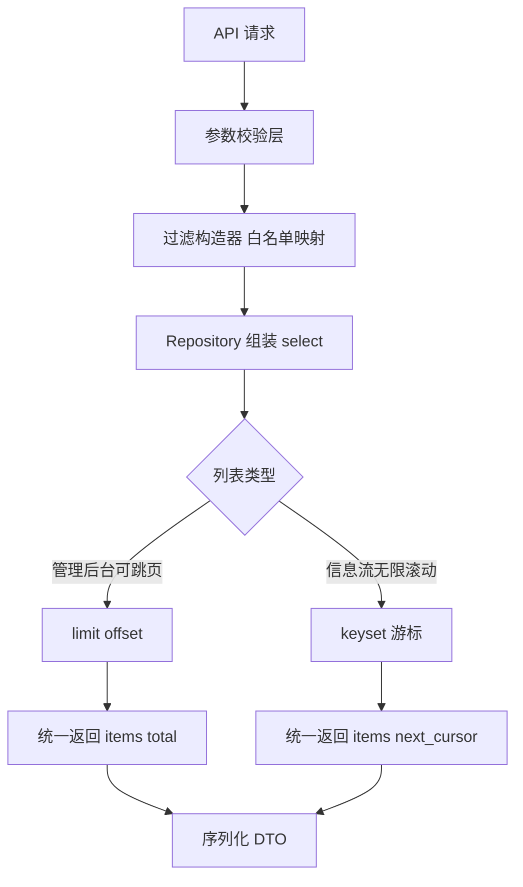

### Q941 · relationship 加载策略性能画像

> 难度:★★★★ | 标签:SQLAlchemy, 性能

**问**:lazy、selectin、joined 三种加载策略在同一负载下的 SQL 条数、行数、耗时各是什么量级?怎么做出选择?

**答**:设 100 个父、每个 10 个子:lazy 发 1+100 条 SQL(网络往返主导)、总行数最少;joinedload 1 条 SQL 但返回 1000 行(笛卡尔膨胀,网络与去重成本);selectinload 2 条 SQL、行数正好 1100 行分两批,总传输最小。选择矩阵:多对一用 joined(无膨胀)、一对多用 selectin、深度多层用 selectin 嵌套、单父单子极端场景 joined 一次到位。做出选择的依据不是感觉而是画像:像下面这样用事件统计 SQL 条数与返回行数,再结合 QPS 与网络 RTT 估算,预加载策略应该出现在代码评审清单里。

```python
# file: code/04_数据库与缓存/q941_loading_profile.py
"""画像三种加载策略: SQL 条数与返回行数"""

try:
    from sqlalchemy import create_engine, event, ForeignKey, select
    from sqlalchemy.orm import (Session, DeclarativeBase, Mapped, mapped_column,
                                relationship, joinedload, selectinload)
except ImportError:
    print("该题演示需要第三方库 sqlalchemy:pip install sqlalchemy>=2.0,原理见正文")
    raise SystemExit(0)

class Base(DeclarativeBase):
    pass

class Team(Base):
    __tablename__ = "teams"
    id: Mapped[int] = mapped_column(primary_key=True)
    members: Mapped[list["Member"]] = relationship(back_populates="team")

class Member(Base):
    __tablename__ = "members"
    id: Mapped[int] = mapped_column(primary_key=True)
    team_id: Mapped[int] = mapped_column(ForeignKey("teams.id"))
    team: Mapped[Team] = relationship(back_populates="members")

def profile(engine, label, options):
    stats = {"sql": 0, "rows": 0}
    def _sql(*a):
        stats["sql"] += 1
    h = event.listen(engine, "before_cursor_execute", _sql)
    with Session(engine) as s:
        q = select(Team).options(options) if options else select(Team)
        teams = s.execute(q).unique().scalars().all()
        n = sum(len(t.members) for t in teams)
        event.remove(engine, "before_cursor_execute", _sql)
        print(f"{label}: SQL {stats['sql']} 条, 团队 {len(teams)}, 成员 {n}")

if __name__ == "__main__":
    engine = create_engine("sqlite://")
    Base.metadata.create_all(engine)
    with Session(engine) as s:
        s.add_all([Team(members=[Member() for _ in range(10)])
                   for _ in range(100)])
        s.commit()
    profile(engine, "lazy       ", None)
    profile(engine, "joinedload ", joinedload(Team.members))
    profile(engine, "selectin   ", selectinload(Team.members))
```

**追问**:
- 返回行数膨胀的实际代价是什么?——网络传输、ORM 行解析、joined 去重(哈希全行)都会按膨胀行数付费,百万行级直接打爆内存。
- 一层多对一 + 一层一对多怎么组合?——joinedload(A.b) 套 selectinload(B.c),多对一走连接、集合走二次查询,混合是常态。

---

### Q942 · 异步 ORM: SQLAlchemy 2.0 asyncio 用法

> 难度:★★★★ | 标签:SQLAlchemy, asyncio

**问**:异步 ORM 与同步的差异在哪?哪些坑最容易踩?

**答**:2.0 原生支持 asyncio:create_async_engine + AsyncSession,execute/commit 都是 await;底层依赖驱动(aiosqlite/asyncpg/aiomysql)。最容易踩的坑:懒加载在异步里不能隐式发生(没有隐式 IO),必须显式 await session.run_sync 或用 selectinload 预加载;AsyncSession 不是并发安全的,一个请求一个 session;阻塞调用(重计算、time.sleep)会卡死事件循环,要 run_in_executor。事务语义相同,commit/rollback 均为 await。另一个实践:同一个服务里同步异步 ORM 别混用连接池,账号与池参数独立管理。

```python
# file: code/04_数据库与缓存/q942_async_orm.py
"""SQLAlchemy 2.0 异步: create_async_engine + AsyncSession"""
import asyncio

try:
    from sqlalchemy.ext.asyncio import create_async_engine, AsyncSession
    from sqlalchemy.orm import (DeclarativeBase, Mapped, mapped_column,
                                selectinload)
    from sqlalchemy import select, ForeignKey
    from sqlalchemy.orm import relationship
except ImportError:
    print("该题演示需要第三方库 sqlalchemy:pip install sqlalchemy>=2.0 aiosqlite,原理见正文")
    raise SystemExit(0)

class Base(DeclarativeBase):
    pass

class User(Base):
    __tablename__ = "users"
    id: Mapped[int] = mapped_column(primary_key=True)
    name: Mapped[str]
    posts: Mapped[list["Post"]] = relationship(back_populates="user")

class Post(Base):
    __tablename__ = "posts"
    id: Mapped[int] = mapped_column(primary_key=True)
    user_id: Mapped[int] = mapped_column(ForeignKey("users.id"))
    user: Mapped[User] = relationship(back_populates="posts")

async def main():
    engine = create_async_engine("sqlite+aiosqlite://")
    async with engine.begin() as conn:
        await conn.run_sync(Base.metadata.create_all)
    async with AsyncSession(engine) as s:
        s.add(User(name="a", posts=[Post(), Post()]))
        await s.commit()
        result = await s.execute(
            select(User).options(selectinload(User.posts)))
        u = result.scalars().first()
        print("异步取到:", u.name, len(u.posts), "posts")
    await engine.dispose()

if __name__ == "__main__":
    asyncio.run(main())
```

**追问**:
- 为什么异步下懒加载直接失败?——隐式懒加载需要同步 IO,事件循环不允许未 await 的数据库访问,SQLAlchemy 抛 MissingGreenlet,解法是预加载或 await session.refresh。
- run_sync 是什么?——把同步函数包成在 greenlet 里执行的异步调用,用于复用同步 ORM 逻辑(如 create_all)。

---

### Q943 · 长事务与连接池耗尽: 外部调用的事务陷阱

> 难度:★★★★ | 标签:事务, 连接池

**问**:为什么"事务里调用第三方支付接口"是事故高发代码?正确的结构是什么?

**答**:事务里发 HTTP/RPC 意味着数据库连接与行锁在等待外部响应的几百毫秒到几十秒里全程持有——高并发下连接池瞬间耗尽(Q917 的 TimeoutError)、锁等待堆积、undo 膨胀,一慢全慢。正确结构是"先短事务落库,再与外部交互,回调/轮询更新状态":把本地状态写成 processing 并提交,释放连接后再调用外部;外部结果通过回调或定时任务在新事务里确认,失败走重试与对账。必须同步拿到外部结果时,用乐观占位(状态机+超时回收)而不是持锁等待。这个题本质考事务边界的物理含义:连接是稀缺资源,事务长度决定资源占用。

```python
# file: code/04_数据库与缓存/q943_long_transaction.py
"""对比两种结构: 持事务调外部 vs 先落库再调用"""
import time

try:
    from sqlalchemy import create_engine
    from sqlalchemy.orm import Session, DeclarativeBase, Mapped, mapped_column
except ImportError:
    print("该题演示需要第三方库 sqlalchemy:pip install sqlalchemy>=2.0,原理见正文")
    raise SystemExit(0)

class Base(DeclarativeBase):
    pass

class Payment(Base):
    __tablename__ = "payments"
    id: Mapped[int] = mapped_column(primary_key=True)
    status: Mapped[str] = mapped_column(default="init")

def call_remote():
    time.sleep(0.2)                     # 模拟第三方 200ms

def bad_style(engine):
    t0 = time.perf_counter()
    with Session(engine) as s:
        s.add(Payment())
        call_remote()                   # 事务持锁 200ms
        s.commit()
    return time.perf_counter() - t0

def good_style(engine):
    t0 = time.perf_counter()
    with Session(engine) as s:          # 事务1: 落库立即提交
        p = Payment(status="processing")
        s.add(p)
        s.commit()
        pid = p.id
    call_remote()                        # 无事务占用
    with Session(engine) as s:          # 事务2: 确认结果
        s.get(Payment, pid).status = "done"
        s.commit()
    return time.perf_counter() - t0

if __name__ == "__main__":
    engine = create_engine("sqlite://")
    Base.metadata.create_all(engine)
    print(f"持锁调外部: {bad_style(engine) * 1000:.0f} ms 事务持有中含 200ms 外部调用")
    print(f"短事务拆分: {good_style(engine) * 1000:.0f} ms, 两次事务各毫秒级")
```

**追问**:
- 回调比轮询好在哪?——回调实时且不占连接,但依赖对方可达与幂等;轮询兜底必须有,两者结合加超时状态机才是完整方案。
- 已经被拖慢的连接池怎么止血?——紧急 kill 长事务连接、降级非核心外部调用、池扩容只是缓冲,根因是事务结构。

---

### Q944 · Django ORM: select_related 与 prefetch_related

> 难度:★★★☆ | 标签:Django, ORM

**问**:Django 的 select_related 和 prefetch_related 区别是什么?分别对应什么 SQL?

**答**:select_related 用 SQL JOIN 一次取回关联对象,适用于 ForeignKey/OneToOne(多对一/一对一),参数写关系路径 `Book.objects.select_related("author")`;prefetch_related 分两条 SQL——先查主对象,再用 IN 批量查关联表,在 Python 层拼装,适用于 ManyToMany 与反向外键(一对多)。选错的表现:对一对多用 select_related 会行数膨胀(与 SQLAlchemy joinedload 同理),对 FK 用 prefetch 多一次查询但不错。配套工具:only/defer 控制字段、values 列表瘦身、prefetch_related(Prefetch("books", queryset=...)) 定制子查询,debug 时用 connection.queries 或 django-debug-toolbar 看 SQL。

```python
# file: code/04_数据库与缓存/q944_django_loading.py
"""用原生 SQL 演示 select_related 与 prefetch_related 的形态差异"""
import sqlite3

if __name__ == "__main__":
    conn = sqlite3.connect(":memory:")
    conn.executescript("""
        CREATE TABLE author (id INTEGER PRIMARY KEY, name TEXT);
        CREATE TABLE book (id INTEGER PRIMARY KEY, author_id INT, title TEXT);
        INSERT INTO author VALUES (1, 'Ada'), (2, 'Alan');
        INSERT INTO book VALUES (1, 1, 'Notes'), (2, 1, 'Engine'),
                                (3, 2, 'Machine');
    """)
    print("select_related 形态: 一条 JOIN")
    for r in conn.execute(
            "SELECT b.title, a.name FROM book b "
            "LEFT JOIN author a ON a.id = b.author_id"):
        print("  ", r)
    print("prefetch_related 形态: 两条 SQL + 内存拼装")
    authors = conn.execute("SELECT id, name FROM author").fetchall()
    books = conn.execute(
        f"SELECT id, author_id, title FROM book "
        f"WHERE author_id IN ({','.join(str(a[0]) for a in authors)})").fetchall()
    print("   作者:", authors, "\n   批量书籍:", books)
    print("Django: FK/OneToOne 用 select_related, M2M/反向用 prefetch_related")
```

**追问**:
- Prefetch 对象解决什么问题?——默认 prefetch 拉全量关联再过滤会破坏对应关系,用 Prefetch 指定带过滤的 queryset,保证"预加载且只取需要的"。
- only/defer 的坑?——只取部分字段后再访问未取字段会触发再查询,与懒加载叠加又变 N+1,清单要与序列化字段对齐。

---

### Q945 · Django ORM 与 SQLAlchemy 怎么选

> 难度:★★★☆ | 标签:ORM, 选型

**问**:同样是 Python ORM,Django ORM 与 SQLAlchemy 的设计取舍有什么不同?

**答**:Django ORM 是"电池全含":Model 与迁移(内置 migrations)、Admin、表单联动,QuerySet 惰性求值链式过滤,学习成本低、约定强,适合 Django 全家桶项目;表达力边界在复杂查询(窗口函数已支持但组合复杂 SQL/多方言调优能力弱),脱离 Django 框架使用不便。SQLAlchemy 是独立组件:Core(表达式语言)+ ORM(声明式映射)两层可选,Session/UnitOfWork 语义清晰,复杂查询与性能调优空间大,FastAPI/非框架项目的默认选择,学习曲线更陡。选型即架构:已在 Django 生态内不必硬换;自建服务、需要精细控制 SQL 与事务边界的用 SQLAlchemy。两者都要求团队懂数据库,ORM 不替代 SQL 能力。

```python
# file: code/04_数据库与缓存/q945_orm_compare.py
"""同一查询在两套 ORM 心智模型下的写法对照"""
COMPARISON = """
同一需求: 取每个作者的书籍数, 只要有书的作者

Django ORM:
    Author.objects.annotate(n=Count("book")).filter(n__gt=0)
    # QuerySet 惰性链, 迁移/admin 与模型一体

SQLAlchemy 2.0:
    select(Author, func.count(Book.id)).join(Book) \\
        .group_by(Author).having(func.count(Book.id) > 0)
    # 显式 join/group/having, Session 管理事务与状态

取舍:
  Django: 约定优先 上手快 生态内全链路  复杂 SQL 受限
  SQLAlchemy: 显式优先 控制力强 独立于框架  学习曲线陡
"""
if __name__ == "__main__":
    print(COMPARISON)
```

**追问**:
- Django 能脱离框架用它的 ORM 吗?——可以但牵扯 settings 与 apps 配置,得不偿失,独立服务直接用 SQLAlchemy 更顺。
- 团队从 Django 迁到 FastAPI,数据层怎么迁?——模型层重写为 SQLAlchemy,迁移历史用 Alembic 重建,业务查询按 Repository 收口逐模块替换。

---

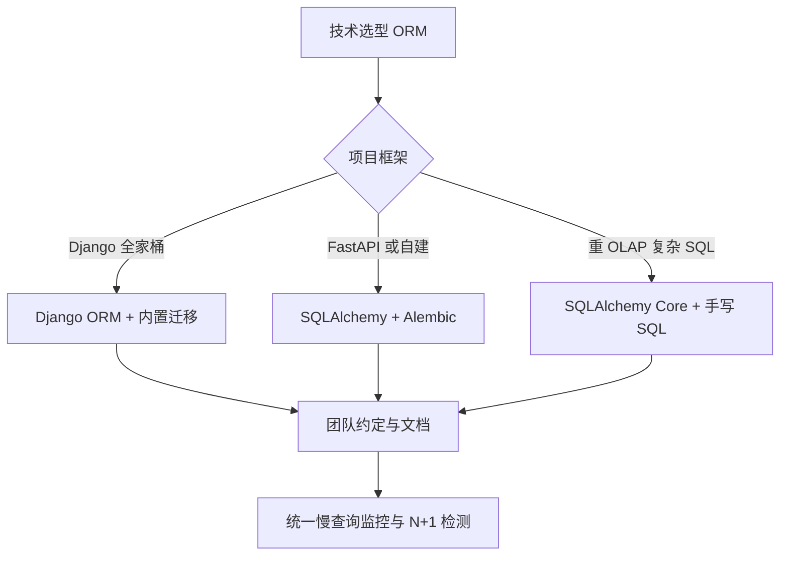

### Q946 · 事务边界应该放在哪一层

> 难度:★★★★ | 标签:架构, 事务

**问**:事务应该由 Controller、Service 还是 Repository 开启?为什么?

**答**:标准答案是 Service(用例)层:一个业务用例 = 一个事务,Controller 只管协议转换,Repository 只管持久化细节,都不该私开事务。放在 Controller 层会把事务语义散落到协议层,放在 Repository 层则跨仓储操作被切成多个事务(Q921 的问题)。落地形态:service 方法被 @transactional 装饰或显式 `with uow:`,装饰器需要传播语义(嵌套调用加入当前事务而不是新开)。例外:某些只读操作不需要事务;批量后台任务自己管理批次边界。检验标准:任何一条"半提交"路径都应被视为 bug。

```python
# file: code/04_数据库与缓存/q946_transaction_boundary.py
"""Service 层装饰器管理事务: 嵌套调用共享同一事务"""
import functools
import sqlite3

def transactional(func):
    @functools.wraps(func)
    def wrapper(ctx, *a, **kw):
        if ctx.get("in_tx"):                # 传播: 已在事务中直接复用
            return func(ctx, *a, **kw)
        ctx["in_tx"] = True
        try:
            result = func(ctx, *a, **kw)
            ctx["conn"].commit()
            return result
        except Exception:
            ctx["conn"].rollback()
            raise
        finally:
            ctx["in_tx"] = False
    return wrapper

@transactional
def create_order(ctx, sku, qty):
    ctx["conn"].execute("INSERT INTO orders (sku, qty) VALUES (?, ?)", (sku, qty))
    deduct_stock(ctx, sku, qty)             # 同一事务

@transactional
def deduct_stock(ctx, sku, qty):
    n = ctx["conn"].execute(
        "UPDATE stock SET qty = qty - ? WHERE sku = ? AND qty >= ?",
        (qty, sku, qty)).rowcount
    if n == 0:
        raise ValueError("库存不足, 整体回滚")

if __name__ == "__main__":
    conn = sqlite3.connect(":memory:")
    conn.execute("CREATE TABLE orders (sku TEXT, qty INT)")
    conn.execute("CREATE TABLE stock (sku TEXT PRIMARY KEY, qty INT)")
    conn.execute("INSERT INTO stock VALUES ('x', 5)")
    ctx = {"conn": conn, "in_tx": False}

    create_order(ctx, "x", 2)
    print("成功: 订单", conn.execute("SELECT count(*) FROM orders").fetchone()[0],
          "库存", conn.execute("SELECT qty FROM stock").fetchone()[0])
    try:
        create_order(ctx, "x", 99)
    except ValueError as e:
        print("失败:", e)
    print("回滚后订单仍为", conn.execute("SELECT count(*) FROM orders").fetchone()[0])
```

**追问**:
- 为什么不放在 Repository?——Repository 之间无法共享事务,每个方法独立提交会把一个用例拆成多段不可回滚的历史。
- 装饰器事务与手动 UoW 哪个好?——装饰器统一了传播与回滚语义、少样板代码;UoW 更显式可控,二者选一并在全团队统一。

---

### Q947 · Repository 接口设计原则

> 难度:★★★★ | 标签:架构, Repository

**问**:好的 Repository 接口长什么样?哪些设计是"伪封装"?

**答**:四条原则:一、面向聚合根,接口粒度是领域动作(load_order、mark_paid)而非表操作(update_field_x);二、接口定义在领域层,实现在基础设施层,依赖向内(Python 用 Protocol/ABC 表达);三、方法签名用领域类型(领域对象、值对象)进出,不泄漏 ORM 实体与 Session;四、可测试性优先——同步接口 + 可替换实现。伪封装:返回 QuerySet/Select 让上层继续拼(等于没隔离)、暴露 save(orm_obj) 把 ORM 实体当 DTO、每个方法内部自带事务、方法名直译 SQL(find_by_name_and_status_and...)。判断标准:换掉 ORM,业务代码与测试不需要重写。

```python
# file: code/04_数据库与缓存/q947_repo_interface.py
"""用 Protocol 定义领域接口: 实现可替换, 业务零感知"""
from __future__ import annotations
from typing import Protocol
from dataclasses import dataclass

@dataclass(frozen=True)
class OrderId:
    value: int

@dataclass
class Order:                      # 领域对象, 不是 ORM 模型
    id: OrderId | None
    sku: str
    status: str = "created"

class OrderRepository(Protocol):
    def load(self, oid: OrderId) -> Order | None: ...
    def save(self, order: Order) -> None: ...
    def next_identity(self) -> OrderId: ...

class MemoryOrderRepo:            # 测试实现
    def __init__(self):
        self._data, self._seq = {}, 0
    def load(self, oid):
        return self._data.get(oid.value)
    def save(self, order):
        self._data[order.id.value] = order
    def next_identity(self):
        self._seq += 1
        return OrderId(self._seq)

def ship(repo: OrderRepository, oid: OrderId):
    order = repo.load(oid)
    assert order and order.status == "created", "订单不可发货"
    order.status = "shipped"
    repo.save(order)

if __name__ == "__main__":
    repo = MemoryOrderRepo()
    oid = repo.next_identity()
    repo.save(Order(id=oid, sku="x"))
    ship(repo, oid)
    print("发货成功:", repo.load(oid).status, "<- 业务代码不依赖任何 ORM")
```

**追问**:
- 领域对象与 ORM 实体要分开吗?——重领域逻辑的项目分开并在仓储内做映射;一般 CRUD 项目可共用,但要意识到这是务实取舍而非教条。
- 接口方法太多怎么办?——按用例拆分接口(读写分离),或审视聚合边界是否划错,膨胀的接口通常意味着仓储在管不属于它的聚合。

---

### Q948 · ORM 与原生 SQL 混用的边界

> 难度:★★★☆ | 标签:SQLAlchemy, 原生 SQL

**问**:什么时候应该放弃 ORM 写原生 SQL?怎么混用才不乱?

**答**:该下放原生的场景:窗口函数/递归 CTE 等复杂分析、DB 特有语法(ON CONFLICT 细节、hint)、超大批量操作、需要精确控制计划的热点 SQL。混用纪律:原生 SQL 集中在 Repository 实现内部(上层接口不变),参数一律绑定(text().bindparams 或 raw connection 的参数化),结果映射回领域对象;SQLAlchemy 用 text() 与 session.execute 保持同一事务与连接,别另开连接破坏事务。反过来,能用 ORM 表达清楚的别手写——ORM 帮你处理方言、参数化与组合,双轨制的关键是"谁负责什么"有明确边界。

```python
# file: code/04_数据库与缓存/q948_native_sql_mix.py
"""同一 session 内混用 ORM 查询与 text() 原生 SQL"""

try:
    from sqlalchemy import create_engine, text, select
    from sqlalchemy.orm import Session, DeclarativeBase, Mapped, mapped_column
except ImportError:
    print("该题演示需要第三方库 sqlalchemy:pip install sqlalchemy>=2.0,原理见正文")
    raise SystemExit(0)

class Base(DeclarativeBase):
    pass

class User(Base):
    __tablename__ = "users"
    id: Mapped[int] = mapped_column(primary_key=True)
    name: Mapped[str]
    score: Mapped[int]

if __name__ == "__main__":
    engine = create_engine("sqlite://")
    Base.metadata.create_all(engine)
    with Session(engine) as s:
        s.add_all([User(name=f"u{i}", score=i) for i in range(5)])
        s.commit()

        # 原生: 排名这类窗口逻辑下放 SQL
        ranks = s.execute(text(
            "SELECT name, score, RANK() OVER (ORDER BY score DESC) AS rk "
            "FROM users")).all()
        print("原生窗口:", ranks)

        # ORM: 常规过滤回到实体世界
        top = s.scalars(select(User).where(User.score >= 3)).all()
        print("ORM 过滤:", [u.name for u in top])
        print("同一事务 同一连接, 两界共存")
```

**追问**:
- text() 结果怎么映射回实体?——2.0 用 `session.scalars(select(User).from_statement(text(...)))`,或取 Row 后手动构造 DTO,保持接口返回类型一致。
- 原生 SQL 的回归测试怎么做?——集中在 Repository 层就有清晰测试面:真库集成测试跑 SQL,断言行集而非实现细节。

---

### Q949 · 复合主键与联合唯一: 建模与冲突处理

> 难度:★★★☆ | 标签:约束, 建模

**问**:什么场景用复合主键?联合唯一约束怎么设计?冲突处理怎么做?

**答**:复合主键适合"关系本体"表:多对多中间表 (student_id, course_id)、配额表 (tenant_id, resource)、翻译表 (entity_id, locale)——两列组合天然唯一,单独任何一列都不构成实体。联合唯一约束(UniqueConstraint)服务业务不变量:同一用户同一 SKU 只能有一条未完成购物车行 `(user_id, sku, status)`。注意三点:一、复合主键在 ORM 里用 primary_key=True 标注多列或元组;二、带状态列的"部分唯一"在 MySQL 要靠冗余状态值(如 unique_key 列存'未完成'标记或直接物理化),PG 用部分索引;三、冲突处理与 Q925 幂等一致——upsert 或捕获 IntegrityError 回读。

```python
# file: code/04_数据库与缓存/q949_composite_keys.py
"""复合主键中间表 + 联合唯一约束 + 冲突处理"""
import sqlite3

if __name__ == "__main__":
    conn = sqlite3.connect(":memory:")
    conn.executescript("""
        CREATE TABLE enrollment (
            student_id INT, course_id INT, grade TEXT,
            PRIMARY KEY (student_id, course_id)
        );
        CREATE TABLE cart (
            id INTEGER PRIMARY KEY,
            user_id INT, sku TEXT, active INT DEFAULT 1,
            UNIQUE (user_id, sku, active)
        );
    """)
    conn.execute("INSERT INTO enrollment VALUES (1, 100, NULL)")
    try:
        conn.execute("INSERT INTO enrollment VALUES (1, 100, 'A')")
    except sqlite3.IntegrityError:
        print("复合主键阻止重复选课")

    conn.execute("INSERT INTO cart (user_id, sku) VALUES (7, 'A')")
    try:
        conn.execute("INSERT INTO cart (user_id, sku) VALUES (7, 'A')")
    except sqlite3.IntegrityError:
        print("联合唯一阻止重复加购")
    conn.execute("UPDATE cart SET active = 0 WHERE user_id = 7 AND sku = 'A'")
    conn.execute("INSERT INTO cart (user_id, sku) VALUES (7, 'A')")
    print("删除后可重新加入:", conn.execute(
        "SELECT count(*) FROM cart WHERE user_id = 7").fetchone()[0], "行")
```

**追问**:
- 复合主键会影响性能吗?——二级索引以复合主键为"指针",键宽变大索引变宽;高频点查单列时,冗余自增主键+联合唯一约束更常见。
- 部分唯一索引在 MySQL 怎么替代?——用"活动标记列并入唯一键 + 删除时置特殊值"的技巧,或把状态外置到独立表,靠约束语义收敛。

---

### Q950 · 自引用关系: 部门树与评论楼的 ORM 表达

> 难度:★★★★ | 标签:SQLAlchemy, 树形结构

**问**:ORM 里怎么表达"部门的上级与下级"?整棵树/子树查询怎么做才高效?

**答**:自引用 relationship:ForeignKey 指向本表,parent 与 children 互为 back_populates。加载策略:取"直接上下级"用 selectinload(Team.children) 一层;整棵树用递归 CTE(Core 的 cte 或原生 SQL)一条语句拿到路径与深度,Python 侧按 parent 组装,比逐层懒加载(N 层 = N 轮查询)高效得多;频繁读整树时缓存或改物化路径(path 列存 '1/4/9')与闭包表,查询 O(1) 定位子树。删除要定义级联语义(禁删有子节点或级联软删)。评论楼同理,排序键 path 或 (root_id, floor) 让"楼中楼"按序取出。

```python
# file: code/04_数据库与缓存/q950_self_referential.py
"""自引用 relationship + 递归 CTE 取整棵树"""
from typing import Optional

try:
    from sqlalchemy import (create_engine, ForeignKey, select, text)
    from sqlalchemy.orm import (Session, DeclarativeBase, Mapped,
                                mapped_column, relationship, selectinload)
except ImportError:
    print("该题演示需要第三方库 sqlalchemy:pip install sqlalchemy>=2.0,原理见正文")
    raise SystemExit(0)

class Base(DeclarativeBase):
    pass

class Dept(Base):
    __tablename__ = "depts"
    id: Mapped[int] = mapped_column(primary_key=True)
    name: Mapped[str]
    parent_id: Mapped[Optional[int]] = mapped_column(
        ForeignKey("depts.id"), nullable=True)
    children: Mapped[list["Dept"]] = relationship(back_populates="parent")
    parent: Mapped[Optional["Dept"]] = relationship(
        back_populates="children", remote_side=[id])

if __name__ == "__main__":
    engine = create_engine("sqlite://")
    Base.metadata.create_all(engine)
    with Session(engine) as s:
        ceo = Dept(name="ceo")
        cto = Dept(name="cto", parent=ceo)
        cto.children = [Dept(name="dev"), Dept(name="qa")]
        s.add(ceo); s.commit()

        # 一层: selectinload 直接子部门
        root = s.scalars(select(Dept).options(
            selectinload(Dept.children))).first()
        print("直接子部门:", [c.name for c in root.children])

        # 整树: 递归 CTE
        sql = text("""
            WITH RECURSIVE tree AS (
              SELECT id, name, 0 AS depth, name AS path FROM depts WHERE parent_id IS NULL
              UNION ALL
              SELECT d.id, d.name, t.depth + 1, t.path || '/' || d.name
              FROM depts d JOIN tree t ON d.parent_id = t.id
            )
            SELECT depth, path FROM tree ORDER BY path
        """)
        for depth, path in s.execute(sql):
            print("  " * depth + path)
```

**追问**:
- 为什么逐层懒加载不可取?——树深 N 层就是 N 轮查询,每层每个节点再乘关系数,很容易演变成"树形 N+1",必须一次递归或预物化。
- 物化路径怎么支持改名?——path 含父名时改名要重写整棵子树,改用纯 id 路径('1/4/9')则不需要;两者都要在写路径上补偿成本。

---

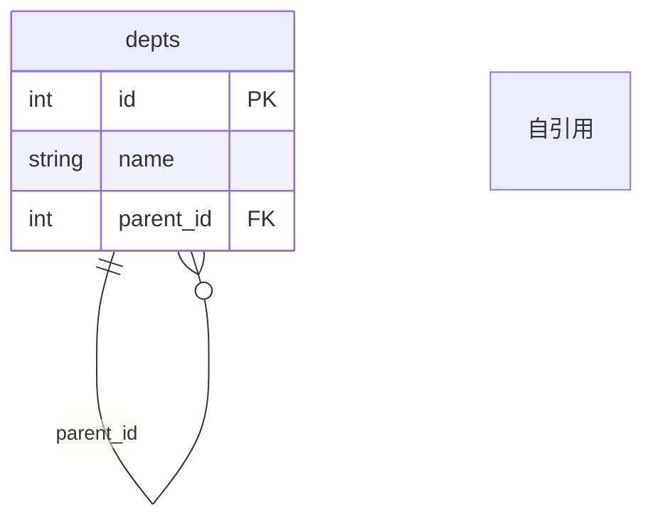

### Q951 · 多态关联: 评论挂在多种对象上

> 难度:★★★★ | 标签:建模, 多态

**问**:评论可以挂在文章、商品、视频上,数据模型怎么设计?各方案取舍?

**答**:三种方案:一、target_type + target_id 双列(多态外键):一列评论表通吃,加对象类型即可,但无法建数据库级外键、按目标反查要走索引 (target_type, target_id),ORM 用多态 relationship 映射;二、每类对象一张评论表:外键完整、约束强,但表爆炸、聚合统计难;三、基表 + 子表(所有可评论对象继承 common 表):外键统一指向基表 id,类型由子表区分,PG/Django(父链接)常用。选型:评论主体类型少且稳定用方案一(最快落地),强一致要求高用方案三,类型无限扩展也用方案一配合业务层校验。ORM 层记得给 (target_type, target_id) 建复合索引。

```python
# file: code/04_数据库与缓存/q951_polymorphic.py
"""多态关联: target_type + target_id + 复合索引"""
import sqlite3

if __name__ == "__main__":
    conn = sqlite3.connect(":memory:")
    conn.executescript("""
        CREATE TABLE article (id INTEGER PRIMARY KEY, title TEXT);
        CREATE TABLE product (id INTEGER PRIMARY KEY, name TEXT);
        CREATE TABLE comment (
            id INTEGER PRIMARY KEY,
            target_type TEXT NOT NULL, target_id INT NOT NULL,
            content TEXT,
            UNIQUE (target_type, target_id, id)
        );
        CREATE INDEX idx_target ON comment (target_type, target_id);
        INSERT INTO article VALUES (1, 'python 调优');
        INSERT INTO product VALUES (10, '键盘');
        INSERT INTO comment (target_type, target_id, content)
          VALUES ('article', 1, '好文'), ('product', 10, '好用');
    """)
    for t, i in (("article", 1), ("product", 10)):
        rows = conn.execute(
            "SELECT content FROM comment WHERE target_type = ? AND target_id = ?",
            (t, i)).fetchall()
        print(f"{t}#{i} 的评论:", rows)
    print("方案一注意: 无库级外键, 删除对象时要级联清理评论")
```

**追问**:
- 多态关联怎么防止"悬空评论"?——业务层在删除宿主时级联软删评论,或定时扫描 comment 反查存在性;数据库层面方案一无法用外键兜底。
- 想按评论数给所有对象排序怎么办?——定期物化评论计数到宿主表,或用方案三的基表 join 统计。

---

### Q952 · 模型演进: 字段语义变更与版本兼容

> 难度:★★★☆ | 标签:建模, 演进

**问**:字段 status 原来存 0/1,现在要扩展成状态机,怎么平滑演进?

**答**:演进原则是"读兼容先行,写切换在后,约束最后收"。步骤:一、新代码同时能读旧值(0/1 映射进新状态机的初始态)——读逻辑做兼容层;二、写入改为新语义,但旧值仍保留、新值扩展(旧 0 -> 新 created,新增 pending/paid 等);三、数据迁移:小表一次 UPDATE,大表分批回填,期间新旧语义共存窗口要定义"新代码遇到旧值的行为";四、最后收紧:枚举 CHECK 约束、应用层校验、清理兼容代码。反面教材:直接改字段含义不迁移,新旧代码读同一列得出两种结论。ORM 层用属性映射(旧值 -> 新枚举)过渡,枚举列用 int 存值并在代码层维护映射表,数据库端加 CHECK 兜底。

```python
# file: code/04_数据库与缓存/q952_model_evolution.py
"""状态字段演进: 读兼容映射 + 分批迁移 + 最终校验"""
import sqlite3

LEGACY_MAP = {0: "created", 1: "paid"}    # 旧值 -> 新状态机

def normalize(raw):
    if isinstance(raw, int):
        return LEGACY_MAP.get(raw, "unknown")
    return raw                            # 已是新语义

if __name__ == "__main__":
    conn = sqlite3.connect(":memory:")
    conn.execute("CREATE TABLE orders (id INTEGER PRIMARY KEY, status TEXT)")
    conn.executemany("INSERT INTO orders (status) VALUES (?)",
                     [("0",), ("1",), ("0",)])

    # 阶段一: 读兼容
    print("兼容读取:", [(i, normalize(s)) for i, s in
          conn.execute("SELECT id, status FROM orders")])

    # 阶段二: 分批把旧值改写为新语义
    while True:
        cur = conn.execute(
            "UPDATE orders SET status = 'created' "
            "WHERE status = '0' AND id IN "
            "(SELECT id FROM orders WHERE status = '0' LIMIT 2)")
        conn.commit()
        if cur.rowcount == 0:
            break
    conn.execute("UPDATE orders SET status='paid' WHERE status='1'")
    conn.commit()

    # 阶段三: 收紧约束
    conn.execute("""CREATE TABLE orders_new (id INTEGER PRIMARY KEY,
                    status TEXT CHECK (status IN ('created','paid')))""")
    conn.execute("INSERT INTO orders_new SELECT id, status FROM orders")
    print("迁移完成:", conn.execute("SELECT * FROM orders_new").fetchall())
```

**追问**:
- 兼容层放在 ORM 还是 DTO?——读路径在 ORM 层做属性映射(全应用统一),对外 DTO 用新枚举,避免每个调用点各写一套判断。
- 什么时候能删兼容代码?——数据回填完成 + 观察期内无旧值写入(加监控断言),再删兼容并收紧约束,顺序不能反。

---

### Q953 · 双写与影子表: 换表迁移的完整路径

> 难度:★★★★★ | 标签:迁移, 双写

**问**:老表 orders 换成新结构 new_orders,数据上亿,怎么切换?

**答**:五步走:一、开双写:所有写路径同时写老表与新表(同事务或事务后补偿),以老表为准,新表只进不改;二、存量迁移:后台分批拷贝,用 id/updated_at 位点断点续跑,与新写入的增量自然重叠(靠唯一键幂等);三、对账:校验两边 count 与抽样字段一致,或按主键分片 checksum;四、灰度读切:读流量按比例切到新表,观察指标,可随时回退读老表;五、收尾:写源切到新表为主、老表转只读观察期、最终下线。关键纪律:每一步可独立回退;双写失败要报警且不阻塞主流程(补偿队列重试);时间窗口内新表数据永远以老表权威对账修复。

```python
# file: code/04_数据库与缓存/q953_dual_write.py
"""双写迁移模拟: 双写 -> 分批补齐 -> 对账 -> 切读"""
import sqlite3

def dual_write(conn, order):
    with conn:
        conn.execute("INSERT INTO orders (id, amt) VALUES (?, ?)",
                     (order["id"], order["amt"]))
        try:
            conn.execute("INSERT INTO new_orders (id, amt, extra) VALUES (?, ?, 'migrated')",
                         (order["id"], order["amt"]))
        except sqlite3.IntegrityError:
            conn.execute("UPDATE new_orders SET amt = ? WHERE id = ?",
                         (order["amt"], order["id"]))

def backfill(conn, batch=2):
    while True:
        with conn:
            rows = conn.execute(
                "SELECT id, amt FROM orders WHERE id NOT IN "
                "(SELECT id FROM new_orders) LIMIT ?", (batch,)).fetchall()
            for oid, amt in rows:
                conn.execute(
                    "INSERT INTO new_orders (id, amt, extra) VALUES (?, ?, 'backfill')",
                    (oid, amt))
            if not rows:
                break

if __name__ == "__main__":
    conn = sqlite3.connect(":memory:")
    conn.executescript("""
        CREATE TABLE orders (id INTEGER PRIMARY KEY, amt REAL);
        CREATE TABLE new_orders (id INTEGER PRIMARY KEY, amt REAL, extra TEXT);
    """)
    for i in range(1, 6):
        dual_write(conn, {"id": i, "amt": i * 10.0})
    # 模拟历史存量
    for i in range(6, 11):
        conn.execute("INSERT INTO orders (id, amt) VALUES (?, ?)", (i, i * 10.0))
    conn.commit()
    backfill(conn)
    old = conn.execute("SELECT count(*) FROM orders").fetchone()[0]
    new = conn.execute("SELECT count(*) FROM new_orders").fetchone()[0]
    print(f"对账: 老表 {old} 新表 {new} -> {'一致可切读' if old == new else '继续修复'}")
```

**追问**:
- 双写期间新表写失败怎么办?——记录失败主键进补偿队列异步重试,切读前必须清零;同步双写失败阻塞主流程会让迁移反噬业务。
- 为什么要"老表为准"而不是反过来?——老表是当前被读的权威数据源,迁移期它的正确性直接影响线上;新表在验证期允许有修复动作。

---

### Q954 · ORM 层的死锁防范: 统一更新顺序与短事务

> 难度:★★★★ | 标签:死锁, SQLAlchemy

**问**:ORM 批量更新购物车多行时怎么防死锁?SQLAlchemy 有什么坑?

**答**:死锁三源头在 ORM 语境下依旧成立:交叉顺序加锁、长事务、热点间隙。防线一:按稳定键(主键)排序后再逐条更新——`for obj in sorted(objects, key=lambda o: o.id)`;防线二:session 提交前才 flush,事务尽量短,锁内不做 IO;防线三:批量 UPDATE 用 executemany/单条 CASE 而不是"读-改-写"循环,把行锁获取压缩到一条语句。SQLAlchemy 特有坑:relationship 的级联 save-update 会让"看起来只改 A"实际按依赖顺序写多表,顺序不可控时对热点并发不友好;commit 后对象过期导致意外重查,也拉长持锁时间(expire_on_commit=False 有帮助)。

```python
# file: code/04_数据库与缓存/q954_orm_deadlock.py
"""排序后批量更新 vs 随机顺序: 演示统一加锁顺序"""
import random
import sqlite3
import threading

def update_cart(db, user_id, items, busy=400):
    conn = sqlite3.connect(db, isolation_level=None)
    conn.execute(f"PRAGMA busy_timeout={busy}")
    try:
        conn.execute("BEGIN IMMEDIATE")
        for sku in items:                       # 调用方决定顺序
            conn.execute(
                "UPDATE cart SET qty = qty + 1 WHERE user_id = ? AND sku = ?",
                (user_id, sku))
        conn.execute("COMMIT")
        return "ok"
    except sqlite3.OperationalError:
        conn.execute("ROLLBACK")
        return "busy"
    finally:
        conn.close()

if __name__ == "__main__":
    db = "q954.db"
    s = sqlite3.connect(db, isolation_level=None)
    s.execute("CREATE TABLE IF NOT EXISTS cart (user_id INT, sku TEXT, qty INT, "
              "PRIMARY KEY (user_id, sku))")
    s.execute("DELETE FROM cart")
    s.executemany("INSERT INTO cart VALUES (1, ?, 0)", [("a",), ("b",), ("c",)])
    s.close()

    random.seed(2)
    print("随机顺序:", update_cart(db, 1, random.sample(["a", "b", "c"], 3)))
    print("排序顺序:", update_cart(db, 1, sorted(["c", "a", "b"])))
    print("批量合并:", sqlite3.connect(db).execute(
        "SELECT sku, qty FROM cart ORDER BY sku").fetchall())
    print("结论: 多事务并发时必须统一按主键排序加锁, 否则循环等待")
```

**追问**:
- SQLAlchemy 的 unit of work 会自己排序吗?——flush 按表依赖拓扑排序 insert/update/delete,但"行级加锁顺序"由 WHERE 命中顺序决定,批量提交多行时仍需业务侧排序。
- 死锁重试在 ORM 里怎么落地?——捕获 OperationalError/StaleDataError,session.rollback() 后整体重试,注意重试范围是"整个用例"而不是单条语句。

---

### Q955 · ORM 慢查询定位: 从日志到代码行

> 难度:★★★★ | 标签:SQLAlchemy, 排查

**问**:线上接口变慢,怎么定位是哪段 ORM 代码发出的慢 SQL?

**答**:三层定位:一、数据库侧慢日志拿到 SQL 指纹(MySQL slowlog + pt-query-digest);二、应用侧把 SQL 与代码关联——SQLAlchemy 的 before_cursor_execute 事件里可拿到 connection 与语句,配合 `info` 字段或上下文变量记录当前请求路径;更直接的是 echo=True(开发环境)或事件把语句与调用栈快照(traceback.extract_stack 过滤 sqlalchemy 帧)一起打出来,慢 SQL 即刻对应到函数;三、APM(如 OpenTelemetry)自动给每条 SQL 挂 trace,跨服务可见。修复常见三样:N+1 预加载、缺索引、session 里的隐式 autoflush 查询。关键习惯:开发期就开 SQL 计数,别等线上。

```python
# file: code/04_数据库与缓存/q955_slow_sql_trace.py
"""before_cursor_execute 记录调用栈: 慢 SQL 直接定位到函数"""
import time
import traceback

try:
    from sqlalchemy import create_engine, event, select
    from sqlalchemy.orm import Session, DeclarativeBase, Mapped, mapped_column
except ImportError:
    print("该题演示需要第三方库 sqlalchemy:pip install sqlalchemy>=2.0,原理见正文")
    raise SystemExit(0)

class Base(DeclarativeBase):
    pass

class User(Base):
    __tablename__ = "users"
    id: Mapped[int] = mapped_column(primary_key=True)
    name: Mapped[str]

SLOW_MS = 0.5
slow_log = []

def business_code(session):
    return session.scalars(select(User).where(User.name == "alice")).all()

if __name__ == "__main__":
    engine = create_engine("sqlite://")
    Base.metadata.create_all(engine)

    @event.listens_for(engine, "before_cursor_execute")
    def _t(conn, cursor, stmt, params, *a):
        conn.info["t0"] = time.perf_counter()

    @event.listens_for(engine, "after_cursor_execute")
    def _t2(conn, cursor, stmt, params, *a):
        cost = (time.perf_counter() - conn.info["t0"]) * 1000
        if cost >= SLOW_MS:
            frames = [f.name for f in traceback.extract_stack()
                      if "sqlalchemy" not in f.filename]
            slow_log.append((stmt[:40], round(cost, 2), frames[-2:]))

    with Session(engine) as s:
        s.add(User(name="alice")); s.commit()
        business_code(s)
        print("慢 SQL 日志:", slow_log or "本次无超过阈值的 SQL")
        print("生产环境把 frames 换成完整调用栈即可定位到代码行")
```

**追问**:
- echo=True 能上生产吗?——不能,全量语句日志的 IO 与字符串格式化开销巨大,生产用事件 + 阈值采样。
- 为什么调用栈要过滤 sqlalchemy 帧?——栈里大半是 ORM 内部调用,过滤后剩下的业务函数才是"谁发起了这条 SQL"。

---

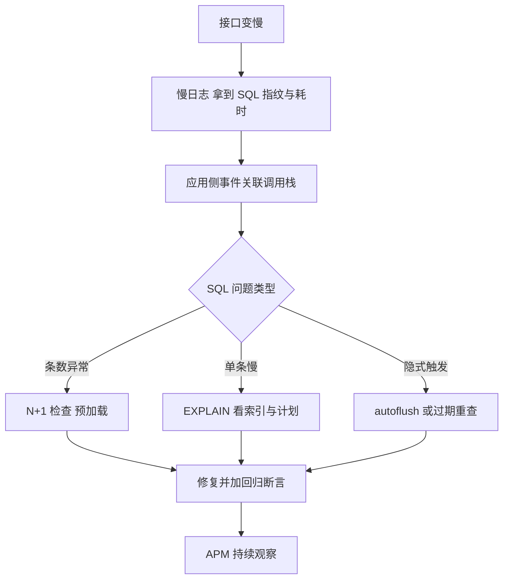

### Q956 · ORM 与缓存结合: 读路径薄缓存与失效

> 难度:★★★★ | 标签:缓存, 架构

**问**:ORM 查询结果能缓存吗?失效怎么做才可靠?

**答**:可以,但只对"按主键取实体"这类稳定查询做薄缓存:cache key = 实体类 + id + 版本,值是可序列化的 DTO(不是 ORM 实体——携带 session 状态)。失效三种策略:一、TTL 短窗(30~60s)容忍短暂陈旧,最简单;二、写路径主动失效——Repository save/commit 后按受影响实体键删除缓存,与 Q178 的旁路缓存一致;三、版本号/代际——表级 version 递增,key 带版本,写一次全部失效(实现简单但写频繁时缓存命中率崩)。纪律:缓存层放 Repository 之上或之下要全团队统一;统计类实时查询不缓存而走物化汇总;永远缓存 DTO,杜绝 detached ORM 对象跨请求复用。

```python
# file: code/04_数据库与缓存/q956_orm_cache.py
"""主键级薄缓存: 读走缓存 写后失效"""
import time

class FakeCache:
    def __init__(self):
        self._data = {}

    def get(self, key):
        item = self._data.get(key)
        if item and item[0] > time.monotonic():
            return item[1]
        return None

    def set(self, key, value, ttl):
        self._data[key] = (time.monotonic() + ttl, value)

    def delete(self, key):
        self._data.pop(key, None)

class UserRepo:
    def __init__(self, db, cache):
        self.db, self.cache = db, cache
        self.hits = self.miss = 0

    def get(self, uid):
        key = f"user:{uid}"
        if (v := self.cache.get(key)) is not None:
            self.hits += 1
            return v
        self.miss += 1
        row = self.db.get(uid)                    # 模拟 DB 查询
        if row:
            self.cache.set(key, row, ttl=60)
        return row

    def save(self, uid, row):
        self.db[uid] = row
        self.cache.delete(f"user:{uid}")          # 写后失效

if __name__ == "__main__":
    db = {1: {"name": "alice"}}
    repo = UserRepo(db, FakeCache())
    print(repo.get(1), "miss")
    print(repo.get(1), "hit")
    repo.save(1, {"name": "alice2"})
    print(repo.get(1), "失效后回源")
    print(f"命中率统计: {repo.hits} hit / {repo.miss} miss")
```

**追问**:
- 为什么缓存 ORM 实体是坑?——实体绑定 session 与懒加载代理,跨请求复用会触发 DetachedInstanceError 或陈旧脏读,DTO 才是缓存的正确单位。
- 表级版本失效的代价?——一次写把该表所有缓存清空,写多的表命中率接近零,只适合配置类、类目类低频写数据。

---

### Q957 · 主键策略: 自增 / UUID / 雪花怎么选

> 难度:★★★☆ | 标签:主键, 选型

**问**:主键用自增、UUID 还是雪花 ID?各自的坑是什么?

**答**:自增 bigint:顺序写入对聚簇索引最友好、8 字节紧凑;坑是分库分表后会冲突、暴露业务量(订单号可被猜测)、依赖单库生成。UUIDv4:全局唯一、客户端可生成;坑是随机性导致页分裂与索引膨胀(36 字符),索引体积与缓存效率都差。雪花 ID(snowflake):64 位 = 时间戳+机器号+序列,趋势递增、分布式可生成,是分库分表首选;坑是时钟回拨(等待或分配新机器号)与机器号管理。折衷方案:内部自增 bigint 做物理主键 + 业务唯一键(order_no)单独维护 + 对外暴露业务键;已有 UUID 表升级 UUIDv7(时间前缀,趋势递增)。

```python
# file: code/04_数据库与缓存/q957_pk_strategy.py
"""雪花 ID 最小实现: 趋势递增 + 时钟回拨保护"""
import threading
import time

class Snowflake:
    def __init__(self, worker: int, ts_bits=41, worker_bits=10, seq_bits=12):
        self.worker = worker
        self.seq = 0
        self.last = -1
        self.ts_bits, self.worker_bits, self.seq_bits = ts_bits, worker_bits, seq_bits
        self.epoch = 1700000000000
        self.lock = threading.Lock()

    def next_id(self) -> int:
        with self.lock:
            ts = int(time.time() * 1000)
            if ts < self.last:                       # 时钟回拨: 等待追平
                ts = self.last
            if ts == self.last:
                self.seq = (self.seq + 1) & ((1 << self.seq_bits) - 1)
                if self.seq == 0:                    # 本毫秒序列耗尽
                    while int(time.time() * 1000) <= self.last:
                        pass
            else:
                self.seq = 0
            self.last = ts
            return ((ts - self.epoch) << (self.worker_bits + self.seq_bits)
                    | (self.worker << self.seq_bits) | self.seq)

if __name__ == "__main__":
    sf = Snowflake(worker=1)
    ids = [sf.next_id() for _ in range(5)]
    print(ids)
    print("趋势递增:", ids == sorted(ids))
    print(f"41 位时间戳可用约 {(1 << 41) / 1000 / 86400 / 365:.0f} 年")
```

**追问**:
- 雪花的机器号怎么分配?——注册中心申请或按 IP/实例编号分配,重复会生成重复 ID,必须集中管理并防复用。
- 对外为什么不直接暴露自增 id?——可被枚举与推断业务量,接口暴露业务键(order_no/uuid),内部表关联才用自增。

---

### Q958 · 时区处理: 存 UTC 的完整纪律

> 难度:★★★☆ | 标签:时区, 数据类型

**问**:用户在东京报了订单时间不对,数据层的时区纪律应该怎么建立?

**答**:铁律是"存储统一 UTC,展示按用户时区渲染":库内 timestamp/datetime 一律 UTC(或 epoch),应用内 datetime 对象必须 timezone-aware;Python 的坑在于 naive datetime 的隐式本地化——用 `datetime.now(timezone.utc)` 代替 `datetime.now()`,反序列化统一 `fromisoformat` + 补时区;转换只在展示层 `astimezone(user_tz)`。数据库会话也显式设置时区(MySQL 连接参数 time_zone='+00:00'),避免"库是 UTC、会话却是本地"的错位。比较运算前统一成 aware,naive 与 aware 相减直接 TypeError,这反而是好防线。

```python
# file: code/04_数据库与缓存/q958_timezone.py
"""UTC 存储 + 按用户时区展示的最小闭环"""
from datetime import datetime, timezone, timedelta

def now_utc() -> datetime:
    return datetime.now(timezone.utc)             # 全库统一时区

def to_user_tz(dt: datetime, offset_hours: int) -> str:
    return dt.astimezone(timezone(timedelta(hours=offset_hours))).strftime(
        "%Y-%m-%d %H:%M")

if __name__ == "__main__":
    ts = now_utc()
    print("库存 UTC:", ts.isoformat())
    print("东京用户(+9):", to_user_tz(ts, 9))
    print("北京用户(+8):", to_user_tz(ts, 8))

    try:
        ts - datetime.now()                        # naive 与 aware 相减
    except TypeError as e:
        print("防线生效:", e)

    legacy = datetime(2026, 11, 1, 12, 0)          # 老数据无时区
    print("旧数据按 UTC 补齐:", legacy.replace(tzinfo=timezone.utc).isoformat())
```

**追问**:
- datetime.now() 错在哪?——返回服务器本地时区的 naive 时间,迁移服务器或容器时区后语义漂移,必须 now(timezone.utc)。
- 夏令时怎么处理?——用 zoneinfo(如 Asia/Tokyo 无 DST 但 America/New_York 有)做转换而不是手写固定偏移,固定偏移在 DST 切换日会错一小时。

---

### Q959 · 枚举字段与状态机: 用代码守住流转

> 难度:★★★☆ | 标签:状态机, 建模

**问**:订单状态字段怎么建模?怎么防止"已取消的订单被发货"?

**答**:两层防线。数据层:状态列存固定枚举(int/str),用 CHECK 约束或枚举类型兜住非法值;ORM 用 Enum 类型映射。代码层:显式状态机——定义合法流转表 {当前态: 允许的目标态},所有变更走 `transition(order, event)` 函数,内部用条件 UPDATE `WHERE status = 期望态` 做 CAS,并发下天然幂等防竞态;禁止业务代码直接赋值 status。衍生需求:流转历史记录(who/when/event)进审计表(Q930)。反面:字符串魔法值散落、if-else 判断状态、直接 UPDATE 不校验前态——这三个是"取消单被发货"事故的温床。

```python
# file: code/04_数据库与缓存/q959_state_machine.py
"""订单状态机: 合法流转表 + 条件 UPDATE 的 CAS"""
import sqlite3
from dataclasses import dataclass

TRANSITIONS = {
    "created": {"paid", "cancelled"},
    "paid": {"shipped", "refunded"},
    "shipped": {"done"},
    "cancelled": set(),
    "refunded": set(),
    "done": set(),
}

@dataclass
class Order:
    id: int
    status: str

def transition(conn, order: Order, target: str) -> bool:
    if target not in TRANSITIONS[order.status]:
        return False
    cur = conn.execute(
        "UPDATE orders SET status = ? WHERE id = ? AND status = ?",
        (target, order.id, order.status))
    conn.commit()
    if cur.rowcount:
        order.status = target
    return cur.rowcount == 1

if __name__ == "__main__":
    conn = sqlite3.connect(":memory:")
    conn.execute("""CREATE TABLE orders (id INTEGER PRIMARY KEY, status TEXT
                    CHECK (status IN ('created','paid','shipped','done','cancelled','refunded')))""")
    conn.execute("INSERT INTO orders VALUES (1, 'created')")
    o = Order(1, "created")

    print("created->paid:", transition(conn, o, "paid"))
    print("paid->shipped:", transition(conn, o, "shipped"))
    print("shipped->cancelled 非法:", transition(conn, o, "cancelled"))
    print("最终状态:", o.status)
```

**追问**:
- 状态机与审计怎么配合?——transition 成功后同步写入流转历史(前后状态、操作人),失败记录拒绝原因,可完整回放订单生命周期。
- 为什么用条件 UPDATE 而不是先读再改?——读改之间并发可能已变更状态,CAS 让数据库在提交点校验,失败即表示竞态,业务按需重试或报错。

---

### Q960 · 唯一业务键: 自然键与代理键的分工

> 难度:★★★☆ | 标签:约束, 建模

**问**:表里既要有自增 id 又要有 order_no,两者关系怎么定?业务键怎么设计?

**答**:分工明确:自增 id(代理键)做物理主键,服务连接、索引与 ORM;业务键(order_no,自然键)承载对外语义与幂等,建唯一索引。业务键设计要点:含时间与随机成分防猜测(时间戳+机器+序列,即雪花思路),或含分片信息支持直路由(Q924);长度固定、字符集收敛(大写字母+数字),便于对账与人工沟通。两者冲突场景:导入/同步时以业务键做 upsert 锚点;主键迁移(分表)时 id 可变而业务键不变。禁令:业务键可变(改订单号)——一旦可变,所有以它为锚的幂等与缓存全部失效,必须设计成不可变。

```python
# file: code/04_数据库与缓存/q960_business_key.py
"""代理键 + 业务键: 生成 order_no 并以此锚定 upsert"""
import secrets
import sqlite3
import time

def gen_order_no() -> str:
    ts = f"{int(time.time() * 1000) % 10**10:010d}"
    return f"PO{ts}{secrets.randbelow(10**4):04d}"     # 时间 + 随机, 不可猜测

if __name__ == "__main__":
    conn = sqlite3.connect(":memory:")
    conn.execute("""CREATE TABLE orders (
        id INTEGER PRIMARY KEY AUTOINCREMENT,
        order_no TEXT NOT NULL UNIQUE, amount INT)""")

    no = gen_order_no()
    for i in range(2):                     # 重复提交同一 order_no
        try:
            conn.execute("INSERT INTO orders (order_no, amount) VALUES (?, ?)",
                         (no, 9900))
            conn.commit()
            print(f"第{i + 1}次提交 {no}: 成功")
        except sqlite3.IntegrityError:
            conn.rollback()
            print(f"第{i + 1}次提交 {no}: 唯一冲突, 幂等返回")
    print("落库:", conn.execute("SELECT id, order_no FROM orders").fetchall())
```

**追问**:
- 业务键要加业务前缀吗?——要,PO/PAY/REF 前缀区分域,跨系统对账一眼识别来源,也避免不同表键值撞车。
- 业务键唯一索引和幂等表什么关系?——同一机制的两面:业务键唯一索引天然提供幂等锚点,无业务键的接口才需要独立的 request_id 幂等表。

---

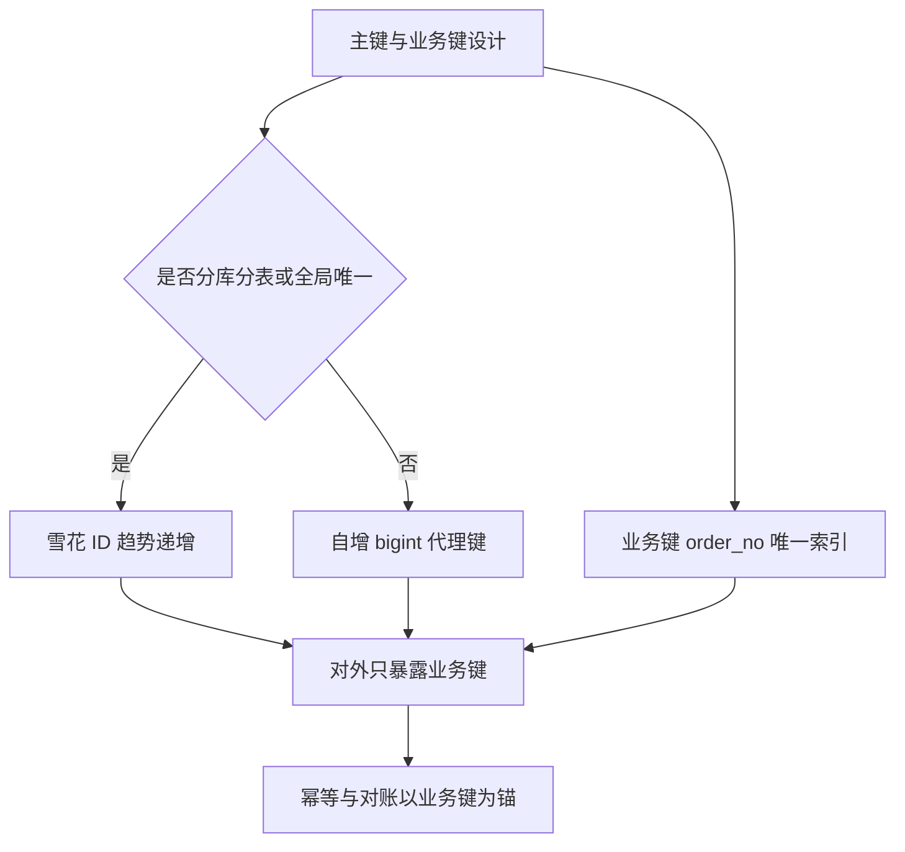

### Q961 · 数据校验分层: Pydantic 在哪一层把关

> 难度:★★★☆ | 标签:Pydantic, 架构

**问**:请求校验、领域规则、数据库约束三层校验各管什么?会重复吗?

**答**:三层各司其职、深度递增:入口层(Pydantic)管"形状"——类型、必填、长度、格式,拒绝畸形请求并返回友好 422;领域层管"语义"——库存够不够、状态能不能流转,这是业务规则不是校验库的事;数据库层管"不变量"——唯一、外键、NOT NULL、CHECK,是并发下最后的真相防线。三者不重复而是递进:Pydantic 防意外,领域层防业务错误,数据库约束防程序 bug 与并发。常见错误是把"手机号唯一"只写在 Pydantic(先查后插有竞态,Q925)或把"邮箱格式"写进数据库 CHECK(迁移地狱)。原则:能并发发生的一切不变量必须有数据库约束兜底。

```python
# file: code/04_数据库与缓存/q961_pydantic_layers.py
"""三层校验: Pydantic 形状 -> 领域语义 -> 数据库约束"""
try:
    from pydantic import BaseModel, Field, field_validator
except ImportError:
    print("该题演示需要第三方库 pydantic:pip install pydantic,原理见正文")
    raise SystemExit(0)

class CreateOrderReq(BaseModel):
    sku: str = Field(min_length=1, max_length=32)
    qty: int = Field(gt=0, le=1000)

    @field_validator("sku")
    @classmethod
    def sku_charset(cls, v):
        if not v.isalnum():
            raise ValueError("sku 只允许字母数字")
        return v

STOCK = {"x": 5}

def domain_check(req) -> None:                 # 领域层: 业务语义
    if STOCK.get(req.sku, 0) < req.qty:
        raise ValueError("库存不足")

def db_write(req) -> bool:                     # 数据库层: 不变量
    import sqlite3
    conn = sqlite3.connect(":memory:")
    conn.execute("CREATE TABLE o (id INTEGER PRIMARY KEY, sku TEXT UNIQUE, qty INT)")
    try:
        conn.execute("INSERT INTO o (sku, qty) VALUES (?, ?)", (req.sku, req.qty))
        return True
    except sqlite3.IntegrityError:
        return False                            # 并发下最后防线

if __name__ == "__main__":
    try:
        CreateOrderReq(sku="x#bad", qty=1)
    except Exception as e:
        print("形状校验拒绝:", type(e).__name__)
    req = CreateOrderReq(sku="x", qty=99)
    try:
        domain_check(req)
    except ValueError as e:
        print("领域校验拒绝:", e)
    req2 = CreateOrderReq(sku="x", qty=2)
    domain_check(req2)
    print("落库:", db_write(req2))
```

**追问**:
- Pydantic 校验和 ORM 模型校验重复了怎么办?——ORM 的 nullable/length 是数据库映射不是业务校验,入口 DTO 与 ORM 模型职责不同,少量重复是必要冗余。
- 错误信息怎么统一?——Pydantic 的报错映射成标准 422 结构,领域错误转 409/400,数据库 IntegrityError 不直接透出,统一包装避免泄漏 schema。

---

### Q962 · ORM 下的 exists 与计数: 别把整表拉回来

> 难度:★★★☆ | 标签:SQLAlchemy, 性能

**问**:判断"用户是否有订单"和"统计订单数",ORM 怎么写才不浪费?

**答**:存在性判断用 EXISTS:`select(exists().where(Order.user_id == uid))` 或 `session.query(exists)`,数据库找到第一行即返回,永远比 `len(session.scalars(select(Order)).all()) == 0` 快——后者把所有行拉回 Python。计数用 `select(func.count()).select_from(Order).where(...)`,并确认走了覆盖索引(小索引计数更快);只需要"有没有"就别 count。常见反模式:对列表结果取 len(先查全部再数)、循环内逐条 exists(合并成一次 IN 查询)、大表精确 count(改估算或计数器表,Q872)。ORM 层封装 exists/count 两个 Repository 方法,业务禁用 len(query.all())。

```python
# file: code/04_数据库与缓存/q962_exists_count.py
"""exists 与 count 的正确写法 vs 反模式"""

try:
    from sqlalchemy import create_engine, select, func, exists
    from sqlalchemy.orm import Session, DeclarativeBase, Mapped, mapped_column
except ImportError:
    print("该题演示需要第三方库 sqlalchemy:pip install sqlalchemy>=2.0,原理见正文")
    raise SystemExit(0)

class Base(DeclarativeBase):
    pass

class Order(Base):
    __tablename__ = "orders"
    id: Mapped[int] = mapped_column(primary_key=True)
    user_id: Mapped[int]

if __name__ == "__main__":
    engine = create_engine("sqlite://")
    Base.metadata.create_all(engine)
    with Session(engine) as s:
        s.add_all([Order(user_id=1) for _ in range(100)])
        s.commit()

        # 正确: exists 谓词, 找到一行即短路
        has = s.scalar(select(exists().where(Order.user_id == 1)))
        print("EXISTS 判存在:", has)

        # 正确: 数据库端 count
        n = s.scalar(select(func.count()).select_from(Order)
                     .where(Order.user_id == 1))
        print("COUNT:", n)

        # 反模式对照(仅演示, 禁止上线):
        rows = s.scalars(select(Order).where(Order.user_id == 1)).all()
        print("反模式 len(rows):", len(rows), "<- 拉回 100 行只为判断 0/1")
```

**追问**:
- exists 在 SQLite/MySQL 都会短路吗?——会,EXISTS 语义就是找到即真,优化器对它有专门路径,与 LIMIT 1 效果等价但意图更清晰。
- 为什么 count 也要挑索引?——count 是"数最小的树",覆盖索引比聚簇索引窄,扫描页数少;大表配合估算或计数器方案。

---

### Q963 · 批量更新: CASE WHEN 与 executemany 对比

> 难度:★★★☆ | 标签:SQLAlchemy, 批量

**问**:一次更新 5000 个商品的价格,逐条 UPDATE、executemany、CASE WHEN 三种写法怎么选?

**答**:逐条 UPDATE + 每条 commit 是最差路径:N 次往返 × N 个事务,网络与 fsync 都乘 N。executemany(参数数组)一次往返完成 N 行同构更新,是默认选择;各行更新表达式不同(如按 id 定价)时,SQLAlchemy 的 `update(Table).where(...), [{...}]` executemany 形态同样适用。CASE WHEN 单语句形态 `UPDATE t SET price = CASE id WHEN 1 THEN .. WHEN 2 THEN .. END WHERE id IN (..)` 适合极小批量且要求单语句原子;大批量 CASE 语句解析成本高、SQL 超长,不如 executemany。批量级数万行时再叠加分批提交(Q896)。MySQL 还可 INSERT..ON DUPLICATE KEY UPDATE 做批量 upsert。

```python
# file: code/04_数据库与缓存/q963_batch_update.py
"""三种批量更新路径的耗时对比"""
import sqlite3
import time

if __name__ == "__main__":
    conn = sqlite3.connect(":memory:")
    conn.execute("CREATE TABLE goods (id INTEGER PRIMARY KEY, price REAL)")
    N = 5000
    conn.executemany("INSERT INTO goods (price) VALUES (?)",
                     [(i * 1.0,) for i in range(N)])

    def bench(label, fn):
        t0 = time.perf_counter()
        fn()
        print(f"{label}: {(time.perf_counter() - t0) * 1000:.0f} ms")

    def per_row():
        c = sqlite3.connect(":memory:")
        c.execute("CREATE TABLE goods (id INTEGER PRIMARY KEY, price REAL)")
        c.executemany("INSERT INTO goods (price) VALUES (?)",
                      [(i * 1.0,) for i in range(N)])
        for i in range(1, N + 1):
            c.execute("UPDATE goods SET price = price * 2 WHERE id = ?", (i,))
        c.commit()

    def executemany_style():
        data = [(i * 3.0, i) for i in range(1, N + 1)]
        conn.executemany("UPDATE goods SET price = ? WHERE id = ?", data)
        conn.commit()

    def case_when():
        ids = list(range(1, 101))               # 小批量示例
        whens = " ".join(f"WHEN {i} THEN {i * 9.0}" for i in ids)
        conn.execute(f"UPDATE goods SET price = CASE id {whens} END "
                     f"WHERE id IN ({','.join(map(str, ids))})")
        conn.commit()

    bench("逐条 UPDATE 含建库", per_row)
    bench("executemany 5000 行", executemany_style)
    bench("CASE WHEN 100 行", case_when)
```

**追问**:
- executemany 真的只发一条 SQL 吗?——协议上是一条语句复用 + N 组参数(SQLite/MySQL 批量绑定),省掉的是解析与往返,不是 N 次行写。
- 什么时候必须分批提交?——单批影响行数过大导致锁与 undo 堆积时(经验 1 万行级),批量内部再切片 commit。

---

### Q964 · ORM 测试: mock 到什么程度才对

> 难度:★★★☆ | 标签:测试, mock

**问**:单元测试该 mock 掉 Repository 还是连真库?两类测试的分工是什么?

**答**:分工:单元测试 mock Repository(Protocol 接口 + 内存假实现),验证业务逻辑分支,毫秒级、无 IO;集成测试连真库(SQLite 内存或容器化 MySQL)验证 SQL 正确性、约束、事务与迁移。错误方向一:全部 mock——SQL 拼错、约束失效、事务边界问题全测不出来;方向二:全部连真库——慢、数据残留、并发场景难构造。工程要点:Repository 用 Protocol 定义(Q947),测试替身注入;集成测试用事务回滚夹具(Q931)保干净;对"同一查询"在 SQLite 与生产库都要有冒烟(方言差异)。mock 的边界判断标准:被 mock 的对象是否是"你正在验证的行为"——验证业务规则时 DB 是边界,验证数据访问时 DB 是主体。

```python
# file: code/04_数据库与缓存/q964_mock_boundary.py
"""内存 Repository 替身 + 真库集成测试 双层验证"""
from dataclasses import dataclass, field

@dataclass
class User:
    name: str
    active: bool = True

class UserRepo(Protocol := object):            # 生产实现签名
    def add(self, u: User) -> None: ...
    def count_active(self) -> int: ...

class MemoryRepo:                              # 单测替身
    def __init__(self):
        self.data: list[User] = []
    def add(self, u):
        self.data.append(u)
    def count_active(self):
        return sum(1 for u in self.data if u.active)

class Business:
    def __init__(self, repo):
        self.repo = repo
    def register(self, name):
        u = User(name=name)
        self.repo.add(u)
        return self.repo.count_active()

def integration_test():
    """真库集成: 验证 SQL 与约束"""
    import sqlite3
    conn = sqlite3.connect(":memory:")
    conn.execute("CREATE TABLE users (name TEXT PRIMARY KEY, active INT)")
    try:
        conn.execute("INSERT INTO users VALUES ('a', 1)")
        conn.execute("INSERT INTO users VALUES ('a', 1)")   # 唯一约束
    except sqlite3.IntegrityError:
        return "集成测试: 唯一约束生效, 重复插入被拒"
    return "集成测试: 通过"

if __name__ == "__main__":
    biz = Business(MemoryRepo())
    print("单测: 注册后活跃数 =", biz.register("alice"))
    print(integration_test())
```

**追问**:
- mock 和内存替身哪个好?——优先手写内存替身(行为稳定可复用),mock 框架适合验证"调用是否发生"这类交互断言,不要用 mock 复杂模拟 SQL 行为。
- 集成测试的库怎么起?——CI 用 testcontainers 起真 MySQL,本地单跑可用 SQLite 内存,两档配置由环境变量切换。

---

### Q965 · 综合案例: 订单数据访问层完整设计

> 难度:★★★★★ | 标签:架构, 综合案例

**问**:给订单服务设计数据访问层:要求幂等下单、乐观锁更新、游标分页查询、软删过滤、事务统一。给出结构并落地核心代码。

**答**:分层自下而上:模型层(declarative Base + 审计字段 + version + 业务唯一键)→ Repository(订单专用,接口 Protocol 定义于领域层)→ Unit of Work(session 生命周期与提交)→ Service(业务编排,事务边界)。四个硬约束的落点:幂等靠 order_no 唯一索引 + upsert;并发靠 version 字段条件 UPDATE;分页 keyset 以 (created_at, id) 为游标;软删用 with_loader_criteria 全局过滤(Q929)。这个案例是把本册所有题目串起来的"面试大题",回答时先画分层图再逐点说明每个约束在哪一层实现,最后强调测试策略(内存 repo 单测 + 真库集成)。

```python
# file: code/04_数据库与缓存/q965_order_da_case.py
"""订单数据访问层综合: UoW + Repository + 幂等 + 乐观锁 + 游标分页"""
from __future__ import annotations
from typing import Protocol

try:
    from sqlalchemy import (create_engine, select, func, event)
    from sqlalchemy.dialects.sqlite import insert as sqlite_insert
    from sqlalchemy.orm import (Session, DeclarativeBase, Mapped, mapped_column,
                                with_loader_criteria)
except ImportError:
    print("该题演示需要第三方库 sqlalchemy:pip install sqlalchemy>=2.0,原理见正文")
    raise SystemExit(0)

class Base(DeclarativeBase):
    pass

class Order(Base):
    __tablename__ = "orders"
    id: Mapped[int] = mapped_column(primary_key=True)
    order_no: Mapped[str] = mapped_column(unique=True)
    amount: Mapped[int]
    status: Mapped[str] = mapped_column(default="created")
    version: Mapped[int] = mapped_column(default=0)
    deleted: Mapped[bool] = mapped_column(default=False)

class UoW:
    def __init__(self, engine):
        self.session = Session(engine)

    def __enter__(self):
        return self.session

    def __exit__(self, exc_type, *_):
        if exc_type is None:
            self.session.commit()
        else:
            self.session.rollback()
        self.session.close()

class OrderRepo:
    def __init__(self, session: Session):
        self.s = session

    def create(self, order_no: str, amount: int) -> Order | None:
        """幂等创建: 冲突处理下沉到数据库, 不污染 session 状态"""
        stmt = (sqlite_insert(Order.__table__)
                .values(order_no=order_no, amount=amount)
                .on_conflict_do_nothing(index_elements=["order_no"]))
        self.s.execute(stmt)                     # 冲突则 0 行, 不抛异常
        return self.s.scalars(
            select(Order).where(Order.order_no == order_no)).first()

    def pay(self, order_id: int, version: int) -> bool:
        n = self.s.execute(
            Order.__table__.update()
            .where(Order.id == order_id, Order.version == version)
            .values(status="paid", version=version + 1)).rowcount
        return n == 1

    def page_by_cursor(self, last_id: int = 0, size: int = 2):
        stmt = (select(Order).where(Order.id > last_id)
                .order_by(Order.id).limit(size))
        return self.s.scalars(stmt).all()

if __name__ == "__main__":
    engine = create_engine("sqlite://")
    Base.metadata.create_all(engine)

    with UoW(engine) as uow:                  # 幂等下单
        repo = OrderRepo(uow)
        first = repo.create("PO1", 9900)
        dup = repo.create("PO1", 9900)
        print("首次创建:", first is not None,
              "重复返回已有订单:", dup is first, "<- identity map 同一实例")

    with UoW(engine) as uow:                  # 乐观锁支付
        repo = OrderRepo(uow)
        o = uow.scalars(select(Order)).first()
        print("version=0 支付:", repo.pay(o.id, 0))
        print("version=0 重复支付:", repo.pay(o.id, 0), "<- 已被拒绝")

    with UoW(engine) as uow:
        repo = OrderRepo(uow)
        rows = repo.page_by_cursor(size=1)
        print("游标第1页:", [r.order_no for r in rows],
              "下一页锚点:", rows[-1].id)
```

**追问**:
- create 为什么用 Core 的 on_conflict_do_nothing 而不是 ORM add + flush?——ORM flush 撞唯一约束会让整个 session 进入待回滚状态,必须整体 rollback 才能继续;Core upsert 把冲突处理下沉到数据库,session 与事务不受污染,批量场景也更高效。
- 软删过滤在哪注入?——用 do_orm_execute 事件统一加 with_loader_criteria(参照 Q929),Repository 内不重复手写。

---

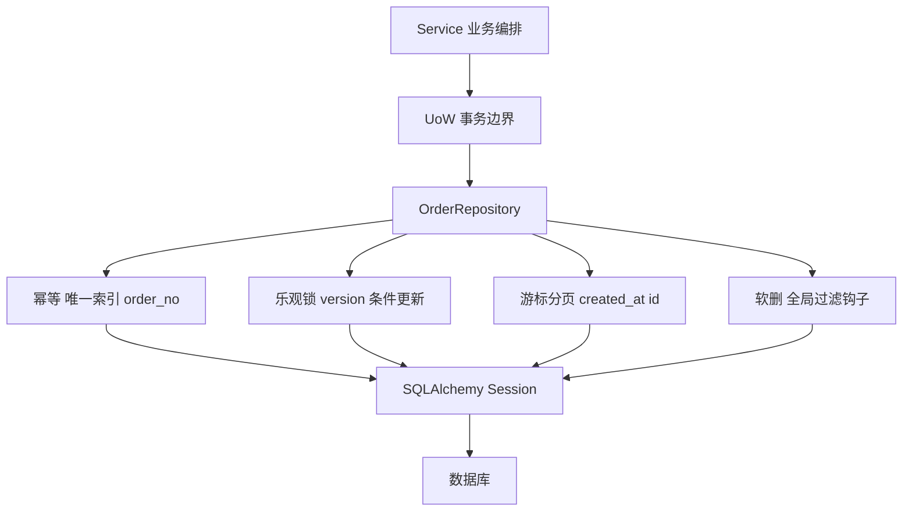


