# 第 4 类 · 数据库与缓存(55)

本册聚焦 Redis 与分布式:对象编码与大 key、pipeline/Lua 原子性、分布式锁工程化(可重入/看门狗/Redlock)、缓存一致性(双删/binlog/多级)、布隆过滤器、三种限流器、zset 排行榜与延迟队列、Stream 消息体系、全局 ID、分布式事务概念(TCC/SAGA/本地消息表)、集群与哨兵、容器化与运维细节。
示例以标准库模拟 Redis 语义为主(可独立运行),涉及 redis-py 的部分用 try/except 降级;概念题(TCC/SAGA/槽分片)给出可运行的最小模型。
读法建议:每题先抓住"一致性/原子性/性能"三个矛盾中的主矛盾,再看代码验证。

---

### Q966 · Redis 对象编码: ziplist / listpack / skiplist

> 难度:★★★★ | 标签:Redis, 底层结构

**问**:Redis 的 zset 底层是什么?为什么小数据用 ziplist/listpack,大数据才用 skiplist?

**答**:每种类型按数据量动态选编码:小体量时 hash/zset/list 用 ziplist(Redis 7 起为 listpack,紧凑连续内存、省指针),超过阈值(如 zset 128 个元素或单值 64 字节,listpack-max-xxx 配置)转为 skiplist+dict 双结构。zset 的 skiplist 维护按 score 排序的跳表实现范围查询,dict 维护 member->score 实现 O(1) 查分,两者共享元素。意义:小集合全在一段连续内存,缓存友好且省内存;大集合才值得付出多结构代价。面试要点:能说出"编码随阈值切换"与"zset 双结构分工"即可,极端细节(listpack 与 ziplist 的级联更新差异)属于加分项。

```python
# file: code/04_数据库与缓存/q966_encoding.py
"""模拟编码切换阈值 + zset 双结构分工; 有 redis 时打印真实 OBJECT ENCODING"""
import sys

THRESHOLDS = {"list-max-listpack-size": 128, "hash-max-listpack-entries": 128,
              "zset-max-listpack-entries": 128, "zset-max-listpack-value": 64}

class MiniZSet:
    """listpack 阶段: 单列表; 超阈值升级 skiplist+dict 双结构"""
    def __init__(self):
        self.mode = "listpack"
        self.pairs = []          # [(member, score)]
        self.dict = {}           # member -> score

    def add(self, member, score):
        if self.mode == "listpack":
            self.pairs.append((member, score))
            if len(self.pairs) > THRESHOLDS["zset-max-listpack-entries"] or \
               len(member) > THRESHOLDS["zset-max-listpack-value"]:
                self.mode = "skiplist"
                self.dict = dict(self.pairs)
        else:
            self.dict[member] = score

if __name__ == "__main__":
    z = MiniZSet()
    for i in range(THRESHOLDS["zset-max-listpack-entries"] + 1):
        z.add(f"m{i}", i)
    print("元素超阈值后编码:", z.mode, "<- listpack 升级为 skiplist")
    print("skiplist 管 zrangebyscore, dict 管 zscore, 两者共享元素")

    try:
        import redis
        r = redis.Redis(decode_responses=True)
        r.zadd("enc_demo", {"a": 1})
        print("真实编码(小 zset):", r.object("ENCODING", "enc_demo"))
        r.delete("enc_demo")
    except Exception as e:
        print("无可用 redis, 仅演示:", type(e).__name__)
```

**追问**:
- listpack 相比 ziplist 改进了什么?——取消了 prevlen 的连锁更新问题,每项只记自身长度,最坏插入从 O(n方) 降为 O(n)。
- 怎么观察线上对象的真实编码?——`OBJECT ENCODING key` 与 `redis-cli --bigkeys`,大 key 治理前先确认它处在哪个编码阶段。

---

### Q967 · 大 key 扫描与拆分

> 难度:★★★★ | 标签:Redis, 大 key

**问**:什么是大 key?怎么发现?怎么拆分和删除而不阻塞线上?

**答**:大 key 指 value 过大(如几百万元素的 hash/list、几 MB 的 string),危害是读写慢、阻塞单线程、主从同步与迁移卡顿、内存倾斜。发现手段:`redis-cli --bigkeys`(采样)、SCAN 全量分析内存、RDB 离线分析工具。治理三板斧:一、拆分——hash 按 field 哈希分成 N 个子键(field->field%N),list 按时间分段;二、压缩与瘦身——value 序列化压缩、过期字段清理;三、异步删除——4.0+ 用 UNLINK(后台线程回收)代替 DEL,大批量用 SCAN 分批删除,严禁直接 DEL 千万元素 key。写路径设计阶段就该限制单 key 规模,是"设计问题"不是"清理问题"。

```python
# file: code/04_数据库与缓存/q967_big_key_scan.py
"""SCAN 游标遍历找大 key + hash 分片拆分 + 分批删除"""
import json

def scan_all(store, cursor=0, batch=3):
    """模拟 SCAN: 返回 批内keys, 新cursor; cursor=0 表示结束"""
    keys = sorted(store.keys())
    if cursor >= len(keys):
        return [], 0
    chunk = keys[cursor:cursor + batch]
    nxt = cursor + batch
    return chunk, nxt if nxt < len(keys) else 0

def big_keys(store, limit=20):
    found = []
    c = 0
    while True:
        chunk, c = scan_all(store, c)
        for k in chunk:
            size = len(json.dumps(store[k]).encode())
            if size > limit:
                found.append((k, size))
        if c == 0:
            break
    return found

def split_hash(big_value, shards=4):
    out = {f"hash:{i}": {} for i in range(shards)}
    for field, v in big_value.items():
        out[f"hash:{hash(field) % shards}"][field] = v
    return out

if __name__ == "__main__":
    store = {"user:1": {"name": "a"}, "feed:2": {f"p{i}": "x" * 30 for i in range(50)}}
    print("大 key 扫描:", big_keys(store))
    big = store["feed:2"]
    parts = split_hash(big)
    print("拆分后:", {k: len(v) for k, v in parts.items()})
    print("删除用 UNLINK 分批: 每次 SCAN 取一批 UNLINK, 避免单次 DEL 阻塞")
```

**追问**:
- 为什么不能用 KEYS 找大 key?——KEYS 一次性遍历全库阻塞单线程,生产禁用;SCAN 游标分批、可中断、复杂度仍 O(N) 但摊薄到每次调用。
- hash 拆分后怎么"整体取回"?——应用层聚合 N 个子键(并行 MGET/HGETALL),跨片统计的成本是拆分的代价,设计时要评估读模式。

---

### Q968 · Pipeline 与 Lua: 批量与原子性的两种武器

> 难度:★★★★ | 标签:Redis, 原子性

**问**:Pipeline 和 Lua 脚本都能减少往返,它们的本质区别是什么?

**答**:Pipeline 解决网络往返:把 N 条命令打包一次发送、一次收齐,省 N-1 个 RTT,但服务端仍逐条执行,中间可能插入其他客户端命令——不保证原子性。Lua 脚本由 EVAL 执行,整个脚本在 Redis 单线程里一次跑完,天然原子,且能在命令间做逻辑判断(读-算-写),这是 pipeline 做不到的。选型:纯批量读写(INCR 一堆、MGET 一批)用 pipeline;需要"检查再写"的复合逻辑(限流、扣库存、锁)必须 Lua。注意 Lua 里别做重计算与阻塞调用,脚本超时会卡住整个实例(`lua-time-limit` 超时不会中断脚本,只会让实例进入 BUSY 并拒绝新命令;需 `SCRIPT KILL` 或 `SHUTDOWN NOSAVE`。Redis 7 起允许 KILL 已执行写命令的脚本,但脚本仍不会被自动中断)。

```python
# file: code/04_数据库与缓存/q968_pipeline_vs_lua.py
"""模拟: pipeline 批量但可被并发插入, Lua 脚本原子执行"""
import threading

class FakeServer:
    def __init__(self):
        self.kv = {}
        self.lock = threading.Lock()

    def exec_pipeline(self, cmds):
        """pipeline: 一次传输, 但逐条执行, 中间可能插队"""
        results = []
        for op, k, v in cmds:
            with self.lock:
                if op == "set":
                    self.kv[k] = v
                results.append(("ok", k))
            time_would_allow_interruption = None  # 真实 redis 此处可能执行他人命令
        return results

    def eval_atomic(self, script):
        """lua: 整段脚本作为单命令原子执行"""
        with self.lock:
            before = dict(self.kv)
            script(self.kv)                      # 脚本内部无需再加锁
            return before, dict(self.kv)

if __name__ == "__main__":
    srv = FakeServer()
    cmds = [("set", "k1", 1), ("set", "k2", 2), ("set", "k3", 3)]
    print("pipeline 结果:", srv.exec_pipeline(cmds))

    def transfer(store):                         # 等价 lua: 转账两步
        store["a"] = store.get("a", 100) - 30
        store["b"] = store.get("b", 0) + 30
    before, after = srv.eval_atomic(transfer)
    print("lua 原子: before a=%s b=%s -> after a=%s b=%s"
          % (before.get("a"), before.get("b"), after["a"], after["b"]))
```

**追问**:
- pipeline 会阻塞其他客户端吗?——服务端收包后逐条执行,单条极快所以无感;但一次灌入百万条会让响应缓冲膨胀,分批 1000 条左右为宜。
- Lua 里能用随机结果吗?——带随机写的脚本在主从与 AOF 重放时会产生差异,Redis 限制随机命令后必须返回确定性结果(细节见 redis 文档)。

---

### Q969 · Lua 脚本编写要点: KEYS/ARGV 与集群约束

> 难度:★★★★ | 标签:Redis, Lua

**问**:写一个"扣库存"的 Lua 脚本要注意什么?KEYS 和 ARGV 为什么必须分清?

**答**:模板:`EVAL "script" numkeys key1 key2 arg1 arg2`。要点:一、所有键走 KEYS 传参,数值与业务参数走 ARGV——Redis Cluster 按脚本声明的 KEYS 计算槽位,把键写死在脚本字符串里会在集群下报错(交叉槽);二、脚本返回单值(整数/字符串/表),客户端解析注意 null 与整数截断(Lua number 到 RESP);三、保持脚本短小、幂等,失败重试安全;四、复杂度控制在常数时间,禁止循环大量数据。扣库存经典脚本:GET 校验足够则 DECR 返回 1,否则返回 0,全程原子,替代"先 GET 再 DECR"的竞态。

```python
# file: code/04_数据库与缓存/q969_lua_stock.py
"""用 Python 函数模拟 EVAL 扣库存脚本, 展示 KEYS/ARGV 分离与原子性"""
import threading

STOCK_LUA = """
local stock = tonumber(redis.call('GET', KEYS[1]) or '-1')
local want  = tonumber(ARGV[1])
if stock >= want then
  return redis.call('DECRBY', KEYS[1], want)
else
  return -1
end
"""

class FakeRedis:
    def __init__(self):
        self.store = {"stock:1": 10}
        self.lock = threading.Lock()

    def eval(self, script, keys, args):
        """逐行解释脚本语义的等价实现(教学用)"""
        with self.lock:                          # redis 单线程: 脚本天然原子
            key, want = keys[0], int(args[0])
            stock = int(self.store.get(key, -1))
            if stock >= want:
                self.store[key] = stock - want
                return self.store[key]
            return -1

if __name__ == "__main__":
    r = FakeRedis()
    print("脚本:\n" + STOCK_LUA.strip())
    print("扣 5 件 ->", r.eval(STOCK_LUA, ["stock:1"], [5]))
    print("再扣 6 件 ->", r.eval(STOCK_LUA, ["stock:1"], [6]), "<- 不足返回 -1")
    print("剩余:", r.store["stock:1"])
```

**追问**:
- 集群下两个键不在同一槽会怎样?——脚本报 CROSSSLOT 错误,解法是 hash tag(如 {order1}:stock 与 {order1}:pay 强制同槽)或拆脚本。
- 脚本缓存怎么做?——生产用 SCRIPT LOAD + EVALSHA 避免每次传脚本体,注意主从切换后 NOSCRIPT 需重载。

---

### Q970 · 可重入分布式锁: hash 结构与 owner 校验

> 难度:★★★★ | 标签:分布式锁, Redis

**问**:SETNX 锁怎么升级成可重入锁?同一线程重复加锁与误删他人的锁分别怎么处理?

**答**:可重入锁用 hash 而不是 string:key 存 `{owner: holder_id, count: 重入次数}`,加锁 Lua:若 key 不存在或 owner 匹配则 hincrby count、重设 TTL、返回成功;否则失败。解锁 Lua:owner 匹配才 hincrby -1,count 归零则 DEL,防止 A 超时后 B 获锁、A 回来删掉 B 的锁——这是 SETNX 锁最经典的误删事故,owner(token)校验是底线。重入场景:同一线程内嵌套调用同一临界区(方法 A 调方法 B 都加了同一把锁)。TTL 必须与加锁同命令设置(SET NX EX),避免"加了锁没来得及设过期就宕机"的死锁。续期问题交给看门狗(Q972)。

```python
# file: code/04_数据库与缓存/q970_reentrant_lock.py
"""可重入锁: hash 计数 + owner 校验 + TTL, 纯标准库模拟"""
import time
import uuid

class FakeRedis:
    def __init__(self):
        self.h = {}
        self.ttl = {}

    def lock_lua(self, key, owner, ttl):
        rec = self.h.get(key)
        if rec is None or rec["owner"] == owner:
            cnt = rec["count"] + 1 if rec else 1
            self.h[key] = {"owner": owner, "count": cnt}
            self.ttl[key] = time.monotonic() + ttl
            return 1
        return 0

    def unlock_lua(self, key, owner):
        rec = self.h.get(key)
        if rec and rec["owner"] == owner:
            rec["count"] -= 1
            if rec["count"] == 0:
                del self.h[key], self.ttl[key]
            return 1
        return 0

    def expired(self, key):
        return key in self.ttl and time.monotonic() > self.ttl[key]

class ReentrantLock:
    def __init__(self, r, key, ttl=2.0):
        self.r, self.key, self.ttl = r, key, ttl
        self.owner = uuid.uuid4().hex

    def acquire(self):
        return self.r.lock_lua(self.key, self.owner, self.ttl) == 1

    def release(self):
        return self.r.unlock_lua(self.key, self.owner) == 1

if __name__ == "__main__":
    r = FakeRedis()
    lock = ReentrantLock(r, "order:1")
    print("第一次加锁:", lock.acquire())
    print("同 owner 重入:", lock.acquire(), "<- count=2")
    other = ReentrantLock(r, "order:1")
    print("他人加锁被拒:", other.acquire() == 0)
    print("释放一层:", lock.release(), "仍持有:", lock.r.h.get("order:1"))
    print("再释放:", lock.release(), "锁已删除:", "order:1" not in r.h)
```

**追问**:
- owner 用什么生成?——每客户端实例一次的 UUID,而不是线程 id(跨进程无意义);校验是"是否同一持有者实例"。
- 释放时 owner 校验失败说明什么?——大概率锁已过期被他人持有,当前调用者应视为"加锁失败路径"处理业务,而不是强行删锁。

---

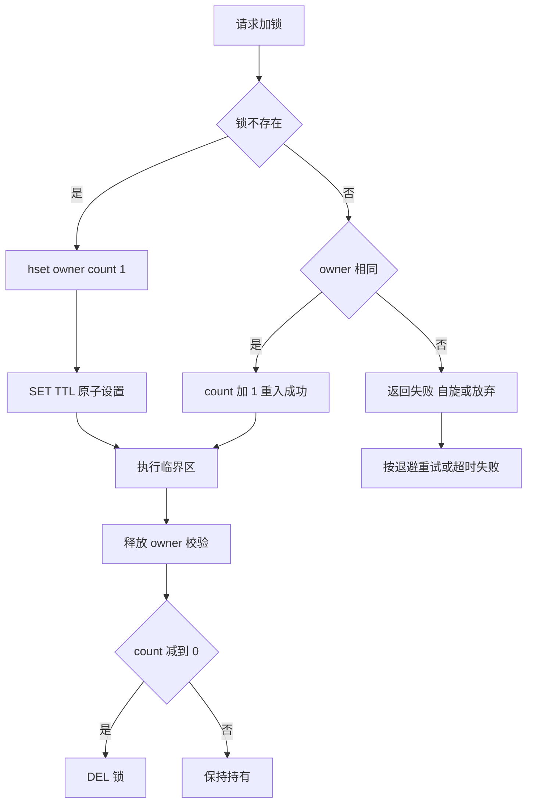

---

### Q971 · Redlock 争议与工程取舍

> 难度:★★★★★ | 标签:分布式锁, 一致性

**问**:Redlock 是什么?Martin Kleppmann 与 antirez 的争论核心是什么?工程上怎么选?

**答**:Redlock 向 N 个独立 Redis 节点依次加同一把锁,多数派(>N/2)成功且总耗时小于锁有效期才算获锁,意图解决单点故障导致的锁丢失。争议:Martin 指出锁的正确性依赖时间假设——客户端 GC 停顿/时钟跳变会让"未过期"的锁实际已失效,Redlock 无法给出绝对安全,必须配合 fencing token(递增令牌,存储端拒绝旧令牌写);antirez 回应时钟问题可控且 fencing 需要存储端配合、弱化了 Redis 锁的意义。工程取舍:如果锁只做"效率优化"(防重复计算),单实例 SET NX EX + owner 校验足够;如果锁保护"正确性"(资金),不要指望任何基于租约的锁,用数据库唯一约束/条件更新或 zk/etcd 这类共识系统,并在设计上让误持锁的后果可恢复。

```python
# file: code/04_数据库与缓存/q971_redlock_quorum.py
"""Redlock 多数派获取模拟 + fencing token 概念"""
import time

class Node:
    def __init__(self, name, fail=False):
        self.name, self.locked, self.fail = name, None, fail

    def lock(self, token, ttl):
        if self.fail:
            return False
        self.locked = token
        return True

def redlock(nodes, token, ttl=1.0):
    won = [n for n in nodes if n.lock(token, ttl)]
    return len(won) > len(nodes) // 2, [n.name for n in won]

if __name__ == "__main__":
    nodes = [Node(f"n{i}") for i in range(5)]
    nodes[3].fail = True                      # 一个节点故障
    ok, won = redlock(nodes, "t1")
    print("多数派获锁:", ok, "赢得节点:", won)

    # fencing token: 存储端拒绝旧令牌
    class Store:
        def __init__(self):
            self.max_token = 0
        def write(self, token):
            if token <= self.max_token:
                return "rejected: 旧令牌"
            self.max_token = token
            return "ok"
    store = Store()
    print("持锁方写入 token=7:", store.write(7))
    print("停顿后旧会话写入 token=7:", store.write(7), "<- fencing 兜底")
```

**追问**:
- fencing token 从哪来?——由锁服务或存储侧提供单调递增号(如版本号、zk 的 zxid),Redis 本身不产生,需要额外组件,这正是争论的实用要点。
- 多数派获锁后某节点宕机算持锁吗?——Redlock 语义下算,但少数派恢复后可能残留旧锁信息,依赖各节点 TTL 自动过期收敛。

---

### Q972 · 看门狗续期: 长任务不丢锁

> 难度:★★★★ | 标签:分布式锁, 看门狗

**问**:锁的 TTL 设多长都尴尬——太短业务没做完就丢锁,太长宕机后死等。看门狗怎么解决?

**答**:看门狗(watchdog)在持锁期间用后台线程周期性(如每 TTL/3)把 TTL 重置回满值,只要业务线程存活,锁就不过期;进程崩溃后无人续期,锁在 TTL 内自然释放,兼顾"不丢锁"与"不死锁"。实现要点:续期必须校验 owner(否则给别人的锁续命),Lua 完成"校验+expire"原子操作;业务完成时先停止看门狗再释放锁;续期线程要与业务线程解耦(独立线程或定时器),业务线程阻塞但进程存活时锁依然有效——这正是与"业务自身周期性续期"的差异。Redisson 的 watchdog 默认 30s TTL、每 10s 续期,是这个模式的标准实现。

```python
# file: code/04_数据库与缓存/q972_watchdog.py
"""看门狗: 后台线程周期续期, 演示长任务全程持锁"""
import threading
import time
import uuid

class LockStore:
    def __init__(self):
        self.locks = {}

    def try_lock(self, key, owner, ttl):
        rec = self.locks.get(key)
        if rec is None or time.monotonic() > rec["expire"]:
            self.locks[key] = {"owner": owner, "expire": time.monotonic() + ttl}
            return True
        return False

    def renew(self, key, owner, ttl):
        rec = self.locks.get(key)
        if rec and rec["owner"] == owner:
            rec["expire"] = time.monotonic() + ttl
            return True
        return False

def run_with_watchdog(store, key, task, ttl=0.6, interval=0.2):
    owner = uuid.uuid4().hex
    assert store.try_lock(key, owner, ttl), "锁被他人持有"
    stop = threading.Event()

    def watchdog():
        while not stop.wait(interval):
            store.renew(key, owner, ttl)      # owner 校验 + 重置 TTL
    t = threading.Thread(target=watchdog, daemon=True)
    t.start()
    try:
        task()
    finally:
        stop.set()                             # 先停看门狗再释放
        store.locks.pop(key, None)

if __name__ == "__main__":
    store = LockStore()
    def long_job():
        for i in range(3):
            time.sleep(0.35)
            rec = store.locks.get("job:1")
            print(f"任务进行 {i}, 锁剩余 TTL 约 {rec['expire'] - time.monotonic():.2f}s")
    run_with_watchdog(store, "job:1", long_job)
    print("任务结束锁已释放:", "job:1" not in store.locks)
```

**追问**:
- 看门狗线程自己挂了怎么办?——进程级崩溃业务线程同样消失,锁按 TTL 过期;只有"业务线程卡死但进程活着"时看门狗仍在续,这属于任务卡死问题,要靠超时与告警治理。
- TTL 与续期间隔怎么定?——经验 TTL=业务 P99 时长的 2~3 倍,续期间隔=TTL/3,容忍一次续期失败。

---

### Q973 · 缓存双删的细节与时机

> 难度:★★★★ | 标签:缓存一致性

**问**:延迟双删的两次删除分别在什么时机?为什么"先更新库再删缓存"通常就够?

**答**:推荐主方案是 Cache Aside(Q177):先更新数据库,再删缓存——删除比更新缓存更不易出错。双删针对的是"读请求在写前读到旧值、写后又把旧值回填"的窗口:第一次删除在更新库前(清掉大概率存在的旧缓存),第二次在延迟数百毫秒后(把并发读回填的旧值再清一次)。第二次删除的延迟要覆盖"读旧库值+回填"的耗时,经验 200ms~1s,异步执行。更彻底的是订阅 binlog 的缓存失效(Q974),把删除交给权威数据变更事件。要点:双删是补偿手段,不是常规路径;所有删除都失败要有重试与告警,而不是默默接受不一致。

```python
# file: code/04_数据库与缓存/q973_delay_double_delete.py
"""模拟双删时间线: 展示旧值回填窗口与第二次删除的补偿"""
import threading
import time

class System:
    def __init__(self):
        self.db = {"price": 100}
        self.cache = {"price": 100}
        self.cache_hits = 0

    def read(self):
        if "price" in self.cache:
            self.cache_hits += 1
            return self.cache["price"]
        v = self.db["price"]                 # 回源并回填
        self.cache["price"] = v
        return v

    def write_with_double_delete(self, value, delay=0.3):
        self.cache.pop("price", None)        # 第一次删: 更新库前
        time.sleep(0.05)                     # 让并发读进入旧值窗口
        self.db["price"] = value             # 更新库
        threading.Timer(delay, lambda: self.cache.pop("price", None)).start()

if __name__ == "__main__":
    s = System()
    def stale_reader():
        time.sleep(0.03)                     # 在库更新前进入读流程
        print("并发读拿到:", s.read(), "<- 旧值并被回填进缓存")
    t = threading.Thread(target=stale_reader)
    t.start()
    s.write_with_double_delete(200)
    t.join()
    print("此刻缓存残留旧值:", s.cache.get("price"))
    time.sleep(0.4)                          # 等第二次删除生效
    print("第二次删除后读:", s.read(), "<- 回源新值, 一致性恢复")
```

**追问**:
- 第二次删除也失败了怎么办?——进入重试队列(本地表/消息),直到成功;对一致性敏感的场景直接改为订阅 binlog 同步,删除由变更事件驱动。
- 为什么不"更新缓存"而"删缓存"?——更新要计算新值且并发写会乱序覆盖;删除惰性加载,语义简单、并发友好。

---

### Q974 · 订阅 binlog 同步缓存: canal 模式

> 难度:★★★★ | 标签:缓存一致性, binlog

**问**:binlog 订阅同步缓存的链路是什么?比应用层双删好在哪?

**答**:链路:业务只写数据库 -> canal/flink-cdc 伪装从库拉 binlog -> 解析出表与行变更 -> 投递 MQ -> 缓存更新服务按变更删除/更新对应 key。优势:一、权威性——以数据库实际提交的变更为准,应用代码漏删、事务回滚误删都不存在;二、解耦——业务代码零侵入;三、顺序性——同一行的变更在单分区内有序。代价:引入 canal+MQ 组件、秒级延迟、需要处理 binlog 位点管理与重启续传。适用:一致性要求"最终一致但必须可靠"的核心数据(商品、库存展示层)。代码演示 oplog -> 失效服务的最小模型,对应 canal 的职责。

```python
# file: code/04_数据库与缓存/q974_binlog_sync.py
"""binlog 同步缓存最小模型: oplog 解析 -> 删除缓存"""
import queue
import threading
import time

def business_write(db, oplog_q, key, value):
    db[key] = value                           # 1. 业务只写库
    oplog_q.put(("UPDATE", key, value))       # 2. 数据库产生变更记录(binlog)

def cache_sync_worker(db, oplog_q, cache, stop):
    while not stop.is_set():
        try:
            op, key, value = oplog_q.get(timeout=0.1)
        except queue.Empty:
            continue
        if op in ("UPDATE", "DELETE"):
            cache.pop(key, None)               # 3. 解析变更并失效缓存
            print(f"binlog 事件 {op} {key} -> 缓存已失效, db={db.get(key)}")

if __name__ == "__main__":
    db, cache = {"goods:1": "v1"}, {"goods:1": "v1"}
    q, stop = queue.Queue(), threading.Event()
    threading.Thread(target=cache_sync_worker,
                     args=(db, q, cache, stop), daemon=True).start()

    business_write(db, q, "goods:1", "v2")
    time.sleep(0.3)
    print("缓存内容:", cache, "<- 已随 binlog 失效, 下次读回源新值")
    stop.set()
```

**追问**:
- 为什么投 MQ 而不直接删?——削峰与重试:大事务洪峰时直接删会打爆缓存,经 MQ 排队消费且失败可重投。
- binlog 是 ROW 还是 STATEMENT 模式?——同步缓存必须 ROW 模式,能拿到每行前后镜像;STATEMENT 只有 SQL 文本,语义还原不可靠。

---

### Q975 · 多级缓存: 本地 L1 + Redis L2 的一致性

> 难度:★★★★ | 标签:多级缓存, 架构

**问**:为什么用本地缓存+Redis 两级?多实例下 L1 怎么保持一致?

**答**:本地缓存(Caffeine/dict)无网络开销、扛热点,Redis 做共享二层与容量池;读路径 L1 miss -> L2 -> DB,写路径失效两级。难点是多实例 L1:一个实例改库后,其他实例的 L1 还是旧值。方案:一、短 TTL 让 L1 快速自愈(秒级,容忍窗口);二、失效广播——写后向所有实例发 pub/sub 或 MQ 消息,各实例删除自己的 L1 键;三、版本号——key 带 epoch,写时递增,读校验版本,旧版本自动失效。组合拳:短 TTL 兜底 + 主动广播加速。注意 L1 不放大对象(容量上限),防止 GC 压力;热点场景 L1 是热 key 治理(Q176)的正解。

```python
# file: code/04_数据库与缓存/q975_multilevel_cache.py
"""两级缓存 + 失效广播: 本实例写后通知其他实例删 L1"""
import queue
import threading

class Node:
    def __init__(self, name, bus):
        self.name, self.l1, self.bus = name, {}, bus
        bus.register(self)

    def get(self, key, l2, db):
        if key in self.l1:
            return self.l1[key], "L1"
        v = l2.get(key) or db.get(key)
        self.l1[key] = v
        return v, "L2/DB"

    def invalidate(self, key):
        self.l1.pop(key, None)

class Bus:
    def __init__(self):
        self.nodes, self.box = [], queue.Queue()

    def register(self, node):
        self.nodes.append(node)

    def broadcast_invalidate(self, src, key):
        for n in self.nodes:                  # pub/sub: 逐节点投递失效
            if n is not src:
                n.invalidate(key)

if __name__ == "__main__":
    db, l2 = {"stock": 10}, {"stock": 10}
    bus = Bus()
    a, b = Node("nodeA", bus), Node("nodeB", bus)

    print("B 读:", b.get("stock", l2, db))
    # nodeA 更新库并失效两级
    db["stock"], l2["stock"] = 99, 99
    bus.broadcast_invalidate(a, "stock")     # 广播已同步清空 B 的 L1
    print("广播后 B 再读:", b.get("stock", l2, db), "<- 已看到新值")
```

**追问**:
- 广播消息丢了怎么办?——L1 的短 TTL 兜底自愈;对强一点的要求用版本号,读时带版本校验,旧版本当 miss。
- L1 缓存什么数据合适?——读极多、变更少、体积小的(配置、类目、白名单);用户维度大数据放 L1 会撑爆进程内存。

---

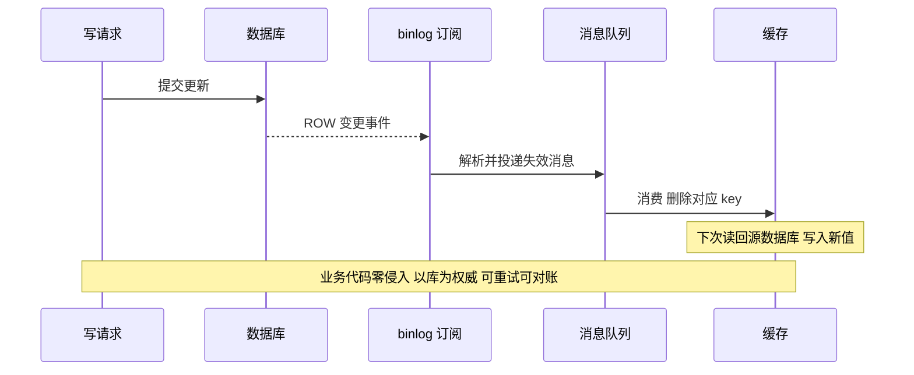

### Q976 · 布隆过滤器手写: 原理与实现

> 难度:★★★★ | 标签:布隆过滤器, 缓存穿透

**问**:手写一个布隆过滤器需要哪些要素?为什么必然存在误判而不会漏判?

**答**:要素:m 位的位数组 + k 个独立哈希函数。add 把元素的 k 个哈希位都置 1;contains 检查 k 个位,全为 1 才"可能存在"。性质:说"存在"可能是误判(别的元素把这些位都置过 1),说"不存在"一定不存在(只要有一个位是 0,元素绝没被加入过)——单向性来自"从不置 0"。所以布隆适合做缓存穿透防线:拦截肯定不存在的 key。注意:标准布隆不支持删除(置 0 会伤及他人),要删除用计数布隆或布谷鸟过滤器;扩容需要重建(记录原元素或用双层布隆)。

```python
# file: code/04_数据库与缓存/q976_bloom_filter.py
"""手写布隆过滤器: 双哈希映射 + 误判率观察"""
import hashlib
import math

class BloomFilter:
    def __init__(self, m_bits, k):
        self.m, self.k = m_bits, k
        self.bits = bytearray((m_bits + 7) // 8)

    def _idx(self, item, salt):
        h = hashlib.sha1(f"{salt}:{item}".encode()).digest()
        return int.from_bytes(h[:8], "big") % self.m

    def _set(self, i):
        self.bits[i // 8] |= 1 << (i % 8)

    def _get(self, i):
        return self.bits[i // 8] >> (i % 8) & 1

    def add(self, item):
        for salt in range(self.k):
            self._set(self._idx(item, salt))

    def contains(self, item):
        return all(self._get(self._idx(item, s)) for s in range(self.k))

if __name__ == "__main__":
    bf = BloomFilter(m_bits=1 << 20, k=3)     # 1M bit, 3 个哈希
    for i in range(10000):
        bf.add(f"user:{i}")

    fp = sum(1 for i in range(10000, 20000) if bf.contains(f"user:{i}"))
    print("已收录查询全部命中:", all(bf.contains(f"user:{i}") for i in range(100)))
    print(f"误判: 10000 个陌生 key 中 {fp} 个误判, 实际 {fp / 10000:.2%}")
    theory = (1 - math.exp(-3 * 10000 / (1 << 20))) ** 3
    print(f"理论误判率约 {theory:.2%}")
```

**追问**:
- 为什么只用 2 个哈希也能模拟 k 个?——Kirsch-Mitzenmacher 技巧:h1 + i*h2 组合出 k 个位置,省一次哈希计算,误判率增加可忽略。
- 布满了怎么办?——位数组全 1 后过滤器退化为永远"可能存在",只能重建(换种子重放全量)或按时间分代(旧代整体过期)。

---

### Q977 · 布隆过滤器参数: 误判率与内存的算账

> 难度:★★★☆ | 标签:布隆过滤器, 容量

**问**:给定 1 亿条数据、期望误判率 1%,布隆过滤器要多少内存、几个哈希函数?

**答**:公式:最优哈希数 k = (m/n)·ln2,位数 m = -n·lnP / (ln2)^2 ≈ 1.44·n·log2(1/P)。代入:1 亿条、1% 误判约需 m ≈ 9.59 亿位 ≈ 114MB,k ≈ 7。对比直接存 set:1 亿个 key 至少数 GB 级,布隆压缩一个数量级以上。工程权衡:误判率 1% 是常见值,降到 0.1% 内存约 1.5 倍(172MB),代价线性于 log(1/P);宁可把 m 按未来增长量(如 2n)预估,布满重建比误判飙升更痛。Redis 侧用 RedisBloom 模块的 BF.ADD/BF.EXISTS,或自建 bitmap。

```python
# file: code/04_数据库与缓存/q977_bloom_params.py
"""布隆过滤器参数计算: 内存与哈希数"""
import math

def bloom_params(n, p):
    m = -n * math.log(p) / (math.log(2) ** 2)      # 位数
    k = (m / n) * math.log(2)                      # 哈希函数数
    return m, k

if __name__ == "__main__":
    for n, p in [(10**6, 0.01), (10**8, 0.01), (10**8, 0.001), (10**8, 0.1)]:
        m, k = bloom_params(n, p)
        print(f"n={n:>9.0e} 期望误判 {p:.3f} -> "
              f"{m / 8 / 1024 / 1024:8.1f} MB, k={k:.1f}")
    print("对照: 1 亿 key 存 set 约需数 GB, 布隆 1% 误判约 114MB")
    print("预留增长: 按 2 倍 n 估内存, 或布满后换种子重建")
```

**追问**:
- 误判了会怎样?——多一次无效回源(缓存 miss 打到 DB),数据库按"不存在"返回空,业务可容忍;危险的是把误判当"存在"做拦截,所以布隆只用于"挡穿透"。
- 能否支持删除?——标准布隆不能;计数布隆每位置计数器(内存×4),布谷鸟过滤器支持删除且查询局部性好,按需选型。

---

### Q978 · 固定窗口限流: 最简单也最容易误伤

> 难度:★★★☆ | 标签:限流, Lua

**问**:用 Redis 实现每分钟 100 次的固定窗口限流,脚本怎么写?窗口边界的两倍突刺怎么破?

**答**:实现:键 `rate:{user}:{分钟号}`,INCR 后首次(EXPIRE 60s),值超阈值则拒绝——Lua 把 INCR+EXPIRE+判断绑成原子。缺陷是窗口边界:59 秒与下一分钟 0 秒各打满 100,两秒内实际通过 200 次。改良:一、滑动窗口(Q979,zset 按时间戳计数);二、滑动窗口计数——当前窗口与上一窗口按剩余比例加权 `limit * (1 - elapsed/ratio) + prev_count`,实现稍复杂但平滑;三、临界突刺不敏感的业务直接接受固定窗口(登录失败次数这类粗粒度场景)。键粒度选择:user 级防刷、接口级保护、全局级兜底,分层设阈值。

```python
# file: code/04_数据库与缓存/q978_fixed_window.py
"""固定窗口限流: 原子 check+incr, 并观察边界突刺"""
import time

class FixedWindow:
    def __init__(self, limit, window_sec):
        self.limit, self.window = limit, window_sec
        self.store = {}

    def allow(self, key, now=None):
        now = now if now is not None else time.monotonic()
        bucket = int(now // self.window)              # 窗口号
        k = f"{key}:{bucket}"
        cnt = self.store.get(k, 0) + 1
        self.store[k] = cnt
        return cnt <= self.limit

if __name__ == "__main__":
    r = FixedWindow(limit=3, window_sec=60)
    base = 59.9                                       # 靠近窗口边界
    print("59.9s 请求:", [r.allow("u1", base + i * 0.02) for i in range(4)])
    print("60.1s 请求(新窗口):", [r.allow("u1", 60.1 + i * 0.02) for i in range(4)])
    print("两秒内合计通过 6 次 = 2 倍阈值, 这就是边界突刺")
    print("滑动窗口按时间戳计数可消除该问题")
```

**追问**:
- EXPIRE 为什么要和 INCR 原子?——分开执行时首次 INCR 后进程崩溃,键永不过期,计数残留导致后续窗口误限。
- 分布式多实例怎么共享配额?——都打到同一 Redis 键天然共享;Redis 不可用时限流器应"放行并告警"(fail-open)还是"拒绝"(fail-close)按业务定。

---

### Q979 · 滑动窗口限流: zset 时间戳实现

> 难度:★★★★ | 标签:限流, zset

**问**:用 zset 实现"最近 60 秒最多 100 次"的滑动窗口,四条命令的顺序有讲究吗?

**答**:流程:ZREMRANGEBYSCORE 删除窗口外旧记录 -> ZCARD 统计窗口内次数 -> 未超限则 ZADD 当前时间戳 -> EXPIRE 兜底键生命周期,四步放进一个 Lua 脚本原子执行,顺序必须"先清理再统计",否则垃圾数据让计数虚高。优点:任意窗口、精确无边界突刺;缺点:每次请求都写 zset,高 QPS 下内存与写入压力大(每请求一个 member),大数据量可用"滑动窗口分段计数"(把 60s 切成 6 个 10s 桶,模糊滑动)折衷。同属滑动思想的还有 GCRA/令牌桶,按精度与成本选型。

```python
# file: code/04_数据库与缓存/q979_sliding_window.py
"""zset 滑动窗口限流: 清理 -> 统计 -> 记录 -> 过期兜底"""
import time

class SlidingWindow:
    def __init__(self, limit, window_sec):
        self.limit, self.window = limit, window_sec
        self.zsets = {}                                # key -> [(ts, member)]

    def _zremrange(self, key, now):
        self.zsets[key] = [t for t in self.zsets.get(key, [])
                           if t[0] > now - self.window]

    def allow(self, key, now=None):
        now = now if now is not None else time.monotonic()
        self._zremrange(key, now)                      # 1 清理窗口外
        n = len(self.zsets.get(key, []))               # 2 统计
        if n >= self.limit:
            return False
        member = (now, time.monotonic_ns())            # 3 记录(member 保唯一)
        self.zsets.setdefault(key, []).append(member)
        return True

if __name__ == "__main__":
    sw = SlidingWindow(limit=3, window_sec=2)
    print("连续请求:", [sw.allow("api") for _ in range(4)], "<- 第4次被限")
    time.sleep(2.05)
    print("2 秒后窗口滑出:", sw.allow("api"), "<- 旧记录过期恢复")
```

**追问**:
- zset member 怎么保证唯一?——时间戳可能同秒冲突,拼上纳秒或自增序号;同一 member 重复 ZADD 只会覆盖,导致计数丢失。
- 高并发下 zset 太大怎么办?——限制窗口内元素数自然可控;更大规模改分段计数或令牌桶(状态只有两个数,内存 O(1))。

---

### Q980 · 令牌桶限流: 懒惰补充与突发容忍

> 难度:★★★★ | 标签:限流, Lua

**问**:令牌桶怎么用两个数就实现?它和滑动窗口比强在哪?

**答**:状态只有 (桶内令牌数, 上次补充时间),每次请求懒惰计算:应补 = (now - last) × 速率,封顶容量;有令牌则扣 1 放行。Lua 原子完成"补足+扣减"。两个可调维度:速率(平均 QPS)与桶容量(突发容忍度),这是它优于滑动窗口的核心——滑动窗口语义是"硬窗口",令牌桶允许短暂超速消化突发(比如允许瞬间 20 QPS、长期 5 QPS)。实现细节:浮点注意 Lua number 精度(用毫秒整数计算),长时间未用不能溢出(封顶)。Nginx limit_req、Guava RateLimiter 都是令牌桶家族。

```python
# file: code/04_数据库与缓存/q980_token_bucket.py
"""令牌桶: 懒惰补充 + 突发容忍"""
import time

class TokenBucket:
    def __init__(self, rate, capacity):
        self.rate, self.capacity = rate, capacity      # 每秒令牌数, 桶容量
        self.tokens, self.last = capacity, time.monotonic()

    def allow(self, cost=1.0):
        now = time.monotonic()
        self.tokens = min(self.capacity,             # 补充并封顶
                          self.tokens + (now - self.last) * self.rate)
        self.last = now
        if self.tokens >= cost:
            self.tokens -= cost
            return True
        return False

if __name__ == "__main__":
    tb = TokenBucket(rate=2, capacity=5)               # 均速2/s 突发可到5
    print("瞬时突发 5 次:", [tb.allow() for _ in range(5)], "<- 容量内全过")
    print("第 6 次:", tb.allow())
    time.sleep(0.6)                                    # 攒回约 1.2 个令牌
    print("0.6s 后:", tb.allow(), "<- 速率控制恢复节奏")
    print(f"剩余令牌 {tb.tokens:.2f}")
```

**追问**:
- 桶容量怎么定?——容量=允许的最大突发,参考上游(网关/客户端)的并发模型与下游容量;容量过大等于变相放开限流。
- 令牌桶在 Redis 上的键结构?——HASH 存 tokens/last_ts 两个数 + TTL,或直接两个 string;比 zset 方案内存 O(1),高 QPS 首选。

---

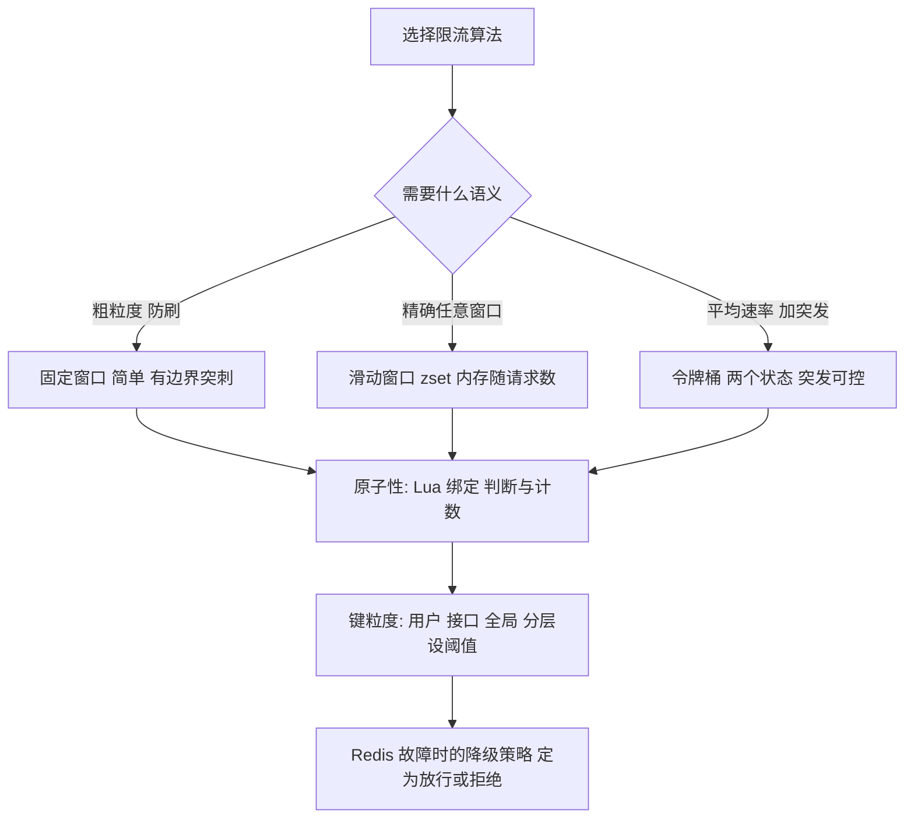

---

### Q981 · 排行榜: zset 的正确打开方式

> 难度:★★★☆ | 标签:zset, 排行榜

**问**:实时排行榜用 zset 怎么实现?并列名次与分页翻页怎么处理?

**答**:ZADD 更新分数、ZINCRBY 累加、ZREVRANGE/ZREVRANK 取名次、ZRANGE 按名次分页,全是 O(logN)。两个工程细节:一、并列——同分时业务通常要求"先达成者靠前",把 score 拼成 `主分 * 1e10 + (MAX_TS - 达成时间戳)`,或 score 存主分、member 用 (主分, ts, id) 编码,保证确定序;二、深排名翻页用 `ZRANGEBYSCORE (max, min) LIMIT offset count` 以分数为游标,避免按 index 大偏移;三、亿级用户全量榜不可行,只维护 TopN(如前 1 万),其余用户排名走"分数区间统计 ZCOUNT + 我的分数"推导名次段。更新频率极高时考虑本地聚合 + 批量刷 zset。

```python
# file: code/04_数据库与缓存/q981_leaderboard.py
"""zset 排行榜: 更新 名次 并列时按达成时间排序"""
import bisect

class MiniZSet:
    def __init__(self):
        self.items = []                     # [(score, member)] 降序

    def add(self, member, score):
        self.items = [x for x in self.items if x[1] != member]
        bisect.insort(self.items, (-score, member))   # 负分实现降序
        self.items = self.items[:100]                 # 只维护 TopN

    def top(self, n=5):
        return [(m, -s) for s, m in self.items[:n]]

    def rank(self, member):
        for i, (s, m) in enumerate(self.items):
            if m == member:
                return i + 1
        return None

if __name__ == "__main__":
    lb = MiniZSet()
    for name, sc in [("alice", 95), ("bob", 88), ("carol", 95), ("dave", 70)]:
        lb.add(name, sc)
    print("Top4:", lb.top(4), "<- 同分 95: alice 与 carol 相邻")
    print("dave 名次:", lb.rank("dave"))
    print("未上榜用户用 ZCOUNT 统计分数区间推导名次段")
```

**追问**:
- score 的 double 精度有什么坑?——拼接大数(分*1e10+ts)后超过 2^53 会丢精度,要控制拼接位数或改用两层级联(zset 主分 + member 内时间戳)。
- 榜单数据要持久化吗?——zset 是内存态,重启不丢(RDB/AOF 持久化),但历史榜单(日榜/周榜)按时段切 key + 定期落库归档。

---

### Q982 · 跳表原理: zset 为什么要它

> 难度:★★★★ | 标签:跳表, 数据结构

**问**:跳表是怎么做到 O(logN) 的?为什么 Redis 选跳表而不是平衡树?

**答**:跳表在有序链表上加多层"快速通道":每个节点以 1/2(或 1/4)概率晋升到上一层,查询从顶层向右下走,期望每层跳过一半节点,层数期望 O(logN),插入删除只改指针无需旋转。Redis 选它的理由(antirez 原话):实现简单于红黑树、范围查询天然顺着底层链表走、并发/调试更容易,且概率层数在性能上与平衡树相当。工程细节:Redis 跳表层高上限 32、每向上概率 1/4(期望层高 1.33),节点带 backward 指针支持反向遍历(zrevrange)。

```python
# file: code/04_数据库与缓存/q982_skip_list.py
"""最小跳表: 概率层高 + 插入 + 范围查询"""
import random

class Node:
    def __init__(self, key, level):
        self.key = key
        self.forward = [None] * level

class SkipList:
    MAX = 8
    P = 0.5

    def __init__(self):
        self.head = Node(None, self.MAX)
        self.level = 1

    def _rand_level(self):
        lvl = 1
        while random.random() < self.P and lvl < self.MAX:
            lvl += 1
        return lvl

    def insert(self, key):
        update = [self.head] * self.MAX           # 顶层之上统一指向 head
        node = self.head
        for i in reversed(range(self.level)):
            while node.forward[i] and node.forward[i].key < key:
                node = node.forward[i]
            update[i] = node
        lvl = self._rand_level()
        self.level = max(self.level, lvl)
        new = Node(key, lvl)
        for i in range(lvl):
            new.forward[i] = update[i].forward[i]
            update[i].forward[i] = new

    def range_(self, lo, hi):
        out, node = [], self.head
        for i in reversed(range(self.level)):
            while node.forward[i] and node.forward[i].key < lo:
                node = node.forward[i]
        node = node.forward[0]
        while node and node.key <= hi:
            out.append(node.key)
            node = node.forward[0]
        return out

if __name__ == "__main__":
    random.seed(7)
    sl = SkipList()
    for k in [3, 1, 4, 1, 5, 9, 2, 6]:
        sl.insert(k)
    print("范围 [2,6):", sl.range_(2, 6), "<- 底层有序链表天然支持")
    print("查找路径: 从顶层逐层向右下, 期望 O logN")
```

**追问**:
- 跳表怎么实现 ZRANK?——节点 span 字段记录跨层跨越的节点数,查询时累加 span 得排名,仍是 O(logN)。
- 并发跳表怎么加锁?——Redis 单线程无此问题;通用并发跳表用无锁 CAS 或细粒度锁,属于加分延伸。

---

### Q983 · 消息队列: List 还是 Stream

> 难度:★★★★ | 标签:消息队列, Stream

**问**:用 Redis 做消息队列,List(BRPOP)和 Stream(XREADGROUP)差在哪?

**答**:List 方案(LPUSH+BRPOP):极简、毫秒级阻塞弹出,但消费即删除——没有"消息还在不在"的概念,消费失败无法重试、没有消费组、不能回看历史,多消费者靠抢不靠订阅。Stream 是"日志型"结构:消息带 ID 持久存放、消费组按 offset 独立消费、XACK 确认、PEL 记录待确认、可 XAUTOCLAIM 转移死信消费者,接近 Kafka 的心智模型。选型:允许丢失的通知类(短信、日志采集)List 足够;要求可靠投递、多消费组、重试与回溯的选 Stream;更强需求(RocketMQ/Kafka 级吞吐与事务)直接上专业 MQ,Redis MQ 适合中小流量与已有 Redis 基础设施的场景。

```python
# file: code/04_数据库与缓存/q983_list_vs_stream.py
"""List 抢夺消费 vs Stream 消费组 的最小对照"""
import collections
import threading

# ---- List 语义: 消费即删, 无重试 ----
lst = collections.deque(["m1", "m2", "m3"], maxlen=100)
got = []
while lst:
    got.append(lst.popleft())          # BRPOP: 弹出后消息即消失
print("List 消费后:", got, "队列空, 无处追溯")

# ---- Stream 语义: 日志留存 + 消费组 offset ----
class Stream:
    def __init__(self):
        self.log, self.seq = [], 0

    def xadd(self, payload):
        self.seq += 1
        self.log.append((f"{self.seq}-0", payload))

    def create_group(self):
        return {"last_delivered": 0, "pel": {}}

    def xreadgroup(self, group, consumer, count=10):
        out = []
        for mid, payload in self.log:
            if int(mid.split("-")[0]) > group["last_delivered"]:
                out.append((mid, payload))
                group["pel"][mid] = consumer
                group["last_delivered"] = int(mid.split("-")[0])
                if len(out) >= count:
                    break
        return out

    def xack(self, group, mid):
        group["pel"].pop(mid, None)

if __name__ == "__main__":
    s = Stream()
    for i in range(3):
        s.xadd(f"task{i}")
    g = s.create_group()
    msgs = s.xreadgroup(g, "worker1")
    print("Stream 消费:", msgs)
    s.xack(g, msgs[0][0])
    print("PEL 未确认:", g["pel"], "<- 未 ack 的消息可重投/转移")
```

**追问**:
- BRPOP 有什么隐患?——消费者崩在"弹出后处理前"消息就丢了, List 无 PEL 概念;要可靠必须双列表(处理中列表+确认回迁)手工模拟。
- Stream 内存会无限涨吗?——XADD 支持 MAXLEN/~ 截断旧消息,按业务保留窗口;消费组 lag 要监控(组落后即积压)。

---

### Q984 · Stream 消费组: 组内竞争与组间广播

> 难度:★★★★ | 标签:Stream, 消费组

**问**:Stream 消费组怎么工作?同一消息能被多个组消费吗?

**答**:三条命令定义世界:XGROUP CREATE 建组(可从 0 或 $ 起始)、XREADGROUP GROUP 组 消费者 COUNT n BLOCK ms 读消息(组内消费者竞争,每条消息只投给组内一人)、XACK 确认。语义:组间广播——不同组各自维护 last_delivered,同一条消息每个组都会投一次(适合"订单事件"同时给库存、积分、营销消费);组内竞争——组内多消费者分摊。last_delivered 随读取推进,pending 列表(PEL)记录已投未确认,重启不重复投给同一消费者。生产形态:每服务一个组、组内多 worker,监控 lag 与 PEL 深度。

```python
# file: code/04_数据库与缓存/q984_consumer_group.py
"""两个消费组独立消费同一 Stream, 组内两 worker 竞争"""
import itertools

class MiniStream:
    def __init__(self):
        self.log, self.counter = [], itertools.count(1)
        self.groups = {}

    def xadd(self, payload):
        mid = next(self.counter)
        self.log.append((mid, payload))
        return mid

    def group(self, name, start=0):
        self.groups[name] = {"pos": start, "pel": {}}

    def read(self, name, consumer, count=10):
        g = self.groups[name]
        out = [(mid, p) for mid, p in self.log if mid > g["pos"]][:count]
        for mid, _ in out:
            g["pos"] = mid
            g["pel"][mid] = consumer
        return out

if __name__ == "__main__":
    s = MiniStream()
    for t in ("下单", "支付", "发货"):
        s.xadd(t)
    s.group("库存组"), s.group("积分组")
    print("库存组 worker1:", s.read("库存组", "worker1"))
    print("积分组 worker1:", s.read("积分组", "worker1"), "<- 组间广播")
    s.group("库存组2") if False else None
    s.groups["库存组"]["pos"] = 0
    print("库存组从0重读:", s.read("库存组", "worker2"), "<- offset 可回放")
```

**追问**:
- 组从 $ 还是 0 开始?——$ 只消费建组后的新消息(新服务上线常用),0 从头回放(数据修复用),建组时明确写出。
- 消费者重启后 PEL 里的消息怎么办?——XREADGROUP 只投新消息,PEL 中的旧消息用 XREADGROUP 带 ID 0 或 XAUTOCLAIM 认领,见下一题。

---

### Q985 · Stream pending 与死信: 可靠投递的最后一公里

> 难度:★★★★ | 标签:Stream, 可靠性

**问**:worker 崩了,它没 ack 的消息怎么办?什么情况进死信?

**答**:未确认消息在组的 PEL 中,XAUTOCLAIM(6.2+,老版本 XPENDING+XCLAIM)按空闲时间把"消费者失联"的消息转移给健康 worker 重投——这是崩溃恢复的标准动作。重试要有上限:每条消息带 delivery_count,超过阈值(如 5 次)转入死信处理(独立 stream/表 + 告警 + 人工),避免毒消息(Poison Message)无限循环打爆系统。监控三件套:PEL 深度、最老未确认消息年龄、死信数量。配套纪律:处理逻辑必须幂等(重投必然发生),业务以消息 ID 或业务键去重。

```python
# file: code/04_数据库与缓存/q985_pending_deadline.py
"""PEL 重投与死信转移: delivery_count 超限进 DLQ"""
import time

class Group:
    def __init__(self):
        self.pel = {}                       # mid -> {consumer, count, ts}

    def delivered(self, mid, consumer):
        rec = self.pel.setdefault(mid, {"consumer": consumer, "count": 0,
                                        "ts": time.monotonic()})
        rec["count"] += 1

    def ack(self, mid):
        self.pel.pop(mid, None)

    def autoclaim(self, dead_after_count=3, idle=0.1):
        now = time.monotonic()
        reclaim, dead = [], []
        for mid, rec in list(self.pel.items()):
            if now - rec["ts"] > idle:
                if rec["count"] >= dead_after_count:
                    dead.append(mid)
                    del self.pel[mid]          # 转入死信队列后移出 PEL
                else:
                    reclaim.append(mid)
        return reclaim, dead

if __name__ == "__main__":
    g = Group()
    for mid in ("1-0", "2-0", "3-0"):
        g.delivered(mid, "w1")              # w1 崩溃未 ack
    time.sleep(0.2)
    reclaim, dead = g.autoclaim()
    print("第一轮可重投:", reclaim, "死信:", dead)
    for mid in reclaim:
        g.delivered(mid, "w2")              # 转给健康 worker, 重试计数+1
    g.ack("1-0")                            # w2 处理成功
    reclaim, dead = g.autoclaim()
    for mid in reclaim:
        g.delivered(mid, "w3")              # 又重试一轮
    _, dead = g.autoclaim()                 # 计数到 3 -> 死信
    print("毒消息进死信:", dead, "<- 记录并告警, 人工介入")
    print("剩余 PEL:", g.pel)
```

**追问**:
- 重投导致重复消费怎么办?——消费端按业务键幂等(唯一约束/Redis setnx 标记),消息 ID 只能去重单 stream,跨重投要业务层兜底。
- idle 判定多久合适?——略大于处理 P99 时长(如 P99=2s 则 idle=5s),太短会频繁抢占正常处理中的消息。

---

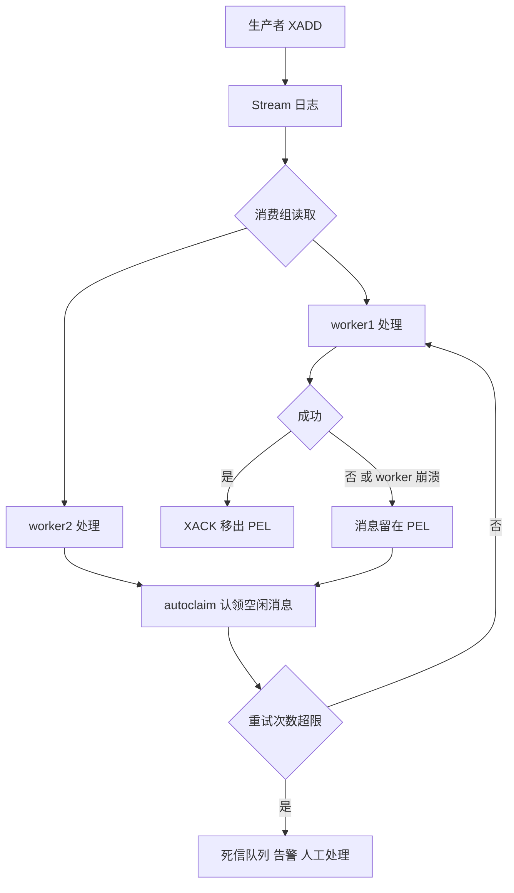

### Q986 · 延迟队列: zset 轮询实现

> 难度:★★★★ | 标签:延迟队列, zset

**问**:订单 30 分钟未支付自动取消,用 Redis 怎么实现延迟任务?

**答**:zset 方案:member=任务标识(含业务键与唯一 ID),score=到期时间戳;生产者 ZADD 到期时间,定时器(每秒)执行 ZRANGEBYSCORE key 0 now LIMIT 0 10 取到期任务,处理成功 ZREM 删除。三个关键细节:一、取到与删除必须原子(Lua:取+删一个脚本),否则多实例同时抢到同一任务;二、处理失败要回队(重新 ZADD 延后)并计数防死循环;三、单 zset 有限,量大可按任务类型或时间分片多个 key 轮询。对比专业方案:RabbitMQ 死信/TTL、时间轮(Kafka/Netty)、数据库扫描,Redis 方案适合中小量、秒级精度足够的场景。精度受轮询间隔限制,`~` 保证不阻塞。

```python
# file: code/04_数据库与缓存/q986_delay_queue.py
"""zset 延迟队列: 原子取到期任务 + 失败回队"""
import time

class DelayQueue:
    def __init__(self):
        self.zset = {}                          # task -> due_ts

    def offer(self, task, delay_sec):
        self.zset[task] = time.monotonic() + delay_sec

    def poll_due(self, now=None, limit=5):
        now = now if now is not None else time.monotonic()
        due = sorted((t for t, d in self.zset.items() if d <= now))[:limit]
        for t in due:                           # 原子语义: 取出即移除
            del self.zset[t]
        return due

    def nack(self, task, delay_sec, max_retry):
        retry = self.retry.get(task, 0) + 1 if hasattr(self, "retry") else 1
        self.retry = getattr(self, "retry", {})
        self.retry[task] = retry
        if retry <= max_retry:
            self.offer(task, delay_sec)
        return retry <= max_retry

if __name__ == "__main__":
    dq = DelayQueue()
    dq.offer("order:1", 0.2)                    # 0.2 秒后到期(模拟30分钟)
    dq.offer("order:2", 0.5)
    for _ in range(6):
        due = dq.poll_due()
        if due:
            print(f"{time.monotonic():.1f} 到期任务:", due)
            for t in due:
                if t == "order:2":
                    dq.nack(t, 0.3, max_retry=1)
                    print("  order:2 处理失败, 延后重试")
        time.sleep(0.2)
```

**追问**:
- 为什么不用 keyspace notification?——过期事件通知不保证送达(过期删除是惰性+定期),用作延迟队列会丢任务,必须主动轮询。
- 多实例轮询怎么避免重复?——Lua 里 ZRANGEBYSCORE+ZREM 原子执行,或取到后用 SETNX task:lock 抢处理权;幂等消费仍是底线。

---

### Q987 · 防重 token: 接口幂等的通用闸门

> 难度:★★★★ | 标签:幂等, token

**问**:前端防抖挡不住重复提交,服务端怎么做提交防重?

**答**:防重 token 三步:一、进入表单页时服务端发一个一次性 token(SETNX token:xxx 1 EX 300),返回前端;二、提交时携带 token,服务端 Lua 校验存在则 DEL 并放行(原子),不存在则拒绝"重复提交";三、业务执行。它把"防重"从业务态挪到提交凭证上,对表单类、支付类都通用。与幂等表的区别:token 是"只防重复点击"(同 token 只能成功一次),幂等表是"同一业务操作任意次到达结果相同"(以业务键为准);支付场景两者都要——token 拦 UI 重复,唯一约束拦网络重试。token 失效策略:一次性删除 or 短 TTL 内可重复返回同一结果(配合缓存首次响应)。

```python
# file: code/04_数据库与缓存/q987_idempotency_token.py
"""防重 token: 发放 -> 原子校验并消费 -> 业务执行"""
import secrets

class TokenService:
    def __init__(self):
        self.tokens = set()

    def issue(self) -> str:
        token = secrets.token_hex(8)
        self.tokens.add(token)                  # SETNX token EX 300
        return token

    def consume(self, token) -> bool:
        """Lua: EXISTS 且 DEL 原子返回"""
        if token in self.tokens:
            self.tokens.remove(token)
            return True
        return False

def submit(svc, token, payload):
    if not svc.consume(token):
        return "重复提交, 拒绝"
    return f"业务已处理: {payload}"

if __name__ == "__main__":
    svc = TokenService()
    token = svc.issue()
    print("首次提交:", submit(svc, token, {"sku": "x", "qty": 1}))
    print("重放同一 token:", submit(svc, token, {"sku": "x", "qty": 1}))
    print("伪造 token:", submit(svc, "deadbeef", {"sku": "x"}))
```

**追问**:
- token 什么时候发放?——渲染表单/进入支付页时,与页面会话绑定;不要在提交时才发,否则等于没防。
- 高并发下同 token 双击同时到呢?——DEL 与 EXISTS 在 Lua 中原子,两个并发请求只有一个拿到 True,另一个必然拒绝。

---

### Q988 · 全局 ID: 号段模式与双 buffer

> 难度:★★★★ | 标签:全局 ID, 架构

**问**:号段模式怎么发号?单点号段服务的抖动怎么缓解?

**答**:号段模式:DB 存 (biz_tag, max_id, step),发号服务每次取一段 `UPDATE ... SET max_id = max_id + step` 后在内存发号,数据库只承受 step 级压力。抖动问题:号段用尽瞬间要去 DB 拿下一段,造成尖刺延迟——双 buffer 优化:当前号段消耗到 10%~20% 时异步预加载下一号段,切换零感知。要点:step 平衡 DB 压力与浪费(宕机丢号,号段内未发的号作废——业务必须容忍不连续);多机房按奇偶/不同 biz_tag 隔离;对比雪花(本地生成无依赖但时钟敏感)与 UUID(无序伤索引),号段是"有序 + 中心化"折衷,美团 Leaf 是标准实现。

```python
# file: code/04_数据库与缓存/q988_segment_id.py
"""号段发号 + 双 buffer 预加载"""
import threading

class SegmentAllocator:
    def __init__(self, db_max=0, step=100):
        self.step = step
        self.next_db_max = db_max + step        # 模拟第一次取号段
        self.cur = {"lo": db_max + 1, "hi": db_max + step}
        self.buffer = None                       # 预加载的下一号段
        self.lock = threading.Lock()

    def _fetch_new_segment(self):
        lo = self.next_db_max + 1                # 模拟 UPDATE max_id+step
        self.next_db_max += self.step
        return {"lo": lo, "hi": self.next_db_max}

    def next_id(self):
        with self.lock:
            if self.cur["lo"] > self.cur["hi"]:  # 当前号段耗尽
                self.cur = self.buffer or self._fetch_new_segment()
                self.buffer = None
            elif self.buffer is None and \
                    self.cur["lo"] > (self.cur["hi"] + self.cur["lo"]) // 2:
                self.buffer = self._fetch_new_segment()   # 消耗过半预加载
            v = self.cur["lo"]
            self.cur["lo"] += 1
            return v

if __name__ == "__main__":
    alloc = SegmentAllocator(step=5)
    ids = [alloc.next_id() for _ in range(12)]
    print("发号:", ids)
    print("有序:", ids == sorted(ids), "趋势递增, 允许宕机跳号")
    print("双 buffer: 消耗过半即预取下一段, 切换无尖刺")
```

**追问**:
- 号段不连续业务能接受吗?——订单号等展示键一般可接受(只要求唯一有序);金额流水号若要求连续,要改为逐号确认机制,复杂度高很多。
- 与雪花混合怎么选?——DB 依赖轻、要求强趋势递增(索引友好)选号段;不想引入中心服务、容忍时钟管理成本选雪花。

---

### Q989 · 分布式 Session 与登录态

> 难度:★★★☆ | 标签:session, 认证

**问**:多实例部署下 session 怎么存?Redis session 与 JWT 各适合什么场景?

**答**:传统本地 session 在多实例下因负载均衡路由不稳而失效,标准解法是集中存储:session-id 随机生成放 Cookie,会话数据存 Redis(TTL 即过期),所有实例读同一 Redis——无状态应用 + 有状态存储。JWT 是无状态替代:签名令牌自带用户信息,服务端不存,优点零存储、跨服务易传递,缺点无法主动失效(要拉黑名单又回到存储)、payload 泄露可见、续期复杂。选型:需要"强制下线/单点登录互踢/即时吊销"用 Redis session;纯 API、可接受令牌生命周期内不可撤的用 JWT(配短 TTL + refresh token)。安全底线:session-id 高熵随机、Cookie HttpOnly+Secure+SameSite、敏感操作二次校验。

```python
# file: code/04_数据库与缓存/q989_distributed_session.py
"""Redis session: 登录写入 多实例共享 主动踢下线"""
import secrets
import time

class SessionStore:
    def __init__(self, ttl=60):
        self.data, self.ttl = {}, ttl

    def login(self, user) -> str:
        sid = secrets.token_urlsafe(16)
        self.data[sid] = {"user": user, "expire": time.monotonic() + self.ttl}
        return sid

    def get(self, sid):
        rec = self.data.get(sid)
        if rec is None:
            return None
        if time.monotonic() > rec["expire"]:
            del self.data[sid]
            return None
        rec["expire"] = time.monotonic() + self.ttl      # 滑动续期
        return rec["user"]

    def kick(self, user):                               # 强制下线: 全端失效
        kicked = [sid for sid, r in self.data.items() if r["user"] == user]
        for sid in kicked:
            del self.data[sid]
        return kicked

if __name__ == "__main__":
    store = SessionStore()
    s1, s2 = store.login("alice"), store.login("alice")
    print("实例A 验证:", store.get(s1), "| 实例B 验证另一会话:",
          store.get(s2), "<- 共享 Redis, 双实例可用")
    print("踢下线:", store.kick("alice"), "随后验证:", store.get(s1))
```

**追问**:
- 为什么 session-id 要服务端生成而不是用用户名?——可预测的会话标识等于开放会话固定攻击,必须高熵随机且登录后轮换。
- Redis 挂了登录态全丢怎么办?——多副本+哨兵;更稳的是 session 双写或退化为短 TTL JWT + 黑名单,平衡可用性与可控性。

---

### Q990 · TCC: Try-Confirm-Cancel 的实现要点

> 难度:★★★★★ | 标签:分布式事务, TCC

**问**:TCC 三个阶段分别做什么?空回滚、悬挂、幂等三大问题怎么解?

**答**:Try 预留资源(冻结金额而非扣款),Confirm 确认(用预留资源完成),Cancel 释放预留。框架按事务 ID 驱动:任一参与者 Try 失败则全局 Cancel。三大经典问题:一、空回滚——Try 没到达(网络丢)而 Cancel 先到,Cancel 要能识别"从未 Try 过"并正常返回(记录事务状态表);二、悬挂——Cancel 执行后,Try 才迟到到达并预留了资源再无人释放,解法是 Try 前检查"该事务是否已回滚";三、幂等——Confirm/Cancel 都可能重试,必须可重复执行结果不变。实现上通常给每个事务参与者建状态记录(try/confirm/cancel 标记),配合本地事务保证状态与资源变更原子。TCC 强一致、性能好但侵入业务,适合资金类核心链路。

```python
# file: code/04_数据库与缓存/q990_tcc.py
"""TCC 最小模型: 冻结-确认-取消 + 空回滚与幂等防护"""
import sqlite3

def setup():
    conn = sqlite3.connect(":memory:")
    conn.executescript("""
        CREATE TABLE acct (id INTEGER PRIMARY KEY, bal INT, frozen INT DEFAULT 0);
        CREATE TABLE tx_log (txid TEXT, action TEXT, PRIMARY KEY (txid, action));
        INSERT INTO acct VALUES (1, 100, 0), (2, 0, 0);
    """)
    return conn

def once(conn, txid, action):
    try:
        conn.execute("INSERT INTO tx_log VALUES (?, ?)", (txid, action))
        return True
    except sqlite3.IntegrityError:
        return False                                # 幂等: 已执行过

def try_(conn, txid, amount):
    if not once(conn, txid, "try"):
        return "幂等跳过"
    conn.execute("UPDATE acct SET bal = bal - ?, frozen = frozen + ? WHERE id = 1",
                 (amount, amount))
    return "try 冻结完成"

def cancel(conn, txid, amount):
    done = once(conn, txid, "cancel")
    tried = conn.execute("SELECT 1 FROM tx_log WHERE txid=? AND action='try'",
                         (txid,)).fetchone()
    if not tried:
        conn.execute("INSERT INTO tx_log VALUES (?, 'try_null')", (txid,))
        return "空回滚: 未 try 过, 直接记取消成功"
    if not done:
        conn.execute("UPDATE acct SET bal = bal + ?, frozen = frozen - ? WHERE id = 1",
                     (amount, amount))
        return "cancel 释放冻结"
    return "cancel 幂等跳过"

def confirm(conn, txid, amount):
    if not once(conn, txid, "confirm"):
        return "confirm 幂等跳过"
    conn.execute("UPDATE acct SET frozen = frozen - ? WHERE id = 1", (amount,))
    conn.execute("UPDATE acct SET bal = bal + ? WHERE id = 2", (amount,))
    return "confirm 转账完成"

if __name__ == "__main__":
    conn = setup()
    print(try_(conn, "tx1", 30))
    print(confirm(conn, "tx1", 30))
    print(cancel(conn, "tx2", 50), "<- 空回滚演示")
    print("余额:", conn.execute("SELECT id, bal, frozen FROM acct").fetchall())
```

**追问**:
- TCC 的 Try 为什么要"冻结"而不是直接扣?——Try 阶段必须可逆,直接扣款后失败只能补偿(变成 SAGA);冻结让两阶段都有明确的资源边界。
- Cancel 比 Confirm 先执行会发生什么?——语义上框架保证先 Try 后分支,但网络重试可乱序,状态表按事务 ID 判定当前阶段,迟到消息按幂等丢弃。

---

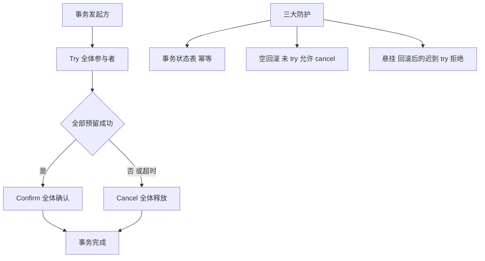

---

### Q991 · SAGA: 长事务的补偿链

> 难度:★★★★ | 标签:分布式事务, SAGA

**问**:SAGA 模式怎么工作?与 TCC 的本质区别?补偿失败怎么办?

**答**:SAGA 把长事务拆成 T1..Tn 本地事务序列,每个 Ti 配补偿 Ci(反向),正向全部成功则完成;某步失败则逆序执行 Cn-1..C1 已完成步骤的补偿。与 TCC 区别:TCC 是"预留-确认"两阶段、中间态资源被冻结,强一致语义;SAGA 每步都是真实提交、靠逆向补偿回滚,中途对外可见中间状态,最终一致。编排两种形态:编排式(orchestration,中心状态机驱动,清晰可控)与协同式(choreography,事件链各自触发,松耦合难追踪)。补偿失败要有重试与人工兜底——补偿本身也可能失败,所以补偿操作要设计成"必然可重试成功"(幂等、不依赖不可用资源)。适合跨系统长流程(订票+酒店+支付),不适合对中间态零容忍的资金原子性。

```python
# file: code/04_数据库与缓存/q991_saga.py
"""SAGA 编排式: 步骤失败逆序补偿"""
import sqlite3

class SagaOrchestrator:
    def __init__(self):
        self.executed = []

    def run(self, steps):
        for do, undo, name in steps:
            try:
                do()
                self.executed.append((name, undo))
                print(f"  步骤 {name} 成功")
            except Exception as e:
                print(f"  步骤 {name} 失败: {e} -> 开始逆序补偿")
                for done_name, undo in reversed(self.executed):
                    undo()
                    print(f"  补偿 {done_name}")
                return False
        return True

if __name__ == "__main__":
    db = {"order": None, "stock": 10, "coupon": "unused", "point": 0}
    log = []

    steps = [
        (lambda: (db.__setitem__("order", "O1"), log.append("创建订单")),
         lambda: db.__setitem__("order", None), "创建订单"),
        (lambda: db.__setitem__("stock", db["stock"] - 1),
         lambda: db.__setitem__("stock", db["stock"] + 1), "扣库存"),
        (lambda: (_ for _ in ()).throw(RuntimeError("积分服务不可用")),
         lambda: None, "加积分"),
    ]
    ok = SagaOrchestrator().run(steps)
    print("事务结果:", "完成" if ok else "已补偿回滚",
          "库存:", db["stock"], "订单:", db["order"])
```

**追问**:
- 补偿的顺序必须是严格逆序吗?——通常逆序(后创建的先撤销),但无依赖关系的补偿可并行,编排器按依赖图调度更高效。
- SAGA 中途对外可见的中间态怎么处理?——业务接口返回"处理中",查询走状态机;必要时用"软状态+对账"把最终态收敛(Q993/Q994)。

---

### Q992 · 本地消息表: 最朴素的可靠投递

> 难度:★★★★ | 标签:分布式事务, 消息表

**问**:本地消息表方案怎么保证"业务成功则消息必达"?

**答**:核心是把"发消息"变成与业务同库同事务的本地写:业务数据与消息记录(outbox)在同一个本地事务里提交——业务成功消息必然存在;后台任务(或 binlog)扫 outbox 表把未发送消息投到 MQ,收到 MQ ack 后标记已发;投递失败重试。这解决了"写库成功、发消息失败"的经典丢失问题,代价是业务库多一张表与扫描任务。要点:消息消费端幂等(消息表可能重复投);outbox 记录要有状态(待发/已发/失败)与重试次数;扫描按主键分页避免大查询。对比事务消息(RocketMQ 半消息):本地消息表不依赖特定 MQ,任何 DB+MQ 组合都能实现,是中小系统的默认答案。

```python
# file: code/04_数据库与缓存/q992_outbox.py
"""本地消息表: 业务与 outbox 同事务, 扫描投递 + 幂等消费"""
import sqlite3
import time

def setup():
    conn = sqlite3.connect(":memory:")
    conn.executescript("""
        CREATE TABLE orders (id INTEGER PRIMARY KEY, amount INT);
        CREATE TABLE outbox (id INTEGER PRIMARY KEY AUTOINCREMENT,
                             payload TEXT, status TEXT DEFAULT 'pending',
                             retry INT DEFAULT 0);
    """)
    return conn

def create_order(conn, amount):
    with conn:                                    # 同一事务
        conn.execute("INSERT INTO orders (amount) VALUES (?)", (amount,))
        conn.execute("INSERT INTO outbox (payload) VALUES (?)",
                     (f"order_created:{amount}",))

def relay(conn, mq):
    rows = conn.execute(
        "SELECT id, payload FROM outbox WHERE status='pending' "
        "ORDER BY id LIMIT 10").fetchall()
    for oid, payload in rows:
        mq.append(payload)                        # 投递到 MQ(重试由失败驱动)
        conn.execute("UPDATE outbox SET status='sent' WHERE id=?", (oid,))
    conn.commit()
    return [p for p in mq]

if __name__ == "__main__":
    conn = setup()
    create_order(conn, 9900)
    print("业务与消息同事务落库:", conn.execute(
        "SELECT status FROM outbox").fetchall())
    mq = []
    print("relay 投递:", relay(conn, mq))
    print("消费端按消息幂等去重:", mq)
```

**追问**:
- 为什么不在业务事务里直接写 MQ?——MQ 写入不是本地事务的一部分,提交后发消息失败仍会丢;outbox 把"必达"锚定在业务库里。
- outbox 表会不会成为瓶颈?——会,及时归档已发送记录、按时间分区、或升级为 binlog CDC(Q974)驱动,业务库零感知。

---

### Q993 · 最终一致性对账: 兜底的最后防线

> 难度:★★★★ | 标签:对账, 一致性

**问**:有了消息表与重试,为什么还需要对账?对账系统怎么设计?

**答**:任何异步链路都可能"静默失败":消息丢失、消费 bug、补偿失败,对账是唯一能发现这类问题的机制——它不信任任何组件,以权威数据源为准定期核对。设计三步:一、取数——双方(如订单库与支付库)按周期拉取快照,以业务键对齐;二、比对——存在性(一边有一边无)、金额一致性、状态一致性,差异写入差错表;三、处理——自动可修复的(重发消息、补单)自动执行,复杂的转人工,重复对账确认收敛。工程要点:对账任务错峰跑、大表按分片并行、比对用 checksum/分桶缩小范围、差错率突增要直接熔断上游。对账频率与容忍窗口由业务定:资金类 T+0 内必须平。

```python
# file: code/04_数据库与缓存/q993_reconciliation.py
"""订单与支付流水对账: 差异分类 + 自动修复"""
def reconcile(orders, payments):
    diffs = []
    for oid, amount in orders.items():
        if oid not in payments:
            diffs.append((oid, "missing_payment", amount))
        elif payments[oid] != amount:
            diffs.append((oid, "amount_mismatch",
                          (amount, payments[oid])))
    for pid in payments:
        if pid not in orders:
            diffs.append((pid, "orphan_payment", payments[pid]))
    return diffs

def auto_fix(diff, fixers):
    oid, kind, _ = diff
    if kind == "missing_payment" and "re_query_payment" in fixers:
        return f"{oid}: 触发支付结果重查"
    if kind == "amount_mismatch":
        return f"{oid}: 差错转人工"
    if kind == "orphan_payment":
        return f"{oid}: 触发退款/补单流程"
    return f"{oid}: 待处理"

if __name__ == "__main__":
    orders = {"O1": 100, "O2": 200, "O3": 300}
    payments = {"O1": 100, "O2": 150, "P9": 500}
    for d in reconcile(orders, payments):
        print("差异:", d, "->", auto_fix(d, {"re_query_payment"}))
    print("对账目标: 差错表每日清零, 差错率突增触发告警")
```

**追问**:
- 对账用全量还是增量?——日常增量(按时间窗),周期性全量抽校(checksum 分桶),全量兜住增量漏网。
- 两边数据都在变怎么对平?——锁定对账时间窗(如对 T-1 日 00:00-24:00),窗口后变更进入下一轮;跨窗口漂移记录为"在途"而非差异。

---

### Q994 · 分库分表中间件: proxy 与 client 两种模式

> 难度:★★★★ | 标签:分库分表, 中间件

**问**:ShardingSphere 的 JDBC 与 Proxy 两种模式怎么选?中间件要解决哪些问题?

**答**:client 模式(JDBC/Sharding-JDBC):应用内嵌 jar 直连分片库,少一跳性能好、运维简单,但每种语言都要接入、升级跟随发版;proxy 模式(Sharding-Proxy/MyCat):独立进程伪装成 MySQL,多语言零改造接入,多一跳网络与运维成本。中间件解决的四大问题:路由(SQL 改写定位到分片)、聚合(跨片 group by/order by/limit 的归并)、分布式主键(接号段/雪花)、分布式事务(弱 XA/BA AT/SAGA 集成)。限制要心里有数:跨片 join 支持有限(常用广播表/绑定表缓解)、不带分片键的查询广播全片、DDL 在线变更需要配套工具。规模小先分库不分表或单库分区,别为了架构而架构。

```python
# file: code/04_数据库与缓存/q994_sharding_proxy.py
"""最小分片中间件: SQL 路由 -> 改写 -> 结果归并"""
import sqlite3

class MiniShardingProxy:
    def __init__(self, shards=4):
        self.shards = shards
        self.conns = [sqlite3.connect(":memory:") for _ in range(shards)]
        for c in self.conns:
            c.execute("CREATE TABLE orders (id INTEGER PRIMARY KEY, user_id INT, amt REAL)")

    def route(self, user_id):
        return hash(user_id) % self.shards

    def insert(self, user_id, amt):
        idx = self.route(user_id)
        self.conns[idx].execute(
            "INSERT INTO orders (user_id, amt) VALUES (?, ?)", (user_id, amt))
        self.conns[idx].commit()
        return idx

    def query_by_user(self, user_id):              # 带分片键: 单片路由
        idx = self.route(user_id)
        return self.conns[idx].execute(
            "SELECT * FROM orders WHERE user_id = ?", (user_id,)).fetchall()

    def query_all(self):                            # 无分片键: 广播归并
        rows = []
        for c in self.conns:
            rows.extend(c.execute("SELECT * FROM orders").fetchall())
        return sorted(rows)                          # 归并排序

if __name__ == "__main__":
    proxy = MiniShardingProxy()
    for uid, amt in [(1, 10), (5, 20), (9, 30), (1, 40)]:
        print(f"user {uid} 路由到分片 {proxy.insert(uid, amt)}")
    print("带分片键查询:", proxy.query_by_user(1))
    print("广播归并:", proxy.query_all())
```

**追问**:
- 广播查询为什么危险?——N 个分片各执行一次再归并,延迟与压力乘 N,深分页归并更要内存拉平;业务上强制带分片键或走异构索引(ES)。
- 绑定表是什么?——订单表与订单明细表按同一分片键分片,join 时同分片对同分片本地完成,避免跨片 join。

---

### Q995 · 热点账户: 高频加减余额的治理

> 难度:★★★★★ | 标签:热点, 架构

**问**:大商户账户每秒几千笔加减,行锁冲突严重,怎么治理?

**答**:热点账户的本质是"单行写竞争",治理分层:一、合并入账——明细先记账(append-only 流水,无竞争),余额异步聚合定时批量更新(秒级/分钟级),账户余额变成"准实时";二、分桶——余额拆 N 个子行随机落桶,加钱打任意桶、扣钱需跨桶调度,实现复杂;三、缓冲记账——Redis 预扣(Redis 原子 DECR),DB 批量落库,Redis 作为短时缓冲(注意对账与掉电窗口);四、业务拆分——把大商户拆成多个子账户(平台侧散列)。配合手段:读余额走流水聚合或缓存,别读热点行;监控单行更新 QPS 提前发现热点。选择:资金强一致用合并入账+分桶,准实时可接受用 Redis 缓冲。

```python
# file: code/04_数据库与缓存/q995_hot_account.py
"""热点账户: 流水先行 + 定时聚合入账"""
import itertools
import threading
import time

class HotAccount:
    def __init__(self, balance=1000):
        self.balance = balance
        self.pending = []                       # 待聚合流水
        self.lock = threading.Lock()

    def record(self, delta, memo):
        """记账只写流水: 单线程 append, 无行锁竞争"""
        with self.lock:
            self.pending.append((delta, memo))

    def settle(self):
        """定时聚合: 一次 UPDATE 应用全部流水"""
        with self.lock:
            total = sum(d for d, _ in self.pending)
            n, self.pending = len(self.pending), []
        self.balance += total
        return n, total

if __name__ == "__main__":
    acct = HotAccount()
    for i in range(100):                        # 模拟每秒几千笔中的一段
        acct.record(+1 if i % 3 else -2, f"tx{i}")
    n, total = acct.settle()
    print(f"聚合 {n} 笔, 净变动 {total}, 余额 {acct.balance}")
    print("要点: 明细与余额分离, 余额更新频率与热点解耦")
```

**追问**:
- 扣款在"准实时余额"下怎么防透支?——预留额度:大额扣减实时冻结,小额走缓冲;或按"日累计限额"控制缓冲池总量,保证最坏情况不穿底。
- 分桶方案里扣钱遇到单桶不足怎么办?——按桶余额降序尝试,不足则合并桶(锁两桶原子转移),极端情况退化到全局锁,所以桶数与阈值要按流量设计。

---

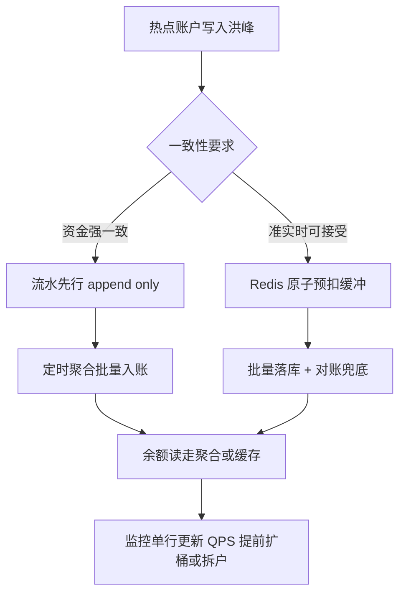

### Q996 · Redis Cluster: 16384 槽与数据分片

> 难度:★★★★ | 标签:Redis Cluster, 分片

**问**:Cluster 怎么决定一个 key 放哪个节点?为什么是 16384 个槽?客户端要注意什么?

**答**:key 经 CRC16 % 16384 得到槽号,槽分配给节点(每节点负责一段),节点间 gossip 协议交换槽位图。为什么 16384:作者解释心跳包里槽位图用 bitmap 压缩,16384 位约 2KB 合适,且集群规模设计上限约 1000 节点,够用且省带宽。多键操作要求所有键同槽——hash tag `{user1000}:orders` 强制同槽。客户端要点:走 MOVED/ASK 重定向或智能客户端(SDK 缓存槽位图直连正确节点);resharding 期间用 ASK 临时重定向; Lua 与事务、MGET 批量同样受同槽约束。扩容是"搬槽":逐槽迁移+双写窗口,业务低峰执行。

```python
# file: code/04_数据库与缓存/q996_cluster_slots.py
"""CRC16 取模映射槽位(教学实现) + hash tag 同槽演示"""

CRC16_TABLE = None

def crc16(data: bytes) -> int:
    """CRC-16/XMODEM, Redis cluster 使用的多项式 0x1021"""
    crc = 0
    for b in data:
        crc ^= b << 8
        for _ in range(8):
            crc = ((crc << 1) ^ 0x1021) if crc & 0x8000 else (crc << 1)
            crc &= 0xFFFF
    return crc

def key_slot(key: str) -> int:
    # hash tag: 取第一个 {..} 内的内容参与计算
    if "{" in key and "}" in key:
        tag = key[key.index("{") + 1:key.index("}")]
        if tag:
            key = tag
    return crc16(key.encode()) % 16384

if __name__ == "__main__":
    nodes = {"nodeA": range(0, 8192), "nodeB": range(8192, 16384)}
    def node_of(key):
        slot = key_slot(key)
        return ("nodeA" if slot in nodes["nodeA"] else "nodeB", slot)

    for k in ("user:1", "user:2", "{user1}:profile", "{user1}:orders"):
        n, s = node_of(k)
        print(f"{k:<18} -> 槽 {s:<5} 节点 {n}")
    print("hash tag 保证 {user1} 系列同槽, 多键操作可用")
```

**追问**:
- MOVED 与 ASK 的区别?——MOVED 是"槽已永久归他人, 更新你的槽位图";ASK 是"槽正在迁移, 本次去新节点问, 但别更新缓存"。
- Cluster 模式下还支持 MULTI 吗?——支持,但只能操作同槽键;跨槽事务放弃,业务改 hash tag 或拆流程。

---

### Q997 · 主从与哨兵: 故障转移怎么发生

> 难度:★★★★ | 标签:哨兵, 高可用

**问**:哨兵检测主观下线到完成切换的过程是什么?脑裂怎么发生怎么防?

**答**:流程:每个哨兵每秒 ping 主库,超时未回即"主观下线"(SDOWN); quorum 个哨兵同意后升级"客观下线"(ODOWN);哨兵间 Raft 式选举出 leader 执行切换:从从库中选优先级高、复制偏移量新的提升为主,其余从库改挂新主,通知客户端。脑裂:网络分区时旧主仍接受写入,分区恢复后被降级为从并清空这些"孤写"数据。防护:min-replicas-to-write=1 + min-replicas-max-lag=10——主库写前必须确认有从库及时同步,分区中无法满足即拒绝写入,牺牲可用性换不丢已确认写。哨兵数量奇数 3 或 5,quorum 折衷灵敏与稳定。

```python
# file: code/04_数据库与缓存/q997_sentinel_failover.py
"""哨兵故障转移状态机模拟: SDOWN -> ODOWN -> 切换"""
import time

class Sentinel:
    def __init__(self, name, quorum=2):
        self.name, self.quorum = name, quorum
        self.sdown = {}                          # 各哨兵的主观下线记录

    def ping_timeout(self, sentinels, master):
        votes = 0
        for s in sentinels:
            if s.sdown.get(master):
                votes += 1
        return votes >= self.quorum

def failover(masters, replicas, dead_master):
    replicas.sort(key=lambda r: -r["prio"])
    new_master = replicas[0]["name"]
    return {"down": dead_master, "promoted": new_master,
            "others": [r["name"] for r in replicas[1:]]}

if __name__ == "__main__":
    s1, s2, s3 = Sentinel("s1"), Sentinel("s2"), Sentinel("s3")
    sentinels = [s1, s2, s3]
    s1.sdown["master1"] = True                   # 一个哨兵主观下线
    print("仅 1 票, 客观下线:", s1.ping_timeout(sentinels, "master1"))
    s2.sdown["master1"] = True                   # 达到 quorum=2
    print("2 票, 客观下线:", s1.ping_timeout(sentinels, "master1"))

    replicas = [{"name": "r1", "prio": 100}, {"name": "r2", "prio": 90}]
    print("切换结果:", failover({}, replicas, "master1"))
    print("脑裂防护: min-replicas-to-write 让孤主拒绝写入")
```

**追问**:
- 为什么哨兵至少 3 个?——quorum 判定与 leader 选举都需要多数派,2 个哨兵任一故障即无法达成 ODOWN,3 起步容忍 1 个故障。
- 客户端怎么感知新主?——哨兵提供 pub/sub 通道 +switch-master 事件,或客户端定期向哨兵查询主地址;连接池要支持运行时重定向。

---

### Q998 · 缓存预热: 冷启动的正确姿势

> 难度:★★★☆ | 标签:缓存预热

**问**:新缓存上线或扩容后命中率为什么突然暴跌?预热怎么做才有效?

**答**:冷缓存意味着全部请求穿透到数据库,DB 瞬时承受全量读压,极易雪崩(Q172)。预热手段:一、离线任务——上线前把 TopN 热点(销量榜、首页配置、活跃用户画像)从 DB 拉出写缓存,分批限速避免打挂 DB;二、双缓存切换——新实例与旧实例并行,先复制热数据(或靠读流量自然回填)再切流量;三、灰度放量——按 1%->10%->100% 放流量,让缓存逐步填充。预热内容要基于真实访问分布(top key 统计),而不是全量灌入(浪费内存且命中率低)。配套:预热期间对 DB 加保护(限流/降级),监控命中率回升到基线再放量。

```python
# file: code/04_数据库与缓存/q998_cache_warmup.py
"""按访问频率 TopN 预热 + 限速分批"""
import time
from collections import Counter

def top_keys(access_log, n=5):
    return [k for k, _ in Counter(access_log).most_common(n)]

def warmup(cache, db, keys, batch=2, delay=0.01):
    loaded = 0
    for i in range(0, len(keys), batch):          # 限速分批, 保护 DB
        for k in keys[i:i + batch]:
            cache[k] = db[k]
            loaded += 1
        time.sleep(delay)
    return loaded

if __name__ == "__main__":
    access_log = ["p:1"] * 100 + ["p:2"] * 60 + ["p:3"] * 30 + \
                 ["p:4"] * 10 + ["p:5"] * 5 + ["p:6"] * 1
    db = {f"p:{i}": f"data{i}" for i in range(1, 7)}
    cache = {}
    hot = top_keys(access_log)
    print("热点 key:", hot)
    n = warmup(cache, db, hot)
    print(f"预热 {n} 个 key, 缓存:", cache)
    print("上线后热点请求直接命中, 长尾请求限速回源")
```

**追问**:
- 预热的 key 怎么选?——统计线上访问频次(网关日志/APM)取 TopN,叠加运营指定数据;固定热点(配置类)全量,用户维度只热头部。
- 预热脚本本身把 DB 打挂怎么办?——分批 + 限速 + 从只读副本取数;大表预热用游标分批并监控 DB 延迟动态降速。

---

### Q999 · Redis 事务与 WATCH: 乐观 CAS

> 难度:★★★☆ | 标签:事务, WATCH

**问**:MULTI/EXEC 是什么?WATCH 怎么实现"检查再改"的原子性?与 Lua 怎么选?

**答**:MULTI 开启事务,后续命令入队不执行,EXEC 一次性按序执行(无回滚——某条失败其余照常,与 SQL 事务不同),DISCARD 放弃。WATCH 提供乐观锁:EXEC 前若被 watch 的键被任何客户端修改过,整个事务返回 nil,客户端重试——标准 CAS 循环。与 Lua 选型:WATCH+MULTI 是客户端重试模式,简单场景够用但网络往返多、高竞争下重试风暴;Lua 服务端原子,无重试、可带逻辑,复杂"检查再写"首选 Lua。注意 WATCH 的键会占用客户端内存与版本追踪,用完 UNWATCH。

```python
# file: code/04_数据库与缓存/q999_watch_cas.py
"""WATCH + MULTI 的 CAS 循环模拟: 竞争下重试直到成功"""
import threading
import time

class Store:
    def __init__(self):
        self.kv = {"stock": 10}
        self.version = {}
        self.lock = threading.Lock()

    def get(self, k):
        with self.lock:
            return self.kv.get(k)

    def watch_exec(self, watched_key, mutate):
        """模拟 WATCH: 版本未变才提交"""
        with self.lock:
            v0 = self.version.get(watched_key, 0)
        snapshot = self.kv[watched_key]           # 读快照
        new_val = mutate(snapshot)
        with self.lock:
            if self.version.get(watched_key, 0) != v0:
                return None                        # 被他人修改, 事务作废
            self.kv[watched_key] = new_val
            self.version[watched_key] = v0 + 1
            return new_val

def cas_decrement(store, key, want):
    for attempt in range(1, 5):
        result = store.watch_exec(key, lambda v: v - want)
        if result is not None:
            return attempt, result
        time.sleep(0.01)                           # 退避后重试
    return -1, None

if __name__ == "__main__":
    s = Store()
    out = []
    def buyer():
        out.append(cas_decrement(s, "stock", 1))
    ts = [threading.Thread(target=buyer) for _ in range(3)]
    [t.start() for t in ts]
    [t.join() for t in ts]
    print("各买家(重试次数, 剩余):", out)
    print("高竞争下重试多 -> 这种场景换 Lua 一次原子扣减更优")
```

**追问**:
- Redis 事务为什么不支持回滚?——antirez 的设计取舍:命令错误在入队时即报错,运行期错误多为类型 bug,回滚救不了编程错误还拖慢常态路径。
- WATCH 的键很多会怎样?——每个客户端的 watched 集合让服务端维护版本比较成本上升,大量键时改用 Lua 或拆分热点。

---

### Q1000 · 内存碎片: mem_fragmentation_ratio 怎么读

> 难度:★★★☆ | 标签:内存, 运维

**问**:info memory 里 mem_fragmentation_ratio 是什么?1.5 说明什么?怎么治理?

**答**:ratio = used_memory_rss(操作系统视角的物理内存)/ used_memory(Redis 逻辑用量)。约 1~1.5 健康;>1.5 说明碎片严重——频繁增删大 value、大量过期键释放后分配器未归还 OS,物理内存虚高;<1(如 0.8)更危险,说明 swap 已发生,内存被换到磁盘,性能断崖。治理:4.0+ 开启 activedefrag(active-defrag-enabled yes,利用空闲 CPU 在线整理);删大 key 用 UNLINK 分批;避免大量同尺寸对象反复增删的模式;设置 maxmemory 留余量;swap 已发生时扩容或重启(重启前 RDB)。监控上把 ratio 与 swap 告警一起配,单看 ratio 会误判。

```python
# file: code/04_数据库与缓存/q1000_fragmentation.py
"""碎片率计算与 activedefrag 决策模拟"""

def frag_ratio(rss_bytes, used_bytes):
    return rss_bytes / used_bytes

def advise(ratio, swapped=False):
    if swapped or ratio < 1.0:
        return "严重: 疑似 swap, 立即扩容/重启, 检查 maxmemory 与宿主内存"
    if ratio <= 1.1:
        return "健康"
    if ratio <= 1.5:
        return "观察: 记录趋势, 检查是否有大 key 反复增删"
    return "治理: 开启 activedefrag, UNLINK 删大 key, 评估扩容"

if __name__ == "__main__":
    cases = [(1.2e9, 1.0e9), (1.6e9, 1.0e9), (0.8e9, 1.0e9)]
    for rss, used in cases:
        r = frag_ratio(rss, used)
        print(f"rss={rss / 1e9:.1f}GB used={used / 1e9:.1f}GB "
              f"ratio={r:.2f} -> {advise(r)}")
    print("注意: used_memory_peak 高峰回落期 ratio 偏高属正常, 看趋势不看单点")
```

**追问**:
- activedefrag 有代价吗?——占用 CPU(可配置 cycle-min/max 百分比),整理期间延迟抖动,低峰开启并观察 latency;
- 为什么 jemalloc 才支持?——activedefrag 依赖 jemalloc 的分配器统计与迁移接口,libc/其他分配器下配置无效。

---

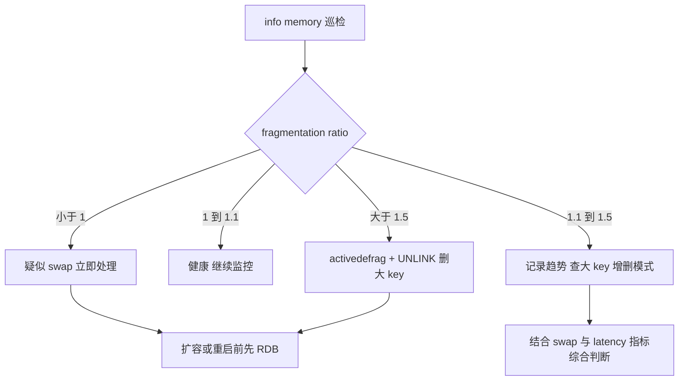

### Q1001 · Redis 慢日志与延迟排查

> 难度:★★★★ | 标签:慢日志, 排查

**问**:Redis 变慢,排查的完整思路是什么?slowlog 怎么配怎么看?

**答**:先分层定位:一、确认是"单命令慢"还是"整体延迟"——SLOWLOG GET 记录执行超 slowlog-log-slower-than(默认 10ms,建议 1ms)的命令,看到 KEYS/大集合全量命令/复杂 Lua 即元凶;二、单命令都很快但延迟抖动——查 fork(RDB/AOF 重写时 copy-on-write 卡顿,latest_fork_usec)、AOF 刷盘策略(everysec 阻塞到 2s)、内存交换、网络、单核 CPU 打满(infO CPU 的 sys 高说明碎片整理或 fork);三、延迟监控用 redis-cli --latency 与 LATENCY HISTORY 事件。经验值:生产禁用 KEYS、大 value 限制、everysec 换盘读写分离。排查顺序化:指标(命中率/RT) -> 慢日志 -> 系统层(fork/swap/IO)。

```python
# file: code/04_数据库与缓存/q1001_slowlog.py
"""模拟 slowlog: 记录超阈值命令并给出治理建议"""
import time
from collections import deque

class SlowLog:
    def __init__(self, threshold_ms=1.0, maxlen=128):
        self.threshold, self.log = threshold_ms, deque(maxlen=maxlen)

    def execute(self, cmd, cost_ms):
        if cost_ms >= self.threshold:
            self.log.appendleft((time.strftime("%H:%M:%S"), cmd, cost_ms))

    def report(self):
        tips = {"KEYS": "生产禁用, 改 SCAN", "HGETALL": "大 hash 拆分或 HSCAN",
                "SMEMBERS": "改 SSCAN", "LRANGE0-1": "限制范围", "EVAL": "缩短脚本"}
        for ts, cmd, ms in self.log:
            head = cmd.split()[0]
            tip = tips.get(cmd, tips.get(head, "检查数据规模"))
            print(f"{ts} {ms:6.1f}ms {cmd}  -> {tip}")

if __name__ == "__main__":
    sl = SlowLog()
    sl.execute("GET user:1", 0.2)                  # 未超阈值不记录
    sl.execute("KEYS *", 850.0)
    sl.execute("HGETALL feed:2", 120.0)
    sl.execute("EVAL ...", 45.0)
    sl.report()
    print("配置: slowlog-log-slower-than 1000 (微秒), slowlog-max-len 128")
```

**追问**:
- fork 卡顿怎么确认?——info stats 的 latest_fork_usec,大实例(10GB+)RDB 触发时可能几十上百毫秒,控制实例大小 10GB 内或低峰持久化。
- --latency 与 slowlog 的区别?——slowlog 只看命令执行时间,--latency 测端到端 RTT(含网络与排队),两者结合才能区分"命令慢"与"链路慢"。

---

### Q1002 · SCAN 与 KEYS: 遍历的正确方式

> 难度:★★★★ | 标签:SCAN, 运维

**问**:SCAN 为什么不阻塞?它保证不漏不重吗?生产遍历的姿势是什么?

**答**:SCAN 用反向二进制迭代:游标是桶位掩码翻转序,遍历中即使 rehash,也能保证"遍历开始时已存在的元素至少返回一次"(可能重复返回,由客户端去重),且每次只处理一个桶的若干元素,O(1) 级,不阻塞单线程;KEYS 一次性全库 O(N) 阻塞,生产禁用。SCAN 语义要点:不保证元素在遍历期间被添加的会返回、可能重复、键在遍历中被删除则可能不返回——它是"尽力快照"。工程姿势:每次 SCAN count 100~500(按键大小调)、客户端 Set 去重、按模式 MATCH 只扫前缀、大集合用 HSCAN/SSCAN/ZSCAN 配合分批删除。

```python
# file: code/04_数据库与缓存/q1002_scan_iterate.py
"""模拟 SCAN 游标遍历 + 客户端去重"""
def scan(store, cursor, count=2):
    keys = sorted(store.keys())                  # redis 真实为桶序, 此处简化
    if cursor >= len(keys):
        return [], 0
    chunk = keys[cursor:cursor + count]
    nxt = (cursor + count) if cursor + count < len(keys) else 0
    return chunk, nxt

def scan_all(store):
    seen, cursor = set(), 0
    while True:
        chunk, cursor = scan(store, cursor)
        seen.update(chunk)
        if cursor == 0:
            return seen

if __name__ == "__main__":
    store = {f"user:{i}": i for i in range(10)}
    all_keys = scan_all(store)
    print("遍历到:", sorted(all_keys))
    print("完整:", all_keys == set(store.keys()))
    print("语义: 可能重复(需去重), 遍历期间新增键不保证返回")
    print("删除大集合: HSCAN 分批取 field -> HDEL 批删, 拒绝一次性 DEL")
```

**追问**:
- SCAN count 是精确数量吗?——不是,是每轮检查的桶数上限,实际返回受键密度影响,空桶多时返回少、游标推进快。
- 集群下怎么全库 SCAN?——每个节点单独 SCAN(客户端聚合),智能客户端提供按节点扫描接口。

---

### Q1003 · bitmap 签到与活跃统计

> 难度:★★★☆ | 标签:bitmap, 统计

**问**:连续签到天数、月度活跃用户数,用 bitmap 怎么算?内存账怎么算?

**答**:SETBIT key offset 1 把"第 N 天/第 N 用户"位标记为 1,BITCOUNT 统计总数,BITOP AND/OR 对多个 bitmap 按位运算得到"连续/交集"。连续签到:对月内 bitmap 做"本周 AND 上一周"或按天逐位检查 offset;月活跃:每天一个 bitmap(当天活跃用户 id 为位),BITOP OR 合并月内即活跃用户数。内存账:1 亿用户一个 bitmap 是 1 亿 bit ≈ 12MB,32 天活跃数据 32 张约 384MB——紧凑但位偏移要收敛(用"用户短 id"而非 uuid,或分片)。避免稀疏大位:用户 id 跨度极大时改 RoaringBitmap 或 HyperLogLog(只要基数不要明细)。

```python
# file: code/04_数据库与缓存/q1003_bitmap_signin.py
"""bitmap 签到: SETBIT/BITCOUNT/BITOP 语义模拟"""
class Bitmap:
    def __init__(self):
        self.bits = bytearray()

    def setbit(self, offset, val=1):
        byte, bit = offset // 8, offset % 8
        self.bits.extend(b"\x00" * (byte + 1 - len(self.bits)))
        if val:
            self.bits[byte] |= 1 << bit
        else:
            self.bits[byte] &= ~(1 << bit)

    def getbit(self, offset):
        byte, bit = offset // 8, offset % 8
        if byte >= len(self.bits):
            return 0
        return self.bits[byte] >> bit & 1

    def bitcount(self):
        return sum(bin(b).count("1") for b in self.bits)

    def bitop_and(self, other):
        out = Bitmap()
        n = max(len(self.bits), len(other.bits))
        out.bits = bytearray((self.bits[i] & other.bits[i]) if i < min(len(self.bits), len(other.bits)) else 0
                             for i in range(n))
        return out

if __name__ == "__main__":
    sign = Bitmap()
    for day in (1, 2, 3, 5, 6, 7):               # 11 月签到日-1 为 offset
        sign.setbit(day)
    print("本月签到天数:", sign.bitcount())
    print("第 4 天签了吗:", sign.getbit(4))
    week1 = Bitmap(); [week1.setbit(d) for d in (1, 2, 3)]
    week2 = Bitmap(); [week2.setbit(d) for d in (5, 6)]
    print("与运算(演示交集语义):", week1.bitop_and(week2).bitcount())
    print("1 亿用户活跃统计约 12MB/天, BITOP 注意目标键内存瞬时翻倍")
```

**追问**:
- BITOP 的内存风险?——结果 bitmap 与源同尺寸,OR 32 天数据瞬时再多一份,错峰执行与限制参与运算的 bitmap 数量。
- 怎么算"连续签到最长天数"?——遍历位找最长 1 串 O(月天数),或客户端把 BITFIELD 段取回本地算,数据量大用分段。

---

### Q1004 · HyperLogLog: 0.81% 误差数千万 UV

> 难度:★★★★ | 标签:HyperLogLog, 基数统计

**问**:PFADD/PFCOUNT 为什么能用 12KB 估计上亿基数?误差怎么来的?

**答**:HLL 思想:对每个元素哈希,记录哈希值的"前导零个数"——基数越大,出现"很多前导零"的概率越大。Redis 用 16384 个寄存器(桶)分摊,每桶 6 bit,按哈希低 14 位选桶、剩余位算前导零,取每桶最大值,经调和平均与偏置校正估计基数。固定内存约 12KB(16384×6bit),标准误差 1.04/sqrt(16384) ≈ 0.81%。适合 UV、独立 IP 这类"要数量不要明细"的统计;不能取明细、不能精确去重,需要精确就用 set/bitmap。PFCOUNT 读多会缓存,PFCOUNT 多键合并是实时计算,合并大 HLL 有成本。

```python
# file: code/04_数据库与缓存/q1004_hyperloglog.py
"""迷你 HyperLogLog: 桶分摊 + 前导零 + 调和平均"""
import hashlib
import math

class MiniHLL:
    def __init__(self, m=1024):
        self.m = m
        self.reg = [0] * m

    def _hash(self, item):
        h = hashlib.sha1(str(item).encode()).digest()
        v = int.from_bytes(h[:8], "big")
        idx = v & (self.m - 1)                    # 低 10 位选桶
        rest = v >> 10
        rho = (rest.bit_length() and (64 - rest.bit_length()) + 1) or 64
        return idx, rho

    def add(self, item):
        idx, rho = self._hash(item)
        self.reg[idx] = max(self.reg[idx], rho)

    def count(self):
        alpha = 0.7213 / (1 + 1.079 / self.m)
        raw = alpha * self.m ** 2 / sum(2.0 ** -r for r in self.reg)
        zeros = self.reg.count(0)
        if raw <= 2.5 * self.m and zeros:          # 小基数线性计数校正
            raw = self.m * math.log(self.m / zeros)
        return int(raw)

if __name__ == "__main__":
    hll = MiniHLL()
    for i in range(50000):                          # 含大量重复
        hll.add(f"user{i % 30000}")
    print(f"估计基数: {hll.count()}, 真实: 30000, "
          f"误差: {abs(hll.count() - 30000) / 30000:.1%}")
    print("Redis: 16384 桶 12KB, 误差约 0.81%, 内存与基数无关")
```

**追问**:
- HLL 能合并吗?——能,PFMERGE 逐桶取 max 合并,是线性可合并(sketch)结构,适合分天统计再合并月 UV。
- 为什么前导零能代表基数?——哈希均匀时出现 r 个前导零的概率约 2^-r,观察到"前导零最多为 r"意味着基数大概率在 2^r 量级,多桶调和平均降低方差。

---

### Q1005 · 秒杀库存: Redis 原子扣减 + 异步落库

> 难度:★★★★★ | 标签:秒杀, Lua

**问**:秒杀链路里 Redis 扮演什么角色?扣减脚本怎么写?后面怎么落库?

**答**:标准链路:预热库存到 Redis -> 请求先过限流与防重 -> Lua 原子"查库存+判断资格+扣减+记录用户"(一人生成一单,SETNX 防重) -> 扣减成功发 MQ -> 消费者落库创建订单(以 MQ 消费结果为准),失败回补库存。要点:一、Lua 里完成全部判断,绝不在应用层"GET 再 DECR";二、扣减与去重键在一个脚本(原子);三、库存预热与热点隔离(单品独立 key);四、落库失败回补要幂等(标记单号);五、超卖兜底——DB 侧 stock>0 条件更新仍是最后防线。量级判断:单品 10 万 QPS 以上考虑分片库存(按 hash 分 N 份扣,总和为真),或直接上专业限流+排队。

```python
# file: code/04_数据库与缓存/q1005_seckill.py
"""秒杀: Lua 原子扣减 + 一人一单 + MQ 异步落库(模拟)"""
import queue
import threading

SECKILL_LUA = """
local stock = tonumber(redis.call('GET', KEYS[1]) or '0')
if redis.call('SETNX', KEYS[2], ARGV[1]) == 0 then
  return -2                                    -- 一人一单: 重复
end
if stock <= 0 then
  redis.call('DEL', KEYS[2])                   -- 回收资格
  return -1                                    -- 售罄
end
redis.call('DECR', KEYS[1])
return 1
"""

class FakeRedis:
    def __init__(self, stock):
        self.kv = {"stock": stock}
        self.lock = threading.Lock()

    def eval(self, script, keys, args):
        with self.lock:
            key_stock, key_user = keys
            if key_user in self.kv:              # SETNX 已存在: 重复下单
                return -2
            stock = int(self.kv.get(key_stock, 0))
            if stock <= 0:
                return -1                        # 售罄
            self.kv[key_user] = "1"              # 记录资格
            self.kv[key_stock] = stock - 1
            return 1

if __name__ == "__main__":
    r = FakeRedis(stock=3)
    mq = queue.Queue()
    def buyer(uid):
        rc = r.eval(SECKILL_LUA, ["stock", f"u:{uid}:order"], [uid])
        if rc == 1:
            mq.put(uid)                          # 成功才入队落库
        return rc
    codes = {}
    uids = [0, 1, 2, 3, 4, 0]                    # 最后一个是重复用户
    ts = [threading.Thread(target=lambda i=i: codes.__setitem__(i, buyer(uids[i])))
          for i in range(len(uids))]
    [t.start() for t in ts]
    [t.join() for t in ts]
    print("扣减结果:", codes, "<- 3 个 1 成功, 1 个 -1 售罄, 1 个 -2 重复")
    print("MQ 待落库:", list(mq.queue), "-> 消费者建订单, 失败幂等回补")
```

**追问**:
- 库存分片怎么实现?——stock 拆成 stock:0..N-1,请求随机挑桶扣,单桶售罄换桶;N 份总和与 DB 对账,分片牺牲部分公平换吞吐。
- 用户付不了款订单回滚,库存怎么回补?——订单超时取消事件触发 Lua INCR 回补(校验单号防重复回补),回补后可再次售出。

---

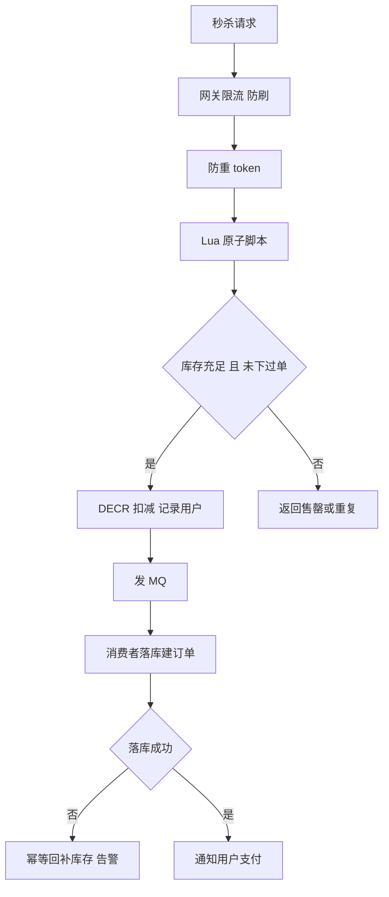

### Q1006 · Redis 容器化注意点

> 难度:★★★☆ | 标签:容器化, 运维

**问**:Redis 跑在 Kubernetes/容器里,哪些系统与编排层面的坑必须处理?

**答**:五类硬问题:一、内存超卖——容器 limit 与 Redis maxmemory 不一致,OS OOM killer 直接杀进程;limit 要略大于 maxmemory 并留 fork 的 copy-on-write 余量(RDB 时瞬时翻倍);二、透明大页 THP——必须关闭,否则 fork 后写放大导致延迟毛刺;三、磁盘 IO——RDB/AOF 落盘要挂本地 SSD PV,AOF everysec 对 fsync 延迟敏感;四、网络——hostNetwork 或高带宽保障,集群总线 16379 别被 NetworkPolicy 拦截;五、优雅关闭——preStop 发 SHUTDOWN SAVE/等待连接排空,terminationGracePeriodSeconds 覆盖持久化时长。K8s 里 StatefulSet + 反亲和分散节点,避免多副本同宿主机。健康检查用 redis-cli ping 而不是 TCP 探活(端口在进程假死时仍通)。

```python
# file: code/04_数据库与缓存/q1006_k8s_redis.py
"""容器化自检清单: 校验内存配置与持久化设置"""
def precheck(maxmemory_gb, container_limit_gb, thp_enabled,
             aof_policy, persistence_pv):
    issues = []
    if maxmemory_gb >= container_limit_gb:
        issues.append(f"maxmemory {maxmemory_gb}GB >= 容器 limit {container_limit_gb}GB, "
                      "OOM 风险; limit 应留 fork 余量约 1.5x")
    if thp_enabled:
        issues.append("THP 未关闭, fork 写放大将造成延迟毛刺")
    if aof_policy == "always":
        issues.append("AOF always 每次写都 fsync, 容器盘延迟敏感, 建议 everysec")
    if not persistence_pv:
        issues.append("未挂持久卷, 重启即丢数据(RDB/AOF 无处落盘)")
    return issues or ["检查通过"]

if __name__ == "__main__":
    print(precheck(maxmemory_gb=8, container_limit_gb=8, thp_enabled=True,
                   aof_policy="always", persistence_pv=False))
    print("---")
    print(precheck(maxmemory_gb=8, container_limit_gb=12, thp_enabled=False,
                   aof_policy="everysec", persistence_pv=True))
    print("补充: preStop 钩子执行 SHUTDOWN 排空连接; 健康检查用 redis-cli ping")
```

**追问**:
- 为什么 limit 要留 1.5 倍?——RDB/AOF 重写 fork 出的子进程共享父页,写入时按页复制(COW),高峰写入下额外内存可达 used 的 50% 以上。
- 容器里 swap 要不要开?——Redis 明确要求不 swap,Node 层 vm.swappiness=1 或关闭,依赖 limit 控制内存而非 swap 兜底。

---

### Q1007 · 缓存降级与熔断: 故障时的取舍

> 难度:★★★★ | 标签:降级, 熔断

**问**:Redis 整体变慢或不可用时,系统怎么自保?降级与熔断的边界在哪?

**答**:熔断是"发现依赖坏了就别再调"——客户端熔断器统计失败率,超阈值进入 open 状态直接快速失败(或走降级逻辑),半开探测恢复;降级是"坏了之后提供有损服务"——回源 DB 限流兜底、返回静态/旧数据、关闭非核心功能(推荐列表变热门榜)。缓存故障预案:一、读路径——熔断 Redis 后对 DB 回源加限流(令牌桶)与请求合并(singleflight),防止穿透打挂 DB;二、写路径——缓存更新失败进重试队列,恢复后重放;三、大促前演练降级开关(配置中心一键切换)。原则:降级是有预案的、可快速恢复的,牺牲非核心保核心;绝不能无熔断直通 DB。

```python
# file: code/04_数据库与缓存/q1007_circuit_breaker.py
"""熔断器: 失败率统计 -> open -> 半开探测 -> 恢复"""
import time

class CircuitBreaker:
    def __init__(self, fail_threshold=3, window=5.0, cooldown=2.0):
        self.fail_threshold, self.window, self.cooldown = fail_threshold, window, cooldown
        self.state = "closed"
        self.failures, self.opened_at = [], 0.0

    def allow(self):
        if self.state == "open":
            if time.monotonic() - self.opened_at > self.cooldown:
                self.state = "half-open"           # 半开: 放一个探测请求
                return True
            return False
        return True

    def record(self, ok):
        now = time.monotonic()
        if ok:
            if self.state == "half-open":
                self.state = "closed"              # 探测成功恢复
            self.failures = [t for t in self.failures if now - t < self.window]
        else:
            self.failures.append(now)
            if self.state == "half-open" or len(self.failures) >= self.fail_threshold:
                self.state, self.opened_at = "open", now

if __name__ == "__main__":
    cb = CircuitBreaker()
    for i in range(4):                             # 连续失败 3 次触发熔断
        if cb.allow():
            cb.record(False)
            print(f"请求{i}: 调用失败")
        else:
            print(f"请求{i}: 熔断中, 快速失败走降级")
    print("状态:", cb.state)
    time.sleep(2.1)
    print("冷却后半开探测:", cb.allow(), cb.record(True) or cb.state, "已恢复")
```

**追问**:
- 熔断阈值怎么定?——失败率(如 10s 内 50%)比绝对次数更稳,阈值过灵敏会随网络抖动反复开关,配合最小请求数统计。
- 降级返回旧数据怎么实现?——本地兜底缓存(上次成功响应),或备份库/只读副本;旧数据要带"数据时间"标注,避免业务当新值用。

---

### Q1008 · 缓存 key 设计规范: 命名、TTL 与抖动

> 难度:★★☆☆ | 标签:key 设计, 规范

**问**:缓存 key 怎么命名才不乱?TTL 为什么要加随机抖动?

**答**:命名三段式:`业务:对象:标识`,如 `mall:stock:sku123`、`mall:user:profile:{uid}`,用冒号分隔(guish 常见约定),全小写、禁空格;好处是可读、可按前缀统计(scan mall:stock:*)、可按前缀清理。TTL 纪律:所有 key 必须带 TTL(防止忘记删除的僵尸键);同一批次的 key 加随机抖动(TTL ± 10%~20%),避免"同一秒批量加载的缓存同时过期"造成集体回源的惊群;数据版本变化用 key 带版本(v2)整体切换。长度控制:key 本身也是内存与网络成本,长 uuid 全量拼进 key 要斟酌。大促场景的 key 生命周期要单独评审(临时 key 用完即删)。

```python
# file: code/04_数据库与缓存/q1008_key_design.py
"""key 构造器 + TTL 抖动"""
import random

class KeyBuilder:
    def __init__(self, app="mall"):
        self.app = app

    def make(self, *parts) -> str:
        return ":".join([self.app] + [str(p).lower() for p in parts])

def ttl_with_jitter(base_sec, jitter_ratio=0.15):
    delta = base_sec * jitter_ratio
    return int(base_sec + random.uniform(-delta, delta))

if __name__ == "__main__":
    kb = KeyBuilder()
    print(kb.make("stock", "sku123"))
    print(kb.make("user", "profile", 10086))
    print("同批缓存 TTL 抖动:", [ttl_with_jitter(300) for _ in range(6)])
    print("无抖动 1000 个 key 同秒过期 -> 集体回源 = 惊群; 有抖动则错峰")
```

**追问**:
- 用户维度 key 里放手机号安全吗?——不安全,key 可见性高(慢日志/监控/误读),用 uid 或哈希;敏感字段永不进 key 与日志。
- 版本化 key(v2)怎么清理旧版本?——切换后旧前缀批量 SCAN+UNLINK,或旧版本 TTL 自然过期,避免双份内存长期共存。

---

### Q1009 · 手写 LRU 缓存: O(1) 的经典结构

> 难度:★★★☆ | 标签:LRU, 数据结构

**问**:实现一个 O(1) 的 LRU 缓存,需要什么数据结构?Redis 的 LRU 和它一样吗?

**答**:哈希表 + 双向链表:hash 提供 O(1) 定位,链表维护访问顺序——get/put 后把节点摘下插到头部,容量满淘汰尾部。Python 可用 OrderedDict(move_to_end/popitem)标准实现,面试要求手写时用哨兵头尾节点简化边界。Redis 的"LRU"是近似算法:默认策略下不维护全局链表,而是每个对象存 24bit 时钟,淘汰时随机采样(maxmemory-samples,默认 5 个)挑最久未用的,牺牲精确换内存与 CPU(真 LRU 要 O(N) 链表);另有 LFU(4.0+,计数衰减)对抗偶发访问污染。这两点是手写题之上的加分回答。

```python
# file: code/04_数据库与缓存/q1009_lru_cache.py
"""手写 LRU: 哈希表 + 双向链表, 哨兵简化边界"""
class Node:
    def __init__(self, key=None, val=None):
        self.key, self.val = key, val
        self.prev = self.next = None

class LRUCache:
    def __init__(self, capacity):
        self.cap = capacity
        self.map = {}
        self.head, self.tail = Node(), Node()      # 哨兵
        self.head.next, self.tail.prev = self.tail, self.head

    def _remove(self, node):
        node.prev.next, node.next.prev = node.next, node.prev

    def _add_front(self, node):
        node.next, node.prev = self.head.next, self.head
        self.head.next.prev = node
        self.head.next = node

    def get(self, key):
        if key not in self.map:
            return -1
        node = self.map[key]
        self._remove(node)
        self._add_front(node)
        return node.val

    def put(self, key, value):
        if key in self.map:
            self._remove(self.map[key])
        node = Node(key, value)
        self.map[key] = node
        self._add_front(node)
        if len(self.map) > self.cap:
            lru = self.tail.prev
            self._remove(lru)
            del self.map[lru.key]

if __name__ == "__main__":
    cache = LRUCache(2)
    cache.put(1, "a"); cache.put(2, "b")
    print("get 1:", cache.get(1), "<- 1 变为最新")
    cache.put(3, "c")                               # 淘汰 2
    print("get 2(已淘汰):", cache.get(2))
    print("get 3:", cache.get(3))
    print("Redis 近似 LRU: 随机采样 maxmemory-samples 挑最久未用, 非全局链表")
```

**追问**:
- 为什么用双向链表不是单向?——O(1) 删除任意节点需要前驱指针,单向链表删除要遍历找前驱。
- LFU 什么时候比 LRU 好?——偶发批量扫描会污染 LRU(热数据被冲出),LFU 按访问频率+时间衰减更抗污染,适合"长尾多、热点稳定"的负载。

---

### Q1010 · 序列化与 value 大小控制

> 难度:★★★☆ | 标签:序列化, 性能

**问**:缓存 value 用 JSON 还是二进制?value 多大算大?怎么控制?

**答**:选型:JSON 可读、跨语言、调试方便,体积大;MessagePack/Protobuf 紧凑 30%~50%、解析快,适合大 value 与高 QPS;内部服务一致即可,别混用。大小红线经验值:单 value 控制在 10KB~100KB,超过 1MB 就是大 value(网络、序列化、内存分配、主从复制全面承压)。控制手段:只存必要字段(DTO 裁剪,别把 ORM 整对象 dump)、列表分页存(只缓存当前页)、大对象拆分(用户资料与订单列表分开)、压缩(gzip/zstd,cpu 换带宽,压缩后仍大就拆)。序列化注意版本兼容(字段演进别破坏旧缓存)与不可序列化对象(set/datetime 的显式转换)。

```python
# file: code/04_数据库与缓存/q1010_serialization.py
"""JSON vs 精简 DTO 的 value 大小对比"""
import json

def big_dto(user):
    return {**user, "orders": [f"order{i}" for i in range(200)],
            "logs": [f"log{i}" for i in range(100)]}

def slim_dto(user):
    return {"id": user["id"], "name": user["name"]}

if __name__ == "__main__":
    user = {"id": 1, "name": "alice", "phone": "138...", "_internal": "xx"}
    b = json.dumps(big_dto(user)).encode()
    s = json.dumps(slim_dto(user)).encode()
    print(f"全量 dump: {len(b)} bytes")
    print(f"精简 DTO: {len(s)} bytes, 节省 {1 - len(s) / len(b):.0%}")
    print("规范: value < 100KB 优先; 1MB+ 拆分; 二进制协议可再省 30~50%")
```

**追问**:
- 缓存对象的字段演进怎么兼容?——value 里带 schema 版本,读取端按版本映射;或字段只增不删+默认值,旧缓存自然兼容到 TTL 过期。
- 什么时候该压缩?——value 大(>50KB)且读多写少时收益明显;高频小 value 压缩的 CPU 成本大于网络收益,不划算。

---

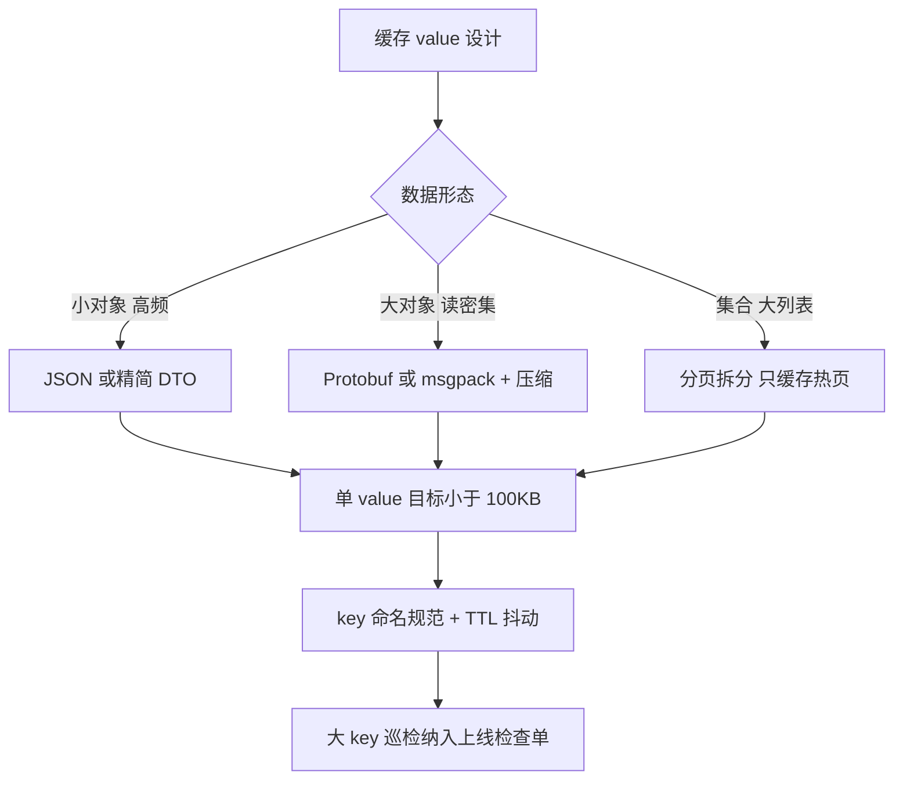

### Q1011 · Redis 与 Memcached 怎么选

> 难度:★★★☆ | 标签:选型, 缓存

**问**:同样是内存 KV,Redis 与 Memcached 的核心差异是什么?

**答**:Memcached 是纯缓存:多线程、简单 KV(只 string)、内存预分配 slab、超容量即淘汰、无持久化;Redis 单线程(6.0 IO 多线程)命令丰富(五种结构+模块)、可持久化(RDB/AOF)、支持复制与集群、Lua 脚本、发布订阅。选型:纯"string 级缓存"且要极致吞吐、多核利用率(如 session、fragment 缓存)Memcached 依然能打;需要结构化操作(zset 排行榜、hash 对象)、持久化容灾、锁/队列等高级语义,选 Redis。现实工程默认 Redis(生态与运维工具完善),Memcached 只在"超大内存池 + 简单 KV"的特定场景(如老牌社交 feed)保留。面试补充:两者都不适合做数据库,Redis 持久化也代替不了 DB。

```python
# file: code/04_数据库与缓存/q1011_redis_vs_memcached.py
"""两种缓存的能力矩阵对照"""
MATRIX = """
能力            Redis            Memcached
数据结构        string/hash/list/zset/stream   仅 string
持久化          RDB/AOF/混合      无
高可用          哨兵/集群/复制    客户端一致性哈希
原子脚本        Lua               无(仅 cas)
内存模型        按需分配+淘汰     slab 预分配
多线程          6.0 io 多线程     多线程工作线程
适用            结构化+高级语义   纯 KV 大内存池缓存
"""
if __name__ == "__main__":
    print(MATRIX)
    print("选型: 要结构/持久化/锁 -> Redis; 纯 string 缓存要极致多核 -> Memcached")
```

**追问**:
- Memcached 为什么曾更"抗大流量"?——多线程吃满多核、无持久化 fork 卡顿,纯 GET/SET 场景延迟稳定;Redis 6.0 IO 多线程后差距缩小。
- 两者淘汰行为差异?——Memcached slab 内按 LRU 淘汰(可能立刻顶掉刚写入的),Redis 按全局 maxmemory 策略(可配置 noeviction),语义更可控。

---

### Q1012 · pub/sub 与 stream 的选择

> 难度:★★★☆ | 标签:pub/sub, stream

**问**:发布订阅场景用 pub/sub 还是 stream?pub/sub 的消息丢失问题怎么理解?

**答**:pub/sub 是"在线广播":订阅者必须在线,消息不落盘,离线即丢,无消费组无确认,适合"状态通知"(配置变更通知、缓存失效广播)这类丢了无所谓的场景;stream 是"日志回放":消息持久、组消费、ack、可重放,适合业务事件。选择标准只有一个问题——"丢一条消息的代价":无所谓(广播 L1 失效)用 pub/sub 简单高效;不可丢(订单事件)用 stream 或 MQ。pub/sub 的失效广播要注意:消息丢失由 L1 短 TTL 兜底(Q975);stream 的注意 backlog 与 MAXLEN 截断。两者都是 Redis 内的轻量方案,重业务事件仍建议专业 MQ(持久化、事务、治理更完整)。

```python
# file: code/04_数据库与缓存/q1012_pubsub_vs_stream.py
"""pub/sub 在线广播(离线丢) vs stream 落盘回放"""
import queue

class MiniPubSub:
    def __init__(self):
        self.subs = {}

    def subscribe(self, ch):
        q = queue.Queue()
        self.subs.setdefault(ch, []).append(q)
        return q

    def publish(self, ch, msg):
        for q in self.subs.get(ch, []):
            q.put(msg)                     # 只有在线订阅者收到

class MiniStream:
    def __init__(self):
        self.log = []

    def xadd(self, msg):
        self.log.append(msg)

    def read_from(self, offset):
        return self.log[offset:]           # 离线消息仍可回放

if __name__ == "__main__":
    ps = MiniPubSub()
    q = ps.subscribe("cfg")
    ps.publish("cfg", "v2")
    print("pub/sub 在线收到:", q.get())
    print("pub/sub 离线消息: 发布时无订阅者 -> 直接丢弃")

    ms = MiniStream()
    ms.xadd("event1"); ms.xadd("event2")     # 消费者此刻离线
    print("stream 离线后回放:", ms.read_from(0), "<- 不丢")
    print("选择: 丢了无所谓用 pub/sub, 不可丢用 stream 或 MQ")
```

**追问**:
- pub/sub 的 channel 需要提前创建吗?——不需要,无订阅者时消息直接丢弃,这也是它"离线即丢"语义的体现。
- 缓存失效广播为什么能容忍 pub/sub?——L1 有短 TTL 自动回源自愈,广播只是加速;若业务要求"必须失效"则要 stream/ack 化。

---

### Q1013 · CAP 与 BASE: 缓存体系里的体现

> 难度:★★★☆ | 标签:CAP, 架构理论

**问**:用 CAP 和 BASE 分析缓存体系:缓存挂了选什么?为什么说缓存天生是 BASE?

**答**:CAP:网络分区(P)必然存在,缓存与 DB 主从间只能二选一——CP 如 etcd/zk(强一致、分区时拒绝服务),AP 如 Redis 主从(可用、容忍读到旧值)。缓存体系整体是 AP+BASE:基本可用(降级后仍有损服务)、软状态(缓存与 DB 短暂不一致是常态)、最终一致(TTL 过期/失效同步后收敛)。面试表达:不要把 CAP 当"三选二"教条,要说清楚"分区发生时你保可用还是一致,以及非分区时的延迟与吞吐是代价"。Redis 主从异步复制就是典型的 AP 抉择——故障转移可能丢最近写入(min-replicas-to-write 是向 CP 妥协的开关)。BASE 不是"不管一致性",而是"设计收敛路径":TTL、失效同步、对账。

```python
# file: code/04_数据库与缓存/q1013_cap_base.py
"""一致性策略光谱: 从强一致到最终一致的取舍"""
SPECTRUM = """
CP 方向(分区时拒绝写):
  etcd/zk 共识 -> 分布式锁/配置中心
  DB 同步复制 + 强制读主 -> 资金核心
中间地带:
  Redis 半同步语义: min-replicas-to-write=1 -> 拒绝写保不丢
  缓存强一致读: 写后短窗口读主(Q897)
AP 方向(分区时保可用):
  Redis 主从异步复制 -> 读可能旧值
  Cache Aside + TTL -> 最终一致 BASE
"""
if __name__ == "__main__":
    print(SPECTRUM)
    print("BASE 三要素: 基本可用(降级) 软状态(允许不一致窗口) 最终一致(TTL/对账收敛)")
```

**追问**:
- 缓存为什么不追求 CP?——缓存的存在意义就是低延迟与高可用,牺牲 C 换性能;真需要强一致的数据不该进缓存或要走读主。
- 最终一致的"最终"有多久?——由 TTL、失效广播延迟、对账周期共同决定,业务要给出明确 SLA(如 5 秒内收敛)并监控超时案例。

---

### Q1014 · 缓存容量规划: 内存账与水位

> 难度:★★★☆ | 标签:容量规划, 运维

**问**:给一个日活千万的产品规划缓存集群,内存怎么算?水位怎么设?

**答**:内存账四步:一、对象规模——估算 key 数(N)与平均 value 大小(S);二、开销系数——Redis 对象头、指针、jemalloc 尺寸类,实际占用约为 payload 的 1.5~2 倍(小对象更甚);三、时间窗——缓存仅存活跃数据,按 TTL 与日活折算驻留量(如 10% 日活 * TTL 天);四、增长与安全水位——预留 6~12 个月增长,水位红线 70%(超过即扩容),maxmemory 留 20% 余量给 fork。示例:千万日活、缓存 5000 万 key、平均 200B -> payload 10GB,系数 2 -> 20GB,加增长预留按 64GB 集群分片(如 4 主 4 从)。配套:大 key 巡检、命中率与淘汰速率监控(内存满后 evicted 上升即容量不足信号)。

```python
# file: code/04_数据库与缓存/q1014_capacity.py
"""缓存容量估算: payload -> 实际内存 -> 集群规格"""

def estimate(keys, avg_value_bytes, overhead=2.0, growth_months=6,
             monthly_growth=0.05, watermark=0.7):
    payload_gb = keys * avg_value_bytes / 1024 ** 3
    real_gb = payload_gb * overhead
    future = real_gb * (1 + monthly_growth) ** growth_months
    need = future / watermark
    return {"payload": payload_gb, "real": real_gb,
            "after_growth": future, "plan_with_watermark": need}

if __name__ == "__main__":
    plan = estimate(keys=50_000_000, avg_value_bytes=200)
    for k, v in plan.items():
        print(f"{k:>20}: {v:8.1f} GB")
    print("示例规格: 6 主 6 从(每主 16GB maxmemory)可承载, 水位 70% 告警")
    print("别忘了 fork 余量: 单实例 used 控制在 10GB 内降低 RDB 卡顿")
```

**追问**:
- 淘汰开始后怎么办?——evicted_keys 持续增长说明容量不足,短期提高 TTL 淘汰优先级无解,只能扩容或压缩 value/缩短 TTL。
- 按什么粒度分片?——按业务域(隔离爆炸半径)与按量(单实例 10GB 内)结合,先业务域后量级,避免单一巨型实例。

---

### Q1015 · Redis 安全: ACL 与暴露面收敛

> 难度:★★★☆ | 标签:安全, ACL

**问**:Redis 被入侵的常见原因是什么?6.0 的 ACL 怎么用?生产安全清单有哪些?

**答**:常见事故:裸奔公网 + 默认无密码/弱密码 -> CONFIG SET dir 写入 crontab/webshell 拿服务器。生产清单:一、网络层——只监听内网、bind 指定 IP、防火墙/安全组,严禁 0.0.0.0 + 公网;二、认证——requirepass 或 6.0 ACL(用户/密码/命令/键四维授权:`user app_user on >pwd ~app:* +@read +@write -@dangerous`),按业务分账号,运维账号禁 FLUSHALL/CONFIG;三、命令收敛——rename-command/ACL 禁用 KEYS、FLUSHALL、CONFIG、DEBUG;四、防利用——禁用危险 dir/DBFILENAME 配置变更(6.0+ CONFIG SET 受 ACL 限制)、普通用户跑 redis 账号;五、TLS(6.0+)与审计日志。ACL 让"一个 Redis 多业务"的隔离成为可能,不再靠 rename-command 打补丁。

```python
# file: code/04_数据库与缓存/q1015_redis_acl.py
"""ACL 规则建模: 用户/命令类别/键前缀 校验器"""
class ACL:
    DANGEROUS = {"keys", "flushall", "flushdb", "config", "debug", "shutdown"}

    def __init__(self):
        self.users = {}

    def create_user(self, name, password, patterns, allow_categories,
                    deny_commands=()):
        self.users[name] = {"password": password, "patterns": patterns,
                            "allow": allow_categories,
                            "deny": set(deny_commands) | self.DANGEROUS}

    def check(self, name, password, cmd, key):
        u = self.users.get(name)
        if not u or u["password"] != password:
            return False, "认证失败"
        if cmd in u["deny"]:
            return False, f"命令 {cmd} 被禁用"
        if not any(key.startswith(p.rstrip("*")) for p in u["patterns"]):
            return False, f"键 {key} 越权"
        return True, "ok"

if __name__ == "__main__":
    acl = ACL()
    acl.create_user("app", "s3cret", ["app:*"], ["read", "write"])
    for user, pwd, cmd, key in [
            ("app", "s3cret", "get", "app:stock:1"),
            ("app", "s3cret", "keys", "*"),
            ("app", "wrong", "get", "app:stock:1"),
            ("app", "s3cret", "get", "other:secret")]:
        ok, msg = acl.check(user, pwd, cmd, key)
        print(f"{cmd:>5} {key:<18} -> {'允许' if ok else '拒绝: ' + msg}")
```

**追问**:
- rename-command 与 ACL 怎么选?——6.0+ 一律 ACL(结构化、可审计);老版本才用 rename-command 打补丁,升级后迁移。
- 怎么防"写 crontab"类利用?——redis 进程用专用低权账号跑(crontab 不可写)、禁 CONFIG SET 改 dir、服务器上 redis 用户无 shell。

---

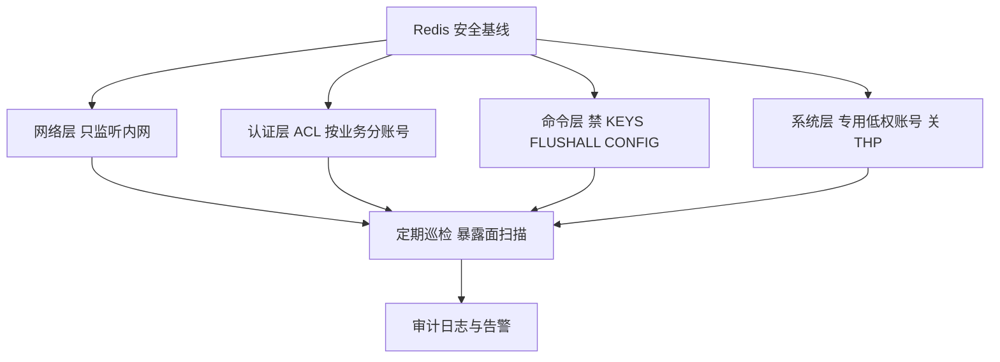

### Q1016 · Write-Behind: 写回模式与数据丢失窗口

> 难度:★★★★ | 标签:缓存模式, 写回

**问**:Write-Through、Write-Behind、Write-Around 三种写缓存模式怎么区分?各自的风险是什么?

**答**:Write-Through:写请求同时写缓存与 DB(同步),读快、一致强,写延迟等于双写;Write-Around:只写 DB,读时回填缓存,写最快,但刚写的数据不在缓存里(读穿透一次);Write-Behind(写回):先写缓存即返回,DB 异步批量刷,写延迟最低、可合并写,代价是"丢失窗口"——缓存挂了未刷的数据就丢。选型:计数器、点赞数这类可容忍少量丢失的聚合值适合 Write-Behind(如 Redis 计数每 5 秒批量落库);资金余额绝不能用。实现要点:刷库任务幂等(按累计值/版本落库)、失败重试与对账兜底(Q993)、缓冲上限保护(积压超阈值转同步写)。

```python
# file: code/04_数据库与缓存/q1016_write_behind.py
"""Write-Behind: 缓冲计数, 定时批量落库, 失败回滚缓冲"""
import time

class WriteBehindCounter:
    def __init__(self, db_value=0):
        self.buffer = 0                          # 未落库的增量
        self.db_value = db_value
        self.pending_batches = []

    def incr(self, n=1):
        self.buffer += n                         # 只写缓存, 立即返回

    def flush(self):
        if self.buffer == 0:
            return "无事可刷"
        batch, self.buffer = self.buffer, 0
        self.pending_batches.append(batch)       # 模拟写 DB
        self.db_value += batch
        return f"落库 +{batch}, DB={self.db_value}"

    def on_flush_fail(self, batch):
        self.buffer += batch                     # 失败回滚到缓冲, 等下轮
        return "缓冲恢复, 重试中"

if __name__ == "__main__":
    c = WriteBehindCounter()
    for _ in range(100):                         # 高频写只碰内存
        c.incr()
    print("100 次写后:", c.flush())
    print("丢失窗口: flush 前进程崩溃 -> 最多丢一个批次的增量")
    print("资金场景禁用; 计数/赞/浏览量可接受并配对账")
```

**追问**:
- Write-Behind 的 DB 写怎么幂等?——按"本次累计增量+水位"落库(UPDATE ... SET v = v + delta WHERE watermark = ?),失败整批回滚缓冲;或落流水表由聚合任务算,天然幂等。
- 缓冲积压怎么办?——监控 buffer 大小,超过阈值(如 10 万条)自动切换为同步写(Write-Through)保护一致性,恢复后再切回。

---

### Q1017 · singleflight: 合并并发回源

> 难度:★★★★ | 标签:缓存击穿, singleflight

**问**:热点 key 失效瞬间上千请求同时回源 DB,除了分布式锁还有什么解法?

**答**:singleflight(单飞):同进程内,对同一 key 的并发请求合并成一次真实回源——第一个请求执行加载,其余等待共享结果。它把"进程内并发"直接压成 1 次 DB 查询,与分布式锁互补:锁解决"跨实例互斥",singleflight 解决"实例内重复"。实现:in-flight 字典 {key: Future},首个请求占位,后来者 await/等待同一 Future,完成后统一返回;加载失败则异常共享。配合:逻辑过期(Q171 的思路)让热点永不物理失效,singleflight 兜住冷启动与版本切换;超时保护防止上游 hang 死拖住全部等待者。Go 的 golang.org/x/sync/singleflight 是同名词来源。

```python
# file: code/04_数据库与缓存/q1017_singleflight.py
"""singleflight: 同 key 并发回源合并为一次"""
import threading
import time

class SingleFlight:
    def __init__(self):
        self.inflight = {}
        self.lock = threading.Lock()

    def do(self, key, loader):
        with self.lock:
            if key in self.inflight:             # 已有同伴在加载
                fut = self.inflight[key]
                owner = False
            else:
                fut = {"event": threading.Event(), "value": None,
                       "error": None, "waiters": 0}
                self.inflight[key] = fut
                owner = True
            if not owner:
                fut["waiters"] += 1
        if owner:
            try:
                fut["value"] = loader()
            except Exception as e:
                fut["error"] = e
            finally:
                fut["event"].set()
                with self.lock:
                    self.inflight.pop(key, None)
        fut["event"].wait()
        if fut["error"]:
            raise fut["error"]
        return fut["value"]

if __name__ == "__main__":
    calls = []
    sf = SingleFlight()

    def slow_loader():
        time.sleep(0.3)                          # 模拟 DB 查询
        calls.append(1)
        return "db-result"

    results = []
    def worker():
        results.append(sf.do("hot:key", slow_loader))
    ts = [threading.Thread(target=worker) for _ in range(8)]
    [t.start() for t in ts]
    [t.join() for t in ts]
    print(f"8 个并发请求 -> DB 实际调用 {len(calls)} 次, 结果一致: {len(set(results)) == 1}")
```

**追问**:
- 多实例下 singleflight 会退化成什么?——每实例各 1 次回源(N 实例 N 次),要进一步压缩就在前面加分布式锁或逻辑过期,层次是 singleflight -> 锁 -> 逻辑过期。
- 等待者超时怎么办?——等待加超时,超时者返回降级值或自己降级去 DB;owner 加载失败异常要共享给等待者,不能让它们白等。

---

### Q1018 · 缓存监控指标: 命中率只是起点

> 难度:★★★☆ | 标签:监控, 运维

**问**:缓存体系要看哪些指标?命中率下降怎么定位?

**答**:五层指标:一、效果层——命中率(hit/miss)、平均回源耗时、回源 QPS(打 DB 的压力);二、资源层——内存使用与水位、evicted 速率、连接数、CPU;三、延迟层——P99 RTT、慢日志条数、fork 耗时;四、一致性层——失效同步延迟、对账差异量、脏读投诉;五、业务层——缓存参与度(多少比例请求经过缓存)、降级开关状态。命中率下降排查路径:先看 miss 来源(新业务无缓存?TTL 太短?key 规范变了?)→ 看 evicted(容量不足把热数据挤掉)→ 看失效风暴(批量过期/主动清空)→ 对照发布变更(最近上线改了 key/序列化)。告警阈值:命中率环比跌 5% 告警,evicted>0 连续告警,P99 超基线 2 倍告警。

```python
# file: code/04_数据库与缓存/q1018_cache_metrics.py
"""命中率统计与环比告警"""
class CacheMetrics:
    def __init__(self):
        self.hits = self.misses = 0

    def hit(self):
        self.hits += 1

    def miss(self, source="expiry"):
        self.misses += 1
        self.last_miss_source = source

    @property
    def hit_rate(self):
        total = self.hits + self.misses
        return self.hits / total if total else 1.0

def alert(current, baseline, drop_threshold=0.05):
    drop = baseline - current
    if drop > drop_threshold:
        actions = ["检查最近发布是否改了 key 或 TTL",
                   "看 evicted 是否容量不足",
                   "看是否有批量过期或主动清缓存"]
        return f"命中率 {current:.0%} 较基线 {baseline:.0%} 下降 {drop:.0%} -> " + \
               "; ".join(actions)
    return f"命中率 {current:.0%} 正常"

if __name__ == "__main__":
    m = CacheMetrics()
    for i in range(800):
        m.hit()
    for i in range(200):
        m.miss()
    print(f"当前命中率: {m.hit_rate:.0%}")
    print(alert(m.hit_rate, baseline=0.95))
    print("配套指标: evicted 速率 / P99 RTT / 回源 QPS / 对账差异量")
```

**追问**:
- 为什么不能只看命中率?——命中率 99% 但那 1% 回源是 500ms 的大查询,DB 照样被打挂;要结合回源 QPS 与回源耗时看"总压力"。
- 降级开关状态也要监控吗?——必须:降级是"隐性故障态",忘了恢复意味着长期拿旧数据;开关变更进审计与告警。

---

### Q1019 · Redis 升级与数据迁移: 平滑换实例

> 难度:★★★★ | 标签:迁移, 运维

**问**:Redis 从单机迁到集群(或换大内存实例),怎么做到业务无感?

**答**:迁移四法按停机时间从多到少:一、停机窗口——业务低峰停写,DUMP/RDB 恢复到新实例,改配置切流,分钟级停机,最简单;二、MIGRATE/复制——新实例做旧实例的从库(SLAVEOF 旧主),同步追平后哨兵式切换;三、双写+对账——应用同时写新旧,读旧,对账一致后读新、停旧写(适合结构变化大的迁移,如单机 -> Cluster 分片规则变了);四、proxy 过渡——引入代理层按槽灰度搬迁,业务只对 proxy。升级版本(如 6 -> 7)注意:新版本命令行为变化、AOF/RDB 兼容性(向后兼容可读)、先在预发全量回归。共同纪律:先做回滚方案、迁移期间监控命中率与错误率、切流可一键回退。

```python
# file: code/04_数据库与缓存/q1019_migration.py
"""双写迁移 Redis: 写新读旧 -> 对账 -> 切读 -> 收尾"""
class Cluster:
    def __init__(self):
        self.old, self.new = {}, {}
        self.write_both, self.read_new = False, False

    def write(self, k, v):
        self.old[k] = v
        if self.write_both:
            self.new[k] = v

    def read(self, k):
        return self.new.get(k) if self.read_new else self.old.get(k)

    def reconcile(self):
        missing = {k for k in self.old if self.new.get(k) != self.old[k]}
        for k in missing:                        # 修复后新库才可切读
            self.new[k] = self.old[k]
        return missing

if __name__ == "__main__":
    c = Cluster()
    for i in range(5):
        c.write(f"k{i}", i)
    c.write_both = True
    c.write("k5", 5)
    print("未迁移前差异:", c.reconcile())
    print("对账通过, 切读新库:", (c.__setattr__("read_new", True), c.read("k3"))[1])
    print("收尾: 停旧写 -> 旧实例只读观察 -> 下线")
```

**追问**:
- 单机迁 Cluster 为什么不能直接复制?——分片规则变了,按槽重分布必须逐 key 搬(MIGRATE)或双写重建,纯 RDB 只能灌进一个节点。
- 迁移期间缓存 miss 激增正常吗?——正常,新实例冷缓存会回源 DB,务必预热(Q998)或灰度放量,避免迁移变成 DB 事故。

---

### Q1020 · 综合案例: 高并发商品详情缓存体系

> 难度:★★★★★ | 标签:综合案例, 架构

**问**:商品详情页 QPS 10 万,商品数据多表组成、秒级变价,设计完整缓存体系。

**答**:分层作答:一、读路径——L1 本地缓存(1s TTL,扛热点)→ L2 Redis(商品 JSON,5min TTL + 逻辑过期)→ DB;热点商品用逻辑过期永不物理失效,配合 singleflight 合并回源,防击穿;二、写路径——改价走 Cache Aside:更新 DB → 删 L2 → 广播失效 L1;价格字段单独小 key(变价高频只失效价格),详情大 JSON 低频;三、防护——布隆过滤器拦截不存在商品 id,空值缓存防穿透,限流+熔断保 DB,DB 回源走只读副本;四、一致性——binlog 订阅兜底删除(Q974),对账每日校验缓存与库抽样一致;五、容量——按 Q1014 模型估算分片,L1 只放 Top 商品。回答时先画图再逐层说清"每个缓存问题(穿透/击穿/雪崩/一致)在哪一层由什么机制解决"。

```python
# file: code/04_数据库与缓存/q1020_cache_system.py
"""商品详情缓存体系骨架: 两级缓存 + 逻辑过期 + singleflight + 防穿透"""
import time

class ProductCacheSystem:
    def __init__(self, db, capacity=2):
        self.db = db
        self.l1, self.l2 = {}, {}
        self.logic_expire = {}                   # 逻辑过期时间
        self.null_cache = set()                  # 空值防穿透
        self.bloom = set()                       # 演示用简化布隆
        self.sf_locks = {}

    def warm(self, ids):
        self.bloom.update(ids)

    def get(self, pid):
        if pid not in self.bloom or pid in self.null_cache:
            return None                          # 防穿透: 肯定不存在
        now = time.monotonic()
        if pid in self.l1:
            return self.l1[pid], "L1"
        if pid in self.l2 and self.logic_expire[pid] > now:
            self.l1[pid] = self.l2[pid]          # 未到期直接用
            return self.l2[pid], "L2"
        # 到期: 逻辑过期异步重建(演示为同步 + 合并)
        v = self.db[pid]
        self.l2[pid], self.logic_expire[pid] = v, now + 5
        self.l1[pid] = v
        return v, "DB 回源"

    def update_price(self, pid, price):
        self.db[pid] = {**self.db[pid], "price": price}
        self.l2.pop(pid, None)                   # 删 L2
        self.l1.pop(pid, None)                   # 广播失效 L1(同进程演示)

if __name__ == "__main__":
    db = {1001: {"name": "键盘", "price": 199}}
    sys_ = ProductCacheSystem(db)
    sys_.warm([1001])
    print("首次读:", sys_.get(1001))
    print("二次读:", sys_.get(1001), "<- L1 命中")
    sys_.update_price(1001, 179)
    print("改价后读:", sys_.get(1001), "<- 回源新值")
    print("不存在商品:", sys_.get(9999), "<- 布隆拦截, 不打 DB")
    print("生产还需: binlog 兜底删除 / 熔断限流 / 对账 / 多分片容量规划")
```

**追问**:
- 价格与详情为什么拆两个 key?——变价频率远高于详情,拆开后高频变价只失效小 key,详情缓存命中率不受影响,失效风暴半径也小。
- 逻辑过期怎么配合删除策略?——逻辑过期键"永不过期",更新走"后台重建",避免删除瞬间的击穿;但数据精度依赖重建间隔,对价格这类敏感字段要缩短重建周期或改走独立通道。

---

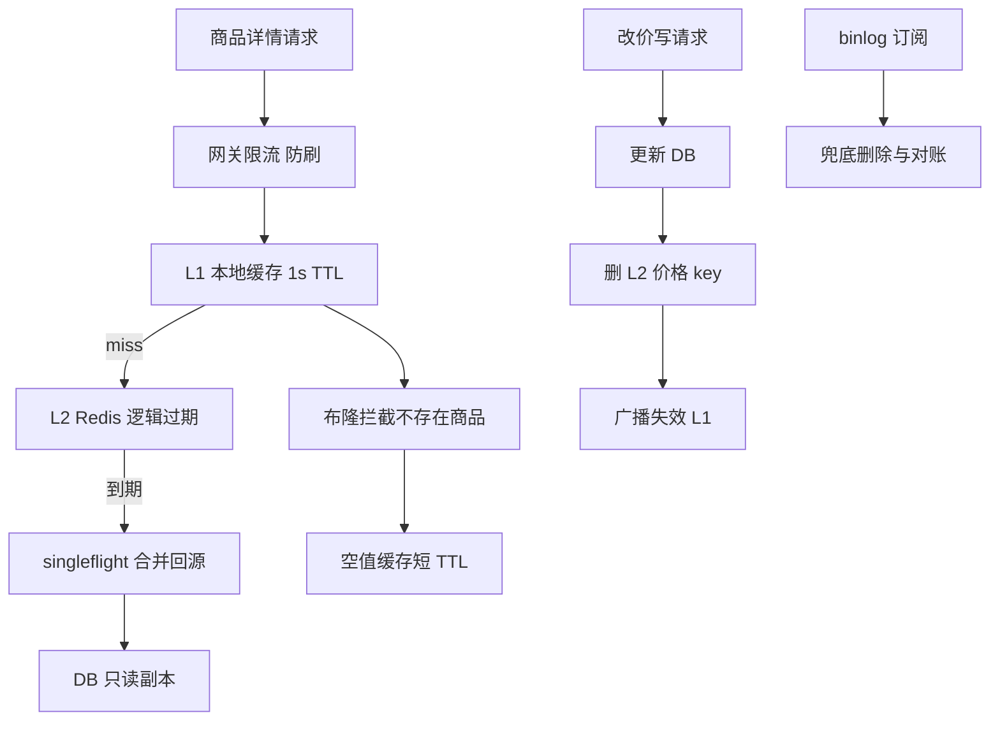


