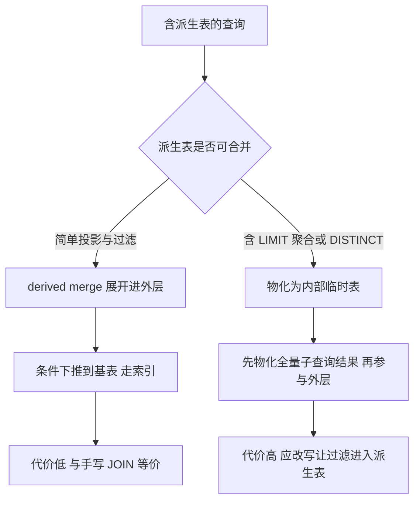
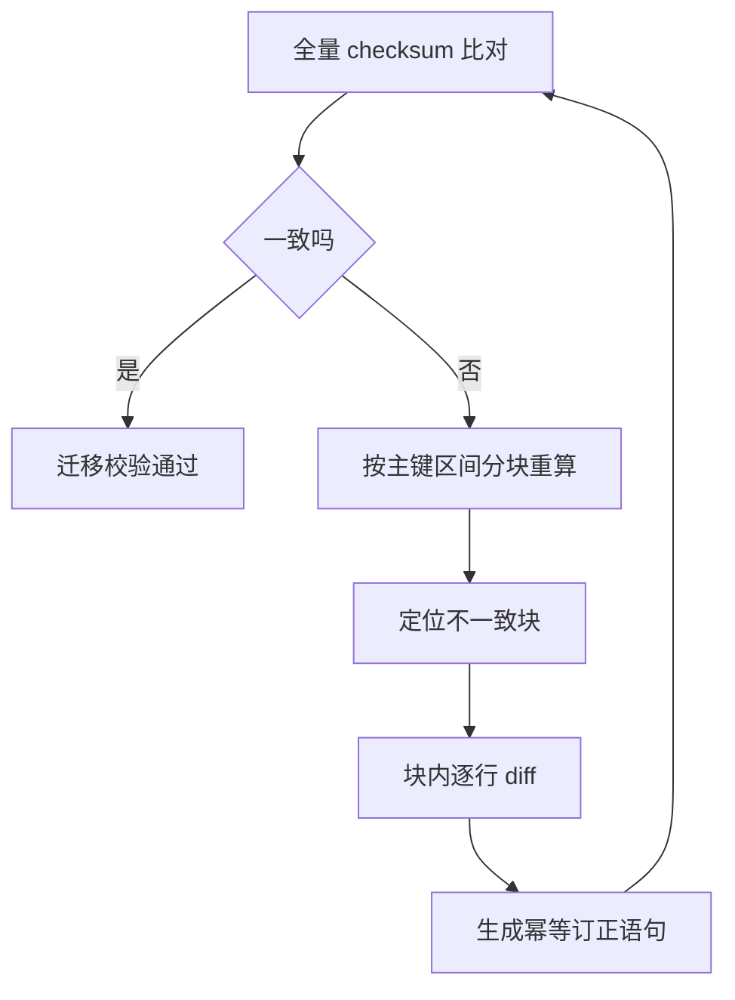
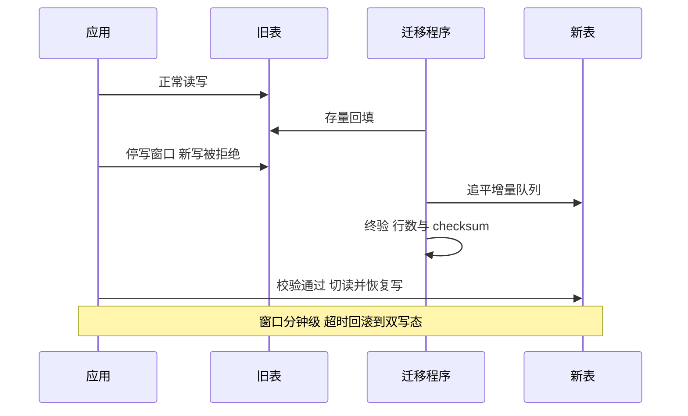
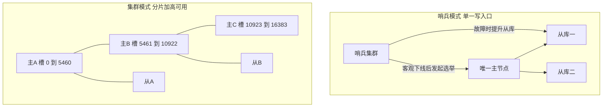
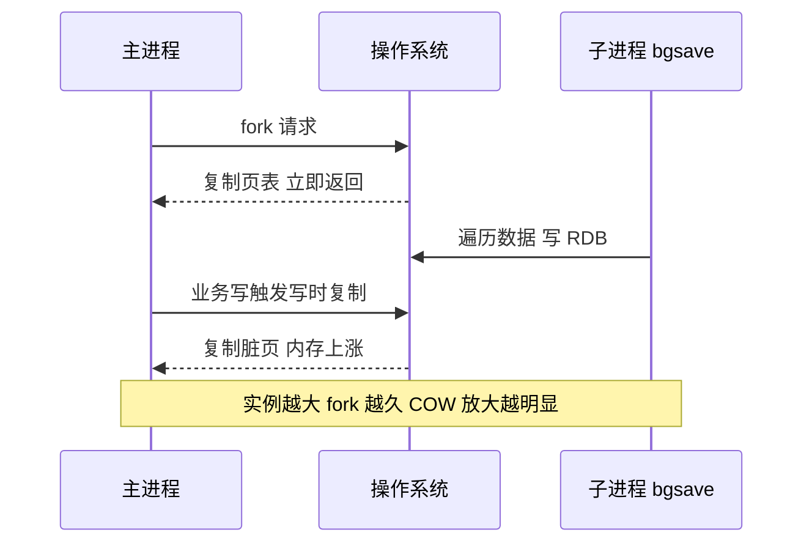
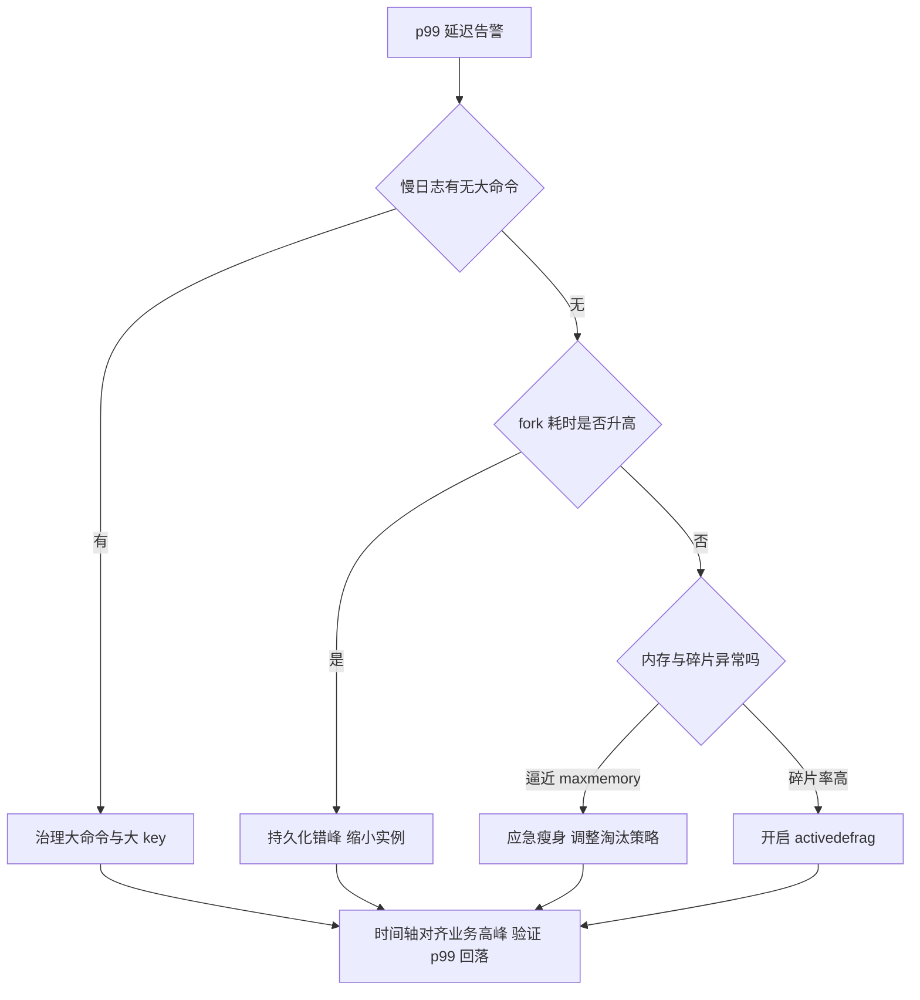
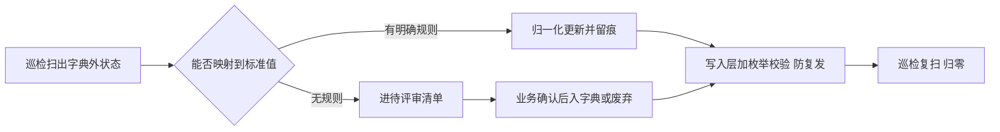

# 第 4 类 · 数据库与缓存(夜间扩产)

本文件是第 4 类的扩产补遗,共 45 题(Q1391–Q1435),覆盖四条主线:SQL 调优补遗(排序与临时表、派生表、join buffer、直方图、索引使用率、隐式转换与 collation)、数据一致性与迁移(影子切换、快照读迁移、双写对账修复、灰度回填、主键迁移、大字段拆分、回收站与回滚预案)、Redis 生产实战(碎片、主从切换丢数据窗口、哨兵与集群选型、慢命令、连接池、预热工程化、过期风暴、持久化阻塞)、数据质量(唯一性兜底、外键取舍、孤儿检测、定时巡检与质量看板)。
示例以标准库 sqlite3 与纯逻辑模型为主,全部可独立运行;涉及 redis-py 的演示用 try/except 降级。
读法建议:迁移类题抓"可回滚与幂等"两个词,调优类题抓"代价从哪来",质量类题抓"谁来兜底"。

---

### Q1391 · 排序补遗: ORDER BY + LIMIT 的 top-N 优先队列

> 难度:★★★☆ | 标签:SQL 调优, 排序

**问**:ORDER BY 加 LIMIT 一定比全量排序快吗?优化器在这里做了什么?

**答**:当 LIMIT k 较小时,MySQL 8 的 filesort 会从"全量快排"切换为"优先队列"模式:维护一个容量 k 的小顶堆流式扫表,每个元素只与堆顶比较,排序缓冲从"装下全部 n 行"降到"只装 k 行"。代价从 n·log(n) 次比较降到约 n·log(k) 次,内存峰值也线性下降,这是深翻页与 TopN 报表快的本质。但要注意:排序键没索引时仍要扫全表;LIMIT 很大(接近全表)时优先队列反而不如直接排序。根治办法是把排序键纳入索引,让 ORDER BY 走索引序,连排序都不用做。

```python
# file: code/04_数据库与缓存/q1391_order_limit_topn.py
"""ORDER BY 走索引与 top-N 优先队列: sqlite EXPLAIN QUERY PLAN 验证"""
import math
import random
import sqlite3

random.seed(7)
conn = sqlite3.connect(":memory:")
conn.execute("CREATE TABLE orders(id INTEGER PRIMARY KEY, amount REAL)")
rows = [(i, round(random.uniform(1, 10000), 2)) for i in range(1, 100001)]
conn.executemany("INSERT INTO orders VALUES(?,?)", rows)

def plan(sql):
    return [r[3] for r in conn.execute("EXPLAIN QUERY PLAN " + sql)]

sql = "SELECT id, amount FROM orders ORDER BY amount DESC LIMIT 10"
print("无索引:", plan(sql))
conn.execute("CREATE INDEX idx_amount ON orders(amount)")
print("加 amount 索引:", plan(sql))

n, k = 100000, 10
print(f"无索引全排序约 {n * math.log2(n):.0f} 次比较")
print(f"top-N 优先队列约 {n * math.log2(k):.0f} 次比较, 排序缓冲只留 k 行")
```

**追问**:
- 什么情况下 LIMIT 大了反而更慢?——k 接近 n 时堆的反复替换成本超过一次性排序,优化器会自动改回普通 filesort,不必人工干预。
- sort_buffer_size 调大一定有用吗?——只对装不下的超大排序有帮助,盲目调大是全局变量会放大内存风险,先看是不是缺索引。

---

### Q1392 · GROUP BY 补遗: 什么时候会建内部临时表

> 难度:★★★☆ | 标签:SQL 调优, GROUP BY

**问**:GROUP BY 的性能分水岭在哪?怎么让它不走临时表?

**答**:GROUP BY 有两条执行路径:一是"索引序分组"——分组列与某索引前缀对齐,扫描即按序聚合,无额外结构;二是"临时表分组"——先建内部临时表,逐行 upsert 计数,聚合完再可能对结果排序。分水岭就是"分组列能否吃到现成索引的有序性"。另外 count(distinct 多列)、union、派生表物化也都会触发临时表。定位方法看 EXPLAIN 的 Using temporary;优化思路是给分组列补索引,或用冗余列/生成列把分组键做成联合索引前缀。

```python
# file: code/04_数据库与缓存/q1392_groupby_temp.py
"""GROUP BY 的临时表代价: 索引序分组 vs 内部临时表"""
import sqlite3

conn = sqlite3.connect(":memory:")
conn.execute("CREATE TABLE events(id INTEGER PRIMARY KEY, user_id INTEGER, kind TEXT)")
conn.execute("CREATE INDEX idx_user_kind ON events(user_id, kind)")
conn.executemany("INSERT INTO events VALUES(?,?,?)",
                 [(i, i % 500, "k%d" % (i % 4)) for i in range(5000)])

def plan(sql):
    print("SQL:", sql)
    for r in conn.execute("EXPLAIN QUERY PLAN " + sql):
        print("   ", r[3])

plan("SELECT user_id, COUNT(*) FROM events GROUP BY user_id")
plan("SELECT kind, COUNT(*) FROM events GROUP BY kind")
plan("SELECT user_id, kind, COUNT(*) FROM events GROUP BY user_id, kind")
print("结论: 分组列与索引前缀对齐则免临时表, 否则建内部临时表再聚合")
```

**追问**:
- GROUP BY user_id ORDER BY NULL 有意义吗?——老版本 MySQL 可以省去隐式排序,8.0 的 GROUP BY 本身不再保证排序,写 ORDER BY 才有意义。
- 临时表放内存还是磁盘由什么决定?——超过 tmp_table_size / max_heap_table_size 或含 TEXT/BLOB 就落盘,落盘后引擎从 MEMORY 变 TempTable/InnoDB,慢一个量级。

---

### Q1393 · 派生表优化: derived merge 与物化的分界

> 难度:★★★☆ | 标签:SQL 调优, 执行计划

**问**:FROM 子句里的子查询一定慢吗?优化器怎么处理派生表?

**答**:不一定。MySQL 5.7+ 的 derived_merge 优化能把"简单投影 + 过滤"的派生表直接展开合并进外层查询,条件可以下推到基表、索引照常用,与手写 JOIN 无差别。不能合并的典型:带 LIMIT、聚合、GROUP BY、DISTINCT、窗口函数的派生表——这些必须先物化成内部临时表再参与外层。物化不可怕,可怕的是外层过滤条件进不去:把过滤写到派生表内部,或改写成 JOIN/窗口结构让条件下推。判断依据是 EXPLAIN 里是否出现 DERIVED 物化节点。

```python
# file: code/04_数据库与缓存/q1393_derived_merge.py
"""派生表的合并与物化: 哪些子查询可以被优化器展开"""
import sqlite3

conn = sqlite3.connect(":memory:")
conn.execute("CREATE TABLE orders(id INTEGER PRIMARY KEY, user_id INTEGER, amount REAL)")
conn.executemany("INSERT INTO orders VALUES(?,?,?)",
                 [(i, i % 1000, 9.9) for i in range(20000)])

def plan(sql, label):
    print(label)
    for r in conn.execute("EXPLAIN QUERY PLAN " + sql):
        print("   ", r[3])

plan("SELECT * FROM (SELECT id, user_id, amount FROM orders WHERE amount > 5) t "
     "WHERE t.user_id = 7", "[简单投影] 可合并 条件可下推:")
plan("SELECT * FROM (SELECT id, user_id FROM orders ORDER BY id LIMIT 100) t "
     "WHERE t.user_id = 7", "[带 LIMIT] 不可合并 需物化:")
plan("SELECT * FROM (SELECT user_id, COUNT(*) c FROM orders GROUP BY user_id) t "
     "WHERE t.user_id = 7", "[聚合派生表] 物化后过滤:")
```

**追问**:
- 为什么 LIMIT 会阻断合并?——合并后外层的过滤、连接都可能改变行的取舍顺序,LIMIT 的语义就不成立了,所以优化器保守物化。
- 物化什么时候真正变贵?——外层过滤没下推进派生表时,临时表要装全量子查询结果再逐行筛;把 WHERE 写进派生表内部或确认条件下推,物化体积能差几个量级。
- 物化的临时表底层怎么组织?——MySQL 物化时会按外层关联列给临时表建 auto_key 加速 JOIN,超过 tmp_table_size 或含大字段就落盘,IO 与体积同步放大。
- 常见的工程陷阱?——把分页排序子查询包成派生表再套一层过滤,以为条件会下推其实没下推;上线前用 EXPLAIN 确认 DERIVED 物化节点,别凭直觉。

---



### Q1394 · join buffer 与 BNL: 无索引 JOIN 的两条退路

> 难度:★★★☆ | 标签:SQL 调优, JOIN

**问**:JOIN 的关联列没索引会怎样?Block Nested Loop 和 Hash Join 怎么救?

**答**:没索引时每行外表都要全扫一次内表,plain NLJ 的代价是 m×n 次比较。BNL 的救法是把外表按 join_buffer_size 分块装载,每块只扫一遍内表,比较次数降到 n×ceil(m/buffer);代价是内表要被反复扫。MySQL 8.0.18 起等值 JOIN 默认改用 Hash Join:对小侧建哈希表、大侧逐行探测,比较量从乘法降为加法,内存够就一次成活。共同结论:join buffer / hash 表都吃内存,不是越大越好;真正的根治仍然是被驱动表的关联列建索引,让优化器根本用不上这两条退路。

```python
# file: code/04_数据库与缓存/q1394_join_buffer.py
"""无索引 JOIN 的两条路: 块嵌套循环 BNL 与 hash join 的比较量对比"""
import random

random.seed(4)
N_L, N_R, BUF = 500, 5000, 100
left = [{"uid": i} for i in range(N_L)]
right = [{"uid": random.randrange(N_L)} for _ in range(N_R)]

def bnl_cost(l, r, buf):
    cmp = 0
    for i in range(0, len(l), buf):
        block = l[i:i + buf]
        for row in r:
            for b in block:
                cmp += 1
                if b["uid"] == row["uid"]:
                    pass
    return cmp

def hash_join_cost(l, r):
    ht = {}
    for row in l:
        ht.setdefault(row["uid"], []).append(row)
    return len(r)              # 内表逐行探测哈希表, 每次 O(1)

c1 = bnl_cost(left, right, BUF)
c2 = bnl_cost(left, right, N_L)
c3 = hash_join_cost(left, right)
print(f"join buffer=100: 约 {c1} 次比较")
print(f"join buffer=全表: 约 {c2} 次比较, 用内存换内表扫描遍数")
print(f"hash join: {c3} 次探测, MySQL 8.0.18 起等值 join 默认取代 BNL")
```

**追问**:
- 为什么 hash join 只在等值条件下用?——非等值无法用哈希桶定位,只能退回 NLJ/BNL 逐对比较。
- hash join 内存不够会怎样?——构建侧装不下 join_buffer_size 时分批构建与探测,内表要多扫几遍,代价从近似 O(m+n) 退化回接近 BNL。
- 构建侧怎么选?——优化器估算两侧过滤后的行数,拿小的一侧建哈希表省内存;统计信息失真时可能选错侧,大侧建表直接撑内存。
- 生产陷阱?——hash join 是无索引时的退路,buffer 按连接分配,高并发大 JOIN 会并发吃内存;别把退路当常态,根治仍是被驱动表关联列建索引。

---

### Q1395 · 直方图实战: 用分桶频率修正倾斜列估算

> 难度:★★★★ | 标签:统计信息, 直方图

**问**:统计信息里有了 count 和 distinct,为什么还要直方图?数据倾斜时会发生什么?

**答**:基础统计假设"每个 distinct 值均匀分布",这对倾斜列是灾难:status 里 99% 是 done、1% 是 failed,优化器会按 1/3 的选择性估算,给 failed 查询选出错误的索引或连接顺序。直方图把列的取值范围切成 N 个桶,记录每桶的真实频率,估算从"均匀假设"变为"实测频率",单表过滤和 JOIN 基数的偏差都能收窄。MySQL 8.0 用 ANALYZE TABLE t UPDATE HISTOGRAM ON col WITH 10 BUCKETS 建立,systime/变量列不支持;PG 的 CREATE STATISTICS/扩展直方图类似。注意直方图是采样统计,数据分布大变后要手动重新 ANALYZE。

```python
# file: code/04_数据库与缓存/q1395_histogram_sim.py
"""直方图修正倾斜列估算: 均匀假设 vs 分桶频率"""
import random
from collections import Counter

random.seed(7)
values = ["done"] * 9900 + ["pending"] * 80 + ["failed"] * 20
random.shuffle(values)
total = len(values)
counter = Counter(values)

def uniform_selectivity(val):
    return 1 / len(counter)          # 均匀假设: 每个 distinct 等概率

def histogram_selectivity(val, buckets):
    return buckets.get(val, 0) / total

buckets = dict(counter)              # ANALYZE 采到的频率桶
for v in ("done", "pending"):
    print(f"{v}: 均匀假设 {uniform_selectivity(v):.4f}, "
          f"直方图 {histogram_selectivity(v, buckets):.4f}, "
          f"真实 {counter[v] / total:.4f}")
print("MySQL: ANALYZE TABLE t UPDATE HISTOGRAM ON status WITH 10 BUCKETS")
```

**追问**:
- 什么列最值得建直方图?——分布倾斜、出现在过滤与 JOIN 条件里、又几乎不更新的状态/类型/地区列;更新频繁的列收益会被采样滞后吃掉。
- 直方图为什么不自动更新?——它是 ANALYZE 采样后存在数据字典里的静态统计,数据分布漂移不会触发重采样,必须运维定期重新 ANALYZE。
- 分桶的底层机制?——MySQL 取值少时用 singleton 桶逐值记频率,取值多时用等高桶近似;桶数建统计时可指定(上限 1024),极端倾斜就加密桶数。
- 生产陷阱?——给更新频繁的列建直方图,统计很快过期反而把计划带偏;只对倾斜且低频更新的过滤列建,并把重采样纳入例行运维。

---

### Q1396 · 索引使用率监控: 找出从未被使用的索引

> 难度:★★★☆ | 标签:索引, 运维

**问**:线上几百个索引,怎么判断哪些是死索引?删除前要注意什么?

**答**:PG 直接查 pg_stat_user_indexes 的 idx_scan 计数;MySQL 没有等价的按索引计数,用 sys.schema_unused_indexes(基于 performance_schema 的 table_io_waits)或开启 userstat 变量。流程是:观察窗口拉长到覆盖月报、季末等周期性查询;把候选索引设为 INVISIBLE(MySQL)或加注释降权,业务无感再观察 2-4 周;确认零流量后才 DROP。删除前必须核对依赖:唯一约束、外键引用、以及慢查询回放/测试集——监控计数只反映"这段窗口没人用",不证明"永远没人用"。删索引的收益是写放大和磁盘的持续减负,加索引容易删索引要谨慎。

```python
# file: code/04_数据库与缓存/q1396_unused_index.py
"""索引使用率监控: 计数器模型与候选删除流程"""
idx_scan = {
    "idx_orders_user_status": 0,
    "idx_orders_status": 0,
    "idx_orders_created": 0,
    "idx_orders_amount": 0,
    "idx_orders_city": 0,
}
queries = [
    ("WHERE user_id=? AND status=?", ["idx_orders_user_status"]),
    ("WHERE user_id=? AND status=?", ["idx_orders_user_status"]),
    ("WHERE status=?", ["idx_orders_status"]),
    ("WHERE created>=?", ["idx_orders_created"]),
    ("WHERE user_id=? AND status=?", ["idx_orders_user_status"]),
]
for sql, used in queries:
    for name in used:
        idx_scan[name] += 1

for name, n in sorted(idx_scan.items(), key=lambda x: x[1]):
    tag = "  <- 观察期内零使用" if n == 0 else ""
    print(f"{name}: idx_scan={n}{tag}")
print("处置: 零使用索引先改 INVISIBLE 观察 2-4 周, 仍无流量再 DROP")
print("注意: 唯一约束与外键仍可能需要它们, 删除前核对依赖")
```

**追问**:
- 为什么不能看到一周没用就删?——月度对账、季度报表、迁移回填脚本都可能只在特定窗口命中它,观察期必须覆盖完整业务周期。
- INVISIBLE 索引为什么是删除前的安全垫?——优化器忽略它但存储层照常维护,读流量归零而写放大还在,随时可以 VISIBLE 拨回,是可逆的观察手段。
- 使用计数从哪来、有什么坑?——sys.schema_unused_indexes 基于 performance_schema 的 table_io_waits 计数,实例重启计数清零,观察窗口不能横跨重启丢样本。
- 生产陷阱?——主库没用的索引可能被从库报表或异地环境在用;DROP 前全环境核对依赖(唯一约束、外键),DDL 一定带回滚脚本。

---

### Q1397 · 隐式转换补遗: 字符集与排序规则不一致的 JOIN

> 难度:★★★★ | 标签:隐式转换, 字符集

**问**:两边列都有索引,JOIN 却走了全表扫描,可能是什么原因?

**答**:除了经典的类型不匹配(Q895),还有一类更隐蔽:字符集或排序规则不一致。utf8 表 join utf8mb4 表、general_ci join unicode_ci 时,优化器必须给一侧套 CONVERT 使比较语义统一,这一转换作用在列上,索引无法直接命中,连接退化为全扫或 BNL。定位看 EXPLAIN 输出里的隐式转换提示与 join 类型变差;根治是统一库、表、列的 charset 与 collation,迁移一次性改齐;临时手段是在低频侧用生成列预转换后建索引。教训是建库时就把 charset/collation 定死并写进规范,别让两张表各自演化。

```python
# file: code/04_数据库与缓存/q1397_collation_join.py
"""排序规则不一致的 JOIN: 每行转换使索引失效的代价模拟"""
import time

N_A, N_B = 20000, 20000
codes_a = [f"SKU{i:06d}" for i in range(N_A)]                            # general_ci 侧
codes_b = [f"SKU{i:06d}" if i % 2 else f"sku{i:06d}" for i in range(N_B)]  # unicode_ci 侧

a_set = set(codes_a)
a_set_lower = set(c.lower() for c in codes_a)

t0 = time.perf_counter()
hits_direct = sum(1 for v in codes_b if v in a_set)
t1 = time.perf_counter()
hits_conv = sum(1 for v in codes_b if v.lower() in a_set_lower)  # 逐行转换 无法直接命中索引
t2 = time.perf_counter()

print(f"collation 一致: 命中 {hits_direct}, {(t1 - t0) * 1000:.1f} ms")
print(f"collation 不一致逐行转换: 命中 {hits_conv}, {(t2 - t1) * 1000:.1f} ms")
print("统一 charset 与 collation, 或在生成列上预转换, 比硬扛便宜得多")
```

**追问**:
- 大小写不敏感的 collation 对唯一索引有什么影响?——'Abc' 与 'abc' 视为同一个键,唯一约束会拒绝第二条,排查唯一键冲突时要带上 collation 语义一起看。
- 为什么 CONVERT 落在列上索引就废了?——索引按原 collation 的序组织,套 CONVERT 后比较键变了,无法在 B+ 树上定位,只能全扫逐行转换。
- utf8 与 utf8mb4 混用是怎么埋下的?——5.7 默认字符集是三字节的 utf8(mb3),8.0 默认 utf8mb4;建表不显式声明就跟着默认走,新老表一 JOIN 就炸出转换。
- 生产陷阱?——升级大版本或换实例后服务器默认值变化,存量表被"悄悄改语义";规范强制建库建表显式声明 charset/collation,并纳入上线检查。

---

### Q1398 · 绑定变量与执行计划: 通用计划的取舍

> 难度:★★★★ | 标签:执行计划, 参数化

**问**:参数化查询有 SQL 注入和软解析两大好处,它有没有代价?

**答**:有,代价叫"一个计划服务所有参数"。预编译语句在 prepare 时定执行计划(MySQL)或前几次 custom、之后切 generic plan(PG 9+ 的 plan_cache_mode 逻辑)。参数分布倾斜时这是灾难:用 user_id 查询,大卖家该走全扫、小用户该走索引,固化计划会让其中一边系统性变差。缓解手段:PG 用 plan_cache_mode=force_custom_plan,MySQL 用 optimizer hints 按业务语义定计划,或把倾斜参数从绑定变量改为字面量让硬解析介入。默认结论:参数化仍是首选,只有证明"计划随参数应该变"时才针对那条 SQL 特殊处理。

```python
# file: code/04_数据库与缓存/q1398_bind_plan.py
"""绑定变量与执行计划: sqlite prepare 一次多次执行, 计划不随参数改变"""
import sqlite3

conn = sqlite3.connect(":memory:")
conn.execute("CREATE TABLE t(id INTEGER PRIMARY KEY, g INTEGER)")
conn.executemany("INSERT INTO t VALUES(?,?)", [(i, i % 3) for i in range(10000)])
conn.execute("CREATE INDEX idx_g ON t(g)")

sql = "SELECT * FROM t WHERE g = ?"
for v in (0, 1):
    p = tuple(r[3] for r in
              conn.execute("EXPLAIN QUERY PLAN SELECT * FROM t WHERE g = %d" % v))
    print(f"g={v} 的计划:", p)

cur = conn.cursor()
cur.execute(sql, (0,))
r1 = len(cur.fetchall())
cur.execute(sql, (1,))
r2 = len(cur.fetchall())
print(f"同一 prepared statement 两次执行: 复用同一计划, g=0 得 {r1} 行, g=1 得 {r2} 行")
print("结论: 计划固定服务所有参数, 倾斜参数需要 hint 或字面量特判")
```

**追问**:
- PG 为什么要等 5 次才切 generic plan?——前 5 次 custom plan 让优化器积累每个参数的真实代价,若 generic 计划估算代价没有更优就不切换,这个滞回是防止过早固化。
- MySQL 侧的计划什么时候定?——默认 prepare 时就按当时的参数估算定计划,之后执行不再改;8.0 没有 custom/generic 自动切换,倾斜参数要靠 hint 或改字面量。
- generic plan 的切换判据是什么?——攒够 5 次后比较 generic 与 custom 的估算代价,generic 不更便宜就继续 custom;估得差不多才固化,滞回防止过早切换。
- 生产陷阱?——同一条 SQL 的参数量级差几百倍,某个参数下突然变慢且难复现;监控按 SQL 指纹聚合延迟分布,发现双计划或长尾劣化立即告警。

---

### Q1399 · IN 大列表的代价: 解析成本与临时表替代

> 难度:★★☆☆ | 标签:SQL 调优, IN

**问**:WHERE id IN (一万个值) 会发生什么?怎么改?

**答**:三个成本叠加:SQL 文本解析(一万个占位符的语法树)、优化器做范围合并的开销、以及部分版本对 IN 元素数的硬上限(SQLITE 默认 999、MySQL 无硬限但 max_allowed_packet 挨打)。列表越大,单条 SQL 的准备时间越不可忽略,还会放大连接池与网络压力。改造方案:按业务上限分批(几百个一批);或者把 id 集合先批量写进一张带主键的临时表,再用 JOIN 查询,语义等价且计划稳定;真正的大集合需求通常意味着该把"集合"落成正式表或走数仓,别让 OLTP 主库扛。

```python
# file: code/04_数据库与缓存/q1399_in_list.py
"""IN 大列表的代价与替代: 大列表 vs 临时表 JOIN 的耗时对比"""
import random
import sqlite3
import time

random.seed(6)
conn = sqlite3.connect(":memory:")
conn.execute("CREATE TABLE orders(id INTEGER PRIMARY KEY, user_id INTEGER)")
conn.execute("CREATE INDEX idx_uid ON orders(user_id)")
conn.executemany("INSERT INTO orders VALUES(?,?)",
                 [(i, i % 100000) for i in range(200000)])
ids = [random.randrange(100000) for _ in range(900)]

t0 = time.perf_counter()
q = "SELECT COUNT(*) FROM orders WHERE user_id IN (%s)" % ",".join("?" * 900)
n1 = conn.execute(q, ids).fetchone()[0]
t1 = time.perf_counter()

conn.execute("CREATE TEMP TABLE wanted(user_id INTEGER PRIMARY KEY)")
conn.executemany("INSERT OR IGNORE INTO wanted VALUES(?)", [(i,) for i in ids])
n2 = conn.execute(
    "SELECT COUNT(*) FROM orders o JOIN wanted w ON o.user_id = w.user_id").fetchone()[0]
t2 = time.perf_counter()

print(f"IN 900 值: {n1} 行, {(t1 - t0) * 1000:.1f} ms")
print(f"临时表 JOIN: {n2} 行, {(t2 - t1) * 1000:.1f} ms, 语义等价且计划更稳")
print("工程建议: 限制 IN 个数, 大集合改临时表 JOIN 或拆批")
```

**追问**:
- IN 列表里既有索引值又有非索引值怎么办?——优化器会做 range 合并把列表变成多个区间,仍走索引;真正的问题是集合本身该不该在 SQL 里。
- MySQL 对 IN 元素数有硬上限吗?——没有显式个数上限,实际受 max_allowed_packet 与解析成本约束;框架自动展开成一万个参数,协议包与语法树先吃不消。
- 大列表在优化器里怎么走?——先排序去重做 range 优化,列表过大、range 优化内存超过 range_optimizer_max_mem_size 时直接放弃,退回全表扫描。
- 生产陷阱?——前端把"全选"拼成几万个 id 原样发来;接口契约给 IN 列表设上限,超限 400 或改临时表 JOIN,别让 OLTP 主库扛集合运算。

---

### Q1400 · LIMIT 的提前终止: 为什么 LIMIT 5 快很多

> 难度:★★★☆ | 标签:SQL 调优, LIMIT

**问**:同样是排序,LIMIT 5 为什么能快一个量级?什么条件下提前终止会失效?

**答**:两个机制叠加:一是 top-N 优先队列让排序成本从 n·log(n) 降到 n·log(k);二是扫表本身可以提前终止——如果 ORDER BY 列有索引,LIMIT 5 意味着沿索引读 5 行就返回,扫描量与表大小无关。失效条件:排序方向与索引方向不一致(索引 ASC 查 DESC TOP 仍需反向,8.0 支持倒序索引扫描);排序键带表达式或函数;多表 JOIN 后排序,只能先连接出结果再排序,提前终止只作用于"没有中间加工"的单表路径。所以"ORDER BY id LIMIT n"这种 id 主键查询几乎是免费的,业务列表页应尽量把游标落在有序索引上。

```python
# file: code/04_数据库与缓存/q1400_limit_early_stop.py
"""LIMIT 与排序: 全排序 vs top-N 优先队列的比较次数"""
import heapq
import math
import random

random.seed(3)
n, k = 100000, 5
data = [random.random() for _ in range(n)]

def topn_comparisons():
    heap, cmp = [], 0
    for x in data:
        if len(heap) < k:
            heapq.heappush(heap, x)
            cmp += math.log2(len(heap))
        elif x > heap[0]:
            heapq.heapreplace(heap, x)
            cmp += 2 * math.log2(k)
    return cmp, sorted(heap, reverse=True)

c_full = n * math.log2(n)
c_top, top5 = topn_comparisons()
print(f"全排序: 约 {c_full:.0f} 次比较, 缓冲需容纳全部 n 行")
print(f"top-N 堆: 约 {c_top:.0f} 次比较, 缓冲只留 k={k} 行")
print("top5:", [round(x, 4) for x in top5])
```

**追问**:
- 为什么 ORDER BY 列加了索引但 EXPLAIN 还有 filesort?——常见原因是 SELECT 了不在索引里的列导致回表后重新排序,或排序方向与索引相反,补覆盖索引或倒序索引可解。
- 深翻页为什么还是慢?——LIMIT 1000000,20 仍要把前一百万行扫掉,提前终止只救头部页;深翻页改成游标条件 WHERE id > last_id LIMIT 20,扫描量与页深无关。
- 提前终止的底层机制?——有索引序时存储引擎流式返回,服务层计满 LIMIT 即终止扫描;没有索引序就先全量 filesort 再截断,这是快慢的分水岭。
- 生产陷阱?——列表接口支持按时间/价格/销量多口径排序,只有部分排序键有索引;没有索引支撑的排序入口限深页或下线,否则被翻页爬虫打穿。

---

### Q1401 · EXPLAIN 的 Extra 列解读: 附加信号全谱

> 难度:★★★☆ | 标签:EXPLAIN, 调优

**问**:Extra 列里 Using index、Using where、Using filesort、Using temporary 分别代表什么?哪些是好信号?

**答**:Using index 是好信号——覆盖索引生效,查询不回表;Using index condition 表示 ICP 下推,过滤提前到引擎层,也算正面。Using where 是中性的,表示服务层还有过滤,不一定是坏事。Using filesort 表示排序无法走索引序,要额外排序步骤;Using temporary 表示要建内部临时表(常见于 GROUP BY 不对齐索引、DISTINCT、派生表物化)。后两者出现时先问"能不能用索引消掉":把排序/分组键纳入联合索引,或用覆盖索引减少物化体积。解读 Extra 的心法是把它当成"额外工作清单",清单越长代价越大,而不是单看 type 列的访问类型。

```python
# file: code/04_数据库与缓存/q1401_explain_extra.py
"""执行计划附加信号: sqlite EQP 输出与 MySQL Extra 列对照"""
import sqlite3

conn = sqlite3.connect(":memory:")
conn.execute("CREATE TABLE t(id INTEGER PRIMARY KEY, a INTEGER, b TEXT)")
conn.execute("CREATE INDEX idx_a ON t(a)")
conn.executemany("INSERT INTO t VALUES(?,?,?)",
                 [(i, i % 50, "x" * 20) for i in range(5000)])

def show(sql, mysql_extra):
    print("SQL:", sql)
    for r in conn.execute("EXPLAIN QUERY PLAN " + sql):
        print("   sqlite:", r[3])
    print("   MySQL Extra 大致对应:", mysql_extra)
    print()

show("SELECT * FROM t WHERE a = 7", "Using index condition(可下推过滤)")
show("SELECT COUNT(*) FROM t WHERE a = 7", "Using index(覆盖索引 不回表)")
show("SELECT a, b FROM t WHERE b = 'x'", "Using where(无索引可用)")
show("SELECT DISTINCT a FROM t ORDER BY a DESC", "Using temporary + Using filesort 或索引免排序")
```

**追问**:
- Backward index scan 出现在 Extra 里说明什么?——8.0 能倒序扫索引满足 ORDER BY col DESC,这是免 filesort 的新能力,5.7 只能正扫。
- Using index condition(ICP)省的是什么?——把能用的索引列条件下推到存储引擎,先在索引上过滤再回表,减少回表次数,联合索引的后缀列过滤收益最大。
- Using temporary 与 Using filesort 谁先谁后?——先物化再排序,两者常成对出现;Extra 的排列不代表执行顺序,要结合 type/key/rows 一起读。
- 生产陷阱?——只盯 type=ALL 下结论,漏掉 type=ref 却带着 temporary+filesort 的隐形大户;把 Extra 列固定纳入慢 SQL 审计字段。

---

### Q1402 · SQL 调优补遗综合: 一条报表 SQL 的三轮优化

> 难度:★★★★ | 标签:SQL 调优, 综合案例

**问**:一条按城市汇总月度订单金额的报表 SQL,你怎么一步步把它调快?

**答**:三轮递进:第一轮消灭函数包列——WHERE substr(created,1,7)='2024-06' 让索引彻底失效,改写成范围条件 created >= '2024-06-01' AND < '2024-07-01',这一步立竿见影;第二轮补 created 索引让过滤走范围扫描;第三轮改写连接顺序——先在订单侧按 user_id 聚合,聚合结果(几万行)再 JOIN 用户表拿城市,驱动侧从 20 万明细缩到聚合中间表,最后在城市层二次聚合。方法论:先让过滤有索引可走,再缩小参与 JOIN 的行数,最后才考虑参数与硬件;每一步用 EXPLAIN 验证证据,用结果一致性校验保证改写语义不变。

```python
# file: code/04_数据库与缓存/q1402_report_tuning.py
"""报表 SQL 的三轮优化: 函数包列 -> 范围条件 -> 提前聚合"""
import random
import sqlite3
import time

random.seed(2)
conn = sqlite3.connect(":memory:")
conn.execute("CREATE TABLE users(id INTEGER PRIMARY KEY, city TEXT)")
conn.execute(
    "CREATE TABLE orders(id INTEGER PRIMARY KEY, user_id INTEGER, amount REAL, created TEXT)")
conn.executemany("INSERT INTO users VALUES(?,?)",
                 [(i, "city%d" % (i % 30)) for i in range(1, 50001)])
conn.executemany("INSERT INTO orders VALUES(?,?,?,?)",
                 [(i, random.randrange(1, 50001), round(random.uniform(10, 500), 2),
                   "2024-06-%02d" % random.randrange(1, 29)) for i in range(1, 200001)])

def timed(sql):
    t0 = time.perf_counter()
    rows = conn.execute(sql).fetchall()
    return rows, (time.perf_counter() - t0) * 1000

v0, ms0 = timed(
    "SELECT u.city, SUM(o.amount) FROM orders o JOIN users u ON o.user_id = u.id "
    "WHERE substr(o.created, 1, 7) = '2024-06' GROUP BY u.city")
conn.execute("CREATE INDEX idx_created ON orders(created)")
v1, ms1 = timed(
    "SELECT u.city, SUM(o.amount) FROM orders o JOIN users u ON o.user_id = u.id "
    "WHERE o.created >= '2024-06-01' AND o.created < '2024-07-01' GROUP BY u.city")
v2, ms2 = timed(
    "SELECT u.city, SUM(t.total) FROM (SELECT user_id, SUM(amount) total FROM orders "
    "WHERE created >= '2024-06-01' AND created < '2024-07-01' GROUP BY user_id) t "
    "JOIN users u ON u.id = t.user_id GROUP BY u.city")
same = abs(sum(r[1] for r in v0) - sum(r[1] for r in v2)) < 0.01
print(f"v0 函数包列: {ms0:.1f} ms")
print(f"v1 范围条件+索引: {ms1:.1f} ms")
print(f"v2 先聚合再 join: {ms2:.1f} ms, 金额一致: {same}")
```

**追问**:
- 为什么不直接把城市冗余进订单表?——可以,城市属于用户属性、变更少时冗余是合理反范式,但要写清失效路径,属于第三轮之后的进阶选项。
- 函数包列为什么必须第一个改?——列上套函数后索引的有序性和范围定位全部失效,只能全扫;等价改写成范围条件零风险高收益,是调优的固定起手式。
- 先聚合再 JOIN 快的机制?——聚合把几十万明细压成键数级中间表,驱动侧基数骤降,JOIN 与二次聚合都在小结果集上做;本质是尽早削减参与连接的行数。
- 生产陷阱?——改写后只对总金额对账,分组数与城市集合没核,语义偏差悄悄溜过;改写类优化必须行数、分组数、汇总值三项对账。

---


### Q1403 · 双写对账修复: 以源库为准的批量订正

> 难度:★★★★ | 标签:数据迁移, 双写

**问**:双写迁移期间发现新旧库数据有漂移,怎么安全地修复?

**答**:四步:先对账——按主键遍历,比较行内容,产出三类差异(字段漂移、新库缺失、新库多余);再定权威——迁移期以源库为权威,所有订正以源库为准;然后生成幂等订正——修复语句要带批次号与 updated_at,可以重复执行不产生二次伤害,绝不直接覆盖"期间合法的新写入",修复窗口内源库该行的更新要先保护;最后复检闭环——订正后重跑同一对账脚本,差异必须归零,并把差异类型统计留存,用于定位双写代码的 bug。铁律:对账修复是兜底而不是常态,差异率持续不降说明双写链路有缺陷,修链路比修数据更重要。

```python
# file: code/04_数据库与缓存/q1403_dualwrite_fix.py
"""双写不一致的批量修复: 以源库为准生成差异并订正"""
old_db = {
    1001: {"amount": 9900, "status": "paid"},
    1002: {"amount": 2500, "status": "pending"},
    1003: {"amount": 180, "status": "paid"},
    1004: {"amount": 6600, "status": "paid"},
}
new_db = {
    1001: {"amount": 9900, "status": "paid"},
    1002: {"amount": 2500, "status": "paid"},   # 状态漂移
    1003: {"amount": 1800, "status": "paid"},   # 金额多写一个 0
    1005: {"amount": 500, "status": "paid"},    # 新库多出行
}

def audit(src, dst):
    drift, missing = [], []
    for k, v in src.items():
        if k not in dst:
            missing.append(k)
        elif dst[k] != v:
            drift.append(k)
    extra = [k for k in dst if k not in src]
    return drift, missing, extra

drift, missing, extra = audit(old_db, new_db)
print("漂移:", drift, "新库缺失:", missing, "新库多余:", extra)
fixed = 0
for k in drift + missing:
    new_db[k] = dict(old_db[k])       # 以源库为权威
    fixed += 1
for k in extra:
    new_db.pop(k)
    fixed += 1
print(f"订正 {fixed} 行; 复检结果: {audit(old_db, new_db)}")
print("修复必须幂等可重跑: 带批次号与时间戳, 防止覆盖窗口期的合法新写入")
```

**追问**:
- 新库是权威的场景存在吗?——存在,如双写是为了引入新系统,此时以新库为准反向订正;关键是对账脚本把"谁是权威"作为参数而不是写死。
- 修复怎么避免误伤窗口期合法写入?——订正只覆盖迁移冻结的存量行,用 updated_at/版本号识别迁移开始后的新写入,新写入交给增量链路而不是批量覆盖。
- 修复为什么必须幂等?——修复任务会被重试与人工重放,不带批次号与条件的 UPDATE 重复执行会把窗口期新值盖回旧值,制造二次漂移。
- 生产陷阱?——差异率长期不归零还继续修数据,真凶是双写代码丢写或乱序;把差异类型统计当链路缺陷证据,修链路永远优先于修数据。

---

### Q1404 · 快照读迁移: 一致性点位与 single-transaction

> 难度:★★★★ | 标签:数据迁移, 快照

**问**:迁移历史数据时业务还在写,怎么保证导出的数据是"某一个时刻的完整一致视图"?

**答**:靠快照读。MySQL 的标准做法是 mysqldump --single-transaction:开启一个 REPEATABLE READ 长事务,InnoDB 的 MVCC 让整个导出过程读到的都是事务开始时的版本,业务照常写入互不阻塞;同时记录当时的 binlog 位点/GTID,后续增量追平就从这个点位开始。前提是表都是 InnoDB 事务表,MyISAM 混在其中时快照对它无效。大表长事务要警惕两个副作用:undo 链增长、以及它会让 DDL 的 MDL 排队(Q884),所以快照事务要限时、限高峰。SQLite 等价物是 WAL 模式下的读者快照,本节代码直接演示这个语义。

```python
# file: code/04_数据库与缓存/q1404_snapshot_migrate.py
"""快照读迁移: WAL 模式下长事务读到的始终是开始时的快照"""
import os
import sqlite3

path = "/tmp/q1404_demo.db"
if os.path.exists(path):
    os.remove(path)
writer = sqlite3.connect(path)
writer.execute("PRAGMA journal_mode=WAL")
writer.execute("CREATE TABLE t(id INTEGER PRIMARY KEY, v TEXT)")
writer.execute("INSERT INTO t VALUES(1,'v0')")
writer.commit()

reader = sqlite3.connect(path)
reader.execute("BEGIN")                       # 迁移读事务开启
print("迁移读起点:", reader.execute("SELECT v FROM t WHERE id=1").fetchone()[0])

writer.execute("UPDATE t SET v='v1' WHERE id=1")
writer.commit()
print("源库已提交 v1, 迁移事务内再读:",
      reader.execute("SELECT v FROM t WHERE id=1").fetchone()[0], "<- 仍是快照")
reader.commit()                               # 事务结束 快照释放
print("迁移事务结束后再读:", sqlite3.connect(path).execute("SELECT v FROM t WHERE id=1").fetchone()[0])
print("类比: mysqldump --single-transaction 就是借 MVCC 拿一致性点位, 再用 binlog 位点追增量")
```

**追问**:
- 快照读能不能代替锁?——导数据场景可以,这就是它比 FTWRL 温和的原因;但它不提供"读到最新"语义,需要实时一致时要回到锁或停写窗口。
- --single-transaction 内部做了什么?——开 REPEATABLE READ 事务并 START TRANSACTION WITH CONSISTENT SNAPSHOT,瞬时加锁记下 binlog 位点后即释放,导出与位点同刻。
- MVCC 凭什么保证全程一个版本?——事务开始即固定 read view,之后快照读沿 undo 链回溯到该版本;业务写入生成新版本,互不阻塞。
- 生产陷阱?——表里混着 MyISAM 快照对它无效,导出期间撞上 DDL 会被 MDL 卡死并堵住后续全部查询(Q884);导出前核对引擎并冻结 DDL 窗口。

---

### Q1405 · 灰度回填: 大表补数据的分批与限速

> 难度:★★☆☆ | 标签:数据迁移, 回填

**问**:要给 5000 万行的大表补一个新字段的默认值,直接 UPDATE 会出什么事?

**答**:单条大 UPDATE 是放大版大事务(Q896):锁住海量行、binlog 巨包、主从延迟飙升、还可能撑爆 undo。正确姿势是灰度回填:按主键分批(每批几千到几万行),批内条件带 AND new_col IS NULL 保证幂等可重跑;批间 sleep 限速,监控主从延迟与 QPS,延迟超阈值自动降速;进度表记录 last_id,中断后从断点续跑;全程可暂停可重放。批大小没有万能值,以"单批执行时间控制在秒级"为准。写完别忘了对账:统计 new_col IS NULL 的行数必须归零。

```python
# file: code/04_数据库与缓存/q1405_backfill.py
"""灰度回填: 分批更新 + 限速 + 断点续跑"""
import time

total, batch, rate = 1200, 200, 0.01
progress = {"last_id": 0}          # 进度表: 中断后从断点续跑

def backfill_batch(last_id, size):
    # UPDATE users SET tier='normal' WHERE id>? AND id<=? AND tier IS NULL
    updated = 0
    for uid in range(last_id + 1, min(last_id + size, total) + 1):
        updated += 1
    return updated

while progress["last_id"] < total:
    n = backfill_batch(progress["last_id"], batch)
    progress["last_id"] += n
    print(f"批次完成: id <= {progress['last_id']}, 本批 {n} 行, 休眠限速")
    time.sleep(rate)
print(f"回填完成 {total} 行; 批内带 IS NULL 条件保证重跑幂等, 全程监控主从延迟")
```

**追问**:
- 为什么按主键分批而不是按更新时间?——主键批间无重叠、天然游标、索引序扫描便宜;按时间分批容易与并发写入交错导致漏批或重批。
- 批内为什么必须带 AND new_col IS NULL?——它让 UPDATE 天然幂等,重跑与断点续跑只补未处理行;没有这个条件,重复执行会把已更新行再写一遍并刷一遍 binlog。
- 大 UPDATE 拖垮主从的机制?——单事务锁海量行、binlog 事务巨大、从库回放追不上导致延迟堆积;分批把大事务切成秒级小事务,延迟才有自愈空间。
- 生产陷阱?——回填直连主库全速跑,高峰期吃满 IO 与复制带宽;限速参数与"主从延迟超阈值自动暂停"必须内置,进度表断点续跑是标配不是可选项。

---

### Q1406 · 主键迁移: 自增换雪花 ID 的在线切换

> 难度:★★★★ | 标签:主键, 数据迁移

**问**:线上表的主键要从自增 int 换成雪花 ID,怎么不停车完成?

**答**:三阶段。回填:建新表,主键直接是 bigint 雪花,加一列 old_id 建 UNIQUE 索引,把旧表数据映射进新表,UNIQUE 保证回填重跑幂等;双写:新业务写两个库,新表主键用新生成的雪花 ID,历史行靠 old_id 关联;切读:读路由灰度切到新表,校验行数、抽样与 checksum,稳定后旧表转只读归档。注意雪花 ID 的时间位决定了它趋势递增,InnoDB 聚簇索引插入顺序友好;切换期间要处理"读旧表拿 id 再操作"的存量调用方,过渡期保留 old_id 映射接口。Q903 讲过自增上限问题,本题是它的落地路径。

```python
# file: code/04_数据库与缓存/q1406_pk_migrate.py
"""主键迁移: 自增换雪花 ID 的在线切换"""
import sqlite3
import time

conn = sqlite3.connect(":memory:")
conn.execute("CREATE TABLE orders_old(id INTEGER PRIMARY KEY AUTOINCREMENT, amount REAL)")
conn.execute(
    "CREATE TABLE orders_new(id INTEGER PRIMARY KEY, old_id INTEGER UNIQUE, amount REAL)")
conn.executemany("INSERT INTO orders_old(amount) VALUES(?)", [(99.0,), (199.0,), (299.0,)])

machine_id = 1
seq = 0
def snowflake():
    global seq
    seq = (seq + 1) & 0xFFF
    return (int(time.time() * 1000) << 22) | (machine_id << 12) | seq

for oid, amt in conn.execute("SELECT id, amount FROM orders_old").fetchall():
    conn.execute("INSERT OR IGNORE INTO orders_new VALUES(?,?,?)", (snowflake(), oid, amt))
new_id = snowflake()                          # 双写期新订单: 两边落, 新主键用雪花
conn.execute("INSERT INTO orders_old(amount) VALUES(?)", (499.0,))
conn.execute("INSERT INTO orders_new VALUES(?,?,NULL)", (new_id, 499.0))
n_old = conn.execute("SELECT COUNT(*) FROM orders_old").fetchone()[0]
n_new = conn.execute("SELECT COUNT(*) FROM orders_new").fetchone()[0]
print(f"旧表 {n_old} 行, 新表 {n_new} 行(3 条迁移 + 1 条双写)")
ids = [r[0] for r in conn.execute("SELECT id FROM orders_new ORDER BY id")]
print("新主键样例:", ids[0], f"({len(str(ids[0]))} 位), 趋势递增且全局唯一")
print("unique(old_id) 让回填重跑幂等, 是切换安全的关键")
```

**追问**:
- 为什么新表还留 old_id 列?——过渡期排查、对账、以及旧调用方按旧 id 查询都要靠它;全量切读稳定后再评估下线。
- 雪花 ID 为什么对聚簇索引友好?——高位是毫秒时间戳,趋势递增让插入总落在 B+ 树最右侧,页分裂少;对比随机 UUID 的页分裂与缓冲池污染。
- 双写期两套主键怎么衔接?——新订单由应用生成雪花 ID 两边落,历史行靠 old_id 唯一索引映射;键空间靠映射列衔接,不做数字换算。
- 生产陷阱?——切读后仍有调用方拿旧 id 调接口,404 事故;过渡期保留按 old_id 查询的兼容接口并打监控,流量归零后才评估下线。

---


### Q1407 · 大字段拆分: TEXT/BLOB 出主表的理由与做法

> 难度:★★★☆ | 标签:表设计, 大字段

**问**:详情页、正文这类大字段为什么不放在主表里?

**答**:三个理由:读放大——InnoDB 行超过页大小的约一半时大字段溢出到溢出页,列表查询即使不 SELECT 大列,扫描聚簇索引也可能承担额外 IO;缓存效率——buffer pool 被大字段挤占,热点小行的命中率下降;运维灵活性——大字段表单独归档、单独备份、单独迁移,比拖在主表里轻得多。做法:大字段拆到一对一详情表,主表保留摘要列;访问路径是列表查主表、详情按 id 补查。注意拆分不是免费的:多一次 JOIN/查询、事务边界变大,所以只拆"大且低频访问"的字段,几百字节内的 JSON 留在主表完全合理。

```python
# file: code/04_数据库与缓存/q1407_split_lob.py
"""大字段拆分: 主表瘦身前后的大小与页数对比"""
import os
import sqlite3

DETAIL = "x" * 8000

def build(with_detail):
    path = "/tmp/q1407_%s.db" % ("with" if with_detail else "split")
    if os.path.exists(path):
        os.remove(path)
    conn = sqlite3.connect(path)
    if with_detail:
        conn.execute("CREATE TABLE t(id INTEGER PRIMARY KEY, title TEXT, detail TEXT)")
        conn.executemany("INSERT INTO t VALUES(?,?,?)",
                         [(i, "t%d" % i, DETAIL) for i in range(300)])
    else:
        conn.execute("CREATE TABLE t(id INTEGER PRIMARY KEY, title TEXT)")
        conn.execute("CREATE TABLE t_detail(id INTEGER PRIMARY KEY, detail TEXT)")
        conn.executemany("INSERT INTO t VALUES(?,?)", [(i, "t%d" % i) for i in range(300)])
        conn.executemany("INSERT INTO t_detail VALUES(?,?)",
                         [(i, DETAIL) for i in range(300)])
    conn.commit()
    pages = conn.execute("PRAGMA page_count").fetchone()[0]
    conn.close()
    return os.path.getsize(path), pages

s1, p1 = build(True)
s2, p2 = build(False)
print(f"合并存储: {s1} 字节 {p1} 页; 拆分后主表库: {s2} 字节 {p2} 页")
print("列表查询只触主表, 读放大显著下降; 详情按需查 t_detail")
```

**追问**:
- MySQL 的 TEXT 溢出页机制是什么?——行内只留 20 字节指针,内容放溢出页,SELECT 不带该列时可以不读,但扫表与备份的代价仍在,这也是拆表的底层依据。
- 拆表后详情查询会不会反而变慢?——列表路径因主表页密度上升而变快,详情多一次主键点查,通常毫秒级;取舍点是高频列表与低频详情的读放大差。
- 溢出的判定阈值是什么?——InnoDB 要求行至少放进页的一半,超出时最长列先溢出,DYNAMIC 行格式行内只留 20 字节指针,这是默认行为。
- 生产陷阱?——表拆了,查询却仍 SELECT * 把大列拉回来,等于白拆;ORM 默认全列查询必须改成显式投影,列表接口限定列清单。

---

### Q1408 · 归档与回收站: 删除的第二层兜底

> 难度:★★☆☆ | 标签:数据治理, 回收站

**问**:已经有软删除了,为什么还要回收站表?回收站怎么设计?

**答**:软删除解决"业务上不可见",不解决"误删可恢复":一次错误的批量 UPDATE deleted_at 依然让数据"消失"。回收站表是第二层兜底:物理删除时先把整行序列化(JSON 或 shadow schema)连同来源表、操作人、时间写进 recycle_bin,再从原表删掉;恢复接口按回收站 id 反序列化重建,冲突时(原 id 已被复用)转人工;清理任务按保留期(如 30 天)过期物理清除,清理前可再备份。它比"只靠备份"好在:恢复粒度到行、恢复动作在线可控、且天然记录了删除审计。注意回收站本身会增长,保留期与容量上限要一起设计。

```python
# file: code/04_数据库与缓存/q1408_recycle_bin.py
"""回收站表: 删除先进回收站, 可恢复, 定期清理过期"""
import json
import sqlite3
import time

conn = sqlite3.connect(":memory:")
conn.execute("CREATE TABLE orders(id INTEGER PRIMARY KEY, amount REAL)")
conn.execute("""CREATE TABLE recycle_bin(
    id INTEGER PRIMARY KEY AUTOINCREMENT,
    src_table TEXT, src_id INTEGER, payload TEXT, deleted_at REAL)""")
conn.executemany("INSERT INTO orders VALUES(?,?)", [(1, 100.0), (2, 200.0)])

def delete_order(oid):
    row = conn.execute("SELECT * FROM orders WHERE id=?", (oid,)).fetchone()
    conn.execute("INSERT INTO recycle_bin(src_table, src_id, payload, deleted_at) "
                 "VALUES('orders',?,?,?)",
                 (oid, json.dumps({"id": row[0], "amount": row[1]}), time.time()))
    conn.execute("DELETE FROM orders WHERE id=?", (oid,))

def restore(bin_id):
    row = conn.execute("SELECT src_id, payload FROM recycle_bin WHERE id=?",
                       (bin_id,)).fetchone()
    data = json.loads(row[1])
    if conn.execute("SELECT 1 FROM orders WHERE id=?", (data["id"],)).fetchone():
        return False, "id 已被占用 转人工"
    conn.execute("INSERT INTO orders VALUES(?,?)", (data["id"], data["amount"]))
    conn.execute("DELETE FROM recycle_bin WHERE id=?", (bin_id,))
    return True, "已恢复"

delete_order(1)
print("删除后 orders 行数:", conn.execute("SELECT COUNT(*) FROM orders").fetchone()[0])
print("恢复结果:", restore(1))
print("恢复后 orders 行数:", conn.execute("SELECT COUNT(*) FROM orders").fetchone()[0])
```

**追问**:
- 回收站和 Q879 的归档表什么区别?——归档面向"合法的冷数据下沉",回收站面向"意外删除的恢复窗口",生命周期与访问路径都不同,混在一张表会让两边都难维护。
- 恢复时原 id 已被复用怎么办?——恢复前先探测 id 占用,冲突转人工并保留回收站记录;所以 payload 必须存完整原行,恢复是裁决后重放而不是盲插。
- 为什么物理删除前要整行序列化?——行删除后 B+ 树里只剩待 purge 的 undo,很快真消失;删除前的整行快照是恢复与审计的唯一依据。
- 生产陷阱?——回收站只进不清,长成第二张巨表拖慢备份;保留期与容量上限双闸门,清理前归档、动作留审计日志。

---

### Q1409 · 迁移的数据校验: 行数、抽样与分块 checksum

> 难度:★★★☆ | 标签:数据迁移, 校验

**问**:迁移完了,你怎么向老板证明"数据没丢没坏"?

**答**:三档校验递进:行数对账最快,按表/按天分桶统计两侧 count,适合第一道筛;抽样比对按主键随机抽几百行逐字段比对,能发现字段级漂移但覆盖有限;全量 checksum 最硬——对每行按主键序拼接字段值算哈希,再对整个表(或按主键区间分块)聚合成一个校验值,两侧对比,不一致就二分下钻到块、再到行。pt-table-checksum 就是这个思路的成熟工具,分块计算还能边跑边对边避开大事务。校验脚本必须幂等、可重入,输出差异明细而不只是布尔值,因为修复(Q1403)需要精确到行。

```python
# file: code/04_数据库与缓存/q1409_row_checksum.py
"""迁移数据校验: 行数、抽样与分块 checksum 对比"""
import hashlib
import json
import random

random.seed(8)
old = {i: {"uid": i % 100, "amount": round(random.uniform(1, 100), 2)}
       for i in range(1, 501)}
new = {i: dict(v) for i, v in old.items()}
new[250]["amount"] += 0.01                    # 模拟一处漂移

def block_checksum(rows):
    h = hashlib.md5()
    for k in sorted(rows):
        h.update(("%d:%s" % (k, json.dumps(rows[k], sort_keys=True))).encode())
    return h.hexdigest()

print("行数一致:", len(old) == len(new))
print("全量 checksum 一致:", block_checksum(old) == block_checksum(new))
if block_checksum(old) != block_checksum(new):
    for lo in range(1, 501, 100):
        b1 = block_checksum({k: v for k, v in old.items() if lo <= k < lo + 100})
        b2 = block_checksum({k: v for k, v in new.items() if lo <= k < lo + 100})
        if b1 != b2:
            bad = [k for k in range(lo, lo + 100) if old[k] != new.get(k)]
            print(f"  分块定位: [{lo},{lo + 100}) 不一致, 具体行 {bad}")
```

**追问**:
- 为什么先按主键排序再算哈希?——哈希聚合必须与行序无关才能两侧可比,按主键序是两侧天然一致的遍历顺序,也是分块下钻的坐标。
- 浮点字段为什么容易 checksum 误报?——两侧类型与精度差异(REAL 对 DECIMAL)让同一业务值哈希不同;校验前按列类型归一化,金额统一到分再参与哈希。
- 分块 checksum 怎么支持在线校验?——按主键区间分块独立计算比对,块间穿插休眠避开大事务;不一致块再二分下钻,最终定位到行再交修复(Q1403)。
- 生产陷阱?——迁移一完成就全量 checksum,与仍在追平的增量撞车,产出海量假差异;校验放在增量归零的静止点,或按位点切割校验区间。

---



### Q1410 · 双读比对: 新旧读路径的结果 diff

> 难度:★★☆☆ | 标签:数据迁移, 双读

**问**:切读前想验证新数据访问层和旧逻辑结果一致,除了人工点检有什么系统性办法?

**答**:双读比对(影子读):线上读请求继续走旧路径返回,同时异步把同样的请求发给新路径,对两侧结果做结构化 diff——字段集合是否一致、值是否相等、忽略顺序敏感项。采样率可调(1% 到全量),差异要落证据:请求参数、两侧各自的结果、发生时间与代码版本,便于归因是"数据漂移"还是"逻辑实现差异"。和双写对账的分工:双写对账证明"存的没错",双读比对证明"读的没错",两者合起来才是切换的完整证据链。注意影子读自身会增加负载与延迟,只加在只读路径上,并对新路径设超时熔断,绝不影响线上响应。

```python
# file: code/04_数据库与缓存/q1410_dual_read_diff.py
"""双读比对: 新旧读路径的结果 diff 采样"""
import random

random.seed(9)

def old_path(uid):
    return {"uid": uid, "points": uid * 2, "level": uid // 10}

def new_path(uid):
    r = old_path(uid)
    if random.random() < 0.01:              # 新路径偶现漂移
        r = dict(r, points=r["points"] + 1)
    return r

mismatch = []
for uid in range(1, 301):
    a, b = old_path(uid), new_path(uid)
    if a != b:
        mismatch.append((uid, a["points"], b["points"]))
print(f"采样 300 次, 不一致 {len(mismatch)} 处, 样例 {mismatch[:5]}")
print("双读要落证据(参数与两侧值), 归因后再决定修数据还是修逻辑")
```

**追问**:
- 双读发现差异能直接把新路径结果返回吗?——不能,新路径在验证期只影子观察不服务流量,避免把未验证的实现暴露给用户。
- 采样率怎么定?——普通读 1%-5% 足以暴露系统性差异,核心链路可短期全量影子;采样开关收在入口统一管理,不允许各服务各采各的。
- 怎么区分数据漂移与逻辑差异?——记录两侧各自的输入(缓存命中、读到的版本)再比输出;输入相同输出不同才是逻辑 bug,否则先怀疑数据。
- 生产陷阱?——影子读把读流量翻倍打垮从库;新路径设超时熔断与限流,影子流量单独计容量,绝不与线上响应共享队列。

---

### Q1411 · 停写窗口与最终切换: cutover 的分钟级剧本

> 难度:★★★★ | 标签:数据迁移, cutover

**问**:双写、回填、校验都做完后,最后一刀怎么切?停写窗口里具体发生什么?

**答**:标准剧本五步,全程分钟级:一、预告与预案——冻结相关发布,值班就位,回滚开关预热;二、停写——网关层拒绝新写并返回友好错误(或排队重试),此时源库完全静止,是天然的校验基准点;三、追平增量——把停写前最后一刻的待同步队列消费完,增量差异归零;四、终验——行数/checksum/抽样三件套在静止数据上跑,几分钟内出结果;五、切读切写——读路由指向新库,写开关放开,观察核心指标。窗口超时(比如 15 分钟)则整体回滚到双写态,绝不边切边修。Q953 给了影子表的整体路径,本题聚焦最后这一刀的执行纪律:静止点校验是它区别于"边写边切"的全部价值。

```python
# file: code/04_数据库与缓存/q1411_cutover.py
"""停写切换 cutover: 锁写 -> 追平增量 -> 校验 -> 切读"""
import queue

src, dst = {}, {}                     # 模拟旧表/新表
pending = queue.Queue()               # 迁移期增量队列
state = {"writes": True, "read_from": "src"}

def business_write(uid, name):
    if not state["writes"]:
        raise RuntimeError("cutover 停写窗口: 请稍后重试")
    src[uid] = name
    pending.put(uid)

for i in range(1, 6):
    business_write(i, "u%d" % i)

state["writes"] = False               # 步骤 1: 停写
for uid in list(src):                 # 步骤 2: 存量已对齐
    dst[uid] = src[uid]
while not pending.empty():            # 追平停写前的增量队列
    uid = pending.get()
    dst[uid] = src[uid]
ok = dst == src                       # 步骤 3: 终验
if ok:
    state["read_from"] = "dst"        # 步骤 4: 切读
    state["writes"] = True            # 步骤 5: 恢复写
print("终验一致:", ok, "新表行数:", len(dst), "读路由:", state["read_from"], "可写:", state["writes"])
print("窗口分钟级; 超时回滚: 读路由拨回 src, 保持双写, 另约窗口")
```

**追问**:
- 不停写能不能完成切换?——可以,那就是纯双写+灰度切读路线,不需要窗口,但校验永远面对"移动靶",对账成本与风险窗口更长;停写是用几分钟换确定性。
- 停写期间的写请求怎么安置?——网关快速失败并带 Retry-After,或前置队列暂存窗口期写、切完重放;原则是客户端语义明确,绝不静默丢写。
- 为什么必须在静止点终验?——数据静止后行数与 checksum 是确定值,几分钟能复算;移动靶上的校验只能抽样,证据强度差一个量级。
- 生产陷阱?——冻结了发布却漏了定时任务与 MQ 消费者仍在写,静止点根本不静;停写清单要列全所有写入方,并核实写入计数归零再开验。

---



### Q1412 · 回滚预案: 迁移失败时的数据回退路径

> 难度:★★★☆ | 标签:数据迁移, 回滚

**问**:迁移到一半发现新库有问题,每个阶段的回滚动作是什么?

**答**:回滚预案要在切换前写成表并演练,核心变量是"旧表还活着吗"。四个阶段:仅双写未切读——回滚=停双写,旧表一直是权威,零损失;灰度切读中——回滚=读开关拨回旧表,秒级生效,双写继续保证数据两侧都有;全量切读且旧表只读——回滚=回拨读开关,但要先确认停写后旧表确实没被继续依赖,以及新库期间产生的写入是否已双向补齐;旧表已下线归档——无法快速回滚,只能逆向迁移,代价最高。所以纪律是:旧表的"只读"状态至少保留一个完整业务周期;每次推进阶段前,先确认上一阶段的回滚动作依然可用。演练比文档重要,回滚开关要真的拨过一次。

```python
# file: code/04_数据库与缓存/q1412_rollback_plan.py
"""迁移回滚预案: 阶段 - 可回滚性 - 动作"""
STAGES = [
    ("仅双写 未切读", 1, "停双写即可 旧表仍是权威 零数据损失"),
    ("灰度切读中", 1, "读开关拨回旧表 秒级生效 双写继续保数据"),
    ("全量切读 旧表只读", 2, "回拨读开关 先核对停写后旧表无新依赖"),
    ("旧表已下线归档", 3, "无法快速回滚 只能逆向迁移 代价最高"),
]
for name, cost, action in STAGES:
    level = {1: "高", 2: "中", 3: "低"}[cost]
    print(f"[{level}] {name}: {action}")

read_from = "new"
print("当前读路由:", read_from, end=" -> 发现异常回拨: ")
read_from = "old"
print(read_from, "<- 秒级生效 不影响写路径")
print("纪律: 每推进一个阶段前 先确认上一阶段的回滚动作依然可用")
```

**追问**:
- 双写回滚后新库多出来的数据怎么办?——记录回滚时间戳,新库数据冻结为"待定状态",修好差异后作为新数据重新进入流程,而不是直接丢弃。
- 读开关为什么能秒级回拨?——路由做在配置中心/网关层,推配置即生效,不动数据层;这正是切读开关必须做在应用侧而不是 DNS 的原因。
- 阶段推进的准入怎么定?——每阶段写明"回滚动作依然可用"的检查项:双写还在、旧表可写、开关演练过;准入不过不推进。
- 生产陷阱?——预案只躺在文档里,第一次真回拨发生在事故现场;上线前全链路演练一次并记录耗时,把"秒级"变成实测值。

---

### Q1413 · 综合案例: 用户大表分库迁移的完整剧本

> 难度:★★★★★ | 标签:数据迁移, 综合案例

**问**:把 5000 万行的单表用户库迁到按 uid 取模的两张分表,完整剧本是什么?

**答**:七个环节串成一条线:1) 建分表并实现路由函数(取模或一致性哈希),写入路径加双写开关;2) 存量回填——按主键分批把旧行 INSERT OR IGNORE 进对应分表,幂等可重跑;3) 对账校验——行数(旧表 count 等于分表 count 之和)加抽样 checksum,差异修复到归零;4) 灰度切读——按流量比例逐步把读路由指向分表,双读比对兜底;5) 全量切读并观察;6) 旧表转只读,保留一个业务周期;7) 归档下线,移除双写。每一步都有独立开关与回滚动作,任何一步失败都能退回上一步。难点不在 SQL 而在编排:开关、进度、监控、演练,这四样才是迁移工程的主体。

```python
# file: code/04_数据库与缓存/q1413_split_migrate.py
"""综合案例: 用户大表分表的迁移剧本(小规模演示)"""
import sqlite3

conn = sqlite3.connect(":memory:")
conn.execute("CREATE TABLE users_old(id INTEGER PRIMARY KEY, name TEXT)")
conn.execute("CREATE TABLE users_0(id INTEGER PRIMARY KEY, name TEXT)")
conn.execute("CREATE TABLE users_1(id INTEGER PRIMARY KEY, name TEXT)")
conn.executemany("INSERT INTO users_old VALUES(?,?)",
                 [(i, "user%d" % i) for i in range(1, 201)])

def shard_of(uid):
    return uid % 2                      # 真实场景用一致性哈希; 表名来自内部白名单

def migrate_all():                      # 阶段 2: 回填, OR IGNORE 保证幂等
    rows = conn.execute("SELECT id, name FROM users_old").fetchall()
    for uid, name in rows:
        conn.execute("INSERT OR IGNORE INTO users_%d VALUES(?,?)" % shard_of(uid),
                     (uid, name))
migrate_all()

n_old = conn.execute("SELECT COUNT(*) FROM users_old").fetchone()[0]
n_new = sum(conn.execute("SELECT COUNT(*) FROM users_%d" % i).fetchone()[0]
            for i in (0, 1))
sample_ok = all(
    conn.execute("SELECT name FROM users_%d WHERE id=?" % shard_of(u),
                 (u,)).fetchone()[0] == n
    for u, n in conn.execute("SELECT id, name FROM users_old LIMIT 20"))
print(f"阶段 3 校验: 行数 {n_old} vs {n_new} 一致={n_old == n_new}, 抽样一致={sample_ok}")
print("剧本: 建表双写 -> 回填 -> 对账 -> 灰度切读 -> 全量 -> 旧表只读 -> 归档下线")
```

**追问**:
- 分表后旧表的跨分表查询怎么办?——过渡期靠旧表(还在)或建只读聚合层;长期要按新查询模式重新建模,这正是迁移前必须梳理查询集的原因。
- 路由函数选取模还是一致性哈希?——取模扩容要重排几乎全部数据,一致性哈希只动相邻段;未来要扩分片就别用裸取模,或按 2 的幂预留槽位。
- 双写期两边的写顺序怎么保证?——同一业务事务内先写旧表(旧为权威)再写新表,或经队列串行化;同一行并发双写必须同一顺序,否则终态漂移。
- 生产陷阱?——剧本漏了定时任务与离线数仓的取数路径,切完报表还打旧表;资产盘点把所有读旧表的系统列全,逐个确认后才下线。

---

### Q1414 · 内存碎片治理: 从碎片率读数到 activedefrag 动作

> 难度:★★★☆ | 标签:Redis, 内存管理

**问**:mem_fragmentation_ratio 高到多少需要处理?activedefrag 是怎么工作的?

**答**:碎片率 = 操作系统分配给 Redis 的物理内存 / Redis 自报的 used_memory。读法:接近 1 是健康;略大于 1.5 开始关注;大于 1.5 且 used_memory 远小于 RSS 说明空洞严重;小于 1 反而是 swap 或内存被压缩的危险信号。碎片来自反复的分配释放:大量 set 后 delete、过期不均匀都会留下allocator 洞。治理三招:重启实例(最暴力,主从切换式重启);升级 jemalloc 版本;开启 activedefrag yes——Redis 在后台把分散的数据搬回紧凑区域,配合 active-defrag-threshold-lower 等参数控制激进度,注意搬移本身消耗 CPU,高峰期要限制。防患于未然的做法是控制大 key、用与业务尺寸匹配的编码,少做反复 set 大 value 的模式。

```python
# file: code/04_数据库与缓存/q1414_fragmentation.py
"""内存碎片: 分配释放产生空洞, 压缩整理降低碎片率"""
class Pool:
    def __init__(self, size=32):
        self.slots = [None] * size
    def alloc(self, n, tag):
        start = None
        for i, s in enumerate(self.slots):
            if s is None:
                start = i if start is None else start
                if i - start + 1 == n:
                    for j in range(start, start + n):
                        self.slots[j] = tag
                    return start
            else:
                start = None
        raise MemoryError("no contiguous space")
    def free(self, tag):
        for i, s in enumerate(self.slots):
            if s == tag:
                self.slots[i] = None
    def compact(self):
        live = [s for s in self.slots if s is not None]
        self.slots = live + [None] * (len(self.slots) - len(live))

pool = Pool()
pool.alloc(8, "A"); pool.alloc(8, "B"); pool.alloc(8, "C"); pool.alloc(8, "D")
pool.free("B"); pool.free("D")
print("释放后占用 16, 空洞:", len(pool.slots) - 16)
try:
    pool.alloc(12, "E")
except MemoryError:
    print("再分配 12 格失败: 总空闲 16 但被切成两个 8, <- 这就是碎片")
pool.compact()
print("compact 后可容纳大块: 布局", "".join(s or "." for s in pool.slots))
print("Redis activedefrag 做的就是把数据搬回紧凑区, 不停服但耗 CPU")
```

**追问**:
- 为什么碎片率低于 1 更危险?——说明物理内存不够、部分数据被换到 swap,访问延迟毫秒级,比碎片本身严重得多,先查宿主机内存。
- activedefrag 为什么默认关闭?——它通过搬运键值回收碎片,CPU 消耗与业务争抢;默认关闭把开启时机与激进度留给运维按内存水位决策。
- 碎片是怎么攒出来的?——jemalloc 按 size class 分配,反复写删不同尺寸 value 留下同类空洞;used_memory 只算逻辑占用,RSS 含空洞,比率因此升高。
- 生产陷阱?——大 value 频繁 set/delete 的写入模式持续造洞,defrag 追不上产洞速度;根在大 key 与写入模式,defrag 只是止血。

---

### Q1415 · 主从切换的数据丢失窗口: 异步复制与 min-replicas 保护

> 难度:★★★★ | 标签:Redis, 复制

**问**:哨兵把从库提升为主,凭什么说会丢数据?丢多少由什么决定?

**答**:根因是异步复制:主库写成功就立刻给客户端 ack,replication 是后台传播的。主宕机那一刻,"已 ack 但尚未到达从库"的写入就永久丢失了,丢失窗口 = 复制延迟 lag,通常毫秒级,但高峰或大 key 传播时会拉长。可控手段:min-replicas-to-write=1 与 min-replicas-max-lag=10 组合——当"存活且延迟 10 秒内"的从库不足 1 个时主库拒绝写入,把静默丢失转化为客户端可见的失败,写可用性下降换数据安全;writes 在 crash 前被 client 收到与否还取决于应用是否等待复制确认,更严格的场景要在应用层等 WAIT 命令。结论:Redis 的默认承诺是"尽力而为",金融级不丢要靠 WAIT 或上游持久化队列兜底。

```python
# file: code/04_数据库与缓存/q1415_lose_window.py
"""主从异步复制的丢失窗口与 min-replicas-to-write 保护"""
import random

random.seed(5)
writes = [f"w{i:03d}" for i in range(100)]
fail_at = 70

lost_a = []
for i, w in enumerate(writes[:fail_at]):
    if random.random() < 0.9:
        pass                          # 已同步到从
    else:
        lost_a.append(w)              # 主宕机时还没到从库
print(f"场景A 纯异步: 宕机点 {fail_at}, 静默丢失 {len(lost_a)} 条")

in_flight, refused = [], []
for w in writes[:fail_at]:
    if len(in_flight) >= 2:           # min-replicas 语义: 未确认写超限则拒写
        refused.append(w)
    else:
        in_flight.append(w)
        if random.random() < 0.9:
            in_flight.remove(w)       # 到达从库
print(f"场景B 保护模式: 丢失被钳制到 {len(in_flight)} 条以内, 拒写 {len(refused)} 条交客户端重试")
print("结论: 异步复制有固有丢失窗口, min-replicas 把静默丢失换成可见失败")
```

**追问**:
- WAIT 命令解决什么问题?——让客户端阻塞等待"这条写已被至少 N 个从库确认",把复制的异步性在关键写上变相同步,代价是延迟增加。
- min-replicas 拒写后客户端怎么办?——写失败应进重试或降级队列而不是直接抛给用户;它把静默丢失换成可见失败,前提是应用接得住失败。
- 哨兵提升哪个从库?——按 replica 优先级、复制偏移量(offset 最大者)与 runid 依次裁定;丢多少取决于被提升者与主库断开时的 lag。
- 生产陷阱?——金融场景只配哨兵就宣称不丢数据;关键写要么 WAIT 等从库确认,要么先落持久化队列再异步写,把 Redis 明确降级为缓存层。

---

### Q1416 · 哨兵与集群怎么选: 两种高可用模型的分界

> 难度:★★☆☆ | 标签:Redis, 架构

**问**:哨兵模式和 Cluster 模式各自解决什么问题?什么情况下必须上 Cluster?

**答**:哨兵解决"高可用"不解决"容量":主从复制 + 故障转移,仍是单主写入,写吞吐与内存上限都是一台机器,适合数据量单机可扛(几十 GB 内)但要求自动容灾的场景。Cluster 同时解决"分片 + 高可用":16384 个槽分摊到多主,每个主再挂从,写容量水平扩展,但代价是多 key 命令、事务、Lua 受槽约束(只能同槽或 hash tag),客户端要支持 MOVED/ASK 重定向,运维复杂度上升。选择路径:先估算内存与写入 QPS——单机能扛就哨兵;内存超单机、写入打满网卡、或大 key 拆分后仍不够,才上 Cluster。别为了"看起来高级"直接 Cluster,槽约束会让不少 Lua 与 pipeline 代码重写。

```python
# file: code/04_数据库与缓存/q1416_sentinel_vs_cluster.py
"""哨兵 vs 集群: 两种高可用模型的职责差异"""
import zlib

def slot(key):
    return zlib.crc32(key.encode()) % 16384   # 真实 Redis 用 CRC16, 此处示意

for k in ("user:1", "user:2", "order:100", "user:1:profile"):
    print(k, "-> 槽", slot(k))
print("hash tag user:{1}:x 可强制同槽, 支撑多 key 命令")
print("哨兵: 不分片, 容量上限 = 单机, 提供故障转移")
print("集群: 分片 + 高可用, 写入水平扩展, 但多 key 命令受槽约束")
```

**追问**:
- Cluster 下 Lua 脚本为什么常报错?——脚本访问的 key 不在同一槽,只能用 hash tag 把相关 key 规划到同一槽,或在应用侧拆分调用。
- hash tag 怎么起作用?——key 中第一个 {...} 内的内容参与槽计算,{} 外忽略;user:{100}:a 与 user:{100}:b 必同槽,代价是相关 key 挤在同一分片,热点要权衡。
- MOVED 与 ASK 差在哪?——MOVED 表示槽已永久归属新节点,客户端应更新槽表;ASK 是迁移中的临时态,只对本次请求生效,不更新本地槽表。
- 生产陷阱?——上 Cluster 后才发现多 key 命令、事务、Lua 全受槽约束要重写;迁移前审计多 key 用法,该 hash tag 的提前规划。

---



### Q1417 · 慢命令治理: O(N) 命令的黑名单与分批改写

> 难度:★★★☆ | 标签:Redis, 慢命令

**问**:Redis 是单线程的,一条 O(N) 命令的影响半径有多大?怎么治理?

**答**:单线程意味着一条在 2 万个元素上跑的 KEYS/HGETALL/SMEMBERS 会阻塞所有客户端整整几毫秒到几秒,排在其后的所有请求全部排队,P99 被一条命令拖垮。治理分三层:事前——客户端编码规范禁用 KEYS,大集合读取一律用 SCAN/HSCAN/SSCAN 游标分批,单批几百个;事中——slowlog-log-slower-than 记录慢命令,regular 监控 cmdstat_* 的 usec_per_call,发现异常命令上升即告警;事后——对已上线代码用命令统计倒查调用方。RDB 时期的 rename-command 屏蔽危险命令的做法在新版弱化为 ACL 权限控制,更精细。与 Q1002 的区别是这里站在"治理机制"视角:不是会写 SCAN,而是让全团队都不再写出 KEYS。

```python
# file: code/04_数据库与缓存/q1417_slow_commands.py
"""慢命令治理: O(N) 命令的一次性阻塞与分批切分"""
import time

big = {f"key{i}": i for i in range(20000)}

t0 = time.perf_counter()
all_keys = list(big.keys())            # 等价 KEYS: 一次性构造 2 万元素
t1 = time.perf_counter()

def scan_batches(d, count=500):
    ks = list(d)
    batches = 0
    for i in range(0, len(ks), count):
        ks[i:i + count]                # 每批只构造 500 元素, 单次阻塞极短
        batches += 1
    return batches

t2 = time.perf_counter()
batches = scan_batches(big)
t3 = time.perf_counter()
total1 = (t1 - t0) * 1000
print(f"KEYS 式一次完成: 总 {total1:.1f} ms, 单次阻塞 {total1:.1f} ms")
print(f"SCAN 式分批: {batches} 批, 单次阻塞约 {(t3 - t2) * 1000 / batches:.3f} ms")
print("治理: 高危命令上黑名单与审计, 客户端一律分批游标读取")
```

**追问**:
- 为什么 SCAN 不会阻塞但 KEYS 会?——SCAN 每次调用只返回一小批并记住游标,单次工作量恒定;KEYS 必须一次遍历完整个键空间才能返回。
- SCAN 的 count 参数怎么定?——它是每轮扫描的桶数提示而非精确返回数,键空间稀疏时实际扫描更多;大库调大 count 并以单轮耗时验证。
- 单线程阻塞的影响半径?——命令执行期间事件循环不处理任何其他客户端,6.0 的 IO 线程只并行收发协议、命令执行仍是单线程;一条两秒命令等于全员两秒延迟。
- 生产陷阱?——只靠编码规范没有技术兜底,新人照写 KEYS;用 ACL 禁高危命令,cmdstat 监控加告警,把治理闭环。

---

### Q1418 · 连接池打满: 现象、定位与处置

> 难度:★★★☆ | 标签:Redis, 连接池

**问**:接口突然大量报 timeout,Redis 侧看起来很闲,你会怀疑什么?

**答**:先怀疑连接池打满:redis-py 默认 max_connections 有限,池借空后新请求阻塞在 acquire 上,超过 socket_timeout 就抛 ConnectionError/TimeoutError——现象是应用报错而 Redis 本身 QPS 不高。定位三步:应用侧看"借出连接数/池大小"指标与 acquire 等待时间;代码侧找连接泄漏——借了不还(异常路径没有 release/上下文管理器)、或慢命令占着连接不放(一次 KEYS 几秒,等于把连接拿走了几秒);容量侧看池大小是否配上了业务并发。处置:泄漏用上下文管理器与归还日志根治;容量按"并发峰值 × 平均占用时长"估算并留余量;根治还是消灭慢命令——池打满经常是慢命令的下游症状而非独立故障。

```python
# file: code/04_数据库与缓存/q1418_pool_exhausted.py
"""连接池打满: 借用超时与等待队列的最小模型"""
import queue
import threading
import time

class Pool:
    def __init__(self, size, timeout=0.2):
        self.free = queue.LifoQueue()
        for _ in range(size):
            self.free.put("conn")
        self.timeout = timeout
    def acquire(self):
        try:
            return self.free.get(timeout=self.timeout)
        except queue.Empty:
            raise RuntimeError("PoolError: 连接池已满 等待超时")
    def release(self, c):
        self.free.put(c)

pool = Pool(5)
results = {"ok": 0, "fail": 0}
lock = threading.Lock()

def worker():
    try:
        c = pool.acquire()
        time.sleep(0.05)
        pool.release(c)
        with lock:
            results["ok"] += 1
    except RuntimeError:
        with lock:
            results["fail"] += 1

ts = [threading.Thread(target=worker) for _ in range(20)]
for t in ts:
    t.start()
for t in ts:
    t.join()
print(f"池大小 5, 并发 20: 成功 {results['ok']}, 超时失败 {results['fail']}")
print("处置: 泄漏根治 + 容量按峰值占用估算 + 消灭慢命令这个放大器")
```

**追问**:
- 为什么池大小不是越大越好?——每个连接占 Redis 一个 fd 与内存,过量连接放大上下文切换与 CLIENT LIST 管理成本,反而拉高延迟,池大小要匹配吞吐而非凭感觉。
- redis-py 的连接怎么借还?——ConnectionPool 从空闲连接里弹出,用完 release 归还;异常路径不归还就泄漏,所以统一走 with/上下文管理器或显式 finally。
- 为什么现象是"应用报错而 Redis 很闲"?——瓶颈在池的 acquire 排队,请求根本没发出去;Redis 侧看不到这些请求,应用超时数与 Redis QPS 背离即是信号。
- 生产陷阱?——把 max_connections 调到几千"压住"报错,池饥饿换成 Redis fd 与内存压力;按并发峰值乘占用时长估算,同时治理慢命令这个放大器。

---

### Q1419 · 预热工程化: 幂等、限速与失败重试

> 难度:★★☆☆ | 标签:Redis, 缓存预热

**问**:缓存预热脚本为什么必须设计成幂等的?工程上还有哪些细节?

**答**:预热脚本必然会被重跑——中途失败、机器重启、上线回滚都会触发第二次执行,不幂等就会造成重复回源,恰好打爆你本想保护的数据库。幂等的三个支点:每个 key 预热前先查缓存存在性(或记录已预热集合);单 key 回源失败重试有限次(2-3 次),失败清单落盘供下轮补齐;进度断点续传,重跑只补缺口。配套细节:限速(控制回源 QPS,低于 DB 承受能力)、并发度可控(预热本身别占满连接池)、与 DB 负载联动(高峰自动暂停)、预热完成的验证(命中率与 key 数量对账)。Q998 讲冷启动该预热什么,本题聚焦脚本自身要像生产代码一样可重入。

```python
# file: code/04_数据库与缓存/q1419_warmup.py
"""缓存预热脚本工程化: 幂等、限速与失败重试"""
import time

cache, warmed = {}, set()
fail_once = {"k3": False, "k11": False}    # 模拟这两个 key 第一次回源失败

def load_from_db(k):
    if k in fail_once and not fail_once[k]:
        fail_once[k] = True
        raise IOError("db timeout")
    return f"val-{k}"

def warm(keys, rate=0.001):
    ok = 0
    for k in keys:
        if k in warmed:
            continue                        # 幂等: 已预热直接跳过
        for attempt in range(3):
            try:
                cache[k] = load_from_db(k)
                warmed.add(k)
                ok += 1
                break
            except IOError:
                if attempt == 2:
                    print(f"  key {k} 三次重试失败, 记入失败清单")
        time.sleep(rate)                    # 限速回源, 保护数据库
    return ok

n1 = warm([f"k{i}" for i in range(20)])
n2 = warm([f"k{i}" for i in range(20)])     # 重跑: 全部命中幂等跳过
print(f"首轮预热 {n1} 条, 重跑新增 {n2} 条 <- 幂等让脚本可安全重放")
print("生产要点: 失败清单落盘, 进度断点续传, 回源 QPS 与 DB 承受能力挂钩")
```

**追问**:
- 预热数据和 TTL 抖动怎么配合?——预热的 key 也带随机化 TTL,否则预热那一刻所有 key 同批过期,正好制造一次过期风暴(Q1420)。
- 回源 QPS 怎么限?——按批次 sleep 或令牌桶控制在 DB 余量的一小部分,并与 DB 负载联动降速;预热是后台任务,永远让路于线上流量。
- 失败的 key 为什么不能无限重试?——重试风暴会把 DB 的短暂抖动放大成全量回源;有限次重试加失败清单落盘,下一轮补齐,把抖动摊到时间轴上。
- 生产陷阱?——预热脚本直连主库全速跑,上线瞬间变成自己制造的 DDoS;走只读从库或专用限流通道,并纳入变更审批流程。

---

### Q1420 · key 过期风暴: 集中过期与 TTL 打散

> 难度:★★★☆ | 标签:Redis, 过期策略

**问**:大批 key 在同一秒过期会发生什么?怎么从源头避免?

**答**:过期的删除有两条路径:访问时惰性删除、后台定时抽样(active expire,每次最多按比例扫描)。集中过期时,那一刻的访问会密集触发惰性删除,后台扫描也会持续吃 CPU;如果这批 key 还伴随集中写入相同 TTL,那么过期风暴之后紧跟回源风暴——DB 瞬间承压,形成"过期 + 击穿"复合事故。源头治理是 TTL 抖动:在基准过期时间上加随机偏移(如 ±10% 或均匀几分钟),把删除与回源压力摊到时间轴上;批量任务(如每天凌晨刷一批缓存)错峰写 key;对必然同时过期的场景(整点报表缓存)提前异步刷新而非被动过期。Q1008 讲过 TTL 设计规范,本题聚焦"集中"这个反面模式。

```python
# file: code/04_数据库与缓存/q1420_expire_storm.py
"""key 过期风暴: 集中过期与 TTL 抖动的压力分布"""
from collections import Counter

n = 10000
concentrated = {f"k{i}": 100 for i in range(n)}
jittered = {f"k{i}": 100 + i % 600 for i in range(n)}

def peak(ttls):
    c = Counter(ttls.values())
    return c.most_common(1)[0]

t1, c1 = peak(concentrated)
t2, c2 = peak(jittered)
print(f"集中 TTL: 第 {t1} 秒一次性过期 {c1} 个 key")
print(f"TTL 加 0-600 秒抖动: 峰值每秒仅 {c2} 个")
print("工程做法: TTL 加随机抖动, 批量任务错峰写 key, 整点缓存提前异步刷新")
```

**追问**:
- 定期删除的抽样策略是什么?——每次从设置了过期的键中抽样并删除已过期者,超时或过期比例过高就再来一轮,主动压榨自己以换取惰性删除少挨打。
- 惰性删除与定期删除怎么分工?——访问时惰性删除保证不读到过期值,后台定期抽样控制过期键的内存占比;集中过期时两条路径同时被打满。
- 后台循环怎么决定"这轮够了"?——每轮抽样检查,过期比例超阈值就继续下一轮;预算受时间片限制,积压越多单位时间清理越多但仍有上限。
- 生产陷阱?——运营批量导入带相同 TTL 的大批 key,次日同一秒集体过期;批量写入的 TTL 必须加抖动,整点缓存提前异步刷新。

---

### Q1421 · 持久化阻塞: fork 时延与 COW 的连锁反应

> 难度:★★★☆ | 标签:Redis, 持久化

**问**:bgsave 不是后台线程做的吗,为什么还会阻塞主线程?

**答**:阻塞点在 fork:Linux 的 fork 要复制父进程页表并标记写时复制,实例内存越大页表越大,fork 耗时越长——INFO 里的 latest_fork_usec 就是这个值,大实例可达几百毫秒,这段时间主线程完全停摆,所有命令排队。fork 之后子进程遍历数据写 RDB;期间主进程的每次写都会触发 COW 复制对应内存页,内存占用最高可能接近翻倍,内存不足就会 swap,延迟雪崩;AOF rewrite 同理。缓解:实例内存别无限膨胀(拆分比调参有效);RDB/AOF rewrite 错峰到低峰期;监控 latest_fork_usec 与 swap;关闭透明大页 THP——4MB 大页会让 COW 的复制粒度放大几百倍。Q167 讲持久化原理,本题聚焦"它什么时候会疼"。

```python
# file: code/04_数据库与缓存/q1421_persistence_block.py
"""持久化阻塞: fork 时延随实例内存增长与 COW 写惩罚"""
def fork_cost_ms(mem_gb):
    return mem_gb * 50                  # 页表建立与遍历的粗略模型

def cow_penalty_ms(mem_gb, dirty_ratio):
    return dirty_ratio * mem_gb * 300   # rewrite 期间业务写触发写时复制的粗略模型

print("实例内存 -> fork 预估毫秒(bgsave / AOF rewrite 前置):")
for g in (1, 4, 10, 30):
    print(f"  {g:>2} GB: {fork_cost_ms(g):5.0f} ms")
for ratio in (0.05, 0.2):
    print(f"rewrite 期脏页比例 {ratio:.0%}: COW 惩罚约 {cow_penalty_ms(10, ratio):.0f} ms")
print("对策: 限制单实例内存, 持久化错峰, 关 THP, 盯 latest_fork_usec")
```

**追问**:
- AOF everysec 最多丢多少数据?——正常情况最多 1 秒;但若磁盘写入阻塞导致 fsync 积压,主线程写会等待,这时延迟比丢数据更早被感知。
- latest_fork_usec 怎么读?——INFO 里的最近一次 fork 耗时微秒数,大实例到几百毫秒就是故障级;把毛刺时刻与 bgsave/AOF rewrite 触发时间对齐即可定罪。
- THP 为什么把 COW 放大几百倍?——写时复制按页粒度复制,4KB 页变 2MB 大页后改一个字节也要复制 2MB;fork 后写越密内存涨越快,官方要求 never。
- 生产陷阱?——单实例内存无上限,fork 时长与 COW 双双失控;拆小实例比调参有效,持久化错峰,盯 latest_fork_usec 与 RSS 突增。

---



### Q1422 · 复制积压缓冲区: repl-backlog-size 与全量重同步的临界点

> 难度:★★★☆ | 标签:Redis, 复制

**问**:从库断线重连后,什么情况下会触发全量重同步?backlog 怎么算?

**答**:从库重连时带着复制偏移量 offset,若 offset 还落在主库的 repl_backlog 环形缓冲区内,主库只补发增量(部分重同步);offset 已被新写入覆盖(环形缓冲写了一圈)则只能全量重同步——bgsave + 全量传输 + 从库加载,大实例上这是一次昂贵的"重启级"操作,还可能连环打满带宽。backlog 的算账:容量 = 写入速率 × 预期容忍的断线时长,默认 30MB 在 10MB/s 的写入下只兜得住 3 秒断线,高写入实例应按"峰值写入速率 × 60 秒"量级设置。配套要监控 master_repl_offset 与 slave 的差值,差值逼近 backlog 大小就是全量重同步的前兆。记住链条:断线时长 > backlog 秒数 = 全量重同步 = 又一次 fork 阻塞(Q1421)。

```python
# file: code/04_数据库与缓存/q1422_repl_backlog.py
"""复制积压缓冲区: repl-backlog-size 与全量重同步的临界点"""
DEFAULT = 30 * 1024 * 1024

def tolerate_seconds(size_bytes, write_bps):
    return size_bytes / write_bps

print("默认 30MB backlog 的断线容忍时长:")
for mbps in (1, 10, 50):
    print(f"  写入 {mbps} MB/s -> 只兜 {tolerate_seconds(DEFAULT, mbps * 1024 * 1024):.1f} 秒")
need_bps, want_sec = 10 * 1024 * 1024, 60
print(f"写入 {need_bps // 1048576} MB/s 想兜 {want_sec} 秒: backlog 需 {need_bps * want_sec // 1048576} MB")
print("链条: 断线超时 -> 全量重同步 -> bgsave fork -> 又一次延迟毛刺")
```

**追问**:
- 全量重同步期间主库还能写吗?——能,复制不阻塞写;但从库加载 RDB 期间不可用,且主库还要维护重连期间的新增量,资源紧张时是恶性循环。
- PSYNC 怎么判断能不能部分重同步?——从库带 replication id 与 offset 重连,id 匹配且 offset 仍落在 backlog 环形区内就补发增量,否则回退全量。
- backlog 为什么是环形缓冲?——固定内存按写入速率循环覆盖旧数据,只为断线重连窗口服务;容忍时长=大小除以写入速率,这就是算账公式的来源。
- 生产陷阱?——高写入实例沿用默认 30MB,网络抖十秒就升级成全量重同步,连带 fork 阻塞与带宽打满(Q1421);按峰值写入速率乘容忍秒数设置,offset 差值逼近水位先告警。

---

### Q1423 · 系统层延迟毛刺: swap 与透明大页

> 难度:★★★★ | 标签:Redis, 操作系统

**问**:慢日志干净、fork 正常,延迟还是偶发几十毫秒,往哪里查?

**答**:往系统层查两个惯犯。一是 swap:宿主机内存紧张时 Redis 的冷页被换出,访问被换出的 key 要从磁盘换回,单次毫秒级——对 p50 无感、对 p99.9 是灾难,这也是碎片率小于 1 的常见原因;核查 free 的 si/so 列、vm.swappiness 调到 1、或干脆保证 Redis 独占内存不与重负载进程混部。二是透明大页 THP:内核把 4KB 页合并成 2MB 大页,fork 后 COW 的复制粒度从 4KB 变 2MB,写放大几百倍,Redis 启动日志会直接警告;处理是 transparent_hugepage 设为 never。排查顺序经验:应用超时日志 → Redis 慢日志 → INFO 里的 fork/CPU 指标 → 系统层 swap/THP/CPU 亲和,从软到硬逐层排除。

```python
# file: code/04_数据库与缓存/q1423_swap_thp.py
"""系统层延迟毛刺: swap 换页的访问延迟模型"""
import random

random.seed(11)
total_keys = 100000
swapped_threshold = 95000            # 编号 95000 以上的冷页被换出到 swap

def access(k):
    if k >= swapped_threshold:
        return 8.0                   # swap in: 毫秒级惩罚
    return 0.1                       # 常驻内存: 亚毫秒

lat = sorted(access(random.randrange(total_keys)) for _ in range(2000))
p50 = lat[len(lat) // 2]
p999 = lat[int(len(lat) * 0.999)]
print(f"5% 冷页落盘: p50={p50}ms, p99.9={p999}ms <- 尾延迟放大 80 倍")
print("核查: free 看 si/so, vm.swappiness 调低, THP 设为 never")
```

**追问**:
- CPU 亲和性对 Redis 有什么影响?——Redis 主线程是单线程,被调度到繁忙核或跨 NUMA 访问远端内存都会加延迟,绑核与 NUMA 亲和是低延迟部署的常规项。
- 怎么坐实毛刺来自 swap?——毛刺时刻对齐系统层证据:free 的 si/so 非零、vmstat 换页活跃;Redis 侧指标干净而系统层换页活跃即可定罪。
- THP 的危害机制?——fork 后 COW 的复制粒度从 4KB 变 2MB,写放大与内存暴涨,fork 本身也变慢;所以启动日志警告,部署必须 never。
- 生产陷阱?——Redis 与备份、数仓等重负载混部,内存紧张触发换页;部署规范固化为独占内存、swappiness=1、THP=never,进镜像基线而不是临时救火。

---

### Q1424 · maxmemory 打满的应急瘦身: 冷且大优先

> 难度:★★★☆ | 标签:Redis, 应急

**问**:告警说 Redis 内存 95%,写入开始报 OOM command not allowed,你手上的应急清单是什么?

**答**:先止血再根治。止血清单按"先冷后热、先大后小"排序:临时与导出类 key(tmp:、export:)直接删,它们天然可再生;过期不淘汰的长尾报表/历史缓存按最后访问时间排序清理;大 value 的可拆分对象(超大 hash/zset)拆小或压缩;会话、购物车这类有状态 key 最后动。根治三件套:确认淘汰策略与业务语义匹配(allkeys-lru 还是 volatile-lru,别用 noeviction 还指望自动腾内存);补容量水位告警提前量(75% 预警而非 95% 才叫);排查膨胀根因——大 key 增长、无 TTL 的 key 堆积(Q1008 的 TTL 纪律)、还是某个上游 bug 在狂写。全程留操作日志,删过的 key 要能对账。

```python
# file: code/04_数据库与缓存/q1424_shrink.py
"""maxmemory 打满的应急瘦身: 冷 且 大 优先"""
# key -> (bytes, seconds_since_last_hit)
usage = {
    "session:u1": (2048, 10),
    "feed:cache:big": (512000, 3600 * 26),
    "report:2023q4": (2000000, 3600 * 24 * 90),
    "hot:goods:1": (10000, 2),
    "cart:u9": (4096, 600),
    "tmp:export:17": (800000, 1800),
}
quota = 1000000

def shrink(usage, quota):
    freed, dropped = 0, []
    for k, (size, age) in sorted(usage.items(), key=lambda x: (-x[1][1], -x[1][0])):
        if freed >= quota:
            break
        freed += size
        dropped.append(k)
    return dropped, freed

dropped, freed = shrink(usage, quota)
for k in dropped:
    usage.pop(k)
print(f"需腾出 {quota} 字节, 实际释放 {freed} 字节, 删除顺序: {dropped}")
print("守则: 临时与导出类优先, 会话购物车谨慎, 全程留日志可对账")
```

**追问**:
- noeviction 下内存打满为什么是写入报错而读正常?——noeviction 拒绝一切会新增内存的命令(写与淘汰均不做),读已有 key 不占新内存所以不受影响,这是它"保护数据、牺牲可用性"的语义。
- allkeys-lru 与 volatile-lru 怎么选?——TTL 纪律严格的缓存选 volatile-lru,保住无 TTL 的关键 key;key 生命周期混乱时 allkeys-lru 更兜底,但等于承认治理缺位。
- 淘汰发生在哪个执行点?——每条命令执行前检查内存水位,超限就在命令路径上同步淘汰腾空间;大 key 淘汰本身耗时,逼近上限时延迟也会抖。
- 生产陷阱?——应急删除不做对账,业务以为数据还在;删 key 前导出清单留日志,事后复盘根因并把 95% 告警提前到 75%。

---

### Q1425 · 综合案例: 一次 Redis 延迟毛刺的排查链

> 难度:★★★★★ | 标签:Redis, 综合案例

**问**:线上 Redis 的 p99 从 2ms 飙到 45ms,慢日志却干净,给出你的完整排查链与结论。

**答**:排查按"应用 → 命令 → Redis 内部 → 系统层"四层递进:先看慢日志排除大命令(Q1001);再看 INFO 的 latest_fork_usec——本案例它飙到 380ms,说明 bgsave/AOF rewrite 的 fork 正在发生;接着看内存——used_memory 30GB、maxmemory 34GB、碎片率 1.6,内存逼近上限使 COW 空间紧张;最后对时间轴发现 RDB 定时任务恰好与业务高峰重叠,业务写入又触发大量 COW。结论:高峰期 fork + COW + 高碎片三因素叠加。处置:持久化错峰到低峰、开启 activedefrag、淘汰冷 key 释放 3GB、大 key 拆分;一周后 p99 回到 3ms。方法论:延迟毛刺的答案常常不在"哪条命令慢",而在"哪个后台动作与业务撞车",时间轴对齐是破案关键。

```python
# file: code/04_数据库与缓存/q1425_latency_case.py
"""综合案例: 一次 Redis 延迟毛刺的排查链"""
timeline = [
    ("10:02", "p99 从 2ms 飙到 45ms", "先看慢日志: 无超 10ms 命令 -> 排除大命令"),
    ("10:05", "INFO: latest_fork_usec=380000", "fork 耗时 380ms -> bgsave / AOF rewrite 嫌疑"),
    ("10:06", "used_memory 30GB, 碎片率 1.6", "内存逼近 maxmemory, COW 空间紧张"),
    ("10:08", "rdb_bgsave_in_progress=1 与业务高峰重叠", "定位: 高峰期 fork 加 COW 加高碎片"),
    ("10:15", "持久化错峰 + activedefrag + 淘汰冷 key", "p99 回落 3ms"),
]
for t, fact, verdict in timeline:
    print(f"[{t}] {fact}")
    print(f"      -> {verdict}")
print("复盘: 排查链 = 慢日志 -> fork 指标 -> 内存与碎片 -> 持久化时点 -> 系统层")
```

**追问**:
- 怎么提前发现而不是等告警?——把 latest_fork_usec、碎片率、内存水位、bgsave 时段做成看板并设阈值告警,持久化计划与业务高峰表放在一起管理。
- 排查为什么从慢日志开始?——先排除"单条命令慢"这个最大众的原因,取证据成本最低;干净了才升级到 fork、内存、系统层,避免一上来怀疑 OS。
- 时间轴对齐为什么是破案关键?——毛刺常是后台动作(持久化、过期、主从)与业务高峰撞车的产物,单点指标各自"正常",对齐时刻才看得出因果。
- 生产陷阱?——每次靠救火排查,复盘不入库;把排查链沉淀成 runbook 与看板阈值,同类告警按剧本十分钟定位。

---



### Q1426 · 唯一性兜底: 批量导入去重的三层法

> 难度:★★★☆ | 标签:数据质量, 唯一性

**问**:上游给的批次文件里有重复邮箱,直接灌库会发生什么?你的去重方案分几层?

**答**:直接灌库,有唯一索引时整批 INSERT 中途撞键,要么全批回滚要么部分成功边界不清;没有唯一索引,重复数据就静默入库,污染随时间放大。标准做法三层:第一层预查重——用内存集合先滤掉与库内和批内的重复,让可预见的冲突根本不进库;第二层约束兜底——唯一索引永远在场,并发写入与竞态下它是最后防线,单条冲突用 upsert 或跳过处理,绝不因一行打断整批;第三层冲突补偿——被拒的记录写入差异清单,带原因与来源行号,交上游修数或人工裁决。铁律:代码判重只是优化,数据库约束才是契约(Q181/Q925 的延伸),两层缺一不可。

```python
# file: code/04_数据库与缓存/q1426_import_dedup.py
"""批量导入的唯一性兜底三层法: 预查重 + 唯一约束 + 冲突补偿"""
import sqlite3

conn = sqlite3.connect(":memory:", isolation_level=None)
conn.execute("CREATE TABLE users(id INTEGER PRIMARY KEY, email TEXT UNIQUE)")
conn.execute("INSERT INTO users(email) VALUES('a@x')")
conn.execute("INSERT INTO users(email) VALUES('b@x')")

incoming = ["c@x", "a@x", "d@x", "b@x", "c@x"]

# 第一层: 预查重, 让可预见的冲突不进库
existing = {r[0] for r in conn.execute("SELECT email FROM users")}
seen, fresh, dupes = set(), [], []
for e in incoming:
    if e in existing or e in seen:
        dupes.append(e)
    else:
        fresh.append(e)
        seen.add(e)

# 第二层: 唯一约束兜底, 并发与竞态下的最后防线
for e in fresh:
    try:
        conn.execute("INSERT INTO users(email) VALUES(?)", (e,))
    except sqlite3.IntegrityError as err:
        dupes.append(e)
        print("约束拦截:", err)

# 第三层: 冲突补偿, 被拒记录进差异清单, 不中断整批
total = conn.execute("SELECT COUNT(*) FROM users").fetchone()[0]
print(f"导入完成: 库内 {total} 行, 重复拒绝 {dupes}")
print("三层缺一不可: 预查重省成本, 约束保底线, 补偿保吞吐")
```

**追问**:
- 为什么内存预查重不能替代唯一索引?——内存视图与数据库之间存在时间差,并发写入者可能在预查之后、插入之前写入同一值,只有数据库层的原子约束挡得住这个竞态。
- upsert 的语义怎么选?——ON DUPLICATE KEY UPDATE/INSERT OR IGNORE 表达"覆盖"或"跳过"两种契约;批量里两类意图都有就拆成两路,别用一条语句糊。
- 约束拦截的原子性从哪来?——唯一检查在存储引擎的索引维护路径上与写入同点完成,不存在"先查后插"的竞态窗口,这是它兜底的物理基础。
- 生产陷阱?——一条冲突回滚整批,把部分成功做成事故;单条或分批提交,冲突记入差异清单并带来源行号返上游。

---

### Q1427 · 外键取舍: 数据库外键到底该不该用

> 难度:★★★☆ | 标签:数据质量, 表设计

**问**:互联网公司常说不建外键,传统 ERP 却全靠外键,你怎么选?

**答**:两边的理由都要讲清。用外键:数据库层强制引用完整性,应用 bug 写不出孤儿数据;级联删除/更新语义清晰;数据模型即文档。不用外键:高并发写入时外键检查是额外锁与开销;分库分表后跨库引用根本无法用外键表达;批量导入与数据修复会被约束卡住;Online DDL 与工具链(gh-ost 等)对外键支持有限。主流工程结论:单库小流量、数据敏感(财务、库存)可以放心用;互联网高并发与分片场景不用外键,完整性由应用层保证加上定时孤儿巡检兜底(Q1428/Q1429)。折中方案也常见:测试环境建外键让模型自文档化,生产去掉,用对账任务补位。

```python
# file: code/04_数据库与缓存/q1427_foreign_keys.py
"""外键取舍: 约束拦截 vs 应用层保证的对照实验"""
import sqlite3

conn = sqlite3.connect(":memory:", isolation_level=None)
conn.execute("CREATE TABLE users(id INTEGER PRIMARY KEY)")
conn.execute("CREATE TABLE orders(id INTEGER PRIMARY KEY, uid INTEGER)")
conn.execute("INSERT INTO users VALUES(1)")

conn.execute("PRAGMA foreign_keys=ON")
conn.execute("CREATE TABLE orders2(id INTEGER PRIMARY KEY, "
             "uid INTEGER REFERENCES users(id))")
try:
    conn.execute("INSERT INTO orders2 VALUES(1, 999)")
except sqlite3.IntegrityError as e:
    print("FK 开启: 引用完整性被数据库拦截 ->", e)

conn.execute("INSERT INTO orders(id, uid) VALUES(1, 999)")   # 无 FK 表: 孤儿直接入库
print("FK 关闭: 孤儿订单已入库 ->", conn.execute("SELECT * FROM orders").fetchall())
print("取舍: 约束买安心, 应用层买吞吐; 关键是别两头都不管")
```

**追问**:
- SQLite 里 PRAGMA foreign_keys 为什么默认关闭?——历史兼容原因,且它不能在事务中途切换;这也提醒我们:约束开关的状态要纳入环境检查,别默认它存在。
- 外键检查的开销具体在哪?——插入子行时对父行加锁并验证存在性,热点父表(字典表、用户表)变成锁竞争点,并发下延迟与死锁概率上升。
- 分库分表后外键为什么失效?——约束只能在单库内验证,跨库引用在存储层不可见,机制上根本无法表达;这是"外键只在单库有意义"的边界。
- 生产陷阱?——去掉外键却不补孤儿巡检,完整性两头落空;完整表达是"应用层校验+定时反连接巡检(Q1428)",不是简单删除约束。

---

### Q1428 · 软引用完整性: 没有外键时的孤儿检测

> 难度:★★★☆ | 标签:数据质量, 孤儿数据

**问**:生产库不建外键,怎么保证不会积累一堆孤儿数据?

**答**:用"软引用完整性"体系替代硬约束:所有关联关系靠应用层写入逻辑保证,靠巡检兜底验证。孤儿检测的通用 SQL 模式是反连接(LEFT JOIN ... WHERE 右侧 IS NULL 或 NOT EXISTS),对每条引用链建一条检测规则:订单的 uid 必须在 users、评论的 pid 必须在 posts、退款单的 order_id 必须在 orders。检测出的孤儿分三类处置:能确定正确归属的补挂真实主键;确认废弃的软删或移入隔离区表;无法判断的转人工,绝不直接物理删——孤儿往往指向上游 bug,先修写入路径再清数据。检测本身要做成定时任务(Q1429)而不是想起来跑一次,孤儿数量还要进趋势监控,突增即告警。

```python
# file: code/04_数据库与缓存/q1428_orphan_scan.py
"""软引用完整性: 无外键时的孤儿行扫描"""
import sqlite3

conn = sqlite3.connect(":memory:", isolation_level=None)
conn.executescript("""
CREATE TABLE users(id INTEGER PRIMARY KEY);
CREATE TABLE orders(id INTEGER PRIMARY KEY, uid INTEGER);
CREATE TABLE pay_records(id INTEGER PRIMARY KEY, order_id INTEGER);
INSERT INTO users VALUES(1),(2);
INSERT INTO orders VALUES(1,1),(2,1),(3,99);
INSERT INTO pay_records VALUES(1,1),(2,33);
""")
ORPHAN_SQL = {
    "orders.uid 不在 users":
        "SELECT o.id FROM orders o LEFT JOIN users u ON o.uid=u.id WHERE u.id IS NULL",
    "pay_records.order_id 不在 orders":
        "SELECT p.id FROM pay_records p LEFT JOIN orders o ON p.order_id=o.id WHERE o.id IS NULL",
}
for name, sql in ORPHAN_SQL.items():
    bad = [r[0] for r in conn.execute(sql)]
    print(f"{name}: {bad if bad else '无孤儿'}")
print("处置: 能补的补挂真实主键, 确认废弃的移隔离区, 先修写入路径再清数据")
```

**追问**:
- 反连接用 NOT EXISTS 还是 LEFT JOIN 好?——语义相同,NOT EXISTS 通常更直观且优化器可转半连接,大表上以 EXPLAIN 实测为准;关键是别写成 NOT IN,NULL 会让它集体失灵。
- NOT IN 遇到 NULL 的机制?——三值逻辑下与 NULL 的比较结果是 UNKNOWN,NOT IN 对含 NULL 的子查询整列返回未知,查询静默空结果;换 NOT EXISTS 一步到位。
- 反连接在大表上怎么走索引?——子查询关联列与父表键都要有索引,优化器才可能转 anti-join;父表键没索引时逐行子查询变全扫,巡检 SQL 自己先要过 EXPLAIN。
- 生产陷阱?——扫出孤儿就顺手 DELETE,把上游 bug 的证据抹掉;先修写入路径,样本进隔离区表留痕,清数据放最后并走审批。

---

### Q1429 · 定时对账任务: 数据质量巡检框架

> 难度:★★★☆ | 标签:数据质量, 巡检

**问**:数据质量检查这么零散,怎么组织成一个可持续的巡检体系?

**答**:把它做成"规则引擎 + 调度 + 报告"三件套。规则层:每条检查是一个函数,输入数据集输出违规数,用装饰器/注册表统一管理,新规则即插即用;规则天然分层——完整性(必填字段)、唯一性(重复键)、一致性(字典外值、引用孤儿)、业务性(金额为负、时间倒挂)。调度层:按规则成本排班,轻规则每分钟、重规则每日低峰,巡检本身用只读连接不扰业务。报告层:结果写质量看板表(时间、规则、违规数、样本),阈值越线告警到人,critical 级自动开治理工单。核心心法:巡检的价值在趋势而非单次——单次干净不说明问题,违规数的斜率才暴露新引入的 bug。Q993 讲分布式对账,本题把同一思想落到单库质量。

```python
# file: code/04_数据库与缓存/q1429_quality_patrol.py
"""定时对账任务: 数据质量巡检框架的最小实现"""
import sqlite3

conn = sqlite3.connect(":memory:", isolation_level=None)
conn.executescript("""
CREATE TABLE orders(id INTEGER PRIMARY KEY, uid INTEGER, amount REAL, status TEXT);
INSERT INTO orders VALUES(1,1,100,'PAID'),(2,99,50,'PAID'),(3,1,-5,'PAID'),(4,2,80,'WEIRD');
CREATE TABLE users(id INTEGER PRIMARY KEY);
INSERT INTO users VALUES(1),(2);
""")

RULES = []
def rule(name, severity):
    def deco(fn):
        RULES.append((name, severity, fn))
        return fn
    return deco

@rule("负金额订单", "critical")
def negative_amount(c):
    return c.execute("SELECT COUNT(*) FROM orders WHERE amount < 0").fetchone()[0]

@rule("孤儿订单", "critical")
def orphan_orders(c):
    return c.execute("SELECT COUNT(*) FROM orders o LEFT JOIN users u ON o.uid=u.id "
                     "WHERE u.id IS NULL").fetchone()[0]

@rule("字典外状态", "warn")
def bad_status(c):
    return c.execute("SELECT COUNT(*) FROM orders WHERE status NOT IN "
                     "('PAID','PENDING','FAILED')").fetchone()[0]

def patrol(c):
    hits = []
    for name, severity, fn in RULES:
        n = fn(c)
        mark = "!!" if n and severity == "critical" else ("??" if n else "ok")
        print(f"[{mark}] {name}({severity}): {n} 条")
        if n:
            hits.append(name)
    return hits

bad = patrol(conn)
print("巡检结论:", ("需要治理: " + ",".join(bad)) if bad else "全部通过")
print("工程化: 轻规则高频重规则低峰, 结果入看板, critical 自动开工单")
```

**追问**:
- 巡检连接怎么避免拖慢线上?——只读从库执行、加 LIMIT 与分页、错开业务高峰;发现规则变重(孤儿百万级)先优化检测 SQL 再谈巡检频率。
- 规则的分级与排班怎么定?——critical(资损类)高频跑加即时告警,warn(格式类)日批进看板;按规则成本与业务影响排班,不给所有规则配同一频率。
- 巡检结果为什么必须入时序表?——单次违规数没有参照系,斜率才暴露新 bug 与治理效果;时序化让越线告警与趋势回归都有数据支撑。
- 生产陷阱?——规则越积越多无人认领,红灯常态化;每条规则挂 owner 与 SLA,季度复盘升级/降级/下线,保持行动导向。

---

### Q1430 · 字典表一致性: 脏状态值的检测与归一

> 难度:★★☆☆ | 标签:数据质量, 字典

**问**:orders 表里 status 出现了 'paid'、'ok' 这些字典外的值,怎么治?

**答**:先查根因:字典外值的来源通常是三条——写入路径绕过了校验(直接 SQL 改数、旧代码、脚本)、大小写或全半角差异(应用没归一就落库)、以及业务语义变更没同步字典。治理闭环四步:检测——NOT IN 白名单的反连接扫出全部脏值;归因——脏值聚类,每个值问一句"它想表达什么";归一——有明确映射规则的用映射表批量 UPDATE,无规则的新值先评审、确认后正式入字典,再更新业务代码;防复发——写入层加枚举校验(Q959 的状态机),字典表加只读权限,巡检规则(Q1429)把"字典外状态"常态化监控。原则:宁可暂时把新值标为 UNKNOWN 人工审,也不要让自由文本混进状态列。

```python
# file: code/04_数据库与缓存/q1430_dict_consistency.py
"""字典表一致性: 状态值白名单校验与脏值归一"""
import sqlite3

conn = sqlite3.connect(":memory:", isolation_level=None)
conn.execute("CREATE TABLE dict_status(code TEXT PRIMARY KEY)")
conn.executescript("INSERT INTO dict_status VALUES('PAID'),('PENDING'),('FAILED')")
conn.execute("CREATE TABLE orders(id INTEGER PRIMARY KEY, status TEXT)")
conn.executemany("INSERT INTO orders VALUES(?,?)",
                 [(1, 'PAID'), (2, 'paid'), (3, 'ok'), (4, 'PENDING')])

bad = conn.execute("SELECT id, status FROM orders WHERE status NOT IN "
                   "(SELECT code FROM dict_status)").fetchall()
print("字典外状态:", bad)
mapping = {"paid": "PAID", "ok": "FAILED"}    # 归一规则, 新值需先评审入字典
for oid, s in bad:
    conn.execute("UPDATE orders SET status=? WHERE id=?",
                 (mapping.get(s, "FAILED"), oid))
left = conn.execute("SELECT COUNT(*) FROM orders WHERE status NOT IN "
                    "(SELECT code FROM dict_status)").fetchone()[0]
print(f"归一后残留 {left} 条; 防复发: 写入层枚举校验 + 巡检常态监控")
```

**追问**:
- 为什么不直接把 'paid' 也加进字典图省事?——两个语义相同的合法值会让所有查询、报表、状态机都要处理等价类,长期成本远高于一次归一。
- 归一化 UPDATE 也要分批留痕吗?——要,批量改状态会触发下游 binlog 消费与缓存失效,一次改几十万行等于自造事故;映射表留痕让归一可审计可回滚。
- 大小写脏值的根源在哪层?——写入边界没做 normalize(trim/大小写折叠),各语言客户端各传各的;归一必须固定在入库边界,事后清洗只是补课。
- 生产陷阱?——"临时"映射表变成永久依赖,字典与映射两处维护;收敛到一处管理,写入层枚举校验是最终防线。

---



### Q1431 · NULL 语义: NULL 与空串的混用治理

> 难度:★☆☆☆ | 标签:数据质量, NULL

**问**:为什么 phone 字段里 NULL 和 '' 要严格区分?统计口径会出什么问题?

**答**:NULL 是"值未知",'' 是"已知为空",两者语义不同但应用常混写:有的接口用 NULL 表未填、有的用空串,结果 count(distinct)、WHERE phone != '138' 的行为都不符合直觉——特别是 phone = NULL 永远返回 false,判空必须 IS NULL 或 COALESCE。混用的直接后果:统计"已填手机号"的用户数时口径漂移;唯一索引上 '' 与 NULL 的约束行为不同(多数数据库允许多个 NULL 但只允许一个 '');报表侧 GROUP BY 会多出组。治理:先定规范——同一列只用一种"空"表示(常用 NULL 表未填),再写检测规则统计混用比例,然后 COALESCE 归一,最后在应用层入库前统一转换。这是数据质量里成本最低但收益最稳的一项。

```python
# file: code/04_数据库与缓存/q1431_null_semantics.py
"""NULL 与空串: 语义混用的检测与归一"""
import sqlite3

conn = sqlite3.connect(":memory:")
conn.execute("CREATE TABLE users(id INTEGER PRIMARY KEY, phone TEXT)")
conn.executemany("INSERT INTO users VALUES(?,?)",
                 [(1, '138'), (2, ''), (3, None), (4, '139')])
print("NULL 计数:", conn.execute("SELECT COUNT(*) FROM users WHERE phone IS NULL").fetchone()[0],
      "空串计数:", conn.execute("SELECT COUNT(*) FROM users WHERE phone=''").fetchone()[0])
print("phone = NULL 永远不成立: 判空必须 IS NULL 或 COALESCE")
conn.execute("UPDATE users SET phone=NULL WHERE phone=''")   # 归一: 空串视同未填
print("归一后 NULL:", conn.execute("SELECT COUNT(*) FROM users WHERE phone IS NULL").fetchone()[0])
```

**追问**:
- 唯一索引下 NULL 和空串的行为差异是什么?——多数数据库允许多行同为 NULL(NULL 互不相等),但空串是具体值只允许一行,unique(phone) 挡不住两个 NULL 却挡得住第二个 ''。
- phone != '138' 为什么查不出 NULL 行?——NULL 与任何值比较都是 UNKNOWN,WHERE 只保留 TRUE 行;三值逻辑是这类"漏统计"的共同根。
- 三种 count 差在哪?——count(*) 数行数,count(phone) 与 count(distinct phone) 跳过 NULL;口径漂移多半是计数函数选错,不是数据真错。
- 生产陷阱?——多客户端对"未填"各写各的,规范只在文档里;入库边界统一转换(未填=NULL),混用比例做成巡检规则进 Q1429 框架。

---

### Q1432 · 时间数据质量: 未来时间与时区错乱检测

> 难度:★★★☆ | 标签:数据质量, 时间

**问**:怎么检测订单表里的"2029 年下单"和"没有时区的时间"?

**答**:时间脏数据四类高频:未来时间——客户端时钟漂移或代码传参错误,用 created_at > now() 检出;早于业务起点——1998 年的数据八成是 0 值或默认值没过滤,用 created_at < 业务成立日检出;时区错乱——naive 与 aware 混存,判断依据是"字段是否携带时区信息"(Python 里 tzinfo 是否为 None),存 UTC 纪律(Q958)落地后,凡 naive 的一律视为违规;跨度异常——updated_at < created_at 这类逻辑矛盾。检测实现要固定一个权威 now(用服务器时钟统一传入而不是每条规则各取),避免巡检自身的不一致;检出的未来时间不要自动改,先看是否上游时钟同步问题(NTP),修时钟比修数据治本。

```python
# file: code/04_数据库与缓存/q1432_time_quality.py
"""时间数据质量: 未来时间、时区错乱与异常跨度检测"""
from datetime import datetime, timezone

now = datetime(2024, 7, 1, tzinfo=timezone.utc)
rows = [
    (1, datetime(2024, 6, 20, tzinfo=timezone.utc)),
    (2, datetime(2030, 1, 1, tzinfo=timezone.utc)),   # 未来时间
    (3, datetime(1990, 1, 1, tzinfo=timezone.utc)),   # 早于业务起点
    (4, datetime(2024, 6, 28, 8, 0)),                 # naive 时间
]
issues = []
for oid, ts in rows:
    ts_u = ts if ts.tzinfo else ts.replace(tzinfo=timezone.utc)
    if ts_u > now:
        issues.append((oid, "未来时间"))
    if ts_u.year < 2000:
        issues.append((oid, "早于业务起点"))
    if not ts.tzinfo:
        issues.append((oid, "缺少时区标注"))
print("时间质量异常:", issues)
print("修时钟与传参比修数据治本: 先查 NTP 与入库代码")
```

**追问**:
- 为什么检测要用统一注入的 now 而不是 datetime.now()?——巡检跑几分钟,各规则各取时钟会产生边界抖动,统一注入让结果可复现、可重跑对账。
- naive 与 aware 混存怎么检?——应用层看 tzinfo 是否为 None,存储层看列类型(带/不带时区的 timestamp);修复是全量迁 UTC(Q958)而不是逐条改值。
- 未来时间的根因常是什么?——客户端时钟没同步 NTP,或毫秒当秒/秒当毫秒的量纲错;修时钟与传参治本,数据侧只标可疑不改值。
- 生产陷阱?——检出未来时间就自动纠正,把预售、预约这类合法未来时间误杀;时间规则要带"允许未来"的字段白名单,先归因再处置。

---

### Q1433 · 数值精度脏数据: 浮点金额的修复迁移

> 难度:★★★☆ | 标签:数据质量, 金额

**问**:线上金额字段当年用了 DOUBLE,现在发现对不上账,怎么修?

**答**:根因是二进制浮点无法精确表示 0.1 这类十进制小数,单笔看不出、求和后偏差累积,对账时出现分级误差。修复三步:加列迁移——新增 DECIMAL 或 BIGINT 分(Q882 推荐整数分),老列只读保留;数据订正——用 CAST(ROUND(amount*100) AS BIGINT) 转换,ROUND 是关键,它把 0.1 的二进制近似值(0.1000000000000000055)修到正确的 10 分,逐批执行带对账;代码切换——写入路径同步改为写整数分,读路径兼容双列一个观察周期,老列最终下线。防回归:代码层金额运算全走整数或 Decimal,禁止 float 参与金额;测试加"sum 后必须整除"类断言。Q882 讲了选型,本题补"存量脏数据怎么退出来"。

```python
# file: code/04_数据库与缓存/q1433_float_money.py
"""浮点金额的脏数据修复: REAL 求和误差与迁移为整数分"""
import sqlite3

conn = sqlite3.connect(":memory:")
conn.execute("CREATE TABLE pays(id INTEGER PRIMARY KEY, amount REAL)")
conn.executemany("INSERT INTO pays(amount) VALUES(?)", [(0.1,)] * 10)
s = conn.execute("SELECT SUM(amount) FROM pays").fetchone()[0]
print("REAL 求和:", repr(s), "偏差", abs(s - 1.0))

conn.execute("ALTER TABLE pays ADD COLUMN amount_fen INTEGER")
conn.execute("UPDATE pays SET amount_fen = CAST(ROUND(amount * 100) AS INTEGER)")
s2 = conn.execute("SELECT SUM(amount_fen) FROM pays").fetchone()[0]
print("整数分求和:", s2, "无误差; 迁移时 ROUND 是把二进制近似拉回正确值的关键")
```

**追问**:
- 为什么不在应用层 sum 前逐笔 round?——能压误差但不除根:存储的每笔值本身就是近似的,比较、分摊、汇总处处受影响,根治只有换精确类型。
- ROUND(amount*100) 为什么是关键?——它把二进制近似值拉到最近的整数分;不带 ROUND 的 CAST 是截断,0.29 的近似乘 100 得 28.999…,截断成 28 分直接错账。
- 为什么选整数分而不是 DECIMAL?——整数没有精度语义可滥用,四则运算天然精确;DECIMAL 也精确,但字段在序列化与语言映射里仍可能被当 float,整数分是强制纪律。
- 生产陷阱?——只迁移存量忘了拦截写入路径,新 float 继续进老列;观察期对老列加只读与写入告警,代码层禁 float 金额并加"sum 必须整除"断言。

---

### Q1434 · 数据质量指标: 三维评分与治理阈值

> 难度:★★☆☆ | 标签:数据质量, 指标

**问**:老板问"我们数据质量怎么样",你怎么量化回答?

**答**:用可计算的三维指标打底。完整性:关键字段的非空率,如 phone 非空数/总数;唯一性:业务键的重复率,如 1 - 重复 email 行数/总数;一致性:字典命中率与引用完整率,如状态值落在白名单的比例。每维 0-100 分,加权合成质量分,再按表/按域拆开——用户表 98 分、订单表 91 分,问题域一目了然。要点:指标必须定义在"关键字段"上而不是全部字段,否则被无关字段稀释;阈值分层——95 分预警、90 分开治理工单;指标入库形成时间序列,趋势比单值重要,新 bug 会表现为斜率突变而不是绝对值低。这与 Q1429 的巡检框架是上下游:巡检产出指标,指标驱动治理。

```python
# file: code/04_数据库与缓存/q1434_quality_score.py
"""数据质量指标: 完整性 / 唯一性 / 一致性三维评分"""
rows = [
    {"uid": 1, "phone": "138", "status": "PAID"},
    {"uid": 2, "phone": None, "status": "paid"},
    {"uid": 2, "phone": "139", "status": "PAID"},   # uid 与 email 双重问题
    {"uid": 4, "phone": "137", "status": None},
]
completeness = sum(1 for r in rows if r["phone"] is not None) / len(rows)
uids = [r["uid"] for r in rows]
uniqueness = len(set(uids)) / len(uids)
valid = {"PAID", "PENDING", "FAILED"}
consistency = sum(1 for r in rows if r["status"] in valid) / len(rows)
score = (completeness + uniqueness + consistency) / 3
for name, v in (("完整性", completeness), ("唯一性", uniqueness), ("一致性", consistency)):
    print(f"{name}: {v:.0%}")
print(f"综合质量分: {score:.0%} <- 低于阈值触发治理工单, 趋势比单值重要")
```

**追问**:
- 为什么综合分不能只看平均值?——平均会把"完整性掉到 60"这种结构性问题抹平,看板要同时给总分与最低维度分,短板才是治理对象。
- 指标为什么定义在关键字段上?——全字段非空率被无关可空字段稀释,分数虚高且不指向治理;关键字段清单由业务方确认,是看板的契约。
- 阈值怎么分层才可执行?——预警线只通知,工单线必须带 owner 与 SLA;阈值按域业务定,每条阈值背后要有响应动作,否则是装饰。
- 生产陷阱?——初期分数难看就被要求调阈值美化;指标口径变更要走评审留痕,否则失去跨期可比性,治理倒退。

---

### Q1435 · 综合案例: 为订单库建一套数据质量看板

> 难度:★★★★ | 标签:数据质量, 综合案例

**问**:给你一个订单库,怎么从零搭起数据质量看板?

**答**:五步:1) 梳理数据资产——列出核心表与关键字段,和业务方确认每张表的"正确性标准"(金额非负、状态在字典、下单必挂有效用户);2) 实现检测规则——按 Q1429 的框架写规则函数:重复邮箱、缺邮箱、孤儿订单、负金额、字典外状态、缺城市,每条规则可独立运行;3) 定阈值与分级——违规数超过绝对阈值或占比阈值才告警,业务性错误(负金额)高于格式错误(缺城市);4) 看板呈现——每表展示六项指标与最突出问题,叠加时间序列看斜率;5) 治理闭环——告警开工单,修复后复检归零,规则库持续沉淀。心法:看板的价值不在展示而在"让脏数据有 owner",每条规则都要挂到响应人与处理 SLA,否则只是个好看的报表。

```python
# file: code/04_数据库与缓存/q1435_quality_dashboard.py
"""综合案例: 为订单库建一套数据质量看板"""
import sqlite3

conn = sqlite3.connect(":memory:", isolation_level=None)
conn.executescript("""
CREATE TABLE users(id INTEGER PRIMARY KEY, email TEXT);
CREATE TABLE orders(id INTEGER PRIMARY KEY, uid INTEGER, amount REAL, status TEXT, city TEXT);
INSERT INTO users VALUES(1,'a@x'),(2,'a@x'),(3,NULL);
INSERT INTO orders VALUES
 (1,1,100,'PAID','BJ'),(2,1,-20,'PAID','BJ'),(3,99,50,'paid','SH'),
 (4,2,80,NULL,'SZ'),(5,2,60,'FAILED',NULL);
""")

def check(name, sql):
    return name, conn.execute(sql).fetchone()[0]

checks = [
    check("用户重复邮箱",
          "SELECT COUNT(*) FROM (SELECT email FROM users GROUP BY email HAVING COUNT(*) > 1)"),
    check("用户缺邮箱", "SELECT COUNT(*) FROM users WHERE email IS NULL OR email=''"),
    check("孤儿订单",
          "SELECT COUNT(*) FROM orders o LEFT JOIN users u ON o.uid=u.id WHERE u.id IS NULL"),
    check("负金额", "SELECT COUNT(*) FROM orders WHERE amount < 0"),
    check("字典外状态",
          "SELECT COUNT(*) FROM orders WHERE status IS NULL OR status NOT IN "
          "('PAID','PENDING','FAILED')"),
    check("缺城市", "SELECT COUNT(*) FROM orders WHERE city IS NULL OR city=''"),
]
total_orders = conn.execute("SELECT COUNT(*) FROM orders").fetchone()[0]
print("订单库质量看板")
print("-" * 40)
worst = None
for name, n in checks:
    print(f"{name}: {n} 条")
    if n and (worst is None or n > worst[1]):
        worst = (name, n)
print("-" * 40)
print(f"订单总数 {total_orders}, 最突出问题: {worst[0]}({worst[1]} 条)")
print("闭环: 每条规则挂 owner 与 SLA, 修复后复检归零, 规则库持续沉淀")
```

**追问**:
- 看板指标怎么防止"永远红"?——长期不治理的红灯说明规则定义或 owner 设置有问题,每季度复盘规则:升级、降级、合并或删除,让看板保持行动导向。
- 看板数据从哪来?——Q1429 巡检框架的规则产出按时间落库,看板只做聚合与呈现;规则可独立运行、可重跑,是看板可持续的前提。
- "脏数据有 owner"怎么落地?——每条规则在元数据里挂响应人、处理 SLA 与工单链接,告警自动开工单,修复后复检归零才关闭。
- 生产陷阱?——只展示不闭环,红灯无人认领变成装饰;把"看板推动的治理次数"本身当指标,季度复盘规则库增删。


