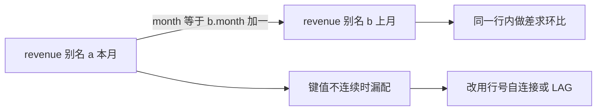
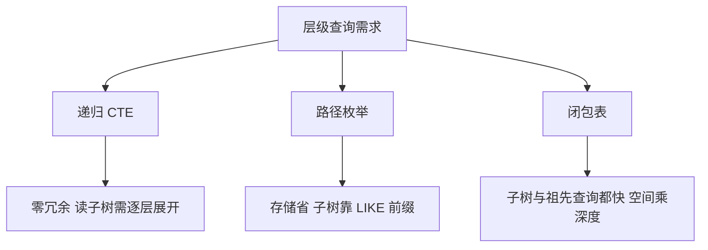
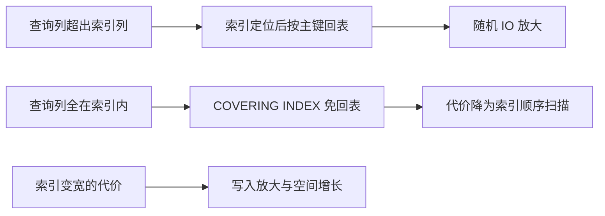
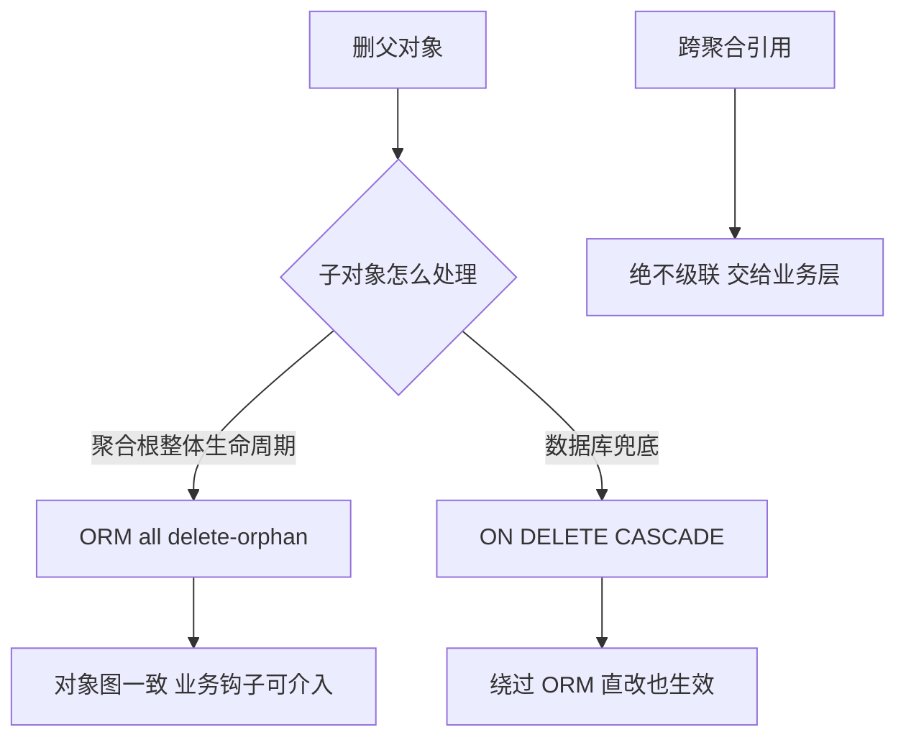
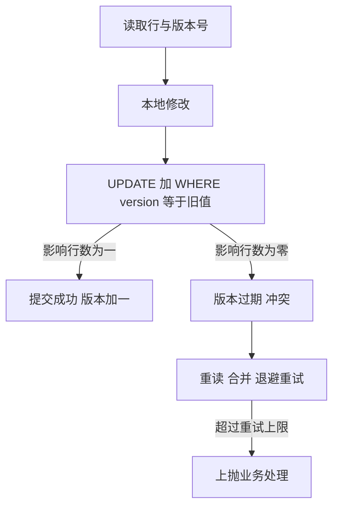
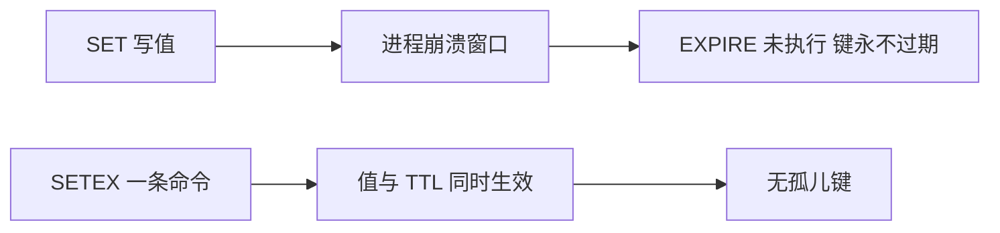
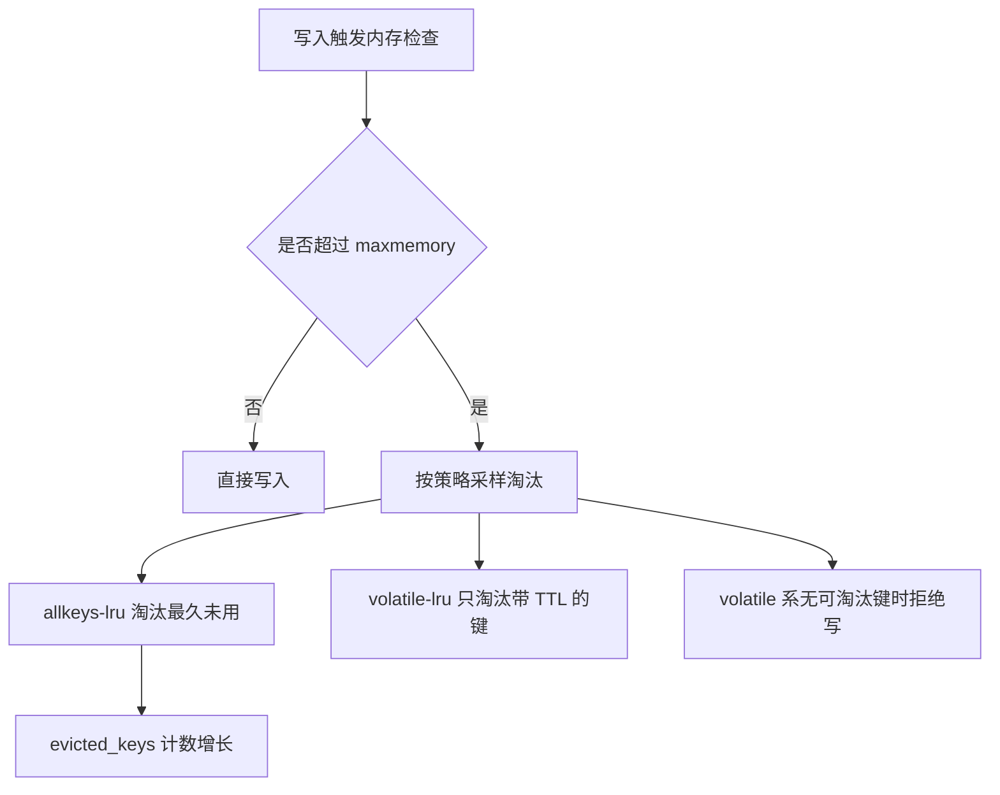
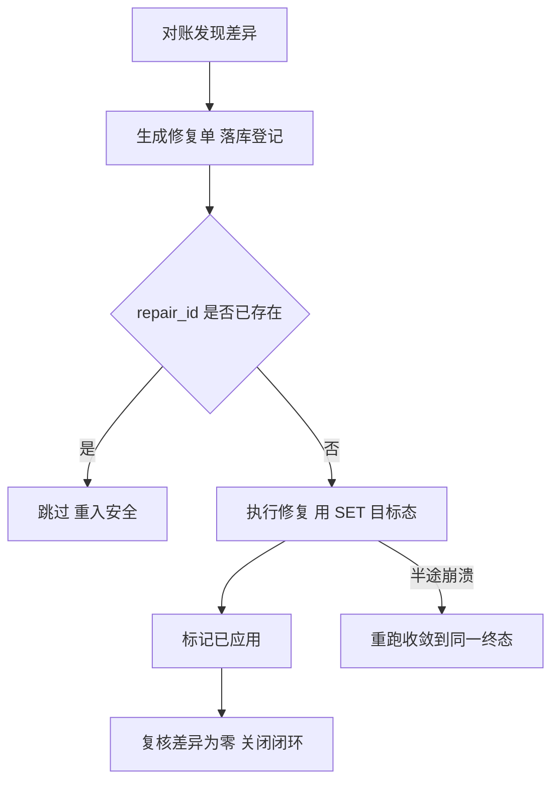

# 第 4 类 · 数据库与缓存(夜间扩产二)

本文件是第 4 类的第二批扩产,共 45 题(Q1661–Q1705),覆盖四条主线:SQL 补遗(NULL 三值逻辑、EXISTS 与 IN 实测、自连接相邻行比较与 islands、group_concat、日期区间重叠、层级查询两实现、乐观锁重试、分批删除、统计信息、covering 与 partial index)、ORM 补遗(identity map、merge、级联、软删除与唯一索引、多租户隔离、分页键、批量 upsert、version 并发、脏检查、server_default、流式读取、SAVEPOINT)、Redis 补遗(SETEX 原子性、INCR 漂移、大 hash 分段、pipeline 与事务、keyspace 通知、淘汰实测、断线重连、集群槽位、SCAN 续扫、字段级过期)、可靠性与一致性(本地消息表、对账闭环、双写读修复、防重表、ack 时序、修复幂等、读己之写、订单超时综合案例)。
示例以标准库 sqlite3 与纯逻辑模型为主,全部可独立运行;sqlalchemy 演示在未安装时自动降级为等价 sqlite3 演示并提示。
读法建议:SQL 题抓"语义与代价分开看",ORM 题抓"对象状态决定 SQL",Redis 题抓"原子性与不可靠性",可靠性题抓"幂等与兜底"。

---

### Q1661 · NULL 三值逻辑陷阱: NOT IN 遇上 NULL

> 难度:★★☆☆ | 标签:SQL, NULL 语义

**问**:为什么说 NOT IN 配子查询是线上事故高发写法?NULL 在 SQL 里到底参与了几种"逻辑"?

**答**:SQL 是三值逻辑:TRUE、FALSE 之外还有 UNKNOWN,任何值与 NULL 的等值比较结果都是 UNKNOWN 而不是 FALSE。NOT IN 的语义是"对子查询结果逐个做不等于判断再取与",只要子查询里混进一个 NULL,整个表达式就永远无法判定为 TRUE,外层查询返回空集。同理,WHERE col != 1 会静默丢掉 col 为 NULL 的行,COUNT(*) 与 COUNT(col) 口径不同,NULL 与 NULL 互不相等、判等必须用 IS。防御办法是给可能为 NULL 的列显式加 WHERE col IS NOT NULL 过滤,或者直接改用 NOT EXISTS。

```python
# file: code/04_数据库与缓存/q1661_null_notin.py
"""NULL 三值逻辑陷阱: NOT IN 遇上 NULL 与比较的第三种结果"""
import sqlite3

conn = sqlite3.connect(":memory:")
conn.executescript("""
CREATE TABLE vip(user_id INTEGER PRIMARY KEY);
CREATE TABLE logs(id INTEGER PRIMARY KEY, user_id INTEGER);
INSERT INTO vip VALUES(1), (2), (3);
INSERT INTO logs VALUES(1, 1), (2, 2), (3, NULL);
""")

def rows(sql):
    return [r[0] for r in conn.execute(sql)]

# 陷阱一: NOT IN 的子查询含 NULL 时, 整个外层查询返回空集
bad = rows("SELECT user_id FROM vip WHERE user_id NOT IN (SELECT user_id FROM logs)")
good = rows("SELECT user_id FROM vip v WHERE NOT EXISTS "
            "(SELECT 1 FROM logs l WHERE l.user_id = v.user_id)")
print("NOT IN 含 NULL 的子查询 ->", bad, "(全空: x 不等于 NULL 结果是 UNKNOWN, 整体永假)")
print("NOT EXISTS 同语义查询  ->", good)

# 陷阱二: WHERE col != 1 不会返回 NULL 行, NULL 参与任何比较都是 UNKNOWN
print("COUNT(*) =", rows("SELECT COUNT(*) FROM logs")[0],
      "  COUNT(user_id) =", rows("SELECT COUNT(user_id) FROM logs")[0])
print("user_id != 1 的行 ->", rows("SELECT id FROM logs WHERE user_id != 1"),
      "NULL 行被静默过滤")

# 陷阱三: NULL 与 NULL 不相等, 判等必须用 IS
print("NULL = NULL  ->", rows("SELECT NULL = NULL")[0], " (NULL)")
print("NULL IS NULL ->", rows("SELECT NULL IS NULL")[0], " (1)")
print("结论: 外层否定查询一律用 NOT EXISTS; 统计口径区分 COUNT(*) 与 COUNT(col); 判等用 IS")
```

**追问**:
- CHECK 约束里写 col != 0 能拦住 NULL 吗?——不能,UNKNOWN 不是 FALSE,CHECK 对 UNKNOWN 放行,要挡住必须显式写 col IS NOT NULL 或加 NOT NULL 约束。
- JOIN 的 ON 条件里 NULL 行为一样吗?——一样,NULL 永远匹配不上等值 JOIN,所以 left join 找"无匹配"要用 IS NULL 判右侧键。

---

### Q1662 · EXISTS vs IN 实测: NULL 语义与代价双维度

> 难度:★★★★ | 标签:SQL 调优, EXISTS

**问**:EXISTS 和 IN 到底该用哪个?有没有标准答案?

**答**:没有标准答案,要分语义与代价两个维度看。语义维度上,否定查询 NOT IN 会被子查询里的 NULL 全灭,NOT EXISTS 则完全免疫,所以否定场景 EXISTS 是硬要求;肯定场景里 IN 与 EXISTS 数学上等价。代价维度上,老教材说"外表小用 IN、外表大用 EXISTS",但现代优化器普遍能把两者改写成同一个半连接,实测才有意义;SQLite 这类以嵌套循环为主的引擎差异会真实存在,MySQL 8 与 PG 通常能拉平。本机 sqlite 实测里相关 EXISTS 比缓存的 IN 慢一个量级,说明"优化器是否做了改写"比"写法本身"更关键,结论要靠 EXPLAIN 加计时落地。

```python
# file: code/04_数据库与缓存/q1662_exists_vs_in.py
"""EXISTS vs IN 实测: NULL 语义差异与四种写法的代价"""
import sqlite3
import time

conn = sqlite3.connect(":memory:")
conn.execute("CREATE TABLE users(id INTEGER PRIMARY KEY, vip INTEGER)")
conn.execute("CREATE TABLE orders(id INTEGER PRIMARY KEY, user_id INTEGER)")
conn.executemany("INSERT INTO users VALUES(?,?)",
                 [(i, 1 if i % 10 == 0 else 0) for i in range(1, 100001)])
conn.executemany("INSERT INTO orders VALUES(?,?)",
                 [(i, (i * 7) % 50000 + 1) for i in range(1, 150001)])
conn.execute("CREATE INDEX idx_o_user ON orders(user_id)")
conn.commit()

def timed(sql, n=3):
    t0 = time.perf_counter()
    for _ in range(n):
        conn.execute(sql).fetchall()
    return (time.perf_counter() - t0) / n * 1000

q_in = ("SELECT COUNT(*) FROM users WHERE id IN "
        "(SELECT user_id FROM orders WHERE user_id <= 5000)")
q_exists = ("SELECT COUNT(*) FROM users u WHERE EXISTS "
            "(SELECT 1 FROM orders o WHERE o.user_id = u.id AND o.user_id <= 5000)")
q_not_in = "SELECT COUNT(*) FROM users WHERE id NOT IN (SELECT user_id FROM orders)"
q_not_exists = ("SELECT COUNT(*) FROM users u WHERE NOT EXISTS "
                "(SELECT 1 FROM orders o WHERE o.user_id = u.id)")
print(f"IN       半连接  : {timed(q_in):8.2f} ms")
print(f"EXISTS   半连接  : {timed(q_exists):8.2f} ms")
print(f"NOT IN   反连接  : {timed(q_not_in):8.2f} ms")
print(f"NOT EXISTS 反连接: {timed(q_not_exists):8.2f} ms")

# NULL 语义差异: 子查询含 NULL 时 NOT IN 全空, NOT EXISTS 不受影响
conn.execute("INSERT INTO orders VALUES(999999, NULL)")
conn.commit()
print("子查询混入一个 NULL 后: NOT IN =", conn.execute(q_not_in).fetchone()[0],
      "  NOT EXISTS =", conn.execute(q_not_exists).fetchone()[0])
print("结论: 否定语义一律用 NOT EXISTS 免疫 NULL; 肯定语义 IN 与 EXISTS 现代优化器多可等价改写, 实测为准")
```

**追问**:
- 为什么本机实测 EXISTS 慢很多?——SQLite 没有做半连接改写,相关子查询按嵌套循环逐行执行;MySQL 8 与 PG 会改写为 semi-join,差距通常消失。
- 大列表 IN (1,2,3...) 与子查询 IN 怎么选?——几百以内常量列表代价可忽略;上千个值会有解析与临时表成本,改成临时表 JOIN 或分批。

---

### Q1663 · 自连接应用: 相邻行比较与环比

> 难度:★★★☆ | 标签:SQL, 自连接

**问**:一张只有当月数据的月度表,不用窗口函数怎么算每个月的环比?

**答**:用自连接:同一张表起两个别名,让"本月"通过 join 条件匹配"上月",条件形如 a.month = b.month + 1,然后在 SELECT 里做差求比例。注意三点:INNER JOIN 会丢掉没有上月的首月,要看首月就改 LEFT JOIN;键值匹配依赖月份编号连续,跨年时 202612 到 202701 这种 +1 关系断裂,会漏配;ROW_NUMBER 生成行号再自连接、或直接用 LAG 窗口函数,都能免疫键不连续。自连接在无窗口函数的老库与"跨行配对"类需求(相邻行、上下级、配对去重)里仍是基本功。

```python
# file: code/04_数据库与缓存/q1663_selfjoin_adjacent.py
"""自连接应用: 相邻行比较做环比, 与窗口函数 LAG 对照"""
import sqlite3

conn = sqlite3.connect(":memory:")
conn.execute("CREATE TABLE revenue(month INTEGER PRIMARY KEY, amount REAL)")
conn.executemany("INSERT INTO revenue VALUES(?,?)",
                 [(202601, 100.0), (202602, 120.0), (202603, 90.0),
                  (202604, 110.0), (202605, 135.0)])

# 自连接: 同一张表起两个别名, 让"本月"通过 join 条件匹配到"上月"
sql = """
SELECT a.month AS cur_month, a.amount AS cur_amt, b.amount AS prev_amt,
       ROUND((a.amount - b.amount) / b.amount * 100, 1) AS pct
FROM revenue a
JOIN revenue b ON a.month = b.month + 1
ORDER BY a.month
"""
print("自连接环比:")
for m, cur, prev, pct in conn.execute(sql):
    print(f"  {m}: {cur:.0f} (上月 {prev:.0f}) 环比 {pct:+.1f}%")

# INNER JOIN 会丢掉没有上月的首月, LEFT JOIN 补齐
print("LEFT JOIN 保留首月:", conn.execute(
    "SELECT a.month, a.amount, b.amount FROM revenue a "
    "LEFT JOIN revenue b ON a.month = b.month + 1 ORDER BY a.month LIMIT 1").fetchone())

# LAG 是现代等价写法: 只扫一遍, 且不依赖键值的连续性
sql_lag = """SELECT month, amount, LAG(amount) OVER (ORDER BY month) AS prev_amt
             FROM revenue ORDER BY month"""
print("LAG 窗口版:", conn.execute(sql_lag).fetchall()[:3])
print("注意: a.month = b.month + 1 这种匹配依赖键值连续, 跨年 202612 到 202701 会漏配;")
print("      键不连续时先按 ROW_NUMBER 生成行号再自连接, 或直接用 LAG")
```



**追问**:
- 自连接和 LAG 哪个性能好?——LAG 只扫一遍且优化器友好;自连接多一次扫描与配对,但老库不支持窗口函数时是唯一解。
- 自连接要防止什么错误?——忘记限定配对条件会把 N 行与 N 行做笛卡尔积,大表上直接打爆临时空间。

---

### Q1664 · gaps-and-islands: 连续登录检测

> 难度:★★★★ | 标签:SQL, 自连接

**问**:怎么用 SQL 找出每个用户所有"连续登录"的日期段?

**答**:这是经典的 gaps-and-islands 问题。窗口函数解法是:给每个用户按日期排 ROW_NUMBER,同一段连续日期里 julianday(day) 减去 rn 是一个常数,按这个常数分组即得到每段的起止与天数。没有窗口函数的老库用自关联解法:岛起点是"前一天没有登录"的行,岛终点是"后一天没有登录"的行,起点配上其后第一个终点就是一段。两个方向写反了会得到完全错误的边界,这是该题最常见的翻车点。该模型同样适用于连续失败告警、号码段归并、会话切分。

```python
# file: code/04_数据库与缓存/q1664_gaps_islands.py
"""gaps-and-islands: 连续登录检测, 日期偏移与自关联的两种实现"""
import sqlite3

conn = sqlite3.connect(":memory:")
conn.execute("CREATE TABLE login(user_id INTEGER, day TEXT)")
conn.executemany("INSERT INTO login VALUES(?,?)",
                 [(1, "2026-10-01"), (1, "2026-10-02"), (1, "2026-10-03"),
                  (1, "2026-10-05"), (1, "2026-10-06"),
                  (2, "2026-10-01"), (2, "2026-10-03"), (2, "2026-10-04")])
conn.commit()

# 实现一: 日期减去行号在同一段连续日期内是常数, 以此分岛
sql_win = """
WITH d AS (
  SELECT user_id, day,
         ROW_NUMBER() OVER (PARTITION BY user_id ORDER BY day) AS rn
  FROM (SELECT DISTINCT user_id, day FROM login)
)
SELECT user_id, MIN(day) AS run_start, MAX(day) AS run_end, COUNT(*) AS days
FROM d
GROUP BY user_id, julianday(day) - rn
ORDER BY user_id, run_start
"""
print("窗口函数版连续段:")
for uid, s, e, n in conn.execute(sql_win):
    print(f"  用户{uid}: {s} ~ {e} 连续 {n} 天")

# 实现二: 无窗口函数的老库解法, 用自关联找"岛起点"与"岛终点"
sql_join = """
WITH d AS (SELECT DISTINCT user_id, day FROM login)
SELECT s.user_id, s.day AS seg_start,
       (SELECT MIN(e.day) FROM d e
         WHERE e.user_id = s.user_id AND e.day >= s.day
           AND NOT EXISTS (SELECT 1 FROM d f WHERE f.user_id = e.user_id
                 AND julianday(f.day) - julianday(e.day) = 1)) AS seg_end
FROM d s
WHERE NOT EXISTS (SELECT 1 FROM d p WHERE p.user_id = s.user_id
        AND julianday(s.day) - julianday(p.day) = 1)
ORDER BY s.user_id, seg_start
"""
print("自关联版岛起点与终点:", conn.execute(sql_join).fetchall())
print("要点: 岛起点 = 没有前一天的行; 岛终点 = 没有后一天的行; 方向写反会得到错误的岛边界")
```

**追问**:
- 登录表有重复行会影响结果吗?——会,ROW_NUMBER 会把同一天算两次,必须先 SELECT DISTINCT 或聚合去重。
- 怎么找"连续三天以上"的用户?——在上面结果外包一层 WHERE days >= 3,或者分组时按 user_id 加岛编号再筛。

---

### Q1665 · 字符串聚合: group_concat 的分隔符 顺序 与 去重

> 难度:★★☆☆ | 标签:SQL, 聚合

**问**:group_concat 拼出来的顺序是乱的,想按业务顺序拼怎么办?有什么坑?

**答**:group_concat 文档明确不保证元素顺序,默认分隔符是逗号,第二个参数可自定义分隔符。要有序拼接的通行做法是先在子查询里 ORDER BY 再交给聚合,SQLite 与 MySQL 上实现确实按子查询序拼接,但这是实现细节而非语义保证,强顺序要求应放应用层。去重方面,DISTINCT 只能与单参数形式连用,要"去重加分隔符"就得先在子查询 DISTINCT。另一个必须知道的坑:MySQL 的 group_concat 默认受 group_concat_max_len 1024 字节截断,拼长内容会静默丢数据;SQLite 没有这个参数,受最大字符串长度约束。

```python
# file: code/04_数据库与缓存/q1665_group_concat.py
"""字符串聚合: group_concat 的分隔符 顺序 与 去重三件套"""
import sqlite3

conn = sqlite3.connect(":memory:")
conn.executescript("""
CREATE TABLE emp(dept TEXT, name TEXT, age INTEGER);
INSERT INTO emp VALUES
 ('dev',  'zhang', 30), ('dev',  'wang',  28), ('dev',  'li',    28),
 ('ops',  'zhao',  35), ('ops',  'qian',  31), ('test', 'sun',   26);
""")

# 默认分隔符是逗号, 且元素顺序不保证 -- 文档明确说 arbitrary
print("默认:", conn.execute(
    "SELECT dept, group_concat(name) FROM emp GROUP BY dept ORDER BY dept").fetchall())

# 第二个参数指定分隔符
print("分号:", conn.execute(
    "SELECT dept, group_concat(name, '; ') FROM emp GROUP BY dept ORDER BY dept").fetchall())

# 想要有序拼接: 在子查询里先排序, 再交给聚合(实现上按子查询序, 语义上无保证)
sql = """
SELECT dept, group_concat(name, ' / ') FROM (
  SELECT dept, name FROM emp ORDER BY dept, name
) GROUP BY dept ORDER BY dept
"""
print("有序:", conn.execute(sql).fetchall())

# 想要去重: DISTINCT 只能与单参数形式连用, 带分隔符的先在子查询去重
print("DISTINCT 年龄:", conn.execute("SELECT group_concat(DISTINCT age) FROM emp").fetchone()[0])
sql2 = """
SELECT group_concat(age, ',') FROM (SELECT DISTINCT age FROM emp ORDER BY age)
"""
print("去重加分隔:", conn.execute(sql2).fetchone()[0])
print("要点: MySQL 的同名函数受 group_concat_max_len 默认 1024 截断; SQLite 无此参数;")
print("      超长或顺序敏感的拼接建议放应用层, SQL 里的拼接适合调试与轻量报表")
```

**追问**:
- 报表导出大 JSON 用 group_concat 合适吗?——不合适,截断与顺序两个坑都在,应该由应用层查询后用 json 库组装。
- PG 里对应什么函数?——string_agg(expr, sep) 配 ORDER BY 子句,顺序是语义保证的,比 MySQL 安全。

---

### Q1666 · 日期区间重叠判断: 预订冲突检测

> 难度:★★★☆ | 标签:SQL, 区间语义

**问**:预订系统怎么判断一个新的起止日期与已有预订冲突?

**答**:标准条件是 existing.start < new_end AND existing.end > new_start,四个比较符方向都不能错。常见错误写法是只判断"新起点是否落在旧区间内",漏掉"新区间整体包住旧区间"的情况。边界约定要明确:把区间定义为半开 [start, end),退房日当天可以再入住,条件里的两个严格不等号正好表达了端点相接不冲突。还要清楚这只是单线程判定,并发下单必须靠行锁串行化、或 PG 的 EXCLUDE 约束、或查后插加唯一兜底,否则两个请求同时查都会认为没冲突。

```python
# file: code/04_数据库与缓存/q1666_date_overlap.py
"""日期区间重叠判断: 预订冲突检测的半开区间条件"""
import sqlite3

conn = sqlite3.connect(":memory:")
conn.executescript("""
CREATE TABLE booking(id INTEGER PRIMARY KEY, room TEXT, start_day TEXT, end_day TEXT);
INSERT INTO booking VALUES
 (1, 'A101', '2026-11-01', '2026-11-05'),
 (2, 'A101', '2026-11-08', '2026-11-10');
""")
# 约定: start_day 入住, end_day 退房, 退房当天可再订 => 半开区间 [start, end)

NEW_START, NEW_END = "2026-11-04", "2026-11-07"

# 错误写法: 只判断新预订的起点是否落在旧区间内, 包不住"新区间吞掉旧区间"
n = conn.execute(
    "SELECT COUNT(*) FROM booking WHERE room='A101' AND ? BETWEEN start_day AND end_day",
    (NEW_START,)).fetchone()[0]
print("错误条件命中:", n, "条; 若新区间起点在所有旧区间之外则会整体漏判")

# 正确条件: 旧起点 < 新终点 且 旧终点 > 新起点, 半开区间交叠
right = """SELECT id, start_day, end_day FROM booking
 WHERE room='A101' AND start_day < :e AND end_day > :s ORDER BY id"""
hits = conn.execute(right, {"s": NEW_START, "e": NEW_END}).fetchall()
print("正确条件命中:", hits)

# 边界验证: 旧 end_day 等于新 start_day 不冲突
touch = conn.execute(right, {"s": "2026-11-05", "e": "2026-11-08"}).fetchall()
print("11-05 入住(旧 end=5)不算冲突:", touch, "-> 半开区间端点相接不重叠")

def try_book(room, s, e):
    hit = conn.execute(
        "SELECT id FROM booking WHERE room=? AND start_day < ? AND end_day > ?",
        (room, e, s)).fetchone()
    if hit:
        return False, f"与现有预订 id={hit[0]} 冲突"
    cur = conn.execute(
        "INSERT INTO booking(room, start_day, end_day) VALUES(?,?,?)", (room, s, e))
    conn.commit()
    return True, f"预订成功 id={cur.lastrowid}"

print(try_book("A101", "2026-11-04", "2026-11-07"), "<- 与预订1重叠被拒")
print(try_book("A101", "2026-11-06", "2026-11-08"))
print("要点: 区间交叠判定 start < new_end AND end > new_start;")
print("      并发下单还要靠行锁串行化或 PG 的排他范围约束兜底, 只靠查后插必有竞态")
```

**追问**:
- start < new_end AND end > new_start 怎么记不记反?——想成两条线段投影有交集的充要条件,"我的开始早于你的结束,我的结束晚于你的开始"。
- PG 怎么用约束直接挡冲突?——-range 类型加 EXCLUDE USING gist (room WITH =, period WITH &&),数据库层直接拒绝重叠插入。

---

### Q1667 · 层级查询实现一: 递归 CTE

> 难度:★★★☆ | 标签:SQL, 层级

**问**:邻接表存的组织树,一条 SQL 怎么把整棵树连子树汇总一起查出来?

**答**:递归 CTE 是标准解:锚点成员查根节点,递归成员按 parent_id 与上一层挂接并累加深度与路径,UNION ALL 连接。子树汇总可以在递归列里带上聚合所需的属性,再按 path 前缀匹配汇总。必须写终止条件:常规终止靠"没有更深层级"自然结束,脏数据成环时必须靠深度上限或路径防重来兜底,否则递归永不停。SQLite、MySQL 8、PG 都支持该语法,是邻接表层级查询的现代标准答案。

```python
# file: code/04_数据库与缓存/q1667_recursive_cte.py
"""层级查询实现一: 递归 CTE 展开组织树, 带深度上限与环防护"""
import sqlite3

conn = sqlite3.connect(":memory:")
conn.executescript("""
CREATE TABLE dept(id INTEGER PRIMARY KEY, name TEXT, parent_id INTEGER, headcount INTEGER);
INSERT INTO dept VALUES
 (1, '总公司', NULL, 0), (2, '研发部', 1, 80), (3, '市场部', 1, 30),
 (4, '后端组', 2, 45), (5, '前端组', 2, 35), (6, '增长组', 3, 12);
""")

# 递归部分: 锚点取根, 递归步按 parent_id 挂接, path 记录层级链
sql = """
WITH RECURSIVE tree(id, name, parent_id, depth, path, headcount) AS (
  SELECT id, name, parent_id, 0, CAST(id AS TEXT), headcount
  FROM dept WHERE parent_id IS NULL
  UNION ALL
  SELECT d.id, d.name, d.parent_id, t.depth + 1, t.path || '/' || d.id, d.headcount
  FROM dept d JOIN tree t ON d.parent_id = t.id
  WHERE t.depth < 20
)
SELECT t.depth, t.path,
       (SELECT SUM(s.headcount) FROM tree s
          WHERE s.id = t.id OR s.path LIKE t.path || '/%') AS sub_heads
FROM tree t ORDER BY t.path
"""
print("递归展开与子树人力汇总:")
for depth, path, heads in conn.execute(sql):
    print(f"  {'  ' * depth}{path}  子树人力 {heads}")

# 环防护: 数据出现环时, 深度上限防止无限递归
conn.execute("UPDATE dept SET parent_id = 6 WHERE id = 3")   # 制造环 3 -> 6 -> 3
conn.commit()
sql_cycle = """
WITH RECURSIVE loop(id, parent_id, depth) AS (
  SELECT id, parent_id, 0 FROM dept WHERE id = 3
  UNION ALL
  SELECT d.id, d.parent_id, l.depth + 1
  FROM dept d JOIN loop l ON d.parent_id = l.id
  WHERE l.depth < 20
)
SELECT MAX(depth) FROM loop
"""
print("环 3<->6 上的递归被深度上限截断在:", conn.execute(sql_cycle).fetchone()[0], "层")
print("要点: 递归 CTE 三要素 = 锚点 递归步 终止条件;")
print("      深度上限是最后防线, 更优雅的做法是在 WHERE 里限制 path 不重复经过同一节点")
```

**追问**:
- UNION ALL 与 UNION 在递归里有什么区别?——UNION 会去重并可能提前终止,代价更高;防环应该用显式条件而不是靠 UNION 去重。
- 树很深时性能怎么办?——每层一轮扫描,深度 d 约等于 d 次索引查找;极深树改路径枚举或闭包表物化。

---

### Q1668 · 层级查询实现二: 路径枚举与闭包表

> 难度:★★★★ | 标签:SQL, 层级

**问**:递归 CTE 每次查询都要展开,读多写少的树有没有更快的方案?

**答**:两种物化方案。路径枚举:每行存整条祖先路径如 1/2/4,子树查询退化为 LIKE 'path/%' 前缀匹配,存储省、实现简单,但 LIKE 走不了理想索引,改名要重写整棵子树路径。闭包表:单独一张 ancestor-descendant-depth 表,预先展开全部祖先后代对,子树与祖先查询都是等值 JOIN,读最快,代价是空间 O(n 乘深度)、每次写要维护多行。选型口诀:读远多于写选闭包表,写频繁或树浅选路径枚举或直接递归 CTE,两者移动子树都贵,搬家要走脚本。

```python
# file: code/04_数据库与缓存/q1668_path_closure.py
"""层级查询实现二: 路径枚举与闭包表, 读多写少的两种物化方案"""
import sqlite3

conn = sqlite3.connect(":memory:")
conn.executescript("""
CREATE TABLE node(id INTEGER PRIMARY KEY, name TEXT, parent_id INTEGER, path TEXT);
CREATE TABLE closure(ancestor INTEGER, descendant INTEGER, depth INTEGER,
  PRIMARY KEY(ancestor, descendant));
INSERT INTO node VALUES
 (1, 'root', NULL, '1'),
 (2, 'a',    1,    '1/2'),
 (3, 'b',    1,    '1/3'),
 (4, 'a1',   2,    '1/2/4'),
 (5, 'b1',   3,    '1/3/5');
""")
# 闭包表: 预先展开全部祖先-后代对, 之后子树与祖先查询都是等值 JOIN
nodes = conn.execute("SELECT id, parent_id FROM node").fetchall()
by_id = dict(nodes)
pairs = []
for nid, _ in nodes:
    d, cur = 0, nid
    while cur is not None:
        pairs.append((cur, nid, d))
        d += 1
        cur = by_id.get(cur)
conn.executemany("INSERT OR REPLACE INTO closure VALUES(?,?,?)", pairs)
conn.commit()

print("闭包表查 1 的整棵子树:")
for r in conn.execute("""
  SELECT n.id, n.name, c.depth FROM closure c
  JOIN node n ON n.id = c.descendant
  WHERE c.ancestor = 1 ORDER BY c.depth"""):
    print("  ", r)

print("路径枚举查 1 的整棵子树:")
for r in conn.execute("SELECT id, name, path FROM node WHERE id = 1 OR path LIKE '1/%'"):
    print("  ", r)

print("闭包表反查 5 的全部祖先:")
for r in conn.execute("""
  SELECT n.id, n.name, c.depth FROM closure c
  JOIN node n ON n.id = c.ancestor
  WHERE c.descendant = 5 ORDER BY c.depth"""):
    print("  ", r)

print("对比: 闭包表读快但空间 O(n*深度) 且写重; 路径枚举存储小, 子树靠 LIKE 前缀;")
print("      LIKE 走不了理想索引, 且节点改名要重写整棵子树的路径, 移动子树两者都贵")
```



**追问**:
- 闭包表插入一个节点要写几行?——祖先数加一自身,深度每层一行,插入脚本里用一条 INSERT INTO closure SELECT 递归生成。
- 两种方案的一致性怎么保证?——物化列与闭包表都必须与业务写在同一事务,或由触发器/事件钩子维护,绝不允许散落在业务代码各处。

---

### Q1669 · 聚合与 NULL: COUNT 口径与 AVG/SUM 偏差

> 难度:★★☆☆ | 标签:SQL, NULL 语义

**问**:COUNT(*) 和 COUNT(col) 有什么区别?AVG 会对 NULL 怎么处理?

**答**:COUNT(*) 数行数,包含 NULL 行;COUNT(col) 只数该列非 NULL 的值,同一张表两者可以不同。聚合函数普遍忽略 NULL:AVG 只对非 NULL 求均值,缺考的 NULL 不参与分母,这是"平均分"口径争议的根源;SUM、MAX、MIN 同样忽略 NULL。关键差异在空集:对零行聚合,SUM 返回 NULL 而不是 0,直接输出到报表会显示空,必须 COALESCE 包一层。做统计前先和需求方确认口径——数行还是数有效值、缺考算不算分母、空集显示 0 还是不显示。

```python
# file: code/04_数据库与缓存/q1669_agg_null.py
"""聚合与 NULL: COUNT 三种口径 与 AVG/SUM 的隐性偏差"""
import sqlite3

conn = sqlite3.connect(":memory:")
conn.execute("CREATE TABLE score(student TEXT, subject TEXT, val REAL)")
conn.executemany("INSERT INTO score VALUES(?,?,?)",
                 [("a", "math", 80), ("a", "eng", None), ("a", "phys", 90),
                  ("b", "math", None), ("b", "eng", None), ("b", "phys", None),
                  ("c", "math", 70), ("c", "eng", 60), ("c", "phys", 50)])
conn.commit()

def one(sql):
    return conn.execute(sql).fetchone()[0]

print("COUNT(*) =", one("SELECT COUNT(*) FROM score"), "     数行, 含 NULL")
print("COUNT(val) =", one("SELECT COUNT(val) FROM score"), "    只数非 NULL")
print("COUNT(DISTINCT val) =", one("SELECT COUNT(DISTINCT val) FROM score"))

# AVG 只对非 NULL 求均值: a 是 80 与 90 两门 -> 85, 不是 (80+90)/3 也不是 170/3 的误解
for stu in ("a", "b", "c"):
    avg = one("SELECT AVG(val) FROM score WHERE student='" + stu + "'")
    print(f"{stu}: AVG={avg}  (b 全 NULL -> AVG 是 NULL 而不是 0)")

print("空集 SUM:", one("SELECT SUM(val) FROM score WHERE student='zz'"),
      "-> 是 NULL 不是 0, 报表必须 COALESCE")
print("COALESCE 修正:", one("SELECT COALESCE(SUM(val), 0) FROM score WHERE student='zz'"))
print("结论: 每个统计先明确口径, 是数行还是数值, 空集想显示 0 还是不显示, 再写 SQL")
```

**追问**:
- 想让 NULL 按零参与 AVG 怎么写?——AVG(COALESCE(val, 0)),先定口径再聚合,两种写法结果完全不同。
- COUNT(DISTINCT 多列) 为什么报错?——标准 SQL 的 DISTINCT 聚合只收单表达式,多列用 COUNT(DISTINCT a || '-' || b) 或先子查询去重再数。

---

### Q1670 · 乐观锁重试实战: 版本号加退避重试

> 难度:★★★☆ | 标签:并发控制, 乐观锁

**问**:乐观锁检测到冲突之后,重试循环应该怎么写才不出事故?

**答**:核心动作是三步:读数据与版本号;执行 UPDATE 时带上 WHERE version = 读到的旧值;影响行数为 0 即冲突,重读后重试。重试循环必须有三件防护:重试上限,防止极端热点下无限循环;指数退避加随机抖动,防止多个失败者同步重试形成活锁;每次重试都要重读最新值,绝不能用本地缓存的旧对象直接再提交。冲突率高说明乐观锁选型错了,热点行应该改悲观锁或队列串行化;工程上还常把重试封装成装饰器,并把冲突计数打进监控。

```python
# file: code/04_数据库与缓存/q1670_optimistic_retry.py
"""乐观锁重试实战: 版本号条件更新 加 指数退避重试"""
import random
import sqlite3
import time

random.seed(42)
conn = sqlite3.connect(":memory:")
conn.execute("CREATE TABLE stock(sku TEXT PRIMARY KEY, qty INTEGER, version INTEGER)")
conn.execute("INSERT INTO stock VALUES('sku-1', 100, 0)")
conn.commit()

def load():
    return conn.execute("SELECT qty, version FROM stock WHERE sku='sku-1'").fetchone()

class Rival:
    """并发对手: 每次被调用就抢先扣减一次库存并推进版本"""
    def __init__(self, times):
        self.times, self.called = times, 0
    def strike(self):
        if self.called >= self.times:
            return
        self.called += 1
        conn.execute("UPDATE stock SET qty=qty-1, version=version+1 WHERE sku='sku-1'")
        conn.commit()

def deduct(want, rival, max_retry=5):
    for attempt in range(1, max_retry + 1):
        qty, ver = load()
        if qty < want:
            return False, "库存不足"
        rival.strike()                      # 对手在我们读之后抢先写入
        cur = conn.execute(
            "UPDATE stock SET qty=qty-?, version=version+1 WHERE sku='sku-1' AND version=?",
            (want, ver))
        conn.commit()
        if cur.rowcount == 1:
            return True, f"第 {attempt} 次尝试成功"
        print(f"  第 {attempt} 次提交冲突: 本地 version={ver} 已过期, 退避后重试")
        time.sleep(0.01 * (2 ** (attempt - 1)) + random.random() * 0.005)
    return False, f"重试 {max_retry} 次仍冲突"

ok, msg = deduct(5, Rival(times=1))
print(ok, msg, "当前库存与版本:", load())
ok, msg = deduct(5, Rival(times=0))
print(ok, msg, "当前库存与版本:", load())
print("要点: WHERE version=? 是冲突检测, rowcount=0 即冲突; ")
print("      重试要有上限, 退避要加抖动, 否则高并发下会活锁; 冲突率高就改悲观锁或队列串行")
```

**追问**:
- 指数退避为什么要加抖动?——不加抖动时所有失败者在同一时刻醒来重试,冲突概率不降反升,full jitter 是经验最稳的取法。
- 扣库存能用乐观锁吗?——低冲突可以;秒杀级热点冲突率趋近 1,乐观锁只会白白烧 CPU,应改 Redis 原子扣减加异步落库。

---

### Q1671 · 批量 DELETE 分批: 大表清理的节奏

> 难度:★★★☆ | 标签:SQL 运维, 删除

**问**:要从几亿行的大表里删掉一半数据,一条 DELETE 为什么危险?怎么删?

**答**:一条巨型 DELETE 的危险在 undo/回滚量与锁持有时间不可控:主从延迟飙高、行锁或间隙锁长时间持有阻塞业务、失败后回滚同样要花几十分钟。正确做法是按主键分批:每批用 DELETE ... WHERE id IN (SELECT id ... LIMIT n) 删几千行立即提交,循环到删完;生产上再加批间 sleep 限速、按业务低峰执行、每批之间观察主从延迟。过滤列必须有索引,否则每一批的 SELECT 都退化成全表扫;SQLite 不支持 DELETE LIMIT 语法,用子查询间接实现,MySQL 可直接 DELETE ... LIMIT。

```python
# file: code/04_数据库与缓存/q1671_batch_delete.py
"""批量 DELETE 分批: 大表清理的分批提交与节奏控制"""
import sqlite3
import time

conn = sqlite3.connect(":memory:")
conn.execute("CREATE TABLE logs(id INTEGER PRIMARY KEY, created INTEGER, expired INTEGER)")
conn.execute("CREATE INDEX idx_exp ON logs(expired)")
conn.executemany("INSERT INTO logs VALUES(?,?,?)",
                 [(i, i, 1 if i % 2 == 0 else 0) for i in range(120000)])
conn.commit()

BATCH = 5000
total = conn.execute("SELECT COUNT(*) FROM logs WHERE expired=1").fetchone()[0]
print(f"待删除 {total} 行, 每批 {BATCH} 行")

batch_no, total_ms = 0, 0.0
while True:
    t0 = time.perf_counter()
    cur = conn.execute(
        "DELETE FROM logs WHERE id IN "
        "(SELECT id FROM logs WHERE expired = 1 LIMIT ?)", (BATCH,))
    conn.commit()                      # 每批提交, 释放空间与锁
    ms = (time.perf_counter() - t0) * 1000
    total_ms += ms
    batch_no += 1
    if batch_no <= 3 or cur.rowcount == 0:
        print(f"  第 {batch_no} 批删 {cur.rowcount} 行, 耗时 {ms:.1f} ms")
    if cur.rowcount < BATCH:
        break

print(f"共 {batch_no} 批, 总耗时 {total_ms:.0f} ms")
print("剩余未过期行:", conn.execute("SELECT COUNT(*) FROM logs WHERE expired=0").fetchone()[0])
print("要点: 一条巨型 DELETE 的 undo 与锁持有时间不可控, 分批提交把影响切片;")
print("      生产再加批间 sleep 限速, 过滤列必须有索引否则每批都是全表扫")
```

**追问**:
- 删完的空间会还给操作系统吗?——InnoDB 表空间通常不收缩,大删除后要么 OPTIMIZE TABLE 重建要么在低峰 pt-osc;吞吐回收的是页内复用。
- 分批时主键断档会有影响吗?——没有,每批按过滤条件重查,断档只是让单批行数变少;用游标式 WHERE id > last 反而要处理断档。

---

### Q1672 · 统计信息与分析器: ANALYZE 与查询计划

> 难度:★★★☆ | 标签:SQL 调优, 统计信息

**问**:优化器怎么知道走哪个索引?统计信息过期会发生什么?

**答**:优化器靠统计信息估算每个候选计划的行数与代价再择优:表行数、索引列的不同值数、直方图分布,对应 MySQL 的 information_schema 与 ANALYZE TABLE、PG 的 pg_statistic 与 ANALYZE、SQLite 的 sqlite_stat1 与 ANALYZE 命令。统计过期是事故常见根源:表被大量删改后,优化器仍按旧分布估算,可能在该全表扫时坚持走索引,或反之。本机实测:删掉 99% 的数据后计划纹丝不动,重新 ANALYZE 后立刻改为全表扫描——因为表只剩目标行,扫全表比索引跳转便宜。大批量变更后要手动重新收集,生产库还要给倾斜列配直方图。

```python
# file: code/04_数据库与缓存/q1672_analyze_stats.py
"""统计信息与分析器: ANALYZE 采集分布, 陈旧统计误导优化器"""
import sqlite3

conn = sqlite3.connect(":memory:")
conn.execute("CREATE TABLE orders(id INTEGER PRIMARY KEY, status TEXT)")
conn.executemany("INSERT INTO orders VALUES(?,?)",
                 [(i, "pending" if i % 100 == 0 else "done") for i in range(1, 50001)])
conn.execute("CREATE INDEX idx_status ON orders(status)")
conn.commit()

def plan(sql):
    return [r[3] for r in conn.execute("EXPLAIN QUERY PLAN " + sql)]

q = "SELECT * FROM orders WHERE status='pending'"
print("未收集统计:", plan(q))
conn.execute("ANALYZE")
print("ANALYZE 后:", plan(q))
print("sqlite_stat1 内容 (表行数, 索引列不同值数):",
      conn.execute("SELECT tbl, idx, stat FROM sqlite_stat1").fetchall())

# 场景: 大规模删除后统计信息过期
conn.execute("DELETE FROM orders WHERE status='done'")
conn.commit()
print("现在表只剩", conn.execute("SELECT COUNT(*) FROM orders").fetchone()[0], "行, 全是 pending")
print("陈旧统计下的计划(仍按 5 万行估算):", plan(q))
conn.execute("ANALYZE")
print("重新 ANALYZE:", plan(q), "-> 表只剩目标行, 全表扫比索引跳转更便宜")
print("要点: 计划质量取决于统计新鲜度; 大批量变更后手动 ANALYZE, 生产库对倾斜列考虑直方图")
```

**追问**:
- ANALYZE 本身会锁表吗?——采样读不加写锁,代价主要是 IO;MySQL ANALYZE TABLE 有短暂 MDL,大表选低峰跑。
- 自动统计为什么没救回来?——MySQL 的自动重采集按变更行数比例触发,10% 阈值在大表上意味着要改几百万行才触发,大批量删除后应手动。

---

### Q1673 · covering index 实测: 让查询免于回表

> 难度:★★★☆ | 标签:SQL 调优, 索引

**问**:覆盖索引到底能快多少?怎么从执行计划确认它生效了?

**答**:当查询涉及的列全部包含在某个二级索引里时,引擎沿索引顺序扫完即得结果,完全不必按主键回表,随机 IO 消失。确认方法看执行计划:MySQL 的 Extra 列出现 Using index,SQLite 出现 USING COVERING INDEX。本机 20 万行实测,2000 次"按 user_id 求和 amount"的点查,普通索引 506ms、覆盖索引 123ms,差距正是每次约 100 次回表被消除。建覆盖索引就是给索引追加查询列,联合索引列序仍是等值列在前;代价是索引变宽带来写放大与空间增长,只对高频查询值得做。

```python
# file: code/04_数据库与缓存/q1673_covering_index.py
"""covering index 实测: 覆盖索引消除回表 的计划与耗时对比"""
import sqlite3
import time

conn = sqlite3.connect(":memory:")
conn.execute("CREATE TABLE orders(id INTEGER PRIMARY KEY, user_id INTEGER, amount REAL, memo TEXT)")
conn.executemany("INSERT INTO orders VALUES(?,?,?,?)",
                 [(i, i % 2000, (i % 97) * 1.5, "memo-%d" % i) for i in range(200000)])
conn.commit()
conn.execute("CREATE INDEX idx_user ON orders(user_id)")

sql = "SELECT SUM(amount) FROM orders WHERE user_id = ?"
print("普通索引计划:", [r[3] for r in conn.execute("EXPLAIN QUERY PLAN " + sql, (1,))])

t0 = time.perf_counter()
for u in range(2000):
    conn.execute(sql, (u,)).fetchone()
t_plain = (time.perf_counter() - t0) * 1000
print(f"普通索引 2000 次点查: {t_plain:.0f} ms (每查约 100 行, 全部要回表)")

conn.execute("CREATE INDEX idx_user_cover ON orders(user_id, amount)")
conn.execute("DROP INDEX idx_user")
conn.commit()
print("覆盖索引计划:", [r[3] for r in conn.execute("EXPLAIN QUERY PLAN " + sql, (1,))])

t0 = time.perf_counter()
for u in range(2000):
    conn.execute(sql, (u,)).fetchone()
t_cover = (time.perf_counter() - t0) * 1000
print(f"覆盖索引 2000 次点查: {t_cover:.0f} ms")
print("要点: 查询列全部落在索引内时 USING COVERING INDEX 免回表, 随机 IO 变顺序扫;")
print("      索引越宽越接近覆盖, 但写放大与空间同步上涨, 只对高频查询值得")
```



**追问**:
- SELECT * 能吃到覆盖索引吗?——基本不能,除非表的所有列都在索引里;要覆盖就先把 SELECT 列裁剪到必要集。
- 为什么列序是 user_id, amount 而不是反过来?——等值过滤列必须在前才能定位,被覆盖的载荷列放后面,这个顺序同时决定过滤与覆盖。

---

### Q1674 · partial index: 只索引热子集

> 难度:★★★☆ | 标签:SQL 调优, 索引

**问**:98% 的行都是 done 状态,任务表只有 pending 值得建索引吗?

**答**:这正是部分索引的用武之地:CREATE INDEX ... WHERE status='pending',只把满足谓词的行纳入索引,体积与维护成本按选择度等比例缩小。本机实测 5 万行的任务表,全量索引 5 万条目,部分索引只有 1000 条,查询 pending 直接命中且顺带覆盖了 priority 列。使用条件苛刻而明确:查询的 WHERE 必须蕴含建索引的谓词,优化器才会选用它;MySQL 至今不支持部分索引,近似方案是生成列加联合索引,PG 与 SQLite 原生支持。它同时是软删除唯一约束的经典解法,见后面 Q1679。

```python
# file: code/04_数据库与缓存/q1674_partial_index.py
"""partial index: 部分索引的概念与 sqlite 演示"""
import sqlite3

conn = sqlite3.connect(":memory:")
conn.execute("CREATE TABLE jobs(id INTEGER PRIMARY KEY, status TEXT, priority INTEGER)")
conn.executemany("INSERT INTO jobs VALUES(?,?,?)",
                 [(i, "done" if i % 50 else "pending", i % 7) for i in range(1, 50001)])
conn.commit()
# 普通索引覆盖全部 5 万行, 其中 98% 是 done
conn.execute("CREATE INDEX idx_full ON jobs(status)")
# 部分索引只索引 pending 子集
conn.execute("CREATE INDEX idx_pending ON jobs(status, priority) WHERE status='pending'")
conn.commit()

def plan(sql):
    return [r[3] for r in conn.execute("EXPLAIN QUERY PLAN " + sql)]

print("查询 pending 的计划:", plan("SELECT * FROM jobs WHERE status='pending'"))
print("查询 done 的计划:   ", plan("SELECT * FROM jobs WHERE status='done'"))
print("普通索引行数:", conn.execute("SELECT COUNT(*) FROM jobs INDEXED BY idx_full").fetchone()[0])
print("部分索引行数:", conn.execute(
    "SELECT COUNT(*) FROM jobs INDEXED BY idx_pending WHERE status='pending'").fetchone()[0])
print("要点: 部分索引把热子集建成小而准的索引, 体积与维护成本按选择度比例缩小;")
print("      查询条件必须蕴含建索引的谓词, 优化器才会选用它")
```

**追问**:
- 部分索引的谓词能引用别的表或函数吗?——只能是本行的确定性表达式,不能用子查询与非确定性函数,这是它能高效维护的前提。
- 谓词写成 status <> 'done' 可以吗?——语义等价时优化器一般能匹配,但写成与查询完全一致的形式最稳,方言差异要实测。

---

### Q1675 · SQLite 日期函数与区间统计

> 难度:★★☆☆ | 标签:SQL, 日期

**问**:SQLite 里怎么做按天、按月的报表?缺数据的日期怎么补零?

**答**:SQLite 提供五个核心函数:date、time、datetime、julianday、strftime,配合修饰符做偏移与本地化,如 date(ts, '+1 day')、strftime('%Y-%m', ts) 按月分组。报表要连续日期时,数据里缺号会造成跳行,标准解法是递归 CTE 生成日历序列再 LEFT JOIN 业务表,空档用 COALESCE 补零。两个纪律:存储一律 UTC 或时间戳,展示层才转时区,修饰符 localtime 只在最后一步用;周口径的 strftime('%W') 是周序号而非业务周,口径要和需求方对齐。这些函数在 MySQL/PG 有对应物,迁移时注意格式符差异。

```python
# file: code/04_数据库与缓存/q1675_sqlite_dates.py
"""SQLite 日期函数实战: strftime 区间统计与补齐缺失日期"""
import sqlite3

conn = sqlite3.connect(":memory:")
conn.execute("CREATE TABLE pay(id INTEGER PRIMARY KEY, ts TEXT, amount REAL)")
rows = []
for d in (1, 2, 4, 5, 7, 8):          # 故意缺 3 号与 6 号
    for h in range(3):
        rows.append((len(rows) + 1, "2026-11-%02d %02d:30:00" % (d, h), 10.0 + h))
conn.executemany("INSERT INTO pay VALUES(?,?,?)", rows)
conn.commit()

print("按天汇总:")
for r in conn.execute(
        "SELECT date(ts), COUNT(*), SUM(amount) FROM pay GROUP BY date(ts) ORDER BY 1"):
    print("  ", r)

# 报表要求连续日期: 递归 CTE 造日历再 LEFT JOIN 补零
print("补零后的连续日报:")
for r in conn.execute("""
WITH RECURSIVE cal(day) AS (
  SELECT '2026-11-01'
  UNION ALL SELECT date(day, '+1 day') FROM cal WHERE day < '2026-11-08'
)
SELECT cal.day, COALESCE(SUM(p.amount), 0)
FROM cal LEFT JOIN pay p ON date(p.ts) = cal.day
GROUP BY cal.day ORDER BY cal.day"""):
    print("  ", r)

print("常用函数: strftime('%Y-%m', ts) 按月;  julianday(ts) 算天数差;")
print("          date(ts, '+1 month') 做偏移;  修饰符 'localtime' 处理本地时区")
print("注意: 存储一律 UTC 文本或时间戳, 展示层才转时区; 周口径 strftime('%W') 要与业务对齐")
```

**追问**:
- ts 上有索引,对 ts 用函数还能走索引吗?——对列包函数通常破坏索引区间;按天分组可改成 ts >= day AND ts < day + 1 的范围条件,或落预生成列。
- 递归日历生成一年 365 行会慢吗?——不会,每层一次 date 计算毫秒级;固定区间还可以用 WITH RECURSIVE 加上限防失控。

---

### Q1676 · identity map 与缓存污染

> 难度:★★★☆ | 标签:ORM, Session

**问**:同一个 Session 里查两次同一条数据,第二次会发 SQL 吗?

**答**:不会。SQLAlchemy 的 Session 内部维护 identity map:以表加主键为键缓存已加载对象,同主键的查询直接返回同一 Python 对象,这既省 SQL 也保证会话内"一份数据"的一致性。代价是它会过期:任何绕过 ORM 的写入(裸 SQL、其他进程、定时任务)不会通知 Session,Session 继续返回旧值,这就是缓存污染。修复手段是 expire/expire_all 让属性快照失效、下次访问重发 SELECT。根治办法是纪律性的 Session 生命周期:一个请求一个 Session,用完即关,长命 Session 既是污染源也是长事务源。

```python
# file: code/04_数据库与缓存/q1676_identity_map.py
"""identity map 与缓存污染: 会话内主键唯一对象 与 外部直改造成的脏读"""
import sqlite3

try:
    from sqlalchemy import create_engine
    from sqlalchemy.orm import Session, DeclarativeBase, Mapped, mapped_column
    HAS_SQLA = True
except ImportError:
    HAS_SQLA = False

def demo_pure():
    conn = sqlite3.connect(":memory:")
    conn.execute("CREATE TABLE users(id INTEGER PRIMARY KEY, name TEXT)")
    conn.execute("INSERT INTO users VALUES(1, 'alice')")
    conn.commit()
    identity_map = {}

    def get(pk):
        if pk not in identity_map:
            row = conn.execute("SELECT id, name FROM users WHERE id=?", (pk,)).fetchone()
            identity_map[pk] = {"id": row[0], "name": row[1]}
        return identity_map[pk]

    a, b = get(1), get(1)
    print("同一主键返回同一对象:", a is b, "-> 会话内一份数据, 免重复 SQL 且保证一致")
    conn.execute("UPDATE users SET name='hacked' WHERE id=1")
    conn.commit()
    print("外部直改后 Session 视角仍是旧值:", get(1)["name"], "<- 这就是缓存污染")
    row = conn.execute("SELECT id, name FROM users WHERE id=1").fetchone()
    identity_map[1] = {"id": row[0], "name": row[1]}       # 等价 expire + refresh
    print("expire 后重读:", get(1)["name"])
    print("结论: identity map 的生命周期等于 Session; 长命 Session 期间任何绕过 ORM 的写入都表现为脏读")

if HAS_SQLA:
    class Base(DeclarativeBase):
        pass

    class User(Base):
        __tablename__ = "users"
        id: Mapped[int] = mapped_column(primary_key=True)
        name: Mapped[str]

    def demo_sqla():
        engine = create_engine("sqlite://")
        Base.metadata.create_all(engine)
        with Session(engine) as s:
            s.add(User(id=1, name="alice"))
            s.commit()
            a = s.get(User, 1)
            b = s.get(User, 1)
            print("同一主键返回同一对象:", a is b)
            raw = engine.raw_connection()
            raw.execute("UPDATE users SET name='hacked' WHERE id=1")
            raw.commit()
            print("外部直改后 Session 视角:", s.get(User, 1).name, "<- identity map 命中, 未发 SQL")
            s.expire_all()
            print("expire_all 之后:", s.get(User, 1).name)
            raw.close()

if __name__ == "__main__":
    if HAS_SQLA:
        demo_sqla()
    else:
        print("sqlalchemy 未安装, 用 sqlite3 等价演示 identity map 机制")
        demo_pure()
```

**追问**:
- commit 之后对象为什么还能访问属性?——commit 默认 expire_on_commit=True,属性已失效,下次访问重发 SELECT;关掉它可换取出层访问但要自担脏读。
- identity map 会无限增长吗?——会,长命 Session 不清理就是内存泄漏;用 session.prune() 或干脆短会话。

---

### Q1677 · detached 实例合并: merge 的语义与陷阱

> 难度:★★★★ | 标签:ORM, Session

**问**:一个脱离 Session 的对象改了属性,怎么把改动安全地落回数据库?

**答**:用 Session.merge():它按主键发 SELECT 载入持久实例,把游离对象的状态逐属性拷贝过去,返回的是 Session 内的那个持久对象,传入对象本身永远不会被挂进 Session;commit 时按差异发 UPDATE,主键不存在时按 INSERT 处理。最大陷阱是覆盖语义:merge 会用游离对象的值覆盖持久实例的全部映射属性,如果持久实例上有未提交的修改会被静默冲掉;因此 merge 前不要在目标 Session 里攒改动。与 add 的区别要分清:add 是把新对象插入(主键冲突会报 IntegrityError),merge 是"按主键对齐后写回",常用于接收外部传入的 DTO 或跨会话对象。

```python
# file: code/04_数据库与缓存/q1677_merge_detached.py
"""detached 实例合并: merge 把游离对象的状态拷贝进当前 Session"""
import sqlite3

try:
    from sqlalchemy import create_engine
    from sqlalchemy.orm import Session, DeclarativeBase, Mapped, mapped_column
    HAS_SQLA = True
except ImportError:
    HAS_SQLA = False

def demo_pure():
    conn = sqlite3.connect(":memory:")
    conn.execute("CREATE TABLE users(id INTEGER PRIMARY KEY, name TEXT, age INTEGER)")
    conn.execute("INSERT INTO users VALUES(1, 'alice', 20)")
    conn.commit()

    detached = {"id": 1, "name": "alice-new", "age": 21}   # 游离对象: 不挂在任何会话上
    session_cache = {}

    def merge(cache, obj):
        pk = obj["id"]
        if pk in cache:                       # 持久实例已在会话里 -> 就地合并
            target = cache[pk]
        else:
            row = conn.execute("SELECT id, name, age FROM users WHERE id=?", (pk,)).fetchone()
            target = {"id": row[0], "name": row[1], "age": row[2]}
            cache[pk] = target                # SELECT 载入后进入持久态
        target.update(obj)                    # 逐属性拷贝游离状态
        return target

    merged = merge(session_cache, detached)
    print("merge 返回的是会话内对象, 不是传入对象:", merged is not detached)
    conn.execute("UPDATE users SET name=?, age=? WHERE id=?",
                 (merged["name"], merged["age"], merged["id"]))
    conn.commit()
    print("flush 落库:", conn.execute("SELECT name, age FROM users WHERE id=1").fetchone())
    print("要点: merge 永远不会把传入对象本身挂进会话;")
    print("      危险点: 持久实例上未提交的修改会被游离对象的值静默覆盖; 主键不存在时按新增处理")

if HAS_SQLA:
    class Base(DeclarativeBase):
        pass

    class User(Base):
        __tablename__ = "users"
        id: Mapped[int] = mapped_column(primary_key=True)
        name: Mapped[str]
        age: Mapped[int]

    def demo_sqla():
        engine = create_engine("sqlite://")
        Base.metadata.create_all(engine)
        with Session(engine) as s:
            s.add(User(id=1, name="alice", age=20))
            s.commit()
        detached = User(id=1, name="alice-new", age=21)   # 游离实例
        with Session(engine) as s2:
            merged = s2.merge(detached)                   # 发 SELECT 后逐属性拷贝
            print("merge 返回的是会话内对象:", merged is not detached)
            s2.commit()
        with Session(engine) as s3:
            u = s3.get(User, 1)
            print("落库:", u.name, u.age)

if __name__ == "__main__":
    if HAS_SQLA:
        demo_sqla()
    else:
        print("sqlalchemy 未安装, 用 sqlite3 等价演示 merge 语义")
        demo_pure()
```

**追问**:
- merge 与 update() 有什么区别?——update() 把对象挂进当前 Session 且不重读库,信任调用者给的完整状态;merge 先读后写,多一次 SELECT 但更安全。
- 游离对象的 lazy 属性访问会怎样?——DetachedInstanceError,游离后不能再触发未加载的关系,出层前要 joinedload 或手动定型。

---

### Q1678 · 级联策略选择: cascade 谱系

> 难度:★★★☆ | 标签:ORM, 级联

**问**:ORM 的 cascade 和数据库的 ON DELETE CASCADE 是一回事吗?该怎么选?

**答**:不是一回事,管的对象不同。ORM cascade 管"对象图":save-update 与 merge 是默认行为,delete 让删父连带删子,delete-orphan 让子对象从集合移除即被删除,适合聚合根(订单-明细)整体生命周期;数据库级联管"行":ON DELETE CASCADE 绕过 ORM 直改也生效,但丢掉了对象级语义与业务钩子。选型原则:聚合内部用 ORM 的 all, delete-orphan,让事件钩子与业务规则有机会介入;跨聚合引用(订单-用户)绝不级联,交给业务层判断;两者同时开在关系上会互相踩,二选一。

```python
# file: code/04_数据库与缓存/q1678_cascade_choice.py
"""级联策略选择: ORM cascade 谱系与数据库级联的分工"""
import sqlite3

try:
    from sqlalchemy import create_engine, ForeignKey, func, select
    from sqlalchemy.orm import (Session, DeclarativeBase, Mapped, mapped_column,
                                relationship)
    HAS_SQLA = True
except ImportError:
    HAS_SQLA = False

def demo_pure():
    conn = sqlite3.connect(":memory:")
    conn.execute("PRAGMA foreign_keys=ON")
    conn.executescript("""
    CREATE TABLE parent(id INTEGER PRIMARY KEY, name TEXT);
    CREATE TABLE child(id INTEGER PRIMARY KEY,
        parent_id INTEGER REFERENCES parent(id) ON DELETE CASCADE, name TEXT);
    INSERT INTO parent VALUES(1, 'p1');
    INSERT INTO child VALUES(10, 1, 'c1'), (11, 1, 'c2');
    """)
    conn.execute("DELETE FROM parent WHERE id=1")
    conn.commit()
    print("数据库级 ON DELETE CASCADE 删父后子剩余:",
          conn.execute("SELECT COUNT(*) FROM child").fetchone()[0])
    print("分工: DB 级联管'行', 绕过 ORM 直改也生效; ORM cascade 管'对象图', 可挂业务钩子")
    print("ORM 谱系: save-update 与 merge 是默认; delete 管删父连带; delete-orphan 管从集合移除即删除")
    print("选型: 聚合根(订单-明细)用 all, delete-orphan; 跨聚合引用(订单-用户)绝不级联, 走业务层")
    print("坑: ORM cascade 与 DB ON DELETE 同时开启会互相踩, 二选一")

if HAS_SQLA:
    class Base(DeclarativeBase):
        pass

    class Parent(Base):
        __tablename__ = "parents"
        id: Mapped[int] = mapped_column(primary_key=True)
        name: Mapped[str]
        children: Mapped[list["Child"]] = relationship(cascade="all, delete-orphan")

    class Child(Base):
        __tablename__ = "children"
        id: Mapped[int] = mapped_column(primary_key=True)
        name: Mapped[str]
        parent_id: Mapped[int] = mapped_column(ForeignKey("parents.id"))

    def demo_sqla():
        engine = create_engine("sqlite://")
        Base.metadata.create_all(engine)
        with Session(engine) as s:
            s.add(Parent(id=1, name="p1",
                         children=[Child(id=10, name="c1"), Child(id=11, name="c2")]))
            s.commit()
            s.delete(s.get(Parent, 1))          # all, delete-orphan: 连带删子
            s.commit()
            print("删父后子剩余:", s.scalar(select(func.count()).select_from(Child)))
            s.add(Parent(id=2, name="p2", children=[Child(id=20, name="c20")]))
            s.commit()
            s.get(Parent, 2).children.pop()     # 从集合移除 -> delete-orphan 删除
            s.commit()
            print("从集合移除后子剩余:", s.scalar(select(func.count()).select_from(Child)))

if __name__ == "__main__":
    if HAS_SQLA:
        demo_sqla()
    else:
        print("sqlalchemy 未安装, 用 sqlite3 演示数据库级级联与 ORM 谱系对照")
        demo_pure()
```

**追问**:
- 大集合删父用 ORM 级联有什么风险?——ORM 逐行 DELETE 并逐对象处理事件,十万子对象会很慢,可改 passive_deletes=True 交给 DB 级联或批量删。
- delete-orphan 误伤的典型场景?——把子对象从集合里"挪走换新"却忘了旧对象会直接被 DELETE,业务上以为只是解绑。



---

### Q1679 · 软删除与唯一索引冲突

> 难度:★★★★ | 标签:ORM, 软删除

**问**:用户注销后邮箱唯一索引还占着,新用户注册同邮箱被拒,怎么解?

**答**:这是软删除与唯一约束的经典冲突。三种方案:全局 UNIQUE(email) 最简单但注销行永久占坑;唯一索引带上 deleted_at 看似可行,但 NULL 互不相等让"活跃行"之间根本不比较,约束失效;正确姿势是部分唯一索引 UNIQUE(email) WHERE deleted_at IS NULL,只约束活跃行,注销后位子自动让出。MySQL 没有部分索引,等价技巧是唯一键用整数标记列:活跃行恒为 0,注销行改写成自身 id,保证组合重新唯一。ORM 侧还要保证软删除过滤器与唯一索引口径一致,否则代码里查不到、约束却拦住,排查非常绕。

```python
# file: code/04_数据库与缓存/q1679_softdel_unique.py
"""软删除与唯一索引冲突: 注销用户占住邮箱的三种解法"""
import sqlite3

conn = sqlite3.connect(":memory:")

# 方案A: 全局 UNIQUE(email) 加软删除列 -> 注销行仍然占坑
conn.executescript("""
CREATE TABLE users_a(id INTEGER PRIMARY KEY, email TEXT UNIQUE, deleted_at TEXT);
INSERT INTO users_a(email, deleted_at) VALUES('bob@x.com', '2026-01-01');
""")
try:
    conn.execute("INSERT INTO users_a(email) VALUES('bob@x.com')")
    conn.commit()
except sqlite3.IntegrityError as e:
    print("方案A 重复注册被拒:", e, "-> 已注销用户挡住新用户")

# 方案B: 唯一索引带上 deleted_at, 但 NULL 互不相等使约束失效
conn.executescript("""
CREATE TABLE users_b(id INTEGER PRIMARY KEY, email TEXT, deleted_at TEXT);
CREATE UNIQUE INDEX ub ON users_b(email, deleted_at);
INSERT INTO users_b(email, deleted_at) VALUES('bob@x.com', '2026-01-01');
""")
conn.execute("INSERT INTO users_b(email) VALUES('bob@x.com')")   # deleted_at 为 NULL
conn.commit()
print("方案B 绕过: deleted_at 为 NULL 的 bob 并存",
      conn.execute("SELECT COUNT(*) FROM users_b WHERE email='bob@x.com'").fetchone()[0], "行")

# 方案C: 部分唯一索引只约束活跃行 (PG 与 SQLite 支持; MySQL 无部分索引)
conn.executescript("""
CREATE TABLE users_c(id INTEGER PRIMARY KEY, email TEXT, deleted_at TEXT);
CREATE UNIQUE INDEX uc ON users_c(email) WHERE deleted_at IS NULL;
INSERT INTO users_c(email) VALUES('bob@x.com');
""")
try:
    conn.execute("INSERT INTO users_c(email) VALUES('bob@x.com')")
    conn.commit()
except sqlite3.IntegrityError:
    print("方案C 拦截活跃邮箱的重复注册 -> OK")
conn.execute("UPDATE users_c SET deleted_at='2026-11-05' "
             "WHERE email='bob@x.com' AND deleted_at IS NULL")
conn.execute("INSERT INTO users_c(email) VALUES('bob@x.com')")
conn.commit()
print("方案C 注销后重注册成功, 活跃 bob 行数:",
      conn.execute("SELECT COUNT(*) FROM users_c "
                   "WHERE email='bob@x.com' AND deleted_at IS NULL").fetchone()[0])
print("MySQL 等价方案: 唯一键用 deleted_flag 整数位, 活跃为 0, 注销改写为行 id, 组合重新唯一")
```

**追问**:
- 方案 B 为什么失效?——两行 deleted_at 都是 NULL 时,(email, NULL) 与 (email, NULL) 在唯一索引眼里互不相等,NULL 参与比较得 UNKNOWN,约束形同虚设。
- 部分唯一索引在 ORM 迁移里怎么表达?——Alembic 里用 op.create_index(..., unique=True, sqlite_where/postgresql_where=条件),两个方言参数名不同。

---

### Q1680 · 多租户行级隔离: 入口收敛与越权防线

> 难度:★★★★ | 标签:ORM, 多租户

**问**:SaaS 多租户用 tenant_id 分行,怎么保证一个租户永远读不到另一个租户的数据?

**答**:纵深三层。第一层入口收敛:所有读写走统一的 Repository 或模型基类,WHERE 强制带 tenant_id,任何裸 SQL 绕过入口都按事故处理;SQLAlchemy 侧用 do_orm_execute 事件挂 with_loader_criteria 做全局过滤器,查询拼装者想忘都忘不掉。第二层唯一约束含租户:UNIQUE(tenant_id, 业务键),不同租户可以有同名单号,同租户内才互斥。第三层响应语义:跨租户读取一律返回"不存在",不区分"无权",避免给攻击者枚举信号。分库分表方案下这三层同样成立,只是 tenant_id 从行属性升级为路由键。

```python
# file: code/04_数据库与缓存/q1680_multi_tenant.py
"""多租户行级隔离: 统一入口注入 tenant_id 与越权防线"""
import sqlite3

conn = sqlite3.connect(":memory:")
conn.executescript("""
CREATE TABLE invoice(id INTEGER PRIMARY KEY, tenant_id INTEGER, no TEXT, amount REAL);
INSERT INTO invoice VALUES(1, 1, 'INV-001', 100), (2, 1, 'INV-002', 200), (3, 2, 'INV-003', 300);
CREATE UNIQUE INDEX uq_no ON invoice(tenant_id, no);
""")

class TenantRepo:
    """所有读写强制带 tenant_id: 越权的第一道防线是入口收敛"""

    def __init__(self, conn, tenant_id):
        self.conn, self.t = conn, tenant_id

    def list(self):
        return self.conn.execute(
            "SELECT id, no, amount FROM invoice WHERE tenant_id=?", (self.t,)).fetchall()

    def get(self, invoice_id):
        row = self.conn.execute(
            "SELECT id, no, amount FROM invoice WHERE id=? AND tenant_id=?",
            (invoice_id, self.t)).fetchone()
        if row is None:
            raise LookupError(f"invoice {invoice_id} 不存在")  # 不区分不存在与无权, 防探测
        return row

    def add(self, no, amount):
        self.conn.execute(
            "INSERT INTO invoice(tenant_id, no, amount) VALUES(?,?,?)", (self.t, no, amount))
        self.conn.commit()

tenant1 = TenantRepo(conn, 1)
tenant2 = TenantRepo(conn, 2)
print("租户1列表:", tenant1.list())
try:
    tenant1.get(3)                      # 租户2的单据
except LookupError as e:
    print("跨租户读取被拒:", e)
tenant2.add("INV-001", 9.9)             # 同单号不同租户: 联合唯一放行
print("租户2可有自己的 INV-001:", conn.execute(
    "SELECT tenant_id, no FROM invoice WHERE no='INV-001' ORDER BY tenant_id").fetchall())
print("要点: 唯一索引必须包含 tenant_id; ORM 侧用全局查询过滤器兜底, 裸 SQL 绕过入口即是事故;")
print("      越权响应不区分'不存在'与'无权', 避免给攻击者 enumeration 信号")
```

**追问**:
- 全局过滤器对原生 SQL 生效吗?——不生效,with_loader_criteria 只拦 ORM 查询,这就是入口收敛必须覆盖 text() 与 Core 查询的原因。
- 租户数据要物理隔离怎么演进?——行级隔离最省资源;大租户上升为独立 schema 或独立库,路由层按租户映射,代码里 Repository 接口不变。

---

### Q1681 · 分页键稳定性: 排序列不唯一时的丢行

> 难度:★★★☆ | 标签:ORM, 分页

**问**:keyset 分页按 score 翻页,测试发现丢数据,为什么?

**答**:排序键不唯一时 keyset 分页会丢行:下一页条件 score > last_score 会把"与 last 同分的其余行"整段跳过。修复是把排序键扩展成唯一组合 (score, id),条件变成 score > last OR (score = last AND id > last_id),ORDER BY score, id,索引也建成 (score, id),_seek 才能走索引区间。同理 OFFSET 分页的问题是漂移:翻页间隙有插入删除时,窗口整体位移导致漏读或重读,并发写多的列表要优先 keyset。面试时能说清"排序键必须以唯一列收尾"这一点,基本就过了。

```python
# file: code/04_数据库与缓存/q1681_paging_keys.py
"""分页键稳定性: 排序列不唯一时 keyset 分页丢行的实测与修复"""
import sqlite3

conn = sqlite3.connect(":memory:")
conn.execute("CREATE TABLE item(id INTEGER PRIMARY KEY, score INTEGER)")
conn.executemany("INSERT INTO item VALUES(?,?)",
                 [(i, i // 10) for i in range(1, 101)])   # 每 10 行同分
conn.commit()

def page_by_score(last_score, limit=5):
    return conn.execute(
        "SELECT id, score FROM item WHERE score > ? ORDER BY score LIMIT ?",
        (last_score, limit)).fetchall()

page1 = page_by_score(-1)
print("仅按 score 翻页 第一页:", page1)
page2 = page_by_score(page1[-1][1])
print("第二页:", page2)
print("与 last 同分段的其余行被 WHERE score > last 整段跳过 -> 丢行")

# 修复: 加唯一 tie-breaker, 排序键变成 (score, id)
def page_tiebreak(last_score, last_id, limit=5):
    return conn.execute(
        "SELECT id, score FROM item WHERE score > ? OR (score = ? AND id > ?) "
        "ORDER BY score, id LIMIT ?", (last_score, last_score, last_id, limit)).fetchall()

rows_all = []
pid, pscore = 0, -1
while True:
    chunk = page_tiebreak(pscore, pid)
    if not chunk:
        break
    rows_all.extend(chunk)
    pid, pscore = chunk[-1]

print("带 tie-breaker 的 keyset 翻页取回行数:", len(rows_all),
      "完整覆盖 1..100:", sorted(r[0] for r in rows_all) == list(range(1, 101)))

conn.execute("CREATE INDEX idx_score_id ON item(score, id)")
print("复合索引计划:", [r[3] for r in conn.execute(
    "EXPLAIN QUERY PLAN SELECT id, score FROM item WHERE score > ? "
    "ORDER BY score, id LIMIT ?", (5, 5))])
print("要点: keyset 分页的排序键必须以唯一列收尾; OFFSET 分页在并发插入下也会漂移, 生产优先 keyset")
```

**追问**:
- 为什么 OR 条件还能走索引?——改写后等价于 (score, id) 的区间推进,索引有序让 seek 每次都是对数代价;没有这个索引时 OR 会退化。
- 时间戳加 id 排序,时间戳必须单调吗?——不必,只要 (ts, id) 组合唯一即可,id 作为 tie-breaker 兜底了同一毫秒的行。

---

### Q1682 · 批量 upsert 冲突分支: DO NOTHING 与 DO UPDATE

> 难度:★★★☆ | 标签:SQL, upsert

**问**:一批价格数据导入,已存在的不覆盖、降价才覆盖,一条语句能做到吗?

**答**:做不到"一条语句两种动作",一条 INSERT 只能挂一个 ON CONFLICT 动作,正确做法是拆成两条:新套装 DO NOTHING,更新套 DO UPDATE 加 WHERE 条件,让冲突更新只在满足业务条件(如降价)时生效,excluded 引用待插入的新值与表内旧值比较。SQLite 有个语法陷阱:INSERT 的数据源是 SELECT 时必须在 SELECT 里写 WHERE true,否则解析器会把 ON 当成 JOIN 条件报语法错。rowcount 只统计实际变更行,幂等重跑时它自然归零,可以直接当"本次生效行数"用。

```python
# file: code/04_数据库与缓存/q1682_bulk_upsert_branch.py
"""批量 upsert 冲突分支: DO NOTHING 与 DO UPDATE 的拆分与条件"""
import sqlite3

conn = sqlite3.connect(":memory:")
conn.execute("CREATE TABLE sku_price(sku TEXT PRIMARY KEY, price REAL, source TEXT)")
conn.executemany("INSERT INTO sku_price VALUES(?,?,?)",
                 [("A", 10.0, "erp"), ("B", 20.0, "erp"), ("C", 30.0, "erp")])
conn.commit()

feed = [("A", 11.0, "feed"), ("B", 19.0, "feed"), ("D", 5.0, "feed")]
conn.execute("CREATE TEMP TABLE feed(sku TEXT PRIMARY KEY, price REAL, source TEXT)")
conn.executemany("INSERT INTO feed VALUES(?,?,?)", feed)

# 分支一: 只新增不覆盖 -> DO NOTHING
n_ins = conn.execute("""
  INSERT INTO sku_price(sku, price, source)
  SELECT sku, price, source FROM feed WHERE true
  ON CONFLICT(sku) DO NOTHING""").rowcount
print("DO NOTHING 实际插入:", n_ins, "行 (只有 D; 注意 INSERT 源是 SELECT 时必须写 WHERE true)")

# 分支二: 只覆盖降价 -> DO UPDATE 带条件
n_upd = conn.execute("""
  INSERT INTO sku_price(sku, price, source)
  SELECT sku, price, source FROM feed WHERE true
  ON CONFLICT(sku) DO UPDATE SET price = excluded.price, source = excluded.source
  WHERE excluded.price < sku_price.price""").rowcount
print("条件 DO UPDATE 生效:", n_upd, "行 (B 降价被更新, A 涨价被 WHERE 挡住)")
print("最终:", conn.execute("SELECT * FROM sku_price ORDER BY sku").fetchall())
print("要点: 一条 INSERT 只能挂一个冲突动作, 新增与更新分支要拆成两条语句;")
print("      rowcount 只统计实际变更行, 幂等重跑时天然为 0")
```

**追问**:
- MySQL 的等价写法?——INSERT ... ON DUPLICATE KEY UPDATE price=VALUES(price) 配合应用层判断,或 INSERT IGNORE 做分支一;MySQL 8.0.20 起 VALUES() 建议改用别名行。
- 两条语句之间有原子性问题吗?——同事务里先后执行就是原子的;分两个事务则要接受中间态或先落 staging 表。

---

### Q1683 · version 字段并发写演示: 丢失更新如何显式化

> 难度:★★★☆ | 标签:ORM, 乐观锁

**问**:两个会话同时改同一行,为什么会"丢失更新"?版本字段怎么把它变成显式冲突?

**答**:默认的读-改-写序列里,后提交者拿旧值覆盖新值,先提交者的修改无声消失,这就是丢失更新。版本字段把它显式化:UPDATE ... SET version=version+1 WHERE id=? AND version=读到的旧版本,两个会话都基于同一版本提交时,后到的 UPDATE 影响行数为 0,框架据此抛出并发异常而不是静默覆盖。SQLAlchemy 的 version_id_col 就是这套机制,捕获后要么重读合并重试,要么提示用户"数据已被他人修改"。演示里还能看到关键纪律:冲突后的重试必须基于最新版本,旧对象直接再提交只会继续失败。

```python
# file: code/04_数据库与缓存/q1683_version_conflict.py
"""version 字段并发写演示: 两个会话同一版本的提交只有一方成功"""
import sqlite3

class ConcurrentUpdate(Exception):
    pass

conn = sqlite3.connect(":memory:")
conn.execute("CREATE TABLE doc(id INTEGER PRIMARY KEY, title TEXT, version INTEGER)")
conn.execute("INSERT INTO doc VALUES(1, 'v0', 1)")
conn.commit()

class FakeSession:
    """模拟一个 ORM 会话: 读入时记版本快照, flush 时按版本条件更新"""

    def __init__(self, conn, label):
        self.conn, self.label = conn, label
        self.obj = None

    def load(self):
        row = self.conn.execute(
            "SELECT id, title, version FROM doc WHERE id=1").fetchone()
        self.obj = {"id": row[0], "title": row[1], "version": row[2]}
        return self

    def rename(self, title):
        self.obj["title"] = title

    def flush(self):
        o = self.obj
        cur = self.conn.execute(
            "UPDATE doc SET title=?, version=version+1 WHERE id=? AND version=?",
            (o["title"], o["id"], o["version"]))
        self.conn.commit()
        if cur.rowcount == 0:
            raise ConcurrentUpdate(
                f"版本过期: 期望 version={o['version']}, 数据库已是更高版本")
        print(f"[{self.label}] 提交成功, version 升到 {o['version'] + 1}")

a = FakeSession(conn, "会话A").load()
b = FakeSession(conn, "会话B").load()
a.rename("A 改的标题")
b.rename("B 改的标题")
a.flush()
try:
    b.flush()
except ConcurrentUpdate as e:
    print("[会话B] 冲突:", e, "-> 重读合并后重试")
b = FakeSession(conn, "会话B").load()
b.rename("B 基于最新版合并的结果")
b.flush()
print("最终:", conn.execute("SELECT title, version FROM doc WHERE id=1").fetchone())
print("要点: UPDATE 的 WHERE version=? 让丢失更新变成显式冲突;")
print("      冲突处理要么重试要么提示用户, 静默覆盖是最差选择")
```



**追问**:
- 与 SELECT FOR UPDATE 比,什么时候必须用版本号?——跨服务、跨请求的长流程(用户编辑表单)没法持锁几分钟,版本号允许乐观提交,冲突时提示即可。
- 时间戳当版本有什么坑?——精度不够时两次提交同一秒会漏检,必须毫秒级以上或单调序列,整数版本最稳。

---

### Q1684 · 脏检查与 flush 时机: 属性快照

> 难度:★★★★ | 标签:ORM, Session

**问**:ORM 怎么知道哪些属性改过?为什么 UPDATE 语句里只有两列?

**答**:Session 在对象载入时保存一份属性快照,flush 前逐对象对比当前值与快照,差集就是脏属性,UPDATE 只写这些列——这就是"只更新 age 和 city,不碰 name"的原理。触发时机:flush 由 commit、查询前的 autoflush 或手动 flush 触发;flush 后快照刷新为当前值,再次 flush 零 SQL。理解这套机制能解释很多现象:绕过 ORM 直接 UPDATE 数据库不会更新任何对象的快照;expire 后属性标记失效,下次访问重发 SELECT 重建快照。性能上,上千个对象逐个脏检查不划算,批量修改应直接发批量 UPDATE。

```python
# file: code/04_数据库与缓存/q1684_dirty_check.py
"""脏检查与 flush 时机: 属性快照如何只发变更列"""
import sqlite3

conn = sqlite3.connect(":memory:")
conn.execute("CREATE TABLE users(id INTEGER PRIMARY KEY, name TEXT, age INTEGER, city TEXT)")
conn.execute("INSERT INTO users VALUES(1, 'alice', 30, 'hz')")
conn.commit()

COLS = ("id", "name", "age", "city")

class Tracked:
    def __init__(self, row):
        self.current = dict(zip(COLS, row))
        self.snapshot = dict(self.current)       # 载入时的属性快照

obj = Tracked(conn.execute(
    "SELECT id, name, age, city FROM users WHERE id=1").fetchone())

def flush(tracked, conn):
    changed = {k: v for k, v in tracked.current.items()
               if k != "id" and tracked.snapshot.get(k) != v}
    if not changed:
        print("flush: 无脏属性, 不发 SQL")
        return
    sets = ", ".join(f"{k} = ?" for k in changed)
    sql = f"UPDATE users SET {sets} WHERE id = ?"
    print("flush 发出:", sql, "参数:", list(changed.values()) + [tracked.current["id"]])
    conn.execute(sql, list(changed.values()) + [tracked.current["id"]])
    conn.commit()
    tracked.snapshot = dict(tracked.current)

obj.current["age"] = 31
obj.current["city"] = "sh"
flush(obj, conn)          # 只更新 age 与 city 两列, name 未变不进 UPDATE
flush(obj, conn)          # 快照已刷新, 二次 flush 零 SQL
print("要点: 快照在查询时建立; commit 前触发 flush; expire 后下次访问重发 SELECT 重建快照;")
print("      大批量修改绕过逐对象脏检查, 用批量 UPDATE 语句更划算")
```

**追问**:
- 为什么 commit 后再改属性不重算快照就检测不出来?——恰恰相反,commit 默认 expire 全部属性,访问时会重读;若配置 expire_on_commit=False,快照保留,改动仍会被下次 flush 捕获。
- Mutable 类型怎么被脏检查发现?——dict/list 就地修改不触发属性 set 事件,必须用 MutableList/MutableDict 包装或 JSON 序列化对比。

---

### Q1685 · server_default 与客户端默认值: 谁来填空

> 难度:★★★☆ | 标签:ORM, 建模

**问**:default 和 server_default 都写了默认值,它们分别在什么时候生效?

**答**:客户端 default 由 ORM 在 INSERT 时补上,值会立刻出现在 Python 对象上,flush 后不用回读;server_default 是数据库列的 DEFAULT 子句,INSERT 里该列缺席时由库补齐,但 ORM 对象上不会有值,要看它必须 refresh 或重查。关键风险是批量写入:bulk insert、Core insert、以及其他语言写入都会绕过 ORM 的客户端 default,重要默认值必须在库端有 server_default 兜底,两者职责是"客户端默认值方便业务立即使用,服务端默认值保证数据完整性"。

```python
# file: code/04_数据库与缓存/q1685_server_default.py
"""server_default 与客户端默认值: 谁来填空 与 可见的时机"""
import sqlite3

try:
    from sqlalchemy import create_engine, insert, select, text
    from sqlalchemy.orm import Session, DeclarativeBase, Mapped, mapped_column
    HAS_SQLA = True
except ImportError:
    HAS_SQLA = False

def demo_pure():
    conn = sqlite3.connect(":memory:")
    conn.execute("CREATE TABLE orders(id INTEGER PRIMARY KEY, name TEXT, bonus REAL DEFAULT 7)")
    conn.commit()

    class Order:
        def __init__(self, name, bonus=None):
            self.name = name
            self.bonus = 50.0 if bonus is None else bonus    # Python 客户端默认值

    o = Order("a")
    conn.execute("INSERT INTO orders(name, bonus) VALUES(?,?)", (o.name, o.bonus))
    conn.commit()
    print("客户端默认值随 INSERT 一起写入:",
          conn.execute("SELECT name, bonus FROM orders WHERE id=1").fetchone())

    conn.execute("INSERT INTO orders(name) VALUES('b')")     # 列缺席 -> 交给数据库 DEFAULT
    conn.commit()
    print("server_default 由库补齐:",
          conn.execute("SELECT name, bonus FROM orders WHERE id=2").fetchone())
    print("要点: 批量与 Core 写入会绕过 ORM 的 Python default, 重要默认值必须配 server_default 兜底;")
    print("      server_default 写入后对象上没有该值, 需要 refresh 才能看到")

if HAS_SQLA:
    class Base(DeclarativeBase):
        pass

    class Order(Base):
        __tablename__ = "orders"
        id: Mapped[int] = mapped_column(primary_key=True)
        name: Mapped[str]
        bonus: Mapped[float] = mapped_column(default=50.0, server_default=text("7"))

    def demo_sqla():
        engine = create_engine("sqlite://")
        Base.metadata.create_all(engine)
        with Session(engine) as s:
            o = Order(name="a")                       # bonus 未赋值 -> ORM default 生效
            s.add(o)
            s.flush()
            print("ORM flush 后对象拿到 Python default:", o.bonus)
            s.execute(insert(Order).values(name="b"))  # 绕过 ORM 层
            s.commit()
            row = s.scalars(select(Order).order_by(Order.id.desc())).first()
            print("Core insert 走数据库 server_default:", row.bonus)

if __name__ == "__main__":
    if HAS_SQLA:
        demo_sqla()
    else:
        print("sqlalchemy 未安装, 用 sqlite3 等价演示两种默认值")
        demo_pure()
```

**追问**:
- created_at 这种字段两边都配可以吗?——可以且推荐:default=datetime.utcnow 方便业务立刻读,server_default=now() 防绕过,注意两个值可能有毫秒差。
- server_default 支持 onupdate 吗?——SQLAlchemy 有 server_onupdate 但多数数据库要靠触发器实现真正的库端更新时间,MySQL 可用 ON UPDATE CURRENT_TIMESTAMP。

---

### Q1686 · 大结果集流式处理: fetchall 与 yield_per

> 难度:★★★☆ | 标签:ORM, 性能

**问**:要把 200 万行导出到文件,一次 fetchall 会发生什么?

**答**:fetchall 把全部行物化成 Python 对象列表,内存峰值与结果集成正比,百万行直接把进程打爆。流式方案是分块迭代:游标 fetchmany 循环喂给生成器,内存峰值只与 chunk 大小相关,本机 20 万行实测,fetchall 峰值 68MB、分块 3.4MB。注意两个方言细节:sqlite 的游标天然逐行读,MySQL 的默认驱动会把整个结果缓冲在客户端,必须用 SSCursor 或 stream_results 才是真流式;PG 用 named cursor。流式期间游标与事务保持打开,要权衡长事务与锁持有时间,导出类任务最好走只读副本。

```python
# file: code/04_数据库与缓存/q1686_yield_per_stream.py
"""大结果集流式处理: fetchall 一次载入 vs 分块 fetchmany 流式"""
import sqlite3
import tracemalloc

conn = sqlite3.connect(":memory:")
conn.execute("CREATE TABLE big(id INTEGER PRIMARY KEY, payload TEXT)")
conn.executemany("INSERT INTO big VALUES(?,?)",
                 [(i, "x" * 200) for i in range(200000)])
conn.commit()

tracemalloc.start()
rows = conn.execute("SELECT id, payload FROM big").fetchall()   # 一次性载入
total = sum(len(r[1]) for r in rows)
peak_all = tracemalloc.get_traced_memory()[1]
tracemalloc.stop()
print(f"fetchall : 行数 {len(rows)}, 载荷 {total / 1e6:.0f} MB, 峰值内存 {peak_all / 1e6:.1f} MB")

def yield_per(conn, sql, chunk=5000):
    cur = conn.execute(sql)
    while True:
        batch = cur.fetchmany(chunk)
        if not batch:
            break
        for r in batch:
            yield r

tracemalloc.start()
total, n = 0, 0
for r in yield_per(conn, "SELECT id, payload FROM big"):
    total += len(r[1])
    n += 1
peak_stream = tracemalloc.get_traced_memory()[1]
tracemalloc.stop()
print(f"流式分块 : 行数 {n}, 载荷 {total / 1e6:.0f} MB, 峰值内存 {peak_stream / 1e6:.1f} MB")
print("ORM 对应 yield_per 或按主键分段; MySQL/PG 需服务端游标才真正流式, 否则驱动仍会缓冲")
print("注意: 流式遍历期间游标与事务保持打开, 注意锁持有时间与连接占用")
```

**追问**:
- yield_per 的 chunk 设多大合适?——几百到几千,太小则网络往返多,太大则单批内存又上去了;配合导出文件的缓冲观察调。
- 流式遍历中能并发写同一张表吗?——同一事务内不行会锁冲突;只读副本上做导出,主库写路径完全不受影响。

---

### Q1687 · SAVEPOINT 嵌套事务: 局部回滚的用法

> 难度:★★★☆ | 标签:事务, SAVEPOINT

**问**:批量导入一万条,第 3000 条非法,想让前 2999 条保留怎么处理?

**答**:用 SAVEPOINT 做嵌套事务:外层事务里 SAVEPOINT sp 建保存点,一段操作失败时 ROLLBACK TO sp 只回滚这段,RELEASE 后外层继续,最后整体提交;SQLAlchemy 对应 session.begin_nested()。它解决的是"失败隔离粒度"问题:不做嵌套时,一批里一条坏数据就要全批重来或全部回滚;有了保存点,按行或按片隔离,坏片跳过、好片落库。注意两点:保存点不是免费的,每层都有命名与日志成本,别嵌太深;SQLite、MySQL、PG 都支持,但 PG 里保存点内的错误会把事务标记为 aborted,必须 ROLLBACK TO 后才能继续。

```python
# file: code/04_数据库与缓存/q1687_savepoint.py
"""SAVEPOINT 嵌套事务: 局部回滚不影响外层提交"""
import sqlite3

try:
    from sqlalchemy import create_engine, select
    from sqlalchemy.orm import Session, DeclarativeBase, Mapped, mapped_column
    HAS_SQLA = True
except ImportError:
    HAS_SQLA = False

def demo_pure():
    conn = sqlite3.connect(":memory:")
    conn.execute("CREATE TABLE t(id INTEGER PRIMARY KEY, v TEXT)")
    conn.execute("INSERT INTO t VALUES(1, 'base')")
    conn.commit()

    conn.execute("SAVEPOINT sp1")                 # 外层事务
    conn.execute("UPDATE t SET v='outer' WHERE id=1")
    conn.execute("SAVEPOINT sp2")                 # 内层保存点
    conn.execute("UPDATE t SET v='inner-bad' WHERE id=1")
    conn.execute("ROLLBACK TO sp2")               # 只回滚内层
    conn.execute("RELEASE sp2")
    print("内层回滚后:", conn.execute("SELECT v FROM t WHERE id=1").fetchone()[0])
    conn.execute("RELEASE sp1")
    conn.commit()
    print("外层提交后:", conn.execute("SELECT v FROM t WHERE id=1").fetchone()[0])
    print("要点: 批量导入用 SAVEPOINT 按行/按片隔离失败, 坏片回滚好片继续, 整体不必推倒重来")

if HAS_SQLA:
    class Base(DeclarativeBase):
        pass

    class User(Base):
        __tablename__ = "users"
        id: Mapped[int] = mapped_column(primary_key=True)
        name: Mapped[str]

    def demo_sqla():
        engine = create_engine("sqlite://")
        Base.metadata.create_all(engine)
        with Session(engine) as s:
            s.add(User(id=1, name="base"))
            s.commit()
            s.add(User(id=2, name="outer"))       # 外层事务的一部分
            nested = s.begin_nested()             # SAVEPOINT
            s.add(User(id=3, name="inner"))
            s.flush()
            nested.rollback()                     # 只回滚保存点内的对象
            s.commit()
            ids = sorted(s.scalars(select(User.id)).all())
            print("提交后存在的 id:", ids, "-> 保存点内的 id=3 被丢弃")

if __name__ == "__main__":
    if HAS_SQLA:
        demo_sqla()
    else:
        print("sqlalchemy 未安装, 用 sqlite3 原生 SAVEPOINT 演示")
        demo_pure()
```

**追问**:
- begin_nested 和 begin 的区别?——begin 开顶层事务,begın_nested 在当前事务里开保存点,必须有活事务才能嵌套。
- 保存点对死锁检测有影响吗?——死锁仍在事务层回滚整个事务,保存点不能把死锁降级成局部失败,错误重试仍要走整个外层。

---

### Q1688 · SETEX 原子性: SET 与 EXPIRE 的中间窗口

> 难度:★★☆☆ | 标签:Redis, 原子性

**问**:缓存写入为什么必须用 SETEX,先 SET 再 EXPIRE 不行吗?

**答**:不行,两条命令之间有一个窗口:进程在这中间崩溃,键就带着值活着但没有 TTL,变成永不过期的孤儿键,脏缓存可能永远遮住数据库新值。SETEX(或 SET key val EX ttl)把"写值"与"注册过期"做成一个原子命令,不存在中间状态。这条规则同样约束分布式锁:SET key val NX EX ttl 一条命令完成"不存在才写加过期",老教程里 SETNX 之后再 EXPIRE 的写法,在两步之间崩溃就是死锁键。凡是"值加过期"语义的写入,一律一条命令完成。

```python
# file: code/04_数据库与缓存/q1688_setex_atomic.py
"""SETEX 原子性: SET 与 EXPIRE 两步之间的窗口会留下永不过期的孤儿键"""
import time

class FakeRedis:
    def __init__(self, crash_after_set=False):
        self.store, self.expire_at = {}, {}
        self.crash_after_set = crash_after_set

    def set(self, key, value):
        self.store[key] = value
        if self.crash_after_set:
            raise RuntimeError("进程在 SET 之后 EXPIRE 之前崩溃")

    def expire(self, key, ttl):
        self.expire_at[key] = time.time() + ttl

    def setex(self, key, value, ttl):
        self.store[key] = value              # 原子命令: 值与 TTL 同时生效
        self.expire_at[key] = time.time() + ttl

    def get(self, key):
        if key in self.expire_at and time.time() >= self.expire_at[key]:
            self.store.pop(key, None)
            self.expire_at.pop(key, None)
        return self.store.get(key)

# 两步写: 中间崩溃 -> 缓存键永不过期
r1 = FakeRedis(crash_after_set=True)
try:
    r1.set("stock:1", "999")
    r1.expire("stock:1", 60)
except RuntimeError as e:
    print("两步写失败:", e)
print("崩溃后残留:", r1.store, "-> 无 TTL 的孤儿键, 可能永远遮住新值")

# 一步写: SETEX / SET key val EX ttl, 原子生效
r2 = FakeRedis()
r2.setex("stock:1", "999", 60)
print("setex 后:", r2.get("stock:1"), "TTL 已注册, 不存在中间窗口")
print("工程规则: 任何'值加过期'的写入必须一条命令完成; SETEX 与 SET EX 等价, 后者参数更灵活")
print("同理: 分布式锁 SET NX EX 也是同一条命令, 先 SETNX 再 EXPIRE 的老写法都会留死锁键")
```



**追问**:
- 已有的孤儿键怎么清理?——用 SCAN 抽样找无 TTL 键,业务确认后批量 EXPIRE 或 DEL;上线前 TTL 巡检脚本是常规配置。
- SETEX 与 SET EX 有区别吗?——语义一致,SET 的 EX/PX/NX/XX 参数组合更全,SETEX 在部分集群代理下兼容性更好,选一个全站统一。

---

### Q1689 · INCR 限流漂移: 固定窗口边界突刺

> 难度:★★☆☆ | 标签:Redis, 限流

**问**:INCR 加 EXPIRE 实现的限流,为什么压测时总会超放一倍流量?

**答**:这是固定窗口限流的结构性缺陷:计数器按整秒/整分切窗,窗口切换瞬间计数清零。攻击或正常高峰正好压在边界两侧时,前窗口末尾打满 N 次、新窗口开头又放 N 次,两个窗口交界约一个窗口长度内实际放行 2N 次,这就是限流漂移。它不是参数没调好,数学上固定窗口必然存在这个突刺。修正思路:滑动窗口用 zset 存时间戳,统计最近窗口长度内的请求数,精确但内存大;令牌桶以固定速率补桶,容忍突发又限制平均速率,是网关限流的默认选择;保留固定窗口则要把限值乘上保守系数。

```python
# file: code/04_数据库与缓存/q1689_incr_drift.py
"""INCR 限流漂移: 固定窗口在边界处的双倍突刺复现"""

class FakeRedis:
    def __init__(self):
        self.kv = {}

    def incr(self, key):
        self.kv[key] = self.kv.get(key, 0) + 1
        return self.kv[key]

LIMIT = 5
WINDOW = 1.0                                     # 秒

def fixed_window(r, key, now):
    window_id = int(now // WINDOW)               # 窗口按整秒切
    k = f"rate:{key}:{window_id}"
    n = r.incr(k)
    return n <= LIMIT, n

r = FakeRedis()
t0 = 1000.0
print("窗口 1000 末尾连续 5 次:", [fixed_window(r, "u1", t0 + 0.99)[0] for _ in range(LIMIT)])
burst = [fixed_window(r, "u1", t0 + 1.01)[0] for _ in range(LIMIT)]
print("窗口 1001 开头 1ms 内又放行 5 次:", burst)
print("两个窗口交界约 20ms 内实际放行 10 次: 突刺是固定窗口的结构性问题, 不是参数没调好")
print("修法: 滑动窗口 zset 时间戳 或 令牌桶把计数连续化;")
print("      若保留固定窗口, 把 LIMIT 乘上窗口重叠修正系数, 并接受边界突刺")
```

**追问**:
- 滑动窗口 zset 方案的内存怎么算?——每请求一个成员,大流量用户 zset 会膨胀,可以按用户分级:VIP 用滑动,普通用户用固定窗口。
- INCR 后键没有 TTL 会怎样?——计数器永久残留撑爆内存,INCR 之后的 EXPIRE 只在首次设置,或直接用 Lua 把两步原子化。

---

### Q1690 · 大 hash 分段: 单 key 过大的拆分

> 难度:★★★☆ | 标签:Redis, 大 key

**问**:一个 hash 装了 100 万个字段,会有什么问题?怎么拆?

**答**:大 hash 的危害集中在读写两端:HGETALL、DEL、过期回收都是 O(N) 且单线程执行,一次操作阻塞整个实例;主从同步与持久化也会被大 value 拖慢。拆分方案是按 field 哈希路由到固定数量的桶,如 field -> hash(field) % 16,点查先算桶号再 HGET,批量读按桶分组后 pipeline,聚合统计遍历所有桶。工程纪律:路由函数上线后不可更换,换桶数等于全量迁移;删除大 hash 要 HSCAN 分批 HDEL,禁止一次性 DEL;桶内仍大可二次拆分。大 key 治理配合 SCAN 与内存分析工具定期巡检,发现即拆。

```python
# file: code/04_数据库与缓存/q1690_big_hash_split.py
"""大 hash 分段: 单 key 过大的拆分路由与聚合读取"""
import hashlib

FIELDS = 100000

def bucket_of(field, n_bucket=16):
    h = int(hashlib.md5(field.encode()).hexdigest(), 16)
    return h % n_bucket

# 拆分前: 一个 hash 10 万 field, HGETALL 会阻塞整个实例
big = {f"item:{i}": i * 2 for i in range(FIELDS)}
print(f"拆分前: 1 个 key, {FIELDS} 个 field")

# 拆分后: 按 field 哈希路由到 16 个桶
shards = [dict() for _ in range(16)]
for k, v in big.items():
    shards[bucket_of(k)][k] = v
print("拆分后各桶 field 数:", [len(s) for s in shards])

def hget(field):
    return shards[bucket_of(field)].get(field)

def hgetall():
    out = {}
    for s in shards:
        out.update(s)
    return out

print("点查路由正确:", hget("item:12345") == big["item:12345"])
print("聚合全量 field 数:", len(hgetall()))
print("工程要点: 桶数固定可预估; 批量读按桶分组再 pipeline; 删 key 要遍历所有桶;")
print("          路由函数一旦上线不可更换, 换桶数等于全量迁移; 桶内仍大可二次拆分")
```

**追问**:
- 拆多少个桶合适?——按单桶目标大小反推,常见经验是单 key 控制在几十 KB 到 1MB;桶数是 2 的幂方便取模与再分。
- 业务前缀取模为什么不好?——热点字段会集中到同一桶,哈希打散才是均匀的;前缀取模只适合天然均匀的编号型键。

---

### Q1691 · pipeline 与 MULTI/EXEC: 省往返与原子是两件事

> 难度:★★★★ | 标签:Redis, 原子性

**问**:pipeline 和 Redis 事务 MULTI/EXEC 有什么区别?什么时候必须用后者?

**答**:pipeline 只解决网络问题:客户端把一批命令打包发送省去逐条 RTT,但服务器仍可能穿插执行其他客户端的命令,块内没有原子性。MULTI/EXEC 解决原子问题:命令先入队,EXEC 时整块连续执行,期间其他客户端无法插入。语义差异还有:pipeline 里某条失败不影响其他条,MULTI 队列阶段语法错误让整块不入队,EXEC 后的运行时错误只跳过出错那条继续。需要原子性(计数对、锁释放校验、扣减组合)时用 MULTI/EXEC 或 Lua,pipeline 里再包 MULTI 两者兼得;还要记得 EXEC 前用 WATCH 可实现 CAS 重试。

```python
# file: code/04_数据库与缓存/q1691_pipeline_vs_multi.py
"""pipeline 与 MULTI/EXEC: 省往返与保证原子是两件事"""

class Server:
    """单线程命令执行器: 按到达顺序逐条执行"""

    def __init__(self):
        self.kv = {}
        self.log = []

    def exec_cmd(self, client, cmd):
        op, key, val = cmd
        if op == "SET":
            self.kv[key] = val
        elif op == "INCR":
            self.kv[key] = self.kv.get(key, 0) + 1
        self.log.append((client, op, key))
        return self.kv[key]

def run_pipeline(server, a_cmds, b_cmd):
    """pipeline 只是打包发送, 服务器仍可能穿插其他客户端的命令"""
    for i, cmd in enumerate(a_cmds):
        server.exec_cmd("A", cmd)
        if i == 1:                        # A 的第二条之后, B 插队
            server.exec_cmd("B", b_cmd)

def run_multi(server, a_cmds, b_cmd):
    """MULTI/EXEC: 命令先入队, EXEC 时整块连续执行, 其他客户端无法穿插"""
    queued = list(a_cmds)                 # MULTI 后命令进入队列
    server.exec_cmd("B", b_cmd)           # B 的命令在 EXEC 之前执行
    for cmd in queued:                    # EXEC 原子块
        server.exec_cmd("A", cmd)

a_cmds = [("SET", "lock", "A"), ("INCR", "hits", None), ("SET", "lock", "A-again")]
b_cmd = ("SET", "lock", "B")

s1 = Server()
run_pipeline(s1, a_cmds, b_cmd)
print("pipeline 场景执行序:", [op + ":" + key for _, op, key in s1.log])
print("  最终 lock =", s1.kv["lock"], "-> B 插在中间, A 的第二次 SET 又覆盖了 B")

s2 = Server()
run_multi(s2, a_cmds, b_cmd)
print("MULTI/EXEC 场景执行序:", [op + ":" + key for _, op, key in s2.log])
print("  最终 lock =", s2.kv["lock"], "-> B 先执行完, A 的块内三条连续完成")
print("结论: pipeline 只省 RTT 不保证原子; 需要原子用 MULTI/EXEC 或 Lua; WATCH 提供 CAS 重试")
print("另注: pipeline 内某条失败不影响其他条; MULTI 块内语法错误整块不入队, 运行时错误跳过该条继续")
```

**追问**:
- pipeline 一次塞十万条会怎样?——客户端内存与服务器输入缓冲都被打大,分批几百上千条最稳,响应逐批回收。
- Lua 和 MULTI 怎么选?——需要中间计算与条件分支用 Lua,MULTI 只是命令打包;但 Lua 会阻塞,脚本要短,集群下注意 KEYS 约束。

---

### Q1692 · keyspace 通知: 过期事件为什么不可靠

> 难度:★★☆☆ | 标签:Redis, 事件

**问**:能靠订阅 key 过期事件来做业务定时任务吗?

**答**:不能,两个不可靠性决定了它只能做旁路。第一,过期事件的发出时机取决于过期键什么时候被处理:访问时懒检查、或后台周期抽样扫到,事件可能比 TTL 晚很多秒,延迟完全不可控。第二,pub/sub 是 fire-and-forget:订阅端掉线或重启期间的事件永久丢失,没有重放。所以 keyspace 通知适合做缓存清理的旁路观察、监控打点,不适合承载业务语义;真正的延迟任务用 zset 轮询、Stream 或 RabbitMQ 延迟插件实现,并用数据库对账兜底漏掉的任务。开启方式是配置 notify-keyspace-events,如 Ex 表示 expired 事件。

```python
# file: code/04_数据库与缓存/q1692_keyspace_notify.py
"""keyspace 通知: 过期事件何时发出 与 为什么不能当定时器用"""

class FakeRedis:
    def __init__(self):
        self.kv, self.expire_at = {}, {}
        self.events = []
        self.now = 1000.0

    def setex(self, key, ttl):
        self.kv[key] = "v"
        self.expire_at[key] = self.now + ttl

    def advance(self, dt):
        """时间推进; redis 的过期由访问时懒检查与后台周期抽样两条路径触发"""
        self.now += dt
        for k in list(self.kv):
            if self.now >= self.expire_at.get(k, 0):
                del self.kv[k]
                self.events.append(("expired", k, self.now))

r = FakeRedis()
r.setex("job:1", 5)
r.setex("job:2", 5)
r.advance(3)
print("3 秒后事件:", r.events, "-> 没人访问且后台未扫到, 事件还没发")
r.advance(10)
print("13 秒后事件:", r.events)
print("两个不可靠性:")
print("  1) 发出时机取决于到期后被访问或被周期抽样扫到, 延迟不可控")
print("  2) 订阅是 fire-and-forget, 订阅端掉线期间的事件永久丢失, 无重放")
print("正确姿势: keyspace 通知只做旁路观察与清理; 业务定时用延迟队列 zset 或 Stream, 外部调度器兜底对账")
```

**追问**:
- 懒过期与定期抽样的分工?——访问命中才检查省 CPU 但冷键赖着;后台每 100ms 抽样清理兼顾内存,两者共同决定事件时点。
- 需要可靠过期通知怎么办?——业务表存到期时间,调度器扫表,或用支持持久化投递的延迟队列,通知只当加速器不当保险。

---

### Q1693 · 内存淘汰实测思路: 观察淘汰而不是猜

> 难度:★★★☆ | 标签:Redis, 内存

**问**:怎么验证生产 Redis 的淘汰策略按预期工作?

**答**:实测三步法。第一步灌入已知 key 集合并压到 maxmemory,让淘汰必然发生;第二步看统计:info stats 的 evicted_keys 持续增长即淘汰在发生,结合 used_memory 与 mem_fragmentation_ratio 区分是真满了还是碎片;第三步抽样探测:用之前记录的 key 列表 EXISTS 一遍,确认哪类 key 被留、哪类被逐,从而验证策略(如 allkeys-lru 淘汰最久未访问,volatile-lru 只淘汰带 TTL 的键)。要特别记住两点:Redis 的 LRU 是随机采样近似,不是精确 LRU;volatile 系列策略在没有任何可淘汰键时会直接拒绝写入,写路径要处理 OOM 报错。

```python
# file: code/04_数据库与缓存/q1693_eviction_test.py
"""内存淘汰实测思路: maxmemory 触发后 LRU 淘汰的观测与复现"""
from collections import OrderedDict

class FakeRedisLRU:
    def __init__(self, maxmemory):
        self.data = OrderedDict()
        self.maxmemory = maxmemory
        self.evicted = 0

    def set(self, key, val, size=10):
        self.data[key] = val
        self.data.move_to_end(key)                # 最近访问移到尾部
        while self._mem() > self.maxmemory:       # 超限后从头部淘汰最久未用
            self.data.popitem(last=False)
            self.evicted += 1

    def _mem(self):
        return len(self.data) * 10                # 每键按 10 单位估

r = FakeRedisLRU(maxmemory=1000)                  # 容量约 100 键
for i in range(1200):
    r.set(f"k:{i}", "v")
print(f"写入 1200 键后: 存活 {len(r.data)}, 淘汰 {r.evicted}")

# 观测手法一: 统计计数
print("真实 redis 看 info stats 的 evicted_keys 持续增长即淘汰在发生")
# 观测手法二: 前后对比探测
probe = ["k:%d" % i for i in range(0, 1200, 100)]
alive = [k for k in probe if k in r.data]
print("抽样探测存活:", alive, "-> 早期 key 已被 LRU 淘汰, 后期 key 保留")

print("实测流程: 灌入已知 key 集 -> 压到 maxmemory -> 观测 evicted_keys 与命中率 ->")
print("  抽样确认哪类 key 被淘汰 -> 对比 allkeys-lru 与 volatile-lru 的行为差异")
print("注意: 真实 redis 是近似 LRU 随机采样, 不是精确 LRU; volatile 策略下无可淘汰键时会直接拒绝写")
```



**追问**:
- evicted_keys 增长正常吗?——缓存型实例正常且需要警惕命中率下降;存储型实例出现淘汰就是数据丢失事故,必须立刻扩容或迁移。
- LFU 策略什么时候比 LRU 好?——偶发扫描会污染 LRU 的场景,LFU 按频率计数更能保住真热点。

---

### Q1694 · 断线重连: 退避重试与失败语义

> 难度:★★★☆ | 标签:Redis, 可用性

**问**:Redis 客户端断线重连,重试逻辑怎么写才不会把故障放大?

**答**:三个要点。第一,重试要带指数退避加随机抖动并设上限,否则服务恢复瞬间,所有客户端同时重连重试形成重试风暴,故障被放大成雪崩。第二,理解失败语义:断连时最后一条命令的结果是未知的——可能没执行,也可能执行完只是响应丢了,所以任何写命令重试前必须保证幂等或可重入,否则会重复扣减。第三,重试耗尽要上抛,由调用方走降级路径,而不是在客户端层默默吞掉。生产上这些通常由成熟客户端(redis-py 的 Retry 对象)实现,但面试要能说清参数语义:backoff 因子、最大次数、jitter 取值。

```python
# file: code/04_数据库与缓存/q1694_reconnect_retry.py
"""断线重连: 指数退避加抖动 与 命令失败后的未知语义"""
import random
import time

random.seed(11)

class FlakyClient:
    def __init__(self, fail_times):
        self.calls, self.fail_times = 0, fail_times
        self.connected = True

    def connect(self):
        self.connected = True
        print("  连接恢复")

    def execute(self, cmd):
        if not self.connected:
            raise ConnectionError("连接已断开")
        self.calls += 1
        if self.calls in self.fail_times:
            self.connected = False
            raise ConnectionError("半途断连: 命令是否已执行未知")

def call_with_retry(client, cmd, max_retry=5):
    attempt, backoff = 0, 0.05
    while attempt <= max_retry:
        try:
            return client.execute(cmd)
        except ConnectionError as e:
            attempt += 1
            sleep = backoff + random.uniform(0, backoff / 2)   # 指数退避 + 抖动
            print(f"  第 {attempt} 次失败: {e}; {sleep * 1000:.0f} ms 后重连重试")
            time.sleep(sleep)
            backoff *= 2
            if not client.connected:
                client.connect()
    raise RuntimeError("重试耗尽, 上抛给调用方决定降级")

client = FlakyClient(fail_times={1, 2})
print("调用 INCR stock:")
try:
    call_with_retry(client, "INCR")
except RuntimeError:
    print("  放弃, 走降级读库")
print("要点: 断连时最后一条命令的结果未知 -> 所有写命令必须幂等或可重入;")
print("      重试要有预算与退避上限, 否则故障恢复瞬间会雪崩式重连")
```

**追问**:
- INCR 这种命令重试安全吗?——不安全,第一次可能已执行,重试会多加一次;要用带唯一请求 id 的幂等计数或改用可重试的读路径。
- 重连后要做订阅恢复吗?——pub/sub 订阅随连接丢失,重连后必须重新 SUBSCRIBE,客户端库的自动重连通常不覆盖这一点。

---

### Q1695 · 集群 slot 概念: CRC16 与 hash tag

> 难度:★★☆☆ | 标签:Redis, 集群

**问**:Redis Cluster 怎么决定一个 key 存在哪个节点?为什么有些多键命令会报错?

**答**:集群把键空间划成 16384 个槽,slot = CRC16(key) mod 16384,每个主节点持有一段槽区间,客户端算出槽号即可定位节点(或按 MOVED/ASK 重定向)。多键命令要求所有键同槽,否则报 CROSSSLOT;解决靠 hash tag:键里花括号包裹的部分参与哈希,如 {u1000}:profile 与 {u1000}:orders 永远同槽,相关业务键就能同节点执行事务与 Lua。注意 hash tag 是双刃剑:聚合了相关键也制造了热点,tag 粒度要按业务实体设计(按用户而非按全局)。槽迁移期间客户端按 MOVED 更新本地槽表,按 ASK 临时重定向。

```python
# file: code/04_数据库与缓存/q1695_cluster_slot.py
"""集群 slot 概念: CRC16 到 16384 槽 与 hash tag 的同槽聚合"""

CRC_TABLE = []
for b in range(256):
    c = b << 8
    for _ in range(8):
        c = ((c << 1) ^ 0x1021) & 0xFFFF if c & 0x8000 else (c << 1) & 0xFFFF
    CRC_TABLE.append(c)

def crc16(data):
    crc = 0
    for byte in data:
        crc = ((crc << 8) & 0xFFFF) ^ CRC_TABLE[((crc >> 8) ^ byte) & 0xFF]
    return crc

def key_slot(key):
    # hash tag: 取第一个 { 与下一个 } 之间的内容参与哈希
    i = key.find("{")
    if i >= 0:
        j = key.find("}", i + 1)
        if j > i + 1:
            key = key[i + 1:j]
    return crc16(key.encode()) % 16384

# 校验: redis 官方 spec 的已知向量 "123456789" -> 12739
print("crc16('123456789') =", crc16(b"123456789"), "slot =", key_slot("123456789"))
print("user:1000 -> slot", key_slot("user:1000"))
print("{u1000}:profile 与 {u1000}:orders 同槽:",
      key_slot("{u1000}:profile") == key_slot("{u1000}:orders"))

def mget_sim(keys):
    slots = {key_slot(k) for k in keys}
    if len(slots) > 1:
        return "CROSSSLOT: 多键命令要求同一槽, 请用 hash tag 或客户端分组"
    return "OK"

print("MGET user:1 user:2 ->", mget_sim(["user:1", "user:2"]))
print("MGET {u9}:a {u9}:b ->", mget_sim(["{u9}:a", "{u9}:b"]))
print("要点: 16384 槽按 CRC16 mod 分配, 节点持有槽区间; 槽迁移期间客户端按 MOVED 与 ASK 重定向")
print("hash tag 让相关键同槽支持多键操作, 但也制造热点, tag 粒度要按业务实体设计")
```

**追问**:
- 为什么是 16384 而不是 65536?——心跳包里携带槽位图,16384 位 2KB 足够,作者权衡了心跳流量与集群规模上限。
- 客户端怎么减少重定向?——本地缓存槽表,MOVED 后更新;smart client 按槽分连接池,ASK 只在迁移窗口出现。

---

### Q1696 · SCAN 断点续扫: cursor 状态与可恢复遍历

> 难度:★★☆☆ | 标签:Redis, 遍历

**问**:用 SCAN 全量遍历上亿个 key,任务跑到一半挂了怎么办?

**答**:把 cursor 当作可持久化的进度水位:每轮 SCAN 返回新 cursor,任务把 cursor 连同已处理状态落到存储,恢复时从保存的 cursor 继续而不是从头再来。三个语义要牢记:cursor 是不透明数值,只能续用不能解读其含义;遍历期间集合会变化,结果可能重复也可能遗漏,消费端必须容忍(去重、配合定期重扫);cursor 持续推进直到再次返回 0 表示完整一圈。生产形态是定时任务每轮推进一段存进度,配合 HSCAN/SSCAN 清理大集合时同样适用,这是大 key 治理的标准工装。

```python
# file: code/04_数据库与缓存/q1696_scan_resume.py
"""SCAN 断点续扫: 保存 cursor 让全量遍历任务可恢复"""
import json

def scan_once(store_keys, cursor, count=5):
    idx = cursor if cursor else 0           # cursor 0 表示从头开始
    chunk = store_keys[idx:idx + count]
    nxt = idx + count
    if nxt >= len(store_keys):
        nxt = 0
    return chunk, nxt

store = sorted("key:%04d" % i for i in range(100))

def scan_job(state=None):
    """全量遍历任务: cursor 进度可外部持久化, 崩溃后从断点续扫"""
    cursor = state.get("cursor", 0) if state else 0
    seen = set(state.get("seen", [])) if state else set()
    rounds = 0
    while True:
        chunk, cursor = scan_once(store, cursor)
        seen.update(chunk)
        rounds += 1
        if rounds == 7 and state is None:    # 首次运行模拟第 7 轮崩溃
            print(f"  第 {rounds} 轮后崩溃, 已处理 {len(seen)} 键, 保存 cursor={cursor}")
            return {"cursor": cursor, "seen": sorted(seen)}
        if cursor == 0:
            return {"cursor": 0, "seen": sorted(seen), "done": True}

s1 = scan_job()
print("断点状态样例:", json.dumps({"cursor": s1["cursor"], "seen_n": len(s1["seen"])}))
s2 = scan_job(state=s1)                      # 用保存的状态续扫
print(f"续扫完成: done={s2.get('done')}, 去重后键数 {len(set(s2['seen']))}, "
      f"覆盖全集: {set(s2['seen']) == set(store)}")
print("要点: cursor 是 opaque 数值, 只能续用不能解读; 遍历期间键可能增删, 结果可能重复需去重")
print("生产形态: cursor 与已处理集合落到 redis hash 或 DB, 定时任务每轮推进一段")
```

**追问**:
- SCAN 期间大 key 被删除会怎样?——游标可能跳过或重复返回某些键,任务层面用"多扫几圈加对账"兜底,不能假设单圈精确。
- COUNT 参数是什么语义?——每轮的期望扫描量而非精确值,整个遍历的时间复杂度与集合大小无关,只与桶数相关。

---

### Q1697 · 字段级过期模拟: hash 里没有 HMEXPIRE

> 难度:★★★★ | 标签:Redis, 设计

**问**:hash 里的某个字段需要单独过期,Redis 没有这个能力怎么办?

**答**:两种工程解法。方案一,值与到期时间戳成对存储:field 存值,旁边存 expire_at,读路径先比较时间戳做过期判定并懒清理,再加一个后台扫描兜底清理冷字段;优点是单 key 自洽,缺点是读路径有额外开销、过期精度取决于清理时机。方案二,用 zset 建到期索引:成员是字段名、分值是到期时间戳,周期 ZRANGEBYSCORE 拿到期字段,批量 HDEL 加 ZREM;优点是到期集合天然有序、批量清理高效,缺点是多维护一个索引结构的一致性。共同结论:这是模拟实现,读路径必须容忍"过期但还在"的中间态,强一致过期需求要换成每字段独立 key。

```python
# file: code/04_数据库与缓存/q1697_field_expire.py
"""字段级过期模拟: hash 没有 HMEXPIRE 时的两种工程解法"""

NOW = 1000.0

class FieldTTLHash:
    """解法一: 值与到期时间戳成对存储, 读时懒清理"""

    def __init__(self):
        self.data, self.expire_at = {}, {}

    def hset(self, field, value, ttl):
        self.data[field] = value
        self.expire_at[field] = NOW + ttl

    def hget(self, field):
        if field in self.data and NOW >= self.expire_at.get(field, NOW + 1):
            self.data.pop(field)              # 懒清理
            self.expire_at.pop(field)
            return None
        return self.data.get(field)

    def purge(self):
        dead = [f for f in self.expire_at if NOW >= self.expire_at[f]]
        for f in dead:
            self.data.pop(f, None)
            self.expire_at.pop(f, None)
        return dead

h = FieldTTLHash()
h.hset("session:a", "tok-a", 60)
h.hset("session:b", "tok-b", 5)
print("立即读 b:", h.hget("session:b"))
h.expire_at = {k: v - 6 for k, v in h.expire_at.items()}   # 时间推进 6 秒
print("6 秒后读 b:", h.hget("session:b"), "(懒清理命中)")
print("6 秒后读 a:", h.hget("session:a"))
print("后台清扫移除:", h.purge())

print("解法二: 用 zset 以到期时间为分值建索引, 周期按分数段批量删除")
deadlines = {1000 + 5: "session:b", 1000 + 60: "session:a"}
due = [f for t, f in sorted(deadlines.items()) if t <= NOW + 6]
print("zrangebyscore 到期字段:", due, "-> HDEL 批删 加 ZREM 索引")
print("要点: 字段级 TTL 是模拟实现, 读路径要懒清理, 后台要有扫描兜底; 强一致过期不要依赖它")
```

**追问**:
- 什么时候直接拆成独立 key?——字段过期精度要求高或字段数可控时,每字段一个 key 加原生 TTL 最简单,代价是 key 数量与内存开销。
- 方案二的一致性谁保证?——HDEL 与 ZREM 放同一段 Lua 里原子执行,否则索引里会残留死成员被反复扫出。

---

### Q1698 · 本地消息表完整实现: 事务内落库加扫描投递

> 难度:★★★★ | 标签:可靠性, 消息表

**问**:下单成功后要发 MQ 消息,先写库再发消息,中间崩溃就丢消息,怎么办?

**答**:本地消息表把"业务数据"与"待投递消息"放进同一个本地事务:业务行与 outbox 行同时落库或同时回滚,不存在"库成了消息没落"的窗口。中继进程定时扫描 pending 且到期的消息投递,成功标 sent,失败递增 retry 并按指数退避设置 next_retry_at,超过上限标 dead 转人工。投递语义是至少一次——中继崩溃重跑会重复投递,所以消费端必须按 biz_key 幂等去重;topic 加 biz_key 的唯一索引同时防止业务重复执行时重复落消息。这套实现不需要分布式事务框架,是绝大多数"库加队列"场景的最优解。

```python
# file: code/04_数据库与缓存/q1698_outbox_full.py
"""本地消息表完整实现: 业务与消息同事务落库, 中继扫描投递与退避重试"""
import sqlite3
import time

conn = sqlite3.connect(":memory:")
conn.executescript("""
CREATE TABLE orders(id INTEGER PRIMARY KEY, no TEXT, amount REAL);
CREATE TABLE outbox(
  id INTEGER PRIMARY KEY AUTOINCREMENT,
  topic TEXT, biz_key TEXT, payload TEXT,
  status TEXT DEFAULT 'pending',          -- pending / sent / dead
  retry INTEGER DEFAULT 0,
  next_retry_at REAL DEFAULT 0
);
CREATE UNIQUE INDEX uq_biz ON outbox(topic, biz_key);   -- 业务键防重复落消息
CREATE INDEX idx_scan ON outbox(status, next_retry_at);
""")

def pay_order(no, amount):
    """业务行与消息行写在同一个事务: 这是本地消息表的全部秘密"""
    conn.execute("INSERT INTO orders(no, amount) VALUES(?,?)", (no, amount))
    conn.execute(
        "INSERT INTO outbox(topic, biz_key, payload) VALUES('order.paid', ?, ?)",
        (no, '{"no":"%s","amount":%s}' % (no, amount)))
    conn.commit()

def relay(broker, batch=10, now=0.0):
    """中继: 扫 pending 且到期的, 投递成功标 sent, 失败指数退避"""
    rows = conn.execute(
        "SELECT id, biz_key, payload, retry FROM outbox "
        "WHERE status='pending' AND next_retry_at <= ? ORDER BY id LIMIT ?",
        (now, batch)).fetchall()
    for mid, biz_key, payload, retry in rows:
        try:
            broker.publish("order.paid", biz_key, payload)
            conn.execute("UPDATE outbox SET status='sent' WHERE id=?", (mid,))
        except Exception:
            nr = retry + 1
            if nr >= 5:
                conn.execute("UPDATE outbox SET status='dead' WHERE id=?", (mid,))
            else:
                conn.execute(
                    "UPDATE outbox SET retry=?, next_retry_at=? WHERE id=?",
                    (nr, now + 2 ** nr, mid))
        conn.commit()

class FlakyBroker:
    def __init__(self):
        self.seen, self.fails = {}, 0

    def publish(self, topic, biz_key, payload):
        if self.fails < 1:                # 第一次投递网络抖动
            self.fails += 1
            raise IOError("broker 超时")
        self.seen[biz_key] = payload      # 按 biz_key 幂等

pay_order("SO-1", 99.0)
pay_order("SO-2", 49.5)
broker = FlakyBroker()
relay(broker, now=100)                    # 一条成功一条失败
print("第一轮后:", conn.execute("SELECT id, status, retry, next_retry_at FROM outbox").fetchall())
relay(broker, now=100)                    # 退避期内不应被捞起
n = conn.execute("SELECT COUNT(*) FROM outbox WHERE status='pending' "
                 "AND next_retry_at<=100").fetchone()[0]
print("退避期内待扫条数:", n)
relay(broker, now=110)                    # 到期后重试成功
print("重试后:", conn.execute("SELECT id, status, retry FROM outbox").fetchall())
print("broker 收到:", broker.seen)
print("要点: 同事务保证不丢单; 投递是至少一次, 幂等靠消费端 biz_key 去重; dead 状态人工介入")
```


**追问**:
- 中继多实例同时扫会重复投递吗?——会,用 SELECT ... FOR UPDATE SKIP LOCKED 抢任务,或按 id 分片、租约加心跳,幂等消费仍然是最后防线。
- 表会无限增长吗?——sent 与 dead 要归档清理,按时间分区或定期转历史表,扫描索引只维护活跃区。

---

### Q1699 · 对账差异修复闭环: 发现 分类 修复 复核

> 难度:★★★★ | 标签:对账, 一致性

**问**:新旧系统并行期间数据出现漂移,修复流程怎么设计才不会越修越乱?

**答**:对账闭环四步。发现:按主键全量或分块比对源库与目标库,产出差异清单,差异类型分三类——missing 目标缺失、extra 目标多出、mismatch 值不一致。修复:每个动作都要幂等可重跑,missing 与 mismatch 用 INSERT OR REPLACE 以源为准,extra 用 DELETE,绝不发明新写法。复核:修复后立即重跑比对,目标零差异;设循环上限,连续两轮仍有差异说明有持续写入源,要冻结窗口或停止追平。留痕:差异明细与修复记录落表,供审计与故障复盘。这四步构成一个可反复执行的巡检任务,是数据迁移与双跑期的最后防线。

```python
# file: code/04_数据库与缓存/q1699_recon_loop.py
"""对账差异修复闭环: 比对 分类 修复 复核 直到零差异"""
import sqlite3

src = sqlite3.connect(":memory:")
dst = sqlite3.connect(":memory:")
for db in (src, dst):
    db.execute("CREATE TABLE acct(id INTEGER PRIMARY KEY, balance INTEGER)")
src.executemany("INSERT INTO acct VALUES(?,?)", [(1, 100), (2, 200), (3, 300), (4, 400)])
# 目标库故意漂移: 2 少记 5, 3 余额错, 9 是多出来的, 4 缺失
dst.executemany("INSERT INTO acct VALUES(?,?)", [(1, 100), (2, 195), (3, 999), (9, 777)])

def diff_once():
    s = dict(src.execute("SELECT id, balance FROM acct"))
    d = dict(dst.execute("SELECT id, balance FROM acct"))
    out = []
    for k in sorted(set(s) | set(d)):
        if k not in d:
            out.append(("missing", k, s[k]))
        elif k not in s:
            out.append(("extra", k, d[k]))
        elif s[k] != d[k]:
            out.append(("mismatch", k, s[k], d[k]))
    return out

def repair(item):
    """修复动作全部用 upsert 或 delete 表达, 天然幂等可重跑"""
    kind = item[0]
    if kind == "missing" or kind == "mismatch":
        dst.execute("INSERT OR REPLACE INTO acct VALUES(?,?)", (item[1], item[2]))
    elif kind == "extra":
        dst.execute("DELETE FROM acct WHERE id=?", (item[1],))

for round_no in range(1, 4):
    diffs = diff_once()
    print(f"第 {round_no} 轮差异 {len(diffs)} 条:", diffs)
    if not diffs:
        print("闭环完成: 零差异")
        break
    for item in diffs:
        repair(item)
    dst.commit()

print("最终复核零差异:", diff_once() == [])
print("要点: 修复以源为准; 每个动作幂等可重跑; 循环上限防死循环; 差异明细要落表留痕供审计")
```

**追问**:
- 大表比对怎么提速?——分块 checksum 先定位脏块再逐行比对,块级哈希把 O(n) 网络降到脏块范围。
- 源库还在写入时对账准吗?——不准,用快照位点或低峰停写窗口;持续写入的系统按水位切片对账,差异随水位收敛。

---

### Q1700 · 双写窗口读修复: 迁移期读路径的兜底

> 难度:★★★☆ | 标签:迁移, 双写

**问**:双写迁移期间,新库已经出现漏写和旧值,读路径怎么保证不吐错数据?

**答**:读修复是双写窗口的最后兜底:读请求先走新库,同时与旧库比对版本号,旧库更新就返回旧库值并把该行排进修复队列,后台批量以 upsert 修复新库;新库整行缺失则直接回源旧库。三个纪律:权威判定必须可机读,用版本号或更新时间戳而不是"感觉";修复动作是幂等 upsert,重复修复无副作用;这是兜底不是主路径,双写代码本身仍要修,不能靠读修复掩盖 bug。双写结束的标志是读修复队列为零且比对连续多轮零差异,之后下线这段代码。

```python
# file: code/04_数据库与缓存/q1700_dualwrite_readrepair.py
"""双写窗口读修复: 迁移期读新库 异步比对旧库 漂移即修复"""
import sqlite3

old = sqlite3.connect(":memory:")
new = sqlite3.connect(":memory:")
for db in (old, new):
    db.execute("CREATE TABLE user(id INTEGER PRIMARY KEY, name TEXT, version INTEGER)")
old.executemany("INSERT INTO user VALUES(?,?,?)",
                [(1, "alice", 3), (2, "bob", 2), (3, "carol", 1)])
# 新库在双写窗口出现两处漂移: 2 是旧值, 3 整行漏写
new.executemany("INSERT INTO user VALUES(?,?,?)", [(1, "alice", 3), (2, "bob-old", 1)])
old.commit()
new.commit()

repair_queue = []

def read_new(user_id):
    """读路径: 读新库, 与旧库比对版本, 旧库更新则读旧值并登记修复"""
    row = new.execute("SELECT id, name, version FROM user WHERE id=?", (user_id,)).fetchone()
    old_row = old.execute(
        "SELECT id, name, version FROM user WHERE id=?", (user_id,)).fetchone()
    if row is None:
        if old_row:
            repair_queue.append(old_row)
        return old_row                      # 新库缺失, 回源旧库兜底
    if old_row and old_row[2] > row[2]:     # 版本更高者权威
        repair_queue.append(old_row)
        return old_row
    return row

def apply_repairs():
    """修复动作是 upsert, 重跑安全"""
    for uid, name, ver in repair_queue:
        new.execute("INSERT OR REPLACE INTO user VALUES(?,?,?)", (uid, name, ver))
    new.commit()
    n = len(repair_queue)
    repair_queue.clear()
    return n

print("读 2 (新库旧值):", read_new(2), "-> 触发读修复")
print("读 3 (新库缺失):", read_new(3), "-> 回源兜底")
print("修复队列:", repair_queue)
print("应用修复条数:", apply_repairs())
print("修复后新库:", new.execute("SELECT * FROM user ORDER BY id").fetchall())
print("要点: 读修复是兜底不是主路径; 权威以版本号或时间戳判定; 双写结束后下线该逻辑")
```

**追问**:
- 每次读都比对旧库,延迟翻倍怎么办?——比对放异步旁路,读只走新库;发现漂移的概率低,用抽样比对加告警替代全量在线比对。
- 修复队列本身丢了怎么办?——队列只做加速,权威是定期对账任务,丢队列最多延迟发现,不丢数据。

---

### Q1701 · 防重表 + 唯一支路: 唯一约束做最后防线

> 难度:★★★☆ | 标签:幂等, 唯一约束

**问**:接口幂等除了防重 token,还有什么更简单的做法?为什么"先查后插"不行?

**答**:防重表加唯一约束是最朴素的方案:为业务键建 PRIMARY KEY 的 dedup 表,支付单表 biz_key 加 UNIQUE,写入走唯一支路——检查与插入在同一个事务里靠唯一约束裁决。先查后插之所以不行,是两个并发请求可能同时查到"不存在",然后双双插入;唯一约束的裁决发生在存储引擎层,天然并发安全。演示里 10 个线程同时打同一 biz_key,只有一笔成功,其余拿到 IntegrityError 转化为"返回原结果"——注意幂等的对外表现是返回成功语义的原结果,而不是 500 报错。入口收敛也是纪律:所有写路径必须过这一个函数,散落的写入口等于防线漏风。

```python
# file: code/04_数据库与缓存/q1701_dedup_single_path.py
"""防重表 + 唯一支路: 所有写入收敛到单一入口, 唯一约束做最后防线"""
import os
import sqlite3
import tempfile
import threading

DB = os.path.join(tempfile.gettempdir(), "q1701_dedup.db")
if os.path.exists(DB):
    os.remove(DB)

def new_conn():
    c = sqlite3.connect(DB, timeout=10)
    c.executescript("""
    CREATE TABLE IF NOT EXISTS dedup(biz_key TEXT PRIMARY KEY, result TEXT);
    CREATE TABLE IF NOT EXISTS payment(id INTEGER PRIMARY KEY AUTOINCREMENT,
        biz_key TEXT UNIQUE, amount REAL);
    """)
    return c

def pay_once(biz_key, amount):
    """唯一支路: 不做先查后插, 直接靠唯一约束在同事务里裁决"""
    c = new_conn()
    try:
        with c:
            c.execute("INSERT INTO dedup(biz_key, result) VALUES(?, 'init')", (biz_key,))
            c.execute("INSERT INTO payment(biz_key, amount) VALUES(?,?)", (biz_key, amount))
            c.execute("UPDATE dedup SET result='paid' WHERE biz_key=?", (biz_key,))
        return True, "支付成功"
    except sqlite3.IntegrityError:
        return False, "重复请求, 返回原结果"
    except sqlite3.OperationalError as e:
        return False, f"数据库忙, 由上层重试: {e}"
    finally:
        c.close()

print(pay_once("PO-1", 100.0))
print(pay_once("PO-1", 100.0), "<- 同 biz_key 第二次")
print(pay_once("PO-1", 200.0), "<- 同键不同金额同样被拦截")
print("payment 行数:", new_conn().execute("SELECT COUNT(*) FROM payment").fetchone()[0])

results, lock = [], threading.Lock()

def worker():
    ok, _ = pay_once("PO-X", 1.0)
    with lock:
        results.append(ok)

threads = [threading.Thread(target=worker) for _ in range(10)]
for t in threads:
    t.start()
for t in threads:
    t.join()
print("10 线程并发同键: 成功笔数 =", sum(results), "/", len(results))
os.remove(DB)
print("要点: 先查后插存在竞态窗口; 唯一支路加唯一约束在并发下仍只放行一笔;")
print("      幂等的对外表现是返回原结果而不是报错")
```

**追问**:
- 重复请求怎么"返回原结果"?——dedup 表除了防重键还要存首次的结果或状态,重复请求直接回放存储的结果,而不是简单的 true/false。
- 防重表和唯一索引重复吗?——业务表 UNIQUE 是数据正确性兜底,dedup 表承担"记录并回放结果"职责,两者各司其职不重复。

---

### Q1702 · 幂等消费的 ack 时序: 三步之间全是窗口

> 难度:★★★★ | 标签:MQ, 幂等

**问**:消费消息时,处理业务、落幂等标记、ack 三步的顺序为什么不能乱?

**答**:正确顺序是处理业务、落幂等标记、ack,且前两步必须在同一事务。逐窗口分析:崩溃发生在业务之后、标记之前,消息重投导致业务重复执行——所以标记与业务副作用必须原子,拆开就有重复窗口;崩溃发生在标记之后、ack 之前,重投后命中幂等标记直接跳过,无副作用;ack 之后的崩溃无重投,安全。最危险的顺序是先 ack 再处理:ack 完成、处理前崩溃,消息已被确认删除,业务永远不执行且无任何痕迹,这是丢消息事故的经典成因。次优顺序"标记先于业务"也不行,标记存在而业务没跑,重投会被误跳过。

```python
# file: code/04_数据库与缓存/q1702_ack_timing.py
"""幂等消费的 ack 时序: 处理 标记 提交三步的崩溃窗口分析"""

def run_case(order, crash_after):
    """order 是步骤顺序; crash_after 表示该步完成后崩溃, 观察是否重投"""
    log, side_effects = [], 0
    state = {"marked": False, "acked": False}

    def delivery(tag):
        nonlocal side_effects
        for step in order:
            if step == "process":
                if state["marked"]:
                    log.append(f"  [{tag}] 命中幂等标记, 跳过处理")
                else:
                    side_effects += 1
                    log.append(f"  [{tag}] 处理业务")
            elif step == "mark":
                state["marked"] = True
                log.append(f"  [{tag}] 落幂等标记")
            elif step == "ack":
                state["acked"] = True
                log.append(f"  [{tag}] ack")
            if crash_after == step and tag == "第1次":
                return

    delivery("第1次")
    if crash_after:
        if not state["acked"]:
            log.append("  --- 崩溃, 消息重投 ---")
            delivery("第2次")
        else:
            log.append("  --- 崩溃, 但消息已 ack, 不重投 ---")
    return side_effects, log

for name, order in (("正确时序 处理-标记-ack", ("process", "mark", "ack")),
                    ("危险时序 ack-处理", ("ack", "process"))):
    for crash in ("process", "mark", "ack"):
        n, log = run_case(order, crash)
        print(f"{name} | 崩溃于 {crash} 之后: 业务副作用 {n} 次")
        for line in log:
            print(line)
        print()

print("结论: 幂等标记必须与业务副作用同事务, ack 放在标记之后;")
print("      先 ack 后处理是最危险时序, 崩溃在窗口内消息直接丢失, 业务永远没执行")
```

**追问**:
- 业务副作用和标记无法同事务怎么办?——副作用在外部系统时,把"业务执行记录"与标记落本地库,执行动作以该记录为前提,重投时先查记录再决定是否执行。
- Kafka 手动提交 offset 对应哪一步?——对应 ack,提交 offset 必须在副作用与其幂等标记都落库之后,auto commit 是最大的丢消息来源。

---

### Q1703 · 修复动作自身的幂等: 修复任务的重入安全

> 难度:★★★☆ | 标签:对账, 幂等

**问**:对账修复任务跑到一半崩了,重新执行会不会把数据修坏?

**答**:取决于修复动作的语义设计。安全的修复有两个特征:修复单登记落库,以全局唯一的 repair_id 做主键,INSERT OR IGNORE 判重,已应用过的直接跳过,重入安全;动作本身用目标态 SET 表达(把余额设为 100),而不是相对值 INCREMENT(余额加 50)——前者重跑收敛到同一终态,后者重跑翻倍伤害。反面演示里 INCREMENT 跑两次余额变 100 而不是 50。补充纪律:修复单生成与执行分离,生成时冻结差异快照,执行时按快照 SET,半途崩溃重跑时剩下的修复单继续,整体最终一致。

```python
# file: code/04_数据库与缓存/q1703_repair_idempotent.py
"""修复动作自身的幂等: 对账修复任务重跑不产生二次伤害"""
import sqlite3

conn = sqlite3.connect(":memory:")
conn.executescript("""
CREATE TABLE acct(id INTEGER PRIMARY KEY, balance INTEGER);
CREATE TABLE repair_log(repair_id TEXT PRIMARY KEY, applied_at INTEGER);
""")
conn.executemany("INSERT INTO acct VALUES(?,?)", [(1, 0), (2, 0)])
conn.commit()

def apply_repair(repair_id, target_id, set_balance):
    """幂等修复: repair_id 唯一键防重入, 动作用绝对值 SET 而非相对值 INCREMENT"""
    cur = conn.execute(
        "INSERT OR IGNORE INTO repair_log(repair_id, applied_at) "
        "VALUES(?, strftime('%s','now'))", (repair_id,))
    conn.commit()
    if cur.rowcount == 0:
        return f"{repair_id} 已应用过, 跳过"
    conn.execute("UPDATE acct SET balance=? WHERE id=?", (set_balance, target_id))
    conn.commit()
    return f"{repair_id} 应用: acct {target_id} balance -> {set_balance}"

print(apply_repair("fix-2026-1105-001", 1, 100))
print(apply_repair("fix-2026-1105-001", 1, 100), "<- 同一修复单重跑")

# 反面教材: 相对值修复重跑会翻倍伤害
def bad_repair(target_id, delta):
    conn.execute("UPDATE acct SET balance=balance+? WHERE id=?", (delta, target_id))
    conn.commit()

bad_repair(2, 50)
bad_repair(2, 50)
print("相对值 INCREMENT 跑两次:", conn.execute(
    "SELECT balance FROM acct WHERE id=2").fetchone()[0], "(伤害翻倍)")
print("要点: 修复单要登记落库并以唯一键防重入; 动作语义用目标态 SET;")
print("      半途崩溃后重跑必须收敛到同一终态, 这是修复与普通任务的分界线")
```



**追问**:
- 有些修复天然是相对动作怎么办?——包装成"以当前值加快照差值等于目标值则执行"的条件更新,或先读后算再 SET,把相对计算放应用层。
- 修复单谁来生成?——对账任务产出差异即生成修复单,与执行解耦,人工确认类修复还能加审批位。

---

### Q1704 · 读己之写一致性: 复制延迟下的会话粘主

> 难度:★★★☆ | 标签:复制, 一致性

**问**:读写分离后用户改完昵称刷新页面看到旧昵称,怎么解?

**答**:这是"读己之写"一致性问题,解法按粒度从粗到细:会话粘主,写入后的 N 秒内该用户的读全部路由主库,实现最简单但粒度粗、主库有突刺;水印比对,记录每用户最后写入的位点(时间戳或 GTID),读副本前检查副本位点是否覆盖该写入,没覆盖就回主库,精确且只在必要时粘主;副本等待,读副本前等待其位点追上自己的写入,用延迟换一致。三个共同纪律:粘主窗口要略大于复制延迟 p99,否则窗口形同虚设;只对"读己之写"敏感的路径启用,列表页等容忍旧数据的读走副本;写后立刻跳转的页面是重灾区,产品层也要配合提示。

```python
# file: code/04_数据库与缓存/q1704_read_own_write.py
"""读己之写一致性: 复制延迟下按用户水印粘主读取"""

class Router:
    def __init__(self, replica_lag=0.5):
        self.watermark = {}              # user -> 最后一次写的时间戳
        self.replica_lag = replica_lag
        self.now = 1000.0

    def write(self, user, op):
        self.now += 0.01
        self.watermark[user] = self.now
        return f"写 {op} 已提交, 水印 {self.now:.2f}"

    def route_read(self, user):
        last = self.watermark.get(user)
        if last and self.now - last < self.replica_lag:
            return "primary", "最近写过, 会话内粘主, 避免读到旧值"
        return "replica", "超过粘主窗口, 正常走副本"

r = Router()
print(r.write("u1", "改昵称"))
print("u1 立即读:", r.route_read("u1"))
r.now += 0.2
print("u1 0.2s 后读:", r.route_read("u1"), "(仍在窗口)")
r.now += 0.4
print("u1 0.6s 后读:", r.route_read("u1"), "(窗口过期放行副本)")
print("u2 任意时刻读:", r.route_read("u2"), "(其他用户不受影响)")
print("实现层次: 1) 网关按 session 粘主一段时间, 简单但粒度粗;")
print("          2) 记录每用户最后写位点, 读时比对副本 GTID 位点, 粒度细;")
print("          3) 读副本前等待其位点覆盖自己的写入, 用延迟换一致")
print("注意: 粘主窗口要略大于实际复制延迟 p99, 且只对读己之写敏感的路径启用")
```

**追问**:
- 水印方案的过期键怎么清理?——水印存 Redis 加 TTL,过期即视为不再粘主;或按会话生命周期存本地缓存。
- 跨设备同步算读己之写吗?——不算,另一台设备的新会话没有水印,通常降级为"最终一致加提示",或提高全局复制质量。

---

### Q1705 · 综合案例: 订单超时关闭的可靠实现

> 难度:★★★★★ | 标签:综合设计, 可靠性

**问**:订单 30 分钟未支付自动关闭,怎么保证不漏关、不误关、关了以后支付还能正确处理?

**答**:三层防线叠加。第一层延迟任务:下单时业务行与关闭任务同事务落库,任务带到期时间,定时器扫描到期任务——这就是本地消息表思想的定时版,天然不丢任务。第二层条件状态机:关闭动作写成 UPDATE ... SET status='closed' WHERE status='created',影响行数才能关;迟到支付撞上已关订单时,同一条件更新失败,业务转入退款补偿,不存在双写状态。第三层对账兜底:巡检任务扫 created 且超过 TTL 的订单直接修复,覆盖延迟任务丢失、定时器停摆等一切意外。演示里 SO-3 的任务行被删除,定时器永远关不了它,对账巡检如期兜住——任何一层失效都不丢关闭语义,这是可靠性设计的验收标准。

```python
# file: code/04_数据库与缓存/q1705_order_timeout.py
"""综合案例: 订单超时关闭的可靠实现, 延迟任务 + 条件状态机 + 对账兜底"""
import sqlite3

NOW = 1000.0          # 模拟时钟
TTL = 10.0            # 订单 10 秒未支付自动关闭

conn = sqlite3.connect(":memory:")
conn.executescript("""
CREATE TABLE orders(no TEXT PRIMARY KEY, status TEXT, created_at REAL);
CREATE TABLE repay(no TEXT PRIMARY KEY, due REAL, done INTEGER DEFAULT 0);  -- 延迟任务表
""")

def create_order(no):
    """下单: 业务行与延迟任务同事务落库(本地消息表思想的定时版)"""
    conn.execute("INSERT INTO orders VALUES(?, 'created', ?)", (no, NOW))
    conn.execute("INSERT INTO repay VALUES(?, ?, 0)", (no, NOW + TTL))
    conn.commit()
    print(f"  下单 {no}, 关闭任务定在 {NOW + TTL:.0f}")

def pay(no, t):
    """支付: 条件状态机更新, 已关闭则走退款补偿"""
    cur = conn.execute(
        "UPDATE orders SET status='paid' WHERE no=? AND status='created'", (no,))
    conn.commit()
    if cur.rowcount:
        conn.execute("UPDATE repay SET done=1 WHERE no=?", (no,))
        conn.commit()
        print(f"  {no} 在 {t:.0f} 支付成功, 取消定时任务")
        return "paid"
    print(f"  {no} 已关闭, 支付转入退款流程")
    return "refund"

def closer(now):
    """定时扫描: 只处理到期任务, 关单动作是条件更新保证幂等"""
    rows = conn.execute(
        "SELECT no FROM repay WHERE done=0 AND due<=? ORDER BY due", (now,)).fetchall()
    closed = []
    for (no,) in rows:
        cur = conn.execute(
            "UPDATE orders SET status='closed' WHERE no=? AND status='created'", (no,))
        conn.execute("UPDATE repay SET done=1 WHERE no=?", (no,))
        conn.commit()
        if cur.rowcount:
            closed.append(no)
    return closed

def reconcile(now):
    """对账兜底: 扫 orders 里 created 且超过 TTL 的单, 修复漏关"""
    missed = [r[0] for r in conn.execute(
        "SELECT no FROM orders WHERE status='created' AND created_at+?<=?", (TTL, now))]
    for no in missed:
        conn.execute(
            "UPDATE orders SET status='closed' WHERE no=? AND status='created'", (no,))
        conn.commit()
    return missed

print("t=1000:")
create_order("SO-1")
create_order("SO-2")
print("t=1005: SO-1 支付")
pay("SO-1", 1005)
print("t=1011 定时器扫描, 关闭:", closer(1011))
print("t=1015: SO-2 迟到支付")
pay("SO-2", 1015)
print("对账巡检(应零差异):", reconcile(1015))
# 模拟任务行丢失: 定时器永远关不了它
conn.execute("INSERT INTO orders VALUES('SO-3', 'created', 1000)")
conn.execute("DELETE FROM repay WHERE no='SO-3'")
conn.commit()
print("SO-3 丢失定时任务, 到期后对账巡检修复:", reconcile(1020))
print("最终状态:", conn.execute("SELECT no, status FROM orders ORDER BY no").fetchall())
print("设计要点: 三层防线 = 延迟任务 条件状态机幂等 对账兜底, 任何一层失效都不丢关闭语义")
```

**追问**:
- 海量订单的扫描任务怎么扛?——due 与 done 建联合索引按时间窗扫描,再按 no 分片给多 worker,或换 Redis zset/延迟队列做一级提醒、DB 对账兜底。
- 为什么不用定时器直接删任务行?——done 标记保留投递历史便于审计与排查,直接删会失去"任务到底发没发"的证据链。
