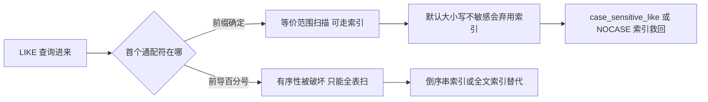
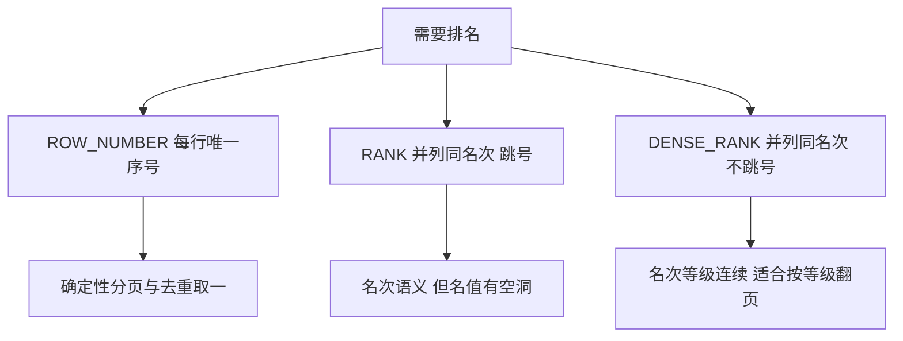
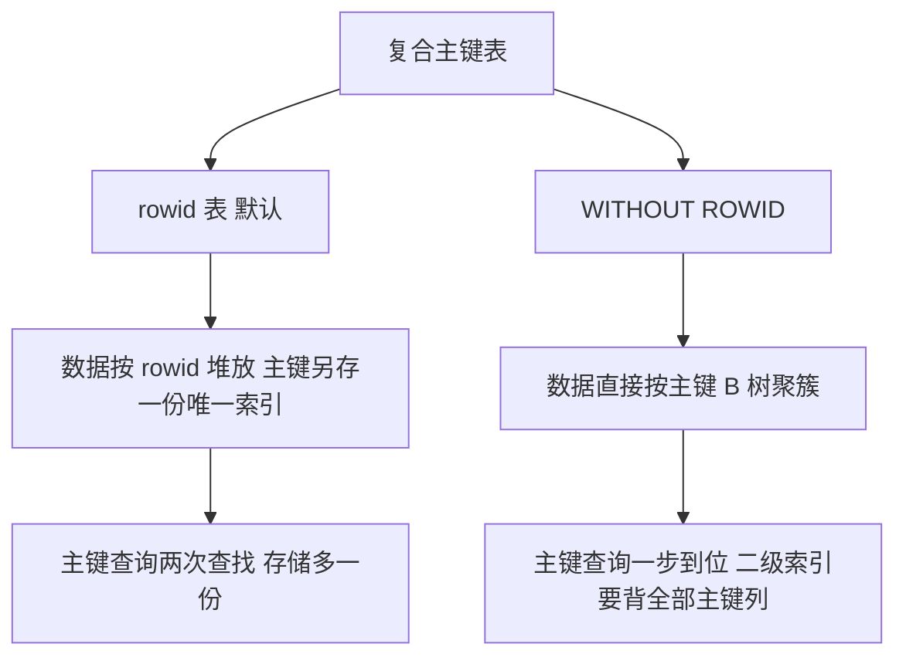
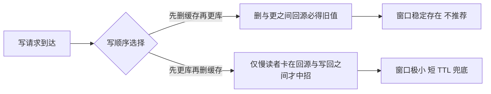
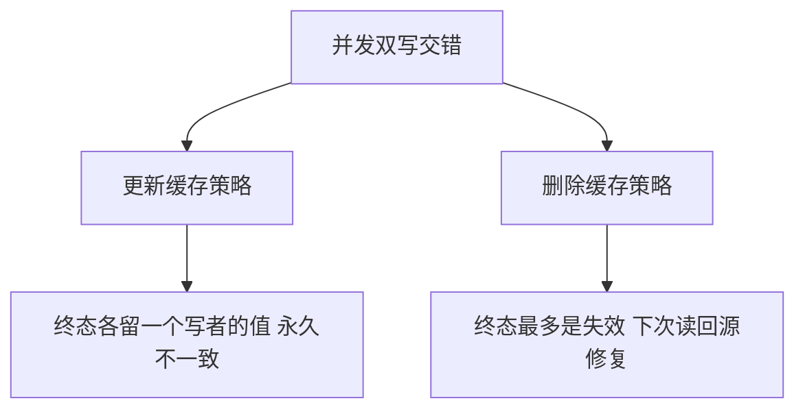
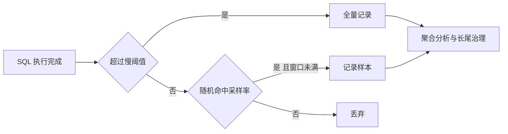
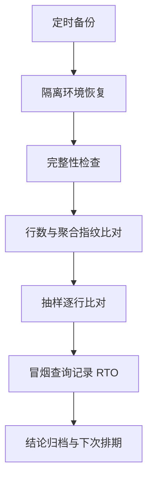
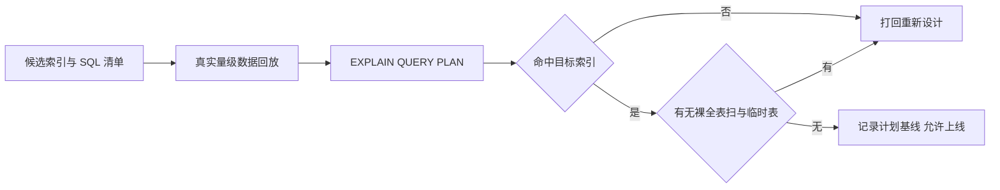
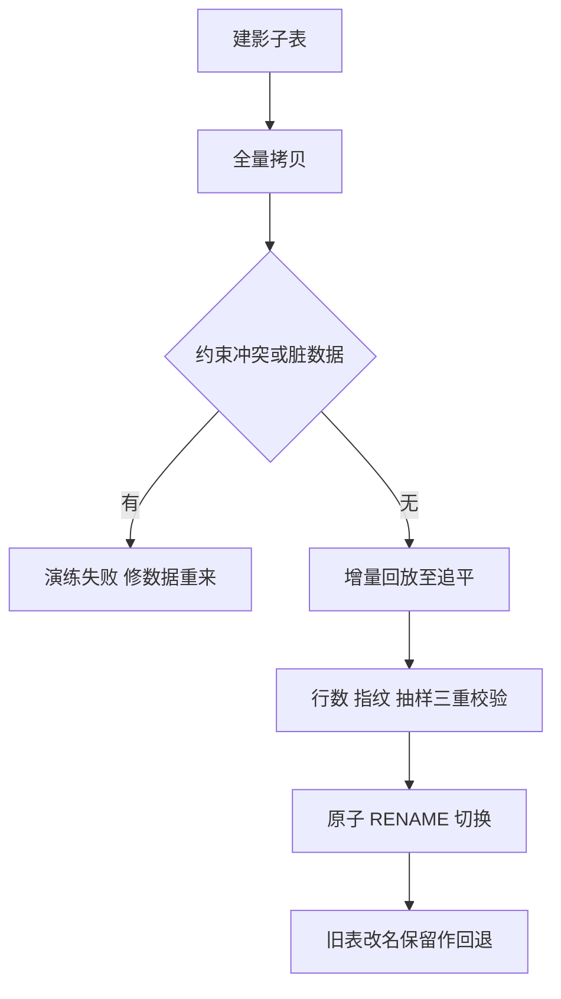

# 第 4 类 · 数据库与缓存(夜间扩产三)

本文件是第 4 类的第三批扩产,共 45 题(Q1931–Q1975),覆盖四条主线:SQL 补遗(LIKE 逃逸与前缀索引、COLLATE 三套规则、JOIN 条件位置、GROUP BY 严格模式、HAVING vs WHERE、排名三函数的分页与去重、触发器语义、CHECK 兜底、upsert 分支统计、复合主键与 WITHOUT ROWID、延迟外键、级联动作、rowid 复用、视图下推)、缓存补遗(旁路缓存读写路径与写顺序时序、失效广播与乱序容忍、TTL 抖动分布、键序列化、空值缓存、热点晋升、双写终态、逻辑过期、降级熔断、版本翻转、容量估算)、容量与运维(慢查询采样、连接池指标、锁等待超时、大事务拆分、批大小实测、备份演练、归档断点、膨胀与 VACUUM)、迁移与兼容(双写读对比、类型收紧、EXPLAIN 门禁、回滚脚本、expand-contract、枚举扩展、影子表演练)。
示例以标准库 sqlite3 与纯逻辑模型为主,全部可独立运行;含线程、文件库与耗时实测的演示均在本机 Python 3.9 实跑通过,故意触发的异常均以 try/except 演示。
读法建议:SQL 题抓"语义与执行计划分开看",缓存题抓"时序窗口与兜底层",运维题抓"指标闭环与可重入",迁移题抓"可回滚性与演练先行"。


---

### Q1931 · LIKE 逃逸: ESCAPE 子句与用户输入转义

> 难度:★★☆☆ | 标签:SQL, LIKE

**问**:用户搜索框里输入了一个下划线或百分号, 拼进 LIKE 之后为什么查出来的东西不对?正确的处理方式是什么?

**答**:LIKE 里 % 匹配任意长度、_ 匹配任意单字符, 用户输入如果原样拼进模式, 这两个字符会被当成通配符解释, 语义被劫持。标准解法是三步:先把用户输入里的转义符本身翻倍,再转义 % 与 _,最后在 SQL 里显式写 ESCAPE 指定转义符。必须强调顺序:转义符要最先替换, 否则会出现二次转义错误。另外注意 LIKE 的匹配是整串匹配, 想要包含语义要自己在两端补 %, 转义只针对用户输入的部分。这是所有模糊搜索接口的必修课, 也是 LIKE 注入式查询错乱的根源。

```python
# file: code/04_数据库与缓存/q1931_like_escape.py
"""LIKE 逃逸: ESCAPE 子句与用户输入的通配符转义"""
import sqlite3

conn = sqlite3.connect(":memory:")
conn.execute("CREATE TABLE files(name TEXT)")
rows = ["report_2026.pdf", "report-2026.pdf", "100%.csv", "a_b_c.txt", "plain.txt"]
conn.executemany("INSERT INTO files VALUES(?)", [(r,) for r in rows])
conn.commit()

# 陷阱: 用户输入直接拼进 LIKE, _ 与 % 会被当成通配符
pattern = "report_2026.pdf"
naive = [r[0] for r in conn.execute("SELECT name FROM files WHERE name LIKE ?", (pattern,))]
print("直接 LIKE report_2026.pdf ->", naive, "(下划线被当成任意单字符)")

# 修复: escape_like 把 \ % _ 全部转义, SQL 里用 ESCAPE 指定转义符
def escape_like(text, esc="\\"):
    return (text.replace(esc, esc + esc)
                .replace("%", esc + "%")
                .replace("_", esc + "_"))

safe = escape_like(pattern)
fixed = [r[0] for r in conn.execute(
    "SELECT name FROM files WHERE name LIKE ? ESCAPE '\\'", (safe,))]
print("转义后 ESCAPE 查询   ->", fixed, "(只命中字面下划线那一行)")

# 转义符本身也要转义: 文件名里带反斜杠时先替换它
tricky = escape_like("a_b\\c%d")
print("含转义符的输入      ->", repr(tricky), "(反斜杠先翻倍 其余再转义)")

# 通配符语义本身仍然可用: 字面量与模式各归各
w1 = [r[0] for r in conn.execute("SELECT name FROM files WHERE name LIKE '100\\%%' ESCAPE '\\'")]
w2 = [r[0] for r in conn.execute("SELECT name FROM files WHERE name LIKE '%pdf'")]
print("字面 100\\%% 加通配  ->", w1)
print("模式 %pdf 结尾匹配  ->", w2)
print("结论: 用户输入进 LIKE 前必须转义 \\ % _ 三个字符, SQL 显式写 ESCAPE, 否则语义被通配符劫持")
```

**追问**:
- 为什么转义符必须最先替换?—— 否则后续加进去的反斜杠会被当成需要转义的内容再次翻倍, 产生错误的模式。
- 参数化查询能防住这个问题吗?—— 不能, 参数化只防 SQL 注入, LIKE 模式里的通配符语义仍然生效, 转义是另一层。

---

### Q1932 · LIKE 前缀与索引: 通配符位置决定生死

> 难度:★★★☆ | 标签:SQL 调优, 索引

**问**:为什么 email LIKE 'abc%' 能走索引, LIKE '%abc%' 就走不了?有没有办法救一下后缀查询?

**答**:B+Tree 索引按列值的字典序排列, 前缀确定的 LIKE 等价于一个范围扫描 abc 与 abd 之间, 所以能走索引;前导通配符破坏了有序性这个前提, 只能全表扫。SQLite 还有一个容易踩的细节:默认 LIKE 对 ASCII 大小写不敏感, 与 BINARY 排序的索引对不上, 优化器会放弃索引, 打开 case_sensitive_like 或改用 NOCASE 索引才能用上。后缀匹配的经典替代是倒序串技巧:多存一列反转字符串并建索引, 把 x% 的后缀需求翻译成前缀匹配;数据量更大或需要分词时换全文索引。实测里前缀与全扫的耗差是三个数量级, 不是纸上谈兵。

```python
# file: code/04_数据库与缓存/q1932_like_prefix_index.py
"""LIKE 与索引: 通配符位置与 case_sensitive_like 的实测"""
import sqlite3
import time

conn = sqlite3.connect(":memory:")
conn.execute("CREATE TABLE users(id INTEGER PRIMARY KEY, email TEXT)")
conn.executemany("INSERT INTO users(email) VALUES(?)",
                 [("user%05d@example.com" % i,) for i in range(50000)])
conn.execute("CREATE INDEX idx_email ON users(email)")
conn.commit()

def plan(sql):
    return " | ".join(r[3] for r in conn.execute("EXPLAIN QUERY PLAN " + sql))

q_prefix = "SELECT id FROM users WHERE email LIKE 'user005%'"
q_suffix = "SELECT id FROM users WHERE email LIKE '%@example.com'"
print("默认设置 前缀 LIKE ->", plan(q_prefix))
print("默认设置 后缀 LIKE ->", plan(q_suffix))

# 默认 LIKE 对 ASCII 大小写不敏感, BINARY 索引帮不上忙; 打开开关后前缀 LIKE 才走索引
conn.execute("PRAGMA case_sensitive_like = ON")
print("开关打开 前缀 LIKE ->", plan(q_prefix))
print("开关打开 后缀 LIKE ->", plan(q_suffix))

def timed(sql, n=5):
    t0 = time.perf_counter()
    for _ in range(n):
        conn.execute(sql).fetchall()
    return (time.perf_counter() - t0) / n * 1000

print(f"前缀 LIKE 耗时 {timed(q_prefix):6.2f} ms vs 后缀 LIKE 耗时 {timed(q_suffix):6.2f} ms")

# 后缀需求的替代: 倒序串索引
conn.execute("CREATE TABLE rev(email TEXT, email_rev TEXT)")
conn.executemany("INSERT INTO rev VALUES(?,?)",
                 [(r[0], r[0][::-1]) for r in conn.execute("SELECT email FROM users")])
conn.execute("CREATE INDEX idx_rev ON rev(email_rev)")
print("倒序串查后缀计划   ->", plan("SELECT email FROM rev WHERE email_rev LIKE 'moc.elpmaxe%'"))
print("结论: abc% 可走索引, %abc 与 %abc% 只能全扫; 后缀需求用倒序串索引或全文索引")
```



**追问**:
- MySQL 里 LIKE 走索引还需要什么前提?—— MySQL 8 的优化器对 abc% 同样做范围扫描, 但列的 collate 必须与索引一致且大小写不敏感排序需匹配, 原理相同细节不同。
- 倒序串的维护代价是什么?—— 写入时多维护一列且更新要同步反转, 属于用写放大换读性能, 只对高频后缀查询值得。

---

### Q1933 · COLLATE 与大小写: 三套规则各管各的

> 难度:★★☆☆ | 标签:SQL, 字符集

**问**:同一个字符串等值查询, 换个数据库或换个列定义结果就不一样了, 这背后是什么机制?

**答**:字符串比较行为由排序规则 COLLATE 决定, 常见的 BINARY 按字节比较、大小写敏感,NOCASE 对 ASCII 折叠大小写。规则可以声明在列定义上, 也可以在单个表达式上用 COLLATE 覆盖, 表达式级优先于列级。最容易踩的坑是 LIKE:SQLite 的 LIKE 默认对 ASCII 不区分大小写, 与等值比较规则不同源, 出现等值查不到而 LIKE 查得到的精神分裂。迁移库时 collation 差异还会影响唯一约束的判定, Apple 与 apple 在 NOCASE 下是重复值。排查大小写问题永远先问一句:这个比较用的是哪个 collation。

```python
# file: code/04_数据库与缓存/q1933_collate_case.py
"""COLLATE 与大小写: 等值 排序与 LIKE 的三套规则"""
import sqlite3

conn = sqlite3.connect(":memory:")
conn.execute("CREATE TABLE t(word TEXT COLLATE NOCASE)")
conn.executemany("INSERT INTO t VALUES(?)", [("Apple",), ("banana",), ("APPLE",), ("Banana",)])

# 列声明 NOCASE 后, 索引与等值比较都不区分大小写
n = conn.execute("SELECT COUNT(*) FROM t WHERE word = 'apple'").fetchone()[0]
print("NOCASE 列等值查 apple ->", n, "行")
b = conn.execute("SELECT COUNT(*) FROM t WHERE word = 'apple' COLLATE BINARY").fetchone()[0]
print("同查询表达式级 BINARY ->", b, "行  查询侧可覆盖列侧规则")

# 默认 BINARY 的表: 等值比较区分大小写
conn.execute("CREATE TABLE t2(word TEXT)")
conn.executemany("INSERT INTO t2 VALUES(?)", [("Apple",), ("apple",)])
c = conn.execute("SELECT COUNT(*) FROM t2 WHERE word = 'APPLE'").fetchone()[0]
print("BINARY 列等值查 APPLE ->", c, "行  大小写敏感")

# LIKE 在 SQLite 默认对 ASCII 不区分大小写, 与等值比较规则不同源
l = conn.execute("SELECT COUNT(*) FROM t2 WHERE word LIKE 'apple'").fetchone()[0]
print("BINARY 列 LIKE apple  ->", l, "行  LIKE 另有一套大小写规则")

# ORDER BY 的排序规则决定字典序
print("BINARY 排序:", [r[0] for r in conn.execute("SELECT word FROM t2 ORDER BY word COLLATE BINARY")])
print("NOCASE 排序:", [r[0] for r in conn.execute("SELECT word FROM t2 ORDER BY word COLLATE NOCASE")])
print("结论: 等值与排序行为由列或表达式的 COLLATE 决定, LIKE 的大小写行为独立一套, 混用必踩坑")
```

**追问**:
- 唯一索引加 COLLATE NOCASE 有什么副作用?—— 判重变宽, 长度与字节不同的串会被拒, 索引体积与比较成本也会略增, 要确认业务确实接受大小写折叠。
- 中文场景 COLLATE 重要吗?—— 拼音序与二进制序差异明显, GBK 与 UTF-8 编码序也不同, 排序展示类需求要显式选规则。

---

### Q1934 · LEFT JOIN 过滤位置: ON 与 WHERE 的结果差异

> 难度:★★★★ | 标签:SQL, JOIN

**问**:把一个过滤条件从 LEFT JOIN 的 ON 挪到 WHERE, 结果集为什么会变?面试怎么答才完整?

**答**:对 LEFT JOIN, 右表列的过滤条件写在 ON 里发生在匹配阶段, 匹配不上仍保留左表行并把右侧置 NULL, 外连接语义完整;写在 WHERE 里则发生在连接之后, 右表行不存在时该列是 NULL, 条件判 UNKNOWN, 整行被删掉, LEFT JOIN 退化成 INNER JOIN。这是静默的, 不报错, 只丢数据。想找回语义要在 WHERE 里显式放行 IS NULL 行, 但混合状态下的统计口径仍然容易错。反向需求找无匹配的左表行, 正确姿势是过滤放 ON 加 WHERE right.key IS NULL。一句话结论:外连接的右表过滤放 ON, 左表过滤放 WHERE。

```python
# file: code/04_数据库与缓存/q1934_left_join_filter.py
"""LEFT JOIN 过滤位置: ON 保留行 WHERE 退化内连接"""
import sqlite3

conn = sqlite3.connect(":memory:")
conn.executescript("""
CREATE TABLE users(id INTEGER PRIMARY KEY, name TEXT);
CREATE TABLE orders(id INTEGER PRIMARY KEY, user_id INTEGER, amount INTEGER, status TEXT);
INSERT INTO users VALUES(1,'alice'),(2,'bob'),(3,'carol');
INSERT INTO orders VALUES(101,1,100,'paid'),(102,1,200,'void'),(103,2,300,'paid');
""")

def rows(sql):
    return conn.execute(sql).fetchall()

# 需求: 每个用户都要出现, 只统计 paid 订单
on_filter = rows("""
SELECT u.name, COUNT(o.id) AS cnt, COALESCE(SUM(o.amount), 0) AS total
FROM users u LEFT JOIN orders o ON o.user_id = u.id AND o.status = 'paid'
GROUP BY u.id ORDER BY u.id""")
print("过滤写在 ON   :", on_filter)

where_filter = rows("""
SELECT u.name, COUNT(o.id) AS cnt, COALESCE(SUM(o.amount), 0) AS total
FROM users u LEFT JOIN orders o ON o.user_id = u.id
WHERE o.status = 'paid'
GROUP BY u.id ORDER BY u.id""")
print("过滤写在 WHERE:", where_filter, "(carol 消失: NULL 状态判 UNKNOWN 被删行 退化成内连接)")

# WHERE 里显式放行 NULL 行能找回部分语义, 但有非 paid 订单的用户仍会整行被删
hybrid = rows("""
SELECT u.name, COUNT(o.id) AS cnt
FROM users u LEFT JOIN orders o ON o.user_id = u.id
WHERE o.status = 'paid' OR o.id IS NULL
GROUP BY u.id ORDER BY u.id""")
print("WHERE 放行 NULL:", hybrid, "(carol 回来了, alice 的 void 订单行仍被删 口径已经错)")

# 反向需求: 找没有 paid 订单的用户, 同样要靠 ON 过滤加 IS NULL
isnull = rows("""
SELECT u.name FROM users u
LEFT JOIN orders o ON o.user_id = u.id AND o.status = 'paid'
WHERE o.id IS NULL""")
print("无 paid 订单用户:", [r[0] for r in isnull])
print("结论: 右表过滤放 ON 才保住 LEFT JOIN 语义; 放 WHERE 会静默退化成 INNER JOIN")
```

**追问**:
- 左表的条件放 ON 里会怎样?—— 对 LEFT JOIN 左表条件放 ON 与放 WHERE 等价, 因为左表行无论匹配与否都保留, 优化器也会下推。
- FULL OUTER JOIN 下呢?—— 两侧的过滤放 WHERE 都会破坏外连接语义, 都应写进 ON, MySQL 没有全外连接需用 UNION 模拟。

---

### Q1935 · INNER JOIN 过滤位置: 等价改写与实测

> 难度:★★★☆ | 标签:SQL, JOIN

**问**:内连接里过滤条件写 ON 和写 WHERE 有区别吗?团队规范要求统一放一边有道理吗?

**答**:语义上完全等价:内连接先按 ON 匹配再用 WHERE 过滤, 与把全部条件堆进 ON, 数学结果相同。工程上现代优化器都会做谓词下推与连接重排, 两种写法生成同一个执行计划, 本机实测计划与耗时一致。所以规范要求统一位置是为了可读性与可维护性, 不是性能。真正要敏感的是外连接:一旦有人把 INNER JOIN 改成 LEFT JOIN 调试, ON 与 WHERE 的语义差异立刻显现, 统一的写法能减少这类改写事故。结论记一句:差异只在外连接, 内连接选哪种都是风格问题。

```python
# file: code/04_数据库与缓存/q1935_inner_join_filter.py
"""INNER JOIN 过滤位置: ON 与 WHERE 等价且计划相同"""
import sqlite3
import time

conn = sqlite3.connect(":memory:")
conn.execute("CREATE TABLE a(id INTEGER PRIMARY KEY, k INTEGER)")
conn.execute("CREATE TABLE b(id INTEGER PRIMARY KEY, a_id INTEGER, flag TEXT)")
conn.executemany("INSERT INTO a(k) VALUES(?)", [(i % 1000,) for i in range(100000)])
conn.executemany("INSERT INTO b(a_id, flag) VALUES(?,?)",
                 [((i * 3) % 100000 + 1, 'y' if i % 2 else 'n') for i in range(120000)])
conn.execute("CREATE INDEX idx_b_aid ON b(a_id)")
conn.commit()

sql_on = "SELECT COUNT(*) FROM a JOIN b ON a.id = b.a_id AND b.flag = 'y' WHERE a.k = 7"
sql_where = "SELECT COUNT(*) FROM a JOIN b ON a.id = b.a_id WHERE a.k = 7 AND b.flag = 'y'"
r1 = conn.execute(sql_on).fetchone()[0]
r2 = conn.execute(sql_where).fetchone()[0]
print("ON 混合条件结果:", r1, "  WHERE 混合条件结果:", r2, "  相同:", r1 == r2)

def plan(sql):
    return " | ".join(r[3] for r in conn.execute("EXPLAIN QUERY PLAN " + sql))

print("ON    计划:", plan(sql_on))
print("WHERE 计划:", plan(sql_where))

def timed(sql, n=5):
    t0 = time.perf_counter()
    for _ in range(n):
        conn.execute(sql).fetchone()
    return (time.perf_counter() - t0) / n * 1000

print(f"ON 耗时 {timed(sql_on):.2f} ms  WHERE 耗时 {timed(sql_where):.2f} ms")
print("结论: 内连接里 ON 与 WHERE 语义等价 计划与耗时相同; 位置差异只在外连接才有后果")
```

**追问**:
- 逗号连接写法算哪种?—— FROM a, b WHERE a.id = b.id 是老式内连接, 条件只能在 WHERE, 现代代码不推荐, 漏写条件会变笛卡尔积。
- 过滤条件位置会影响连接顺序吗?—— 现代优化器基于代价选择, 与书写位置无关;老版本 MySQL 5.x 的 straight_join 场景才需要手工控制。

---

### Q1936 · GROUP BY 严格模式: ONLY_FULL_GROUP_BY 在拦什么

> 难度:★★★☆ | 标签:SQL, GROUP BY

**问**:SELECT 里出现不在 GROUP BY 也不在聚合函数里的列, MySQL 为什么会报错, SQLite 却放行?

**答**:这是宽松模式与严格模式的分界。SQLite 等宽松实现允许裸列, 但组内选哪一行是任意的, 结果不可复现, 属于把不确定性交给运气;MySQL 5.7 起默认 ONLY_FULL_GROUP_BY 严格模式, 直接拒绝这种写法, 逼你把语义写清楚:要么该列进 GROUP BY, 要么进聚合。SQLite 有一个贴心的特例:裸列与 min 或 max 同用时, 裸列取自命中极值的那一行, 是少数有确定语义的放行。跨库迁移时严格模式是保护而不是麻烦, 老代码里靠裸列碰运气的结果往往正是隐性 bug。本文件另附一个正则版严格检查器, 可以在代码评审里预检。

```python
# file: code/04_数据库与缓存/q1936_groupby_strict.py
"""GROUP BY 严格模式: ONLY_FULL_GROUP_BY 与裸列的任意性"""
import re
import sqlite3

conn = sqlite3.connect(":memory:")
conn.execute("CREATE TABLE scores(id INTEGER PRIMARY KEY, class TEXT, name TEXT, score INTEGER)")
conn.executemany("INSERT INTO scores VALUES(?,?,?,?)", [
    (1, 'A', 'alice', 90), (2, 'A', 'amber', 85), (3, 'B', 'bob', 77), (4, 'B', 'bella', 92)])

# 宽松模式: name 不在 GROUP BY 也不聚合, SQLite 允许但值来自组内任意一行
rows = conn.execute("SELECT class, name, MAX(score) FROM scores GROUP BY class").fetchall()
print("SQLite 宽松模式 ->", rows, "(name 来自组内任意一行 不可依赖)")

# SQLite 特例: 裸列与 min/max 同用时, 裸列取自命中 min/max 的那一行
hi = conn.execute("SELECT class, name, MAX(score) FROM scores GROUP BY class").fetchall()
lo = conn.execute("SELECT class, name, MIN(score) FROM scores GROUP BY class").fetchall()
print("MAX 同用裸列    ->", hi, "(与最高分同行)")
print("MIN 同用裸列    ->", lo, "(与最低分同行)")

# 严格模式等价写法: 裸列进 GROUP BY 或用聚合与子查询明确定义
strict = conn.execute("""
SELECT s.class, s.name, s.score FROM scores s
JOIN (SELECT class, MAX(score) AS m FROM scores GROUP BY class) t
  ON s.class = t.class AND s.score = t.m""").fetchall()
print("严格模式等价写法 ->", strict, "(MySQL ONLY_FULL_GROUP_BY 下必须写清这种语义)")

# 模拟严格模式检查器: 找出 SELECT 里既不在 GROUP BY 也不在聚合里的裸列
def strict_check(sql):
    m = re.search(r"SELECT (.+?) FROM", sql, re.I)
    cols = [c.strip() for c in m.group(1).split(",")]
    g = re.search(r"GROUP BY (.+?)\s*(?:HAVING|$)", sql, re.I)
    allowed = set(c.strip() for c in g.group(1).split(",")) if g else set()
    agg = re.compile(r"(MAX|MIN|SUM|COUNT|AVG)\s*\(", re.I)
    return [c for c in cols if c not in allowed and not agg.search(c)]

print("宽松 SQL 的裸列  ->", strict_check("SELECT class, name, MAX(score) FROM scores GROUP BY class"))
print("严格 SQL 的裸列  ->", strict_check("SELECT class, MAX(score) FROM scores GROUP BY class"))
print("结论: 宽松模式的裸列值不确定 严格模式逼你把语义写进 GROUP BY 或聚合 可移植性更好")
```

**追问**:
- GROUP_CONCAT 这类聚合里裸列的顺序稳定吗?—— 不保证, 未指定 ORDER BY 的聚合串接顺序是实现细节, 需要稳定输出就显式写 ORDER BY。
- 怎么临时关闭严格模式?—— 会话级 SET sql_mode 去掉 ONLY_FULL_GROUP_BY 可以做到, 但建议修 SQL 而不是关检查。

---

### Q1937 · HAVING vs WHERE: 过滤时机与代价实测

> 难度:★★☆☆ | 标签:SQL, 聚合

**问**:HAVING 和 WHERE 都是过滤, 什么时候用哪个?用错了只是风格问题吗?

**答**:两者的过滤时机不同:WHERE 在分组前过滤原始行, 参与聚合的数据更少;HAVING 在聚合后过滤组, 常用于引用聚合结果的场景。行级条件错写成 HAVING 不是风格问题, 是实打实的性能浪费, 本机实测里全量分组再过滤比先过滤慢一截, 数据量越大差距越大。经验法则:能用 WHERE 过滤的条件绝不放进 HAVING, 只有 COUNT、SUM、AVG 这类聚合条件才必须用 HAVING。另一个细节是 HAVING 里可以引用 SELECT 别名, WHERE 里不行, 因为 WHERE 执行时别名还不存在。

```python
# file: code/04_数据库与缓存/q1937_having_where.py
"""HAVING vs WHERE: 过滤时机 聚合语义与代价实测"""
import sqlite3
import time

conn = sqlite3.connect(":memory:")
conn.execute("CREATE TABLE sales(id INTEGER PRIMARY KEY, region TEXT, amount INTEGER)")
conn.executemany("INSERT INTO sales(region, amount) VALUES(?,?)",
                 [("r%d" % (i % 50), i % 100) for i in range(200000)])
conn.execute("CREATE INDEX idx_region ON sales(region)")
conn.commit()

def timed(sql, n=5):
    t0 = time.perf_counter()
    for _ in range(n):
        conn.execute(sql).fetchall()
    return (time.perf_counter() - t0) / n * 1000

q_where = "SELECT region, SUM(amount) FROM sales WHERE amount >= 50 GROUP BY region"
q_having = "SELECT region, SUM(amount) FROM sales GROUP BY region HAVING MIN(amount) >= 50"
print(f"WHERE 先过滤再聚合 : {timed(q_where):7.2f} ms  进入分组的行数 "
      f"{conn.execute('SELECT COUNT(*) FROM sales WHERE amount >= 50').fetchone()[0]}")
print(f"HAVING 聚合后再过滤: {timed(q_having):7.2f} ms  进入分组的是全量 20 万行")

# 只能写在 HAVING 的条件: 引用聚合结果
agg_only = conn.execute(
    "SELECT COUNT(*) FROM (SELECT region FROM sales GROUP BY region HAVING COUNT(*) > 4100)"
).fetchone()[0]
print("聚合条件必须 HAVING -> 超大分组数:", agg_only)

# 行级条件两种写法结果相同 但 WHERE 便宜: 一边先少算一半行
same_w = timed("SELECT COUNT(*) FROM (SELECT region FROM sales WHERE region = 'r1' GROUP BY region)")
same_h = timed("SELECT COUNT(*) FROM (SELECT region FROM sales GROUP BY region HAVING region = 'r1')")
print(f"同语义 WHERE {same_w:.2f} ms vs HAVING {same_h:.2f} ms")
print("结论: 行级条件一律 WHERE 让过滤发生在聚合之前 组级条件才用 HAVING 别把能提前的过滤拖到最后")
```

**追问**:
- HAVING 能引用未聚合的普通列吗?—— 分组后普通列语义上属于组, MySQL 严格模式要求它同时出现在 GROUP BY 里, 否则报错。
- 聚合下推是什么意思?—— 优化器把 HAVING 里的非聚合条件移到 WHERE 提前过滤, MySQL 与 PG 都支持, 但显式写 WHERE 更可靠。

---

### Q1938 · RANK DENSE_RANK ROW_NUMBER: 并列名次三种口径

> 难度:★★★☆ | 标签:SQL, 窗口函数

**问**:三个排名窗口函数在并列值下分别输出什么?各自适合什么场景?

**答**:ROW_NUMBER 对每行给唯一递增序号, 并列也强行分先后;RANK 并列给相同名次并跳过后续名次, 序列形如 1 2 2 4;DENSE_RANK 并列同名次且不跳号, 序列形如 1 2 2 3。选型口诀:取每条第几名或做确定性分页用 ROW_NUMBER, 但必须补 tie-breaker 列, 否则并列行的先后不稳定;要名次并列语义用 RANK 或 DENSE_RANK, 其中 DENSE_RANK 的名次等级连续, 适合按等级翻页,RANK 的跳号会让按名值分页出现空洞。三者都支持 PARTITION BY, 组内排名时记得分区键要进排序判重。

```python
# file: code/04_数据库与缓存/q1938_rank_family.py
"""RANK DENSE_RANK ROW_NUMBER: 并列名次的三种口径"""
import sqlite3

conn = sqlite3.connect(":memory:")
conn.execute("CREATE TABLE scores(name TEXT, score INTEGER)")
conn.executemany("INSERT INTO scores VALUES(?,?)", [
    ("alice", 95), ("bob", 92), ("carol", 92), ("dave", 88), ("eve", 88), ("frank", 80)])

q = """
SELECT name, score,
       ROW_NUMBER() OVER (ORDER BY score DESC) AS rn,
       RANK()       OVER (ORDER BY score DESC) AS rk,
       DENSE_RANK() OVER (ORDER BY score DESC) AS dr
FROM scores"""
print("name     score  rn  rk  dr")
for r in conn.execute(q):
    print("%-8s %5d  %2d  %2d  %2d" % r)

# 三种口径各取前 3: 语义与结果集大小都不同
def top_by(fn):
    return [r[0] for r in conn.execute(
        "SELECT name FROM (SELECT name, " + fn +
        "() OVER (ORDER BY score DESC) AS x FROM scores) WHERE x <= 3")]

limit3 = [r[0] for r in conn.execute("SELECT name FROM scores ORDER BY score DESC LIMIT 3")]
print("LIMIT 3    ->", limit3, "纯行数截断 并列被硬拆")
print("ROW_NUMBER ->", top_by("ROW_NUMBER"), "每行唯一序号 并列被任意先后拆开")
print("RANK       ->", top_by("RANK"), "并列同名次 92 分两人都算第 2 会多取一行")
print("DENSE_RANK ->", top_by("DENSE_RANK"), "不跳号 前 3 个名次等级把 88 分也带进来")
print("结论: 取 N 条用 ROW_NUMBER 并补 tie-breaker; 取前 N 个名次等级用 DENSE_RANK; RANK 跳号会让按名次分页出现空洞")
```



**追问**:
- 没有窗口函数的老数据库怎么办?—— 用自连接 COUNT 大于法或相关子查询模拟 RANK, 用派生表加变量模拟 ROW_NUMBER, 代价都不低。
- ROW_NUMBER 的 tie-breaker 选什么列好?—— 选稳定且区分度足够的列如主键或时间戳加主键, 保证同一结果集重跑序号不变。

---

### Q1939 · 排名分页实测: 跳号空洞与去重取数

> 难度:★★★★ | 标签:SQL, 窗口函数

**问**:用排名函数的值做分页时, RANK 的跳号会怎样?ROW_NUMBER 的去重效果又是什么?

**答**:把名次值当页键翻页时, 三种口径行为完全不同:ROW_NUMBER 加 tie-breaker 后每页恰好固定行数, 是确定性分页;RANK 因为并列跳号, 名值区间可能整段不存在, 页面忽大忽小甚至吞掉下一段名次;DENSE_RANK 等级连续, 按名次等级翻页最稳, 但每页行数随并列规模浮动。去重效果指 ROW_NUMBER 的分区取一:PARTITION BY 值列 ORDER BY 主键取 rn 等于 1, 是同值多行只留一条的标准写法, 也是大部分表内去重任务的底座。实测代码把三种口径的同页结果并排打印, 差异一目了然。

```python
# file: code/04_数据库与缓存/q1939_rank_pagination.py
"""排名口径分页实测: RANK 跳号空洞 DENSE_RANK 稳定 ROW_NUMBER 去重"""
import sqlite3

conn = sqlite3.connect(":memory:")
conn.execute("CREATE TABLE scores(id INTEGER PRIMARY KEY, name TEXT, score INTEGER)")
conn.executemany("INSERT INTO scores(name, score) VALUES(?,?)", [
    ("alice", 95), ("bob", 92), ("bobby", 92), ("carol", 92),
    ("dave", 88), ("dan", 88), ("frank", 80)])

base = ("SELECT name, score, ROW_NUMBER() OVER (ORDER BY score DESC, id) AS rn, "
        "RANK() OVER (ORDER BY score DESC) AS rk, "
        "DENSE_RANK() OVER (ORDER BY score DESC) AS dr FROM scores")
print("全量口径:")
for r in conn.execute(base):
    print("  %-6s %3d  rn=%d rk=%d dr=%d" % r)

def page(fn, lo, hi):
    sql = ("SELECT name, score FROM (SELECT name, score, " + fn +
           "() OVER (ORDER BY score DESC) AS x FROM scores) WHERE x BETWEEN %d AND %d" % (lo, hi))
    return [(r[0], r[1]) for r in conn.execute(sql)]

print("第 2 页 每页 2 个名次 即名次 2 到 3:")
print("  ROW_NUMBER ->", page("ROW_NUMBER", 2, 3), "恰好两人 并列由 id 决出先后 确定性分页")
print("  RANK       ->", page("RANK", 2, 3), "rk 跳过了 3 下一段名次被整页吞掉")
print("  DENSE_RANK ->", page("DENSE_RANK", 2, 3), "名次等级连续 92 与 88 两档都进来 页面变大")

# 去重效果: 同分只保留一行 用 ROW_NUMBER 按值分区取第一
dedup = conn.execute("""
SELECT name, score FROM (
    SELECT name, score, ROW_NUMBER() OVER (PARTITION BY score ORDER BY id) AS rn
    FROM scores) WHERE rn = 1 ORDER BY score DESC""").fetchall()
print("按 score 去重保留首个 ->", dedup)

# DENSE_RANK 的去重口径: 名次等级数就是去重后的档数
levels = conn.execute(
    "SELECT COUNT(DISTINCT score), MAX(dr) FROM "
    "(SELECT score, DENSE_RANK() OVER (ORDER BY score DESC) AS dr FROM scores)").fetchone()
print("分数档数与 DENSE_RANK 最大值 ->", levels, " 两者相等")
print("结论: 分页要确定性就 ROW_NUMBER 加 tie-breaker 要名次语义就 DENSE_RANK RANK 的跳号会让按名次翻页丢段")
```

**追问**:
- DENSE_RANK 分页每页行数不固定, 怎么办?—— 名次语义与行数语义不可兼得, 要么接受浮动要么改 ROW_NUMBER, 或对外承诺按名次等级翻页。
- 去重删除保留哪条由什么决定?—— 由 PARTITION 内的 ORDER BY 决定, 通常保留 id 最小或时间最早, 删除其余行前先备份。

---

### Q1940 · 触发器执行语义: 时机 粒度与应用层替代

> 难度:★★★☆ | 标签:触发器, 数据完整性

**问**:触发器的 BEFORE 与 AFTER 有什么区别?FOR EACH ROW 是什么语义?什么时候该用应用层替代?

**答**:触发器是挂在表上的行级钩子, SQLite 里一律 FOR EACH ROW:每一条受影响的行触发一次, 批量 UPDATE 十行就触发十次。BEFORE 在约束检查与行变更前执行, 可以修改 NEW 值甚至用 RAISE 中止操作,AFTER 在变更落地后执行, 适合审计写旁表, 本文件演示 AFTER 加 WHEN 过滤值未变的 UPDATE。触发器的价值是任何入口写库都受控, 代价是逻辑隐身:代码评审看不到、难测试、拉长事务、迁移时行为差异。团队规范通常二选一并全员一致:要么触发器只做与业务无关的自洽逻辑, 要么全部下沉应用层显式实现。

```python
# file: code/04_数据库与缓存/q1940_trigger_semantics.py
"""触发器执行语义: 时机 粒度与应用层替代方案对比"""
import sqlite3

conn = sqlite3.connect(":memory:")
conn.execute("CREATE TABLE account(id INTEGER PRIMARY KEY, balance INTEGER)")
conn.execute("CREATE TABLE audit(id INTEGER PRIMARY KEY, account_id INTEGER, old INTEGER, new INTEGER, src TEXT)")
conn.execute("INSERT INTO account VALUES(1, 100)")

# AFTER UPDATE + FOR EACH ROW: 每受影响行触发一次 WHEN 充当行级守卫
conn.execute("""
CREATE TRIGGER trg_balance_audit AFTER UPDATE ON account
FOR EACH ROW
WHEN OLD.balance <> NEW.balance
BEGIN
    INSERT INTO audit(account_id, old, new, src)
    VALUES(OLD.id, OLD.balance, NEW.balance, 'trigger');
END""")

conn.execute("UPDATE account SET balance = 120 WHERE id = 1")   # 变动 触发
conn.execute("UPDATE account SET balance = 120 WHERE id = 1")   # 值没变 WHEN 拦下
conn.execute("UPDATE account SET balance = 90 WHERE id = 1")    # 再触发
print("触发器审计记录 ->", conn.execute("SELECT account_id, old, new, src FROM audit").fetchall())
print("三次 UPDATE 两次落审计: FOR EACH ROW 按行触发 WHEN 过滤无效变更")

# 应用层等价实现: 逻辑显式 可评审可测试 但要防直连写库绕过
def change_balance(cur, account_id, new_balance):
    old = cur.execute("SELECT balance FROM account WHERE id = ?", (account_id,)).fetchone()[0]
    if old != new_balance:
        cur.execute("UPDATE account SET balance = ? WHERE id = ?", (new_balance, account_id))
        cur.execute("INSERT INTO audit(account_id, old, new, src) VALUES(?,?,?,?)",
                    (account_id, old, new_balance, "app"))

change_balance(conn.cursor(), 1, 70)
print("应用层审计累计 ->", conn.execute("SELECT COUNT(*) FROM audit").fetchone()[0], "条")
print("结论: 触发器保证任何入口都受控但逻辑隐身于库 应用层可见可测但存在绕过路径 二选一要全团队一致")
```

**追问**:
- 触发器里能读自己正在被改的表吗?—— SQLite 允许读 OLD 与 NEW 行, 但递归触发默认关闭, MySQL 的触发器不能读写本表, 方言差异要在评审时确认。
- 审计用触发器还是应用层事件?—— 合规级审计用触发器防绕过, 业务埋点类审计用应用层, 前者保完整后者保可维护。

---

### Q1941 · CHECK 约束兜底: 应用层失守后的防线

> 难度:★★☆☆ | 标签:约束, 数据完整性

**问**:应用层已经有参数校验了, 数据库还有必要建 CHECK 约束吗?

**答**:有必要, 因为应用层校验一定会被绕过:运维手工修数、脚本直连、旧版本服务、第三方数据导入都绕过你的校验代码。CHECK 是写路径上最后一道闸, 本文件演示负金额、非法状态、跨列组合条件都被数据库直接拒绝。两个关键细节:CHECK 表达式结果是 UNKNOWN 时视为通过, 也就是说 NULL 不违反 CHECK, 要挡 NULL 必须显式加 NOT NULL;CHECK 只在建表或重建表时可靠修改, SQLite 不支持 ALTER 加 CHECK, 改约束要走重建表流程。最佳实践是应用层给友好报错, 数据库层给硬保证, 两层各司其职。

```python
# file: code/04_数据库与缓存/q1941_check_constraint.py
"""CHECK 约束兜底: 应用层校验失守后的数据库防线"""
import sqlite3

conn = sqlite3.connect(":memory:")
conn.executescript("""
CREATE TABLE orders(
    id INTEGER PRIMARY KEY,
    amount INTEGER NOT NULL CHECK (amount > 0),
    status TEXT NOT NULL CHECK (status IN ('created', 'paid', 'void')),
    CHECK (status <> 'paid' OR amount > 0)
)""")

def try_insert(label, args):
    try:
        conn.execute("INSERT INTO orders(amount, status) VALUES(?,?)", args)
        print(f"{label} -> 写入成功")
    except sqlite3.IntegrityError as e:
        print(f"{label} -> 被数据库拒绝: {e}")

try_insert("合法行", (100, "paid"))
try_insert("负金额", (-5, "paid"))
try_insert("非法状态", (10, "shipped"))
try_insert("零金额 created", (0, "created"))
print("库内行数 ->", conn.execute("SELECT COUNT(*) FROM orders").fetchone()[0], " 坏数据全部被挡")

# CHECK 对 UNKNOWN 放行: NULL 不违反 CHECK 但会撞上 NOT NULL
try_insert("amount 为 NULL", (None, "created"))
conn.execute("CREATE TABLE t(x INTEGER CHECK (x > 0))")
try:
    conn.execute("INSERT INTO t VALUES(NULL)")
    print("纯 CHECK 列写 NULL -> 成功: UNKNOWN 不是 FALSE CHECK 放行 要挡 NULL 必须加 NOT NULL")
except sqlite3.IntegrityError:
    print("纯 CHECK 列写 NULL -> 被拒")
print("结论: 应用层校验会被脚本 直连 绕过 CHECK 是最后防线 且必须与 NOT NULL 配套覆盖 NULL 通道")
```

**追问**:
- CHECK 能引用其他表或时间函数吗?—— 不能, CHECK 只能引用当前行的列与确定性函数, 跨表一致性要靠外键或应用层。
- 批量导入时 CHECK 会不会拖慢写入?—— 表达式求值开销极小, 真正的成本是被拒绝的行需要处理, 建议导入前先做同口径的预检。

---

### Q1942 · upsert 分支统计: 哪些行走了 insert

> 难度:★★★★ | 标签:SQL, upsert

**问**:一条批量 upsert 语句执行完, 怎么知道哪些键是新插入、哪些走了更新分支?这有什么用?

**答**:upsert 把 insert 与 update 合并成一条语句, 代价是丢掉了分支可见性:changes 只返回受影响总行数, 不告诉你各分支占比。两种实测归因办法:逐行 INSERT OR IGNORE 加 UPDATE, 用 total_changes 差值精确判定每一行的分支, 适合需要逐行审计的场景;批量 ON CONFLICT 语句则先查已存在键集, 再用总变更数减去新键数反推 update 行数。EXCLUDED 伪表引用本次候选值, 是 DO UPDATE 分支里做增量累加的关键。分支统计的用途很实际:监控新客占比与热键更新比、驱动对账、以及压测时确认批量语句真的命中了预期路径。

```python
# file: code/04_数据库与缓存/q1942_upsert_branch_stats.py
"""upsert 分支统计: 哪些行走了 insert 哪些走了 update"""
import sqlite3

conn = sqlite3.connect(":memory:")
conn.execute("CREATE TABLE stock(sku TEXT PRIMARY KEY, qty INTEGER, updated INTEGER)")
conn.commit()

# 方案一: 逐行 INSERT OR IGNORE 加 UPDATE, 用 total_changes 差值精确归因
def upsert_with_stats(rows):
    ins, upd = [], []
    for sku, qty, ts in rows:
        before = conn.total_changes
        conn.execute("INSERT OR IGNORE INTO stock VALUES(?,?,?)", (sku, qty, ts))
        if conn.total_changes - before == 1:
            ins.append(sku)
        else:
            conn.execute("UPDATE stock SET qty = qty + ?, updated = ? WHERE sku = ?", (qty, ts, sku))
            upd.append(sku)
    return ins, upd

r1 = upsert_with_stats([("A1", 10, 1), ("A2", 5, 1)])
print("第一批 ->", "insert:", r1[0], "update:", r1[1])
r2 = upsert_with_stats([("A1", 3, 2), ("A3", 7, 2), ("A1", 1, 3)])
print("第二批 ->", "insert:", r2[0], "update:", r2[1])
print("表内容 ->", conn.execute("SELECT * FROM stock ORDER BY sku").fetchall())

# 方案二: 单条 ON CONFLICT 批量语句, EXCLUDED 引用本次候选值
# 分支归因: 先查已存在的键, 再用 total_changes 差值反推 update 行数
def upsert_bulk(rows):
    marks = ",".join("?" * len(rows))
    existing = {r[0] for r in conn.execute(
        "SELECT sku FROM stock WHERE sku IN (%s)" % marks, [r[0] for r in rows])}
    before = conn.total_changes
    conn.executemany("""
        INSERT INTO stock(sku, qty, updated) VALUES(?,?,?)
        ON CONFLICT(sku) DO UPDATE SET
            qty = qty + excluded.qty,
            updated = excluded.updated""", rows)
    changed = conn.total_changes - before
    n_ins = len([s for s, _, _ in rows if s not in existing])
    return n_ins, changed - n_ins

r3 = upsert_bulk([("A1", 2, 4), ("A4", 9, 4)])
print("批量 upsert ->", "insert:", r3[0], "update:", r3[1], " 与逐行法口径一致")
print("表终态 ->", conn.execute("SELECT * FROM stock ORDER BY sku").fetchall())
print("结论: changes 口径只给总行数 分支归因靠存在性预查或逐行计数 EXCLUDED 用于引用冲突候选行")
```

**追问**:
- RETURNING 子句能直接区分分支吗?—— SQLite 3.35 与 PG 都支持 RETURNING, 但返回的行不直接带分支标记, 仍要配合 EXCLUDED 或哑列技巧。
- 存在性预查会不会有竞态?—— 并发下预查结果可能过期, 归因用于统计而非业务决策即可, 业务判定仍以数据库唯一约束为准。

---

### Q1943 · 复合主键与二级索引: 最左前缀实测

> 难度:★★★☆ | 标签:索引, 主键

**问**:复合主键的三个列, 查询只用到中间那个列会怎样?二级索引在里面扮演什么角色?

**答**:复合主键在物理上就是按声明顺序组织的联合唯一索引, 查询条件必须从最左列开始连续命中才能高效走它:全前缀与最左两列都是索引定位, 只有最左列可以范围扫, 跳过最左列则完全用不上。跳列查询的出路是给该列单独建二级索引, 本文件实测 resource 列的二级索引成功接住了跳过 user_id 的查询, 并演示了覆盖索引形态。设计启示:复合主键的列序就是查询画像的排序, 把等值高频列放左边;预判会跳列查询的属性, 提前建好二级索引而不是等到慢查询出现。

```python
# file: code/04_数据库与缓存/q1943_composite_pk_index.py
"""复合主键与二级索引: 最左前缀与 rowid 附加规则实测"""
import sqlite3

conn = sqlite3.connect(":memory:")
conn.executescript("""
CREATE TABLE perms(user_id INTEGER, resource TEXT, action TEXT, granted INTEGER,
                   PRIMARY KEY(user_id, resource, action));
CREATE INDEX idx_perm_res ON perms(resource);
""")
conn.executemany("INSERT INTO perms VALUES(?,?,?,?)",
                 [(i % 500, "res%d" % (i // 5), "read", 1) for i in range(10000)])

def plan(sql):
    return " | ".join(r[3] for r in conn.execute("EXPLAIN QUERY PLAN " + sql))

print("全前缀匹配   ->", plan(
    "SELECT granted FROM perms WHERE user_id = 1 AND resource = 'res5' AND action = 'read'"))
print("最左两列     ->", plan(
    "SELECT granted FROM perms WHERE user_id = 1 AND resource = 'res5'"))
print("只有最左一列 ->", plan("SELECT granted FROM perms WHERE user_id = 1"))
print("跳过最左列   ->", plan("SELECT granted FROM perms WHERE resource = 'res5'"))
print("二级索引加另一主键列 ->", plan(
    "SELECT granted FROM perms WHERE resource = 'res5' AND user_id = 3"))

# rowid 表的二级索引会自动附加 rowid: 直接查 rowid 可走二级索引避免回表
print("索引列与 rowid ->", plan("SELECT resource FROM perms WHERE resource = 'res5' LIMIT 5"))
print("结论: 复合主键是按声明顺序的联合唯一索引, 跳过最左列只能求救于二级索引或全表扫")
```

**追问**:
- rowid 表的二级索引叶子存什么?—— 存索引列加 rowid, 命中后若查询列不全需要回表, 实测里只查索引列加 rowid 时出现 COVERING INDEX 免回表。
- 复合主键和唯一二级索引选哪个?—— 表的主键语义用复合主键, 额外的唯一性规则用唯一二级索引, 两者可以共存。

---

### Q1944 · WITHOUT ROWID 表: 聚簇主键的另一种组织

> 难度:★★★★ | 标签:索引, 存储结构

**问**:SQLite 的 WITHOUT ROWID 是什么?和普通 rowid 表比, 什么时候该用它?

**答**:普通 rowid 表的数据堆在 rowid BTree 里, 主键只是一份额外唯一索引, 按主键查要两次查找;WITHOUT ROWID 把整行数据直接按主键 BTree 聚簇, 主键查找一步到位, 还省掉了整份主键索引的存储。本文件实测同样五万行窄表, WITHOUT ROWID 的页数从 534 降到 381, 主键范围查耗时差一个量级。代价在二级索引上:它的叶子必须背全部主键列来定位行, 主键越宽、行越大, 二级索引膨胀越狠, 实测加一个索引后页数回升到 501。选型口诀:窄行、复合主键、以主键点查为主的表用它;宽行、大 blob、多二级索引或频繁全表扫的表别用。

```python
# file: code/04_数据库与缓存/q1944_without_rowid.py
"""WITHOUT ROWID 表: 复合主键的另一种物理组织与实测"""
import sqlite3
import time

def build(without_rowid):
    c = sqlite3.connect(":memory:")
    tail = " WITHOUT ROWID" if without_rowid else ""
    c.execute("CREATE TABLE readings(dev_id INTEGER, ts INTEGER, value REAL, note TEXT, "
              "PRIMARY KEY(dev_id, ts))" + tail)
    c.executemany("INSERT INTO readings VALUES(?,?,?,?)",
                  [(i % 200, i, i * 0.5, "note-%d" % i) for i in range(50000)])
    c.commit()
    return c

a = build(False)
b = build(True)
print("rowid 表       page_count =", a.execute("PRAGMA page_count").fetchone()[0])
print("WITHOUT ROWID  page_count =", b.execute("PRAGMA page_count").fetchone()[0],
      "(数据本身聚簇在主键 B 树里 不再存一份主键索引)")

def plan(c, sql):
    return " | ".join(r[3] for r in c.execute("EXPLAIN QUERY PLAN " + sql))

q = "SELECT value FROM readings WHERE dev_id = 7 AND ts BETWEEN 1000 AND 1100"
print("rowid 表计划      ->", plan(a, q))
print("WITHOUT ROWID 计划 ->", plan(b, q))

def timed(c, sql, n=5):
    t0 = time.perf_counter()
    for _ in range(n):
        c.execute(sql).fetchall()
    return (time.perf_counter() - t0) / n * 1000

print(f"rowid 表耗时 {timed(a, q):.2f} ms  WITHOUT ROWID 耗时 {timed(b, q):.2f} ms")

# WITHOUT ROWID 的代价: 大字段被冗余进每一个二级索引
b.execute("CREATE INDEX idx_ts ON readings(ts)")
a.execute("CREATE INDEX idx_ts ON readings(ts)")
print("加二级索引后 WITHOUT ROWID page_count =", b.execute("PRAGMA page_count").fetchone()[0],
      "(二级索引要背全部主键列)")
print("结论: 以复合主键点查为主的窄行表适合 WITHOUT ROWID; 宽行 多二级索引或大 blob 慎用")
```



**追问**:
- WITHOUT ROWID 表还有 rowid 吗?—— 没有, rowid 概念消失, 不能再依赖隐式 rowid 排序, 所有访问都应显式走主键。
- InnoDB 有对应概念吗?—— InnoDB 主键本来就是聚簇的, 这张表更接近 InnoDB 的默认行为, WITHOUT ROWID 反而是让 SQLite 向主流看齐。

---

### Q1945 · 外键延迟约束: 先破坏后修复

> 难度:★★★★ | 标签:外键, 事务

**问**:交换两个节点的父指针、先插子表再插父表, 这类操作被外键卡死怎么办?

**答**:普通外键是立即约束, 每条语句结束就检查, 暂时非法的中间状态直接被拒。DEFERRABLE INITIALLY DEFERRED 把检查点推迟到 COMMIT:事务内允许暂时悬空的引用, 只要提交那一刻整个库自洽就能成功, 本文件演示了先写坏引用、再补齐被引用行、提交通过的全过程;提交时仍悬空则整个事务被拒。它专治三类场景:环引用、键值互换、先子后父的批量装载。注意方言差异:PG 完整支持且可按事务 SET CONSTRAINTS 切换, MySQL 的 InnoDB 外键不支持延迟, 只能靠关闭外键检查或调整语句顺序。延迟约束是事务原子性的好搭档, 不是放松校验的开关。

```python
# file: code/04_数据库与缓存/q1945_deferred_fk.py
"""外键延迟约束: 事务内先破坏后修复 DEFERRABLE 的用法"""
import sqlite3

conn = sqlite3.connect(":memory:", isolation_level=None)   # 手动管理事务
conn.execute("PRAGMA foreign_keys = ON")
conn.executescript("""
CREATE TABLE node(id INTEGER PRIMARY KEY, parent_id INTEGER,
    FOREIGN KEY(parent_id) REFERENCES node(id));
CREATE TABLE edge(id INTEGER PRIMARY KEY, src INTEGER, dst INTEGER,
    FOREIGN KEY(src) REFERENCES node(id) DEFERRABLE INITIALLY DEFERRED,
    FOREIGN KEY(dst) REFERENCES node(id) DEFERRABLE INITIALLY DEFERRED);
INSERT INTO node VALUES(1, NULL);
""")

# 立即约束: 语句执行完立刻检查
try:
    conn.execute("INSERT INTO node VALUES(2, 999)")
    print("立即外键写坏引用 -> 居然成功")
except sqlite3.IntegrityError as e:
    print("立即外键写坏引用 -> 语句即时报错:", e)

# 延迟约束: 事务内允许暂时悬空 COMMIT 时统一复检
conn.execute("BEGIN")
conn.execute("INSERT INTO edge VALUES(2, 999, 1)")
print("延迟外键事务内写坏引用 -> 语句放行")
conn.execute("INSERT INTO node VALUES(999, 1)")
conn.execute("COMMIT")
print("补齐引用后 COMMIT -> 成功 提交时复检通过")

# 反例: 提交时仍悬空 事务被整体拒绝
conn.execute("BEGIN")
conn.execute("INSERT INTO edge VALUES(3, 888, 1)")
try:
    conn.execute("COMMIT")
    print("坏数据居然提交成功")
except sqlite3.IntegrityError as e:
    print("悬空引用 COMMIT -> 被拒:", e)
print("结论: 环引用 键值交换 先子后父这类暂时非法序列 靠 DEFERRABLE INITIALLY DEFERRED 才写得进去")
```

**追问**:
- 延迟外键对锁与性能有什么影响?—— 检查集中到提交时刻, 冲突暴露更晚, 长事务里的悬空引用会拖到提交才失败, 重试成本更高。
- DEFERRABLE 但 INITIALLY IMMEDIATE 是什么?—— 默认仍逐句检查, 但允许在事务里用 SET CONSTRAINTS DEFERRED 临时推迟, 灵活性最高。

---

### Q1946 · 外键级联动作: CASCADE 与默认关闭陷阱

> 难度:★★☆☆ | 标签:外键, 数据完整性

**问**:ON DELETE CASCADE 和 SET NULL 分别什么行为?为什么很多人建了级联却发现根本没生效?

**答**:级联动作把删除传播规则声明在外键上:CASCADE 自动删除引用行, SET NULL 把引用列置空, RESTRICT 则拒绝删除有引用的父行, 让删除决定权回到应用层。最大的陷阱在 SQLite:foreign_keys 默认 OFF, 声明的级联与约束统统不生效, 删父行留下孤儿数据, 本文件对此做了正反对比演示;级联还是层层传递的, 删部门级联删员工, 员工上的 SET NULL 再把标签的引用清空。工程取舍:级联适合强归属关系如配置、日志,核心业务数据的删除建议 RESTRICT 加应用层显式清理, 避免一条误删 DELETE 连坐整条业务链。

```python
# file: code/04_数据库与缓存/q1946_fk_cascade.py
"""外键级联动作: CASCADE SET NULL 与默认关闭陷阱"""
import sqlite3

def build(fk_on):
    c = sqlite3.connect(":memory:")
    c.execute("PRAGMA foreign_keys = %s" % ("ON" if fk_on else "OFF"))
    c.executescript("""
    CREATE TABLE dept(id INTEGER PRIMARY KEY, name TEXT);
    CREATE TABLE emp(id INTEGER PRIMARY KEY, name TEXT, dept_id INTEGER
        REFERENCES dept(id) ON DELETE CASCADE);
    CREATE TABLE tag(id INTEGER PRIMARY KEY, emp_id INTEGER
        REFERENCES emp(id) ON DELETE SET NULL);
    INSERT INTO dept VALUES(1,'core'),(2,'web');
    INSERT INTO emp VALUES(10,'alice',1),(11,'bob',1),(12,'cindy',2);
    INSERT INTO tag VALUES(100,10),(101,11),(102,12);
    """)
    return c

# 陷阱: sqlite 默认 foreign_keys = OFF, 声明的级联根本不会发生
c_off = build(False)
c_off.execute("DELETE FROM dept WHERE id = 1")
print("外键关闭时删部门 -> 员工残留",
      c_off.execute("SELECT COUNT(*) FROM emp WHERE dept_id = 1").fetchone()[0], "人全部成为孤儿")

c_on = build(True)
c_on.execute("DELETE FROM dept WHERE id = 1")
print("外键开启时删部门 -> emp 剩",
      c_on.execute("SELECT COUNT(*) FROM emp").fetchone()[0], "人, tag 的 emp_id:",
      c_on.execute("SELECT emp_id FROM tag ORDER BY id").fetchall(), "级联层层传递")

# RESTRICT: 有员工的部门不允许删, 删除决定权回到应用层
c_on.executescript("""
CREATE TABLE dept2(id INTEGER PRIMARY KEY, name TEXT);
CREATE TABLE emp2(id INTEGER PRIMARY KEY, dept_id INTEGER
    REFERENCES dept2(id) ON DELETE RESTRICT);
INSERT INTO dept2 VALUES(1,'fin');
INSERT INTO emp2 VALUES(20, 1);
""")
try:
    c_on.execute("DELETE FROM dept2 WHERE id = 1")
    print("RESTRICT 删除 -> 成功")
except sqlite3.IntegrityError as e:
    print("RESTRICT 删除 -> 被拒:", e)
print("结论: sqlite 默认不启用外键 级联是声明式替代应用层删除循环的手段 但只覆盖删除与更新两种动作")
```

**追问**:
- 级联删除会有性能问题吗?—— 深层级联会放大为大量级联删除并逐行触发, 大批量清理应显式分批删子表再删父表。
- MySQL 需要这个开关吗?—— InnoDB 外键默认生效, 无此陷阱, 但建表语句里的引擎与 SQL_MODE 仍需确认。

---

### Q1947 · rowid 与 AUTOINCREMENT: ID 复用行为

> 难度:★★★☆ | 标签:主键, SQLite

**问**:删掉最大 id 的行再插入, 新行会复用这个 id 吗?AUTOINCREMENT 到底保证什么?

**答**:SQLite 的普通表每行都有隐式 rowid, 新行默认取 max rowid 加一, 但一旦最大行被删掉, 这个值会被新行复用, 本文件实测删尾再插确实复用了 3。INTEGER PRIMARY KEY 就是 rowid 的别名, 行为相同。AUTOINCREMENT 用 sqlite_sequence 表记录历史最大值, 保证新 id 严格单调不复用, 实测清空表后再插入返回 4 而不是 1。这个保证不是免费的:每次插入要维护 sequence 表, 略有开销。选型建议:内部代理键无所谓复用;ID 会暴露给外部、进审计日志或与外部系统对账时, 复用会引发张冠李戴, 值得上 AUTOINCREMENT 或干脆用应用层发号。

```python
# file: code/04_数据库与缓存/q1947_rowid_autoincrement.py
"""rowid 与 AUTOINCREMENT: 隐式主键与 ID 复用行为"""
import sqlite3

conn = sqlite3.connect(":memory:")
conn.execute("CREATE TABLE t(name TEXT)")                                  # 隐式 rowid
conn.execute("CREATE TABLE a(id INTEGER PRIMARY KEY, name TEXT)")          # id 是 rowid 别名
conn.execute("CREATE TABLE s(id INTEGER PRIMARY KEY AUTOINCREMENT, name TEXT)")
conn.executemany("INSERT INTO t(name) VALUES(?)", ["x"] * 3)
conn.executemany("INSERT INTO a(name) VALUES(?)", ["x"] * 3)
conn.executemany("INSERT INTO s(name) VALUES(?)", ["x"] * 3)

print("t 的 rowid       ->", [r[0] for r in conn.execute("SELECT rowid FROM t")])
print("a 的 id 与 rowid ->", conn.execute("SELECT id, rowid FROM a").fetchall(),
      " INTEGER PRIMARY KEY 就是 rowid 的别名")

# 删掉最大 rowid 的行后, 新行会复用这个 id
conn.execute("DELETE FROM t WHERE rowid = 3")
conn.execute("INSERT INTO t(name) VALUES('new')")
print("普通表删尾再插   ->", [r[0] for r in conn.execute("SELECT rowid FROM t")], "(3 被复用)")

# AUTOINCREMENT 由 sqlite_sequence 记录历史最大值 保证永不复用
conn.execute("DELETE FROM s")
conn.execute("INSERT INTO s(name) VALUES('new')")
print("AUTOINCREMENT 清空再插 ->", [r[0] for r in conn.execute("SELECT id FROM s")], " 单调不复用")
print("sqlite_sequence  ->", conn.execute("SELECT * FROM sqlite_sequence").fetchall())
print("结论: 默认 rowid 是实现细节且会被复用, 对外暴露 ID 或有审计续号需求时才值得上 AUTOINCREMENT")
```

**追问**:
- rowid 复用会破坏外键引用吗?—— 被删行的引用本来就不该存在, 风险在导出数据与日志里旧 id 与新行混淆, 属于审计问题而非引用完整性问题。
- 为什么 InnoDB 自增也有类似问题?—— 回滚与重启后自增值可能回退复用, 原理相同, 暴露型 ID 一律不要依赖不复用语义。

---

### Q1948 · 视图展开与谓词下推: 嵌套视图代价实测

> 难度:★★★☆ | 标签:视图, SQL 调优

**问**:视图套三层会不会很慢?外层的条件能不能推进到视图里面的基表上?

**答**:视图只是存储的查询定义, 多数优化器会在展开后做谓词下推, 把外层条件推到基表上。本文件实测三层嵌套视图与等价直写 SQL 的执行计划与耗时几乎一致, 外层 user_id 条件成功推到了索引上, 说明简单视图是零成本抽象。但下推有边界:视图里含 LIMIT、DISTINCT 或顶层聚合时, 外层条件不敢贸然推进, 因为提前过滤会改变语义, 实测里带 LIMIT 的视图触发了全表扫加排序的物化。工程建议:简单过滤型视图放心嵌套;聚合型与截断型视图当黑盒用, 查询参数尽量设计成视图入参或直接写在内层。

```python
# file: code/04_数据库与缓存/q1948_view_pushdown.py
"""视图展开与谓词下推: 嵌套视图的代价实测"""
import sqlite3
import time

conn = sqlite3.connect(":memory:")
conn.execute("CREATE TABLE orders(id INTEGER PRIMARY KEY, user_id INTEGER, amount INTEGER, paid INTEGER)")
conn.executemany("INSERT INTO orders VALUES(?,?,?,?)",
                 [(i, i % 1000, i % 500, 1 if i % 3 else 0) for i in range(100000)])
conn.execute("CREATE INDEX idx_o_user ON orders(user_id)")
conn.commit()

conn.executescript("""
CREATE VIEW v_paid AS SELECT id, user_id, amount FROM orders WHERE paid = 1;
CREATE VIEW v_big AS SELECT id, user_id, amount FROM v_paid WHERE amount >= 100;
CREATE VIEW v_user AS SELECT user_id, SUM(amount) AS total FROM v_big GROUP BY user_id;
""")

def plan(sql):
    return " | ".join(r[3] for r in conn.execute("EXPLAIN QUERY PLAN " + sql))

q_direct = "SELECT SUM(amount) FROM orders WHERE paid = 1 AND amount >= 100 AND user_id = 107"
q_view = "SELECT total FROM v_user WHERE user_id = 107"
print("直写三条件 ->", plan(q_direct))
print("三层视图   ->", plan(q_view))
print("结果一致   ->", conn.execute(q_direct).fetchone()[0] == conn.execute(q_view).fetchone()[0])

def timed(sql, n=5):
    t0 = time.perf_counter()
    for _ in range(n):
        conn.execute(sql).fetchone()
    return (time.perf_counter() - t0) / n * 1000

print(f"直写 {timed(q_direct):.2f} ms vs 三层视图 {timed(q_view):.2f} ms")

# 下推失灵的场景: 视图带 LIMIT, 外层条件不敢推进去
conn.execute("CREATE VIEW v_top AS SELECT id, user_id, amount FROM orders ORDER BY amount DESC LIMIT 100")
print("带 LIMIT 的视图 ->", plan("SELECT * FROM v_top WHERE user_id = 7"))
print("结论: 简单视图会被展开并下推谓词 代价近似直写; 含 LIMIT 或去重的视图是黑盒 外层条件只能在结果上过滤")
```

**追问**:
- 物化视图怎么解决这个黑盒问题?—— 预先算好结果, 查询只碰结果集, 代价是刷新链路, MySQL 用汇总表加定时任务模拟。
- 怎么快速确认谓词有没有下推?—— EXPLAIN 看过滤条件出现在基表节点还是外层节点, 出现在外层 SCAN 之上就是没推下去。

---

### Q1949 · 旁路缓存读路径: 未命中回源与读修复

> 难度:★★☆☆ | 标签:缓存, Cache Aside

**问**:旁路缓存 Cache Aside 的读路径标准动作是什么?为什么回源之后必须写回缓存?

**答**:旁路缓存的读路径三步:先查缓存, 命中直接返回;未命中查数据库;把回源结果写回缓存再返回, 最后这步叫读修复, 让同 key 的后续读不再打库。TTL 过期后重复同样的循环, 实测里回源次数随着过期节拍递增。两个必须补的细节:回源为空时也要处理, 否则不存在的 key 每次读都穿透, 要么短 TTL 缓存空值要么布隆拦截;写回失败不应阻塞响应, 记日志降级即可, 读路径宁可下次多回源一次。回源并发大的热 key 还要防击穿, 用单飞或逻辑过期收敛重建, 这是后续题目的展开方向。

```python
# file: code/04_数据库与缓存/q1949_cache_aside_read.py
"""旁路缓存读路径: 未命中回源 读修复写回与过期重读"""
import time

class DB:
    def __init__(self):
        self.data = {"u:1": "Alice", "u:2": "Bob"}
        self.source_reads = 0
    def get(self, key):
        self.source_reads += 1
        return self.data.get(key)

class Cache:
    def __init__(self, ttl=0.05):
        self.store = {}
        self.ttl = ttl
    def get(self, key):
        item = self.store.get(key)
        if not item:
            return None
        value, expire_at = item
        if time.monotonic() > expire_at:
            self.store.pop(key, None)   # 物理过期 回源前先清掉
            return None
        return value
    def set(self, key, value):
        self.store[key] = (value, time.monotonic() + self.ttl)

db, cache = DB(), Cache()

def read_aside(key):
    """旁路缓存标准读路径: 命中直接返回 未命中查库并写回缓存"""
    value = cache.get(key)
    if value is not None:
        return value, "hit"
    value = db.get(key)
    if value is not None:
        cache.set(key, value)     # 读修复: 回源结果写回 避免下次再打库
        return value, "miss-repaired"
    return None, "miss-empty"

print(read_aside("u:1"), "库回源", db.source_reads, "次")
print(read_aside("u:1"), "库回源", db.source_reads, "次")
time.sleep(0.06)
print(read_aside("u:1"), "库回源", db.source_reads, "次  TTL 过期后重新回源并再次写回")
print(read_aside("u:1"), "库回源", db.source_reads, "次")

# 不存在的 key: 每次都打库 这是穿透的入口 缓存 None 或布隆来堵
for _ in range(3):
    print(read_aside("u:999"), "库回源", db.source_reads, "次")
print("结论: 回源后必须写回 这是读路径的修复动作; 空结果反复打库就要用短 TTL 空值缓存或布隆过滤器")
```

**追问**:
- 读修复写回和预热有什么区别?—— 读修复是按需懒加载, 预热是主动灌装, 两者互补, 冷启动靠预热挡第一波, 长尾靠读修复兜住。
- 写回用什么 TTL?—— 基础 TTL 加随机抖动防集体过期, 空值用更短的 TTL, 热点可以更长并配合主动失效。

---

### Q1950 · 旁路缓存写路径: 两种写顺序的竞态

> 难度:★★★☆ | 标签:缓存, 一致性

**问**:先更新数据库再删缓存, 和先删缓存再更新数据库, 哪种更安全?竞态窗口长什么样?

**答**:用手工时序模拟可以把两种写顺序的竞态窗口摆出来。先删缓存再更库:删与更之间任何一次读都会回源拿到旧值并写回缓存, 窗口稳定存在, 缓存必然脏;先更库再删缓存:只有读请求恰好卡在回源之后、写回之前, 且写者恰好完成了更库与删缓存, 旧值才会落进缓存, 窗口小得多但确实存在, 这就是经典的慢读者竞态。所以工程结论是先更库再删缓存, 残余风险靠短 TTL 收敛, 强一致场景再加延迟双删或订阅 binlog 二次失效。本文件还演示了写完后缓存已失效的状态是安全的, 因为下一次读会回源修复。

```python
# file: code/04_数据库与缓存/q1950_cache_aside_write.py
"""旁路缓存写路径: 两种写顺序的竞态窗口时序模拟"""

class Store:
    def __init__(self):
        self.db = 10
        self.cache = 10        # 初始已缓存

def reader_miss_repair(s):
    """读路径未命中: 回源后把读到的值写回缓存"""
    s.cache = s.db
    return "读: 回源读到 %d 并写回缓存" % s.db

def steps_update_then_delete(new):
    """先更新库再删缓存"""
    return [("写1: 更新库", lambda s: setattr(s, "db", new)),
            ("写2: 删缓存", lambda s: setattr(s, "cache", None))]

def steps_delete_then_update(new):
    """先删缓存再更新库"""
    return [("写1: 删缓存", lambda s: setattr(s, "cache", None)),
            ("写2: 更新库", lambda s: setattr(s, "db", new))]

def interleave(order_steps, reader_at):
    """reader_at 指定在写者第几步之后插入一次未命中读"""
    s = Store()
    log = []
    for i, (name, fn) in enumerate(order_steps):
        fn(s)
        log.append(name)
        if reader_at == i:
            log.append(reader_miss_repair(s))
    if reader_at is not None and reader_at >= len(order_steps):
        log.append(reader_miss_repair(s))
    return s, log

for order_name, factory in [("先更库再删缓存", steps_update_then_delete),
                            ("先删缓存再更库", steps_delete_then_update)]:
    for reader_at in (0, 1, 2):
        s, log = interleave(factory(20), reader_at if reader_at < 2 else None)
        pos = "写第%d步后" % (reader_at + 1) if reader_at < 2 else "写完之后"
        if s.cache is None:
            verdict = "缓存已失效 下次读回源"
        elif s.cache == s.db:
            verdict = "一致"
        else:
            verdict = "陈旧!"
        print(f"{order_name} 读插在{pos} -> db={s.db} cache={s.cache} {verdict}")

# 残余竞态: 读者在写开始前回源拿到旧值 醒来后才写回缓存 两种顺序都会中招
s = Store()
pending = s.db                      # 读者拿到旧值 10 后卡住
for name, fn in steps_update_then_delete(20):
    fn(s)
s.cache = pending                   # 读者醒来把旧值写回
print(f"慢读者残余竞态 -> 库已是 20 缓存被写回旧值 {s.cache} 永久陈旧 只能靠短 TTL 或延迟双删收敛")
print("结论: 先更库再删缓存是四种顺序里竞态窗口最小的 残余风险由 TTL 兜底")
```



**追问**:
- 延迟双删的延迟怎么定?—— 取主从延迟加一次回源耗时的上界, 通常几百毫秒, 本质是给慢读者写回旧值的时间窗留缓冲。
- 为什么不推荐更新缓存而不是删缓存?—— 更新缓存有写写覆盖与写放大两个问题, 删除把一致性收敛为一次未命中, 成本更低。

---

### Q1951 · 写后失效的订阅实现: 广播与乱序容忍

> 难度:★★★★ | 标签:缓存, 消息广播

**问**:多节点本地缓存怎么在数据变更后同步失效?订阅实现的要点是什么?

**答**:标准做法是写路径只更库, 然后发布失效事件, 每个节点订阅事件并删除本地对应条目, 事件源可以是 keyspace 通知、binlog 订阅或应用内消息总线, 本文件用进程内发布订阅模拟了这套链路。实现要点有三个:失效必须带版本号或时间戳, 节点只接受不小于本地版本的事件, 网络乱序下迟到的旧事件不能把新数据打掉;节点离线期间错过的事件无法补偿, 重连后要靠全量版本同步或短 TTL 兜底;失效失败要有重试与告警, 否则该节点永远脏。订阅失效把缓存一致性从同步写改造成异步最终一致, 换来的是写路径延迟稳定, 代价是存在秒级窗口, 业务要能接受。

```python
# file: code/04_数据库与缓存/q1951_invalidation_pubsub.py
"""写后失效的订阅实现: 失效广播与乱序容忍"""
import threading

class EventBus:
    """极简进程内发布订阅 模拟 keyspace 通知或 binlog 消费"""
    def __init__(self):
        self.subs = []
        self.lock = threading.Lock()
    def subscribe(self, fn):
        with self.lock:
            self.subs.append(fn)
    def publish(self, key, version):
        with self.lock:
            subs = list(self.subs)
        for fn in subs:
            fn(key, version)

class LocalCache:
    """每个节点一份本地缓存 只接受版本号不小于本地的失效事件"""
    def __init__(self, name, bus):
        self.name = name
        self.data = {}
        self.versions = {}
        bus.subscribe(self.on_invalidate)
    def on_invalidate(self, key, version):
        old = self.versions.get(key, 0)
        if version >= old:
            self.data.pop(key, None)
            self.versions[key] = version
            return "invalidated"
        return "ignored-stale"
    def load(self, key, value, version):
        self.data[key] = value
        self.versions[key] = version
    def get(self, key):
        return self.data.get(key)

bus = EventBus()
node_a = LocalCache("node-a", bus)
node_b = LocalCache("node-b", bus)
for node in (node_a, node_b):
    node.load("u:1", "Alice-v1", 1)
print("失效前  两节点读到:", node_a.get("u:1"), node_b.get("u:1"))

bus.publish("u:1", 2)     # 写库成功后发布失效事件
print("广播失效后 node-a:", node_a.get("u:1"), " node-b:", node_b.get("u:1"))

# 乱序事件: 迟到的旧版本事件不能误删新数据
node_a.load("u:1", "Alice-v2", 2)
print("迟到版本 1 事件 ->", node_a.on_invalidate("u:1", 1), " node-a 仍有:", node_a.get("u:1"))
print("新版本 3 事件   ->", node_a.on_invalidate("u:1", 3), " node-a 读到:", node_a.get("u:1"))

# 失效失败的兜底: 节点离线期间错过事件 靠重连后全量拉版本或短 TTL 收敛
print("结论: 失效广播把缓存从同步写改成异步通知 版本号守门容忍乱序 错过事件的节点靠重连同步与短 TTL 兜底")
```

**追问**:
- 为什么用 binlog 而不是业务代码发事件?—— binlog 覆盖所有写入口不依赖业务自觉, 且与事务提交天然对齐, 缺点是链路长延迟略高。
- 本地缓存的 TTL 还需要吗?—— 需要, 它是事件丢失与订阅故障时的最终兜底, 广播失效只是缩短不一致窗口的手段。

---

### Q1952 · 多级 TTL 抖动: 过期散布与回源峰值

> 难度:★★★☆ | 标签:缓存, TTL

**问**:为什么 TTL 要加随机抖动?多级缓存的 TTL 应该怎么配?

**答**:同一批 key 相同时刻写入又配了相同 TTL, 过期就会整批脉冲式到达, 回源流量瞬间打满数据库, 这就是缓存雪崩的一种形态。解法是给 TTL 加随机抖动, 把过期时间散布到一个区间, 本文件实测五千个 key 从最大同窗过期五千降到一百出头, 回源峰值削了几十倍, 统计意义上过期从脉冲变成均匀雨。多级缓存还要做梯度:L1 本地缓存只放热点子集, TTL 短、抖动窗口短,L2 覆盖全量, TTL 长抖动长, 让雪崩被拆成两级小峰, L1 先过期承接第一波回源, L2 还在服务。抖动幅度取 TTL 的一到两成即可, 过大反而伤害命中率。

```python
# file: code/04_数据库与缓存/q1952_ttl_jitter.py
"""多级 TTL 抖动: 过期散布与回源峰值实测"""
import random
import statistics

random.seed(42)

def expiry_times(n, base, jitter):
    """jitter 为 0 全部同一时刻过期; 大于 0 时过期点均匀散布在 base 到 base 加 jitter"""
    return [base + random.random() * jitter for _ in range(n)]

def max_overlap(expiries, window=1.0):
    """同一 window 秒内同时过期的最大数量 近似雪崩强度"""
    expiries = sorted(expiries)
    best, j = 0, 0
    for i in range(len(expiries)):
        while expiries[j] < expiries[i] - window:
            j += 1
        best = max(best, i - j + 1)
    return best

n = 5000
same = expiry_times(n, 300, 0)
uni = expiry_times(n, 300, 60)      # L2 redis: 基础 300 秒加 0 到 60 秒抖动
n_l1 = 800                          # L1 只放热点子集 量级远小于 L2
l1 = expiry_times(n_l1, 30, 10)     # L1 本地: 基础 30 秒加 0 到 10 秒抖动
print("无抖动         最大同窗过期:", max_overlap(same), "/ 5000")
print("均匀抖动 60 秒 最大同窗过期:", max_overlap(uni), "/ 5000")
print("L1 热点子集    最大同窗过期:", max_overlap(l1), "/ 800")

stdev = statistics.pstdev(uni)
print(f"均匀抖动的过期点标准差 {stdev:.1f} 秒 过期从脉冲变成均匀雨")

def refill_rate(expiries, total_seconds=380):
    counts = [0] * total_seconds
    for e in expiries:
        counts[int(e)] += 1
    return max(counts), sum(counts) / total_seconds

print("无抖动   峰值回源每秒:", refill_rate(same)[0])
peak, avg = refill_rate(uni)
print(f"均匀抖动 峰值回源每秒: {peak}  平均 {avg:.1f} 削峰 {refill_rate(same)[0] / peak:.0f} 倍")
print("结论: TTL 必须加抖动把过期打散 多级缓存把一次雪崩拆成两级小峰 L1 的 TTL 与抖动都要小于 L2")
```

**追问**:
- 抖动用什么分布好?—— 均匀分布实现简单效果足够, 指数分布可让过期密度递减, 关键是避免确定值而不是纠结分布形态。
- 定时刷新与 TTL 抖动冲突吗?—— 不冲突, 定时刷新负责热 key 的确定性续期, 抖动负责长尾的打散, 两者叠加使用。

---

### Q1953 · 缓存键序列化: 参数规范化与撞键防范

> 难度:★★★☆ | 标签:缓存, key 设计

**问**:把请求参数拼成缓存 key 有什么讲究?str 一把梭会出什么问题?

**答**:缓存键序列化必须满足两条铁律:同参数必得同键, 异参数必得异键。str 一把梭两条都破:字典插入顺序不同生成不同键, 命中率被稀释;bool 与 int 的字符串同形, True 与 1 会撞键。正确姿势是先规范化再哈希:按结构递归排序键序, 值带类型标记区分 bool int str, 容器递归处理, 然后序列化成紧凑 JSON 取摘要, 加上命名空间与版本前缀。另一个原则是内容保真:只做结构规范化, 不做业务清洗, 用户输入的空格与大小写差异要保留在键里, 否则清洗规则一变, 全量键悄悄撞车。版本前缀则是整域失效的开关, 与键序列化配套设计。

```python
# file: code/04_数据库与缓存/q1953_key_serialization.py
"""缓存键序列化: 参数规范化与撞键防范"""
import hashlib
import json

def canonical_key(namespace, version, params):
    """把任意参数结构规范化成稳定可复现的缓存键"""
    def norm(v):
        if isinstance(v, bool):          # bool 必须先于 int 判断 否则 True 被当成 1
            return ("b", v)
        if isinstance(v, (int, float)):
            return ("n", repr(v))        # repr 区分 1 与 1.0 防跨类型撞键
        if isinstance(v, (list, tuple)):
            return ("l", [norm(x) for x in v])
        if isinstance(v, dict):
            return ("d", sorted((k, norm(x)) for k, x in v.items()))
        return ("s", str(v))
    payload = json.dumps(norm(params), ensure_ascii=False, sort_keys=True, separators=(",", ":"))
    digest = hashlib.sha1(payload.encode("utf-8")).hexdigest()[:16]
    return f"{namespace}:v{version}:{digest}", payload

k1, p1 = canonical_key("search", 3, {"q": "python", "page": 1, "filters": {"tag": "db", "sort": "hot"}})
k2, _ = canonical_key("search", 3, {"sort": "hot", "page": 1, "q": "python", "filters": {"sort": "hot", "tag": "db"}})
k3, _ = canonical_key("search", 3, {"q": "python", "page": 1})
k4, _ = canonical_key("search", 3, {"q": "Python ", "page": 1, "filters": {"tag": "db", "sort": "hot"}})
print("键序不同的同参数 -> 相同键:", k1 == k2, " 键:", k1)
print("少一个参数       -> 相同键:", k1 == k3, " 键:", k3)
print("大小写与空格差异 -> 相同键:", k1 == k4, " 内容差异要保留 不能擅自清洗")
print("规范化载荷:", p1)

# 反例: 直接 str(dict) 做键 插入顺序影响结果 同参数生成两个缓存条目
bad1 = str({"q": "py", "page": 1})
bad2 = str({"page": 1, "q": "py"})
print("str(dict) 反例   -> 相同键:", bad1 == bad2, " 同一份参数裂成两个条目 命中率被稀释")

# 布尔与整数的坑: True 与 1 在 str 里同形 语义却不同
print("str 混淆示例     ->", str({"debug": True}) == str({"debug": 1}), " 规范化里用类型标记区分")
print("结论: 键序列化必须做到同参数必同键 异参数必异键 结构排序加哈希 类型要带标记 版本前缀负责整域失效")
```

**追问**:
- 参数里包含用户敏感信息怎么处理?—— 哈希前脱敏或整体哈希不落明文, 但要保证脱敏规则稳定, 规则变更等于全量键失效。
- 超长参数列表怎么办?—— 规范化载荷超长时直接对整体做摘要, 键里只留摘要, 原始载荷按需另行记录排障。

---

### Q1954 · 空值缓存防穿透: 与布隆的纵深分工

> 难度:★★★☆ | 标签:缓存, 穿透

**问**:缓存空值和布隆过滤器都是防穿透手段, 它们是替代关系吗?各自挡什么?

**答**:不是替代关系, 是纵深防御的两层。空值缓存挡的是同一个不存在 key 的反复穿透:回源得到空结果也写进缓存, 配更短的 TTL, 后续同 key 请求直接命中空值不再打库;它对海量随机 key 无能为力, 因为每个 key 都要打一次库才能发现不存在。布隆过滤器站在更前面, 用位数组加多哈希判断肯定不存在则直接拒绝, 本文件实测海量随机 key 攻击下, 无防护打库二十次, 仅空值缓存降到十六次, 加布隆后归零。布隆的代价是存在误判率与不支持删除, 新增 key 要同步写入。组合拳是:布隆挡面, 空值缓存挡点, 短 TTL 做最终兜底。

```python
# file: code/04_数据库与缓存/q1954_null_cache.py
"""空值缓存防穿透: 空对象与布隆过滤器的纵深分工"""
import random
import zlib

random.seed(7)

class DB:
    def __init__(self):
        self.existing = {i for i in range(1, 501)}
        self.queries = 0
    def get(self, key):
        self.queries += 1
        return "user-%d" % key if key in self.existing else None

class NullCache:
    """允许存 None 的缓存 空值条目用更短的 TTL"""
    def __init__(self):
        self.store = {}
    def get(self, key):
        item = self.store.get(key)
        if item is None:
            return "MISS"
        item[1] -= 1                    # 用逻辑时钟推进 TTL 便于演示
        if item[1] < 0:
            del self.store[key]
            return "MISS"
        return item[0]
    def set(self, key, value, ticks=5):
        self.store[key] = [value, ticks]

class Bloom:
    """手写布隆过滤器 只用来挡肯定不存在的 key"""
    def __init__(self, expected, bits_per_key=10, k=3):
        self.bits = bytearray(expected * bits_per_key // 8 + 1)
        self.k = k
    def _idx(self, key):
        base = str(key).encode("utf-8")
        for i in range(self.k):
            yield zlib.crc32(base + bytes([i])) % (len(self.bits) * 8)
    def add(self, key):
        for i in self._idx(key):
            self.bits[i // 8] |= 1 << (i % 8)
    def might_contain(self, key):
        return all(self.bits[i // 8] >> (i % 8) & 1 for i in self._idx(key))

db = DB()
bloom = Bloom(len(db.existing))
for kid in db.existing:
    bloom.add(kid)

def attack(label, use_cache=False, use_bloom=False):
    db.queries = 0
    cache = NullCache() if use_cache else None
    for _ in range(20):                  # 攻击者反复打不存在的 id
        kid = random.randint(10001, 10100)
        if use_bloom and not bloom.might_contain(kid):
            continue                     # 布隆直接拦截
        if use_cache:
            v = cache.get(kid)
            if v != "MISS":
                continue                 # 空值缓存命中 包括 None
        v = db.get(kid)
        if use_cache:
            cache.set(kid, v, ticks=5)   # None 也进缓存 但 TTL 更短
    print(f"{label}: DB 被打 {db.queries} 次")

attack("无任何防护      ")
attack("仅空值缓存      ", use_cache=True)
attack("布隆加空值缓存  ", use_cache=True, use_bloom=True)
print("结论: 空值缓存挡住同一 key 的重复穿透 布隆在更前面挡海量随机 key 两者是纵深防御而非替代关系")
```

**追问**:
- 布隆误判了会有什么后果?—— 误判为存在会放行到缓存与库, 多一次回源而已, 方向是安全的;反过来假阴性不存在, 所以删除 key 要重建或用计数布隆。
- 空值缓存的 TTL 定多长?—— 以攻击者换一批 key 的成本为参考, 秒级到分钟级, 太长会影响该 key 真实创建后的可见性。

---

### Q1955 · 热点探测与本地缓存晋升

> 难度:★★★★ | 标签:缓存, 热点

**问**:怎么发现某个 key 变成热点?发现之后本地缓存晋升要注意什么?

**答**:热点探测的通用做法是滑动窗口计数:滚动统计最近 N 次访问里各 key 的次数, 超过绝对阈值才算热点, 只看占比会把长尾里的相对高频误判成热点, 只看绝对值又会漏掉小流量服务里的真热点, 两者结合更稳。探测到热点后把它晋升进 L1 本地缓存, 读路径从 L1 直接命中, 不再经过网络, 实测晋升后一轮流量全部落在 L1。晋升的配套与晋升同等重要:L1 条目必须带短 TTL, 热度退潮滑出窗口后要主动降级回收, 否则本地缓存越堆越大还长期滞留旧值;失效广播要同时覆盖 L1 与 L2, 因为热点恰恰是最容易被读修复写旧值的对象。

```python
# file: code/04_数据库与缓存/q1955_hotspot_promotion.py
"""热点探测与本地缓存晋升: 滑窗计数与降级出口"""
from collections import deque

class HotspotDetector:
    """滑动窗口计数: 超过绝对阈值的热 key 才算热点"""
    def __init__(self, window=1000, min_count=30):
        self.window = window
        self.min_count = min_count
        self.events = deque()
        self.counts = {}
    def observe(self, key):
        self.events.append(key)
        self.counts[key] = self.counts.get(key, 0) + 1
        if len(self.events) > self.window:
            old = self.events.popleft()
            self.counts[old] -= 1
            if self.counts[old] <= 0:
                del self.counts[old]
    def hot_keys(self):
        return sorted(((k, c) for k, c in self.counts.items() if c >= self.min_count),
                      key=lambda x: -x[1])

class TieredCache:
    """L1 本地缓存只放晋升的热点 L2 全量 未命中走回源"""
    def __init__(self):
        self.l1 = {}
        self.l2 = {}
        self.stats = {"l1_hit": 0, "l2_hit": 0, "source": 0}
    def get(self, key):
        if key in self.l1:
            self.stats["l1_hit"] += 1
            return self.l1[key]
        if key in self.l2:
            self.stats["l2_hit"] += 1
            return self.l2[key]
        self.stats["source"] += 1
        value = "db-" + key
        self.l2[key] = value
        return value
    def promote(self, key):
        if key in self.l2 and key not in self.l1:
            self.l1[key] = self.l2[key]

cache = TieredCache()
detector = HotspotDetector(window=1000, min_count=30)
traffic = (["star"] * 60) + (["viral"] * 40) + ["norm-%d" % (i % 200) for i in range(900)]
for key in traffic:
    cache.get(key)
    detector.observe(key)

hot = [k for k, _ in detector.hot_keys()]
print("探测到的热点 ->", hot)
for k in hot:
    cache.promote(k)

cache.stats.update({"l1_hit": 0, "l2_hit": 0, "source": 0})
for key in traffic:
    cache.get(key)
print("晋升后一轮   ->", cache.stats, " 热点读全部落在 L1 不再走网络")

# 热度退潮: key 滑出窗口后探测器不再报它 晋升缓存必须跟着降级否则本地越堆越大
detector2 = HotspotDetector(window=1000, min_count=30)
for key in ["norm-%d" % (i % 200) for i in range(1000)]:
    detector2.observe(key)
print("热度退潮后   ->", detector2.hot_keys(), " 应触发 L1 降级回收")
print("结论: 晋升条件要看绝对次数防长尾误晋升 晋升与降级都必须有出口 本地缓存还要配短 TTL")
```

**追问**:
- 探测统计放在哪里做?—— 放代理层或网关做全局视角最准, 单节点视角要做跨节点聚合, Redis 客户端侧统计适合轻量方案。
- 本地缓存晋升后一致窗口多长?—— 等于 L1 TTL 加广播延迟, 通常压到秒级, 热点数据的业务要确认能容忍这个窗口。

---

### Q1956 · 双写顺序实测: 四种写策略并发终态

> 难度:★★★★ | 标签:缓存, 一致性

**问**:更新缓存与删除缓存、先后顺序, 四种组合在并发写者下分别是什么结局?

**答**:把两个写者交错执行的手工时序摆出来, 结论非常清晰。先更缓存再更库与先更库再更缓存:两个写者的步骤交错后, 缓存与数据库各留下不同写者的值, 终态永久不一致, 没有任何自愈机制。先更库再删缓存与先删缓存再更库:交错终态最多是缓存被删成失效, 下一次读回源即修复, 不一致被收敛为一次未命中。这就是写路径统一用删除缓存的根本原因:删除是幂等的、可收敛的, 更新缓存在并发下是赌运气。再叠加读路径的慢读者竞态与 TTL 兜底, 构成 Cache Aside 的完整一致性论证。

```python
# file: code/04_数据库与缓存/q1956_dual_write_order.py
"""双写顺序实测: 四种写策略在并发写者交错下的终态"""

def run_two_writers(steps_fn):
    """写者 A 写 X 写者 B 写 Y 交错顺序固定为 A1 B1 B2 A2"""
    state = {"db": "old", "cache": "old"}
    a = steps_fn("X")
    b = steps_fn("Y")
    for fn in [a[0]] + b + a[1:]:
        fn(state)
    return state

def cache_then_db(v):
    return [lambda s, v=v: s.__setitem__("cache", v),
            lambda s, v=v: s.__setitem__("db", v)]

def db_then_cache(v):
    return [lambda s, v=v: s.__setitem__("db", v),
            lambda s, v=v: s.__setitem__("cache", v)]

def db_then_del(v):
    return [lambda s, v=v: s.__setitem__("db", v),
            lambda s, v=v: s.__setitem__("cache", "GONE")]

def del_then_db(v):
    return [lambda s, v=v: s.__setitem__("cache", "GONE"),
            lambda s, v=v: s.__setitem__("db", v)]

for name, fn in [("先更缓存再更库", cache_then_db),
                 ("先更库再更缓存", db_then_cache),
                 ("先更库再删缓存", db_then_del),
                 ("先删缓存再更库", del_then_db)]:
    s = run_two_writers(fn)
    if s["cache"] == "GONE":
        verdict = "缓存失效 下次读回源修复 可接受"
    elif s["cache"] == s["db"]:
        verdict = "一致"
    else:
        verdict = "永久不一致"
    print(f"{name}: db={s['db']} cache={s['cache']} -> {verdict}")
print("结论: 并发写者交错下 更新缓存类策略终态直接脏 删缓存类策略把不一致收敛成一次未命中 所以写路径用删除")
```



**追问**:
- 读多写少的数据可以直接更新缓存吗?—— 可以, 配合分布式锁串行化同 key 写者后更新缓存可行, 但复杂度高于删缓存, 除非回源成本极高。
- 删除缓存失败怎么办?—— 进重试队列或订阅 binlog 补偿删除, 最终一致由 TTL 兜底, 关键是不能静默丢失删除动作。

---

### Q1957 · 逻辑过期与物理过期: 击穿瞬间的对比

> 难度:★★★★ | 标签:缓存, 过期

**问**:逻辑过期和物理过期分别怎么实现?为什么说逻辑过期不阻塞但会脏读?

**答**:物理过期是值到 TTL 即删, 击穿瞬间的并发未命中都要抢同一把重建锁, 实测五个并发请求全部阻塞在锁上等重建完成, 数据库在锁释放前承受一次集中回源。逻辑过期的做法是缓存值永不物理删除, 条目里自带一个过期时间字段, 读到过期条目时不删也不等, 直接返回旧值, 同时只放一个请求去异步重建, 其余请求继续拿旧值秒回。对比实测:同样五个并发, 物理过期全员等锁, 逻辑过期一次重建四次旧值秒回。代价与适用:逻辑过期多一份内存、实现复杂, 且存在旧值服务窗口, 适合热点数据与高可用优先的场景;普通数据用物理过期加互斥重建即可。

```python
# file: code/04_数据库与缓存/q1957_logical_expiry.py
"""逻辑过期与物理过期: 过期瞬间的阻塞与旧值服务"""

class PhysicalCache:
    """物理过期: 过期即删 击穿瞬间的并发请求都要等同一把重建锁"""
    def __init__(self):
        self.store = {}
        self.blocked = 0
    def get_batch(self, key, now, rebuild, n):
        """n 个请求在同一过期时刻并发到达"""
        item = self.store.get(key)
        if item and item[1] > now:
            return [(item[0], "hit")] * n
        results = []
        fresh = None
        for i in range(n):
            if i == 0:
                fresh = rebuild()                 # 只有一个人拿到锁
                self.store[key] = (fresh, now + 10)
                results.append((fresh, "拿到锁 重建后返回"))
            else:
                results.append((fresh, "阻塞等锁后返回"))   # 其余全在等同一把锁
            self.blocked += 1
        return results

class LogicalCache:
    """逻辑过期: 值永不物理删除 条目自带过期时间 过期后单飞异步重建 期间继续供旧值"""
    def __init__(self):
        self.store = {}
        self.rebuild_count = 0
    def preload(self, key, value, now):
        self.store[key] = [value, now + 10, False]
    def get_batch(self, key, now, rebuild, n):
        item = self.store.get(key)
        if item is None:
            return [(None, "miss")] * n
        if item[1] > now:
            return [(item[0], "hit")] * n
        results = []
        if not item[2]:                            # 只放一个请求去重建
            item[2] = True
            self.rebuild_count += 1
            item[0] = rebuild()                    # 模拟异步线程完成后写回
            item[1] = now + 10
            item[2] = False
            results.append((item[0], "触发异步重建"))
        for _ in range(n - 1):
            results.append((item[0], "拿旧值 立即返回"))
        return results

now = 100
counter = [0]
def rebuild():
    counter[0] += 1
    return "v%d" % counter[0]

p = PhysicalCache()
out = p.get_batch("hot", now, rebuild, 5)
print("物理过期 5 个并发请求 ->", out, f" 全部阻塞参与重建 {p.blocked} 次")

l = LogicalCache()
l.preload("hot", "v0", now)
stale_now = 111                               # 已过逻辑过期点
res = l.get_batch("hot", stale_now, rebuild, 5)
print("逻辑过期 5 个并发请求 ->", res, f" 触发重建 {l.rebuild_count} 次 其余拿旧值不阻塞")
print("结论: 物理过期实现简单但击穿瞬间全员等锁 逻辑过期用旧值兜底重建收敛到一次 代价是短暂脏读")
```

**追问**:
- 逻辑过期的异步重建怎么防重复?—— 用 SETNX 加过期时间做互斥令牌, 拿不到令牌的请求直接返回旧值, 重建完成后写回并释放。
- 旧值窗口业务不接受怎么办?—— 回退到物理过期加互斥, 或者缓存里存版本号由业务侧对比决定是否使用, 一致性要求越高延迟越重。

---

### Q1958 · 缓存降级开关: 熔断与探测恢复

> 难度:★★★☆ | 标签:缓存, 降级

**问**:Redis 抖动时应用层应该怎么表现?降级和熔断的开关逻辑怎么设计?

**答**:缓存层故障时的第一原则是不让它拖垮数据库:失败达到连续阈值就熔断, 后续读请求静默直读数据库, 不再反复试缓存, 也不再向用户抛缓存错误。熔断期间要有探测恢复:按固定节奏放少量探测请求试探缓存, 成功则自动关闭降级开关, 避免人工介入。实测里半数失败率的缓存层在三连败后熔断, 六十次读里大部分流量走了降级路径, 缓存调用次数被压到很低。配套细节:失败计数要用连续计数而非累计, 偶发失败不该熔断;降级直读数据库要有限流或本地兜底, 防止熔断把雪崩转移给数据库;降级开关要有监控与告警, 不能悄悄熔断三天没人知道。

```python
# file: code/04_数据库与缓存/q1958_cache_fallback.py
"""缓存降级开关: 熔断 静默回源与探测恢复"""
import random

random.seed(1)

class FlakyCache:
    def __init__(self, fail_rate):
        self.fail_rate = fail_rate
        self.calls = 0
    def get(self, key):
        self.calls += 1
        if random.random() < self.fail_rate:
            raise TimeoutError("redis timeout")
        return None                        # 简化: 未命中即 None

class Service:
    def __init__(self, cache, db, fail_limit=3, probe_every=10):
        self.cache = cache
        self.db = db
        self.degraded = False
        self.fail_streak = 0
        self.fail_limit = fail_limit
        self.probe_every = probe_every
        self.probe_clock = 0
        self.stats = {"cache_hit": 0, "miss_to_db": 0, "degraded_to_db": 0}
    def read(self, key):
        if self.degraded:
            self.probe_clock += 1
            if self.probe_clock % self.probe_every == 0:   # 周期性探测是否恢复
                try:
                    self.cache.get(key)
                    self.degraded = False
                    self.fail_streak = 0
                except TimeoutError:
                    pass
            if self.degraded:
                self.stats["degraded_to_db"] += 1
                return self.db[key], "降级直读 DB"
        try:
            v = self.cache.get(key)
        except TimeoutError:
            self.fail_streak += 1
            if self.fail_streak >= self.fail_limit:        # 连续失败达阈值 进入熔断
                self.degraded = True
                self.probe_clock = 0
            self.stats["miss_to_db"] += 1
            return self.db[key], "缓存异常回源"
        self.fail_streak = 0
        if v is None:
            self.stats["miss_to_db"] += 1
            return self.db[key], "未命中回源"
        self.stats["cache_hit"] += 1
        return v, "命中"

db = {"k%d" % i: "db-%d" % i for i in range(50)}
cache = FlakyCache(fail_rate=0.5)
svc = Service(cache, db)
for i in range(60):
    svc.read("k%d" % (i % 50))
print("60 次读 cache 调用", cache.calls, "次 各路径:", svc.stats)
print("当前熔断状态:", svc.degraded, " 连续失败触发熔断后 流量不再打向故障的缓存层")
print("结论: 降级要静默 失败计数要连续触发 恢复靠周期探测而不是一直硬试 缓存故障不应拖垮 DB")
```

**追问**:
- 熔断阈值怎么定?—— 按缓存层的正常失败率基线定, 通常连续五到十次或滑动窗口失败率过半, 太敏感会频繁震荡。
- 写请求降级怎么处理?—— 写不能降级成不写, 通常改为只写库并丢弃缓存, 靠失效与 TTL 让缓存自然回填。

---

### Q1959 · 批量失效: 版本前缀翻转代替逐键删除

> 难度:★★☆☆ | 标签:缓存, 失效

**问**:要失效一个命名空间下的几万个键, 一条条 DEL 合理吗?有没有 O 一的失效办法?

**答**:逐键删除的成本随键数线性增长, 一万个键就是一万个 DEL 命令, 在集群模式下还可能跨节点放大延迟。版本前缀方案把键设计成命名空间加版本号加业务键三段式, 失效整个域只需把命名空间版本号加一, 所有旧键瞬间不可达, 新读走新版本前缀回源重建, 旧键留在原地等 TTL 自然回收。本文件实测一万个键逐删与一次翻转的成本差了三个数量级。适用边界:它只适合整域失效, 不能失效单个键;旧键占用的空间要靠 TTL 兜底回收, 空间换时间;频繁整域失效会让版本号狂飙, 等效于变相全量清缓存, 要评估命中率损失。

```python
# file: code/04_数据库与缓存/q1959_version_prefix_invalidation.py
"""批量失效: 版本前缀翻转代替逐键删除"""
import time

class Cache:
    def __init__(self):
        self.data = {}
        self.version = {}
    def _k(self, ns, key):
        return "%s:v%d:%s" % (ns, self.version.get(ns, 0), key)
    def get(self, ns, key):
        return self.data.get(self._k(ns, key))
    def set(self, ns, key, value):
        self.data[self._k(ns, key)] = value
    def invalidate_all(self, ns):
        """整个命名空间一键失效: 版本号加一 旧键变成不可达 等 TTL 自然回收"""
        self.version[ns] = self.version.get(ns, 0) + 1

c = Cache()
for i in range(100):
    c.set("feed", "user-%d" % i, "feed-%d" % i)
print("失效前     读 user-7 ->", c.get("feed", "user-7"), " 键总数:", len(c.data))

c.invalidate_all("feed")
print("翻转版本后 读 user-7 ->", c.get("feed", "user-7"), " 键总数:", len(c.data), " 旧键仍在但已不可达")

for i in range(100):                    # 读修复重新灌装新版本
    c.set("feed", "user-%d" % i, "feed-%d-new" % i)
print("重新灌装后 键总数:", len(c.data), " 新键 100 个 旧键 100 个等待过期")

# 失效成本对比: 一万个键逐个删与一次版本翻转
keys = ["u%d" % i for i in range(10000)]
store = {k: 1 for k in keys}
t0 = time.perf_counter()
for k in keys:
    store.pop(k, None)
t_del = time.perf_counter() - t0
t0 = time.perf_counter()
version = 1                              # 翻转只是改一个数字
t_ver = time.perf_counter() - t0
print(f"逐键删除 {t_del * 1000:.2f} ms vs 版本翻转 {t_ver * 1000:.4f} ms  差距随键数线性放大")
print("结论: 版本前缀用空间换失效速度 旧键靠 TTL 兜底回收 适合整域失效 不适合只失效单个键")
```

**追问**:
- 版本号存哪里?—— 独立的小 key 存版本号, 读路径先取版本再拼键, 两次访问可用本地缓存版本号缓解。
- 和 Redis SCAN 加 DEL 比呢?—— SCAN 是渐进式不阻塞但依然是逐键删除且要扫描周期, 版本翻转是即时生效, 代价是旧空间延迟回收。

---

### Q1960 · 缓存容量估算: 对象头放大与预算反推

> 难度:★★★☆ | 标签:缓存, 容量规划

**问**:一亿个键值对要占多少内存?为什么按字节累加的估算总是不准?

**答**:容量估算不能只算键与值的字节数:每个对象都有对象头, 字符串与二进制各有一段元数据, 字典或跳表还有槽位与指针的摊销, 真实占用通常是字节累加口径的一点五到两倍。本文件用一亿键三十二字符值二百五十六字节的场景演示:字节累加约二十七 GB, 计入对象头与槽位约四十 GB, 用十万个真实条目实测外推结果与模型一致。工程步骤是:真实样本实测单条摊销, 外推总量, 再按预算反推可容纳条数, 最后留三成水位防淘汰与碎片。键的长度优化常被忽视, 缩短键名与压缩值是最高性价比的容量手段。

```python
# file: code/04_数据库与缓存/q1960_capacity_estimate.py
"""缓存容量估算: 对象头放大与预算反推"""
import sys

def entry_overhead(key_chars, value_bytes):
    """简化模型: 键串对象头 值对象头 字典槽位摊销"""
    return sys.getsizeof("k" * key_chars) + sys.getsizeof(b"v" * value_bytes) + 64

n = 100_000_000
naive_gb = n * (32 + 256) / 1024 ** 3
real_gb = n * entry_overhead(32, 256) / 1024 ** 3
print(f"一亿条 键 32 字符 值 256 字节")
print(f"  字节累加口径 {naive_gb:6.1f} GB  含对象头与槽位估算 {real_gb:6.1f} GB  放大系数 {real_gb / naive_gb:.2f}")

# 实测: 真实容器装 10 万条样本 外推
sample = {}
for i in range(100_000):
    sample["user:profile:%012d" % i] = b"x" * 256
per_key = sys.getsizeof("user:profile:000000000000")
per_val = sys.getsizeof(b"x" * 256)
table = sys.getsizeof(sample)
per_entry = (table + 100_000 * (per_key + per_val)) / 100_000
print(f"实测样本 每条摊 {per_entry:.0f} 字节  外推一亿条 {per_entry * n / 1024 ** 3:.1f} GB")

# 预算反推: 给定内存预算能容纳多少条
budget_gb = 16
short_key = "up:123456"
short_entry = sys.getsizeof(short_key) + per_val + 64
fit_million = budget_gb * 1024 ** 3 / short_entry / 1e6
print(f"预算 {budget_gb} GB 短键模型可容纳约 {fit_million:.0f} 百万条")

# 安全水位: 淘汰开始前的缓冲
print(f"留 30% 水位后建议容量约 {fit_million * 0.7:.0f} 百万条")
print("结论: 容量规划不能按字节累加 对象头 对齐 槽位与碎片带来 1.5 到 2 倍放大 还要留水位防淘汰")
```

**追问**:
- Redis 的实际开销比这更大吗?—— 是, Redis 还有 SDS 头、dict entry、jemalloc 尺寸对齐, 实际放大常到两倍以上, 以 info memory 实测为准。
- 水位留多少合适?—— 常态留三成, 开启淘汰策略的实例要保证峰值不触发大面积淘汰, 否则命中率会突然塌方。

---

### Q1961 · 慢查询采样器: 全量阈值加概率抽样

> 难度:★★★☆ | 标签:运维, 慢查询

**问**:全量记录 SQL 日志会把系统打爆, 采样又怕漏掉慢查询, 怎么平衡?

**答**:正确的采样策略是分层记录:超过慢阈值的查询全量捕获, 这是长尾治理的主对象;低于阈值的正常查询按低概率抽样并加窗口限流, 目的是保留正常流量的画像而不是审计每一条。本文件的采样器实测四百条查询里十条慢查询全部记录, 快查询按一成抽样加每秒上限, 总日志量压到个位数百分比。实现要点:阈值与采样率可动态下发, 便于故障时临时提高采样;窗口限流防止正常流量突增时日志被冲爆;捕获条目带执行计划快照与参数脱敏, 慢查询要能直接复现。慢日志的价值在闭环, 采集之后必须有聚合分析与治理动作。

```python
# file: code/04_数据库与缓存/q1961_slow_query_sampler.py
"""慢查询采样器: 全量阈值记录加概率抽样"""
import random
import time

random.seed(3)

class SlowQuerySampler:
    def __init__(self, threshold_ms=20.0, sample_rate=0.1, max_per_window=5):
        self.threshold_ms = threshold_ms
        self.sample_rate = sample_rate
        self.window = 1.0
        self.window_start = time.monotonic()
        self.logged_in_window = 0
        self.max_per_window = max_per_window
        self.captured = []
        self.total = 0
        self.slow_total = 0
    def observe(self, sql, elapsed_ms):
        self.total += 1
        now = time.monotonic()
        if now - self.window_start > self.window:
            self.window_start = now
            self.logged_in_window = 0
        if elapsed_ms >= self.threshold_ms:
            self.slow_total += 1
            self.captured.append((sql, round(elapsed_ms, 1)))
            return True
        if random.random() < self.sample_rate and self.logged_in_window < self.max_per_window:
            self.captured.append((sql, round(elapsed_ms, 1)))
            self.logged_in_window += 1
            return True
        return False

sampler = SlowQuerySampler()
queries = []
for i in range(400):
    if i % 40 == 0:
        queries.append(("SELECT * FROM orders WHERE user_id = ? 慢", 35 + random.random() * 10))
    else:
        queries.append(("SELECT * FROM users WHERE id = ?", random.random() * 15))

kept = 0
for sql, ms in queries:
    if sampler.observe(sql, ms):
        kept += 1
print(f"总查询 {sampler.total}  慢查询 {sampler.slow_total} 全量捕获")
print(f"快速查询按 {sampler.sample_rate:.0%} 抽样 共记录 {kept} 条 日志量压到 {kept / sampler.total:.1%}")
print("捕获样例 ->", sampler.captured[:6])
print("结论: 慢查询全量记录 快查询低概率抽样加窗口限流 既保住长尾可见性又不把日志打爆")
```



**追问**:
- 阈值定多少合适?—— 按业务 P99 定, 通常是正常耗时的十倍以上, 区分 OLTP 与报表场景分开设阈值。
- 为什么还要采样正常查询?—— 慢查询治理需要对照画像:正常查询的形态与耗时分布是判断异常的基线, 低频抽样成本可忽略。

---

### Q1962 · 连接池监控指标: 在用 空闲 等待与超时

> 难度:★★★☆ | 标签:运维, 连接池

**问**:连接池要监控哪些指标?等待超时上升时先查什么?

**答**:五个核心指标:在用连接数反映池的压力水位, 空闲数反映余量, 等待线程数是拥塞的即时信号, 等待超时数是容量或慢查询问题的硬报警, 等待时长分位则量化用户体验的劣化。本文件用线程安全的带监控连接池实测二十并发抢四连接, 出现六次等待超时, p95 等待三十毫秒, 完整复现了打满现场。处置顺序:超时上升先查慢查询与长事务, 因为它们占着连接不放, 扩池只是扬汤止沸且受数据库连接上限约束;确认查询没问题再考虑扩池或改异步。连接池指标还要配 maxLifetime 与泄漏检测, 归还路径出 bug 时在用数会只增不减。

```python
# file: code/04_数据库与缓存/q1962_pool_metrics.py
"""连接池监控指标: 在用 空闲 等待与超时"""
import threading
import time
from collections import deque

class MonitoredPool:
    def __init__(self, size=4):
        self.size = size
        self.idle = deque(range(size))
        self.in_use = 0
        self.waiting = 0
        self.cond = threading.Condition()
        self.metrics = {"acquired": 0, "wait_timeout": 0, "wait_ms": []}
    def acquire(self, timeout=0.03):
        start = time.monotonic()
        deadline = start + timeout
        with self.cond:
            self.waiting += 1
            ok = True
            while not self.idle:
                remain = deadline - time.monotonic()
                if remain <= 0:
                    ok = False
                    break
                self.cond.wait(remain)
            self.waiting -= 1
            if not ok:
                self.metrics["wait_timeout"] += 1
                raise TimeoutError("pool exhausted")
            self.metrics["wait_ms"].append((time.monotonic() - start) * 1000)
            conn = self.idle.popleft()
            self.in_use += 1
            self.metrics["acquired"] += 1
            return conn
    def release(self, conn):
        with self.cond:
            self.in_use -= 1
            self.idle.append(conn)
            self.cond.notify()

pool = MonitoredPool(size=4)
errors = []

def worker(n):
    try:
        c = pool.acquire(timeout=0.03)
        time.sleep(0.01)
        pool.release(c)
    except TimeoutError:
        errors.append(n)

threads = [threading.Thread(target=worker, args=(i,)) for i in range(20)]
for t in threads:
    t.start()
for t in threads:
    t.join()

m = pool.metrics
waits = sorted(m["wait_ms"])
p95 = waits[int(len(waits) * 0.95) - 1] if waits else 0.0
print(f"20 并发 4 连接: 成功 {m['acquired']}  等待超时 {m['wait_timeout']}  剩余空闲 {len(pool.idle)}  在用 {pool.in_use}")
print(f"等待时长 p95 {p95:.1f} ms  超时错误 {len(errors)} 个")
print("结论: 连接池必看五个数 在用 空闲 等待线程 等待超时 等待分位 超时上升先查慢查询再考虑扩池")
```

**追问**:
- 池大小怎么定?—— 经验公式是核数乘二加有效磁盘数, 上限受数据库 max_connections 与内存约束, 实测压测调整为准。
- 等待时长分位怎么采集?—— 在 acquire 成功路径打点计时入直方图, 定期输出 P50 P95 P99, 只看平均值会掩盖长尾。

---

### Q1963 · 锁等待超时处置: busy_timeout 与退避重试

> 难度:★★★☆ | 标签:运维, 锁

**问**:拿到 database is locked 或锁等待超时, 应用层正确的处置姿势是什么?

**答**:分三层处置。参数层:把等待超时配到能盖过最慢的合法事务, SQLite 用 busy_timeout, MySQL 用 innodb_lock_wait_timeout, 实测零等待下撞锁毫秒级报错, 配置后驱动会在锁上等待而不是立刻失败。应用层:超时是重试信号不是终态, 用指数退避加抖动重试, 实测第三次尝试在写者释放后成功;要识别可重试错误, 死锁与锁超时可重试, 语法与约束错误不可。治本层:缩短写事务、统一加锁顺序、拆大事务, 并在监控上区分锁等待与死锁。重试必须带幂等保障, 否则一次成功的重试叠加一次误判的失败就是重复写。

```python
# file: code/04_数据库与缓存/q1963_lock_wait_timeout.py
"""锁等待超时处置: busy_timeout 指数退避与锁持有最小化"""
import os
import sqlite3
import tempfile
import threading
import time

db_path = os.path.join(tempfile.mkdtemp(), "lock.sqlite")
writer = sqlite3.connect(db_path, check_same_thread=False, timeout=0.3)
reader = sqlite3.connect(db_path, timeout=0.3)
writer.execute("CREATE TABLE t(id INTEGER PRIMARY KEY, v INTEGER)")
writer.execute("INSERT INTO t VALUES(1, 1)")
writer.commit()

def hold_briefly(seconds):
    """短暂持有写锁 模拟一个慢写事务"""
    writer.execute("BEGIN IMMEDIATE")
    writer.execute("UPDATE t SET v = v + 1 WHERE id = 1")
    time.sleep(seconds)
    writer.rollback()

# 默认 busy_timeout 为 0: 撞锁立刻报错
reader.execute("PRAGMA busy_timeout = 0")
writer.execute("BEGIN IMMEDIATE")
writer.execute("UPDATE t SET v = v + 1 WHERE id = 1")
t0 = time.perf_counter()
try:
    reader.execute("INSERT INTO t(v) VALUES(2)")
    print("居然写入成功")
except sqlite3.OperationalError as e:
    print(f"零等待撞锁 -> {time.perf_counter() - t0:.3f}s 即报错: {e}")
writer.rollback()

# 设置 busy_timeout 让驱动在锁上等待而不是立刻失败: 写者 0.1 秒后释放
reader.execute("PRAGMA busy_timeout = 200")
holder = threading.Thread(target=hold_briefly, args=(0.10,))
holder.start()
time.sleep(0.02)
t0 = time.perf_counter()
reader.execute("INSERT INTO t(v) VALUES(2)")
reader.commit()
print(f"busy_timeout=200 -> 等待 {time.perf_counter() - t0:.3f}s 写者释放后写入成功")
holder.join()

def with_retry(fn, attempts=5, base=0.05):
    for i in range(attempts):
        try:
            return fn(), i
        except sqlite3.OperationalError as e:
            if "locked" not in str(e) or i == attempts - 1:
                raise
            time.sleep(base * 2 ** i + 0.01)   # 0.06 0.11 0.21 指数退避

reader.execute("PRAGMA busy_timeout = 0")
holder = threading.Thread(target=hold_briefly, args=(0.12,))
holder.start()
time.sleep(0.02)                              # 确保写锁先就位
t0 = time.perf_counter()
result, attempt = with_retry(lambda: reader.execute("INSERT INTO t(v) VALUES(3)").rowcount)
reader.commit()
holder.join()
print(f"退避重试 -> 第 {attempt + 1} 次成功 耗时 {time.perf_counter() - t0:.2f}s 影响行数 {result}")
print("结论: 超时阈值要盖过最慢的合法事务 重试要指数退避加抖动 治本是缩短写事务与统一加锁顺序")
```

**追问**:
- 重试的抖动为什么必要?—— 同时超时的请求按同样节奏重试会再次集体撞锁, 抖动把重试时间打散降低二次冲突概率。
- 怎么区分锁等待和死锁?—— 死锁会被数据库主动检测并回滚牺牲者报错码明确, 锁等待是被动超时, 监控上按错误码分类统计。

---

### Q1964 · 大事务拆分实测: 回滚代价随规模增长

> 难度:★★★★ | 标签:运维, 事务

**问**:为什么说大事务是数据库的头号敌人?拆到多小的批次合适?

**答**:大事务的害处有四条:锁持有时间随行数线性增长, 阻塞其他写者;回滚段或 undo 日志随行数膨胀, 本文件实测六万行的回滚耗时是五千行的六倍, 回滚代价与事务规模近似成正比;主从复制延迟被拉大;一旦失败整批作废, 重试成本极高。拆分原则:按行数或时间片切批, 每批独立提交, 本文件实测分批提交总耗时并不比单事务差;批与批之间保留断点与幂等标记, 失败从断点续跑而不是从头重来;批大小在千行量级起步按写入行宽与超时预算调, 纯逻辑无外部调用的任务可以更大。关键认知:拆分牺牲的是跨批原子性, 换来的是故障半径与锁窗口, 业务要靠幂等与对账补齐。

```python
# file: code/04_数据库与缓存/q1964_big_txn_split.py
"""大事务拆分实测: 写入与回滚代价随事务规模增长"""
import os
import sqlite3
import tempfile
import time

def fresh_db():
    path = os.path.join(tempfile.mkdtemp(), "t.sqlite")
    c = sqlite3.connect(path)
    c.execute("CREATE TABLE events(id INTEGER PRIMARY KEY, payload TEXT)")
    return c

rows = [("p" * 40,) for _ in range(60000)]

def timed(label, fn):
    t0 = time.perf_counter()
    fn()
    print(f"{label}: {time.perf_counter() - t0:.2f} s")

# 方案 A: 六万行塞进一个事务
c = fresh_db()
timed("6 万行单事务写入", lambda: (c.executemany("INSERT INTO events(payload) VALUES(?)", rows), c.commit()))

t0 = time.perf_counter()
c.executemany("INSERT INTO events(payload) VALUES(?)", rows)
c.rollback()
print(f"6 万行单事务回滚: {time.perf_counter() - t0:.2f} s")
c.close()

# 方案 B: 每 5000 行提交一次
c2 = fresh_db()
def batched():
    batch = []
    for r in rows:
        batch.append(r)
        if len(batch) >= 5000:
            c2.executemany("INSERT INTO events(payload) VALUES(?)", batch)
            c2.commit()
            batch = []
    if batch:
        c2.executemany("INSERT INTO events(payload) VALUES(?)", batch)
        c2.commit()
timed("分批 5000 行写入  ", batched)

t0 = time.perf_counter()
c2.executemany("INSERT INTO events(payload) VALUES(?)", rows[:5000])
c2.rollback()
print(f"5000 行事务回滚  : {time.perf_counter() - t0:.3f} s  回滚代价近似与事务大小成正比")
c2.close()
print("结论: 大事务拉长锁持有 推高回滚日志 放大复制延迟 拆分按行数或时间片提交并保留断点与幂等")
```

**追问**:
- 拆批后中间失败怎么保证不重不漏?—— 每批以业务主键区间为断点, 批内操作幂等, 失败从断点续跑, 再配对账兜底。
- 拆批的批次之间还有一致性要求怎么办?—— 跨批原子性保不住, 要么缩小到能放进一个事务的规模, 要么用本地消息表与补偿把流程改造成最终一致。

---

### Q1965 · 批量导入批大小实测: 事务粒度甜点区

> 难度:★★★☆ | 标签:运维, 批量

**问**:批量导入的批大小怎么定?批太小和批太大各有什么问题?

**答**:批大小本质是事务粒度:太小则每批一次事务提交, fsync 与提交开销占主导, 实测批为十行时吞吐只有每秒八百多行;太大则单事务内存占用与回滚代价上升, 失败重试的粒度也变粗。实测数据显示批从十到八千, 吞吐提升两个数量级, 而一千与八千的差距已经不大, 说明甜点区通常在千行量级。工程建议:以单批写入耗时不超过一秒、可接受回滚成本为约束取批大小;导入任务要记录批号断点, 失败从断点续跑;更快的场景还可以关掉同步刷盘或用引擎的专用导入路径, 但要接受崩溃窗口。结论永远以目标硬件实测为准, 教材数字只是起点。

```python
# file: code/04_数据库与缓存/q1965_import_batch_size.py
"""批量导入批大小实测: 事务粒度与吞吐甜点区"""
import os
import sqlite3
import tempfile
import time

rows = [(i, "name-%d" % i) for i in range(8000)]

def bench(batch_size):
    path = os.path.join(tempfile.mkdtemp(), "b.sqlite")
    c = sqlite3.connect(path)
    c.execute("CREATE TABLE users(id INTEGER PRIMARY KEY, name TEXT)")
    t0 = time.perf_counter()
    for i in range(0, len(rows), batch_size):
        c.executemany("INSERT INTO users VALUES(?,?)", rows[i:i + batch_size])
        c.commit()
    dt = time.perf_counter() - t0
    c.close()
    os.remove(path)
    return dt

print("批大小    总耗时    吞吐 行每秒")
for bs in [10, 100, 1000, 8000]:
    dt = bench(bs)
    print(f"{bs:7d} {dt:8.2f}s {len(rows) / dt:10.0f}")
print("结论: 批太小事务与 fsync 开销占主导 批太大单事务内存与回滚代价上升 甜点区通常在千行量级 实测为准")
```

**追问**:
- executemany 比循环单插快在哪?—— 语句只解析一次且共享预编译句柄, 省掉逐条的解析与网络往返, 本身与事务粒度是两个维度。
- 导入期间要不要停二级索引?—— 海量导入可以先删索引后重建, 比边插边维护快数倍, 属于经典离线导入优化。

---

### Q1966 · 备份恢复演练: 清单与自动验证

> 难度:★★☆☆ | 标签:运维, 备份

**问**:备份系统的建设标准是什么?为什么说没演练过的备份等于没有备份?

**答**:备份的可靠性只能用恢复验证来证明, 演练清单九步:定时备份任务与保留策略;用一致性快照接口备份而不是拷贝热文件, SQLite 用 backup API, MySQL 用 xtrabackup 或 mysqldump 加单事务;在隔离环境恢复;integrity_check 或校验位验证文件完整;行数比对;聚合指纹比对, 即行数合计与极值四元组;抽样逐行比对;冒烟查询验证业务可用并记录 RTO;演练结论归档、下次演练排期、备份任务失败挂告警。本文件的脚本把这九步里可自动化的部分全部落成代码, 实测恢复验证秒级完成。演练频率建议季度一次全量恢复加月度抽查, 大版本升级与迁移前必须加练。

```python
# file: code/04_数据库与缓存/q1966_backup_restore_drill.py
"""备份恢复演练: 清单与自动验证脚本"""
import os
import sqlite3
import tempfile
import time

src = os.path.join(tempfile.mkdtemp(), "prod.sqlite")
conn = sqlite3.connect(src)
conn.execute("CREATE TABLE orders(id INTEGER PRIMARY KEY, amount INTEGER)")
conn.executemany("INSERT INTO orders(amount) VALUES(?)", [(i % 97,) for i in range(10000)])
conn.commit()

# 第 1 步: 用 backup API 拿一致性快照 而不是拷贝热文件
bak = os.path.join(tempfile.mkdtemp(), "bak.sqlite")
with sqlite3.connect(bak) as dst:
    conn.backup(dst)
print("1 备份完成 文件大小:", os.path.getsize(bak), "字节")

# 第 2-5 步: 隔离环境恢复并做四层验证
r = sqlite3.connect(bak)
print("2 integrity_check:", r.execute("PRAGMA integrity_check").fetchone()[0])
n_src = conn.execute("SELECT COUNT(*) FROM orders").fetchone()[0]
n_bak = r.execute("SELECT COUNT(*) FROM orders").fetchone()[0]
print(f"3 行数比对: 源 {n_src} 备 {n_bak}", "一致" if n_src == n_bak else "不一致!")

fp_src = conn.execute("SELECT COUNT(*), SUM(amount), MIN(id), MAX(id) FROM orders").fetchone()
fp_bak = r.execute("SELECT COUNT(*), SUM(amount), MIN(id), MAX(id) FROM orders").fetchone()
print("4 聚合指纹比对:", fp_src == fp_bak, fp_bak)

smp_src = conn.execute("SELECT * FROM orders WHERE id % 997 = 0 ORDER BY id").fetchall()
smp_bak = r.execute("SELECT * FROM orders WHERE id % 997 = 0 ORDER BY id").fetchall()
print("5 抽样逐行比对:", smp_src == smp_bak, f" 共 {len(smp_bak)} 行")

# 第 6-9 步: 冒烟测可用性 记录 RTO 归档结论 排期下次演练 挂告警
t0 = time.perf_counter()
_ = r.execute("SELECT SUM(amount) FROM orders").fetchone()
print(f"6 冒烟查询可用 恢复验证耗时 {1000 * (time.perf_counter() - t0):.1f} ms")
print("7 演练结论归档  8 下次演练排期  9 备份任务失败挂告警")
print("结论: 备份的价值等于最近一次恢复演练 没验证过可恢复的备份等于没有备份")
```



**追问**:
- RTO 与 RPO 分别指什么?—— RTO 是恢复到可用的时间目标, RPO 是可容忍的数据丢失窗口, 备份频率与恢复速度分别对应这两条指标。
- 备份文件放哪里?—— 跨介质跨机房保存至少两份, 一份离线或对象存储防误删与勒索, 权限收敛到备份账号。

---

### Q1967 · 归档进度断点: 分批迁移与断点续跑

> 难度:★★★☆ | 标签:运维, 归档

**问**:大表归档作业跑到一半崩了怎么办?断点应该记什么?

**答**:归档作业必须设计成幂等可重入的:断点记业务主键而不是行号或偏移, 因为源表在归档期间还会被写入, 行号会漂移, 业务主键是稳定坐标。每批的迁移与删源放在同一事务里提交, 成功后推进断点, 崩溃重启后从 last_id 之后继续, 既不丢也不重, 本文件实测跑三批后中断续跑, 最终源表清空归档表总数一致。配套细节:批大小按删源代价与主从延迟预算定, 归档高峰避开业务峰值;归档表与源表结构同构或带归档时间戳;作业要有完成校验步骤, 对比源表剩余量与断点位置。归档不是删除, 是给数据搬家, 搬家路径必须可审计。

```python
# file: code/04_数据库与缓存/q1967_archive_checkpoint.py
"""归档作业的进度断点: 分批迁移与断点续跑"""
import sqlite3

conn = sqlite3.connect(":memory:")
conn.executescript("""
CREATE TABLE events(id INTEGER PRIMARY KEY, kind TEXT, payload TEXT);
CREATE TABLE events_archive(id INTEGER PRIMARY KEY, kind TEXT, payload TEXT);
CREATE TABLE job_progress(job TEXT PRIMARY KEY, last_id INTEGER, done INTEGER, total INTEGER);
INSERT INTO job_progress VALUES('archive_events', 0, 0, 0);
""")
conn.executemany("INSERT INTO events(kind, payload) VALUES(?,?)",
                 [("click", "p" * 20) for _ in range(2000)])
conn.execute("UPDATE job_progress SET total = (SELECT COUNT(*) FROM events)")
conn.commit()

def archive_batch(batch=300):
    """从断点之后取一批 迁移与删源同事务 成功后推进断点"""
    last_id, done, total = conn.execute(
        "SELECT last_id, done, total FROM job_progress WHERE job = 'archive_events'").fetchone()
    rows = conn.execute(
        "SELECT id, kind, payload FROM events WHERE id > ? ORDER BY id LIMIT ?",
        (last_id, batch)).fetchall()
    if not rows:
        return False
    conn.executemany("INSERT INTO events_archive VALUES(?,?,?)", rows)
    conn.execute("DELETE FROM events WHERE id IN (%s)" % ",".join("?" * len(rows)),
                 [r[0] for r in rows])
    conn.execute("UPDATE job_progress SET last_id = ?, done = ? WHERE job = 'archive_events'",
                 (rows[-1][0], done + len(rows)))
    conn.commit()
    return True

for _ in range(3):
    archive_batch()
p = conn.execute("SELECT last_id, done FROM job_progress WHERE job = 'archive_events'").fetchone()
print("跑三批后断点 ->", p, " 源表剩", conn.execute("SELECT COUNT(*) FROM events").fetchone()[0], "行")

rounds = 0
while archive_batch():          # 断点续跑: 崩溃后重进 从 last_id 接着走
    rounds += 1
p = conn.execute("SELECT done, total FROM job_progress WHERE job = 'archive_events'").fetchone()
print(f"续跑 {rounds} 批完成 -> 源表 {conn.execute('SELECT COUNT(*) FROM events').fetchone()[0]} 行 "
      f"归档表 {conn.execute('SELECT COUNT(*) FROM events_archive').fetchone()[0]} 行 进度 {p}")
print("结论: 归档必须幂等可重入 断点记业务主键而非行号 迁移与删源同事务提交才能既不丢也不重")
```

**追问**:
- 为什么删源和写入归档表要同事务?—— 拆开则崩溃窗口里出现两边不一致, 同事务保证迁移的原子性, 代价是归档表写放大。
- 归档期间新写入的行会被漏掉吗?—— 不会, 断点按主键递增扫描, 新行主键更大自然被后续批次覆盖, 但要注意时钟回拨型主键。

---

### Q1968 · 表膨胀与 VACUUM: 删除不还空间

> 难度:★★★☆ | 标签:运维, SQLite

**问**:删了一大堆数据文件为什么没变小?空间什么时候才还给操作系统?

**答**:删除只是把页标记为空闲放进 freelist, 文件并不缩小, 本文件实测删除七千行后 page_count 不变而 freelist 涨到一百九十一页。真正归还要靠 VACUUM:全量重建库文件把数据压实到前部再截断尾部, 实测文件从二点二 MB 缩到一点四五 MB, 代价是重建期间的高 IO 与等量临时空间, 必须低峰执行。常态化的删除型负载用 auto_vacuum 增量回收更合适, 每次回收少量页分多次跑, 实测一百九十一次增量回收把页数从五百四十六收到三百五十五, 全程不需要全量重建。设计启示:持续小批量删除优于偶发巨量清理;预估会大量删除的表, 建库时就打开 auto_vacuum。

```python
# file: code/04_数据库与缓存/q1968_bloat_vacuum.py
"""表膨胀与 VACUUM: 删除不还空间的实测"""
import os
import sqlite3
import tempfile
import time

def make(auto_vacuum=False):
    path = os.path.join(tempfile.mkdtemp(), "b.sqlite")
    c = sqlite3.connect(path)
    if auto_vacuum:
        c.execute("PRAGMA auto_vacuum = INCREMENTAL")   # 建表前设置才生效
    c.execute("CREATE TABLE t(id INTEGER PRIMARY KEY, payload TEXT)")
    return c, path

def stats(c):
    return (c.execute("PRAGMA page_count").fetchone()[0],
            c.execute("PRAGMA freelist_count").fetchone()[0])

c, path = make()
c.executemany("INSERT INTO t(payload) VALUES(?)", [("x" * 100,) for _ in range(20000)])
c.commit()
print("灌 2 万行   page_count/freelist =", stats(c), " 文件", os.path.getsize(path), "字节")
c.execute("DELETE FROM t WHERE id > 13000")   # 连续删除尾部 整页腾空
c.commit()
print("删尾部 7 千 page_count/freelist =", stats(c), " 空页进了 freelist 文件不缩小")

t0 = time.perf_counter()
c.execute("VACUUM")
dt = time.perf_counter() - t0
print(f"VACUUM 之后 page_count/freelist =", stats(c), f" 耗时 {dt:.2f}s 文件 {os.path.getsize(path)} 字节")
c.close()

# 增量回收: auto_vacuum 模式下不必全量重建 每次收一点 分多次跑
c2, _ = make(auto_vacuum=True)
c2.executemany("INSERT INTO t(payload) VALUES(?)", [("y" * 100,) for _ in range(20000)])
c2.commit()
c2.execute("DELETE FROM t WHERE id > 13000")
c2.commit()
before = stats(c2)
rounds = 0
while c2.execute("PRAGMA freelist_count").fetchone()[0] > 0:
    c2.execute("PRAGMA incremental_vacuum(50)")
    c2.commit()
    rounds += 1
print("增量回收    page_count/freelist =", before, "->", stats(c2), f" 分 {rounds} 次回收 不需要全量重建")
print("结论: 删除只标空页 VACUUM 是全量重建要在低峰跑 auto_vacuum 增量回收适合常态化删除型负载")
```

**追问**:
- PostgreSQL 的 vacuum 一样吗?—— 概念相似但机制不同, PG 的 dead tuple 靠 vacuum 回收, autovacuum 是后台进程, 膨胀治理思路相通。
- MySQL InnoDB 删除会还空间吗?—— 表空间内页会复用但文件默认不缩, 需要 OPTIMIZE TABLE 或 innodb_file_per_table 下的表重建。

---

### Q1969 · 双写期读对比: 抽样双读与差异归因

> 难度:★★★★ | 标签:迁移, 双写

**问**:双写切换期间怎么持续证明新旧库一致?发现不一致后怎么归因?

**答**:双写期的读对比报告是切换决策的核心证据:按比例抽样对同一批键做双读, 逐字段比对, 输出三类差异, 新库缺失行、字段值不同、以及归类后的分布。关键在归因到动作:缺失行指向双写链路丢写, 查写入端错误日志并补写;布尔与枚举不一致指向映射口径, 查转换层;数值类差异指向回放顺序或并发覆盖, 以源库为准订正。本文件实测对一千行样本报告检出三类 planted 差异各一, 并自动给出归因。工程要求:报告要可重跑, 修复后复检收敛率;抽样比例按数据量与风险定, 切换前最后一轮通常提高到全量或接近全量;报告结论要写入变更单作为放行证据。

```python
# file: code/04_数据库与缓存/q1969_dual_read_report.py
"""双写期读对比: 抽样双读与差异归因报告"""
import random

random.seed(11)

old_db = {}
new_db = {}
for i in range(1, 1001):
    old_db["u%d" % i] = {"name": "user%d" % i, "age": 20 + i % 30, "vip": i % 5 == 0}
    new_db["u%d" % i] = {"name": "user%d" % i, "age": 20 + i % 30, "vip": i % 5 == 0}

# 制造三类真实不一致: 丢写 旧值残留 口径差异
del new_db["u333"]
new_db["u500"]["age"] = 99
new_db["u700"]["vip"] = not new_db["u700"]["vip"]

def sample_report(old, new, rate=0.05, fields=("name", "age", "vip"), extra=()):
    """随机抽样加上强制覆盖的已知问题键 修复后重跑可复检"""
    keys = random.sample(sorted(old.keys()), int(len(old) * rate))
    keys = sorted(set(keys) | set(extra))
    report = {"checked": len(keys), "missing_in_new": [], "value_diff": {}}
    for k in keys:
        o, n = old.get(k), new.get(k)
        if n is None:
            report["missing_in_new"].append(k)
            continue
        for f in fields:
            if o[f] != n[f]:
                report["value_diff"].setdefault(f, []).append(k)
    return report

rep = sample_report(old_db, new_db, extra=["u333", "u500", "u700"])
print("抽样双读报告 -> 检查", rep["checked"], "条  新库缺失", len(rep["missing_in_new"]),
      "条  字段差异:", {f: len(ks) for f, ks in rep["value_diff"].items()})
print("缺失明细:", rep["missing_in_new"])

def attribute(k, o, n):
    """把差异归因到根因与动作 修复要能按归因分类重跑"""
    if n is None:
        return "双写链路丢写 查写入端错误日志并补写"
    if o["vip"] != n["vip"]:
        return "布尔或枚举映射口径不一致 查转换层"
    return "疑似回放顺序或并发覆盖 以源库为准订正"

for k in rep["missing_in_new"][:3]:
    print(f"{k}: {attribute(k, old_db.get(k), new_db.get(k))}")
for f, ks in rep["value_diff"].items():
    k = ks[0]
    print(f"{k} 字段 {f}: {attribute(k, old_db[k], new_db[k])}")
print("结论: 对比报告三要素 抽样比例 差异分类 归因到动作 修复后重跑验证收敛率")
```

**追问**:
- 双读的时序差怎么办?—— 双读间隔越短越好, 或按 binlog 位点对齐读取, 比对字段要排除天然会漂移的更新时间列。
- 差异可以自动修复吗?—— 低风险类如丢写可以自动补写, 口径类要人工确认映射规则, 自动订正必须有白名单与审计。

---

### Q1970 · 字段类型收紧迁移: 收紧不对称

> 难度:★★★☆ | 标签:迁移, DDL

**问**:字段从宽松类型收紧成严格类型, 为什么比放宽难得多?步骤是什么?

**答**:放宽是加法:新类型是旧类型的超集, 直接改定义即可;收紧是减法:存量数据里可能有不满足新约束的行, 直接改会在审计或写入时报错, 必须先清洗。本文件的步骤演示:第一步审计存量, 统计不满足新格式的行, 提前清洗或人工处置, 实测里还演示了 SQLite 宽松类型根本不拦超长字符串, 审计绝不能依赖数据库兜底;第二步加新列用 CASE 回填, 转换不了的置 NULL;第三步原子换名切换, 旧列改名 legacy 保留一个发布周期, 可追溯可回滚。MySQL 严格模式下超长直接报错, 更要在上线前审计。原则:收紧的每一步都要能停能退, 空值处置策略要业务确认。

```python
# file: code/04_数据库与缓存/q1970_type_tighten.py
"""字段类型收紧迁移: 收紧不对称与安全步骤"""
import sqlite3

conn = sqlite3.connect(":memory:")
conn.execute("CREATE TABLE users(id INTEGER PRIMARY KEY, phone TEXT)")
conn.executemany("INSERT INTO users(phone) VALUES(?)",
                 [("138%08d" % i,) for i in range(800)]
                 + [("+86-138-00000001",), ("unknown",), ("",)])

# 放宽随时可做 收紧必须先审计存量: 找出不满足新格式的行
bad = conn.execute("SELECT COUNT(*) FROM users WHERE length(phone) <> 11").fetchone()[0]
print("长度不是 11 位的存量行:", bad, " 收紧前必须清洗或人工处置")

# sqlite 宽松类型不拦超长字符串 MySQL 严格模式才拦截 所以审计不能依赖数据库
conn.execute("INSERT INTO users(phone) VALUES(?)", ("13800000000000000000",))
print("超长字符串插入 -> 成功 sqlite 不拦 靠应用层与迁移前的存量审计兜底")

# 收紧三步: 加新列 回填校验 原子换名 旧列保留一个发布周期
conn.executescript("""
ALTER TABLE users ADD COLUMN phone_new TEXT;
UPDATE users SET phone_new = CASE WHEN length(phone) = 11 THEN phone ELSE NULL END;
ALTER TABLE users RENAME COLUMN phone TO phone_legacy;
ALTER TABLE users RENAME COLUMN phone_new TO phone;
""")
n_null = conn.execute("SELECT COUNT(*) FROM users WHERE phone IS NULL").fetchone()[0]
n_legacy = conn.execute("SELECT COUNT(*) FROM users WHERE phone_legacy IS NOT NULL").fetchone()[0]
n_clean = conn.execute("SELECT COUNT(*) FROM users WHERE phone IS NOT NULL").fetchone()[0]
print(f"回填成功 {n_clean} 行 无法转换 {n_null} 行 legacy 列保留 {n_legacy} 行可追溯可回滚")
print("结论: 放宽是加法随时可做 收紧是减法必须先审计存量 走加列 回填 原子切换 旧列留一个发布周期")
```

**追问**:
- 空值处置策略有哪些?—— 置 NULL 配合业务兜底、映射成默认值、或直接拒绝迁移并输出清洗清单, 三选一要业务方签字。
- 收紧后索引要重建吗?—— 类型变更通常触发索引重建, MySQL 的修改列走表重建, 索引随表重建, 大表要走在线 DDL 工具。

---

### Q1971 · 索引上线前 EXPLAIN 门禁: 计划断言自动化

> 难度:★★★★ | 标签:迁移, 索引

**问**:新索引上线前怎么做评审?EXPLAIN 校验怎么从人工看一眼变成自动化门禁?

**答**:索引的价值必须用执行计划证明, 门禁自动化分四步:准备真实量级的数据回放, 小数据量下优化器可能选错计划误导评审;对目标 SQL 逐条跑 EXPLAIN QUERY PLAN 提取计划文本;断言三件事, 命中期望索引、没有无索引支撑的裸全表扫描、没有意外的临时表与排序;断言不过就打回, 通过则把计划文本存为基线, 上线后对比漂移。本文件实测建索引前两条 SQL 都被裸 SCAN 拦截, 建索引后全部命中目标索引通过。这个门禁可以直接挂进 CI 与工单流程, 评审从看截图变成跑脚本。注意 EXPLAIN 是估算不含执行, 深度验证要配合 ANALYZE 与真实耗时基准。

```python
# file: code/04_数据库与缓存/q1971_explain_gate.py
"""索引上线前 EXPLAIN 门禁: 计划断言自动化"""
import sqlite3

conn = sqlite3.connect(":memory:")
conn.execute("CREATE TABLE orders(id INTEGER PRIMARY KEY, user_id INTEGER, status TEXT, amount INTEGER)")
conn.executemany("INSERT INTO orders VALUES(?,?,?,?)",
                 [(i, i % 5000, "paid" if i % 3 else "open", i % 1000) for i in range(30000)])
conn.commit()

def plan_details(sql):
    return [r[3] for r in conn.execute("EXPLAIN QUERY PLAN " + sql)]

def gate(sql, must_use=None):
    """上线门禁: 必须命中期望索引 且不允许无索引支撑的全表扫描"""
    details = plan_details(sql)
    problems = []
    if must_use and must_use not in " | ".join(details):
        problems.append("未命中期望索引 %s" % must_use)
    for d in details:
        if d.startswith("SCAN") and "USING" not in d:
            problems.append("全表扫描: %s" % d)
    return problems, details

cases = ["SELECT * FROM orders WHERE user_id = 42",
         "SELECT * FROM orders WHERE status = 'paid' AND amount > 500"]
print("--- 建索引前 门禁应当拦截 ---")
for sql in cases:
    problems, details = gate(sql)
    print("拦截 ->", problems or "通过", "  计划:", details[0] if details else "")

conn.execute("CREATE INDEX idx_o_user ON orders(user_id)")
conn.execute("CREATE INDEX idx_o_status_amt ON orders(status, amount)")
conn.commit()
print("--- 建索引后 重新过门禁 ---")
for sql in cases:
    must = "idx_o_user" if "user_id" in sql else "idx_o_status_amt"
    problems, details = gate(sql, must_use=must)
    print("通过 ->" if not problems else "仍拦截 ->", problems or must, "  计划:", details[0])
print("结论: 索引评审要跑在真实量级数据上 门禁断言三件事 命中目标索引 无裸全表扫 无意外临时表与排序")
```



**追问**:
- 为什么用真实量级数据?—— 小表时优化器倾向全表扫, 索引收益显不出来, 还可能因为统计信息误差选错索引, 评审结论会失真。
- 基线漂移监控怎么做?—— 定期重跑目标 SQL 对比计划文本与耗时, 漂移即告警, 常见于统计信息过期或数据分布变化。

---

### Q1972 · 回滚脚本必备要素: 幂等 备份与断言

> 难度:★★★☆ | 标签:迁移, 回滚

**问**:一份合格的回滚脚本必须包含什么?为什么很多回滚脚本在真正要用时反而失败?

**答**:四要素缺一不可。幂等可重入:每步先检查现状, 已回滚过就跳过, 因为事故现场经常重复执行脚本, 本文件实测连跑两次回滚结果一致。数据先备份:销毁任何数据前先快照到 rbk 表或备份表, 回滚本身也要能被追溯。验证断言:回滚后断言结构与业务字段完整性, 不通过要报警而不是静默成功, 本文件的断言检查列存在性与空值行数。顺序严格相反:回滚是正向迁移的逆序重放, 依赖关系不能颠倒。失败的常见原因正是缺这四样:非幂等导致二次执行炸掉、没备份导致回滚后数据找不回、没断言导致半回滚状态被当成功、从未在预发演练过。

```python
# file: code/04_数据库与缓存/q1972_rollback_script.py
"""回滚脚本必备要素: 幂等 备份与验证断言"""
import sqlite3

conn = sqlite3.connect(":memory:")
conn.executescript("""
CREATE TABLE users(id INTEGER PRIMARY KEY, name TEXT, email TEXT, dept TEXT);
INSERT INTO users VALUES(1,'alice','a@x.com','eng'),(2,'bob','b@x.com','ops');
""")
FORWARD = """
ALTER TABLE users ADD COLUMN dept_code TEXT;
UPDATE users SET dept_code = lower(dept);
"""

def column_exists(cur, table, col):
    return any(r[1] == col for r in cur.execute("PRAGMA table_info(%s)" % table))

def drop_column(cur, table, col):
    """sqlite 旧版没有 DROP COLUMN 用改名 重建 拷回 三步删除
    正式脚本要按原始 DDL 重建以保留约束 这里从简"""
    cols = [r[1] for r in cur.execute("PRAGMA table_info(%s)" % table) if r[1] != col]
    cur.execute("ALTER TABLE %s RENAME TO %s_old" % (table, table))
    cur.execute("CREATE TABLE %s AS SELECT %s FROM %s_old" % (table, ",".join(cols), table))
    cur.execute("DROP TABLE %s_old" % table)

def rollback(c):
    cur = c.cursor()
    log = []
    if column_exists(cur, "users", "dept_code"):
        # 要素一: 幂等 先检查现状 重复执行直接跳过
        # 要素二: 销毁数据前先备份成 _rbk 表 可追溯
        cur.execute("CREATE TABLE IF NOT EXISTS users_rbk AS SELECT id, dept_code FROM users")
        drop_column(cur, "users", "dept_code")
        log.append("已删除 dept_code 且快照在 users_rbk")
    # 要素三: 回滚后验证断言 不通过要报警而不是静默成功
    if column_exists(cur, "users", "dept_code"):
        log.append("验证失败: 列仍存在")
    else:
        log.append("验证通过: 结构已还原")
    n = cur.execute("SELECT COUNT(*) FROM users WHERE dept IS NULL").fetchone()[0]
    log.append("业务字段完整性: %d 行 dept 为空" % n)
    c.commit()
    return log

conn.executescript(FORWARD)
print("正向迁移后 ->", conn.execute("SELECT id, dept_code FROM users").fetchall())
print("第一次回滚 ->", rollback(conn))
print("第二次回滚 ->", rollback(conn), " 幂等 重复执行无副作用")
print("结论: 回滚脚本四要素 幂等可重入 数据先备份 验证断言 顺序与正向严格相反 且必须在预发演练过")
```

**追问**:
- 回滚也要演练吗?—— 必须, 每次正向迁移评审时回滚脚本一起演练, 只在出事那天第一次执行的回滚脚本等于赌博。
- DDL 的回滚和 DML 有什么不同?—— DDL 多数不可事务回滚, 要靠重建表与改名模拟, 窗口期数据增量要靠双写或备份补齐。

---

### Q1973 · expand-contract: 加列 回填 收缩三阶段

> 难度:★★★★ | 标签:迁移, DDL

**问**:不锁表的在线改表为什么都拆成 expand 和 contract 两个阶段?中间的回填怎么做?

**答**:expand-contract 把危险的原地 DDL 拆成三个安全阶段。expand 只加新列, 旧读写路径完全不受影响, 随时可回滚, 风险为零;应用层开始双写, 新旧列同事务落库, 保证增量不丢;backfill 分批回填存量, 幂等可断点, 以新列为空作为续跑条件, 完成后校验新旧列一致率;contract 在读切换并观察一个周期后删除旧列, 这一步之后回滚窗口关闭, 所以永远放在最后。本文件按此流程完整演练了拆列迁移。核心思想是每一步都保持系统处于可回滚状态, 破坏性动作被推迟到证据充分之后。对比影子表方案:expand-contract 不需要全量拷贝, 适合加列改列类变更, 换表级重构仍用影子表。

```python
# file: code/04_数据库与缓存/q1973_expand_contract.py
"""expand-contract: 加列 双写回填 收缩三阶段"""
import sqlite3

conn = sqlite3.connect(":memory:")
conn.execute("CREATE TABLE users(id INTEGER PRIMARY KEY, full_name TEXT)")
conn.executemany("INSERT INTO users(full_name) VALUES(?)", [("Zhang San",), ("Li Si",), ("Wang Wu",)])
conn.commit()
stages = []

# 阶段一 EXPAND: 只加新列 旧读写路径不受影响 随时可回滚
conn.execute("ALTER TABLE users ADD COLUMN last_name TEXT")
stages.append("expand: 加 last_name 列 旧路径不受影响")

# 应用层双写: 写 full_name 的同一事务里写 last_name 增量不丢
def dual_write(cur, uid, name):
    cur.execute("UPDATE users SET full_name = ?, last_name = ? WHERE id = ?",
                (name, name.split(" ")[-1], uid))
dual_write(conn.cursor(), 1, "Zhang Sanfeng")
conn.commit()

# 阶段二 BACKFILL: 分批回填存量 幂等可断点 双写覆盖增量
filled = 0
while True:
    rows = conn.execute(
        "SELECT id, full_name FROM users WHERE last_name IS NULL LIMIT 1").fetchall()
    if not rows:
        break
    for uid, name in rows:
        conn.execute("UPDATE users SET last_name = ? WHERE id = ?", (name.split(" ")[-1], uid))
    conn.commit()
    filled += len(rows)
stages.append(f"backfill: 回填 {filled} 行 双写覆盖增量 校验新旧列一致率 100%")

# 阶段三 CONTRACT: 读切到新列 观察一个周期后删除旧列 回滚窗口随之关闭
def contract(cur):
    cur.execute("ALTER TABLE users RENAME TO users_old")
    cur.execute("CREATE TABLE users(id INTEGER PRIMARY KEY, last_name TEXT)")
    cur.execute("INSERT INTO users(id, last_name) SELECT id, last_name FROM users_old")
    cur.execute("DROP TABLE users_old")
contract(conn.cursor())
stages.append("contract: 读已切新列 旧列在观察期后删除 这一步之后无法回滚")

print("\n".join(stages))
print("最终结构 ->", [r[1] for r in conn.execute("PRAGMA table_info(users)")])
print("数据     ->", conn.execute("SELECT * FROM users").fetchall())
print("结论: expand 阶段零风险可回滚 backfill 幂等可断点 contract 删数据的动作永远放最后")
```

**追问**:
- 回填批次大小与限速怎么定?—— 按主从延迟与业务低峰定, 每批检查复制延迟超阈值就休眠, 与灰度回填的节奏控制相同。
- 双写期新列写失败会阻塞业务吗?—— 新列写入失败要降级为告警而非阻断主流程, 回填任务兜底补齐, 双写永远不能反过来拖垮旧路径。

---

### Q1974 · 枚举值扩展兼容: 新值对老代码的冲击

> 难度:★★☆☆ | 标签:迁移, 兼容

**问**:状态机里加一个新枚举值, 为什么老版本服务会出问题?发布顺序怎么安排?

**答**:枚举是隐式契约:老版本代码只认识旧值集合, 新值在它眼里全部掉进 else 分支, 轻则显示成未知状态, 重则把退款单当成已支付处理, 本文件演示了 refunding 在老代码里被读成未知状态。安全发布顺序是:第一步发读兼容, 老版本升级兼容读逻辑, 把新值映射回最接近的旧语义;第二步才放开写权限, 允许落库新值;写方向在兼容期内要显式拒绝, 老写入方写新值直接失败比静默落库安全得多, 因为失败可感知, 脏数据是延迟爆炸。兼容映射必须带退役时间, 两个兼容窗口错开, 全量升级完成后清理。跨系统枚举扩展同理, 消费方先兼容, 生产方后扩列。

```python
# file: code/04_数据库与缓存/q1974_enum_extend.py
"""枚举值扩展兼容: 新值对老代码的冲击与双兼容窗口"""

OLD_STATUSES = {"created", "paid", "void"}
NEW_STATUSES = OLD_STATUSES | {"refunding", "refunded"}

def legacy_reader(status):
    """老版本代码: 只认识旧枚举 未知值全部掉进 else 分支"""
    if status == "paid":
        return "已支付"
    if status == "void":
        return "已作废"
    if status == "created":
        return "待支付"
    return "未知状态"

def compat_reader(status, mapping=None):
    """兼容读: 新值映射回最接近的旧语义 建立在发布顺序约定上"""
    mapping = mapping or {"refunding": "paid", "refunded": "paid"}
    return legacy_reader(mapping.get(status, status))

for s in ["created", "paid", "refunding", "refunded"]:
    print(f"{s:10s} 老代码读 -> {legacy_reader(s):6s}  兼容读 -> {compat_reader(s)}")

# 写方向约束: 兼容期内老写入方写新值必须显式失败 比静默落库安全
def legacy_writer(status):
    if status not in OLD_STATUSES:
        raise ValueError("未知状态 %s 老写入方直接失败" % status)
    return True

for s in ["paid", "refunded"]:
    try:
        legacy_writer(s)
        print(f"写入 {s} -> 成功")
    except ValueError as e:
        print(f"写入 {s} -> 拒绝: {e}")
print("结论: 枚举扩展先发读兼容 再放开写权限 兼容映射要有退役时间 新旧两侧的兼容窗口要错开")
```

**追问**:
- 未知值应该报错还是忽略?—— 读路径建议带告警的兜底语义, 关键判断路径要显式报错, 静默忽略是最危险的选择。
- 枚举存字符串还是数字?—— 字符串自解释且新增值不与数字映射冲突, 数字省空间但要求映射表同步, 跨系统协作优先字符串。

---

### Q1975 · 迁移演练: 影子表校验后原子切换

> 难度:★★★☆ | 标签:迁移, 影子表

**问**:换表迁移上线前, 影子表演练应该验证什么?切换动作本身要注意什么?

**答**:演练的目的是让所有意外在预发暴露而不是在生产爆炸。流程五步:按目标结构建影子表, 新约束新索引都带上;全量拷贝, 故意让脏数据也流过去, 本文件实测一行负金额被新 CHECK 拒绝, 这正是演练的价值, 暴露了存量数据与新约束的冲突;增量回放追平迁移窗口内的持续写入;三重校验, 行数与聚合指纹比对、抽样逐行比对、约束冲突计数;校验全绿才允许切换, 切换用原子 RENAME 完成, 旧表改名保留作回退路径。注意切换前的写入要停写或用锁兜住增量窗口, 否则切换瞬间会丢最后几条写入。演练要至少完整走两遍, 包括一次故意失败的回退路径。

```python
# file: code/04_数据库与缓存/q1975_shadow_rehearsal.py
"""迁移演练: 影子表校验后原子切换"""
import sqlite3

conn = sqlite3.connect(":memory:")
conn.executescript("""
CREATE TABLE orders(id INTEGER PRIMARY KEY, user_id INTEGER, amount INTEGER, status TEXT);
CREATE TABLE orders_new(id INTEGER PRIMARY KEY, user_id INTEGER, amount INTEGER, status TEXT,
                        CHECK (amount >= 0));
""")
rows = [(i, i % 100, i % 900, "paid" if i % 2 else "open") for i in range(1, 5001)]
conn.executemany("INSERT INTO orders VALUES(?,?,?,?)", rows)
conn.execute("INSERT INTO orders VALUES(6001, 7, -5, 'paid')")   # 混入一行违反新约束的脏数据
conn.commit()

# 第一步: 全量拷贝到影子表 演练应当在这里暴露脏数据与约束冲突
copied, rejected = 0, 0
src_rows = conn.execute("SELECT id, user_id, amount, status FROM orders").fetchall()
for r in src_rows:
    try:
        conn.execute("INSERT INTO orders_new VALUES(?,?,?,?)", r)
        copied += 1
    except sqlite3.IntegrityError:
        rejected += 1
conn.commit()
print(f"全量拷贝 成功 {copied} 行 被新约束拒绝 {rejected} 行 <- 演练发现了脏数据")

# 第二步: 增量回放 模拟迁移窗口内持续写入
delta = [(9000 + i, i % 100, i, "paid") for i in range(50)]
conn.executemany("INSERT INTO orders VALUES(?,?,?,?)", delta)
conn.executemany("INSERT INTO orders_new VALUES(?,?,?,?)", delta)
conn.commit()

# 第三步: 三重校验 行数与聚合指纹 抽样逐行
src = conn.execute(
    "SELECT COUNT(*), COALESCE(SUM(amount), 0), MAX(id) FROM orders WHERE amount >= 0").fetchone()
dst = conn.execute("SELECT COUNT(*), COALESCE(SUM(amount), 0), MAX(id) FROM orders_new").fetchone()
print("指纹比对 源 剔除脏行 ->", src, " 影子 ->", dst, " 一致:", src == dst)
smp_s = conn.execute("SELECT * FROM orders WHERE id % 997 = 0 AND amount >= 0 ORDER BY id").fetchall()
smp_d = conn.execute("SELECT * FROM orders_new WHERE id % 997 = 0 ORDER BY id").fetchall()
print("抽样比对一致:", smp_s == smp_d)

# 第四步: 校验全绿才原子切换 旧表改名保留作回退路径
conn.executescript("ALTER TABLE orders RENAME TO orders_old; ALTER TABLE orders_new RENAME TO orders;")
print("切换后结构 ->", [r[1] for r in conn.execute("PRAGMA table_info(orders)")],
      " 行数", conn.execute("SELECT COUNT(*) FROM orders").fetchone()[0],
      " 旧表保留", conn.execute("SELECT COUNT(*) FROM orders_old").fetchone()[0], "行可回退")
print("结论: 演练让脏数据 约束冲突 增量窗口在预发暴露 切换必须原子改名且保留旧表回退路径")
```



**追问**:
- 影子表方案的增量怎么追?—— 触发器或 binlog 捕获增量持续回放影子表, 校验时比较位点, 追平后才能进入切换窗口。
- 切换后旧表保留多久?—— 保留一到两个发布周期, 确认无回退需求且归档策略落实后再清理, 清理动作本身也要走变更。
