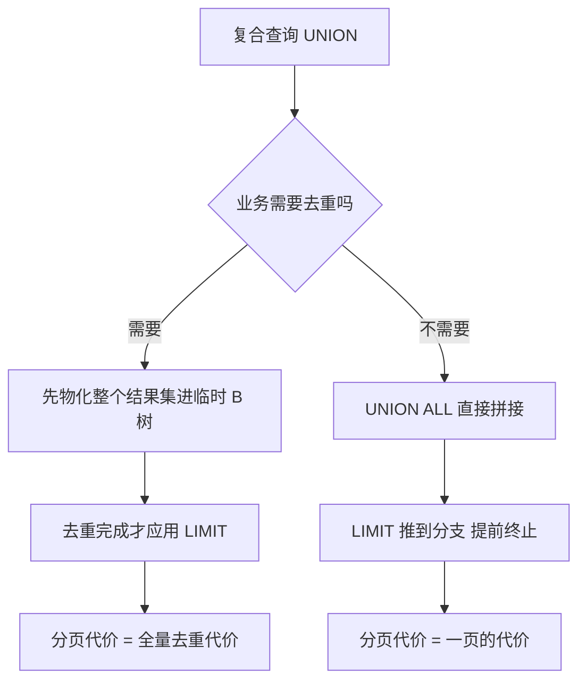
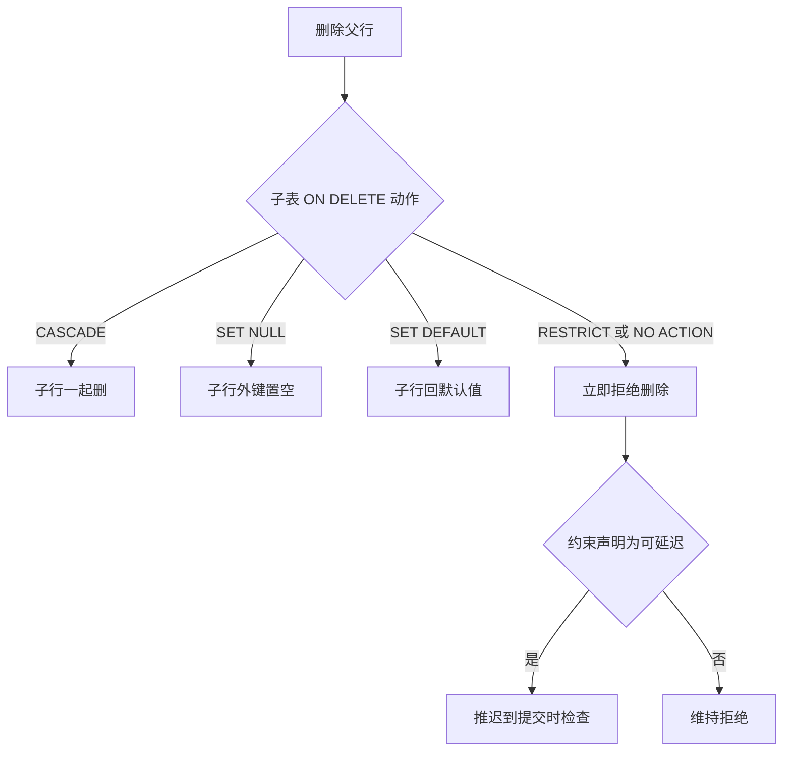
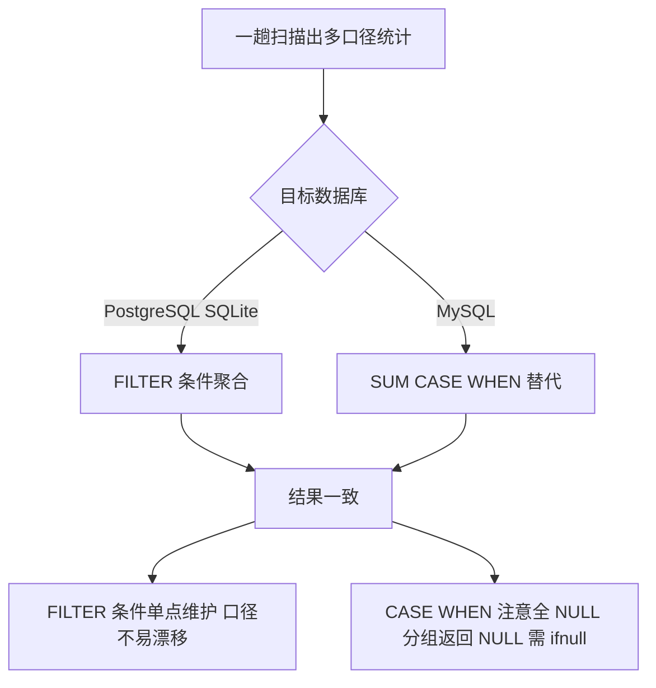
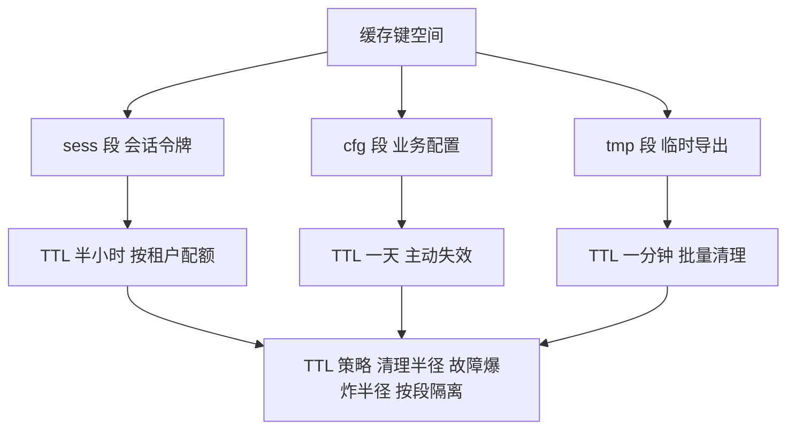
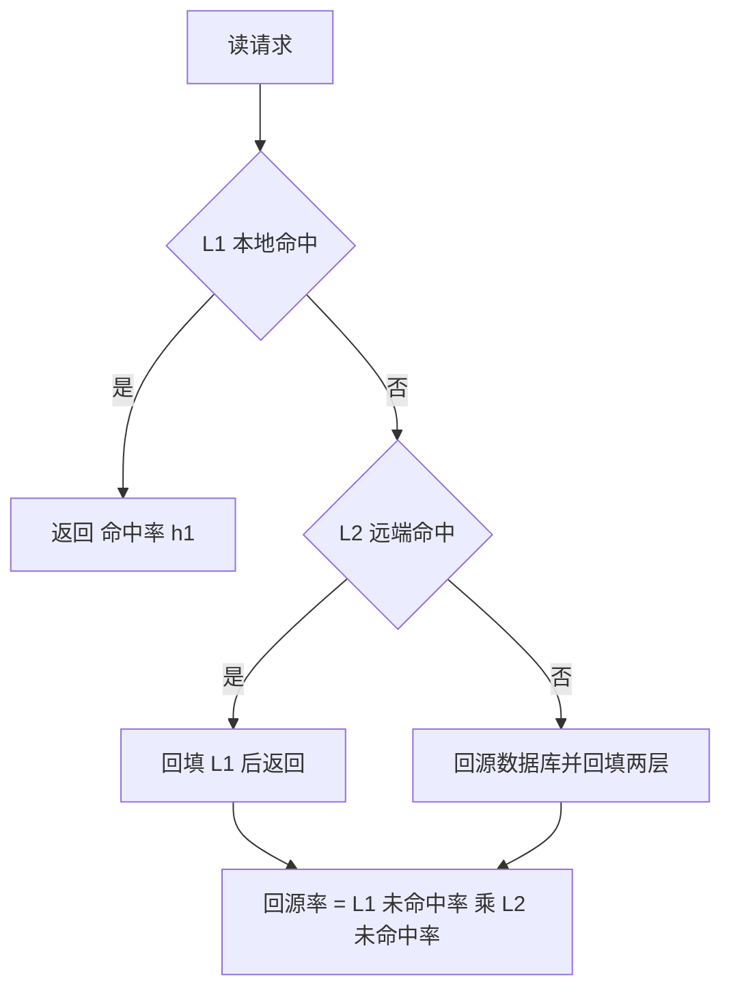
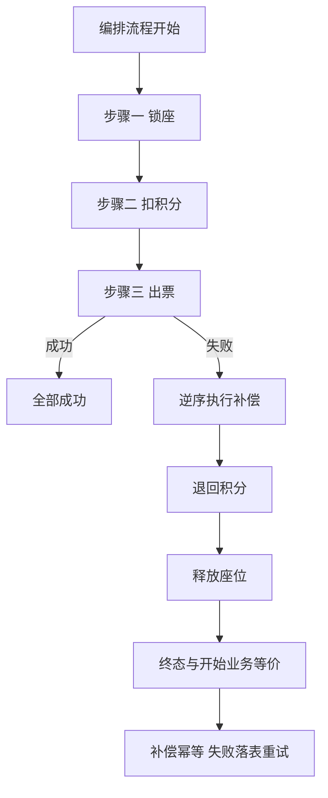
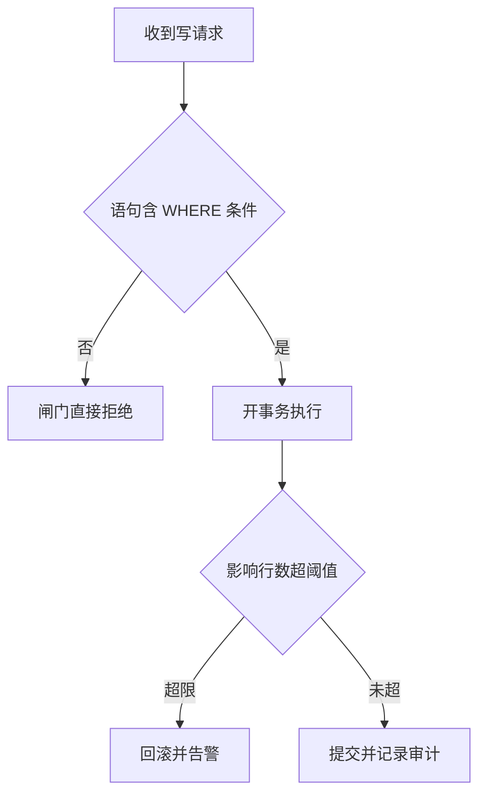
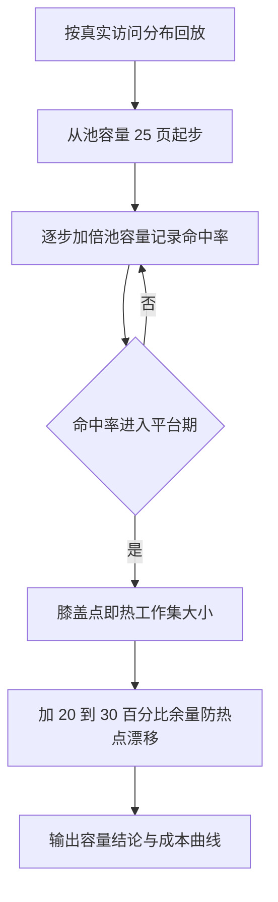
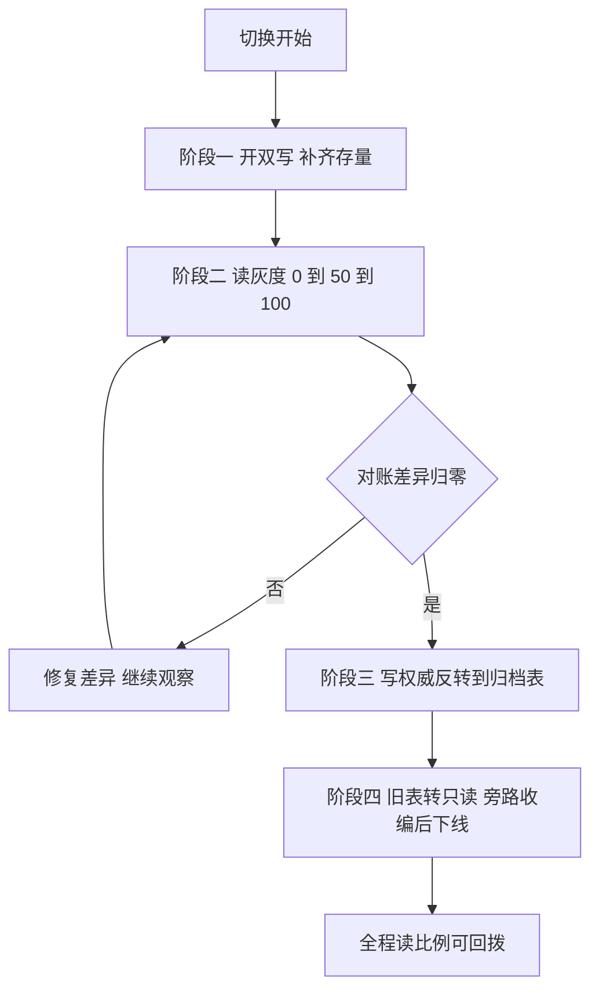

# 第 4 类 · 数据库与缓存(夜间扩产四)

本文件是第 4 类的第四批扩产,共 45 题(Q2201–Q2245),四条主线:SQL 补遗(排序规则与索引、隐式转换实测、子查询物化、UNION 分页代价、窗口框架 ROWS 与 RANGE、字符串聚合次序、NULL 排序位置、笛卡尔积意外来源、ON DELETE 行为表、rowcount 乐观并发、大 IN 改临时表、分页漂移、EXCEPT 语义、FILTER 聚合、随机抽样、ON CONFLICT 目标选择)、缓存工程(双层一致性、可变对象陷阱、键空间分段、写入合并、TTL 语义分层、stale-while-revalidate、命中率归因、多级命中率叠加、冷热晋升、PII 治理、值结构演进)、故障与恢复(导入降级、补偿事务、死锁退避矩阵、连接风暴冷却、磁盘满降级、binlog 定位、危险写防线、故障注入、只读降级、MTTR 复盘)、容量规划(QPS 换算连接数、行宽与页、缓冲池拐点、索引体积、热点行天花板、TTL 分桶、分片数反推、归档切换双写)。
示例以标准库 sqlite3 与纯逻辑模型为主,全部可独立运行;含耗时实测与状态机推演的演示均在本机 Python 3.9 实跑通过,故意触发的异常均以 try/except 演示。
读法建议:SQL 题抓"语义差异先于性能差异",缓存题抓"窗口与兜底",故障题抓"分类处置与可重入",容量题抓"公式代入与拐点验证"。


---

### Q2201 · 排序规则对索引的影响: COLLATE 不匹配就弃用索引

> 难度:★★★☆ | 标签:SQL, 索引, COLLATE

**问**:列上声明了 COLLATE NOCASE,查询时比较规则不一致会发生什么?为什么有时候加了索引还是全表扫描?

**答**:索引的键是按列上声明的排序规则排好序的,等值查找能不能走 seek,取决于"本次比较使用的排序规则"与"索引键的排序规则"是否一致。SQLite 里比较规则按"左操作数显式声明优先,其次列的隐式声明"确定,所以在 NOCASE 列上用 COLLATE BINARY 比较,等于在按大小写排好序的索引里做二进制匹配,有序性作废,优化器只能全表扫描。反过来,在默认 BINARY 列上套 NOCASE 比较也一样失效。这不仅是性能问题,还是语义问题:NOCASE 列上 WHERE name='bob' 会同时命中 BOB 与 bob 两行。工程结论是:排序规则属于 Schema 契约,建索引、写查询、跨库迁移三处必须对齐。

```python
# file: code/04_数据库与缓存/q2201_collation_index.py
"""排序规则对索引的影响: 比较排序规则与索引排序规则不一致时无法 seek"""
import sqlite3

conn = sqlite3.connect(":memory:")
c = conn.cursor()
c.execute("CREATE TABLE users_bin (name TEXT NOT NULL)")            # 默认 BINARY
c.execute("CREATE TABLE users_ci  (name TEXT COLLATE NOCASE NOT NULL)")
rows = [("Alice",), ("BOB",), ("bob",), ("Carol",)]
c.executemany("INSERT INTO users_bin VALUES(?)", rows)
c.executemany("INSERT INTO users_ci  VALUES(?)", rows)
c.execute("CREATE INDEX idx_bin ON users_bin(name)")
c.execute("CREATE INDEX idx_ci  ON users_ci(name)")

cases = [
    ("BINARY 列  name = 'BOB'",                "users_bin", "'BOB'"),
    ("NOCASE 列  name = 'BOB'",                "users_ci", "'BOB'"),
    ("NOCASE 列  加 COLLATE NOCASE 比较",       "users_ci", "'BOB' COLLATE NOCASE"),
    ("NOCASE 列  加 COLLATE BINARY 比较",       "users_ci", "'BOB' COLLATE BINARY"),
    ("BINARY 列  加 COLLATE NOCASE 比较",       "users_bin", "'BOB' COLLATE NOCASE"),
]
for label, table, rhs in cases:
    plan = c.execute("EXPLAIN QUERY PLAN SELECT * FROM %s WHERE name = %s" % (table, rhs)).fetchone()[3]
    print("%-28s -> %s" % (label, "用索引 " + plan if plan.startswith("SEARCH") else "全表扫描"))

print("NOCASE 列 WHERE name='bob' 命中:",
      [r[0] for r in c.execute("SELECT name FROM users_ci WHERE name='bob'")])
print("BINARY 列 套 NOCASE 比较命中:",
      [r[0] for r in c.execute("SELECT name FROM users_bin WHERE name='BOB' COLLATE NOCASE")])
print("结论: 索引键按列的 COLLATE 排序, 查询比较规则必须与之一致, 否则优化器放弃 seek")
```

**追问**:
- 建索引时能改排序规则吗?—— 可以,CREATE INDEX ... ON t(col COLLATE NOCASE) 让索引键用 NOCASE 排序,查询套同样的 COLLATE 即可命中,但一张表上不同排序规则的索引要各建各的。
- 跨库迁移最常踩的坑是什么?—— MySQL 的 utf8mb4_general_ci 与 utf8mb4_0900_ai_ci 排序结果不同,JOIN 两列排序规则不一致时不仅弃用索引,还可能直接报 illegal mix of collations。

---

### Q2202 · 隐式类型转换的索引失效实测: 亲和性救你一次 表达式不救

> 难度:★★★☆ | 标签:SQL, 索引, 隐式转换

**问**:都说"WHERE 里类型不匹配索引会失效",这句话在 SQLite 里逐字成立吗?实测一下。

**答**:不是逐字成立,实测结果分数据库。SQLite 有列亲和性(affinity),TEXT 亲和列与数字字面量比较时,字面量会被转成文本,索引照常走;但一旦把列包进表达式(CAST、加减零),有序性被破坏,只能 SCAN。MySQL 的规则不同:varchar 列与数字比较时是"列被转成数字",索引直接失效。所以可移植 SQL 必须让字面量类型与列类型一致,不能指望任何一家的隐式转换兜底。另外注意语义差异:TEXT 列上 sn=1000 能命中 '1000' 却命中不了 '01000',前导零编号场景最容易出事故。

```python
# file: code/04_数据库与缓存/q2202_implicit_cast_index.py
"""隐式类型转换实测: SQLite 靠列亲和性兜底, 列被表达式包裹才会失效"""
import sqlite3

conn = sqlite3.connect(":memory:")
c = conn.cursor()
c.execute("CREATE TABLE sn_t (sn TEXT PRIMARY KEY, amt REAL) WITHOUT ROWID")
c.executemany("INSERT INTO sn_t VALUES(?,?)", [(str(i), float(i)) for i in range(1, 2001)])

for label, sql in [
    ("sn = '1000'              ", "SELECT amt FROM sn_t WHERE sn = '1000'"),
    ("sn = 1000   数字字面量     ", "SELECT amt FROM sn_t WHERE sn = 1000"),
    ("CAST(sn AS INTEGER) = 1000", "SELECT amt FROM sn_t WHERE CAST(sn AS INTEGER) = 1000"),
    ("sn + 0 = 1000 表达式包裹   ", "SELECT amt FROM sn_t WHERE sn + 0 = 1000"),
]:
    plan = c.execute("EXPLAIN QUERY PLAN " + sql).fetchone()[3]
    print("%-28s -> %s" % (label, plan))

print("sn = 1000    命中:", [r[0] for r in c.execute("SELECT amt FROM sn_t WHERE sn = 1000")])
print("sn = '01000' 命中:", [r[0] for r in c.execute("SELECT amt FROM sn_t WHERE sn = '01000'")])
print("结论: 字面量类型错了亲和性还能救, 列一被表达式包裹必 SCAN, MySQL 则连字面量这层兜底都没有")
```

**追问**:
- 为什么 MySQL 与 SQLite 行为相反?—— SQLite 是把无类型的字面量转换成列的类型再比,列不变;MySQL 是把列转成数字再比,列上套了函数,索引有序性被破坏。
- 怎么在代码评审里拦住?—— 约定 schema 与参数类型一一对应,ORM 层绑定参数时带类型,再配 EXPLAIN 门禁断言关键查询必须出现 SEARCH。

---

### Q2203 · 子查询物化与缓存概念: 语句级的"一次计算多次复用"

> 难度:★★★★ | 标签:SQL, 优化器, 子查询

**问**:优化器说"子查询被物化了",物化到底做了什么?它和缓存是什么关系?

**答**:物化(materialize)就是把子查询结果算一次,存进临时结构(临时表或协程管道),外层反复引用时不再重算——这本质上是一种作用域仅为单条语句的缓存。判断关键是"相关还是非相关":非相关子查询(不引用外层列)必然只算一次;相关子查询理论上外层每行都可能重算,优化器会尝试把相关条件外提、改写成 JOIN 或半连接来消除重复计算。SQLite 还提供 WITH x AS MATERIALIZED 的显式提示,强制先算完落临时结构,适合子查询结果被多处引用且计算昂贵的场景;反过来默认 CTE 可能被折叠成 CO-ROUTINE 边算边流,省内存但不省重复计算。与真正的缓存相比,物化的生命周期只有一条语句,不解决跨请求的重复计算。

```python
# file: code/04_数据库与缓存/q2203_subquery_materialize.py
"""子查询物化: 相关子查询逐行重算, 非相关子查询一次计算语句内复用"""
import sqlite3

conn = sqlite3.connect(":memory:")
c = conn.cursor()
c.execute("CREATE TABLE big(id INTEGER PRIMARY KEY, cat TEXT, amt REAL)")
c.executemany("INSERT INTO big VALUES(?,?,?)",
              [(i, "abc"[i % 3], float(i % 50)) for i in range(1, 3001)])
c.execute("CREATE TABLE small(id INTEGER PRIMARY KEY, cat TEXT)")
c.executemany("INSERT INTO small VALUES(?,?)", [(i, "abc"[i % 3]) for i in range(1, 6)])

print("相关子查询: 引用了外层列 s.cat, 计划里挂着 SCALAR SUBQUERY")
for r in c.execute("EXPLAIN QUERY PLAN "
                   "SELECT (SELECT max(amt) FROM big b WHERE b.cat = s.cat) FROM small s"):
    print("   ", r[3])

print("非相关标量子查询: 与外层无关, 只算一次")
for r in c.execute("EXPLAIN QUERY PLAN "
                   "SELECT * FROM big WHERE amt > (SELECT avg(amt) FROM big)"):
    print("   ", r[3])

print("WITH AS MATERIALIZED: 强制先算完进临时结构, 计划出现 MATERIALIZE")
for r in c.execute("EXPLAIN QUERY PLAN "
                   "WITH stat AS MATERIALIZED (SELECT cat, avg(amt) a FROM big GROUP BY cat) "
                   "SELECT * FROM stat WHERE a > 10"):
    print("   ", r[3])

print("默认 CTE: 被折叠成 CO-ROUTINE 边算边流")
for r in c.execute("EXPLAIN QUERY PLAN "
                   "WITH stat AS (SELECT cat, avg(amt) a FROM big GROUP BY cat) "
                   "SELECT * FROM stat WHERE a > 10"):
    print("   ", r[3])
```

**追问**:
- 什么时候该写 AS MATERIALIZED?—— 同一昂贵子查询被引用多次、且希望固定一次计算时;SQLite 3.35 起支持,老版本只能用临时表替代。
- 物化结果有索引吗?—— 物化到临时 B 树时自带主键序,外层按同序引用可避免再排序,但不会自动加二级索引,复杂引用还是要自己建临时表。

---

### Q2204 · UNION 与 UNION ALL 分页: 去重把 LIMIT 的便宜吃掉了

> 难度:★★★☆ | 标签:SQL, UNION, 分页

**问**:为什么"两个结果集各取一页再合并"和"合并后再取一页"代价差这么多?

**答**:UNION 的语义是去重,而去重必须先拿到全部候选行(通常进临时 B 树排序),LIMIT 是在去重完成之后才生效的——分页的便宜被去重的全量成本吃掉。UNION ALL 不去重,两边可以各自提前终止,LIMIT 推到分支上直接短路。所以工程规则是:确定不会重复、或重复可容忍时一律 UNION ALL;确需去重时,先用 GROUP BY 在源头收敛(把去重范围限制在必要列),再拼接分页。此外 UNION 的输出顺序无契约,分页必须显式 ORDER BY,而去重 + 排序叠加时要注意排序列必须包含在去重键内,否则去重会破坏排序的确定性。

```python
# file: code/04_数据库与缓存/q2204_union_pagination.py
"""UNION 与 UNION ALL 分页: 去重要先物化整个结果集, LIMIT 救不了"""
import sqlite3
import time

conn = sqlite3.connect(":memory:")
c = conn.cursor()
c.execute("CREATE TABLE hot(id INTEGER PRIMARY KEY, tag TEXT)")
c.execute("CREATE TABLE cold(id INTEGER PRIMARY KEY, tag TEXT)")
c.executemany("INSERT INTO hot VALUES(?,?)",
              [(i, "t%d" % (i % 97)) for i in range(1, 20001)])
c.executemany("INSERT INTO cold VALUES(?,?)",
              [(i, "t%d" % (i % 97)) for i in range(1, 20001)])

for label, sql in [
    ("UNION     + LIMIT 10", "SELECT id FROM hot UNION SELECT id FROM cold LIMIT 10"),
    ("UNION ALL + LIMIT 10", "SELECT id FROM hot UNION ALL SELECT id FROM cold LIMIT 10"),
]:
    plan = " | ".join(r[3] for r in c.execute("EXPLAIN QUERY PLAN " + sql))
    t0 = time.perf_counter()
    n = len(c.execute(sql).fetchall())
    ms = (time.perf_counter() - t0) * 1000
    print("%s -> %5d 行 %6.1f ms | %s" % (label, n, ms, plan))
print("计划可见: UNION 带 USE TEMP B-TREE FOR UNION, 先全量去重; UNION ALL 无临时结构, 提前终止")
```

**追问**:
- 两边数据完全不相交时 UNION 会快吗?—— 优化器一般不知道不相交,仍按去重处理;明确不相交就写 UNION ALL,语义与性能双赢。
- 想去重又想快怎么办?—— 先各自 DISTINCT 再 UNION ALL,去重范围缩小到每个子集,代价低于全量 UNION 的临时 B 树。



---

### Q2205 · 窗口框架 ROWS vs RANGE: 并列行决定累计值

> 难度:★★★☆ | 标签:SQL, 窗口函数

**问**:同样是累计求和,ROWS 与 RANGE 框架结果为什么不一样?什么场景必须用哪个?

**答**:ROWS 按物理行数取框,CURRENT ROW 就是当前这一行;RANGE 按排序列的值域取框,与当前行排序列相同的"并列行"(peers)会被整体纳入。所以有并列时,RANGE 的累计会把同一组一次性加进去,ROWS 则逐行推进——日累计报表里,同一订单日的多笔交易在 RANGE 下显示的是"当日合计",在 ROWS 下显示的是"滚动到本笔为止"。移动平均同理:ROWS 2 PRECEDING 是固定最近三行,RANGE 2 PRECEDING 是值域在 day-2 到 day 之间的所有行,窗口大小随数据密度变化。选型口诀:要"每行一个新值"用 ROWS,要"按业务分组边界"用 RANGE;用 RANGE 时必须想清楚排序列的值域语义,文本列上的数值偏移是无意义的。

```python
# file: code/04_数据库与缓存/q2205_window_frame.py
"""窗口框架 ROWS vs RANGE: 并列行的处理决定累计值"""
import sqlite3

conn = sqlite3.connect(":memory:")
c = conn.cursor()
c.execute("CREATE TABLE sales(day INTEGER, rep TEXT, amt REAL)")
rows = [(1, "A", 10.0), (1, "B", 20.0), (1, "C", 30.0),
        (2, "A", 40.0), (2, "B", 50.0), (3, "A", 60.0)]
c.executemany("INSERT INTO sales VALUES(?,?,?)", rows)

sql = """
SELECT day, rep, amt,
       SUM(amt) OVER (ORDER BY day ROWS  BETWEEN UNBOUNDED PRECEDING AND CURRENT ROW) AS rows_sum,
       SUM(amt) OVER (ORDER BY day RANGE BETWEEN UNBOUNDED PRECEDING AND CURRENT ROW) AS range_sum
FROM sales ORDER BY day, rep
"""
print("day rep  amt | ROWS累计  RANGE累计")
for day, rep, amt, rs, rg in c.execute(sql):
    print(" %d   %s  %4.0f |  %6.0f   %6.0f" % (day, rep, amt, rs, rg))

sql2 = """
SELECT day, rep,
       AVG(amt) OVER (ORDER BY day ROWS  BETWEEN 2 PRECEDING AND CURRENT ROW) AS rows_avg,
       AVG(amt) OVER (ORDER BY day RANGE BETWEEN 2 PRECEDING AND CURRENT ROW) AS range_avg
FROM sales ORDER BY day, rep
"""
print("移动平均: ROWS 固定最近三行, RANGE 取值域 day-2 到 day 的全部行")
for day, rep, ra, rg in c.execute(sql2):
    print(" day=%d rep=%s  rows_avg=%5.1f  range_avg=%5.1f" % (day, rep, ra, rg))
```

**追问**:
- 同一天内的累计想逐笔递增怎么办?—— ORDER BY day, id 加二级排序列消掉并列,ROWS 与 RANGE 就一致了,这是最常用的兜底手法。
- RANGE 的默认框架是什么?—— 不写框架时默认 RANGE BETWEEN UNBOUNDED PRECEDING AND CURRENT ROW,所以"以为在逐行累计、其实并列行被合并"是高频事故。

---

### Q2206 · 字符串聚合的次序敏感: group_concat 的顺序不是契约

> 难度:★★★☆ | 标签:SQL, 聚合

**问**:group_concat 拼出来的列表,顺序可以依赖吗?要确定顺序该怎么写?

**答**:不能依赖。字符串聚合的输入顺序取决于扫描顺序,而扫描顺序由计划决定——换了索引、换了驱动表,同一行数据会拼出不同的串,这就是"次序敏感"。要确定性,只有三条路:子查询里显式 ORDER BY 后再聚合(SQLite 实践中稳定,但仍是方言行为)、在应用层取行后排序拼接(最可控,代价是多一次传输)、或升级到支持聚合内 ORDER BY 的版本(SQLite 3.44+/PostgreSQL string_agg/MySQL GROUP_CONCAT 的 ORDER BY 子句)。另外注意两个隐藏坑:分隔符是参数不是语法;group_concat_max_len 会静默截断超长结果,长度敏感的场景要检查长度而不是假设完整。

```python
# file: code/04_数据库与缓存/q2206_list_order.py
"""字符串聚合的次序敏感: group_concat 不保证顺序, 需要显式定序"""
import sqlite3

conn = sqlite3.connect(":memory:")
c = conn.cursor()
c.execute("CREATE TABLE logs(id INTEGER PRIMARY KEY, user TEXT, event TEXT)")
c.executemany("INSERT INTO logs VALUES(?,?,?)",
              [(1, "u1", "login"), (2, "u1", "view"), (3, "u2", "login"),
               (4, "u1", "buy"), (5, "u2", "view"), (6, "u1", "logout")])

a = c.execute("SELECT group_concat(event, '->') FROM logs WHERE user='u1'").fetchone()[0]
b = c.execute("SELECT group_concat(event, '->') FROM "
              "(SELECT event FROM logs WHERE user='u1' ORDER BY id DESC)").fetchone()[0]
print("自然扫描顺序:", a)
print("倒序子查询  :", b, " <- 同一份数据两种串")

d1 = c.execute("SELECT group_concat(event, '->') FROM "
               "(SELECT event FROM logs WHERE user='u1' ORDER BY id)").fetchone()[0]
d2 = " -> ".join(r[0] for r in c.execute("SELECT event FROM logs WHERE user='u1' ORDER BY id"))
print("子查询正序  :", d1)
print("应用层聚合  :", d2)

try:
    c.execute("SELECT group_concat(event, '->' ORDER BY id) FROM logs WHERE user='u1'")
    print("聚合内 ORDER BY: 本机支持")
except sqlite3.OperationalError as e:
    print("聚合内 ORDER BY: 本机 SQLite 版本不支持 ->", e)
```

**追问**:
- 超长被截断怎么发现?—— 比对 count 与分隔符出现次数是否差一,或干脆在应用层拼接,把长度控制权拿回来。
- 为什么要先按 id 正序去重再去聚合?—— 聚合不消重,重复行会原样进入列表;去重键也必须在 ORDER BY 里,否则列表内容仍不确定。

---

### Q2207 · NULL 排序位置控制: NULLS FIRST/LAST 与 IS NULL 技巧

> 难度:★★☆☆ | 标签:SQL, NULL, 排序

**问**:NULL 在 ORDER BY 里排最前还是最后?怎么按业务把它放到指定位置?

**答**:不同数据库默认不同,所以"默认位置"不可依赖。SQLite 把 NULL 视为最小值,ASC 排最前、DESC 排最后;Oracle 相反;PostgreSQL 提供 NULLS FIRST/LAST 子句,SQLite 3.30+ 也支持。可移植的写法是"技巧列"——ORDER BY (col IS NULL), col:第一键把 NULL 归到一组排后面(0 在前 1 在后),第二键在组内正常排序,任何数据库行为一致。还要注意 NULL 参与排序时与其他 NULL 彼此并列,多键排序才稳定;以及分页场景里 NULL 位置必须与索引键序对齐,否则翻页会漂移。

```python
# file: code/04_数据库与缓存/q2207_null_ordering.py
"""NULL 排序位置控制: NULLS FIRST/LAST 与 IS NULL 技巧"""
import sqlite3

conn = sqlite3.connect(":memory:")
c = conn.cursor()
c.execute("CREATE TABLE tasks(id INTEGER PRIMARY KEY, due TEXT)")
c.executemany("INSERT INTO tasks(due) VALUES(?)",
              [("2026-03-01",), (None,), ("2026-01-15",), (None,), ("2026-02-01",)])

def show(label, sql):
    rows = [r[0] if r[0] is not None else "NULL" for r in c.execute(sql)]
    print("%-24s -> %s" % (label, rows))

show("ORDER BY due ASC 默认", "SELECT due FROM tasks ORDER BY due ASC")
show("ORDER BY due DESC 默认", "SELECT due FROM tasks ORDER BY due DESC")
show("ASC NULLS LAST", "SELECT due FROM tasks ORDER BY due ASC NULLS LAST")
show("DESC NULLS FIRST", "SELECT due FROM tasks ORDER BY due DESC NULLS FIRST")
show("技巧 IS NULL 升序", "SELECT due FROM tasks ORDER BY (due IS NULL), due ASC")
show("技巧 IS NULL 降序", "SELECT due FROM tasks ORDER BY (due IS NULL), due DESC")
print("SQLite 视 NULL 为最小值, 老版本没有 NULLS LAST 时用 IS NULL 技巧, 行为跨库一致")
```

**追问**:
- IS NULL 技巧能用上索引吗?—— ORDER BY (col IS NULL), col 是表达式排序,普通索引不匹配,要保证有序需要函数索引或生成列,数据量大时优先 NULLS LAST。
- 为什么分页要关心 NULL 位置?—— keyset 分页的比较条件 WHERE (due, id) > (锚点) 在 NULL 上三值逻辑会失真,含 NULL 列分页要么过滤要么填哨兵值。

---

### Q2208 · 笛卡尔积的意外来源: 忘写条件与重复键扇出

> 难度:★★★☆ | 标签:SQL, JOIN

**问**:结果集行数比预期多了几十倍,除了忘写 JOIN 条件还有什么可能?

**答**:两大来源。一是忘写连接条件:逗号连接或 JOIN 缺 ON,结果是 m×n 的纯笛卡尔积,行数暴涨,一眼能看出来。二是更隐蔽的重复键扇出(fan-out):连接键在两侧都不唯一,比如订单连标签、用户连多设备,一行被复制成多份,行数看似合理但聚合已经错了——对金额求和被放大、count 虚高,而报表不报错。防御三板斧:对账行数(先各自 count 再比 join 后 count)、聚合前先确定键的唯一性(必要时先去重或预聚合)、对扇出连接的结果一律 count 检查再 SUM。一句话:JOIN 之后想做聚合,先证明"键还是唯一的"。

```python
# file: code/04_数据库与缓存/q2208_cartesian_sources.py
"""笛卡尔积的意外来源: 忘写连接条件与重复键扇出"""
import sqlite3

conn = sqlite3.connect(":memory:")
c = conn.cursor()
c.execute("CREATE TABLE users(id INTEGER PRIMARY KEY, name TEXT)")
c.execute("CREATE TABLE orders(id INTEGER PRIMARY KEY, user_id INTEGER, amt REAL)")
c.executemany("INSERT INTO users VALUES(?,?)", [(1, "a"), (2, "b"), (3, "c")])
c.executemany("INSERT INTO orders VALUES(?,?,?)",
              [(10, 1, 50.0), (11, 1, 30.0), (12, 2, 20.0), (13, 2, 80.0)])

n = c.execute("SELECT count(*) FROM users, orders").fetchone()[0]
print("忘写连接条件 users, orders  ->", n, "行  3*4=12 的纯笛卡尔积")
n = c.execute("SELECT count(*) FROM users u JOIN orders o ON o.user_id=u.id").fetchone()[0]
print("正确的多对一内连接          ->", n, "行")
s = c.execute("SELECT sum(amt) FROM orders").fetchone()[0]
s2 = c.execute("SELECT sum(o.amt) FROM users u JOIN orders o ON o.user_id=u.id").fetchone()[0]
print("订单直接求和 %.0f, 连接用户后求和 %.0f -> 多对一不扇出, 金额安全" % (s, s2))

c.execute("CREATE TABLE tags(user_id INTEGER, tag TEXT)")
c.executemany("INSERT INTO tags VALUES(?,?)", [(1, "x"), (1, "y"), (2, "x")])
n = c.execute("SELECT count(*) FROM orders o JOIN tags t ON t.user_id=o.user_id").fetchone()[0]
s3 = c.execute("SELECT sum(o.amt) FROM orders o JOIN tags t ON t.user_id=o.user_id").fetchone()[0]
print("订单连标签 ->", n, "行, sum(amt)=%.0f, 虚增 %.0f <- 一对多扇出, 聚合已失真" % (s3, s3 - s))
```

**追问**:
- 扇出后怎么快速修?—— 先按连接键预聚合(子查询 group by 收敛到一行一标签组)再连,或者明确业务只取一个标签时用 EXISTS 判存在而不取行。
- 怎么在 CI 里自动拦?—— 对核心聚合 SQL 建立"连接后行数 <= 主表行数"断言,违反即视为扇出告警。

---

### Q2209 · 约束级联 ON DELETE 行为表: 五种动作一张表

> 难度:★★★★ | 标签:SQL, 外键, 级联

**问**:把 ON DELETE 的五种动作各自的效果说清楚,NO ACTION 和 RESTRICT 有什么区别?

**答**:CASCADE 子行跟随删除;SET NULL 子行外键置空(列须可空);SET DEFAULT 置回列默认值(默认值仍须满足外键);RESTRICT 与 NO ACTION 都会阻止删除父行,区别在检查时机:RESTRICT 是立即检查,不可推迟;NO ACTION 默认也是立即检查,但配 DEFERRABLE INITIALLY DEFERRED 可以推迟到事务提交时检查,从而允许事务内部"先破坏后修复"。所有动作生效前提是 foreign_keys 处于开启状态,SQLite 默认关闭,这是面试与生产都高频翻车的点。选型经验:强归属关系用 CASCADE,解关联用 SET NULL,审计要求高的表拒绝级联、显式走归档流程。

```python
# file: code/04_数据库与缓存/q2209_on_delete_matrix.py
"""ON DELETE 行为表: 五种级联动作在删除父行后的实际效果"""
import sqlite3

conn = sqlite3.connect(":memory:")
c = conn.cursor()
c.execute("PRAGMA foreign_keys=ON")

actions = [
    ("CASCADE",     "ON DELETE CASCADE"),
    ("SET NULL",    "ON DELETE SET NULL"),
    ("SET DEFAULT", "ON DELETE SET DEFAULT"),
    ("RESTRICT",    "ON DELETE RESTRICT"),
    ("NO ACTION",   "ON DELETE NO ACTION"),
]
for i, (name, action) in enumerate(actions, 1):
    tag = "c%d" % i
    c.execute("CREATE TABLE parent_%s(id INTEGER PRIMARY KEY)" % tag)
    c.execute("CREATE TABLE child_%s(pid INTEGER DEFAULT 0 REFERENCES parent_%s(id) %s)"
              % (tag, tag, action))
    if name == "SET DEFAULT":
        c.execute("INSERT INTO parent_%s VALUES(0)" % tag)   # 默认值 0 本身也是合法父行
    c.execute("INSERT INTO parent_%s VALUES(1)" % tag)
    c.execute("INSERT INTO child_%s(pid) VALUES(1)" % tag)
    try:
        c.execute("DELETE FROM parent_%s WHERE id=1" % tag)
        row = c.execute("SELECT pid FROM child_%s" % tag).fetchone()
        outcome = "子行已级联删除" if row is None else "子行仍在, pid = %s" % row[0]
        print("%-12s -> 删除成功, %s" % (name, outcome))
    except sqlite3.IntegrityError as e:
        print("%-12s -> 删除被拒绝: %s" % (name, str(e)[:40]))
conn.commit()
print("前提是 PRAGMA foreign_keys=ON, SQLite 默认关闭时全部动作形同虚设")
```

**追问**:
- 事务里先删子再删父,NO ACTION 能过吗?—— 默认不能(逐条检查),声明 DEFERRABLE INITIALLY DEFERRED 后提交时才检查,顺序无关。
- 级联删除是同步的吗?—— 是,在删除语句的事务内同步执行,大级联会放大锁持有时间与 binlog 体积,深层级联要预估行数。



---

### Q2210 · 乐观并发与 rowcount: 冲突信号藏在影响行数里

> 难度:★★★☆ | 标签:SQL, 并发控制

**问**:为什么乐观锁必须看 UPDATE 的 rowcount,而不是先 SELECT 再判断?

**答**:乐观锁的判定期望值写在 WHERE 里(AND version=?),数据库原子地完成"比较并更新",rowcount 为 0 就说明版本已被别人改走,更新被安全拒绝;而"先 SELECT 再 UPDATE 无条件写"两个动作之间存在窗口,是典型的丢失更新。rowcount 的口径也有讲究:SQLite 的 rowcount 是真实被修改的行数;MySQL 默认返回"被修改"行数,值未变化时返回 0,客户端开启 CLIENT_FOUND_ROWS 后返回"被匹配"行数——同一个 SQL 两种口径,做冲突检测必须用"被修改"口径并把这一点写进约定。重试循环的标准姿势:rowcount 为 0 时重读最新版本、重放业务判断、再试,超过上限转人工或队列。

```python
# file: code/04_数据库与缓存/q2210_rowcount_optimistic.py
"""乐观并发: 条件 UPDATE 的 rowcount 才是冲突信号"""
import sqlite3

conn = sqlite3.connect(":memory:")
c = conn.cursor()
c.execute("CREATE TABLE stock(sku TEXT PRIMARY KEY, qty INTEGER, version INTEGER)")
c.execute("INSERT INTO stock VALUES('A1', 10, 3)")

s1 = conn.cursor()   # 会话一
s2 = conn.cursor()   # 会话二

v1 = s1.execute("SELECT qty, version FROM stock WHERE sku='A1'").fetchone()
v2 = s2.execute("SELECT qty, version FROM stock WHERE sku='A1'").fetchone()
print("两个会话都读到 qty=%d version=%d" % v1)

cur = s1.execute("UPDATE stock SET qty=qty-2, version=version+1 "
                 "WHERE sku='A1' AND version=?", (v1[1],))
print("会话一扣减 rowcount =", cur.rowcount)

cur = s2.execute("UPDATE stock SET qty=qty-3, version=version+1 "
                 "WHERE sku='A1' AND version=?", (v2[1],))
print("会话二扣减 rowcount =", cur.rowcount, "-> 0 即版本已变, 丢失更新被拦截")

if cur.rowcount == 0:
    nv = s2.execute("SELECT qty, version FROM stock WHERE sku='A1'").fetchone()
    cur = s2.execute("UPDATE stock SET qty=qty-3, version=version+1 "
                     "WHERE sku='A1' AND version=?", (nv[1],))
    print("会话二重读重试 rowcount =", cur.rowcount)
print("最终状态:", c.execute("SELECT qty, version FROM stock WHERE sku='A1'").fetchone())
print("rowcount 是并发下的冲突信号, 匹配行数与修改行数口径必须分清")
```

**追问**:
- ORM 里怎么拿这个信号?—— SQLAlchemy 的 session.execute 返回 CursorResult.rowcount,批量 upsert 则要用 returning 或分支统计,不能只看总行数。
- rowcount 不可靠的场景?—— 批量 DML 之外的驱动差异、UPDATE 值未变的口径差、以及某些中间件改写 SQL 后的影响行数,关键链路要用 conn.total_changes 或显式版本表兜底。

---

### Q2211 · 大 IN 列表改临时表: 交叉点实测

> 难度:★★★☆ | 标签:SQL, 调优

**问**:几千个 id 的 IN 列表,什么时候应该改成临时表 JOIN?

**答**:三个成本随列表长度线性或超线性增长:SQL 文本解析与参数绑定、优化器对海量等值条件的处理、以及网络上重复传输的 id 文本。临时表方案把"条件"变成"数据":一次批量插入带主键的临时表,后续查询全部走索引 JOIN,SQL 本身变成常量,还能跨多条语句复用。本机实测的交叉点规律:一次性小查询(几十到几百个)直接 IN 最便宜;几千个以上、或同列表要查多次(明细 + 统计 + 分页)时临时表胜出,复用次数越多优势越大。注意临时表的生命周期随连接,用完要 DROP 或靠会话结束回收,连接池场景还要防"串会话"——临时表名最好带请求标识。

```python
# file: code/04_数据库与缓存/q2211_in_to_temp.py
"""大 IN 列表改临时表: 交叉点实测"""
import sqlite3
import time

conn = sqlite3.connect(":memory:")
c = conn.cursor()
c.execute("CREATE TABLE t(id INTEGER PRIMARY KEY, v TEXT)")
c.executemany("INSERT INTO t VALUES(?,?)", [(i, "v%d" % i) for i in range(1, 50001)])
ids = list(range(20000, 26000))   # 6000 个目标 id

ph = ",".join("?" * len(ids))
t0 = time.perf_counter()
n1 = c.execute("SELECT count(*) FROM t WHERE id IN (%s)" % ph, ids).fetchone()[0]
t_in = time.perf_counter() - t0

t0 = time.perf_counter()
c.execute("DROP TABLE IF EXISTS temp.want")
c.execute("CREATE TEMP TABLE want(id INTEGER PRIMARY KEY)")
c.executemany("INSERT INTO want VALUES(?)", [(i,) for i in ids])
n2 = c.execute("SELECT count(*) FROM t JOIN want ON want.id=t.id").fetchone()[0]
t_tmp = time.perf_counter() - t0
print("大 IN 6000 参数 : %d 行, %.1f ms" % (n1, t_in * 1000))
print("临时表 建表加查 : %d 行, %.1f ms" % (n2, t_tmp * 1000))

t0 = time.perf_counter()
for _ in range(5):
    c.execute("SELECT count(*) FROM t JOIN want ON want.id=t.id").fetchone()
t_reuse = (time.perf_counter() - t0) / 5
t0 = time.perf_counter()
for _ in range(5):
    c.execute("SELECT count(*) FROM t WHERE id IN (%s)" % ph, ids).fetchone()
t_in2 = (time.perf_counter() - t0) / 5
print("复用临时表再查 5 次平均 %.1f ms  vs  每次重发大 IN 平均 %.1f ms" % (t_reuse * 1000, t_in2 * 1000))
print("列表越大且查询越频繁, 临时表越划算; 一次性小列表直接 IN")
```

**追问**:
- 临时表要不要建索引?—— 必须,JOIN 驱动侧是主表时被驱动侧的临时表键序决定查找成本,不带键序就是两次扫描。
- 参数个数有硬上限吗?—— 有,SQLite 的 SQLITE_MAX_VARIABLE_NUMBER 老版默认 999、3.32+ 默认 32766,MySQL 占位符上限 65535,超限直接报错,这也是拆批或改临时表的硬理由。

---

### Q2212 · 分页漂移的成因: OFFSET 翻页撞上并发写入

> 难度:★★★☆ | 标签:SQL, 分页

**问**:用户翻到第二页看到了第一页的旧数据,或者漏了几行,是怎么回事?

**答**:OFFSET 分页的偏移量是"位置"不是"数据",两页之间的间隙里只要发生插入或删除,所有行的位置整体平移:新插入的行把旧行往后推,后面的页会重复出现已看过的行;删除则让某些行被跳过。这就是分页漂移,导出任务比用户翻页更容易中招,因为导出跨越的时间更长。根治办法是 keyset(游标)分页:每页携带本页最后一行的排序锚点,下一页用 WHERE 锚点比较 + LIMIT,位置与数据绑定,写入不影响已翻过的页。OFFSET 仍适合管理后台这类"可容忍抖动 + 需要跳页"的场景;两者取舍本质是"按位置看"与"按数据看"。

```python
# file: code/04_数据库与缓存/q2212_pagination_drift.py
"""分页漂移: OFFSET 翻页遇到并发写入会重复与漏行"""
import sqlite3

conn = sqlite3.connect(":memory:")
c = conn.cursor()
c.execute("CREATE TABLE msgs(id INTEGER PRIMARY KEY AUTOINCREMENT, body TEXT)")
for i in range(1, 11):
    c.execute("INSERT INTO msgs(body) VALUES(?)", ("m%d" % i,))
conn.commit()

def page_offset(page, size=3):
    return [r[0] for r in c.execute(
        "SELECT id FROM msgs ORDER BY id DESC LIMIT ? OFFSET ?", (size, page * size))]

p1 = page_offset(0)
c.execute("INSERT INTO msgs(body) VALUES(?)", ("m11",))
c.execute("INSERT INTO msgs(body) VALUES(?)", ("m12",))
conn.commit()
p2 = page_offset(1)
print("OFFSET 第一页:", p1)
print("OFFSET 第二页:", p2, " <- 新消息把旧行往后推")
dup = sorted(set(p1) & set(p2), reverse=True)
print("两页重复的行:", dup, " 其余行被挤到第三页, 漂移实锤")

last = p1[-1]
p2k = [r[0] for r in c.execute(
    "SELECT id FROM msgs WHERE id < ? ORDER BY id DESC LIMIT 3", (last,))]
print("keyset 第一页:", p1, "锚点 last =", last)
print("keyset 第二页:", p2k, " WHERE id < 锚点, 不受新写入影响")
```

**追问**:
- 排序列不唯一时 keyset 还稳吗?—— 不稳,锚点必须带唯一 tie-breaker(如 id),比较写成元组条件,否则同值边界会丢行。
- 深分页下 keyset 还有别的优势吗?—— LIMIT OFFSET 越深扫描越多,keyset 的 WHERE 走索引定位,代价与页深无关。

---

### Q2213 · EXCEPT 与 INTERSECT: 隐式 DISTINCT 的语义边界

> 难度:★★☆☆ | 标签:SQL, 集合运算

**问**:EXCEPT 和 NOT IN、LEFT JOIN IS NULL 是一回事吗?

**答**:不是。EXCEPT/INTERSECT 是集合运算,隐式做 DISTINCT:A EXCEPT B 等于"A 的去重结果减去 B 的去重结果",重复行只保留一份;NOT IN/NOT EXISTS 是逐行谓词,不去重、语义是"每一行是否满足条件"。所以带重复数据的差集必须想清楚口径:要"差几条"就得模拟 EXCEPT ALL(SQLite 不支持,用 GROUP BY 计数相减)。另外老三样陷阱照旧:NOT IN 遇到子查询里的 NULL 会整体落空,EXCEPT 不受 NULL 影响;INTERSECT 与 EXCEPT 的优先级高于 UNION,混写时要加括号。集合运算写集合语义,谓词写行语义,混用最容易在重复数据上翻车。

```python
# file: code/04_数据库与缓存/q2213_except_intersect.py
"""EXCEPT 与 INTERSECT: 隐式 DISTINCT 的语义与 ALL 缺失的替代"""
import sqlite3
from collections import Counter

conn = sqlite3.connect(":memory:")
c = conn.cursor()
c.execute("CREATE TABLE a(x INTEGER)")
c.execute("CREATE TABLE b(x INTEGER)")
c.executemany("INSERT INTO a VALUES(?)", [(1,), (1,), (2,), (2,), (3,)])
c.executemany("INSERT INTO b VALUES(?)", [(2,), (2,)])

def show(label, sql):
    print("%-30s -> %s" % (label, [r[0] for r in c.execute(sql)]))

show("A EXCEPT B", "SELECT x FROM a EXCEPT SELECT x FROM b")
show("A INTERSECT B", "SELECT x FROM a INTERSECT SELECT x FROM b")
show("A UNION B", "SELECT x FROM a UNION SELECT x FROM b")
show("等价改写 去重差集", "SELECT DISTINCT x FROM a "
                        "WHERE x NOT IN (SELECT DISTINCT x FROM b)")

ca = Counter(r[0] for r in c.execute("SELECT x FROM a"))
cb = Counter(r[0] for r in c.execute("SELECT x FROM b"))
print("EXCEPT ALL 语义 按次数相减 ->", sorted((ca - cb).elements()))
print("EXCEPT 自动去重, 要保留重复次数必须按计数手工模拟")
```

**追问**:
- EXCEPT 的性能特征?—— 通常物化两侧去重后做合并,代价接近两次 DISTINCT;数据量大且只要判断存在性时 NOT EXISTS 加索引更便宜。
- 为什么 EXCEPT 不怕 NULL?—— 集合运算把 NULL 当成员做等值比较,而 NOT IN 的三值逻辑会让全表条件落空,这是两者最关键的行为差。

---

### Q2214 · FILTER 条件聚合: 一趟扫描出多口径

> 难度:★★☆☆ | 标签:SQL, 聚合

**问**:一个分组要同时统计成功数、失败数、退款数,写多个子查询还是 CASE WHEN?

**答**:都不是首选,标准写法是聚合 FILTER 子句:count(*) FILTER (WHERE status='ok'),SQL:2003 标准语法,PostgreSQL 与 SQLite(3.30+)原生支持,一趟扫描完成所有口径,可读性远超嵌套 CASE。MySQL 尚未支持时用 SUM(CASE WHEN cond THEN 1 ELSE 0 END) 等价替代,注意 SUM 遇到全 NULL 分组返回 NULL,要 ifnull 包一层。两者结果完全一致,差别在表达力与出错概率:FILTER 的条件只写一遍,口径漂移风险小;多层 CASE WHEN 复制粘贴时最容易改漏一处条件。报表类查询优先 FILTER,兜底方案写清注释。

```python
# file: code/04_数据库与缓存/q2214_filter_aggregate.py
"""FILTER 条件聚合: 一趟扫描出多口径统计"""
import sqlite3

conn = sqlite3.connect(":memory:")
c = conn.cursor()
c.execute("CREATE TABLE pay(id INTEGER PRIMARY KEY, channel TEXT, status TEXT, amt REAL)")
c.executemany("INSERT INTO pay VALUES(?,?,?,?)",
              [(1, "wx", "ok", 100.0), (2, "wx", "fail", 50.0), (3, "ali", "ok", 200.0),
               (4, "ali", "refund", 30.0), (5, "wx", "ok", 70.0), (6, "ali", "ok", 120.0)])

sql_filter = """
SELECT channel,
       count(*) FILTER (WHERE status = 'ok')     AS ok_cnt,
       sum(amt) FILTER (WHERE status = 'ok')     AS ok_amt,
       count(*) FILTER (WHERE status = 'fail')   AS fail_cnt,
       count(*) FILTER (WHERE status = 'refund') AS refund_cnt
FROM pay GROUP BY channel
"""
print("FILTER 写法   channel  ok笔数  ok金额  fail  refund")
for r in c.execute(sql_filter):
    print("   %-5s %6d %8.1f %5d %6d" % r)

sql_case = """
SELECT channel,
       sum(CASE WHEN status='ok' THEN 1 ELSE 0 END),
       sum(CASE WHEN status='ok' THEN amt ELSE 0 END),
       sum(CASE WHEN status='fail' THEN 1 ELSE 0 END),
       sum(CASE WHEN status='refund' THEN 1 ELSE 0 END)
FROM pay GROUP BY channel
"""
print("CASE WHEN 等价:", [tuple(r) for r in c.execute(sql_case)])
print("两种写法同结果, FILTER 条件只写一遍, 口径不易漂移, MySQL 用 CASE WHEN 兜底")
```

**追问**:
- FILTER 能用在哪些聚合上?—— 所有聚合函数,count/sum/avg/array_agg 都行,本质是给聚合加一个行级开关。
- 条件里能用别的列吗?—— 能,WHERE 子句里合法的表达式都可以,常用于"近 7 天成功单"这类带时间窗的口径。



---

### Q2215 · 随机抽样的代价: ORDER BY random() 是全表排序

> 难度:★★★☆ | 标签:SQL, 抽样

**问**:SELECT ... ORDER BY random() LIMIT 5 为什么慢?正确的抽样姿势有哪些?

**答**:ORDER BY random() 给每一行生成随机键后必须全量排序,代价 O(N log N),LIMIT 再小也省不掉——优化器无法提前终止,因为最小的五个随机键可能在任何地方。替代方案按场景选:行号连续表用"随机起点区间"(WHERE id >= 随机值 ORDER BY id LIMIT n),快但样本是连续段、有偏;应用层蓄水池抽样(单趟流式读取、O(N) 时间 O(k) 空间、数学上等概率),适合导出与离线分析;真要高质量在线随机,可以维护随机键列加索引,或预生成洗牌序号。判断标准:抽样语义要"无偏"就上蓄水池,要"够快够随机"就接受有偏的起点法,别用全表排序硬扛。

```python
# file: code/04_数据库与缓存/q2215_random_sample.py
"""随机抽样的代价: ORDER BY random() 全表排序 vs 蓄水池抽样"""
import random
import sqlite3
import time

conn = sqlite3.connect(":memory:")
c = conn.cursor()
c.execute("CREATE TABLE t(id INTEGER PRIMARY KEY, v TEXT)")
c.executemany("INSERT INTO t VALUES(?,?)", [(i, "v%d" % i) for i in range(1, 50001)])

plan = " | ".join(r[3] for r in
                  c.execute("EXPLAIN QUERY PLAN SELECT id FROM t ORDER BY random() LIMIT 5"))
print("ORDER BY random() 计划:", plan)

t0 = time.perf_counter()
rows = c.execute("SELECT id FROM t ORDER BY random() LIMIT 5").fetchall()
print("全表排序取 5 条   : %6.1f ms, 样本 %s" % ((time.perf_counter() - t0) * 1000, [r[0] for r in rows]))

t0 = time.perf_counter()
rows2 = c.execute("SELECT id FROM t WHERE id >= (abs(random()) % 49996) + 1 "
                  "ORDER BY id LIMIT 5").fetchall()
print("随机起点区间      : %6.2f ms, 样本 %s 有偏" % ((time.perf_counter() - t0) * 1000, [r[0] for r in rows2]))

t0 = time.perf_counter()
sample, n = [], 0
for (rid,) in c.execute("SELECT id FROM t"):
    n += 1
    if len(sample) < 5:
        sample.append(rid)
    else:
        j = random.randrange(n)
        if j < 5:
            sample[j] = rid
print("蓄水池抽样 O N 一趟: %6.1f ms, 样本 %s 等概率" % ((time.perf_counter() - t0) * 1000, sorted(sample)))
```

**追问**:
- 蓄水池为什么等概率?—— 第 i 行被保留概率 5/i,与后续替换复合后每行恰为 5/N,可归纳证明。
- 表很大且有洞时起点法怎么办?—— 找不到足够行就向后补抽多次,或改用 rowid 分桶后桶内随机,接受轻微不均。

---

### Q2216 · ON CONFLICT 指定目标: 多个唯一约束时命中谁

> 难度:★★★☆ | 标签:SQL, upsert

**问**:表上有两个 UNIQUE 约束,upsert 只声明了一个目标,冲突发生在另一个上会怎样?

**答**:指定目标的 ON CONFLICT(a) DO UPDATE 只处理 a 约束上的冲突;若实际冲突发生在未声明的 b 约束上,语句直接抛唯一约束错误,不会走 upsert——这是把"错误当兜底"的写法,通常正是想要的:目标之外的冲突说明数据有问题。不带目标的 ON CONFLICT DO UPDATE/DO NOTHING 则对任何唯一约束冲突都生效,SQLite 按约束声明顺序命中第一个,但"命中哪个"不再由调用方控制,语义变弱。最佳实践:能明确唯一键就写目标;多约束共存时,每个 upsert 语句只对"本语句的业务键"声明目标,其余冲突显式暴露;MySQL 的 ON DUPLICATE KEY UPDATE 没有目标概念,任何唯一键冲突都会触发更新,迁移时要注意行为差。

```python
# file: code/04_数据库与缓存/q2216_onconflict_target.py
"""ON CONFLICT 指定目标: 多个唯一约束时冲突到底命中谁"""
import sqlite3

conn = sqlite3.connect(":memory:")
c = conn.cursor()
c.execute("CREATE TABLE kv(a TEXT UNIQUE, b TEXT UNIQUE, n INTEGER DEFAULT 0)")
c.execute("INSERT INTO kv VALUES('x', 'y', 1)")

c.execute("INSERT INTO kv(a, b, n) VALUES('x', 'z', 5) "
          "ON CONFLICT(a) DO UPDATE SET n = n + 1")
print("冲突 a 走指定目标 upsert:", c.execute("SELECT * FROM kv").fetchall())

try:
    c.execute("INSERT INTO kv(a, b, n) VALUES('w', 'y', 9) "
              "ON CONFLICT(a) DO UPDATE SET n = n + 1")
except sqlite3.IntegrityError as e:
    print("冲突 b 但目标写了 a     :", str(e)[:44], "-> 不走 upsert 直接报错")

c.execute("INSERT INTO kv(a, b, n) VALUES('w', 'y', 9) ON CONFLICT DO NOTHING")
print("不带目标 DO NOTHING    :", c.execute("SELECT * FROM kv WHERE a='w'").fetchall(),
      " <- b 冲突被静默吞掉")
c.execute("INSERT INTO kv(a, b, n) VALUES('x', 'y', 99) ON CONFLICT DO UPDATE SET n = 99")
print("不带目标 DO UPDATE     :", c.execute("SELECT * FROM kv").fetchall())
```

**追问**:
- DO UPDATE 里怎么引用旧值?—— 表名直引旧值,excluded.前缀引待插入值,如 SET n = kv.n + excluded.n 做累加。
- DO UPDATE 会触发外键动作吗?—— 会把它当普通 UPDATE 对待,子表带 CASCADE 时可能意外放大,热路径 upsert 要确认无级联悬挂。

---

### Q2217 · 双层缓存的双层一致性: 广播延迟与 L1 TTL 兜底

> 难度:★★★☆ | 标签:缓存, 一致性

**问**:本地 LRU 加分布式缓存的两层结构,为什么改了数据 B 实例还会读到旧值?窗口怎么界定?

**答**:写路径通常是"更新数据库 → 删除/更新 L2 → 广播失效消息给各实例的 L1",而广播是异步的:投递有延迟、可能丢、可能乱序,所以 B 的 L1 在消息送达前一直是脏的——这就是双层一致性的固有窗口,只能缩小不能消灭。工程上三道闸:一是 L1 TTL 必须显著小于广播最坏延迟,TTL 到期强制回源,窗口有硬上限;二是失效消息带版本号或时间戳,乱序到达时旧版本不生效;三是关键读路径(支付、库存)绕过 L1 或读后校验版本。记住结论:双层缓存的一致性等级是"最终一致,窗口有界",要更强就别把那类数据放进 L1。

```python
# file: code/04_数据库与缓存/q2217_two_layer_cache.py
"""双层缓存: 本地 L1 与远端 L2 的一致性窗口"""
from collections import OrderedDict

def new_l1(ttl):
    return {"ttl": ttl, "data": OrderedDict()}

def l1_get(l1, key, now):
    item = l1["data"].get(key)
    if item is None:
        return None
    value, expire = item
    if now > expire:
        del l1["data"][key]
        return None
    l1["data"].move_to_end(key)
    return value

def l1_put(l1, key, value, now):
    l1["data"][key] = (value, now + l1["ttl"])

l2 = {}
inbox = []              # 发往实例 B 的失效广播队列
DELAY = 2               # 广播延迟 2 tick
a, b = new_l1(10), new_l1(10)

l2["u1"] = "v1"
l1_put(a, "u1", "v1", 0)
inbox.append(0 + DELAY)
v = l1_get(b, "u1", 1)
if v is None:
    v = l2["u1"]
    l1_put(b, "u1", v, 1)
print("t1  B 回源读到 %s 并写入 L1" % v)

l2["u1"] = "v2"
inbox.append(2 + DELAY)
l1_put(a, "u1", "v2", 2)
print("t2  A 写入 v2, B 的 L1 仍是旧值")
print("t2  B 读到 %s  <- 广播未到, 双层不一致窗口" % l1_get(b, "u1", 2))

while inbox and inbox[0] <= 4:
    inbox.pop(0)
b["data"].pop("u1", None)
print("t4  广播送达, B 失效后读到 %s  <- 重新一致" % l2["u1"])
print("窗口上限 = 广播最坏延迟, L1 的 TTL 必须显著小于它, 作为投递失败时的自愈兜底")
```

**追问**:
- 为什么写路径是"删 L2"而不是"写 L2"?—— 删除避免并发写把旧值写回 L2 的竞态,配合读时回源天然带版本,这是 cache aside 的标准选择。
- 广播丢了怎么办?—— L1 TTL 到期自愈是底线;要更严格就对关键键做周期性版本对账,发现落后主动推送失效。

---

### Q2218 · 本地缓存的可变对象陷阱: 缓存的是引用

> 难度:★★★☆ | 标签:缓存, Python

**问**:同一个用户对象,本地缓存和远程缓存的行为为什么会不一样?

**答**:本地缓存存的是 Python 对象引用,业务代码拿到返回值后原地修改,改的就是缓存里的那份——污染静默发生,后续所有读者都拿到脏数据;远程缓存存的是序列化字节,每次读取反序列化出新对象,天然是快照。这个"序列化不对称"决定了两层缓存的不同纪律:L1 里要么只放不可变对象(元组、frozenset、str),要么在命中时返回深拷贝(用 CPU 换安全),要么约定"只读不写"并靠评审守住。排查特征也典型:问题只在多进程部署的其中一种实例出现、重启后自愈、单测难复现——因为单测里通常没有共享缓存。写缓存工具时把"返回副本还是引用"作为显式参数,是最便宜的防御。

```python
# file: code/04_数据库与缓存/q2218_cache_aliasing.py
"""本地缓存的可变对象陷阱: 缓存的是引用, 改对象就是改缓存"""
import copy
import json

l1 = {}
l2 = {}   # 模拟远端: 存 JSON 字符串

def set_user(uid, user):
    l2[uid] = json.dumps(user)      # 远端序列化成字节, 天然快照
    l1[uid] = user                  # 本地直接存引用 -> 埋雷

set_user("u1", {"name": "a", "tags": ["vip"]})
got = l1["u1"]
got["tags"].append("black")
print("业务改过返回值后本地缓存:", l1["u1"], " <- 已被污染")
print("远端仍是              :", json.loads(l2["u1"]))
print("下一个读者拿到的      :", l1["u1"])

def get_user_local_safe(uid):
    v = l1.get(uid)
    return copy.deepcopy(v) if v is not None else None

set_user("u1", {"name": "a", "tags": ["vip"]})
got = get_user_local_safe("u1")
got["tags"].append("black")
print("深拷贝命中后缓存完好  :", l1["u1"])
print("纪律: L1 只放不可变结构, 或命中即拷贝, 引用共享必须写进工具的契约")
```

**追问**:
- deepcopy 太贵怎么办?—— 热点大对象改存不可变结构或使用 attrs/frozen dataclass,读多写少的场景还可以 copy-on-write,写时重建对象。
- 怎么在测试里抓住这类问题?—— 缓存命中路径断言"两次 get 返回的对象修改互不影响",把别名检查做成缓存工具的单测。

---

### Q2219 · 键空间分段: 前缀即命名空间

> 难度:★★☆☆ | 标签:缓存, 键设计

**问**:为什么缓存键都要求带前缀分段?只是好看吗?

**答**:前缀是键空间的管理单元,TTL 策略、容量配额、批量清理、故障爆炸半径都按段隔离。会话段的 TTL 是半小时、配置段是一天、临时导出段是一分钟,混在一起就没法按语义设过期;按租户分段后配额与限流有清晰的归属,一家失控不会拖垮全局;清理与排查时,按前缀 SCAN 的范围可控,避免 SCAN 全库;出事故时"只清某一类键"的动作半径被前缀框住。反过来,分段也要防滥用:层级过深让键名冗长、统计困难,两到三层(业务:租户:语义)是常见平衡。键规范要当成 API 来维护,写进模板与 lint,而不是口头约定。

```python
# file: code/04_数据库与缓存/q2219_keyspace_segments.py
"""键空间分段: 前缀即命名空间, 隔离 TTL 配额与清理半径"""

class SegmentedCache:
    def __init__(self):
        self.data = {}

    def set(self, seg, key, value, ttl=None, quota=None):
        full = seg + ":" + key
        if quota is not None:
            same = [k for k in self.data if k.startswith(seg + ":")]
            if len(same) >= quota:
                victim = same[0]
                print("  段 %s 超配额, 先淘汰 %s" % (seg, victim))
                del self.data[victim]
        self.data[full] = (value, ttl)
        return full

    def clear_segment(self, seg):
        victims = [k for k in self.data if k.startswith(seg + ":")]
        for k in victims:
            del self.data[k]
        return len(victims)

    def keys(self):
        return sorted(self.data)

cache = SegmentedCache()
cache.set("sess", "u1", "token-a", ttl=1800)
cache.set("sess", "u2", "token-b", ttl=1800)
cache.set("cfg", "pay_channel", "on", ttl=86400)
cache.set("tmp", "export-1", "bytes...", ttl=60)
print("现有键:", cache.keys())
n = cache.clear_segment("tmp")
print("只清 tmp 段, 删了 %d 个键 -> 清理半径被前缀框住" % n)
print("剩余键:", cache.keys())
cache.set("tmp", "x1", "a", quota=1)
cache.set("tmp", "x2", "b", quota=1)
print("分段让 TTL 配额 清理 故障半径都按段隔离, 键规范要当成 API 维护")
```

**追问**:
- SCAN 按前缀清理会不会阻塞?—— SCAN 渐进遍历不阻塞,但要分批加间隔,大前缀清理安排在低峰并限速。
- 分段与集群 hash tag 冲突吗?—— 用花括号 tag 强制同槽会放大倾斜,一般按段独立散列,只在需要多键原子操作时对同一业务键组用 tag。

---



---

### Q2220 · 写入合并: 窗口内的多次写聚合成一次提交

> 难度:★★★★ | 标签:缓存, 写优化

**问**:统计计数器每秒被加几万次,每次都打缓存扛不住,除了加机器还有什么办法?

**答**:写入合并(write coalescing):进程内按 key 聚集增量,窗口到期或缓冲到量后,用合并函数把多次写折叠成一次远端提交。关键是合并函数要满足结合律——计数器是求和、状态覆盖是 last-write-wins、极值统计是 max,能合并的语义才能安全合并。收益是远端命令数从 N 降到去重后的 key 数,延迟与峰值压力同时下降;代价有三:窗口内实例宕机会丢未刷增量,所以要配对账或关键计数直写;读侧看到的是窗口前的旧值,一致性窗口等于缓冲周期;多实例各自缓冲会让读聚合变复杂,跨实例要么定期归并要么上分布式累加器。先分类:可丢的统计走合并,不可丢的状态直写。

```python
# file: code/04_数据库与缓存/q2220_write_coalesce.py
"""写入合并: 窗口内多次写聚合为一次远端提交"""

class FakeRedis:
    def __init__(self):
        self.hash = {}
        self.ops = 0

    def hincrby(self, key, field, delta):
        self.ops += 1
        self.hash.setdefault(key, {})
        self.hash[key][field] = self.hash[key].get(field, 0) + delta

class WriteCoalescer:
    """按 key 收集增量, flush 时合并函数折叠后一次提交"""
    def __init__(self, redis, merge):
        self.r = redis
        self.buf = {}
        self.merge = merge

    def add(self, key, field, delta):
        self.buf.setdefault(key, {})
        self.buf[key][field] = self.merge(self.buf[key].get(field, 0), delta)

    def flush(self):
        n = 0
        for key, fields in self.buf.items():
            for f, v in fields.items():
                self.r.hincrby(key, f, v)
                n += 1
        self.buf = {}
        return n

r = FakeRedis()
for _ in range(1000):
    r.hincrby("stats:pv", "home", 1)
print("直写 1000 次远端命令 =", r.ops)

r2 = FakeRedis()
wc = WriteCoalescer(r2, merge=lambda a, b: a + b)
for _ in range(1000):
    wc.add("stats:pv", "home", 1)
wc.flush()
print("合并后远端命令 =", r2.ops, " 结果一致:", r.hash == r2.hash)
print("可合并的语义才可合并的写: 计数求和 覆盖取后 极值取 max, 不可丢的状态仍要直写")
```

**追问**:
- 窗口怎么定?—— 下限是可接受的数据丢失量(宕机最多丢一个窗口),上限是读侧能容忍的旧值时长,再加按缓冲字节与条数的双阈值触发。
- 和 write-behind 什么关系?—— write-behind 关注异步落库的丢失窗口,写入合并关注折叠提交次数,常组合在同一条异步刷写链路上。

---

### Q2221 · 过期时间的业务语义分层: TTL 是契约不是参数

> 难度:★★☆☆ | 标签:缓存, TTL

**问**:为什么同一个系统里缓存 TTL 从 60 秒到 24 小时都有?怎么定才不是拍脑袋?

**答**:TTL 的本质是业务对"数据允许旧多久"的契约,不同数据语义不同,TTL 就分层:配置类变更走主动失效、TTL 只是兜底,可以长;榜单类天然容忍旧值,短 TTL 加抖动;会话类是滑动续期,活跃就不过期、闲置即失效;幂等键的 TTL 必须覆盖上游最大重试窗口,过短会放行重复请求;负缓存要短,防止把"暂时没有"固化成"长期没有"。落地成一个策略表:每类键声明 TTL、抖动比例、续期模式,由统一的解析入口下发,配额与监控按层聚合。面试考点是能反着说:TTL 定错的症状——负缓存过长表现为数据"复活慢",会话用固定 TTL 表现为活跃用户被踢。

```python
# file: code/04_数据库与缓存/q2221_ttl_layers.py
"""过期时间的业务语义分层: 不同数据不同 TTL 策略"""
import random

POLICY = {
    "cfg":  {"ttl": 86400, "jitter": 0.0, "mode": "fixed",   "why": "配置类 变更走主动失效 TTL 兜底"},
    "rank": {"ttl": 60,    "jitter": 0.1, "mode": "fixed",   "why": "榜单 短 TTL 加抖动防雪崩"},
    "sess": {"ttl": 1800,  "jitter": 0.0, "mode": "sliding", "why": "会话 活跃就续期 闲置即失效"},
    "idem": {"ttl": 600,   "jitter": 0.0, "mode": "fixed",   "why": "幂等键 覆盖上游最大重试窗口"},
    "neg":  {"ttl": 60,    "jitter": 0.2, "mode": "fixed",   "why": "负缓存 短命 防止固化缺失"},
}

def resolve(kind, rnd=random.random):
    p = POLICY[kind]
    ttl = int(p["ttl"] * (1 + rnd() * p["jitter"])) if p["jitter"] else p["ttl"]
    return ttl, p["mode"]

random.seed(7)
print("kind   ttl秒  模式       说明")
for kind in POLICY:
    ttl, mode = resolve(kind)
    print("%-5s %6d  %-8s  %s" % (kind, ttl, mode, POLICY[kind]["why"]))

now, expire = 1000, 1000 + POLICY["sess"]["ttl"]
for access in (1100, 1400, 2000):
    if access >= expire:
        print("t=%d 会话已过期" % access)
    else:
        expire = access + POLICY["sess"]["ttl"]
        print("t=%d 访问, 会话滑动续期到 t=%d" % (access, expire))
print("TTL 定错的症状能反推语义: 负缓存过长是复活慢, 幂等键过短是重试被放行")
```

**追问**:
- 会话滑动续期怎么实现?—— 每次访问重设 EXPIRE,注意原子性用 pipeline 或 Lua;高频访问可以降频为每 N 次续一次。
- TTL 层与抖动怎么配合?—— 先按层定基准,再在基准上加百分比抖动打散过期点,抖动只影响过期时间不影响语义。

---

### Q2222 · stale-while-revalidate: 用旧值窗口换回源毛刺

> 难度:★★★★ | 标签:缓存, 可用性

**问**:SWR 是什么?它解决了什么问题,引入了什么新问题?

**答**:stale-while-revalidate 把过期分成两段:TTL 内返回新鲜值;TTL 后、硬过期前的"旧值窗口"内,先返回旧值,同时触发后台刷新——把原本同步回源的毛刺摊到异步。收益直接:回源延迟从读路径上消失,后端抖动被旧值吸收,可用性显著提升;代价是读到的可能不是最新值,所以窗口长度必须匹配业务的"允许旧多久",并且刷新必须配单飞(single-flight),否则旧值窗口内的并发读会打出并发回源,毛刺反而放大。硬过期仍然同步回源,这是最终兜底。适用边界:内容类、榜单类适合;余额、权限类要么禁用 SWR,要么在窗口内加版本校验。

```python
# file: code/04_数据库与缓存/q2222_stale_while_revalidate.py
"""stale-while-revalidate: 过期后先回旧值, 触发刷新"""

class SwrCache:
    def __init__(self, loader, ttl, stale_window):
        self.loader = loader
        self.ttl = ttl
        self.stale_window = stale_window
        self.value = None
        self.fetched_at = None
        self.refreshing = False

    def get(self, now):
        if self.value is None:
            self.value = self.loader()
            self.fetched_at = now
            return self.value, "miss 同步回源"
        age = now - self.fetched_at
        if age < self.ttl:
            return self.value, "fresh"
        if age < self.ttl + self.stale_window:
            if not self.refreshing:
                self.refreshing = True
                old = self.value
                self.value = self.loader()   # 同步调用模拟后台刷新完成
                self.fetched_at = now
                self.refreshing = False
                return old, "stale 先回旧值 刷新已触发"
            return self.value, "stale 刷新进行中 返回旧值"
        self.value = self.loader()
        self.fetched_at = now
        return self.value, "硬过期 同步回源"

calls = {"n": 0}
def loader():
    calls["n"] += 1
    return "data-v%d" % calls["n"]

cache = SwrCache(loader, ttl=10, stale_window=5)
for now in (0, 5, 11, 13, 26):
    v, why = cache.get(now)
    print("t=%-3d 返回 %-8s 状态=%s" % (now, v, why))
print("SWR 用允许旧值的窗口换掉回源毛刺, 刷新必须单飞, 硬过期是最终兜底")
```

**追问**:
- 与逻辑过期什么区别?—— 逻辑过期永不物理过期、由刷新线程维护,SWR 保留物理 TTL 作为兜底,两者可以叠加。
- 窗口内的旧值要打标吗?—— 要,响应头或字段带上 stale 标记与数据版本,方便监控归因和业务按需绕过。

---

### Q2223 · 缓存命中率归因: 未命中必须拆原因

> 难度:★★★☆ | 标签:缓存, 监控

**问**:命中率从 92% 掉到 85%,第一步应该做什么?

**答**:拆归因,而不是调 TTL。未命中至少四类,动作完全不同:从未缓存(cold,键从来没进过缓存)指向预热缺失或写路径没回填;过期(expired)指向 TTL 设短或集中过期;被淘汰(evicted)指向容量不足或热点集变大;绕过(bypass,业务主动不走缓存)是口径问题不是缓存问题。命中率本身也要看分母:全量请求算出来的命中率会把天然不可缓存的请求算成拖累,"应缓存请求"的命中率才有优化意义。工具上在缓存层埋 get/set 计数器,按原因分类计数,配合按 key 前缀聚合,十分钟就能定位是哪一层出的事。

```python
# file: code/04_数据库与缓存/q2223_hit_attribution.py
"""命中率归因: 未命中必须拆原因, 否则优化没有抓手"""

class AttributedCache:
    def __init__(self, capacity, ttl_len=5):
        self.data = {}
        self.ttl = {}
        self.capacity = capacity
        self.ttl_len = ttl_len
        self.now = 0
        self.evicted = set()
        self.stats = {"hit": 0, "miss_cold": 0, "miss_expired": 0,
                      "miss_evicted": 0, "miss_bypass": 0}

    def set(self, key, value):
        while len(self.data) >= self.capacity and key not in self.data:
            victim = next(iter(self.data))
            del self.data[victim]
            del self.ttl[victim]
            self.evicted.add(victim)
        self.data[key] = value
        self.ttl[key] = self.now + self.ttl_len

    def get(self, key, now, bypass=False):
        self.now = now
        if bypass:
            self.stats["miss_bypass"] += 1
            return None
        if key not in self.data:
            if key in self.evicted:
                self.evicted.discard(key)
                self.stats["miss_evicted"] += 1
            else:
                self.stats["miss_cold"] += 1
            return None
        if now > self.ttl[key]:
            del self.data[key]
            del self.ttl[key]
            self.stats["miss_expired"] += 1
            return None
        self.stats["hit"] += 1
        return self.data[key]

cache = AttributedCache(capacity=2)
cache.set("a", 1)
cache.set("b", 2)
trace = [(0, "a", False), (1, "b", False), (2, "a", False), (6, "a", False),
         (7, "c", False), (8, "d", False), (9, "c", False), (9, "d", False), (9, "b", True)]
for t, k, bp in trace:
    cache.set("c", 3) if (t, k) == (7, "c") else None
    cache.set("d", 4) if (t, k) == (8, "d") else None
    v = cache.get(k, t, bypass=bp)
    print("t=%d get(%s) -> %-4s" % (t, k, v if v is not None else "None"))

s = cache.stats
total = sum(s.values())
print("归因:", s)
print("总命中率 %.0f%%  未命中: cold=%d expired=%d evicted=%d bypass=%d" % (
    s["hit"] * 100.0 / total, s["miss_cold"], s["miss_expired"],
    s["miss_evicted"], s["miss_bypass"]))
print("归因对动作: cold 调预热回填, expired 调 TTL, evicted 调容量, bypass 调口径")
```

**追问**:
- 淘汰与过期怎么区分这么细?—— Redis 的 info 只给总量,要做归因需要 key 空间采样或业务层埋点,所以很多团队只有总命中率,定位能力就停在"猜"。
- bypass 为什么要单列?—— 它是"不该进分母的请求",混进未命中会误导 TTL 与容量的调整方向。

---

### Q2224 · 多级缓存命中率叠加: 回源率是乘法

> 难度:★★★☆ | 标签:缓存, 容量

**问**:L1 命中率 60%,L2 命中率 80%,整体命中率是多少?

**答**:不是相加,回源率是两级未命中率的乘积:请求先过 L1,未过的 40% 再过 L2,L2 也未过的 40%×20%=8% 才会打数据库,所以整体命中率 92%。两个推论:第一,L1 的边际收益被放大——L1 提升一个点,直接按剩余比例减少回源;第二,L2 的命中率要用"L1 未命中的请求"作分母才有意义,直接拿全量请求算会得出错误的乐观估计。仿真验证时给两层配独立 LRU,按真实访问分布(Zipf)回放,理论值与实测通常吻合;偏差主要来自回填策略(是否回填 L1)与 L1 被失效广播打断的部分。容量规划时用这个乘法反推数据库的 QPS 压力,比拍脑袋可靠得多。

```python
# file: code/04_数据库与缓存/q2224_layered_hit_rate.py
"""多级缓存命中率叠加: 回源率是两级未命中率的乘积"""
import random
from collections import OrderedDict

def new_lru(size):
    return {"size": size, "data": OrderedDict(), "hit": 0, "miss": 0}

def lru_get(c, k):
    if k in c["data"]:
        c["data"].move_to_end(k)
        c["hit"] += 1
        return "v"
    c["miss"] += 1
    return None

def lru_put(c, k):
    if k in c["data"]:
        c["data"].move_to_end(k)
    c["data"][k] = True
    if len(c["data"]) > c["size"]:
        c["data"].popitem(last=False)

random.seed(11)
N = 20000
keys = random.choices(range(500), k=N)          # 访问分布带热点
l1, l2, origin = new_lru(50), new_lru(300), {"n": 0}
for k in keys:
    key = "k%d" % k
    if lru_get(l1, key) is None:
        if lru_get(l2, key) is None:
            origin["n"] += 1
            lru_put(l2, key)
        lru_put(l1, key)

h1 = l1["hit"] / N
h2 = l2["hit"] / l1["miss"]
print("L1 命中率 %.1f%%, L2 对未命中部分命中率 %.1f%%" % (h1 * 100, h2 * 100))
print("理论回源率 (1-h1)*(1-h2) = %.1f%%, 实测回源 %d 次 = %.1f%%" % (
    (1 - h1) * (1 - h2) * 100, origin["n"], origin["n"] * 100.0 / N))
print("乘法关系: L1 每提一个点, 回源按剩余比例直接减少")
```

**追问**:
- 为什么 L2 的命中率分母是 L1 未命中?—— 只有穿过 L1 的请求才会到 L2,全量请求做分母会低估 L2 的真实贡献。
- 回填策略影响什么?—— L2 命中后是否回填 L1、回源后是否同时填两层,直接改变两级命中率分布,仿真要与线上一致。

---



---

### Q2225 · 冷热晋升判定: 频次 新近度与体积预算

> 难度:★★★☆ | 标签:缓存, 热点

**问**:什么条件下才值得把一个键从分布式缓存晋升到进程内本地缓存?

**答**:三个条件同时满足。一是访问频次:滑动窗口内命中次数达到阈值(如 100 秒内 3 次),用窗口而不是累计总数,防止历史热点永久占位;二是体积预算:单对象大小乘以本地缓存条目上限不能超过进程内存预算,512KB 的大对象即使再热也不该进 L1;三是失效成本:该键的更新频率低、失效广播可靠,否则本地副本的脏窗口不可接受。晋升要有降级路径:窗口滑动后频次跌破阈值就退出 L1,防止过气热点常驻。实现上是一个 HotTracker:记录每次命中的时间戳队列,自然完成窗口淘汰,晋升与降级都是 O(1) 判定。记住结论:晋升是优化,不是默认——L1 的每一条都在花进程内存与一致性窗口。

```python
# file: code/04_数据库与缓存/q2225_promotion_policy.py
"""冷热晋升判定: 频次加新近度, 体积预算把关"""

class HotTracker:
    """滑动窗口内计数, 达标晋升, 跌破降级"""
    def __init__(self, window, threshold):
        self.window = window
        self.threshold = threshold
        self.hits = {}
        self.hot = set()

    def touch(self, key, now):
        h = self.hits.setdefault(key, [])
        h.append(now)
        while h and h[0] < now - self.window:
            h.pop(0)
        if len(h) >= self.threshold:
            if key not in self.hot:
                self.hot.add(key)
                return "晋升"
            return "维持"
        if key in self.hot:
            self.hot.discard(key)
            return "降级"
        return "冷"

tracker = HotTracker(window=100, threshold=3)
events = [("item-a", 1), ("item-a", 3), ("item-a", 5),
          ("item-b", 10), ("item-b", 80), ("item-a", 200)]
for key, now in events:
    print("t=%-4d touch %-7s -> %s  窗口内命中=%d" % (now, key, tracker.touch(key, now),
                                                     len(tracker.hits[key])))
print("item-a 当前热:", "item-a" in tracker.hot, " item-b 当前热:", "item-b" in tracker.hot)

def promote_cost_ok(value_bytes, budget_kb=64):
    return value_bytes <= budget_kb * 1024
print("8KB 对象可进 L1:", promote_cost_ok(8 * 1024), " 512KB 对象超预算:",
      promote_cost_ok(512 * 1024))
print("晋升三要素: 窗口频次 单对象体积预算 失效成本, 跌破阈值要能降级")
```

**追问**:
- 为什么用滑动窗口而不是累计计数?—— 累计计数会把促销期的一次性热点永久留下,窗口自动遗忘,降级路径才是完整闭环。
- 阈值怎么定?—— 从本地缓存节约的回源成本对比一致性风险反推,一般取"每窗口至少 2-3 次"起步,再按监控校准。

---

### Q2226 · 缓存中的 PII 治理: 键不落明文 值按需脱敏 删除可定位

> 难度:★★★☆ | 标签:缓存, 安全

**问**:手机号直接拼进缓存键有什么问题?用户要求删除数据时缓存怎么处理?

**答**:三个问题。合规问题:PII 出现在键名里,日志、监控、慢查询排查都会把明文带出去;碰撞问题:不同主体的键要可区分,拼接容易产生歧义;遗忘权问题:按主体删除时,必须能从主体定位到键。标准做法:键哈希化——把主体标识(手机号、邮箱)放进规范化字符串后做 SHA-256,截断为短前缀,键不含明文但可重算定位;值脱敏——入库前对 PII 字段打码或只缓存业务必需的非敏感投影;删除闭环——erasure 请求按同一哈希算法重算键,删除该主体的所有分段键,并保留删除审计记录。注意哈希键不可逆,排查时要保留"主体到哈希"的映射口径在受控日志里,否则出问题连键都找不到。

```python
# file: code/04_数据库与缓存/q2226_pii_in_cache.py
"""缓存中的 PII: 键哈希化 值脱敏与按需清除"""
import hashlib

def pii_key(*parts):
    raw = "|".join(parts)
    return "u:" + hashlib.sha256(raw.encode()).hexdigest()[:16]

k1 = pii_key("13800138000")
k2 = pii_key("13800138000")
k3 = pii_key("13900139000")
print("同主体同键:", k1 == k2, " 不同主体不同键:", k1 != k3)
print("键不含明文手机号:", k1)

def mask(value):
    if isinstance(value, str) and len(value) == 11 and value.isdigit():
        return value[:3] + "****" + value[-4:]
    if isinstance(value, dict):
        return {kk: mask(vv) for kk, vv in value.items()}
    return value

profile = {"phone": "13800138000", "name": "王五", "level": 3}
print("入库前脱敏:", mask(profile))

store = {k1: mask(profile)}
def erase(phone):
    k = pii_key(phone)
    if k in store:
        del store[k]
        return True
    return False

print("删除前键数:", len(store), " 按手机号行使删除权:", erase("13800138000"),
      " 删除后键数:", len(store))
print("三件事: 键哈希化 值脱敏 删除可按主体重算键定位")
```

**追问**:
- 哈希截断到 16 位会撞吗?—— 64 bit 空间在千万级主体下碰撞概率仍极低,再加业务前缀分段隔离即可;要求更严就全长存储。
- 值里必须放 PII 怎么办?—— 应用层加密(信封加密,密钥在 KMS),缓存层只见密文,解密成本用 L1 承担。

---

### Q2227 · 缓存值结构演进: 滚动发布期的读写兼容

> 难度:★★★☆ | 标签:缓存, 演进

**问**:给缓存里的用户对象加一个新字段,要不要清空缓存?

**答**:理想情况不用清空,前提是结构演进守三条纪律。一是只增不改:新版本只加字段不改语义,老代码读到多余字段忽略不报错(容错读);二是读端给默认值:新代码读老值时,缺失字段用默认值填充,首次访问后自然回写升级;三是写端带版本号:值里放 v 字段,出现不兼容变更时按版本分支处理或定向失效。清空缓存是"兜底手段"而非"默认动作"——大缓存清空等于自造雪崩,滚动发布期间新旧实例交错读写,只增不改 + 容错读能保证任何方向 combinations 都可用。真正必须失效的场景是语义变化(同名字段换了含义),这时改名是唯一安全路径,名字变了老读者自然读不到。

```python
# file: code/04_数据库与缓存/q2227_cache_schema_evolution.py
"""缓存值结构演进: 滚动发布期新旧代码共存要互相容忍"""
import json

def pack_v2(user):
    """新代码写入: 带版本字段与新增 level"""
    return json.dumps({"v": 2, "name": user["name"], "level": user.get("level", 1)})

def pack_v1(user):
    """旧代码写入: 不认识 level"""
    return json.dumps({"name": user["name"]})

def read_tolerant(raw):
    obj = json.loads(raw)
    return {
        "name": obj["name"],
        "level": obj.get("level", 1),
        "unknown_keys": [k for k in obj if k not in ("v", "name", "level")],
        "src_version": obj.get("v", 1),
    }

print("新代码读旧值:", read_tolerant(pack_v1({"name": "a"})))
print("新代码读新值:", read_tolerant(pack_v2({"name": "b", "level": 5})))
print("旧代码读新值: 取认识的 name ->", json.loads(pack_v2({"name": "b", "level": 5}))["name"])
print("纪律: 只增不改 读端给默认 写端带版本 语义变化时改名再失效")
```

**追问**:
- 为什么语义变化必须改名?—— 同名换义时旧读者拿新值、新读者拿旧值都解释错误,静默数据损坏比报错危险得多,改名让错误显式化。
- 老值怎么升级?—— 读到 v1 值时按默认补齐并回写 v2,或用低峰期批量重刷,避免一次性清空。

---

### Q2228 · 导入遇主键冲突: 跳过 覆盖 隔离三种降级

> 难度:★★★☆ | 标签:数据导入, 容错

**问**:批量导入供应商数据,其中混着与库内重复的记录,怎么处理才不失真?

**答**:先定口径再选策略,三种降级各有归属。跳过(INSERT OR IGNORE):保留库内旧值,适合"库内是权威"的场景,要点是用 rowcount 统计真实入库数,别把静默跳过当成功;覆盖(INSERT OR REPLACE):以后到数据为准,适合"上游是权威",注意 REPLACE 是删除重建,会连带触发级联与自增变化;隔离:冲突行移入 rejects 表并记录原因,主流程继续,适合需要人工复核的合规场景,批内重复也会被一并捕获。无论哪种,都要产出三数报告:入库数、跳过数、隔离数,并对不上总行数就告警。混用策略按字段级处理时,要先在 staging 表落地再分流,别在主表上一把梭。

```python
# file: code/04_数据库与缓存/q2228_pk_conflict_import.py
"""导入遇主键冲突的降级: 跳过 覆盖 隔离三种策略与代价"""
import sqlite3

BATCH = [("A", 9.5), ("C", 30.0), ("B", 21.0), ("D", 40.0), ("C", 31.0), ("E", 12.0)]

def fresh():
    conn = sqlite3.connect(":memory:")
    c = conn.cursor()
    c.execute("CREATE TABLE sku(code TEXT PRIMARY KEY, price REAL)")
    c.execute("CREATE TABLE rejects(code TEXT, price REAL, reason TEXT)")
    c.executemany("INSERT INTO sku VALUES(?,?)", [("A", 10.0), ("B", 20.0)])   # 库内已有
    return c

def show(label, c):
    rows = c.execute("SELECT code, price FROM sku ORDER BY code").fetchall()
    rej = c.execute("SELECT count(*) FROM rejects").fetchone()[0]
    print("   %s -> 表内 %s 拒收 %d 条" % (label, rows, rej))

def p_skip(c, rows):
    ok = 0
    for r in rows:
        ok += c.execute("INSERT OR IGNORE INTO sku VALUES(?,?)", r).rowcount
    return ok

def p_overwrite(c, rows):
    for r in rows:
        c.execute("INSERT OR REPLACE INTO sku VALUES(?,?)", r)
    return len(rows)

def p_quarantine(c, rows):
    ok = 0
    for r in rows:
        try:
            c.execute("INSERT INTO sku VALUES(?,?)", r)
            ok += 1
        except sqlite3.IntegrityError:
            c.execute("INSERT INTO rejects VALUES(?,?,?)", (r[0], r[1], "dup-pk"))
    return ok

for name, fn in [("跳过", p_skip), ("覆盖", p_overwrite), ("隔离", p_quarantine)]:
    c = fresh()
    print("%s 策略 实际入库 %d 条" % (name, fn(c, BATCH)))
    show("结果", c)
print("口径先定: 跳过保旧值 覆盖保新值 隔离保审计, 批内重复的 C 在覆盖策略下以后到为准")
```

**追问**:
- REPLACE 有什么隐藏副作用?—— 它是删除加插入,自增 id 变化、外键级联触发、触发器双跑,做主从与缓存同步时要按删除加插入两条事件理解。
- 大批量怎么提速?—— staging 表落地后按唯一键分桶,一条 SQL 完成分流(INSERT SELECT WHERE NOT EXISTS),比逐行 try/except 快一个量级。

---

### Q2229 · 部分失败的补偿事务: 逆序回滚到一致

> 难度:★★★★ | 标签:事务, 分布式

**问**:跨三个服务的预订流程,第三步失败了,前两步怎么撤?

**答**:补偿事务(compensating transaction):每一步成功后登记它的"逆操作",任一步失败就从最后一步往前逐个执行补偿,把系统拉回业务等价的状态。与数据库回滚的区别:补偿是业务动作,不可依赖底层事务,因此每条补偿必须幂等(重复执行效果不变)、必须可重试,补偿自身失败要落补偿表由后台继续,不能放弃。实现要点:正向步骤按序登记(描述,逆操作);失败时逆序遍历;终态断言——补偿完成后检查核心资源是否回到初始等价态。适用边界:短流程、步骤少、补偿容易表达(锁座释放、扣分返还);长流程与外部不可逆动作(发短信、出库)要改用"先落状态机再异步推进"的 saga 形态,补偿只是其中一环。

```python
# file: code/04_数据库与缓存/q2229_compensating_tx.py
"""部分失败的补偿事务: 每步登记逆操作, 失败逆序补偿"""

class Flow:
    def __init__(self):
        self.done = []   # (描述, 逆操作)

    def step(self, desc, do, undo):
        try:
            do()
        except Exception as e:
            print("  步骤[%s]失败: %s" % (desc, e))
            self.rollback_all()
            return False
        self.done.append((desc, undo))
        print("  步骤[%s]成功" % desc)
        return True

    def rollback_all(self):
        for desc, undo in reversed(self.done):
            undo()
            print("  补偿[%s]完成" % desc)

class Booking:
    def __init__(self):
        self.seat = "free"
        self.points = 100

    def lock(self):
        self.seat = "locked"
    def unlock(self):
        self.seat = "free"
    def deduct(self):
        if self.points - 500 < 0:
            raise ValueError("积分不足")
        self.points -= 500
    def refund(self):
        self.points += 500          # 幂等前提: 与扣减严格配对
    def issue(self):
        raise RuntimeError("出票服务 5xx")

bk = Booking()
flow = Flow()
print("预订流程开始")
flow.step("锁座", bk.lock, bk.unlock)
flow.step("扣积分", bk.deduct, bk.refund)
flow.step("出票", bk.issue, None)
flow.rollback_all()                 # 补偿重复执行验证幂等
print("终态 座位=%s 积分=%d <- 与初始等价" % (bk.seat, bk.points))
print("补偿必须幂等且可重试, 补偿失败要落表重试, 不可逆动作不进同步流程")
```

**追问**:
- 补偿和数据库回滚什么时候混用?—— 单库内的多表写放一个真事务里回滚,跨资源或跨服务的部分才用补偿,能用本地事务就不要拆成 saga。
- 出票这步想做成可恢复怎么办?—— 先落"待出票"状态与本地消息表,同步接口立刻返回受理,后台推进并在失败时重试,超时进入人工队列。



---

### Q2230 · 死锁重试的退避矩阵: 按错误分类而不是一把梭

> 难度:★★★★ | 标签:并发, 重试

**问**:数据库报错后重试,哪些该重试哪些不该?退避间隔怎么定?

**答**:先分类再重试,矩阵三列:错误类别、是否可重试、退避基值与上限。锁等待与死锁类(database is locked、deadlock found)可重试,退避要带抖动的指数退避(如 20ms 起步翻倍,上限 5 次),死锁还要考虑"重试时按原顺序还是换序"——同序重试可能再次相撞,加抖动打散;唯一约束冲突、语法错、缺表这类确定性错误绝不能重试,重试只会刷错误日志并放大压力;资源类错误(磁盘满、连接池耗尽)重试要挂到资源恢复信号上,盲目重试等于 DoS 自己。工程封装:classify(err) 返回(可重试, 基值, 上限),重试循环只信矩阵;所有重试打点上报,死锁率持续升高说明有锁序问题要根治。

```python
# file: code/04_数据库与缓存/q2230_deadlock_backoff_matrix.py
"""死锁与锁等待重试: 按错误分类的退避矩阵"""
import random
import sqlite3
import time

MATRIX = [
    ("database is locked", True, 0.02, 5),
    ("deadlock", True, 0.05, 3),
    ("UNIQUE constraint", False, 0, 0),
    ("no such table", False, 0, 0),
]

def classify(err):
    msg = str(err).lower()
    for kw, retryable, base, maxn in MATRIX:
        if kw.lower() in msg:
            return retryable, base, maxn
    return False, 0, 0

def run_with_retry(fn, log, label):
    attempt = 0
    while True:
        attempt += 1
        try:
            result = fn(attempt)
            log.append("尝试%d 成功" % attempt)
            print("%s: %s" % (label, " | ".join(log)))
            return result
        except Exception as e:
            retryable, base, maxn = classify(e)
            log.append("尝试%d 失败[%s]" % (attempt, str(e)[:22]))
            if not retryable or attempt >= maxn:
                print("%s: %s -> 放弃重试" % (label, " | ".join(log)))
                raise
            delay = base * (2 ** (attempt - 1)) * (0.5 + random.random())
            log.append("退避%0.fms" % (delay * 1000))
            time.sleep(delay)

random.seed(3)
n = {"v": 0}
def flaky(attempt):
    n["v"] += 1
    if n["v"] <= 2:
        raise sqlite3.OperationalError("database is locked")
    return "ok"
run_with_retry(flaky, [], "锁等待路径")

def bad(attempt):
    raise sqlite3.IntegrityError("UNIQUE constraint failed: k")
try:
    run_with_retry(bad, [], "唯一约束路径")
except sqlite3.IntegrityError:
    pass

def dead(attempt):
    raise sqlite3.OperationalError("deadlock found")
try:
    run_with_retry(dead, [], "死锁路径")
except sqlite3.OperationalError:
    pass
print("矩阵决定行为: 瞬时错误退避重试, 确定性错误立即抛出, 重试率异常要回头治锁序")
```

**追问**:
- 抖动为什么必须加?—— 多个客户端同时失败会同时重试,形成重试风暴,全抖动(jitter 覆盖 0 到退避值)把重试点摊开。
- SQLite 的 busy_timeout 算退避吗?—— 它是库内等锁的固定等待,与上层重试互补:短锁交给 busy_timeout 等掉,长冲突才抛到重试矩阵。

---

### Q2231 · 连接风暴的冷却: 熔断 半开与渐进放行

> 难度:★★★☆ | 标签:稳定性, 连接池

**问**:数据库闪断恢复的瞬间,几百个客户端同时重连,为什么又把刚恢复的库打挂了?

**答**:这叫连接风暴或重连风暴:故障期积压的请求加上全量客户端的并发重连,瞬间超过数据库的握手与认证能力,刚恢复就二次压垮,如此往复。治理靠冷却闸门:故障判定后进入 open(拒绝或快速失败);冷却期(cooldown)静默,让积压与重连退潮;随后半开(half-open)只放行小比例探测,成功则按比例渐进放行(如每轮 +25%),任何一轮失败立刻退回冷却;全量放行后进入 closed 正常态。配套动作:客户端侧指数退避加抖动的重连,连接池的最大连接数与获取超时,服务端侧 max_connections 留余量。关键是"渐进"——恢复不是开关,是斜坡。

```python
# file: code/04_数据库与缓存/q2231_connection_storm.py
"""连接风暴的冷却: 冷却期 半开探测与渐进放行"""
import random

class CooldownGate:
    """open 拒绝 -> cooldown 静默 -> half-open 渐进放行 -> closed 恢复"""
    def __init__(self, cooldown_ticks, probe_rate, ramp=0.25):
        self.cooldown = cooldown_ticks
        self.probe_rate = probe_rate
        self.ramp = ramp
        self.ticks = 0
        self.state = "open"
        self.share = 0.0

    def admit(self, n):
        if self.state == "open":
            self.ticks += 1
            if self.ticks >= self.cooldown:
                self.state = "half-open"
                self.share = self.probe_rate
            return 0
        if self.state == "half-open":
            allow = int(n * self.share)
            self.share = min(1.0, self.share + self.ramp)
            if self.share >= 1.0:
                self.state = "closed"
            return allow
        return n

random.seed(5)
gate = CooldownGate(cooldown_ticks=3, probe_rate=0.1)
print("tick  请求  放行  状态")
for t in range(1, 13):
    req = random.randint(80, 120)
    print("%4d %5d %5d  %s" % (t, req, gate.admit(req), gate.state))
print("恢复不是开关是斜坡: 冷却退潮 半开探测 比例爬坡, 任一轮失败退回冷却")
```

**追问**:
- 半开期探测失败怎么处理?—— 退回 open 重新冷却,且连续失败要拉长冷却时间(指数退避),避免探测本身成为攻击面。
- 冷却期积压请求怎么处置?—— 快速失败优于排队,重要请求进入带 TTL 的暂存队列,TTL 过期即丢弃,防止恢复瞬间的旧请求洪峰。

---

### Q2232 · 磁盘满的降级写入: 分优先级 丢弃与缓冲

> 难度:★★★★ | 标签:运维, 降级

**问**:磁盘写满时,应用层应该怎么设计写路径才不至于全站挂掉?

**答**:核心是给写入分优先级并预演降级路径:核心业务数据(订单、支付)优先落盘,空间不足时进内存缓冲等待恢复后补写;可观测数据(日志、指标)按代价降级——先降采样、再丢弃低价值日志、最后只保留错误级。实现三要素:水位感知(定时检查剩余空间,阈值触发降级而非等报错)、有界缓冲(内存缓冲必须设上限,缓冲也满就丢弃最低优先级并计数上报)、恢复补写(空间释放后按序冲刷缓冲,冲刷要幂等)。反模式有两个:所有写入平等对待,磁盘满直接全站 5xx;无界缓冲,内存跟着磁盘一起爆。演练时用小容量上限模拟磁盘满,验证丢弃计数与补写完整性。

```python
# file: code/04_数据库与缓存/q2232_disk_full_degrade.py
"""磁盘满的降级写入: 按优先级落盘 缓冲与丢弃"""

class DegradedWriter:
    def __init__(self, free_mb):
        self.free = free_mb
        self.cost = {"log": 0.3, "metric": 0.2, "order": 1.0}
        self.prio = {"log": 0, "metric": 1, "order": 2}
        self.buffer = []
        self.dropped = {"low": 0, "mid": 0}

    def write(self, kind, payload):
        cost = self.cost[kind]
        if self.free >= cost:
            self.free -= cost
            return "落盘"
        if self.prio[kind] == 2:
            self.buffer.append((kind, payload))
            return "缓冲"
        self.dropped["low" if self.prio[kind] == 0 else "mid"] += 1
        return "丢弃"

    def release(self, mb):
        self.free += mb
        flushed = []
        while self.buffer and self.free >= self.cost[self.buffer[0][0]]:
            kind, payload = self.buffer.pop(0)
            self.free -= self.cost[kind]
            flushed.append(payload)
        return flushed

w = DegradedWriter(free_mb=1.2)
for kind, payload in [("log", "l1"), ("metric", "m1"), ("log", "l2"), ("order", "o1"),
                      ("log", "l3"), ("order", "o2"), ("metric", "m2"), ("log", "l4")]:
    print("写入 %-4s -> %s" % (payload, w.write(kind, payload)))
print("释放 2MB 后冲刷缓冲:", w.release(2.0))
print("丢弃计数:", w.dropped, " <- 低价值先丢, 核心缓冲待补, 全程不阻塞主流程")
```

**追问**:
- 水位阈值怎么设?—— 两级:软水位(如 80%)触发降采样与告警,硬水位(如 90%)触发丢弃与缓冲,阈值间留出响应时间。
- 缓冲补写怎么保证不重不漏?—— 缓冲条目带序号,冲刷幂等按序号去重;进程重启丢内存缓冲,所以关键数据宁可同步失败也不进内存缓冲。

---

### Q2233 · 误操作恢复的 binlog 定位: 找到出错事务的边界

> 难度:★★★★ | 标签:恢复, binlog

**问**:有人执行了一条没有 WHERE 的 UPDATE,怎么用 binlog 精确恢复?

**答**:流程四步。第一步定位:按误操作时间点在 binlog 里找到目标语句,并回溯到它所在事务的 BEGIN、向后找到 COMMIT,确定事务边界;第二步取前镜像:row 格式 binlog 的每个行事件带 before/after 镜像,直接从 before 事件构造反向 UPDATE;第三步隔离回放:把该区间反向事件应用到临时库(绝不在生产直接回放),或用备份 + 跳过该事务的全量恢复做对照;第四步校验修复:比对受影响行数、抽样校验后,以幂等方式把修复 SQL 应用到生产并记录审计。前提与坑:row 格式才有完整镜像,statement 格式只能靠逆向 SQL 或备份重放;binlog 保留期必须覆盖发现延迟,不然只剩备份;GTID 能把"事务边界"从位置猜测变成精确坐标。

```python
# file: code/04_数据库与缓存/q2233_binlog_locate.py
"""误操作恢复的 binlog 定位: 纯概念模拟, 找事务边界取前镜像"""
events = [
    {"pos": 100, "ts": "10:00:01", "sql": "BEGIN"},
    {"pos": 120, "ts": "10:00:01", "sql": "UPDATE accounts SET balance=900 WHERE id=1",
     "before": {"id": 1, "balance": 1000}, "after": {"id": 1, "balance": 900}},
    {"pos": 180, "ts": "10:00:02", "sql": "COMMIT"},
    {"pos": 200, "ts": "10:01:00", "sql": "UPDATE accounts SET balance=0 WHERE id=1",
     "before": {"id": 1, "balance": 900}, "after": {"id": 1, "balance": 0}},   # 误操作
    {"pos": 260, "ts": "10:01:01", "sql": "COMMIT"},
    {"pos": 280, "ts": "10:02:00", "sql": "UPDATE accounts SET balance=5 WHERE id=2",
     "before": {"id": 2, "balance": 7}, "after": {"id": 2, "balance": 5}},
]

def locate(events, bad_ts):
    hits = [e for e in events if e["ts"] == bad_ts and "accounts" in e["sql"]]
    if not hits:
        return None
    pos = hits[0]["pos"]
    begin = max(e["pos"] for e in events if e["pos"] <= pos and e["sql"] == "BEGIN")
    commit = min(e["pos"] for e in events if e["pos"] > pos and e["sql"] == "COMMIT")
    return begin, commit

seg = locate(events, "10:01:00")
print("误操作事务边界: pos %d 到 %d" % seg)
bad = [e for e in events if e["ts"] == "10:01:00"][0]
b = bad["before"]
print("前镜像:", b, "-> 反向修复 SQL: UPDATE accounts SET balance=%d WHERE id=%d"
      % (b["balance"], b["id"]))
print("四步: 定位边界 取前镜像 隔离回放校验 幂等修复加审计, row 格式才有完整镜像")
```

**追问**:
- 误操作和正确写入混在同一事务怎么办?—— 无法只撤一半,按事务整体恢复到前镜像后,把正确部分重新应用,所以高风险操作必须单事务。
- mysqlbinlog 的哪些参数是标配?—— --start-position/--stop-position 圈定区间,--database 过滤库,flashback 补丁或 mysqlbinlog-rollback 类工具生成反向 SQL。

---

### Q2234 · 忘加 WHERE 的危险 UPDATE: 客户端闸门加行数断言

> 难度:★★☆☆ | 标签:安全, 数据保护

**问**:怎么从工程上防止"UPDATE 忘了 WHERE"这种事故,只靠 review 够吗?

**答**:不够,要有机械防线。三层由廉价到昂贵:客户端闸门——所有人工或脚本化 DML 走统一入口,正则拒绝缺 WHERE 的 UPDATE/DELETE,并强制包事务、预检影响行数(同条件先 SELECT count 或执行后断言 rowcount <= 阈值),超限回滚;服务端防线——MySQL 的 sql_safe_updates 强制 WHERE 带索引列或 LIMIT,只读账号隔离日常查询权限;流程防线——变更单、双人复核、生产操作录屏审计。闸门的两个细节必须做对:预检与执行之间数据可能变化,所以用事务内 rowcount 断言兜底;阈值按表规模配置,别用全局常数把大表的合法批量更新全拦死。

```python
# file: code/04_数据库与缓存/q2234_safe_update_guard.py
"""忘加 WHERE 的危险 UPDATE: 客户端闸门加影响行数断言"""
import re
import sqlite3

conn = sqlite3.connect(":memory:")
conn.isolation_level = None    # 关闭隐式事务, BEGIN COMMIT ROLLBACK 全部显式控制
c = conn.cursor()
c.execute("CREATE TABLE users(id INTEGER PRIMARY KEY, level INTEGER, banned INTEGER)")
c.executemany("INSERT INTO users VALUES(?,?,?)", [(1, 1, 0), (2, 2, 0), (3, 1, 0)])

DANGER = re.compile(r"^\s*(UPDATE|DELETE)\s+(?!.*\bWHERE\b)", re.I | re.S)

def guarded_execute(conn, sql, max_affected=1000):
    if DANGER.match(sql):
        raise ValueError("拒绝执行: UPDATE 或 DELETE 缺少 WHERE")
    cur = conn.cursor()
    cur.execute("BEGIN")
    cur.execute(sql)
    n = cur.rowcount
    if n > max_affected:
        cur.execute("ROLLBACK")
        raise ValueError("影响 %d 行超过阈值 %d, 已回滚" % (n, max_affected))
    conn.commit()
    return n

try:
    guarded_execute(conn, "UPDATE users SET level = 9")
except ValueError as e:
    print("闸门拦截:", e)

n = guarded_execute(conn, "UPDATE users SET banned = 1 WHERE id = 2")
print("正常执行影响 %d 行" % n)
try:
    guarded_execute(conn, "DELETE FROM users WHERE level = 1", max_affected=1)
except ValueError as e:
    print("阈值拦截:", e)
print("库内现状:", c.execute("SELECT id, level, banned FROM users").fetchall())
print("闸门最便宜, sql_safe_updates 与账号权限是服务端兜底, review 只是最后一层")
```

**追问**:
- 预检 count 和执行 rowcount 为什么要二选一?—— 两者之间数据会变,预检只做提示,强断言必须落在事务内的 rowcount 上才原子。
- ORM 项目怎么统一收口?—— 禁用裸 execute 入口,封装 session.execute 写操作统一走闸门,CI 用 AST 扫描脚本里的无 WHERE DML。

---



---

### Q2235 · 数据库客户端故障注入: 在边界上注入可编程故障

> 难度:★★★★ | 标签:演练, 稳定性

**问**:怎么验证"数据库偶发超时不会把服务打挂"?靠等线上出事吗?

**答**:靠演练。故障注入在客户端与库的边界做:包装一层可编程代理,按调用序号或概率抛出目标异常(database is locked、disk I/O error、超时),让真实代码在受控条件下面对真实故障形态。验证三个层次:重试路径能自愈(注入 N 次后成功,业务无感)、降级路径能兜底(注入超过重试上限,服务返回降级结果而非 5xx)、数据不受伤(故障后断言数据一致,没有半提交)。要点:注入异常类型必须是真实驱动会抛的,自造异常类测不出兼容性;注入调度要可复现(固定种子或显式清单);演练纳入 CI 的关键路径,而不是一年一次的大动静。收益是把"我们认为能扛"变成"我们见过它扛住"。

```python
# file: code/04_数据库与缓存/q2235_fault_injection.py
"""故障注入演练: 在客户端与库之间插一层可编程故障"""
import sqlite3

class FaultInjector:
    """按第 N 次调用注入真实驱动形态的异常"""
    def __init__(self, target, schedule):
        self.target = target
        self.schedule = list(schedule)
        self.calls = 0

    def __call__(self, *args, **kw):
        self.calls += 1
        for n, exc in self.schedule:
            if n == self.calls:
                raise exc
        return self.target(*args, **kw)

conn = sqlite3.connect(":memory:")
conn.execute("CREATE TABLE t(id INTEGER PRIMARY KEY, v TEXT)")
conn.commit()

def raw_query(sql):
    return conn.execute(sql).fetchall()

query = FaultInjector(raw_query, [(1, sqlite3.OperationalError("database is locked")),
                                  (2, sqlite3.OperationalError("database is locked"))])

def retry(fn, tries=5):
    for i in range(1, tries + 1):
        try:
            return fn(), i
        except sqlite3.OperationalError:
            continue
    raise RuntimeError("重试耗尽")

rows, used = retry(lambda: query("SELECT count(*) FROM t"))
print("注入两次 locked, 第 %d 次成功, 结果 %s, 注入器拦截 %d 次调用" % (used, rows[0][0], query.calls))

def raw_write(v):
    conn.execute("INSERT INTO t(v) VALUES(?)", (v,))
    conn.commit()

write = FaultInjector(raw_write, [(1, sqlite3.OperationalError("disk I/O error"))])
_, used_w = retry(lambda: write("x1"))
print("写路径注入 disk I/O error, 第 %d 次成功, 终态行数 %d <- 数据一致无半提交"
      % (used_w, conn.execute("SELECT count(*) FROM t").fetchone()[0]))
```

**追问**:
- 为什么必须在边界注入而不是改业务代码加开关?—— 边界注入不改被测代码,故障形态与真实驱动一致,测试的是"现有实现"的真实韧性。
- 半提交状态怎么注入?—— 把异常安排在 execute 与 commit 之间抛,验证事务边界与重试幂等,这比在调用前抛更有价值。

---

### Q2236 · 只读降级开关: 保读弃写的最后防线

> 难度:★★☆☆ | 标签:降级, 可用性

**问**:数据库主库故障但读还可以,应用层怎么优雅地"只保读"?

**答**:只读降级开关:全局标志置位后,写路径统一转为"明确报错或进暂存队列",读路径完全不受影响。三个设计点:一是写要显式失败而不是静默吞掉——调用方拿到 DegradedError 才能决定重试、排队或提示用户,静默丢写是最恶劣的故障;二是暂存队列要有界带 TTL,恢复后按序补放,补放走原有幂等机制,重要写(支付)宁可失败也不要排队后语义不明;三是开关要可观测,降级时长、暂存量、补放成功率都进监控,并设最大降级时长,超过就人工介入。收口是实现关键:所有写操作必须经过统一入口,散落的直写代码会让开关形同虚设。

```python
# file: code/04_数据库与缓存/q2236_read_only_mode.py
"""只读降级开关: 数据库故障时保读弃写, 写请求显式失败或暂存"""

STATE = {"read_only": False}
outbox = []

class DegradedError(Exception):
    pass

def write_profile(user_id, name):
    if STATE["read_only"]:
        outbox.append((user_id, name))
        raise DegradedError("库处于只读降级, 写入已暂存待补放")
    return ("db-write", user_id, name)

def read_profile(user_id):
    return {"id": user_id, "name": "cached-name"}

STATE["read_only"] = True
try:
    write_profile(42, "new-name")
except DegradedError as e:
    print("写被显式拒绝:", e)
print("读不受影响:", read_profile(42), " 暂存量:", len(outbox))

STATE["read_only"] = False
replayed = [write_profile(u, n) for u, n in outbox]
outbox.clear()
print("恢复后补放:", replayed)
print("要点: 写显式失败 队列有界带 TTL 补放走幂等 开关全程可观测")
```

**追问**:
- 什么写不能进暂存队列?—— 强一致且用户在场确认的写(下单支付),降级时应直接失败让用户重试,排队后语义与时效都无法保证。
- 开关状态存哪?—— 配置中心或 Redis 的带 TTL 键,禁止只存进程内存,多实例必须同态,且要有"降级卡死"的自动解除保护。

---

### Q2237 · 故障复盘的 MTTR 分解: 四段时间各自可行动

> 难度:★★☆☆ | 标签:复盘, 可观测性

**问**:复盘说"MTTR 31 分钟太长",这句话为什么不可行动?怎么拆?

**答**:MTTR 是四段的合成:检测(故障发生到告警触发)、认领(告警到值班响应)、定位(响应到根因明确)、处置(根因明确到恢复)。总时长不指向任何具体改进,拆开后每段都有专属动作:检测长补覆盖盲区的告警与探测;认领长升级值班制度与告警升级策略;定位长建 runbook、补链路追踪、把常见故障的排查路径文档化;处置长准备一键止血脚本与预案演练。复盘输出必须是"哪一段、改什么、谁负责、何时验收",而不是"加强监控"这种口号。另一个纪律:用同一时间线口径持续度量,改进是否生效要看下一段趋势,而不是单次个案。

```python
# file: code/04_数据库与缓存/q2237_mttr_breakdown.py
"""故障复盘: 把 MTTR 拆成可行动的四段"""
from datetime import datetime

FMT = "%H:%M:%S"
timeline = [
    ("10:00:00", "故障发生", "上游链路无探测, 暂无感知"),
    ("10:03:00", "告警触发", "错误率越限"),
    ("10:08:00", "值班响应", "开始查错误日志"),
    ("10:21:00", "定位根因", "连接池打满"),
    ("10:26:00", "止血动作", "重启代理 扩容连接上限"),
    ("10:31:00", "服务恢复", "错误率归零"),
]
t = {name: datetime.strptime(ts, FMT) for ts, name, _ in timeline}

def mins(a, b):
    return (t[b] - t[a]).total_seconds() / 60

td, ta = mins("故障发生", "告警触发"), mins("告警触发", "值班响应")
tt, tm = mins("值班响应", "定位根因"), mins("定位根因", "服务恢复")
print("检测 %.0f 分 -> 认领 %.0f 分 -> 定位 %.0f 分 -> 处置 %.0f 分, MTTR 合计 %.0f 分"
      % (td, ta, tt, tm, td + ta + tt + tm))
print("可行动结论: 检测 %.0f 分补上游探测, 定位 %.0f 分沉淀 runbook" % (td, tt))
for ts, name, note in timeline:
    print("  %s  %-6s %s" % (ts, name, note))
```

**追问**:
- MTTD 与 MTTR 什么关系?—— MTTD(检测时长)是 MTTR 的第一段,很多"MTTR 长"的根因其实是发现太晚,拆开才不会误诊。
- 定位段还能怎么压缩?—— 故障标签与历史相似案例匹配、拓扑图联动告警、演练时把高频故障的定位路径做成 checklist。

---

### Q2238 · QPS 到连接数的换算: 连接承载并发不承载 QPS

> 难度:★★☆☆ | 标签:容量, 连接池

**问**:3000 QPS 的服务要配多少个数据库连接?

**答**:用 Little 定律:平均并发 = QPS × 单请求平均占用时长。3000 QPS 的点查平均 2ms,平均并发只有 6 个;而 800 QPS 的列表页若占 30ms,平均并发 24 个——连接数跟"占用时长"走,不跟 QPS 走。在平均并发之上再乘峰值系数(高峰波动,常取 3)与安全余量(1.5),并对齐两个硬边界:数据库 max_connections 减去其他租户的占用,以及每个连接的内存成本(排序缓冲、临时表),几百个空闲连接不是免费的。反过来的教训更有面试价值:并发突然上涨通常是长事务、大结果集或慢查询在拉长占用时长,加连接只是把雪崩往后挪,优化时长才是根治。

```python
# file: code/04_数据库与缓存/q2238_qps_to_connections.py
"""QPS 到连接数: Little 定律换算加峰值与安全系数"""

def connections_needed(qps, avg_latency_ms, peak_factor=3.0, safety=1.5):
    concurrency = qps * avg_latency_ms / 1000.0     # 平均并发 = QPS x 占用时长
    return concurrency * peak_factor * safety, concurrency

rows = [("点查    ", 3000, 2.0),
        ("列表页  ", 800, 30.0),
        ("复杂报表", 50, 2000.0)]
print("场景       QPS   平均延迟ms  均值并发  建议连接数")
total = 0.0
for name, qps, lat in rows:
    need, avg = connections_needed(qps, lat)
    total += need
    print("%s %6d %8.0f %10.1f %10.0f" % (name, qps, lat, avg, need))
print("合计建议 %.0f 个连接, 还要对照 max_connections 与每连接内存成本" % total)
print("并发上涨先查占用时长: 长事务与慢查询才是元凶, 加连接只是推迟雪崩")
```

**追问**:
- 连接池的池大小怎么和这个数配合?—— 池上限取"建议连接数"而非全站流量,每实例再按实例数均分,并配置获取超时让过载快速失败。
- 为什么不用"QPS 除以每连接 QPS"直除?—— 那是吞吐上限视角,忽略了延迟抖动与峰值的排队效应,Little 定律加系数在工程上更稳。

---

### Q2239 · 行宽与内存页: 超宽行触发溢出页

> 难度:★★★☆ | 标签:存储, 页

**问**:为什么把大 TEXT 字段留在主表会让查询整体变慢?

**答**:存储按页管理(SQLite 默认 4KB,InnoDB 16KB),窄行一页塞几十上百行,顺序扫描与页缓存效率都高;行宽一旦超过页的可用空间,引擎把行拆开——主页只放行头与部分前缀,大字段进溢出页链条,读一行从"一个页内偏移"变成"多页指针跳转",缓冲池也被大字段挤占,热点行的页命中率随之下降。所以大字段出主表(或至少出热查询路径)是行宽治理的第一原则:主表只留高频小列,大 TEXT/BLOB 独立表或对象存储,外键关联按需取。实测方法:控制变量建窄表与宽表各一份,比较 page_count 与每行摊销字节,宽表行占用会呈现数倍于字段本身的放大。

```python
# file: code/04_数据库与缓存/q2239_row_width_pages.py
"""行宽与内存页: 窄行一页多行, 超宽行进溢出页"""
import os
import sqlite3

def build(path, wide):
    if os.path.exists(path):
        os.remove(path)
    conn = sqlite3.connect(path)
    c = conn.cursor()
    c.execute("PRAGMA page_size=4096")
    c.execute("CREATE TABLE t(id INTEGER PRIMARY KEY, payload TEXT)")
    if wide:
        c.executemany("INSERT INTO t VALUES(?,?)", [(i, "x" * 20000) for i in range(1, 1001)])
    else:
        c.executemany("INSERT INTO t VALUES(?,?)", [(i, str(i % 2)) for i in range(1, 1001)])
    conn.commit()
    pages = c.execute("PRAGMA page_count").fetchone()[0]
    conn.close()
    return pages * 4096

b1 = build("/tmp/q2239_narrow.db", wide=False)
b2 = build("/tmp/q2239_wide.db", wide=True)
n = 1000
print("窄行表: 1000 行 共 %7.1f KB, 每行摊 %4.0f B" % (b1 / 1024.0, b1 / n))
print("宽行表: 1000 行 20KB 字段, 共 %7.1f KB, 每行摊 %4.0f B" % (b2 / 1024.0, b2 / n))
print("宽行一行占 5-6 个 4KB 页: 主页放行头与前缀, 其余在溢出页, 读一行变成读多页")
os.remove("/tmp/q2239_narrow.db")
os.remove("/tmp/q2239_wide.db")
```

**追问**:
- 溢出页的阈值可以调吗?—— 可以,InnoDB 的 innodb_page_size 与行格式(DYNAMIC/COMPACT)决定溢出策略,SQLite 的 PRAGMA cache_size 与 page_size 同理,但默认值通常已是均衡选择。
- 拆表后查询变多怎么办?—— 高频列表查询只扫主表小列,详情页再 JOIN 取大字段,配合覆盖索引,读放大反而下降。

---

### Q2240 · 缓冲池容量与命中率: 找到拐点再花钱

> 难度:★★★★ | 标签:容量, 缓冲池

**问**:内存那么便宜,把缓冲池配成数据总量一样大不就好了?

**答**:不必也不常可行,正确目标是"覆盖热工作集"而不是全量数据:访问分布高度倾斜(Zipf)时,很小比例的页承载了大部分请求,缓冲池达到热工作集大小后命中率进入平台,再加内存收益骤减。实测方法:按真实访问分布回放,扫描一组池容量画命中率曲线,曲线的"膝盖点"就是性价比配置;再加 20-30% 余量应对热点漂移。两个约束别忘了:缓冲池过大引发更长的 fork/快照时间(RDB、备份)与更重的启动预热;命中率低也不一定是池小,可能是全表扫描把热页冲出(扫描污染),那是查询问题。容量规划的输出是一句话:热工作集多大、当前池多大、离膝盖点多远。

```python
# file: code/04_数据库与缓存/q2240_buffer_pool_hit.py
"""缓冲池容量与命中率: Zipf 访问下找拐点"""
import random
from collections import OrderedDict

def simulate(keys, size):
    pool = OrderedDict()
    hit = 0
    for k in keys:
        if k in pool:
            pool.move_to_end(k)
            hit += 1
        else:
            if len(pool) >= size:
                pool.popitem(last=False)
            pool[k] = True
    return hit / len(keys)

random.seed(9)
weights = [1.0 / (i + 1) for i in range(1000)]      # 1000 个页 Zipf 倾斜
keys = random.choices(range(1000), weights=weights, k=30000)
sizes = [25, 50, 100, 200, 400, 800]
print("缓冲池页数 -> 命中率")
for s in sizes:
    print("%6d   ->  %5.1f%%" % (s, simulate(keys, s) * 100))
print("命中率在接近热工作集时出现膝盖点, 之后加内存收益骤减, 再留余量防热点漂移")
```

**追问**:
- 全表扫描为什么是"污染"?—— 扫描把大量冷页灌进 LRU,挤掉真热页;生产用 LRU 尾部隔离(midpoint insertion)或把扫描会话放进独立低优先级池。
- 曲线怎么采集?—— 从慢日志或页统计还原访问序列,或压测回放;Redis 场景用 info 的 keyspace 命中率对 maxmemory 做梯度压测同理。

---



---

### Q2241 · 索引体积估算: 键宽 行号与填充率

> 难度:★★★☆ | 标签:容量, 索引

**问**:上线一个新索引前,怎么估算它要吃掉多少空间?

**答**:公式化估算:索引大小 ≈ 行数 × (键宽 + 行指针宽度 + 每条记录的页内开销) ÷ 填充率。键宽按实际数据(字符串取字节长、有前缀压缩按压缩后算),行指针在 InnoDB 是主键值(所以主键越长二级索引越肥)、在 SQLite 是 rowid(约 4 字节);填充率反映 B 树不可能装满,乱序插入与页分裂通常让实际占用比理论值高 30%-50%。验证用对照实测:同数据建两份库,一份带索引一份不带,page_count 之差就是索引实占。判据要看比值:索引总体积超过数据本身的常见于"宽键 + 多列组合索引",这时候先问"这个索引保护的是哪条查询、选择性多少",别为低频查询背常驻成本。

```python
# file: code/04_数据库与缓存/q2241_index_size_estimate.py
"""索引体积估算: 对照实测 page_count 之差"""
import os
import sqlite3

def build(path, with_index):
    if os.path.exists(path):
        os.remove(path)
    conn = sqlite3.connect(path)
    c = conn.cursor()
    c.execute("PRAGMA page_size=4096")
    c.execute("CREATE TABLE users(id INTEGER PRIMARY KEY, name TEXT, email TEXT)")
    c.executemany("INSERT INTO users VALUES(?,?,?)",
                  [(i, "user%d" % i, "user%d@example.com" % i) for i in range(1, 50001)])
    if with_index:
        c.execute("CREATE INDEX idx_email ON users(email)")
    conn.commit()
    pages = c.execute("PRAGMA page_count").fetchone()[0]
    conn.close()
    return pages * 4096

base = build("/tmp/q2241_a.db", with_index=False)
plus = build("/tmp/q2241_b.db", with_index=True)
idx_bytes = plus - base
n = 50000
key = len("user49999@example.com".encode())
print("5 万行 无索引库 %.2f MB, 带索引库 %.2f MB" % (base / 1048576.0, plus / 1048576.0))
print("索引实占 %.2f MB, 每行摊 %.0f B; 理论键宽 %d B + rowid 4 B + 页开销, 再按填充率放大"
      % (idx_bytes / 1048576.0, idx_bytes / n, key))
print("先问选择性再背成本: 低选择性宽键索引是常驻负担")
```

**追问**:
- 为什么主键长度影响所有二级索引?—— InnoDB 二级索引叶子存主键做行指针,主键 36 字节 UUID 会让每个二级索引每行多背 36 字节,自增整型主键是默认理由。
- 填充率能控制吗?—— 顺序插入时 InnoDB 默认 15/16 留白,随机插入触发页分裂实际填充更低,定期 OPTIMIZE/重建索引回收。

---

### Q2242 · 热点行写入天花板: 单行串行是硬上限

> 难度:★★★★ | 标签:容量, 热点

**问**:秒杀场景里同一件商品的库存行,写入为什么加多少机器都上不去?

**答**:一行更新在同一时刻只能被一个事务持有行锁,该行的写入吞吐上限 = 1 ÷ 单次持锁时长,这是单行串行化的物理上限,与实例数、副本数无关——副本还只解决读扩展。推算:持锁 5ms 的更新,该行上限约 200 QPS,秒杀瞬时几千请求必然排队超时。出路是打散:分桶(一行拆 N 个桶,写时分桶累加、读时聚合,上限 N 倍)、队列化(请求进队列按序消费,前端发号返回受理)、或业务等价替代(预扣 + 异步落库 + 最终对账)。分桶的代价要诚实:读要聚合全部桶、桶间余额不能为负(扣减要挑桶重试)、一致性窗口等于聚合周期。先算天花板再选方案,是容量规划的正确姿势。

```python
# file: code/04_数据库与缓存/q2242_hot_row_ceiling.py
"""热点行写入天花板: 行锁串行化, 分桶是唯一出路"""
import random

def ceiling_qps(lock_ms, buckets=1):
    """单行持锁 L 毫秒 -> 每秒最多 1000/L 次, 分桶乘 N"""
    return 1000.0 / lock_ms * buckets

print("单行持锁 5ms -> 该行写入上限 %.0f QPS, 与实例数无关" % ceiling_qps(5))
for b in (1, 10, 100):
    print("拆成 %3d 个桶 -> 上限 %6.0f QPS" % (b, ceiling_qps(5, b)))

random.seed(1)
BUCKETS, ops = 10, 1000
counts = [0] * BUCKETS
for _ in range(ops):
    counts[random.randrange(BUCKETS)] += 1
print("均匀散列下最热桶承担 %d%% 写, 接近线性打散" % (max(counts) * 100 // ops))
print("代价: 读要聚合全桶 扣减要挑桶重试防负余额 一致性窗口等于聚合周期")
```

**追问**:
- 为什么不能用乐观锁扛热点行?—— 冲突率随并发线性上升,重试风暴让有效吞吐不升反降,热点行要的是"减少竞争"而不是"检测竞争"。
- 库存扣减分桶怎么防超卖?—— 每桶独立原子扣减,扣失败换下一桶,聚合余量只做展示,扣减成功以单桶原子结果为准。

---

### Q2243 · TTL 桶的均匀分布: 把过期悬崖摊成缓坡

> 难度:★★★☆ | 标签:缓存, TTL

**问**:同一批预热进去的 key 都设了 1 小时 TTL,一小时后会发生什么?

**答**:过期悬崖:全部 key 同一秒失效,瞬时回源洪峰打穿数据库,这就是雪崩的微观机制。治理是分桶打散:TTL = 基准 + hash(key) % spread,把同一批的过期点均匀摊到 spread 秒的区间里,回源压力从尖峰变平台,每秒到期数 ≈ 总量 ÷ spread。用确定性哈希(md5、crc32)而不是 random,保证同一 key 每次计算出的桶一致,刷新后仍落回同批节奏,也便于按桶统计。spread 取多大?下限是回源能力(每秒能承受的回源数 × 期待摊平的时间),上限受业务新鲜度约束;配合失效时间与低峰对齐(避开高峰整点),再把"预热任务"与"自然写入"的过期节奏错开,悬崖就拆干净了。

```python
# file: code/04_数据库与缓存/q2243_ttl_buckets.py
"""TTL 桶的均匀分布: 固定 TTL 是悬崖, 确定性哈希摊成缓坡"""
import hashlib
from collections import Counter

def bucketed_ttl(key, base, spread=10):
    h = int(hashlib.md5(key.encode()).hexdigest(), 16)
    return base + h % spread          # 确定性: 同 key 恒定同桶

keys = ["k%d" % i for i in range(1000)]
base = 3600

fixed = Counter(base for _ in keys)
print("固定 TTL 过期点分布:", dict(fixed), " <- 一秒内全灭的悬崖")

b = Counter(bucketed_ttl(k, base) for k in keys)
print("分桶 TTL 过期点分布:")
for exp in sorted(b):
    print("  t=%d : %s %d 个" % (exp, "#" * (b[exp] // 10), b[exp]))
print("每秒到期约 %d 个, 回源从尖峰变平台; 用确定性哈希保证同 key 同桶" % (len(keys) // 10))
```

**追问**:
- 为什么不用 random?—— 随机值无法复现,同 key 刷新后漂到别的桶,监控按桶统计与按批预热都会失真,确定性哈希才可解释。
- 已在悬崖上的存量怎么迁?—— 灰度重刷:按桶分批重设 TTL,或直接等一波过期后新写入全走分桶,避免二次悬崖。

---

### Q2244 · 分片数的双约束反推: 容量与吞吐取最大再取 2 的幂

> 难度:★★★★★ | 标签:架构, 分片

**问**:单表 2 亿行、峰值 5 万 QPS,分多少片?三年后呢?

**答**:两条约束独立计算取最大:容量约束 = 总行数 ÷ 单片舒适行数(经验值 200 万到 2000 万,由索引深度与 DDL 成本定);吞吐约束 = 峰值 QPS ÷ 单片可承载 QPS(由写入模型与硬件定)。结果向上取 2 的幂:哈希取模均匀、翻倍扩容只迁移一半数据、与一致性哈希虚拟节点数对齐。代入数字:2 亿行、200 万行/片 → 容量约束 100 片;5 万 QPS、8000 QPS/片 → 吞吐约束 7 片,取 128。三年后 30 亿行、40 万 QPS → 1500 片起步,2048 片。关键判断:当容量约束远大于吞吐约束时,扩容压力来自数据增长,单片行数(治理与归档)比分片数更值得优化;规划要一次到位,分片数返工的代价是全量迁移。

```python
# file: code/04_数据库与缓存/q2244_shard_planning.py
"""分片数规划: 容量与吞吐双约束取最大, 向上取 2 的幂"""

def plan_shards(total_rows, rows_per_shard, peak_qps, qps_per_shard):
    by_cap = -(-total_rows // rows_per_shard)      # 向上取整
    by_qps = -(-peak_qps // qps_per_shard)
    n = max(by_cap, by_qps)
    p = 1
    while p < n:
        p <<= 1
    return by_cap, by_qps, p

scenarios = [("今天",   200000000, 2000000, 50000, 8000),
             ("一年后", 800000000, 2000000, 150000, 8000),
             ("三年后", 3000000000, 2000000, 400000, 8000)]
print("阶段     容量约束  吞吐约束  建议分片")
for name, rows_, rps, qps, qpsp in scenarios:
    cap, thr, p = plan_shards(rows_, rps, qps, qpsp)
    print("%-4s %10d %9d %8d" % (name, cap, thr, p))
print("容量约束主导时优先做归档与治理, 分片数取 2 的幂便于翻倍扩容")
```

**追问**:
- 为什么翻倍扩容只迁一半?—— 模数翻倍后,旧分片 i 的数据一半留在 i、一半去 i+N,迁移量恰为总量的 1/2,配合双写与对账窗口平滑完成。
- 吞吐约束怎么测出单片 QPS?—— 单片压测取 P99 达标时的安全水位(通常为极限的 60-70%),再乘副本读扩展系数,写密集型还要单独测写上限。

---

### Q2245 · 归档表切换的双写窗口: 写两份 读灰度 对账收尾

> 难度:★★★★ | 标签:归档, 切换

**问**:把订单读路径切到归档表,怎么切才不出事?

**答**:双写窗口四阶段。第一阶段开双写:新旧表同写(同事务或本地消息表保证),归档表在窗口内补齐存量,差异由对账任务发现;第二阶段读灰度:读路径按比例(0% → 50% → 100%)切到归档表,每档观察错误率与延迟,回滚只需把比例拨回 0;第三阶段反转写权威:写路径改为只写归档表,旧表停写但保留,此时归档表是唯一权威副本;第四阶段收尾:对账归零、观察一个业务周期后,旧表转只读归档再下线。两个易漏点:读灰度期间两条路径结果必须一致,靠对账而非"应该一致";停写旧表前要确认没有旁路任务还在写它(定时任务、报表、脚本),旁路漏改是切换后数据分叉的头号来源。

```python
# file: code/04_数据库与缓存/q2245_archive_switch.py
"""归档表切换的双写窗口: 双写 -> 读灰度 -> 反转写权威 -> 收尾"""
import random
import sqlite3

conn = sqlite3.connect(":memory:")
c = conn.cursor()
c.execute("CREATE TABLE orders_hot(id INTEGER PRIMARY KEY, amt REAL)")
c.execute("CREATE TABLE orders_archive(id INTEGER PRIMARY KEY, amt REAL)")
random.seed(2)

class Cutover:
    def __init__(self):
        self.dual_write = True
        self.read_archive_pct = 0

    def write_order(self, oid, amt):
        if self.dual_write:
            c.execute("INSERT OR REPLACE INTO orders_hot VALUES(?,?)", (oid, amt))
            c.execute("INSERT OR REPLACE INTO orders_archive VALUES(?,?)", (oid, amt))
        else:
            c.execute("INSERT OR REPLACE INTO orders_archive VALUES(?,?)", (oid, amt))

    def read_order(self, oid):
        if random.random() * 100 < self.read_archive_pct:
            return c.execute("SELECT amt FROM orders_archive WHERE id=?", (oid,)).fetchone()
        return c.execute("SELECT amt FROM orders_hot WHERE id=?", (oid,)).fetchone()

ct = Cutover()
for oid in range(1, 101):
    ct.write_order(oid, float(oid))

def recon():
    a = dict(c.execute("SELECT id, amt FROM orders_hot"))
    b = dict(c.execute("SELECT id, amt FROM orders_archive"))
    return len(a), len(b), sum(1 for k in a if a[k] != b.get(k))

print("双写后对账 hot=%d 行 archive=%d 行 差异=%d" % recon())
ct.read_archive_pct = 50
reads = [ct.read_order(1)[0] for _ in range(100)]
print("读灰度 50%% 两条路径结果一致:", all(r == 1.0 for r in reads))
ct.read_archive_pct = 100
ct.dual_write = False
for oid in range(101, 121):
    ct.write_order(oid, float(oid))
print("写权威反转后 hot 停在 %d 行, 新数据只进 archive=%d 行" % (
    c.execute("SELECT count(*) FROM orders_hot").fetchone()[0],
    c.execute("SELECT count(*) FROM orders_archive").fetchone()[0]))
print("窗口期纪律: 双写保一致 读灰度可回滚 对账归零才停写旧表, 旁路写入要提前收编")
```

**追问**:
- 双写失败了怎么办?—— 写归档失败要能让主写失败或落补偿队列,窗口期归档表允许短暂落后但不允许静默丢,对账兜底修复。
- 历史存量怎么补?—— 按主键分段批量回填带断点,回填与增量双写并行,靠幂等 upsert 消重,回填完成才允许读灰度上线。


