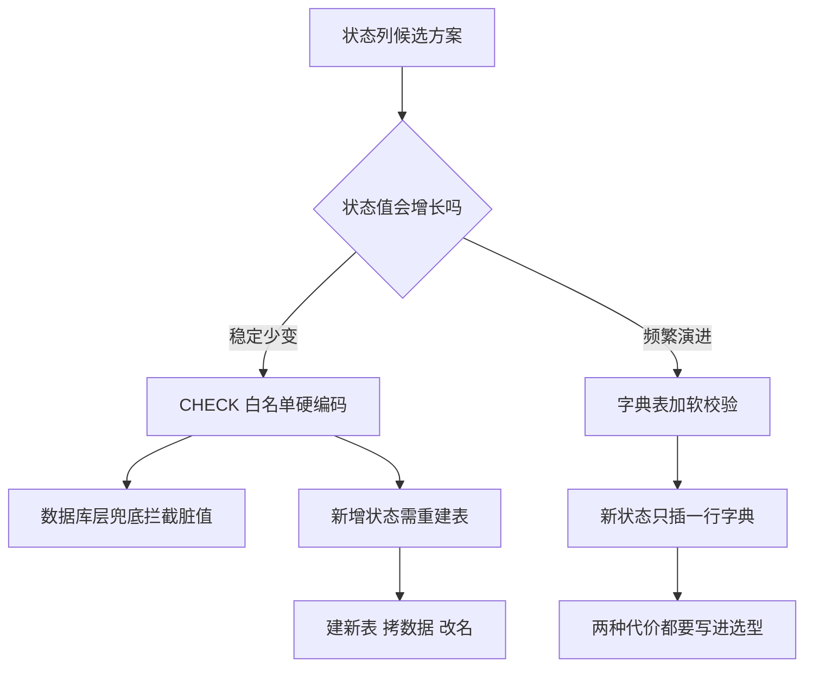
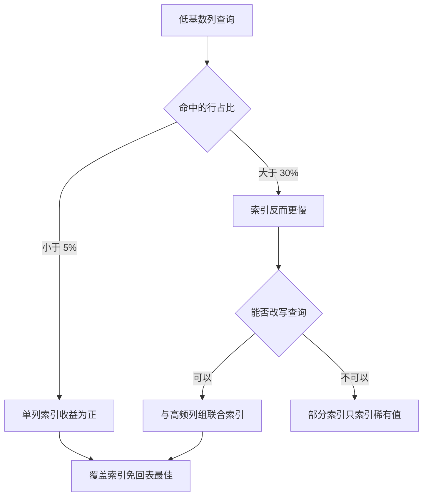
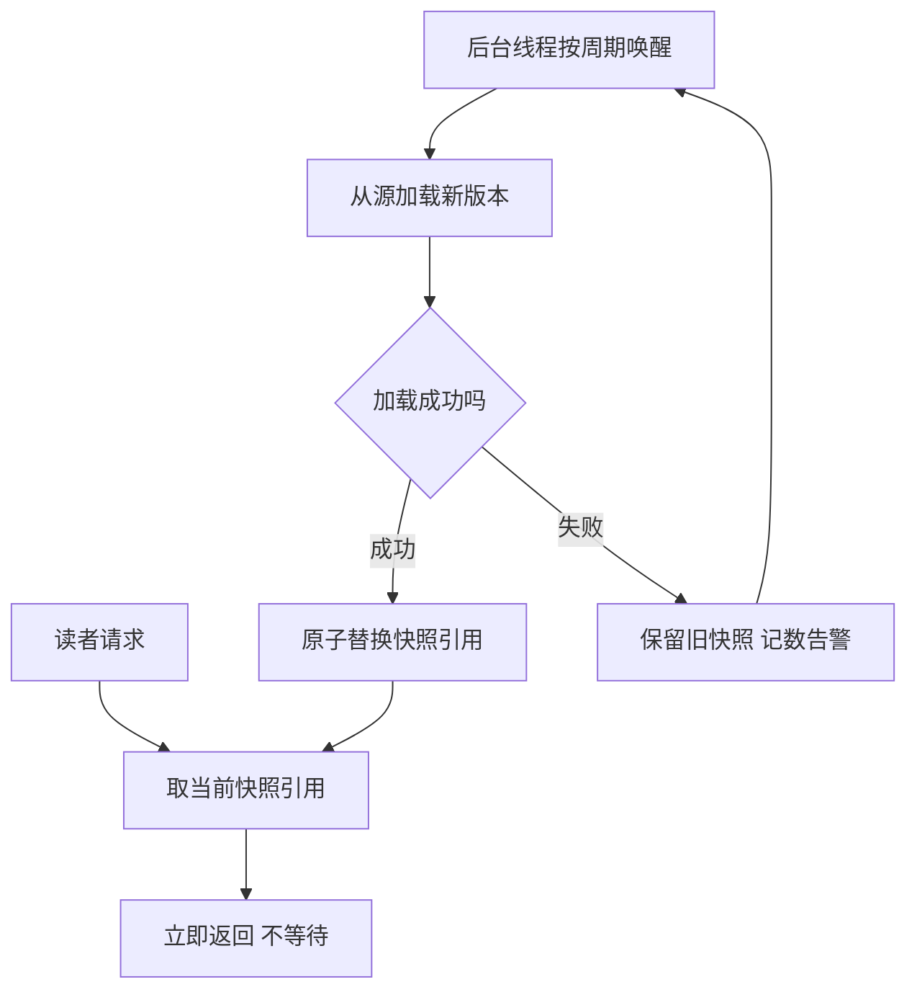
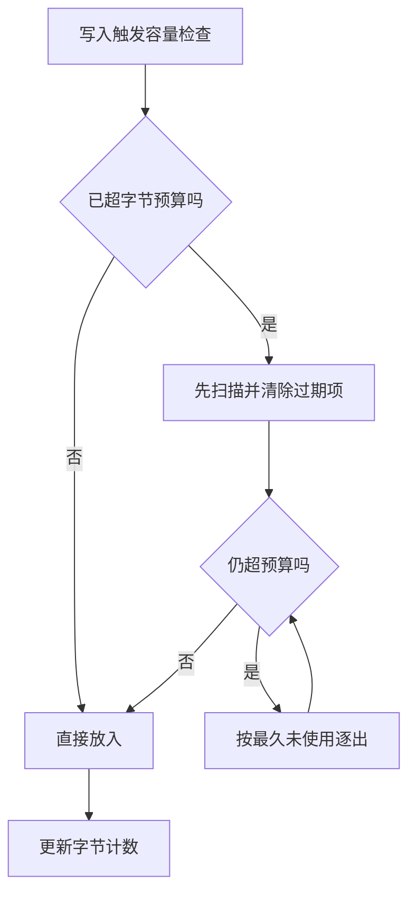
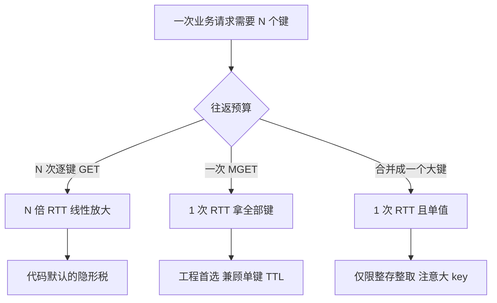
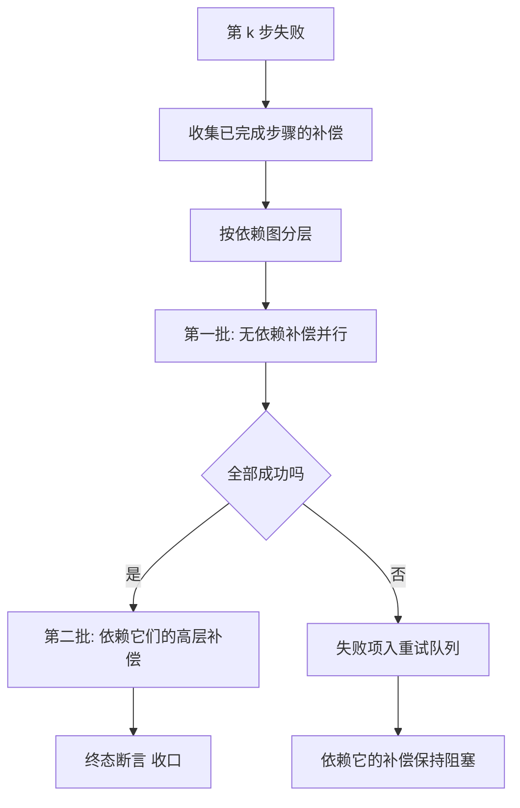
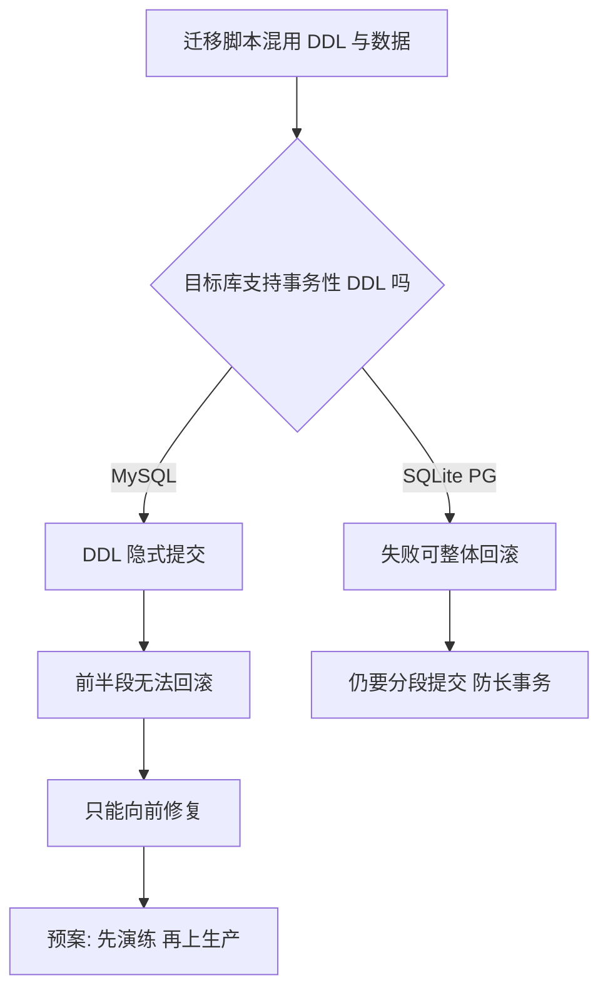
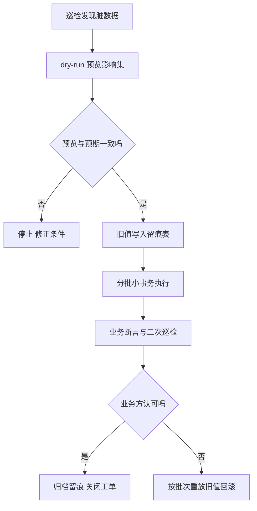
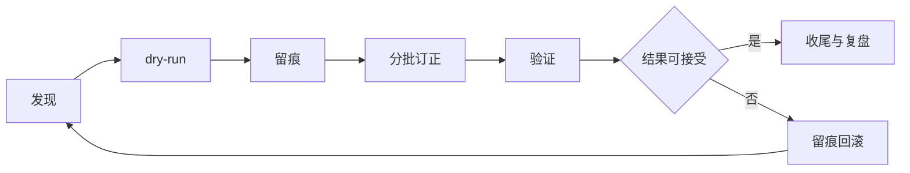

# 第 4 类 · 数据库与缓存(夜间扩产五)

本文件是第 4 类的第五批扩产,共 45 题(Q2471–Q2515),四条主线:SQL 补遗(自增空洞与回补、表达式索引写代价、跨时区日切、金额分单位、CHECK 白名单、外键开关导入、计数列与聚合、批量 UPDATE 分窗、TABLESAMPLE 与蓄水池、低基数索引实测、varchar 存数字、GROUP BY 隐式排序、一列多值反模式、文本存日期)、缓存进阶(本地刷新策略、命名空间审计、解码容错、并发双读实测、广播丢消息兜底、字节预算驱逐、快照恢复、滑动 TTL、扩容迁移率、Feed 推拉、读放大治理)、事务深水区(提交可见性实验、保存点分段、WAL 膨胀实验、幂等记录保留窗口、补偿依赖图、写偏斜、XA 两阶段、锁升级死锁、断连回滚、事务性 DDL)、迁移与治理(加列默认值 online 差异、重命名视图垫片、索引重建窗口、dry-run 订正、快照留痕回滚、schema 漂移检测、唯一索引预检、迁移幂等、命名 lint、订正治理链综合案例)。
示例以标准库 sqlite3 与纯逻辑模型为主,全部可独立运行;含耗时实测与并发实验的演示均在本机 Python 3.9 实跑通过,故意触发的异常均以 try/except 演示,单块耗时不超 6 秒。
读法建议:SQL 题抓"语义差异先于性能差异",缓存题抓"窗口与兜底",事务题抓"边界与实验",治理题抓"预检 留痕 可回滚"。

---

### Q2471 · 自增主键的空洞: 哪些操作留洞与回补的代价

> 难度:★★☆☆ | 标签:主键, SQLite

**问**:业务说订单号断号了要"把删掉的自增 id 补回来",你怎么看?自增主键的空洞到底是怎么产生的?

**答**:空洞来自三类操作:删除行、插入失败、以及(在 MySQL 里)事务回滚——InnoDB 的自增计数器是非事务性的,回滚后号段不退回;而 SQLite 的 sqlite_sequence 在事务内,回滚会一起回滚,所以 SQLite 的回滚不留洞。普通自增(rowid = max+1)删掉最大行会把号复用,AUTOINCREMENT 则永久保留空洞。手工回补技术上可行,但会让 id 变成"可占用可预测"的号段:回补的号可能再次撞唯一约束,后续自增也被顶高。工程纪律是:id 只当无意义代理键,业务连续性用单独的单号列(带日期前缀)表达,断号审计走对账而不是回补。

```python
# file: code/04_数据库与缓存/q2471_autoinc_gap.py
"""自增主键的空洞: 哪些操作留洞 哪些不留, 以及为什么不要回补"""
import sqlite3

conn = sqlite3.connect(":memory:")
c = conn.cursor()
c.execute("CREATE TABLE plain (id INTEGER PRIMARY KEY, amt INTEGER)")          # 普通自增
c.execute("CREATE TABLE strict (id INTEGER PRIMARY KEY AUTOINCREMENT, amt INTEGER)")

# 1) 回滚不消耗号段: SQLite 的 sqlite_sequence 在事务内, 回滚一起回滚
c.execute("BEGIN")
c.execute("INSERT INTO strict(amt) VALUES(1)")
c.execute("ROLLBACK")
c.execute("INSERT INTO strict(amt) VALUES(2)")
print("回滚后再插入: id=%d (SQLite 回滚不留洞; MySQL InnoDB 自增非事务性, 回滚即留洞)"
      % c.execute("SELECT id FROM strict").fetchone()[0])

# 2) 删最大行: 普通自增会复用, AUTOINCREMENT 会保留空洞
c.execute("INSERT INTO plain(amt) VALUES(10)")
c.execute("INSERT INTO plain(amt) VALUES(20)")
gone = c.execute("SELECT MAX(id) FROM plain").fetchone()[0]
c.execute("DELETE FROM plain WHERE id=?", (gone,))
c.execute("INSERT INTO plain(amt) VALUES(30)")
print("普通自增删最大行 id=%d 后: 新 id=%d (号被复用)" % (
    gone, c.execute("SELECT MAX(id) FROM plain").fetchone()[0]))
c.execute("INSERT INTO strict(amt) VALUES(10)")
c.execute("INSERT INTO strict(amt) VALUES(20)")
gone = c.execute("SELECT MAX(id) FROM strict").fetchone()[0]
c.execute("DELETE FROM strict WHERE id=?", (gone,))
c.execute("INSERT INTO strict(amt) VALUES(30)")
print("AUTOINCREMENT 删最大行 id=%d 后: 新 id=%d (%d 号成为永久空洞)" % (
    gone, c.execute("SELECT MAX(id) FROM strict").fetchone()[0], gone))

# 3) 手工回补空洞: 技术上可行, 但号段语义立刻变成"可占用"
c.execute("INSERT INTO strict(id, amt) VALUES(?, 999)", (gone,))
c.execute("INSERT INTO strict(amt) VALUES(40)")
print("回补 id=%d 后下一个自增 id=%d" % (
    gone, c.execute("SELECT MAX(id) FROM strict").fetchone()[0]))
try:
    c.execute("INSERT INTO strict(id, amt) VALUES(?, 888)", (gone,))   # 再占同号
except sqlite3.IntegrityError as e:
    print("回补到已占用号段 -> IntegrityError: %s" % e)
print("结论: 空洞是删除 失败 回滚的正常残留, 排序用时间列, 别用 id 判断连续性, 更别手工回补")
```

**追问**:
- 为什么 MySQL 的回滚会留洞而 SQLite 不会?—— InnoDB 把自增计数器放在内存且不参与事务,回滚不退号;SQLite 的 sqlite_sequence 是普通表,变更随事务回滚。
- 业务要求"单号连续"怎么办?—— 用独立的发号器/单号表按事务发号,自增 id 只做物理主键。

---

### Q2472 · 表达式索引的写代价: 读提速的账从写处扣

> 难度:★★★☆ | 标签:索引, 写放大

**问**:给表加了个 `lower(email)` 的表达式索引,读是快了,写有代价吗?

**答**:有,而且和普通索引同性质:每写一行都要维护一棵索引树,表达式索引多一步"对列值求函数",所以写放大介于无索引与"表达式更贵"之间。实测 3 万行插入,表达式索引比普通索引再慢一截,这就是读路径免全表扫描的账单。此外表达式索引还有两个隐性约束:查询条件必须写成与索引一致的表达式才能命中;表达式不可用或不稳定(依赖环境时间等)时,优化器只能放弃。工程结论是:读写比高的列才值得表达式索引,写多读少的长尾列不如在入库时物化一列。

```python
# file: code/04_数据库与缓存/q2472_expression_index_cost.py
"""表达式索引的写代价: 读路径提速的账要从写路径扣"""
import sqlite3
import time

N = 30000

def build(label, ddl):
    conn = sqlite3.connect(":memory:")
    c = conn.cursor()
    c.execute("CREATE TABLE users (id INTEGER PRIMARY KEY, email TEXT)")
    if ddl:
        c.execute(ddl)
    rows = [(i, "User.%d@Example.COM" % i) for i in range(1, N + 1)]
    t0 = time.perf_counter()
    c.executemany("INSERT INTO users(id, email) VALUES(?,?)", rows)
    cost = (time.perf_counter() - t0) * 1000
    conn.close()
    return cost

t_plain = build("无函数索引", None)
t_normal = build("普通索引", "CREATE INDEX idx_email ON users(email)")
t_expr = build("表达式索引", "CREATE INDEX idx_email_lc ON users(lower(email))")
print("写入 %d 行耗时: 无索引 %.0f ms | 普通索引 %.0f ms | 表达式索引 %.0f ms"
      % (N, t_plain, t_normal, t_expr))
print("表达式索引每行写入多一次函数求值, 比普通索引慢的部分就是读路径省下的账")

# 读路径: 表达式索引让 lower 等值查询免于全表扫描
conn = sqlite3.connect(":memory:")
c = conn.cursor()
c.execute("CREATE TABLE users (id INTEGER PRIMARY KEY, email TEXT)")
c.execute("CREATE INDEX idx_email_lc ON users(lower(email))")
c.executemany("INSERT INTO users VALUES(?,?)",
              [(i, "User.%d@Example.COM" % i) for i in range(1, 20001)])
sql = "SELECT id FROM users WHERE lower(email) = ?"
plan = " | ".join(r[3] for r in c.execute("EXPLAIN QUERY PLAN " + sql, ("user.42@example.com",)))
print("表达式索引上的查询计划: %s" % plan)
```

**追问**:
- 查询条件写 `WHERE email = ?` 能命中 lower 索引吗?—— 不能,优化器按表达式匹配,条件必须同为 `lower(email) = ?`。
- 有没有两全的办法?—— 入库时写入规范化物化列(email 全小写),普通索引覆盖读路径,写代价只有一次赋值。

---

### Q2473 · 跨时区业务的日切统计: 谁的今天

> 难度:★★☆☆ | 标签:时间, 时区

**问**:跨国业务的日报,同一个订单被算进两个不同的日子,问题出在哪?

**答**:出在切日基准:存储是 UTC,"哪一天"却是业务时区的概念。北京时间 11 月 6 日凌晨 1 点,在 UTC 里还是 11 月 5 日——直接 `GROUP BY date(paid_at)` 会把这笔单算错天。正确设计是:存储层永远 UTC(时间戳或 UTC datetime),切日发生在查询/展示层,按业务方声明的时区把时间平移后再取日期。SQLite 里就是 `date(ts, 'unixepoch', '+8 hours')` 这类平移函数;报表口径要在需求里写清"按哪个时区切日",这是契约不是实现细节。

```python
# file: code/04_数据库与缓存/q2473_timezone_daily_cut.py
"""跨时区业务的日切统计: 同一时刻在不同时区属于不同的'今天'"""
import sqlite3

conn = sqlite3.connect(":memory:")
c = conn.cursor()
# 统一存 UTC (unix 时间戳), 这是跨时区设计的地基
c.execute("CREATE TABLE orders (id INTEGER PRIMARY KEY, user_tz TEXT, paid_at INTEGER)")
rows = [
    # 2026-11-05 17:30 北京时间(UTC+8) = 09:30 UTC
    (1, "+8", 1793880600),
    # 2026-11-05 23:50 北京时间 = 15:50 UTC (北京是 5 号, UTC 也是 5 号)
    (2, "+8", 1793946600),
    # 2026-11-06 01:10 北京时间 = 2026-11-05 17:10 UTC (北京的 6 号, UTC 的 5 号!)
    (3, "+8", 1793992200),
]
c.executemany("INSERT INTO orders VALUES(?,?,?)", rows)

# 错误做法: 直接按 UTC 日期聚合
q_utc = "SELECT date(paid_at, 'unixepoch') d, COUNT(*) n FROM orders GROUP BY d ORDER BY d"
# 正确做法: 先按用户时区平移, 再切日
q_tz = ("SELECT date(paid_at, 'unixepoch', user_tz || ' hours') d, COUNT(*) n "
        "FROM orders GROUP BY d ORDER BY d")
print("按 UTC 切日:      ", dict(c.execute(q_utc).fetchall()))
print("按用户时区切日:   ", dict(c.execute(q_tz).fetchall()))

# 关键演示: 订单 3 在 UTC 里是 5 号, 在用户时区里是 6 号
row = c.execute("SELECT date(paid_at, 'unixepoch'), "
                "date(paid_at, 'unixepoch', user_tz || ' hours') "
                "FROM orders WHERE id=3").fetchone()
print("订单3: UTC 日期=%s, 用户时区日期=%s (运营日报必须用后者)" % row)
print("纪律: 存储永远 UTC, '哪一天'是展示层按业务时区裁剪的, 别把 GROUP BY 直接打在 UTC 上")
```

**追问**:
- 为什么不能各存各的本地时间?—— 本地时间有 DST 跳变和歧义区间,无法做全局排序与区间计算;UTC 是唯一可比的基准。
- 日切平移后还能走索引吗?—— 平移破坏了原值有序性,大表上预生成"业务日"列加索引,或按天落预聚合表。

---

### Q2474 · 金额的最小单位存储: 分整数把浮点挡在库外

> 难度:★★☆☆ | 标签:金额, 精度

**问**:金额字段用 REAL 存元,为什么算久了账对不上?有什么更好的存法?

**答**:浮点存不下十进制的 0.1,累加与乘除后误差显形,SUM 出 0.30000000000000004 只是开始。两个正解:DECIMAL 类型(MySQL/PG)或最小单位整数——把"元"换成"分"存 INTEGER,加减乘(乘以整数倍率)全在整数域精确完成,展示层才除以 100 格式化。分单位存储的真正考点是除法分摊:10000 分分给 3 人,要按 base+余数顺序分配,保证合计一分不丢。另一个坑是"浮点元 ×100 转分"的转换本身引入误差,必须 round 或从一开始就存分。币种切换、汇率换算也要落在最小单位上,别在浮点域里做。

```python
# file: code/04_数据库与缓存/q2474_money_minor_unit.py
"""金额的最小单位存储: 用'分'的整数, 把浮点误差挡在库外"""
import sqlite3

conn = sqlite3.connect(":memory:")
c = conn.cursor()
c.execute("CREATE TABLE payments (id INTEGER PRIMARY KEY, cents INTEGER NOT NULL)")
# 若用 REAL 存 0.1+0.2 之类, 聚合后出现 0.30000000000000004
c.execute("CREATE TABLE payments_real (amount REAL)")
c.executemany("INSERT INTO payments_real VALUES(?)", [(0.1,), (0.2,)])
print("浮点存储聚合: %r  <- 经典误差" % c.execute(
    "SELECT SUM(amount) FROM payments_real").fetchone()[0])

# 分单位整数: 聚合永远精确
c.executemany("INSERT INTO payments(cents) VALUES(?)", [(10,), (20,), (70,)])
total = c.execute("SELECT SUM(cents) FROM payments").fetchone()[0]
print("分单位聚合: %d 分 = %.2f 元, 无任何误差" % (total, total / 100.0))

# 分摊: 100 元分给 3 人, 余数处理是分单位存储的真正考点
def split_cents(total_cents, n):
    base, rem = divmod(total_cents, n)
    return [base + (1 if i < rem else 0) for i in range(n)]

parts = split_cents(10000, 3)
print("10000 分分 3 份 -> %s, 合计 %d 分, 一分不丢" % (parts, sum(parts)))
assert sum(parts) == 10000

# 边界: 千万别把'元'的小数与'分'的整数混存
c.execute("CREATE TABLE bad (amount REAL)")
c.execute("INSERT INTO bad VALUES(19.99)")
stored = c.execute("SELECT amount * 100 FROM bad").fetchone()[0]
print("浮点元 * 100 转分: %r  <- 转换本身引入误差, 必须 round 或从一开始就存分" % stored)
print("纪律: 金额列一律整数分(或 DECIMAL), 运算在整数域完成, 展示层才除 100 格式化")
```

**追问**:
- 大额场景整数分会溢出吗?—— BIGINT 分单位上限约 92 亿亿元,普通业务够用;跨币种聚合时统一到最小公共单位。
- 为什么不推荐 FLOAT 存元再加 round?—— round 只是掩盖显示,中间态误差已经累积,对账差异时无法解释。

---

### Q2475 · 状态列的 CHECK 白名单与迁移代价

> 难度:★★★☆ | 标签:约束, 状态机

**问**:状态字段直接用 VARCHAR 随便写,怎么用数据库层守住?又有什么代价?

**答**:用 CHECK 约束做白名单:`CHECK (state IN ('pending','running','done','failed'))`,应用层失守(拼错、绕过 ORM 直写)时数据库照样拦截脏值。代价在演进:SQLite 不支持 ALTER 修改 CHECK,新增一个状态值必须走"建新表-拷数据-改名"的重建流程;MySQL 里改 CHECK 同样要改表定义。所以选型标准是:低频稳定的状态集(订单生命周期)值得 CHECK 硬编码,高频扩展的枚举(标签、类目)放字典表加软校验。两层可以并用:CHECK 兜住核心生命周期,字典表管可扩展属性。

```python
# file: code/04_数据库与缓存/q2475_check_state_whitelist.py
"""状态列的 CHECK 白名单: 数据库层兜底, 以及新增状态要重建表的迁移代价"""
import sqlite3

conn = sqlite3.connect(":memory:")
c = conn.cursor()
c.execute("""CREATE TABLE tasks (
    id INTEGER PRIMARY KEY,
    state TEXT NOT NULL DEFAULT 'pending'
    CHECK (state IN ('pending', 'running', 'done', 'failed'))
)""")
c.execute("INSERT INTO tasks(state) VALUES('pending'), ('running'), ('done')")

# 白名单拦截非法状态, 应用层失守也有防线
try:
    c.execute("INSERT INTO tasks(state) VALUES('runing')")   # 手滑的拼写
except sqlite3.IntegrityError as e:
    print("非法状态被 CHECK 拦截: %s" % e)

# 迁移代价: SQLite 不支持 ALTER 修改 CHECK, 新增状态必须重建表
try:
    c.execute("ALTER TABLE tasks ADD CONSTRAINT dummy CHECK (1=1)")
except sqlite3.OperationalError as e:
    print("ALTER 改 CHECK 不可行: %s" % e)

print("-- 走重建表流程: 建新表 -> 拷数据 -> 改名 --")
c.execute("""CREATE TABLE tasks_new (
    id INTEGER PRIMARY KEY,
    state TEXT NOT NULL DEFAULT 'pending'
    CHECK (state IN ('pending', 'running', 'done', 'failed', 'cancelled'))
)""")
c.execute("INSERT INTO tasks_new SELECT id, state FROM tasks")
c.execute("DROP TABLE tasks")
c.execute("ALTER TABLE tasks_new RENAME TO tasks")
c.execute("INSERT INTO tasks(state) VALUES('cancelled')")
print("重建后状态集合:", [r[0] for r in c.execute("SELECT DISTINCT state FROM tasks ORDER BY state")])

print("结论: CHECK 白名单防脏数据有效, 但枚举演进要付出重建表代价,")
print("      高频新增的状态值放字典表, 低频稳定的状态值才值得 CHECK 硬编码")
```

**追问**:
- CHECK 与 ORM 层枚举怎么分工?—— ORM 枚举管开发期拼写与流转逻辑,CHECK 管运行期兜底,两边白名单要进 CI 比对。
- 大表重建 CHECK 的锁影响?—— 重建等于全表读写,必须低峰窗口或在线改表工具,见前面大表 DDL 相关题。



---

### Q2476 · 外键开关下的批量导入: 即时拦截与事后巡检

> 难度:★★★☆ | 标签:外键, 批量导入

**问**:大批量导入时都说"先关外键",关了完整性谁管?

**答**:关外键不是免检,是"把即时拦截换成事后巡检":外键开启时每行写入都做一次父表查找,坏行当场被拒;关闭后全部进库,靠 `PRAGMA foreign_key_check`(或手工 NOT IN 反查)找出孤儿行再处置。实测同样的 10 条悬空引用:开着导入,合法 2 万行入库而坏行零入库;关着导入则 2 万零 10 条全进,巡检报出 10 条孤儿。性能上,内存库的差距不大,磁盘库上外键的逐行随机读会显著放大,这正是"关外键导入"的动机。前提是外键约束必须真的声明在表上,否则连事后巡检都无从谈起。

```python
# file: code/04_数据库与缓存/q2476_fk_import_perf.py
"""外键开关下的批量导入: 即时拦截 vs 事后巡检的权衡"""
import sqlite3
import time

N = 20000
BAD = [(30000 + i, 99999) for i in range(10)]          # 10 条悬空引用
rows = [(i, (i % 10000) + 1) for i in range(1, N + 1)] + BAD

def build(conn):
    c = conn.cursor()
    c.execute("CREATE TABLE users (id INTEGER PRIMARY KEY, name TEXT)")
    c.execute("CREATE TABLE orders (id INTEGER PRIMARY KEY, "
              "user_id INTEGER NOT NULL REFERENCES users(id))")   # 外键必须显式声明
    c.executemany("INSERT INTO users VALUES(?,?)",
                  [(i, "u%d" % i) for i in range(1, 10001)])
    return c

# 方式一: 开外键, 坏行当场拦截
conn_on = sqlite3.connect(":memory:")
conn_on.execute("PRAGMA foreign_keys = ON")
c = build(conn_on)
try:
    c.executemany("INSERT INTO orders VALUES(?,?)", rows)
except sqlite3.IntegrityError as e:
    ok = c.execute("SELECT COUNT(*) FROM orders").fetchone()[0]
    print("外键开启: %s -> 悬空引用零入库, 合法行已入库 %d 条" % (e, ok))

# 方式二: 关外键, 全部进库后巡检
conn_off = sqlite3.connect(":memory:")
conn_off.execute("PRAGMA foreign_keys = OFF")
c = build(conn_off)
t0 = time.perf_counter()
c.executemany("INSERT INTO orders VALUES(?,?)", rows)
ms = (time.perf_counter() - t0) * 1000
violations = c.execute("PRAGMA foreign_key_check(orders)").fetchall()
print("外键关闭: %d 条全部入库 耗时 %.0f ms, 巡检发现 %d 条孤儿行"
      % (N + 10, ms, len(violations)))
orphans = c.execute("""SELECT COUNT(*) FROM orders o
    WHERE o.user_id NOT IN (SELECT id FROM users)""").fetchone()[0]
print("补一刀确认: user_id 不在 users 的行 = %d 条, 需补数据或删除" % orphans)
assert len(violations) == orphans == 10

# 性能面: 同一批合法数据, 开关外键各导一次 (先清表)
c.execute("DELETE FROM orders")
t0 = time.perf_counter()
c.executemany("INSERT INTO orders VALUES(?,?)", rows[:N])
ms_off = (time.perf_counter() - t0) * 1000
conn_on2 = sqlite3.connect(":memory:")
conn_on2.execute("PRAGMA foreign_keys = ON")
c2 = build(conn_on2)
t0 = time.perf_counter()
c2.executemany("INSERT INTO orders VALUES(?,?)", rows[:N])
ms_on = (time.perf_counter() - t0) * 1000
print("合法数据 %d 行导入: 外键开 %.0f ms vs 外键关 %.0f ms (内存库差距小, 磁盘库放大)"
      % (N, ms_on, ms_off))
print("结论: 即时拦截换来的是'坏行进不了门', 事后巡检换来的是'吞吐', 二者必须二选一地自觉")
```

**追问**:
- 关外键导入的完整工序是什么?—— 关外键 -> 导入 -> foreign_key_check 巡检 -> 处置孤儿 -> 恢复外键,缺一步都是埋雷。
- MySQL 里对应的事后巡检怎么做?—— 没有直接等价物,常用 LEFT JOIN 反查孤儿 SQL,或用 pt-table-checksum 类工具。

---

### Q2477 · 计数列与实时聚合: 一致性窗口的取舍

> 难度:★★★☆ | 标签:表设计, 聚合

**问**:点赞数、粉丝数这类数字,是存一列每次加减,还是每次 COUNT?

**答**:这是读写权衡:计数列读 O(1),代价是每次明细变更都要在同一事务里同步加减,漏一次就漂移;实时聚合读 O(n),但永远正确、零维护。选择取决于读频与一致性要求:首页高频展示用计数列,后台低频报表直接聚合。用计数列必须配两样东西——事务纪律(明细与计数同事务)和定期对账(以明细为准重算修复漂移)。还有一条红线:计数列只允许"随明细事务"变更,禁止业务旁路直接改它。

```python
# file: code/04_数据库与缓存/q2477_counter_vs_aggregate.py
"""计数列与实时聚合: 读得快与数得对的取舍"""
import sqlite3

conn = sqlite3.connect(":memory:")
c = conn.cursor()
c.execute("CREATE TABLE posts (id INTEGER PRIMARY KEY, title TEXT, like_count INTEGER NOT NULL DEFAULT 0)")
c.execute("CREATE TABLE likes (post_id INTEGER NOT NULL, user_id INTEGER NOT NULL, "
          "PRIMARY KEY(post_id, user_id))")
c.execute("INSERT INTO posts(id, title) VALUES(1, '设计复盘')")
likes = [(1, u) for u in range(1, 1001)]
c.executemany("INSERT INTO likes VALUES(?,?)", likes)
c.execute("UPDATE posts SET like_count = like_count + 1 WHERE id = 1")
conn.commit()

# 读路径对比: 计数列 O(1) vs 实时聚合 O(n)
t = c.execute("SELECT like_count FROM posts WHERE id=1").fetchone()[0]
real = c.execute("SELECT COUNT(*) FROM likes WHERE post_id=1").fetchone()[0]
print("读路径: 计数列=%d 实时聚合=%d (一致, 但聚合要扫 likes 索引)" % (t, real))

# 一致性窗口: 计数列的更新若与明细不在同一事务, 就会漂移
c.execute("INSERT INTO likes VALUES(1, 9999)")          # 只写明细, 忘了同步计数
print("漏同步后: 计数列=%d 实时聚合=%d (漂移了 1)" %
      (c.execute("SELECT like_count FROM posts WHERE id=1").fetchone()[0],
       c.execute("SELECT COUNT(*) FROM likes WHERE post_id=1").fetchone()[0]))

# 修复: 以明细为准重算, 并规定计数列只允许'同事务内'变更
c.execute("UPDATE posts SET like_count = (SELECT COUNT(*) FROM likes WHERE post_id = likes.post_id) "
          "WHERE id = 1")
c.execute("INSERT INTO likes VALUES(1, 8888)")          # 正确姿势: 同一事务里两件事一起做
c.execute("UPDATE posts SET like_count = like_count + 1 WHERE id = 1")
t2 = c.execute("SELECT like_count FROM posts WHERE id=1").fetchone()[0]
real2 = c.execute("SELECT COUNT(*) FROM likes WHERE post_id=1").fetchone()[0]
print("重算后再同事务写入: 计数列=%d 聚合=%d 重新一致" % (t2, real2))
print("结论: 计数列是读写权衡的缓存, 收益是 O(1) 读, 代价是必须用事务纪律和定期对账偿还")
```

**追问**:
- 热点内容的计数列并发加减怎么办?—— 用原子自增 `SET c = c + 1` 而不是读改写,极端热点再上缓冲合并(见热点账户题)。
- 对账多久跑一次?—— 与业务容忍度对齐:展示类按小时,资金类必须实时同事务且天级对账兜底。

---

### Q2478 · 批量 UPDATE 的分窗执行: 锁窗口与断点

> 难度:★★★☆ | 标签:批量, 运维

**问**:要把 2 万行订单打上标记,一条大 UPDATE 和分批执行怎么选?

**答**:一条大 UPDATE 的问题是"一把锁到底":行锁(或间隙锁)从头持到尾,主从延迟拉长,失败则全部回滚重来。分窗执行用主键窗口切片,每窗一个独立小事务,锁窗口变成 N 段,每段提交后进度可观测、可断点续跑——记住上一个窗口的右边界,中断后从它继续。窗口大小按"单窗执行时间 × 主从延迟预算"定,通常几千行。代价是总耗时略增(多次事务开销)与窗口间数据变动需要条件里带好过滤,工程上绝大多数批量 UPDATE 都值得分窗。

```python
# file: code/04_数据库与缓存/q2478_batched_update_windows.py
"""批量 UPDATE 的分窗执行: 用主键窗口切片, 控锁控速可断点"""
import sqlite3
import time

DB = ":memory:"
conn = sqlite3.connect(DB)
c = conn.cursor()
c.execute("CREATE TABLE orders (id INTEGER PRIMARY KEY, status TEXT, flag INTEGER NOT NULL DEFAULT 0)")
c.executemany("INSERT INTO orders(id, status) VALUES(?,?)",
              [(i, "done" if i % 3 == 0 else "pending") for i in range(1, 20001)])
c.execute("CREATE INDEX idx_status ON orders(status)")
conn.commit()

WINDOW = 2500
last_max_id = 0          # 断点: 上一个窗口的右边界
t0 = time.perf_counter()
total = 0
while True:
    # 每个窗口独立事务: 主键 > 上次右边界 AND 条件命中, 再限行数
    c.execute("BEGIN")
    c.execute(
        "UPDATE orders SET flag = 1 WHERE id > ? AND id <= ? AND status = 'done'",
        (last_max_id, last_max_id + WINDOW))
    n = c.rowcount
    hi = c.execute("SELECT MAX(id) FROM orders WHERE id > ? AND id <= ?",
                   (last_max_id, last_max_id + WINDOW)).fetchone()[0]
    c.execute("COMMIT")
    if hi is None:
        break
    last_max_id = hi
    total += n
    print("窗口 <=%-6d 本窗更新 %5d 行, 累计 %6d 行" % (hi, n, total))
    if last_max_id >= 20000:
        break

cost = (time.perf_counter() - t0) * 1000
done = c.execute("SELECT COUNT(*) FROM orders WHERE status='done' AND flag=1").fetchone()[0]
all_done = c.execute("SELECT COUNT(*) FROM orders WHERE status='done'").fetchone()[0]
print("分窗执行完成: 命中 %d/%d, 耗时 %.0f ms; 每窗独立提交, 中断后从 last_max_id=%d 续跑"
      % (done, all_done, cost, last_max_id))
print("与一条大 UPDATE 相比: 单条语句一把锁到底, 分窗把锁窗口切成 N 段, 主从延迟与锁等待都可控")
```

**追问**:
- 窗口怎么选不会漏行?—— 以主键为序推进,条件里带主键区间与业务过滤;业务条件随时间变化的要先落成快照表再更新。
- 和"LIMIT 2000 循环"的区别?—— LIMIT 循环每次都要重新找命中行,主键窗口走范围扫描,推进边界明确且天然可断点。

---

### Q2479 · 随机抽样的系统替代: TABLESAMPLE 概念与蓄水池

> 难度:★★★☆ | 标签:SQL, 抽样

**问**:PostgreSQL 的 TABLESAMPLE 是什么?SQLite/MySQL 没有它怎么做随机抽样?

**答**:TABLESAMPLE 有两种方言:SYSTEM 按"页/块"抽取,块内全要,快但样本天然成簇有偏;BERNOULLI 逐行独立按概率抽,无偏但行数有波动。没有该语法的库,替代按场景选:行号连续的表用"随机起点区间"(快但有偏);流式读取用蓄水池抽样(单趟、恰好 k 行、数学等概率),这是无偏场景的标准答案;要反复在线随机就预生成随机键列加索引。判断标准:抽样语义要"无偏"就上蓄水池,要"够快够随机"就接受有偏的起点法,ORDER BY random() 全表排序则永远不该出现在大表上。

```python
# file: code/04_数据库与缓存/q2479_tablesample_concept.py
"""随机抽样的系统替代: TABLESAMPLE 概念与无偏的蓄水池"""
import random

random.seed(42)
N = 10000
rows = list(range(1, N + 1))            # 有序生成的行, id 即业务顺序

# 概念复刻一: TABLESAMPLE SYSTEM —— 按页抽取, 页内全要, 天然成簇有偏
PAGE = 100
pages = [rows[i:i + PAGE] for i in range(0, N, PAGE)]
picked_pages = random.sample(pages, 3)
system_sample = [r for p in picked_pages for r in p]
print("SYSTEM 风格: 抽 3 页得 %d 行, 样本 id 区间 %d~%d (挤在 3 个局部, 有偏)"
      % (len(system_sample), min(system_sample), max(system_sample)))

# 概念复刻二: TABLESAMPLE BERNOULLI —— 逐行独立以 p 抽取, 无偏但数量波动
p = 0.001
bern = [r for r in rows if random.random() < p]
print("BERNOULLI 风格: p=%.3f 抽得 %d 行 (期望 10, 实际有波动), id 分布: %s"
      % (p, len(bern), bern[:12]))

# 工程首选: 蓄水池抽样 —— 单趟流式, 恰好 k 行且等概率
def reservoir(stream, k):
    pool = []
    for i, item in enumerate(stream, 1):
        if i <= k:
            pool.append(item)
        else:
            j = random.randint(1, i)
            if j <= k:
                pool[j - 1] = item
    return pool

k = 10
pool = reservoir(iter(rows), k)
print("蓄水池: 恰好 %d 行: %s, id 跨越全表说明无位置偏倚" % (k, sorted(pool)))
assert len(pool) == k

# 等概率验证: 每行入选率应同为 k/N
hits = {}
for trial in range(300):
    random.seed(trial)
    for x in reservoir(iter(rows), k):
        hits[x] = hits.get(x, 0) + 1
rates = sorted(hits.values())
print("300 次重复实验: 被抽中的不同行数=%d, 单行入选次数 min=%d max=%d (接近则等概率)"
      % (len(hits), rates[0], rates[-1]))
print("结论: TABLESAMPLE 是方言且 SYSTEM 有偏; 要无偏抽样, 蓄水池是流式场景的标准答案")
```

**追问**:
- 蓄水池为什么等概率?—— 第 i 行以 k/i 概率入选,替换者以 k/i 概率被换出,归纳可得最终每行入选率均为 k/N。
- 抽样要"按分组各抽 k 条"怎么办?—— 按分组键分桶后对每桶独立蓄水池,或窗口函数 row_number 配合随机排序键。

---

### Q2480 · 低基数列的单列索引: 选择性决定成败

> 难度:★★★☆ | 标签:索引, 选择性

**问**:status 只有三个值,给它建索引有用吗?

**答**:取决于查询命中的行占比,不是列的基数字本身:命中 1% 的稀有值,索引是数倍收益;命中 90% 的常见值,非覆盖索引意味着几十万次随机回表,实测比顺序全表扫描还慢。所以低基数列的索引规则有三条:单列索引只服务稀有值查询;与高频条件组成联合索引(如 status+created_at)让范围过滤受益;或用部分索引只索引稀有值,体积还小。反过来说,删掉一个"从未被稀有值查询用到"的低基数单列索引,写入立刻受益——它纯粹是写放大。

```python
# file: code/04_数据库与缓存/q2480_low_cardinality_index.py
"""低基数列的单列索引: 选择性决定它是加速器还是累赘"""
import sqlite3
import time

conn = sqlite3.connect(":memory:")
c = conn.cursor()
c.execute("CREATE TABLE t (id INTEGER PRIMARY KEY, status TEXT, payload TEXT)")
# 90% 是 a, 9% 是 b, 1% 是 c
rows = []
for i in range(1, 50001):
    s = 'a' if i % 10 < 9 else ('b' if i % 100 < 95 else 'c')
    rows.append((i, s, "p%d" % i))
c.executemany("INSERT INTO t VALUES(?,?,?)", rows)
c.execute("CREATE INDEX idx_status ON t(status)")
c.execute("ANALYZE")

def timed(sql, args):
    t0 = time.perf_counter()
    data = c.execute(sql, args).fetchall()
    return len(data), (time.perf_counter() - t0) * 1000

# 同一条查询, 两种选择性, 有索引与无索引各跑一次
for v in ('c', 'a'):
    n_with, ms_with = timed("SELECT * FROM t WHERE status = ?", (v,))
    c.execute("DROP INDEX idx_status")
    c.execute("ANALYZE")
    n_wo, ms_wo = timed("SELECT * FROM t WHERE status = ?", (v,))
    c.execute("CREATE INDEX idx_status ON t(status)")
    c.execute("ANALYZE")
    verdict = "索引赢" if ms_with < ms_wo else "索引反而慢"
    print("status='%s' 命中 %5d 行: 有索引 %6.1f ms | 无索引 %6.1f ms -> %s"
          % (v, n_with, ms_with, ms_wo, verdict))

# 出路: 低基数列不单独出门, 与高频条件组成联合索引才有效
c.execute("CREATE INDEX idx_status_payload ON t(status, payload)")
plan = " | ".join(r[3] for r in c.execute(
    "EXPLAIN QUERY PLAN SELECT * FROM t WHERE status='c' AND payload LIKE 'p4%'"))
print("组合索引下的计划: %s" % plan)
print("结论: 选择性 1% 的值走索引是数倍收益, 90% 的值走非覆盖索引是数倍亏损,")
print("      低基数列要么进联合索引, 要么建部分索引只索引稀有值")
```

**追问**:
- 优化器为什么不自动弃用低选择性索引?—— 成本估算依赖统计信息,估算偏差加上覆盖扫描的收益,使它常常仍选索引;要以实测为准。
- 联合索引里低基数列放第一列还是第二列?—— 等值条件在前、范围在后;低基数等值列放前面仍能命中,后面列才承担真正的过滤。



---

### Q2481 · varchar 存数字: 排序与范围的双陷阱

> 难度:★★☆☆ | 标签:数据类型, 字符串

**问**:编号字段存成了 VARCHAR,排序 '10' 跑到 '9' 前面,范围查询也不对,怎么救?

**答**:两个陷阱同源——字典序:排序上 '10' < '2',范围上 BETWEEN '3' AND '50' 会把 '10' 判到界外。急救是 `CAST(col AS INTEGER)`,语义立刻正确,但 CAST 是表达式,普通索引失效、每行转换。兜底方案是表达式索引(对 CAST 结果建索引)或入库时写一列整数影子列;根治方案是把类型改对,数字别住进字符串。判断一个"数字列"该不该是 TEXT 只有一条:它要不要参与排序、范围、聚合,要,就必须是数值类型。

```python
# file: code/04_数据库与缓存/q2481_varchar_numbers.py
"""varchar 存数字: 排序与范围的双陷阱"""
import sqlite3

conn = sqlite3.connect(":memory:")
c = conn.cursor()
c.execute("CREATE TABLE bad (code TEXT NOT NULL)")        # 编号被建成 TEXT
c.executemany("INSERT INTO bad VALUES(?)", [('2',), ('9',), ('10',), ('100',)])

# 陷阱一: 字典序不是数值序, '10' < '2'
got = [r[0] for r in c.execute("SELECT code FROM bad ORDER BY code")]
print("TEXT 排序: %s   <- '10' 排在 '2' 前面" % got)
good = [r[0] for r in c.execute("SELECT code FROM bad ORDER BY CAST(code AS INTEGER)")]
print("CAST 修复: %s   <- 但 CAST 让索引失效, 每行都要转换" % good)

# 陷阱二: 范围条件按字符串比较, 边界错得离谱
in_range = [r[0] for r in c.execute("SELECT code FROM bad WHERE code BETWEEN '3' AND '50'")]
print("TEXT 范围 [3,50]: %s   <- 字典序下 '10' 在界外, '100' 也不在, 全错" % in_range)
in_range2 = [r[0] for r in c.execute(
    "SELECT code FROM bad WHERE CAST(code AS INTEGER) BETWEEN 3 AND 50")]
print("CAST 范围 [3,50]: %s   <- 结果对了, 但全表扫描" % in_range2)

# 正解: 从类型上就别让数字住进字符串, 已有表用表达式索引救急
c.execute("CREATE TABLE good (code INTEGER NOT NULL)")
c.executemany("INSERT INTO good VALUES(?)", [(2,), (9,), (10,), (100,)])
print("INTEGER 列排序:", [r[0] for r in c.execute("SELECT code FROM good ORDER BY code")])
c.execute("CREATE TABLE legacy (code TEXT)")
c.executemany("INSERT INTO legacy VALUES(?)", [('2',), ('9',), ('10',), ('100',)])
c.execute("CREATE INDEX idx_code_num ON legacy(CAST(code AS INTEGER))")
plan = " | ".join(r[3] for r in c.execute(
    "EXPLAIN QUERY PLAN SELECT * FROM legacy WHERE CAST(code AS INTEGER) = 10"))
print("表达式索引兜底的计划: %s" % plan)
print("结论: 排序错与范围错同源——字典序; 修复靠类型, 兜底靠表达式索引, 别靠 CAST 硬扛")
```

**追问**:
- 编号带字母前缀("A-100")怎么办?—— 拆列:前缀与数字分开存,数字列用整数类型,展示时拼接。
- 隐式转换能救吗?—— SQLite 的亲和性会救等值比较,但排序与跨库行为不可靠,显式 CAST 或改类型才是契约。

---

### Q2482 · GROUP BY 与 DISTINCT 的隐式排序神话

> 难度:★★☆☆ | 标签:SQL, 排序

**问**:GROUP BY 的结果看起来总是有序的,可以依赖这个顺序吗?

**答**:不可以。"看起来有序"是执行计划的副产品:走索引扫描时按索引序输出,走临时 B 树时按排序结构输出——两种今天都恰好有序,但契约不存在。实测同一查询,把索引从 ASC 重建为 DESC,DISTINCT 与 GROUP BY 的输出顺序整个翻转;删掉索引退回临时结构,顺序又变。老版 MySQL 的 GROUP BY 曾隐式排序,8.0 起官方明确移除该行为。规则:面向人展示、或喂给 INSERT SELECT 的结果,一律显式 ORDER BY;"现在碰巧有序"不是可以省一行代码的理由。

```python
# file: code/04_数据库与缓存/q2482_groupby_order_flip.py
"""GROUP BY 与 DISTINCT 的隐式排序神话: 输出顺序是计划的副产品"""
import sqlite3

conn = sqlite3.connect(":memory:")
c = conn.cursor()
c.execute("CREATE TABLE t (id INTEGER PRIMARY KEY, cat TEXT)")
c.executemany("INSERT INTO t VALUES(?,?)",
              [(i, "cat%d" % (i % 7)) for i in range(1, 20001)])

# 场景一: ASC 索引在手, 优化器走索引扫描, 输出'恰好'有序
c.execute("CREATE INDEX idx_cat_asc ON t(cat)")
plan = [r[3] for r in c.execute("EXPLAIN QUERY PLAN SELECT DISTINCT cat FROM t")]
out = [r[0] for r in c.execute("SELECT DISTINCT cat FROM t")]
print("ASC 索引: %s" % out)
print("  计划: %s" % plan[0])

# 场景二: 同一条查询, 重建一个 DESC 索引, 输出顺序整个翻转
c.execute("DROP INDEX idx_cat_asc")
c.execute("CREATE INDEX idx_cat_desc ON t(cat DESC)")
plan = [r[3] for r in c.execute("EXPLAIN QUERY PLAN SELECT DISTINCT cat FROM t")]
out = [r[0] for r in c.execute("SELECT DISTINCT cat FROM t")]
print("DESC 索引: %s" % out)
print("  计划: %s" % plan[0])
plan = [r[3] for r in c.execute("EXPLAIN QUERY PLAN SELECT cat, COUNT(*) FROM t GROUP BY cat")]
out = [r[0] for r in c.execute("SELECT cat, COUNT(*) FROM t GROUP BY cat")]
print("GROUP BY 同样跟着索引方向走: %s" % out)

# 没有任何契约说它必须有序; 今天靠计划白捡的顺序, 明天一次 ANALYZE 就能收走
c.execute("DROP INDEX idx_cat_desc")
plan = [r[3] for r in c.execute("EXPLAIN QUERY PLAN SELECT DISTINCT cat FROM t")]
out = [r[0] for r in c.execute("SELECT DISTINCT cat FROM t")]
print("无索引回退临时结构: %s | 计划: %s" % (out, plan[0]))
print("结论: 输出顺序取决于优化器选了哪条路, 面向人或喂给 INSERT SELECT 的结果必须显式 ORDER BY")
```

**追问**:
- 子查询里的 ORDER BY 会被保留吗?—— 多数优化器对无 LIMIT 的子查询排序直接忽略,排序契约只属于最外层。
- 为什么"看起来有序"这么稳定?—— 索引扫描与临时 B 树两类计划都恰好产出有序,稳定的是计划不是语义,计划本身会漂移。

---

### Q2483 · 一列存多值的反模式: 逗号拼接与关联表

> 难度:★★★☆ | 标签:表设计, 范式

**问**:文章表里用 tags 列存 "python,sql,cache",哪里会出问题?

**答**:四个层面全坏:语义上 LIKE '%python%' 会把 pythonic 误判进来,精确匹配只能拼逗号再 LIKE,丑陋且依赖数据规范;性能上任何 LIKE 都全表扫描,关联表一个等值索引直达;关系代数上"求共现标签""按标签聚合"这类查询在拼接列里几乎写不动,只能拉回应用层;一致性上没法用外键约束标签合法性。正解是关联表(article_tags)+ 复合主键或 (tag, article_id) 索引,查询、索引、扩展性同时恢复。第一范式在这类题上不是教条,是性能与可维护性的底线。

```python
# file: code/04_数据库与缓存/q2483_multivalue_column.py
"""一列存多值的反模式: 逗号拼接的查询代价与关联表改造"""
import sqlite3
import time

conn = sqlite3.connect(":memory:")
c = conn.cursor()
c.execute("CREATE TABLE bad_articles (id INTEGER PRIMARY KEY, tags TEXT)")
c.execute("CREATE TABLE articles (id INTEGER PRIMARY KEY, title TEXT)")
c.execute("CREATE TABLE article_tags (article_id INTEGER, tag TEXT, "
          "PRIMARY KEY(article_id, tag))")
c.execute("CREATE INDEX idx_at_tag ON article_tags(tag, article_id)")

TAGS = ["python", "pythonic", "sql", "cache", "db", "ops"]
for i in range(1, 5001):
    ts = ",".join(TAGS[i % 6:] + TAGS[:i % 6])            # 反模式: 拼进一列
    c.execute("INSERT INTO bad_articles VALUES(?,?)", (i, ts))
    for t in TAGS[i % 6:] + TAGS[:i % 6]:                 # 正解: 关联表
        c.execute("INSERT INTO article_tags VALUES(?,?)", (i, t))
    c.execute("INSERT INTO articles VALUES(?,?)", (i, "a%d" % i))
conn.commit()

# 反模式的查询: LIKE 匹配既慢又错
t0 = time.perf_counter()
n_like = c.execute(
    "SELECT COUNT(*) FROM bad_articles WHERE tags LIKE '%python%'").fetchone()[0]
ms_like = (time.perf_counter() - t0) * 1000
print("LIKE '%%python%%' 命中 %d 行 耗时 %.1f ms, 但 pythonic 也被算进来 (语义错)" % (n_like, ms_like))

t0 = time.perf_counter()
n_idx = c.execute(
    "SELECT COUNT(*) FROM article_tags WHERE tag = 'python'").fetchone()[0]
ms_idx = (time.perf_counter() - t0) * 1000
print("关联表等值: %d 行 耗时 %.3f ms (精确 + 索引直达)" % (n_idx, ms_idx))

# 反模式想改精确, 只能求助于笨重的表达式
n_exact = c.execute(
    "SELECT COUNT(*) FROM bad_articles "
    "WHERE ',' || tags || ',' LIKE '%,python,%'").fetchone()[0]
print("拼接逗号再 LIKE: %d 行 (语义对了, 但依旧全表扫描)" % n_exact)

# 反模式还想聚合: 找出与 python 共现最多的 tag, 反范式下几乎写不动 SQL
pairs = c.execute("""SELECT b.tag, COUNT(*) n FROM article_tags a
    JOIN article_tags b ON a.article_id = b.article_id AND a.tag != b.tag
    WHERE a.tag = 'python' GROUP BY b.tag ORDER BY n DESC LIMIT 3""").fetchall()
print("关联表求共现 tag: %s (反模式列里这题要拉回应用层处理)" % pairs)
print("结论: 一列多值同时杀死了精确查询 索引与关系代数, 第一范式不是教条是性能底线")
```

**追问**:
- 标签数据量极大时关联表怎么优化?—— 倒排思路:tag 维度聚合表或搜索引擎,关联表仍是事实来源。
- 什么时候可以接受拼接列?—— 只写不查、纯展示回显的字段(如审计快照),一旦进入查询条件就该拆。

---

### Q2484 · 文本存日期: ISO 8601 的可比性边界

> 难度:★★☆☆ | 标签:时间, 数据类型

**问**:日期存 TEXT 有问题吗?'2026-1-5' 和 '2026-01-05' 混在一起会怎样?

**答**:文本存日期只有一种安全形态:严格补零的 ISO 8601('YYYY-MM-DD'),此时字典序等于时间序,排序、范围、BETWEEN 全部正确。一旦混入未补零写法('2026-1-5'),字典序与时间序脱钩:它在字典序里小于 '2026-01-05' 却是同一天,范围查询把它漏掉、排序把它插错位。修复靠 `date()` 归一化,但被函数包住的列失去普通索引资格,要用表达式索引补。纪律是:入库前统一格式化(应用层或触发器),存量数据迁移归一,查询层禁止出现裸字符串比较未规范列。

```python
# file: code/04_数据库与缓存/q2484_iso_text_dates.py
"""文本存日期: ISO 8601 的字典序才等于时间序"""
import sqlite3

conn = sqlite3.connect(":memory:")
c = conn.cursor()
c.execute("CREATE TABLE events (id INTEGER PRIMARY KEY, day TEXT NOT NULL)")
# 同一天的三种写法: 未补零的文本破坏了可比性
c.executemany("INSERT INTO events VALUES(?,?)",
              [(1, "2026-01-05"), (2, "2026-1-5"), (3, "2026-11-05"), (4, "2025-12-31")])

# 补零 ISO 文本: 字典序即时间序, 排序与范围都正确
q_sorted = "SELECT day FROM events WHERE length(day) = 10 ORDER BY day"
print("规范 ISO 文本排序:", [r[0] for r in c.execute(q_sorted)])
q_range = "SELECT day FROM events WHERE day >= '2026-01-01' AND day < '2026-06-01' AND length(day)=10"
print("规范 ISO 范围 [2026上半年]:", [r[0] for r in c.execute(q_range)])

# 未补零的写法把这一切砸了: '2026-1-5' 在字典序里小于 '2026-01-05' 却又是同一天
all_days = [r[0] for r in c.execute("SELECT day FROM events ORDER BY day")]
print("混入未补零后排序: %s  <- '2026-1-5' 乱入" % all_days)
missed = c.execute("SELECT COUNT(*) FROM events WHERE day >= '2026-01-01' AND day < '2026-06-01' "
                   "AND day NOT LIKE '____-__-__'").fetchone()[0]
print("未补零行被范围查询漏掉:", missed)

# 修复: 用 date() 归一化, 但注意 date() 包住的列会失去普通索引资格
fixed = c.execute("SELECT date(day) FROM events WHERE day = '2026-1-5'").fetchone()[0]
print("date() 归一化 '2026-1-5' ->", fixed)
c.execute("CREATE INDEX idx_day_norm ON events(date(day))")
plan = " | ".join(r[3] for r in c.execute(
    "EXPLAIN QUERY PLAN SELECT * FROM events WHERE date(day) = '2026-01-05'"))
print("归一化表达式的计划: %s" % plan)
print("结论: 文本日期只有在严格 YYYY-MM-DD 补零时才可比; 要么入库前统一格式, 要么付出表达式索引的代价")
```

**追问**:
- 文本日期和原生 DATE 类型怎么选?—— SQLite 只有 TEXT/REAL/INTEGER,补零 ISO 文本是惯例;有原生 DATE 的库优先原生,前者换取可读性与通用性。
- 带时间的 'YYYY-MM-DD HH:MM:SS' 文本也可比吗?—— 可以,前提同样是补零且统一秒级/毫秒级精度,混精度就破坏字典序。

---

### Q2485 · 读多写多本地缓存的刷新: 后台定时替换快照

> 难度:★★★☆ | 标签:本地缓存, 刷新

**问**:一份读多写多的配置数据放进进程内缓存,刷新时怎么避免读者被拖慢?

**答**:核心是把"刷新"从读者身上挪走:读者永远只碰现成的快照引用,后台线程按周期从源加载数据,加载完成后原子替换引用(整体换新字典,不原地改)。对比实测:读者自刷新模式下,撞上过期的那次读要扛 15ms 的加载耗时;后台定时刷新模式下读者最大延迟趋近于零,代价是数据允许"一个周期内的旧"。配套细节:快照替换后旧引用由读者自然用完,不需要锁;加载失败保留旧快照并计数告警;写多到一定频率就该换失效广播模式而不是定时刷新。

```python
# file: code/04_数据库与缓存/q2485_local_refresh.py
"""读多写多本地缓存的刷新策略: 后台定时刷新让读者永远不等"""
import threading
import time

# 模拟一个慢配置源: 读取要 15 ms
SOURCE = {"rate": 1.0, "version": 1}

def load_from_source():
    time.sleep(0.015)
    return dict(SOURCE)

INTERVAL = 0.05
READS = 30

def run_blocking_mode():
    cache = load_from_source()
    loaded_at = time.monotonic()
    max_lat = 0.0
    for i in range(READS):
        if time.monotonic() - loaded_at > INTERVAL:      # 读者自己发现过期, 自己扛刷新
            cache = load_from_source()
            loaded_at = time.monotonic()
        t0 = time.monotonic()
        _ = cache["rate"]                                 # 读操作本体
        max_lat = max(max_lat, time.monotonic() - t0)
    return max_lat

def run_background_mode():
    box = {"cache": load_from_source()}
    stop = threading.Event()

    def refresher():                                      # 后台线程独扛刷新
        while not stop.is_set():
            time.sleep(INTERVAL)
            box["cache"] = load_from_source()             # 原子替换引用, 读者无感知
    th = threading.Thread(target=refresher)
    th.start()
    max_lat = 0.0
    for i in range(READS):
        t0 = time.monotonic()
        _ = box["cache"]["rate"]                          # 永远只碰现成的快照
        max_lat = max(max_lat, time.monotonic() - t0)
    stop.set()
    th.join()
    return max_lat

lat_sync = run_blocking_mode()
lat_bg = run_background_mode()
print("读多写多配置: 读者自刷新模式最大读延迟 %.1f ms" % (lat_sync * 1000))
print("读多写多配置: 后台定时刷新模式最大读延迟 %.3f ms" % (lat_bg * 1000))
print("结论: 读多写少的数据值得养一个后台刷新线程, 用'秒级旧值'换'读者零阻塞';")
print("      刷新用整体替换引用而不是原地改字典, 读者拿到的永远是完整快照")
```

**追问**:
- 为什么替换引用而不是原地更新字典?—— 原地改会让读者看到半新半旧的中间态;不可变快照 + 引用替换天然线程安全。
- 多个实例怎么感知"配置变了"?—— 定时刷新兜底,缩短感知延迟用版本号轮询或失效广播(见广播丢消息兜底题)。



---

### Q2486 · 缓存命名空间的审计盘点: 按前缀对账

> 难度:★★★☆ | 标签:缓存, 治理

**问**:线上 Redis 几百万个 key,怎么知道都是谁写的、哪些是垃圾?

**答**:靠命名空间规范 + 定期盘点:键名前两段约定为 `应用:模块:业务键`(如 shop:product:123),盘点程序按前缀聚合键数与体积(生产上用 SCAN 分批遍历,禁止 KEYS),与"已登记命名空间表"对账——没登记的前缀就是野键,是清理候选;每个命名空间的键量与内存占用则是容量规划与治理排序的输入。规范只有配上审计工具才不会烂尾:登记表进代码库,新命名空间过 review,月度盘点出报告。这套动作比出了事再扫全库便宜得多。

```python
# file: code/04_数据库与缓存/q2486_keyspace_audit.py
"""缓存命名空间的审计盘点: 按前缀统计键量与体积, 找出野键"""
import itertools

STORE = {}
for i in range(300):
    STORE["shop:product:%d" % i] = "x" * 120
for i in range(150):
    STORE["shop:cart:%d" % i] = "y" * 40
for i in range(80):
    STORE["session:%d" % i] = "z" * 200
for i in range(25):                                   # 没登记过的野命名空间
    STORE["tmp:debug:%d" % i] = "w" * 500

REGISTERED = {"shop:product", "shop:cart", "session"}

def scan(store):                                      # SCAN 语义: 全量但分批 不阻塞
    for k in sorted(store):
        yield k

def audit(store, registered):
    stat = {}
    for k in scan(store):                             # 取前两段作为命名空间
        ns = ":".join(k.split(":")[:2])
        n, size = stat.get(ns, (0, 0))
        stat[ns] = (n + 1, size + len(store[k]))
    wild = sorted(set(stat) - registered)
    return stat, wild

stat, wild = audit(STORE, REGISTERED)
print("%-16s %8s %10s" % ("命名空间", "键数", "字节量"))
for ns in sorted(stat, key=lambda x: -stat[x][1]):
    n, size = stat[ns]
    flag = " [未注册]" if ns in wild else ""
    print("%-16s %8d %10d%s" % (ns, n, size, flag))
print("键总量 %d, 未注册命名空间: %s" % (len(STORE), wild or "无"))
print("结论: 命名空间规范要配上审计工具才不烂尾——按前缀聚合键数与体积,")
print("      未注册前缀就是清理候选, 每月盘点一次比出了事再扫全库便宜得多")
```

**追问**:
- SCAN 遍历期间键被删会漏吗?—— SCAN 保证"遍历开始时存在且全程未删的键必返回",新增键可能不返回,盘点允许近似。
- 体积怎么算得准?—— 应用层估算序列化字节数,精确值用 redis-cli --bigkeys 或 MEMORY USAGE 抽样校正。

---

### Q2487 · 缓存值解码容错: 旧格式 损坏值与兜底重建

> 难度:★★★☆ | 标签:缓存, 序列化

**问**:缓存里躺着三种值:新版带版本字段、远古无版本、还有一条损坏的 JSON,读路径怎么写才稳?

**答**:解码要按"容错三部曲"写:第一,值里自带版本字段,没写的按最老格式对待,用迁移函数链逐级升级到当前版,旧值滚动更新;第二,JSON 解析失败(损坏值)不抛异常,返回"未命中"信号——上层删键回源重建,宁可多一次回源也不让毒值常驻;第三,重建后的值用当前格式写回,实现自我修复。反模式是解码失败抛 500 或长期 try 掉:前者把缓存故障放大成服务故障,后者让每次读都白跑。值格式升级与解码容错是一对:升级靠版本字段,兜底靠"当未命中重建"。

```python
# file: code/04_数据库与缓存/q2487_decode_tolerant.py
"""缓存值解码容错: 旧格式 损坏值都要有出路"""
import json

STORE = {
    "u:1": json.dumps({"v": 2, "name": "新版", "settings": {"lang": "zh"}}),
    "u:2": json.dumps({"name": "没有版本字段的远古值"}),
    "u:3": json.dumps({"v": 1, "name": "旧版值"}),
    "u:4": "{oops 损坏的半截 JSON",
}
rebuilds = []

def migrate_v1_to_v2(d):                              # 迁移函数链: v1 -> v2
    d = dict(d)
    d["settings"] = d.get("settings") or {"lang": "zh"}
    d["v"] = 2
    return d

def decode(key, raw):                                 # 解码容错三部曲
    try:
        d = json.loads(raw)
    except (ValueError, TypeError):
        return None                                   # 信号: 上层当作未命中重建
    version = d.get("v", 1)                           # 没写版本字段的按最老格式处理
    if version < 2:
        d = migrate_v1_to_v2(d)
    return d

def get(key, loader):
    raw = STORE.get(key)
    if raw is not None:
        d = decode(key, raw)
        if d is not None:
            return d, "命中"
        STORE.pop(key, None)                          # 坏值: 当即删除, 别让毒值常驻
        rebuilds.append(key)
    return loader(key), "回源重建"

def loader(key):
    return {"v": 2, "name": "重建值 %s" % key, "settings": {"lang": "zh"}}

for k in sorted(STORE):
    d, how = get(k, loader)
    print("%s -> %-6s name=%-12s settings=%s" % (k, how, d["name"], d["settings"]))
print("本次回源重建的键: %s" % rebuilds)
print("结论: value 里自带版本字段加迁移函数链, 旧值滚动升级; 解码失败一律当未命中删键重建,")
print("      宁可多一次回源也别让一条坏值把读路径打成 500")
```

**追问**:
- 迁移链应该保留多长?—— 覆盖"线上仍可能存在的最老格式",过期格式随 TTL 自然淘汰后删链,超链的旧值走重建。
- 用 pickle 存缓存值行不行?—— 反序列化即代码执行,缓存数据源不可信时是注入面,优先 json/msgpack 等非执行格式。

---

### Q2488 · 旁路缓存的并发双读: 未命中风暴实测

> 难度:★★★★ | 标签:缓存击穿, 并发

**问**:缓存恰好过期的一瞬间,32 个并发请求同时未命中,数据库会发生什么?

**答**:没有控制的话,32 个线程各自"查缓存未命中->查库->写缓存",数据库被回源 32 次——这就是未命中风暴,缓存击穿的微观形态。抑制手段是键级互斥(单飞):第一个未命中的线程拿住该键的锁回源,其余线程在锁上等待,醒来后直接命中缓存,回源次数从 N 塌缩成 1。实测 32 并发:无控制回源 32 次,加键级锁回源 1 次。生产上还要加逃生门——等待锁超时后直接读库(或读旧值),防止持锁线程挂死造成整个键的请求雪崩;分布式部署时锁要下沉到 Redis 或依赖 singleflight 分片。

```python
# file: code/04_数据库与缓存/q2488_concurrent_double_read.py
"""旁路缓存的并发双读: 未命中风暴的实测与单飞抑制"""
import threading
import time

db_reads = {"count": 0}
db_lock = threading.Lock()

def slow_db_read(key):                                # 模拟一次 40 ms 的回源
    with db_lock:
        db_reads["count"] += 1
    time.sleep(0.04)
    return "value-of-" + key

def storm(cache, key, n, per_key_lock):
    barrier = threading.Barrier(n)
    lock_for_key = threading.Lock()
    results = [None] * n

    def worker(i):
        barrier.wait()                                # 32 个请求同时到达
        if per_key_lock:
            with lock_for_key:                        # 单飞: 只放一个回源
                if key not in cache:
                    cache[key] = slow_db_read(key)
        else:
            if key not in cache:                      # 无控制: 谁没命中谁回源
                cache[key] = slow_db_read(key)
        results[i] = cache[key]

    ts = [threading.Thread(target=worker, args=(i,)) for i in range(n)]
    for t in ts:
        t.start()
    for t in ts:
        t.join()
    return results

N = 32
db_reads["count"] = 0
storm({}, "item:42", N, per_key_lock=False)
print("无控制并发双读: %d 个并发未命中 -> 回源 %d 次 (数据库被打了 %d 倍)" % (N, db_reads["count"], db_reads["count"]))

db_reads["count"] = 0
cache = {}
storm(cache, "item:42", N, per_key_lock=True)
print("加键级互斥锁:   %d 个并发未命中 -> 回源 %d 次 (其余全部等首次回源后读缓存)" % (N, db_reads["count"]))
assert db_reads["count"] == 1
assert all(v == "value-of-item:42" for v in cache.values() if v)
print("结论: 未命中风暴是缓存击穿的微观形态, 键级互斥让回源从 N 次塌缩成 1 次,")
print("      工程上再加'等待超时后直接读库'的逃生门, 防止持锁线程挂死造成雪崩")
```

**追问**:
- 进程内锁和分布式锁在这里的区别?—— 进程内锁只合并本进程的回源,N 个实例仍是 N 次;跨实例合并要 Redis 锁或一致性哈希路由到固定回源节点。
- 为什么不用逻辑过期代替加锁?—— 逻辑过期(返回旧值+异步刷新)把等待变成了旧读,是另一种取舍,二者常组合使用。

---

### Q2489 · 本地缓存广播失效的丢消息兜底

> 难度:★★★★ | 标签:多级缓存, 一致性

**问**:多实例的本地缓存靠广播失效,消息丢了怎么办?

**答**:先承认前提:广播(pub/sub、组播)是尽力而为,不承诺送达,丢消息是常态而不是异常。兜底是两层:短 TTL 限定最坏陈旧窗口——就算广播全丢,一个 TTL 之后本地缓存也必然回源;版本号轮询把窗口再压小——节点周期性对比中心版本,落后即拉新,陈旧窗口从"TTL 边界"压到"轮询周期"。实测同一丢包场景:仅广播加长 TTL 的节点陈旧读 10 次,短 TTL 加轮询的节点只有 2 次。设计口诀:广播管及时性,轮询管正确性,TTL 管上限,三层各司其职。

```python
# file: code/04_数据库与缓存/q2489_broadcast_miss_fallback.py
"""本地缓存广播失效的丢消息兜底: 广播会丢, TTL 与版本轮询补位"""

class NodeCache:
    def __init__(self, name, ttl_ticks, poll_every):
        self.name = name
        self.ttl_ticks = ttl_ticks            # 本地缓存自己的 TTL
        self.poll_every = poll_every          # 版本轮询周期, 0 表示未开启兜底
        self.data_v = 0
        self.loaded_at = 0

    def read(self, tick, central_version):
        expired = tick - self.loaded_at >= self.ttl_ticks
        due_poll = self.poll_every and tick % self.poll_every == 0
        if expired:
            self.data_v = central_version     # 过期回源到中心版本
            self.loaded_at = tick
        elif due_poll and self.data_v < central_version:
            self.data_v = central_version     # 轮询兜底: 补上丢掉的广播
            self.loaded_at = tick
        return self.data_v

# 中心版本推进 5 次, 其中 3 次广播模拟丢失
CENTRAL_EVENTS = {1: True, 2: False, 3: False, 4: True, 5: False}
central = {"version": 0}
a = NodeCache("A", ttl_ticks=10, poll_every=0)   # 长 TTL + 仅广播, 无兜底
b = NodeCache("B", ttl_ticks=2, poll_every=3)    # 短 TTL + 版本轮询兜底

stale_a = stale_b = 0
for tick in range(1, 13):
    if tick in CENTRAL_EVENTS:
        central["version"] = tick
        if CENTRAL_EVENTS[tick]:                 # 广播送达
            a.data_v = a.loaded_at = tick
            b.data_v = b.loaded_at = tick
        # 丢弃: 两个节点都收不到
    if a.read(tick, central["version"]) < central["version"]:
        stale_a += 1
    if b.read(tick, central["version"]) < central["version"]:
        stale_b += 1

print("12 个 tick, 版本推进 5 次, 其中 3 次广播被丢")
print("A (长TTL+仅广播):    陈旧读 %d 次, 最坏陈旧窗口贴着 TTL=10" % stale_a)
print("B (短TTL+版本轮询):  陈旧读 %d 次, 最坏窗口被压到轮询周期 3" % stale_b)
assert stale_b < stale_a
print("结论: 多实例本地缓存必须假设广播会丢, 短 TTL 限定最坏陈旧窗口的上限,")
print("      版本轮询把兜底窗口从'TTL 边界'压到'轮询周期', 两层都有才敢说最终一致")
```

**追问**:
- 轮询的中心版本存在哪?—— 数据库的版本列或 Redis 的全局计数,写路径提交时自增,读路径只读这个数字。
- 广播乱序怎么办?—— 消息带版本号,节点只接受比自己新的版本,旧版本消息直接丢弃。

---

### Q2490 · 字节预算下的驱逐顺序: 过期优先再 LRU

> 难度:★★★★ | 标签:本地缓存, 驱逐

**问**:本地缓存要按"字节预算"而不是条数控制容量,驱逐顺序怎么定?

**答**:正确顺序是两级:写入触发容量检查后,先清除所有已过期项——它们本来就无价值,无论新旧;仍超预算,再按最久未使用(LRU)逐出,直到回落到水位内。常见实现事故是把顺序反过来:先逐出热点未过期项,命中率先跳水;或者驱逐时忘了同步扣减字节计数,导致 used 虚高、缓存假满。实现要点:访问即 move_to_end 晋升、过期用惰性判定(get 时检查)、驱逐循环必须有终态保证(预算一定可满足)。字节预算比条数预算更贴近内存真相,代价是每次 set 都要维护计数。

```python
# file: code/04_数据库与缓存/q2490_byte_budget_eviction.py
"""带字节预算的本地缓存驱逐: 先清过期, 再逐出 LRU"""
import collections

class BudgetCache:
    def __init__(self, budget):
        self.budget = budget
        self.used = 0
        self.entries = collections.OrderedDict()   # key -> [value, size, expire_at]
        self.now = 0

    def get(self, key):
        item = self.entries.get(key)
        if item is None:
            return None
        value, size, expire_at = item
        if self.now >= expire_at:                  # 惰性过期
            del self.entries[key]
            self.used -= size
            return None
        self.entries.move_to_end(key)              # 访问即晋升为最近使用
        return value

    def set(self, key, value, size, ttl):
        self.now += 1
        expire_at = self.now + ttl
        if key in self.entries:
            self.used -= self.entries[key][1]
            del self.entries[key]
        self.entries[key] = [value, size, expire_at]
        self.used += size
        self._evict()

    def _evict(self):
        # 第一优先级: 过期项先走, 无论新旧
        expired = [(k, s) for k, (_, s, e) in self.entries.items() if self.now >= e]
        for k, s in expired:
            del self.entries[k]
            self.used -= s
        # 第二优先级: 仍超预算, 按最久未使用逐出
        while self.used > self.budget and self.entries:
            k, (_, s, _) = self.entries.popitem(last=False)
            self.used -= s
            print("  超预算, LRU 逐出 %s (回收 %d 字节)" % (k, s))

cache = BudgetCache(100)
cache.set("a", "A" * 30, 30, ttl=1)
cache.set("b", "B" * 30, 30, ttl=99)
cache.now += 5                                     # 时间前进, a 已过期
cache.set("c", "C" * 30, 30, ttl=99)               # 触发驱逐: 过期的 a 先被惰性清掉
print("过期优先后: 键=%s used=%d" % (list(cache.entries), cache.used))
assert "a" not in cache.entries

cache.set("d", "D" * 50, 50, ttl=99)               # 再塞大的, 超出预算
print("最终: 键=%s used=%d/%d" % (list(cache.entries), cache.used, cache.budget))
print("结论: 字节预算下的正确驱逐顺序是'过期项 -> LRU',")
print("      先逐出热点未过期项是最常见的实现事故, 会让命中率当场跳水")
```

**追问**:
- LRU 和 LFU 在这里怎么选?—— 偶发批量扫描会污染 LRU,W-TinyLFU/频次衰减更抗扫描;实现成本高时先上 LRU 再观测。
- 驱逐应不应该批量做?—— 应,水位到 90% 就批量驱逐到 70%,摊平驱逐毛刺,避免每次 set 都触发长循环。



---

### Q2491 · 本地缓存的快照恢复: 重启后的热身捷径

> 难度:★★★☆ | 标签:本地缓存, 冷启动

**问**:服务重启后本地缓存全空,第一波流量全打数据库,有什么低成本的缓解?

**答**:快照恢复:停机或定时把缓存中仍新鲜的条目(带过期时间与版本)序列化落盘,重启时加载回来,跳过已过期与临界过期的条目,让热数据"带温上岗"。它的定位要摆正:不是预热任务的替代——预热能拿到最新数据、能控制限速;快照是"计划内重启"与"热身捷径"的低成本兜底,恢复的数据可能是旧的,所以恢复时要做新鲜度校验,宁可错杀临界键。配合访问计数可以估算收益:恢复的键省下的重建代价,就是第一波流量免于穿透的部分。反模式是把已过期数据也灌回去,造成一批必然的脏读。

```python
# file: code/04_数据库与缓存/q2491_snapshot_restore.py
"""本地缓存的快照恢复: 重启后跳过冷重建直接热身"""
import json

class TickClock:
    def __init__(self):
        self.now = 0

cache = TickClock()
cache.now = 100
# 运行中的缓存: key -> [value, expire_at, rebuild_cost (模拟回源代价)]
cache.entries = {
    "hot:1": ["v1", 150, 50],      # 仍新鲜
    "hot:2": ["v2", 180, 30],      # 仍新鲜
    "cold:3": ["v3", 110, 80],     # 已过期, 不值得恢复
    "cold:4": ["v4", 105, 20],     # 已过期
}

def snapshot(cache, path):
    fresh = {k: [v, e] for k, (v, e, c) in cache.entries.items() if e > cache.now}
    with open(path, "w") as f:
        json.dump({"saved_at": cache.now, "entries": fresh}, f)
    return len(fresh)

def restore(path):
    with open(path) as f:
        snap = json.load(f)
    entries = {}
    skipped = 0
    for k, (v, e) in snap["entries"].items():
        if e > snap["saved_at"] + 1:               # 恢复时再校验一次新鲜度
            entries[k] = [v, e, 0]                 # 恢复的键 rebuild_cost = 0
        else:
            skipped += 1
    return entries, skipped

n = snapshot(cache, "/tmp/cache_snap.json")
entries, skipped = restore("/tmp/cache_snap.json")
cold_cost = sum(c for k, (v, e, c) in cache.entries.items() if e > cache.now)
print("停机前 %d 个键, 快照保留 %d 个新鲜键, 恢复时剔除 %d 个临界过期键"
      % (len(cache.entries), n, skipped))
print("恢复后的键: %s" % sorted(entries))
print("跳过的冷重建代价: %d 个成本单位, 相当于省掉 %d 次回源"
      % (cold_cost, cold_cost // 10))
print("结论: 本地缓存快照要带过期时间与版本一起落盘, 恢复时宁可错杀临界键;")
print("      它不是预热任务的替代, 是'计划内重启'与'热身捷径'的低成本兜底")
```

**追问**:
- 快照恢复和缓存预热怎么分工?—— 计划内重启用快照兜底,新实例/扩容/大版本发布用预热任务主动灌热点,二者常同时存在。
- 快照落盘的频率怎么定?—— 停机钩子时必落,运行期按分钟级增量;关键是与数据更新频率匹配,过密伤磁盘过疏失效。

---

### Q2492 · 滑动 TTL: 热键不冻结 冷键有死刑

> 难度:★★☆☆ | 标签:TTL, 缓存

**问**:TTL 能做成"访问就续期"吗?有什么坑?

**答**:可以,这叫滑动 TTL(空闲过期):键在 idle_ttl 内无人访问就过期,每次访问刷新空闲时钟——热键持续被访问就不过期,冷键自然淘汰,非常适合会话、购物车这类"活跃度即价值"的数据。坑在另一个方向:永久热点会变成永生键,一直占着预算不放,而它缓存的数据可能早已陈旧。所以滑动 TTL 必须配绝对上限(absolute cap):从创建起最多活这么久,到期强制过期回源刷新。两个时钟各管一个语义:空闲时钟管"还有人在用吗",绝对时钟管"数据还新鲜吗"。

```python
# file: code/04_数据库与缓存/q2492_sliding_ttl.py
"""滑动 TTL: 热键不冻结 冷键自然淘汰, 但要给绝对上限"""
import collections

class SlidingTTLCache:
    def __init__(self, idle_ttl, absolute_cap):
        self.idle_ttl = idle_ttl          # 空闲多久算过期 (访问即续期)
        self.absolute_cap = absolute_cap  # 无论多热, 从创建起最多活这么久
        self.entries = collections.OrderedDict()   # key -> [value, last_at, born_at]

    def get(self, key, now):
        item = self.entries.get(key)
        if item is None:
            return None
        value, last_at, born_at = item
        if now - last_at >= self.idle_ttl or now - born_at >= self.absolute_cap:
            del self.entries[key]
            return None
        item[1] = now                                # 滑动: 访问刷新空闲时钟
        self.entries.move_to_end(key)
        return value

    def set(self, key, value, now):
        born_at = self.entries.get(key, [None, None, now])[2]
        self.entries[key] = [value, now, born_at]
        self.entries.move_to_end(key)

cache = SlidingTTLCache(idle_ttl=10, absolute_cap=50)
cache.set("hot", "H", now=0)
cache.set("cold", "C", now=0)
for now in range(1, 46):
    cache.get("hot", now)              # 热键被持续访问, 空闲时钟一直被续
cold_gone = cache.get("cold", 15) is None   # 冷键 10 tick 空闲后消失
print("tick=15: 冷键已淘汰=%s, 热键仍在=%s" % (cold_gone, cache.get("hot", 15) == "H"))
alive = cache.get("hot", 50) is not None    # 热键再热, 也活不过绝对上限
print("tick=50: 热键是否仍存活(应被绝对上限终结)=%s" % (not alive))
print("键=%s" % list(cache.entries))
print("结论: 纯滑动 TTL 会让永久热点变成永生键, 占着预算不放手;")
print("      滑动过期配绝对上限, '活跃'与'新鲜'两个语义各管各的")
```

**追问**:
- Redis 原生支持滑动 TTL 吗?—— 不支持,EXPIRE 是固定过期;可用"读路径 EXPIRE 续期"模拟,但要防每次读都写过期时间的放大。
- 会话场景绝对上限定多长?—— 对齐安全策略:重新认证周期,如 24 小时强制重新登录,空闲 30 分钟即失效。

---

### Q2493 · 实例扩容的键迁移率: 取模 槽位与哈希环

> 难度:★★★★ | 标签:分片, 容量

**问**:缓存从 4 个实例扩到 5 个,多少键要搬家?这决定选型吗?

**答**:决定选型。哈希取模(hash % N)下,4 到 5 的扩容会让"模不变"的键只剩一小部分,实测 10 万键约 80% 要搬家——扩容瞬间近似全量失效,回源风暴打垮数据库。固定槽位分配表(Redis Cluster 的 16384 槽)和一致性哈希环都把迁移率压到约 1/(N+1),实测都在 20% 上下:槽位方案由分配表显式控制"新节点从每个老节点匀出等额槽",哈希环靠虚拟节点让受影响弧段最小。结论:预期会扩缩容的分片,从一开始就选槽位或哈希环;取模只适合"一次性定型"的场景。

```python
# file: code/04_数据库与缓存/q2493_rescale_migration_rate.py
"""实例扩容的键迁移率: 取模 槽位与一致性哈希的搬家账"""
import hashlib
from bisect import bisect

N_KEYS = 100000
keys = [hashlib.md5(b"key-%d" % i).digest() for i in range(N_KEYS)]
h = [int.from_bytes(k[:8], "big") for k in keys]

def rate_mod(n_from, n_to):
    return sum(1 for x in h if x % n_from != x % n_to) / N_KEYS

SLOTS = 4096
def rate_slot(n_from, n_to):
    """Redis 风格: 槽位显式分配, 扩容时新节点从每个老节点匀出等额槽"""
    give_up = SLOTS // n_to // n_from + 1          # 每个老节点让出约 1/(N+1) 的槽
    moved = 0
    for x in h:
        s = x % SLOTS
        old = s // 1024                            # 4 节点时每节点 1024 槽
        if old < n_from and s >= (old + 1) * 1024 - give_up:
            moved += 1                             # 尾部槽被移交给新节点
    return moved / N_KEYS

def build_ring(nodes, vnodes=100):
    ring = []
    for nd in nodes:
        for v in range(vnodes):
            ring.append((int.from_bytes(
                hashlib.md5(b"node-%d-v%d" % (nd, v)).digest()[:8], "big"), nd))
    ring.sort()
    return [p for p, _ in ring], [nd for _, nd in ring]

def rate_ring(n_from, n_to):
    r1, o1 = build_ring(range(n_from))
    r2, o2 = build_ring(range(n_to))
    moved = 0
    for x in h:
        i1 = bisect(r1, x) % len(r1)
        i2 = bisect(r2, x) % len(r2)
        if o1[i1] != o2[i2]:
            moved += 1
    return moved / N_KEYS

print("从 4 实例扩到 5 实例, 10 万键需要搬家的比例:")
print("  哈希取模 mod:    %.1f%%   (几乎全部重排, 扩容即雪崩)" % (rate_mod(4, 5) * 100))
print("  固定槽位分配表:  %.1f%%   (新节点从每个老节点匀出等额槽)" % (rate_slot(4, 5) * 100))
print("  一致性哈希环:    %.1f%%   (只动受影响弧段)" % (rate_ring(4, 5) * 100))
print("结论: 扩容迁移率是选分片方案的第一账目, 取模方案把 N/(N+1) 的键搬家,")
print("      槽位与一致性哈希都把它压到约 1/(N+1); Redis Cluster 用 16384 槽就是这个道理")
```

**追问**:
- 迁移期间的键怎么处理?—— 双读(新旧路由都查)或代理层重定向 MOVED,Redis Cluster 的槽迁移协议就是这套。
- 虚拟节点数量怎么权衡?—— 越多负载越均衡但路由表越大,几百到上千是常见区间,实测倾斜再调。

---

### Q2494 · Feed 缓存: 写扩散 读扩散与推拉结合

> 难度:★★★★ | 标签:架构, Feed

**问**:时间线(Timeline)缓存为什么不能一套策略走天下?

**答**:因为写扩散和读扩散的代价分布相反。写扩散(push):发帖时写入每个粉丝的收件箱,读时只取自己的收件箱——读 O(1),但大 V 发帖就是百万次写,扇出风暴;读扩散(pull):发帖不写任何人的收件箱,读时实时聚合所有关注对象——写 O(1),但每次刷时间线的代价是 O(关注数)。推拉结合是标准折中:普通人发帖走推(粉丝少,扇出便宜),大 V 发帖走拉(粉丝太多,不扇出),读者刷时间线时合并"收件箱 + 关注的大 V 的最新帖"。实测百万粉大 V 场景:纯推的写操作 100 万,推拉只要 1200,读操作只多了一档。

```python
# file: code/04_数据库与缓存/q2494_feed_push_pull.py
"""Feed 缓存: 写扩散 读扩散与推拉结合的算术"""
users = {"bigv": {"followers": 1000000}}
for i in range(1, 11):
    users["u%d" % i] = {"followers": 12}
FOLLOWING = {name: 10 + 1 for name in users if name != "bigv"}   # 关注 10 个普通人 + 大 V
POSTS_NORMAL = 10                                                # 每个普通人发 1 条
POSTS_BIGV = 1

def simulate(mode):
    write_ops = read_ops = 0
    for name in users:
        if name == "bigv":
            if mode in ("push", "push_pull"):        # 大 V 的帖子是否扇出?
                if mode == "push":
                    write_ops += users["bigv"]["followers"] * POSTS_BIGV
                # push_pull: 大 V 走拉, 不扇出
            else:
                pass                                  # pull: 不扇出
        else:
            if mode in ("push", "push_pull"):
                write_ops += users[name]["followers"] * POSTS_NORMAL
    for name in users:
        if name == "bigv":
            continue
        if mode == "push":
            read_ops += 1                             # 只读自己收件箱
        elif mode == "pull":
            read_ops += FOLLOWING[name]               # 聚合所有关注对象的发件箱
        else:
            read_ops += 1 + 1                         # 收件箱 + 拉一次大 V
    return write_ops, read_ops

print("%-12s %14s %14s" % ("策略", "写操作", "读操作"))
for mode, label in [("push", "纯写扩散"), ("pull", "纯读扩散"), ("push_pull", "推拉结合")]:
    w, r = simulate(mode)
    print("%-12s %14d %14d" % (label, w, r))
print("场景: 大 V 百万粉丝, 其余用户十几个粉丝; 大 V 发 1 条, 普通用户各发 1 条")
print("结论: 写扩散把读做便宜但大 V 发帖就是事故, 读扩散把写做便宜但读聚合是 O(关注数),")
print("      推拉结合让大 V 走拉 普通人走推, 是粉丝量悬殊时的标准折中")
```

**追问**:
- 推拉的阈值怎么定?—— 按作者粉丝数分档(如超过 1 万走拉),阈值要可配置并配合扇出任务的异步化。
- 收件箱缓存放什么结构?—— Redis zset(分数为时间戳)支持按时间范围拉取与分页,配合修剪策略控长。

---

### Q2495 · 缓存读放大: 一次请求 20 次往返的治理

> 难度:★★★☆ | 标签:缓存, 性能

**问**:页面一次请求打 20 次缓存命令,网络开销怎么算怎么治?

**答**:读放大 = 命令次数 × RTT。逐键 GET 是 20 次往返,20ms 起步,这笔"隐形税"藏在代码里;治理有三档:MGET 一次往返拿全部键(首选,保留单键 TTL 与独立过期);字段合并成一个大 hash(1 次往返,但要警惕大 key——更新任一字段重写整个值,失去单字段 TTL);以及按业务对象组织键,把"总是整存整取"的属性收进一个值。判断标准:字段总是同生共死用合并键,字段有独立生命周期用 MGET。逐键循环只允许出现在低频后台逻辑里。

```python
# file: code/04_数据库与缓存/q2495_read_amplification.py
"""缓存读放大: 一次请求 20 次往返的治理"""
import time

RTT = 0.001                                       # 模拟一次缓存往返 1 ms

def rtt(n=1):
    time.sleep(RTT * n)
    return n * RTT * 1000

# 方式一: 逐键 GET, 一次页面请求 20 次往返
fields = ["f%d" % i for i in range(20)]
t0 = time.perf_counter()
ms_naive = rtt(len(fields))
per_key_bytes = sum(30 for _ in fields)           # 每键 30 字节
print("逐键 GET:   %2d 次往返, 传输 %3d 字节, 耗时 %.1f ms" % (len(fields), per_key_bytes, ms_naive))

# 方式二: MGET 一次往返取全部键
t0 = time.perf_counter()
ms_mget = rtt(1)
print("MGET 批量:   1 次往返, 传输 %3d 字节, 耗时 %.1f ms" % (per_key_bytes, ms_mget))

# 方式三: 字段合并成一个大 hash 键, 一次往返 + 一次 HGETALL
merged_bytes = per_key_bytes + len(fields) * 8    # 字段名开销
t0 = time.perf_counter()
ms_hash = rtt(1)
print("合并大键:    1 次往返, 传输 %3d 字节, 耗时 %.1f ms" % (merged_bytes, ms_hash))

print("代价对账: 逐键方式把 20 倍 RTT 藏在了代码里; 合并键最快但制造大 key,")
print("      更新任一字段要重写整个值且失去单字段 TTL;")
print("      工程默认选 MGET, 合并键只用于字段总是整取整存的聚合对象")
```

**追问**:
- Pipeline 和 MGET 的区别?—— Pipeline 仍是 N 条命令一次网络发送,省的是往返;MGET 是一条命令,还省协议开销,同槽位集群下注意跨槽限制。
- 跨槽的大 hash 怎么迁移?—— 合并键绑死一个槽,扩容时按键迁移;字段级拆分(分段 hash)是迁移粒度与大 key 的折中。



---

### Q2496 · 提交时机与可见性: 未提交即不存在

> 难度:★★☆☆ | 标签:事务, 可见性

**问**:事务里插了一行,另一个连接立刻查,能查到吗?

**答**:查不到,这就是提交时机与可见性的地基:可见性以 COMMIT 为界,未提交的数据对其他事务"不存在",事务内部则"读己之写"。三个阶段实测:写入未提交,reader 行数不变;COMMIT 的瞬间,后续读立即可见(连接都不用重开);ROLLBACK 则像没发生过。理解它就理解了长事务为什么危险:那一大段"对世界不可见"的数据一直压在事务里,锁(MYSQL)或版本链(SQLite/PG)都因此堆积。所有隔离级别的讨论,都是在这个地基上定义"别人什么时候能看见什么"。

```python
# file: code/04_数据库与缓存/q2496_commit_visibility.py
"""提交时机与可见性: 未提交的数据对别人不存在"""
import sqlite3
import tempfile
import os

db = os.path.join(tempfile.mkdtemp(), "vis.db")
writer = sqlite3.connect(db)
reader = sqlite3.connect(db)
w = writer.cursor()
r = reader.cursor()
r.execute("CREATE TABLE t (id INTEGER PRIMARY KEY, v TEXT)")   # 建表即提交(writer 默认自动开事务)

# 阶段一: writer 写入但未提交
w.execute("INSERT INTO t(v) VALUES('uncommitted')")
seen = r.execute("SELECT COUNT(*) FROM t").fetchone()[0]
print("写入未提交时, reader 看到行数: %d   <- 未提交即不可见" % seen)

# 阶段二: 提交的瞬间, 可见性对后续读生效
w.execute("COMMIT")
seen = r.execute("SELECT COUNT(*) FROM t").fetchone()[0]
print("提交后, reader 看到行数:        %d   <- 不需要重启连接" % seen)

# 阶段三: 回滚让写入像没发生过
w.execute("BEGIN")
w.execute("INSERT INTO t(v) VALUES('to-rollback')")
w.execute("ROLLBACK")
seen = r.execute("SELECT COUNT(*) FROM t").fetchone()[0]
print("回滚后, reader 看到行数:        %d   <- rollback 清空未提交痕迹" % seen)

# 阶段四: writer 自己在事务内能看到自己的写 (读己之写)
w.execute("BEGIN")
w.execute("INSERT INTO t(v) VALUES('own-write')")
own = w.execute("SELECT COUNT(*) FROM t").fetchone()[0]
other = r.execute("SELECT COUNT(*) FROM t").fetchone()[0]
print("事务内: writer 自见 %d 行, reader 仍见 %d 行" % (own, other))
w.execute("COMMIT")
print("结论: 可见性以 COMMIT 为界, 这是所有隔离级别讨论的地基;")
print("      长 INSERT 事务之所以危险, 正是这一大段'对世界不可见'的数据积压在事务里")
writer.close()
reader.close()
```

**追问**:
- 提交后另一连接"立刻"可见吗?—— 是,单机 COMMIT 返回即全局可见;主从架构下从库可见性受复制延迟约束,那是另一个问题。
- 自己事务里能看到自己的写吗?—— 能,读己之写是所有级别都保证的,否则事务内的业务逻辑没法连续推理。

---

### Q2497 · 批量导入的保存点分段: 单条脏数据不拖垮整批

> 难度:★★★☆ | 标签:保存点, 导入

**问**:导入 30 条数据有 2 条撞唯一键,要么全进要么全不进,太浪费了,怎么办?

**答**:用 SAVEPOINT 把"整批原子"细化为"分段原子":每段(比如 10 条)设一个保存点,整段 executemany 成功就 RELEASE;撞约束就 ROLLBACK TO 保存点退回本段,然后段内逐条抢救——好的进、坏的记入跳过清单,最后 RELEASE 收尾。实测:30 条里 2 条坏,保存点分段救回 28 条,而整批提交的对照组全军覆没、只能从零再来。它本质是"爆炸半径控制":坏数据的代价从整批缩到一个 chunk。注意保存点是事务内的机制,分段提交才是持久化边界,两者可以按需组合。

```python
# file: code/04_数据库与缓存/q2497_savepoint_batching.py
"""批量导入的保存点分段: 一条脏数据不拖垮整批"""
import sqlite3

conn = sqlite3.connect(":memory:")
c = conn.cursor()
c.execute("CREATE TABLE users (id INTEGER PRIMARY KEY, email TEXT UNIQUE)")

raw = [("%d@x.com" % i) for i in range(1, 31)]
raw[7] = "1@x.com"      # 与第 1 条撞唯一键
raw[22] = "2@x.com"     # 与第 2 条撞唯一键

CHUNK = 10
imported, bad = 0, []
for start in range(0, len(raw), CHUNK):
    chunk = raw[start:start + CHUNK]
    c.execute("SAVEPOINT sp")
    try:
        c.executemany("INSERT INTO users(email) VALUES(?)",
                      [(e,) for e in chunk])
        c.execute("RELEASE sp")
        imported += len(chunk)
    except sqlite3.IntegrityError:
        c.execute("ROLLBACK TO sp")                   # 整段退回, 但不放弃本段
        for e in chunk:                               # 段内逐条抢救
            try:
                c.execute("INSERT INTO users(email) VALUES(?)", (e,))
                imported += 1
            except sqlite3.IntegrityError as err:
                bad.append((e, str(err).split(":")[0]))
        c.execute("RELEASE sp")

total = c.execute("SELECT COUNT(*) FROM users").fetchone()[0]
print("导入 30 条, 其中 2 条撞唯一键")
print("保存点分段结果: 成功导入 %d 条, 跳过 %d 条 %s" % (imported, len(bad), bad))
print("库里实际行数: %d" % total)
assert total == imported

# 对照组: 不用保存点的整批导入, 一条脏数据全军覆没
try:
    c.execute("BEGIN")
    c.executemany("INSERT INTO users(email) VALUES(?)", [(e,) for e in raw])
except sqlite3.IntegrityError as e:
    print("整批提交对照: %s -> 已入库的整批被回滚, 只能从零再来" % e)
print("结论: 保存点把'整批原子'细化成'分段原子 + 段内自救',")
print("      脏数据的爆炸半径从整批缩小到一个 chunk")
```

**追问**:
- 保存点和分批提交能混用吗?—— 能:段内用 SAVEPOINT 控制失败半径,段间用 COMMIT 控制事务大小,粒度不同互不冲突。
- 为什么 executemany 失败后要 ROLLBACK TO 而不是继续?—— 语句失败的残留(已插入的行)必须退回,否则段内逐条重试会撞上自己。

---

### Q2498 · 长读事务与 WAL 膨胀: 一个挂起的读者

> 难度:★★★★ | 标签:WAL, 长事务

**问**:WAL 文件越涨越大,checkpoint 怎么都不生效,为什么?

**答**:WAL 模式下,checkpoint 要把 WAL 里的页并入主库,前提是没有事务还引用这些页的旧版本——一个挂起的读事务(拿到快照后一直不结束)就能挡住整个检查点。实测:读者 BEGIN 后 SELECT 一次就挂着,写入端提交 2 万行,WAL 涨到 2.2MB;此时 TRUNCATE 检查点返回 busy=1,几乎没推进;读者一结束,同样的检查点立即成功,WAL 归零。排查口诀:WAL 异常肥大,先找最长事务(监控事务时长),再调 checkpoint 参数;治标是重启长事务,治本是缩短事务边界。

```python
# file: code/04_数据库与缓存/q2498_long_reader_wal.py
"""长读事务与 WAL 膨胀: 一个挂起的读者挡住整个检查点"""
import os
import shutil
import sqlite3
import tempfile

tmp = tempfile.mkdtemp()
db = os.path.join(tmp, "wal.db")
try:
    w = sqlite3.connect(db, isolation_level=None)     # 自动提交模式, 手工控制事务
    w.execute("PRAGMA journal_mode=WAL")
    w.execute("PRAGMA wal_autocheckpoint=0")          # 关掉自动检查点, 便于观察
    w.execute("CREATE TABLE t (id INTEGER PRIMARY KEY, v TEXT)")

    r = sqlite3.connect(db, isolation_level=None)
    r.execute("BEGIN")                                # 长读事务开始
    r.execute("SELECT COUNT(*) FROM t").fetchone()    # 获得快照

    w.execute("BEGIN")
    w.executemany("INSERT INTO t(v) VALUES(?)", [("x" * 100,) for _ in range(20000)])
    w.execute("COMMIT")
    wal_grow = os.path.getsize(db + "-wal")
    print("读事务挂起时写入 2 万行: WAL 文件 %d 字节" % wal_grow)

    # 检查点被挡: 读事务钉住旧快照, 新页无法并入主库
    busy, log_pages, ckpt_pages = w.execute("PRAGMA wal_checkpoint(TRUNCATE)").fetchone()
    print("TRUNCATE 检查点: busy=%d (1 即被挡), 主库只推进 %d/%d 页"
          % (busy, ckpt_pages, log_pages))

    r.execute("COMMIT")                               # 读事务结束
    busy, log_pages, ckpt_pages = w.execute("PRAGMA wal_checkpoint(TRUNCATE)").fetchone()
    wal_after = os.path.getsize(db + "-wal")
    print("读者结束后: busy=%d, WAL 文件 %d 字节" % (busy, wal_after))
    print("结论: WAL 里被长读事务引用的旧版本页一个都不能删, 事务挂多久 WAL 涨多久;")
    print("      排查口诀: WAL 异常肥大 -> 先找最长事务, 再谈 checkpoint 参数")
finally:
    w.close()
    r.close()
    shutil.rmtree(tmp, ignore_errors=True)
```

**追问**:
- 这和 MySQL 长事务的危害对应吗?—— 对应:MySQL 的 purge 线程被最长事务挡住,undo 堆积,本质都是"旧版本无法回收"。
- 自动检查点为什么没兜住?—— PASSIVE 检查点遇到活跃读者会部分推进但不截断,持续写入下 WAL 净增长;监控 WAL 字节数是关键指标。

---

### Q2499 · 幂等记录的保留窗口: 防重放与表膨胀

> 难度:★★★★ | 标签:幂等, 治理

**问**:幂等表(防重表)里的记录要保留多久?

**答**:保留窗口就是"防重放的有效时长":窗口内同 key 请求命中记录直接返回原结果;窗口一过,记录要么被清理、要么失效——同一个 key 再来会被当作新请求重放执行。太短,重放攻击或消息重投能穿透;太长,高 QPS 下表与索引膨胀(5000 QPS 保留 24 小时约 4.3 亿行)。定窗口的依据是业务的重放风险期:支付类要对齐对账周期(比如 48 小时),一般业务取消息队列的最大重投间隔加安全边际。清理必须分批删除避免长事务,且"清理动作"本身要有监控——清理卡住就是膨胀的开始。

```python
# file: code/04_数据库与缓存/q2499_idempotency_window.py
"""幂等记录的保留窗口: 防重放与表膨胀的平衡"""
import sqlite3

conn = sqlite3.connect(":memory:")
c = conn.cursor()
c.execute("CREATE TABLE idem (req_key TEXT PRIMARY KEY, result TEXT, created_at INTEGER)")
RETENTION = 100                                      # 幂等记录只保留 100 个时间单位

def process(key, now):
    row = c.execute("SELECT result, created_at FROM idem WHERE req_key=?", (key,)).fetchone()
    if row and now - row[1] <= RETENTION:
        return row[0], "命中幂等记录, 不重复执行"
    if row:                                          # 记录过期: 防重放保护失效!
        return do_work(key, now), "警告: 记录超窗, 请求被当作新请求重放执行"
    return do_work(key, now), "首次执行并登记"

def do_work(key, now):
    result = "result-of-%s@%d" % (key, now)
    c.execute("INSERT OR REPLACE INTO idem VALUES(?,?,?)", (key, result, now))
    return result

print("t=10   首次: %s -> %s" % process("pay:o1", 10))
print("t=50   重放: %s" % process("pay:o1", 50)[1])
print("t=200  窗口已过, 记录仍在: %s" % process("pay:o1", 200)[1])

# 治理侧: 到期记录分批清理, 窗口外请求按新请求处理 (重放风险由业务层承担)
c.execute("DELETE FROM idem WHERE created_at < ?", (300 - RETENTION,))
print("t=300  清理 created_at < 200 的幂等记录, 剩余 %d 行"
      % c.execute("SELECT COUNT(*) FROM idem").fetchone()[0])

# 表膨胀侧: 高峰期每秒 5000 个请求, 保留 24 小时 = 4.3 亿行
qps, hours = 5000, 24
print("若 qps=%d 保留 %d 小时: 幂等表约 %.1f 亿行" % (qps, hours, qps * 3600 * hours / 1e8))
print("结论: 保留窗口 = 防重放的有效时长, 太短挡不住重放 太长表与索引膨胀;")
print("      按业务的重放风险期定窗口 (支付类对齐对账周期), 清理必须走分批删除")
```

**追问**:
- 窗口外的重放怎么兜底?—— 靠业务层唯一约束(如订单号唯一)拒绝二次创建,幂等表只是第一道缓存式防线。
- 记录里要存完整结果吗?—— 存"结果引用或响应快照"均可,关键是重放时能返回与首次一致的可观察行为。

---

### Q2500 · 补偿的顺序与依赖图: 能并行才并行

> 难度:★★★★ | 标签:SAGA, 补偿

**问**:跨服务流程第 4 步失败,前 3 步的补偿是"严格倒序"执行吗?

**答**:倒序是常见形态,不是铁律;铁律是补偿的依赖图。补偿之间有依赖的必须等(关单要等积分返还、优惠券释放都完成),没有依赖的应该并行(撤销出库、返积分、放优惠券互不等待),分层执行能显著缩短补偿窗口。实测:四个补偿按依赖图分成两批,第一批三个并行,第二批一个收尾。另外补偿自身会失败——失败项进重试队列,依赖它的补偿保持阻塞,直到重试成功;补偿链不能因为一次抖动就停摆。每个补偿都必须幂等:重试是常态,重复执行效果不变是底线。

```python
# file: code/04_数据库与缓存/q2500_compensation_order.py
"""补偿的顺序与依赖图: 能并行的并行, 该逆序的逆序"""
import collections

# 正向步骤 -> 补偿动作, 以及补偿之间的依赖 (前者必须等后者完成)
compensations = {
    "cancel_shipment":   set(),        # 撤销出库: 无依赖
    "refund_points":     set(),        # 返还积分: 无依赖
    "restore_coupon":    set(),        # 释放优惠券: 无依赖
    "cancel_order":      {"refund_points", "restore_coupon"},   # 关单必须等钱和券都回来
}
executed_forward = ["create_order", "deduct_points", "lock_coupon", "create_shipment"]
forward_to_comp = {
    "create_order": "cancel_order",
    "deduct_points": "refund_points",
    "lock_coupon": "restore_coupon",
    "create_shipment": "cancel_shipment",
}

def topo_batches(graph):
    indeg = {k: len(v) for k, v in graph.items()}
    dependents = collections.defaultdict(list)
    for k, deps in graph.items():
        for d in deps:
            dependents[d].append(k)
    ready = [k for k, d in indeg.items() if d == 0]
    batches = []
    while ready:
        batches.append(sorted(ready))              # 一批可并行
        nxt = []
        for done in ready:
            for nxt_node in dependents[done]:
                indeg[nxt_node] -= 1
                if indeg[nxt_node] == 0:
                    nxt.append(nxt_node)
        ready = nxt
    return batches

batches = topo_batches(compensations)
print("正向已执行:", executed_forward)
print("失败于第 4 步, 补偿按依赖分层执行:")
for i, batch in enumerate(batches, 1):
    print("  第 %d 批 (可并行): %s" % (i, batch))
assert batches[1] == ["cancel_order"]

# 补偿自身失败: 重试队列兜底, 不能让补偿链停摆
retry_queue = []
ok = []
for comp in batches[0]:
    if comp == "restore_coupon":
        retry_queue.append(comp)                   # 模拟券服务抖动失败
    else:
        ok.append(comp)
print("第 1 批结果: 成功 %s, 失败入重试队列 %s (依赖它的 cancel_order 被阻塞)"
      % (ok, retry_queue))
print("结论: 补偿顺序由依赖图而不是直觉决定, 逆序只是拓扑序的常见形态;")
print("      无依赖的补偿并行跑缩短窗口, 补偿失败走重试队列, 上游依赖保持阻塞直到它成功")
```

**追问**:
- 补偿依赖从哪来?—— 从正向步骤的资源依赖反推:谁消费了谁的结果,撤销就要反着等;最好把依赖写进编排定义而不是靠人记。
- 并行补偿会引入新问题吗?—— 会,总补偿时长由最慢者决定,还要处理"部分成功"的中间态可见性,状态机要标明补偿中。



---

### Q2501 · 写偏斜: 两个都对的提交 合起来是错的

> 难度:★★★★ | 标签:隔离级别, 异常

**问**:两个事务都遵守了业务规则,提交完规则却被破坏了,这可能吗?

**答**:可能,这就是写偏斜(write skew):两个事务各写不同的行,写写冲突检测放过它们;但它们都读了同一个"谓词集合"(如"在值医生至少 1 人")并基于快照做了判断——各自判断时快照都合法,提交完集合被双方共同改坏。经典例子是医生值班:两人都在值,各自读到"还有 2 人"后同时下线,结果 0 人在值。对策三选一:可串行化隔离(PG 的 SSI 能检测谓词依赖);把守卫范围显式锁住(SELECT FOR UPDATE 锁全部在值行);把守卫状态收拢成一行热点计数(代价是该规则串行化)。快照隔离防丢更新,不防写偏斜,这是面试里最常被忽略的缝隙。

```python
# file: code/04_数据库与缓存/q2501_write_skew.py
"""写偏斜: 两个事务都守规则 合起来却违反规则"""
import copy

# 场景: 值班规则要求'至少一名医生在线'; 两人都基于快照判断后同时下线
db = {"alice": {"on_call": True}, "bob": {"on_call": True}}
RULE_MIN_ON_CALL = 1

class SnapshotTxn:
    """快照隔离的最小模拟: 读自己启动时的快照, 写缓存在本地, 提交只覆盖自己写的键"""

    def __init__(self, db):
        self.db = db
        self.snapshot = copy.deepcopy(db)
        self.writes = {}

    def read(self, key):
        return self.snapshot.get(key)

    def write(self, key, row):
        self.writes[key] = row

    def commit(self):
        for k, v in self.writes.items():      # 快照隔离只检测写写冲突
            self.db[k] = copy.deepcopy(v)
        return True

t1 = SnapshotTxn(db)
t2 = SnapshotTxn(db)

# 两个事务并发: 各自读到快照里'还有 2 人在值' -> 自己下线是安全的
for t, who in ((t1, "alice"), (t2, "bob")):
    on_call = sum(1 for d in t.snapshot.values() if d["on_call"])
    print("%s 提交前快照判断: 在值 %d 人 >= %d, 判定自己下线合法" % (who, on_call, RULE_MIN_ON_CALL))
    assert on_call >= RULE_MIN_ON_CALL
    row = dict(t.read(who))
    row["on_call"] = False
    t.write(who, row)

t1.commit()
t2.commit()

final = sum(1 for d in db.values() if d["on_call"])
print("两个事务都成功提交, 最终在值 %d 人  <- 规则被合谋击穿, 这就是写偏斜" % final)
assert final == 0
print("成因: 两个事务写的是不同的行, 写写冲突检测放过它们; 但它们读的是同一个谓词集合")
print("对策: 可串行化隔离 / 对谓词范围显式加锁 (SELECT ... FOR UPDATE 锁住全部在值行) /")
print("      把守卫状态收拢成一行热点计数 (代价是串行化该规则)")
```

**追问**:
- SQLite 会发生写偏斜吗?—— 单写者模型下并发事务不会交错提交,实际串行化执行,写偏斜不出现;这正是"锁模型与 MVCC 模型差异"的考点。
- 库存扣减属于写偏斜吗?—— 同一行扣减是丢更新问题,乐观锁即可;写偏斜特指"不同行 + 共同谓词"的组合。

---

### Q2502 · XA 两阶段提交: 概念与为何慎用

> 难度:★★★★ | 标签:分布式事务, XA

**问**:XA 两阶段提交到底怎么工作?为什么微服务架构几乎不用它?

**答**:2PC 的流程:协调者先发 prepare,参与者落预写日志并锁住资源后投票;全员 yes 才发全局 commit,任何一个 no 或超时就统一 rollback。致命弱点在"prepare 全通过但协调者没来得及记录全局决策就宕机"的瞬间:所有参与者卡在 in-doubt 状态,锁不释放、业务阻塞,只能等协调者恢复读日志裁决——阻塞窗口是结构性的,参与者越多、越慢、越易挂,系统越脆。工程结论:单体多库(同进程能保证协调者可靠)时 XA 可用;微服务用本地消息表 + SAGA 把强一致换成最终一致,失败模式从"全员阻塞"变成"可补偿可对账"。

```python
# file: code/04_数据库与缓存/q2502_xa_two_phase.py
"""XA 两阶段提交: 协调者一停, 所有人挂在半路"""
import json

class RM:
    """资源管理器: prepare 后进入 in-doubt 状态, 只等协调者裁决"""

    def __init__(self, name):
        self.name = name
        self.wal = []                     # 预写日志: 状态可恢复

    def prepare(self, xid):
        self.wal.append({"xid": xid, "state": "prepared"})
        return "yes"

    def commit(self, xid):
        self.wal.append({"xid": xid, "state": "committed"})

    def rollback(self, xid):
        self.wal.append({"xid": xid, "state": "aborted"})


def run_2pc(rms, crash_after_prepare=False):
    xid = "tx-1001"
    # 阶段一: 投票
    votes = [rm.prepare(xid) for rm in rms]
    print("  阶段一 prepare: 票=%s" % votes)
    if crash_after_prepare:
        print("  协调者在记录全局决策前崩溃!")
        return xid, "in-doubt"
    # 阶段二: 裁决
    if all(v == "yes" for v in votes):
        for rm in rms:
            rm.commit(xid)
        return xid, "committed"
    for rm in rms:
        rm.rollback(xid)
    return xid, "aborted"

rms = [RM("db-order"), RM("db-points")]
print("正常路径:")
xid, state = run_2pc(rms)
print("  结果: %s = %s" % (xid, state))

rms = [RM("db-order"), RM("db-points")]
print("故障路径: prepare 全部通过后协调者宕机")
xid, state = run_2pc(rms, crash_after_prepare=True)
for rm in rms:
    print("  %s 卡在状态: %s (锁不释放, 业务阻塞)" % (rm.name, rm.wal[-1]["state"]))

print("恢复: 协调者重启后读自己的日志, 没写全局决策就统一回滚, 写了就统一提交")
print("结论: 2PC 的阻塞窗口是结构性的——参与者越 多/慢/易挂, 系统越脆;")
print("      微服务几乎不用 XA, 用本地消息表与 SAGA 把'强一致'换成'最终一致'")
```

**追问**:
- 三阶段提交(3PC)解决了吗?—— 缓解了阻塞(增加 pre-commit 与超时),引入了网络分区下的不一致风险,工程上反而少见。
- 协调者日志里该记什么?—— 全局事务 ID、参与者清单、全局决策;恢复时"有决策按决策,无决策统一回滚"。

---

### Q2503 · BEGIN DEFERRED 与 IMMEDIATE: 升级死锁

> 难度:★★★☆ | 标签:SQLite, 锁

**问**:两个连接都"先读后写",为什么卡死了?

**答**:这是 DEFERRED 事务的锁升级死锁:DEFERRED 开始时不拿锁,首次读拿共享锁,首次写尝试升级为写锁。两个连接都完成读后,A 先升级成功;B 升级失败(保留锁已属于 A);同时 A 想提交也被挡——B 的共享读锁没放,提交阶段拿不到独占权,双方僵持,唯一出路是一方放弃。解法:明知事务要写就用 BEGIN IMMEDIATE 起手,写锁在事务门口就位,冲突退化为排队(busy_timeout 控制),不再有半路升级;或切 WAL 模式,读写不互斥,升级死锁自然消失。

```python
# file: code/04_数据库与缓存/q2503_deferred_immediate.py
"""BEGIN DEFERRED 与 IMMEDIATE: 读后写事务的锁升级死锁"""
import os
import shutil
import sqlite3
import tempfile

tmp = tempfile.mkdtemp()
db = os.path.join(tmp, "lock.db")
try:
    conn0 = sqlite3.connect(db, isolation_level=None)
    conn0.execute("CREATE TABLE t (id INTEGER PRIMARY KEY, v INTEGER)")

    a = sqlite3.connect(db, isolation_level=None, timeout=0.3)
    b = sqlite3.connect(db, isolation_level=None, timeout=0.3)

    # DEFERRED: 事务开始不上锁, 首次读拿共享锁, 首次写尝试升级
    a.execute("BEGIN DEFERRED")
    a.execute("SELECT COUNT(*) FROM t").fetchone()
    b.execute("BEGIN DEFERRED")
    b.execute("SELECT COUNT(*) FROM t").fetchone()      # 两个读者相安无事
    a.execute("INSERT INTO t VALUES(1, 1)")             # a 升级为保留锁, 成功
    try:
        b.execute("INSERT INTO t VALUES(2, 2)")         # b 也要升级 -> 升级失败
        print("b 升级成功 (不应发生)")
    except sqlite3.OperationalError as e:
        print("b 的写升级失败: %s (a 已持有保留锁)" % e)
    try:
        a.execute("COMMIT")                             # a 想提交, 但 b 的共享读锁未放
        print("a 提交成功 (不应发生)")
    except sqlite3.OperationalError as e:
        print("a 的提交也被挡: %s (升级死锁成立: 谁都动不了)" % e)
    b.execute("ROLLBACK")                               # 唯一出路: 放弃者释放读锁
    a.execute("COMMIT")
    print("b 回退后 a 才能提交 -> 死锁的解法是有一方先退出")

    # IMMEDIATE: 开始就抢写锁, 冲突退化为门口排队
    a.execute("BEGIN IMMEDIATE")
    a.execute("INSERT INTO t VALUES(3, 3)")
    try:
        b.execute("BEGIN IMMEDIATE")                    # b 在事务起点排队
        b.execute("INSERT INTO t VALUES(4, 4)")
        b.execute("COMMIT")
        print("b 的 IMMEDIATE 排队成功 (不应发生, a 还没提交)")
    except sqlite3.OperationalError as e:
        print("b 排队超时: %s (等待发生在门口而不是半路)" % e)
    a.execute("COMMIT")
    b.execute("BEGIN IMMEDIATE")                        # a 提交后 b 正常进入
    b.execute("INSERT INTO t VALUES(4, 4)")
    b.execute("COMMIT")
    n = sqlite3.connect(db).execute("SELECT COUNT(*) FROM t").fetchone()[0]
    print("最终行数: %d" % n)
    print("结论: 先读后写的事务在 DEFERRED 下可能互相卡死, 明知要写就用 IMMEDIATE 起手,")
    print("      或切 WAL 模式让读不再挡写")
finally:
    shutil.rmtree(tmp, ignore_errors=True)
```

**追问**:
- WAL 模式下还有升级死锁吗?—— 没有同款:读写不互斥,写写仍是单写者排队;但"读旧快照后写"要防 SQLITE_BUSY_SNAPSHOT。
- MySQL 有对应概念吗?—— 有,InnoDB 的意向锁与间隙锁让"先读后写"冲突以死锁形式出现,检测后回滚一方,语义等价。

---

### Q2504 · 连接中断后的事务命运: 自动回滚

> 难度:★★★☆ | 标签:事务, 故障

**问**:客户端事务做到一半进程被杀,数据库里会留下半截数据吗?

**答**:不会,事务的原子性以连接生命周期兜底:连接消失(崩溃、断网、被杀)时,未提交的事务由数据库自动回滚,没有任何清理代码参与。实测:子进程 BEGIN IMMEDIATE 后插入一行随即 os._exit 被杀,父进程重开连接检查,行数为 0;对照组正常 COMMIT 的子进程,行数为 1。这个性质的反面提醒是:显式 COMMIT 之前,"没报错"不等于"已提交"——应用崩溃时那些"看起来执行成功了"的写入全部消失,重试逻辑必须以此为准设计。

```python
# file: code/04_数据库与缓存/q2504_connection_drop_rollback.py
"""连接中断后的事务命运: 没有提交, 就等于没有发生"""
import os
import shutil
import sqlite3
import subprocess
import sys
import tempfile

CHILD = """
import sqlite3, os, sys
db, mode = sys.argv[1], sys.argv[2]
conn = sqlite3.connect(db, isolation_level=None)
conn.execute("BEGIN IMMEDIATE")
conn.execute("INSERT INTO t(v) VALUES('from-child')")
if mode == "crash":
    os._exit(9)                # 模拟进程被杀: 没有任何清理机会
conn.execute("COMMIT")
print("child committed")
"""

tmp = tempfile.mkdtemp()
db = os.path.join(tmp, "crash.db")
try:
    setup = sqlite3.connect(db)
    setup.execute("CREATE TABLE t (id INTEGER PRIMARY KEY, v TEXT)")
    setup.commit()
    setup.close()

    # 一次性: 事务内插入后被杀
    r = subprocess.run([sys.executable, "-c", CHILD, db, "crash"],
                       capture_output=True, text=True)
    after = sqlite3.connect(db)
    n = after.execute("SELECT COUNT(*) FROM t").fetchone()[0]
    print("子进程在事务内被杀 (exit=%d): 库里行数=%d -> 未提交的写随连接消亡" % (r.returncode, n))
    assert n == 0

    # 对照: 正常提交
    r = subprocess.run([sys.executable, "-c", CHILD, db, "commit"],
                       capture_output=True, text=True)
    n = after.execute("SELECT COUNT(*) FROM t").fetchone()[0]
    print("子进程正常提交 (exit=%d): 库里行数=%d" % (r.returncode, n))
    assert n == 1
    after.close()
    print("结论: 事务的原子性以连接生命周期兜底, 崩溃/断连/被杀都是隐式回滚;")
    print("      反过来说, 想让写入落袋必须显式 COMMIT, '没报错'不等于'已提交'")
finally:
    shutil.rmtree(tmp, ignore_errors=True)
```

**追问**:
- 已经提交的事务会因崩溃丢失吗?—— 不会,WAL/redo 保证已提交持久化;丢失窗口只存在于"应用层缓存未落库"的部分。
- 连接池里的连接断了怎么办?—— 归还前校验(ping)或使用时捕获断连错误重建连接;关键是不把"半截事务"的连接还给池子。

---

### Q2505 · 事务中的 DDL: 事务性 DDL 与隐式提交

> 难度:★★★☆ | 标签:DDL, 迁移

**问**:事务里能建表吗?回滚时表会消失吗?

**答**:分库而论。SQLite 和 PostgreSQL 的 DDL 是事务性的:CREATE/DROP 与数据同事务提交、同事务回滚——实测事务里建表再 DROP 原表,ROLLBACK 后一切复原,迁移工具正是靠这个实现"失败即整体回滚"。MySQL 的 DDL 会隐式提交:同一个事务里"改表+改数据",改表那一刻前面的数据变更已被提交,后面再失败也无法回滚前半段,只能向前修复。通用纪律:迁移脚本按"可回滚单元"切分,DDL 与 DML 的混用要评估目标库语义;SQLite 这类事务性 DDL 仍要注意长事务代价。

```python
# file: code/04_数据库与缓存/q2505_ddl_in_transaction.py
"""事务中的 DDL: SQLite 里可回滚, MySQL 里隐式提交"""
import sqlite3
import tempfile
import os

db = os.path.join(tempfile.mkdtemp(), "ddl.db")
conn = sqlite3.connect(db, isolation_level=None)
c = conn.cursor()
c.execute("CREATE TABLE data (id INTEGER PRIMARY KEY, v TEXT)")
c.execute("INSERT INTO data(v) VALUES('a'), ('b')")

# SQLite: DDL 也是事务性语句, 可以和数据一起回滚
c.execute("BEGIN")
c.execute("CREATE TABLE tmp_stage (id INTEGER PRIMARY KEY, v TEXT)")
c.execute("INSERT INTO tmp_stage SELECT id, v FROM data")
c.execute("DROP TABLE data")                      # 迁移脚本里常见的危险动作
tables = [r[0] for r in c.execute(
    "SELECT name FROM sqlite_master WHERE type='table' ORDER BY name")]
print("事务内建了 tmp_stage 又 DROP 了 data, 此刻表清单: %s" % tables)
c.execute("ROLLBACK")
tables = [r[0] for r in c.execute(
    "SELECT name FROM sqlite_master WHERE type='table' ORDER BY name")]
n = c.execute("SELECT COUNT(*) FROM data").fetchone()[0]
print("ROLLBACK 之后表清单: %s, data 行数 %d  <- DDL 与数据一起被回滚" % (tables, n))

# 但要小心: 连接默认的隐式提交行为因驱动而异, 手工混用容易踩出意外提交点
c.execute("BEGIN")
c.execute("INSERT INTO data(v) VALUES('c')")
c.execute("CREATE TABLE log (id INTEGER PRIMARY KEY, msg TEXT)")
c.execute("COMMIT")
tables = [r[0] for r in c.execute(
    "SELECT name FROM sqlite_master WHERE type='table' ORDER BY name")]
print("DDL 与 DML 同事务一起提交: %s, data 行数 %d" % (
    tables, c.execute("SELECT COUNT(*) FROM data").fetchone()[0]))
print("结论: 迁移工具喜欢 SQLite/PG 这类事务性 DDL——失败即整体回滚;")
print("      MySQL 的 DDL 会隐式提交, '改表+改数据'混在一个事务里是经典事故源")
conn.close()
```

**追问**:
- 事务性 DDL 有代价吗?—— 有:长事务里的 DDL 同样挡 checkpoint/purge;PG 的 DDL 还会锁系统目录,并发 DDL 容易排队。
- MySQL 8 有改善吗?—— 部分_ddl 支持原子(崩溃时不半截),但仍不参与事务回滚,"隐式提交"语义没变。



---

### Q2506 · 加列默认值的 online 差异: 元数据与回填

> 难度:★★★★ | 标签:迁移, DDL

**问**:同样是加一列带默认值,为什么有的库秒级完成,有的整表重建?

**答**:取决于默认值是"元数据"还是"数据"。MySQL 8.0 的 INSTANT ADD COLUMN、PG 11+ 的 fast default、SQLite 的 ADD COLUMN,都只把默认值记在元数据里:历史行不重写,读取时按元数据补值,5 万行的表实测毫秒级完成。低版本 MySQL 会在数据行里回填默认值,等于整表重建加锁。表达式默认值(如当前时间戳)通常不被 instant 支持——它无法只存元数据。而"加列"秒级完成后,历史数据的业务化填充(如初始化状态)是另一笔账:走可空列 + 分批回填 + 收紧约束的三步,别指望一条 ALTER 同时干完。

```python
# file: code/04_数据库与缓存/q2506_add_column_default.py
"""加列默认值的 online 差异: 元数据秒加与数据回填是两件事"""
import sqlite3
import time

conn = sqlite3.connect(":memory:")
c = conn.cursor()
c.execute("CREATE TABLE orders (id INTEGER PRIMARY KEY, amt INTEGER)")
c.executemany("INSERT INTO orders(amt) VALUES(?)", [(i,) for i in range(1, 50001)])
conn.commit()

# SQLite / MySQL 8 INSTANT / PG 11+ 这一类: 常量默认值只记元数据, 不改历史行
t0 = time.perf_counter()
c.execute("ALTER TABLE orders ADD COLUMN flag INTEGER NOT NULL DEFAULT 0")
ms_alter = (time.perf_counter() - t0) * 1000
t0 = time.perf_counter()
n = c.execute("SELECT COUNT(*) FROM orders WHERE flag = 0").fetchone()[0]
ms_read = (time.perf_counter() - t0) * 1000
print("5 万行表加列带默认值: ALTER 耗时 %.1f ms, 查询默认值命中 %d 行 耗时 %.1f ms"
      % (ms_alter, n, ms_read))
dflt = [r[4] for r in c.execute("PRAGMA table_info(orders)") if r[1] == "flag"][0]
print("table_info 里 flag 的 dflt_value=%r  <- 默认值存在元数据里, 历史行没被重写" % dflt)

# 表达式默认值在 ALTER ADD COLUMN 里不被允许 (常量才行)
try:
    c.execute("ALTER TABLE orders ADD COLUMN ts INTEGER DEFAULT (strftime('%s','now'))")
except sqlite3.OperationalError as e:
    print("表达式默认值被拒: %s" % e)

# 版本不支持 instant 的库/场景: 加可空列 + 分批回填 + 再收约束
t0 = time.perf_counter()
conn.execute("ALTER TABLE orders ADD COLUMN tag TEXT")
WINDOW, last = 10000, 0
batches = 0
while True:
    cur = conn.execute("SELECT id FROM orders WHERE id > ? AND tag IS NULL LIMIT ?",
                       (last, WINDOW))
    ids = [r[0] for r in cur.fetchall()]
    if not ids:
        break
    conn.execute("UPDATE orders SET tag='legacy' WHERE id IN (%s)"
                 % ",".join("?" * len(ids)), ids)
    conn.commit()
    last = ids[-1]
    batches += 1
ms_backfill = (time.perf_counter() - t0) * 1000
print("回填路线: 加可空列 + %d 个窗口分批 UPDATE, 总耗时 %.1f ms (每批独立提交可断点)"
      % (batches, ms_backfill))
print("结论: '加列'的代价取决于默认值是元数据还是数据; instant DDL 秒级完成,")
print("      回填是另一笔账, 任何库上大表都该走'可空列 -> 分批回填 -> 收紧约束'三步")
```

**追问**:
- instant 加列有什么限制?—— 只能加在末列、常量默认值、部分版本限制并发 DDL;中间插列会退化为重建。
- 默认值改了(SET DEFAULT)会重写数据吗?—— 不会,改的仍是元数据,只影响"未来插入的行",历史行保持原值。

---

### Q2507 · 列重命名的过渡: 视图垫片护住老代码

> 难度:★★★☆ | 标签:迁移, 兼容

**问**:把 user_name 改名成 username,线上代码会怎样?怎么平滑?

**答**:改名的一瞬间,所有引用旧列名的语句全碎:显式 SELECT user_name 报错,INSERT 带旧列清单失败——这个事故面比想象大,包括没进版本库的脚本。平滑三步:先改名(或新库先加新列双写);立刻建视图垫片——老表名让位给视图,视图把新列名 AS 成旧列名,老读路径与简单写路径经视图继续工作;全部代码切换到新列名后,收缩阶段拆垫片。SQLite 的单表视图支持有限 DML,垫片可以护住读写;写路径复杂时退化为双写过渡。顺序错误(先改代码后改库)就是线上故障,垫片的价值是把"硬切换"变成"软着陆"。

```python
# file: code/04_数据库与缓存/q2507_rename_column_shim.py
"""列重命名的过渡: 视图垫片护住老代码"""
import sqlite3

conn = sqlite3.connect(":memory:")
c = conn.cursor()
c.execute("CREATE TABLE users (id INTEGER PRIMARY KEY, user_name TEXT NOT NULL)")
c.execute("INSERT INTO users VALUES(1, 'alice'), (2, 'bob')")

# 老代码依赖旧列名 (SELECT 显式列 / INSERT 带列清单的写法)
old_read = "SELECT user_name FROM users WHERE id = 1"
old_write = "INSERT INTO users(user_name) VALUES('carol')"

# 第一步: 重命名
c.execute("ALTER TABLE users RENAME COLUMN user_name TO username")
try:
    c.execute(old_read)
except sqlite3.OperationalError as e:
    print("重命名后老查询立即破裂: %s" % e)

# 第二步: 视图垫片不能占用真表名, 老表名让位给视图前先给真表改名
c.execute("ALTER TABLE users RENAME TO users_new")
c.execute("CREATE VIEW users AS SELECT id, username AS user_name FROM users_new")
print("老读路径经垫片视图恢复:", c.execute(old_read).fetchone()[0])
try:
    c.execute(old_write)          # SQLite 允许对单表视图做有限 DML
    print("老写路径经垫片视图: carol 已写入 ->", c.execute(
        "SELECT username FROM users_new WHERE username='carol'").fetchone()[0])
except sqlite3.OperationalError as e:
    print("垫片视图不接受该写法: %s (写路径需双写或 INSTEAD OF 触发器)" % e)

# 第三步: 全部代码切换到 username 后, 收缩阶段拆掉垫片
c.execute("DROP VIEW users")
c.execute("ALTER TABLE users_new RENAME TO users")
print("收缩后表:", [r[1] for r in c.execute("PRAGMA table_info(users)")])
print("结论: 重命名的事故面是'所有引用旧列名的语句', 过渡三步是")
print("      改名 -> 垫片视图兼容读写 -> 全量切换后拆垫片; 顺序错了就是线上故障")
```

**追问**:
- 为什么不用"老列保留 + 双写"代替视图?—— 双写要改应用代码,垫片不改代码;但垫片有视图层开销与 DML 限制,复杂写路径仍要双写。
- SELECT * 的代码受影响吗?—— 列名变了,SELECT * 的结果集列名跟着变,依赖列名取值的代码照样碎,垫片能一并护住。

---

### Q2508 · 索引重建的时机与窗口: REINDEX 与 VACUUM

> 难度:★★★☆ | 标签:索引, 运维

**问**:什么时候需要重建索引?REINDEX 和 VACUUM 是一回事吗?

**答**:不是。索引膨胀的信号是"行数大跌而索引体积不跌":大量删除后,索引页里满是死条目与碎片,查询要扫更多页。REINDEX 重建索引的逻辑结构,消除碎片,但释放的页进 freelist 不还给操作系统;VACUUM(或 MySQL 的 OPTIMIZE/gh-ost 类)才是空间归还,代价近似整库复制,必须低峰窗口。实测:删掉 8 成数据后空闲页占比高企,REINDEX 完成 integrity_check 验证的结构重建,VACUUM 让 page_count 真正缩水。生产纪律:重建动作等价于一次全量读加全量写,主库低峰做,或先做从库再切换;频繁大删大改的表应该在架构上归档而不是靠重建续命。

```python
# file: code/04_数据库与缓存/q2508_reindex_window.py
"""索引重建的时机与窗口: 膨胀信号 REINDEX 与 VACUUM 的分工"""
import sqlite3
import time

conn = sqlite3.connect(":memory:")
c = conn.cursor()
c.execute("CREATE TABLE events (id INTEGER PRIMARY KEY, cat TEXT, payload TEXT)")
c.execute("CREATE INDEX idx_cat ON events(cat, payload)")
c.executemany("INSERT INTO events VALUES(?,?,?)",
              [(i, "cat%d" % (i % 50), "p%d" % i) for i in range(1, 30001)])
conn.commit()

# 制造膨胀: 删掉 8 成数据, 索引页并不立即归还
c.execute("DELETE FROM events WHERE id % 5 != 0")
conn.commit()
freelist = c.execute("PRAGMA freelist_count").fetchone()[0]
pages_before = c.execute("PRAGMA page_count").fetchone()[0]
n = c.execute("SELECT COUNT(*) FROM events").fetchone()[0]
print("删除后剩 %d 行: page_count=%d freelist=%d (空闲页占 %.0f%%)"
      % (n, pages_before, freelist, freelist * 100.0 / pages_before))

# REINDEX: 重建索引的逻辑结构, 整理碎片, 不归还空间
t0 = time.perf_counter()
c.execute("REINDEX idx_cat")
ms_reindex = (time.perf_counter() - t0) * 1000
ok = c.execute("PRAGMA integrity_check").fetchone()[0]
print("REINDEX 耗时 %.1f ms, integrity_check=%s (结构重建 但空间在 freelist 里)" % (ms_reindex, ok))

# VACUUM: 归还空间, 需要近似整库复制的窗口
pages_mid = c.execute("PRAGMA page_count").fetchone()[0]
t0 = time.perf_counter()
c.execute("VACUUM")
ms_vacuum = (time.perf_counter() - t0) * 1000
pages_after = c.execute("PRAGMA page_count").fetchone()[0]
print("VACUUM 耗时 %.1f ms: page_count %d -> %d (空间真正归还)" % (ms_vacuum, pages_mid, pages_after))
print("结论: 索引膨胀的信号是'行数跌 索引体积不跌', REINDEX 治结构 VACUUM 治空间;")
print("      生产库的 REINDEX/VACUUM 都要低峰窗口+主从拆解: 它们等价于一次全量读+全量写")
```

**追问**:
- MySQL 里对应什么?—— 索引碎片看 information_schema 与 pt 工具,重建走 ALTER TABLE ... FORCE 或 gh-ost 换表,窗口纪律相同。
- 怎么量化"该不该重建"?—— 监控索引大小/行数比值与页利用率,阈值触发 + 低峰窗口,别凭感觉定期全重建。

---

### Q2509 · 数据订正的 dry-run: 先预览影响集

> 难度:★★☆☆ | 标签:订正, 运维

**问**:线上数据订正脚本,怎么保证它不会多改一行?

**答**:dry-run 双阶段:订正条件只写一处,预览阶段用同一 WHERE 先 SELECT 出"将要被改的行"(id 与旧值),输出影响行数与样例;执行阶段用同一 WHERE 跑 UPDATE,拿 rowcount 与预览行数做断言,不一致立即停。实测:预览 20 行,执行影响 20 行,断言通过;之后再跑一遍 dry-run,影响集必须为 0——这证明订正是幂等收口的,残留即漏改。两条纪律:数据是活的,执行前必须重新预览(昨天的 WHERE 今天可能咬人);影响样例要人工过目,WHERE 的语义靠人确认而不是靠行数对得上。

```python
# file: code/04_数据库与缓存/q2509_dry_run_fix.py
"""数据订正的 dry-run: 先预览影响集, 后执行并断言行数"""
import sqlite3

conn = sqlite3.connect(":memory:")
c = conn.cursor()
c.execute("CREATE TABLE orders (id INTEGER PRIMARY KEY, currency TEXT, amount INTEGER)")
rows = []
for i in range(1, 201):
    cur = "USD" if i % 10 == 0 else "CNY"      # 20 条错误标成 USD 的脏数据
    rows.append((i, cur, 100 + i))
c.executemany("INSERT INTO orders VALUES(?,?,?)", rows)
conn.commit()

WHERE = "currency = 'USD'"                      # 订正条件只写一处, 预览与执行共用
def run_fix(dry_run):
    preview = c.execute(
        "SELECT id, amount FROM orders WHERE " + WHERE + " ORDER BY id").fetchall()
    if dry_run:
        print("  [dry-run] 将影响 %d 行, 样例: %s ... %s"
              % (len(preview), preview[:2], preview[-1:]))
        return len(preview), 0
    c.execute("BEGIN")
    c.execute("UPDATE orders SET currency='CNY', amount = amount * 7 WHERE " + WHERE)
    affected = c.rowcount
    c.execute("COMMIT")
    return len(preview), affected

n_preview, _ = run_fix(dry_run=True)
_, n_affected = run_fix(dry_run=False)
assert n_preview == n_affected, "影响行数与预览不一致, 立即停止"
print("执行后核对: 预览 %d 行 == 实际 %d 行, 断言通过" % (n_preview, n_affected))
left = c.execute("SELECT COUNT(*) FROM orders WHERE currency='USD'").fetchone()[0]
print("残留 USD 行数: %d" % left)

# 再跑一遍 dry-run: 影响集必须为空, 证明订正是幂等收口的
n2, _ = run_fix(dry_run=True)
print("二次 dry-run 影响行数: %d   <- 为 0 才算订正干净" % n2)
print("结论: 订正脚本必须 dry-run 与执行共用同一个 WHERE, 执行后拿 rowcount 对预览断言,")
print("      条件每次都要重新预览——数据是活的, 昨天的 WHERE 今天可能咬人")
```

**追问**:
- 预览和执行之间数据变了怎么办?—— 乐观并发:执行后核对 rowcount 与旧值,不一致就重跑预览;关键订正用事务内"锁定即预览"。
- rowcount 断言会不会太严?—— 恰好相反,它是最便宜的保险丝;需要"允许少量漂移"的订正说明条件本身没写收敛。

---

### Q2510 · 订正的快照留痕: 旧值入档一键回滚

> 难度:★★★☆ | 标签:订正, 回滚

**问**:订正跑完了,业务方说改错了,怎么撤?

**答**:靠订正前的快照留痕:执行 UPDATE 之前,把每一行、每一列的旧值连同批次号写进 fix_log(应用级 undo log);要回滚就按批次重放旧值,撤完清掉该批次留痕。实测:冻结 2 个账户的订正,留痕 4 条(每行两列),回滚后账户完整还原。留痕的本质是把"回滚能力"从数据库层(事务回滚,提交即失效)搬到应用层(提交后依然可逆),覆盖了绝大多数 UPDATE 类订正事故。边界要说清:它救不了 DELETE 行恢复——那要靠备份与 binlog;留痕表本身也要有清理策略,别变成新的膨胀源。

```python
# file: code/04_数据库与缓存/q2510_fix_snapshot_rollback.py
"""订正的快照留痕: 旧值入档, 一键回滚"""
import sqlite3
import time

conn = sqlite3.connect(":memory:")
c = conn.cursor()
c.execute("CREATE TABLE accounts (id INTEGER PRIMARY KEY, status TEXT, balance INTEGER)")
c.execute("""CREATE TABLE fix_log (
    batch_id TEXT, tbl TEXT, pk INTEGER, col TEXT, old TEXT, new TEXT, at INTEGER)""")
c.executemany("INSERT INTO accounts VALUES(?,?,?)",
              [(1, "active", 100), (2, "active", 200), (3, "frozen", 300)])
conn.commit()

def apply_fix(batch, where_sql, set_sql, args):
    rows = c.execute("SELECT id, status, balance FROM accounts WHERE " + where_sql,
                     args).fetchall()
    now = int(time.time())
    c.execute("BEGIN")
    for rid, st, bal in rows:                      # 先留痕: 记录会被改的每一列旧值
        c.execute("INSERT INTO fix_log VALUES(?,?,?,?,?,?,?)",
                  (batch, "accounts", rid, "status", st, None, now))
        c.execute("INSERT INTO fix_log VALUES(?,?,?,?,?,?,?)",
                  (batch, "accounts", rid, "balance", str(bal), None, now))
    c.execute("UPDATE accounts SET " + set_sql + " WHERE " + where_sql, args)
    c.execute("UPDATE fix_log SET new = 'written' WHERE batch_id = ? AND new IS NULL", (batch,))
    c.execute("COMMIT")
    return len(rows)

batch = "fix-20261105-01"
n = apply_fix(batch, "status = 'active'", "status = 'frozen', balance = 0", ())
print("订正 %s: 冻结 %d 个账户, 每列旧值已入档" % (batch, n))

def rollback(batch):
    c.execute("BEGIN")
    for pk, col, old in c.execute(
            "SELECT pk, col, old FROM fix_log WHERE batch_id = ?", (batch,)).fetchall():
        c.execute("UPDATE accounts SET %s = ? WHERE id = ?" % col, (old, pk))
    c.execute("DELETE FROM fix_log WHERE batch_id = ?", (batch,))
    c.execute("COMMIT")

rollback(batch)
print("回滚后账户:", c.execute("SELECT id, status, balance FROM accounts ORDER BY id").fetchall())
assert c.execute("SELECT COUNT(*) FROM accounts WHERE status='active'").fetchone()[0] == 2
print("结论: 订正留痕的本质是'应用级 undo log', 按批次组织, 回滚是重放旧值;")
print("      它救不了删除行的恢复 (那要靠备份), 但覆盖了绝大多数 UPDATE 类订正事故")
```

**追问**:
- 留痕和 binlog 闪回什么关系?—— binlog 闪回是库层通用 undo,依赖日志保留与解析工具;留痕是应用层显式保险,跨库可用且语义明确,二者互补。
- 订正后又有正常业务写入,回滚会覆盖吗?—— 会,这就是留痕必须配"订正后核对窗口"的原因:确认无新写入或只回滚明确批次。



---

### Q2511 · schema 漂移检测: 实际结构与声明对账

> 难度:★★★★ | 标签:治理, 迁移

**问**:怎么发现有人绕过迁移脚本手工改了表结构?

**答**:把 schema 的事实标准定义清楚,然后对账:声明(表、列、类型、索引、唯一性)放进配置,检测脚本从 information_schema/PRAGMA 读实际结构,逐项比对,输出差异报告——缺表、缺列、类型漂移、缺索引、索引定义漂移、以及"多出来的未登记对象"(手工 DDL 的直接证据)。实测一个库:orders.amount 被手工声明成 TEXT、idx_orders_user 漏建、还多出一张 hack_tmp,三处漂移全部现形。这套检测放进 CI 与上线门禁,漂移在部署前被抓;放进巡检,手工修改在生产无所遁形。

```python
# file: code/04_数据库与缓存/q2511_schema_drift.py
"""schema 漂移检测: 实际结构与声明的对账"""
import sqlite3

EXPECTED = {
    "orders": {
        "columns": {"id": "INTEGER", "user_id": "INTEGER", "amount": "INTEGER"},
        "indexes": {"idx_orders_user": (["user_id"], False)},
    },
    "users": {
        "columns": {"id": "INTEGER", "name": "TEXT"},
        "indexes": {"uq_users_name": (["name"], True)},
    },
}

def actual_schema(c):
    out = {}
    tables = [r[0] for r in c.execute(
        "SELECT name FROM sqlite_master WHERE type='table' AND name NOT LIKE 'sqlite_%'")]
    for t in tables:
        cols = {r[1]: r[2].upper() for r in c.execute("PRAGMA table_info(%s)" % t)}
        idxs = {}
        for name, unique in c.execute("SELECT name, [unique] FROM pragma_index_list(?)", (t,)):
            if name.startswith("sqlite_autoindex"):
                continue
            cols_in_idx = [r[0] for r in c.execute(
                "SELECT name FROM pragma_index_info(?)", (name,))]
            idxs[name] = (cols_in_idx, bool(unique))
        out[t] = {"columns": cols, "indexes": idxs}
    return out

def drift_report(c, expected):
    actual = actual_schema(c)
    problems = []
    for t, spec in expected.items():
        if t not in actual:
            problems.append("缺失表 %s" % t)
            continue
        for col, typ in spec["columns"].items():
            if col not in actual[t]["columns"]:
                problems.append("%s 缺列 %s" % (t, col))
            elif actual[t]["columns"][col] != typ.upper():
                problems.append("%s.%s 类型漂移: 声明 %s 实际 %s"
                                % (t, col, typ, actual[t]["columns"][col]))
        for idx, (cols, uniq) in spec["indexes"].items():
            if idx not in actual[t]["indexes"]:
                problems.append("%s 缺索引 %s" % (t, idx))
            elif actual[t]["indexes"][idx] != (cols, uniq):
                problems.append("%s 索引 %s 定义漂移: 声明 %s 实际 %s"
                                % (t, idx, (cols, uniq), actual[t]["indexes"][idx]))
    for t in actual:
        if t not in expected:
            problems.append("多出表 %s (未登记的手工对象)" % t)
    return problems

conn = sqlite3.connect(":memory:")
c = conn.cursor()
c.execute("CREATE TABLE orders (id INTEGER PRIMARY KEY, user_id INTEGER, amount TEXT)")
c.execute("CREATE TABLE users (id INTEGER PRIMARY KEY, name TEXT)")
c.execute("CREATE UNIQUE INDEX uq_users_name ON users(name)")
c.execute("CREATE TABLE hack_tmp (x INTEGER)")       # 有人手工建的对象
# 漏建 idx_orders_user, amount 类型声明成了 TEXT

problems = drift_report(c, EXPECTED)
print("漂移检测结果: %d 处" % len(problems))
for p in problems:
    print("  - %s" % p)
print("结论: schema 的事实标准是 sqlite_master/PRAGMA, 不是文档;")
print("      把声明放配置里, 上线前跑一次对账, 手工 DDL 在漂移报告里无处藏身")
```

**追问**:
- 迁移工具本身不就是声明吗?—— 迁移链是"过程",漂移检测对的是"结果";两者对得上才有信任,对不上说明有人绕过了过程。
- 类型漂移跨库怎么比对?—— 声明用逻辑类型(int/text/datetime),各库的实际类型映射到逻辑类型后再比,避免方言噪音。

---

### Q2512 · 唯一索引的上线预检: 先查重再建约束

> 难度:★★★☆ | 标签:索引, 迁移

**问**:给存量表加唯一索引,直接建会怎样?

**答**:数据不干净就当场翻车:CREATE UNIQUE INDEX 扫描发现重复值直接报错,上线窗口白等。正确工序是预检三步:先用 `GROUP BY email HAVING COUNT(*) > 1` 列出重复组(组数、次数、涉及的行号),这份报告同时是业务裁决材料——谁是主数据、谁是脏数据,往往要人工确认;清理(每组保留最小 id 或按业务规则归并);再建唯一索引,后续重复写入被约束拦截。实测:3 个重复组、7 行数据,清理 3 行后建索引成功,再插入重复值被 IntegrityError 拒绝。跳过预检的代价是把"数据问题"延迟到"上线事故"。

```python
# file: code/04_数据库与缓存/q2512_unique_preflight.py
"""唯一索引的上线预检: 先查重 分批清理 再建约束"""
import sqlite3

conn = sqlite3.connect(":memory:")
c = conn.cursor()
c.execute("CREATE TABLE users (id INTEGER PRIMARY KEY, email TEXT)")
seed = ["a@x.com", "b@x.com", "c@x.com", "a@x.com", "b@x.com", "a@x.com", "d@x.com"]
c.executemany("INSERT INTO users(email) VALUES(?)", [(e,) for e in seed])

# 直接建唯一索引: 数据不干净当场翻车
try:
    c.execute("CREATE UNIQUE INDEX uq_users_email ON users(email)")
except sqlite3.IntegrityError as e:
    print("直接建唯一索引: %s" % e)

# 预检: 找出重复组与重复量
dupes = c.execute("""SELECT email, COUNT(*) n, GROUP_CONCAT(id) ids
                     FROM users GROUP BY email HAVING n > 1 ORDER BY n DESC""").fetchall()
print("预检发现 %d 个重复组:" % len(dupes))
for email, n, ids in dupes:
    print("  %-9s x%d, 行号 %s" % (email, n, ids))

# 清理: 每组保留最小 id, 其余进归档 (生产里这一步常常要人工裁决)
c.execute("""DELETE FROM users WHERE id NOT IN
             (SELECT MIN(id) FROM users GROUP BY email)""")
removed = conn.total_changes
c.execute("CREATE UNIQUE INDEX uq_users_email ON users(email)")
n = c.execute("SELECT COUNT(*) FROM users").fetchone()[0]
print("清理重复后建索引成功, 剩 %d 行, 共删除 %d 行" % (n, removed - len(seed)))
try:
    c.execute("INSERT INTO users(email) VALUES('a@x.com')")
except sqlite3.IntegrityError as e:
    print("后续重复写入被唯一索引拦截: %s" % e)
print("结论: 唯一约束的上线顺序是'预检 -> 清理 -> 建索引 -> 回归验证',")
print("      预检报告本身就是业务讨论材料: 谁是主数据 谁是脏数据, 不能由脚本拍板")
```

**追问**:
- 重复组的裁决为什么不能自动化?—— "保留哪一行"涉及业务语义(最新的?支付成功的?),脚本只能给候选,裁决必须留痕可追。
- 大表查重很慢怎么办?—— 按业务键分批哈希对账,或先在影子表/离线副本完成预检,生产窗口只做确认后的清理。

---

### Q2513 · 迁移脚本的幂等执行: 版本表加语句守卫

> 难度:★★★☆ | 标签:迁移, 幂等

**问**:迁移脚本重复执行会怎样?怎么写出"跑多少遍都一样"的迁移?

**答**:两层保险。第一层是版本表(schema_migrations):已应用的版本跳过,执行即登记,这让迁移框架(Alembic/Flyway)可以放心重入。第二层是语句级守卫:CREATE TABLE IF NOT EXISTS、CREATE INDEX IF NOT EXISTS、加列前先查 table_info 列是否存在——它是"版本表丢失或人为补录时的安全气囊",保证即使重放,语句本身也不炸。实测:第一次执行跑完三个迁移并登记,第二次执行返回空列表;对照组裸脚本第二次直接撞"表已存在"。两条都有才算幂等:版本表管顺序,语句守卫管意外。

```python
# file: code/04_数据库与缓存/q2513_idempotent_migration.py
"""迁移脚本的幂等执行: 版本表 + 语句级双保险"""
import sqlite3

conn = sqlite3.connect(":memory:")
c = conn.cursor()
c.execute("CREATE TABLE schema_migrations (version TEXT PRIMARY KEY, applied_at TEXT DEFAULT CURRENT_TIMESTAMP)")
c.execute("CREATE TABLE IF NOT EXISTS orders (id INTEGER PRIMARY KEY, amount INTEGER)")

def col_exists(table, col):
    return any(r[1] == col for r in c.execute("PRAGMA table_info(%s)" % table))

MIGRATIONS = [
    ("0001_create_orders", lambda: c.execute(
        "CREATE TABLE IF NOT EXISTS orders (id INTEGER PRIMARY KEY, amount INTEGER)")),
    ("0002_add_status", lambda: None if col_exists("orders", "status")
        else c.execute("ALTER TABLE orders ADD COLUMN status TEXT DEFAULT 'new'")),
    ("0003_add_index", lambda: c.execute(
        "CREATE INDEX IF NOT EXISTS idx_orders_status ON orders(status)")),
]

def migrate():
    applied = {r[0] for r in c.execute("SELECT version FROM schema_migrations")}
    ran = []
    for version, fn in MIGRATIONS:
        if version in applied:
            continue
        fn()
        c.execute("INSERT INTO schema_migrations(version) VALUES(?)", (version,))
        ran.append(version)
    conn.commit()
    return ran

print("第一次执行:", migrate())
print("第二次执行:", migrate())
for v in [r[0] for r in c.execute("SELECT version FROM schema_migrations ORDER BY version")]:
    print("  已应用:", v)

# 对照: 没有版本表也没有 IF NOT EXISTS 的裸脚本, 第二次就炸
try:
    c.execute("CREATE TABLE orders (id INTEGER PRIMARY KEY, amount INTEGER)")
except sqlite3.OperationalError as e:
    print("裸脚本重放: %s" % e)
print("结论: 幂等迁移是版本表(跳过已应用)与语句级保险(IF NOT EXISTS/条件加列)的双保险,")
print("      后者是前者的安全气囊——版本表丢失或人为补录时, 语句级守卫兜住重放")
```

**追问**:
- 非幂等语句怎么办?—— 数据回填类语句用"条件过滤已处理行"自守卫;无法守卫的(如无条件的 UPDATE)必须依赖版本表严格一次。
- 环境间版本表不一致怎么排查?—— 以生产为准做版本对账报告,缺失/超前的版本在部署前显式处理,不静默补跑。

---

### Q2514 · 对象命名规范的自动检查: 结构 lint

> 难度:★★★☆ | 标签:规范, 治理

**问**:命名规范写进了 wiki,为什么线上还是一堆 index1、UserLog?

**答**:因为 review 只能守增量,守不住存量,更守不住"绕过 review 的人"。解法是把命名规范做成结构 lint:规则用代码表达——表名小写下划线、不撞保留字、索引名 idx_/uq_/pk_ 前缀且包含表名——脚本扫 sqlite_master/information_schema 输出违规清单。实测:混入的驼峰表 UserLog、保留字表 order(裸用建表当场报错,带引号建出来的靠 lint 抓)、无语义索引 idx1、后缀风格索引 UserLog_msg_idx 全部落网。lint 挂进 CI 与巡检后,规范从"口头约定"变成"机器契约",新对象过门禁,存量对象限期整改。

```python
# file: code/04_数据库与缓存/q2514_naming_lint.py
"""对象命名规范的自动检查: 结构层面的 lint"""
import re
import sqlite3

conn = sqlite3.connect(":memory:")
c = conn.cursor()
# 故意混入多种不合规命名
c.execute('CREATE TABLE UserLog (id INTEGER PRIMARY KEY, msg TEXT)')          # 驼峰
try:
    c.execute('CREATE TABLE order (id INTEGER PRIMARY KEY, amt INTEGER)')     # 保留字裸用
except sqlite3.OperationalError as e:
    print('裸用保留字建表当场报错: %s' % e)
c.execute('CREATE TABLE "order" (id INTEGER PRIMARY KEY, amt INTEGER)')       # 带引号建出来了
c.execute('CREATE TABLE good_orders (id INTEGER PRIMARY KEY, user_id INTEGER)')
c.execute('CREATE INDEX idx1 ON good_orders(user_id)')                        # 无语义索引名
c.execute('CREATE INDEX UserLog_msg_idx ON UserLog(msg)')                     # 后缀风格
c.execute('CREATE UNIQUE INDEX uq_good_orders_user ON good_orders(user_id)')  # 合规

RESERVED = {"order", "group", "index", "table", "select", "where"}
TABLE_RE = re.compile(r"^[a-z][a-z0-9_]*$")

def lint(conn):
    problems = []
    tables = [r[0] for r in conn.execute(
        "SELECT name FROM sqlite_master WHERE type='table' AND name NOT LIKE 'sqlite_%'")]
    for t in tables:
        if not TABLE_RE.match(t):
            hint = "撞保留字" if t.lower() in RESERVED else "应为小写下划线"
            problems.append("表 %r: %s" % (t, hint))
        for idx, in conn.execute(
                "SELECT name FROM sqlite_master WHERE type='index' AND tbl_name=?", (t,)):
            if idx.startswith("sqlite_autoindex"):
                continue
            ok = (idx.startswith(("idx_", "uq_", "pk_"))
                  and t in idx
                  and TABLE_RE.match(idx))
            if not ok:
                problems.append("索引 %r: 应为 idx_/uq_/pk_ 前缀且含表名" % idx)
    return problems

for p in lint(conn):
    print("  - %s" % p)
print("结论: 命名规范靠 review 守不住存量, 靠 CI 里的结构 lint 守得住;")
print("      规则不用多——小写下划线 不撞保留字 索引前缀带表名, 已能挡住 80% 的混乱")
```

**追问**:
- 规则要不要覆盖字段名?—— 要,规则同源(小写下划线、不撞类型后缀如 _at/_cnt 语义);但字段量大,先卡表和索引这两个影响面最大的。
- 违规了是 fail 还是 warn?—— 新对象 fail(CI 门禁),存量对象 warn 加宽限期,不然第一次接入就全网飘红没人修。

---

### Q2515 · 综合案例: 一次字段订正的完整治理链

> 难度:★★★★★ | 标签:综合, 数据治理

**问**:订单表里混进了一批负金额脏数据,从发现到收尾,完整的治理链是什么?

**答**:六环,缺一环就是赌博。发现:巡检规则(amount < 0)报出脏行清单;dry-run:预览影响集并与巡检结果对账,两份清单必须一致;留痕:执行前把每行旧值连同批次号写入 fix_log;分批订正:每批一个独立小事务,可断点可观测;验证:业务断言(无残留负金额、总行数不变、留痕数与订正数一致)加二次巡检;回滚通道:业务方裁定订正过宽时,按批次重放旧值,全流程可逆。实测走完整链:8 行脏数据,分 4 批订正,验证通过,回滚演示还原。这套链的价值不在单步,而在"每一步都有对照物":巡检对 dry-run,dry-run 对 rowcount,订正对留痕,留痕对回滚。

```python
# file: code/04_数据库与缓存/q2515_fix_pipeline.py
"""综合案例: 一次字段订正的完整治理链"""
import sqlite3

conn = sqlite3.connect(":memory:")
c = conn.cursor()
c.execute("CREATE TABLE orders (id INTEGER PRIMARY KEY, amount INTEGER NOT NULL)")
c.execute("""CREATE TABLE fix_log (batch_id TEXT, pk INTEGER, col TEXT,
             old INTEGER, new INTEGER)""")
seed = [100, -50, 200, -30, 400, -10, 500, -70]
c.executemany("INSERT INTO orders(amount) VALUES(?)", [(v,) for v in seed])
conn.commit()

def detect():
    return c.execute("SELECT id, amount FROM orders WHERE amount < 0 ORDER BY id").fetchall()

# 1) 发现: 巡检报出脏数据
dirty = detect()
print("[1 发现] 负金额行: %s" % dirty)

# 2) dry-run: 预览影响集, 与发现结果对账
preview = c.execute("SELECT id, amount FROM orders WHERE amount < 0").fetchall()
assert preview == dirty
print("[2 dry-run] 预览 %d 行, 与巡检一致" % len(preview))

# 3) 留痕 + 分批订正: 每批一个事务, 旧值入 fix_log
BATCH = 2
batch_id = "fix-neg-amount-01"
ids = [r[0] for r in preview]
for i in range(0, len(ids), BATCH):
    window = ids[i:i + BATCH]
    c.execute("BEGIN")
    for rid in window:
        old = c.execute("SELECT amount FROM orders WHERE id=?", (rid,)).fetchone()[0]
        c.execute("INSERT INTO fix_log VALUES(?,?,?,?,?)", (batch_id, rid, "amount", old, 0))
    c.execute("UPDATE orders SET amount=0 WHERE id IN (%s)" % ",".join("?" * len(window)), window)
    c.execute("COMMIT")
    print("[3 订正] 窗口 %s 已提交" % window)

# 4) 验证: 业务断言 + 二次巡检
left = c.execute("SELECT COUNT(*) FROM orders WHERE amount < 0").fetchone()[0]
total = c.execute("SELECT COUNT(*) FROM orders").fetchone()[0]
fixed = c.execute("SELECT COUNT(*) FROM fix_log WHERE batch_id=?", (batch_id,)).fetchone()[0]
print("[4 验证] 残留负金额 %d, 总行数 %d 不变, 留痕 %d 条" % (left, total, fixed))
assert left == 0 and total == len(seed) and fixed == len(ids)

# 5) 回滚通道: 业务方裁定订正过宽, 用留痕逆放
for pk, old in c.execute("SELECT pk, old FROM fix_log WHERE batch_id=?", (batch_id,)):
    c.execute("UPDATE orders SET amount=? WHERE id=?", (old, pk))
c.execute("DELETE FROM fix_log WHERE batch_id=?", (batch_id,))
conn.commit()
print("[5 回滚演示] 还原后负金额行数: %d (治理链全流程可逆)"
      % c.execute("SELECT COUNT(*) FROM orders WHERE amount < 0").fetchone()[0])
print("结论: 发现 dry-run 留痕 分批 验证 回滚, 六环缺一环, 订正就从治理变成赌博")
```

**追问**:
- 这套链和 Q2509/Q2510 的关系?—— 那两题是单点工具(dry-run 断言、留痕回滚),本案例把它们编排成端到端流程,外加发现与验证两环。
- 治理链怎么常态化?—— 巡检规则进定时任务,订正封装成带 dry-run/留痕/验证参数的内部工具,人工只做裁决与把关。


