# 第 4 类 · 数据库与缓存(夜间扩产六)

本文件是第 4 类的第六批扩产,共 45 题(Q2741–Q2785),四条主线:查询模式补遗(分桶 CASE WHEN、递归深度守卫、多态关联代价、大表 join 驱动序实测、HAVING 下推改写、位标志列、JSON 生成列、编辑距离截断、复合游标分页、跨表唯一性、均值陷阱、NTILE 分位、子树聚合、日历补零、清洗键分组)、写入与一致性(原子交换、库存行锁实测、防超卖乐观重试、级联更新批次、写入放大、审计同框、列级最小更新、组提交、先查后插竞态)、缓存与失效(批量失效错峰、版本号入键、写穿透与写回失败注入、逐层回填、命中率分母口径、删除失败兜底、超时预算、失效扇出、冷缓存爬坡、列表页粒度)、运维深水(表膨胀增量清理、借还超时、副本读延迟容忍、慢样本留存、巡检清单、三色阈值、复制延迟观测、延迟分位、备份三代轮换、连接归因、夜间巡检综合案例)。
示例以标准库 sqlite3 与纯逻辑模型为主,全部可独立运行;并发与耗时实测均在本机 Python 3.9 实跑通过,故意触发的异常均以 try/except 演示,单块耗时不超 10 秒。
读法建议:查询题抓"能下推的别留在聚合后 能裁剪的别进距离计算",写入题抓"约束是闸门 事务是同框",缓存题抓"分母口径与兜底层",运维题抓"量化 滞回 自动化"。

---

### Q2741 · 分桶统计的 CASE WHEN: 一趟扫描算完所有桶

> 难度:★★★☆ | 标签:SQL, 聚合

**问**:报表要按金额段输出订单分布,你写四条 COUNT 还是别的?分桶统计怎么做最省?

**答**:用条件聚合:一段 SQL 里为每个桶写一个 SUM(CASE WHEN 区间 THEN 1 ELSE 0 END),一次扫描同时算出全部分桶,代替 N 条范围 COUNT 的 N 次扫描。分桶的关键纪律是桶边界必须恰好切分值域、不重不漏,写完先用"各桶之和等于 COUNT 总数"做断言再上线。桶定义通常来自业务枚举,写死在 SQL 里没问题;若桶会动态变化,就改成先生成桶边界再拼 CASE,或用窗口函数 NTILE 做等频桶。相比 GROUP BY 截断列(如 amt/50),CASE WHEN 的桶宽可以不等距,这是它最常见的使用理由。

```python
# file: code/04_数据库与缓存/q2741_bucket_case_when.py
"""分桶统计: 一趟扫描用 CASE WHEN 算完所有桶, 对比多趟扫描的代价"""
import sqlite3
import time

conn = sqlite3.connect(":memory:")
c = conn.cursor()
c.execute("CREATE TABLE orders (id INTEGER PRIMARY KEY, amt REAL)")
c.executemany("INSERT INTO orders(amt) VALUES(?)",
              [(round((i * 37) % 997 / 7.0, 2),) for i in range(1, 50001)])

one_pass = """
SELECT
  SUM(CASE WHEN amt < 20 THEN 1 ELSE 0 END)                AS bucket_0_20,
  SUM(CASE WHEN amt >= 20 AND amt < 50 THEN 1 ELSE 0 END)  AS bucket_20_50,
  SUM(CASE WHEN amt >= 50 AND amt < 100 THEN 1 ELSE 0 END) AS bucket_50_100,
  SUM(CASE WHEN amt >= 100 THEN 1 ELSE 0 END)              AS bucket_100_up,
  COUNT(*)                                                 AS total
FROM orders
"""
t0 = time.perf_counter()
b = c.execute(one_pass).fetchone()
t1 = (time.perf_counter() - t0) * 1000
print("一趟 CASE WHEN: 桶分布 %s, 合计 %d, 耗时 %.1f ms" % (tuple(b[:4]), b[4], t1))
assert sum(b[:4]) == b[4], "桶边界必须恰好切分值域, 不重不漏"

t0 = time.perf_counter()
multi = [c.execute("SELECT COUNT(*) FROM orders WHERE amt >= ? AND amt < ?",
                   (lo, hi)).fetchone()[0]
         for lo, hi in ((0, 20), (20, 50), (50, 100), (100, 1e9))]
t2 = (time.perf_counter() - t0) * 1000
print("四趟范围 COUNT: 结果 %s, 耗时 %.1f ms (每桶一次全表扫描)" % (tuple(multi), t2))
```

**追问**:
- SQLite 里还有更短的写法吗?—— 有,COUNT(*) FILTER (WHERE ...) 是条件聚合的方言写法,CASE WHEN 版本的可移植性更好。
- 等宽分桶还需要 CASE 吗?—— 不需要,GROUP BY 强制转整数列(如 CAST(amt/20 AS INT))即可,等宽场景更简洁。

---

### Q2742 · 递归树的深度守卫: 层级上限与防环双保险

> 难度:★★★☆ | 标签:SQL, 递归CTE

**问**:递归 CTE 展开组织树,数据里万一有环怎么办?要不要限制深度?

**答**:要,而且要双保险。第一层保险是深度计数:锚点里带 depth=0,递归项里 depth+1,并用 WHERE depth < 上限 截断,上限取业务树的最大合理层级;第二层保险是路径防环:锚点携带 path 字符串,递归项用 path NOT LIKE 检查新节点是否已在路径里,在就剪断。深度上限挡的是"合法但过深"的数据拖垮查询,防环挡的是"脏数据成环"导致的无限递归——两者只留一个都不够。线上树形数据的成环几乎都来自脏更新,把守卫内置进查询,等于给最坏情况上了一个确定性的止损。

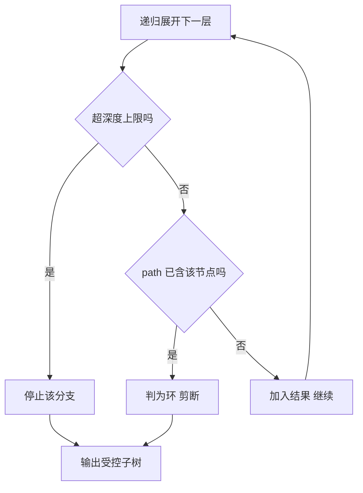

```python
# file: code/04_数据库与缓存/q2742_recursive_depth_guard.py
"""递归 CTE 的深度守卫: 层级上限与防环 path 检查双保险"""
import sqlite3

conn = sqlite3.connect(":memory:")
c = conn.cursor()
c.execute("CREATE TABLE node (id INTEGER PRIMARY KEY, parent INTEGER, name TEXT)")
c.executemany("INSERT INTO node VALUES(?,?,?)",
              [(1, None, "root"), (2, 1, "a"), (3, 2, "b"),
               (4, 3, "c"), (5, 4, "d"), (6, 3, "e")])

def subtree(root, max_depth):
    sql = """
    WITH RECURSIVE walk AS (
      SELECT id, parent, name, 0 AS depth, ',' || id || ',' AS path
      FROM node WHERE id = :root
      UNION ALL
      SELECT n.id, n.parent, n.name, w.depth + 1, w.path || n.id || ','
      FROM node n JOIN walk w ON n.parent = w.id
      WHERE w.depth < :max_depth AND w.path NOT LIKE '%,' || n.id || ',%'
    )
    SELECT id, name, depth FROM walk ORDER BY depth, id
    """
    return c.execute(sql, {"root": root, "max_depth": max_depth}).fetchall()

print("root=1 全量展开:", subtree(1, 6))
print("root=1 深度限制 2:", subtree(1, 2), "(超过两层的分支被截断)")

# 故意造环: 2 的父亲改成 5, 形成 2-3-4-5-2 的环, 无守卫的递归会无限转下去
c.execute("UPDATE node SET parent=5 WHERE id=2")
print("环数据 + 守卫 depth<3:", subtree(2, 3), "(守卫保证必停)")
```

**追问**:
- 不加守卫 SQLite 会自己停吗?—— 不会主动检测环,纯环数据会一直递归,必须靠查询里的守卫止损。
- 需要按层级展示每层聚合怎么办?—— 在外层对 walk 结果按 depth 再 GROUP BY,一次递归两用。

---

### Q2743 · 多态关联的查询代价: 正向好查 反向难 join

> 难度:★★★★ | 标签:建模, 索引

**问**:评论表用 target_type + target_id 挂在文章、视频、话题上,这种多态关联在查询上要付什么代价?

**答**:正向代价小:按 (target_type, target_id) 复合索引等值查一个对象的评论,和普通外键查询一样快;不加这个索引就是全表扫描,因为 target_id 单列的选择性被三种类型稀释了。反向代价大:想"列出每篇文章的评论数"时,数据库不知道 comment.target_id 该 join 谁的 id——video 和 topic 里同数值的 id 会混进来,把统计撑大;只能按类型分别 join 再 UNION ALL,或每类一张纯关联表。多态关联省了表数量,买的是:没有数据库级外键、反向 join 失效、类型枚举靠应用层自觉。读多写少且反向统计少时它划算,反向 join 密集的模型应该拆成独立关联表。

```python
# file: code/04_数据库与缓存/q2743_polymorphic_cost.py
"""多态关联 target_type + target_id 的查询代价: 正向好查 反向 join 必须 UNION"""
import sqlite3
import time

conn = sqlite3.connect(":memory:")
c = conn.cursor()
c.execute("""CREATE TABLE comment (
    id INTEGER PRIMARY KEY, target_type TEXT, target_id INTEGER, body TEXT)""")
rows = []
for i in range(1, 40001):
    rows.append((i, ("article", "video", "topic")[i % 3], i // 3, "c%d" % i))
c.executemany("INSERT INTO comment VALUES(?,?,?,?)", rows)

# 正向: 取一个对象的评论, 有无复合索引的差距
sql_fwd = "SELECT COUNT(*) FROM comment WHERE target_type=? AND target_id=?"
print("无索引计划:", c.execute("EXPLAIN QUERY PLAN " + sql_fwd, ("video", 100)).fetchone()[3])
t0 = time.perf_counter()
for _ in range(20):
    c.execute(sql_fwd, ("video", 100)).fetchone()
print("无索引 20 次查询 %.1f ms" % ((time.perf_counter() - t0) * 1000))

c.execute("CREATE INDEX idx_target ON comment(target_type, target_id)")
print("有索引计划:", c.execute("EXPLAIN QUERY PLAN " + sql_fwd, ("video", 100)).fetchone()[3])
t0 = time.perf_counter()
for _ in range(20):
    c.execute(sql_fwd, ("video", 100)).fetchone()
print("有索引 20 次查询 %.1f ms" % ((time.perf_counter() - t0) * 1000))

# 反向: 每篇文章的评论数。不同类型的 target_id 共用数值空间, 直接 join 会数进别的类型
c.execute("CREATE TABLE article (id INTEGER PRIMARY KEY, title TEXT)")
c.executemany("INSERT INTO article VALUES(?,?)", [(i, "a%d" % i) for i in range(1, 6)])
naive = c.execute("""
    SELECT COUNT(*) FROM article a JOIN comment cm ON cm.target_id = a.id
""").fetchone()[0]
correct = c.execute("""
    SELECT COUNT(*) FROM article a
    JOIN comment cm ON cm.target_type='article' AND cm.target_id = a.id
""").fetchone()[0]
print("按 target_id 直接 join 统计到 %d 条 (混入其他类型); 加类型条件后 %d 条 (正确)" % (naive, correct))
print("多类型反向汇总只能按类型 UNION ALL 或拆独立关联表, 这就是多态关联的反向税")
```

**追问**:
- 为什么单列索引 target_id 不够用?—— 三种类型共用 id 数值空间,单列选择性低,而且语义上必须先定类型再定对象。
- 多态关联怎么补完整性?—— 数据库层给不了外键,只能靠应用层双写校验加定时孤儿扫描兜底。

---

### Q2744 · 大表 join 的驱动序实测: 谁先进扫描循环谁定生死

> 难度:★★★★ | 标签:JOIN, 调优

**问**:两张表 join,一张 3 万行一张 100 行,谁当驱动表重要吗?怎么验证?

**答**:重要,而且可以量化。嵌套循环 join 的代价约等于"驱动侧行数 × 对侧每次探测的代价":驱动侧带着高选择性过滤、对侧有索引时,总代价是几千次索引探测;反过来驱动小表、对侧无索引,就是小表每行都把大表全扫一遍,行数相乘直接放大百倍。验证手段是实测加钉序:优化器通常自己选驱动序,但依赖统计信息;用 CROSS JOIN(SQLite)/STRAIGHT_JOIN(MySQL)可以把顺序钉死做对照实验,定位"优化器选错"的场景。规律只有一条:先用过滤条件把驱动侧削到最小,再保证对侧连接列有索引,两者缺一个都要付出相乘的代价。

```python
# file: code/04_数据库与缓存/q2744_join_drive_order.py
"""大表 join 的驱动序实测: CROSS JOIN 钉住顺序, 驱动侧与索引共同决定代价"""
import sqlite3
import time

conn = sqlite3.connect(":memory:")
c = conn.cursor()
c.execute("CREATE TABLE big (id INTEGER PRIMARY KEY, k INTEGER)")
c.execute("CREATE TABLE small (id INTEGER PRIMARY KEY, tag TEXT)")
c.executemany("INSERT INTO big VALUES(?,?)", [(i, i % 1000) for i in range(1, 30001)])
c.executemany("INSERT INTO small VALUES(?,?)", [(i, "t%d" % i) for i in range(1, 101)])

def drive(label, sql):
    t0 = time.perf_counter()
    n = c.execute(sql).fetchone()[0]
    print("%s: %d 行, %.1f ms" % (label, n, (time.perf_counter() - t0) * 1000))

# 1) big 驱动: 3 万行先过滤 k<=100 再逐行探测 small 主键
drive("big 驱动, 过滤后探测 small",
      "SELECT COUNT(*) FROM big CROSS JOIN small WHERE big.k <= 100 AND small.id = big.k")
# 2) small 驱动, big.k 无索引: 100 行各触发一次 3 万行全扫
drive("small 驱动, big.k 无索引",
      "SELECT COUNT(*) FROM small CROSS JOIN big WHERE big.k = small.id")
# 3) small 驱动, big.k 有索引: 100 次索引探测
c.execute("CREATE INDEX idx_big_k ON big(k)")
drive("small 驱动, big.k 有索引",
      "SELECT COUNT(*) FROM small CROSS JOIN big WHERE big.k = small.id")
print("规律: 驱动序由过滤选择性与对侧索引共同决定, 优化器选错时用 CROSS JOIN 钉序保命")
```

**追问**:
- 优化器为什么可能选错?—— 统计信息过期、绑定变量导致估算失真、或代价模型没考虑数据倾斜,实测钉序是最后的兜底。
- 大表对大表怎么办?—— 嵌套循环不再合适,考虑哈希 join 或先把两表各自过滤到小结果集再 join。

---

### Q2745 · HAVING 的下推改写: 能搬的条件别留在聚合后

> 难度:★★★★ | 标签:SQL, 调优

**问**:一条 GROUP BY 加 HAVING 的报表很慢,从 HAVING 上能挖出优化空间吗?

**答**:HAVING 里混着两类条件,优化空间就在分类上:分组键上的等值/IN 条件(如 HAVING region='north')可以等价搬到 WHERE——搬到聚合前过滤,参与分组的行直接变少,还能让优化器用上 region 上的索引避免全量分组;聚合结果上的条件(如 HAVING SUM(amt)>1000)不可下推,因为它的值在分组完成前根本不存在,这部分才是 HAVING 的本职。改写后用 EXPLAIN 验证:原来的 GROUP BY 临时表往往变成覆盖索引上的顺序扫描。纪律是:聚合前能删的行绝不过聚合,聚合后的 HAVING 只留真正依赖聚合值的条件。

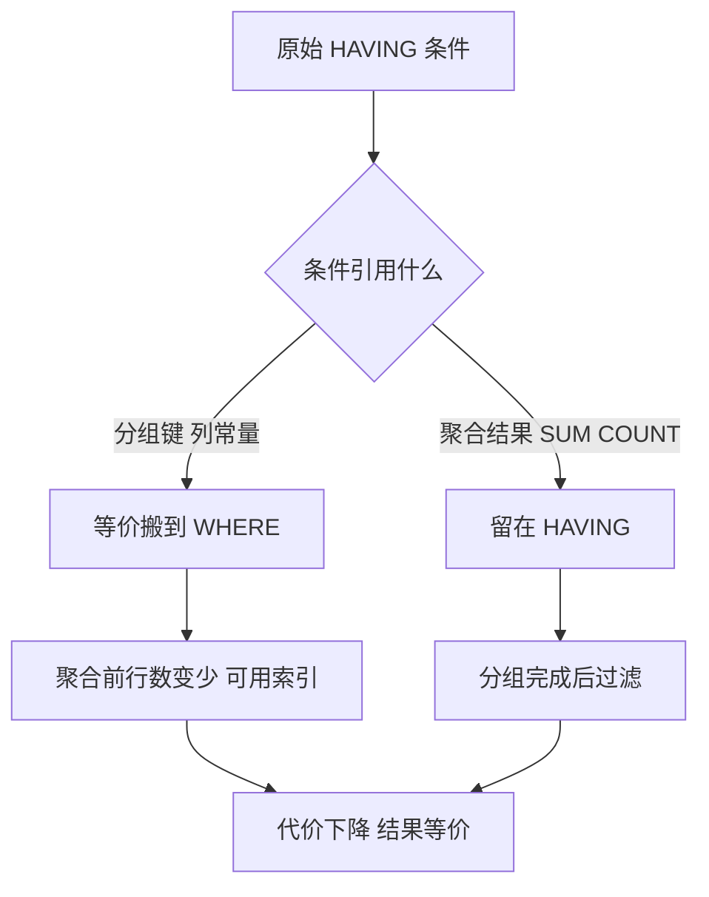

```python
# file: code/04_数据库与缓存/q2745_having_pushdown.py
"""HAVING 的下推改写: 分组键条件搬进 WHERE, 聚合条件才留在 HAVING"""
import sqlite3
import time

conn = sqlite3.connect(":memory:")
c = conn.cursor()
c.execute("CREATE TABLE orders (id INTEGER PRIMARY KEY, region TEXT, amt REAL)")
rows = []
for i in range(1, 120001):
    rows.append((i, ("north", "south", "east", "west")[i % 4], (i % 300) + 0.5))
c.executemany("INSERT INTO orders VALUES(?,?,?)", rows)

slow_sql = """SELECT region, COUNT(*), SUM(amt) FROM orders
GROUP BY region
HAVING region = 'north' AND SUM(amt) > 100000"""
fast_sql = """SELECT region, COUNT(*), SUM(amt) FROM orders
WHERE region = 'north'
GROUP BY region
HAVING SUM(amt) > 100000"""

rs, rf = c.execute(slow_sql).fetchall(), c.execute(fast_sql).fetchall()
assert rs == rf, "下推改写必须等价"
print("两版结果一致:", rf)
print("改写前计划:", c.execute("EXPLAIN QUERY PLAN " + slow_sql).fetchall())
c.execute("CREATE INDEX idx_ra ON orders(region, amt)")
print("下推+覆盖索引计划:", c.execute("EXPLAIN QUERY PLAN " + fast_sql).fetchall())

def timed(sql):
    t0 = time.perf_counter()
    for _ in range(10):
        c.execute(sql).fetchall()
    return (time.perf_counter() - t0) * 1000 / 10

print("改写前每次 %.2f ms, 改写后每次 %.2f ms (聚合前先删行 免全量分组)"
      % (timed(slow_sql), timed(fast_sql)))
```

**追问**:
- 条件在 SELECT 列表里用了别名还能下推吗?—— 别名是输出层的语法糖,下推时必须写原始列表达式,否则语义就变了。
- 聚合条件太苛刻导致大部分组被扔掉呢?—— 那是 HAVING 的正常工作,优化方向转为先缩小参与聚合的数据集(时间分区 预过滤)。

---

### Q2746 · 位标志列的查询设计: 位与查不到索引的三条出路

> 难度:★★☆☆ | 标签:建模, 索引

**问**:用户表用一个 flags 整数存 vip、verified、banned 等开关,查询 `flags & 3 = 3` 有什么问题?

**答**:位与是对每一行求值的表达式,任何 B 树索引都无法按位与条件直接定位,索引等于白建,大表上必然全扫描。唯一能走索引的是等值匹配(flags = 3),但它只能命中"恰好这个组合"的行,语义和"包含这些位"完全不同。三条出路:一是高频组合拆成独立布尔列,配上 partial index,查询退化成普通等值;二是组合爆炸时改关联表 user_flag,按位建行,索引与外键都回归正常;三是接受全扫,但把范围收窄到另一个有索引的条件(如时间分区)之后。位标志适合"写一起读整包"的场景,一旦出现按位查询的报表需求,就是拆列的信号。

```python
# file: code/04_数据库与缓存/q2746_bitflag_query.py
"""位标志列的查询设计: 位与条件用不上索引, 拆列与 partial index 是出路"""
import sqlite3
import time

VIP, VERIFIED, BANNED = 1, 2, 4

conn = sqlite3.connect(":memory:")
c = conn.cursor()
c.execute("CREATE TABLE user (id INTEGER PRIMARY KEY, name TEXT, flags INTEGER)")
rows = []
for i in range(1, 30001):
    f = VIP
    if i % 3 == 0:
        f |= VERIFIED
    if i % 10 == 0:
        f |= BANNED
    rows.append((i, "u%d" % i, f))
c.executemany("INSERT INTO user VALUES(?,?,?)", rows)
c.execute("CREATE INDEX idx_flags ON user(flags)")

def plan(sql):
    return c.execute("EXPLAIN QUERY PLAN " + sql).fetchone()[3]

def timed(label, sql):
    t0 = time.perf_counter()
    n = len(c.execute(sql).fetchall())
    print("%s: %d 行, %.1f ms" % (label, n, (time.perf_counter() - t0) * 1000))

sql_bit = "SELECT id FROM user WHERE flags & 3 = 3"
print("位与查询计划:", plan(sql_bit))
timed("位与查询 包含 vip 与 verified", sql_bit)
sql_eq = "SELECT id FROM user WHERE flags = 3"
print("等值查询计划:", plan(sql_eq))
timed("等值查询 flags 恰好等于 3", sql_eq)

# 出路: 高频组合拆布尔列 + partial index
c.execute("""CREATE TABLE user2 (id INTEGER PRIMARY KEY, name TEXT,
             vip INTEGER, verified INTEGER, banned INTEGER)""")
c.executemany("INSERT INTO user2 VALUES(?,?,?,?,?)",
              [(i, n, 1 if f & VIP else 0, 1 if f & VERIFIED else 0, 1 if f & BANNED else 0)
               for i, n, f in rows])
c.execute("CREATE INDEX idx_vip ON user2(id) WHERE vip = 1 AND verified = 1")
sql_cols = "SELECT id FROM user2 WHERE vip = 1 AND verified = 1"
print("拆列 + partial index 计划:", plan(sql_cols))
timed("拆列查询 vip 且 verified", sql_cols)
```

**追问**:
- flags 列上的等值查询有什么实用价值?—— 可以精确枚举"全部开关状态恰为此组合"的群体,做修复任务的目标圈定。
- 位标志还能怎么补救读路径?—— 把位运算条件挪到入库时算好的冗余列上,查询只打该列。

---

### Q2747 · JSON 字段的生成列: 提取一次 物化一处

> 难度:★★★☆ | 标签:JSON, 生成列

**问**:表里存了一段 JSON,经常按里面的某个字段查,怎么做才不慢?

**答**:直接 json_extract 查询意味着每行都在读路径上解析 JSON,索引帮不上忙。生成列是标准解:把 json_extract 表达式声明成列,数据库自动维护。VIRTUAL 生成列不占存储,写路径零额外成本,但每次读都要重新求值,和裸 json_extract 一样;STORED 生成列在写入时求值并物化,写慢一点,读路径与普通列完全相同,并且可以在其上建索引,等值和范围查询都走索引。选择口诀按读写比:写多读少用 VIRTUAL,读多写少用 STORED 加索引。它同时解决了 JSON 查询的两大痛点——无法索引和重复解析,是"schema 灵活"与"查询高效"之间的折中桥。

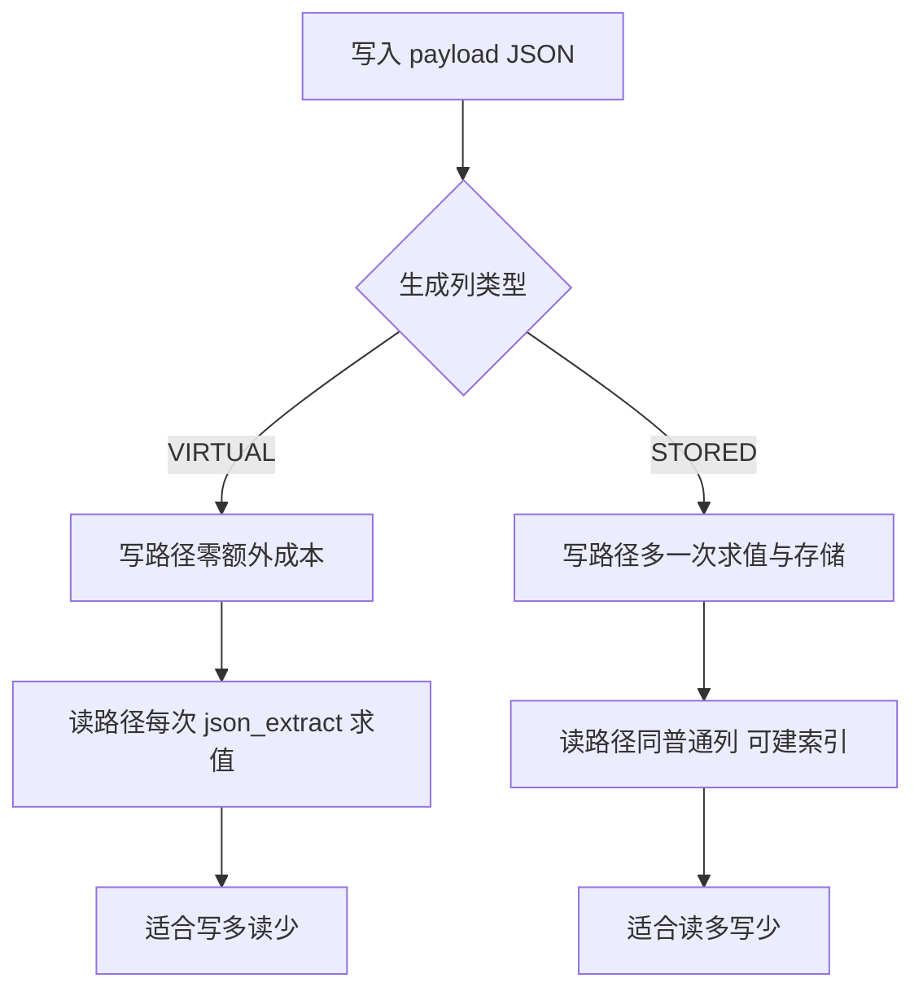

```python
# file: code/04_数据库与缓存/q2747_json_generated_col.py
"""JSON 字段的生成列: VIRTUAL 算在读 STORED 算在写, STORED 加索引后查询走索引"""
import json
import sqlite3
import time

conn = sqlite3.connect(":memory:")
c = conn.cursor()
N = 20000
payloads = [json.dumps({"uid": i, "amt": (i % 90) + 10}) for i in range(1, N + 1)]

def build(kind):
    ddl = "CREATE TABLE t_%s (id INTEGER PRIMARY KEY, payload TEXT" % kind
    coltype = {"virt": "VIRTUAL", "stor": "STORED"}.get(kind)
    if coltype:
        ddl += ", amt INTEGER GENERATED ALWAYS AS (json_extract(payload,'$.amt')) %s" % coltype
    c.execute(ddl + ")")
    t0 = time.perf_counter()
    c.executemany("INSERT INTO t_%s VALUES(?,?)" % kind,
                  [(i, p) for i, p in enumerate(payloads, 1)])
    return (time.perf_counter() - t0) * 1000

def query(kind):
    where = ("json_extract(payload,'$.amt')" if kind == "raw" else "amt") + " BETWEEN 20 AND 30"
    sql = "SELECT COUNT(*) FROM t_%s WHERE %s" % (kind, where)
    t0 = time.perf_counter()
    for _ in range(5):
        n = c.execute(sql).fetchone()[0]
    return n, (time.perf_counter() - t0) * 1000 / 5

w_raw = build("raw")
n1, r_raw = query("raw")
w_virt = build("virt")
n2, r_virt = query("virt")
w_stor = build("stor")
c.execute("CREATE INDEX idx_amt ON t_stor(amt)")
n3, r_stor = query("stor")

print("写入: raw %.0f ms | virtual %.0f ms | stored %.0f ms (stored 写时求值最慢)"
      % (w_raw, w_virt, w_stor))
print("查询均值: raw %.1f ms | virtual %.1f ms | stored+索引 %.1f ms, 命中 %d/%d/%d 行"
      % (r_raw, r_virt, r_stor, n1, n2, n3))
print("stored+索引计划:", c.execute(
    "EXPLAIN QUERY PLAN SELECT COUNT(*) FROM t_stor WHERE amt BETWEEN 20 AND 30").fetchone()[3])
```

**追问**:
- 表里已有数据能补建生成列吗?—— 可以,ALTER TABLE 加生成列时会自动回填 STORED 的值,VIRTUAL 则即时生效不回填。
- JSON 结构变了生成列会怎样?—— 表达式提取不到路径时按 NULL 处理,查询语义随之改变,结构演进要连生成列一起评审。

---

### Q2748 · 模糊匹配的编辑距离截断: 先裁候选集再算距离

> 难度:★★★★ | 标签:SQL, 算法

**问**:搜索框要做"你是不是想找",编辑距离全表算一遍太贵,怎么优化?

**答**:两段式:先用便宜的条件把候选集裁小,再对候选集算编辑距离。裁剪依据都来自编辑距离本身的性质:距离不超过 k 时两串长度差必不超过 k,直接按长度带过滤;更激进的可以按首字符、字符集合重叠度预筛。然后距离计算本身用带截断的动态规划:逐行维护当前行最小值,一旦超过 k 立即返回"超限",不做完整 O(mn) 矩阵。实测里,长度带过滤能砍掉大半计算量,截断让剩余每笔计算也提前结束。数据库内置的 fuzzy 匹配(pg_trgm、Levenshtein 函数)是同思路的引擎级实现;量再大就上倒排或专用检索引擎,编辑距离只做最后排序。

```python
# file: code/04_数据库与缓存/q2748_edit_distance_cutoff.py
"""模糊匹配: 带截断的编辑距离 + 先裁候选集再算距离"""
import random
import sqlite3

def edit_distance_bounded(a, b, cutoff):
    """超过 cutoff 返回 cutoff+1, 提前终止不做完整 DP"""
    if abs(len(a) - len(b)) > cutoff:
        return cutoff + 1
    prev = list(range(len(b) + 1))
    for i, ca in enumerate(a, 1):
        cur = [i]
        best = i
        for j, cb in enumerate(b, 1):
            v = min(prev[j] + 1, cur[j - 1] + 1, prev[j - 1] + (ca != cb))
            cur.append(v)
            if v < best:
                best = v
        if best > cutoff:          # 当前行最小值已超限, 后面只增不减
            return cutoff + 1
        prev = cur
    return prev[-1]

conn = sqlite3.connect(":memory:")
c = conn.cursor()
c.execute("CREATE TABLE dict (w TEXT PRIMARY KEY)")
random.seed(7)
words = set()
while len(words) < 3000:
    words.add("".join(random.choice("abcdefgh") for _ in range(random.randint(4, 8))))
c.executemany("INSERT INTO dict VALUES(?)", [(w,) for w in sorted(words)])
all_words = [r[0] for r in c.execute("SELECT w FROM dict")]

def search(q, cutoff=2, top=3, prune=True):
    computations = [0]
    scored = []
    for w in all_words:
        if prune and abs(len(w) - len(q)) > cutoff:
            continue
        computations[0] += 1
        d = edit_distance_bounded(q, w, cutoff)
        if d <= cutoff:
            scored.append((d, w))
    scored.sort()
    return scored[:top], computations[0]

queries = ["abcedf", "hgfedcb", "abcabcx", "ddccaa", "ghefab"]
full_total = prune_total = 0
for q in queries:
    top_full, n_full = search(q, prune=False)
    top_prune, n_prune = search(q, prune=True)
    assert top_full == top_prune, "裁剪不得改变结果"
    full_total += n_full
    prune_total += n_prune
    print("%s -> %s" % (q, top_prune))
print("距离计算次数: 全量 %d 次, 长度带裁剪后 %d 次 (省 %.0f%%), 结果完全一致"
      % (full_total, prune_total, (1 - prune_total / full_total) * 100))
```

**追问**:
- 截断会不会漏掉真实距离更小的词?—— 不会,截断只影响"超过 cutoff 的判定提前",返回值要么是真距离要么是超限哨兵,不产生错误的小值。
- 为什么不直接 LIKE '%kw%'?—— LIKE 解决包含关系,编辑距离解决"差几个字符"的容错,两者语义不同,常组合使用。

---

### Q2749 · 复合游标分页: 元组比较与 OR 改写的索引账

> 难度:★★★☆ | 标签:分页, 索引

**问**:深分页改游标式,排序列不唯一怎么办?WHERE (a,b) > (?,?) 这种写法靠谱吗?

**答**:靠谱,而且正是标准解:排序键从单列升级为复合键 (created, id),id 唯一保证了全序,游标记录上一页最后一行的二元组,翻页条件用行值比较 (created, id) > (?, ?),排序键与索引 (created, id) 完全同构,每一页都是一次索引范围扫描,OFFSET 的扫描浪费彻底消失。若引擎不支持行值比较,等价改写成 created > ? OR (created = ? AND id > ?),语义相同但计划可能退化成多分支扫描加排序,要 EXPLAIN 确认。复合键的另一个好处是并发稳定:翻页期间新插入的行只会落在游标之前,已看过的页不会突然多出新行,不丢不重。索引列序必须与排序键一致,这是游标分页成立的前提。

```python
# file: code/04_数据库与缓存/q2749_composite_cursor.py
"""复合游标分页: 元组比较命中复合索引, OR 改写是等价退路"""
import sqlite3

conn = sqlite3.connect(":memory:")
c = conn.cursor()
c.execute("CREATE TABLE item (id INTEGER PRIMARY KEY, created INTEGER, score REAL)")
c.executemany("INSERT INTO item VALUES(?,?,?)",
              [(i, 1700000000 + i // 3, (i * 7) % 100) for i in range(1, 40001)])
c.execute("CREATE INDEX idx_page ON item(created, id)")

def page_tuple(cur):
    sql = """SELECT created, id FROM item
             WHERE (created, id) > (?, ?) ORDER BY created, id LIMIT 20"""
    return c.execute(sql, cur).fetchall()

def page_or(cur):
    ct, cid = cur
    sql = """SELECT created, id FROM item
             WHERE created > ? OR (created = ? AND id > ?)
             ORDER BY created, id LIMIT 20"""
    return c.execute(sql, (ct, ct, cid)).fetchall()

cur = (0, 0)
seen = []
for p in range(10):
    a = page_tuple(cur)
    b = page_or(cur)
    assert a == b, "两种写法必须翻出同一页"
    seen.extend(a)
    cur = (a[-1][0], a[-1][1])
ids = [x[1] for x in seen]
assert len(set(ids)) == len(ids), "复合键排序下不丢行不重行"
print("两种游标写法 10 页各 20 行完全一致, 共 %d 行无重无漏" % len(seen))
print("元组版计划:", c.execute(
    "EXPLAIN QUERY PLAN SELECT created, id FROM item WHERE (created, id) > (1700000100, 5) "
    "ORDER BY created, id LIMIT 20").fetchall())
```

**追问**:
- 行值比较在什么版本可用?—— SQLite 3.15+ 与 MySQL 8.0+ 支持,老版本只能用 OR 改写并接受其计划代价。
- 为什么 OFFSET 深分页慢而游标不慢?—— OFFSET 要扫过并丢弃前面所有行,游标直接从上次位置做索引定位,代价与页深无关。

---

### Q2750 · 跨表唯一性的两种实现: 注册表硬约束与触发器软拦截

> 难度:★★★★ | 标签:约束, 并发

**问**:同一个邮箱在 customer 和 staff 两张表里都要唯一,数据库层怎么保证?

**答**:两种实现。硬方案是注册表:建一张 email_registry,对 email 建主键,任何表收新邮箱前先在同一事务里往注册表插一行,唯一冲突直接拦截——这是数据库级约束,并发下天然正确,任何写路径都绕不过。软方案是互查触发器:每张表的 BEFORE INSERT 触发器去查另一张表,能拦住普通的跨表重复插入;但它有两个盲区,一是 UPDATE 改邮箱不在 INSERT 触发器的射程里,漏配 UPDATE 触发器就破防,二是触发器逻辑藏在库内,新表接入容易遗忘。工程结论:主链路用注册表硬约束,触发器只做辅助提醒或历史包袱的过渡垫片,绝不当唯一防线。

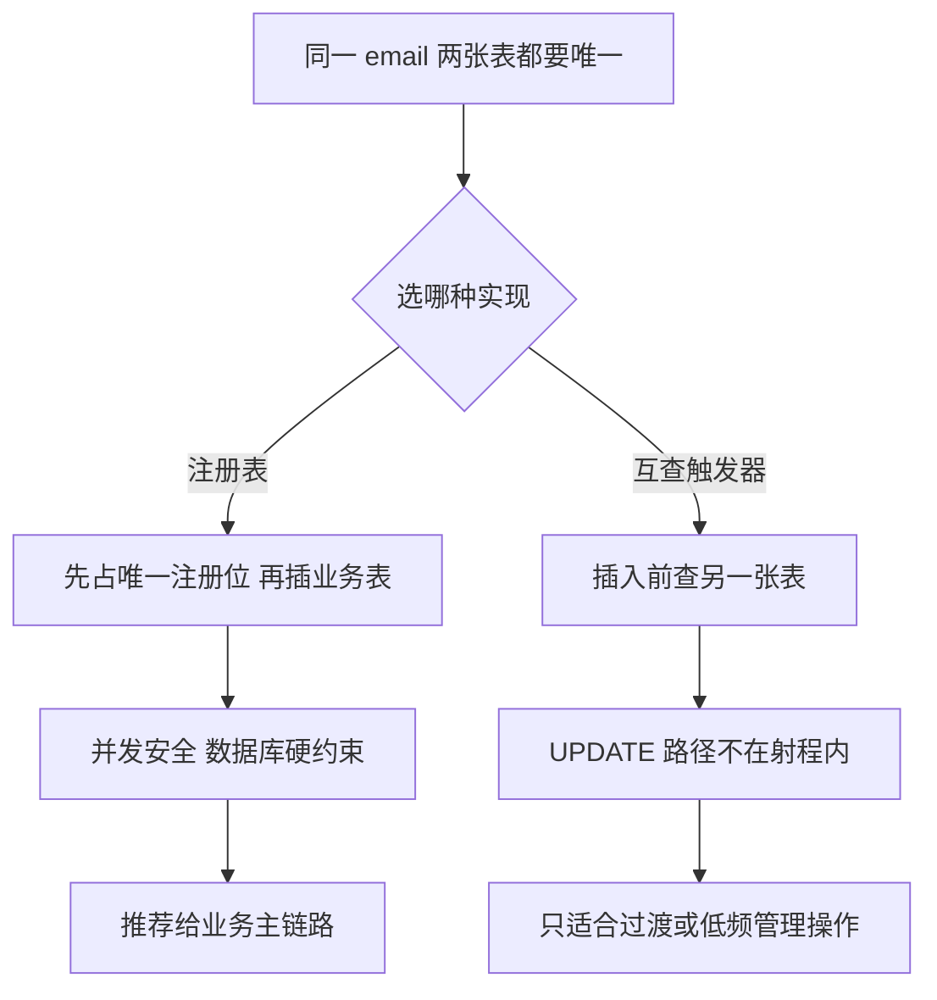

```python
# file: code/04_数据库与缓存/q2750_cross_table_unique.py
"""跨表唯一性的两种实现: 注册表唯一约束 与 互查触发器 及其盲区"""
import os
import sqlite3
import tempfile
import threading
import time

dbpath = os.path.join(tempfile.mkdtemp(), "xtable.db")
admin = sqlite3.connect(dbpath, isolation_level=None)
admin.execute("PRAGMA journal_mode=WAL")
admin.execute("CREATE TABLE customer (id INTEGER PRIMARY KEY, email TEXT)")
admin.execute("CREATE TABLE staff (id INTEGER PRIMARY KEY, email TEXT)")
admin.execute("CREATE TABLE email_registry (email TEXT PRIMARY KEY, owner TEXT)")
admin.execute("""CREATE TRIGGER trg_customer_email BEFORE INSERT ON customer
  WHEN EXISTS (SELECT 1 FROM staff WHERE email = NEW.email)
  BEGIN SELECT RAISE(ABORT, 'email 已被 staff 占用'); END""")
admin.execute("""CREATE TRIGGER trg_staff_email BEFORE INSERT ON staff
  WHEN EXISTS (SELECT 1 FROM customer WHERE email = NEW.email)
  BEGIN SELECT RAISE(ABORT, 'email 已被 customer 占用'); END""")
admin.execute("INSERT INTO customer(email) VALUES('a@x.com')")

# 方案一: 触发器能拦住普通跨表插入
try:
    admin.execute("INSERT INTO staff(email) VALUES('a@x.com')")
    print("触发器方案: 漏拦了")
except sqlite3.IntegrityError as e:
    print("触发器拦截跨表插入: %s" % e)

# 盲区: UPDATE 改邮箱不在 BEFORE INSERT 触发器射程内
admin.execute("INSERT INTO staff(email) VALUES('race@x.com')")          # 通过
admin.execute("INSERT INTO customer(email) VALUES('tmp@x.com')")
admin.execute("UPDATE customer SET email='race@x.com' WHERE email='tmp@x.com'")  # 放行
n_s = admin.execute("SELECT COUNT(*) FROM staff WHERE email='race@x.com'").fetchone()[0]
n_c = admin.execute("SELECT COUNT(*) FROM customer WHERE email='race@x.com'").fetchone()[0]
print("触发器盲区: UPDATE 改邮箱后 staff %d 条 + customer %d 条 同邮箱共存" % (n_s, n_c))

# 方案二: 注册表唯一约束, 并发抢注也只有一个能成
def claim(conn, email, owner, hold):
    conn.execute("BEGIN IMMEDIATE")
    conn.execute("INSERT INTO email_registry VALUES(?,?)", (email, owner))
    time.sleep(hold)
    if owner == "customer":
        conn.execute("INSERT INTO customer(email) VALUES(?)", (email,))
    conn.execute("COMMIT")

out = []
def challenger(email):
    conn = sqlite3.connect(dbpath, isolation_level=None)
    conn.execute("PRAGMA busy_timeout=5000")
    time.sleep(0.05)
    try:
        claim(conn, email, "staff", 0)
        out.append("staff 竟然也抢到了 -> 破防")
    except sqlite3.IntegrityError as e:
        conn.execute("ROLLBACK")
        out.append("staff 被注册表唯一约束拦下: %s" % e)
    conn.close()

t = threading.Thread(target=challenger, args=("shared@x.com",))
t.start()
conn_a = sqlite3.connect(dbpath, isolation_level=None)
conn_a.execute("PRAGMA busy_timeout=5000")
claim(conn_a, "shared@x.com", "customer", 0.2)
t.join()
print(out[0])
print("注册表方案: 任何写路径 任何语句类型 都要过唯一约束这道物理闸门")
admin.close()
```

**追问**:
- 注册表方案的代价是什么?—— 每个新邮箱多一次插入,注册表成为热点小表,且要保证业务表与注册表始终同事务。
- 已有重复数据怎么上注册表?—— 先按邮箱分组对账清理,再建约束,和唯一索引上线预检是同一套流程。

---

### Q2751 · 均值的均值陷阱: 分组 AVG 再 AVG 会失真

> 难度:★★☆☆ | 标签:SQL, 聚合

**问**:子查询按天算平均时长,外层再对天平均,这样算月均对吗?

**答**:不对,均值的均值只在各组分母相等时才等于全局均值。分组 AVG 丢掉了每组的行数,外层再 AVG 时每天权重相同,而真正的全局均值应该按行数加权——数据倾斜时偏差可以到几倍。修法有三:直接对明细一层 AVG;分组后带 COUNT 出来,外层用 SUM(avg*cnt)/SUM(cnt) 加权;或用 SUM(dur)/COUNT(dur) 的总量比,在可加性上最干净。同类陷阱还有"占比的占比"和"中位数的中位数"。凡是两层聚合嵌套,先问一句:内层丢掉的分布信息,外层是否真的不需要。

```python
# file: code/04_数据库与缓存/q2751_avg_of_avg.py
"""均值的均值不是均值: 分组 AVG 直接再 AVG 的偏差与两种修法"""
import sqlite3

conn = sqlite3.connect(":memory:")
c = conn.cursor()
c.execute("CREATE TABLE session (id INTEGER PRIMARY KEY, grp TEXT, dur REAL)")
rows = []
i = 0
for g, ds in [("a", [1, 2, 3]), ("b", [10.0] * 10)]:
    for d in ds:
        i += 1
        rows.append((i, g, d))
c.executemany("INSERT INTO session VALUES(?,?,?)", rows)

wrong = c.execute("""SELECT AVG(avg_dur) FROM
    (SELECT grp, AVG(dur) AS avg_dur FROM session GROUP BY grp)""").fetchone()[0]
right = c.execute("SELECT AVG(dur) FROM session").fetchone()[0]
weighted = c.execute("""SELECT SUM(cnt * avg_dur) / SUM(cnt) FROM
    (SELECT grp, AVG(dur) AS avg_dur, COUNT(*) AS cnt FROM session GROUP BY grp)""").fetchone()[0]
print("均值的均值 %.2f | 全局均值 %.2f | 按行数加权 %.2f" % (wrong, right, weighted))
print("a 组 3 行 b 组 10 行, 简单平均把 a 的权重抬到了一半, 偏差 %.0f%%"
      % (abs(wrong - right) / right * 100))
```

**追问**:
- 什么时候均值的均值恰好等于全局均值?—— 各组的样本数完全相等时,此时权重天然一致。
- 中位数能分层算吗?—— 不能,中位数不可加,分层必须保留明细或在层间传递分位结构,直接平均会错。

---

### Q2752 · 百分位统计: NTILE 分桶与手写分位的口径

> 难度:★★☆☆ | 标签:SQL, 窗口函数

**问**:要给接口耗时出 P50/P95/P99,SQL 里怎么算才口径清楚?

**答**:两条路。窗口函数路:NTILE(4) OVER (ORDER BY ms) 把样本等频切成四份,每份的 min/max 就是四分位区间,直观但只给固定分位;PERCENT_RANK 配合取行可以精确到任意分位。手写路:把排序后的列拉出来,按位置取第 p% 个元素,逻辑透明且好做断言。关键是口径要钉死:P95 是"95% 的请求不慢于它",样本去不去重、四舍五入到哪一位、异常样本剔不剔除,都要在看板注释里写明,否则两个系统算出的 P99 差一截说不清谁错。另外长尾样本对 P99 极敏感,一个卡顿批次就能把它抬高,分位监控要和均值一起看。

```python
# file: code/04_数据库与缓存/q2752_ntile_percentile.py
"""百分位统计: NTILE 分桶与手写分位的口径对齐"""
import sqlite3

conn = sqlite3.connect(":memory:")
c = conn.cursor()
c.execute("CREATE TABLE resp (id INTEGER PRIMARY KEY, ms REAL)")
c.executemany("INSERT INTO resp VALUES(?,?)",
              [(i, 10 + (i * 13) % 90 + ((i % 50) == 0) * 400) for i in range(1, 2001)])

rows = c.execute("""
  SELECT bucket, COUNT(*), MIN(ms), MAX(ms) FROM (
    SELECT ms, NTILE(4) OVER (ORDER BY ms) AS bucket FROM resp
  ) GROUP BY bucket ORDER BY bucket""").fetchall()
for b, n, lo, hi in rows:
    print("Q%d: %d 个样本, 区间 [%.0f, %.0f] ms" % (b, n, lo, hi))

allms = sorted(r[0] for r in c.execute("SELECT ms FROM resp"))
def pct(p):
    k = max(0, min(len(allms) - 1, int(round(p / 100.0 * (len(allms) - 1)))))
    return allms[k]
print("手写分位: P50=%.0f P95=%.0f P99=%.0f ms" % (pct(50), pct(95), pct(99)))
print("NTILE 顶桶的上界 %.0f ms 是 Q3 不是 P95, 口径不同不能互换" % rows[-1][3])
```

**追问**:
- NTILE 的桶能不等宽吗?—— 不能,NTILE 是等频切分,不等宽分桶要回到 CASE WHEN 条件聚合。
- 大表算分位太贵怎么办?—— 预聚合进小时表,或用近似算法(t-digest 类)在应用层维护可合并的草图。

---

### Q2753 · 树的自底向上聚合: 递归 CTE 一次算出子树总额

> 难度:★★★★ | 标签:SQL, 递归CTE

**问**:类目树上每个节点要显示"子树合计金额",逐层往上加太啰嗦,一条 SQL 能算完吗?

**答**:能,标准手法是"每行自为根"的递归:锚点 SELECT 每个节点,把它自己标记为自己的祖先(root=id);递归项把每个子行挂到所有祖先名下,于是一行叶子数据被复制成"叶子到根路径上的每一对(祖先,叶子)"。外层按 root GROUP BY 求和,每个节点就同时拿到了自己子树的总额,一趟递归全部算完,不需要应用层逐层循环。它的代价是结果集按路径长度放大,深树和宽树的中间结果会明显变多,所以适合中小规模树(数千到数万节点);更大的树要预物化——闭包表或带 left/right 值的嵌套集,把递归从查询期挪到写入期。

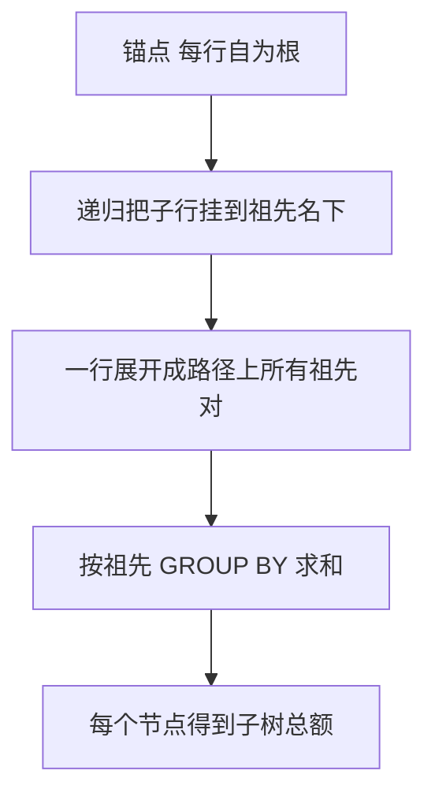

```python
# file: code/04_数据库与缓存/q2753_tree_rollup.py
"""树的自底向上聚合: 每行自为根的递归, 一趟算出每个节点的子树总额"""
import sqlite3

conn = sqlite3.connect(":memory:")
c = conn.cursor()
c.execute("CREATE TABLE cat (id INTEGER PRIMARY KEY, parent INTEGER, amt REAL)")
# 1 总类目 <- 2 数码 <- 4 手机 5 电脑;  1 <- 3 服装 <- 6 上衣
c.executemany("INSERT INTO cat VALUES(?,?,?)",
              [(1, None, 0), (2, 1, 0), (3, 1, 0),
               (4, 2, 30), (5, 2, 50), (6, 3, 20)])

sql = """
WITH RECURSIVE down AS (
  SELECT id, id AS root, amt FROM cat
  UNION ALL
  SELECT c.id, d.root, c.amt FROM cat c JOIN down d ON c.parent = d.id
)
SELECT root, COUNT(*) AS nodes, SUM(amt) AS subtree_amt
FROM down GROUP BY root ORDER BY root
"""
for root, nodes, total in c.execute(sql):
    print("节点 %d: 子树 %d 个节点, 子树金额 %.0f" % (root, nodes, total))

expect = {1: 100, 2: 80, 3: 20, 4: 30, 5: 50, 6: 20}
for root, _, total in c.execute(sql):
    assert int(total) == expect[root], "子树聚合结果必须与手算一致"
print("子树总额与手算完全一致, 一次递归替代逐层回填")
```

**追问**:
- 结果集膨胀多少?—— 每个叶子被复制到根的深度次,总行数等于"所有节点到根的路径长度之和",深链树要警惕。
- 只要根节点的总额呢?—— 锚点只 SELECT 目标根,递归自然只在它的子树里走,代价大幅缩小。

---

### Q2754 · 日历表补零: 统计区间里没数据的日子也要出现

> 难度:★★☆☆ | 标签:SQL, 报表

**问**:按天统计营收,某天零成交那天就从结果里消失了,图表断一截,怎么补?

**答**:标准解是日历表:先用递归 CTE 生成统计区间的连续日期序列(或物理建一张日历维表),然后以日历为主表 LEFT JOIN 业务聚合,IFNULL 把空值补成 0。要点有三:JOIN 的驱动方向必须是日历驱动业务,反过来业务表驱动会再次丢掉空档日;空档补的是"区间内没有"而不是"当天真为零",有数据被过滤(如剔除测试单)导致的零和天然零要区分;跨时区业务的"天"边界要先对齐再生成日历。日历维表一劳永逸,递归 CTE 免建表,按区间大小和复用频率选。

```python
# file: code/04_数据库与缓存/q2754_calendar_zero_fill.py
"""日历表补零: 统计区间里没有数据的日子也要出现"""
import sqlite3

conn = sqlite3.connect(":memory:")
c = conn.cursor()
# 递归 CTE 生成 6 月 1 日到 10 日的连续日历, 物化成表
c.execute("CREATE TABLE calendar (d TEXT PRIMARY KEY)")
c.execute("""INSERT INTO calendar
  WITH RECURSIVE cal(d) AS (
    SELECT date('2026-06-01')
    UNION ALL SELECT date(d, '+1 day') FROM cal WHERE d < date('2026-06-10')
  )
  SELECT d FROM cal""")
c.execute("CREATE TABLE pay (id INTEGER PRIMARY KEY, day TEXT, amt REAL)")
c.executemany("INSERT INTO pay(day, amt) VALUES(?,?)",
              [("2026-06-0%d" % d, d * 100) for d in (1, 2, 4, 7)])

rows = c.execute("""SELECT cal.d, IFNULL(SUM(p.amt), 0) AS total
  FROM calendar cal LEFT JOIN pay p ON p.day = cal.d
  GROUP BY cal.d ORDER BY cal.d""").fetchall()
for d, s in rows:
    print("%s  %6.0f" % (d, s))
assert len(rows) == 10 and dict(rows)["2026-06-03"] == 0
print("10 天一天不缺, 无数据的 3 号 5 号 6 号 8 号 9 号 10 号补零")
```

**追问**:
- 区间跨几年生成日历会不会太慢?—— 递归 CTE 生成万级日期毫秒级,长期复用建议物理日历维表加主键。
- 分组里还带地区维度怎么办?—— 日历与地区做笛卡尔骨架再 LEFT JOIN,每个地区每天都有行,查询规模随之放大要控制维度数。

---

### Q2755 · 清洗键的分组: 归一化表达式聚合与物化列替代

> 难度:★★☆☆ | 标签:数据质量, SQL

**问**:手机号入库格式五花八门,按它 GROUP BY 去重统计,有什么要注意的?

**答**:核心是"先归一,再分组":把分隔符、国码前缀、大小写这些表示差异在聚合键上抹平,比如 REPLACE 嵌套去掉横线空格、剥掉 +86。直接用归一化表达式做 GROUP BY 功能正确,但每行都要把函数链算一遍,大表聚合明显变慢且用不上索引。量大的表应该物化:加一列清洗键,入库时由应用或生成列维护,建索引后分组、去重、JOIN 都走索引。另一层是数据质量:清洗只能救查询,救不了脏库,归一化逻辑要同时反哺写入侧校验,并定期用"清洗键分组计数大于 1"做重复检测,把同一实体的多版本号码收敛掉。

```python
# file: code/04_数据库与缓存/q2755_normalized_group_key.py
"""清洗键分组: 归一化表达式聚合与物化列替代"""
import sqlite3
import time

conn = sqlite3.connect(":memory:")
c = conn.cursor()
c.execute("CREATE TABLE lead (id INTEGER PRIMARY KEY, phone TEXT)")
pats = ["138-0000-%04d", "138 0000 %04d", "+861380000%04d", "1380000%04d"]
rows = []
i = 0
for k in range(1000):
    for pat in pats:
        i += 1
        rows.append((i, pat % (k % 300)))
c.executemany("INSERT INTO lead VALUES(?,?,?)".replace("?,?,?", "?,?"), rows) if False else \
    c.executemany("INSERT INTO lead VALUES(?,?)", rows)

NORM = "REPLACE(REPLACE(REPLACE(phone, '-', ''), ' ', ''), '+86', '')"

t0 = time.perf_counter()
dup = c.execute("""SELECT COUNT(*) FROM (
  SELECT %s AS p, COUNT(*) AS n FROM lead GROUP BY p HAVING n > 1)""" % NORM).fetchone()[0]
expr_ms = (time.perf_counter() - t0) * 1000
print("表达式分组: %d 个号码存在多格式重复, 耗时 %.1f ms" % (dup, expr_ms))

c.execute("ALTER TABLE lead ADD COLUMN clean TEXT")
c.execute("UPDATE lead SET clean = " + NORM)
c.execute("CREATE INDEX idx_clean ON lead(clean)")
t0 = time.perf_counter()
dup2 = c.execute("""SELECT COUNT(*) FROM (
  SELECT clean, COUNT(*) AS n FROM lead GROUP BY clean HAVING n > 1)""").fetchone()[0]
col_ms = (time.perf_counter() - t0) * 1000
print("物化列分组: 同样 %d 个, 耗时 %.1f ms (索引在手, 大表上差距放大)" % (dup2, col_ms))
```

**追问**:
- 归一化规则由谁维护?—— 收敛到一个函数/一段生成列表达式,查询与写入共用,避免两套规则各洗各的。
- 清洗键会撞库吗?—— 不同真实号码清洗后可能同串(如分机号场景),归一化规则要保证可逆或接受碰撞语义。

---

### Q2756 · 原子交换的两条 UPDATE: 唯一约束下的换位借道中转值

> 难度:★★★★ | 标签:事务, 约束

**问**:拖拽排序要交换两行的 pos 值,pos 上有唯一约束,直接两条 UPDATE 为什么会炸?

**答**:因为中间态非法:把第一行 pos 改成第二行现值的那一刻,唯一约束就撞了——两条 UPDATE 各自合法,但第一条执行完的瞬间表处于约束不允许的状态。解法是借道中转值,三步换位且全在一个事务里:先把第一行挪到一个肯定空闲的值(如取负数域或加一个巨大偏移),再把第二行落到目标值,最后把第一行落回目标值,COMMIT 时约束整体成立。PostgreSQL 可以用 DEFERRABLE 唯一约束把检查推迟到提交时,两步就够;MySQL 8 没有可延迟唯一约束,还是中转值稳。注意批量拖拽时按中转偏移统一挪一段,避免两两交换的中转值互相撞车。

```python
# file: code/04_数据库与缓存/q2756_atomic_swap.py
"""原子交换: 唯一约束下直接换位撞约束, 借道中转值三步完成"""
import sqlite3

conn = sqlite3.connect(":memory:", isolation_level=None)
c = conn.cursor()
c.execute("CREATE TABLE todo (id INTEGER PRIMARY KEY, pos INTEGER UNIQUE, title TEXT)")
c.executemany("INSERT INTO todo VALUES(?,?,?)", [(1, 1, "买牛奶"), (2, 2, "写周报")])

try:
    c.execute("BEGIN")
    c.execute("UPDATE todo SET pos=2 WHERE id=1")   # 第一步就撞上 id=2 现有的 pos=2
    c.execute("UPDATE todo SET pos=1 WHERE id=2")
    c.execute("COMMIT")
    print("直接交换竟然成功, 不应到这里")
except sqlite3.IntegrityError as e:
    c.execute("ROLLBACK")
    print("直接交换撞约束: %s (事务已整体回滚)" % e)

c.execute("BEGIN")
c.execute("UPDATE todo SET pos=-1 WHERE id=1")      # 借道负数域, 挪出冲突
c.execute("UPDATE todo SET pos=1 WHERE id=2")
c.execute("UPDATE todo SET pos=2 WHERE id=1")
c.execute("COMMIT")
print("借道换位后:", c.execute("SELECT id, pos, title FROM todo ORDER BY pos").fetchall())
print("要点: 中间态非法是约束的错也是设计的题, 中转值把非法中间态藏进事务内部")
```

**追问**:
- 中转值选什么才安全?—— 必须取值域外且不参与业务排序的区段,如负数或极大偏移,并防并发交换撞同一个中转段。
- 交换和并发拖拽怎么共存?—— 中转偏移带上请求维度(如 1e9 + 请求号)或对目标行加锁串行化。

---

### Q2757 · 库存扣减的写锁实测: 持锁窗口就是别人的等待时长

> 难度:★★★☆ | 标签:并发, 锁

**问**:扣库存用 UPDATE 直接减,并发下会发生什么?锁是怎么起作用的?

**答**:UPDATE stock SET qty = qty - 1 WHERE sku=? 这条语句自带两层保护:写入要拿行锁(SQLite 里退化为库级写锁,InnoDB 是行级),同一行的并发写者串行排队,第二个事务的等待时长约等于第一个事务从拿锁到提交的持锁窗口;条件更新再加一层业务守卫,WHERE qty >= n 让"扣成负数"直接表现为影响行数为 0,业务侧据此拒绝。实测能看到:写事务里 sleep 的那段时间,精确等于下一个写者的阻塞时长——所以扣减事务必须短,把远程调用、日志这类慢操作挪出事务。扣减的吞吐上限就是单行串行的上限,热点 SKU 要靠队列合并或分段库存来摊平。

```python
# file: code/04_数据库与缓存/q2757_row_lock_stock.py
"""库存扣减的写锁实测: 写事务持锁窗口近似等于下一个写者的等待时长"""
import os
import sqlite3
import tempfile
import threading
import time

dbpath = os.path.join(tempfile.mkdtemp(), "stock.db")
conn0 = sqlite3.connect(dbpath, isolation_level=None)
conn0.execute("PRAGMA journal_mode=WAL")
conn0.execute("CREATE TABLE stock (sku TEXT PRIMARY KEY, qty INTEGER)")
conn0.execute("INSERT INTO stock VALUES('A', 100)")

held = {}
def writer(idx, hold_s):
    conn = sqlite3.connect(dbpath, isolation_level=None)
    conn.execute("PRAGMA busy_timeout=5000")
    t0 = time.perf_counter()
    conn.execute("BEGIN IMMEDIATE")                  # 拿写锁, 拿不到就在这里等
    conn.execute("UPDATE stock SET qty = qty - 1 WHERE sku='A'")
    time.sleep(hold_s)                               # 模拟持锁期间的业务处理
    conn.execute("COMMIT")
    held[idx] = (time.perf_counter() - t0) * 1000

t1 = threading.Thread(target=writer, args=(1, 0.2))
t1.start()
time.sleep(0.05)
t2 = threading.Thread(target=writer, args=(2, 0.0))
t2.start()
t1.join()
t2.join()
print("写者1 持锁窗口 %.0f ms | 写者2 等锁+执行 %.0f ms (两者近似相等)" % (held[1], held[2]))

# 条件更新守卫: 库存不足时影响行数为 0, 业务据此拒绝
cur = conn0.execute("UPDATE stock SET qty = qty - 999 WHERE sku='A' AND qty >= 999")
print("超量扣减尝试: 影响行数 %d (0 即拒绝), 当前库存 %d" %
      (cur.rowcount, conn0.execute("SELECT qty FROM stock WHERE sku='A'").fetchone()[0]))
conn0.close()
```

**追问**:
- InnoDB 和这里的锁有什么差别?—— InnoDB 锁粒度是行,不同 SKU 互不阻塞;SQLite 写锁是库级,所有写者排队,演示结论同一方向。
- 读库存要不要加锁?—— 展示用读不需要,只有"读-算-写"三段式扣减才需要 SELECT FOR UPDATE,能一条条件 UPDATE 就别拆三段。

---

### Q2758 · 防超卖的乐观重试实测: 条件更新守门 版本号重试兜底

> 难度:★★★★ | 标签:并发, 乐观锁

**问**:秒杀场景 20 个人抢 5 件库存,不用悲观锁怎么保证一件都不超卖?

**答**:双保险。第一层是条件更新守门:UPDATE ... SET stock=stock-1 WHERE id=? AND stock>0,扣减原子地绑定在"还有货"这个前提上,超卖的物理路径不存在;第二层是版本号乐观重试:读到 stock 和 ver 后,UPDATE 带上 AND ver=?,并发写导致版本不匹配时影响行数为 0,读方重读重试而不是报错。实测把两层都跑起来:20 个线程抢 5 件,成交数恰好 5、最终库存 0,期间的冲突全部被重试消化。要点在重试的纪律:必须带次数上限和随机退避,否则热点冲突下重试风暴会把 CPU 和连接池一起打挂;退避后仍失败就走降级(排队或失败返回)。

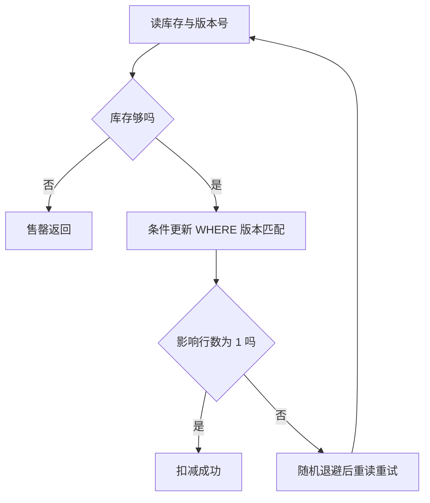

```python
# file: code/04_数据库与缓存/q2758_oversell_retry.py
"""防超卖双保险实测: 条件更新守门 + 版本号乐观重试"""
import os
import random
import sqlite3
import tempfile
import threading
import time

dbpath = os.path.join(tempfile.mkdtemp(), "seckill.db")
init = sqlite3.connect(dbpath, isolation_level=None)
init.execute("PRAGMA journal_mode=WAL")
init.execute("CREATE TABLE goods (id INTEGER PRIMARY KEY, stock INTEGER, ver INTEGER)")
init.execute("INSERT INTO goods VALUES(1, 5, 0)")

sold = []
attempts = {"n": 0}
lock = threading.Lock()

def buyer(bid):
    conn = sqlite3.connect(dbpath, isolation_level=None)
    conn.execute("PRAGMA busy_timeout=3000")
    for _ in range(50):                              # 重试上限, 防风暴
        with lock:
            attempts["n"] += 1
        try:
            stock, ver = conn.execute(
                "SELECT stock, ver FROM goods WHERE id=1").fetchone()
            if stock <= 0:
                return False
            cur = conn.execute(
                "UPDATE goods SET stock=stock-1, ver=ver+1 "
                "WHERE id=1 AND stock=? AND ver=?", (stock, ver))
            if cur.rowcount == 1:
                with lock:
                    sold.append(bid)
                return True
        except sqlite3.OperationalError:
            pass                                     # 忙等也算一次失败重试
        time.sleep(random.uniform(0, 0.002))         # 随机退避
    return False

threads = [threading.Thread(target=buyer, args=(i,)) for i in range(20)]
for t in threads:
    t.start()
for t in threads:
    t.join()
stock = init.execute("SELECT stock FROM goods WHERE id=1").fetchone()[0]
assert stock >= 0 and len(sold) == 5 - stock
print("20 人抢 5 件: 成交 %d, 最终库存 %d, 总尝试 %d 次其中重试 %d 次"
      % (len(sold), stock, attempts["n"], attempts["n"] - len(sold)))
print("不变量: 成交数 + 剩余库存 = 初始库存, 超卖在条件更新下无路径发生")
init.close()
```

**追问**:
- 乐观重试和悲观锁怎么选?—— 冲突率低选乐观(白赚无锁读),冲突率高到重试成本超过等待成本选悲观;秒杀热点行基本必走悲观或队列。
- 版本号和 stock 条件是不是冗余?—— stock 条件保证业务不变量,版本号把"读-写之间被人改过"显式化,两者职责不同,热点行通常都带。

---

### Q2759 · 级联更新的批次控制: 一条父更新牵动两万行子表

> 难度:★★★☆ | 标签:外键, 批处理

**问**:把团队编码从 T01 改成 T99,子表两万行跟着 CASCADE,这条语句有什么风险?

**答**:风险在不可见的放大:一条父表 UPDATE 被 ON UPDATE CASCADE 展开成两万行子表写入,单事务耗时长、锁窗口大、主从延迟一次拉高,中途失败还整批回滚重来。批次控制的做法是不声明 CASCADE,由应用接管:先落新编码的父行,子表按主键区间分批 UPDATE(每批一个短事务,批间让出锁窗口),搬完再下线旧编码父行——每批的锁窗口从"两万行一次性"变成"五千行一小段",失败也能断点续跑。实测能清楚看到一条父更新被放大成多少行子表写入,这个数字就是容量规划和从库延迟预估的输入。凡是外键级联,先问牵动面多大,不查清楚就不要在生产开 CASCADE。

```python
# file: code/04_数据库与缓存/q2759_cascade_update_batch.py
"""级联更新的牵动面实测与批次控制: 一条父更新牵动两万行, 分批拆短锁窗口"""
import os
import sqlite3
import tempfile
import time

dbpath = os.path.join(tempfile.mkdtemp(), "cascade.db")
conn = sqlite3.connect(dbpath, isolation_level=None)
conn.execute("PRAGMA foreign_keys=ON")
conn.execute("CREATE TABLE team (id INTEGER PRIMARY KEY, code TEXT UNIQUE)")
conn.execute("""CREATE TABLE member (
    id INTEGER PRIMARY KEY,
    team_code TEXT REFERENCES team(code) ON UPDATE CASCADE,
    name TEXT)""")
conn.execute("INSERT INTO team VALUES(1, 'T01')")
conn.execute("BEGIN IMMEDIATE")
conn.executemany("INSERT INTO member VALUES(?,?,?)",
                 [(i, "T01", "m%d" % i) for i in range(1, 20001)])
conn.execute("COMMIT")

t0 = time.perf_counter()
conn.execute("BEGIN IMMEDIATE")
conn.execute("UPDATE team SET code='T99' WHERE id=1")     # 一条父更新
conn.execute("COMMIT")
cost = (time.perf_counter() - t0) * 1000
n = conn.execute("SELECT COUNT(*) FROM member WHERE team_code='T99'").fetchone()[0]
print("一条父表 UPDATE 被 CASCADE 放大成 %d 行子表写入, 单事务耗时 %.0f ms" % (n, cost))

# 批次控制: 不用 CASCADE, 应用分批搬家, 每批一个短事务
conn.execute("INSERT INTO team VALUES(2, 'T02')")
conn.execute("BEGIN IMMEDIATE")
conn.executemany("INSERT INTO member VALUES(?,?,?)",
                 [(30000 + i, "T02", "m%d" % i) for i in range(1, 20001)])
conn.execute("COMMIT")
conn.execute("INSERT INTO team VALUES(3, 'T77')")         # 新码先落位
lo, hi_all, batch = 30001, 50000, 10000
while lo <= hi_all:
    hi = min(lo + batch - 1, hi_all)
    t0 = time.perf_counter()
    conn.execute("BEGIN IMMEDIATE")
    conn.execute("UPDATE member SET team_code='T77' WHERE id BETWEEN ? AND ?", (lo, hi))
    conn.execute("COMMIT")
    print("  批次 %d-%d 已搬, 本批锁窗口 %.0f ms" % (lo, hi, (time.perf_counter() - t0) * 1000))
    lo = hi + 1
conn.execute("BEGIN IMMEDIATE")
conn.execute("DELETE FROM team WHERE id=2")               # 旧码无子行引用后安全下线
conn.execute("COMMIT")
left = conn.execute("SELECT COUNT(*) FROM member WHERE team_code='T02'").fetchone()[0]
print("批次搬完后旧码残留 %d 行, 父表旧码行已下线" % left)
conn.close()
```

**追问**:
- 分批期间读到半搬状态怎么办?—— 读路径按新旧码双兼容(先查新码再查旧码)或批次放在低峰并接受短暂双态。
- ON DELETE CASCADE 要不要也换掉?—— 删除场景同思路,批量删除按批拆事务,级联只留给小规模强绑定的子数据。

---

### Q2760 · 写入放大的实测: 20KB 的数据为何写下兆级 WAL

> 难度:★★★☆ | 标签:存储引擎, 写放大

**问**:都说频繁小事务写入放大严重,放大到底发生在哪,能量化吗?

**答**:能。写入放大有两个来源:一是页粒度,存储引擎按页(4KB 级)读写,改 100 字节也要落一整页,这是所有块设备的底噪;二是事务粒度,每个事务提交都要把涉及的脏页写进 WAL/redo,逐行提交时同一个页被反复写出。实测最直观:同样的 200 行小数据,逐行提交时 WAL 峰值能到兆级,放大几十倍;合成一个事务提交,只有最终脏页各写一次,放大回到个位数。推导出的工程纪律:批量写入合并事务、页大小按行宽选、避免无谓的长索引链(每棵索引都要写页)。读路径上的放大同理,只是变成了读放大。

```python
# file: code/04_数据库与缓存/q2760_write_amplification.py
"""写入放大实测: 同样的数据 逐行提交与整批提交的 WAL 峰值对比"""
import os
import sqlite3
import tempfile

d = tempfile.mkdtemp()

def scenario(label, rows, per_tx):
    db = os.path.join(d, "wa_%s.db" % label)
    conn = sqlite3.connect(db, isolation_level=None)
    conn.execute("PRAGMA page_size=4096")
    conn.execute("PRAGMA journal_mode=WAL")
    conn.execute("PRAGMA wal_autocheckpoint=1000000")   # 关闭自动检查点, 只看本次写入
    conn.execute("CREATE TABLE t (id INTEGER PRIMARY KEY, v TEXT)")
    wal_peak = 0
    done = 0
    while done < rows:
        conn.execute("BEGIN")
        for _ in range(min(per_tx, rows - done)):
            done += 1
            conn.execute("INSERT INTO t VALUES(?,?)", (done, "x" * 100))
        conn.execute("COMMIT")
        wal = db + "-wal"
        if os.path.exists(wal):
            wal_peak = max(wal_peak, os.path.getsize(wal))
    logical = rows * 108                                 # 每行约 108 字节逻辑数据
    conn.execute("PRAGMA wal_checkpoint(TRUNCATE)")
    conn.close()
    print("%s: 逻辑数据约 %.0f KB, WAL 峰值 %.0f KB, 放大 %.0f 倍"
          % (label, logical / 1024.0, wal_peak / 1024.0, wal_peak / max(1, logical)))

scenario("逐行提交", 200, 1)
scenario("整批提交", 200, 200)
print("同样的数据, 事务粒度决定了同一个页被写出多少次, 这就是写入放大的主项")
```

**追问**:
- SSD 的写入放大和这是一回事吗?—— 机制同源(页粒度),SSD 还有 GC 与磨损均衡的额外放大,数据库层的合并写同时省两层。
- WAL 峰值大有什么实际危害?—— 磁盘占用与检查点时长,检查点要一次性刷回大量页,造成延迟毛刺。

---

### Q2761 · 审计表与主表的事务同框: 回滚连审计一起回滚

> 难度:★★★☆ | 标签:审计, 事务

**问**:改余额要写审计流水,审计插入放在主事务里面还是外面?

**答**:必须同框。审计的意义是"发生过什么",它和业务变更要么同时生效要么同时不存在——放在同一事务里,业务回滚时审计自动消失,留下的是干净的一致状态;放在事务外,回滚后审计里会多出一条"从未发生的变更",审计表本身变成脏数据源。工程实现上,同事务插入是最直白的;要求"不漏"时用 AFTER UPDATE 触发器兜底,把审计逻辑从应用层下沉到库层,应用怎么写都绕不过。但注意审计内容里不要放与业务事务冲突的锁竞争点(如审计表的唯一序号生成),否则审计本身会成为热点。异步审计(先落消息再异步入审计表)则放弃了同框性,只适合可容忍丢失的场景。

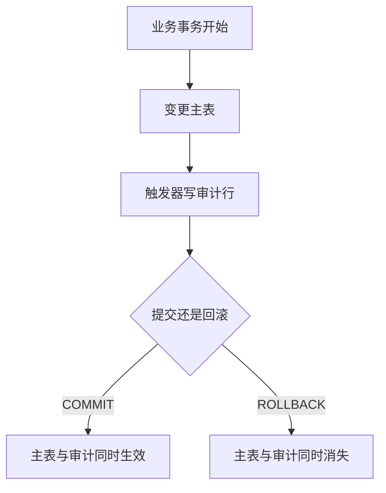

```python
# file: code/04_数据库与缓存/q2761_audit_same_tx.py
"""审计表与主表的事务同框: 回滚连审计一起回滚, 触发器保证不漏"""
import sqlite3

conn = sqlite3.connect(":memory:", isolation_level=None)
c = conn.cursor()
c.execute("CREATE TABLE account (id INTEGER PRIMARY KEY, owner TEXT, bal INTEGER)")
c.execute("""CREATE TABLE audit (
    id INTEGER PRIMARY KEY AUTOINCREMENT, account_id INTEGER,
    delta INTEGER, note TEXT, at TEXT DEFAULT (datetime('now')))""")
c.execute("""CREATE TRIGGER account_audit AFTER UPDATE ON account
  WHEN OLD.bal <> NEW.bal
  BEGIN
    INSERT INTO audit(account_id, delta, note) VALUES(NEW.id, NEW.bal - OLD.bal, 'balance');
  END""")
c.execute("INSERT INTO account VALUES(1, 'alice', 100)")

c.execute("BEGIN")                          # 成功路径: 业务与审计同事务落盘
c.execute("UPDATE account SET bal = bal - 30 WHERE id=1")
c.execute("COMMIT")
print("扣款 30 后审计:", c.execute("SELECT account_id, delta, note FROM audit").fetchall())

c.execute("BEGIN")                          # 失败路径: 业务回滚, 审计必须一起消失
c.execute("UPDATE account SET bal = bal + 999 WHERE id=1")
c.execute("ROLLBACK")
n = c.execute("SELECT COUNT(*) FROM audit WHERE delta=999").fetchone()[0]
print("回滚后 delta=999 的审计条数: %d (0 才对, 审计与业务同生死)" % n)
print("最终账实:", c.execute("SELECT bal FROM account WHERE id=1").fetchone()[0])
conn.close()
```

**追问**:
- 审计表要不要可关闭?—— 高频表上触发器审计有开销,可按表粒度开关,但关闭动作本身要留痕。
- 审计表膨胀怎么办?—— 审计只追加不更新,按时间分区加归档,查询走时间索引。

---

### Q2762 · 列级最小更新: 只把变过的字段写回去

> 难度:★★☆☆ | 标签:SQL, 写优化

**问**:保存接口把整个表单都 UPDATE 一遍,有什么问题?怎么改?

**答**:整行 UPDATE 的代价是多写不必要的数据:未变字段照旧生成 binlog/undo、照旧触发触发器与审计、照旧让行版本前进,宽表和热点表上浪费可观;更隐蔽的是"假更新"会误伤乐观锁——内容没变版本号却涨了,并发场景多出无谓冲突。正确做法是脏检查:对比库里的旧值与提交的新值,只把差异字段拼进 SET 子句,一个字段没变就干脆不发 UPDATE。ORM 的 flush 通常已做脏检查(Q 里的属性快照即此),手写 SQL 层要自己实现同样的对比。顺带的收益是审计干净:审计里出现的字段都是真的变过的字段,回放与对账都更容易。

```python
# file: code/04_数据库与缓存/q2762_minimal_update.py
"""列级最小更新: 脏检查后只把变过的字段写回去"""
import sqlite3

conn = sqlite3.connect(":memory:", isolation_level=None)
c = conn.cursor()
c.execute("""CREATE TABLE profile (
    id INTEGER PRIMARY KEY, name TEXT, city TEXT, age INTEGER, bio TEXT)""")
c.execute("INSERT INTO profile VALUES(1, '旧名', '北京', 30, '一段很长的个人简介')")

old = dict(zip(("name", "city", "age", "bio"),
               c.execute("SELECT name, city, age, bio FROM profile WHERE id=1").fetchone()))
new = {"name": "新名", "city": "北京", "age": 30, "bio": "一段很长的个人简介"}

changed = {k: v for k, v in new.items() if old.get(k) != v}
print("整行更新要写 %d 列; 脏检查后只需写 %d 列: %s"
      % (len(new), len(changed), sorted(changed)))
if changed:
    sets = ", ".join("%s=?" % k for k in changed)
    c.execute("UPDATE profile SET %s WHERE id=1" % sets, tuple(changed.values()))
print("更新结果:", c.execute("SELECT name, city, age, bio FROM profile WHERE id=1").fetchone())
print("没有差异时干脆不发 UPDATE, 乐观锁版本号也不会空转")
conn.close()
```

**追问**:
- 字段值是 JSON 大对象时怎么比?—— 先比哈希再比内容,哈希相同跳过,避免大对象逐字段深比较。
- 脏检查本身有代价吗?—— 要多一次读(或用 ORM 会话里的快照),读多写少的表不值得,热点表和宽表才划算。

---

### Q2763 · 组提交的概念: 攒批把 100 次落盘并成 2 次

> 难度:★★★☆ | 标签:事务, 落盘

**问**:组提交(group commit)解决什么问题?为什么高并发写入离不开它?

**答**:落盘是事务最贵的动作,一次 fsync 的代价远超内存操作,逐条提交时每条事务都要独占一次 fsync,磁盘吞吐成为天花板。组提交的思路是攒批:leader 事务带着同一窗口内排队的其他事务一起落盘,一次 fsync 服务整组,单条均摊的落盘代价随并发下降——并发越高效果越明显,这正是它和"应用层攒批"的本质区别:组提交在数据库内部自动发生,不需要业务改代码。代价是单条延迟略增(等攒批窗口)且组内事务共同进退。实测用逐条提交与攒批提交对比落盘次数与耗时,差距就是组提交赚到的部分。写密集系统的压测曲线里,"并发上去吞吐反而升"的现象,基本都有组提交的功劳。

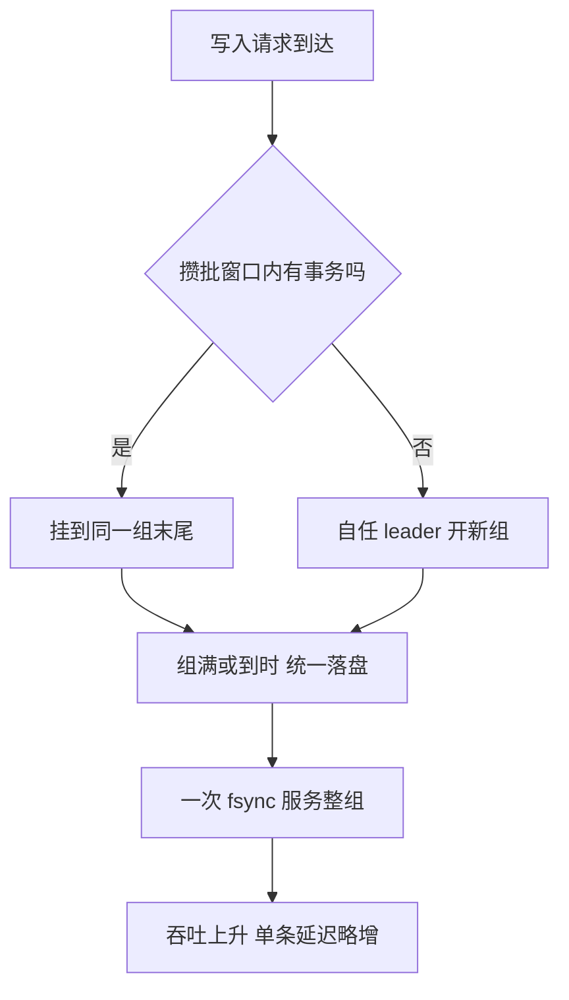

```python
# file: code/04_数据库与缓存/q2763_group_commit.py
"""组提交的概念: 逐条提交与攒批提交的落盘次数与耗时对比"""
import os
import sqlite3
import tempfile
import time

d = tempfile.mkdtemp()

def run(label, per_commit, total=100):
    db = os.path.join(d, "gc_%s.db" % label)
    conn = sqlite3.connect(db, isolation_level=None)
    conn.execute("PRAGMA journal_mode=DELETE")   # 回滚日志模式, 每事务一次完整落盘
    conn.execute("PRAGMA synchronous=FULL")      # 每次提交强制 fsync
    conn.execute("CREATE TABLE t (id INTEGER PRIMARY KEY, v INTEGER)")
    t0 = time.perf_counter()
    done = 0
    commits = 0
    while done < total:
        conn.execute("BEGIN")
        for _ in range(min(per_commit, total - done)):
            done += 1
            conn.execute("INSERT INTO t VALUES(?,?)", (done, done))
        conn.execute("COMMIT")                   # 每个事务对应一次真正的落盘
        commits += 1
    cost = (time.perf_counter() - t0) * 1000
    conn.close()
    os.remove(db)
    return commits, cost

c1 = run("solo", 1)
c50 = run("group50", 50)
print("100 行: 逐条提交 %d 次落盘 耗时 %.0f ms | 攒 50 条一组 %d 次落盘 耗时 %.0f ms"
      % (c1[0], c1[1], c50[0], c50[1]))
print("组提交在数据库内部自动攒批, 并发越高, 单条均摊的落盘代价越低")
```

**追问**:
- 应用层还能再攒一层吗?—— 能,批量接口把 N 条业务合并成一个事务,与组提交叠加,但要注意单事务别过大(Q 里的拆分原则)。
- 组提交对持久性有损失吗?—— 没有,组内事务要么都落盘要么都未提交,D 姓保持完整。

---

### Q2764 · 先查后插的竞态: 两次查询都说不存在 唯一约束才是闸门

> 难度:★★★☆ | 标签:约束, 并发

**问**:注册接口先 SELECT 有没有这个邮箱,没有就 INSERT,这样写有并发问题吗?

**答**:有,经典的 check-then-act 竞态:检查与插入之间存在窗口,两个请求都查到"不存在",然后各自 INSERT,重复数据落库。任何"先读后写"的业务判断都无法封死这个窗口——读不加锁时窗口天然存在,读加锁又把性能拖垮。数据库唯一约束是唯一的物理闸门:它不依赖检查时机,冲突的 INSERT 直接被拒绝,应用捕获 IntegrityError 转成友好提示或用 ON CONFLICT 转 upsert。实测按竞态时间线重放:b 查询为空,a 插入提交,b 再插立刻撞约束——错误发生在约束层而不是判断层。凡是"存在性检查 + 写入"的代码,审查时都要问一句:检查和写入之间,谁在保护你。

```python
# file: code/04_数据库与缓存/q2764_check_then_insert.py
"""先查后插的竞态: 检查与插入之间的窗口, 只有唯一约束封得住"""
import os
import sqlite3
import tempfile

dbpath = os.path.join(tempfile.mkdtemp(), "race.db")
a = sqlite3.connect(dbpath, isolation_level=None)
b = sqlite3.connect(dbpath, isolation_level=None)
a.execute("CREATE TABLE user (id INTEGER PRIMARY KEY, email TEXT UNIQUE)")

def check_only(conn, email):
    hit = conn.execute("SELECT 1 FROM user WHERE email=?", (email,)).fetchone()
    return "已存在" if hit else "不存在"

print("第 1 步 b 预查:", check_only(b, "bob@x.com"), "(b 认为可以注册)")
a.execute("INSERT INTO user(email) VALUES(?)", ("bob@x.com",))   # 第 2 步 a 抢先落库
print("第 2 步 a: INSERT 提交成功")
try:
    b.execute("INSERT INTO user(email) VALUES(?)", ("bob@x.com",))  # 第 3 步 b 才真正写入
    print("第 3 步 b: 竟然插入成功 (若无唯一约束, 这就是重复数据)")
except sqlite3.IntegrityError as e:
    print("第 3 步 b: INSERT 撞唯一约束 -> %s" % e)
print("教训: b 的预查没有任何保护力, 唯一约束才是竞态窗口上唯一的闸门")
print("正确姿势: 不预查, 直接 INSERT 并处理 IntegrityError 或 ON CONFLICT")
a.close()
b.close()
```

**追问**:
- 预查就一点用没有吗?—— 它的用处是把"明确已存在"提前返回省一次写,但结果只能当提示,不能当防线。
- 分布式多库写入怎么保证唯一?—— 单库约束管不到别的库,要用全局发号/分布式锁或把唯一判定收敛到同一个库。

---

### Q2765 · 批量失效的错峰实测: 同刻删除把回源挤成尖峰

> 难度:★★★☆ | 标签:缓存, 回源

**问**:配置变更要批量失效上千个缓存键,一次性全删有什么风险?

**答**:风险是把失效变成一次同步的回源风暴:上千个键同一刻失效,紧接着的读取全部 miss,回源请求在同一瞬间涌向数据库,数据库平时扛得住的量被放大成尖峰,轻则超时重试,重则连环故障。解法是错峰:把批量失效打散到一个窗口内随机时刻执行,回源从"一个瞬间 N 个"变成"每个 tick 均匀 N/窗口 tick 数",峰值从尖峰削成背景噪音。实测同刻失效与错峰失效的单 tick 回源峰值对比,差距就是错峰买来的安全边际。同类手法也用在 TTL 抖动和预热限速上,本质都是:确定性集中是故障源,随机化摊平是通用解。

```python
# file: code/04_数据库与缓存/q2765_staggered_invalidation.py
"""批量失效的错峰实测: 同刻删除把回源挤成尖峰, 随机散布削平"""
import random
from collections import Counter

random.seed(42)
N, BACKFILL_MS, TICK_MS, WINDOW_MS = 1000, 20.0, 50.0, 2000.0

def profile(label, delays):
    loads = Counter(int(d // TICK_MS) for d in delays)
    peak = max(loads.values())
    total_ticks = max(loads) + 1
    avg = N / total_ticks
    print("%s: %d 个 tick, 峰值单 tick 回源 %d 个 (约 %.0f ms 回源压力), 均值 %.0f 个"
          % (label, total_ticks, peak, peak * BACKFILL_MS, avg))

profile("同刻失效", [0.0] * N)
profile("错峰失效", [random.uniform(0, WINDOW_MS) for _ in range(N)])
print("错峰的本质: 把确定性尖峰摊成背景噪音, 代价是失效完成时间从 0 变成窗口长")
```

**追问**:
- 错峰期间读到旧值怎么办?—— 会,错峰的代价就是窗口内的陈旧读,业务可容忍才用;强一致键走主动通知不走批量删除。
- 窗口多长合适?—— 上限是业务对陈旧的容忍度,下限要保证单 tick 回源量低于回源路径的容量,通常秒级到分钟级。

---

### Q2766 · 版本号入键: 无删除的失效与读竞态消除

> 难度:★★★☆ | 标签:缓存, 失效

**问**:缓存失效一定要 DELETE 吗?把版本号编进 key 有什么好处?

**答**:版本号入键是"换键不删值"的失效方案:真实 key 带逻辑版本前缀,如 v3:item:42,失效动作只是把版本号从 3 加到 4——旧键 v3:item:42 瞬间从读路径上消失,但物理上还躺在缓存里,等 TTL 到期被逐出,期间不参与任何读取。它解决了删除式失效的竞态:读方 miss 后回源、写方同时改库删键、读方把旧值塞回——三步交错就会留下脏缓存;版本号方案里读方回填的是当前版本键,写方一失效版本号,旧值连被读到的资格都没有。代价是失效前的旧键占内存(要配 TTL)和版本表的管理。前缀翻转是它的命名空间级批量版,单键场景用版本号更精准。

```python
# file: code/04_数据库与缓存/q2766_versioned_key.py
"""版本号入键: 失效不删键, 换个版本号让旧键自然死"""
class VersionedCache:
    def __init__(self):
        self.store = {}        # 物理存储
        self.version = {}      # 逻辑版本表
        self.hits = 0
        self.miss = 0

    def _key(self, k):
        return "v%d:%s" % (self.version.get(k, 0), k)

    def get(self, k):
        v = self.store.get(self._key(k))
        if v is None:
            self.miss += 1
            return None
        self.hits += 1
        return v

    def put(self, k, val):
        self.store[self._key(k)] = val

    def invalidate(self, k):
        self.version[k] = self.version.get(k, 0) + 1     # 只动版本号, 不删旧键

cache = VersionedCache()
cache.put("item:1", "价格 99")
print("读:", cache.get("item:1"), "| 命中 %d 未命中 %d" % (cache.hits, cache.miss))
cache.invalidate("item:1")
print("失效后再读 -> miss (v0:item:1 仍在存储里但读路径已切到 v1):", cache.get("item:1"))
cache.put("item:1", "价格 89")
print("重填后读:", cache.get("item:1"), "| 物理键:", sorted(cache.store))
print("删除式失效的竞态 (回源塞回旧值) 在这里没有路径: 旧值只会落进早已无人读取的旧版本键")
```

**追问**:
- 旧键的内存谁来收?—— 写入时带 TTL,旧键到期被逐出;版本切换频繁的键要算一下"新旧并存的内存峰值"。
- 版本表本身存哪?—— 与缓存同生命周期即可,实例重启版本表清零相当于全量失效,正好是安全默认。

---

### Q2767 · 写穿透与写回的失败注入: 一个阻塞一个丢数据

> 难度:★★★★ | 标签:缓存, 写策略

**问**:写穿透和写回两种写策略,缓存故障时各自死法有什么不同?

**答**:写穿透把缓存写放在关键路径上:先落库再写缓存,缓存挂了表现为请求失败或降级——数据安全但可用性受损;兜底纪律是缓存写失败时执行失效而不是留下旧值,让下次读回源,宁可 miss 不可 stale。写回把缓存写当成功即返回,脏数据由后台刷盘器异步落库:请求延迟最低、写入可合并,但失败注入暴露出它的死穴——刷盘前崩溃,脏数据永久丢失,连"重试"的机会都没有,因为它没进任何持久层。所以纯写回只配给可丢数据(计数、统计)场景;要保数据就必须加预写日志或多副本,复杂度立刻上一个台阶。失败注入实验的价值就是把这两种死法在测试环境里演出来,而不是在故障复盘时第一次见到。

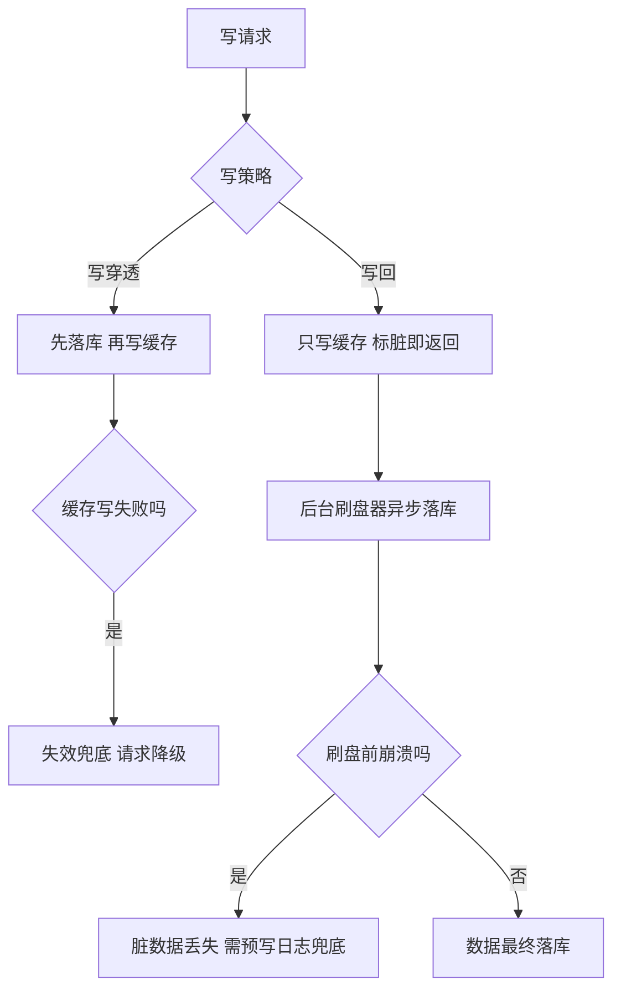

```python
# file: code/04_数据库与缓存/q2767_write_through_back_fail.py
"""写穿透与写回的失败注入: 写穿透失败是阻塞, 写回失败是丢数据"""
class FlakyCache:
    def __init__(self):
        self.data = {}
        self.fail_put = False
        self.fail_flush = False

    def put(self, k, v):
        if self.fail_put:
            raise IOError("缓存不可写")
        self.data[k] = v

    def flush(self, pending):
        if self.fail_flush:
            raise IOError("刷盘失败")
        self.data.update(pending)


db = {}
cache = FlakyCache()

# 写穿透: 先落库再写缓存, 缓存写失败按失效处理, 不留旧值
cache.fail_put = True
try:
    db["p:1"] = "新值"
    cache.put("p:1", "新值")
except IOError as e:
    cache.data.pop("p:1", None)
    print("写穿透失败: %s -> 库已更新, 缓存按失效处理, 下次读回源" % e)
cache.fail_put = False
cache.put("p:1", "新值")
print("写穿透恢复: 缓存 %s" % cache.data)

# 写回: 请求只写缓存即返回, 刷盘前崩溃就是永久丢失
dirty = {"p:2": "新值"}
print("写回: 请求已返回, 脏数据 %s 尚未落库, db 里还是 %s" % (dirty, db.get("p:2")))
cache2 = FlakyCache()
cache2.fail_flush = True
try:
    cache2.flush(dirty)
except IOError as e:
    print("写回失败: %s -> 若此刻进程崩溃, p:2 的写入永久丢失" % e)
print("结论: 可丢数据才用纯写回, 要保数据配预写日志, 或直接退回写穿透")
```

**追问**:
- 写回的脏数据窗口能压缩到多小?—— 刷盘间隔调小、按脏页量触发、关机钩子里强刷,但只要异步存在,窗口就不为零。
- 写穿透的"库成功缓存失败"还有第三种处理吗?—— 有,记录失效事件交给后台补写,把同步降级改成异步收敛,但窗口内要容忍 miss。

---

### Q2768 · 多级缓存的逐层回填: 每层 miss 都要把下层结果带回来

> 难度:★★★☆ | 标签:缓存, 多级

**问**:L1 本地缓存和 L2 Redis 组成的两级缓存,读路径上回填有什么讲究?

**答**:回填的规则一句话:每层 miss 之后,只要下层返回了值,本层就要把值填上——L2 命中要顺手回填 L1,回源 DB 后要两层都填。漏掉"L2 命中回填 L1"是最常见的实现缺陷:本地缓存永远等不到热数据,流量全压在 L2 上,多级架构退化成单级加一层网络。TTL 按层递减:近层短(保新鲜,广播失效也先覆盖它),远层长(挡回源),两层 TTL 的差值就是失效传播的容忍窗口。另外空结果也要回填(空值缓存),否则穿透请求每层都要走到底。回填顺序先远后近,保证中途挂掉时至少远层已热,近层冷一点只是多一次进程内 miss。

```python
# file: code/04_数据库与缓存/q2768_layered_backfill.py
"""多级缓存的逐层回填: 每层 miss 都要把下层结果带回来, 各层 TTL 不同"""
class Layer:
    def __init__(self, name, ttl):
        self.name = name
        self.ttl = ttl
        self.data = {}
        self.hits = 0
        self.miss = 0

    def get(self, k, now):
        item = self.data.get(k)
        if item and item[0] > now:
            self.hits += 1
            return item[1]
        self.miss += 1
        return None

    def put(self, k, v, now):
        self.data[k] = (now + self.ttl, v)


L1 = Layer("L1 进程内", ttl=5)
L2 = Layer("L2 Redis", ttl=60)
db_calls = [0]

def source(k):
    db_calls[0] += 1
    return "value:" + k

def read(k, now):
    v = L1.get(k, now)
    if v is not None:
        return v, "L1"
    v = L2.get(k, now)
    if v is not None:
        L1.put(k, v, now)          # 关键: L2 命中也要回填 L1
        return v, "L2"
    v = source(k)
    L2.put(k, v, now)              # 先填远层 TTL 长
    L1.put(k, v, now)              # 再填近层 TTL 短
    return v, "DB"

for label, now in [("t=1000", 1000.0), ("t=1001", 1001.0),
                   ("t=1010 L1 已过期", 1010.0), ("t=1011", 1011.0)]:
    v, where = read("a", now)
    print("%s: %s 命中于 %s" % (label, v, where))
print("L1 命中 %d 未命中 %d | L2 命中 %d 未命中 %d | 回源 %d 次"
      % (L1.hits, L1.miss, L2.hits, L2.miss, db_calls[0]))
print("若漏掉 L2 命中回填 L1, t=1011 那次就会变成 L2 命中, 本地缓存形同虚设")
```

**追问**:
- 各层 TTL 差多少合适?—— 近层通常是远层的十分之一量级,差值覆盖失效广播的最坏延迟即可,过大则近层陈旧窗口变长。
- 回填要不要加锁防并发重复回源?—— 单机内用 singleflight 合并,Q 已有专题;跨实例的重复回源靠 L2 前置挡住。

---

### Q2769 · 命中率的分母口径: 谁进分母 谁决定你看到的百分比

> 难度:★★★☆ | 标签:缓存, 监控

**问**:两套系统报出来的缓存命中率差一倍,可能只是口径不同吗?

**答**:完全可能,命中率对分母极其敏感。口径一"只算缓存层请求":分母是 hit+miss,组件视角,数字最漂亮;口径二把 bypass 请求(个性化数据、实时数据,压根不该走缓存)也放进分母,业务视角,数字立刻难看但更诚实;口径三把"命中但已过期触发回源"算成命中还是 miss,又是一个分叉——算命中会高估新鲜度,算 miss 才反映真实回源压力。还有空值缓存算不算命中、绕过缓存的内部调用进不进分母,都是现实的口径分歧点。结论:命中率必须先声明口径再看数字,跨系统对齐先对齐分母,看板上把口径写在指标名旁边而不是藏在文档里。

```python
# file: code/04_数据库与缓存/q2769_hit_ratio_denominator.py
"""命中率的分母口径: 谁进分母, 谁决定你看到的百分比"""
hit, miss, bypass, expired = 300, 100, 600, 50
# hit 命中; miss 未命中回源; bypass 不该走缓存的个性化请求; expired 命中但已过期触发回源

strict = hit / (hit + miss) * 100
with_bypass = hit / (hit + miss + bypass) * 100
expired_as_hit = (hit + expired) / (hit + miss + expired) * 100
print("口径一 只算缓存层请求: %.0f%% (组件视角)" % strict)
print("口径二 bypass 也进分母: %.0f%% (业务视角)" % with_bypass)
print("口径三 过期重建算命中: %.0f%% (会高估新鲜度)" % expired_as_hit)
print("三个口径都自洽, 混用就是事故: 看板必须声明口径, 跨系统对比先对齐分母")
```

**追问**:
- 哪个口径适合当 SLO?—— 业务口径二,它把"该缓存的都缓存好了"作为目标,bypass 高说明要么分类要么缓存设计有问题。
- 怎么快速发现口径混用?—— 同一时段两个系统数字差异超过可解释范围,先对分母构成再查实现。

---

### Q2770 · 失效删除失败的兜底: 重试队列与 TTL 保底双层收敛

> 难度:★★★☆ | 标签:缓存, 失效

**问**:数据更新后去删缓存,Redis 恰好不可达,删除失败了怎么办?

**答**:失效删除失败意味着缓存里留着旧值,必须有两层兜底。第一层是重试队列:删除失败把键进队,后台任务或恢复钩子持续补删,重试要有上限与退避,防止故障期间队列本身堆积成新问题。第二层是 TTL 保底:每个缓存值写入时都带业务可容忍的 TTL,删除链路彻底失效时,最坏陈旧窗口被 TTL 封顶——这就是"缓存值必须永远带 TTL"的根本理由,它不是性能参数,是失效链路的最后防线。两层的关系是:重试负责及时,负责把窗口压到秒级;TTL 负责保底,负责把最坏情况封到分钟级。监控上要盯着重试队列长度,TTL 兜底触发过就该在复盘里看到记录。

```python
# file: code/04_数据库与缓存/q2770_delete_retry_fallback.py
"""失效删除失败的兜底: 重试队列消化故障期, TTL 是最后防线"""
class FlakyRedis:
    def __init__(self):
        self.up = False
        self.data = {"p:42": "旧值"}

    def delete(self, k):
        if not self.up:
            raise IOError("redis 不可达")
        self.data.pop(k, None)

cache = FlakyRedis()
retry_queue = []
TTL_S = 60.0

def invalidate(k):
    try:
        cache.delete(k)
        return True
    except IOError:
        if k not in retry_queue:
            retry_queue.append(k)
        return False

ok = invalidate("p:42")
print("故障期失效请求:", "成功" if ok else "失败, 进入重试队列 %s" % retry_queue)
cache.up = True
flushed = 0
guard = 0
while retry_queue and guard < 100:
    guard += 1
    k = retry_queue.pop(0)
    try:
        cache.delete(k)
        flushed += 1
    except IOError:
        retry_queue.append(k)
print("恢复后补删 %d 个键, 剩余队列 %s" % (flushed, retry_queue))
print("若重试始终失败, 键上的 TTL %.0f 秒兜底: 最坏陈旧窗口 = min(补删成功时刻, TTL)" % TTL_S)
```

**追问**:
- 重试队列放哪?—— 进程内存最快但重启即丢,丢失的键靠 TTL 兜底;要求更严就落本地消息表或用 Redis 自己的 list,但要避开"Redis 挂了队列也没了"的同源故障。
- 能不能不等 TTL,靠读时校验?—— 读时带版本比对可以进一步压缩窗口,但每个读都多一次校验,按键的业务等级取舍。

---

### Q2771 · 读路径的超时预算: 每层配额用完就走下一层

> 难度:★★★☆ | 标签:缓存, 超时

**问**:一次读请求要过 L1、L2、数据库三层,超时怎么设才不会一层拖死全链路?

**答**:核心是预算制而不是各自为政:先定整个读路径的总预算(比如 200ms),再把它切成各层配额——L1 毫秒级、L2 二十毫秒级、数据库留最大份,并且每层的配额是硬上限,到点没返回就放弃该层走下一层,剩余预算逐层递减。这样任何一层卡死,损失都封顶在该层配额,不会把总预算吃穿;L2 卡死时业务退化为直读数据库,慢但可用,这就是降级的自然形态。配额的依据是各层的历史 P99 再留余量,而不是拍脑袋;发布压测时故意把某一层注入慢故障,验证预算守得住。反面教材是每层都设 3 秒超时,最坏叠加成 9 秒,预算制就是治它的。

```python
# file: code/04_数据库与缓存/q2771_timeout_budget.py
"""读路径的超时预算: 每层配额独立, 谁超配额就跳过谁"""
BUDGET_MS = 200.0

def read_path(layers):
    """layers: [(层名, 配额ms, 是否命中, 实际ms)]; 剩余预算逐层递减"""
    remaining = BUDGET_MS
    trail = []
    for name, quota, hit, actual in layers:
        cost = min(actual, quota)
        remaining -= cost
        if hit and actual <= quota:
            trail.append("%s 命中 耗 %.0fms" % (name, actual))
            return trail, "于 %s 返回, 剩余预算 %.0fms" % (name, remaining)
        trail.append("%s 未命中或超时 耗 %.0fms" % (name, cost))
        if remaining <= 0:
            return trail, "预算耗尽"
    return trail, "全部 miss, 降级返回默认值"

scenarios = [
    ("全链路健康", [("L1", 1, False, 0.2), ("L2", 20, True, 8.0), ("DB", 150, True, 40.0)]),
    ("L2 卡死",    [("L1", 1, False, 0.2), ("L2", 20, False, 5000.0), ("DB", 150, True, 40.0)]),
    ("DB 也慢",    [("L1", 1, False, 0.2), ("L2", 20, False, 5000.0), ("DB", 150, False, 400.0)]),
]
for label, layers in scenarios:
    trail, verdict = read_path(layers)
    print("%s: %s -> %s" % (label, " | ".join(trail), verdict))
```

**追问**:
- 配额内没命中但也没超时,算谁的账?—— miss 正常走下一层,只有"耗时超过配额"才判定为该层故障并计入健康统计。
- 总预算取多少?—— 从上游接口的 SLA 倒推,读路径预算通常占接口预算的一半以内,留出序列化与网络的份。

---

### Q2772 · 失效扇出的核算: 一次写到底要删多少个派生键

> 难度:★★★★ | 标签:缓存, 失效

**问**:商品改个价格,详情页、列表页、搜索缓存全要失效,这个扇出怎么管理?

**答**:先核算再定策略。把一次写会波及的派生键列成依赖图:详情键 1 个、它所在分类的列表页几十个、命中它的搜索结果几百个、推荐位若干——把"一次写的失效动作数"算出来,这个数就是写路径的隐性放大系数。然后按节点类型分派策略:单键且关键的(详情)逐键删除;命名空间型的(列表页)不逐页删,翻版本号一次动作搞定;容忍陈旧的(搜索结果)干脆不主动失效,靠短 TTL 自然过期。三类策略混用后,实际的同步失效动作数从上千降到个位数,剩下的交给版本和 TTL 异步收敛。扇出核算应该出现在设计评审里:算不出来扇出数的缓存设计,等于没设计。

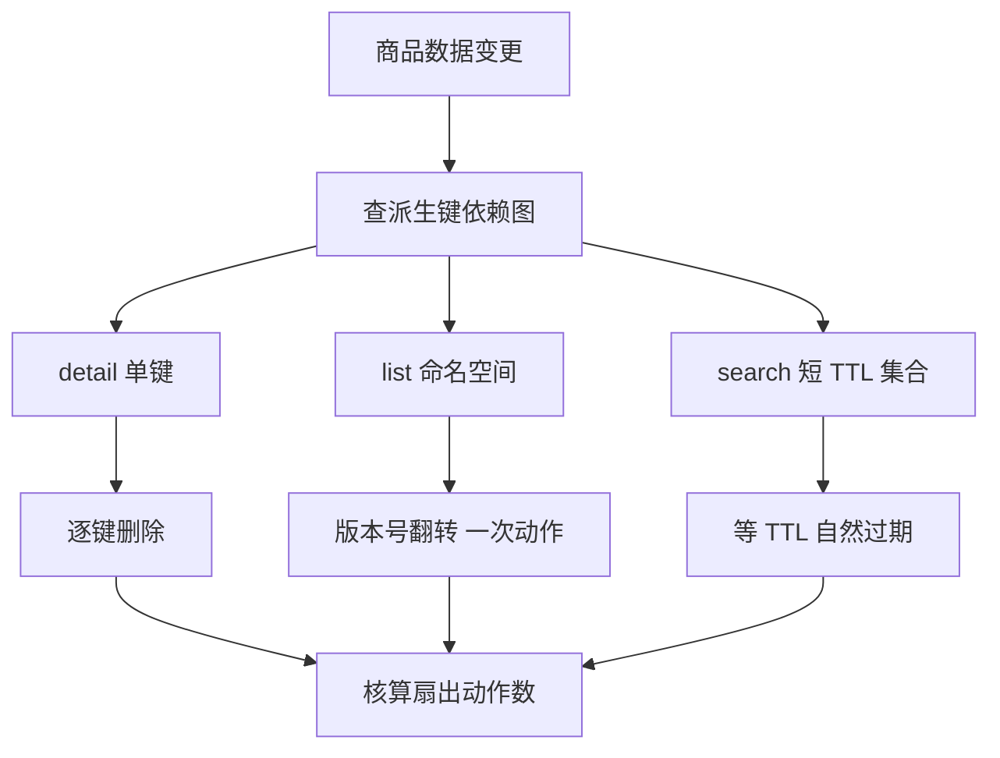

```python
# file: code/04_数据库与缓存/q2772_invalidation_fanout.py
"""失效扇出核算: 一次商品写波及多少派生键, 三种策略各摊多少"""
CATS, PAGES_PER_CAT, SEARCH_HITS = 1, 50, 200

def naive_fanout():
    """全部逐键删除: 详情 1 + 该商品所在分类全部列表页 + 命中它的搜索页 + 推荐位"""
    return 1 + PAGES_PER_CAT + SEARCH_HITS + 1

def strategy_fanout():
    """详情逐键删 1, 列表翻版本号 1, 搜索靠 TTL 0, 推荐 TTL 0"""
    return 2

print("商品改价一次, 派生键: 列表页 %d + 搜索页 %d + 详情与推荐 %d"
      % (PAGES_PER_CAT, SEARCH_HITS, 2))
print("全部逐键删除: %d 个失效动作 (写路径的隐性放大系数)" % naive_fanout())
print("按类型分派策略后: %d 个同步动作, 其余交给版本号与 TTL 异步收敛" % strategy_fanout())
assert strategy_fanout() < naive_fanout()
print("设计评审必答题: 一次写的失效扇出是多少? 答不出来等于没设计")
```

**追问**:
- 依赖图谁来维护?—— 写路径代码里显式声明最可靠,自动推断(key 命名约定反查)可以做审计但别当唯一事实源。
- 版本号翻转对列表页的代价?—— 整个命名空间全部冷启动,回源率瞬时抬升,要错峰(Q 批量失效专题)或只翻转受影响的子空间。

---

### Q2773 · 冷缓存的爬坡: 回源率随请求序衰减的曲线

> 难度:★★☆☆ | 标签:缓存, 预热

**问**:缓存实例刚启动或刚扩容完,命中率会怎么变化?要盯着什么?

**答**:冷缓存的命中率是一条爬坡曲线:最初的回源率接近 100%,随着热键逐渐被填进缓存,回源率单调下降,最终稳定在一个由 key 空间与热点集中度决定的水平——Zipf 分布越尖,稳定命中率越高,爬坡也越快。运维上要盯三件事:爬坡期的数据库压力(回源率乘以 QPS,可能超过平时峰值,必要时限流或预热);爬坡时长(它决定"扩容后多久恢复服务水位");稳定值与历史基线的偏差(偏差大说明 key 空间变了或容量不够)。预热的意义就是把爬坡提前走完,把曲线最陡、数据库最疼的那一段搬到可控的窗口里。扩容后命中率先跌后升是正常现象,别在爬坡中途误判成"扩容失败"回滚。

```python
# file: code/04_数据库与缓存/q2773_cold_cache_ramp.py
"""冷缓存的爬坡: 回源率随请求序衰减的曲线"""
import random

random.seed(3)
N = 500
weights = [1.0 / (i + 1) for i in range(1, N + 1)]   # Zipf 倾向的热点分布
requests = random.choices(range(N), weights=weights, k=20000)

cache = set()
miss_in_window = 0
WINDOW = 2000
print("窗口   回源率")
for i, k in enumerate(requests, 1):
    if k not in cache:
        cache.add(k)
        miss_in_window += 1
    if i % WINDOW == 0:
        print("%4d   %5.1f%%" % (i // WINDOW, miss_in_window * 100.0 / WINDOW))
        miss_in_window = 0
print("结论: 回源率单调下降后稳定, 稳定值由热点集中度决定; 预热就是把最陡的爬坡段提前走完")
```

**追问**:
- 为什么前几个窗口回源率几乎不掉?—— 高频键还没被请求到,冷缓存的 miss 是无差别的,衰减要等热点覆盖住请求分布。
- 稳定命中率比历史低很多怎么排查?—— 先看容量与逐出(命中率跌是内存不够的信号),再看 key 空间变化(新业务或清洗了 key)。

---

### Q2774 · 列表页缓存的粒度: 整页缓存省读费写 id 集合相反

> 难度:★★★☆ | 标签:缓存, 设计

**问**:商品列表页缓存,缓存整页 HTML 还是缓存 id 集合加对象?

**答**:两种粒度的账是反的。整页缓存读路径最优:一次键取回整页,零读放大;但写失效面大——一个商品改价,保守做法要失效它所在分类的全部列表页,因为商品在页间的位置会随排序漂移,精确追踪"哪些页包含它"本身又是一份索引。id 集合方案失效面最小:改价只失效对象键,集合键不动;代价是读放大,每次列表要取 1 个集合键加 N 个对象键,批量取(pipeline/mget)能摊薄但不能消除。折中是整页缓存配短 TTL:不追求精确失效,让变更靠几十秒的 TTL 收敛,适合列表稳定性要求不高的场景。选型口诀:变更频繁选对象粒度,列表稳定选整页,中间态用短 TTL 页缓存,由读写比决定。

```python
# file: code/04_数据库与缓存/q2774_list_cache_granularity.py
"""列表页缓存的粒度: 整页缓存省读费写, id 集合省写费读"""
PAGE, CATS, PAGES_PER_CAT = 20, 10, 50

page_keys = CATS * PAGES_PER_CAT
print("整页缓存: %d 个页键; 一次商品改价保守失效该分类全部 %d 个页"
      % (page_keys, PAGES_PER_CAT))
print("id 集合: 一次改价只失效 1 个对象键; 但每次读列表要取 %d 个键 (1 集合 + %d 对象)"
      % (1 + PAGE, PAGE))

print("折中: 整页缓存 + 短 TTL")
for ttl, inv in [(5, PAGES_PER_CAT), (60, 0)]:
    stale = 0 if inv else ttl
    print("  TTL %2ds: 同步失效动作 %d 个, 最坏陈旧窗口 %ds" % (ttl, inv, stale))
print("选型口诀: 变更频繁选对象粒度, 列表稳定选整页, 中间态用短 TTL 页缓存")
```

**追问**:
- 精确追踪商品出现在哪些页可行吗?—— 可行但要维护"商品-页"反向索引,排序一变就要更新,复杂度通常超过收益。
- 读放大有上限吗?—— 有,页大小与对象键体积决定 mget 批次大小,超过几百键就该考虑页级缓存兜一层。

---

### Q2775 · 表膨胀的估算与增量清理: freelist 算账 增量还页

> 难度:★★★☆ | 标签:运维, SQLite

**问**:表删了一半数据,文件一点没变小,怎么估算能回收多少、要不要清理?

**答**:先算账再动手。膨胀的账本在页统计里:page_count 是文件总页数,freelist_count 是已释放待复用的空页,空页占比就是可回收比例,乘以页大小得到可回收字节数——这个数决定值不值得安排清理窗口(占比低于一两成通常不值得)。清理方式看引擎:SQLite 全量 VACUUM 会重建整库、锁库且需要等量临时空间,大库不可控;开 auto_vacuum=INCREMENTAL 后用 PRAGMA incremental_vacuum(N) 每次只还 N 页,把一次性大 IO 拆成可控小批。预防比清理更省:批量删除本来就该配分批与定期,避免 freelist 长期高位。注意 MySQL 的表膨胀另有 optimize table 一套机制,思想相同:先估算,再分批,挑窗口。

```python
# file: code/04_数据库与缓存/q2775_bloat_estimate.py
"""表膨胀的估算与增量清理: freelist 算账, auto_vacuum 增量还页"""
import os
import sqlite3
import tempfile

dbpath = os.path.join(tempfile.mkdtemp(), "bloat.db")
conn = sqlite3.connect(dbpath, isolation_level=None)
conn.execute("PRAGMA page_size=4096")
conn.execute("PRAGMA auto_vacuum=INCREMENTAL")     # 必须在建表前设置
conn.execute("CREATE TABLE log (id INTEGER PRIMARY KEY, msg TEXT)")
conn.execute("BEGIN IMMEDIATE")
conn.executemany("INSERT INTO log VALUES(?,?)",
                 [(i, "m" * 100) for i in range(1, 20001)])
conn.execute("COMMIT")
before = conn.execute("PRAGMA page_count").fetchone()[0]
conn.execute("DELETE FROM log WHERE id % 2 = 0")   # 删一半: 空页留在 freelist, 文件不变小

pc = conn.execute("PRAGMA page_count").fetchone()[0]
fl = conn.execute("PRAGMA freelist_count").fetchone()[0]
print("删除一半后: page_count=%d, freelist=%d (%.0f%%), 可回收约 %.1f MB"
      % (pc, fl, fl * 100.0 / pc, fl * 4096 / 1048576.0))

conn.execute("PRAGMA incremental_vacuum(200)")     # 每次最多还 200 页, 控 IO 节奏
fl2 = conn.execute("PRAGMA freelist_count").fetchone()[0]
print("增量回收一批后 freelist=%d (还剩 %d 页待回收)" % (fl2, fl2))
conn.execute("PRAGMA incremental_vacuum")          # 不带参数 = 全部还清
fl3 = conn.execute("PRAGMA freelist_count").fetchone()[0]
pc3 = conn.execute("PRAGMA page_count").fetchone()[0]
print("全部还清: freelist=%d, page_count=%d, 文件缩小 %.1f MB"
      % (fl3, pc3, (before - pc3) * 4096 / 1048576.0))
conn.close()
```

**追问**:
- freelist 里的页会被新写入复用吗?—— 会,后续插入优先填 freelist,所以膨胀的害处是文件虚高与扫描 IO,不是空间永久流失。
- auto_vacuum 能在老库上补开吗?—— 需要一次 VACUUM 重建库才能生效,老库要评估清理窗口,和增量清理的成本一起算。

---

### Q2776 · 连接池的借还超时: checkout 限时 归还验活

> 难度:★★★☆ | 标签:连接池, 运维

**问**:连接池借不出连接时,应该一直等还是立刻报错?

**答**:都不是,正确语义是限时等待:checkout 带超时(几百毫秒量级),超时抛出明确异常,让上游快速失败并触发降级,而不是无限排队把线程池一起拖垮——"连接池打满"事故的放大器往往就是无限等待的 checkout。配套两个动作:借出前验活,拿到的连接先发一个轻量探测,坏连接当场丢弃换下一个,避免把断连交给业务在半路炸;归还时区分健康与异常,异常连接直接关闭不回池。观测上,checkout 等待时长与超时次数是池容量的直接信号,超时开始非零就该扩池或查慢查询占坑。借还语义写清楚了,池才是可运维的组件,不是黑盒。

```python
# file: code/04_数据库与缓存/q2776_pool_checkout_timeout.py
"""连接池的借还超时: checkout 限时, 借出前验活, 死连接丢弃"""
import queue
import sqlite3
import threading
from contextlib import contextmanager

class BrokenConn:
    def execute(self, *args):
        raise RuntimeError("连接已断")

class Pool:
    def __init__(self, size, checkout_timeout=0.3):
        self._free = queue.LifoQueue()
        self.timeout = checkout_timeout
        self.timed_out = 0
        self.discarded = 0
        for _ in range(size):
            conn = sqlite3.connect(":memory:")
            conn.execute("CREATE TABLE IF NOT EXISTS t (x)")
            self._free.put(conn)

    @contextmanager
    def borrow(self):
        conn = self._checkout()
        try:
            yield conn
        finally:
            self._free.put(conn)

    def _checkout(self):
        while True:
            try:
                conn = self._free.get(timeout=self.timeout)
            except queue.Empty:
                self.timed_out += 1
                raise TimeoutError("checkout 超时: 池已借空且等待超时")
            try:
                conn.execute("SELECT 1").fetchone()     # 借出前验活
                return conn
            except Exception:
                self.discarded += 1                     # 死连接丢弃, 换下一个
                if self._free.empty():
                    self.timed_out += 1
                    raise TimeoutError("池内连接全部失效")

# 1) 池里混进死连接: 验活当场发现并丢弃
pool = Pool(3)
pool._free.put(BrokenConn())
with pool.borrow() as conn:
    conn.execute("SELECT 1").fetchone()
print("验活: 死连接被丢弃 %d 个, 业务拿到的是好连接" % pool.discarded)

# 2) 借空超时: 2 连接池, 3 个借者各持有 0.4s, checkout 限时 0.3s
pool2 = Pool(2, checkout_timeout=0.3)
results = []
barrier = threading.Barrier(3)

def worker(i):
    barrier.wait()
    try:
        with pool2.borrow() as conn:
            conn.execute("SELECT 1").fetchone()
            threading.Event().wait(0.4)
        results.append("ok%d" % i)
    except TimeoutError:
        results.append("timeout%d" % i)

threads = [threading.Thread(target=worker, args=(i,)) for i in range(3)]
for t in threads:
    t.start()
for t in threads:
    t.join()
print("借还结果:", sorted(results), "| 超时计数 %d (快速失败而不是无限等)" % pool2.timed_out)
```

**追问**:
- checkout 超时设多长?—— 略大于正常等待 P99,通常几百毫秒;设成池打满时的可接受排队时间,而不是数据库查询超时。
- 归还要不要验活?—— 不需要,归还路径要零开销,坏连接交给下次借出时的验活拦截。

---

### Q2777 · 只读副本的读延迟容忍: 按场景标容忍度 写令牌保读己之写

> 难度:★★★★ | 标签:复制, 一致性

**问**:有主从复制延迟,读流量怎么分才不会读到旧数据惹出业务事故?

**答**:关键动作是给每个读场景标注容忍度,路由按容忍度决策:秒级的延迟对"个人主页刷新""推荐流"无所谓,走副本;支付结果、余额这类零容忍场景必须走主库。容忍度表把"能不能读到旧值"从工程直觉变成显式配置,评审和故障排查都有据可依。再加一层写令牌保读己之写:用户刚写入(如下单成功跳转详情页)后的短窗口内,该会话的读强制路由主库,窗口过后恢复正常路由——这是延迟架构下用户体验的最后防线。运行时要盯副本延迟与容忍度的差值:延迟逼近各场景容忍度时提前告警,而不是等用户投诉。延迟尖峰期间,路由自动把超出容忍度的场景回切主库,主库压力随之上升,要有容量预案。

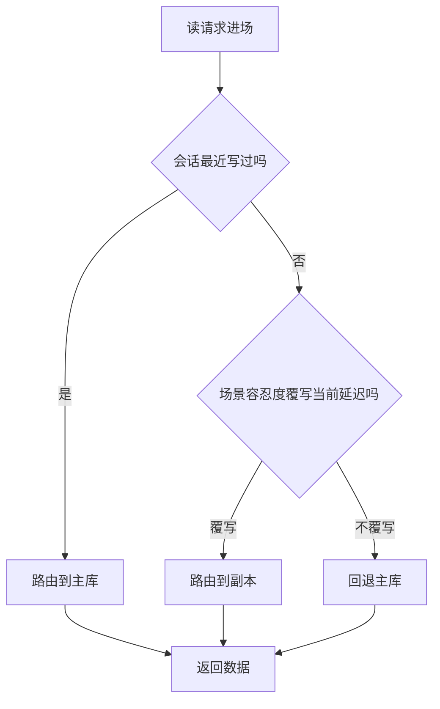

```python
# file: code/04_数据库与缓存/q2777_replica_lag_tolerance.py
"""只读副本的读延迟容忍: 场景标注容忍度, 写令牌保读己之写"""
LAG_S = [2.0]      # 当前观测到的副本延迟

TOLERANCE = {"profile": 5.0, "recommend": 60.0, "payment": 0.0}

def route(scene, session_last_write_ago):
    tol = TOLERANCE[scene]
    if session_last_write_ago is not None and session_last_write_ago < 3.0:
        return "primary", "会话 3 秒内写过, 读己之写"
    if tol == 0.0:
        return "primary", "该场景零容忍"
    if LAG_S[0] > tol:
        return "primary", "副本延迟 %.0fs 超过容忍度 %.0fs" % (LAG_S[0], tol)
    return "replica", "延迟 %.0fs 在容忍度 %.0fs 内" % (LAG_S[0], tol)

cases = [("profile", None), ("profile", 1.0), ("recommend", None),
         ("payment", None), ("recommend", 10.0)]
for scene, ago in cases:
    target, why = route(scene, ago)
    print("%-10s 会话写于 %s -> %-8s (%s)"
          % (scene, "刚刚" if ago is not None else "很久前", target, why))

LAG_S[0] = 12.0
print("--- 延迟尖峰到 12s 之后 ---")
for scene in ("profile", "recommend"):
    target, why = route(scene, None)
    print("%-10s -> %-8s (%s)" % (scene, target, why))
```

**追问**:
- 写令牌存哪?—— 会话级存储(分布式缓存或粘性会话),记录最后写时间,读路由时校验;窗口取主从延迟的 P99 加余量。
- 副本延迟的容忍度表谁维护?—— 业务负责人提需求、平台定模板,作为读路由配置随代码评审,新增读场景必须填。

---

### Q2778 · 慢查询样本的留存: 指纹 脱敏 环形上限

> 难度:★★★☆ | 标签:慢查询, 运维

**问**:慢查询日志越攒越大,样本应该留什么、留多少?

**答**:留三层信息,上限必须刚性。留什么:归一化指纹(参数替换成占位符后的 SQL 形态,用于聚合同类查询)、脱敏后的参数(手机号邮箱等 PII 必须打码,慢日志是 PII 泄漏的高发地)、耗时与执行计划快照(计划是归因的关键,事后可能已变)。留多少:环形缓冲固定上限,新样本挤掉最旧,保证磁盘占用有界;同时保留"最贵 top-K"不被挤掉——均值会骗人,复盘最需要的是最极端的那几条。采样策略(全量阈值加概率抽样)解决"留哪些进来",环形与 top-K 解决"进来后留多久",两层配合才能既不漏大事又不撑爆存储。样本的最终去向是聚合看板:按指纹聚合出 top 慢查询清单,样本只是聚合的原料。

```python
# file: code/04_数据库与缓存/q2778_slow_sample_retention.py
"""慢查询样本的留存: 指纹归一 参数脱敏 环形上限防撑爆"""
import collections
import re

def fingerprint(sql):
    s = re.sub(r"\s+", " ", sql.strip().lower())
    s = re.sub(r"'[^']*'", "?", s)
    s = re.sub(r"\b\d+\b", "?", s)
    return s

def scrub(value):
    t = str(value)
    t = re.sub(r"1\d{10}", "<phone>", t)
    t = re.sub(r"[\w.]+@[\w.]+", "<email>", t)
    return t[:60]

class SampleStore:
    def __init__(self, capacity):
        self.buf = collections.deque(maxlen=capacity)   # 环形上限: 新样本挤掉最旧
        self.dropped = 0

    def add(self, sql, params, ms, plan):
        if len(self.buf) == self.buf.maxlen:
            self.dropped += 1
        self.buf.append({"fp": fingerprint(sql),
                         "params": [scrub(p) for p in params],
                         "ms": round(ms, 1),
                         "plan": plan})

store = SampleStore(capacity=100)
for i in range(130):                                    # 模拟 130 个慢样本
    store.add("SELECT * FROM orders WHERE user_id = %d" % i, [13800000000 + i],
              100.0 + (i * 7) % 900, "SCAN orders")
print("样本总数 %d, 环形留存 %d, 挤掉 %d (磁盘占用有界)" % (130, len(store.buf), store.dropped))
top = sorted(store.buf, key=lambda s: -s["ms"])[:3]
for s in top:
    print("top 慢样本: %6.1f ms | %s | params=%s | %s" % (s["ms"], s["fp"], s["params"], s["plan"]))
print("要点: 指纹用于聚合归因, 脱敏防 PII 泄漏, 环形加 top-K 保证不漏最贵样本")
```

**追问**:
- 指纹归一要把哪些东西抹平?—— 字面量、空白与大小写;IN 列表长度、分页数字也会造成同一语句多指纹,归一规则要定期 review。
- 计划快照为什么重要?—— 慢的原因常是计划突变(统计信息过期、索引失效),没有当时的计划,事后只能靠猜。

---

### Q2779 · 巡检项的自动化清单: 每项一个函数 输出三态与建议

> 难度:★★★☆ | 标签:运维, 巡检

**问**:数据库每天要人工看一遍健康状态,怎么把它变成自动巡检?

**答**:把"老师傅的经验"翻译成检查清单,每项一个函数,输出三态(PASS/WARN/FAIL)加处置建议。清单覆盖五类:结构健康(完整性检查、锁与长事务)、空间健康(膨胀水位、磁盘增速)、数据质量(孤儿引用、取值域异常)、性能信号(热点查询计划、慢样本量)、容量水位(增速外推)。工程要点:检查函数必须只读且自带超时,巡检本身不能成为故障源;三态分级让报告可扫读,WARN 聚合进日报,FAIL 直呼值班;每项带处置建议,让接手的人不需要上下文也知道下一步。巡检框架的价值在持续演化:每次故障复盘产出新的检查项,清单越长,同类故障越难二次发生。

```python
# file: code/04_数据库与缓存/q2779_inspection_checklist.py
"""巡检项的自动化清单: 每项一个函数, 三态输出与处置建议"""
import sqlite3

CHECKS = []
def check(name, advice):
    def deco(fn):
        CHECKS.append((name, advice, fn))
        return fn
    return deco

@check("quick_check 完整性", "FAIL 时立即停写并备份")
def _(conn):
    return conn.execute("PRAGMA quick_check").fetchone()[0]

@check("freelist 膨胀度", "超 30% 预约 VACUUM 窗口")
def _(conn):
    pc = conn.execute("PRAGMA page_count").fetchone()[0]
    fl = conn.execute("PRAGMA freelist_count").fetchone()[0]
    ratio = fl / max(1, pc)
    return "PASS" if ratio <= 0.3 else "WARN %.0f%%" % (ratio * 100)

@check("孤儿引用", "回溯删除路径并补数据修复")
def _(conn):
    n = conn.execute("""SELECT COUNT(*) FROM orders o
                        LEFT JOIN users u ON u.id = o.user_id
                        WHERE u.id IS NULL""").fetchone()[0]
    return "PASS" if n == 0 else "WARN %d 条" % n

@check("挂起写事务", "超 10 分钟的写事务人工介入")
def _(conn):
    conn.execute("BEGIN")                      # 模拟一个挂起的写事务
    conn.execute("CREATE TABLE IF NOT EXISTS tmp_tx (x)")
    conn.execute("INSERT INTO tmp_tx VALUES(1)")
    conn.execute("ROLLBACK")                   # 实际系统里查事务表的事务年龄
    return "PASS"

conn = sqlite3.connect(":memory:", isolation_level=None)
conn.execute("CREATE TABLE users (id INTEGER PRIMARY KEY)")
conn.execute("CREATE TABLE orders (id INTEGER PRIMARY KEY, user_id INTEGER)")
conn.executemany("INSERT INTO users VALUES(?)", [(1,), (2,)])
conn.executemany("INSERT INTO orders VALUES(?,?)", [(1, 1), (2, 2), (3, 99)])
for name, advice, fn in CHECKS:
    print("[%s] %-18s 处置: %s" % (fn(conn), name, advice))
conn.close()
```

**追问**:
- 巡检的执行频率怎么定?—— FAIL 级可分钟级触发,WARN 级小时或天级,全量清单每天一次低峰跑,避免巡检本身压库。
- 检查项误报了怎么办?—— 每个三态都带阈值配置,误报调阈值而不是关检查项,关闭要留记录。

---

### Q2780 · 容量预警的三色阈值: 带滞回的状态机与剩余天数加速

> 难度:★★★☆ | 标签:运维, 容量

**问**:磁盘 80% 就告警,结果天天告警天天狼来了,怎么把容量预警做准?

**答**:三色阈值加两个修正。基础是状态机:GREEN 正常、YELLOW 预约扩容窗口、RED 立即行动,阈值分级让响应动作与紧急程度匹配。修正一是滞回(hysteresis):升档阈值高、降档阈值低,比如 70% 升黄但要降到 65% 以下才回绿,水位在边界抖动时状态不跟着反复横跳,告警不再狼来了。修正二是剩余天数加速:比水位更重要的是增速——按最近增速外推"还有几天满",days_left 低于 7 天直接 RED,哪怕水位只有 60%,快满的慢水位比高位的水位更危险。两级信号(绝对水位 + 相对增速)叠加滞回状态机,就是容量预警的完整形态,缓存内存、磁盘、连接数配额都适用同一套。

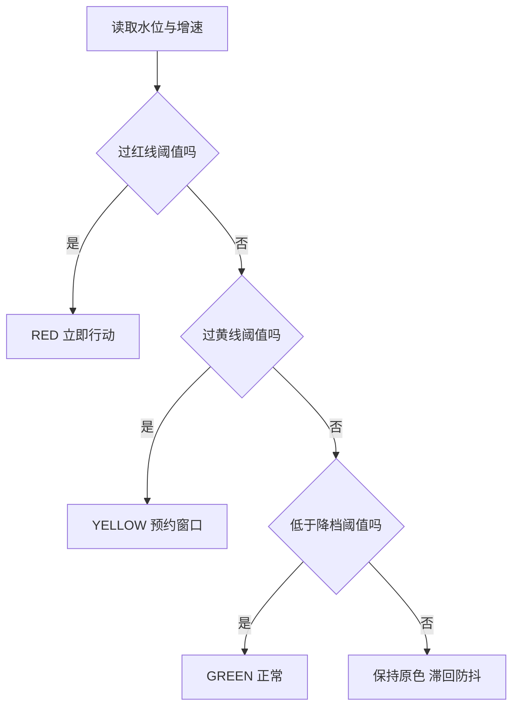

```python
# file: code/04_数据库与缓存/q2780_capacity_thresholds.py
"""容量预警的三色阈值: 滞回状态机 + 剩余天数加速定级"""
def classify(pct, days_left, prev):
    if pct >= 85 or days_left <= 7:
        return "RED"
    if prev == "RED":                          # 红色降档更苛刻, 防抖
        if pct < 80 and days_left > 7:
            return "YELLOW" if pct >= 65 else "GREEN"
        return "RED"
    if pct >= 70 or days_left <= 30:
        return "YELLOW"
    if prev == "YELLOW":
        return "GREEN" if (pct < 65 and days_left > 30) else "YELLOW"
    return "GREEN"

series = [
    (60, 90, None),      # 正常
    (72, 40, None),      # 升黄
    (66, 40, "YELLOW"),  # 回落但未过降档阈值, 滞回保持黄
    (64, 40, "YELLOW"),  # 过降档阈值, 回绿
    (88, 40, None),      # 直升红
    (82, 40, "RED"),     # 未过红色降档线, 保持红
    (78, 40, "RED"),     # 降到黄
    (50, 5,  "YELLOW"),  # 水位不高但 5 天就满, 剩余天数加速直判红
]
for pct, days, prev in series:
    print("水位 %2d%%, 剩余 %2d 天, 上一状态 %-6s -> %s"
          % (pct, days, prev or "-", classify(pct, days, prev)))
```

**追问**:
- 增速怎么算才稳?—— 用最近 7 天的线性回归斜率而不是最后两点差值,避免一次批量任务把增速打歪。
- 通知怎么随颜色分级?—— GREEN 不发,YELLOW 进日报并开工单,RED 值班通道即时呼叫,动作与颜色严格绑定。

---

### Q2781 · 复制延迟的观测: 自报延迟有水分 持续超限才告警

> 难度:★★★☆ | 标签:复制, 监控

**问**:怎么知道主从延迟到底有多大?seconds_behind 靠谱吗?

**答**:自报口径有水分:实例自报的延迟(seconds_behind 类指标)依赖心跳与事件时间戳,大事务复制期间、时钟漂移、心跳缺失时都会失真甚至报 0。更可信的观测是事件时间差:在业务写入里带写入时间戳,副本可读后计算差值,得到的才是用户真正感知的延迟;两者差值本身就是监控项——自报为 0 而实测不低,说明观测链路有问题。告警策略用"持续超限":单点毛刺(一次大事务、一次备份)不必呼叫,连续 N 个采样点超过阈值才告警,阈值与持续窗口按业务容忍度定,和 Q 里的读延迟容忍度表共用一套语义。指标上除最大值外要看 P99,长尾延迟才是读到旧数据的实际概率。

```python
# file: code/04_数据库与缓存/q2781_replication_lag_observe.py
"""复制延迟的观测: 自报有水分, 事件时间差更真, 持续超限才告警"""
import random

random.seed(11)
n = 60
self_report = []
true_lag = []
for i in range(n):
    spike = 5.0 if 20 <= i < 23 else 0.0          # 第 20-22 个采样点一次 5 秒延迟尖峰
    true_lag.append(0.1 + spike + random.uniform(0, 0.4))
    self_report.append(0.0 if spike == 0 else 3.0)  # 自报滞后且口径保守

def percentile(data, p):
    s = sorted(data)
    k = max(0, min(len(s) - 1, int(round(p / 100.0 * (len(s) - 1)))))
    return s[k]

print("自报最大 %.1fs | 实测最大 %.1fs | 实测 P99 %.1fs (自报系统性低估)"
      % (max(self_report), max(true_lag), percentile(true_lag, 99)))

def sustained_alert(series, threshold, sustain):
    run = 0
    for v in series:
        run = run + 1 if v > threshold else 0
        if run >= sustain:
            return True
    return False

calm = [0.1 + random.uniform(0, 0.4) for _ in range(n)]
calm[10] = 2.5                                       # 平稳日一个孤立毛刺
print("平稳日孤立毛刺: 单点即告 %s, 连续 3 点才告 %s (后者不会狼来了)"
      % (sustained_alert(calm, 2.0, 1), sustained_alert(calm, 2.0, 3)))
print("真实尖峰事件: 连续 3 点告警 %s (真延迟精确命中)" % sustained_alert(true_lag, 2.0, 3))
```

**追问**:
- 事件时间差的时钟漂移怎么处理?—— 主副效用 NTP 对时,差值观测里再监控"时钟偏移"本身,偏移大时延迟数据降权。
- 持续窗口取多长?—— 比采样周期略长,能盖过单次大事务又不至于把真故障拖到不可接受,通常 2-3 个采样点。

---

### Q2782 · 存储延迟的分位: 均值被长尾稀释 P99 才是真话

> 难度:★★☆☆ | 标签:运维, 监控

**问**:监控大盘上存储延迟均值一直 2ms,用户却总说慢,问题出在哪?

**答**:出在均值口径上:延迟分布是重尾的,99% 的请求 1-2ms、1% 的请求上百毫秒,均值会被大批快请求稀释到毫无信息量——均值 2ms 的系统,可以同时是"绝大多数飞快、少数人灾难"的系统。分位数才讲真话:P50 看典型体验,P95/P99 看长尾,MAX 看最坏情况;SLO 也应该建立在分位上(如 P99 < 50ms),而不是均值。另一个常见坑是分位数的聚合:多实例的 P99 不能平均,要按样本量加权或重新合并原始分布。看到"均值正常但投诉不断"的组合,第一反应就该是把大盘从均值切成 P99——大概率长尾里藏着一个慢路径(坏查询、锁等待、GC、丢缓存)。

```python
# file: code/04_数据库与缓存/q2782_latency_percentiles.py
"""存储延迟的分位: 均值被长尾稀释, P99 才是真话"""
import random
import statistics

random.seed(5)
samples = []
for _ in range(10000):
    if random.random() < 0.01:
        samples.append(random.uniform(80, 200))    # 1% 的慢请求撑起长尾
    else:
        samples.append(random.uniform(0.5, 2.0))

def pct(data, p):
    s = sorted(data)
    k = max(0, min(len(s) - 1, int(round(p / 100.0 * (len(s) - 1)))))
    return s[k]

print("均值 %.2f ms (大盘上看起来很好)" % statistics.mean(samples))
print("P50 %.2f | P95 %.2f | P99 %.2f | MAX %.1f ms (长尾全在 P99 之外)"
      % (pct(samples, 50), pct(samples, 95), pct(samples, 99), max(samples)))
print("结论: 均值正常 + 投诉不断的组合, 先切 P99 看长尾, 慢路径都藏在那 1% 里")
```

**追问**:
- 为什么不能对多实例的 P99 取平均?—— 平均分位数没有统计意义,要在合并后的原始样本(或可合并的草图)上重新计算。
- 长尾定位的第一步?—— 把 P99 之外的慢样本抓出来按指纹聚合,往往一两个查询模式就占了长尾的大头。

---

### Q2783 · 备份保留的三代轮换: 日七周四月三 兼顾恢复点与成本

> 难度:★★☆☆ | 标签:备份, 运维

**问**:备份每天全量一份,一年 365 份占满存储,保留策略怎么定?

**答**:经典答案是祖父-父亲-儿子(GFS)三代轮换:日备保留 7 天(应对最近的误删与故障,恢复点最细)、周备保留 4 周(应对发现得晚的逻辑损坏)、月备保留 3 个月(应对合规与超长周期需求)。实现是按日期规则挑选保留集:最近 7 天每天一份、最近 4 个周日各一份、最近 3 个月每月 1 号各一份,其余删除——同一个文件可能同时属于多代,取并集。要点有三:删除前确认保留集覆盖了连续的恢复点,避免出现"两个保留点之间坏了一周无法恢复"的空洞;轮换策略要演练,纸上策略和脚本实现经常不一致;配合不可变存储(WORM/对象锁)防删除凭证泄露后连备份一起被清。恢复点密度与存储成本的三代平衡,就是备份保留的全部设计。

```python
# file: code/04_数据库与缓存/q2783_backup_rotation_gfs.py
"""备份保留的三代轮换: 日 7 周 4 月 3, 恢复点与存储成本兼得"""
from datetime import date, timedelta

TODAY = date(2026, 11, 5)
backups = [TODAY - timedelta(days=i) for i in range(0, 121)]   # 每日一份共 121 份

def latest_on_or_before(target, pool):
    cands = [b for b in pool if b <= target]
    return max(cands) if cands else None

keep = set()
for i in range(7):                                   # 日备: 最近 7 天
    b = latest_on_or_before(TODAY - timedelta(days=i), backups)
    if b:
        keep.add(b)
d, sundays = TODAY, []                               # 周备: 最近 4 个周日
while len(sundays) < 4:
    if d.weekday() == 6:
        sundays.append(d)
    d -= timedelta(days=1)
for s in sundays:
    b = latest_on_or_before(s, backups)
    if b:
        keep.add(b)
firsts, d = [], TODAY.replace(day=1)                 # 月备: 最近 3 个月每月 1 号
for _ in range(3):
    firsts.append(d)
    d = (d - timedelta(days=1)).replace(day=1)
for f in firsts:
    b = latest_on_or_before(f, backups)
    if b:
        keep.add(b)

print("备份池 %d 份, 三代轮换后保留 %d 份, 删除 %d 份" % (len(backups), len(keep), len(backups) - len(keep)))
print("保留样例: 最近", sorted(keep, reverse=True)[:3], "最早", min(keep))
print("恢复点覆盖: 7 天内每日, 1 个月内每周, 3 个月内每月")
```

**追问**:
- 增量备份链怎么配合轮换?—— 全量做保留锚点,增量挂在所属全量的链上同生共死,删除全量必须先删整条链。
- 保留策略谁说了算?—— 合规与业务方定恢复点需求,运维换算成代数与份数,策略进版本库,变更走评审。

---

### Q2784 · 连接的归因审计: 按客户端标签聚合 找出占坑大户

> 难度:★★★☆ | 标签:连接池, 监控

**问**:连接池天天告警打满,但只知道总量,怎么知道是谁占的?

**答**:靠归因:每次借还事件都带上客户端标签(应用名、实例、线程或请求类型),按标签聚合出"谁用了多少连接秒"——借出次数乘平均持有时长,再把各家用量除以池容量(池大小乘统计窗口),占比一目了然。归因的价值是把"池打满"从玄学变成算术:典型发现是一个报表任务借几十条连接各持有十几秒,一家吃掉七成容量,处理动作也就明确——限并发、拆批、或给它独立的小池隔离。实现要点:标签必须强制(catch-all 的 unknown 占比要告警,没有标签就没有归因);聚合窗口与告警窗口一致;池的总量指标(在用/等待/超时)与归因指标放在同一张看板,总量异常时一眼下钻到责任方。

```python
# file: code/04_数据库与缓存/q2784_connection_attribution.py
"""连接的归因审计: 借还事件按客户端标签聚合, 找出占坑大户"""
clients = [
    ("api-web",       3000, 0.08),    # (客户端标签, 借出次数, 平均持有秒)
    ("report-job",      60, 15.0),
    ("admin-console",  100, 0.60),
]
POOL_SIZE, WINDOW_S = 20, 60.0
capacity = POOL_SIZE * WINDOW_S
print("池容量 %d 连接 x %.0fs = %.0f 连接秒" % (POOL_SIZE, WINDOW_S, capacity))

usage = []
total_used = 0.0
for name, borrows, hold in clients:
    used = borrows * hold
    usage.append((name, used))
    total_used += used
for name, used in sorted(usage, key=lambda u: -u[1]):
    share = used / capacity * 100
    flag = "  <-- 占坑大户" if share > 50 else ""
    print("%-14s 用掉 %6.0f 连接秒, 占池容量 %5.1f%%%s" % (name, used, share, flag))
print("池整体利用率 %.0f%%; 没有客户端标签就没有归因, unknown 占比必须告警"
      % (total_used / capacity * 100))
```

**追问**:
- 连接秒是什么口径?—— 借出持有时长的累计,衡量对池容量的独占;只数借出次数会漏掉"借一次占很久"的大户。
- 标签怎么强制?—— 池的 borrow 接口把标签设为必填参数,未传即拒绝或打 unknown 计数,从入口堵住。

---

### Q2785 · 综合案例: 一份夜间巡检报告的自动生成

> 难度:★★★★ | 标签:运维, 综合

**问**:把这一批的巡检项、三色阈值、慢样本留存放在一起,自动生成一份夜间巡检报告,怎么设计?

**答**:流水线四步:构造检查对象(库里故意埋了膨胀、孤儿、无索引慢查询三类问题)、跑检查清单(每项三态输出与量化详情)、定级汇总(取所有检查的最差状态作为总体色)、按色输出行动清单(RED 即时通知,YELLOW 进工单,GREEN 归档)。设计原则与前面的专题一一对应:检查函数只读、结果量化(膨胀带 MB 数、慢查询带耗时与计划)、容量用三色加剩余天数、慢样本带指纹。报告的价值不只是"发现",而是"发现即带建议"——每条 WARN/FAIL 后面跟处置动作,值班人员照单执行。演练时故意埋问题,验证报告能全部命中,比上线后第一次见到真故障再调靠谱得多。

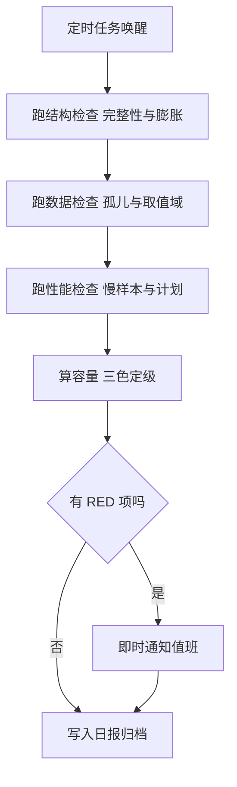

```python
# file: code/04_数据库与缓存/q2785_night_inspection_report.py
"""综合案例: 夜间巡检报告的自动生成, 检查 三色定级与行动清单"""
import os
import sqlite3
import tempfile
import time

dbpath = os.path.join(tempfile.mkdtemp(), "night.db")
conn = sqlite3.connect(dbpath, isolation_level=None)
conn.execute("PRAGMA page_size=4096")
conn.execute("CREATE TABLE users (id INTEGER PRIMARY KEY, name TEXT)")
conn.execute("""CREATE TABLE orders (id INTEGER PRIMARY KEY, user_id INTEGER,
                amt REAL, created TEXT)""")
conn.execute("BEGIN IMMEDIATE")
conn.executemany("INSERT INTO users VALUES(?,?)", [(i, "u%d" % i) for i in range(1, 2001)])
conn.executemany("INSERT INTO orders VALUES(?,?,?,?)",
                 [(i, (i % 2000) + 1, (i % 90) + 1.0, "2026-10-%02d" % ((i % 28) + 1))
                  for i in range(1, 12001)])
conn.execute("COMMIT")
conn.execute("DELETE FROM orders WHERE id % 3 = 0")          # 埋问题 1: 膨胀
conn.execute("DELETE FROM users WHERE id IN (5, 7, 9)")      # 埋问题 2: 孤儿订单

CHECKS = []
def check(name):
    def deco(fn):
        CHECKS.append((name, fn))
        return fn
    return deco

@check("库完整性")
def _(conn):
    r = conn.execute("PRAGMA quick_check").fetchone()[0]
    return ("PASS" if r == "ok" else "FAIL", r)

@check("表膨胀水位")
def _(conn):
    pc = conn.execute("PRAGMA page_count").fetchone()[0]
    fl = conn.execute("PRAGMA freelist_count").fetchone()[0]
    ratio = fl / max(1, pc)
    state = "RED" if ratio > 0.5 else ("YELLOW" if ratio > 0.2 else "GREEN")
    return (state, "freelist 占 %.0f%%, 可回收约 %.1f MB"
            % (ratio * 100, fl * 4096 / 1048576.0))

@check("孤儿订单")
def _(conn):
    n = conn.execute("""SELECT COUNT(*) FROM orders o
                        LEFT JOIN users u ON u.id = o.user_id
                        WHERE u.id IS NULL""").fetchone()[0]
    return ("YELLOW" if n else "GREEN", "%d 条订单指向不存在的用户, 需回溯删除路径" % n)

@check("热点查询计划")
def _(conn):
    sql = "SELECT COUNT(*) FROM orders WHERE created = '2026-10-03'"
    plan = conn.execute("EXPLAIN QUERY PLAN " + sql).fetchone()[3]
    t0 = time.perf_counter()
    conn.execute(sql).fetchone()
    ms = (time.perf_counter() - t0) * 1000
    bad = "SCAN" in plan
    return ("YELLOW" if bad else "GREEN",
            "%s, %.1f ms%s" % (plan, ms, " -> 建议 created 建索引" if bad else ""))

@check("容量水位")
def _(conn):
    used_gb, cap_gb, growth = 17.0, 20.0, 1.0     # 用量 上限 日增速
    pct = used_gb / cap_gb * 100
    days_left = (cap_gb - used_gb) / growth
    state = "RED" if (pct >= 85 or days_left <= 7) else ("YELLOW" if pct >= 70 else "GREEN")
    return (state, "水位 %.0f%%, 按当前增速剩 %.0f 天, 建议本周走扩容变更" % (pct, days_left))

rank = {"GREEN": 0, "YELLOW": 1, "RED": 2}
report = []
overall = "GREEN"
for name, fn in CHECKS:
    state, detail = fn(conn)
    report.append((name, state, detail))
    color = {"PASS": "GREEN", "FAIL": "RED"}.get(state, state)
    if rank[color] > rank[overall]:
        overall = color

print("=" * 62)
print("夜间巡检报告  %s" % time.strftime("%Y-%m-%d %H:%M"))
print("=" * 62)
for name, state, detail in report:
    print("[%s] %-8s %s" % (state, name, detail))
print("-" * 62)
print("总体定级: %s" % overall)
if overall == "RED":
    print("行动清单: 通知值班; 磁盘扩容走变更单; 膨胀表预约清理窗口; 孤儿数据补修复任务")
elif overall == "YELLOW":
    print("行动清单: 各 WARN 项开工单, 纳入日跟进")
else:
    print("一切正常, 报告归档")
conn.close()
```

**追问**:
- 巡检报告怎么防止"报了没人看"?—— RED 走即时呼叫、YELLOW 进工单系统带截止时间、日报里只放变化项,把看报告的成本压到最低。
- 检查清单怎么持续生长?—— 每次故障复盘产出至少一个新检查项并先在演练库验证,清单版本随代码一起评审上线。

---
