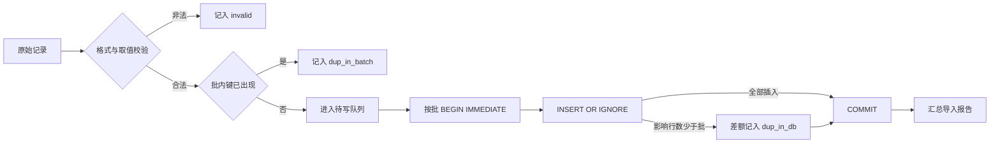
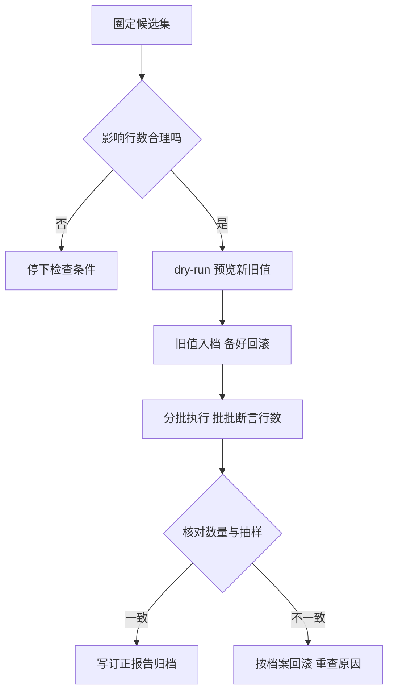
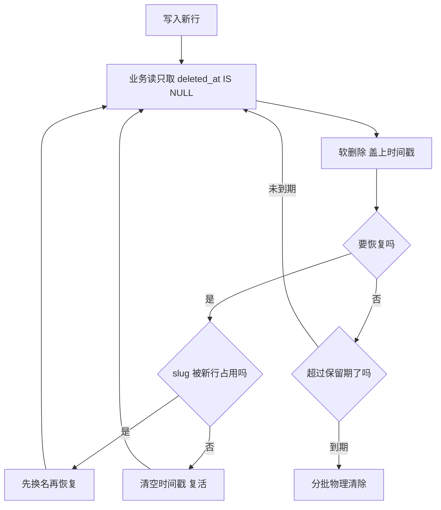
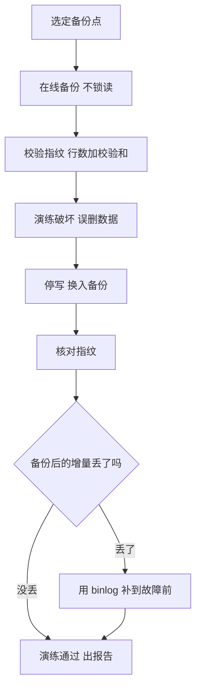

# 第 4 类 · 数据库与缓存(收官扩产)

本文件是第 4 类的收官批扩产,共 21 题(Q2939–Q2959),主题为综合应用与查漏补缺,给的都是能直接搬进项目骨架的完整模板:DAO 层模板、事务边界三种划分、批量导入管线、缓存一致性完整方案、分布式锁全流程、幂等表、数据订正、连接池、慢查询定位、索引对比实验、唯一约束组合、软删除全链路、热点行拆分、读写分离、缓存预热、四阶段迁移、报表预聚合、KV 封装层、对账系统、容量估算器、备份恢复演练。
示例以标准库 sqlite3 与纯逻辑模型为主,全部在本机 Python 3.9 实跑通过;并发与耗时实测给出真实数字,故意触发的异常均以 try/except 演示,单块耗时不超 25 秒。
读法建议:每题先抄结构再看细节——连接与事务归 DAO、约束做最后防线、缓存失效靠版本、迁移按 expand-contract 四步走、对账与备份是数据安全的最后兜底。

---

### Q2939 · 完整 DAO 层模板: 连接管理 CRUD 分页一次成型

> 难度:★★★☆ | 标签:架构, DAO, 分页

**问**:让你从零写一个模块的数据访问层,连接怎么管、CRUD 怎么放、分页给前端怎么出?给一套能直接用的模板。

**答**:DAO 层的三条纪律:连接由 DAO 自己管理(构造时建、提供 close),SQL 只住在 DAO 里不外漏,出参统一转成 dict 或 DTO 不把 cursor 和 Row 暴露给上层。写路径每个方法一个短事务、随写随提交,语句一律参数化;读路径单查返回 dict 或 None,列表页一次带出 total 与 items,前端好渲染总数。分页要给两套:offset 分页带页码与总数,适合管理后台;keyset 分页用 last_id 做游标,深翻页性能不衰减,适合 Feed 流。模板里的 WHERE 拼接只拼固定字符串片段,条件值全部走占位符,这是 DAO 的安全底线。

```python
# file: code/04_数据库与缓存/q2939_dao_template.py
"""完整 DAO 层模板: 连接管理 CRUD 两种分页一次成型"""
import sqlite3


class UserDao:
    """DAO 三件套: 连接由 DAO 自管, SQL 只住在 DAO 里, 出参全是 dict"""

    DDL = """
    CREATE TABLE IF NOT EXISTS user (
        id     INTEGER PRIMARY KEY,
        name   TEXT NOT NULL,
        age    INTEGER NOT NULL DEFAULT 0,
        status TEXT NOT NULL DEFAULT 'active'
    )
    """

    def __init__(self, dsn=":memory:"):
        self._conn = sqlite3.connect(dsn)
        self._conn.row_factory = sqlite3.Row
        self._conn.executescript(self.DDL)
        self._conn.commit()

    def close(self):
        self._conn.close()

    # ---- 写路径: 每个方法一个短事务, 参数化是铁律 ----
    def insert(self, name, age):
        cur = self._conn.execute(
            "INSERT INTO user(name, age) VALUES(?, ?)", (name, age))
        self._conn.commit()
        return cur.lastrowid

    def update_status(self, uid, status):
        cur = self._conn.execute(
            "UPDATE user SET status=? WHERE id=?", (status, uid))
        self._conn.commit()
        return cur.rowcount == 1

    def delete(self, uid):
        cur = self._conn.execute("DELETE FROM user WHERE id=?", (uid,))
        self._conn.commit()
        return cur.rowcount == 1

    # ---- 读路径: 单查 + 列表页带总数 + 键值分页带游标 ----
    def get(self, uid):
        row = self._conn.execute(
            "SELECT * FROM user WHERE id=?", (uid,)).fetchone()
        return dict(row) if row else None

    def page(self, page=1, size=10, status=None):
        """offset 分页: 数据与总数一起出, 条件只用占位符拼接"""
        where, args = "WHERE 1=1", []
        if status:
            where += " AND status=?"
            args.append(status)
        total = self._conn.execute(
            "SELECT COUNT(*) FROM user " + where, args).fetchone()[0]
        rows = self._conn.execute(
            "SELECT * FROM user " + where + " ORDER BY id LIMIT ? OFFSET ?",
            args + [size, (page - 1) * size]).fetchall()
        return {"total": total, "page": page, "size": size,
                "items": [dict(r) for r in rows]}

    def page_after(self, last_id, size=10):
        """keyset 分页: 翻页稳定, 深页性能不衰减"""
        rows = self._conn.execute(
            "SELECT * FROM user WHERE id>? ORDER BY id LIMIT ?",
            (last_id, size)).fetchall()
        items = [dict(r) for r in rows]
        return {"items": items,
                "next_cursor": items[-1]["id"] if items else None}


if __name__ == "__main__":
    dao = UserDao()
    ids = [dao.insert("u%d" % i, 20 + i % 10) for i in range(1, 24)]
    print("insert 23 rows, last id =", ids[-1])
    print("get(1):", dao.get(1))
    p1 = dao.page(1, 10)
    print("page1: total=%d items=%d" % (p1["total"], len(p1["items"])))
    print("page3 ids:", [u["id"] for u in dao.page(3, 10)["items"]])
    print("page status=active total:", dao.page(1, 5, status="active")["total"])
    kp = dao.page_after(10, 10)
    print("keyset after id=10:", [u["id"] for u in kp["items"]],
          "next_cursor =", kp["next_cursor"])
    assert dao.update_status(1, "frozen")
    assert dao.get(1)["status"] == "frozen"
    assert dao.delete(1)
    assert dao.get(1) is None
    print("CRUD 自检通过")
```

**追问**:
- 跨方法的多个写操作要在一个事务里怎么办?—— DAO 不该吞掉事务边界,提供接收外部连接或用 Unit of Work 的重载,把 commit 决定权交给服务层。
- offset 分页要不要加 ORDER BY?—— 必须加且排序列要稳定,否则数据库不保证顺序,翻页会丢行重行。

---

### Q2940 · 事务边界的三种划分方式对比: 语句级 请求级 业务级

> 难度:★★★☆ | 标签:事务, 架构

**问**:事务边界有人放在 DAO、有人放在 Controller、有人放在 Service,这三种放法差在哪?

**答**:语句级每条 SQL 各自提交,单条语句是原子的但业务操作不是,中途失败会留下半截状态,转账扣了款没入账就是这种放法的典型事故。请求级整个 HTTP 请求包一个事务,天然"全成全滚",但事务里一旦夹了外部调用(发短信、调网关),行锁和连接要陪外部接口等完整超时,高并发下连接池被拖穿,是事故高发点。业务级以一个完整业务操作为边界,在 Service 层 BEGIN 到 COMMIT,审计日志与业务写同框提交,要么都在要么都不在——这是默认正确答案。实测里事务内 sleep 0.2 秒模拟外部调用,行锁与连接就被白占 204 ms,这类边界要靠纪律守住:事务内禁外部 IO。

```python
# file: code/04_数据库与缓存/q2940_transaction_boundary.py
"""事务边界三种划分: 语句级 请求级 业务级 的后果与耗时对比"""
import sqlite3
import time


def setup():
    conn = sqlite3.connect(":memory:")
    conn.executescript("""
    CREATE TABLE account(id INTEGER PRIMARY KEY, name TEXT, bal INTEGER);
    INSERT INTO account VALUES(1,'a',100),(2,'b',0);
    CREATE TABLE audit(id INTEGER PRIMARY KEY AUTOINCREMENT, txt TEXT);
    """)
    return conn


def transfer_stmt_level(conn, frm, to, amt):
    """语句级: 每条语句各自提交, 中途失败留下半截状态"""
    conn.execute("UPDATE account SET bal=bal-? WHERE id=?", (amt, frm))
    conn.commit()
    if amt > 50:
        raise ValueError("风控: 单笔超限")
    conn.execute("UPDATE account SET bal=bal+? WHERE id=?", (amt, to))
    conn.commit()


def transfer_request_level(conn, call_external):
    """请求级: 整个请求一个事务, 事务里夹外部调用就会被拉长"""
    conn.execute("BEGIN IMMEDIATE")
    conn.execute("UPDATE account SET bal=bal-10 WHERE id=1")
    t0 = time.perf_counter()
    call_external()                        # 事故点: 事务内调外部接口
    held_ms = (time.perf_counter() - t0) * 1000
    conn.execute("UPDATE account SET bal=bal+10 WHERE id=2")
    conn.commit()
    return held_ms


def transfer_business_level(conn, frm, to, amt):
    """业务级: 一个业务操作一个事务, 全成或全滚, 审计同框"""
    try:
        conn.execute("BEGIN IMMEDIATE")
        conn.execute("UPDATE account SET bal=bal-? WHERE id=?", (amt, frm))
        if amt > 50:
            raise ValueError("风控: 单笔超限")
        conn.execute("UPDATE account SET bal=bal+? WHERE id=?", (amt, to))
        conn.execute("INSERT INTO audit(txt) VALUES(?)",
                     ("transfer %d->%d %d" % (frm, to, amt),))
        conn.commit()
        return True
    except ValueError:
        conn.rollback()
        return False


conn = setup()
try:
    transfer_stmt_level(conn, 1, 2, 60)
except ValueError as e:
    print("语句级失败:", e)
print("  余额:", conn.execute("SELECT bal FROM account ORDER BY id").fetchall(),
      "<- 扣款已提交 收款丢失")

held = transfer_request_level(conn, lambda: time.sleep(0.2))
print("请求级: 事务内夹外部调用, 行锁与连接被白占 %.0f ms" % held)

ok = transfer_business_level(conn, 1, 2, 60)
print("业务级失败返回:", ok, "余额:",
      conn.execute("SELECT bal FROM account ORDER BY id").fetchall(),
      "<- 原样未动")
ok = transfer_business_level(conn, 1, 2, 25)
print("业务级成功:", ok, "余额:",
      conn.execute("SELECT bal FROM account ORDER BY id").fetchall(),
      "审计:", conn.execute("SELECT COUNT(*) FROM audit").fetchone()[0], "条")
```

**追问**:
- ORM 框架里业务级边界怎么落地?—— Session 生命周期对齐业务操作,framework 里是 transaction context manager 包 Service 方法,见本类 Q921 的 Unit of Work。
- 事务里的外部调用挪到哪里?—— 先落库提交并记"待办"状态,事务外异步调外部接口,成功后回写状态,失败走补偿。

---

### Q2941 · 批量导入的完整管线: 校验 去重 分批 事务 四步闭环

> 难度:★★★★ | 标签:批量导入, 数据质量

**问**:运营甩来一份十万行的 Excel 要导库,重复、脏数据、库里已有都有可能,你的导入管线怎么设计?

**答**:完整管线四步闭环。第一步校验:格式与取值合法性逐条过,脏数据在进库前被拦下并计数,绝不让它污染后面步骤。第二步批内去重:用 seen 集合挡住同一批里的重复键,批内重复与跨批重复要分开计数,因为它们的成因不同。第三步分批:大文件切成固定大小的批,每批一个短事务,单批失败只回滚一批,不会出现整库大事务;批大小通常几百到几千,配合限速控制主库压力。第四步事务兜底:INSERT OR IGNORE 加唯一约束挡住与库内已有数据的冲突,用影响行数与批大小的差额精确统计"库里已存在"的数量,最后汇总成报告,每一类数据的去向都可解释、可追溯。



```python
# file: code/04_数据库与缓存/q2941_import_pipeline.py
"""批量导入完整管线: 校验 去重 分批 事务 四步闭环出报告"""
import sqlite3

RAW = [
    ("u1", "a@x.com", 20),       # 合法
    ("u2", "b@x.com", 31),       # 合法
    ("u2", "b@x.com", 32),       # 批内重复
    ("", "c@x.com", 22),         # 校验失败: 名称为空
    ("u3", "not-an-email", 18),  # 校验失败: 邮箱格式
    ("u4", "d@x.com", -5),       # 校验失败: 年龄非法
    ("u1", "a@x.com", 20),       # 与批内第一条重复
    ("u5", "e@x.com", 40),       # 库里已存在, 走唯一约束兜底
    ("u6", "f@x.com", 28),       # 合法
]


def valid(rec):
    name, email, age = rec
    return bool(name) and "@" in email and 0 <= age <= 150


conn = sqlite3.connect(":memory:")
conn.isolation_level = None   # 关掉隐式事务, 手动 BEGIN IMMEDIATE 才有效
conn.execute("CREATE TABLE user(name TEXT PRIMARY KEY, email TEXT, age INTEGER)")
conn.execute("INSERT INTO user VALUES('u5','e@x.com',40)")


def import_rows(records, batch_size=3):
    stats = {"total": len(records), "invalid": 0, "dup_in_batch": 0,
             "dup_in_db": 0, "inserted": 0, "batches": 0}
    seen, clean = set(), []
    # 第 1 步: 校验 + 批内去重, 脏数据不进库
    for rec in records:
        if not valid(rec):
            stats["invalid"] += 1
            continue
        if rec[0] in seen:
            stats["dup_in_batch"] += 1
            continue
        seen.add(rec[0])
        clean.append(rec)
    # 第 2 步: 分批 + 每批一个短事务, 唯一约束兜库里已存在的键
    for i in range(0, len(clean), batch_size):
        batch = clean[i:i + batch_size]
        stats["batches"] += 1
        try:
            conn.execute("BEGIN IMMEDIATE")
            before = conn.total_changes
            conn.executemany("INSERT OR IGNORE INTO user VALUES(?,?,?)", batch)
            after = conn.total_changes
            stats["dup_in_db"] += len(batch) - (after - before)
            stats["inserted"] += after - before
            conn.commit()
        except Exception:
            conn.rollback()
            raise
    return stats


report = import_rows(RAW, batch_size=3)
print("导入报告:", report)
print("库内行数:", conn.execute("SELECT COUNT(*) FROM user").fetchone()[0])
assert report["invalid"] == 3 and report["dup_in_batch"] == 2
assert report["dup_in_db"] == 1 and report["inserted"] == 3
assert report["batches"] == 2
print("四步闭环自检通过: 校验挡脏 批内去重 约束兜底 分批短事务")
```

**追问**:
- 导入到一半想停,已导入的怎么办?—— 每批带 batch_id 落一张导入流水表,重跑时按流水断点续跑,见 Q1967 的断点续迁思路。
- 想要"重复就更新"而不是忽略?—— 把 OR IGNORE 换成 upsert(ON CONFLICT DO UPDATE),但要先明确新旧值谁赢,别让晚到的旧数据覆盖新数据。

---

### Q2942 · 缓存与 DB 一致性完整方案: 旁路读路径加版本入键

> 难度:★★★★ | 标签:缓存, 一致性

**问**:旁路缓存的"先更库再删缓存"有删除失败和并发回填两个竞态,一套完整方案应该长什么样?

**答**:完整方案把版本号做进键里,让竞态"结构性失效"。读路径:先取该 key 的当前版本号(版本本身短 TTL 缓存,未命中才回库点查一次),再拼出 item:{id}:v{ver} 去读缓存,未命中回源时把行里带出的权威版本写回缓存与 meta。写路径:更新库行并把行内 ver 加一,删掉 meta 让后续读者自动走新版本键,旧版本缓存键尽力删除、删失败也无害——因为它已经不可达。经典竞态"删除后读者把旧值回填"被消除:迟到的回填落在 v1 旧键上,而所有新读者按 meta 走 v2 键,根本读不到脏值,残留旧键等 TTL 自然回收即可。方案的全部正确性都锚在"DB 行是版本唯一事实源"这一点上。

```python
# file: code/04_数据库与缓存/q2942_cache_consistency_full.py
"""缓存与 DB 一致性完整方案: 旁路读路径 + 版本入键写路径"""
import time

TTL = 60.0


class System:
    """db 行自带 ver, 缓存键带 ver: 失效不追删, 旧键自然不可达"""

    def __init__(self):
        self.db = {1: {"price": 10, "ver": 1}, 2: {"price": 20, "ver": 1}}
        self.meta = {}    # id -> 缓存住的当前版本号, 未命中才回库点查
        self.cache = {}   # "item:{id}:v{ver}" -> (expire_at, row)
        self.log = []

    def _meta_ver(self, i):
        if i in self.meta:
            return self.meta[i]
        v = self.db[i]["ver"]
        self.meta[i] = v
        return v

    def read(self, i):
        v = self._meta_ver(i)
        key = "item:%d:v%d" % (i, v)
        ent = self.cache.get(key)
        if ent and ent[0] > time.monotonic():
            self.log.append("hit  %s" % key)
            out = dict(ent[1])
            out.pop("ver", None)
            return out
        row = self.db[i]                      # 回源: 行里带权威 ver
        self.cache[key] = (time.monotonic() + TTL, dict(row))
        self.meta[i] = row["ver"]             # 顺手刷新 meta
        self.log.append("miss %s -> 回源" % key)
        out = dict(row)
        out.pop("ver", None)
        return out

    def write(self, i, price):
        row = self.db[i]
        old_key = "item:%d:v%d" % (i, row["ver"])
        row["price"] = price
        row["ver"] += 1
        self.meta.pop(i, None)                # meta 一删, 新读者自然走新键
        self.cache.pop(old_key, None)         # 尽力而为删旧键, 删失败也无害
        self.log.append("write id=%d ver -> %d" % (i, row["ver"]))


s = System()
print("首次读:", s.read(1))
print("再次读:", s.read(1))
s.write(1, 12)
print("写后读:", s.read(1))

# 经典竞态回放: 读者在写前拿到旧行, 写者提交后其回源才迟到落缓存
old_row = dict(s.db[2])                     # 读者 T1: 回源读到 ver=1 旧行
s.write(2, 99)                              # 写者 T2: ver -> 2, meta 已翻
s.cache["item:2:v1"] = (time.monotonic() + TTL, dict(old_row))  # T1 迟到回填 v1 键
got = s.read(2)                             # 新读者按 meta 走 v2 键
assert got["price"] == 99
print("竞态回放: 旧值被隔离在 v1 键, 读者拿到", got)
print("\n".join(s.log))
assert s.read(1)["price"] == 12 and s.read(2)["price"] == 99
print("结论: 版本入键把删除竞态变成结构性不可达, 残留旧键等 TTL 自然回收")
```

**追问**:
- meta 版本缓存本身不一致怎么办?—— meta 配极短 TTL 加"未命中回库"兜底,meta 最多让读者多一次回源,永远不会让读者读到旧值,错误方向是安全的。
- 这方案和延迟双删怎么选?—— 延迟双删实现简单但要猜延迟时间;版本入键多一次 meta 读但竞态是结构性消除,对一致性要求高的热点 key 值得。

---

### Q2943 · 分布式锁的完整实现: 获取 续期 释放全链路

> 难度:★★★★ | 标签:分布式锁, Redis

**问**:手写一个生产可用的分布式锁,要覆盖哪些环节?只会 SETNX 够吗?

**答**:不够,完整实现有四个必备件。第一是原子获取:SET key token NX EX ttl 一条命令完成"不存在才设置加过期",token 用随机 UUID,这是后面安全释放的凭证。第二是看门狗续期:任务执行时间可能超过 TTL,后台线程每 TTL/3 检查并续期,长任务不因锁过期被别人闯入;续期和获取一样必须是"是本人才续"的原子操作。第三是 owner 校验释放:释放时校验 token 匹配才删,防止 A 超时后误删 B 刚拿到的锁,等价于一段 GET+COMPARE+DEL 的 Lua。第四是等待与幂等:acquire 支持带 deadline 的自旋等待,release 重复调用返回 False 不抛错。实测里 A 持锁 1 秒远超 0.4 秒 TTL,看门狗让入侵者始终抢不进,A 释放后 B 立即接手,冒充释放被拒。

```python
# file: code/04_数据库与缓存/q2943_distributed_lock_full.py
"""分布式锁完整模板: 原子获取 看门狗续期 owner 校验释放"""
import threading
import time
import uuid


class FakeRedis:
    """最小 Redis 模拟: SET NX EX / expire / del-if-owner 全部原子"""

    def __init__(self):
        self._kv, self._exp = {}, {}
        self._mu = threading.Lock()

    def _alive(self, k):
        return k in self._kv and self._exp[k] > time.monotonic()

    def set_nx_ex(self, k, v, ttl):
        with self._mu:
            if self._alive(k):
                return False
            self._kv[k] = v
            self._exp[k] = time.monotonic() + ttl
            return True

    def expire_if_owner(self, k, owner, ttl):
        with self._mu:
            if self._kv.get(k) == owner:
                self._exp[k] = time.monotonic() + ttl
                return True
            return False

    def delete_if_owner(self, k, owner):
        with self._mu:
            if self._kv.get(k) == owner and self._alive(k):
                self._kv.pop(k)
                self._exp.pop(k, None)
                return True
            return False


class DistLock:
    def __init__(self, store, key, ttl=0.4, watchdog=True):
        self.s, self.key, self.ttl = store, key, ttl
        self.token = uuid.uuid4().hex
        self.watchdog = watchdog
        self._stop = threading.Event()

    def acquire(self, wait=0.0):
        deadline = time.monotonic() + wait
        while True:
            if self.s.set_nx_ex(self.key, self.token, self.ttl):
                if self.watchdog:
                    self._start_watchdog()
                return True
            if time.monotonic() >= deadline:
                return False
            time.sleep(0.02)

    def _start_watchdog(self):
        def beat():
            while not self._stop.wait(self.ttl / 3):
                self.s.expire_if_owner(self.key, self.token, self.ttl)
        threading.Thread(target=beat, daemon=True).start()

    def release(self):
        self._stop.set()
        return self.s.delete_if_owner(self.key, self.token)


r = FakeRedis()
la, lb = DistLock(r, "order:77"), DistLock(r, "order:77")
print("A 获得锁:", la.acquire(), "token =", la.token[:8])
print("B 立即抢:", lb.acquire(), "<- 互斥")
print("B 等 0.3s 再抢:", lb.acquire(wait=0.3),
      "<- 看门狗每 %.2fs 续期, 锁一直活着" % (0.4 / 3))
time.sleep(1.0)   # 长任务持锁 1.0s, 远超 TTL 0.4s
print("持锁 1.0s 后外人仍抢不进:", r.set_nx_ex("order:77", "intruder", 0.4) is False)
print("A 释放:", la.release())
print("B 现在能拿到:", lb.acquire(wait=0.5))
fake = DistLock(r, "order:77")
print("冒充他人释放被拒:", fake.release() is False)
print("B 正常释放:", lb.release())
print("B 重复释放:", lb.release(), "<- 幂等, 返回 False")
```

**追问**:
- 看门狗线程挂了锁会怎样?—— 退化成普通过期锁,任务还在跑就可能被闯入,所以锁内业务必须可重入或加防重兜底,见 Q970 的可重入锁。
- 为什么不用 Redis 事务代替 Lua?—— MULTI/EXEC 只保证批量执行不保证条件逻辑,GET 后比较再删的判断需要 Lua 的原子读改写。

---

### Q2944 · 幂等表的完整写入流程: 占位 业务 落结果 同事务

> 难度:★★★☆ | 标签:幂等, 消息

**问**:消费 MQ 的消息,网络重试导致同一条消息投了三次,幂等表的标准写法是什么?

**答**:标准流程是"占位、业务、落结果"三步同框。第一步事务内向幂等表插入 msg_id 主键行占位,插入成功说明第一次处理;撞主键说明处理过或正在处理,读回该行按状态分流——status 为 done 直接把存的 result 返回给上游,这就是重放,零副作用;status 为 processing 是别的消费者在途,返回"处理中"让上游稍后重试。第二步业务写入与第三步结果回填、状态翻转为 done 和占位在同一个事务里提交,保证"幂等记录存在"与"业务生效"原子成立,不存在只占位没做事的中间态暴露给并发方。实测同一消息处理两次,余额只加一次,重放返回与首次完全相同的结果。

```python
# file: code/04_数据库与缓存/q2944_idempotency_table.py
"""幂等表完整写入流程: 同事务占位 业务与结果落库 重放零副作用"""
import json
import sqlite3

conn = sqlite3.connect(":memory:")
conn.row_factory = sqlite3.Row
conn.executescript("""
CREATE TABLE idem(msg_id TEXT PRIMARY KEY, status TEXT, result TEXT);
CREATE TABLE balance(uid INTEGER PRIMARY KEY, bal INTEGER);
INSERT INTO balance VALUES(7, 100);
""")


def handle(msg_id, uid, amt):
    # 第 1 步: 事务内占位, 抢不到说明处理过或正在处理
    try:
        conn.execute("BEGIN IMMEDIATE")
        conn.execute("INSERT INTO idem VALUES(?,?,NULL)", (msg_id, "processing"))
    except sqlite3.IntegrityError:
        conn.rollback()
        row = conn.execute("SELECT status, result FROM idem WHERE msg_id=?",
                           (msg_id,)).fetchone()
        if row["status"] == "done":
            return "replay", json.loads(row["result"])
        return "in_progress", None
    # 第 2 步: 业务写入 + 结果回填 + 状态翻转, 与占位同一个事务
    conn.execute("UPDATE balance SET bal=bal+? WHERE uid=?", (amt, uid))
    result = {"bal": conn.execute(
        "SELECT bal FROM balance WHERE uid=?", (uid,)).fetchone()[0]}
    conn.execute("UPDATE idem SET status='done', result=? WHERE msg_id=?",
                 (json.dumps(result), msg_id))
    conn.commit()
    return "done", result


print("首次:", handle("m1", 7, 30))
print("重放:", handle("m1", 7, 30))
bal = conn.execute("SELECT bal FROM balance WHERE uid=7").fetchone()[0]
print("余额:", bal, "(只加了一次)")
conn.execute("INSERT INTO idem VALUES('m2','processing',NULL)")  # 模拟他人在途
conn.commit()
print("处理中再来:", handle("m2", 7, 50))
print("最终余额:", conn.execute("SELECT bal FROM balance WHERE uid=7").fetchone()[0])
assert bal == 130
```

**追问**:
- 幂等表会不会无限膨胀?—— 会,按状态与时间双条件定期归档 done 且超过保留期的行,见 Q2499 的保留窗口设计。
- result 很大存不下怎么办?—— 幂等表只存结果摘要或结果键,重放时凭摘要走同样的只读查询,不必存全量响应体。

---

### Q2945 · 数据订正的标准流程: 检查 dry-run 执行 核对

> 难度:★★★☆ | 标签:数据订正, 运维

**问**:两千行订单的 region 字段填错了要批量订正,直接一条 UPDATE 干上去行吗?

**答**:不行,标准流程五步走。第一步检查:先用 SELECT 圈出候选集,影响行数与预期对不上就中止,影响面异常扩大是最常见的翻车点。第二步 dry-run:生成新旧值预览但不写一行,自己或业务方先看一眼改完长什么样。第三步入档:旧值先写进订正档案表,这是出问题后唯一能精准回滚的依据。第四步分批执行:每批一个短事务,批内用影响行数断言守门,行数不符立即回滚,绝不允许"以为改了其实没改"。第五步核对:残留数必须为零、档案条数必须等于订正数、抽样回查旧值对得上,全部通过才出订正报告。实测 133 行订正全程 6 毫秒,但流程的价值不在速度,在于每一步都留了后悔药。



```python
# file: code/04_数据库与缓存/q2945_data_correction_flow.py
"""数据订正标准流程: 检查 dry-run 入档 分批执行 核对 五步闭环"""
import sqlite3
import time

conn = sqlite3.connect(":memory:")
conn.row_factory = sqlite3.Row
conn.executescript("""
CREATE TABLE orders(id INTEGER PRIMARY KEY, region TEXT, amount REAL);
CREATE TABLE fix_log(oid INTEGER PRIMARY KEY, old_region TEXT,
                     new_region TEXT, at REAL);
""")
rows = []
for i in range(1, 2001):
    region = None if i % 15 == 0 else ("north", "south", "east")[i % 3]
    rows.append((i, region, round(i % 90 + 0.5, 2)))
conn.executemany("INSERT INTO orders VALUES(?,?,?)", rows)
conn.commit()

NEW_REGION = "north"

# 1) 检查: 先看清影响集, 行数异常直接中止
cand = conn.execute(
    "SELECT id, region FROM orders WHERE region IS NULL ORDER BY id").fetchall()
print("候选行数:", len(cand), "/ 总行数 2000")
assert len(cand) < 500, "影响面异常扩大, 中止"

# 2) dry-run: 只生成新值预览, 不写一行
preview = [(r["id"], r["region"], NEW_REGION) for r in cand[:3]]
print("dry-run 预览前 3 行:", preview)

# 3) 分批执行: 旧值入档与订正同事务, 每批断言影响行数
BATCH, done, t0 = 50, 0, time.perf_counter()
for i in range(0, len(cand), BATCH):
    ids = [r["id"] for r in cand[i:i + BATCH]]
    try:
        conn.execute("BEGIN IMMEDIATE")
        conn.execute(
            "INSERT INTO fix_log(oid, old_region, new_region, at) "
            "SELECT id, region, ?, ? FROM orders WHERE id IN (%s)"
            % ",".join("?" * len(ids)), [NEW_REGION, time.time()] + ids)
        cur = conn.execute(
            "UPDATE orders SET region=? WHERE id IN (%s)"
            % ",".join("?" * len(ids)), [NEW_REGION] + ids)
        assert cur.rowcount == len(ids), \
            "影响行数 %d != 预期 %d" % (cur.rowcount, len(ids))
        conn.commit()
        done += cur.rowcount
    except Exception:
        conn.rollback()
        raise
print("执行 %d 行, 耗时 %.1f ms" % (done, (time.perf_counter() - t0) * 1000))

# 4) 核对: 数量断言 + 档案回查 + 抽样旧值比对
left = conn.execute(
    "SELECT COUNT(*) FROM orders WHERE region IS NULL").fetchone()[0]
sample_id = cand[0]["id"]
log = conn.execute("SELECT old_region FROM fix_log WHERE oid=?",
                   (sample_id,)).fetchone()
assert left == 0 and done == len(cand) and log is not None
print("核对通过: 残留 0, 档案 %d 条, 抽样 id=%d 旧值=%s 可按档案回滚"
      % (conn.execute("SELECT COUNT(*) FROM fix_log").fetchone()[0],
         sample_id, log["old_region"]))
```

**追问**:
- 订正脚本本身要重入怎么办?—— 幂等条件天然支持重跑:region IS NULL 的行再跑一遍影响为零,档案表用 oid 做主键防重复入档。
- 和 dry-run 的单题 Q2509 差在哪?—— 那题只讲预览技术,本题补齐了入档、分批断言与核对三环,是完整可交付的流程。

---

### Q2946 · 连接池的完整实现: 借还 健康检查 上限控制

> 难度:★★★☆ | 标签:连接池, 稳定性

**问**:让你实现一个连接池,除了"池子放几个连接",还要考虑什么?

**答**:至少四件事。第一是上限控制:池内连接总数不超过 max_size,拿不到连接时先等归还,等到超时就抛 TimeoutError 而不是无限新建——上限是保护数据库的第一道闸。第二是健康检查:借出前 ping 一次,坏了的直接丢弃换下一个或新建,绝不能把死连接交给业务;归还时同样验活,使用中被断开的连接在归还时被识别并淘汰。第三是借还配对:context manager 保证异常路径也必然归还,归还进空闲队列供复用。第四是可观测:累计创建数、在用数、淘汰数都是现成的排查指标。实测里健康连接被复用、坏连接归还时被丢弃并新建替补、池打满后 0.2 秒拿不到连接就超时报错,三个行为都符合预期。

```python
# file: code/04_数据库与缓存/q2946_connection_pool_full.py
"""连接池完整实现: 上限控制 借还验活 等待超时 坏连接置换"""
import contextlib
import itertools
import queue
import threading
import time


class FakeConn:
    _ids = itertools.count(1)

    def __init__(self):
        self.id = next(FakeConn._ids)
        self.healthy = True
        self.closed = False

    def ping(self):
        if self.closed or not self.healthy:
            raise RuntimeError("connection broken")

    def close(self):
        self.closed = True


class Pool:
    def __init__(self, max_size=3):
        self.max_size = max_size
        self._free = queue.LifoQueue()
        self._all = []
        self._mu = threading.Lock()
        self.created = 0

    def _acquire(self, timeout=1.0):
        deadline = time.monotonic() + timeout
        while True:
            with self._mu:
                if len(self._all) < self.max_size:   # 上限内先造新连接
                    c = FakeConn()
                    self._all.append(c)
                    self.created += 1
                    return c
            wait = deadline - time.monotonic()
            if wait <= 0:
                raise TimeoutError("pool exhausted, max_size=%d" % self.max_size)
            try:
                c = self._free.get(timeout=wait)     # 先等归还
            except queue.Empty:
                continue
            try:
                c.ping()                             # 借出前验活
                return c
            except RuntimeError:
                with self._mu:
                    self._all.remove(c)
                c.close()                            # 坏连接置换, 继续等
                print("  [pool] 连接 #%d 健康检查失败, 已丢弃" % c.id)

    def _release(self, c):
        try:
            c.ping()
            self._free.put(c)
        except RuntimeError:
            with self._mu:
                self._all.remove(c)
            c.close()

    @contextlib.contextmanager
    def borrow(self, timeout=1.0):
        c = self._acquire(timeout)
        try:
            yield c
        finally:
            self._release(c)


pool = Pool(max_size=2)
with pool.borrow() as c1:
    print("拿到连接 #%d, 累计创建 %d" % (c1.id, pool.created))
with pool.borrow() as c1:
    print("再次借到 #%d (复用归还的连接)" % c1.id)

c = pool._acquire()
c.healthy = False            # 模拟连接在使用中被断开
pool._release(c)             # 归还时验活发现坏了 -> 直接丢弃
with pool.borrow() as c2:
    print("坏连接置换后拿到 #%d, 累计创建 %d" % (c2.id, pool.created))

held = [pool._acquire() for _ in range(2)]
try:
    pool._acquire(timeout=0.2)
except TimeoutError as e:
    print("打满后超时:", e)
for x in held:
    pool._release(x)
with pool.borrow() as c3:
    print("释放后可再借: #%d" % c3.id)
```

**追问**:
- 空闲连接放久了失效怎么办?—— 加后台巡检线程定期 ping 空闲连接并淘汰超龄的,或给连接记 last_used 做空闲回收。
- max_size 怎么定?—— 按 QPS 乘平均持有时长估并发需求再加余量,见 Q2238 的连接数换算,Q917 讲池参数与泄漏排查。

---

### Q2947 · 慢查询的完整定位流程: 从慢日志到加索引复测

> 难度:★★★☆ | 标签:慢查询, 调优

**问**:线上报告说接口慢,你怎么从一条慢 SQL 定位到最终优化?

**答**:标准流程四步。第一步采样留存:给查询统一包一层计时壳,超过阈值就进慢日志,样本带上标签和参数,日志是后面一切分析的原料。第二步计划解读:对慢样本跑 EXPLAIN QUERY PLAN,看到 SCAN 全表就知道是在硬扫 20 万行,结合 WHERE 条件判断缺 (uid, status) 复合索引。第三步加索引:索引列序按"等值列在前"排,uid 和 status 都是等值条件,复合后一次 SEARCH 直接命中。第四步复测出报告:同一条 SQL 重跑计时,实测从 32.1 ms 降到 0.2 ms,约 195 倍,把优化前后的计划与数字写进报告,优化才算闭环。另外先跑一遍预热再计时,排除冷缓存的干扰,数字才可信。

```python
# file: code/04_数据库与缓存/q2947_slow_query_triage.py
"""慢查询定位全流程: 慢日志采样 计划解读 加索引 复测出报告"""
import sqlite3
import time

conn = sqlite3.connect(":memory:")
conn.execute("CREATE TABLE orders(id INTEGER PRIMARY KEY, uid INTEGER,"
             " status TEXT, amt REAL)")
conn.executemany("INSERT INTO orders VALUES(?,?,?,?)",
                 [(i, i % 5000, ("paid", "pending", "refund")[i % 3],
                   round((i % 100) + 0.5, 2)) for i in range(1, 200001)])
conn.commit()

SLOW_MS = 10.0
slow_log = []


def run(tag, sql, params=()):
    t0 = time.perf_counter()
    out = conn.execute(sql, params).fetchall()
    ms = (time.perf_counter() - t0) * 1000
    if ms >= SLOW_MS:                        # 慢日志阈值 10ms
        slow_log.append("%s: %.1f ms" % (tag, ms))
    return out, ms


sql = "SELECT id, amt FROM orders WHERE uid=? AND status='paid'"
run("预热", sql, (42,))                      # 先跑一遍排除冷缓存干扰
_, ms1 = run("优化前 uid=42", sql, (42,))
plan1 = conn.execute("EXPLAIN QUERY PLAN " + sql, (42,)).fetchone()[3]
print("优化前 %.1f ms, 计划: %s" % (ms1, plan1))

# 定位: SCAN 全表 20 万行, 判定缺 (uid, status) 复合索引
conn.execute("CREATE INDEX idx_o_uid_status ON orders(uid, status)")
conn.commit()
plan2 = conn.execute("EXPLAIN QUERY PLAN " + sql, (42,)).fetchone()[3]
out, ms2 = run("优化后 uid=42", sql, (42,))
print("优化后 %.1f ms, 计划: %s" % (ms2, plan2))
print("命中 %d 行, 提速约 %.0f 倍" % (len(out), ms1 / max(ms2, 0.01)))
print("慢日志留存:", slow_log)
```

**追问**:
- 慢日志该全量记还是抽样?—— 低阈值全量加高成本查询概率抽样,样本要留指纹与脱敏参数,见 Q2778 的留存设计。
- 加了索引计划还是 SCAN 呢?—— 查三件事:隐式类型转换、函数包列、统计信息过期,见 Q895 与 Q1672。

---

### Q2948 · 索引选择的对比实验: 同一查询集四种方案一起量

> 难度:★★★☆ | 标签:索引, 性能实验

**问**:面试官说"给这张表加个索引",你怎么证明哪个索引方案最合适,而不是拍脑袋?

**答**:做对比实验:同一份 10 万行数据,把无索引、单列、复合、覆盖四套方案各建一遍,跑同一组业务查询集,读收益与写代价一起量。读侧结果显示无索引一轮要 69 ms(topN 查询全表排序是主因),任意 uid 索引都把它打回 0.1 ms 级;覆盖索引把覆盖读再压到 0.05 ms。写侧结果显示代价:无索引灌 10 万行 274 ms,带索引要 514 到 555 ms,几乎翻倍——索引不是免费的,每多一个索引写路径就多一份维护费。实验的结论方法比数字重要:索引方案必须对准真实查询集设计,选型时读收益和写代价放在同一张表里看,再结合写多读少还是读多写少做取舍。

```python
# file: code/04_数据库与缓存/q2948_index_experiment.py
"""索引选择对比实验: 四种索引方案跑同一查询集, 读收益与写代价一起量"""
import sqlite3
import time

ROWS = [(i, i % 8000, ("paid", "pending", "refund")[i % 3],
         round((i % 90) + 0.5, 2)) for i in range(1, 100001)]
QUERIES = [
    ("点查uid",       "SELECT id FROM orders WHERE uid=?", (77,)),
    ("uid加status",   "SELECT id FROM orders WHERE uid=? AND status='paid'", (77,)),
    ("topN按uid序",   "SELECT id FROM orders ORDER BY uid LIMIT 5", ()),
    ("覆盖读amt",     "SELECT amt FROM orders WHERE uid=? AND status='paid'", (77,)),
]


def build(index_sql):
    conn = sqlite3.connect(":memory:")
    conn.execute("CREATE TABLE orders(id INTEGER PRIMARY KEY, uid INTEGER,"
                 " status TEXT, amt REAL)")
    if index_sql:
        conn.execute(index_sql)          # 先建索引再灌数, 量的是写代价
    t0 = time.perf_counter()
    conn.executemany("INSERT INTO orders VALUES(?,?,?,?)", ROWS)
    conn.commit()
    return conn, (time.perf_counter() - t0) * 1000


def read_bench(conn, loop=15):
    total = 0.0
    for tag, sql, params in QUERIES:
        for _ in range(loop):
            t0 = time.perf_counter()
            conn.execute(sql, params).fetchall()
            total += (time.perf_counter() - t0) * 1000
    return total / loop     # 一轮查询集 4 条 SQL 的平均耗时


plans = [
    ("无索引",             None),
    ("idx_uid",            "CREATE INDEX i1 ON orders(uid)"),
    ("idx_uid_status",     "CREATE INDEX i2 ON orders(uid, status)"),
    ("idx_uid_status_amt", "CREATE INDEX i3 ON orders(uid, status, amt)"),
]
print("%-22s %14s %16s" % ("方案", "写10万行", "查询集一轮"))
for name, idx in plans:
    conn, w = build(idx)
    r = read_bench(conn)
    print("%-22s %11.0f ms %13.2f ms" % (name, w, r))
    conn.close()
print("注意: topN 按 uid 序在无索引时要全表排序, 是本轮差距的主要来源")
print("结论: 索引方案要对准查询集设计, 每多一个索引写路径就多一份维护费")
```

**追问**:
- 实验环境要注意什么?—— 数据分布要仿真线上(倾斜、热度),先预热再计时,多跑几轮看方差,单次数字不可信。
- 覆盖索引什么时候值得?—— 等值高频且回表行数多的读,把 SELECT 列一并放进索引尾部的写代价可接受时,见 Q865。

---

### Q2949 · 唯一约束与业务幂等的组合: 预检挡常态 约束兜并发

> 难度:★★☆☆ | 标签:幂等, 约束

**问**:防重复下单,业务代码里先查一遍不就行了,为什么还要建唯一索引?

**答**:因为"先查后插"有竞态窗口,两个请求同时查都说不存在,然后都插进去。正确姿势是两道防线组合:第一道是业务预检,常态重复在进事务前就被挡下,可以返回友好语义(如"订单已存在"),挡掉绝大多数流量;第二道是数据库唯一约束,预检与插入之间的并发窗口里漏网的请求由约束拦截,应用捕获 IntegrityError 归类为竞态重复并回滚。两道防线的分工是:预检管体验和成本,约束管正确性——前者可能漏,后者永不漏。实测三种结局都能复现:首单 created、重放 duplicate、竞态 race_duplicate,而 payment 表始终只有一行业务数据。

```python
# file: code/04_数据库与缓存/q2949_unique_plus_idempotent.py
"""唯一约束与业务幂等的组合: 预检挡常态 约束兜并发 三种结局"""
import sqlite3

conn = sqlite3.connect(":memory:")
conn.executescript("""
CREATE TABLE payment(order_no TEXT PRIMARY KEY, amount INTEGER, state TEXT);
CREATE TABLE dedup(pay_key TEXT PRIMARY KEY, seen_at TEXT);
""")


def create_payment(order_no, amount, now):
    # 第一道: 业务预检, 常态重复在这里被友好挡下
    if conn.execute("SELECT 1 FROM dedup WHERE pay_key=?",
                    ("pay:" + order_no,)).fetchone():
        return "duplicate"
    try:
        conn.execute("BEGIN IMMEDIATE")
        conn.execute("INSERT INTO dedup VALUES(?,?)", ("pay:" + order_no, now))
        conn.execute("INSERT INTO payment VALUES(?,?,?)",
                     (order_no, amount, "created"))
        conn.commit()
        return "created"
    except sqlite3.IntegrityError:
        # 第二道: 预检与插入之间有并发窗口, 唯一约束兜底
        conn.rollback()
        return "race_duplicate"


print("首单:", create_payment("o1", 100, "t1"))
print("重放:", create_payment("o1", 100, "t2"))
# 模拟并发竞态: 预检通过之后, 另一请求已把 key 抢注
conn.execute("INSERT INTO dedup VALUES('pay:o2','tx')")
conn.commit()
print("竞态:", create_payment("o2", 200, "t3"))
print("payment 行数:", conn.execute("SELECT COUNT(*) FROM payment").fetchone()[0],
      "dedup 行数:", conn.execute("SELECT COUNT(*) FROM dedup").fetchone()[0])
assert conn.execute("SELECT COUNT(*) FROM payment").fetchone()[0] == 1
```

**追问**:
- race_duplicate 该当错误还是当成功返回?—— 当幂等成功处理:回查已有记录返回其结果,调用方不应感知这是竞态,见 Q2764 的竞态分析。
- 预检为什么放在事务外?—— 预检只是优化路径,放进事务里也无害,但它的判定在并发下不可信,真正兜底的只能是约束。

---

### Q2950 · 软删除的全链路: 写入 查询 恢复 清理

> 难度:★★★☆ | 标签:软删除, 数据生命周期

**问**:软删除不就是加个 deleted_at 字段吗,为什么总能听到"软删除出事故"?

**答**:字段谁都会加,事故出在链路不完整。完整链路四段:写入段,删除只是盖时间戳,行还在库里;查询段,所有业务读必须带 deleted_at IS NULL 过滤,漏一处就出现"已删数据诈尸";恢复段,直接清时间戳可能撞唯一约束——slug 被新行占用了,所以要配合部分唯一索引(只约束未删除行)并处理好换名恢复;清理段,超过保留期的行分批物理 DELETE 还空间,配合删除时间上的索引避免清理本身全表扫。实测完整走了一遍:软删后查询不可见、部分唯一索引允许同 slug 新建、直接恢复被约束拦下、换名恢复成功、过期行分批清掉,每一段都有确定性行为。



```python
# file: code/04_数据库与缓存/q2950_soft_delete_lifecycle.py
"""软删除全链路: 盖时间戳 查询过滤 恢复冲突 到期分批清除"""
import sqlite3
import time

conn = sqlite3.connect(":memory:")
conn.executescript("""
CREATE TABLE doc(id INTEGER PRIMARY KEY, slug TEXT NOT NULL,
                 title TEXT, deleted_at REAL);
CREATE UNIQUE INDEX uq_slug ON doc(slug) WHERE deleted_at IS NULL;
CREATE INDEX idx_doc_del ON doc(deleted_at);
""")


def add(slug, title):
    cur = conn.execute("INSERT INTO doc(slug, title) VALUES(?,?)", (slug, title))
    conn.commit()
    return cur.lastrowid


def get_live(slug):
    row = conn.execute(
        "SELECT id, slug, title FROM doc WHERE slug=? AND deleted_at IS NULL",
        (slug,)).fetchone()
    return dict(zip(("id", "slug", "title"), row)) if row else None


def soft_delete(slug):
    cur = conn.execute(
        "UPDATE doc SET deleted_at=? WHERE slug=? AND deleted_at IS NULL",
        (time.time(), slug))
    conn.commit()
    return cur.rowcount == 1


id1 = add("hello", "第一篇")
print("写入:", get_live("hello"))
print("软删除:", soft_delete("hello"), "-> 查询:", get_live("hello"))

# 部分唯一索引: 删除后 slug 释放, 同名可以再建
id2 = add("hello", "接力篇")
print("同 slug 再建成功, 新 id =", id2,
      "总行数(1 删 1 活):", conn.execute("SELECT COUNT(*) FROM doc").fetchone()[0])

# 直接恢复旧行会撞部分唯一索引(slug 被新行占用) -> 先换名再恢复
try:
    conn.execute("UPDATE doc SET deleted_at=NULL WHERE id=?", (id1,))
    conn.commit()
except sqlite3.IntegrityError as e:
    conn.rollback()
    print("直接恢复被唯一索引拦下:", e)
    conn.execute("UPDATE doc SET slug=?, deleted_at=NULL WHERE id=?",
                 ("hello-v1", id1))
    conn.commit()
    print("换名后恢复成功:", get_live("hello-v1"))

# 到期清理: 把 id1 的删除时间挪到 90 天前, 分批物理清除
conn.execute("UPDATE doc SET deleted_at=? WHERE id=?",
             (time.time() - 90 * 86400, id1))
conn.commit()
while True:
    cur = conn.execute(
        "DELETE FROM doc WHERE id IN "
        "(SELECT id FROM doc WHERE deleted_at IS NOT NULL "
        "AND deleted_at < ? LIMIT 1)",
        (time.time() - 30 * 86400,))
    conn.commit()
    if cur.rowcount == 0:
        break
print("过期清理后总行数:", conn.execute("SELECT COUNT(*) FROM doc").fetchone()[0])
```

**追问**:
- 怎么保证所有查询都不漏过滤条件?—— 收敛到 DAO 或视图层统一注入过滤,再配 Q929 的统一过滤姿势和代码评审门禁。
- 部分唯一索引和全列唯一索引选哪个?—— 软删表必须部分唯一,否则删除行会永远占住业务键,MySQL 没有 partial index 可用"删除时改写唯一列"的变通。

---

### Q2951 · 热点行更新的拆分策略: 单行排队 vs 分片并行实测

> 难度:★★★★ | 标签:热点行, 高并发

**问**:秒杀库存、直播间点赞数这种单行每秒几万次更新,数据库扛不住怎么办?

**答**:拆行。单行更新的天花板在于所有更新都在同一把行锁上串行排队,吞吐上限就是"单次更新耗时的倒数"。拆分策略把一行计数拆成 N 个分片行,写入时随机或哈希选一片更新,把一条长队拆成 N 条短队;读取时 SUM 聚合一次拿全量,读的代价略有增加但读通常远少于写或可缓存。实测里用行锁加 1 毫秒服务时间模拟库内更新:单行 800 次更新要 1476 ms,拆 8 片后只要 417 ms,快约 3.5 倍,终值完全一致。工程上还要注意:分片数按并发度定(通常 8 到 64),随机选片天然抗倾斜,扣减类业务要配合"分片余额不足再换片"的语义。

```python
# file: code/04_数据库与缓存/q2951_hot_row_split.py
"""热点行拆分实测: 单行锁串行排队 vs 分片后并行 的耗时对比"""
import random
import threading
import time

LOCK_IO = 0.001   # 模拟一次行更新在库内的持锁与落盘耗时


class RowCounter:
    """单行: 所有更新在同一把行锁上排队, 这就是热点行天花板"""
    def __init__(self):
        self.value = 0
        self.lock = threading.Lock()

    def incr(self, n):
        for _ in range(n):
            with self.lock:
                time.sleep(LOCK_IO)
                self.value += 1


class ShardedCounter:
    """拆分: 计数拆 N 片, 写随机片, 读时 SUM 聚合, 锁压力摊薄"""
    def __init__(self, shards=8):
        self.parts = [0] * shards
        self.locks = [threading.Lock() for _ in range(shards)]

    def incr(self, n):
        for _ in range(n):
            i = random.randrange(len(self.parts))
            with self.locks[i]:
                time.sleep(LOCK_IO)
                self.parts[i] += 1

    @property
    def value(self):
        return sum(self.parts)


def bench(cls, threads=8, per_thread=100):
    obj = cls()
    t0 = time.perf_counter()
    ts = [threading.Thread(target=obj.incr, args=(per_thread,))
          for _ in range(threads)]
    for t in ts:
        t.start()
    for t in ts:
        t.join()
    return obj, (time.perf_counter() - t0) * 1000


single, ms1 = bench(RowCounter)
sharded, ms2 = bench(ShardedCounter)
print("单行 800 次更新: %.0f ms, 终值=%d" % (ms1, single.value))
print("8 片 800 次更新: %.0f ms, 终值=%d, 快约 %.1f 倍"
      % (ms2, sharded.value, ms1 / ms2))
assert single.value == sharded.value == 800
print("分片把单行串行队列拆成 N 条短队, 读侧一次 SUM 聚合拿全量")
```

**追问**:
- 分片后扣减到负数怎么办?—— 更新语句带 WHERE part >= n 条件,不足时换一片重试,全片不足才判库存告罄,见 Q1005 的秒杀扣减。
- 读侧聚合太慢怎么办?—— 分片合计值本身缓存或由定时任务归并,容忍秒级陈旧,见 Q995 的热点账户治理。

---

### Q2952 · 只读副本的读写分离实现: 路由 复制延迟 会话粘主

> 难度:★★★☆ | 标签:读写分离, 主从复制

**问**:代码层做读写分离,最头疼的是"写后立读读到旧数据",怎么解决?

**答**:实现三个件:路由器、复制通道、会话粘主。路由器持有主库与副本两个连接,写 SQL 只走主库,读 SQL 默认走副本分摊压力;复制通道模拟从库拉 binlog,只有滑出延迟窗口的事务才被应用到副本,applied_ts 记录副本已追到的时点。关键在会话粘主:每个会话记住自己最近一次写的时间戳,读请求时对比 applied_ts,副本还没追上本次写就临时读主库——这就是"读己之写"一致性,只对刚写过的会话生效,代价最小。实测写后立刻读走了主库拿到最新值,等副本追上后的读自动切回副本,统计里主读 1 次从读 1 次,读写分离的收益与正确性同时拿到。

```python
# file: code/04_数据库与缓存/q2952_read_write_split.py
"""读写分离完整实现: 写主读从 复制延迟窗口 会话粘主保读己之写"""
import sqlite3
import time


def new_db():
    c = sqlite3.connect(":memory:")
    c.execute("CREATE TABLE t(id INTEGER PRIMARY KEY, v TEXT)")
    return c


class Router:
    def __init__(self, lag=0.05):
        self.master, self.replica = new_db(), new_db()
        self.lag = lag
        self.binlog = []          # (commit_ts, sql, params)
        self.applied_ts = 0.0     # 副本已应用到的时点
        self.stats = {"write": 0, "master_read": 0, "replica_read": 0}

    def write(self, sql, params=()):
        self.master.execute(sql, params)
        self.master.commit()
        self.binlog.append((time.monotonic(), sql, params))
        self.stats["write"] += 1

    def replicate(self):
        """模拟从库拉 binlog: 只应用已滑出延迟窗口的事务"""
        cutoff = time.monotonic() - self.lag
        for ts, sql, params in list(self.binlog):
            if ts <= cutoff:
                self.replica.execute(sql, params)
                self.applied_ts = ts
                self.binlog.remove((ts, sql, params))
        self.replica.commit()

    def read(self, sql, params=(), last_write_ts=None):
        """会话粘主: 本会话刚写过且副本还没追上 -> 读主"""
        if last_write_ts is not None and self.applied_ts < last_write_ts:
            self.stats["master_read"] += 1
            return self.master.execute(sql, params).fetchall()
        self.stats["replica_read"] += 1
        return self.replica.execute(sql, params).fetchall()


r = Router(lag=0.05)
w_ts = time.monotonic()
r.write("INSERT INTO t(v) VALUES('a')")
r.write("INSERT INTO t(v) VALUES('b')")
print("写后立刻读:", r.read("SELECT v FROM t", last_write_ts=w_ts),
      "<- 粘主, 读到最新")
time.sleep(0.06)   # 超过复制延迟窗口
r.replicate()
print("副本追上后读:", r.read("SELECT v FROM t"), "<- 走副本分摊读压力")
print("路由统计:", r.stats)
assert r.stats["master_read"] == 1 and r.stats["replica_read"] == 1
```

**追问**:
- 粘主会不会把主库读压力打回去?—— 只有刚写过的小窗口粘主,窗口外全部走副本;若主库压力大,可改为"副本追上才返回写成功"的写后确认模式。
- 多个副本怎么选?—— 按 applied_ts 最新优先加负载均衡,延迟超阈值的副本摘除流量,见 Q2777 的延迟容忍分级。

---

### Q2953 · 缓存预热的完整脚本: 幂等 限速 抖动三要素

> 难度:★★☆☆ | 标签:缓存预热, 运维

**问**:大促前要把热点商品预热进缓存,预热脚本要注意什么,直接循环 SET 不行吗?

**答**:裸循环 SET 能用但有三个坑,完整脚本要补三要素。一是幂等:已热的键直接跳过,这样脚本可以随便重跑、多实例并行跑,不会重复回源;二是限速:每条回源之间 sleep 出固定 QPS,预热流量本身也是读流量,不限速会把刚恢复的 DB 打出二次故障;三是 TTL 抖动:在基础过期时间上加随机偏移,避免一批键同一时刻集中过期形成回源尖峰,见 Q1420 的过期风暴。实测第一次预热填充 20 个键回源 20 次,第二次重跑全部跳过零回源,同批键的过期时间已被打散,三要素都有断言验证。

```python
# file: code/04_数据库与缓存/q2953_cache_warmup.py
"""缓存预热完整脚本: 选键 回源 TTL 抖动 幂等跳过 限速 出报告"""
import random
import time


class Source:
    """模拟 DB 回源, 记录回源次数"""
    def __init__(self, n=20):
        self.n = n
        self.loads = 0

    def load(self, i):
        self.loads += 1
        return {"id": i, "name": "item-%d" % i}


class Cache:
    def __init__(self):
        self.data = {}
        self.expires = {}

    def alive(self, key):
        return key in self.data and self.expires[key] > time.monotonic()

    def put(self, key, val, ttl):
        self.data[key] = val
        self.expires[key] = time.monotonic() + ttl


def warm(cache, source, keys, base_ttl=60.0, jitter=10.0, qps=1000):
    stats = {"skipped": 0, "filled": 0, "failed": 0}
    for i in keys:
        key = "item:%d" % i
        if cache.alive(key):                  # 幂等: 已热的键直接跳过
            stats["skipped"] += 1
            continue
        try:
            cache.put(key, source.load(i),
                      base_ttl + random.uniform(-jitter, jitter))  # TTL 抖动
            stats["filled"] += 1
        except Exception:
            stats["failed"] += 1
        time.sleep(1.0 / qps)                 # 限速: 预热流量不打爆回源
    return stats


src, cache = Source(20), Cache()
hot = list(range(1, 21))
r1 = warm(cache, src, hot)
print("第一次预热:", r1, "回源", src.loads, "次")
r2 = warm(cache, src, hot)
print("第二次重跑(幂等):", r2, "累计回源", src.loads, "次")
diff = abs(cache.expires["item:1"] - cache.expires["item:2"])
print("同批键 TTL 已打散, 样例差值 %.2f s" % diff)
assert r1["filled"] == 20 and r2["skipped"] == 20 and src.loads == 20
print("预热三要素自检通过: 幂等重入 限速回源 过期时间抖动")
```

**追问**:
- 热点键列表从哪来?—— 从访问统计取 TopN(近期点击、成交),叠加运营保障名单,预热键集要有据可查而不是拍脑袋。
- 预热失败个别键怎么办?—— 失败计数并保留重试,脚本结尾报告失败清单,必要时告警人工介入,见 Q1419 的预热工程化。

---

### Q2954 · 迁移的完整步骤模板: 加列 双写 切换 清理四阶段

> 难度:★★★★★ | 标签:迁移, expand-contract

**问**:给千万行大表的 user 加一个 email 字段并最终设为必填,全程不能停服,你的完整方案是什么?

**答**:expand-contract 四阶段模板,核心思想是每一步都可停留、可观察、可回退。阶段一加列:ADD COLUMN 加一个可空无默认值的列,纯元数据操作业务零感知;阶段二双写加回填:新代码同一事务里把两列都写上,存量数据按批 UPDATE 回填,批次大小控制锁窗口;阶段三切读:先核对"新列为空或非法的行数为 0"达标,再把读路径切到新列,观察期可以双读比对;阶段四收紧清理:确认没有 NULL 后收紧为必填并停写老列,MySQL 里是元数据级的 MODIFY COLUMN,SQLite 要重建表,都放在写流量最低的窗口做。实测四阶段串起来跑通,回填 4 行、核对达标、切读成功、收紧前检查为零,全程没有一刻停写。


```python
# file: code/04_数据库与缓存/q2954_migration_playbook.py
"""迁移完整四阶段模板: 加列 双写回填 切读 收紧清理"""
import sqlite3

conn = sqlite3.connect(":memory:")
conn.row_factory = sqlite3.Row
conn.executescript("""
CREATE TABLE user(id INTEGER PRIMARY KEY, name TEXT);
INSERT INTO user(name) VALUES('a'),('b'),('c'),('d');
""")

# ---- 阶段 1: 加可空列, 不带默认值不回填, 对业务零感知 ----
conn.execute("ALTER TABLE user ADD COLUMN email TEXT")
print("阶段1 加列完成: email TEXT NULL")

# ---- 阶段 2: 双写(新代码同时写两列) + 存量分批回填 ----
def create_user(name, email=None):
    """双写窗口期: name 照旧, email 有则一并写入, 同一事务"""
    conn.execute("INSERT INTO user(name, email) VALUES(?,?)", (name, email))
    conn.commit()

create_user("e", "e@x.com")

def backfill(batch=2):
    total = 0
    while True:
        cur = conn.execute(
            "UPDATE user SET email = id || '@x.com' "
            "WHERE id IN (SELECT id FROM user WHERE email IS NULL LIMIT ?)",
            (batch,))
        conn.commit()
        total += cur.rowcount
        if cur.rowcount == 0:
            return total

print("阶段2 双写 + 分批回填 %d 行" % backfill())

# ---- 阶段 3: 一致性核对达标后, 读路径切到新列 ----
bad = conn.execute(
    "SELECT COUNT(*) FROM user WHERE email IS NULL OR email NOT LIKE '%@%'"
).fetchone()[0]
assert bad == 0, "回填未达标, 不能切读"
row = conn.execute("SELECT name, email FROM user WHERE name='a'").fetchone()
print("阶段3 核对达标, 切读: name=a -> email =", row["email"])

# ---- 阶段 4: 收紧前的最后检查, 为 0 才允许停老列 ----
null_cnt = conn.execute(
    "SELECT COUNT(*) FROM user WHERE email IS NULL").fetchone()[0]
print("阶段4 收紧前检查: email 为空的行 =", null_cnt)
assert null_cnt == 0
print("四阶段完成: 全程不停写, 每一阶段可停留观察, 出问题可停在上一阶段")
```

**追问**:
- 双写期间老代码还在跑怎么办?—— 发布顺序保证"先有双写代码后有表结构变更不可行"时,用触发器兜底写新列,或收敛到一个统一的写入口模块。
- 这套和影子表迁移怎么选?—— 同表加列用 expand-contract,换表换主键这类结构级变更用影子表双写加切换,见 Q953 与 Q1413。

---

### Q2955 · 报表查询的预聚合表: 写时增量维护 vs 读时全量聚合

> 难度:★★★☆ | 标签:预聚合, 报表

**问**:看板每次都实时 GROUP BY 一百多万行明细,越查越慢,有什么治本的办法?

**答**:建预聚合表,把"读时算"改成"写时算"。设计上选好聚合维度(本题是天加地区),建一张 WITHOUT ROWID 的聚合表主键即维度;维护走写路径增量:每来一笔订单,同事务里对聚合行做 upsert,cnt 加一 total 加额,聚合表永远与明细同步。收益实测:聚合表点查 0.03 ms,明细实时聚合 21 ms,差三个数量级;成本是每次写入多一条 upsert,写放大固定且可预算。纪律是口径必须可对账:同一维度的预聚合值与明细实时聚合值要定期比对断言,数字对不上宁可弃用聚合表——报表错数字比慢更致命。

```python
# file: code/04_数据库与缓存/q2955_pre_aggregate_report.py
"""报表预聚合: 写时增量维护一张聚合表, 读快百倍且口径可控"""
import sqlite3
import time

conn = sqlite3.connect(":memory:")
conn.executescript("""
CREATE TABLE orders(id INTEGER PRIMARY KEY, day TEXT, region TEXT, amount REAL);
CREATE TABLE agg(day TEXT, region TEXT, cnt INTEGER, total REAL,
                 PRIMARY KEY(day, region)) WITHOUT ROWID;
""")
regions = ["north", "south", "east", "west", "mid"]

rows, agg_rows = [], {}
for i in range(1, 120001):
    d, r = "d%02d" % (i % 30), regions[(i // 30) % 5]   # 两个维度独立取模
    amt = round((i % 50) + 0.5, 2)
    rows.append((i, d, r, amt))
    k = (d, r)
    if k in agg_rows:
        c, t = agg_rows[k]
        agg_rows[k] = (c + 1, round(t + amt, 2))
    else:
        agg_rows[k] = (1, amt)
conn.executemany("INSERT INTO orders VALUES(?,?,?,?)", rows)
conn.executemany("INSERT INTO agg VALUES(?,?,?,?)",
                 [(d, r, c, t) for (d, r), (c, t) in sorted(agg_rows.items())])
conn.commit()

Q = "SELECT cnt, total FROM agg WHERE day=? AND region=?"
Q_RAW = "SELECT COUNT(*), SUM(amount) FROM orders WHERE day=? AND region=?"

t0 = time.perf_counter()
for _ in range(200):
    conn.execute(Q, ("d07", "north")).fetchone()
agg_ms = (time.perf_counter() - t0) * 1000 / 200

t0 = time.perf_counter()
for _ in range(20):
    conn.execute(Q_RAW, ("d07", "north")).fetchone()
raw_ms = (time.perf_counter() - t0) * 1000 / 20

a = conn.execute(Q, ("d07", "north")).fetchone()
b = conn.execute(Q_RAW, ("d07", "north")).fetchone()
print("预聚合 %.3f ms/次 vs 实时聚合 %.2f ms/次, 快约 %.0f 倍"
      % (agg_ms, raw_ms, raw_ms / max(agg_ms, 1e-6)))
assert a[0] == b[0] and abs(a[1] - b[1]) < 0.01, "口径必须对得上"

# 写路径增量维护: 新订单进明细, 同事务 upsert 聚合行
conn.execute("BEGIN")
conn.execute("INSERT INTO orders(day, region, amount) VALUES('d07','north',9.9)")
conn.execute("INSERT INTO agg VALUES('d07','north',1,9.9) "
             "ON CONFLICT(day, region) DO UPDATE SET cnt=cnt+1, total=total+9.9")
conn.commit()
c = conn.execute(Q, ("d07", "north")).fetchone()
d = conn.execute(Q_RAW, ("d07", "north")).fetchone()
print("增量维护后 agg cnt=%d total=%.2f, 与明细实时聚合 cnt=%d total=%.2f 一致"
      % (c[0], c[1], d[0], d[1]))
assert c[0] == d[0] and abs(c[1] - d[1]) < 0.01
```

**追问**:
- 维度要临时变怎么办?—— 预聚合表按维度组合再建一张,或从原始明细全量重算,聚合表只是缓存不是数据源,明细永远都在。
- 和物化视图什么关系?—— 数据库物化视图自动维护,预聚合表自己写 upsert 维护,换来的是跨库可移植和口径完全可控,见 Q901。

---

### Q2956 · 键值存储的封装层: 命名空间 TTL 序列化一站式

> 难度:★★☆☆ | 标签:缓存封装, KV

**问**:业务代码里到处都是裸的 redis.get/set,键名各写各的,这种 KV 访问该怎么治理?

**答**:在业务与后端之间加一层 KVStore 封装,四件事一次做齐。命名空间:所有键强制 ns:key 两段式,不同业务的键天然隔离,scan 按前缀盘点某个命名空间的存活键,审计时一眼看清谁占了多少键。TTL:写入必带过期时间,读时惰性过期判断,杜绝"只设值不设期"的常驻泄漏。序列化:值统一 JSON 打包并带版本号字段,为将来结构演进留兼容口子。解码容错:读到坏值(旧格式、被截断)当未命中处理并计数,绝不让一个坏缓存值把读路径炸掉。实测两个命名空间互不可见、TTL 到期自动回收、坏值安全降级为 miss,统计计数齐全。

```python
# file: code/04_数据库与缓存/q2956_kv_store_wrapper.py
"""KV 封装层: 命名空间隔离 TTL 生命周期 JSON 序列化与解码容错"""
import json
import time


class KVStore:
    """后端是最简 dict, 换成 Redis 时方法签名不变"""

    def __init__(self):
        self._data = {}    # fullkey -> (expire_at, raw)
        self.stats = {"hit": 0, "miss": 0, "expired": 0, "decode_err": 0}

    @staticmethod
    def _k(ns, key):
        return "%s:%s" % (ns, key)

    def set(self, ns, key, value, ttl=60.0):
        raw = json.dumps({"v": 1, "d": value}, separators=(",", ":"))
        self._data[self._k(ns, key)] = (time.monotonic() + ttl, raw)

    def get(self, ns, key):
        full = self._k(ns, key)
        ent = self._data.get(full)
        if ent is None:
            self.stats["miss"] += 1
            return None
        exp, raw = ent
        if exp <= time.monotonic():
            del self._data[full]           # 惰性过期
            self.stats["expired"] += 1
            return None
        self.stats["hit"] += 1
        try:
            return json.loads(raw)["d"]
        except (ValueError, KeyError):
            self.stats["decode_err"] += 1  # 坏值当未命中, 不炸读路径
            del self._data[full]
            return None

    def delete(self, ns, key):
        self._data.pop(self._k(ns, key), None)

    def scan(self, ns):
        """命名空间盘点: 真实实现换 SCAN 渐进遍历, 不用 KEYS"""
        now = time.monotonic()
        return sorted(k for k, (exp, _) in self._data.items()
                      if k.startswith(ns + ":") and exp > now)


kv = KVStore()
kv.set("user", "1", {"name": "a"})
kv.set("user", "2", {"name": "b"})
kv.set("session", "t1", "abc", ttl=0.05)
print("命名空间隔离: user:1 =", kv.get("user", "1"),
      "| user 的键在 session 前缀下查不到:", kv.get("session", "1"))
print("scan user ->", kv.scan("user"), "| scan session ->", kv.scan("session"))
time.sleep(0.06)
print("TTL 到期: session:t1 =", kv.get("session", "t1"),
      "过期计数", kv.stats["expired"])
kv._data["user:3"] = (time.monotonic() + 60, "{broken-json")
print("坏值容错: user:3 =", kv.get("user", "3"),
      "容错计数", kv.stats["decode_err"])
print("统计:", kv.stats)
assert kv.stats["expired"] == 1 and kv.stats["decode_err"] == 1
```

**追问**:
- 值结构要演进怎么办?—— 序列化外层的 v 字段就是为此预留的,读侧按版本分支解码,见 Q2487 的解码容错与 Q2227 的滚动兼容。
- 封装层会不会拖慢性能?—— 每次多一层函数调用与一次 JSON 编解码,量级在微秒,远小于一次网络往返,治理收益远大于开销。

---

### Q2957 · 对账系统的完整实现: 拉取 比对 修复 报告闭环

> 难度:★★★★ | 标签:对账, 数据一致性

**问**:支付系统和渠道的账总对不上,一套能落地的对账系统应该包含哪些环节?

**答**:四环节闭环。拉取:把渠道侧账单按交易号拉成本地可比对的字典,现实里是分页拉文件或接口。比对:以交易号为键做双向核对,产出三类差异——金额差错(两边都有但数字不同)、漏单(渠道有本地无)、本地单出(本地有渠道无),分类决定了修复策略。修复:可自动修的只修"渠道为准"类——漏单补录、金额补差,都在事务里落库;本地单出这类原因不明的只进人工待办,不自动删,误删比挂着更危险。报告与复核:输出差异清单、修复动作、人工待办;修复后再比一轮,可修复类必须清零,这轮复核是对修复动作自身的验证。实测 6 笔本地账对 6 笔渠道账,1 笔补差 1 笔补录后复核清零,1 笔本地单出挂人工。

```python
# file: code/04_数据库与缓存/q2957_reconciliation_system.py
"""对账系统完整实现: 拉取 比对 分类修复 复核 报告 闭环"""
import sqlite3

conn = sqlite3.connect(":memory:")
conn.executescript("""
CREATE TABLE pay(order_no TEXT PRIMARY KEY, amount INTEGER, state TEXT);
INSERT INTO pay VALUES
 ('P1',100,'ok'),('P2',200,'ok'),('P3',50,'ok'),
 ('P4',300,'ok'),('P5',80,'ok'),('P6',20,'ok');
""")


def pull_remote():
    """拉取渠道账单: 现实里是分页拉文件或接口, 这里给固定样本"""
    return {"P1": 100, "P2": 199, "P4": 300, "P5": 80, "P6": 20, "P9": 66}


def compare(local, remote):
    d = {"amount_mismatch": [], "missing_local": [], "only_local": []}
    for no, amt in remote.items():
        mine = local.get(no)
        if mine is None:
            d["missing_local"].append((no, amt))          # 渠道有本地无: 漏单
        elif mine != amt:
            d["amount_mismatch"].append((no, mine, amt))  # 金额差错
    for no, amt in local.items():
        if no not in remote:
            d["only_local"].append((no, amt))             # 本地有渠道无: 挂人工
    return d


def repair(diffs):
    fixed = []
    for no, amt in diffs["missing_local"]:                # 漏单补录
        conn.execute("INSERT INTO pay VALUES(?,?,?)", (no, amt, "recovered"))
        fixed.append(("补录", no))
    for no, mine, theirs in diffs["amount_mismatch"]:     # 金额差错以渠道为准
        conn.execute("UPDATE pay SET amount=? WHERE order_no=?", (theirs, no))
        fixed.append(("补差", no))
    conn.commit()
    return fixed


local = {r[0]: r[1] for r in
         conn.execute("SELECT order_no, amount FROM pay WHERE state='ok'")}
diffs = compare(local, pull_remote())
print("比对结果:", diffs)
fixed = repair(diffs)
print("修复动作:", fixed)

print("---- 对账报告 ----")
total = conn.execute("SELECT COUNT(*) FROM pay").fetchone()[0]
print("本地笔数 %d | 金额差错 %d | 漏单 %d | 本地单出 %d | 已修复 %d"
      % (total, len(diffs["amount_mismatch"]), len(diffs["missing_local"]),
         len(diffs["only_local"]), len(fixed)))
print("人工待办:", diffs["only_local"])

# 复核: 修复后再比一轮, 可修复类必须清零
local2 = {r[0]: r[1] for r in conn.execute(
    "SELECT order_no, amount FROM pay WHERE state IN ('ok','recovered')")}
diffs2 = compare(local2, pull_remote())
assert not diffs2["amount_mismatch"] and not diffs2["missing_local"]
print("复核通过: 差错与漏单清零, 剩余差异仅剩人工项")
```

**追问**:
- 对账基准选谁?—— 资金类以渠道(钱真正在哪)为准,内部状态类以业务主库为准,基准必须是显式决策而不是代码顺手。
- 修复动作本身错了怎么办?—— 修复前旧值入档支持回滚,且修复要幂等可重入,见 Q1699 与 Q1703 的修复闭环设计。

---

### Q2958 · 容量评估的估算器: 从行数增长推到磁盘 内存 连接

> 难度:★★☆☆ | 标签:容量规划, 运维

**问**:产品说"明年用户翻三倍",你怎么把这句话翻译成机器规格?

**答**:把容量拆成可估算的四个量。磁盘:峰值行数 = 现有行数 + 日增 × 保留天数,乘行宽再乘索引放大系数(经验 1.5 左右),再乘副本数得到落盘总量,算出到水位线还剩几天——容量规划的本质是时间而不是空间。内存:热数据(总量的热门比例)能不能装进缓冲池,装不下时估算命中率,命中率太低就要加内存而不是加磁盘。连接:峰值 QPS 乘单查询持有毫秒再乘安全系数,连接数承载的是并发不是 QPS。实测两个场景:订单库热数据 15.9 GB 装不进 8 GB 缓冲池、命中率约五成,日志库 146 天后到水位线——每个数字都能直接翻译成采购或优化动作。

```python
# file: code/04_数据库与缓存/q2958_capacity_estimator.py
"""容量评估估算器: 从行数与增长推导磁盘 水位 内存 连接数"""
GB = 1024 ** 3


def estimate(name, rows_now, daily_growth, retention_days, row_bytes,
             provisioned_gb, index_factor=1.5, replicas=2, hot_ratio=0.2,
             buffer_gb=8.0, peak_qps=5000, ms_per_query=5.0, disk_water=0.75):
    rows_peak = rows_now + daily_growth * retention_days
    data_gb = rows_peak * row_bytes * index_factor / GB      # 数据 + 索引
    disk_gb = data_gb * (1 + replicas)                       # 主从各一份
    growth_gb_day = daily_growth * row_bytes * index_factor * (1 + replicas) / GB
    used_ratio = disk_gb / provisioned_gb
    days_left = (provisioned_gb * disk_water - disk_gb) / growth_gb_day
    hot_gb = data_gb * hot_ratio
    est_hit = min(1.0, buffer_gb / hot_gb) if hot_gb else 1.0
    conns = int(peak_qps * ms_per_query / 1000 * 2)          # 2 倍安全系数
    print("[%s]" % name)
    print("  保留期峰值 %.0f 万行, 数据+索引 %.1f GB, 含副本落盘 %.1f GB"
          % (rows_peak / 1e4, data_gb, disk_gb))
    print("  磁盘水位 %.0f%%, 到 %.0f%% 水位线还剩约 %.0f 天"
          % (used_ratio * 100, disk_water * 100, days_left))
    print("  热数据 %.1f GB vs 缓冲池 %.1f GB -> %s, 估算命中率 %.0f%%"
          % (hot_gb, buffer_gb,
             "全内存" if hot_gb <= buffer_gb else "装不下", est_hit * 100))
    print("  峰值连接数约 %d (QPS %d x 单查询 %.0fms x 2 倍安全系数)"
          % (conns, peak_qps, ms_per_query))
    return {"disk_gb": disk_gb, "days_left": days_left, "conns": conns}


a = estimate("订单库 A", rows_now=8e7, daily_growth=3e5, retention_days=365,
             row_bytes=300, provisioned_gb=600)
b = estimate("日志库 B", rows_now=2e8, daily_growth=2e6, retention_days=90,
             row_bytes=800, provisioned_gb=3000, buffer_gb=16, peak_qps=800)
assert a["conns"] > 0 and b["days_left"] < a["days_left"]
print("结论: 容量三问——磁盘到水位还有几天, 热集进不进得了内存, 连接数够不够")
```

**追问**:
- 行宽怎么估?—— 用 information_schema 的平均行宽或抽样 AVG_ROW_LENGTH,别忘了行外大字段与索引列的重复计入。
- 水位线为什么定 75% 而不是 100%?—— 要给峰值突发、碎片整理和在线变更留余量,见 Q2780 的三色阈值与滞回。

---

### Q2959 · 数据备份与恢复的演练脚本: 指纹校验与 RPO 实测

> 难度:★★★☆ | 标签:备份恢复, 演练

**问**:备份任务天天在跑绿勾,你怎么证明"这份备份真的能恢复"?

**答**:靠演练,而且演练要自动跑。流程五步:在线备份——用 SQLite 的 backup API(生产对应 xtrabackup/快照)在业务读写不中断时拷出副本;校验指纹——对备份库算行数与 id 校验和,和源库比对,证明备份完整;制造灾难——模拟误操作清空全表;恢复——停写、备份文件顶上、重开连接;核对与量化——指纹与备份点一致即恢复成功,同时量出 RTO(恢复耗时)和 RPO(备份点之后丢失的增量,实测丢了备份后新写的 10 行)。演练的价值在暴露两个常被忽略的事实:恢复耗时必须实测而不是猜;备份点之后的增量就是 RPO 损失,生产必须靠 binlog 增量把这段补齐,光有全量备份的 RPO 是"上次备份到故障"那么长。



```python
# file: code/04_数据库与缓存/q2959_backup_restore_drill.py
"""备份恢复演练: 在线备份 指纹校验 灾难恢复 RPO 损失实测"""
import os
import shutil
import sqlite3
import tempfile
import time

work = tempfile.mkdtemp(prefix="drill_")
main_db, bak_db = os.path.join(work, "main.db"), os.path.join(work, "bak.db")

conn = sqlite3.connect(main_db)
conn.execute("CREATE TABLE t(id INTEGER PRIMARY KEY, v TEXT)")
conn.executemany("INSERT INTO t(v) VALUES(?)",
                 [("v%d" % i,) for i in range(1, 5001)])
conn.commit()

# 1) 在线备份: backup API 不阻断业务读写
t0 = time.perf_counter()
dst = sqlite3.connect(bak_db)
conn.backup(dst)
dst.close()
backup_ms = (time.perf_counter() - t0) * 1000


def fingerprint(path):
    c = sqlite3.connect(path)
    fp = c.execute("SELECT COUNT(*), SUM(id) FROM t").fetchone()
    c.close()
    return fp


base = fingerprint(bak_db)
print("备份 %d 行耗时 %.0f ms, 指纹(行数, id总和) = %s"
      % (base[0], backup_ms, base))
assert fingerprint(main_db) == base, "备份必须与源一致"

# 2) 备份点之后业务继续写入 10 行 —— 这就是潜在 RPO 损失
conn.executemany("INSERT INTO t(v) VALUES(?)",
                 [("late%d" % i,) for i in range(10)])
conn.commit()
print("备份后新增 10 行, 当前总行数:",
      conn.execute("SELECT COUNT(*) FROM t").fetchone()[0])

# 3) 灾难: 误操作清空全表
conn.execute("DELETE FROM t")
conn.commit()
print("灾难发生: 主库行数 =",
      conn.execute("SELECT COUNT(*) FROM t").fetchone()[0])

# 4) 恢复: 停写 -> 备份顶上 -> 核对指纹
t0 = time.perf_counter()
conn.close()
shutil.copyfile(bak_db, main_db)
conn = sqlite3.connect(main_db)
restored = fingerprint(main_db)
rto_ms = (time.perf_counter() - t0) * 1000
print("恢复完成, 指纹: %s, RTO 约 %.0f ms" % (restored, rto_ms))
assert restored == base
print("RPO 损失 = 备份点之后的 10 行 (生产要用 binlog 增量把这段补齐)")
conn.close()
shutil.rmtree(work)
print("演练通过: 备份可恢复, 恢复可校验, 损失可量化")
```

**追问**:
- 恢复演练会不会影响生产?—— 在隔离环境对备份副本做恢复,生产库只出样本指纹,演练频率进常规巡检,见 Q1966 的清单与自动验证。
- 全量加增量的保留策略怎么定?—— 日七周四月三的三代轮换兼顾恢复点与成本,见 Q2783 与 Q880 的 PITR。
