# 第 8 章 · 数据分析与数据工程

本章面向 Python 工程师,覆盖数据分析与数据工程面试中最常考的 50 道工程题:从 pandas/numpy 核心机制,到数据清洗、ETL 流水线、数据质量、增量同步,再到指标口径、调度与埋点分析。
重点不在统计理论,而在"工程落地":如何写出可跑、可测、可维护的数据代码,如何避免 merge 陷阱、链式赋值、内存爆炸这些真实生产事故源。
每题代码均以 pandas/numpy 优先给出生产写法,同时提供标准库降级路径,保证无第三方依赖也能验证思路。
mermaid 图贯穿全章,用来说明 ETL 流水线、数据质量流程、宽长转换、增量拓扑、指标治理等结构性知识。
建议先通读标题建立地图,再按面试方向(数据分析 / 数仓 / 后端转数据)选择性精读。

---

### Q311 · pandas 两大核心数据结构 Series 与 DataFrame

> 难度:★☆☆ | 标签:pandas, Series, DataFrame

**问**:pandas 的 Series 和 DataFrame 分别是什么?它们和 numpy ndarray 的关系是什么?

**答**:Series 是带索引的一维数组,由 values(ndarray)+ index(标签)+ dtype 组成;DataFrame 是共享同一个 index 的多个 Series 的集合,本质是"带行标签和列标签的二维表"。两者底层都基于 numpy ndarray,因此能享受向量化计算;但多出的 index 层使得对齐运算(alignment)成为 pandas 区别于 numpy 的核心特性。理解"DataFrame 是 Series 的容器"这一模型,是理解 loc/groupby/merge 行为的基础。

```python
# file: code/05_数据分析与工程化/q311_series_dataframe.py
try:
    import pandas as pd
    PANDAS = True
except ImportError:
    PANDAS = False

def demo_pandas():
    s = pd.Series([10, 20, 30], index=["a", "b", "c"], name="score")
    df = pd.DataFrame({
        "city": ["BJ", "SH", "SZ"],
        "score": [88, 92, 79],
    }, index=["r1", "r2", "r3"])
    print(type(s.values), s.dtype, s.index.tolist())
    print(df.shape, df.columns.tolist(), df.dtypes.to_dict())
    print(df["score"])          # 取出一列就是 Series

if __name__ == "__main__":
    if PANDAS:
        demo_pandas()
    else:
        # 标准库降级:Series 概念上就是 值 + 标签索引 的组合
        series = dict(zip(["a", "b", "c"], [10, 20, 30]))
        dataframe = {"city": ["BJ", "SH", "SZ"], "score": [88, 92, 79]}
        print("Series-like:", series)
        print("DataFrame-like columns:", {k: len(v) for k, v in dataframe.items()})
```

**追问**:
- DataFrame 的列可以类型不同吗?可以,每列是独立的 Series,dtype 可以互不相同,这正是它区别于二维 ndarray 的地方。
- index 对齐在运算中怎么体现?——两 Series 相加按标签对齐,不重叠的标签产生 NaN;不想对齐就 `.values` 运算或先对齐索引。
- DataFrame 的本质模型是什么?——共享 index 的多个 Series 容器;理解这个才能解释为什么列操作快、为什么 loc 是标签语义。
- dtype 查看与转换的入口?——`df.dtypes` 总览、`astype`/`to_numeric`/`to_datetime` 转换;读入数据先看 dtype 是纪律。
### Q312 · iloc / loc / at / iat 的区别

> 难度:★★☆ | 标签:pandas, 索引

**问**:请说明 pandas 中 iloc、loc、at、iat 四种取值方式的区别与各自适用场景。

**答**:iloc 按整数位置取数,左闭右开;loc 按标签或布尔掩码取数,切片为左闭右闭。at 和 iat 分别是 loc/iloc 的"标量快速版",只取单个值,速度更快但只能用于单元粒度访问。工程建议:取整行整列或按条件过滤用 loc/iloc,热路径上取单个标量用 at/iat;切勿混用位置与标签,否则容易取错行。

```python
# file: code/05_数据分析与工程化/q312_iloc_loc_at_iat.py
try:
    import pandas as pd
    PANDAS = True
except ImportError:
    PANDAS = False

def demo_pandas():
    df = pd.DataFrame({"a": [1, 2, 3], "b": [4, 5, 6]}, index=["x", "y", "z"])
    print(df.loc["y", "a"])      # 标签取单值 -> 2
    print(df.iloc[1, 0])         # 位置取单值 -> 2
    print(df.at["z", "b"])       # 标签取标量(快) -> 6
    print(df.iat[2, 1])          # 位置取标量(快) -> 6
    print(df.loc[df["a"] > 1, "b"].tolist())  # 布尔索引 + 列选择
    print(df.iloc[0:2].index.tolist())        # 位置切片左闭右开

if __name__ == "__main__":
    if PANDAS:
        demo_pandas()
    else:
        rows = [{"a": 1, "b": 4}, {"a": 2, "b": 5}, {"a": 3, "b": 6}]
        labels = ["x", "y", "z"]
        print("loc y,a =", rows[labels.index("y")]["a"])
        print("iloc 1,0 =", rows[1]["a"])
```

**追问**:
- loc 的布尔掩码和列选择能同时用吗?可以,`df.loc[mask, "col"]` 是最常用的条件取数模式,且返回的多为副本可安全修改。
- loc 和 iloc 切片的边界差异?——loc 按标签左闭右闭,iloc 按位置左闭右开;混用日期标签和整数位置时最容易取错行。
- at/iat 快在哪,什么时候值得用?——省去 loc 的解析开销,热路径单点读写(如循环内累加)可感知;批量操作毫无意义。
- 布尔掩码取数返回副本还是视图?——布尔/花式索引返回副本;要写回原表必须用一次 `df.loc[mask, col] = v`。
### Q313 · 布尔索引与 query 表达式

> 难度:★★☆ | 标签:pandas, 过滤

**问**:pandas 中如何做多条件过滤?query 相比布尔索引有什么优劣?

**答**:多条件过滤用 `&`、`|`、`~` 组合布尔掩码,每个条件必须加括号;query 则用字符串表达式 `df.query("a > 1 and b < 5")`,底层由 numexpr 求值,列多条件复杂时可读性更好、大表上可能更快。两者语义等价,query 的短板是字符串列名带空格、特殊字符时写法别扭,且表达式错误在运行期才暴露。工程上建议:简单条件用布尔索引,复杂多条件或需要引用外部变量用 query 的 `@var` 语法。

```python
# file: code/05_数据分析与工程化/q313_boolean_query.py
try:
    import pandas as pd
    PANDAS = True
except ImportError:
    PANDAS = False

def demo_pandas():
    df = pd.DataFrame({"a": [1, 5, 10, 15], "b": [2, 3, 4, 5], "c": list("abcd")})
    mask = (df["a"] > 2) & (df["b"] < 5)
    print(df[mask]["c"].tolist())              # 布尔索引
    print(df.query("a > 2 and b < 5")["c"].tolist())
    threshold = 10
    print(df.query("a > @threshold")["c"].tolist())  # 引用外部变量
    print(df[~df["c"].isin(["a", "b"])]["c"].tolist())  # 取反 + isin

if __name__ == "__main__":
    if PANDAS:
        demo_pandas()
    else:
        rows = [{"a": 1, "b": 2, "c": "a"}, {"a": 5, "b": 3, "c": "b"},
                {"a": 10, "b": 4, "c": "c"}, {"a": 15, "b": 5, "c": "d"}]
        print([r["c"] for r in rows if r["a"] > 2 and r["b"] < 5])
```

**追问**:
- query 里怎么引用外部变量?——`@var` 语法:`df.query("a > @threshold")`,避免 f-string 拼值带来的注入与转义问题。
- query 什么时候反而更慢?——小表上 numexpr 的解析开销大于收益;列名带特殊字符也要转义,简单条件老实用布尔索引。
- 布尔掩码怎么复用?——`mask = (df.a > 1) & (df.b < 5)` 存成变量反复组合,配合 `df.loc[mask]`,比每次重写表达式清晰。

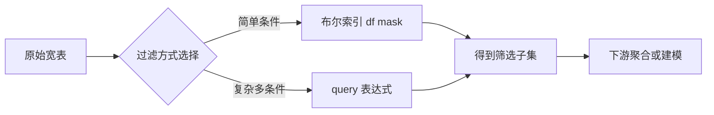

---

### Q314 · 缺失值策略 fillna / dropna / interpolate 与业务选型

> 难度:★★★ | 标签:pandas, 缺失值

**问**:面对数据表中的 NaN,应如何选择填充、删除还是插值?各自的风险是什么?

**答**:选型取决于缺失机制和业务含义:dropna 适合缺失比例很小且随机(MCAR)的场景,但会缩小样本、可能引入偏差;fillna 适合缺失有明确业务含义的场景(金额填 0、状态填 unknown),向前/向后填充 ffill/bfill 适合时间序列;interpolate 适合连续型时序数据按线性或时间插值。风险点:对有偏分布用均值填充会压扁方差,对时间序列盲目 dropna 会打断连续性。生产上应把"缺失处理策略"作为显式配置而不是散落各处的魔法数字。

```python
# file: code/05_数据分析与工程化/q314_missing_values.py
try:
    import pandas as pd
    import numpy as np
    PANDAS = True
except ImportError:
    PANDAS = False

def demo_pandas():
    df = pd.DataFrame({
        "ts": pd.date_range("2026-01-01", periods=6, freq="D"),
        "amount": [100, np.nan, np.nan, 160, np.nan, 200],
        "city": ["BJ", None, "SH", None, "SZ", "BJ"],
    })
    print(df.dropna(subset=["city"]).shape)          # 按关键列删
    print(df["amount"].fillna(0).tolist())           # 业务填 0
    print(df["amount"].ffill().tolist())             # 时序向前填充
    print(df["amount"].interpolate().round(1).tolist())  # 线性插值
    print(df.assign(city=df["city"].fillna("unknown")).isna().sum().to_dict())

if __name__ == "__main__":
    if PANDAS:
        demo_pandas()
    else:
        amounts = [100, None, None, 160, None, 200]
        filled = []
        last = None
        for v in amounts:            # ffill 的标准库等价实现
            if v is not None:
                last = v
            filled.append(last)
        print("ffill:", filled)
        print("fill 0:", [0 if v is None else v for v in amounts])
```

**追问**:
- 如何量化缺失情况?先 `df.isna().mean()` 看每列空值率,再按列分类决策:主键缺失直接拒绝,指标列按业务填,高缺失列考虑整列丢弃。
- 前向填充什么时候用错?——非时间序列数据 ffill 会把无关行的值蔓延;它只对按时间有序的列有意义。
- 均值填充的风险?——压扁方差、低估相关性,且训练/推理分布不一致;树模型可以给树「缺失作为单独分支」的能力(xgboost 原生处理)。
- 缺失本身是信号怎么办?——加 is_missing 指示列保留信息;很多业务场景「是否缺失」比填充值更有预测力。
### Q315 · groupby 聚合与 transform 的区别

> 难度:★★★ | 标签:pandas, groupby

**问**:groupby 之后 agg 和 transform 有什么区别?什么场景必须用 transform?

**答**:agg 把每个分组压缩成一行,结果行数等于分组数;transform 对每个分组计算后广播回原形状,结果行数与原表相同,天然适合"组均值填充""组内占比""组内排名"这类特征。需要把组级统计量放回明细行时必须用 transform,否则只能靠低效的 merge 回表。此外 groupby+apply 最灵活但最慢,优先用内置 agg/transform 的向量化实现。

```python
# file: code/05_数据分析与工程化/q315_groupby_transform.py
try:
    import pandas as pd
    PANDAS = True
except ImportError:
    PANDAS = False

def demo_pandas():
    df = pd.DataFrame({
        "dept": ["A", "A", "B", "B", "B"],
        "salary": [100, 200, 150, 250, 300],
    })
    agg = df.groupby("dept")["salary"].agg(["mean", "max"])
    print(agg)                                   # 每组一行
    df["dept_avg"] = df.groupby("dept")["salary"].transform("mean")
    df["ratio"] = df["salary"] / df["dept_avg"]  # 组内占比
    df["rank"] = df.groupby("dept")["salary"].rank(ascending=False)
    print(df)

if __name__ == "__main__":
    if PANDAS:
        demo_pandas()
    else:
        rows = [("A", 100), ("A", 200), ("B", 150), ("B", 250), ("B", 300)]
        groups = {}
        for d, s in rows:
            groups.setdefault(d, []).append(s)
        for d, s in rows:            # transform 的标准库等价
            avg = sum(groups[d]) / len(groups[d])
            print(d, s, "dept_avg=", avg, "ratio=", round(s / avg, 2))
```

**追问**:
- groupby+apply 和 transform 的性能差在哪?——apply 每组传 DataFrame 进 Python 回调,组多时极慢;内置 agg/transform 走 C 层,能用内置就别手写。
- 组内排名怎么写?——`df.groupby("g")["v"].rank("dense")`,天然组内广播回原表,是 transform 语义的内置实现。
- 过滤组用什么?——`df.groupby("g").filter(lambda x: len(x) > 10)` 或先 agg 出组指标再布尔索引,后者更快。

---

### Q316 · merge / join / concat 的区别与多表关联陷阱

> 难度:★★★ | 标签:pandas, merge

**问**:merge、join、concat 各自的用途是什么?多表关联时最容易踩哪些坑?

**答**:merge 按列(键)横向关联,等价 SQL join,支持 inner/left/right/outer;join 是基于索引的 merge 语法糖;concat 是纵向堆叠或横向拼接,不按键匹配。经典陷阱:关联键重复导致笛卡尔积让行数暴涨(先检查键唯一性)、浮点/字符串类型不一致导致 join 不上、outer join 后键列出现 NaN、以及 left join 后误以为行数不变。生产守则:merge 前断言键唯一、merge 后断言行数符合预期。

```python
# file: code/05_数据分析与工程化/q316_merge_join_concat.py
try:
    import pandas as pd
    PANDAS = True
except ImportError:
    PANDAS = False

def demo_pandas():
    orders = pd.DataFrame({"uid": [1, 2, 2, 3], "amt": [10, 20, 30, 40]})
    users = pd.DataFrame({"uid": [1, 2, 2], "name": ["a", "b", "b2"]})
    # 陷阱演示:users 的 uid 重复,join 后行数膨胀
    m = orders.merge(users, on="uid", how="left")
    assert len(m) > len(orders), "键不唯一导致笛卡尔积"
    print(len(orders), "->", len(m))
    # 生产守则:先验证唯一性再 merge
    assert users["uid"].is_unique, "users.uid 存在重复"
    concat_df = pd.concat([orders, orders], ignore_index=True)
    print(concat_df.shape)

if __name__ == "__main__":
    if PANDAS:
        demo_pandas()
    else:
        orders = [(1, 10), (2, 20), (2, 30), (3, 40)]
        users = {1: "a", 2: "b"}  # 唯一键字典,天然防重复
        for uid, amt in orders:
            print(uid, amt, users.get(uid))
```

**追问**:
- validate 参数有什么用?`merge(..., validate="m:1")` 会在键基数不满足时直接抛错,把"行数膨胀"从静默 bug 变成显式失败,推荐默认开启。
- merge 后行数怎么断言?——关联前后 `len(df)` 对比 + validate 参数;m:m 关联几乎总是设计错误。
- 键类型不一致的典型现象?——int64 对 object 关联结果为空且不报错;merge 前 `astype` 统一键类型。
- outer join 的 NaN 怎么处理?——键列 NaN 说明某侧缺记录,按业务填「未匹配」标记而不是 0,否则统计口径污染。
### Q317 · melt / pivot 宽表与长表转换

> 难度:★★☆ | 标签:pandas, 宽长转换

**问**:什么是宽表和长表?pandas 如何在两者之间转换?

**答**:长表是"一列指标名 + 一列值"的 tidy 数据,适合存储、聚合和画图;宽表是每个指标占一列,适合报表展示。melt 把宽转长(指定 id_vars 与 value_vars),pivot 把长转宽(index/columns/values),pivot_table 则附带聚合能力并能处理重复键。转换时注意 pivot 不允许重复的 index+columns 组合,有重复必须先聚合。

```python
# file: code/05_数据分析与工程化/q317_melt_pivot.py
try:
    import pandas as pd
    PANDAS = True
except ImportError:
    PANDAS = False

def demo_pandas():
    wide = pd.DataFrame({
        "month": ["2026-01", "2026-02"],
        "gmv": [100, 120],
        "uv": [30, 35],
    })
    long = wide.melt(id_vars="month", var_name="metric", value_name="val")
    print(long)                              # 宽转长
    back = long.pivot(index="month", columns="metric", values="val")
    back.columns.name = None
    print(back)                              # 长转宽
    # 长表带重复键时用 pivot_table 聚合
    pt = long.pivot_table(index="metric", values="val", aggfunc="sum")
    print(pt)

if __name__ == "__main__":
    if PANDAS:
        demo_pandas()
    else:
        wide = [{"month": "2026-01", "gmv": 100, "uv": 30},
                {"month": "2026-02", "gmv": 120, "uv": 35}]
        long = [{"month": r["month"], "metric": k, "val": v}
                for r in wide for k, v in r.items() if k != "month"]
        for row in long:
            print(row)
```

**追问**:
- pivot 报「Index contains duplicate entries」怎么办?——index+columns 组合有重复,先 groupby 聚合或用 pivot_table(自带 aggfunc)。
- melt 后列名怎么自定义?——`var_name=`/`value_name=` 参数;tidy 后列名规范便于后续 groupby 和画图。
- 长表和宽表怎么选存储?——明细入仓用长表(加指标维度不改动表结构);给运营看的报表用宽表,列即指标直观。

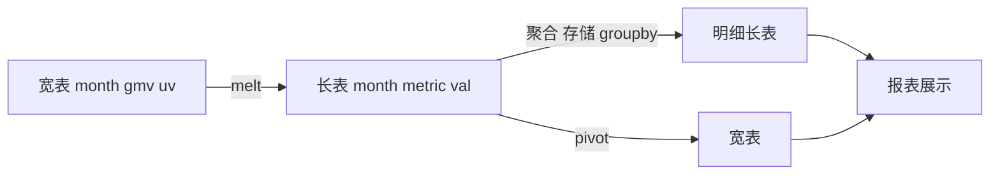

---

### Q318 · apply / applymap / map 的性能差异

> 难度:★★★ | 标签:pandas, 性能

**问**:apply、applymap、map 分别作用于什么?为什么说它们慢?

**答**:map 是 Series 方法,对每个元素应用函数或做字典映射;applymap(新版本 DataFrame.map)对 DataFrame 的每个元素应用函数;apply 较通用,Series 上逐元素、DataFrame 上按行或按列。它们慢的根源是逐元素走 Python 回调,无法利用 numpy 向量化,数据量大时比向量化写法慢一到两个数量级。工程建议:能用向量化运算、np.where、字典 map、cut 分箱解决的,绝不手写 apply;apply 只留给它处理真正无法向量化的复杂逻辑。

```python
# file: code/05_数据分析与工程化/q318_apply_map_perf.py
try:
    import pandas as pd
    import numpy as np
    PANDAS = True
except ImportError:
    PANDAS = False

def demo_pandas():
    s = pd.Series([1, 2, 3, 4])
    print(s.map(lambda x: x * 10).tolist())          # 逐元素
    df = pd.DataFrame({"a": [1, 2], "b": [3, 4]})
    print(df.applymap(lambda x: x + 1).to_dict())    # 全表逐元素
    print(df.apply("sum", axis=0).to_dict())         # 按列
    # 向量化替代方案对比
    big = pd.Series(np.arange(1_000_000))
    import time
    t0 = time.perf_counter()
    big.map(lambda x: x * 2)
    t1 = time.perf_counter()
    big * 2
    t2 = time.perf_counter()
    print(f"map: {t1 - t0:.3f}s  vectorized: {t2 - t1:.4f}s")

if __name__ == "__main__":
    if PANDAS:
        demo_pandas()
    else:
        s = [1, 2, 3, 4]
        print([x * 10 for x in s])                   # 逐元素映射
        print([sum(col) for col in zip(s, s)])       # 按列聚合
```

**追问**:
- apply(axis=1) 有多慢?每行都会构造一个 Series 对象,开销巨大;逐行逻辑优先考虑拆成向量化列运算或用 numpy 的广播解决。
- 元素级映射的最佳替代?——`Series.map(dict)` 走 C 层哈希,比 apply 匿名函数快一个数量级;map 不上的键产生 NaN,注意 fillna。
- apply 真正适合的场景?——确实无法向量化的复杂行逻辑(多列协同计算)、或作为 groupby 的自定义聚合;写入前先试 np.where/map。
- 怎么量化慢在哪?——%timeit 对比向量化与 apply 两版;没有对比数据,评审时说服力为零。
### Q319 · 向量化思想:如何避免 Python 循环

> 难度:★★★ | 标签:numpy, 向量化

**问**:什么是向量化?给出把"逐行 if-else 循环"改写成向量化代码的思路。

**答**:向量化是把对单个元素的操作上升为对整个数组的批量运算,由 C 层的 numpy 完成循环,避免 Python 解释器开销和逐个装箱对象。改写思路:逐行条件赋值改 np.where 或 np.select(多分支)、逐行算术改列运算、字符串日期解析交给 pd.to_datetime、复杂逻辑尽量拆解为若干布尔掩码的组合。判断标准是:代码里不出现 `for ... in df.iterrows()`。

```python
# file: code/05_数据分析与工程化/q319_vectorization.py
try:
    import numpy as np
    import pandas as pd
    PANDAS = True
except ImportError:
    PANDAS = False

def demo_pandas():
    df = pd.DataFrame({"x": np.arange(-5, 5), "y": np.arange(10) * 1.5})
    # 反例:for idx, row in df.iterrows(): 手写 if-else
    # 向量化:多分支用 np.select
    conditions = [df["x"] > 0, df["x"] < 0]
    choices = ["pos", "neg"]
    df["sign"] = np.select(conditions, choices, default="zero")
    # 条件赋值用 np.where
    df["clip_y"] = np.where(df["y"] > 10, 10, df["y"])
    print(df.head())

if __name__ == "__main__":
    if PANDAS:
        demo_pandas()
    else:
        xs = list(range(-5, 5))
        out = ["zero" if x == 0 else ("pos" if x > 0 else "neg") for x in xs]
        print(list(zip(xs, out)))
```

**追问**:
- iterrows 慢在哪?——每行构造一个 Series、逐元素装箱成 Python 对象;比向量化慢 1-2 个数量级,比 itertuples 更慢。
- np.select 什么时候用?——多分支条件赋值:`np.select([cond1, cond2], [v1, v2], default=0)`,替代嵌套 if 的逐行写法。
- 怎么训练团队写向量化?——评审硬指标:不出现 iterrows/apply(axis=1);复杂逻辑先想掩码组合,再想 numba/cython 兜底。

---

### Q320 · 链式赋值与 SettingWithCopyWarning

> 难度:★★★ | 标签:pandas, 坑

**问**:什么是链式赋值?为什么会触发 SettingWithCopyWarning,如何根治?

**答**:链式赋值指 `df[df.a > 0]["b"] = 1` 这种"两次索引拼接"的写法:第一步返回的可能是副本也可能是视图,pandas 无法确定,导致赋值可能落在临时对象上而原表未变,于是发出 SettingWithCopyWarning。根治方法是"一次 loc 完成定位与赋值":`df.loc[df.a > 0, "b"] = 1`;若确实要在切片上操作,先显式 `df2 = df[...].copy()` 摆脱歧义。新版本 pandas 引入了 Copy-on-Write,默认下修改永远不回写原表,更要靠 loc 写法保证修改生效。

```python
# file: code/05_数据分析与工程化/q320_chained_assignment.py
try:
    import pandas as pd
    PANDAS = True
except ImportError:
    PANDAS = False

def demo_pandas():
    df = pd.DataFrame({"a": [1, -2, 3], "b": [0, 0, 0]})
    # 反例:df[df.a > 0]["b"] = 1  -> SettingWithCopyWarning 且可能不生效
    df.loc[df["a"] > 0, "b"] = 1       # 正解:单次 loc 赋值
    assert (df.loc[df["a"] > 0, "b"] == 1).all()
    # 需要子表操作时显式 copy
    sub = df[df["a"] > 0].copy()
    sub["b"] = 99
    print(df, "\n---\n", sub)

if __name__ == "__main__":
    if PANDAS:
        demo_pandas()
    else:
        rows = [{"a": 1, "b": 0}, {"a": -2, "b": 0}, {"a": 3, "b": 0}]
        for r in rows:               # 单次遍历完成定位与赋值
            if r["a"] > 0:
                r["b"] = 1
        print(rows)
```

**追问**:
- Copy-on-Write 模式下行为有什么变化?——pandas 3.0 起默认 CoW:任何索引产生的都是「写时才复制」的惰性视图,链式赋值永不回写原表;旧代码要逐处 loc 化。
- 怎么区分视图和副本?——pandas 里没有可靠的公开判定,这正是警告存在的原因;规则就一条:写操作只用一次索引(loc/iloc)完成。
- 为什么改了没生效还不报错?——赋值落在临时副本上;SettingWithCopyWarning 只是警告不是错误,生产应把它升级为 errors。

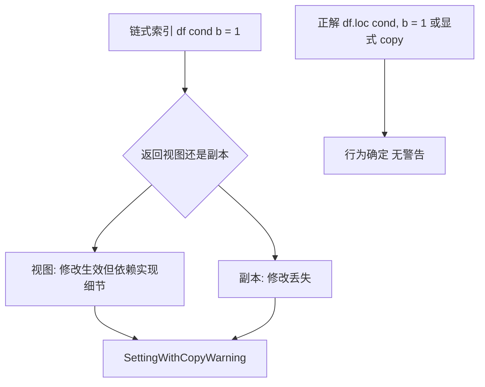

---

### Q321 · 数据类型优化:category / datetime / nullable Int64

> 难度:★★★ | 标签:pandas, dtype

**问**:pandas 有哪些节省内存或提升正确性的数据类型?category 什么时候反而不能用?

**答**:低基数重复字符串列(性别、城市、状态)转 category 可省数倍到数十倍内存并加速 groupby;日期时间列转 datetime64 才能做时序运算和重采样;带缺失的整数列用 nullable 的 Int64(大写)避免被强制转 float 丢精度。category 的坑:只有基数远小于行数时才划算,基数过高(如用户 ID)会退化甚至更慢;且 category 列 merge/排序语义与 object 列有差异,若类别集合需动态扩展要用 `.cat.add_categories`。加载后先 `df.dtypes` 审计是数据工程的基本功。

```python
# file: code/05_数据分析与工程化/q321_dtype_optimize.py
try:
    import pandas as pd
    import numpy as np
    PANDAS = True
except ImportError:
    PANDAS = False

def demo_pandas():
    n = 100_000
    df = pd.DataFrame({
        "city": np.random.default_rng(0).choice(["BJ", "SH", "SZ"], n),
        "val": np.random.default_rng(1).integers(0, 1000, n),
        "cnt": pd.array([1, None] * (n // 2), dtype="Int64"),  # nullable int
    })
    before = df.memory_usage(deep=True).sum()
    df["city"] = df["city"].astype("category")
    after = df.memory_usage(deep=True).sum()
    print(f"memory {before/1e6:.1f}MB -> {after/1e6:.1f}MB")
    print(df["cnt"].dtype, df["city"].cat.categories.tolist())

if __name__ == "__main__":
    if PANDAS:
        demo_pandas()
    else:
        print("标准库层面:用整数编码枚举值 + 常量表模拟 category 思路")
```

**追问**:
- datetime 列为什么读 CSV 后常变成 object?因为原始格式混杂或未指定 parse_dates,需要 `pd.to_datetime(errors="coerce")` 统一,coerce 会把脏值变 NaT 便于后续排查。
- category 什么时候反而更慢?——高基数列(用户 ID)字典编码开销大、merge 时类别对齐成本高;经验阈值是唯一值数 < 行数的 50%。
- nullable Int64 解决什么?——含 NaN 的整数列不再被升为 float64 丢精度;计算生态兼容性(polars/sklearn)要先确认。
- 内存审计的入口?——`df.memory_usage(deep=True).sum()` 与 per-column 排名,object 列通常占大头,先转 category/datetime。
### Q322 · 大文件分块读取 chunksize

> 难度:★★★ | 标签:pandas, 大文件

**问**:CSV 有 20GB 读不进内存怎么办?说明 chunksize 分块处理的模式。

**答**:用 `pd.read_csv(..., chunksize=n)` 返回迭代器,每个 chunk 是独立 DataFrame,循环中做"过滤 + 聚合"再合并部分结果,这是典型的 map-reduce 单机模式;配合 usecols 只读必要列、dtype 显式指定可进一步压内存。注意:跨 chunk 的去重、排序、join 不能简单分块,需要全局键或改用数据库/Polars/DuckDB。分块读取还应记录已处理的行号,便于失败重跑。

```python
# file: code/05_数据分析与工程化/q322_chunk_read.py
import csv
import os

def write_demo_csv(path, rows):
    with open(path, "w", newline="") as f:
        w = csv.writer(f)
        w.writerow(["city", "amt"])
        for city, amt in rows:
            w.writerow([city, amt])

def process_chunks(path, chunk_size=3):
    """map-reduce:逐块过滤聚合,最后合并部分结果。生产上用
    pd.read_csv(path, chunksize=chunk_size) 得到同样语义的迭代器。"""
    partial = {}
    with open(path, newline="") as f:
        reader = csv.DictReader(f)
        chunk = []
        for row in reader:
            chunk.append(row)
            if len(chunk) == chunk_size:
                merge_partial(partial, chunk)
                chunk = []
        if chunk:
            merge_partial(partial, chunk)
    return partial

def merge_partial(partial, chunk):
    for r in chunk:
        partial[r["city"]] = partial.get(r["city"], 0) + float(r["amt"])

if __name__ == "__main__":
    try:
        import pandas as pd
        path = "demo_chunk.csv"
        write_demo_csv(path, [("BJ", 10), ("SH", 20), ("BJ", 5), ("SZ", 8)])
        total = {}
        for chunk in pd.read_csv(path, chunksize=2):   # 生产写法
            g = chunk.groupby("city")["amt"].sum()
            total = total.add(g, fill_value=0)
        print(total.to_dict())
        os.remove(path)
    except ImportError:
        path = "demo_chunk.csv"
        write_demo_csv(path, [("BJ", 10), ("SH", 20), ("BJ", 5), ("SZ", 8)])
        print(process_chunks(path))
        os.remove(path)
```

**追问**:
- 跨 chunk 去重怎么做?——维护全局已见键集合(或 Bloom/写临时表),chunk 内先去重再对全局集合过滤;纯分块无法全局去重。
- chunksize 取多大?——以单 chunk 内存 100-500MB 为限,先看列数与平均行长;过小则调度开销占比高。
- 分块算 mean 能直接平均各 chunk 均值吗?——不能,要按 sum/count 加权合并;分位数、去重计数这类非可加指标必须保留原始数据或换 HyperLogLog。

---

### Q323 · 内存优化:.dtype 降位与 downcast

> 难度:★★☆ | 标签:pandas, 内存

**问**:如何把一个吃掉大量内存的 DataFrame 瘦身?有哪些降位技巧?

**答**:核心是按数据实际范围选最小够用的 dtype:int64 降到 int32/int16/int8,float64 降到 float32,object 字符串转 category,重复率高的布尔转 bool。pandas 提供 `pd.to_numeric(downcast=...)` 自动降位;工程做法是写一个通用的 reduce_memory 函数,读取后统一处理再进入计算。注意降位有精度风险,金额类列建议保留 decimal 或 float64,降位前确认极值范围。

```python
# file: code/05_数据分析与工程化/q323_memory_downcast.py
try:
    import pandas as pd
    import numpy as np
    PANDAS = True
except ImportError:
    PANDAS = False

def reduce_memory(df):
    for col in df.columns:
        t = df[col].dtype
        if pd.api.types.is_integer_dtype(t):
            df[col] = pd.to_numeric(df[col], downcast="integer")
        elif pd.api.types.is_float_dtype(t):
            df[col] = pd.to_numeric(df[col], downcast="float")
        elif pd.api.types.is_object_dtype(t):
            if df[col].nunique() / len(df) < 0.5:
                df[col] = df[col].astype("category")
    return df

if __name__ == "__main__":
    if PANDAS:
        rng = np.random.default_rng(0)
        df = pd.DataFrame({
            "a": rng.integers(0, 100, 50_000),        # int64 -> int8
            "b": rng.random(50_000),                  # float64 -> float32
            "c": rng.choice(["x", "y"], 50_000),      # object -> category
        })
        before = df.memory_usage(deep=True).sum()
        df = reduce_memory(df)
        after = df.memory_usage(deep=True).sum()
        print(f"{before/1e6:.2f}MB -> {after/1e6:.2f}MB")
        print(df.dtypes.to_dict())
    else:
        print("标准库思路:选择最小够用的数值类型,枚举列用整数编码")
```

**追问**:
- float64 降 float32 有什么风险?——精度损失与求和误差累积,金额、经纬度这类列不要降;特征矩阵可降,训练显存减半。
- int 列有空值降位会怎样?——强制升 float 并引入 NaN 的二进制噪声;应先转 nullable Int64 再降位。
- 降位后怎么验证无损?——对比降位前后 describe 的 min/max 与抽样值,超 int8 范围会被静默截断,to_numeric 返回值要检查 dtype 变化。

---

### Q324 · datetime 与时区处理

> 难度:★★★ | 标签:pandas, 时区

**问**:pandas 中如何处理带时区的时间?tz_convert 和 tz_localize 有什么区别?

**答**:tz_localize 给 naive 时间"赋予"时区(不改变表盘时间),tz_convert 在已有时区之间"换算"(改变表盘时间),对 naive 时间直接 tz_convert 会报错。工程要点:入库统一 UTC 存储或 UTC-naive,展示层再转本地时区;跨时区列做差会自动对齐;夏令时切换时用 `ambiguous="NaT"` 或 `nonexistent` 参数显式处理歧义时间。混用 naive 和 aware 列做运算会抛 TypeError,这其实是好事,逼你统一口径。

```python
# file: code/05_数据分析与工程化/q324_datetime_tz.py
try:
    import pandas as pd
    PANDAS = True
except ImportError:
    PANDAS = False

def demo_pandas():
    ts = pd.Series(pd.to_datetime([
        "2026-01-01 08:00:00", "2026-06-01 08:00:00"]))
    s_utc = ts.dt.tz_localize("UTC")           # 赋予时区
    print(s_utc.dt.tz_convert("Asia/Shanghai").tolist())
    # 混合时区字符串解析:统一到 UTC
    mixed = pd.Series(["2026-01-01 08:00+08:00", "2026-01-01 00:00+00:00"])
    parsed = pd.to_datetime(mixed, format="ISO8601", utc=True)
    print(parsed.tolist())

if __name__ == "__main__":
    if PANDAS:
        demo_pandas()
    else:
        from datetime import datetime, timezone, timedelta
        dt = datetime(2026, 1, 1, 8, 0, tzinfo=timezone(timedelta(hours=8)))
        print(dt.astimezone(timezone.utc).isoformat())  # localize/convert 等价
```

**追问**:
- tz_localize 和 tz_convert 混用会怎样?——对 aware 列再 localize 报错、对 naive 直接 convert 报错;这个 TypeError 是提醒,别用 errors 绕过。
- 夏令时切换的歧义时间怎么处理?——`ambiguous='NaT'`(或 bool 数组)与 `nonexistent='shift_forward'` 显式声明策略,默认报错。
- 为什么入库推荐 UTC-naive?——各数据源时区不一,统一转 UTC 后去掉 tz 信息存储,计算最简单;展示层最后 localize。

---

### Q325 · resample 重采样:上采样与下采样

> 难度:★★★ | 标签:pandas, 时间序列

**问**:如何把秒级日志聚合成 5 分钟指标?resample 的上采样和下采样分别怎么用?

**答**:resample 基于时间索引做分组聚合:下采样如 `df.resample("5min").agg({...})` 把细粒度聚成粗粒度,需选好聚合函数(sum/mean/last);上采样如 `.resample("1min").asfreq()` 变出更细的时间网格,会引入缺失,需配 ffill/interpolate 填充。注意闭合语义与 label 参数决定区间归属,跨天统计要用 `closed="left", label="left"` 明确口径,否则"哪一分钟的数"会对不上报表。

```python
# file: code/05_数据分析与工程化/q325_resample.py
try:
    import pandas as pd
    import numpy as np
    PANDAS = True
except ImportError:
    PANDAS = False

def demo_pandas():
    idx = pd.date_range("2026-01-01 00:00", periods=60, freq="min")
    df = pd.DataFrame({"req": np.arange(60)}, index=idx)
    down = df.resample("5min").agg(req_sum=("req", "sum"),
                                   req_max=("req", "max"))
    print(down)                          # 下采样:5 分钟窗口
    up = df.resample("30s").ffill()
    print(len(up), "rows after upsample")  # 上采样 + 前向填充

if __name__ == "__main__":
    if PANDAS:
        demo_pandas()
    else:
        from collections import defaultdict
        buckets = defaultdict(int)
        for minute in range(60):         # 5 分钟窗口求和
            buckets[minute // 5 * 5] += minute
        print(dict(sorted(buckets.items())))
```

**追问**:
- closed 和 label 的默认语义?——下采样默认 closed='left'、label='left',但以 '5min' 等对齐分钟时右端点归属易错;报表口径必须显式写出。
- 上采样的缺口怎么填?——asfreq 后接 ffill/interpolate(method='time');插值会造数,业务口径敏感的报表只能 ffill 或留空。
- resample 和 groupby+Grouper 的区别?——后者不需要 datetime 索引(可按键列分组重采样),适合 datetime 只是一列的场景。

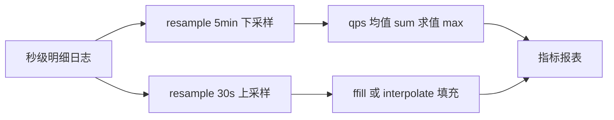

---

### Q326 · 滚动窗口与扩展窗口

> 难度:★★★ | 标签:pandas, 窗口函数

**问**:rolling 和 expanding 有什么区别?给一个计算 7 日滚动均值的例子。

**答**:rolling 计算固定长度的滑动窗口统计量(如 7 日均值、20 日波动率),窗口大小不变、内容滑动;expanding 是"从头到当前位置"的累计窗口,适合计算"截至目前"的累计指标。rolling 支持按时间偏移(`"7D"`)而非行数建窗,可容忍缺失时间点;min_periods 参数控制窗口不满时的行为,避免序列开头产生过多 NaN。这些窗口函数都是 C 实现的,性能远好于手写循环。

```python
# file: code/05_数据分析与工程化/q326_rolling_window.py
try:
    import pandas as pd
    import numpy as np
    PANDAS = True
except ImportError:
    PANDAS = False                      # 未装 pandas: 走下面的纯手写降级路径

def demo_pandas():
    idx = pd.date_range("2026-01-01", periods=14, freq="D")
    s = pd.Series(np.arange(1, 15, dtype=float), index=idx)
    print(s.rolling(7, min_periods=3).mean().round(2).tolist())
    print(s.expanding().sum().tail(3).tolist())
    # 按时间窗口:适合有不连续日期的表
    print(s.rolling("7D").mean().round(2).tail(3).tolist())

if __name__ == "__main__":
    if PANDAS:
        demo_pandas()
    else:
        vals = list(range(1, 15))
        for i in range(len(vals)):       # 7 日滚动均值的朴素实现
            win = vals[max(0, i - 6): i + 1]
            print(round(sum(win) / len(win), 2))
```

**追问**:
- groupby 后还能 rolling 吗?可以,`df.groupby("uid")["amt"].rolling(7).mean()` 会按组独立滑窗,是计算用户级滚动特征的常用写法。
- min_periods 为什么重要?——窗口不满时默认产 NaN,短序列开头全是空;设 min_periods 可用部分窗口,但要知道统计含义变化。
- 时间窗口 rolling("7D") 的前提?——必须有单调 datetime 索引,重复时间戳要预处理;按行数的 rolling 不看时间。
- ewm 和 rolling 的区别?——ewm 指数加权、近权重大、无窗口参数;平滑噪声场景 ewm 更自然,rolling 强调固定窗口口径。
### Q327 · pandas 性能剖析与优化路径

> 难度:★★★ | 标签:pandas, profiling

**问**:一段 pandas 代码很慢,你的分析定位流程是什么?

**答**:先用 %timeit / time.perf_counter 粗测各步骤耗时,找到热点而不是猜;再用 df.memory_usage(deep=True) 看内存、df.dtypes 看类型问题(object 大字符串和高基数列常是元凶)。常见优化次序:换更优 dtype → 消除 iterrows/apply 换向量化 → 减少中间副本用就地链路 → 大表 join 前先缩小行/列 → 仍不够则换 Polars/DuckDB/分块。优化必须带前后基准数据,避免"感觉变快了"。

```python
# file: code/05_数据分析与工程化/q327_pandas_profile.py
import time

try:
    import pandas as pd
    import numpy as np
    PANDAS = True
except ImportError:
    PANDAS = False

def timed(fn, *args, **kwargs):
    t0 = time.perf_counter()
    result = fn(*args, **kwargs)
    return result, time.perf_counter() - t0

if __name__ == "__main__":
    if PANDAS:
        rng = np.random.default_rng(0)
        n = 500_000
        df = pd.DataFrame({"k": rng.integers(0, 100, n),
                           "v": rng.random(n)})
        # 热点对比:逐行 apply vs 向量化
        _, slow = timed(lambda: df.apply(lambda r: r["v"] * 2, axis=1))
        _, fast = timed(lambda: df["v"] * 2)
        print(f"apply(axis=1): {slow:.3f}s  vectorized: {fast:.4f}s")
        print(f"speedup ~{slow / max(fast, 1e-9):.0f}x")
        print(df.memory_usage(deep=True).to_dict())
    else:
        print("标准库:用 time.perf_counter 分段计时定位热点")
```

**追问**:
- memory_usage(deep=True) 为什么更准?——默认不统计 object 字符串的真实内容;deep=True 遍历对象,object 列的真实占用常是默认值的数倍。
- 优化到什么程度该停?——满足下游时延与内存预算即停;换 Polars/DuckDB 是结构性改动,收益要与迁移测试成本比。
- 怎么证明优化有效?——记录前后三件套:耗时(分步)、内存峰值、输出校验和一致;没有基线的优化不可信。

---

### Q328 · 多进程分块处理大文件

> 难度:★★★ | 标签:multiprocessing, ETL

**问**:如何用多进程加速对一个大 CSV 的处理?有哪些坑?

**答**:模式是"分块 → 进程池 map → 主进程 reduce":把文件按行块切分,每个 worker 独立读取自己负责的字节区间并返回聚合结果,主进程合并,避免把大 DataFrame 通过 IPC 传回。坑:worker 内重新 import pandas 的开销、不要用共享大对象(应传文件路径与偏移量)、Windows/macOS 的 spawn 启动方式要求入口函数可 pickle 且有 `if __name__ == "__main__"` 保护。CPU 密集任务用 ProcessPool,IO 密集用线程池即可。

```python
# file: code/05_数据分析与工程化/q328_multiprocess_chunks.py
import csv
import os
from concurrent.futures import ProcessPoolExecutor

CSV_PATH = "demo_mp.csv"

def write_csv(path, n=1000):
    with open(path, "w", newline="") as f:
        w = csv.writer(f)
        w.writerow(["id", "amt"])
        for i in range(n):
            w.writerow([i, i % 7 + 1])

def process_range(args):
    """每个进程只读自己的行区间,返回局部聚合。"""
    start, end = args
    total = 0.0
    with open(CSV_PATH, newline="") as f:
        for i, row in enumerate(csv.reader(f)):
            if i == 0:
                continue
            if start <= i < end:
                total += float(row[1])
            if i >= end:
                break
    return total

def main():
    n = sum(1 for _ in open(CSV_PATH)) - 1
    k = 4
    bounds = [(i * n // k, (i + 1) * n // k) for i in range(k)]
    with ProcessPoolExecutor(max_workers=k) as pool:
        partials = list(pool.map(process_range, bounds))
    print("total =", sum(partials), "partials =", partials)

if __name__ == "__main__":
    write_csv(CSV_PATH)
    main()
    os.remove(CSV_PATH)
```

**追问**:
- 为什么传文件路径而不传 DataFrame?——跨进程 pickle 大 DataFrame 的序列化开销可能超过计算本身;worker 自行按 offset 读取。
- 结果合并时怎么保持全局有序?——按块号排序聚合,或每块带 row range 元数据;乱序合并会让「前 N 行」类语义错乱。
- 什么时候不该用多进程?——IO 密集(线程池就够)、单块计算秒级以内(启动开销占比高)、或目标机器内存放不下多份 pandas。

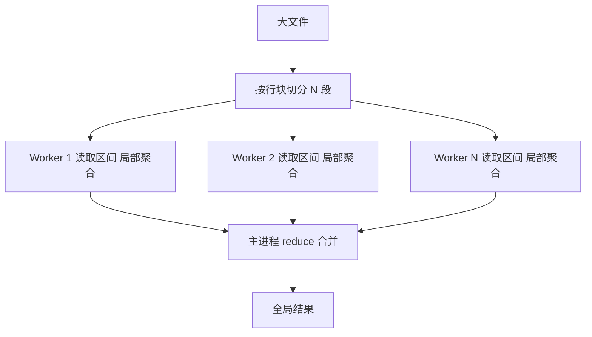

---

### Q329 · numpy 广播机制

> 难度:★★★ | 标签:numpy, broadcasting

**问**:解释 numpy 的广播规则,并说明什么情况下会报错。

**答**:广播让不同形状的数组做运算:从末尾维度向前对齐,两维度相等或其中一方为 1 时可兼容,为 1 的一方沿该轴复制扩展;维度数不齐时短的在前面补 1。若从末尾对齐后某轴既不相等也都不是 1,则抛 ValueError。广播是零拷贝的"虚拟扩展",性能好但要小心它是逻辑复制,不会真的占内存,配合 reshape 与 np.newaxis 可以写出非常简洁的距离矩阵、归一化代码。

```python
# file: code/05_数据分析与工程化/q329_numpy_broadcast.py
try:
    import numpy as np
except ImportError:
    print("该题演示需要第三方库 numpy:pip install numpy,原理见正文")
    raise SystemExit(0)

def main():
    a = np.array([[1, 2, 3],
                  [4, 5, 6]])          # shape (2, 3)
    b = np.array([10, 20, 30])         # shape (3,) -> (1, 3) 广播
    print(a + b)
    col = np.array([[100], [200]])     # shape (2, 1) 广播成 (2, 3)
    print(a + col)
    # 归一化:每列减去均值,广播经典用法
    print((a - a.mean(axis=0)) / a.std(axis=0))
    # 形状 (2, 3) 与 (2,) 不兼容 -> ValueError
    try:
        a + np.array([1, 2])
    except ValueError as e:
        print("expected error:", e)

if __name__ == "__main__":
    main()
```

**追问**:
- np.newaxis 有什么用?它在指定位置插入长度为 1 的轴,把一维数组变成行向量或列向量,是手动控制广播方向的工具。
- 广播失败的典型报错?——`ValueError: operands could not be broadcast together`,两轴既不相等也都不是 1;reshape/newaxis 补齐维度即可。
- 广播是复制数据吗?——不是,虚拟扩展零拷贝;但它会让某些「看似省内存」的运算物化大结果,如 (n,1)-(1,n) 产生 n×n 矩阵。
- broadcasting 的经典应用?——`a[:, None] - b[None, :]` 距离矩阵、按行归一化 `x / x.sum(axis=1, keepdims=True)`。
### Q330 · ndarray vs list

> 难度:★★☆ | 标签:numpy

**问**:numpy ndarray 和 Python list 有什么本质区别?各适合什么场景?

**答**:ndarray 是同构、连续内存的 C 数组,支持向量化运算、广播和 strides 视图,数值计算比 list 快一个数量级以上且省内存;list 是异构指针数组,灵活但每个元素都是完整 Python 对象。list 擅长动态增删、混合类型、小规模逻辑;ndarray 擅长大规模数值运算、矩阵代数、作为 pandas 底层。注意 ndarray 固定大小不自动扩容,append 要靠 np.concatenate 或 np.append(后者每次拷贝,应避免在循环里用)。

```python
# file: code/05_数据分析与工程化/q330_ndarray_vs_list.py
try:
    import numpy as np
except ImportError:
    print("该题演示需要第三方库 numpy:pip install numpy,原理见正文")
    raise SystemExit(0)

def main():
    py_list = [1, 2, 3, 4]
    arr = np.array([1, 2, 3, 4])
    print(type(py_list), type(arr), arr.dtype)
    print(arr * 2)                # 向量化:逐元素
    print(py_list * 2)            # list:重复拼接,语义完全不同
    print(arr + 1)                # ndarray 支持
    try:
        py_list + 1
    except TypeError as e:
        print("expected error:", e)
    print(arr.sum(), arr.mean(), arr.max())   # 内置聚合方法

if __name__ == "__main__":
    main()
```

**追问**:
- 为什么 np.append 在循环里是陷阱?——每次都整块拷贝新数组,O(n²);预分配 `np.empty` 后按位填充,或攒 list 一次性 np.array。
- ndarray 的 strides 是什么?——描述每维移动一步的字节数,切片/转置只是改 strides 不拷贝,这是视图机制的底层。
- 什么时候必须用 list?——元素类型异构、频繁增删、长度未知的小集合;ndarray 的强项是大规模同构数值。

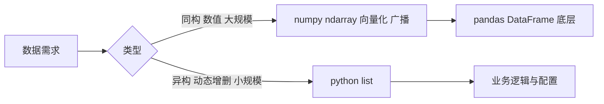

---

### Q331 · 视图与副本:小心原地修改

> 难度:★★★ | 标签:numpy, view, copy

**问**:numpy 中什么是视图 view、什么是副本 copy?如何判断和避免误用?

**答**:视图 share 底层内存,改视图会改原数组,切片默认返回视图;copy 是独立内存的深复制。判断:`arr.base` 非 None 说明是视图;修改后打印原数组是最直接的验证。规则:需要修改数据且不想影响原数组时显式 `.copy()`;只想读时用视图省内存。pandas 2.x 的 Copy-on-Write 模式让"改动从不意外回写",但代价是写前必须显式 copy,思维要从"怕误改"转为"默认不改"。

```python
# file: code/05_数据分析与工程化/q331_view_copy.py
try:
    import numpy as np
except ImportError:
    print("该题演示需要第三方库 numpy:pip install numpy,原理见正文")
    raise SystemExit(0)

def main():
    a = np.arange(6)
    v = a[2:5]              # 切片 -> 视图
    c = a[2:5].copy()       # 显式副本
    v[0] = 99
    print(a)                # a 被改:视图共享内存
    c[0] = -1
    print(a)                # a 未变
    print("view base is a:", v.base is a, "| copy base:", c.base is not None)
    # fancy 索引返回副本,不是视图
    f = a[[0, 1]]
    f[0] = 777
    print(a[0])             # 仍为 99 -> fancy 索引是副本

if __name__ == "__main__":
    main()
```

**追问**:
- 怎么确认拿到的是视图还是副本?——`arr.base is not None` 即视图;更直接的是改一下看原数组变不变。
- 什么切片操作会产生副本?——布尔掩码索引、花式索引(整数数组索引)永远返回副本;基本切片返回视图。
- CoW 下「默认不改」怎么落地?——需要写就显式 copy 再写,读操作放心用视图;团队规范里写明这条,消灭误改事故。

---

### Q332 · 随机数与种子:可复现实验

> 难度:★★☆ | 标签:numpy, random

**问**:为什么实验要固定随机种子?numpy 新旧随机 API 有什么区别?

**答**:固定种子使采样、初始化、打乱结果可复现,是调试和数据实验的底线要求。旧 API `np.random.seed` 依赖模块级全局状态,多线程/多进程下不安全;新 API 用 `rng = np.random.default_rng(seed)` 的 Generator 对象,状态隔离、方法更清晰(rng.integers / rng.choice / rng.normal)。工程规范:种子作为参数显式传递而不是写死在各处,并把种子记录进实验元数据,保证"任何一次结果都能重放"。

```python
# file: code/05_数据分析与工程化/q332_random_seed.py
try:
    import numpy as np
except ImportError:
    print("该题演示需要第三方库 numpy:pip install numpy,原理见正文")
    raise SystemExit(0)

def sample_pipeline(seed):
    rng = np.random.default_rng(seed)      # 新 API:独立 Generator
    return {
        "ints": rng.integers(0, 10, 5).tolist(),
        "normal": rng.normal(0, 1, 3).round(3).tolist(),
        "shuffle": rng.permutation(np.arange(5)).tolist(),
    }

if __name__ == "__main__":
    r1 = sample_pipeline(42)
    r2 = sample_pipeline(42)
    r3 = sample_pipeline(7)
    assert r1 == r2, "同种子必须可复现"
    assert r1 != r3, "不同种子应不同"
    print("reproducible:", r1["ints"])
```

**追问**:
- 多进程实验如何保证随机性?每个 worker 用不同且确定的种子(如 base_seed + worker_id),避免各进程拿到相同序列。
- default_rng 相比旧 API 好在哪?——Generator 实例状态隔离,多线程/多进程互不干扰,方法名更明确;seed 全局状态在并行下会串。
- 种子要记录在哪?——实验元数据(配置文件/MLflow 参数);只写死在代码里,换参数就丢复现性。
- 抽样可复现还有什么手段?——`rng.choice(..., shuffle=False)`、固定 sort、DataFrame.sample(random_state=rng);贯穿全链路用同一个 Generator。
### Q333 · Polars 与 pandas 对比

> 难度:★★★ | 标签:Polars

**问**:Polars 为什么比 pandas 快?什么时候值得切换?

**答**:Polars 核心优势:基于 Rust 与 Apache Arrow 列式内存、查询优化器会对 lazy plan 做谓词下推和投影裁剪、多线程并行执行、字符串更省内存;pandas 是单线程、eager 执行、object 字符串开销大。切换时机:单机数据在 GB 级 pandas 内存/速度吃紧、流水线希望懒执行优化、或需要流式处理;保留 pandas 的场景:依赖 pandas 生态(如某些 ML 库)、小数据、团队只熟 pandas。两者可经 Arrow 零拷贝互转,渐进迁移成本低。

```python
# file: code/05_数据分析与工程化/q333_polars_compare.py
try:
    import polars as pl
    HAS_POLARS = True
except ImportError:
    HAS_POLARS = False

def demo_polars():
    df = pl.DataFrame({"city": ["BJ", "SH", "BJ"], "amt": [10, 20, 30]})
    out = (
        df.lazy()
          .filter(pl.col("amt") > 5)            # 谓词下推
          .group_by("city")
          .agg(pl.col("amt").sum().alias("total"))
          .collect()                             # 此时才执行优化后的 plan
    )
    print(out)

if __name__ == "__main__":
    if HAS_POLARS:
        demo_polars()
    else:
        # 标准库演示同语义:filter -> group -> agg
        rows = [("BJ", 10), ("SH", 20), ("BJ", 30)]
        groups = {}
        for city, amt in rows:
            if amt > 5:
                groups[city] = groups.get(city, 0) + amt
        print(groups)
```

**追问**:
- Polars 的 lazy plan 优化了什么?——谓词下推(过滤提前)、投影裁剪(只读需要的列)、连接重排;同样的逻辑比 eager pandas 少读大量数据。
- Arrow 零拷贝互转怎么做?——`df.to_arrow()`/`pl.from_arrow()`,两边共享列式内存不复制;这是迁移与混用的通道。
- pandas 还值得新项目用吗?——生态兼容(ML 库入参、可视化)仍是它最大优势;数据处理核心逐模块换 Polars/DuckDB 是务实路线。

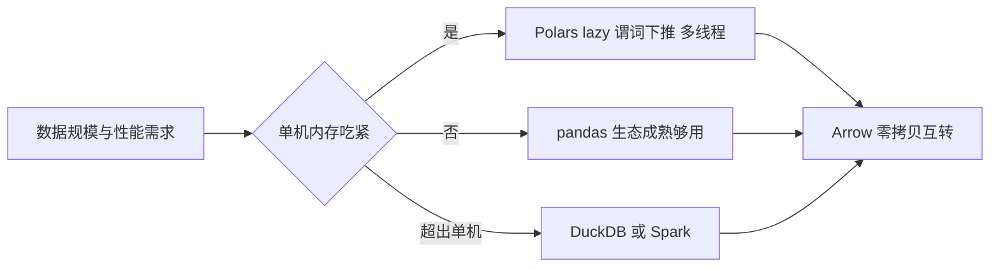

---

### Q334 · DuckDB 嵌入式分析

> 难度:★★★ | 标签:DuckDB, SQL

**问**:DuckDB 是什么?相比 pandas 和传统 OLAP 库的优势在哪?

**答**:DuckDB 是嵌入式 OLAP 数据库,像 SQLite 一样进程内运行、零部署,却支持完整 SQL、列式执行、直接查询 parquet/CSV/pandas DataFrame,还能与 pandas 互转。定位:介于 pandas(单机内存、Python API)与 Spark(分布式、重运维)之间,适合单机 GB~百 GB 级分析、本地数仓探查、给数据管道加 SQL 层。优势是"不把数据拉进内存也能算"——可以流式扫描大 parquet 并只物化结果,内存占用远低于 pandas 全量加载。

```python
# file: code/05_数据分析与工程化/q334_duckdb_sql.py
import csv
import os

def write_csv(path):
    with open(path, "w", newline="") as f:
        w = csv.writer(f)
        w.writerow(["city", "amt"])
        for city, amt in [("BJ", 10), ("SH", 20), ("BJ", 30)]:
            w.writerow([city, amt])

if __name__ == "__main__":
    path = "demo_duck.csv"
    write_csv(path)
    try:
        import duckdb
        con = duckdb.connect()                 # 进程内,零部署
        out = con.execute(
            "SELECT city, sum(amt) AS total "
            "FROM read_csv_auto(?) GROUP BY city ORDER BY total DESC",
            [path],
        ).fetchall()
        print(out)
        con.close()
    except ImportError:
        # 降级:纯标准库实现同样语义
        groups = {}
        with open(path, newline="") as f:
            for row in csv.DictReader(f):
                groups[row["city"]] = groups.get(row["city"], 0) + float(row["amt"])
        print(sorted(groups.items(), key=lambda kv: -kv[1]))
    os.remove(path)
```

**追问**:
- DuckDB 能直接查 pandas 对象吗?可以,`duckdb.query("SELECT * FROM df")` 会用 Arrow 桥接零拷贝扫描 DataFrame,常用于给 pandas 管道补 SQL 能力。
- DuckDB 为什么「不把数据拉进内存也能算」?——列式 + 向量化执行,扫描 parquet 流式聚合,只物化最终结果;pandas 必须先全量进内存。
- 什么时候 DuckDB 替代 pandas?——GB 级数据、SQL 逻辑复杂、内存吃紧;单表小清洗继续 pandas 更顺手。
- 它和 Spark 怎么分工?——单机到百 GB 内 DuckDB(零运维);跨机、TB 级、需要分布式调度才上 Spark。
### Q335 · 数据清洗实战:去重、异常值 IQR、格式归一

> 难度:★★★ | 标签:pandas, 数据清洗

**问**:拿到一份脏数据,你的标准清洗流程包含哪些步骤?

**答**:典型流程:先审计(shape、dtypes、空值率、describe),再按序处理——格式归一(去空格、统一大小写、日期解析、字符串数值化)→ 去重(dup 判断依据业务键而不是全行)→ 异常值(业务规则优先,统计上用 IQR 或 z-score 标记而非直接删除)→ 缺失值按 Q314 策略处理。关键原则:每一步清洗前后记录行数变化,清洗逻辑代码化可重跑,不允许人工在 Excel 里改数。

```python
# file: code/05_数据分析与工程化/q335_data_cleaning.py
try:
    import pandas as pd
    import numpy as np
    PANDAS = True
except ImportError:
    PANDAS = False

def clean(df):
    n0 = len(df)
    # 1 格式归一
    df["city"] = df["city"].str.strip().str.upper()
    df["amt"] = pd.to_numeric(df["amt"], errors="coerce")
    # 2 按业务键去重
    df = df.drop_duplicates(subset=["order_id"], keep="last")
    # 3 IQR 标记异常值(标记而非删除)
    q1, q3 = df["amt"].quantile([0.25, 0.75])
    iqr = q3 - q1
    lo, hi = q1 - 1.5 * iqr, q3 + 1.5 * iqr
    df["amt_outlier"] = (df["amt"] < lo) | (df["amt"] > hi)
    print(f"rows {n0} -> {len(df)}, outliers={int(df['amt_outlier'].sum())}")
    return df

if __name__ == "__main__":
    if PANDAS:
        df = pd.DataFrame({
            "order_id": [1, 2, 2, 3, 4],
            "city": [" BJ", "sh", " SZ ", "BJ", "gz"],
            "amt": ["10", "20", "20", "9999", "5"],
        })
        print(clean(df))
    else:
        rows = [(1, "BJ", 10), (2, "SH", 20), (2, "SH", 20), (3, "BJ", 9999)]
        seen, cleaned = set(), []
        for oid, city, amt in rows:      # 去重的标准库等价
            if oid not in seen:
                seen.add(oid)
                cleaned.append((oid, city.strip().upper(), amt))
        vals = sorted(c[2] for c in cleaned)
        q1, q3 = vals[len(vals) // 4], vals[3 * len(vals) // 4]
        iqr = q3 - q1
        for oid, city, amt in cleaned:
            flag = amt < q1 - 1.5 * iqr or amt > q3 + 1.5 * iqr
            print(oid, city, amt, "outlier" if flag else "ok")
```

**追问**:
- 去重按全行还是业务键?——全行重复可 drop;业务键重复是数据质量问题(可能一新一旧),要先按更新时间保留最新并记录冲突。
- IQR 异常值该删吗?——不该直接删:先区分录入错误(修正/剔除)与真实长尾(保留);风控、反作弊场景异常本身就是信号。
- 清洗为什么必须代码化?——人工改数不可重跑、不可审计;每步保留输入输出与行数日志,任何口径质疑都能重放。

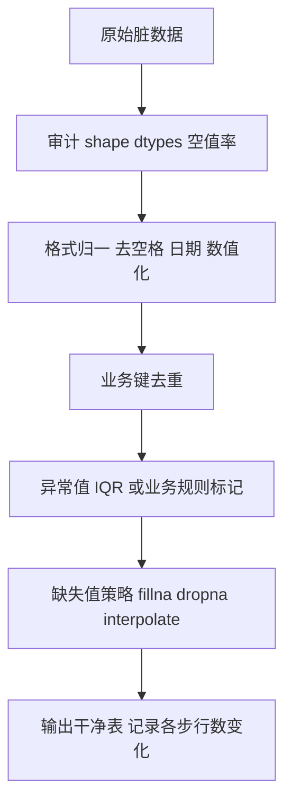

---

### Q336 · ETL 流水线设计

> 难度:★★★ | 标签:ETL, 架构

**问**:设计一条 ETL 流水线时,你会考虑哪些工程要素?

**答**:分层设计:Extract 负责幂等拉数(记录水位)、Transform 做纯函数式转换(输入输出明确、可单测)、Load 原子写入(先写临时文件再 rename 或事务提交)。横切要素:失败重试与断点续跑、每步的行数与校验和日志、元数据(批次号、数据日期、代码版本)落盘、告警与死信处理。核心纪律:Transform 层不碰网络和数据库连接,保持可复现;所有步骤以"数据日期 + 批次"为键,天然支持重跑不产生重复。

```python
# file: code/05_数据分析与工程化/q336_etl_pipeline.py
import json
import os

def extract(src_path, processed_marker):
    """Extract:带水位标记,幂等拉取。"""
    if os.path.exists(processed_marker):
        print("already processed, skip")
        return []
    with open(src_path) as f:
        return [line.strip() for line in f if line.strip()]

def transform(records):
    """Transform:纯函数,输入输出明确,可单测。"""
    return [r.upper() for r in records if "bad" not in r]

def load(rows, dst_path, marker, batch_meta):
    """Load:先写临时文件再原子 rename。"""
    tmp = dst_path + ".tmp"
    with open(tmp, "w") as f:
        f.write("\n".join(rows))
    os.replace(tmp, dst_path)                      # 原子替换
    with open(marker, "w") as f:
        json.dump(batch_meta, f)

if __name__ == "__main__":
    src, dst, marker = "src.txt", "dst.txt", ".processed"
    with open(src, "w") as f:
        f.write("apple\nBAD seed\nbanana\n")
    rows = transform(extract(src, marker))
    load(rows, dst, marker, {"batch": "2026-11-01", "rows": len(rows)})
    print(open(dst).read().splitlines(), open(marker).read())
    os.remove(src); os.remove(dst); os.remove(marker)
```

**追问**:
- 水位推进为什么「先处理后提交」?——先推进再处理,失败就丢数据;处理成功后提交水位,重复执行由幂等写入兜底。
- 断点续跑的粒度?——按任务内分片(文件/分区/批)记录完成标记,失败从最小未完成片重跑,而不是整任务重来。
- Transform 层为什么要保持纯函数?——不碰外部状态才能单测、才能并发重跑;IO 与计算分离后,任何一步都能本地复现。

---

### Q337 · 数据质量校验:行数、唯一性、空值率断言

> 难度:★★★ | 标签:数据质量, 断言

**问**:如何在数据管道中嵌入数据质量校验?一般校验哪些维度?

**答**:四大维度:完整性(行数在预期区间、关键列空值率低于阈值)、唯一性(主键/业务键唯一)、一致性(枚举值合法、外键可关联、指标满足恒等式如金额=单价×数量)、及时性(数据日期不滞后)。工程上做成独立校验层:每条规则产出 pass/fail 与样本,失败时阻断下游或降级告警;规则配置化而不是 if-else 散落。原则是"坏数据进不来、坏数据走不远"。

```python
# file: code/05_数据分析与工程化/q337_quality_checks.py
try:
    import pandas as pd
    PANDAS = True
except ImportError:
    PANDAS = False

class QualityReport:
    def __init__(self):
        self.results = []

    def check(self, name, ok, detail=""):
        self.results.append((name, ok, detail))

    def assert_all(self):
        failed = [r for r in self.results if not r[1]]
        for name, ok, detail in self.results:
            print(("PASS" if ok else "FAIL"), name, detail)
        if failed:
            raise AssertionError(f"{len(failed)} quality checks failed")

def run_checks(df, expect_min_rows=1):
    rep = QualityReport()
    rep.check("row_count", len(df) >= expect_min_rows, f"rows={len(df)}")
    rep.check("pk_unique", df["order_id"].is_unique)
    rep.check("null_rate", df["amt"].isna().mean() < 0.1,
              f"null_rate={df['amt'].isna().mean():.2%}")
    rep.check("amt_positive", (df["amt"] > 0).all())
    rep.assert_all()
    return rep

if __name__ == "__main__":
    if PANDAS:
        good = pd.DataFrame({"order_id": [1, 2], "amt": [10.0, 20.0]})
        run_checks(good)
        try:
            bad = pd.DataFrame({"order_id": [1, 1], "amt": [10.0, None]})
            run_checks(bad)
        except AssertionError as e:
            print("blocked:", e)
    else:
        rows = [(1, 10.0), (2, 20.0)]
        ids = [r[0] for r in rows]
        print("pk_unique:", len(ids) == len(set(ids)))
        print("amt_positive:", all(r[1] > 0 for r in rows))
```

**追问**:
- 校验失败阻断还是告警?——按规则分级:主键唯一性、行数骤降属于阻断;空值率小幅上升告警观察;一刀切阻断会让管道不可用。
- 行数漂移阈值怎么定?——与上一周期对比的相对阈值(如 ±20%)加绝对下限;大促等已知波动日走白名单。
- 恒等式校验举例?——订单金额 = 单价×数量(容差)、汇总表 = 明细聚合结果;恒等式被破坏往往精确暴露口径或漏数问题。

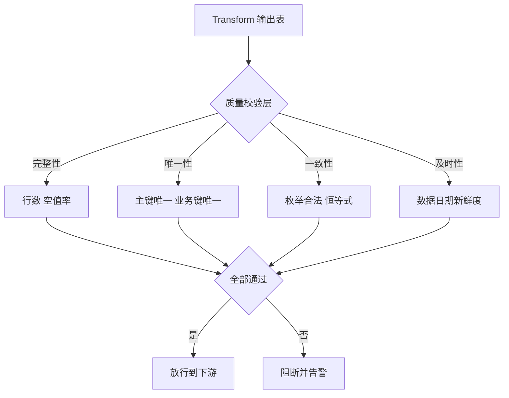

---

### Q338 · 幂等数据导入

> 难度:★★★ | 标签:幂等, 数据库

**问**:什么是幂等导入?同一批数据重复跑一遍,为什么结果必须一致?如何实现?

**答**:幂等指同一输入重复执行,产生的最终状态不变——这是数据管道可重跑的基础,否则失败重试会翻倍数据。实现手段:①数据库层用唯一键 + upsert(INSERT ... ON CONFLICT/ON DUPLICATE KEY);②文件层先写 `dataset/date=.../part.tmp` 再原子 rename,重跑直接覆盖同一路径;③导入前按"源表 + 数据日期 + 校验和"查重,相同批次直接跳过。禁止用自增 ID 或"运行时间"作为主键的一部分,那是幂等的头号杀手。

```python
# file: code/05_数据分析与工程化/q338_idempotent_load.py
import hashlib
import json
import os

DST = "dim_user.json"
STATE = "load_state.json"

def row_key(row):
    """以业务键 + 内容指纹为唯一键,与运行时间无关。"""
    digest = hashlib.md5(json.dumps(row, sort_keys=True).encode()).hexdigest()
    return f"{row['uid']}-{digest}"

def upsert(rows, state):
    """标准库模拟 upsert:同 key 覆盖,重跑结果不变。"""
    store = {}
    if os.path.exists(state):
        store = json.load(open(state))
    before = len(store)
    for r in rows:
        store[row_key(r)] = r          # 幂等:重复导入只覆盖
    json.dump(store, open(state, "w"))
    return before, len(store)

if __name__ == "__main__":
    rows = [{"uid": 1, "name": "a"}, {"uid": 2, "name": "b"}]
    upsert(rows, STATE)
    r1 = json.load(open(STATE)) if os.path.exists(STATE) else {}
    upsert(rows, STATE)                # 再跑一遍
    r2 = json.load(open(STATE))
    assert r1 == r2, "必须幂等"
    print("idempotent ok, rows =", len(r2))
    os.remove(STATE)
```

**追问**:
- 为什么「运行时间」当主键破坏幂等?——重跑时间不同主键就不同,同批数据出现两份;主键必须来自业务(数据日期+业务键)。
- upsert 的并发冲突怎么处理?——唯一键约束 + ON CONFLICT 原子语义;应用层「先查再插」在并发下必重复。
- 文件管道的幂等怎么设计?——固定输出路径(分区+批次),先写 tmp 再原子 rename;重跑覆盖同路径,天然幂等。

---

### Q339 · 增量与全量更新策略

> 难度:★★★ | 标签:增量同步, 数据仓库

**问**:目标表更新用全量刷还是增量追?如何选择和实现增量?

**答**:选择依据:表大小与变更比例。小维表直接全量覆盖(简单可靠);大事实表用增量——基于更新时间戳水位(CDC)、自增 ID、或源库 binlog 捕获变更。实现要点:水位存在独立的元数据表,处理成功后才推进水位(先处理后提交,避免丢数);增量必须容忍乱序与重复,下游以唯一键 upsert 兜底。周期性做一次全量对账,弥补增量遗漏,这是生产上"增量为主、全量兜底"的标准组合。

```python
# file: code/05_数据分析与工程化/q339_incremental.py
import json
import os

STATE = "watermark.json"

def read_watermark(default="1970-01-01T00:00:00"):
    if os.path.exists(STATE):
        return json.load(open(STATE)).get("watermark", default)
    return default

def fetch_incremental(source_rows, watermark):
    """模拟按更新时间拉增量,生产上对应 SQL: WHERE updated_at > watermark"""
    return sorted(
        [r for r in source_rows if r["updated_at"] > watermark],
        key=lambda r: r["updated_at"],
    )

def apply_upsert(rows, table):
    for r in rows:
        table[r["id"]] = r             # 唯一键 upsert 兜底乱序重复

if __name__ == "__main__":
    source = [
        {"id": 1, "updated_at": "2026-11-01T01:00:00"},
        {"id": 2, "updated_at": "2026-11-01T02:00:00"},
        {"id": 1, "updated_at": "2026-11-01T03:00:00"},   # 同键更新
    ]
    table = {}
    wm = read_watermark()
    inc = fetch_incremental(source, wm)
    apply_upsert(inc, table)
    if inc:                             # 处理成功后才推进水位
        new_wm = inc[-1]["updated_at"]
        json.dump({"watermark": new_wm}, open(STATE, "w"))
    print("rows:", table, "watermark:", read_watermark())
    os.remove(STATE)
```

**追问**:
- 增量水位的三种来源怎么选?——更新时间戳最简单但要源表维护索引;binlog CDC 最可靠但引入订阅组件;自增 ID 只能捕捉新增捕捉不了更新。
- 乱序与重复为什么必然出现?——源库时钟漂移、重试、分区并行;所以下游一律唯一键 upsert,不假设顺序。
- 全量对账怎么做?——周期性对比源与目标的关键指标(行数、校验和、金额合计),差异进入修复队列;增量遗漏靠它兜底。

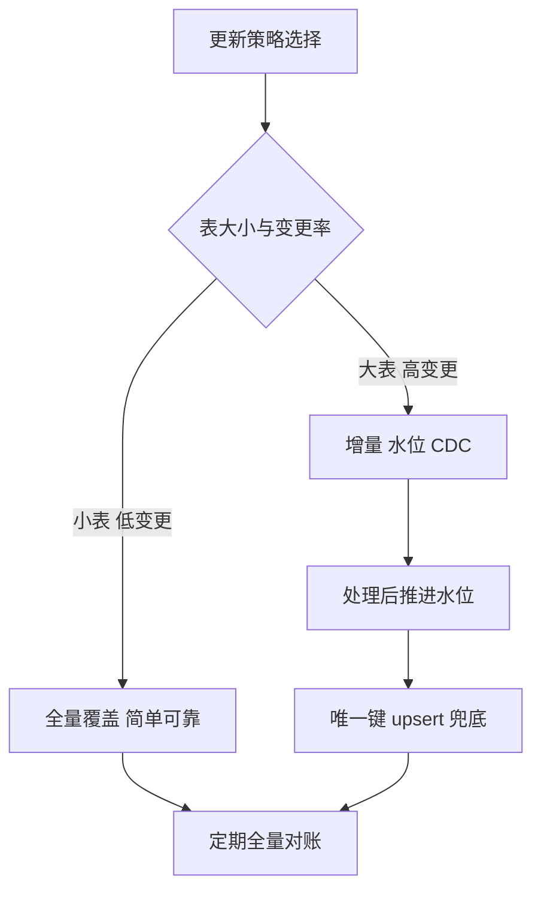

---

### Q340 · Excel / CSV 导入导出健壮性

> 难度:★★☆ | 标签:csv, 编码, 脏行

**问**:导入外部 CSV 时常见哪些坑?如何写出健壮的导入代码?

**答**:高频坑:编码(GBK vs UTF-8,先用 chardet/file 命令探测或逐个尝试)、脏行(字段数不对、引号未闭合、混入小计行)、类型污染(同一列混有 "1,000" 千分位、"N/A" 文本)、大文件内存、以及 Excel 的日期自动转换篡改数据。健壮做法:csv 模块显式指定 encoding 和 quoting、逐行校验字段数并把坏行写入 reject 文件而不是中断、数值解析统一走 `to_numeric(errors="coerce")` 后检查 coerce 数量、导出时用 `utf-8-sig` 兼容 Excel 打开。

```python
# file: code/05_数据分析与工程化/q340_csv_robust.py
import csv
import os
import tempfile

def robust_import(path, expect_cols=2):
    good, bad = [], []
    with open(path, newline="", encoding="utf-8") as f:
        reader = csv.reader(f)
        header = next(reader)
        for lineno, row in enumerate(reader, start=2):
            if len(row) != expect_cols:          # 脏行进 reject,不中断
                bad.append((lineno, row))
                continue
            try:
                amt = float(row[1].replace(",", ""))   # 处理千分位
            except ValueError:
                bad.append((lineno, row))
                continue
            good.append((row[0], amt))
    return good, bad

def export_csv(path, rows):
    with open(path, "w", newline="", encoding="utf-8-sig") as f:  # Excel 兼容
        w = csv.writer(f)
        w.writerow(["city", "amt"])
        w.writerows(rows)

if __name__ == "__main__":
    # 演示文件放临时目录,避免污染当前工作目录
    tmpdir = tempfile.mkdtemp()
    dirty_path = os.path.join(tmpdir, "dirty.csv")
    clean_path = os.path.join(tmpdir, "clean.csv")
    with open(dirty_path, "w", newline="", encoding="utf-8") as f:
        f.write("city,amt\nBJ,1,000\nSH,20\nSZ\nBJ,30\n")
    good, bad = robust_import(dirty_path)
    print("good:", good)
    print("bad lines:", bad)
    export_csv(clean_path, good)
    os.remove(dirty_path); os.remove(clean_path)
    os.rmdir(tmpdir)
```

**追问**:
- pandas 里如何拿到坏行?没有直接参数,思路是先用 `on_bad_lines="skip"` 粗导,再与逐行校验的结果做差集定位坏行,或干脆用 csv 模块预清洗。
- utf-8-sig 解决什么?——Excel 打开 UTF-8 CSV 中文乱码,BOM 头让 Excel 识别编码;导出给 Excel 用户必带。
- 千分位与货币符号怎么清洗?——`str.replace(',','')` 后 to_numeric(errors='coerce'),并统计 coerce 出的 NaT/NaN 数量验证清洗率。
- Excel 日期篡改怎么防?——「1-2」被转日期、长数字转科学计数;模板列设文本格式,或改用 CSV 交付关键数据。
### Q341 · 数据脱敏

> 难度:★★★ | 标签:脱敏, 安全

**问**:数据分析中如何处理手机号、身份证等敏感字段?有哪些脱敏手段?

**答**:按用途分级:展示层用掩码(手机号 `138****1234`),分析层用确定性哈希(sha256+盐)保留可 join 性但不可逆,统计层干脆丢弃原始标识只保留聚合结果。工程纪律:脱敏必须发生在数据离开受控环境之前(导出、给第三方、进测试库都算),而不是靠下游自觉;脱敏函数集中实现并写单测,禁止在 notebook 里临时手写;盐值走环境变量,绝不入库入代码。

```python
# file: code/05_数据分析与工程化/q341_data_masking.py
import hashlib
import os

SALT = os.environ.get("MASK_SALT", "dev-only-salt")

def mask_phone(phone):
    """展示用掩码:保留前 3 后 4。"""
    s = str(phone)
    return s[:3] + "****" + s[-4:] if len(s) == 11 else "invalid"

def hash_id(id_no):
    """分析用确定性哈希:同输入同输出,可 join 不可逆。"""
    return hashlib.sha256((SALT + str(id_no)).encode()).hexdigest()[:16]

def mask_name(name):
    return name[0] + "**" if name else name

if __name__ == "__main__":
    users = [{"phone": "13812345678", "name": "王大力", "cid": "110101199001011234"}]
    masked = [{**u,
               "phone": mask_phone(u["phone"]),
               "name": mask_name(u["name"]),
               "cid": hash_id(u["cid"])} for u in users]
    assert masked[0]["cid"] == hash_id("110101199001011234")  # 可复现可 join
    print(masked)
```

**追问**:
- 哈希脱敏为什么加盐?——手机号、身份证的值域有限,不加盐可被彩虹表反查;盐进环境变量统一管理,不能硬编码。
- 测试环境数据怎么来?——生产数据脱敏快照或合成数据;直接复制生产库到测试环境是合规事故,不算「图省事」。
- 脱敏的可 join 性怎么保留?——确定性哈希同值同哈希,跨表仍能关联;掩码则破坏 join,只用于展示。

---

### Q342 · 特征工程基础:分箱、独热、滞后特征

> 难度:★★★ | 标签:特征工程, pandas

**问**:用 pandas 做特征工程,分箱、独热编码和滞后特征分别怎么实现?要注意什么?

**答**:分箱用 `pd.cut`(等宽/自定义边界)或 `pd.qcut`(等频),优先 qcut 避免某箱样本过少;独热用 `pd.get_dummies`,生产上要注意训练/推理的类别集合一致,建议保存类别清单对齐;滞后特征用 `groupby().shift(n)`,必须按时间排序后组内 shift,且注意前 n 行是 NaN,严防"用未来数据"造成的特征泄露。三类操作都应封装成可复用的转换函数,输入输出 DataFrame,方便进管道测试。

```python
# file: code/05_数据分析与工程化/q342_feature_eng.py
try:
    import pandas as pd
    import numpy as np
    PANDAS = True
except ImportError:
    PANDAS = False

def build_features(df):
    # 分箱:等频分 3 档
    df["amt_bin"] = pd.qcut(df["amt"], q=3, labels=["low", "mid", "high"])
    # 独热
    df = pd.get_dummies(df, columns=["city"], prefix="city")
    # 滞后特征:按用户按时间组内 shift,防泄露
    df = df.sort_values(["uid", "ts"])
    df["amt_prev"] = df.groupby("uid")["amt"].shift(1)
    df["amt_diff"] = df["amt"] - df["amt_prev"]
    return df

if __name__ == "__main__":
    if PANDAS:
        df = pd.DataFrame({
            "uid": [1, 1, 2, 2, 1],
            "ts": pd.to_datetime(["2026-01-01", "2026-01-02",
                                  "2026-01-01", "2026-01-02", "2026-01-03"]),
            "city": ["BJ", "BJ", "SH", "SH", "BJ"],
            "amt": [10.0, 30.0, 20.0, 25.0, 50.0],
        })
        print(build_features(df))
    else:
        print("标准库思路:排序后用 zip(cur, prev) 构造滞后列,分箱用边界列表判断")
```

**追问**:
- 特征泄露的典型场景?——按时间排序后整表 shift(组间串数据)、用了未来统计量(全量均值、目标编码);train/valid 集成时先切时间再算特征。
- get_dummies 训练/推理类别不一致怎么办?——保存训练类别清单,推理时 reindex 对齐补 0;sklearn 的 OneHotEncoder(handle_unknown='ignore') 内置此逻辑。
- qcut 和 cut 怎么选?——希望每箱样本均衡用 qcut(等频);业务边界明确(年龄段)用 cut 自定义 bins;分箱边界要保存进模型产物。

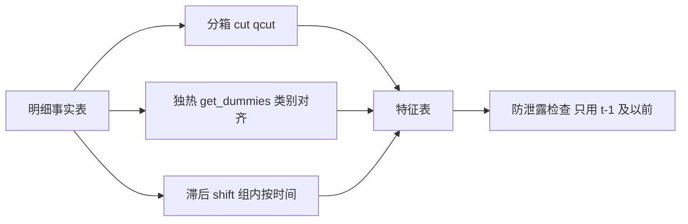

---

### Q343 · 描述统计与相关性陷阱

> 难度:★★★ | 标签:统计, 相关性

**问**:皮尔逊相关系数有哪些使用陷阱?如何更稳健地评估变量关系?

**答**:主要陷阱:①相关只度量线性关系,曲线关系(如 U 形)可能算出接近 0;②对异常值极其敏感,一个离群点就能凭空造出强相关;③不适用于类别变量;④相关不等于因果,可能存在混杂变量或伪相关。稳健做法:先画散点图看形状,同时看 Pearson(线性)与 Spearman(秩相关,抗异常值),必要时分组看相关是否稳定;Anscombe 四重奏证明"均值、方差、相关系数都相同的四组数据形态可以完全不同",统计量必须配合可视化。

```python
# file: code/05_数据分析与工程化/q343_correlation.py
try:
    import pandas as pd
    import numpy as np
    PANDAS = True
except ImportError:
    PANDAS = False

def demo_pandas():
    rng = np.random.default_rng(0)
    x = np.linspace(0, 10, 100)
    y_curve = (x - 5) ** 2 + rng.normal(0, 2, 100)   # U 形关系
    df = pd.DataFrame({"x": x, "y": y_curve})
    print("pearson:", round(df["x"].corr(df["y"]), 3),
          "| spearman:", round(df["x"].corr(df["y"], method="spearman"), 3))
    # 异常值敏感性
    a = rng.normal(0, 1, 100)
    b = rng.normal(0, 1, 100)
    b[0] += 50                                        # 一个离群点
    print("with outlier:", round(np.corrcoef(a, b)[0, 1], 3))
    b[0] -= 50
    print("without:", round(np.corrcoef(a, b)[0, 1], 3))

if __name__ == "__main__":
    if PANDAS:
        demo_pandas()
    else:
        print("标准库思路:手写 Pearson 公式;Spearman 先转秩再做 Pearson")
```

**追问**:
- 什么是辛普森悖论?分组内相关方向与合并后相反,说明看聚合相关前必须检查分组结构,漏掉分组变量会得出反结论。
- Pearson 和 Spearman 怎么互补?——前者线性、后者单调秩相关抗异常值;两者差异大说明存在非线性或离群点。
- 伪相关的根源?——共同趋势(都随时间增长)或混杂变量;去趋势、分组内相关、控制变量后再看。
- 为什么不看统计量也要画图?——Anscombe 四重奏:统计量相同形态完全不同;散点图是最便宜的证伪工具。
### Q344 · A/B 测试基础与样本量估算

> 难度:★★★ | 标签:A/B 测试, 实验

**问**:A/B 实验上线前如何估算样本量?实验要跑多久怎么看?

**答**:样本量由四要素决定:基线转化率、最小可检测提升(MDE)、显著性水平 α(通常 0.05)与功效 1-β(通常 0.8)——提升越小所需样本越大,近似公式 n ≈ 16·p(1-p)/δ²(双侧 α=0.05、power=0.8 的粗算)。实验时长 = 所需样本量 ÷ 日流量,且必须覆盖完整周期(至少一周,避免工作日/周末效应)。实验纪律:先算样本再开跑、不要中途偷看结果就停(p-hacking)、一个实验一个主指标、流量分桶要用哈希保证用户稳定归属(注意 Python 内置 hash() 对字符串加盐,跨进程会漂移,应用 sha256 等稳定摘要)。代码中的两比例近似公式分母必须含 δ²=(p2-p1)²,漏掉会把样本量低估约 2.9 万倍。

```python
# file: code/05_数据分析与工程化/q344_ab_sample_size.py
import math

def sample_size(p_baseline, mde, alpha=0.05, power=0.8):
    """两比例检验样本量(每组),正态近似。
    生产上用 statsmodels.stats.power 或现成计算器精确计算。"""
    p2 = p_baseline * (1 + mde)
    p_bar = (p_baseline + p2) / 2
    z_alpha = 1.96 if alpha == 0.05 else 2.58      # 双侧
    z_beta = {0.8: 0.84, 0.9: 1.28}[power]
    n = (z_alpha * math.sqrt(2 * p_bar * (1 - p_bar))
         + z_beta * math.sqrt(p_baseline * (1 - p_baseline) + p2 * (1 - p2))) ** 2
    return math.ceil(n / (p2 - p_baseline) ** 2)   # 必须除以 δ²,漏掉会低估约 2.9 万倍

if __name__ == "__main__":
    p0, mde, daily = 0.10, 0.05, 2000     # 基线 10%,相对提升 5%,日流量 2000/组
    n = sample_size(p0, mde)
    days = math.ceil(n / daily)
    print(f"每组需 {n} 样本, 约需 {days} 天")
    assert days > 0
```

**追问**:
- 为什么实验至少跑一周?——覆盖工作日/周末的行为差异与星期效应;只跑两天的新功能实验结论几乎必然失真。
- p-hacking 的典型表现?——每天偷看显著性、轻微不显著就停、一次实验测几十个指标挑显著的;解法是预注册主指标与固定样本量。
- 分桶为什么要用哈希而不是随机?——同一用户每次实验要稳定落在同组,随机数做不到;`hash(user_id, salt) % 100` 保证一致性。

---

### Q345 · 数据管道测试:断言驱动

> 难度:★★★ | 标签:测试, pytest

**问**:数据转换代码怎么写测试?和普通单元测试有什么不同?

**答**:核心是把"预期数据"当作断言对象:构造小的输入 DataFrame,断言输出行数、关键列值、边界情况(空输入、重复键、缺失值)。分两层:单元测试针对纯转换函数(不连数据库,毫秒级),集成测试针对管道端到端(用固定样例数据集或临时 sqlite 容器)。数据测试的特有断言:模式(schema)匹配、指标恒等式、与上一版本的行数漂移阈值。配合 Great Expectations/pandera 可把断言变成声明式契约,但手写 pytest 断言足以覆盖大部分场景。

```python
# file: code/05_数据分析与工程化/q345_pipeline_test.py
"""用 pytest 风格编写数据转换测试(可 python 345_pipeline_test.py 直接跑)。"""
try:
    import pandas as pd
    PANDAS = True
except ImportError:
    PANDAS = False

def transform(df):
    df = df.copy()
    df["total"] = df["price"] * df["qty"]
    return df[df["total"] > 0]

def test_transform_basic():
    df = pd.DataFrame({"price": [2.0, -1.0], "qty": [3, 5]})
    out = transform(df)
    assert len(out) == 1                  # 负金额被过滤
    assert out["total"].iloc[0] == 6.0

def test_transform_empty():
    df = pd.DataFrame({"price": [], "qty": []})
    assert transform(df).empty            # 空输入不抛错

if __name__ == "__main__":
    if PANDAS:
        test_transform_basic()
        test_transform_empty()
        print("all tests passed")
    else:
        print("需 pandas 演示;标准库可用 dict 列表 + 断言函数替代")
```

**追问**:
- 转换函数怎么做到可单测?——纯函数化:输入输出都是 DataFrame,不读库不读配置;配置作为参数显式传入。
- schema 漂移怎么断言?——列集合与 dtype 快照对比(或 pandera schema);上游悄悄改列名是下游事故的头号来源。
- 边界用例必须覆盖哪些?——空输入、单行、重复键、全空列、时间边界(月末/闰年);这些在真实数据里迟早出现。

---

### Q346 · Parquet 格式的优势

> 难度:★★★ | 标签:parquet, 存储

**问**:为什么数仓和分析场景偏爱 Parquet 而不是 CSV?列出关键技术优势。

**答**:Parquet 是列式存储 + 自描述 schema 的二进制格式。优势:①列式读取,查几列只解压几列,配合谓词下推和 row group 统计信息可跳过无关数据块;②内置压缩(通常比 CSV 小 5-10 倍)与编码(RLE/dictionary);③保留类型信息(int64/datetime/decimal),不存在 CSV 的类型解析歧义;④生态通用,Spark/DuckDB/Polars/pandas 直接读写。工程建议:分析型中间数据一律 parquet,CSV 只留给对外交付;大表按分区键(如 date)写分区目录。

```python
# file: code/05_数据分析与工程化/q346_parquet_advantage.py
import json
import os

def write_csv_like(rows, path):
    """模拟 CSV:全文本、无类型。"""
    with open(path, "w") as f:
        for r in rows:
            f.write(",".join(str(v) for v in r.values()) + "\n")

if __name__ == "__main__":
    try:
        import pandas as pd
        df = pd.DataFrame({"id": [1, 2, 3],
                           "ts": pd.to_datetime(["2026-01-01"] * 3),
                           "amt": [1.5, 2.5, 3.5]})
        df.to_parquet("demo.parquet")          # 需 pyarrow
        back = pd.read_parquet("demo.parquet", columns=["id", "amt"])  # 列裁剪
        print(back.dtypes.to_dict(), back.shape)   # 类型无损
        os.remove("demo.parquet")
    except ImportError:
        rows = [{"id": 1, "ts": "2026-01-01", "amt": 1.5}]
        write_csv_like(rows, "demo.csv")
        print("CSV 无类型:读到的都是字符串,需要重新解析")
        print(open("demo.csv").read())
        os.remove("demo.csv")
```

**追问**:
- 谓词下推在 Parquet 里怎么生效?——row group 统计信息(min/max)让引擎跳过整块数据;按 date 分区 + 排序写入能放大这个收益。
- 小文件问题怎么治理?——定时 compaction 合并,写入按分区攒批;小文件会让元数据与调度开销爆炸。
- CSV 转 Parquet 要注意什么?——显式指定 schema(避免类型推断歧义)、处理空值表示、压缩选 snappy(均衡)或 zstd(更小)。

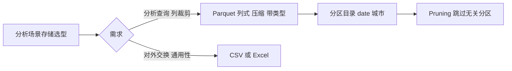

---

### Q347 · 数据版本与血缘

> 难度:★★★ | 标签:数据治理, lineage

**问**:什么是数据血缘?表数据本身如何做版本管理?

**答**:血缘记录"这张表由哪些上游表/代码/参数在什么时候产出",用途:故障影响面分析(上游改字段, downstream 一键定位)、数据可信度追溯、以及重跑范围圈定。实现层级:任务级血缘靠调度系统 DAG 自动生成;表级/字段级靠 SQL 解析工具(如 sqlglot)或平台采集。数据版本管理:不可变分区(`table/date=2026-11-01/`)天然是日级版本,批内多版本用 `_batch=批次号` 目录;配合记录每次产出的元数据(代码 git commit、输入校验和、行数),任何一份历史数据都能复现。

```python
# file: code/05_数据分析与工程化/q347_lineage.py
import json
import os

def record_lineage(meta_path, table, inputs, code_version, rows):
    """每次产出追加一条血缘记录:谁、依赖什么、什么代码、产出多少。"""
    records = []
    if os.path.exists(meta_path):
        records = json.load(open(meta_path))
    records.append({"table": table, "inputs": inputs,
                    "code_version": code_version, "rows": rows})
    json.dump(records, open(meta_path, "w"), indent=2)
    return records

def downstream(records, table):
    """反向追踪:哪些表直接依赖了 table。"""
    return [r["table"] for r in records if table in r["inputs"]]

if __name__ == "__main__":
    meta = "lineage.json"
    record_lineage(meta, "dws_user_day", ["ods_order", "ods_user"], "git#abc123", 1000)
    record_lineage(meta, "ads_rpt", ["dws_user_day"], "git#abc123", 30)
    records = json.load(open(meta))
    print("downstream of dws_user_day:", downstream(records, "dws_user_day"))
    os.remove(meta)
```

**追问**:
- 字段级血缘为什么难?——需要解析 SQL 表达式与 SELECT 别名,sqlglot 这类解析器方言支持有限;字段级通常在平台侧采集兜底。
- 重跑范围怎么圈?——沿血缘反向找受影响下游,正向找受影响上游;没有血缘的团队只能「全部重跑」,代价差一个量级。
- 元数据要记哪些?——代码版本、输入分区与校验和、输出行数、运行时间、参数;五元组齐了任何历史结果都能复现。

---

### Q348 · 指标口径管理

> 难度:★★★ | 标签:指标, 治理

**问**:为什么"GMV 对不上"是数据团队的经典事故?如何治理指标口径?

**答**:根因是同一指标名有多个实现:GMV 是否含退款、是否含运费、按下单时间还是支付时间——各报表各写一遍 SQL,必然对不上。治理手段:①指标字典:指标名、业务定义、计算公式、维度、负责人、变更记录集中登记;②口径代码化:核心指标封装成统一函数/SQL 片段或语义层(dbt metrics、metrics store),报表只引用不重写;③变更流程:口径修改必须评审并通知所有下游。面试要点:口径问题本质是组织问题,技术方案(语义层)只是把共识固化下来。

```python
# file: code/05_数据分析与工程化/q348_metric_registry.py
try:
    import pandas as pd
    PANDAS = True
except ImportError:
    PANDAS = False

# 指标字典:定义与实现绑定,消费方只调函数不写 SQL
METRIC_REGISTRY = {
    "gmv_paid": {
        "desc": "支付成功订单金额之和, 不含退款",
        "impl": lambda df: df.loc[df["status"] == "paid", "amount"].sum(),
    },
    "gmv_created": {
        "desc": "全部下单金额, 含未支付与退款",
        "impl": lambda df: df["amount"].sum(),
    },
    "refund_rate": {
        "desc": "退款金额 占 gmv_paid 比例",
        "impl": lambda df: (df.loc[df["status"] == "refunded", "amount"].sum()
                            / METRIC_REGISTRY["gmv_paid"]["impl"](df)),
    },
}

def compute(df, metric):
    return METRIC_REGISTRY[metric]["impl"](df)

if __name__ == "__main__":
    if PANDAS:
        df = pd.DataFrame({"status": ["paid", "created", "refunded"],
                           "amount": [100.0, 20.0, 10.0]})
        for m in METRIC_REGISTRY:
            print(m, "=", round(compute(df, m), 4))
    else:
        print("标准库思路:字典存定义与 lambda,同样可实现统一口径")
```

**追问**:
- 指标口径冲突的信号?——两份报表同名指标对不上且都能自圆其说;治理从「指认唯一负责人」开始,技术其次。
- 语义层解决什么?——把口径写一次、处处引用(dbt metrics/Headless BI);报表 SQL 不再各自实现 GMV。
- 口径变更的流程?——评审影响面(血缘列下游)→ 双跑对照一个周期 → 通知下游切换 → 记录变更日志;直接改是事故源。

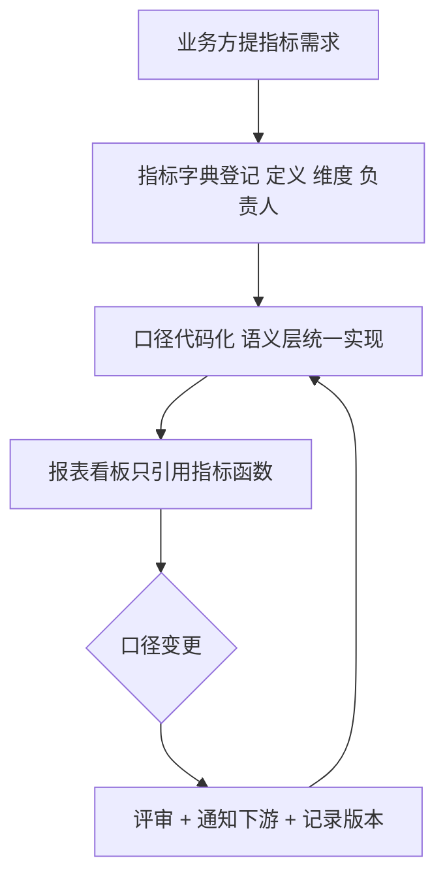

---

### Q349 · 调度系统 Airflow 概念与任务编排

> 难度:★★★ | 标签:Airflow, 调度

**问**:Airflow 的核心概念有哪些?设计 DAG 时要注意什么?

**答**:核心概念:DAG(工作流)、Task(节点)、Operator(任务类型)、依赖关系(`>>`)、schedule 与数据间隔、execution_date/逻辑日期。设计要点:①任务粒度适中,一个 task 一个职责,失败可单独重跑;②依赖显式声明,避免用 sleep 凑时序;③任务保持幂等,重跑安全是调度的前提;④execution_date 是"数据日期"而非运行时间,回填 backfill 依赖这一点;⑤避免在 DAG 文件里做重计算,DAG 定义要秒级解析。这些原则同样适用于其他调度器(DolphinScheduler、Argo)。

```python
# file: code/05_数据分析与工程化/q349_scheduler_dag.py
"""概念级 DAG 演示:用标准库表达 依赖 + 幂等任务 + 逻辑日期,
生产上对应 Airflow 的 DAG 定义。"""
from dataclasses import dataclass, field

@dataclass
class Task:
    task_id: str
    fn: callable
    upstream: list = field(default_factory=list)

class Dag:
    def __init__(self, dag_id, execution_date):
        self.dag_id = dag_id
        self.execution_date = execution_date   # 逻辑日期,即数据日期
        self.tasks = {}

    def add(self, task):
        self.tasks[task.task_id] = task
        return self

    def run(self):
        done = {}
        def visit(tid):
            if tid in done:
                return done[tid]
            t = self.tasks[tid]
            for up in t.upstream:              # 依赖先行
                visit(up)
            done[tid] = t.fn(self.execution_date)
            return done[tid]
        for tid in self.tasks:
            visit(tid)
        return done

def extract(date): return f"raw@{date}"
def transform(date): return f"clean@{date}"
def load(date): return f"loaded@{date}"

if __name__ == "__main__":
    dag = Dag("user_etl", "2026-11-01")
    dag.add(Task("extract", extract))
    dag.add(Task("transform", transform, ["extract"]))
    dag.add(Task("load", load, ["transform"]))
    print(dag.run())
```

**追问**:
- execution_date 为什么容易理解错?——它是数据日期(区间左端)不是运行时间;每日任务在次日跑,execution_date 是前一天,回填逻辑全靠它。
- 怎么避免用 sleep 凑时序?——显式声明依赖 `upstream >> downstream`;外部系统就绪用 sensor 而不是猜时间。
- DAG 文件为什么要秒级解析?——调度器周期性解析所有 DAG 文件,文件里的重计算会拖垮调度循环;重活放 task 内。

---

### Q350 · 行为日志埋点设计

> 难度:★★★ | 标签:埋点, 数据采集

**问**:设计一套用户行为埋点方案,要考虑哪些字段和工程问题?

**答**:事件模型采用"who-when-where-what":公共字段(user_id/匿名 ID、时间戳、设备与 app 版本、会话 ID、SDK 采集的服务端时间)+ 事件专有字段(事件名、页面、元素、参数)。工程要点:①客户端时间不可信,以服务端接收时间兜底并记录偏差;②事件名与参数 schema 化管理,防止埋点自由发挥;③埋点分级(P0/P1)控制成本;④上报走批量 + 失败重试 + 本地缓存,网络差时不能丢事件;⑤唯一事件 ID 去重,防止重试导致重复计数。

```python
# file: code/05_数据分析与工程化/q350_event_tracking.py
import json
import uuid
from datetime import datetime, timezone

REQUIRED_PUBLIC = ["event_id", "user_id", "event_name", "client_ts", "server_ts"]

def build_event(user_id, event_name, props):
    now = datetime.now(timezone.utc).isoformat()
    return {
        "event_id": str(uuid.uuid4()),     # 唯一 ID,服务端去重依据
        "user_id": user_id,
        "event_name": event_name,
        "client_ts": props.get("client_ts", now),
        "server_ts": now,                  # 服务端时间为准
        "props": props,                    # schema 校验后入库
    }

def validate(ev):
    missing = [k for k in REQUIRED_PUBLIC if not ev.get(k)]
    return not missing, missing

if __name__ == "__main__":
    ev = build_event("u1", "page_view",
                     {"page": "home", "client_ts": "2026-11-01T10:00:00+08:00"})
    ok, missing = validate(ev)
    assert ok
    print(json.dumps(ev, ensure_ascii=False, indent=2))
```

**追问**:
- 客户端时间和服务端时间怎么取舍?——以服务端接收时间为准排序,客户端时间做参考并记录偏差;设备改时间会让纯客户端排序错乱。
- 埋点 schema 怎么管理?——事件字典(名称、参数、类型、负责人、版本)评审入库,上报前校验;自由发挥的埋点等于不可用。
- 重试导致重复事件怎么去重?——每事件生成唯一 UUID,服务端按 ID 去重;批量上报失败重试是常态,不去重数据必然虚高。

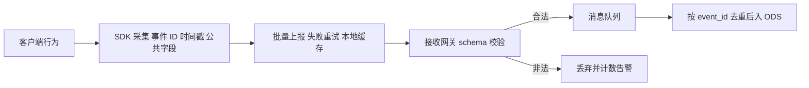

---

### Q351 · 漏斗与留存分析思路

> 难度:★★★ | 标签:分析, 漏斗

**问**:如何用 SQL/Python 思路做转化漏斗和次日留存?

**答**:漏斗:按用户聚合各步骤的最早完成时间,要求步骤严格按序发生(browse → cart → pay),任一步缺失即断点;注意"步骤间窗口期"(如 30 分钟内)要用时间差过滤,否则漏斗会虚高。留存:以首日为锚(cohort),统计后续第 N 日是否仍有活跃,输出 cohort 三角表;关键决策是活跃的定义(打开?核心行为?)——口径不同结论可以完全相反。两者都以用户 + 日期为基本颗粒,先算用户级事件序列再聚合,不要直接在明细上数次数。

```python
# file: code/05_数据分析与工程化/q351_funnel_retention.py
from collections import defaultdict
from datetime import date, timedelta

def funnel(events, steps):
    """events: user -> 有序列表 of (date, step)。按序且窗口内才算。"""
    counts = [0] * len(steps)
    for user, evs in events.items():
        idx = 0
        step_dates = []
        for d, s in sorted(evs):
            if idx < len(steps) and s == steps[idx]:
                step_dates.append(d)
                idx += 1
        if len(step_dates) == len(steps):
            counts = [c + 1 for c in counts]
        else:
            for i in range(len(step_dates)):
                counts[i] += 1
    return {steps[i]: counts[i] for i in range(len(steps))}

def next_day_retention(first_login, active_days):
    """first_login: user -> date; active_days: user -> set of dates"""
    buckets = defaultdict(lambda: [0, 0])   # cohort -> [new_users, retained]
    for u, d0 in first_login.items():
        key = d0
        buckets[key][0] += 1
        if (d0 + timedelta(days=1)) in active_days.get(u, set()):
            buckets[key][1] += 1
    return {k: round(v[1] / v[0], 3) for k, v in buckets.items()}

if __name__ == "__main__":
    d1, d2 = date(2026, 11, 1), date(2026, 11, 2)
    events = {"u1": [(d1, "browse"), (d1, "cart"), (d1, "pay")],
              "u2": [(d1, "browse"), (d1, "pay")]}   # 跳过 cart,漏斗断裂
    print(funnel(events, ["browse", "cart", "pay"]))
    print(next_day_retention(
        {"u1": d1, "u2": d1},
        {"u1": {d1, d2}, "u2": {d1}}))
```

**追问**:
- 漏斗步骤顺序如何保证?给每个用户的事件按时间排序后贪心匹配步骤序列,严格递增时间才算完成,不能简单 count distinct。
- 漏斗窗口期怎么实现?——步骤间时间差过滤(`t2 - t1 <= 30min`),否则跨天的浏览-支付也算转化,漏斗虚高。
- 留存的三种口径?——第 N 日活跃(精确)、第 N 日内累计、滚动活跃;汇报前先对齐口径,否则结论打架。
- cohort 三角表怎么读?——行=首日分组,列=第 N 日,对角线衰减形态反映产品黏性;列环比比绝对值更有意义。
### Q352 · RFM 用户分层

> 难度:★★☆ | 标签:分析, RFM

**问**:RFM 模型是什么?如何用 Python 实现用户分层?

**答**:RFM 用三个维度刻画用户:Recency(最近一次消费距今)、Frequency(消费频次)、Monetary(消费金额)。实现:先按用户聚合出 R/F/R 原始值,再各自打分(分位数分箱 1-5 分),最后按"高于/低于均值或阈值"映射到 8 个象限(重要价值客户、重要挽留客户等)输出运营策略。工程提醒:F/M 对低频业务要用"有购买行为的周期数"归一,新用户 R 极小但 F=1,不宜直接归为高价值,分层结果要落地到人群包并跟踪转化效果形成闭环。

```python
# file: code/05_数据分析与工程化/q352_rfm.py
from datetime import date

def rfm_score(orders, today=None):
    """orders: list of (uid, order_date, amount)"""
    today = today or date(2026, 11, 1)
    agg = {}
    for uid, d, amt in orders:
        r, f, m = agg.get(uid, (None, 0, 0.0))
        days = (today - d).days
        agg[uid] = (min(r, days) if r is not None else days,
                    f + 1, m + amt)
    # 打分:R 越小分越高,F/M 越大分越高(此处用固定阈值, 生产用分位数)
    result = {}
    for uid, (r, f, m) in agg.items():
        r_s = 3 if r <= 7 else (2 if r <= 30 else 1)
        f_s = 3 if f >= 3 else (2 if f >= 2 else 1)
        m_s = 3 if m >= 500 else (2 if m >= 100 else 1)
        seg = (r_s, f_s, m_s)
        label = {(3, 3, 3): "重要价值", (1, 1, 1): "流失",
                 (3, 1, 1): "新客户"}.get(seg, "一般")
        result[uid] = {"R": r, "F": f, "M": m, "score": seg, "label": label}
    return result

if __name__ == "__main__":
    orders = [("u1", date(2026, 10, 30), 600.0),
              ("u1", date(2026, 10, 25), 100.0),
              ("u2", date(2026, 6, 1), 30.0),
              ("u3", date(2026, 10, 31), 50.0)]
    for uid, info in rfm_score(orders).items():
        print(uid, info)
```

**追问**:
- R/F/M 打分为什么用分位数?——业务分布长尾,等宽分箱会把大多数用户挤进最低分;分位数保证每档人数均衡可比。
- 新用户怎么处理?——单独分层(new),R 极小但 F=1 不代表高价值;混进通用模型会被误判。
- 分层结果怎么验证有效?——A/B 对比不同层级的运营策略转化率;只分层不跟踪等于没做。

---

### Q353 · 时间序列平稳性与基线预测思路

> 难度:★★★ | 标签:时间序列, 预测

**问**:什么是时间序列的平稳性?不平稳怎么办?最简单的基线预测怎么做?

**答**:平稳性指均值、方差、自相关结构不随时间变化;判断用 ADF 单位根检验加肉眼看趋势与季节性。不平稳的常规处理:差分去趋势、对数/Box-Cox 去方差增长、季节差分去周期。基线预测必须先做:朴素法(用最近值)、季节朴素(用上一个周期同位置值)、移动平均——复杂的 SARIMA/Prophet/LSTM 必须证明自己显著打败基线才有意义。面试要点:先分解(趋势+季节+残差)再选模型;预测评估用滚动时间切分,绝不能随机打乱做 CV。

```python
# file: code/05_数据分析与工程化/q353_ts_baseline.py
def naive_forecast(series):
    """朴素基线:下一个值 = 最后一个值。"""
    return series[-1]

def seasonal_naive(series, period):
    """季节朴素:下一个值 = 上一个周期同位置的值。"""
    return series[-period]

def moving_average(series, window=7):
    return sum(series[-window:]) / window

def rolling_eval(series, period, predictor):
    """滚动时间切分评估:每次只用历史预测下一期。"""
    errors = []
    for i in range(period, len(series)):
        pred = predictor(series[:i], period) if predictor is seasonal_naive \
            else predictor(series[:i])
        errors.append(abs(series[i] - pred))
    return sum(errors) / len(errors)

if __name__ == "__main__":
    y = [100 + i * 2 for i in range(30)]      # 带趋势,不平稳
    diffs = [y[i] - y[i - 1] for i in range(1, len(y))]  # 一阶差分后近似平稳
    print("diff mean:", sum(diffs) / len(diffs), "diff var small -> near stationary")
    print("naive MAE:", round(rolling_eval(y, 7, naive_forecast), 2))
    print("ma7  MAE:", round(rolling_eval(y, 7, moving_average), 2))
```

**追问**:
- 为什么必须先做朴素基线?——它给出「不努力能到什么水平」的下限;复杂模型打不过季节朴素就说明特征工程有问题。
- 滚动时间切分怎么做?——train 固定起点、终点逐期右移,test 始终在 train 之后;随机 CV 会用未来预测过去,指标虚高。
- ADF 检验的局限?——对结构突变、方差非平稳不敏感;它只是证据之一,分解图和业务判断同样重要。

---

### Q354 · 报表自动化:从 SQL 到邮件/看板

> 难度:★★☆ | 标签:自动化, 报表

**问**:如何把一张每日人工报表做成自动化流水线?架构上分几步?

**答**:四步:①取数 SQL 固化并参数化数据日期,入库到结果表而不是直接算完就走;②渲染层把结果表填进模板(Excel/openpyxl 或 HTML),样式与口径与人工版对齐;③分发层邮件/IM 机器人推送,失败重试;④治理层:同口径的指标走统一函数,报表数据日期缺失时告警而不是发空表,关键数值加同比环比自动校验防止口径漂移。原则:报表自动化后要有"守护者",上游表结构变更必须触发检查。

```python
# file: code/05_数据分析与工程化/q354_auto_report.py
import csv
import os
from datetime import date

def fetch_metrics(data_date):
    """生产上为参数化 SQL 查询结果表;此处模拟。"""
    return [["gmv", 10000], ["uv", 800], ["pay_rate", 0.12]]

def render_csv(metrics, data_date, path):
    with open(path, "w", newline="", encoding="utf-8-sig") as f:
        w = csv.writer(f)
        w.writerow(["metric", "value", "date"])
        for name, val in metrics:
            w.writerow([name, val, data_date])

def validate(metrics):
    names = {m[0] for m in metrics}
    required = {"gmv", "uv", "pay_rate"}
    missing = required - names
    if missing:                        # 缺指标就告警,不发空表
        raise ValueError(f"missing metrics: {missing}")
    return True

if __name__ == "__main__":
    today = date.today().isoformat()
    metrics = fetch_metrics(today)
    validate(metrics)
    render_csv(metrics, today, f"report_{today}.csv")
    print("report ready:", f"report_{today}.csv")
    os.remove(f"report_{today}.csv")
```

**追问**:
- 报表自动化的守护机制?——数据日期缺失不发空表、关键指标同比环比异常告警、上游 schema 变更触发检查;自动化之后没人盯着才最危险。
- 为什么结果先入库再渲染?——入库可复用、可校验、可追溯;SQL 直接到 Excel 的链路一变全重写。
- 邮件报表的常见事故?——口径漂移没人发现(加自动校验)、上游断供发空表(阻断)、收件人越来越多无人核对(定期清理)。

---

### Q355 · 数据仓库分层 ODS / DWD / DWS / ADS

> 难度:★★★ | 标签:数仓, 分层

**问**:数仓为什么分层?各层职责是什么?

**答**:分层是为了解耦"采集、清洗、汇总、应用"的变化频率:ODS 原样落地源数据(不做清洗,保留现场);DWD 明细事实层,做清洗、去重、维度退化,一行一个业务事件;DWS 汇总层,按主题和常用粒度预聚合(用户日、商户日);ADS 应用层,直接服务报表和接口。价值:①下游只依赖稳定中间层,源表变更不扩散;②复用计算,避免烟囱式开发;③血缘清晰便于治理。反面模式是 ODS 直连 ADS 的"一条 SQL 到底",改口径时全场爆炸。

```python
# file: code/05_数据分析与工程化/q355_dw_layers.py
"""用纯函数模拟数仓分层:每层只依赖下一层,输入输出明确。"""

def ods_to_dwd(raw_rows):
    """清洗:去重 + 过滤非法,一行一个事件。"""
    seen, dwd = set(), []
    for r in raw_rows:
        key = (r["order_id"], r["uid"])
        if key in seen or r["amount"] <= 0:
            continue
        seen.add(key)
        dwd.append({"order_id": r["order_id"], "uid": r["uid"],
                    "amount": r["amount"], "dt": r["dt"]})
    return dwd

def dwd_to_dws(dwd_rows):
    """按用户按天汇总。"""
    agg = {}
    for r in dwd_rows:
        k = (r["uid"], r["dt"])
        amt, cnt = agg.get(k, (0.0, 0))
        agg[k] = (amt + r["amount"], cnt + 1)
    return [{"uid": u, "dt": d, "amt": a, "cnt": c} for (u, d), (a, c) in agg.items()]

def dws_to_ads(dws_rows):
    """应用层:直接可用的报表行。"""
    return sorted(dws_rows, key=lambda r: -r["amt"])[:3]

if __name__ == "__main__":
    raw = [{"order_id": 1, "uid": "u1", "amount": 100, "dt": "2026-11-01"},
           {"order_id": 1, "uid": "u1", "amount": 100, "dt": "2026-11-01"},
           {"order_id": 2, "uid": "u2", "amount": 50, "dt": "2026-11-01"}]
    dwd = ods_to_dwd(raw)
    dws = dwd_to_dws(dwd)
    ads = dws_to_ads(dws)
    print("ODS", len(raw), "-> DWD", len(dwd), "-> DWS", dws, "-> ADS", ads)
```

**追问**:
- ODS 为什么不做清洗?——保留现场供追溯与重放;清洗错误在 ODS 层可重放修复,清了就回不去了。
- DWS 和 ADS 的边界?——DWS 按主题与稳定粒度预聚合(用户日),ADS 面向具体报表;ADS 直连 ODS 的烟囱开发是反模式。
- 分层的代价是什么?——存储与链路变长、时效下降;所以实时需求走流式旁路,分层主要服务离线治理。

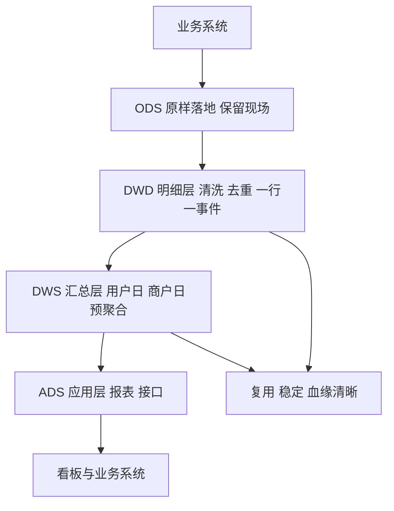

---

### Q356 · 维度表与事实表:星型模型

> 难度:★★☆ | 标签:数仓, 维度建模

**问**:什么是事实表和维度表?星型模型为什么是分析场景的主流?

**答**:事实表存业务事件(订单、点击),以度量(数值)为主、外键为辅,行数巨大;维度表存描述性属性(用户、商品、日期),行数小但列多。星型模型 = 一个事实表居中,维度表围绕,分析查询只需一层 join,SQL 直观、优化器友好。对比雪花模型(维度再规范化)虽然省冗余但 join 变多,分析场景一般不做;宽表模型(把维度拍平进事实表)查询最快但口径改动代价大,常作为 ADS 层的落地形式而非建模起点。

```python
# file: code/05_数据分析与工程化/q356_star_schema.py
try:
    import pandas as pd
    PANDAS = True
except ImportError:
    PANDAS = False

def demo_pandas():
    fact = pd.DataFrame({                       # 事实表:度量 + 外键
        "order_id": [1, 2, 3],
        "user_key": [10, 11, 10],
        "item_key": [100, 101, 100],
        "amount": [100.0, 50.0, 30.0],
    })
    dim_user = pd.DataFrame({"user_key": [10, 11],
                             "city": ["BJ", "SH"]})   # 维度表
    dim_item = pd.DataFrame({"item_key": [100, 101],
                             "category": ["book", "toy"]})
    # 星型模型典型查询:度量沿维度汇聚
    out = (fact.merge(dim_user, on="user_key")
               .merge(dim_item, on="item_key")
               .groupby("city")["amount"].sum())
    print(out)

if __name__ == "__main__":
    if PANDAS:
        demo_pandas()
    else:
        fact = [(1, 10, 100, 100.0), (2, 11, 101, 50.0), (3, 10, 100, 30.0)]
        dim_user = {10: "BJ", 11: "SH"}
        dim_item = {100: "book", 101: "toy"}
        agg = {}
        for _, u, i, amt in fact:
            agg[dim_user[u]] = agg.get(dim_user[u], 0) + amt
        print(agg)
```

**追问**:
- 事实表为什么避免允许空的外键?——空外键行在 join 维度时丢失;建「未知成员」行(-1/Unknown)是数仓惯例。
- 什么时候选宽表?——查询模式固定、性能敏感的 ADS/指标服务;建模期用星型,交付期拍宽。
- 雪花模型一定差吗?——维度本身巨大且层级复杂(如商品类目树)时规范化有价值;分析场景默认星型是性能取舍。

---

### Q357 · 慢变化维度 SCD

> 难度:★★★ | 标签:数仓, SCD

**问**:用户的收货地址改了,历史订单报表应该显示新地址还是旧地址?谈谈 SCD 的处理方式。

**答**:这就是慢变化维度问题。SCD Type 1 直接覆盖旧值,历史丢失,适合无关紧要属性;SCD Type 2 保留全历史:加 surrogate key、生效时间、失效时间、is_current 标志,事实表通过 surrogate key 关联到"事件发生时"的版本,回答"当时"的问题;SCD Type 3 只保留上一版,很少用。分析场景默认 Type 2;实现上用"每日快照对比 + 拉链表"最稳:字段有变才关旧开新,避免无意义的版本膨胀。

```python
# file: code/05_数据分析与工程化/q357_scd_type2.py
from datetime import date

def apply_scd2(dim_rows, current, new_state, eff_date):
    """拉链表:字段有变才关旧开新。current: uid -> row"""
    uid = new_state["uid"]
    old = current.get(uid)
    if old is None:
        new_state.update(eff_from=eff_date, eff_to=None, is_current=True)
        dim_rows.append(new_state)
    elif any(new_state[k] != old[k] for k in ("city",) ):
        old["eff_to"] = eff_date            # 关旧
        old["is_current"] = False
        new_state.update(eff_from=eff_date, eff_to=None, is_current=True)
        dim_rows.append(new_state)          # 开新
    current[uid] = new_state

if __name__ == "__main__":
    rows = []
    cur = {}
    apply_scd2(rows, cur, {"uid": 1, "city": "BJ"}, date(2026, 1, 1))
    apply_scd2(rows, cur, {"uid": 1, "city": "BJ"}, date(2026, 3, 1))  # 未变,不产生新版本
    apply_scd2(rows, cur, {"uid": 1, "city": "SH"}, date(2026, 6, 1))  # 变更,拉链
    for r in rows:
        print(r)
    assert len(rows) == 2, "未变更不应新增版本"
```

**追问**:
- 拉链表怎么写更新逻辑?——比较新旧记录:有变则关旧(open_end=昨天,is_current=0)、开新(open_start=今天);无变跳过,防版本膨胀。
- 「当时」的查询怎么写?——事实表的 surrogate key 直接关联;没走 surrogate key 而按业务键+日期区间过滤容易踩边界。
- Type 2 的成本是什么?——维度表膨胀、join 多一层;无关紧要的属性(如备注字段)变更不要触发拉链,挑选「影响分析的属性」。

---

### Q358 · 潮汐表与维度退化:日期维度

> 难度:★★☆ | 标签:数仓, 维度表

**问**:为什么事实表普遍关联一张日期维度表?日期维度通常放哪些字段?

**答**:日期维度把日历语义一次建成、处处复用:年/季度/月/周几、是否节假日、是否工作日、农历/促销期、期初末标记等。价值在于:①报表的"周同比、节假日效应"不用各处手写日期逻辑;②"自然周"的边界、调休这类坑统一在维度里维护;③按周/月聚合时 `join 维度 group by week_of_year` 比 date_trunc 更可配置。日期维度是唯一应该提前全量生成的维度(如一次性生成 2010-2030 年所有日期),这也是维度退化讨论中"何时该物理化"的典型例子。

```python
# file: code/05_数据分析与工程化/q358_date_dim.py
from datetime import date, timedelta

def build_date_dim(start, end):
    rows = []
    d = start
    while d <= end:
        rows.append({
            "date_key": d.isoformat().replace("-", ""),
            "date": d.isoformat(),
            "year": d.year, "month": d.month,
            "week_of_year": d.isocalendar()[1],
            "weekday": d.weekday(),               # 0=周一
            "is_weekend": d.weekday() >= 5,
        })
        d += timedelta(days=1)
    return rows

if __name__ == "__main__":
    dim = build_date_dim(date(2026, 10, 30), date(2026, 11, 1))
    assert len(dim) == 3
    assert all(r["is_weekend"] is False or r["weekday"] >= 5 for r in dim)
    for r in dim:
        print(r)
```

**追问**:
- 为什么日期维度可以全量预生成?——日期范围有限(如 2010-2030 约 7600 行)且语义稳定;一次建好,全公司复用节假日与周口径。
- 自然周为什么是坑?——ISO 周从周一开始且跨年;财务周、自然周、月内周口径不同,不进维度表各写一套必然打架。
- 维度退化指什么?——订单号这类高频无属性外键直接存进事实表,不再建维度;退化的前提是「无关联维度属性」。

---

### Q359 · 数据湖与湖仓一体概念

> 难度:★★☆ | 标签:数据湖, lakehouse

**问**:数据湖和数仓的区别是什么?"湖仓一体"解决什么问题?

**答**:数据湖是在对象存储(S3/OSS/HDFS)上以开放格式(parquet/orc)存原始数据的方案,schema-on-read、成本低、灵活,但缺乏事务与性能保障,容易沦为"数据沼泽";数仓(如 ClickHouse、BigQuery)强 schema、高性能、强治理,但存储贵、对半结构化数据不友好。湖仓一体在湖上加元数据层(Iceberg/Delta/Hudi):ACID 事务、schema 演化、时间旅行(查历史版本)、分区裁剪和小文件合并,让"湖上查数"接近数仓体验。面试只需讲清分层取舍:湖存原始与大规模明细,仓/湖表服务高性能分析。

```python
# file: code/05_数据分析与工程化/q359_lake_partition.py
import os

def partition_path(base, table, data_date, batch):
    """湖表分区路径约定:表 / 数据日期 / 批次, 不可变写入。"""
    return f"{base}/{table}/date={data_date}/_batch={batch}/part-000.parquet"

def write_partition(rows, path):
    os.makedirs(os.path.dirname(path), exist_ok=True)
    if os.path.exists(path):               # 幂等:同分区同批次覆盖
        pass
    with open(path, "w") as f:             # 演示用文本, 生产为 parquet
        for r in rows:
            f.write(str(r) + "\n")
    return path

if __name__ == "__main__":
    p = partition_path("lake", "ods_order", "2026-11-01", "b1")
    write_partition([{"oid": 1}, {"oid": 2}], p)
    write_partition([{"oid": 1}, {"oid": 2}], p)   # 重跑覆盖同一路径
    print("partition:", p, "idempotent ok")
    import shutil
    shutil.rmtree("lake")
```

**追问**:
- 数据沼泽的特征?——只有入没有出:无 schema 治理、无血缘、无人敢用;湖仓一体的元数据层(Iceberg)就是防沼泽的。
- 时间旅行有什么用?——重放历史版本做对账与实验(`VERSION AS OF`);前提是快照过期策略保留足够久。
- 湖和仓怎么分工?——湖存原始与全量(便宜、schema-on-read),仓/查询引擎承接高性能聚合;分层而不是二选一。

---

### Q360 · 实时与离线:Lambda 与 Kappa 架构

> 难度:★★★ | 标签:架构, 流批一体

**问**:实时数仓为什么难做?Lambda 和 Kappa 架构的区别是什么?

**答**:难点在"同口径算两遍":Lambda 架构分批处理层(全量、准、慢)与加速层(流式、快、近似),查询时合并结果——稳定但两套代码两套口径,维护成本翻倍。Kappa 架构只保留流处理层,一切皆流,需要重算历史时把消息队列保留期拉长或回放日志,口径天然统一,但对消息存储和 Flink 类引擎要求高。现实工程常取折中:核心高时效指标走流式,其余走离线,通过统一指标层(见 Q348)保证批流口径一致。选型依据是业务对时延的真实需求,而不是技术时髦度。

```python
# file: code/05_数据分析与工程化/q360_lambda_kappa.py
from collections import deque

class KappaPipeline:
    """概念级 Kappa:一切皆流, 重算 = 回放日志。
    批处理等价于一次性回放全部历史事件。"""

    def __init__(self, window=3):
        self.log = deque()               # 持久化的事件日志
        self.window = window

    def append(self, value):
        self.log.append(value)

    def current_view(self):
        vals = list(self.log)[-self.window:]
        return sum(vals) / len(vals) if vals else None

    def recompute(self):
        """回放全量日志重算视图:与增量视图口径一致。"""
        vals = list(self.log)[-self.window:]
        return sum(vals) / len(vals) if vals else None

if __name__ == "__main__":
    p = KappaPipeline(window=3)
    for v in [1, 2, 3, 4]:
        p.append(v)
    assert p.current_view() == p.recompute(), "批流口径必须一致"
    print("view:", p.current_view(), "= recompute:", p.recompute())
```

**追问**:
- 两套口径为什么必然漂移?——批流实现的窗口语义、乱序处理、去重逻辑不同;解法是统一指标定义 + 定期对账,而不是寄望实现一致。
- Kappa 重算历史怎么落地?——消息保留期拉长(成本高)或从源数据回放重建流;重算窗口大时 Kappa 优势减弱。
- 怎么判断业务需要实时?——指标驱动即时决策(风控、推荐)才需要秒级;T+1 可满足的报表上实时是纯成本。

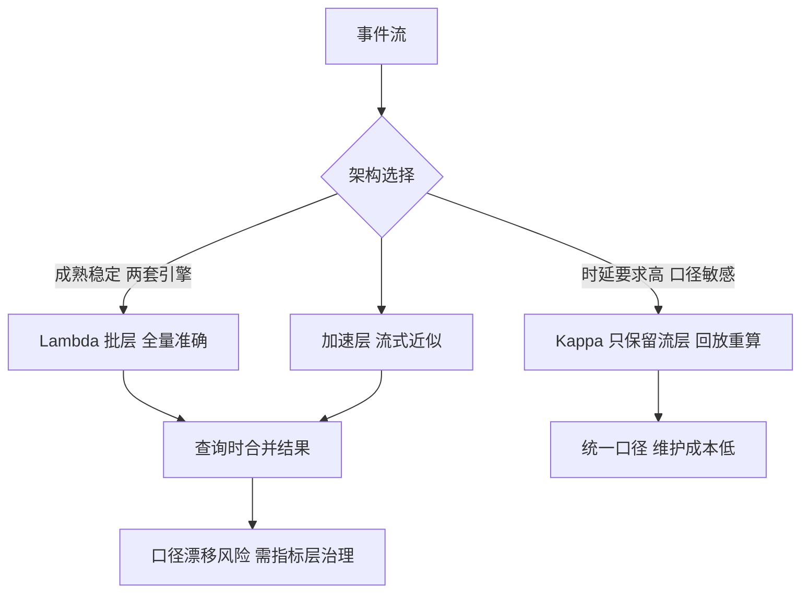

---

全章完:Q311–Q360 共 50 题,覆盖 pandas/numpy 核心机制、数据清洗、ETL 工程、数仓建模、指标治理与实时架构。
