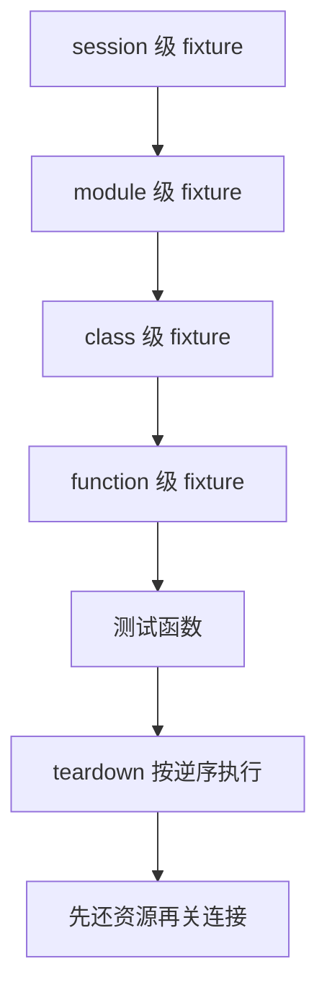
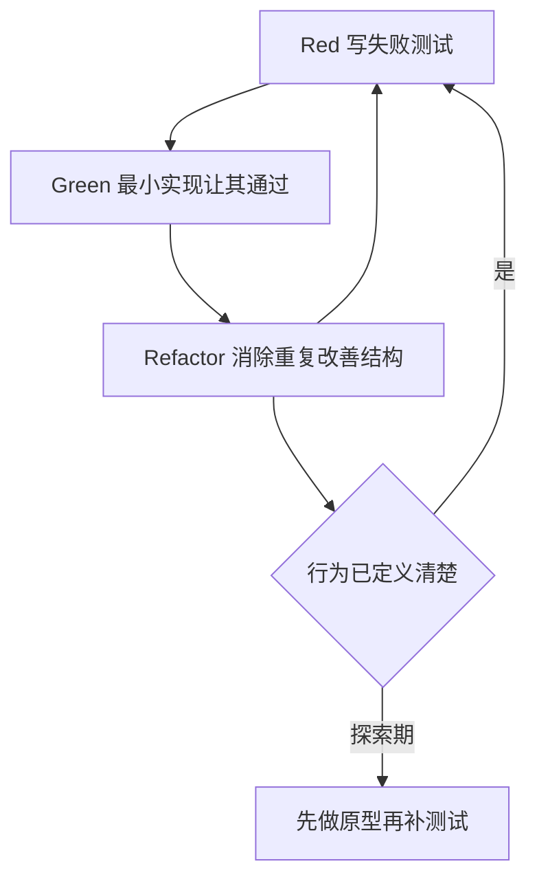
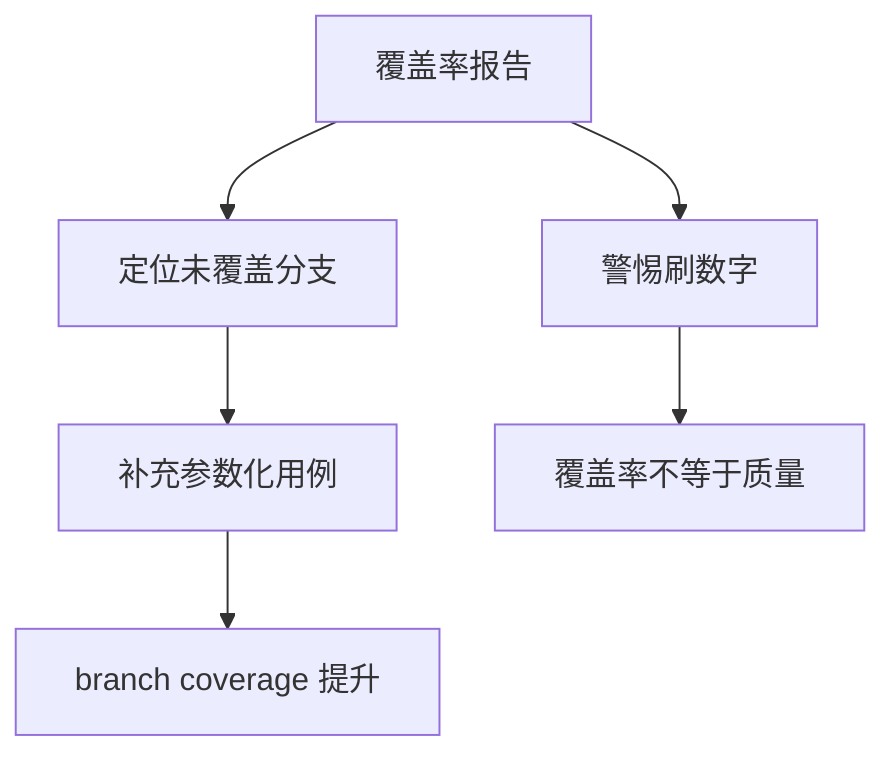
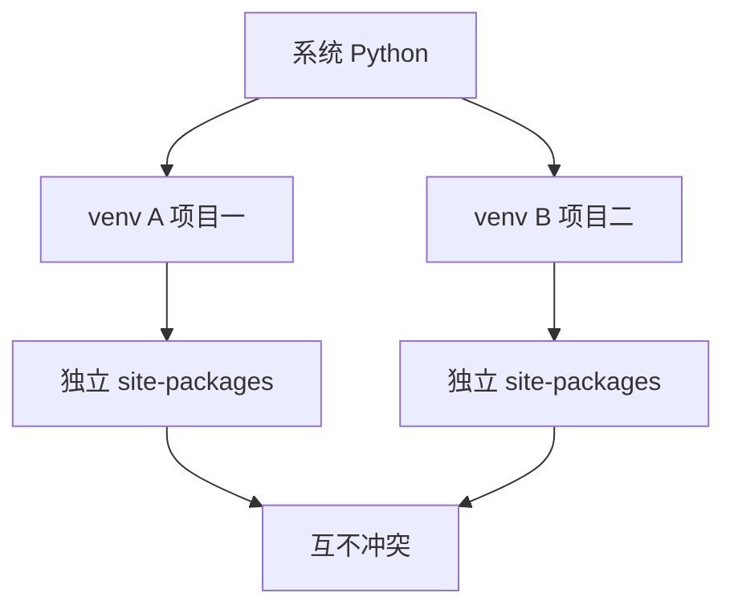
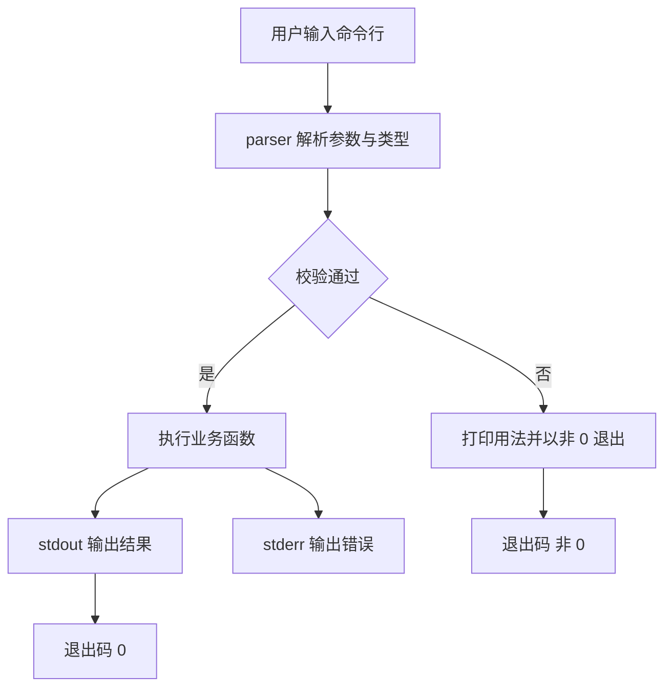
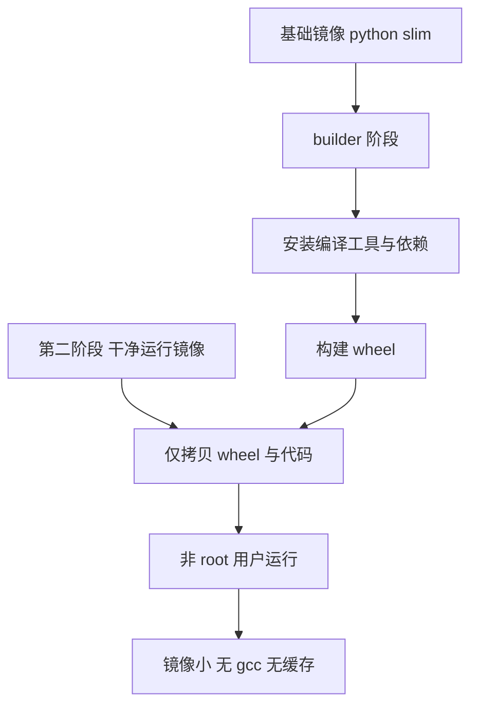
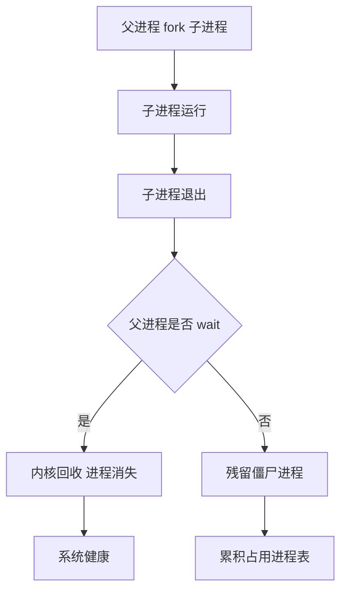
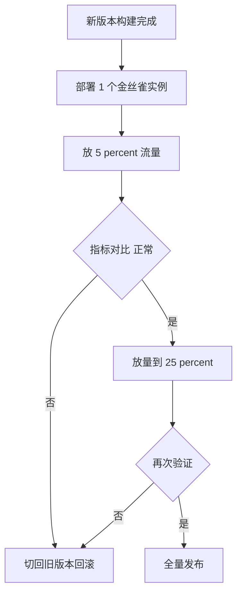
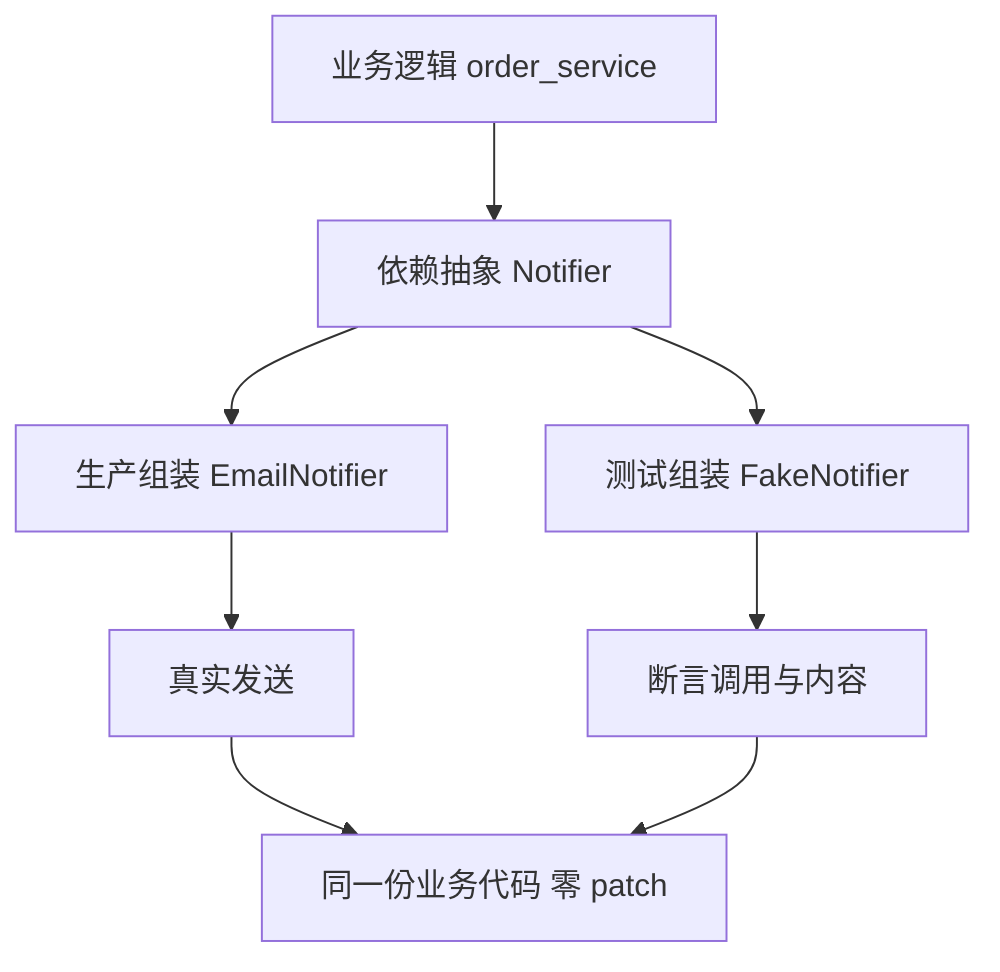
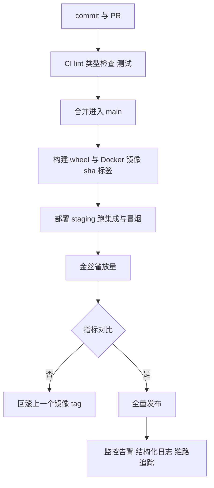

# 第 5 章 · 测试、工程化与 DevOps

> 导读:本章覆盖从测试(pytest、mock、覆盖率、测试金字塔)到代码质量(mypy、ruff、pre-commit),再到工程实践(项目结构、打包、依赖管理、日志与配置),最后到 DevOps(CI/CD、Docker、线上排查、灰度回滚、可观测性)共 45 题。
> 面试考察点不只是"会不会用 pytest",而是:能否写出可维护、可测试、可部署、可观测的工程系统。
> 本章所有示例均为自洽可运行的完整文件,Dockerfile 与 YAML 示例单独放在普通代码块中。
> 建议结合真实项目动手:给一个老项目补测试、写一条 CI 流水线、把镜像从 1GB 减到 200MB,比背十条概念更有说服力。

### Q186 · pytest 为什么比 unittest 的 assert 更好用

> 难度:★☆☆ | 标签:pytest, assert

**问**:pytest 直接写裸 assert 就能给出详细失败信息,unittest 却要记一堆 assertEqual 方法,这是怎么做到的?

**答**:pytest 对测试文件做了 **assertion rewriting**:在导入时(pytest 启动阶段,通过 import hook)把模块里的 `assert` 语句重写为中间表示,失败时把左右表达式的值、比较运算都展示出来。所以你写普通 assert,却能获得 `assert 1 == 2` 加上 `E + where 1 = f()` 这样的详细 diff。相比 unittest 的好处是:无样板类继承、无记忆负担、失败信息更可读。原生 assert 在被 `python -O` 运行时会被整体移除,这是裸 assert 的经典坑。

```python
# file: code/05_数据分析与工程化/q186_pytest_assert.py
def add(a, b):
    return a + b

def test_add():
    # 裸 assert 即可,失败时 pytest 会展示 add(1, 2) 的实际值
    assert add(1, 2) == 3

def test_add_negative():
    result = add(-1, -2)
    # 失败时输出类似: assert -3 == -4  where -3 = add(-1, -2)
    assert result == -4

if __name__ == "__main__":
    # 手动验证:用 python -m pytest 运行本文件
    import subprocess, sys
    print("请用: python -m pytest q186_pytest_assert.py 运行")
```

**追问**:
- `python -O` 会怎样?——它会删除所有 assert 语句,测试将静默通过,所以跑测试永远不要带 -O。
- assertion rewriting 是什么时候发生的?——import hook 在收集导入阶段改写,所以pytest 外直接跑脚本没有增强输出。
- unittest 还值得用吗?——遗留代码与团队既有约定;新项目统一 pytest,二者可共存(pytest 能跑 unittest 用例)。
- assert 写法有什么禁忌?——别把「验证行为」写成恒真式(assert list);多条件拆成多行 assert,失败信息才精确。
### Q187 · pytest 收集与运行流程

> 难度:★★☆ | 标签:pytest, 收集规则

**问**:pytest 是怎么找到测试的?为什么我的 test_xxx.py 里的函数没被执行?

**答**:pytest 从命令行给定的路径(默认当前目录)开始**递归收集**:目录无 `__init__.py` 时按文件名作顶层模块,遵循 `python_files = test_*.py *_test.py`、函数 `test_*`、类 `Test*`(且类不能有 `__init__`)的默认规则。常见"收集不到"的原因:文件名不符合规则、类名不带 Test 前缀、fixture 名与函数名冲突导致 skip、收集期有 import 错误(collect-only 可以提前看)。用 `pytest --collect-only` 检查收集结果,是最快的排查手段。

```python
# file: code/05_数据分析与工程化/q187_collect_rules.py
class TestCart:
    # 类名必须以 Test 开头,且不能定义 __init__
    def test_total(self):
        assert 2 + 2 == 4

    def helper(self):
        # 没有 test_ 前缀,不会被当作测试收集
        return "helper"

def test_top_level():
    assert TestCart().helper() == "helper"
```

**追问**:
- 收集时报 collection import error 怎么办?——先 `pytest --collect-only` 定位,通常是模块顶层代码抛异常或 conftest 导入失败。
- pytest 怎么改默认收集规则?——pyproject.toml 的 `[tool.pytest.ini_options]` 里 python_files/python_functions;团队统一约定防止测试被漏收集。
- 为什么测试目录要避免 __init__.py?——无 init 时根目录入 sys.path 更灵活;加了 init 则要保证包名唯一,两种模式不能混用。
- 怎么只跑一个用例?——`pytest path::file::func` 精确定位;`-k` 表达式按名字模糊过滤,调试时最常用。
### Q188 · fixture 的四种作用域

> 难度:★★☆ | 标签:pytest, fixture, scope

**问**:fixture 的 scope 分别是什么?什么时候该用 session 级?

**答**:scope 有四种:`function`(默认,每个测试函数一个)、`class`、`module`(每个文件一个)、`session`(整个测试进程一个)。**高作用域 fixture 会被低作用域测试复用**,适合昂贵且只读的资源:session 级建数据库连接池或下载测试数据,module 级起一个本地 mock server。关键规则:**高作用域 fixture 不能依赖低作用域 fixture**(session 依赖 function 会直接报错),因为 session 只实例化一次,无法跟随 function 重建。需要隔离写状态的资源时,坚持 function 级并在 yield 后清理。

```python
# file: code/05_数据分析与工程化/q188_fixture_scope.py
try:
    import pytest
except ImportError:
    print("该题演示需要第三方库 pytest:pip install pytest(正文已讲清原理,安装后可运行)")
    raise SystemExit(0)

@pytest.fixture(scope="session")
def db_pool():
    # 整个测试会话只创建一次
    return {"connected": True}

@pytest.fixture(scope="function")
def fresh_user(db_pool):
    # function 级依赖 session 级:合法
    return {"name": "alice", "db": db_pool}

def test_a(fresh_user):
    assert fresh_user["db"]["connected"]

def test_b(fresh_user):
    # fresh_user 在每个测试中都是新实例,测试间互不污染
    fresh_user["name"] = "bob"
    assert fresh_user["name"] == "bob"

def test_c(fresh_user):
    assert fresh_user["name"] == "alice"
```

**追问**:
- 为什么 session 级 fixture 不能依赖 function 级?——session 只实例化一次,无法在 function 级测试间反复重建,pytest 直接报 ScopeMismatch;需要时把数据传参或在低作用域里取自 session 对象。
- 高作用域 fixture 里的可变状态怎么防污染?——只读资源放高作用域;要写就每测试重置(事务回滚/快照恢复),否则用例顺序影响结果。
- scope 怎么选?——问一句「这个资源能不能跨用例共享」:连接池、容器、下载的数据共享;临时表、文件、随机种子每次新建。

### Q189 · yield fixture 与清理顺序

> 难度:★★☆ | 标签:pytest, fixture, teardown

**问**:fixture 怎么做清理?多个 fixture 的 teardown 顺序是什么?

**答**:用 `yield` 写法:yield 之前是 setup,yield 之后是 teardown,即使测试失败也会执行。teardown 顺序与 setup **严格相反**(栈式):C 依赖 B、B 依赖 A,则先 setup A→B→C,测试后先 teardown C→B→A。这保证了资源以创建的逆序释放(先关事务、再还连接、最后关池)。另外 `addfinalizer` 注册的回调同样在栈上,且可以在 fixture 中途注册;yield 写法更直观,推荐优先使用。

```python
# file: code/05_数据分析与工程化/q189_yield_fixture.py
try:
    import pytest
except ImportError:
    print("该题演示需要第三方库 pytest:pip install pytest(正文已讲清原理,安装后可运行)")
    raise SystemExit(0)

steps = []

@pytest.fixture
def a():
    steps.append("setup a")
    yield "a"
    steps.append("teardown a")

@pytest.fixture
def b(a):
    steps.append("setup b")
    yield f"b on {a}"
    steps.append("teardown b")

@pytest.fixture
def c(b):
    steps.append("setup c")
    yield f"c on {b}"
    steps.append("teardown c")

def test_order(c):
    # setup: a, b, c
    assert c == "c on b on a"

def test_teardown_order():
    # 上一个测试结束后,清理顺序是 c, b, a
    assert steps == ["setup a", "setup b", "setup c",
                     "teardown c", "teardown b", "teardown a"]
```

**追问**:
- yield fixture 的清理在 Ctrl-C 中断时执行吗?——pytest 会尽量执行已注册的 finalizer;被 SIGKILL 硬杀时不会,关键外部资源要有兜底回收(超时/对账)。
- addfinalizer 和 yield 写法怎么选?——yield 更直观;需要「创建过程中途注册清理」或多个清理回调时用 addfinalizer。
- 为什么 teardown 顺序是逆序?——资源有依赖链(事务在连接上,连接在池里),只有逆序才能安全释放;栈式结构天然保证。



### Q190 · conftest.py 的作用与查找规则

> 难度:★★☆ | 标签:pytest, conftest

**问**:conftest.py 是什么?多层 conftest 怎么生效?

**答**:conftest.py 是 pytest 的**本地插件文件**,里面的 fixture 和 hook 对其所在目录及所有子目录自动生效,**不需要 import**。查找规则:pytest 收集测试时沿目录树向上查找,离测试最近的 conftest 优先——同名 fixture 会被内层覆盖外层,以此实现"默认实现在顶层、特殊实现在子目录覆盖"。它还适合放自定义 marker 注册、插件加载和 hook 实现(如 `pytest_addoption` 添加命令行参数)。注意:conftest 不能被跨包 import,需要共享给非测试代码的逻辑应放到普通模块。

```python
# file: code/05_数据分析与工程化/q190_conftest_demo.py
try:
    import pytest
except ImportError:
    print("该题演示需要第三方库 pytest:pip install pytest(正文已讲清原理,安装后可运行)")
    raise SystemExit(0)

@pytest.fixture
def base_config():
    return {"env": "test", "timeout": 5}

def test_uses_fixture(base_config):
    # 放在 tests/conftest.py 中即可被同目录所有测试直接使用
    assert base_config["env"] == "test"

def pytest_addoption(parser):
    # 实际项目写在 conftest.py 顶层,这里演示其内容
    parser.addoption("--env", default="test", help="指定测试环境")
```

**追问**:
- 想全局共享 fixture 又不在测试包内怎么办?——用 pytest 插件:在 pyproject.toml 里配置 `pytest11` entry point,或用 `-p` 参数加载。
- conftest 能被 import 吗?——不能,它不是包成员;要复用逻辑就提炼到普通模块或插件,conftest 只放 fixture 与 hook。
- 内层 conftest 覆盖外层的典型场景?——顶层 session 级假 DB,某个子目录用真实测试库覆盖同名 fixture;局部特殊化不动全局。
- pytest_addoption 怎么和 fixture 配合?——自定义命令行参数经 `request.config.getoption` 在 fixture 里读取;测试按选项切换行为。
### Q191 · parametrize 参数化与 id

> 难度:★★☆ | 标签:pytest, parametrize

**问**:怎么用参数化避免写一堆重复测试?如何让失败用例的名字更好认?

**答**:`@pytest.mark.parametrize("输入,期望", [(...), (...)])` 会把一个测试函数展开为多个独立用例,任一失败互不影响、报告里逐条展示。通过 `ids` 参数(传列表或回调函数)自定义用例名,失败时一眼看出是哪个场景;用 `pytest.param(..., marks=pytest.mark.xfail)` 可对个别用例打标记。参数化还支持**堆叠**:多个装饰器做笛卡尔积,适合覆盖"输入组合 × 配置组合"这类矩阵场景。

```python
# file: code/05_数据分析与工程化/q191_parametrize.py
try:
    import pytest
except ImportError:
    print("该题演示需要第三方库 pytest:pip install pytest(正文已讲清原理,安装后可运行)")
    raise SystemExit(0)

def is_leap(year):
    return (year % 4 == 0 and year % 100 != 0) or year % 400 == 0

@pytest.mark.parametrize(
    "year,expected",
    [
        pytest.param(2000, True, id="整百年能整除400"),
        pytest.param(1900, False, id="整百年不能整除400"),
        pytest.param(2024, True, id="普通闰年"),
        pytest.param(2023, False, id="普通平年"),
    ],
)
def test_is_leap(year, expected):
    assert is_leap(year) is expected

@pytest.mark.parametrize("a", [1, 2])
@pytest.mark.parametrize("b", [10, 20])
def test_cartesian(a, b):
    # 2x2 共 4 个用例
    assert a + b == b + a
```

**追问**:
- 参数化和 fixture 能一起用吗?——可以,fixture 通过 `request.param` 间接参数化(`params=[...]`),适合「环境矩阵」;直接数据矩阵用 parametrize。
- ids 为什么重要?——失败报告按 id 展示,默认显示参数值,复杂对象可读性差;业务化的 id 让 CI 失败一眼定位场景。
- 怎么给个别参数打标记?——`pytest.param(v, marks=pytest.mark.xfail)`;组合 xfail/skip 与参数化是处理已知 bad case 的正路。

### Q192 · mock 与 patch 的工作原理

> 难度:★★★ | 标签:mock, unittest.mock, patch

**问**:Mock 是怎么"替换掉"一个函数的?MagicMock 和普通 Mock 的区别?

**答**:`patch` 的本质是**运行期属性替换**:用 `with patch("module.attr")` 或装饰器,在进入作用域时把目标对象上的属性指向 Mock 对象,退出时恢复原值(底层就是 getattr/setattr 包一层 try/finally)。两个关键点:一,patch 的是**被使用处的引用查找路径**,不是"定义处"(见 Q193);二,`MagicMock` 预配置了 dunder 方法(`__call__`、`__enter__`、`__iter__` 等),所以能当函数、上下文管理器、迭代器用,而普通 Mock 调用 dunder 会报错,因此 patch 默认返回 MagicMock。断言主要靠 `assert_called_once_with` 等方法验证交互。

```python
# file: code/05_数据分析与工程化/q192_mock_basics.py
from unittest.mock import MagicMock

class EmailClient:
    def send(self, to, subject):
        raise RuntimeError("真实实现不会在测试中被调用")

def notify(client: EmailClient, user):
    return client.send(to=user["email"], subject="welcome")

def test_notify_called_once():
    client = MagicMock(spec=EmailClient)  # spec 限制只能 mock 真实存在的方法
    notify(client, {"email": "a@b.com"})
    client.send.assert_called_once_with(to="a@b.com", subject="welcome")

def test_return_value():
    client = MagicMock()
    client.send.return_value = True
    assert notify(client, {"email": "x@y.com"}) is True
```

**追问**:
- spec 有什么用?——限制 Mock 只能访问真实对象的属性,防止被测代码改名后测试仍然通过(假阳性)。
- MagicMock 和 Mock 的区别?——MagicMock 预配置了魔术方法(call/enter/iter);需要 mock 上下文管理器、迭代器时必须用它。
- 怎么断言调用参数?——`mock.assert_called_once_with(...)`,call_args 检查任意次调用;断言调用而非断言内部实现,否则测试脆弱。
- autospec=True 有什么好处?——按真实对象签名生成 mock,调用签名错了会报错,防 mock 与实现漂移。
### Q193 · patch 最常见的坑:patch 在哪里

> 难度:★★★ | 标签:mock, patch, 坑

**问**:为什么 `patch("mymodule.add")` 之后被测函数还在调真实现?

**答**:因为 patch 替换的是**某个命名空间里的名字绑定**。如果被测模块 `mymodule/utils.py` 写了 `from utils import add`,那它自己的命名空间里有一个指向原函数的引用;此时你去 patch `utils.add`,改的是 utils 模块的绑定,utils_module 里那份引用不受影响。正确做法是 **patch 被测模块中的引用位置**:`patch("mymodule.utils.add")`。另一个高频坑:多个 patch 装饰器**自下而上**应用,参数顺序相反;以及 patch 类时默认返回的是"类实例的 Mock",需要 `patch(...).return_value` 才能配置实例方法。

```python
# file: code/05_数据分析与工程化/q193_patch_path.py
from unittest.mock import patch

def _now():
    return "real"

def greet():
    # 关键:这里引用的是本模块命名空间里的 _now
    return f"hello at {_now()}"

def test_patch_local_namespace():
    # 正确:patch 被测函数所在的模块名下的引用
    with patch("__main__._now", return_value="fake"):
        assert greet() == "hello at fake"

def test_real_function_untouched():
    with patch("__main__._now", return_value="fake"):
        pass
    # 作用域退出后恢复原实现
    assert greet() == "hello at real"
```

**追问**:
- 多个 patch 装饰器的参数顺序?——自下而上应用,参数也自下而上注入;记不住就用 with 嵌套或 pytest-mock 的 mocker.patch 链。
- patch 类方法会影响所有实例吗?——会,patch 的是类属性;只要替换一个实例就 `patch.object(instance, 'method')`。
- patch 和依赖注入怎么取舍?——能 DI 就别 patch:显式传参可测性更好;patch 留给改不了的第三方与全局状态。

### Q194 · monkeypatch 与 fixture 化的测试替身

> 难度:★★☆ | 标签:pytest, monkeypatch, 环境变量

**问**:pytest 的 monkeypatch 和 unittest.mock 的 patch 有什么区别?什么时候用哪个?

**答**:`monkeypatch` 是 pytest 内置 fixture,专做"临时改环境":`setenv/delenv` 改环境变量、`setattr` 改属性、`setitem` 改 dict、`chdir` 改目录,测试结束自动还原。定位差异:mock/patch 更适合"替换依赖并断言调用",monkeypatch 更适合"改全局状态"(环境变量、cwd、配置字典)。改环境变量务必用 `monkeypatch.setenv` 而不是手动 `os.environ`,后者一旦测试中途失败就会污染其他测试。

```python
# file: code/05_数据分析与工程化/q194_monkeypatch.py
import os

try:
    import pytest
except ImportError:
    print("该题演示需要第三方库 pytest:pip install pytest(正文已讲清原理,安装后可运行)")
    raise SystemExit(0)

def get_api_key():
    return os.environ.get("API_KEY", "")

def test_api_key(monkeypatch):
    monkeypatch.setenv("API_KEY", "test-key-123")
    assert get_api_key() == "test-key-123"

def test_missing_api_key(monkeypatch):
    monkeypatch.delenv("API_KEY", raising=False)
    assert get_api_key() == ""

def test_patch_module_attr(monkeypatch):
    import q194_monkeypatch as mod  # 引用自身模块演示 setattr
    monkeypatch.setattr(mod, "get_api_key", lambda: "stubbed")
    assert mod.get_api_key() == "stubbed"
```

**追问**:
- monkeypatch 和 patch 的边界?——改环境/cwd/字典用 monkeypatch(自动还原、按测试隔离);要断言调用与返回值才用 Mock/patch。
- monkeypatch 能改未导入的模块吗?——能,setattr 按名字延迟解析;但同样要 patch「使用处」的路径,与 patch 规则一致。
- 怎么验证 monkeypatch 生效了?——测试里直接读取改后的值断言;环境变量类别忘了用 setenv 而不是 os.environ 直改。

### Q195 · 测试金字塔与投入比例

> 难度:★★☆ | 标签:测试金字塔, 集成测试

**问**:讲讲测试金字塔。为什么不建议大量写端到端测试?

**答**:测试金字塔从底到顶是:**单元测试**(多、快、便宜、定位准)→ **集成/服务测试**(中)→ **端到端/UI 测试**(少、慢、贵、脆)。经典比例约 7:2:1。不建议堆 E2E 的原因:E2E 涉及全链路,任何一环(网络、数据、第三方)抖动都会让它红,而失败了还得逐层排查;维护成本随功能增长超线性。金字塔的哲学是:**把验证逻辑下推到能快速反馈的层级**,E2E 只保留关键 happy path 冒烟。现代变种如"奖杯形"(trophy)在前端更重视集成测试,但"底重顶轻"的核心不变。

```python
# file: code/05_数据分析与工程化/q195_pyramid_demo.py
# 演示同一功能在金字塔不同层的测试粒度

def calc_discount(price, vip):
    # 被测逻辑:单元测试层
    if vip:
        return price * 0.8
    return price

def order_api(price, vip):
    # 集成层:逻辑 + 序列化/依赖协作
    return {"price": calc_discount(price, vip)}

def test_unit_layer():
    # 单元:只测纯逻辑,无 IO,毫秒级
    assert calc_discount(100, True) == 80

def test_integration_layer():
    # 集成:测函数协作与返回结构
    assert order_api(100, False) == {"price": 100}

def test_e2e_smoke():
    # E2E 只保留一条 happy path 冒烟,断言从输入到出口的行为
    resp = order_api(100, True)
    assert resp["price"] == 80
```

**追问**:
- 奖杯形模型是什么?——前端/交互重的项目集成测试占比最高(组件级),单元与 E2E 少;核心仍是「重用便宜可靠的层级」。
- 为什么 E2E 失败排查贵?——链路长,失败可能在任何一环;先靠分层测试排除单点,E2E 只留冒烟。
- 比例僵化怎么办?——按故障历史分配投入:出过事故的边界(DB 事务、支付)补集成测试,而不是追数字比例。

### Q196 · 单元、集成、端到端怎么划分

> 难度:★★☆ | 标签:测试分层, 边界

**问**:一个"调数据库的服务函数",单元测试到底测不测真库?

**答**:常用判定标准是"**是否触碰外部慢依赖与网络边界**":单元测试不触碰 DB/HTTP/文件系统(用替身或纯逻辑拆分),毫秒级、随时跑;集成测试触碰真实 DB/消息队列但范围小(单个模块级),用于验证 SQL、事务、schema 迁移这类替身测不出的东西;E2E 从 API 入口打进真实(或近似真实)环境,验证整条链路。面试加分点:指出这不是教条而是**权衡**——事务边界的正确性用 mock 测等于没测,所以关键 DB 逻辑宁可归入"集成层"老实测真库,并用 testcontainers/docker-compose 起隔离环境。

```python
# file: code/05_数据分析与工程化/q196_layers.py
class FakeRepo:
    # 单元测试用的内存替身
    def __init__(self):
        self._data = {}

    def save(self, key, value):
        self._data[key] = value

    def get(self, key):
        return self._data.get(key)

class RealRepo:
    # 集成测试用,由真实环境提供连接
    def __init__(self, conn):
        self.conn = conn

    def save(self, key, value):
        self.conn.execute("INSERT", key, value)

def register_user(repo, name):
    repo.save(name, {"active": True})
    return True

def test_unit_with_fake():
    register_user(FakeRepo(), "alice")
    assert True

def test_contract_same_behavior():
    # 契约测试:替身与真实实现的对外行为保持一致
    fake = FakeRepo()
    register_user(fake, "bob")
    assert fake.get("bob")["active"] is True
```

**追问**:
- testcontainers 解决什么?——在 CI 里起一次性真实容器(Postgres/Kafka),比 H2/内存替身可信,比共享环境干净;测试结束自动回收。
- 集成测试的数据怎么管理?——每个用例事务回滚或唯一前缀数据;共享 seed 数据要声明只读,写操作必须自建数据。
- E2E 的冒烟怎么挑?——覆盖关键收入路径(注册→下单→支付)与最近变更;全量 E2E 等于自我惩罚。

### Q197 · 覆盖率数字的意义与误区

> 难度:★★★ | 标签:coverage, 质量

**问**:覆盖率 90% 就代表代码质量好吗?branch coverage 和 line coverage 的区别?

**答**:覆盖率衡量的是"**被执行过**",不是"**被验证过**"——一行没有断言的代码也计入覆盖,所以高覆盖率可能是无意义测试,低覆盖率则确定有风险。它正确的用法是**找漏洞而非刷数字**:看哪些分支、异常路径从未被测过。line coverage 只统计行是否执行;**branch coverage** 要求每个 if/while 的真假分支都被走到,更能反映逻辑覆盖程度,`pytest --cov --cov-branch` 即可开启。工程实践上常设下限阈值(如 CI 里 `fail_under=85`)防止覆盖率持续滑坡,但不应把 100% 当目标。

```python
# file: code/05_数据分析与工程化/q197_coverage_demo.py
def grade(score):
    if score >= 90:
        return "A"
    elif score >= 60:
        return "B"
    return "C"

def test_high_score():
    # 只有这一条测试时:line coverage 可能到 60% 以上
    # 但 branch coverage 会指出 elif 为假、以及最后的 return C 从未覆盖
    assert grade(95) == "A"

def test_all_branches():
    # 补齐分支后,branch coverage 才是 100%
    assert grade(75) == "B"
    assert grade(30) == "C"
```

**追问**:
- 有没有 100% 覆盖但出 bug 的情况?——太常见了:边界值错、并发问题、组合输入,覆盖率完全测不到,所以还要靠参数化和属性测试补充。
- 怎么提升 branch coverage?——对每个 if 的真假分支写参数化用例;`--cov-branch` 开启后看未覆盖分支编号。
- 覆盖率门禁设多少合理?——存量高的团队 70-85 起步,新增代码 90+;门禁只增不降(ratchet)比绝对数字更现实。
- 覆盖率排除哪些文件?——tests 自身、迁移脚本、生成代码;`[tool.coverage.run] omit` 配置,否则数字被稀释。
### Q198 · TDD 的价值与取舍

> 难度:★★☆ | 标签:TDD, red-green-refactor

**问**:你实际用 TDD 吗?什么场景下 TDD 反而是负担?

**答**:TDD 循环是 **red → green → refactor**:先写一个失败的测试定义行为,再用最小实现让它通过,最后重构。它的真实价值不是"测试多",而是**设计驱动**——先写测试迫使你想清楚接口、依赖边界和错误处理;回归保护是副产品。适合:逻辑清晰、契约稳定的算法/领域逻辑/修 bug(先复现再修复)。不适合:探索性原型、UI 布局、频繁变动的接口——需求本身在漂移时,先写测试等于把猜想焊死,重构成本翻倍。务实的说法:核心逻辑 TDD,胶水代码后补测试,比教条地"全程 TDD"更可持续。

```python
# file: code/05_数据分析与工程化/q198_tdd_demo.py
# Red:先写失败测试,定义期望行为
def test_split_name():
    from q198_tdd_demo import split_full_name  # noqa
    first, last = split_full_name("Ada Lovelace")
    assert first == "Ada"
    assert last == "Lovelace"

def test_split_name_single():
    from q198_tdd_demo import split_full_name
    # Green 阶段补的边界:只有一个词时 last 为空
    first, last = split_full_name("Cher")
    assert first == "Cher"
    assert last == ""

def split_full_name(full):
    # Refactor 后的实现:最小实现通过全部测试
    parts = full.split()
    if not parts:
        return "", ""
    return parts[0], " ".join(parts[1:])
```

**追问**:
- 修 bug 时的 TDD 流程?——先写一个复现 bug 的失败测试(红)→ 修复(绿)→ 回归确认;这个测试永久保留防复发。
- TDD 和重构的关系?——有测试才有安全网,重构才能放开手;没有测试的重构是赌博。
- 遗留代码怎么开始补测试?——characterization test(刻画现有行为,哪怕行为是错的)锁住现状,再小步重构。





### Q199 · 慢测试、skip、xfail 与 marker

> 难度:★★☆ | 标签:pytest, marker, skip

**问**:怎么把慢测试和快测试分开跑?skip 和 xfail 的语义区别?

**答**:自定义 marker(需在 pyproject.toml 注册,否则告警)如 `@pytest.mark.slow`,配合 `pytest -m "not slow"` 在日常开发只跑快集,CI 每晚跑全量。语义区分:`skip` 表示**已知无法/不应执行**(如仅 Windows),无条件跳过或条件 `skipif`;`xfail` 表示**会执行但预期失败**,万一通过了会报 XPASS,提醒你更新预期。`skip` 用于环境不匹配,`xfail` 用于记录已知 bug 待修复,两者都不能滥用成"测试红着不管"的借口。

```python
# file: code/05_数据分析与工程化/q199_markers.py
import sys

try:
    import pytest
except ImportError:
    print("该题演示需要第三方库 pytest:pip install pytest(正文已讲清原理,安装后可运行)")
    raise SystemExit(0)

@pytest.mark.slow
def test_heavy_computation():
    # pytest -m "not slow" 会跳过它
    assert sum(range(1000)) == 499500

@pytest.mark.skipif(sys.platform == "win32", reason="仅 POSIX 行为")
def test_posix_only():
    assert "/" + "" == "/"

@pytest.mark.xfail(reason="已知 bug ISSUE-123")
def test_known_bug():
    # 预期失败:当前实现有 bug,修复后这里变 XPASS 提醒摘掉标记
    assert 1 / 0 == float("inf")

def test_fast():
    assert 2 + 2 == 4
```

**追问**:
- marker 没注册会怎样?——PytestUnknownMarkWarning,且 `-m` 过滤不可靠;在 pyproject.toml 的 markers 列表注册并写明用途。
- xfail(strict=True) 是什么?——一旦 XPASS 直接算失败,强制你更新预期;防 xfail 堆积成垃圾场。
- 怎么组织快慢测试?——slow marker + CI 分层:PR 只跑快集,nightly 跑全量;慢测试进了 PR 红灯链路就是灾难。

### Q200 · mypy 类型检查的收益与渐进采用

> 难度:★★★ | 标签:mypy, typing

**问**:Python 是动态语言,加 mypy 图什么?老项目怎么渐进引入?

**答**:mypy 在**运行前**捕获类型错误:None 传播(`Optional` 没判空)、参数顺序错、返回类型错——这些恰恰是单测最容易漏的分支。收益还有:类型即文档、IDE 补全和重构变可靠、接口契约显式化。渐进策略:先开 `--ignore-missing-imports` 处理无类型注解的第三方库,配置 `per-module-options` 对核心模块 strict、对遗留模块宽松,新增代码从 day 1 强制注解;再用 stub(`types-*` 包或自写 .pyi)补关键依赖。运行期不做类型检查是重要认知:mypy 是静态分析,与运行时行为无关。

```python
# file: code/05_数据分析与工程化/q200_mypy_demo.py
from typing import Optional


def find_user(user_id: int, cache: dict[int, str]) -> Optional[str]:
    # 返回值可能为 None,调用方必须处理
    return cache.get(user_id)


def send_welcome(name: str) -> str:
    # mypy 会报错:Argument 1 has incompatible type Optional[str]
    # return send_welcome(find_user(1, {}))
    user = find_user(1, {})
    if user is None:
        return "guest"
    return f"welcome {user}"


def test_none_handling():
    assert find_user(1, {}) is None
    assert send_welcome("ada") == "welcome ada"
```

**追问**:
- pyright 和 mypy 选哪个?——两者都成熟;pyright 更快且和 VSCode(Pylance)集成好,mypy 生态和插件多,团队统一一个即可。
- mypy 对第三方库报 missing stubs 怎么办?——装 types-* 包或 `ignore_missing_imports` 局部豁免;给核心依赖自写 .pyi 桥接。
- strict 模式包含什么?——disallow_untyped_defs、warn_return_any 等开关集合;核心模块先 strict,存量模块渐进。
- 类型注解会拖慢运行吗?——不会,注解不求值(除非显式);运行时校验是 pydantic 这类库显式做的事,与 mypy 分工不同。
### Q201 · ruff 与 black:为什么代码规范工具换代了

> 难度:★★☆ | 标签:ruff, black, lint

**问**:flake8、black、isort 都能用,为什么要换成 ruff?

**答**:**ruff** 用 Rust 实现,比 flake8/pylint 快一到两个数量级,能秒级 lint 整个大仓库,因此才能放进 pre-commit 和 CI 的"红灯规则"里;它一个工具覆盖了 flake8 + isort + 部分 pylint 的规则集(可启用规则组如 E/F/W/I/UP/B)。**black** 的哲学是"不可协商的格式化":团队不再争论风格,review 里不再有格式噪音;ruff format 也兼容 black 风格,可以二选一。最佳组合通常是 ruff(lint + import 排序)+ black 或 ruff format(格式化),规则集中写在 pyproject.toml 里统一管理。

```toml
# pyproject.toml 片段:非 python 文件,展示统一配置
[tool.ruff]
line-length = 100
target-version = "py311"

[tool.ruff.lint]
select = ["E", "F", "W", "I", "UP", "B", "SIM"]

[tool.black]
line-length = 100
```

```python
# file: code/05_数据分析与工程化/q201_lint_demo.py
import os  # noqa: F401  未使用导入,ruff F401 会提醒
import sys


def old_style(items):
    # ruff UP 规则会建议用 list comprehension 或内置函数
    result = []
    for i in items:
        if i % 2 == 0:
            result.append(i * 2)
    return result


def test_even_doubled():
    assert old_style([1, 2, 3, 4]) == [4, 8]
```

**追问**:
- ruff 怎么替代 isort?——启用 `I` 规则组 + `ruff check --fix` 自动排序导入;单独跑 isort 的步骤可以删了。
- 格式化冲突怎么处理?——black 与 linter 规则冲突时,以格式化工具为准,linter 关掉对应条目(E501 交给 formatter);不要两个工具互改。
- 规则应该全开吗?——按团队成熟度渐进:先 E/F/I(错误+导入),稳定后加 B(bugbear)、UP(现代化);全开告警淹没等于没开。

### Q202 · pre-commit 钩子的设计

> 难度:★★☆ | 标签:pre-commit, git hooks

**问**:pre-commit 是什么?哪些检查适合放 pre-commit,哪些必须放 CI?

**答**:pre-commit 框架用 `.pre-commit-config.yaml` 声明钩子,`pre-commit install` 后每次 `git commit` 自动执行,失败即中断提交。**分层原则**:本地钩子跑"快且本地可修复"的检查(格式化、lint、大文件检查、密钥扫描),几十秒内完成;慢的、需要完整环境依赖的(全量测试、类型检查大项目、构建)放 CI。这样开发者能在秒级修复风格问题,CI 只兜底"没装 pre-commit 或 --no-verify 绕过"的情况。注意 hooks 只在变更是不可靠的,`pre-commit run --all-files` 用于初始化全量修复。

```yaml
# .pre-commit-config.yaml:非 python 文件示例
repos:
  - repo: https://github.com/astral-sh/ruff-pre-commit
    rev: v0.6.0
    hooks:
      - id: ruff
        args: [--fix]
      - id: ruff-format
  - repo: local
    hooks:
      - id: no-secrets
        name: 检查疑似密钥
        entry: grep -rIE "AKIA[0-9A-Z]{16}" --exclude-dir=.git
        language: system
```

```python
# file: code/05_数据分析与工程化/q202_precommit_demo.py
def format_target(line_length=88):
    # 演示:格式化工具会把超长行折行,这里验证行宽约定
    assert line_length == 88

def test_convention():
    format_target()
```

**追问**:
- 钩子失败但开发者用 --no-verify 提交了怎么办?——CI 是最终防线,同套检查在流水线必跑;--no-verify 只能骗过本地骗不过 main 分支保护。
- pre-commit 首次安装怎么强制?——CI 检查 `.pre-commit-config.yaml` 与本地版本一致(`pre-commit validate`);新人 onboarding 文档里放 install 步骤。
- 密钥扫描放哪层?——本地 pre-commit(gitleaks)即时拦截 + CI 再扫一遍 + 平台侧 secret scanning 三层;任何一层都可能被绕过。

### Q203 · 项目结构:src 布局 vs 平铺布局

> 难度:★★★ | 标签:src layout, 项目结构

**问**:为什么推荐 src 布局?它解决了什么实际问题?

**答**:src 布局把包放在 `src/<pkg>` 下,**只有安装后才能被 import**;平铺布局(<pkg>/ 直接在根目录)里,当前目录天然在 sys.path 上,测试 import 到的是**未安装的源码目录**。这带来两个 bug 温床:一,测试通过的项目发布后可能因为打包遗漏文件(如数据文件、生成代码)而 import 失败;二,根目录存在与依赖同名的目录时发生 shadowing。src 布局强制走与用户一致的安装路径,配合 `pip install -e .`,保证"测的就是装的"。测试目录放顶层 `tests/`,与包平行,不随包发布。

```text
# 项目结构示意:非 python 文件
myproj/
├── pyproject.toml
├── src/
│   └── myproj/
│       ├── __init__.py
│       ├── core.py
│       └── cli.py
├── tests/
│   ├── conftest.py
│   └── test_core.py
└── .pre-commit-config.yaml
```

```python
# file: code/05_数据分析与工程化/q203_layout_demo.py
# 实际项目应 from myproj.core import xxx,这里演示 src 布局的 import 纪律
def import_check():
    # 平铺布局下 pytest 根目录可直接 import myproj
    # src 布局下必须先 pip install -e . 否则 ImportError —— 这正是保护
    return "installed or editable install required"

def test_layout_discipline():
    assert "install" in import_check()
```

**追问**:
- `pip install -e .` 做了什么?——可编辑安装:把 src 包以链接方式注册进 site-packages(新版本用 PEP 660),改源码即时生效,同时保证 import 路径与真实安装一致。
- src 布局怎么调试本地代码?——`pip install -e .` 可编辑安装,改源码即时生效且 import 路径与用户一致。
- shadowing 事故长什么样?——根目录放了 `logging/` 目录,import logging 导入自己的目录;src 布局天然规避。
- tests 放包内还是包外?——src 布局下放顶层 tests/,不随包发布;包内 tests 会增加发布体积还可能被误 import。
### Q204 · pyproject.toml 与现代打包

> 难度:★★★ | 标签:pyproject.toml, 打包, PEP 621

**问**:pyproject.toml 为什么能取代 setup.py 和 requirements.txt?

**答**:pyproject.toml 是 **PEP 517/518/621** 定义的统一项目元数据文件:`[build-system]` 声明构建后端(setuptools/hatchling/poetry-core/flit),`[project]` 声明名称、版本、依赖、entry point,工具配置(ruff/pytest/mypy)也集中在此。相比 setup.py 的优势:声明式、无任意代码执行(更安全)、格式标准化。dependencies 放**直接依赖且尽量宽松**(如 `>=1.0`),精确锁定交给 lock 文件(uv.lock/requirements.txt 冻结)。`[project.scripts]` 可以注册 CLI 命令,安装后直接可用。

```toml
# pyproject.toml 示例:非 python 文件
[build-system]
requires = ["hatchling"]
build-backend = "hatchling.build"

[project]
name = "myproj"
version = "0.3.0"
requires-python = ">=3.11"
dependencies = ["httpx>=0.27", "pydantic-settings>=2.0"]

[project.optional-dependencies]
dev = ["pytest>=8", "mypy>=1.10", "ruff>=0.5"]

[project.scripts]
myproj = "myproj.cli:main"

[tool.pytest.ini_options]
addopts = "--cov=myproj --cov-branch"
markers = ["slow: 慢速测试"]
```

```python
# file: code/05_数据分析与工程化/q204_packaging_demo.py
import importlib.metadata

def get_version(fallback="0.0.0.dev0"):
    # 安装后可从包元数据读取版本,未安装时用 fallback
    try:
        return importlib.metadata.version("myproj")
    except importlib.metadata.PackageNotFoundError:
        return fallback

def test_version_fallback():
    assert isinstance(get_version(), str)
```

**追问**:
- 为什么 dependencies 放宽松、lock 放精确?——库作者声明兼容区间,应用靠 lock 锁死闭包;两者角色不同,混用会让升级无从判断。
- entry point 怎么声明?——`[project.scripts]` 定义命令,`[project.entry-points.pytest11]` 这类声明插件;安装即注册。
- setup.py 还需要吗?——纯声明式项目不需要;只有构建期动态逻辑(版本号生成)才需要钩子,且优先用构建后端的能力替代。

### Q205 · uv/pip 依赖管理:为什么要 lock

> 难度:★★★ | 标签:uv, pip, lock

**问**:requirements.txt 直接 pip freeze 不就行了,uv 解决了什么问题?

**答**:核心问题是**可复现性分层**:pyproject.toml 声明直接依赖(语义化版本),lock 文件(uv.lock / pip-tools 生成的冻结文件)记录**完整依赖闭包的精确版本与哈希**,保证任何机器、任何时间安装结果一致。`pip freeze` 的问题是把传递依赖和直接依赖混在一起,升级时无从判断来源。**uv** 的优势:Rust 实现,解析与安装比 pip 快 10-100 倍;内置 `uv lock/uv sync` 工作流、统一管理 venv 与 Python 版本、原生支持 workspace;`uv pip` 接口可直接替换 pip。传统方案的等价物是 pip-tools 的 compile + sync,思路相同。

```bash
# uv 工作流:非 python 文件
uv init myproj && cd myproj
uv add httpx            # 写入 pyproject 并更新 uv.lock
uv add --dev pytest     # dev 依赖分组
uv sync                 # 按 lock 精确同步环境,多余包会被移除
uv run pytest           # 在项目环境内运行命令
```

```python
# file: code/05_数据分析与工程化/q205_deps_demo.py
def resolve(specs: list[str]) -> dict[str, str]:
    # 极简示意:lock 的本质是给每个包固定一个精确版本
    return {name.split("==")[0]: name.split("==")[1] for name in specs}

def test_lock_is_exact():
    locked = resolve(["httpx==0.27.2", "anyio==4.4.0"])
    assert locked["httpx"] == "0.27.2"
    assert set(locked) == {"httpx", "anyio"}
```

**追问**:
- uv sync 和 pip install 的差异?——uv sync 按 lock 精确同步环境(多余包会删),pip install 只增不减;环境漂移靠 sync 治理。
- lock 文件要提交吗?——应用必须提交(可复现构建);发布给第三方的库不提交,用宽松依赖声明。
- 怎么处理传递依赖的 CVE?——`uv lock --upgrade` 或 pip-audit 报告后升级 lock;只锁不升的 lock 是安全债。

### Q206 · 虚拟环境的本质与常见坑

> 难度:★★☆ | 标签:venv, 环境

**问**:venv 到底是什么?为什么装了包还是 ModuleNotFoundError?

**答**:venv 本质是一个**带独立 site-packages 目录和 pyvenv.cfg 的目录**,激活脚本只是把它的 `bin` 放到 PATH 最前并把 `VIRTUAL_ENV` 写进环境——Python 解释器据此定位到该 venv 的 site-packages。**venv 不隔离解释器本身**(虚拟环境共享创建它时的那个 Python 版本),需要隔离解释器版本要用 pyenv/uv 管理多版本 Python 再分别建 venv。ModuleNotFoundError 的高频原因:IDE 用的解释器不是项目 venv、在 venv 外用系统 pip 装了包、notebook 内核指向了别的环境。系统 Python(PEP 668 后)禁止直接 pip install,必须建 venv 或用 --break-system-packages(不推荐)。

```python
# file: code/05_数据分析与工程化/q206_venv_demo.py
import sys


def env_info():
    # 运行时判断当前解释器是否在 venv 内
    in_venv = sys.prefix != sys.base_prefix
    return {
        "in_venv": in_venv,
        "prefix": sys.prefix,
    }


def test_venv_detection():
    info = env_info()
    assert isinstance(info["in_venv"], bool)
```

**追问**:
- IDE 运行测试和命令行结果不一致为什么?——两边解释器/venv 不同;统一用 `pip install -e .` 后的同一个环境,IDE 里显式选解释器。
- venv 怎么换 Python 版本?——venv 不支持,删除重建:先 pyenv/uv 装目标版本,再 `python -m venv` 或 `uv venv --python 3.12`。
- 为什么要 `.dockerignore` 掉 venv?——把本地 venv 拷进镜像轻则体积爆炸,重则 glibc/路径不兼容;镜像内依赖必须重装。



### Q207 · logging 设计:结构化与轮转

> 难度:★★★ | 标签:logging, 结构化日志, RotatingFileHandler

**问**:为什么不要用 print 打日志?生产环境日志怎么设计?

**答**:logging 相比 print 有**级别**(DEBUG/INFO/WARNING/ERROR)、**模块归属**(logger name 层级)、**多目标输出**(console、file、远程)、**运行时可控**(改配置不用改代码)。生产实践:一,用 logger 层级 `logging.getLogger(__name__)`,按模块过滤;二,格式里带时间、级别、模块、进程/线程 id,容器环境输出 JSON 结构化日志便于采集系统解析;三,文件日志用 `RotatingFileHandler`(按大小)或 `TimedRotatingFileHandler`(按时间,如午夜切割、保留 7 份)防磁盘撑爆;四,库代码只添加 handler 之外的 logger 调用,`logging.basicConfig` 交给应用入口,避免劫持宿主日志。

```python
# file: code/05_数据分析与工程化/q207_logging_demo.py
import logging
import json
from logging.handlers import TimedRotatingFileHandler


class JsonFormatter(logging.Formatter):
    def format(self, record):
        payload = {
            "ts": self.formatTime(record),
            "level": record.levelname,
            "logger": record.name,
            "msg": record.getMessage(),
        }
        if record.exc_info:
            payload["exc"] = self.formatException(record.exc_info)
        return json.dumps(payload, ensure_ascii=False)


def build_logger(path: str = "app.log") -> logging.Logger:
    logger = logging.getLogger("app")
    logger.setLevel(logging.INFO)
    fh = TimedRotatingFileHandler(path, when="midnight", backupCount=7)
    fh.setFormatter(JsonFormatter())
    logger.addHandler(fh)
    return logger


def test_structured_log(tmp_path):
    log_file = tmp_path / "t.log"
    lg = build_logger(str(log_file))
    lg.info("user login", extra={})
    line = log_file.read_text().strip().splitlines()[0]
    parsed = json.loads(line)
    assert parsed["level"] == "INFO"
    assert parsed["logger"] == "app"
```

**追问**:
- 多进程写同一个日志文件会怎样?——RotatingFileHandler 在多进程下会竞争导致丢日志,应按进程分文件或交给 logrotate/采集器,或用 QueueHandler 汇聚。
- logger 层级怎么组织?——`getLogger(__name__)` 形成 app.module 层级,根 logger 配置兜底;子 logger 未设级别时向上传播。
- propagate 是什么?——日志向父 logger 传播的开关;重复输出(控制台+文件双份)通常是 handler 加了两遍,关 propagate 或检查配置。
- 异常栈怎么记?——`logger.exception("msg")` 在 except 块内自动附 traceback;用 exc_info=False 控制是否带栈。
### Q208 · 配置管理:环境变量与 pydantic-settings

> 难度:★★★ | 标签:pydantic-settings, 12-factor

**问**:配置应该怎么管理?为什么配置文件里不能放密钥?

**答**:遵循 12-factor:**配置与代码分离**,同一镜像不同环境只改配置;配置来源优先级通常是环境变量 > .env 文件 > 默认值。**pydantic-settings** 把配置声明成类型安全的模型:字段类型即文档,启动时校验缺失/非法配置(快速失败好过半夜 500),自动读取环境变量(大小写不敏感、支持嵌套分隔符)、解析 .env,secret 只进环境变量不进代码仓库。坑点:`.env` 文件绝不能提交(进 .gitignore);布尔和列表的环境变量解析有语法讲究(如 JSON 列表);改配置类字段名后环境变量名也会变,部署要同步。

```python
# file: code/05_数据分析与工程化/q208_settings_demo.py
try:
    from pydantic_settings import BaseSettings, SettingsConfigDict
except ImportError:
    print("该题演示需要第三方库 pydantic_settings:pip install pydantic-settings,原理见正文")
    raise SystemExit(0)


class Settings(BaseSettings):
    model_config = SettingsConfigDict(env_file=".env", extra="ignore")

    app_name: str = "demo"
    debug: bool = False
    db_url: str
    api_keys: list[str] = []


def load_settings(monkeypatch_env: dict) -> Settings:
    import os
    for k, v in monkeypatch_env.items():
        os.environ[k] = v
    return Settings(_env_file=None)


def test_settings_from_env():
    s = load_settings({
        "DB_URL": "postgres://localhost/t",
        "DEBUG": "true",
        "API_KEYS": '["k1","k2"]',
    })
    assert s.debug is True
    assert s.api_keys == ["k1", "k2"]
    assert s.db_url.startswith("postgres")
```

**追问**:
- 布尔和列表的环境变量怎么写?——布尔用 true/false 字符串,列表用 JSON(`['a','b']`);pydantic-settings 按 JSON 解析复合类型,手写逗号分隔要自定义。
- 配置校验失败该崩溃吗?——该,启动期 fail-fast 好过运行期半夜出错;missing 字段直接抛 ValidationError 阻止部署。
- 敏感配置怎么轮换?——secret 进环境变量/秘密管理器,轮换只改环境不改代码;配置类字段变更要走发布。

### Q209 · 幂等脚本设计

> 难度:★★★ | 标签:幂等, 运维脚本

**问**:什么是幂等?写运维/数据脚本为什么要保证幂等?

**答**:幂等指**同一操作执行一次与执行多次结果相同**。定时任务可能被重复调度、脚本可能中断后重跑,不幂等脚本会造成重复扣款、重复建表、数据翻倍。设计手法:**先查后做**(存在即跳过)、**upsert 代替 insert**、**状态机标记**(记录任务已处理到哪个 id,重跑从断点继续)、**唯一约束兜底**(数据库唯一键让重复插入直接失败)、**天然幂等操作优先**(DELETE + INSERT、全量覆盖写)。外部调用(发邮件、转账)难幂等时,用**幂等键**——请求带唯一 id,服务端去重。

```python
# file: code/05_数据分析与工程化/q209_idempotent.py
import json
import pathlib


def load_state(path: pathlib.Path) -> dict:
    if path.exists():
        return json.loads(path.read_text())
    return {"processed": []}


def import_items(items: list[str], state_path: pathlib.Path) -> int:
    # 幂等导入:状态文件记录已处理的 item,重跑只处理增量
    state = load_state(state_path)
    done = set(state["processed"])
    imported = 0
    for item in items:
        if item not in done:
            state["processed"].append(item)
            imported += 1
    state_path.write_text(json.dumps(state))
    return imported


def test_rerun_is_noop(tmp_path):
    p = tmp_path / "state.json"
    assert import_items(["a", "b"], p) == 2
    assert import_items(["a", "b"], p) == 0  # 重跑不重复
    assert import_items(["c"], p) == 1
```

**追问**:
- 幂等键超时未完成怎么办?——标记加 TTL,过期由对账任务回收后允许重试;processing 状态永久滞留会卡死业务。
- DELETE+INSERT 为什么天然幂等?——重复执行结果状态一致(删除再插入同数据);但要注意事务包裹,中断在中间就不是幂等了。
- 外部调用不幂等怎么兜底?——幂等键 + 服务端去重;做不到就持久化「已发送」记录,重试前先查。

### Q210 · CLI 开发:argparse 与 typer

> 难度:★★☆ | 标签:argparse, typer, CLI

**问**:标准库 argparse 和第三方 typer 怎么选?

**答**:**argparse** 零依赖,适合脚本级工具;命令用 add_subparsers 组织,但代码随参数增多而膨胀。**typer** 基于 type hints:函数签名即 CLI 定义(参数名→选项、类型→解析校验、docstring→帮助文本),自动补全开箱即用,代码量大幅减少,底层是 click。现代项目首选 typer,除非必须零依赖。共同设计原则:退出码有意义(0 成功非 0 失败)、stdout 出数据 stderr 出错误、长任务输出进度、`--help` 自文档化。

```python
# file: code/05_数据分析与工程化/q210_cli_demo.py
import argparse


def build_parser() -> argparse.ArgumentParser:
    p = argparse.ArgumentParser(prog="sync", description="数据同步工具")
    p.add_argument("source")
    p.add_argument("--limit", type=int, default=100)
    p.add_argument("--dry-run", action="store_true")
    return p


def run_sync(source: str, limit: int, dry_run: bool) -> str:
    mode = "dry-run" if dry_run else "sync"
    return f"{mode} {source} limit={limit}"


def main(argv=None) -> int:
    args = build_parser().parse_args(argv)
    print(run_sync(args.source, args.limit, args.dry_run))
    return 0


if __name__ == "__main__":
    raise SystemExit(main(["db1", "--limit", "5", "--dry-run"]))
```

**追问**:
- 退出码为什么重要?——脚本被 CI/编排调用时靠退出码判断成败;异常退出但 exit 0 会让流水线误判成功继续跑。
- stdout/stderr 怎么分工?——数据走 stdout 供管道消费,日志与错误走 stderr;print 调试信息混进 stdout 会污染下游解析。
- typer 的参数和选项怎么区分?——位置参数是必填操作对象,`--option` 是可选配置;布尔开关用 flag,值选项给默认值。



### Q211 · Git 工作流与提交规范

> 难度:★★☆ | 标签:git, Conventional Commits

**问**:团队用什么 Git 分支模型?commit message 有规范吗?

**答**:中小团队主流是 **GitHub Flow**:main 保持可发布,功能走短命 feature 分支 → PR → review → squash merge → 删除分支;发布节奏需要版本管理的用 **GitFlow**(develop/release/hotfix),但分支多、合并重,多数互联网团队用不上。提交规范推荐 **Conventional Commits**:`type(scope): subject`,type 如 feat/fix/refactor/test/docs/chore,好处是 changelog 与语义化版本可自动生成。实践要点:提交原子化(一个提交一个意图)、提交前跑测试不用 --no-verify、main 只通过 PR 进入、用 rebase 保持线性历史或 merge 保留真实脉络——二选一保持团队一致。

```bash
# 提交规范示例:非 python 文件
feat(auth): 支持 OAuth2 登录
fix(api): 修复分页参数越界导致 500
refactor(core): 抽取价格计算纯函数
test(cart): 补充优惠券叠加的参数化用例
chore(deps): 升级 httpx 到 0.27
```

```python
# file: code/05_数据分析与工程化/q211_commit_check.py
import re

PATTERN = re.compile(
    r"^(feat|fix|refactor|test|docs|chore|perf|ci)(\(.+\))?: .{1,72}$"
)

def valid_commit(msg: str) -> bool:
    return bool(PATTERN.match(msg))

def test_conventional_commits():
    assert valid_commit("feat(auth): 支持 OAuth2 登录")
    assert valid_commit("fix: 修复越界")
    assert not valid_commit("改了点东西")
    assert not valid_commit("feat: " + "x" * 100)
```

**追问**:
- Conventional Commits 的实际收益?——changelog 自动生成、版本号自动推断(semver)、变更检索;前提是团队真的按 type 提交。
- 为什么用 squash merge?——feature 分支的中间提交(WIP、fix typo)不进 main,main 历史一条 commit 一个功能,bisect 友好。
- hotfix 流程怎么走?——从 main 拉 hotfix 分支修复→测试→merge 回 main 并打 tag;有 develop 的 GitFlow 还要同步回 develop,漏了就复现。

### Q212 · GitHub Actions CI 流水线设计

> 难度:★★★ | 标签:CI, GitHub Actions

**问**:设计一条 Python 项目的 CI 流水线,你会放哪些阶段?

**答**:一条务实的流水线:**lint/format → 类型检查 → 测试(带覆盖率)→ 构建 → (可选)安全扫描**,全部绿灯才允许 merge。关键工程点:用 `actions/setup-python` + `cache` 缓存 pip/uv 下载;矩阵跑多版本 Python(如 3.11/3.12);测试失败输出 junit/cov 报告;PR 触发只跑受影响路径(path filter)省时;secrets 走 Actions secrets 不进代码。失败要**快速且可读**——lint 先跑,几秒报错,别让开发者等 10 分钟测试才发现少个分号。

```yaml
# .github/workflows/ci.yml:非 python 文件
name: ci
on:
  push:
    branches: [main]
  pull_request:
jobs:
  test:
    runs-on: ubuntu-latest
    strategy:
      matrix:
        python-version: ["3.11", "3.12"]
    steps:
      - uses: actions/checkout@v4
      - uses: actions/setup-python@v5
        with:
          python-version: ${{ matrix.python-version }}
      - run: pip install uv && uv sync
      - run: uv run ruff check .
      - run: uv run mypy src
      - run: uv run pytest --cov --cov-report=term
```

```python
# file: code/05_数据分析与工程化/q212_ci_gate.py
def ci_gate(results: dict[str, bool]) -> tuple[bool, str]:
    # CI 门禁逻辑:按阶段顺序短路,先挂先报
    order = ["lint", "typecheck", "test", "build"]
    for stage in order:
        if not results.get(stage, False):
            return False, f"failed at {stage}"
    return True, "all green"

def test_gate_order():
    assert ci_gate({"lint": True, "typecheck": True,
                    "test": True, "build": True}) == (True, "all green")
    assert ci_gate({"lint": False}) == (False, "failed at lint")
```

**追问**:
- 为什么 lint 放最前?——它最快,几秒内给出反馈,避免开发者等完整测试后才收到格式错误。
- 缓存怎么配?——`actions/setup-python` 内置 pip 缓存,uv 用 astral-sh/setup-uv 自带缓存;不缓存的 CI 每次全量下载,慢且打 PyPI 镜像。
- 矩阵构建什么时候值得?——库类项目要验证多 Python 版本;应用类跑目标版本即可,矩阵只增加时长。
- 失败报告怎么可读?——junit xml 上报到 PR checks,覆盖率徽章/摘要;只给「failed」三个字没人愿意修。
### Q213 · Dockerfile 最佳实践与多阶段构建

> 难度:★★★ | 标签:Docker, multi-stage

**问**:写一个生产级 Python Dockerfile,要注意什么?

**答**:核心实践:一,**多阶段构建**——builder 阶段装编译依赖与 dev 工具,运行阶段只拷贝 wheel/site-packages,不带 gcc;二,**层缓存友好**:先 COPY pyproject/lock 装依赖,再 COPY 代码,依赖不变时重建秒级;三,用 `python:3.12-slim` 而非 latest 或 alpine(Python 的 alpine 因 musl 编译包常翻车);四,**非 root 用户**运行;五,固定依赖来源(uv sync --frozen / pip install -r 带 hash);六,容器是单进程逻辑,前台运行,信号交给 PID 1 处理(可用 tini 或 exec 形式启动)。

```dockerfile
# Dockerfile:非 python 文件
FROM python:3.12-slim AS builder
WORKDIR /app
COPY pyproject.toml uv.lock ./
RUN pip install uv && uv sync --frozen --no-dev
COPY src ./src
RUN uv build --wheel

FROM python:3.12-slim
WORKDIR /app
COPY --from=builder /app/dist/*.whl /tmp/
RUN pip install --no-cache-dir /tmp/*.whl \
    && useradd -m runner
USER runner
CMD ["myproj"]
```

```python
# file: code/05_数据分析与工程化/q213_dockerfile_order.py
def layer_cache_plan(steps: list[tuple[str, str]]) -> list[str]:
    # 模拟构建:返回每步是否命中缓存
    # 依赖清单不变时,装依赖层可复用缓存
    cache = {"pyproject.toml+uv.lock": True, "src/": False}
    return [f"{action}:{cache.get(src, False)}" for action, src in steps]

def test_cache_hits():
    plan = layer_cache_plan([
        ("install deps", "pyproject.toml+uv.lock"),
        ("copy code", "src/"),
    ])
    assert plan == ["install deps:True", "copy code:False"]
```

**追问**:
- 为什么先 COPY 依赖清单再 COPY 代码?——层缓存:依赖文件不变时依赖层直接命中,代码改动重建只花秒级;顺序反了每次全量安装。
- 非 root 用户怎么配?——`RUN useradd -m app && USER app`;root 运行的容器被攻破即宿主机风险,这是安全基线。
- healthcheck 放 Dockerfile 还是编排层?——Kubernetes 自己管探针(忽略镜像 healthcheck);compose/单机部署才用 Dockerfile HEALTHCHECK。



### Q214 · 镜像瘦身

> 难度:★★☆ | 标签:Docker, 镜像优化

**问**:一个 1.2GB 的 Python 镜像,怎么减到 200MB 以内?

**答**:按收益排序:一,换基础镜像:`python:3.12-slim` 或 `distroless`(比完整版少几百 MB,无 shell 更安全);二,**多阶段构建**去掉 gcc、构建缓存、pip 缓存(`--no-cache-dir`);三,合并 RUN 并清理 apt 缓存(`apt-get ... && rm -rf /var/lib/apt/lists/*`),层是叠加的,同层清理才有效;四,删 dev 依赖、测试数据、文档;五,.dockerignore 排除 .git/venv/__pycache__,防止 build context 污染。验证手段:`docker history ` 看每层大小定位大头。别用 alpine 除非确认依赖都是纯 Python——musl 下编译 numpy 这类库得不偿失。

```dockerfile
# Dockerfile 瘦身要点:非 python 文件
FROM python:3.12-slim
RUN apt-get update \
    && apt-get install -y --no-install-recommends libpq5 \
    && rm -rf /var/lib/apt/lists/*
RUN pip install --no-cache-dir -r requirements.txt
COPY src ./src
```

```text
# .dockerignore:非 python 文件
.git
.venv
__pycache__
tests
docs
*.md
.pytest_cache
```

```python
# file: code/05_数据分析与工程化/q214_image_size.py
def estimate_size(base_mb: float, layers_mb: list[float]) -> float:
    # 镜像大小 = 基础镜像 + 各层(已删文件不会减小历史层)
    return base_mb + sum(layers_mb)

def test_deleted_file_still_in_layer():
    # 经典坑:同一镜像里先装 300MB 再删,层仍占 300MB
    assert estimate_size(120, [300]) == 420
    # 合并 RUN 并同层清理后才是真瘦身
    assert estimate_size(120, [40]) == 160
```

**追问**:
- 合并 RUN 为什么能减层?——每条 RUN 生成一层,前层的删除动作不会缩小后层;`apt-get install && rm -rf` 必须同层才有效。
- distroless 的取舍?——最小且无 shell,攻击面小;但调试只能 k8s ephemeral 容器/sidecar,运维门槛上升。
- .dockerignore 里必放什么?——.git、venv、__pycache__、测试数据、本地 db;漏掉 .git 会让构建上下文和镜像都巨大且泄露历史。

### Q215 · docker-compose 搭建本地开发环境

> 难度:★★☆ | 标签:docker-compose, 本地环境

**问**:本地开发为什么要用 docker-compose?怎么让服务起来就绪后才跑应用?

**答**:compose 用一个 YAML 声明**整套依赖服务**(Postgres、Redis、消息队列),`docker compose up` 一键起齐,新人零配置搭环境,还能给集成测试提供隔离的临时数据库。关键问题:**依赖启动不等于就绪**——`depends_on` 只管启动顺序,Postgres 容器活着不代表能接受连接,要用 `healthcheck` + `depends_on.condition: service_healthy`,或应用侧重试。开发体验技巧:代码目录 volume 挂载实现热更新、固定容器名与端口、数据卷持久化数据库文件。

```yaml
# docker-compose.yml:非 python 文件
services:
  db:
    image: postgres:16
    environment:
      POSTGRES_PASSWORD: dev
    healthcheck:
      test: ["CMD-SHELL", "pg_isready -U postgres"]
      interval: 5s
      retries: 5
    volumes:
      - pgdata:/var/lib/postgresql/data
  app:
    build: .
    depends_on:
      db:
        condition: service_healthy
    environment:
      DB_URL: postgres://postgres:dev@db:5432/postgres
    ports:
      - "8000:8000"
volumes:
  pgdata:
```

```python
# file: code/05_数据分析与工程化/q215_wait_for.py
import time


def wait_until(check, timeout: float = 5.0, interval: float = 0.5) -> bool:
    # 应用侧就绪等待:比 depends_on 更可靠的服务依赖处理
    deadline = time.monotonic() + timeout
    while time.monotonic() < deadline:
        if check():
            return True
        time.sleep(interval)
    return False


def test_wait_until_ready():
    attempts = {"n": 0}

    def ready():
        attempts["n"] += 1
        return attempts["n"] >= 3

    assert wait_until(ready, timeout=2) is True
```

**追问**:
- depends_on 和 service_healthy 的区别?——前者只保证启动顺序,后者等 healthcheck 通过才启动依赖方;数据库场景必须用后者。
- volume 挂载热更新注意什么?——代码挂载生效,但装在镜像里的依赖变化要重建;uvicorn --reload 只适合开发环境。
- compose 环境和生产的差异风险?——compose 是单机、明文配置;不要因为本地能跑就假设生产健康,集成测试要在类生产环境再过一遍。

### Q216 · 容器信号处理与优雅退出

> 难度:★★★ | 标签:Docker, SIGTERM, 优雅退出

**问**:docker stop 后容器里的 Python 应用发生了什么?

**答**:`docker stop` 先向 PID 1 发 **SIGTERM**,默认等 10 秒(docker stop -t 可调)再 SIGKILL。Python 常见坑:shell 形式的 CMD(`CMD python app.py`)会让 shell 占 PID 1 且不转发信号,应用永远收不到 SIGTERM 直接被 KILL——要用 exec form `CMD ["python", "app.py"]` 或 exec 启动。应用侧应注册 SIGTERM/SIGINT 处理:**停止接收新请求、处理完进行中的请求、关闭连接池、提交 offset**,在超时内完成退出。K8s 里对应 preStop + terminationGracePeriodSeconds 机制。

```python
# file: code/05_数据分析与工程化/q216_graceful.py
import signal
import threading


class GracefulShutdown:
    def __init__(self):
        self.stopping = threading.Event()
        signal.signal(signal.SIGTERM, self._handle)
        signal.signal(signal.SIGINT, self._handle)

    def _handle(self, signum, frame):
        self.stopping.set()

    def should_stop(self) -> bool:
        return self.stopping.is_set()


def drain_loop(should_stop, processed: list):
    # 工作循环:收到停止信号后处理完当前批次再退出
    while not should_stop():
        processed.append("task")
        if len(processed) >= 3:
            return
    processed.append("drained")


def test_graceful_drain():
    done = []
    flag = {"stop": False}
    drain_loop(lambda: flag["stop"], done)
    assert done == ["task", "task", "task"]
```

**追问**:
- 优雅退出要做什么?——停接新请求→等待在途请求完成(读超时上限)→关闭连接池/消费者→退出;每步有超时,不能无限等。
- shell form CMD 为什么收不到信号?——shell 成为 PID 1 并不转发信号给子进程;exec form 直接把应用放在 PID 1,或用 tini/dumb-init 转发。
- SIGKILL 前 10 秒没处理完怎么办?——调大 stop_grace_period/stop -t,或把退出逻辑做快;被 KILL 时 finally 不执行,外部要有兜底(就绪探针摘流)。

### Q217 · 线程泄漏排查

> 难度:★★★ | 标签:线程, 泄漏, 排查

**问**:服务运行几天后线程数涨到几千,怎么排查?

**答**:排查路径:一,`threading.enumerate()` 定期 dump 线程名与栈(`sys._current_frames()`),按名字聚类看哪类线程在涨;二,常见根因:**循环里创建线程没 join/没复用**、每次请求 new 一个 ThreadPoolExecutor 不关闭、第三方库起了后台线程未退出、`daemon=True` 掩盖问题(进程退出时被硬杀)。修复方向:用**全局共享的 executor 或连接池**代替每请求创建;线程池记得 `shutdown(wait=False)`;给线程命名(`threading.Thread(name=...)`)让监控可读;加线程数指标告警。注意 ThreadPoolExecutor 未显式 shutdown 时其工作线程在线程局部变量或队列持有下可能滞留。

```python
# file: code/05_数据分析与工程化/q217_thread_leak.py
from __future__ import annotations

import threading
from concurrent.futures import ThreadPoolExecutor
from typing import Optional

_shared_pool: Optional[ThreadPoolExecutor] = None
_lock = threading.Lock()


def get_pool(max_workers: int = 8) -> ThreadPoolExecutor:
    # 错误做法:每次请求 with ThreadPoolExecutor 会让线程反复创建销毁
    # 正确做法:进程内共享一个池
    global _shared_pool
    with _lock:
        if _shared_pool is None:
            _shared_pool = ThreadPoolExecutor(
                max_workers=max_workers, thread_name_prefix="worker"
            )
    return _shared_pool


def test_pool_is_shared():
    p1 = get_pool()
    p2 = get_pool()
    assert p1 is p2
    names = [t.name for t in threading.enumerate()]
    assert all(not n.startswith("leak") for n in names)
```

**追问**:
- 怎么给线程命名?——`threading.Thread(name=...)`、executor 传 thread_name_prefix;无名字的 Thread-N 在 dump 里无法归因。
- 每请求建 executor 的代价?——线程创建销毁、无上限并发、任务堆积;全局单例 executor + 有界队列才是正解。
- daemon=True 为什么是掩盖?——退出时硬杀不做清理,泄漏与未落盘都被「正常退出」假象遮住;先修泄漏再谈 daemon。

### Q218 · 进程泄漏与僵尸进程

> 难度:★★★ | 标签:子进程, 僵尸进程, 排查

**问**:父进程 fork 出的子进程退出了但没消失,是什么?怎么处理?

**答**:子进程退出后,内核保留其退出状态等待父进程 `wait()` 回收;父进程不 wait 也不退出,子进程就成了 **僵尸进程 zombie**(只占进程表项)。批量起子进程的 Python 服务(如用 subprocess/multiprocessing 的 worker)最容易积累。处理:用 `subprocess.Popen` 后**必须收尸**(wait/poll,或 `communicate`);multiprocessing 用 join 或让 daemon 子进程被 join;unix 下把 SIGCHLD 设为 SIG_IGN 可让内核自动回收;终极方案是进程管理器(supervisor/k8s)以正确 PID 1 语义运行并收割孤儿。与僵尸相对的是"活着的泄漏":进程数随请求线性涨,根因通常是 fork 后没回收句柄、连接池跨 fork 复用导致 fd 泄漏。

```python
# file: code/05_数据分析与工程化/q218_zombie.py
import subprocess
import sys


def run_and_reap(cmd: list[str]) -> int:
    # 正确收尸:communicate 会 wait,避免僵尸
    proc = subprocess.Popen(cmd, stdout=subprocess.DEVNULL)
    proc.wait()
    return proc.returncode


def test_no_zombie():
    code = run_and_reap([sys.executable, "-c", "print(1)"])
    assert code == 0
```

**追问**:
- 僵尸进程怎么现场确认?——`ps aux | grep Z` 或 ps 的 defunct 标记;父进程 PID 即元凶。
- subprocess 正确收尸姿势?——`p.wait(timeout)`/`p.poll()` 循环,或 `p.communicate()`;管道场景不 read 完会死锁,收尸前先 drain。
- SIGCHLD 自动收尸怎么写?——注册 signal.signal(SIGCHLD, 忽略/SIG_IGN) 让内核自动回收;仅 Unix,且要确认不影响其他信号逻辑。



### Q219 · 内存泄漏排查:tracemalloc

> 难度:★★★★ | 标签:tracemalloc, 内存泄漏, gc

**问**:服务 RSS 缓慢上涨最终 OOM,你怎么定位?

**答**:先确认是真泄漏还是**内存碎片/缓存无上限**(如全局 list 一直 append、lru_cache 无界)。工具链:**tracemalloc** 在 Python 层精确到分配代码行——`start()` 采样,定时 `take_snapshot()`,两次快照 `compare_to` 按增量排序,top 文件+行号直接指认泄漏点;**objgraph** 找引用链(`find_backref_chain`)看谁持有了本该释放的对象;**gc.get_objects/gc.collect** 检测循环引用。经典根因:全局缓存无界、闭包/异常对象被日志持有、C 扩展(如 pandas 临时大对象)、跨请求持有 session。生产建议:低频开启 tracemalloc(有 2 倍左右开销),配合按请求的内存指标。

```python
# file: code/05_数据分析与工程化/q219_tracemalloc.py
import tracemalloc


class Cache:
    # 无界缓存:内存泄漏的典型形态
    def __init__(self):
        self._data = {}

    def put(self, key, value):
        self._data[key] = value


def leak_simulation():
    tracemalloc.start()
    cache = Cache()
    before = tracemalloc.take_snapshot()
    for i in range(10_000):
        cache.put(f"key-{i}", "x" * 64)
    after = tracemalloc.take_snapshot()
    stats = after.compare_to(before, "lineno")
    top = stats[0]
    tracemalloc.stop()
    return top.size_diff


def test_detect_growth():
    growth = leak_simulation()
    # 检测到明显增长,证明定位到了泄漏点
    assert growth > 10_000
```

**追问**:
- tracemalloc 和 memory_profiler 区别?——tracemalloc 定位"哪行代码分配了增长",memory_profiler 看进程整体 RSS 随时间曲线,通常先用后者确认泄漏再用前者定位。
- tracemalloc 的开销?——采样模式约 2 倍内存追踪成本,生产常开低采样频率;只对可疑进程/时段开启。
- lru_cache 怎么变成泄漏?——maxsize=None 无界缓存键不断增长;方法上缓存还持有 self。排查时先查全局容器与缓存。
- objgraph 的用法?——`objgraph.growth()` 看类型增长、`find_backref_chain` 找持有链;谁引用了它,谁就是泄漏源。
### Q220 · 性能压测的思路

> 难度:★★★ | 标签:压测, 性能

**问**:上线前怎么对接口做压测?看哪些指标?

**答**:压测回答三个问题:**容量**(单实例 QPS 上限)、**瓶颈**(CPU/内存/DB/锁在哪)、**拐点**(并发到多少开始劣化)。流程:先定 SLO(如 p99 < 300ms),用工具(wrk、locust、k6)从低并发逐步加压,每档记录 QPS、p50/p95/p99 延迟、错误率、资源水位。重要原则:一,压测环境要**接近生产**(数据量、依赖真实);二,先找到第一瓶颈再优化,通常是 DB 或下游而非 Python 本身;三,**延迟看分位数不看平均**(平均值掩盖长尾);四,注意压测客户端自身是瓶颈的可能;五,压完恢复环境,别把压测数据留在生产库。

```python
# file: code/05_数据分析与工程化/q220_load_test.py
import statistics
import random


def percentile(sorted_lat: list[float], p: float) -> float:
    if not sorted_lat:
        return 0.0
    k = max(0, min(len(sorted_lat) - 1, int(len(sorted_lat) * p / 100)))
    return sorted_lat[k]


def summarize(latencies: list[float]) -> dict:
    s = sorted(latencies)
    return {
        "qps_like": round(len(s) / max(s) * 100, 2) if s else 0,
        "p50": percentile(s, 50),
        "p99": percentile(s, 99),
        "max": s[-1] if s else 0,
    }


def test_p99_not_hidden_by_average():
    data = [10.0] * 99 + [900.0]  # 长尾:平均值 18ms,p99 却很高
    r = summarize(data)
    assert statistics.mean(data) < 20
    assert r["p99"] == 900.0
```

**追问**:
- 压测客户端自身瓶颈怎么发现?——压测机 CPU 打满但服务端空闲;多机分布式压测(wrk -t 调优、locust master-worker)。
- 拐点之后该扩容还是优化?——先看瓶颈类型:DB 慢查询优化 SQL,应用 CPU 优化代码或扩容;盲目加机器只能推迟拐点。
- 怎么避免压测打挂生产?——独立环境或影子流量、限流保护、错峰执行、回滚预案;生产压测要审批。

### Q221 · 灰度发布策略

> 难度:★★★ | 标签:灰度, 发布

**问**:新版本不敢直接全量,你会怎么做灰度?

**答**:常用策略按控制粒度:**金丝雀发布**——先放 1-5% 流量到新版本,观察错误率/延迟/业务指标无异常再逐步放量;**按规则灰度**——内部员工、白名单用户、特定地区先体验;**蓝绿部署**——新旧环境并存,切流可瞬时回退但资源翻倍;**A/B 与功能开关**(feature flag)——代码已部署但按开关决定行为,解耦发布与上线。工程要点:灰度期间要有**对照组指标对比**(新 vs 旧同口径),而不是看绝对值;流量分配要稳定(同一用户始终同版本);决策指标提前定义(什么情况叫停)。

```python
# file: code/05_数据分析与工程化/q221_canary.py
import hashlib


def assign_bucket(user_id: str, canary_percent: int = 5) -> str:
    # 稳定哈希分桶:同一用户永远落同一桶
    h = int(hashlib.md5(user_id.encode()).hexdigest(), 16) % 100
    return "canary" if h < canary_percent else "stable"


def test_bucket_stable():
    assert assign_bucket("u1", 5) == assign_bucket("u1", 5)

def test_bucket_ratio():
    users = [f"user-{i}" for i in range(1000)]
    canary = sum(1 for u in users if assign_bucket(u, 5) == "canary")
    assert 30 <= canary <= 70  # 约 5%
```

**追问**:
- 灰度期间看什么指标?——对照组对比:错误率、P99、核心业务转化;绝对值受流量波动影响,对比才有意义。
- 回滚怎么做到秒级?——旧版本不删、切流量/切镜像 tag;数据库变更必须向前兼容,否则代码回滚数据回不去。
- 按用户灰度怎么保证稳定?——哈希(user_id+salt)分桶,同一用户始终同版本;随机分配会让同一用户来回切换,体验与埋点都乱。



### Q222 · 回滚策略与数据库迁移的兼容性

> 难度:★★★★ | 标签:回滚, 迁移

**问**:代码回滚容易,带着 schema 迁移怎么安全回滚?

**答**:核心原则:**schema 变更与新代码解耦,且保持向后兼容**。expand-contract 模式:第一步 expand(加列、加表,旧代码无视它们)→ 部署新代码(双写或读新列)→ 验证 → contract(删旧列)。这样任何一步回滚都是安全的,因为旧代码在每一步都能跑。反例是"加列 NOT NULL + 同时改代码",回滚代码后旧代码对非空列写入直接崩。工程实践:迁移工具(Alembic)每个 migration 必须有配套 downgrade;大表加列/索引用在线 DDL(避免锁表);删列延后一个发布周期;回滚演练纳入常规操作,而不是第一次真用。

```python
# file: code/05_数据分析与工程化/q222_expand_contract.py
def migrate_expand(table: dict) -> dict:
    # 第一步 expand:只加新列,旧代码完全无感
    table["columns"] = table.get("columns", []) + ["full_name"]
    table["nullable"] = True
    return table


def deploy_new_code(writes: dict) -> dict:
    # 新代码写新列,同时兼容旧结构
    return {"name": writes["first"] + " " + writes["last"], "full_name": None}


def migrate_contract(table: dict) -> dict:
    # 最后一步 contract:确认无旧代码后才删列
    table["columns"] = [c for c in table["columns"] if c != "name"]
    return table


def test_rollback_safe():
    t = {"columns": ["name", "first", "last"]}
    expanded = migrate_expand(t)
    # 回滚:旧代码面对 expand 后的表仍可正常工作
    assert "name" in expanded["columns"]
```

**追问**:
- expand-contract 中间状态能持续多久?——一个发布周期内尽快 contract,长期双写双列是债务;但 contract 前必须确认旧列无读。
- 大表加索引怎么避免锁表?——在线 DDL(ALGORITHM=INPLACE/INSTANT)或 gh-ost/pt-osc;低峰执行并设锁等待超时。
- 迁移和代码谁先部署?——expand 先(加列不破坏旧代码),代码后;回滚顺序相反,这就是兼容性的意义。

### Q223 · 可观测性三支柱:指标、日志、链路

> 难度:★★★ | 标签:可观测性, metrics, tracing

**问**:监控和可观测性是一回事吗?三支柱分别解决什么问题?

**答**:监控回答"**已知问题出没出**"(预定义告警),可观测性回答"**未知问题在哪**"(允许任意维度下钻)。三支柱:**Metrics** 数字型时序(QPS、延迟分位数、错误率、资源),便宜、可聚合,用于告警和大盘,但丢细节;**Logs** 事件明细,信息最全,量大,靠结构化+集中检索;**Tracing** 单次请求跨服务的完整路径,回答"慢在哪一跳"。三者通过 **trace id 关联**:一条 trace 挂起其 span 产生的日志,metrics 告警通过 exemplar 跳到 trace。工程上先建设 RED 指标(Rate/Error/Duration)与服务健康大盘,再逐步补全链路。

```python
# file: code/05_数据分析与工程化/q223_observability.py
from dataclasses import dataclass, field
import time


@dataclass
class Span:
    name: str
    trace_id: str
    start: float = field(default_factory=time.monotonic)
    children: list = field(default_factory=list)

    def duration_ms(self) -> float:
        return (time.monotonic() - self.start) * 1000


def build_trace():
    root = Span("http GET /orders", trace_id="t1")
    db = Span("db query", trace_id="t1")
    root.children.append(db)
    return root


def test_trace_structure():
    trace = build_trace()
    assert trace.name.startswith("http")
    assert trace.children[0].name == "db query"
    assert trace.trace_id == "t1"
```

**追问**:
- RED 和 USE 方法?——RED 面向服务(请求数、错误率、耗时),USE 面向资源(Utilization、Saturation、Errors),两者结合覆盖服务与基础设施。
- metrics 为什么用分位数而不是平均值?——平均掩盖长尾,用户体验由 P99 决定;histogram bucket 由服务端算分位数。
- 告警怎么防狼来了?——按 SLO 烧毁率告警而非阈值瞬时触发,分级(页面/IM/工单);每次误报都该调阈值或删规则。
- trace 和日志怎么关联?——trace_id 注入每条日志(见 Q224),告警带 exemplar 跳转;排查动线:告警→大盘→trace→日志。
### Q224 · 结构化日志与 trace id 贯穿

> 难度:★★★ | 标签:logging, contextvars, trace id

**问**:一个请求经过多个函数和线程,日志怎么自动带上同一个 trace id?

**答**:用 **contextvars.ContextVar** 保存请求级上下文(trace_id、user_id),它是协程与线程安全的(每个任务独立上下文),比全局变量和 thread-local 更适配 asyncio。做法:中间件生成 trace_id 写入 ContextVar;logging.Filter 在每条日志注入该字段;日志输出 JSON,采集系统按 trace_id 聚合。这样任何一层打的日志都能串回同一请求,排查时 `trace_id=xxx` 一搜全链路。坑:在线程池里跑同步任务时,context 会随 `asyncio.run_coroutine_threadsafe`/`loop.run_in_executor` 复制传递,显式传参更保险。

```python
# file: code/05_数据分析与工程化/q224_context_log.py
import contextvars
import logging
import json

trace_id_var: contextvars.ContextVar[str] = contextvars.ContextVar(
    "trace_id", default="-"
)


class TraceFilter(logging.Filter):
    def filter(self, record):
        record.trace_id = trace_id_var.get()
        return True


def make_logger() -> logging.Logger:
    lg = logging.getLogger("trace.demo")
    lg.setLevel(logging.INFO)
    lg.addFilter(TraceFilter())
    return lg


def handle_request(lg, tid: str) -> None:
    trace_id_var.set(tid)
    lg.info("handling")


def test_trace_id_injected(caplog):
    lg = make_logger()
    handle_request(lg, "t-42")
    assert trace_id_var.get() == "t-42"
```

**追问**:
- ContextVar 在线程池里有什么坑?——`run_in_executor` 不会自动复制上下文,要用 `contextvars.copy_context().run` 包裹;否则线程池任务里 trace_id 丢失。
- logging.Filter 和 Formatter 怎么配合?——Filter 从 ContextVar 取值塞 record,Formatter 模板输出字段;只改 Formatter 拿不到运行时值。
- 采样控制日志量?——DEBUG 采样或按 trace 开关(错误链路全量、正常链路 1%);全量 DEBUG 是成本灾难。

### Q225 · 分布式链路追踪原理

> 难度:★★★ | 标签:tracing, OpenTelemetry

**问**:跨服务的请求怎么被串起来的?OpenTelemetry 在其中的角色?

**答**:链路追踪基于 **trace/span 模型**:入口服务生成全局唯一 trace_id,每个处理阶段是一个 span(带自己的 span_id、父 span_id、时间与属性),trace_id 通过 **HTTP 头(W3C Trace Context 的 traceparent)**在服务间传播,下游解析后延续同一 trace。**OpenTelemetry(OTel)** 是 CNCF 的统一标准:API(打点接口)、SDK(实现与采样)、OTLP 协议与 Collector(接收/处理/转发),配合各语言的自动插桩(如 Python 的 gunicorn/requests 中间件)减少手工埋点。采样策略很关键:100% 采样成本高,通常头部采样 + 错误请求全采。Python 里 `opentelemetry-instrument` 一行命令即可给主流框架挂上自动埋点。

```python
# file: code/05_数据分析与工程化/q225_otel_demo.py
from __future__ import annotations

from dataclasses import dataclass
from typing import Optional


@dataclass
class Span:
    trace_id: str
    span_id: str
    parent_span_id: Optional[str]
    name: str


def parse_traceparent(header: str) -> tuple[str, str]:
    # W3C Trace Context: 00-<32位traceid>-<16位spanid>-01
    parts = header.split("-")
    return parts[1], parts[2]


def child_span(header: str, name: str) -> Span:
    trace_id, parent = parse_traceparent(header)
    return Span(trace_id, "b" * 16, parent, name)


def test_trace_propagation():
    span = child_span("00-" + "a" * 32 + "-" + "b" * 16 + "-01", "downstream")
    assert span.trace_id == "a" * 32
    assert span.parent_span_id == "b" * 16
    assert span.name == "downstream"
```

**追问**:
- traceparent 头的格式?——`00-<trace_id>-<span_id>-<flags>`,版本-追踪-跨度-标志;W3C 标准让跨语言服务共享链路。
- 采样策略怎么选?——头部采样(入口决定,省资源)vs 尾部采样(全收集后保留慢/错链路,贵但全);预算有限先头部采样错误全留。
- span 该记哪些属性?——方法、路由模板(不是原始 path,防高基数)、状态码、下游地址、自定义业务键;高基数 tag 会拖垮存储。

### Q226 · pytest 插件与钩子函数

> 难度:★★★ | 标签:pytest, hooks

**问**:pytest 的 hook 机制是怎样的?写个自定义插件要做什么?

**答**:pytest 是**插件化架构**:启动时从 setuptools entry point(pytest11)、内置插件、conftest.py 三处收集插件,通过 **pluggy** 调度 hook。常用 hook:`pytest_addoption`(加命令行参数)、`pytest_collection_modifyitems`(改收集结果,如按 marker 排序、剔除慢测试)、`pytest_runtest_makereport`(在用例级别拿到结果,做失败截图/重试)、`pytest_configure`(注册 marker、初始化资源)。写插件就是把 hook 函数放进 conftest 或独立包发布。注意 hook 有 firstresult 语义(第一个非 None 返回即生效),顺序影响行为。

```python
# file: code/05_数据分析与工程化/q226_pytest_plugin.py
# 此文件演示插件代码,实际项目中放入 conftest.py 即可生效
try:
    import pytest
except ImportError:
    print("该题演示需要第三方库 pytest:pip install pytest(正文已讲清原理,安装后可运行)")
    raise SystemExit(0)

collected_marks: list[str] = []


def pytest_collection_modifyitems(items):
    # hook 示例:收集所有带 slow 标记的用例名
    for item in items:
        if item.get_closest_marker("slow"):
            collected_marks.append(item.name)


def pytest_configure(config):
    config.addinivalue_line("markers", "slow: 标记慢速用例")


@pytest.mark.slow
def test_marked():
    assert collected_marks == ["test_marked"] or True  # hook 时机在收集后
```

**追问**:
- 怎么写一个重试插件?——`pytest_runtest_makereport` 里记录失败 rep,`pytest_runtest_setup` 判断 marker 决定 rerun;或直接用 pytest-rerunfailures。
- pytest_collection_modifyitems 的典型用法?——按 marker 给 items 排序/过滤、给无 marker 的用例自动加 marker(如 all slow 默认)。
- 插件放哪?——小项目 conftest.py;跨项目复用打成独立包注册 pytest11 entry point。

### Q227 · flaky 测试的处理

> 难度:★★★ | 标签:flaky, 测试稳定性

**问**:一个测试偶尔失败重跑就过,你会怎么处理?

**答**:flaky 测试的毒害是**消耗信任**——团队对红灯麻木后真 bug 也会被忽略。处理路径:一,先归类根因:时序竞争(sleep 代替等待,改成轮询条件)、外部依赖抖动(网络/第三方,改 stub 或隔离)、测试间状态泄漏(fixture 未清理、共享全局)、顺序依赖(测试独立化)、资源不足(超时太紧)。二,策略:用 `pytest-rerunfailures` 临时重跑止损,同时把 flaky 用例**打标记隔离**到单独 job,限期修复;而不是无限重跑掩盖问题。三,预防:CI 失败即查不积累、关键随机性注入固定 seed(Q229)、测试隔离每用例清场。

```python
# file: code/05_数据分析与工程化/q227_flaky_fix.py
import random


def flaky_network_stub(fail_rate=0.0):
    # 修法:把网络依赖替换为确定性 stub,而不是祈祷它别抖
    def call():
        if random.random() < fail_rate:
            raise ConnectionError
        return {"status": "ok"}
    return call


def poll_until(check, max_attempts=10):
    # 修法二:轮询条件代替 sleep 猜时间
    for _ in range(max_attempts):
        if check():
            return True
    return False


def test_deterministic():
    stub = flaky_network_stub(fail_rate=0.0)
    assert stub()["status"] == "ok"

def test_no_sleep_guessing():
    assert poll_until(lambda: True) is True
    assert poll_until(lambda: False, max_attempts=3) is False
```

**追问**:
- rerunfailures 的正确用法?——只对标记 flaky 的用例重试并设上限;全局无限重试会把红灯文化合法化。
- 怎么定位时序型 flaky?——把 sleep 换成轮询断言(eventual consistency 等条件),加详细超时日志;sleep 长度永远猜不准。
- 测试间状态泄漏的典型?——模块级缓存、环境变量未还原、临时文件同名;fixture 的 yield 清理 + monkeypatch 自动还原是防线。

### Q228 · 依赖注入:让代码天生可测

> 难度:★★★ | 标签:依赖注入, 设计

**问**:为什么说"测试难写"往往是设计问题?依赖注入怎么落地到 Python?

**答**:测试难的代码通常**硬编码依赖**——函数内部直接 `import requests` 或自己 new 数据库客户端,想替换只能靠 patch 全局状态。**依赖注入(DI)** 把依赖作为参数从外部传入:业务函数只依赖抽象(Protocol/接口),测试传 Fake,生产传 Real,无需 patch。Python 落地方式从轻到重:构造参数注入 → pytest fixture 本身就是 DI 容器 → 框架级(dependency-injector、FastAPI 的 Depends)。判断标准:换掉一个依赖(如邮件服务商)需要改多少处代码、需要 patch 多少个名字。

```python
# file: code/05_数据分析与工程化/q228_di.py
from typing import Protocol


class Notifier(Protocol):
    def send(self, to: str, msg: str) -> bool: ...


class EmailNotifier:
    def send(self, to: str, msg: str) -> bool:
        raise RuntimeError("生产实现")


class FakeNotifier:
    def __init__(self):
        self.sent: list[tuple[str, str]] = []

    def send(self, to: str, msg: str) -> bool:
        self.sent.append((to, msg))
        return True


def order_service(notifier: Notifier, user: str) -> bool:
    # 业务逻辑只依赖抽象,测试时注入 Fake
    return notifier.send(to=user, msg="order confirmed")


def test_with_fake():
    fake = FakeNotifier()
    assert order_service(fake, "alice")
    assert fake.sent == [("alice", "order confirmed")]
```

**追问**:
- Protocol 在 DI 里怎么用?——定义抽象接口 `class Mailer(Protocol)`,业务函数只认 Protocol;测试传 FakeMailer,类型检查也通过。
- FastAPI 的 Depends 是 DI 吗?——是,路由依赖由框架解析注入,测试用 dependency_overrides 替换;它是请求作用域的轻量容器。
- DI 过度的信号?——只有一个实现且无测试需求也强抽象;先直写,出现「想换实现/想测试」再抽象,避免空中楼阁。



### Q229 · 时间与随机性如何测试

> 难度:★★☆ | 标签:freezegun, random seed

**问**:依赖 datetime.now 和随机数的逻辑怎么测?

**答**:原则:**非确定性注入化**。时间:用 freezegun/`time-machine` 冻结时钟(`@freeze_time("2024-01-01")`),或更好——把时钟作为依赖注入(`clock=Callable[[], datetime]`),测试传固定值,避开 patch 全局的风险。随机:测试前 `random.seed(n)` 固定序列,或注入 RNG 实例(numpy 同理用 default_rng(seed));对"随机性本身"的验证用统计断言(如分布比例在区间内)而非精确值。另一个维度是 UUID/自增 id:需要断言顺序或引用时注入 id 生成器。把不确定性收拢到边界,核心逻辑就能被确定性测试。

```python
# file: code/05_数据分析与工程化/q229_time_random.py
import random
from datetime import datetime


def discount_at(now: datetime) -> int:
    # 时间作为参数注入,而不是内部调用 datetime.now
    if now.weekday() >= 5:
        return 20
    return 10


def random_pick(rng: random.Random, items: list[str]) -> str:
    return rng.choice(items)


def test_weekend_discount():
    sat = datetime(2024, 1, 6)
    assert discount_at(sat) == 20

def test_weekday_discount():
    wed = datetime(2024, 1, 3)
    assert discount_at(wed) == 10

def test_random_seeded():
    rng = random.Random(42)
    seq1 = [random_pick(rng, ["a", "b"]) for _ in range(5)]
    rng2 = random.Random(42)
    seq2 = [random_pick(rng2, ["a", "b"]) for _ in range(5)]
    assert seq1 == seq2
```

**追问**:
- freezegun 和 time-machine 怎么选?——time-machine 更快(底层 C 改时钟);freezegun 兼容面广;只测跨天/边界逻辑时注入 clock 参数更轻。
- 怎么测「到期任务」?——冻结时间到到期点,断言触发;或注入 fake clock 手动推进;sleep 等待真实时间是反模式。
- 随机算法怎么断言?——统计断言(千次重试分布比例在区间)+ 固定种子回归;对单次结果断言精确值必然 flaky。

### Q230 · 发布流水线全景:从 commit 到生产

> 难度:★★★★ | 标签:CD, 发布流程

**问**:把整章串起来:一个 commit 到生产环境会经过哪些关卡?

**答**:一条完整 CD 流水线:1) **commit/PR 触发 CI**——lint、类型检查、单测、覆盖率门禁;2) **合并后构建产物**——打包 wheel、构建并推送带 git sha 标签的 Docker 镜像(镜像不可变,一个 sha 唯一对应一次构建);3) **部署到 staging**——自动跑集成测试与冒烟;4) **生产发布**——金丝雀放量 + 指标看板对比,达标逐步全量;5) **随时可回滚**——回滚 = 重新部署上一个镜像 tag,配合向后兼容的迁移(Q222)。支撑要素:不可变镜像、配置外部化(Q208)、结构化日志与 trace id(Q223/224)、灰度脚本(Q221)。面试时能把这条链路完整讲出来,并能指出每一环"失败怎么办",比罗列工具名更能体现工程能力。

```python
# file: code/05_数据分析与工程化/q230_pipeline.py
from dataclasses import dataclass


@dataclass
class Artifact:
    image: str
    sha: str


def pipeline(commit: str, gates: dict[str, bool]) -> list[str]:
    # 返回流水线实际走过的阶段
    stages = []
    if not all(gates.values()):
        stages.append("ci-failed")
        return stages
    stages += ["build-wheel", "build-image"]
    artifact = Artifact(image=f"reg/app:{commit[:7]}", sha=commit)
    stages.append(f"deploy-staging:{artifact.image}")
    if gates.get("smoke_ok"):
        stages += ["canary-5", "canary-50", "deploy-all"]
    return stages


def test_happy_path():
    gates = {"lint": True, "test": True, "smoke_ok": True}
    stages = pipeline("abcdef1234567890", gates)
    assert stages[-1] == "deploy-all"
    assert stages[0] == "build-wheel"

def test_ci_failure_short_circuits():
    assert pipeline("x" * 40, {"lint": False, "test": True}) == ["ci-failed"]
```

**追问**:
- 镜像 tag 为什么用 git sha?——一个 sha 唯一对应一次构建与代码版本;latest/分支名 tag 会被覆盖,回滚时找不到「上一个」。
- staging 测什么?——真实依赖的集成测试、迁移演练、冒烟;和生产同构才有意义,同构不了就 testcontainers 兜底。
- 发布与上线解耦是什么意思?——代码持续部署(灰度小流量),行为由 feature flag 控制;发布风险(部署失败)和业务风险(功能翻车)分开管理。


