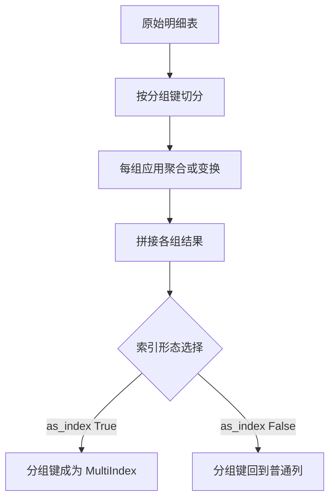
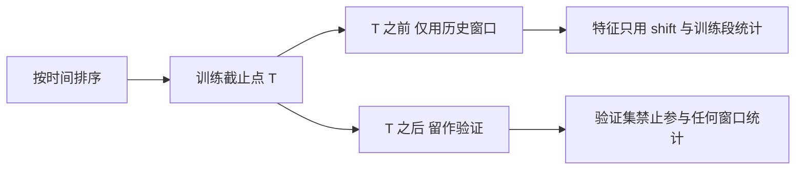
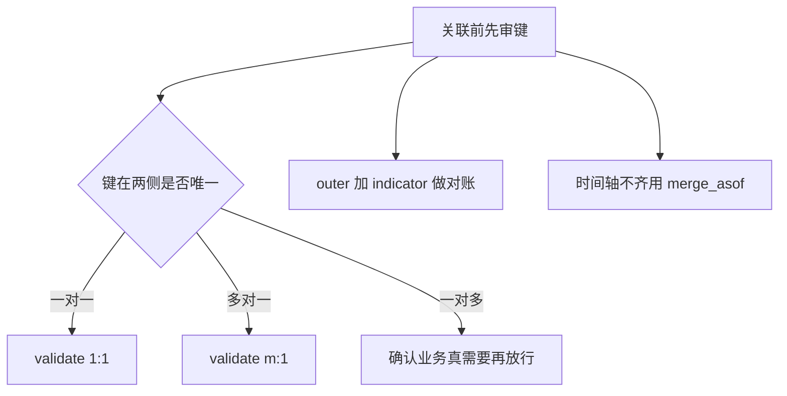
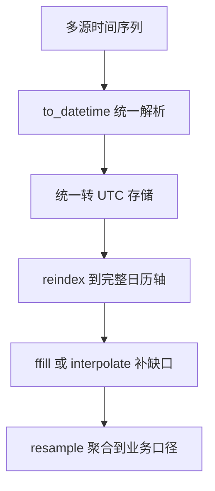
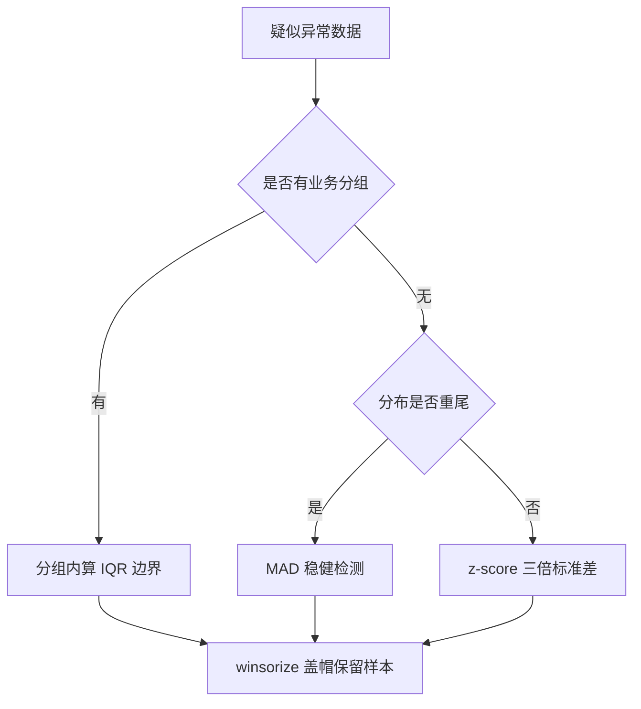
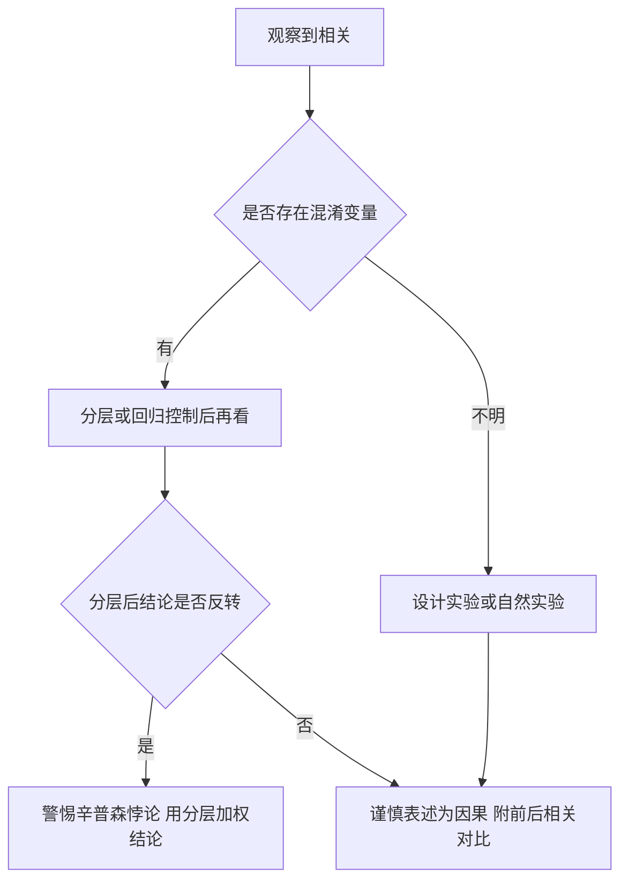
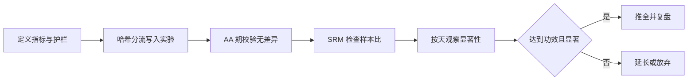
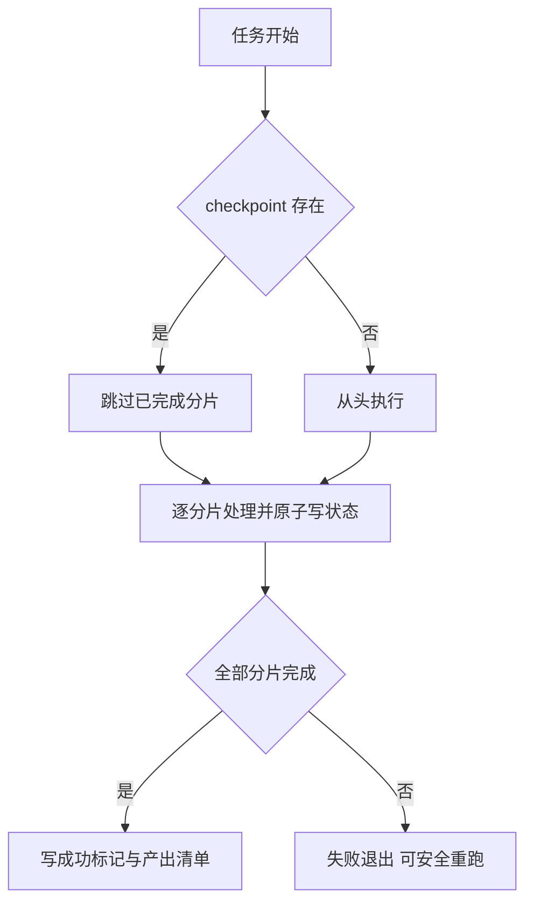

# 第 5 类 · 数据分析与工程化(55)

> 本卷是 05a 的进阶篇:聚焦 groupby/窗口/merge/多层索引的深水区用法,时间序列与重采样的业务口径,缺失机制与稳健异常检测,统计推断与 A/B 实验的工程实现,以及留存、漏斗、RFM 等增长分析的落地代码。
> 第二条主线是"数据工程化":大文件优化、管道断点续跑、数据契约、指标口径字典、特征存储与定时报表,全部给出可运行实现。
> 每题代码以 pandas/numpy 优先,均用 try/except ImportError 提供标准库降级演示,保证无第三方依赖也能跑通核心思路。

---

### Q1021 · groupby 多键聚合与结果层级还原

> 难度:★★★☆ | 标签:pandas, groupby

**问**:多列 groupby 之后结果索引变成了 MultiIndex,报表要一维平铺,你一般怎么处理?有哪些坑?

**答**:多键 groupby 默认 `as_index=True`,分组键会变成行上的 MultiIndex。报表导出场景推荐直接 `as_index=False`,让分组键回到普通列,一步到位;已经拿到 MultiIndex 结果时用 `reset_index()` 事后还原。两个常见坑:一是分组键顺序决定结果排序与层级结构,`sort=False` 可以保留原始出现顺序;二是分组键为 category 类型时,groupby 默认会输出所有类别组合(包括空组),要用 `observed=True` 只输出实际出现的组合,否则笛卡尔组合会让结果行数暴涨。

```python
# file: code/05_数据分析与工程化/q1021_multikey_groupby.py
try:
    import pandas as pd
except ImportError:
    pd = None

if pd is None:
    # 标准库降级:多键分组求和,输出平铺行
    from collections import defaultdict
    rows = [("华东", "A", 10), ("华东", "B", 20), ("华东", "A", 5), ("华北", "A", 40)]
    agg = defaultdict(float)
    for region, product, amount in rows:
        agg[(region, product)] += amount
    for key in sorted(agg):
        print(key[0], key[1], agg[key])
else:
    df = pd.DataFrame({
        "region": ["华东", "华东", "华东", "华北", "华北"],
        "product": ["A", "A", "B", "A", "B"],
        "amount": [10, 20, 5, 40, 50],
    })
    # 默认 as_index=True,分组键进 MultiIndex
    multi = df.groupby(["region", "product"])["amount"].sum()
    print(multi, end="\n\n")
    # 平铺方案一:as_index=False,键回到普通列,报表场景首选
    print(df.groupby(["region", "product"], as_index=False)["amount"].sum(), end="\n\n")
    # 平铺方案二:事后 reset_index 还原
    print(multi.reset_index())
```

**追问**:
- 追问 1:聚合后列名和顺序不规范怎么办?—— 用下一题的命名聚合,或聚合完立刻 `rename` 成业务列名。
- 追问 2:聚合结果行数远超预期像笛卡尔积?—— 先查键列是否有脏值,再用 `drop_duplicates` 检查每键唯一性,category 键记得加 `observed=True`。

### Q1022 · 命名聚合 named aggregation

> 难度:★★☆☆ | 标签:pandas, groupby

**问**:写 `df.groupby("region").agg(("amount", "sum"))` 这类代码时列名经常变成自动拼接的乱码,怎么优雅解决?

**答**:用命名聚合:`agg(新列名=("列名", "函数"))`,输出列名完全由你控制,不再出现 `amount_sum` 这种隐式拼接,也不再依赖字典写法在 Python 3.8+ 下的兼容问题。它还允许对同一列取多个指标、对不同列取不同指标混在同一个 agg 里,可读性远高于传统写法。命名聚合是 pandas 0.25+ 的官方推荐,代码评审时可以当作团队规范固定下来。

```python
# file: code/05_数据分析与工程化/q1022_named_aggregation.py
try:
    import pandas as pd
except ImportError:
    pd = None

if pd is None:
    from collections import defaultdict
    rows = [("华东", 10, "o1"), ("华东", 20, "o2"), ("华北", 40, "o3")]
    total, cnt, mx = defaultdict(float), defaultdict(int), defaultdict(lambda: float("-inf"))
    for region, amount, _ in rows:
        total[region] += amount
        cnt[region] += 1
        mx[region] = max(mx[region], amount)
    for region in sorted(total):
        print(region, total[region], total[region] / cnt[region], cnt[region], mx[region])
else:
    df = pd.DataFrame({
        "region": ["华东", "华东", "华北", "华北"],
        "order_id": ["o1", "o2", "o3", "o4"],
        "amount": [10, 20, 40, 50],
    })
    out = df.groupby("region").agg(
        total_amount=("amount", "sum"),
        avg_amount=("amount", "mean"),
        n_orders=("order_id", "count"),
        max_amount=("amount", "max"),
    )
    print(out.reset_index())
```

**追问**:
- 追问 1:命名聚合和 `NamedAgg` 什么关系?—— `total=("amount", "sum")` 是 `total=pd.NamedAgg("amount", "sum")` 的语法糖。
- 追问 2:聚合结果列顺序由什么决定?—— 由 agg 里关键字参数的书写顺序决定,正好符合"写什么顺序出什么列"的直觉。

### Q1023 · 自定义 agg 与多函数聚合的列名展开

> 难度:★★★☆ | 标签:pandas, groupby

**问**:除了内置的 sum/mean,groupby 怎么接自定义聚合函数?对一列同时用多个函数时结果是什么样的?

**答**:agg 可以接具名函数、lambda 或函数列表。传函数列表时结果列会变成 MultiIndex(列名, 函数名),导出前通常要拍平。自定义函数要注意性能:它是 Python 层回调,每个分组调用一次,慢于内置的 Cython 实现,能用内置函数(如 `sum`、`quantile`)就不要手写;另外 lambda 聚合出的列名固定是 `<lambda>`,建议用具名函数让列名可读。

```python
# file: code/05_数据分析与工程化/q1023_custom_agg.py
try:
    import pandas as pd
except ImportError:
    pd = None

def spread(values):
    """自定义极差聚合:标准库里也用同一套逻辑演示"""
    return max(values) - min(values)

if pd is None:
    from collections import defaultdict
    rows = [("华东", 10), ("华东", 25), ("华北", 40), ("华北", 50)]
    g = defaultdict(list)
    for region, amount in rows:
        g[region].append(amount)
    for region, values in g.items():
        print(region, spread(values), sum(values))
else:
    df = pd.DataFrame({
        "region": ["华东", "华东", "华北", "华北"],
        "amount": [10, 25, 40, 50],
    })
    # 多函数聚合产生 MultiIndex 列
    out = df.groupby("region").agg({"amount": [spread, "sum", "mean"]})
    print(out.columns.tolist())
    # 拍平列名再导出
    out.columns = ["_".join(map(str, c)) for c in out.columns]
    print(out.reset_index())
```

**追问**:
- 追问 1:自定义函数想拿到列名以外的东西怎么办?—— 用 `apply` 拿整个子 DataFrame,或升级到 `numba`/向量化实现。
- 追问 2:`transform` 与 `agg` 接自定义函数的区别?—— agg 每组返回一个标量,transform 每组返回与组等长的序列并自动对齐回原表。

### Q1024 · 组内排名 rank 与 method 参数

> 难度:★★★☆ | 标签:pandas, groupby

**问**:需求是"每个城市销量前 3 的商品",组内排名你会怎么写?并列名次怎么处理?

**答**:用 `groupby(键)[值].rank()`,配 `ascending=False` 降序。关键是 `method` 参数:`average` 并列取平均(默认)、`min` 并列取最小名次(竞赛排名)、`first` 按出现顺序强分先后、`dense` 并列占一个名次且不跳号。业务上"并列同分"和"先到先得"是两种口径,选错 method 会直接影响 Top-N 名单;pct=True 还能拿到百分位排名。排名后再 `rank <= 3` 过滤即得各组前三。

```python
# file: code/05_数据分析与工程化/q1024_group_rank.py
try:
    import pandas as pd
except ImportError:
    pd = None

if pd is None:
    from collections import defaultdict
    rows = [("bj", "A", 100), ("bj", "B", 100), ("bj", "C", 80), ("sh", "A", 90)]
    g = defaultdict(list)
    for city, product, amount in rows:
        g[city].append((amount, product))
    for city, items in g.items():
        items.sort(key=lambda x: -x[0])
        print(city, [(p, i + 1) for i, (a, p) in enumerate(items)])
else:
    df = pd.DataFrame({
        "city": ["bj", "bj", "bj", "sh"],
        "product": ["A", "B", "C", "A"],
        "amount": [100, 100, 80, 90],
    })
    df["rank_dense"] = df.groupby("city")["amount"].rank(method="dense", ascending=False)
    df["rank_first"] = df.groupby("city")["amount"].rank(method="first", ascending=False)
    df["rank_min"] = df.groupby("city")["amount"].rank(method="min", ascending=False)
    df["rank_pct"] = df.groupby("city")["amount"].rank(pct=True)
    print(df)
    top3 = df[df.groupby("city")["amount"].rank(method="first", ascending=False) <= 3]
    print(top3[["city", "product", "amount"]])
```

**追问**:
- 追问 1:并列时想严格分先后按什么排?—— `method="first"`,内部按原表顺序;要先按二级指标再排,先 sort_values 再 rank。
- 追问 2:rank 和 nlargest 的取舍?—— 每组取少量 Top 用 `groupby.head`/`nlargest` 更省,需要完整名次列时用 rank。

### Q1025 · 组级筛选 filter 与组内序号 cumcount

> 难度:★★★☆ | 标签:pandas, groupby

**问**:想保留"总销量达到阈值的整个分组",以及给用户的行为序列编号,分别怎么做?

**答**:组级筛选用 `groupby(键).filter(谓词)`,谓词函数接收每个分组子表并返回布尔值,返回 True 的整组保留,这是"按组指标过滤"的标准姿势,比先聚合再 merge 回去更直接。组内序号用 `cumcount()`,从 0 开始给组内行编号,常见用途:构造会话内第 N 次点击、配合 `cumcount() == 0` 取每组第一条等价于按组去重。两者都要求先想清楚排序键,序号的业务含义完全由排序决定。

```python
# file: code/05_数据分析与工程化/q1025_group_filter_cumcount.py
try:
    import pandas as pd
except ImportError:
    pd = None

if pd is None:
    from collections import defaultdict
    rows = [("bj", 10), ("bj", 25), ("sh", 5), ("sh", 6)]
    g = defaultdict(list)
    for city, amount in rows:
        g[city].append(amount)
    print("组级筛选:仅保留合计>=30 的组 ->", {k: v for k, v in g.items() if sum(v) >= 30})
else:
    df = pd.DataFrame({
        "user": ["u1", "u1", "u1", "u2"],
        "event": ["view", "cart", "pay", "view"],
        "amount": [10, 25, 5, 6],
    })
    # 组级筛选:只保留组内 amount 合计 >= 30 的组
    big = df.groupby("user").filter(lambda g: g["amount"].sum() >= 30)
    print(big, end="\n\n")
    # 组内序号:用户行为序列编号,并取每个用户第一条事件
    df = df.sort_values(["user", "event"])
    df["seq"] = df.groupby("user").cumcount() + 1
    first_event = df[df.groupby("user").cumcount() == 0]
    print(df, end="\n\n")
    print(first_event)
```

**追问**:
- 追问 1:filter 的谓词里能做复杂判断吗?—— 能,函数拿到完整子表,可以算多列组合指标,但要保持返回单个布尔值。
- 追问 2:cumcount 与 `ngroup()` 的区别?—— cumcount 是组内行号,ngroup 是组本身的序号,两者配合能唯一标识"第几组的第几行"。



### Q1026 · shift/diff/pct_change 算同比环比

> 难度:★★★☆ | 标签:pandas, 时间序列

**问**:日报要算指标的环比和同比,用 pandas 怎么实现?最容易踩的坑是什么?

**答**:环比用 `pct_change()`(等价于 `s / s.shift(1) - 1`),同比用 `s / s.shift(周期数) - 1`,月度数据周期是 12、周报表是 52。最大的坑是数据缺口:序列只要缺一期,`shift(12)` 错的就是位置而不是真正的"去年同期",所以同比前必须先把索引 reindex 成完整日历轴;另一个坑是首期/同比基期缺失产生的 NaN 和除零(`fill_method` 与 `fill_value` 按需处理)。工程上建议同比环比统一封装成一个函数,口径只写一遍。

```python
# file: code/05_数据分析与工程化/q1026_shift_yoy_mom.py
try:
    import pandas as pd
except ImportError:
    pd = None

if pd is None:
    values = [100, 110, 105, 120, 130]
    for i, v in enumerate(values):
        mom = v / values[i - 1] - 1 if i > 0 else None
        print(f"day{i} 值 {v} 环比 {mom if mom is None else f'{mom:.1%}'}")
else:
    s = pd.Series(
        [100, 110, 105, 120, 130],
        index=pd.date_range("2026-01-01", periods=5, freq="D"),
        name="gmv",
    )
    mom = s.pct_change()                 # 环比
    wow = s / s.shift(7) - 1             # 周同比思路,月度数据用 shift(12)
    diff = s.diff()                      # 绝对增量
    out = pd.DataFrame({"gmv": s, "mom": mom, "wow": wow, "delta": diff})
    print(out)
    # 有缺日时先补齐日历轴再算,否则 shift 的是位置不是时间
    s2 = s.drop(s.index[1])
    fixed = s2.reindex(pd.date_range(s2.index[0], s2.index[-1], freq="D"))
    print("缺日时 pct_change 错位:", fixed.pct_change().tolist())
```

**追问**:
- 追问 1:为什么同比前必须 reindex?—— shift 按位置移动,缺一期时 shift(12) 拿到的是第 11 期前的值,同口径比较就错了。
- 追问 2:基期为 0 或负数怎么办?—— 环比无意义,改算差值 diff,或声明为 NaN 而不是 inf。

### Q1027 · rolling 时间偏移窗口与 min_periods

> 难度:★★★☆ | 标签:pandas, 时间序列

**问**:rolling(7) 和 rolling("7D") 有什么区别?min_periods 什么时候必须配?

**答**:固定行数窗口 `rolling(7)` 按行数取窗口,序列缺日时窗口实际跨度会超过 7 天,口径失真;时间偏移窗口 `rolling("7D")` 要求 DatetimeIndex,按"含当天的过去 7 个自然日"取数,缺日时窗口仍是真实时间跨度,是业务报表的正确选择。`min_periods` 控制窗口最少需要多少个观测才输出:默认等于窗口大小,序列头部会全是 NaN;冷启动场景配 `min_periods=1` 可以从第一天就出数,但要明白前面的值方差很大。时间窗口默认区间是右闭,`closed` 可改。

```python
# file: code/05_数据分析与工程化/q1027_rolling_time_window.py
try:
    import pandas as pd
except ImportError:
    pd = None

if pd is None:
    print("标准库演示:3 天移动平均,缺日不补")
    days = ["01-01", "01-03", "01-04", "01-05"]
    values = [1, 2, 3, 4]
    for i in range(len(values)):
        lo = max(0, i - 2)
        window = values[lo:i + 1]
        print(days[i], window, sum(window) / len(window))
else:
    idx = pd.to_datetime(["2026-01-01", "2026-01-03", "2026-01-04", "2026-01-05"])
    s = pd.Series([1.0, 2.0, 3.0, 4.0], index=idx)
    print(s.rolling(3, min_periods=1).mean(), end="\n\n")
    # 时间窗:即使 01-02 缺失,窗口仍是自然 3 天跨度
    print(s.rolling("3D", min_periods=1).mean())
```

**追问**:
- 追问 1:rolling("7D") 能算过去 7 个工作日吗?—— 不能,自然日窗口包含周末,工作日口径要先按 bdate_range 重采样或过滤。
- 追问 2:窗口里想用加权平均呢?—— 用 `rolling(...).apply(自定义函数, raw=True)`,性能不如内置均值,注意冷启动 NaN。

### Q1028 · expanding 累计指标与阈值监控

> 难度:★★☆☆ | 标签:pandas, 时间序列

**问**:运营要"从上线到当前的累计 GMV"和"历史新高告警",这类逐日累计口径怎么算?

**答**:累计口径用 `expanding()`:它是一个左端固定、右端随时间增长的特殊窗口,`expanding().sum()/.mean()/.max()` 分别给累计和、累计均值、历史最高。历史新高检测可以用 `s >= s.cummax()` 或 `expanding().max()` 对比;阈值监控则把累计序列与预警线做比较并输出触发时点。注意累计序列对早期数据极其敏感,起始点选择(灰度期是否计入)本身就是口径决策,要在指标文档里写死。

```python
# file: code/05_数据分析与工程化/q1028_expanding_metrics.py
try:
    import pandas as pd
except ImportError:
    pd = None

if pd is None:
    values = [10, 12, 9, 15]
    run_sum = run_max = 0
    for i, v in enumerate(values):
        run_sum += v
        run_max = max(run_max, v)
        print(f"day{i} 累计 {run_sum} 历史最高 {run_max} 是否新高 {v == run_max}")
else:
    s = pd.Series([10, 12, 9, 15], index=pd.date_range("2026-01-01", periods=4, freq="D"))
    out = pd.DataFrame({
        "gmv": s,
        "cum_gmv": s.expanding().sum(),
        "cum_avg": s.expanding().mean().round(2),
        "hist_max": s.expanding().max(),
    })
    out["is_record"] = s >= out["hist_max"]
    print(out)
    # CUSUM 累积偏移,常用于漂移监控
    print("cusum:", s.sub(s.mean()).cumsum().round(2).tolist())
```

**追问**:
- 追问 1:累计指标想按月重置怎么写?—— 先 `groupby(年月)` 再 expanding,或在分组键里加入账期。
- 追问 2:expanding 和 cumsum 的区别?—— cumsum 只有求和;expanding 是窗口对象,能套任意聚合函数。

### Q1029 · 组内滚动 groupby 与 rolling 连用

> 难度:★★★★ | 标签:pandas, groupby

**问**:要给每个城市算自己的 7 日移动平均,直接 `df.groupby("city").rolling(7)` 会得到什么结构?怎么对齐回原表?

**答**:groupby 加 rolling 会按组独立滑动,结果索引变成"分组键 + 时间"的双层 MultiIndex,直接赋值回原表会报索引不匹配。两种工程写法:一是链式结果 `reset_index()` 拍平成新表;二是 `groupby(键)[列].transform(lambda s: s.rolling(n).mean())`,transform 返回与原表同长同序的序列,可直接赋新列。前提都是先把数据按时间排好,组内 rolling 不会替你排序。

```python
# file: code/05_数据分析与工程化/q1029_groupby_rolling.py
try:
    import pandas as pd
except ImportError:
    pd = None

if pd is None:
    from collections import defaultdict
    rows = [("bj", 10), ("bj", 12), ("bj", 11), ("sh", 20), ("sh", 22), ("sh", 21)]
    g = defaultdict(list)
    for city, t in rows:
        g[city].append(t)
    for city, values in g.items():
        ma = [sum(values[max(0, i - 1):i + 1]) / len(values[max(0, i - 1):i + 1]) for i in range(len(values))]
        print(city, values, "ma2:", [round(x, 2) for x in ma])
else:
    df = pd.DataFrame({
        "city": ["bj", "bj", "bj", "sh", "sh", "sh"],
        "t": [10, 12, 11, 20, 22, 21],
    })
    # 写法一:链式 rolling 后拍平
    chained = df.groupby("city")["t"].rolling(2, min_periods=1).mean().reset_index()
    print(chained, end="\n\n")
    # 写法二:transform 对齐回原表,报表常用
    df["ma2"] = df.groupby("city")["t"].transform(lambda s: s.rolling(2, min_periods=1).mean())
    print(df)
```

**追问**:
- 追问 1:transform 里能直接写 `s.rolling(7).mean()` 吗?—— 能,lambda 拿到的是每组独立 Series,滚动在组内完成。
- 追问 2:组内时间窗呢?—— 需要把时间设为索引后 `groupby(键).resample("7D")`,或组内 rolling("7D") 要求每组都是 DatetimeIndex,一般先 set_index 再分组。

### Q1030 · ewm 指数加权与 halflife

> 难度:★★★☆ | 标签:pandas, 时间序列

**问**:移动平均对突发变化反应慢,有没有更跟手的平滑方法?ewm 的参数怎么选?

**答**:指数加权平均 `ewm()` 对近样本给高权重、远样本按指数衰减,响应速度和平滑度可调。三种参数等价互通:`alpha` 直接给衰减系数,`span=n` 约等于 n 期 SMA 的平滑度,`halflife=h` 表示 h 期后权重减半,业务上 halflife 最直观(半衰期 3 天就是 3 天前的样本权重掉一半)。`adjust=True` 用精确加权起点更准,`adjust=False` 是递推形式,常用于在线更新。ewm 不需要窗口长度、天然处理冷启动,组内使用时同样套 transform。

```python
# file: code/05_数据分析与工程化/q1030_ewm_halflife.py
try:
    import pandas as pd
except ImportError:
    pd = None

if pd is None:
    values = [10.0, 11.0, 11.0, 30.0, 12.0]
    alpha = 0.5
    ema = values[0]
    for v in values:
        ema = alpha * v + (1 - alpha) * ema
        print(round(ema, 2), end=" ")
    print("\n标准库递推即 adjust=False 语义")
else:
    s = pd.Series([10, 11, 11, 30, 12], dtype="float64")
    out = pd.DataFrame({
        "raw": s,
        "ewm_span4": s.ewm(span=4, adjust=False).mean().round(2),
        "ewm_hl2": s.ewm(halflife=2).mean().round(2),
        "sma3": s.rolling(3, min_periods=1).mean().round(2),
    })
    print(out)
```

**追问**:
- 追问 1:ewm 能做组内平滑吗?—— 能,`groupby(键)[列].transform(lambda s: s.ewm(halflife=3).mean())`。
- 追问 2:ewm 和 rolling 的本质差异?—— rolling 是等权有限窗口,ewm 是无限窗口指数权重,前者抗离群点传播、后者响应快。

### Q1031 · 窗口特征的数据泄露

> 难度:★★★★ | 标签:特征工程, 数据泄露

**问**:用 rolling/shift 做特征喂给模型,什么是数据泄露?怎么从代码层面防住?

**答**:泄露指训练时用到了预测时点不可得的信息,常见三种:窗口包含未来样本(rolling 默认含当前行,标签也算进去了)、用全量数据算归一化统计量(均值方差来自验证期)、目标编码没有按时间切分。防护三板斧:特征只用 `shift(1)` 之后的历史;所有统计量只在训练段 fit、再应用到验证段;时间切分点之前的数据参与统计,之后的只做验证。评审时看到"没有时间概念的 mean/std/merge 统计"就应标记为疑似泄露。

```python
# file: code/05_数据分析与工程化/q1031_window_leakage.py
try:
    import pandas as pd
except ImportError:
    pd = None

if pd is None:
    print("标准库演示:滞后特征只用过去,标准化只用训练段统计")
    ys = [10, 11, 12, 13, 14, 100]
    train = ys[:4]
    mu = sum(train) / len(train)
    for i, y in enumerate(ys):
        lag1 = ys[i - 1] if i > 0 else None
        z = (y - mu) / (sum((t - mu) ** 2 for t in train) / len(train)) ** 0.5
        print(f"t{i} y={y} lag1={lag1} z_train_std={z:.2f}")
else:
    df = pd.DataFrame({"t": range(6), "y": [10, 11, 12, 13, 14, 100]})
    # 正确:滞后特征,只用过去
    df["lag1"] = df["y"].shift(1)
    train = df.iloc[:4]
    # 错误:全量标准化把验证期 100 算进均值方差
    df["z_bad"] = (df["y"] - df["y"].mean()) / df["y"].std()
    # 正确:统计量只用训练段
    df["z_good"] = (df["y"] - train["y"].mean()) / train["y"].std()
    print(df.round(2))
    assert df["z_bad"].round(6).tolist() != df["z_good"].round(6).tolist(), "两种口径应有差异"
    print("两种口径数值不同,说明全量统计确实泄露了验证期信息")
```

**追问**:
- 追问 1:rolling 算特征时当前行算不算未来?—— 若特征与标签同行产生,滚动窗口默认含当前行就是泄露,先 shift(1) 再 rolling。
- 追问 2:怎么在 CI 里自动防泄露?—— 写单元测试断言"特征在 t 时刻的值只依赖 t 之前数据",打乱未来数据后特征不变。



### Q1032 · merge 的 validate 防键膨胀

> 难度:★★★☆ | 标签:pandas, merge

**问**:两表 join 之后行数翻了几倍,你有什么手段在 merge 阶段就把这类问题拦住?

**答**:用 `merge` 的 `validate` 参数声明预期的键关系:`"1:1"` 一对一、`"1:m"`/`"m:1"` 一对多、`"m:m"` 多对多。实际数据不满足时 pandas 直接抛 `MergeError`,把"上游脏数据"从静默膨胀变成立刻失败,这比事后 `assert len(df) == n` 早得多、也准得多。工程上凡是有业务含义的一对多关系(订单对用户)都应显式声明 m:1,凡期望唯一的主数据关联一律声明 1:1,配合 merge 前的 `drop_duplicates(subset=键)` 使用效果最好。

```python
# file: code/05_数据分析与工程化/q1032_merge_validate.py
try:
    import pandas as pd
except ImportError:
    pd = None

if pd is None:
    from collections import Counter
    users = [("u1", "vip"), ("u2", "normal")]
    orders = [("o1", "u1"), ("o2", "u1"), ("o3", "u2")]
    cnt = Counter(uid for _, uid in orders)
    for uid, level in users:
        print(uid, level, "订单数", cnt.get(uid, 0))
    dup = [("u1", "vip"), ("u1", "old")]  # 用户表键不唯一,m:1 校验会失败
    print("用户表键重复:", [k for k, v in Counter(u for u, _ in dup).items() if v > 1])
else:
    users = pd.DataFrame({"user_id": ["u1", "u2"], "level": ["vip", "normal"]})
    orders = pd.DataFrame({"order_id": ["o1", "o2", "o3"], "user_id": ["u1", "u1", "u2"]})
    m = orders.merge(users, on="user_id", validate="m:1")
    print(m, end="\n\n")
    bad_users = pd.DataFrame({"user_id": ["u1", "u1", "u2"], "level": ["vip", "old", "normal"]})
    try:
        orders.merge(bad_users, on="user_id", validate="m:1")
    except pd.errors.MergeError as e:
        print("键膨胀被拦截:", e)
```

**追问**:
- 追问 1:validate 检查的是哪一侧的键?—— 关系两侧都检查,任何一侧不满足声明就报错。
- 追问 2:如果业务真的需要 m:m?—— 显式声明 `validate="m:m"` 表示接受,但要在注释里写清膨胀是预期行为并评估行数。

### Q1033 · merge indicator 数据对账

> 难度:★★★☆ | 标签:pandas, merge, 数据质量

**问**:两张表对不上账,怎么快速定位哪些键只在一侧存在?

**答**:用 `how="outer"` 加 `indicator=True`,结果多出 `_merge` 列,取值 `left_only`/`right_only`/`both`,一次 merge 就能把"左表独有、右表独有、两侧都有"三类分开,再分别 `value_counts` 看对账差异。典型场景:事实表里出现 `left_only` 的维度键说明维度表缺数据(产生孤儿记录),维度表 `right_only` 说明有多余主数据。对账结果建议落盘而不是只打印,方便给上游修复。

```python
# file: code/05_数据分析与工程化/q1033_merge_indicator.py
try:
    import pandas as pd
except ImportError:
    pd = None

if pd is None:
    a = {"k1", "k2", "k3"}
    b = {"k2", "k3", "k4"}
    print("仅左表:", a - b, "仅右表:", b - a, "两侧都有:", a & b)
else:
    orders = pd.DataFrame({"order_id": ["o1", "o2", "o3"], "user_id": ["u1", "u2", "u9"]})
    users = pd.DataFrame({"user_id": ["u1", "u2", "u7"], "level": ["vip", "normal", "vip"]})
    m = orders.merge(users, on="user_id", how="outer", indicator=True)
    print(m, end="\n\n")
    print(m["_merge"].value_counts())
    orphans = m.loc[m["_merge"] == "left_only", "user_id"]
    print("孤儿订单的用户:", orphans.tolist())
```

**追问**:
- 追问 1:全量 outer 对账太大怎么办?—— 先在键级别做集合差再对差集明细展开,或抽样后人工核对。
- 追问 2:indicator 能自定义列名吗?—— `indicator="src"` 会把结果列命名为 src,避免与已有 `_merge` 冲突。

### Q1034 · 多键 merge 与 suffixes 冲突处理

> 难度:★★★☆ | 标签:pandas, merge

**问**:按 user_id 加日期两列关联,两侧又有同名列,pandas 怎么处理?你有什么规范?

**答**:多键 merge 直接传列表 `on=["user_id", "dt"]`,键的组合相等才匹配;两侧同名的非键列会自动加 `_x`/`_y` 后缀,可读性差,规范做法是 merge 前就重命名或删掉冗余列,必须共存时用 `suffixes=("_fact", "_dim")` 给出业务化后缀。另一个高频坑:同一对键在任一侧重复都会按笛卡尔积展开,多键场景更容易隐形膨胀,所以多键 merge 同样要配 validate,并先检查"键组合"的唯一性而不是单列唯一性。

```python
# file: code/05_数据分析与工程化/q1034_multikey_suffix.py
try:
    import pandas as pd
except ImportError:
    pd = None

if pd is None:
    facts = [("u1", "01-01", 100), ("u1", "01-02", 200)]
    dims = [("u1", "01-01", "vip")]
    for f in facts:
        match = [d for d in dims if d[0] == f[0] and d[1] == f[1]]
        print(f, "->", match[0] if match else None)
else:
    facts = pd.DataFrame({
        "user_id": ["u1", "u1", "u2"],
        "dt": ["01-01", "01-02", "01-01"],
        "amount": [100, 200, 50],
        "level": ["tmp", "tmp", "tmp"],
    })
    dims = pd.DataFrame({
        "user_id": ["u1", "u1", "u2"],
        "dt": ["01-01", "01-02", "01-01"],
        "level": ["vip", "normal", "normal"],
    })
    m = facts.drop(columns=["level"]).merge(
        dims, on=["user_id", "dt"], validate="1:1", suffixes=("_fact", "_dim")
    )
    print(m)
```

**追问**:
- 追问 1:键列在两侧名字不同怎么关联?—— 用 `left_on`/`right_on` 分别指定,merge 后两列都保留,注意去重。
- 追问 2:多键 merge 怎么快速验证唯一性?—— `df.duplicated(subset=["user_id", "dt"]).sum()` 应为 0,或 set_index 后 `index.is_unique`。

### Q1035 · merge_asof 时间就近匹配

> 难度:★★★★ | 标签:pandas, merge, 时间序列

**问**:成交表想关联"成交时刻最近的一条报价",普通 merge 对不上时间怎么办?

**答**:用 `merge_asof`:它按时间列做"就近匹配",左表每行拿右表中不晚于(left backward)该时刻的最近一行,而不是要求时间精确相等,天然适合行情对成交、日志对配置版本这类时间轴不齐的数据。硬性要求:两侧都必须按 `on` 列排序,`by` 指定分组键(如每个标的内部独立匹配),`tolerance` 限制最大可接受时差、超时返回 NaN,`direction` 可选 backward/forward/nearest。用错最多的就是忘记排序,直接抛异常反而是好事。

```python
# file: code/05_数据分析与工程化/q1035_merge_asof.py
try:
    import pandas as pd
except ImportError:
    pd = None

if pd is None:
    import bisect
    quotes = [(10, 9.9), (20, 10.1), (40, 10.4)]
    times = [t for t, _ in quotes]
    for trade_t in (12, 25, 45):
        i = bisect.bisect_right(times, trade_t) - 1
        if i >= 0:
            print(f"成交 {trade_t}s 匹配报价 {quotes[i]}")
else:
    quotes = pd.DataFrame({
        "ts": pd.to_datetime(["10:00:00", "10:00:20", "10:00:40"]),
        "price": [9.9, 10.1, 10.4],
    }).sort_values("ts")
    trades = pd.DataFrame({
        "ts": pd.to_datetime(["10:00:12", "10:00:25", "10:00:45"]),
        "qty": [100, 200, 50],
    }).sort_values("ts")
    m = pd.merge_asof(trades, quotes, on="ts", direction="backward", tolerance=pd.Timedelta("30s"))
    print(m)
```

**追问**:
- 追问 1:分组就近匹配怎么做?—— `by="symbol"`,每个标的只在自己内部找最近报价。
- 追问 2:两边时间都要求排序,谁负责保证?—— merge 前显式 sort_values,并在代码评审把"asof 前必排序"作为固定检查项。



### Q1036 · MultiIndex 创建与 xs 切片

> 难度:★★★☆ | 标签:pandas, 索引

**问**:拿到一个双层索引的 DataFrame,想取"华东下所有产品"或"华东-产品 A"这一格,xs 怎么用?

**答**:MultiIndex 常由 `set_index([列1, 列2])` 或 groupby 多键产生。`xs` 是按层取子集的利器:`df.xs("华东", level="region")` 拿某层的一个值的所有行,`df.xs(("华东", "A"))` 可以一次传多层元组,`drop_level=False` 保留被取走的那一层。xs 与布尔掩码相比写法更短且语义清晰,但它一次只能对每层给一个具体值;要取列表集合还是得 `.loc[滑片/掩码]` 或 `IndexSlice`。

```python
# file: code/05_数据分析与工程化/q1036_multiindex_xs.py
try:
    import pandas as pd
except ImportError:
    pd = None

if pd is None:
    rows = {("华东", "A"): 10, ("华东", "B"): 20, ("华北", "A"): 30}
    print("华东层:", {k: v for k, v in rows.items() if k[0] == "华东"})
    print("华东-A:", rows.get(("华东", "A")))
else:
    df = pd.DataFrame({
        "region": ["华东", "华东", "华北"],
        "product": ["A", "B", "A"],
        "amount": [10, 20, 30],
    })
    mi = df.set_index(["region", "product"]).sort_index()
    print(mi, end="\n\n")
    print(mi.xs("华东", level="region"), end="\n\n")
    print(mi.xs(("华东", "B")), end="\n\n")
    print(mi.xs("A", level="product", drop_level=False))
```

**追问**:
- 追问 1:想一次取多层中的多个值呢?—— `mi.loc[pd.IndexSlice[:, ["A", "B"]], :]` 或布尔掩码。
- 追问 2:xs 能取列层吗?—— 能,`axis=1` 时对列索引切片,透视表场景常用。

### Q1037 · stack/unstack 长宽还原

> 难度:★★★☆ | 标签:pandas, 透视

**问**:unstack 和 stack 分别把数据变成什么样?生成的多级列怎么管理?

**答**:`unstack` 把行索引的最内层"旋转"成列索引,长表变宽表;`stack` 是逆操作,把列索引压回行索引。可以传 `level` 指定旋转哪一层、`fill_value` 填充旋转产生的缺失、`dropna=False` 保留全空组合。宽表便于报表和对比,长表便于画图和继续 groupby,两者互转要形成肌肉记忆;转出来的多层列在导出 Excel 前记得拍平,否则表头嵌套且某些工具读不了。

```python
# file: code/05_数据分析与工程化/q1037_stack_unstack.py
try:
    import pandas as pd
except ImportError:
    pd = None

if pd is None:
    rows = [("bj", 1, 10), ("bj", 2, 20), ("sh", 1, 30)]
    wide = {}
    for city, month, v in rows:
        wide[(city, month)] = v
    cities = sorted({c for c, _ in wide})
    months = sorted({m for _, m in wide})
    for c in cities:
        print(c, [wide.get((c, m), None) for m in months])
else:
    long = pd.DataFrame({
        "city": ["bj", "bj", "sh", "sh"],
        "month": [1, 2, 1, 2],
        "sales": [10, 20, 30, 40],
    })
    wide = long.pivot(index="city", columns="month", values="sales")
    print(wide, end="\n\n")
    print(wide.stack(), end="\n\n")
    print(wide.stack().unstack(level="month"))
```

**追问**:
- 追问 1:unstack 后出现 NaN 说明什么?—— 该行列组合在原长表不存在,业务上想补零用 fill_value=0,想保留缺失就别填。
- 追问 2:stack 默认会丢全 NaN 行吗?—— 会,`dropna=True` 是默认行为,审计口径时要显式关掉。

### Q1038 · 多级列拍平与 reset_index 还原

> 难度:★★☆☆ | 标签:pandas, 透视

**问**:groupby 多函数聚合后列是双层结构,导出 Excel 前怎么拍平最稳?

**答**:两层列拍平的标准写法是列表推导 `"|".join(map(str, col))`,把元组列名拼成 `amount|sum` 这样的单层字符串列;若只想去掉某一层用 `droplevel(0/1)`;行方向的多层索引用 `reset_index(level=...)` 选择性还原。导出前统一拍平是团队规范,因为 Excel、BI 工具和下游脚本大多不认嵌套表头;拍平时建议用下划线或竖线做分隔符并立刻 rename 成业务可读名。

```python
# file: code/05_数据分析与工程化/q1038_flatten_columns.py
try:
    import pandas as pd
except ImportError:
    pd = None

if pd is None:
    print("标准库演示:把 (列, 函数) 元组拼成单层列名")
    cols = [("amount", "sum"), ("amount", "mean")]
    print(["_".join(map(str, c)) for c in cols])
else:
    df = pd.DataFrame({
        "region": ["华东", "华东", "华北", "华北"],
        "amount": [10, 20, 30, 40],
    })
    g = df.groupby("region").agg({"amount": ["sum", "mean"]})
    print("双层列:", g.columns.tolist(), end="\n\n")
    g.columns = ["_".join(map(str, c)) for c in g.columns]
    print(g.reset_index())
```

**追问**:
- 追问 1:`reset_index()` 什么都不传会发生什么?—— 还原全部行索引层,多层时按外层到内层顺序生成多列。
- 追问 2:droplevel 后列名重复怎么办?—— pandas 允许重复列但后续操作易错,拍平时加序号或业务前缀保证唯一。


### Q1039 · category 的内存收益与转化陷阱

> 难度:★★★☆ | 标签:pandas, 性能

**问**:什么情况下把字符串列转 category 收益最大?转化后有哪些容易踩的坑?

**答**:category 用整数 codes 加一张类别字典表示字符串,基数低、重复度高的列(城市、状态、渠道)内存能降一个数量级,groupby/sort 也更快。三个经典坑:切片后残留未使用的类别,占内存且会让 groupby 出空组,要 `cat.remove_unused_categories()`;两个 category 列合并时类别集合不一致会被升回 object,应先 `union_categoricals` 或统一 dtype;把高基数字段(用户 ID)转 category 反而膨胀,先算基数占比再决定。另外 groupby 默认会输出所有类别组合,加 `observed=True` 只保留实际出现的。

```python
# file: code/05_数据分析与工程化/q1039_category_memory.py
try:
    import pandas as pd
except ImportError:
    pd = None

if pd is None:
    from collections import Counter
    values = ["beijing", "shanghai"] * 50
    codes = {v: i for i, v in enumerate(sorted(set(values)))}
    print("类别字典:", codes)
    print("存储为 codes 列表长度:", len(values), "类别数:", len(codes))
else:
    big = pd.DataFrame({"city": ["beijing", "shanghai"] * 50_000})
    print("object 内存:", big.memory_usage(deep=True).sum())
    big["city_c"] = big["city"].astype("category")
    print("category 内存:", big["city_c"].memory_usage(deep=True).sum())
    sub = big[big["city"] == "beijing"]
    print("切片残留类别数:", len(sub["city_c"].cat.categories))
    print("清理后类别数:", len(sub["city_c"].cat.remove_unused_categories().cat.categories))
```

**追问**:
- 追问 1:怎么判断一列值不值得转 category?—— `nunique / len` 占比低(经验上百分之几以下)且是字符串时收益大。
- 追问 2:category 与 groupby 的 observed 参数什么关系?—— 不加 observed 会按类别全集分组输出空组,聚合结果行数虚高。

### Q1040 · 有序分类 CategoricalDtype 与业务排序

> 难度:★★★☆ | 标签:pandas, category

**问**:"低/中/高"这类等级字段,想让排序、比较、min/max 都按业务顺序走,怎么做?

**答**:定义 `CategoricalDtype(["低", "中", "高"], ordered=True)` 后 astype,该列就带上了业务序:sort_values 按类别序而不是字典序,`>`/`<` 比较合法,min/max、cut 分箱标签、groupby 输出都会遵循该顺序。这是报表按"高中低"排而非拼音序的标准解法。注意两个 dtype 的 categories 顺序不同则不相等,跨表统一口径时用同一个 CategoricalDtype 对象;未出现在类别列表里的值会变 NaN,新增等级要显式扩 categories。

```python
# file: code/05_数据分析与工程化/q1040_ordered_categorical.py
try:
    import pandas as pd
    from pandas.api.types import CategoricalDtype
except ImportError:
    pd = None

if pd is None:
    order = ["低", "中", "高"]
    rows = [("u1", "中"), ("u2", "高"), ("u3", "低")]
    for user, level in sorted(rows, key=lambda x: order.index(x[1])):
        print(user, level)
else:
    lvl = CategoricalDtype(["低", "中", "高"], ordered=True)
    df = pd.DataFrame({"user": ["u1", "u2", "u3"], "level": ["中", "高", "低"]})
    df["level"] = df["level"].astype(lvl)
    print(df.sort_values("level"), end="\n\n")
    print("min/max:", df["level"].min(), df["level"].max())
    print("比较过滤 高于中:", df[df["level"] > "中"]["user"].tolist())
```

**追问**:
- 追问 1:已有 category 想调整顺序呢?—— `cat.reorder_categories(["低", "中", "高"])`,或 set_categories 重建。
- 追问 2:无序 category 做比较会怎样?—— 直接抛 TypeError,这就是 ordered=False 的保护,提醒你别漏定义顺序。

### Q1041 · str accessor 矢量化与 extract 正则

> 难度:★★☆☆ | 标签:pandas, 字符串

**问**:要给十万行数据解析"AB-001"这种编号,提取前缀和数字部分,循环和 str 方法怎么选?

**答**:用 `Series.str` accessor 做矢量化字符串处理,底层一次遍历且与 pandas 索引自动对齐,比 Python 循环快且不会错位。高频方法:`str.extract(r"([A-Z]+)-(\d+)")` 按捕获组一次拆出多列,`expand=False` 时返回 Series;`str.contains(字面量, regex=False)` 匹配含特殊字符的固定串;`str.strip/lower/slice/replace` 覆盖日常清洗。注意 NaN 会自动传播成 NaN 而不是报错,非字符串 dtype 先 astype(str),超大文本考虑 regex 预编译或先过滤再处理。

```python
# file: code/05_数据分析与工程化/q1041_str_accessor.py
try:
    import pandas as pd
except ImportError:
    pd = None

if pd is None:
    import re
    codes = ["AB-001", "CD-02", None, "EF-3x"]
    pat = re.compile(r"([A-Z]+)-(\d+)")
    for c in codes:
        m = pat.match(c) if c else None
        print(c, "->", (m.group(1), m.group(2)) if m else None)
else:
    df = pd.DataFrame({"code": ["AB-001", "CD-02", None, "EF-3x"]})
    parsed = df["code"].str.extract(r"([A-Z]+)-(\d+)")
    parsed.columns = ["prefix", "num"]
    print(parsed, end="\n\n")
    print("包含连字符:", df["code"].str.contains("-", regex=False).tolist())
    print("长度:", df["code"].str.len().tolist())
    print("补零到 6 位:", df["code"].str.split("-").str[-1].str.zfill(5).tolist())
```

**追问**:
- 追问 1:str.extract 想返回一列而不是 DataFrame?—— `expand=False`,只有一个捕获组时返回 Series。
- 追问 2:str 方法比 Python 循环一定快吗?—— 矢量化省了索引对齐成本通常更快,但复杂正则可能退化为逐行执行,瓶颈在 regex 本身。

### Q1042 · CustomBusinessDay 与节假日历

> 难度:★★★★ | 标签:pandas, 时间序列

**问**:国内有调休(周六上班)和法定节假日,怎么生成"真正的工作日"序列算 SLA 时效?

**答**:内置 `bdate_range` 只会跳过周末,处理不了调休。正确姿势是 `CustomBusinessDay`:用 `weekmask` 定义每周哪几天上班(调休的周六把它加进去),`holidays` 列出法定假日,再喂给 `bdate_range(freq=custom)` 或加减日期;更系统的做法是继承 `AbstractHolidayCalendar` 用规则定义节假日,便于按年维护。业务口径要点:调休逻辑每年变,节假日历要做成配置表由专人维护并进版本管理,别把日历硬编码在脚本里。

```python
# file: code/05_数据分析与工程化/q1042_custom_business_day.py
try:
    import pandas as pd
except ImportError:
    pd = None

if pd is None:
    holidays = {"2026-01-01", "2026-01-02", "2026-01-03"}
    workdays = []
    from datetime import date, timedelta
    d = date(2026, 1, 1)
    while len(workdays) < 3:
        if d.weekday() < 5 and d.isoformat() not in holidays:
            workdays.append(d.isoformat())
        d += timedelta(days=1)
    print("前 3 个工作日:", workdays)
else:
    from pandas.tseries.offsets import CustomBusinessDay
    # 1 月 1 日至 3 日放假,1 月 10 日周六调休上班
    cbd = CustomBusinessDay(
        holidays=["2026-01-01", "2026-01-02", "2026-01-03"],
        weekmask="Mon Tue Wed Thu Fri Sat" if False else "Mon Tue Wed Thu Fri",
    )
    days = pd.bdate_range("2026-01-01", periods=3, freq=cbd)
    print(days.date.tolist())
    # 单独演示调休:把 2026-01-10 周六设为工作日
    cbd2 = CustomBusinessDay(weekmask="Mon Tue Wed Thu Fri Sat", holidays=["2026-01-01"])
    d = pd.Timestamp("2026-01-09") + cbd2
    print("周五加一个工作日 ->", d.date, d.day_name())
```

**追问**:
- 追问 1:算两个日期间的有效工作日数?—— 两端都落到工作日后,`len(bdate_range(start, end, freq=cbd))` 或 `(end - start) // cbd`。
- 追问 2:节假日历怎么与数据管道协作?—— 日历做成维度表/dim_date,管道按日历驱动调度,而不是写死日期。

### Q1043 · between_time/at_time 时段切片

> 难度:★★☆☆ | 标签:pandas, 时间序列

**问**:想只看每天 9 点到 18 点的数据,或者晚上 22 点到次日 2 点的夜间流量,怎么做?

**答**:DatetimeIndex 数据用 `between_time("09:00", "18:00")` 按一天内时刻过滤,`at_time("12:00")` 取精确时刻,与日期无关、只看钟面时间,非常适合营业时段和值班时段分析。跨零点时段直接写 `between_time("22:00", "02:00")`,pandas 会理解为跨夜的区间。前提是索引为 DatetimeIndex,若是普通列先 `set_index` 或用 `.dt` 配合布尔条件;时区要先归一,否则钟面时间在 DST 期会有歧义。

```python
# file: code/05_数据分析与工程化/q1043_between_time.py
try:
    import pandas as pd
except ImportError:
    pd = None

if pd is None:
    from datetime import datetime
    stamps = [datetime(2026, 1, 1, h) for h in (8, 10, 12, 23, 1)]
    for t in stamps:
        ok = 9 <= t.hour <= 18
        print(t.strftime("%H:%M"), "营业时段" if ok else "非营业时段")
else:
    s = pd.Series(range(24), index=pd.date_range("2026-01-01", periods=24, freq="h"))
    print("营业时段行数:", len(s.between_time("09:00", "18:00")))
    print(s.at_time("12:00"), end="\n\n")
    print("跨零点 22 点到次日 2 点:", s.between_time("22:00", "02:00").index.strftime("%H:%M").tolist())
```

**追问**:
- 追问 1:between_time 包含端点吗?—— 两侧默认闭区间,旧版可用 include_start/include_end 调整,新版本建议比较后自行取舍。
- 追问 2:和 between 的区别?—— between 比较的是完整时间戳,之间/between_time 只比较一天内的时刻部分。

### Q1044 · DST 夏令时切换的坑

> 难度:★★★★ | 标签:pandas, 时区

**问**:服务海外用户,每年 3 月和 10 月数据总对不齐,夏令时切换到底坑在哪?

**答**:DST 切换会让本地钟面时间"不存在"(春季跳变,2 点半变成 3 点半)或"出现两次"(秋季回拨),naive 时间戳 localize 时 pandas 会拒绝并提示用 `nonexistent`(shift_forward/shift_backward/NaT)和 `ambiguous`(True/False/NaT/数组)消歧。工程铁律:存储与计算一律用 UTC,展示层才 `tz_convert` 成本地时区;跨时区比较、merge、resample 前先统一时区;报表上的"本地日"口径要写明是哪个时区的钟面日。DST 期一天可能只有 23 或 25 小时,按"天"聚合的日环比会有 ±1/24 的天然波动,不是 bug。

```python
# file: code/05_数据分析与工程化/q1044_dst_pitfalls.py
try:
    import pandas as pd
except ImportError:
    pd = None

if pd is None:
    print("标准库演示:用 zoneinfo 看 DST 偏移变化")
    try:
        from zoneinfo import ZoneInfo
        from datetime import datetime
        for label, dt in [("春跳前", datetime(2026, 3, 29, 1, 30)), ("秋回拨", datetime(2026, 10, 25, 2, 30))]:
            print(label, dt.replace(tzinfo=ZoneInfo("Europe/Berlin")).utcoffset())
    except Exception as e:
        print("zoneinfo 不可用:", e)
else:
    naive = pd.Series(pd.to_datetime(["2026-03-29 02:30", "2026-10-25 02:30"]))
    # 春季不存在的时间:前移;秋季重复的时间:明确选择其一
    handled = naive.dt.tz_localize("Europe/Berlin", nonexistent="shift_forward", ambiguous="NaT")
    print(handled)
    utc = naive.dt.tz_localize(
        "Europe/Berlin", nonexistent="shift_forward", ambiguous=True
    ).dt.tz_convert("UTC")
    print("转 UTC 后:", utc.tolist())
```

**追问**:
- 追问 1:为什么推荐 UTC 存储?—— 消除歧义且排序、比较、聚合单调稳定,本地时间只留在展示与导出层。
- 追问 2:ambiguous="NaT" 之后怎么处理?—— 当作脏数据落审计表,回查事件源用 UTC 或带偏移的时间补齐。

### Q1045 · Period 与多级频率换算

> 难度:★★★☆ | 标签:pandas, 时间序列

**问**:月度账期和日明细混在一张表里,用 Timestamp 还是 Period?怎么互转?

**答**:Period 表示"一段区间"(月、季),账期、月度 KPI 这类口径用 PeriodIndex 更语义化,天然不会把 2 月当成 28 号的具体时刻。互转:`Timestamp.to_period("M")` 把时刻归入账期,`Period.to_timestamp(how="start"/"end")` 还原成期初/期末时刻;`asfreq` 能跨频率换算,比如季度转月取期初月。聚合时最稳的做法是先 `index.to_period("M")` 再 groupby,避免月末日 resample 标签漂移;混用时明确"哪一侧是账期口径",不要拿 Timestamp 直接和 Period 相等比较。

```python
# file: code/05_数据分析与工程化/q1045_period_freq.py
try:
    import pandas as pd
except ImportError:
    pd = None

if pd is None:
    print("标准库演示:日期归入账期")
    from datetime import date
    for d in (date(2026, 2, 20), date(2026, 3, 1)):
        print(d, "->", f"{d.year}-{d.month:02d}")
else:
    q = pd.period_range("2026Q1", periods=4, freq="Q")
    print("季度:", q.tolist())
    print("季度 -> 期初月:", q.asfreq("M", how="start").tolist())
    print("Q1 期末时刻:", q[0].to_timestamp(how="end"))
    ts = pd.Timestamp("2026-03-15")
    print("时刻 -> 月账期:", ts.to_period("M"), "季账期:", ts.to_period("Q"))
```

**追问**:
- 追问 1:to_timestamp 的 how 参数决定什么?—— how="start" 取期初、"end" 取期末,月末对账时别选错。
- 追问 2:Period 和 resample 怎么配合?—— resample 输出 DatetimeIndex,再 `.to_period()` 就得到账期索引,两者可互转。

### Q1046 · to_datetime 解析鲁棒性

> 难度:★★★☆ | 标签:pandas, 时间序列

**问**:上游 CSV 的日期格式五花八门还混着脏数据,解析怎么写得既快又稳?

**答**:三条原则:显式、可审计、快。显式指尽量传 `format`(如 `"%Y/%m/%d"`),避免 pandas 猜测造成 `05-01-2026` 被当 5 月 1 日的歧义,来源约定日优先就加 `dayfirst=True`;可审计指用 `errors="coerce"` 把脏值变 NaT,再统计 NaT 行落审计表,而不是让异常中断整条管道;快指 format 显式后走快速路径,千万行级别差距明显。混合时区字符串加 `utc=True` 统一;多格式混杂时按格式分组分别解析再 concat。

```python
# file: code/05_数据分析与工程化/q1046_to_datetime_robust.py
try:
    import pandas as pd
except ImportError:
    pd = None

if pd is None:
    from datetime import datetime
    raw = ["2026-01-05", "2026/01/06", "not-a-date"]
    for v in raw:
        try:
            print(v, "->", datetime.strptime(v, "%Y-%m-%d").date())
        except ValueError:
            try:
                print(v, "->", datetime.strptime(v, "%Y/%m/%d").date())
            except ValueError:
                print(v, "-> NaT(脏数据进审计表)")
else:
    raw = pd.Series(["2026-01-05", "2026/01/06", "05-01-2026", "not-a-date"])
    parsed = pd.to_datetime(raw, errors="coerce")
    out = pd.DataFrame({"raw": raw, "parsed": parsed})
    print(out)
    print("脏值数量:", parsed.isna().sum())
    print("显式 format 提示:01-05 这类要用 dayfirst 与来源方约定")
```

**追问**:
- 追问 1:coerce 会把哪些值变 NaT?—— 无法按推断格式解析的字符串、越界日期,以及空串;空串常需 fillna 处理。
- 追问 2:为什么不建议 format="mixed" 一把梭?—— 它按元素猜测,慢且可能猜错歧义格式,优先按格式分组解析。

### Q1047 · reindex 时间对齐与 ffill

> 难度:★★★☆ | 标签:pandas, 时间序列

**问**:两个数据源的日指标想相除算比率,日期对不齐怎么处理?

**答**:先把两条序列 reindex 到同一根完整日历轴,再做对齐运算,这是多源指标联动的标准前置步骤。reindex 产生的缺口用 `method="ffill"` 前向填充(要求原索引单调),或 reindex 后再 `interpolate`;业务上要明确"缺日是补前值还是记缺失",金融类指标通常宁可留 NaN 也不要假数据。对比运算前还要确认两侧口径(自然日 vs 交易日)一致,否则对齐本身就在放大口径差异。

```python
# file: code/05_数据分析与工程化/q1047_reindex_align.py
try:
    import pandas as pd
except ImportError:
    pd = None

if pd is None:
    a = {"01-01": 10, "01-02": 20, "01-05": 50}
    b = {"01-01": 2, "01-03": 3, "01-05": 5}
    days = ["01-01", "01-02", "01-03", "01-04", "01-05"]
    for d in days:
        print(d, "a =", a.get(d), "b =", b.get(d))
else:
    a = pd.Series([10, 20, 50], index=pd.to_datetime(["2026-01-01", "2026-01-02", "2026-01-05"]))
    b = pd.Series([2, 3, 5], index=pd.to_datetime(["2026-01-01", "2026-01-03", "2026-01-05"]))
    full = pd.date_range("2026-01-01", "2026-01-05")
    a2 = a.reindex(full, method="ffill")
    b2 = b.reindex(full)
    print(pd.DataFrame({"a_ffill": a2, "b_raw": b2, "ratio": (a2 / b2).round(2)}))
```

**追问**:
- 追问 1:ffill 的边界是什么?—— 第一个值之前仍是 NaN,后向填充要 bfill,双向填充需明确业务含义。
- 追问 2:reindex 报"不能填充非单调索引"怎么办?—— 先 sort_index 再 reindex,method 参数要求原索引有序。



### Q1048 · resample 自然周口径 label 与 closed

> 难度:★★★★ | 标签:pandas, 重采样

**问**:周报口径是"周一为一周起点",但 resample 默认周口径是周日结束,怎么改?label 和 closed 到底控制什么?

**答**:resample 频率 `W-SUN` 表示"以周日为边界切周"(默认),要"周一起点"用 `W-MON`,或者直接按账期 `groupby(index.to_period("W-SUN"))`。两个参数:`closed` 决定边界值归左桶还是右桶,`label` 决定桶打的时间标签是边界左端还是右端;日数据聚合到周时 closed 影响不大,但 label 决定报表显示的是"周起点日期"还是"周结束日期",口径混乱是周对不上的头号原因。多指标周报建议把口径(起点星期几、标签端)写成配置,所有报表共用。

```python
# file: code/05_数据分析与工程化/q1048_resample_week.py
try:
    import pandas as pd
except ImportError:
    pd = None

if pd is None:
    from datetime import date
    values = {date(2026, 1, 5): 10, date(2026, 1, 11): 20, date(2026, 1, 12): 30}
    # 周一起点口径:01-05 属于 01-05 那周,01-12 起新周
    print("01-05 与 01-11 同周,01-12 开新周")
    print({str(k): v for k, v in values.items()})
else:
    s = pd.Series(
        range(1, 15),
        index=pd.date_range("2026-01-05", periods=14, freq="D"),  # 01-05 是周一
    )
    print("默认 W-SUN 标签在周日:")
    print(s.resample("W-SUN").sum(), end="\n\n")
    print("周一起点,label=left 标签在周一:")
    print(s.resample("W-MON", label="left").sum())
```

**追问**:
- 追问 1:closed 什么时候真的影响结果?—— 聚合粒度高于数据粒度时有共享边界,如 3 小时桶聚合秒级数据,`closed="left"` 让 00:00 归前桶。
- 追问 2:周口径和账期口径冲突怎么办?—— 以业务定义为准,通常账期优先,周报拆到账期内展示而不是另立口径。

### Q1049 · 月末口径 MonthEnd 与 BusinessMonthEnd

> 难度:★★★☆ | 标签:pandas, 重采样

**问**:月报取"月末快照",2 月取到 3 月 1 日的数据是怎么回事?自然月末和工作日月末怎么选?

**答**:月末是滚动的(28/29/30/31),用 `pd.offsets.MonthEnd(0)` 把任意时间戳归到当月最后一个自然日,`BMonthEnd(0)` 归到最后一个工作日,前者用于账期快照、后者用于交易口径。resample 频率里 `ME` 是自然月末、`BME` 是工作日月末(旧版本写作 `M`/`BM`)。经典坑:拿"月初加一个月"当月末会跳过短月,2 月、4 月全错,必须用 offset 归位;跨月数据别用 `between("02-01", "02-28")` 手写边界,让日历函数负责边界。

```python
# file: code/05_数据分析与工程化/q1049_month_end.py
try:
    import pandas as pd
except ImportError:
    pd = None

if pd is None:
    from calendar import monthrange
    from datetime import date
    for y, m in ((2026, 2), (2026, 4)):
        last = monthrange(y, m)[1]
        print(f"{y}-{m:02d} 自然月末 {last} 日")
else:
    daily = pd.Series(
        range(10),
        index=pd.date_range("2026-02-20", periods=10, freq="D"),
    )
    print("按自然月聚合:", daily.groupby(daily.index.to_period("M")).sum().to_dict())
    ts = pd.Timestamp("2026-02-05")
    print("自然月末:", ts + pd.offsets.MonthEnd(0).normalize())
    print("工作日月末:", ts + pd.offsets.BMonthEnd(0).normalize())
    print("resample ME:", daily.resample("ME").sum().to_dict())
```

**追问**:
- 追问 1:快照要"月末最后一个工作日的收盘值"怎么取?—— 用 BMonthEnd 定位日期后再按该日期过滤明细,而不是聚合。
- 追问 2:SemiMonthEnd 什么场景用?—— 半月结账(15 号/月末)的账期切分,双周报也常用它对齐。

### Q1050 · 缺失机制 MCAR/MAR/MNAR

> 难度:★★★★ | 标签:统计, 缺失值

**问**:面试官问"缺失值直接填中位数行不行",你先反问什么?

**答**:先反问缺失机制,处理策略必须跟着机制走。MCAR 完全随机缺失,删除或简单填充偏差小;MAR 缺失概率取决于其他观测变量(如年龄越大越不填收入),要在条件分布上插值(按年龄段分组填充、模型插补);MNAR 缺失依赖缺失值本身(高收入者不愿填),任何基于观测数据的填充都仍有偏,只能声明局限、加权或建模选择机制。判断方法:把缺失指示器当哑变量,看它与已知变量的相关性,相关性强基本是 MAR 以上,就要放弃"一刀切填中位数"。

```python
# file: code/05_数据分析与工程化/q1050_missing_mechanism.py
import random
import statistics

random.seed(3)
n = 2000
age = [random.gauss(35, 8) for _ in range(n)]
income = [a * 300 + random.gauss(0, 2000) for a in age]  # 收入与年龄相关

# MAR:收入缺失概率随年龄增大
income_mar = [inc if random.random() > 0.02 * max(0, a - 40) else None for a, inc in zip(age, income)]
# MNAR:高收入者更不愿填,缺失依赖自身
income_mnar = [inc if random.random() > inc / 300000 else None for inc in income]

def report(tag, xs):
    obs = [x for x in xs if x is not None]
    miss = 1 - len(obs) / len(xs)
    print(f"{tag}: 缺失率 {miss:.1%} 观测均值 {statistics.mean(obs):.0f} 真实均值 {statistics.mean(income):.0f}")

report("MAR  按年龄缺失  ", income_mar)
report("MNAR 按收入缺失  ", income_mnar)
# MAR 的均值下滑可用分组填充纠偏,MNAR 无论怎么填都系统偏低
```

**追问**:
- 追问 1:怎么用代码初判机制?—— 构造 isna 指示器,与各已知变量算相关/分组缺失率,显著相关即 MAR。
- 追问 2:MNAR 场景怎么办?—— 引入外部辅助数据、做敏感性分析、在报表标注"仅观测样本口径"。

### Q1051 · 缺失率审计与插值方法选择

> 难度:★★★☆ | 标签:pandas, 缺失值

**问**:拿到一张缺失严重的表,你的标准审计动作和插值选型是什么?

**答**:审计三步:整体 `isna().mean()` 看列级缺失率、按分组看缺失率差异(暴露 MAR)、看缺失的共现模式(某几行整行缺通常是采集故障)。插值选型:时间序列用 `ffill`/`interpolate(method="time")`,状态类指标(库存、配置)前向填充符合"保持最后已知值"语义,流量类可用线性/时间插值;横截面数值列用分组中位数,类别列填显式 "missing" 常量并保留缺失指示器;长时间断点禁止线性插值(用 limit 限制插补跨度),趋势敏感的报表宁可标缺失也不硬填。

```python
# file: code/05_数据分析与工程化/q1051_missing_audit.py
try:
    import pandas as pd
except ImportError:
    pd = None

if pd is None:
    values = [1.0, None, None, 4.0, None, 6.0]
    last = None
    ffill = []
    for v in values:
        if v is not None:
            last = v
        ffill.append(last)
    print("前向填充:", ffill)
    print("缺失率:", sum(v is None for v in values) / len(values))
else:
    s = pd.Series(
        [1.0, None, None, 4.0, None, 6.0],
        index=pd.date_range("2026-01-01", periods=6, freq="D"),
    )
    print("缺失率:", round(s.isna().mean(), 3))
    print("ffill:", s.ffill().tolist())
    print("时间插值:", s.interpolate(method="time").round(2).tolist())
    print("限插 1 期:", s.interpolate(limit=1).tolist())
```

**追问**:
- 追问 1:为什么类别列不填众数?—— 填众数会人为放大某类别占比,填显式 "missing" 保留"缺失"这一业务信息。
- 追问 2:缺失指示器列什么时候加?—— 缺失本身可能与目标相关(MAR/MNAR)时,indicator 让模型和报表都能看到这个信号。

### Q1052 · 分组 IQR 与 winsorize 盖帽

> 难度:★★★☆ | 标签:统计, 异常检测

**问**:整体 IQR 会把小城市的正常高值误杀,怎么按组做异常边界?删除和盖帽怎么选?

**答**:分组 IQR 用 `groupby(组键)[值].transform(lambda s: s.quantile(0.25/0.75))` 把组内 Q1/Q3 广播回原表,再算各组自己的上下须,边界随组自适应,避免大城市小城市共用一把尺。处理方式上,盖帽(winsorize,`clip` 到上下须)优于删除:保留样本量与排序结构,下游分组统计不失真;删除只用于明显是录入错误的点。落地规范:原值列保留、新增 `*_capped` 列与审计标记列,报表口径声明用的是哪个版本。

```python
# file: code/05_数据分析与工程化/q1052_group_iqr_winsorize.py
try:
    import pandas as pd
except ImportError:
    pd = None

if pd is None:
    from collections import defaultdict
    rows = [("bj", 10), ("bj", 12), ("bj", 11), ("bj", 500), ("sh", 8), ("sh", 9), ("sh", 40)]
    g = defaultdict(list)
    for city, v in rows:
        g[city].append(v)
    for city, values in g.items():
        s = sorted(values)

        def q(p):
            i = p * (len(s) - 1)
            lo, hi = int(i), min(int(i) + 1, len(s) - 1)
            return s[lo] + (s[hi] - s[lo]) * (i - lo)
        q1, q3 = q(0.25), q(0.75)
        iqr = q3 - q1
        low, high = q1 - 1.5 * iqr, q3 + 1.5 * iqr
        print(city, "边界", round(low, 2), round(high, 2), "盖帽后", [min(max(v, low), high) for v in values])
else:
    df = pd.DataFrame({
        "city": ["bj", "bj", "bj", "bj", "sh", "sh", "sh"],
        "amount": [10, 12, 11, 500, 8, 9, 40],
    })
    q1 = df.groupby("city")["amount"].transform(lambda s: s.quantile(0.25))
    q3 = df.groupby("city")["amount"].transform(lambda s: s.quantile(0.75))
    iqr = q3 - q1
    df["amount_capped"] = df["amount"].clip(q1 - 1.5 * iqr, q3 + 1.5 * iqr)
    print(df)
```

**追问**:
- 追问 1:分组只有一个样本点时 IQR 是什么?—— Q1=Q3=值本身,IQR 为 0,边界退化为该值,需要按组设最小样本量再启用盖帽。
- 追问 2:winsorize 影响下游什么统计量?—— 压缩方差与极值敏感度,均值更稳但尾部分析失效,极端值研究要回到原列。

### Q1053 · z-score 的误用与重尾分布

> 难度:★★★☆ | 标签:统计, 异常检测

**问**:都说"3 倍标准差之外是异常",这个规则什么时候会失效?

**答**:z-score 隐含近正态假设。重尾分布(收入、请求耗时、GMV)里,均值和标准差本身被极端值拉偏:少数大值把 σ 撑大,3σ 边界宽到几乎抓不到异常,误检率远偏离正态假设的 0.3%;小样本时单个离群点就能主导 σ。改进路径:先看分布,重尾先 log 变换再标准化;或改用稳健的 MAD/分位数边界;比例类指标直接用业务分位数。面试时要能说出"z-score 是假设检验思路,前提不成立结论就是噪音"这一层。

```python
# file: code/05_数据分析与工程化/q1053_zscore_misuse.py
try:
    import numpy as np
    rng = np.random.default_rng(0)
    x = rng.lognormal(0, 1.5, 500)  # 重尾样本
    z = (x - x.mean()) / x.std()
    print("z>3 占比:", round(float((np.abs(z) > 3).mean()), 4), "正态假设下应约 0.0027")
    print("99 分位:", round(float(np.quantile(x, 0.99)), 1), "3σ 上界:", round(float(x.mean() + 3 * x.std()), 1))
    lz = (np.log(x) - np.log(x).mean()) / np.log(x).std()
    print("log 变换后 z>3 占比:", round(float((np.abs(lz) > 3).mean()), 4))
except ImportError:
    import random, statistics
    random.seed(0)
    x = [random.lognormvariate(0, 1.5) for _ in range(500)]
    m, sd = statistics.mean(x), statistics.pstdev(x)
    z = [(v - m) / sd for v in x]
    print("z>3 占比:", round(sum(1 for t in z if abs(t) > 3) / len(z), 4))
    lx = [ __import__("math").log(v) for v in x ]
    lm, lsd = statistics.mean(lx), statistics.pstdev(lx)
    lz = [(v - lm) / lsd for v in lx]
    print("log 变换后 z>3 占比:", round(sum(1 for t in lz if abs(t) > 3) / len(lz), 4))
```

**追问**:
- 追问 1:为什么 log 对重尾有效?—— 乘性过程取对数变加性,分布被压缩到近似对称,标准化前提恢复。
- 追问 2:样本只有 30 个能算 z-score 吗?—— 能算但 σ 估计极不稳,建议 t 分布分位数或直接 bootstrap 分位区间。

### Q1054 · MAD 稳健异常检测

> 难度:★★★☆ | 标签:统计, 异常检测

**问**:IQR 和 z-score 之外,为什么很多风控团队用 MAD?它怎么和标准差对齐?

**答**:MAD(中位绝对偏差)= median(|x - median(x)|),中位数有 50% 崩溃点,少量极端值几乎不影响它,天然抗污染。乘系数 1.4826(正态下 MAD 的期望换算)后可与 σ 直接比较,得到"稳健 z 分数":`0.6745 * |x - median| / MAD`,常用阈值 3.5(即 Iglewicz-Hoaglin 规则)。工程建议:监控类指标默认 MAD,报表盖帽用分组 IQR,两者都比 z-score 稳;MAD 也可能为 0(过半数据相同,如转化率列),此时退化为固定分位数规则。

```python
# file: code/05_数据分析与工程化/q1054_mad_outliers.py
import statistics

def mad_flags(xs, k=3.5):
    med = statistics.median(xs)
    mad = statistics.median([abs(x - med) for x in xs])
    if mad == 0:
        return med, mad, [i for i, x in enumerate(xs) if x != med]
    scores = [0.6745 * abs(x - med) / mad for x in xs]
    return med, mad, [i for i, sc in enumerate(scores) if sc > k]

data = [10, 11, 12, 12, 13, 12, 11, 500]
med, mad, flags = mad_flags(data)
print("中位数:", med, "MAD:", mad)
print("异常下标:", flags, "对应值:", [data[i] for i in flags])
print("z-score 对照:均值", round(statistics.mean(data), 1), "被 500 严重拉高")
```

**追问**:
- 追问 1:0.6745 是怎么来的?—— 正态分布下 MAD 约等于 0.6745σ,除以它让稳健分数与经典 z 同量纲。
- 追问 2:MAD 为 0 怎么办?—— 换 meanAD 或直接用四分位规则,本质都是换更不敏感的尺度估计。



### Q1055 · 采样:分层、系统与加权实现

> 难度:★★★☆ | 标签:统计, 采样

**问**:百万订单要抽 1000 单人工核查,怎么抽样才能代表整体?

**答**:看数据结构选方法:简单随机采样用 `random.sample`,适合同质总体;总体有天然分层(城市、品类)用分层采样,每层按比例抽,方差最小、小群体不被淹没;按序数据可用系统采样(每 k 条取一条),但要注意周期性数据会踩节律;重要性不同用加权采样(`random.choices` 的 weights),比如大客户事件权重更高。任何采样都要固定随机种子并把抽样逻辑入库,保证"这次抽的和上次抽的可复现、可追溯"。

```python
# file: code/05_数据分析与工程化/q1055_sampling.py
import random

random.seed(11)
pop = [("a", 1), ("a", 2), ("b", 3), ("b", 4), ("b", 5), ("c", 6)]
groups = {}
for g, v in pop:
    groups.setdefault(g, []).append(v)

print("简单随机:", random.sample(pop, 3))
stratified = [random.choice(groups[g]) for g in groups for _ in range(1)]  # 每层保底 1 条
print("分层保底:", stratified)
systematic = pop[::3]
print("系统采样 k=3:", systematic)
weighted = random.choices(pop, weights=[10, 10, 1, 1, 1, 1], k=3)
print("加权采样 大层权重 10:", weighted)
```

**追问**:
- 追问 1:分层采样比例怎么定?—— 与总体层占比一致(比例分配),或对小层过采样后用层权重加权回总体。
- 追问 2:采样后统计量怎么推回总体?—— 比例采样直接估计,加权采样要乘权重再归一,方差用层内方差合成。

### Q1056 · 加权平均与权重口径

> 难度:★★☆☆ | 标签:统计, 指标

**问**:"客单价 25 元"和"加权客单价 20.9 元"为什么会同时出现在两份报表里?

**答**:加权平均 `sum(w*x)/sum(w)` 的结果完全由权重口径决定:按订单量加权、按访客数加权、按时长加权会给出三个不同的"平均",都对但含义不同。价格指数用销量加权,体验指标常用样本量加权,风险指标可能用金额加权。工程规范:任何 avg 指标必须在口径字典里写明权重列;报表里禁止裸的 mean(),至少注释权重;发现两份报表的均值对不上,第一步就是核对各自权重是不是同一条。

```python
# file: code/05_数据分析与工程化/q1056_weighted_mean.py

def wmean(values, weights):
    return sum(v * w for v, w in zip(values, weights)) / sum(weights)

pv = [10, 100]        # 两个渠道的下单量
price = [30, 20]      # 两个渠道的客单价
print("PV 加权均价:", round(wmean(price, pv), 2))
print("渠道简单均价:", sum(price) / len(price))
print("同为平均,权重口径不同,数值与业务含义都不同")
```

**追问**:
- 追问 1:什么情况下加权平均等于简单平均?—— 权重全相等,或指标在层间无差异。
- 追问 2:权重含 0 或负数怎么办?—— 0 权重等价剔除该组;负权重意味着这不是加权平均而是差分构造,要换统计方法。

### Q1057 · 辛普森悖论

> 难度:★★★★ | 标签:统计, 因果

**问**:实验整体上 B 比 A 好,但 iOS 和安卓两个分群里都是 A 更好,可能吗?问题出在哪?

**答**:可能,这就是辛普森悖论:分组结论与聚合结论相反。本质是各分群样本权重在两版本间分布不同,优势人群(B 的 iOS 用户多)主导了聚合结果。分析规范:核心指标必须分层看;聚合与分层结论冲突时优先信分层+权重归一后的结果;上线决策前检查各分群流量占比是否与历史一致。它也提醒我们:没有固定分母结构的"平均转化率"不能跨期比较,要先固定分母口径。

```python
# file: code/05_数据分析与工程化/q1057_simpson.py

data = {
    "ios":     {"A": (80, 100), "B": (225, 300)},   # 成功数, 总数
    "android": {"A": (260, 400), "B": (60, 100)},
}
agg = {"A": [0, 0], "B": [0, 0]}
for dev, arms in data.items():
    for arm, (c, n) in arms.items():
        agg[arm][0] += c
        agg[arm][1] += n
        print(f"{dev:8} {arm}: {c}/{n} = {c/n:.1%}")
for arm, (c, n) in agg.items():
    print(f"合计  {arm}: {c}/{n} = {c/n:.1%}")
print("每个分群 A 更好,聚合后 B 更好 -> 辛普森悖论,根因是分群流量结构不同")
```

**追问**:
- 追问 1:实验场景怎么防?—— 分层随机化或对齐分层流量占比,报表强制分群展示。
- 追问 2:哪边是对的?—— 都"对",但决策要看目标人群的真实构成,通常是分层加权重构后的结论。

### Q1058 · 混淆变量与伪相关

> 难度:★★★★ | 标签:统计, 因果

**问**:销售额和利润的相关系数 0.9,能不能说"提升销售能带来利润"?

**答**:不能直接说,先找混淆变量:门店规模同时驱动销售额和利润,观测到的相关大部分来自这条后门路径,这就是伪相关的典型来源;季节、趋势共消(两者都随时间涨)也会制造高相关。处理手段:分层/固定效应控制混淆、回归中放入混淆算偏相关、或直接做随机实验。工程上有一个可执行动作:报告任何相关时附上"控制主要混淆前后的相关系数变化",变化巨大就说明结论不稳。

```python
# file: code/05_数据分析与工程化/q1058_confounder.py
import random
import statistics

random.seed(5)
z = [random.uniform(1, 10) for _ in range(500)]                  # 门店规模,混淆变量
x = [zi * 10 + random.gauss(0, 20) for zi in z]                  # 销售额
y = [zi * 5 + random.gauss(0, 20) + 0.1 * xi for zi, xi in zip(z, x)]  # 利润,x 真实效应很小

def corr(a, b):
    ma, mb = statistics.mean(a), statistics.mean(b)
    cov = sum((p - ma) * (q - mb) for p, q in zip(a, b))
    va = sum((p - ma) ** 2 for p in a) ** 0.5
    vb = sum((q - mb) ** 2 for q in b) ** 0.5
    return cov / (va * vb)

def partial_corr(x_, y_, z_):
    rxz, ryz, rxy = corr(x_, z_), corr(y_, z_), corr(x_, y_)
    return (rxy - rxz * ryz) / ((1 - rxz ** 2) ** 0.5 * (1 - ryz ** 2) ** 0.5)

print("原始相关:", round(corr(x, y), 3))
print("控制门店规模后的偏相关:", round(partial_corr(x, y, z), 3))
print("相关大幅下降,说明大部分相关来自混淆变量")
```

**追问**:
- 追问 1:偏相关公式在做什么?—— 把 x、y 各自与 z 的线性成分剥掉,再看残差之间的相关。
- 追问 2:混淆变量没观测到怎么办?—— 无法在观测数据内完全解决,只能依赖实验设计、工具变量或诚实标注结论为相关性。

### Q1059 · 两比例显著性检验

> 难度:★★★★ | 标签:统计, 实验

**问**:A 组 5000 人转化 120,B 组 5000 人转化 150,提升是真的吗?给面试官一个能跑的检验。

**答**:两比例 z 检验:合并两组比例算零假设下的标准误,`z = (p1 - p2) / SE`,双侧 p 值用正态近似 `erf` 即可,不依赖 scipy。工程要点:看 p 值前先看效应方向和业务最小可检测效应 MDE,p 显著但效应小于 MDE 不值得推全;样本小或比例极端(接近 0/1)时正态近似失效,用 Fisher 精确检验;卡方检验与 z 检验在双组双结局下等价(z 的平方就是卡方)。

```python
# file: code/05_数据分析与工程化/q1059_two_proportion_test.py
import math

def two_proportion_z(c1, n1, c2, n2):
    p1, p2 = c1 / n1, c2 / n2
    p = (c1 + c2) / (n1 + n2)
    se = math.sqrt(p * (1 - p) * (1 / n1 + 1 / n2))
    z = (p1 - p2) / se
    p_value = 2 * (1 - 0.5 * (1 + math.erf(abs(z) / math.sqrt(2))))
    return z, p_value

z, p = two_proportion_z(120, 5000, 150, 5000)
print(f"p1={120/5000:.2%} p2={150/5000:.2%} 相对提升 {(150/5000)/(120/5000)-1:+.1%}")
print(f"z = {z:.3f}, p = {p:.4f}")
print("结论:", "显著,B 组更优" if p < 0.05 and 150 > 120 else "不显著,不能拒绝原假设")
```

**追问**:
- 追问 1:为什么用合并方差而不是两组各自方差?—— 零假设是两总体比例相同,合并估计更稳,是标准误的标准构造。
- 追问 2:什么是 MDE?—— 在给定功效下能被检出的最小真实差异,实验前算样本量时必须先定它。

### Q1060 · bootstrap 置信区间

> 难度:★★★★ | 标签:统计, 实验

**问**:中位数、P99 这种没有解析公式的统计量,怎么给置信区间?

**答**:bootstrap:对原始样本有放回重采样 B 次(工程上 1000 到 10000),每次计算目标统计量,取经验分布的 2.5%/97.5% 分位作为 95% 置信区间(百分位法)。它对任意统计量都适用、不依赖分布假设,特别适合分位数和自定义业务指标;代价是计算量随 B 线性增长,大样本时可以先抽样或用并行。注意:bootstrap 反映的是采样不确定性,不修正测量偏差;A/B 对比常用"两组差值的 bootstrap",重采样要在组内独立进行。

```python
# file: code/05_数据分析与工程化/q1060_bootstrap_ci.py
import random
import statistics

random.seed(7)
data = [random.expovariate(0.2) for _ in range(300)]
means = []
for _ in range(4000):
    sample = [random.choice(data) for _ in range(len(data))]
    means.append(statistics.mean(sample))
means.sort()
lo, hi = means[int(0.025 * len(means))], means[int(0.975 * len(means))]
print(f"样本均值 {statistics.mean(data):.3f}")
print(f"bootstrap 95% CI [{lo:.3f}, {hi:.3f}]")
assert lo < statistics.mean(data) < hi
print("区间覆盖点估计,方法对均值、中位数、P99 通用")
```

**追问**:
- 追问 1:百分位法和 BCa 法的差别?—— BCa 对偏态与偏差做了校正更准,百分位法在偏态统计量(如方差)上会略偏。
- 追问 2:B 取多少够?—— 95% 区间 1000 起步,发表级或尾部指标(P99)建议 10000 并固定种子。



### Q1061 · 哈希分流与可复现分桶

> 难度:★★★★ | 标签:实验, A/B

**问**:A/B 平台怎么保证同一个用户每次都进同一个桶、跨端也一致?

**答**:用确定性哈希分流:`hash(盐 + 用户ID) mod 桶数`,盐是实验唯一标识,哈希保证同一用户重复请求必得同桶,不同实验换盐则桶位重新洗牌,实现互斥层与分层实验。要点:用稳定哈希(md5/sha1 截断),别用带随机种子的内置 hash;桶数取 100 或 1000 便于按比例放量;分流口径(登录 ID 还是设备 ID)要全局统一,否则同一人会被当两人。换盐等于重新洗牌,用于互斥分层。

```python
# file: code/05_数据分析与工程化/q1061_hash_bucketing.py
import hashlib

def bucket(key, salt, n=100):
    digest = hashlib.md5(f"{salt}:{key}".encode("utf-8")).hexdigest()
    return int(digest, 16) % n

for u in ("u1", "u2", "u3"):
    print(u, "实验 exp-42 桶号:", bucket(u, "exp-42"), "分层实验 exp-43 桶号:", bucket(u, "exp-43"))
print("同盐同用户必同桶,换盐重新洗牌;md5 仅用于分桶,不涉及安全语义")
print("放量 20% 即桶号 < 20 的用户进入实验组")
```

**追问**:
- 追问 1:为什么用盐而不是直接 hash(用户ID)?—— 不加盐所有实验分桶完全重叠,无法做互斥与分层。
- 追问 2:用户未登录怎么分?—— 设备 ID 分流,登录后做 ID 映射归并,口径切换要提前设计,否则报表会断。

### Q1062 · AA 测试与 SRM 校验

> 难度:★★★★ | 标签:实验, A/B

**问**:实验还没开跑,上线前要做哪两件事来证明平台本身没坏?

**答**:AA 测试和 SRM 校验。AA 测试:两个配置完全相同的组互相对比,主指标应无显著差异,显著差异说明分流有偏或埋点/统计管道有问题。SRM(样本比不匹配)检查:观测到的各桶样本量与设计比例对比,双桶用卡方(df=1 时 3.84 为 α=0.05 阈值),超阈值必须停实验排查,常见原因有埋点丢失、重定向过滤、分桶服务与统计侧桶号口径不一致。两者都是实验平台的"仪表自检",任何显著性结论之前先过这两关。

```python
# file: code/05_数据分析与工程化/q1062_aa_srm.py

def srm_chi2(observed, expected):
    total_o, total_e = sum(observed), sum(expected)
    exp_scaled = [e * total_o / total_e for e in expected]
    return sum((o - e) ** 2 / e for o, e in zip(observed, exp_scaled))

chi = srm_chi2([4800, 5200], [1, 1])
print(f"SRM 卡方 = {chi:.2f},阈值 3.84 -> {'SRM 异常,停实验排查' if chi > 3.84 else '正常'}")
print("AA 测试:两个对照组对同一指标做两比例检验,p 应 >= 0.05")
print("AA 显著或 SRM 报警都指向平台问题,而不是业务效应")
```

**追问**:
- 追问 1:SRM 常见的工程原因?—— 分桶与统计用了不同 ID、埋点在跳转页丢事件、某一桶的客户端崩溃不上报。
- 追问 2:AA 要跑多久?—— 与正式实验同量级(至少一个完整周期),指标方差大时更长,目的是稳定估出噪音水平。

### Q1063 · 多重比较与护栏指标

> 难度:★★★☆ | 标签:实验, 统计

**问**:一个实验看 20 个指标,总有几个"显著",怎么避免假阳性?

**答**:多重比较:每多看一个指标,整体假阳性概率就膨胀,20 个指标按 0.05 检验,至少 1 个假阳性的概率约 64%。规范做法:主指标(1 个)实验前预注册,只有它决定推全;次要指标用 Bonferroni(alpha/k)或更省功效的 alpha 花费函数;护栏指标(崩溃率、延迟、负反馈)只做监控告警,超阈值人工评估,不参与"赢了没有"的判定。另一个高频坑是 peeking(每天看结果不显著就继续,显著就停),要用固定样本量或正式的序贯检验。

```python
# file: code/05_数据分析与工程化/q1063_multiple_comparisons.py

ALPHA = 0.05
K = 20
family = 1 - (1 - ALPHA) ** K
print(f"{K} 个指标各按 {ALPHA} 检验,至少 1 个假阳性概率约 {family:.0%}")
print(f"Bonferroni 修正:每个指标用 alpha/{K} = {ALPHA / K:.4f}")
print("工程实践:主指标预注册,护栏只监控,固定样本量或序贯方案防 peeking")
```

**追问**:
- 追问 1:为什么 peeking 会膨胀假阳性?—— 多次检验同一累积数据,等效于反复抽签,任一次越线就停,尾部概率被反复兑现。
- 追问 2:护栏指标显著变差怎么办?—— 立即评估业务影响,常用动作是停止放量或回滚,而不是等主指标结论。

### Q1064 · 漏斗有序匹配与转化窗口

> 难度:★★★★ | 标签:分析, 漏斗

**问**:"浏览-加购-支付"的转化率怎么算才算对?乱序和超时算不算转化?

**答**:漏斗要定义三件事:步骤顺序严格(必须 view 后才有资格算 cart)、同一用户去重(多次浏览只算首次触达)、转化窗口(超窗重置)。实现上按用户聚合事件、按时间排序后用指针扫描:遇到下一目标步骤且距离锚点在窗口内则前进,否则跳过;窗口一般锚定在第一步(从看到到支付的时效),也有业务锚定上一步(每步时效)。输出每步到达人数,逐步相除得转化率。常见错误是直接按事件计数做比例,那算的是"事件漏斗"不是"人漏斗"。

```python
# file: code/05_数据分析与工程化/q1064_funnel_ordered.py
from collections import defaultdict
from datetime import datetime, timedelta

events = [
    ("u1", "2026-01-01 10:00", "view"),
    ("u1", "2026-01-01 10:05", "cart"),
    ("u1", "2026-01-01 10:30", "pay"),
    ("u2", "2026-01-01 11:00", "view"),
    ("u2", "2026-01-01 12:10", "cart"),
    ("u3", "2026-01-01 09:00", "cart"),
]
steps = ["view", "cart", "pay"]
window = timedelta(hours=1)

by_user = defaultdict(list)
for user, ts, ev in events:
    by_user[user].append((datetime.fromisoformat(ts), ev))

counts = [0] * len(steps)
for evs in by_user.values():
    evs.sort()
    i, anchor = 0, None
    for ts, ev in evs:
        if ev == steps[i] and (i == 0 or ts - anchor <= window):
            if i == 0:
                anchor = ts
            i += 1
            if i == len(steps):
                break
    for j in range(i):
        counts[j] += 1

for s, c in zip(steps, counts):
    print(s, c)
print("逐步转化率:", [f"{counts[i+1]/counts[i]:.0%}" for i in range(len(steps) - 1)])
print("u2 的 cart 超过 1 小时窗口,不计入")
```

**追问**:
- 追问 1:窗口锚定第一步还是上一步?—— 业务语义决定:整体时效锚第一步,分步流失归因锚上一步,口径要写进指标字典。
- 追问 2:同一步骤重复事件怎么算?—— 只算首次到达,重复不影响漏斗但影响步间时长分布,需分开统计。

### Q1065 · Top-N 路径分析

> 难度:★★★☆ | 标签:分析, 路径

**问**:想看用户在支付页前后都去了哪些页面,Top-N 转移路径怎么实现?

**答**:把每个用户的事件按时间排序,统计相邻事件的转移对 `(前一步 -> 后一步)` 的计数,再按计数取 Top-N,就能得到主要流转路径,画成桑基图展示。要点:先做会话切分(30 分钟无操作切断),跨会话的转移没有业务意义;循环路径(首页->列表->首页)按对保留,不强行去环;页面层级多时可先归并到业务大类,避免长尾稀释。深度路径用 2 跳以上 n-gram,但要注意组合爆炸,按会话长度截断。

```python
# file: code/05_数据分析与工程化/q1065_top_paths.py
from collections import Counter, defaultdict

events = [
    ("u1", "home"), ("u1", "list"), ("u1", "item"), ("u1", "pay"),
    ("u2", "home"), ("u2", "list"), ("u2", "home"), ("u2", "list"), ("u2", "pay"),
    ("u3", "list"), ("u3", "item"),
]
by_user = defaultdict(list)
for user, page in events:
    by_user[user].append(page)

transitions = Counter()
for seq in by_user.values():
    for a, b in zip(seq, seq[1:]):
        transitions[f"{a}->{b}"] += 1

for path, cnt in transitions.most_common(5):
    print(path, cnt)
print("转移对计数即路径骨架,可直接渲染桑基图")
```

**追问**:
- 追问 1:为什么先切会话?—— 用户次日再来的跳转与上次浏览无关,跨会话转移会污染路径语义。
- 追问 2:桑基图节点层级怎么定?—— 按转移深度分层,每层取 Top-K 节点,其余并入 other 防止图爆炸。

### Q1066 · 留存矩阵 cohort 透视

> 难度:★★★★ | 标签:分析, 留存

**问**:次月留存、7 日留存说法很多,经典的留存矩阵怎么用 pandas 一次算出来?

**答**:三步:给每个用户定 cohort(通常是首次行为月,如首单月);把用户每月活跃事件按用户-月展开;用"活跃月 - cohort 月"得到偏移月数,再对 cohort x 偏移做计数透视,除以 cohort 人数即得留存矩阵。实现上 `merge(用户首月表, 活跃月表)` 后算偏移,再 pivot;报表上矩阵对角线就是同一个月的不同生命周期,第 N 列均值即 N 月留存率。口径要点:活跃定义(登录/下单)必须和 cohort 定义一起冻结,否则矩阵前后不可比。

```python
# file: code/05_数据分析与工程化/q1066_retention_matrix.py
from collections import defaultdict

first_purchase = {"u1": "2026-01", "u2": "2026-01", "u3": "2026-02"}
active_months = defaultdict(set)
active_months["u1"] = {"2026-01", "2026-02", "2026-03"}
active_months["u2"] = {"2026-01", "2026-03"}
active_months["u3"] = {"2026-02", "2026-03"}

def offset(a, b):
    ya, ma = int(a[:4]), int(a[5:])
    yb, mb = int(b[:4]), int(b[5:])
    return (yb - ya) * 12 + (mb - ma)

cohort_size = defaultdict(int)
matrix = defaultdict(lambda: defaultdict(int))
for user, c in first_purchase.items():
    cohort_size[c] += 1
    for m in active_months[user]:
        matrix[c][offset(c, m)] += 1

months = sorted(cohort_size)
print("cohort  人数  M0    M1    M2")
for c in months:
    row = [f"{matrix[c][k] / cohort_size[c]:.0%}" if matrix[c][k] else "-" for k in range(3)]
    print(f"{c}  {cohort_size[c]:>4}  " + "  ".join(f"{x:>4}" for x in row))
```

**追问**:
- 追问 1:cohort 用首单还是首访?—— 看业务目标,交易业务常用首单避免"只逛不买"稀释矩阵,口径须固定。
- 追问 2:滚动留存和当期留存差别?—— 当期按自然月对齐,滚动按"自首次起 N 天内",后者对低频业务更公平。



### Q1067 · RFM 五分位打分落地

> 难度:★★★☆ | 标签:分析, 用户分群

**问**:RFM 说起来简单,落地时打分怎么定?分群标签怎么映射?

**答**:三列指标:R=最近一次购买距今天数(越小越好)、F=周期内购买次数、M=周期内消费金额。打分常用五分位:各指标排序后按 20% 切档给 1-5 分,分位点在离线任务里固定并存储,保证下一周期分数可比。标签映射按 R/F 高低组合成"重要价值、重要发展、重要挽留"等 8 类,再接营销系统的触达策略。工程要点:负向指标 R 要反向计分;分位数与业务阈值可以混用(头部直接按金额阈值);输出物是一张用户-标签宽表,而不是一个脚本。

```python
# file: code/05_数据分析与工程化/q1067_rfm_scoring.py

def quintile_score(values, reverse=False):
    order = sorted(range(len(values)), key=lambda i: values[i])
    n = len(values)
    scores = [0] * n
    for rank, idx in enumerate(order):
        s = min(5, rank * 5 // n + 1)
        scores[idx] = 6 - s if reverse else s   # reverse 用于 R 这类越小越好的指标
    return scores

users = ["u1", "u2", "u3", "u4", "u5"]
recency = [5, 40, 100, 12, 60]     # 天,越小越好
frequency = [20, 3, 1, 8, 2]
monetary = [5000, 800, 200, 1500, 600]
r = quintile_score(recency, reverse=True)
f = quintile_score(frequency)
m = quintile_score(monetary)
SEGMENTS = {
    (True, True): "重要价值", (True, False): "重要发展",
    (False, True): "重要挽留", (False, False): "一般流失",
}
for u, rs, fs, ms in zip(users, r, f, m):
    print(u, "R", rs, "F", fs, "M", ms, "->", SEGMENTS[(rs >= 3 and fs >= 3), rs >= 3])
```

**追问**:
- 追问 1:为什么用分位数而不是绝对阈值?—— 分位数自适应分布且跨期可比,绝对阈值只适合有明确业务红线的指标。
- 追问 2:新用户没有 F/M 历史怎么办?—— 给保守默认分并打"new"标记,单独策略,不进标准分群矩阵。

### Q1068 · 数据对账:全量比对与抽样比对

> 难度:★★★☆ | 标签:数据质量, 对账

**问**:迁移/加工后要证明"新表和老表一致",对账脚本怎么设计?

**答**:对账分三层,由粗到细:行级存在性(键集合差,谁多谁少)、值级一致性(共同键上逐列比对)、汇总勾稽(各维度合计对不平说明有系统性偏差)。全量比对用键的集合运算,内存可控时最彻底;大表先比汇总再对差异维度抽样下钻。工程规范:差异必须落盘成结构化报告(缺失键、字段差异明细),给出差异率与阻断阈值;对账本身要幂等,可重复跑。

```python
# file: code/05_数据分析与工程化/q1068_reconcile.py

def reconcile(src, dst, keys, value_cols):
    src_map = {tuple(r[k] for k in keys): r for r in src}
    dst_map = {tuple(r[k] for k in keys): r for r in dst}
    only_src = sorted(set(src_map) - set(dst_map))
    only_dst = sorted(set(dst_map) - set(src_map))
    diffs = []
    for k in set(src_map) & set(dst_map):
        for c in value_cols:
            if src_map[k][c] != dst_map[k][c]:
                diffs.append({"key": k, "col": c, "src": src_map[k][c], "dst": dst_map[k][c]})
    return {"only_src": only_src, "only_dst": only_dst, "value_diffs": diffs}

src = [{"id": 1, "amount": 100}, {"id": 2, "amount": 200}, {"id": 3, "amount": 300}]
dst = [{"id": 1, "amount": 100}, {"id": 2, "amount": 250}]
report = reconcile(src, dst, ["id"], ["amount"])
print("仅源表:", report["only_src"])
print("仅目标表:", report["only_dst"])
print("值差异:", report["value_diffs"])
```

**追问**:
- 追问 1:金额类字段浮点比对怎么办?—— 用 `abs(a-b) < 1e-6` 容差或先四舍五入到口径精度,禁止直接 ==。
- 追问 2:汇总平了但明细有差,可信吗?—— 不可信,正负差异可能抵消,汇总对平只是必要条件不是充分条件。

### Q1069 · 大文件分块、列裁剪与谓词下推

> 难度:★★★★ | 标签:pandas, 性能, Parquet

**问**:10 GB 的明细表只算一列的和,怎么避免把机器内存打爆?

**答**:核心三板斧:列裁剪(只读需要的列)、类型固化(dtype 提前指定,避免猜测占用内存)、分块处理(chunksize 流式累积),三者叠加通常能把内存从"全表"压到"单块"。文件格式上,Parquet 是列存且带行组统计,`pyarrow.parquet` 的 `filters=[("city","=","c1")]` 能做谓词下推,直接跳过不相关行组,等效于存储层过滤。原则:能下推到存储的过滤不要拉回 pandas,能流式的不要物化全量。

```python
# file: code/05_数据分析与工程化/q1069_chunked_read.py
import csv
import os
import tempfile

path = os.path.join(tempfile.gettempdir(), "q1069_sales.csv")
with open(path, "w", newline="", encoding="utf-8") as f:
    w = csv.writer(f)
    w.writerow(["user_id", "city", "amount"])
    for i in range(5000):
        w.writerow([i % 500, f"c{i % 3}", i % 97])

try:
    import pandas as pd
    total, n = 0.0, 0
    for chunk in pd.read_csv(path, usecols=["user_id", "amount"], dtype={"user_id": "int32"}, chunksize=1000):
        total += chunk["amount"].sum()
        n += len(chunk)
    print(f"分块读完 {n} 行,amount 合计 {total:.0f}")
except ImportError:
    with open(path, encoding="utf-8") as f:
        rows = list(csv.DictReader(f))
    print(f"标准库读完 {len(rows)} 行,amount 合计 {sum(int(r['amount']) for r in rows)}")
print("Parquet 进阶:pyarrow.parquet.read_table(path, filters=[('city','=','c1')]) 谓词下推只读命中行组")
```

**追问**:
- 追问 1:chunksize 定多大合适?—— 单块内存数十 MB 到几百 MB,配合 `memory_usage(deep=True)` 实测调整,不是越大越快。
- 追问 2:分块后还能 groupby 全局去重吗?—— 跨块状态要自己维护(如 set/dict),状态过大就要换外部聚合引擎而不是硬扛。

### Q1070 · Polars lazy 与 DuckDB 组合

> 难度:★★★★ | 标签:Polars, DuckDB, 性能

**问**:pandas 之外,现在的"大表轻分析"黄金组合是什么?lazy 到底省在哪?

**答**:两条路线:Polars 的 lazy API 先构建查询计划,执行时做谓词/投影下推与并行化,只物理读取需要的列和行,内存与 CPU 都省;DuckDB 用 SQL 直接查询 CSV/Parquet,零拷贝列读取,交互分析几乎零成本。工程组合:DuckDB 负责"SQL 快查与聚合下推",结果转 pandas/Polars 做精细加工;定时大批量转换用 Polars lazy 跑批。选型口诀:交互问数用 DuckDB,批量 ETL 用 Polars,pandas 留给生态依赖和最终展示。

```python
# file: code/05_数据分析与工程化/q1070_lazy_engines.py
import csv
import os
import tempfile

path = os.path.join(tempfile.gettempdir(), "q1070_events.csv")
if not os.path.exists(path):
    with open(path, "w", newline="", encoding="utf-8") as f:
        w = csv.writer(f)
        w.writerow(["city", "amount"])
        for i in range(20000):
            w.writerow([f"c{i % 4}", i % 100])

used = "stdlib"
try:
    import polars as pl
    used = "polars"
    res = (
        pl.scan_csv(path)
        .group_by("city")
        .agg(pl.col("amount").sum().alias("total"))
        .sort("city")
        .collect()
    )
    print(res)
except ImportError:
    try:
        import duckdb
        used = "duckdb"
        print(duckdb.sql(f"SELECT city, sum(amount) AS total FROM read_csv_auto('{path}') GROUP BY city ORDER BY city"))
    except ImportError:
        from collections import defaultdict
        agg = defaultdict(int)
        with open(path, encoding="utf-8") as f:
            for row in csv.DictReader(f):
                agg[row["city"]] += int(row["amount"])
        for k in sorted(agg):
            print(k, agg[k])
print("引擎:", used, "- lazy 计划把过滤与投影下推到数据源,避免全量进内存")
```

**追问**:
- 追问 1:lazy 计划什么时候真正执行?—— 调用 `collect()` 时;之前只是构建计划,可先 `explain()` 查看下推效果。
- 追问 2:DuckDB 查 Parquet 为什么快?—— 列存按需读列,行组统计让谓词直接剪枝,无反序列化开销。

### Q1071 · 管道断点续跑与重跑设计

> 难度:★★★★ | 标签:数据工程, 幂等

**问**:跑了 3 小时的任务在第 4 个分片挂了,重跑要再等 3 小时吗?怎么设计断点续跑?

**答**:把任务拆成可独立重跑的分片,用一个 checkpoint 文件记录已完成分片;重跑时先读 checkpoint 跳过完成项。两个工程细节决定可靠性:checkpoint 写入必须原子(临时文件 + `os.replace`),否则崩溃时留下半写状态比没有更糟;每个分片的处理本身要幂等(先删后写或 upsert),这样"断点续跑"和"全量重跑"才是同一条代码路径。失败语义也要明确:单分片失败是中断还是跳过,要在配置里声明。

```python
# file: code/05_数据分析与工程化/q1071_checkpoint_resume.py
import json
import os
import tempfile

CHECKPOINT = os.path.join(tempfile.gettempdir(), "q1071_ckpt.json")

def load_done():
    if os.path.exists(CHECKPOINT):
        with open(CHECKPOINT, encoding="utf-8") as f:
            return set(json.load(f))
    return set()

def save_done(done):
    tmp = CHECKPOINT + ".tmp"
    with open(tmp, "w", encoding="utf-8") as f:
        json.dump(sorted(done), f)
    os.replace(tmp, CHECKPOINT)  # 原子替换,崩溃不会留下半写状态

def run(shards):
    done = load_done()
    for s in shards:
        if s in done:
            print("跳过已完成分片", s)
            continue
        print("处理分片", s)
        done.add(s)
        save_done(done)

if __name__ == "__main__":
    run([f"shard-{i}" for i in range(4)])
    print("第二次执行(模拟重跑):")
    run([f"shard-{i}" for i in range(4)])
    os.remove(CHECKPOINT)
```

**追问**:
- 追问 1:checkpoint 和调度系统的重试什么关系?—— 调度重试是任务级,checkpoint 是任务内分片级,两层正交可叠加。
- 追问 2:分片产出如何保证不被半写?—— 每个分片写临时文件后 rename,消费方只读最终命名文件,配合清单文件声明有效分片。



### Q1072 · 数据契约与 schema 校验

> 难度:★★★★ | 标签:数据工程, 数据契约

**问**:上游改了个字段类型,下游报表半夜全红。数据契约怎么落地才能拦住这种事故?

**答**:数据契约是生产者与消费者对 schema、语义、SLA 的书面承诺,落地为代码里的显式 schema 定义 + 双端校验:生产端在写表前校验(不合契约不出门),消费端在读取后校验(不合契约不消费并告警)。校验内容四件套:字段与类型、空值率阈值、取值域(枚举/正则)、统计边界(值域/分布突变)。变更管理:加列默认向后兼容,删列/改类型必须升版本并给消费方迁移窗口。工具思想同 pandera/great expectations,关键是契约文件进版本管理、校验失败可阻断。

```python
# file: code/05_数据分析与工程化/q1072_data_contract.py
import re

SCHEMA = {
    "user_id": {"type": int, "nullable": False},
    "email": {"type": str, "nullable": False, "pattern": r"^[^@\s]+@[^@\s]+\.[a-z]{2,}$"},
    "amount": {"type": float, "nullable": True, "min": 0, "max": 1_000_000},
}

def validate(row):
    errs = []
    for field, rule in SCHEMA.items():
        v = row.get(field)
        if v is None:
            if not rule["nullable"]:
                errs.append(f"{field} 不可为空")
            continue
        if not isinstance(v, rule["type"]):
            errs.append(f"{field} 类型应为 {rule['type'].__name__}")
            continue
        if "pattern" in rule and not re.match(rule["pattern"], v):
            errs.append(f"{field} 不匹配取值域")
        if ("min" in rule and v < rule["min"]) or ("max" in rule and v > rule["max"]):
            errs.append(f"{field} 超出统计边界")
    return errs

rows = [
    {"user_id": 1, "email": "a@b.com", "amount": 9.9},
    {"user_id": 2, "email": "bad-mail", "amount": -1},
    {"email": "c@d.com", "amount": None},
]
for i, r in enumerate(rows):
    print(i, validate(r) or "通过")
```

**追问**:
- 追问 1:校验放生产端还是消费端?—— 两端都要:生产端拦截写入,消费端兜底防绕过,单一端都存在绕过路径。
- 追问 2:空值率阈值怎么定?—— 按历史分布设基线加容忍带,突变即告警,比拍一个 5% 更有解释力。

### Q1073 · 指标口径字典:注册表单点定义

> 难度:★★★☆ | 标签:数据治理, 指标

**问**:三个报表算出三个"转化率",老板问哪个是对的。口径字典怎么落地?

**答**:把指标定义收敛到一个注册表(代码里的 dict/配置表/专用系统均可),每个指标声明:公式、业务粒度、维度、来源表、负责人、更新频率与备注。所有报表、看板、实验平台从注册表取定义渲染,禁止在 SQL 里各自手写;注册表本身进版本管理,口径变更走评审,变更历史可追溯。落地最小版本就是一个带校验的 Python registry + 生成 SQL 的模板函数,先收敛"定义单点",再谈平台化。

```python
# file: code/05_数据分析与工程化/q1073_metric_registry.py

METRIC_REGISTRY = {
    "pay_conversion_rate": {
        "formula": "pay_users / view_users",
        "grain": "day + city",
        "owner": "growth-team",
        "freshness": "T+1",
        "source_table": "dws_user_event_day",
    },
    "avg_order_value": {
        "formula": "sum(amount) / count(order_id)",
        "grain": "day",
        "owner": "trade-team",
        "freshness": "T+1",
        "source_table": "dws_trade_day",
    },
}

def describe(name):
    m = METRIC_REGISTRY[name]
    return f"{name} = {m['formula']} 粒度 {m['grain']} 负责人 {m['owner']} 新鲜度 {m['freshness']}"

for n in METRIC_REGISTRY:
    print(describe(n))
print("报表与看板统一从注册表读定义,禁止在 SQL 里各自手写口径")
```

**追问**:
- 追问 1:口径变更怎么发布?—— 注册表 PR 评审 + 版本号,消费方声明依赖版本,新旧口径并行一个周期再切换。
- 追问 2:和数仓分层的什么表对应?—— 指标计算落在 ADS/指标层,注册表定义的是语义,两者是"定义-实现"关系,要有血缘连接。

### Q1074 · 特征存储 offline 与 online

> 难度:★★★★ | 标签:特征工程, 架构

**问**:模型离线训练 AUC 很高,上线效果差了一截,和特征存储有什么关系?

**答**:大概率是训练/推理特征不一致(训练用批表算的特征,推理用实时服务现算,口径或时点不同)。特征存储的解法:同一套 transform 代码同时服务 offline(批查询,供训练)与 online(低延迟点查,供推理),特征只定义一次;离线批表按事件时间快照,避免"用未来统计回填历史"造成训练泄露;元数据记录特征血缘、版本与新鲜度。最小可行实现就是一个共享的 featurize 函数 + 离线宽表 + 在线 KV 存储,先保证一致性,再谈平台。

```python
# file: code/05_数据分析与工程化/q1074_feature_store.py
import math

def featurize(raw):
    """唯一转换入口:离线批量与在线单条共用,保证训练与推理一致"""
    return {
        "amount_log1p": round(math.log1p(raw["amount"]), 6),
        "recent_7d_cnt": raw.get("recent_7d_cnt", 0),
        "is_new_user": 1 if raw["orders_total"] <= 1 else 0,
    }

offline = {"amount": 200.0, "orders_total": 3, "recent_7d_cnt": 2}
online = {"amount": 200.0, "orders_total": 3, "recent_7d_cnt": 2}
assert featurize(offline) == featurize(online)
print("同一函数保证 offline 与 online 特征一致:", featurize(online))
print("特征存储本质:离线批查 + 在线点查双通道,共用变换、血缘与版本")
```

**追问**:
- 追问 1:为什么强调事件时间快照?—— 用"今天的全量统计"回填历史训练样本就是时间旅行泄露,AUC 虚高,上线必然回落。
- 追问 2:online 点查延迟要求多少?—— 常见 P99 十几毫秒内,决定它必须用 KV 存储(Redis/DynamoDB)而非查批表。

### Q1075 · openpyxl 定时报表与邮件

> 难度:★★★☆ | 标签:报表, 自动化

**问**:运营每天早上要一份带样式的 Excel 日报并邮件发群,这个自动化怎么写才不变成"每周修一次的脚本"?

**答**:骨架四段:取数(SQL/DuckDB)、加工与校验(缺失率、行数阈值,数据不对就不发,宁可迟到不发错)、openpyxl 生成带样式的多 sheet(表头加粗填色、冻结首行、列宽、条件格式)、邮件发送(EmailMessage + 附件)。工程化要点:定时交给 cron/调度系统,脚本自己只做"一次运行";凭证走环境变量;失败要有重试与告警,别让静默失败吞掉一天的数据;输出文件带日期命名并归档,方便回溯。

```python
# file: code/05_数据分析与工程化/q1075_openpyxl_report.py
import csv
import os
import tempfile

rows = [["date", "city", "gmv"], ["2026-10-31", "bj", 1200], ["2026-10-31", "sh", 1800]]
out_dir = tempfile.gettempdir()

try:
    from openpyxl import Workbook
    from openpyxl.styles import Font, PatternFill
    wb = Workbook()
    ws = wb.active
    ws.title = "日报"
    ws.append(["日期", "城市", "GMV"])
    for c in ws[1]:
        c.font = Font(bold=True, color="FFFFFF")
        c.fill = PatternFill("solid", fgColor="4472C4")
    for r in rows[1:]:
        ws.append(r)
    ws.freeze_panes = "A2"
    ws.column_dimensions["A"].width = 14
    path = os.path.join(out_dir, "daily_report_20261031.xlsx")
    wb.save(path)
    print("已生成 Excel:", path)
except ImportError:
    path = os.path.join(out_dir, "daily_report_20261031.csv")
    with open(path, "w", newline="", encoding="utf-8") as f:
        csv.writer(f).writerows(rows)
    print("未安装 openpyxl,降级生成 CSV:", path)

from email.message import EmailMessage
msg = EmailMessage()
msg["Subject"] = "每日经营报表 2026-10-31"
msg["From"] = os.environ.get("REPORT_FROM", "bot@example.com")
msg["To"] = os.environ.get("REPORT_TO", "me@example.com")
msg.set_content("详见附件,数据截至 2026-10-31")
with open(path, "rb") as f:
    msg.add_attachment(
        f.read(), maintype="application", subtype="octet-stream", filename=os.path.basename(path)
    )
print("邮件已构建,主题:", msg["Subject"], "附件:", os.path.basename(path))
print("定时交给 cron 或调度系统;失败重试并告警;凭证走环境变量")
```

**追问**:
- 追问 1:为什么"数据不对就不发"很重要?—— 一封错误报表的信任成本远高于一次迟到,校验失败应转告警而不是静默发出。
- 追问 2:openpyxl 和 xlsxwriter 怎么选?—— xlsxwriter 写入更快、图表更强;openpyxl 支持读写已有文件,做"改模板"类报表更合适。


