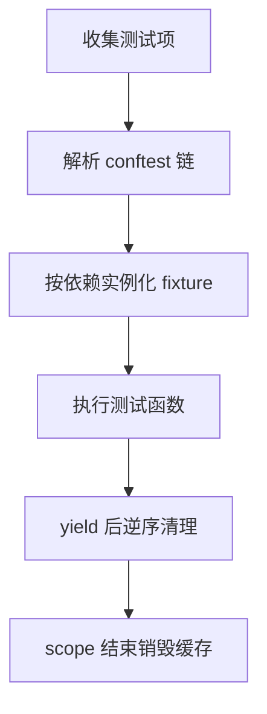
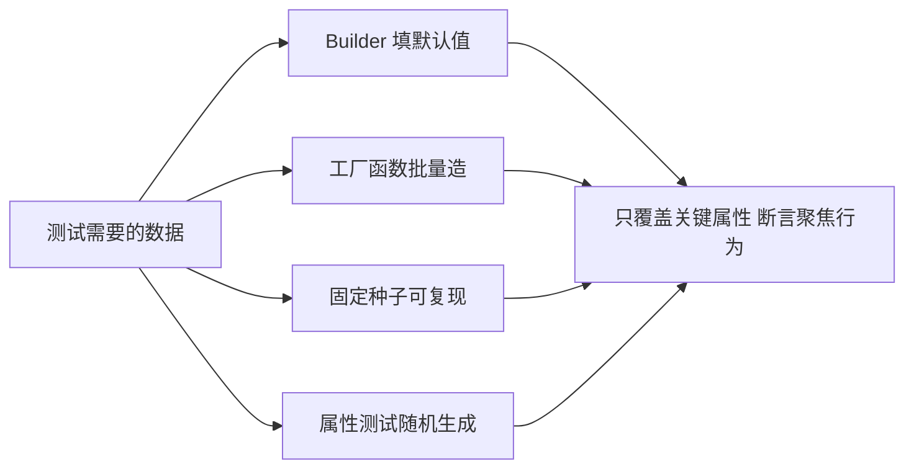
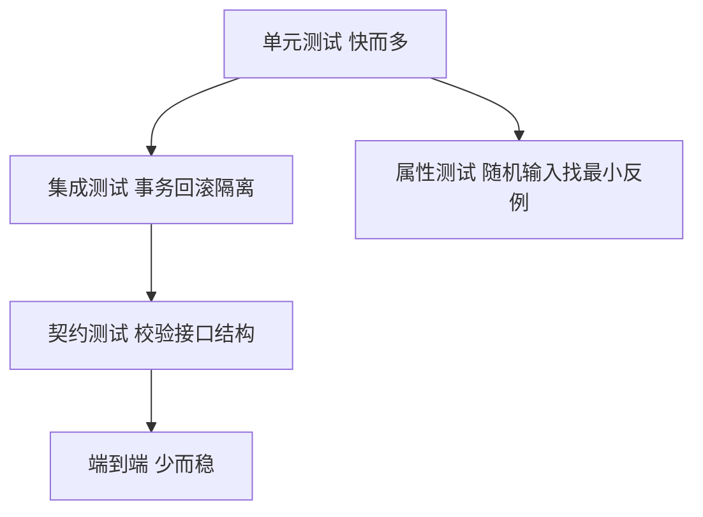
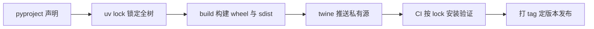
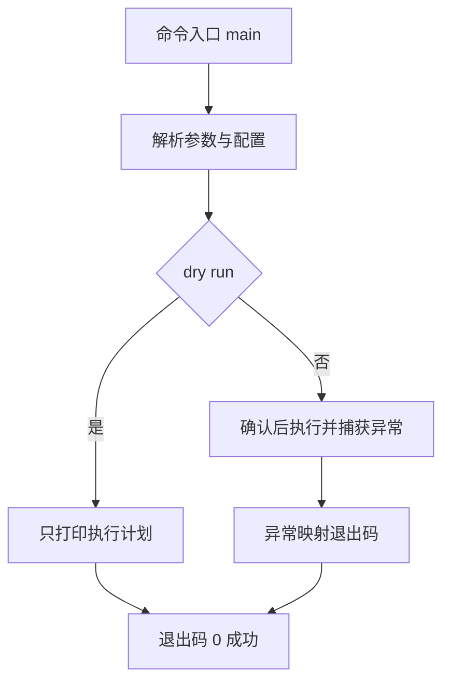
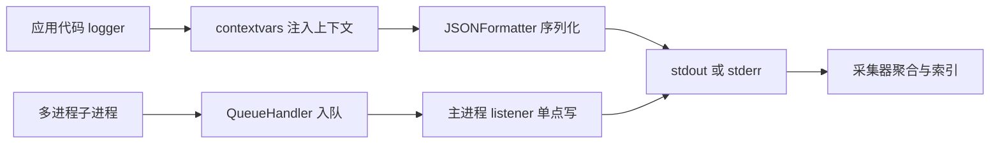
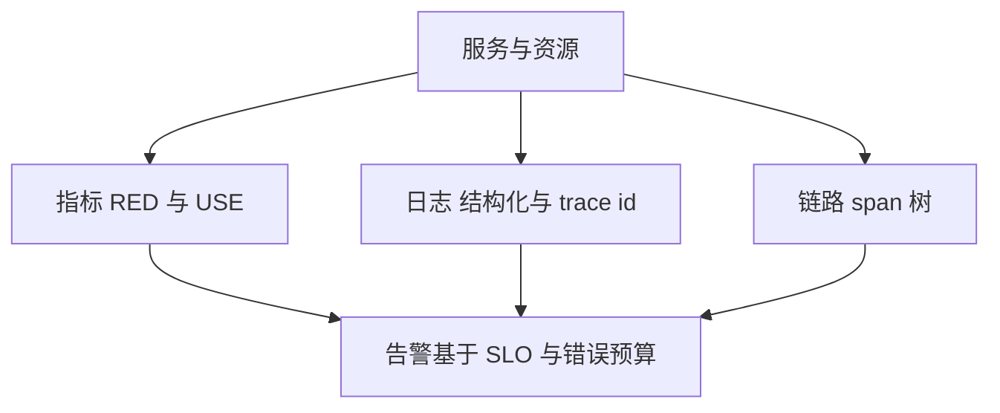
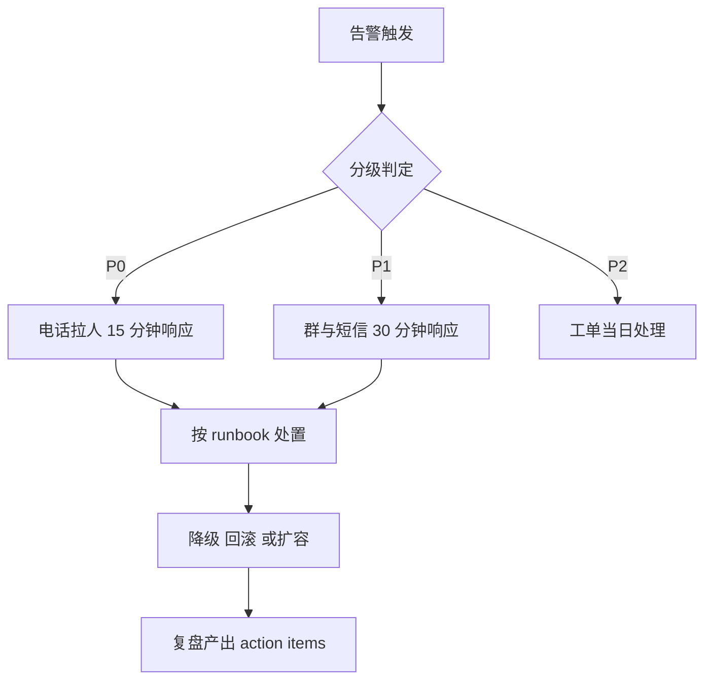

# 第 5 类 · 数据分析与工程化(55)

> 本卷是 05b 的深化篇:前半段进入 pytest 深水区(fixture 工厂、间接参数化、插件机制、属性与变异测试、契约与快照测试),后半段覆盖工程治理的硬技能:类型标注治理、包构建与私有源、CLI 交互设计、结构化日志与多进程日志、指标埋点与 OpenTelemetry、Docker 网络存储、混沌演练、容量估算、SLO 与事故复盘。
> 所有代码均为标准库实现的最小可运行版本,模拟真实框架(pluggy、hypoproperty、prometheus)的核心思想,面试时能讲清"原理 + 落地"两层。
> 每题代码独立可跑,无第三方依赖;涉及 pytest/hypothesis 等库的写法在注释与追问中给出真实用法。

---

### Q1076 · fixture 工厂与参数化夹具

> 难度:★★★★ | 标签:pytest, fixture

**问**:一个测试要创建 5 个不同配置的用户,你不会写 5 个 fixture 吧?怎么设计?

**答**:用 fixture 工厂(fixture 返回一个创建函数):外层 fixture 负责共享资源与清理,内层闭包负责定制参数,测试里按需 `user = make_user(role="admin")`。好处是把"创建几个、什么配置"的决定权交给测试体,而清理逻辑仍由 yield fixture 统一兜底;工厂里维护一个 created 列表,teardown 时逐个回收。这是测试数据构造中最常用的模式,比"一个场景一个 fixture"的组合爆炸可维护得多。

```python
# file: code/05_数据分析与工程化/q1076_fixture_factory.py

class UserStore:
    def __init__(self):
        self.users = []

    def add(self, name):
        user = {"id": len(self.users) + 1, "name": name}
        self.users.append(user)
        return user

def make_user_fixture(store):
    """pytest 真实用法:conftest 里 yield 这个工厂,测试内按需调用"""
    created = []

    def _make(name="alice", role="member"):
        user = store.add(name)
        user["role"] = role
        created.append(user)
        return user

    _make.created = created
    return _make

if __name__ == "__main__":
    store = UserStore()
    new_user = make_user_fixture(store)
    u1 = new_user()
    u2 = new_user("bob", role="admin")
    print(u1, u2)
    print("本次测试创建:", new_user.created, "清理时逐个回收即可")
```

**追问**:
- 追问 1:工厂和 yield fixture 怎么配合清理?—— fixture 里 `yield make_user_fixture(store)`,yield 之后遍历 created 回收,测试体不需要感知清理。
- 追问 2:工厂创建的对象要进缓存复用怎么办?—— 工厂内部按参数做 memo,或结合 request.cache,避免同配置重复创建。

### Q1077 · 间接参数化 indirect

> 难度:★★★★ | 标签:pytest, parametrize

**问**:`@pytest.mark.parametrize("db", ["prod", "staging"], indirect=True)` 的 indirect 到底做了什么?

**答**:普通参数化把值直接传给测试函数;`indirect=True` 把值先传给同名 fixture 的 `request.param`,由 fixture 决定怎么用这个参数构造资源,测试函数拿到的还是 fixture 返回值。意义在于"参数化的是资源的构造方式,而不是资源本身":同一个测试函数,不同环境、不同后端的初始化差异全部封装在 fixture 里。适合环境矩阵、数据库后端矩阵这类"参数改变 setup"的场景,保持测试体零分支。

```python
# file: code/05_数据分析与工程化/q1077_indirect_parametrize.py

FIXTURES = {}

def fixture(name):
    def deco(fn):
        FIXTURES[name] = fn
        return fn
    return deco

@fixture("db")
def db_fixture(request):
    # indirect=True 时,参数化值通过 request.param 进入 fixture
    env = request.param
    return {"engine": "sqlite", "env": env}

def parametrize(argname, values, indirect=False):
    cases = []
    for v in values:
        if indirect:
            fake_request = type("R", (), {"param": v})()
            cases.append((argname, FIXTURES[argname](fake_request)))
        else:
            cases.append((argname, v))
    return cases

if __name__ == "__main__":
    # pytest 中:@pytest.mark.parametrize("db", ["prod", "staging"], indirect=True)
    for name, value in parametrize("db", ["prod", "staging"], indirect=True):
        print(name, value)
```

**追问**:
- 追问 1:partial indirect 怎么写?—— `indirect=["db"]` 只对列表内参数走 fixture,其余仍直接传入,适合混合参数。
- 追问 2:fixture 里怎么拿到 parametrize 的 id?—— `request.node.callspec.id`,可用于日志与按 id 跳过。

### Q1078 · 自定义 marker 注册与过滤

> 难度:★★★☆ | 标签:pytest, marker

**问**:`-m "slow and not db"` 这种表达式过滤是怎么工作的?为什么自定义 marker 要注册?

**答**:marker 是挂在测试函数上的标签集合,pytest 收集后按 `-m` 布尔表达式筛选。自定义 marker 必须在 `pytest.ini`/`pyproject.toml` 的 `markers` 里注册,否则报警告且无法文档化,团队也发现不了拼写错误(如 sloe 混过过滤)。进阶做法:用 `pytest_collection_modifyitems` 钩子强制校验(未注册/误用直接 fail),或按 marker 自动加 skip 条件,让"慢测试 CI 夜里跑、数据库测试本地默认跳"成为基础设施而非口头约定。

```python
# file: code/05_数据分析与工程化/q1078_custom_marker.py

TESTS = []

def marker(*names):
    def deco(fn):
        fn.marks = set(names)
        TESTS.append(fn)
        return fn
    return deco

@marker("slow", "db")
def test_backup():
    return "backup done"

@marker("slow")
def test_big_report():
    return "report done"

@marker("fast")
def test_add():
    return "2"

def run(only=None, skip=None):
    only, skip = set(only or []), set(skip or [])
    for t in TESTS:
        if t.marks & skip:
            continue
        if only and not (t.marks & only):
            continue
        print("RUN", t.__name__, "->", t())

if __name__ == "__main__":
    # pytest.ini: markers = slow: 超过 1s 的测试;db: 依赖数据库
    # -m "slow and not db" 的等价过滤:
    print("== slow and not db ==")
    run(only=["slow"], skip=["db"])
```

**追问**:
- 追问 1:未注册 marker 的后果只是警告吗?—— 还包括 IDE/文档不可见、拼写错误静默失效,所以 CI 里建议 `--strict-markers` 把警告变错误。
- 追问 2:addini 之外怎么给 marker 附加元数据?—— `pytest_configure` 里 `config.addinivalue_line("markers", "slow: desc")`,或直接在 ini 声明。

### Q1079 · pytest 插件机制与 hookimpl

> 难度:★★★★★ | 标签:pytest, 插件

**问**:pytest 的插件体系底层是什么?写一个最小插件要做什么?

**答**:底层是 pluggy:pytest 定义一组钩子规范(hook spec),插件实现同名钩子函数(装饰 `@pytest.hookimpl`),pluggy 在框架执行的固定时点调用所有实现,结果可按 firstresult/historic 语义合并。分发方式三种:入口点(setuptools entry-points,安装即生效)、`conftest.py`(目录级)、`-p` 参数(显式加载)。写插件的最小集:实现 1-2 个钩子如 `pytest_addoption`、`pytest_collection_modifyitems`,再加 setup.cfg 声明 entry point。理解 pluggy 后,pytest 的一切"魔法"都是钩子调用的结果。

```python
# file: code/05_数据分析与工程化/q1079_plugin_mechanism.py

class Registry:
    """pluggy 思想的最小实现:钩子名 -> 依次调用所有插件的实现"""

    def __init__(self):
        self.plugins = []

    def register(self, plugin):
        self.plugins.append(plugin)

    def call(self, hook, payload):
        results = []
        for p in self.plugins:
            method = getattr(p, hook, None)
            if method is not None:
                results.append(method(payload))
        return results

class TimingPlugin:
    def before_run(self, payload):
        print(f"[timing] start {payload['name']}")
        return "started"

    def after_run(self, payload):
        print(f"[timing] finished {payload['name']}")
        return "finished"

class RetryPlugin:
    def on_result(self, payload):
        if not payload["ok"]:
            print(f"[retry] will retry {payload['name']}")
            return "retry"

if __name__ == "__main__":
    reg = Registry()
    reg.register(TimingPlugin())
    reg.register(RetryPlugin())
    reg.call("before_run", {"name": "test_a"})
    reg.call("on_result", {"name": "test_a", "ok": False})
    reg.call("after_run", {"name": "test_a"})
    # 真实 pytest:插件经 entry-points 装载,钩子函数用 @pytest.hookimpl 标注
```

**追问**:
- 追问 1:两个插件都实现同一钩子,顺序谁定?—— 注册顺序加 hookimpl 的 tryfirst/trylast 调整,`hookwrapper` 还能包裹原实现。
- 追问 2:conftest.py 本质上是什么?—— 一个按目录自动注册的本地插件,pytest 收集时沿目录向上查找并依次装载。

### Q1080 · mocker 与 monkeypatch 的边界

> 难度:★★★☆ | 标签:pytest, mock

**问**:pytest 自带 monkeypatch,为什么还有人装 pytest-mock 的 mocker?两者怎么选?

**答**:monkeypatch 是基础工具: setattr/delitem/patch.dict,改属性、改环境变量、改 cwd,退出自动还原,胜在零依赖直接。mocker 是 unittest.mock 的 fixture 化包装,强项是 mock 语义:patch 后拿到 Mock 对象,能断言 `assert_called_once_with`、控制 return_value/side_effect,还能用 `spy` 包装真函数记录调用。选型口诀:换行为、改环境用 monkeypatch;要验证"有没有被调用、用什么参数调用"的交互行为用 mocker。别混用两层导致还原顺序混乱。

```python
# file: code/05_数据分析与工程化/q1080_mocker_boundary.py

class PriceClient:
    def get_price(self, sku):
        raise RuntimeError("真实网络调用")

def total_price(client, items):
    return sum(client.get_price(sku) * qty for sku, qty in items)

class MonkeyPatch:
    """模拟 pytest 的 monkeypatch:退出自动还原"""

    def __init__(self):
        self._undo = []

    def setattr(self, obj, name, value):
        old = getattr(obj, name)
        setattr(obj, name, value)
        self._undo.append(lambda: setattr(obj, name, old))

    def undo(self):
        for fn in reversed(self._undo):
            fn()

class SpyClient:
    """spy 记录调用,供交互断言,mocker 的典型用法"""

    def __init__(self):
        self.calls = []

    def get_price(self, sku):
        self.calls.append(sku)
        return 100

if __name__ == "__main__":
    items = [("A", 2), ("B", 1)]
    patch = MonkeyPatch()
    patch.setattr(PriceClient, "get_price", lambda self, sku: 10)
    assert total_price(PriceClient(), items) == 30
    patch.undo()
    spy = SpyClient()
    total_price(spy, items)
    assert spy.calls == ["A", "B"]
    print("monkeypatch 换行为,spy/mocker 验证交互,边界清晰")
```

**追问**:
- 追问 1:patch 位置坑在 mocker 下也存在吗?—— 存在,mocker.patch("模块.名字") 同样要 patch 使用处而非定义处,原理一致。
- 追问 2:monkeypatch 改了模块级常量影响别的测试吗?—— 不会,fixture 结束自动还原;但多线程共享状态下要小心竞态。

### Q1081 · 高级断言 approx、raises 与警告断言

> 难度:★★★☆ | 标签:pytest, 断言

**问**:浮点比较、异常断言、警告断言,pytest 的标准姿势分别是什么?

**答**:浮点用 `pytest.approx(0.3)`(默认相对容差 1e-6),杜绝 `==` 比浮点;异常用 `with pytest.raises(ValueError, match="正则")`,match 同时校验错误信息,防止"任意异常都算过";警告用 `with pytest.warns(DeprecationWarning)`,或在 `filterwarnings("error")` 下让警告直接变失败。工程规范:断言异常必须断言类型加信息,只写 `pytest.raises(Exception)` 等于没测;approx 对 NaN、列表、numpy 数组同样有效。

```python
# file: code/05_数据分析与工程化/q1081_assertions.py
import warnings

def approx(expected, tol=1e-9):
    return ("approx", expected, tol)

def assert_equal(actual, expected):
    if isinstance(expected, tuple) and expected[0] == "approx":
        _, exp, tol = expected
        assert abs(actual - exp) <= tol, f"{actual} != {exp} within {tol}"
    else:
        assert actual == expected, f"{actual} != {expected}"

def avg(xs):
    return sum(xs) / len(xs)

def divide(a, b):
    if b == 0:
        raise ValueError("division by zero")
    return a / b

if __name__ == "__main__":
    # pytest 写法:assert sum(x) == pytest.approx(0.3);with pytest.raises(ValueError, match="zero")
    assert_equal(sum([0.1, 0.2]), approx(0.3, tol=1e-9))
    try:
        divide(1, 0)
    except ValueError as e:
        assert "zero" in str(e)
        print("异常断言通过:", e)
    with warnings.catch_warnings(record=True) as w:
        warnings.simplefilter("always")
        warnings.warn("deprecated", DeprecationWarning)
        assert any(issubclass(x.category, DeprecationWarning) for x in w)
        print("警告断言通过")
```

**追问**:
- 追问 1:raises 里代码没抛异常会怎样?—— 测试失败,这正是想要的,否则断言形同虚设。
- 追问 2:approx 的 rel 和 abs 参数怎么选?—— 数值跨度大用 rel,跨零点或接近 0 用 abs 混合给出下限。

### Q1082 · request.getfixturevalue 动态夹具

> 难度:★★★★ | 标签:pytest, fixture

**问**:测试运行中才知道要用哪个 fixture(比如按配置选数据库),怎么办?

**答**:用 `request.getfixturevalue("名字")` 在测试体内按需解析 fixture,替代静态参数注入。典型场景:配置驱动选择 fixture、循环里依次取多个 fixture、条件性跳过某些 setup。注意三点:getfixturevalue 不走声明式依赖图,fixture 缓存(scope)仍然生效,同 scope 内重复取返回同一实例;名字拼错运行时才报错,建议封装一层常量;过度使用会让依赖关系不可见,评审时要克制,常规依赖仍走参数注入。

```python
# file: code/05_数据分析与工程化/q1082_getfixturevalue.py

FIXTURES = {}

def fixture(fn):
    FIXTURES[fn.__name__] = fn
    return fn

@fixture
def config(request):
    return {"env": "test"}

@fixture
def db(request):
    cfg = request.getfixturevalue("config")
    return f"connected to {cfg['env']}"

class FakeRequest:
    def __init__(self):
        self._cache = {}

    def getfixturevalue(self, name):
        if name not in self._cache:
            self._cache[name] = FIXTURES[name](self)
        return self._cache[name]

if __name__ == "__main__":
    # pytest 里:db = request.getfixturevalue("db") 按需解析
    req = FakeRequest()
    print(req.getfixturevalue("db"))
    print("scope 缓存生效:", req.getfixturevalue("db") is req.getfixturevalue("db"))
```

**追问**:
- 追问 1:getfixturevalue 和函数参数注入的区别?—— 前者是运行时按名字解析,后者是收集期静态解析,前者灵活但依赖不可见。
- 追问 2:同名 fixture 在不同 scope 会取到哪个?—— 就近原则,内层 conftest 覆盖外层,getfixturevalue 遵循同一覆盖规则。



### Q1083 · Builder 模式构造测试数据

> 难度:★★★☆ | 标签:测试数据, 设计模式

**问**:一个接口要 20 个字段,测试只关心 2 个,怎么构造测试数据不把用例淹没?

**答**:Builder 模式:构造器内置一组合法默认值,链式方法只覆盖测试关心的字段,`UserBuilder().with_age(17).inactive().build()` 一行造出"恰好体现意图"的数据。默认值的设计原则是"合法且中性",让断言失败的噪音最小;关键属性显式写、无关属性靠默认。相比裸 dict,Builder 还能把"合法组合"的知识沉淀下来,新增字段时只改一处默认值,几十个测试自动跟随。

```python
# file: code/05_数据分析与工程化/q1083_builder_pattern.py

class UserBuilder:
    def __init__(self):
        self._data = {"id": 1, "name": "alice", "age": 30, "active": True}

    def with_name(self, name):
        self._data["name"] = name
        return self

    def with_age(self, age):
        self._data["age"] = age
        return self

    def inactive(self):
        self._data["active"] = False
        return self

    def build(self):
        return dict(self._data)

def is_active_minor(user):
    """业务规则:未成年且处于激活态是非法组合"""
    return user["age"] < 18 and user["active"]

if __name__ == "__main__":
    base = UserBuilder().build()
    minor = UserBuilder().with_age(17).build()
    minor_inactive = UserBuilder().with_age(17).inactive().build()
    assert not is_active_minor(base), "默认成年用户是合法组合"
    assert is_active_minor(minor), "未成年且激活正是要测的非法组合"
    assert not is_active_minor(minor_inactive), "未成年但未激活是合法组合"
    print(base, minor, minor_inactive)
```

**追问**:
- 追问 1:Builder 和工厂函数怎么选?—— 两三个可变字段用工厂函数 `make_user(**kw)` 就够,字段多、组合语义复杂才上 Builder。
- 追问 2:默认值硬编码的坏处?—— 测试与生产校验规则脱节,好的做法是 Builder 默认值调用生产端的 schema 生成合法样本。

### Q1084 · 工厂函数与 factory_boy 思想

> 难度:★★★☆ | 标签:测试数据, factory

**问**:批量造 100 条有关联关系的订单数据,factory_boy 的哪些思想值得手写复刻?

**答**:三个核心思想:序列(每个实例唯一 id/邮箱)、子工厂(订单自动带出用户,关联数据一键生成)、覆盖参数(`make_order(user=xxx)` 局部替换)。手写版就是一个模块级工厂函数加计数器:默认值函数化(`f"user{n}@t.io"`)实现序列,工厂内调用另一工厂实现子工厂,`**overrides` 实现覆盖。相比静态 JSON 夹具,factory 让数据意图清晰("这个测试只关心金额")且能跟随 schema 演进。

```python
# file: code/05_数据分析与工程化/q1084_factory_function.py

_counter = {"n": 0}

def make_user(**overrides):
    _counter["n"] += 1
    n = _counter["n"]
    user = {"id": n, "email": f"user{n}@t.io", "role": "member"}
    user.update(overrides)
    return user

def make_order(**overrides):
    order = {
        "id": len(overrides) + 1000,
        "user": overrides.pop("user", None) or make_user(),
        "amount": 9.9,
        "status": "paid",
    }
    order.update(overrides)
    return order

if __name__ == "__main__":
    orders = [make_order(amount=i) for i in range(1, 4)]
    for o in orders:
        print(o["id"], o["user"]["email"], o["amount"], o["status"])
    assert orders[0]["user"]["email"] != orders[1]["user"]["email"], "序列保证唯一"
    print("子工厂自动造用户,覆盖参数只写关心的字段")
```

**追问**:
- 追问 1:factory 的计数器要在测试间重置吗?—— 要,fixture setup 里 reset,否则跨测试累加造成 id 断言耦合。
- 追问 2:子工厂会不会失控造太多数据?—— 控制默认关联深度(默认一层),深层关联由测试显式声明。

### Q1085 · 固定种子与确定性测试数据

> 难度:★★★☆ | 标签:测试数据, 可复现

**问**:测试里用 random 生成数据,CI 偶尔红,怎么根治?

**答**:三个原则:不碰全局随机态(用 `random.Random(seed)` 实例,模块间互不污染);随机数据要同时留下"种子与生成器"日志,失败时可精确重现;随机仅用于覆盖输入空间,断言要写成与具体随机值无关的性质(长度、有序性、不变量),而不是硬编码期望值。进一步可以用快照测试锁定输出,golden 文件变更时 diff 审查。根因上,测试红的原因是"断言依赖了未固定的随机路径",不是随机本身。

```python
# file: code/05_数据分析与工程化/q1085_seeded_test_data.py
import random

def gen_scores(seed, n=5):
    rng = random.Random(seed)   # 独立实例,不污染全局 random
    return [{"id": i, "score": round(rng.gauss(80, 10), 2)} for i in range(n)]

if __name__ == "__main__":
    a = gen_scores(42)
    b = gen_scores(42)
    assert a == b, "同种子必须可复现"
    print(a)
    print("失败时可打印 seed=42 与生成器参数,精确重现数据")
    # 全局 random 的反面教材:random.shuffle 会影响其他模块的随机序列
```

**追问**:
- 追问 1:为什么不用 random.seed(42) 全局设种子?—— 全局态被测试执行顺序影响,并行运行时不可复现;实例化 RNG 隔离更稳。
- 追问 2:datetime.now() 这类呢?—— 同理,注入 clock 或用 freezegun/假时间对象,不让测试读真实时钟。

### Q1086 · 属性测试思想 hypothesis

> 难度:★★★★ | 标签:property-based, hypothesis

**问**:example-based 测试永远只是你想到的例子,hypothesis 的属性测试到底换了个什么思路?

**答**:属性测试把"例子 + 期望输出"换成"性质 + 输入生成器":声明输入空间的策略(strategy,如任意整数列表),声明对任意输入都成立的性质(如"reverse 两次等于自身"),框架生成成百上千随机输入验证,一旦失败自动缩小(shrink)出最小反例。价值在于它探索人类想不到的边界:空列表、极值、unicode、NaN。工程采用:核心纯函数、序列化/解析对、金额计算优先用属性测试;集成测试仍以 example-based 为主。

```python
# file: code/05_数据分析与工程化/q1086_hypothesis_idea.py

def reverse_twice(xs):
    return list(reversed(list(reversed(xs))))

try:
    from hypothesis import given, strategies as st
    HAS_HYP = True
except ImportError:
    HAS_HYP = False

if HAS_HYP:
    @given(st.lists(st.integers()))
    def test_reverse_twice(xs):
        assert reverse_twice(xs) == xs

    test_reverse_twice()
    print("hypothesis 随机生成 + 自动缩小,验证通过")
else:
    import random
    random.seed(0)
    for _ in range(300):
        xs = [random.randint(-100, 100) for _ in range(random.randint(0, 20))]
        assert reverse_twice(xs) == xs
    print("未安装 hypothesis,降级为随机 300 组性质验证,思想相同")
```

**追问**:
- 追问 1:shrink 是怎么工作的?—— 从失败输入出发,尝试更简单的变体(去元素、换 0 值),仍失败则继续缩小,直到最小反例。
- 追问 2:hypothesis 怎么保证 bug 不被"随机运气"掩盖?—— 失败案例写入数据库(example database),后续运行优先重放历史反例。

### Q1087 · 手写简化版属性测试与反例缩小

> 难度:★★★★ | 标签:property-based, 测试

**问**:不装 hypothesis,面试手写一个 mini 属性测试框架,你会写哪几块?

**答**:三块:生成器(按类型随机生成输入)、性质检查(循环 N 次执行属性断言)、反例缩小(失败时贪心删减输入直到不能再小)。缩小是灵魂,面试加分点:对列表做"逐个删除",失败则接受更小的反例继续,得到最小失败输入;对整数做向 0 逼近。写完能现场演示"sorted(set(x)) 丢重复元素"这类 bug 的最小反例(如 [0, 0]),比讲概念有说服力得多。

```python
# file: code/05_数据分析与工程化/q1087_mini_property_test.py
import random

def prop_len_preserved(input_list):
    out = sorted(set(input_list))  # 故意有 bug 的实现:去重导致长度不守恒
    return len(out) == len(input_list)

def shrink_list(xs, prop):
    """贪心缩小:逐个删元素,仍失败则保留更小反例"""
    current = list(xs)
    i = 0
    while i < len(current):
        candidate = current[:i] + current[i + 1:]
        if not prop(candidate):
            current = candidate
        else:
            i += 1
    return current

def run_property(prop, cases=50, seed=1):
    random.seed(seed)
    for _ in range(cases):
        xs = [random.randint(0, 3) for _ in range(random.randint(1, 8))]
        if not prop(xs):
            return shrink_list(xs, prop)
    return None

if __name__ == "__main__":
    minimal = run_property(prop_len_preserved)
    if minimal is None:
        print("本轮随机未触发 bug")
    else:
        print(f"发现最小反例: {minimal},重复元素被 sorted(set()) 丢弃")
```

**追问**:
- 追问 1:缩小的通用策略有哪些?—— 删元素、二分截断、数值向 0、字符串向空,组合使用直到不动点。
- 追问 2:怎么避免缩小后的反例误导?—— 缩小只改变输入复杂度不改变失败原因,报告里同时打印原始输入与最小反例。



### Q1088 · 契约测试实现

> 难度:★★★★ | 标签:契约测试, 微服务

**问**:消费者和提供者两个团队,接口字段一改就崩,契约测试怎么落地?

**答**:消费者先声明契约:我需要哪些字段、什么类型、什么取值域,写成可执行的 schema;提供者在自己的 CI 里用同样的 schema 校验真实响应,任何破坏性变更在提供者流水线就红。比 pact 全家桶轻量的落法:契约文件(JSON Schema 或 Python dict)进版本库,由消费方提交 PR 修改,提供方 CI 拉取校验。要点:契约只声明消费者实际用到的字段,声明越少耦合越松;错误信息要指出"哪个消费者依赖这个字段"。

```python
# file: code/05_数据分析与工程化/q1088_contract_test.py

CONTRACT = {
    "type": "order",
    "fields": {
        "order_id": str,
        "user_id": int,
        "amount": float,
        "status": {"paid", "refund"},
    },
}

def validate_contract(payload):
    errors = []
    if payload.get("type") != CONTRACT["type"]:
        errors.append("type 不符")
    for k, t in CONTRACT["fields"].items():
        if k not in payload:
            errors.append(f"缺少字段 {k}")
        elif isinstance(t, set):
            if payload[k] not in t:
                errors.append(f"{k} 取值非法: {payload[k]}")
        elif not isinstance(payload[k], t):
            errors.append(f"{k} 类型应为 {t.__name__}")
    return errors

def provider_response():
    return {"type": "order", "order_id": "O1", "user_id": 7, "amount": 9.9, "status": "paid"}

if __name__ == "__main__":
    errs = validate_contract(provider_response())
    print("当前响应:", errs or "满足消费方契约")
    breaking = provider_response()
    breaking["status"] = "PAID"
    print("破坏性变更:", validate_contract(breaking))
```

**追问**:
- 追问 1:契约测试和集成测试的分工?—— 契约测"结构承诺"且在提供者侧跑,集成测"端到端行为",前者便宜高频,后者贵而少。
- 追问 2:多方消费同一接口怎么办?—— 每个消费者一份契约,提供者 CI 全部校验,破坏谁谁的契约谁的 CI 红。

### Q1089 · 变异测试概念

> 难度:★★★★ | 标签:变异测试, 覆盖率

**问**:行覆盖 100% 的代码还是有 bug,变异测试怎么测出"测试的质量"?

**答**:变异测试把"测代码"变成"测测试":对被测代码做微小的系统变异(>= 改 >、常数 +1、条件取反),每个变异体跑一遍测试套,测试失败则变异被"杀死",全部通过说明变异"存活"。得分 = 杀死数/总数,存活变异暴露测试盲区,生成新的断言去杀。工具用 mutmut/cosmic-ray;代价是运行时间是测试套的 N 倍,通常只对核心模块定期跑。面试要点:覆盖率说明"执行到了",变异分数说明"验证到了"。

```python
# file: code/05_数据分析与工程化/q1089_mutation_testing.py

def is_adult(age):
    return age >= 18

TESTS = [(-1, False), (17, False), (18, True), (60, True)]

def suite_passes(fn):
    return all(fn(a) == exp for a, exp in TESTS)

MUTANTS = {
    "gt_instead_of_ge": lambda age: age > 18,
    "boundary_17": lambda age: age >= 17,
    "negated": lambda age: not (age >= 18),
    "swap_81": lambda age: age >= 81,   # 存活变异:现有测试抓不到
}

if __name__ == "__main__":
    killed, survived = [], []
    for name, mutant in MUTANTS.items():
        (killed if not suite_passes(mutant) else survived).append(name)
    print("被杀死:", killed)
    print("存活:", survived, "-> 存活变异暴露测试盲区,补充 81/80 边界用例可杀死")
    print(f"变异分数 {len(killed)}/{len(MUTANTS)} = {len(killed) / len(MUTANTS):.0%}")
```

**追问**:
- 追问 1:等价变异是什么?—— 与原函数语义完全相同、无法被任何测试杀死的变异(如 x*2 换 x+x),要人工剔除否则分数失真。
- 追问 2:怎么控制运行成本?—— 按覆盖信息只对覆盖到的行变异、按模块白名单跑、CI 只在核心包变更时触发。

### Q1090 · 快照回归与 golden 文件

> 难度:★★★☆ | 标签:快照测试, 回归

**问**:报表 SQL 输出 500 行,手写期望值不现实,这种输出怎么测?

**答**:golden/快照测试:首次运行把输出存成 golden 文件入库,之后每次运行与 golden 严格比对,不一致即失败;输出变更时用 `--update` 显式更新并走 code review,让"输出变化"成为人工审查对象。工程要点:序列化要稳定(排序键、固定浮点精度、去除时间戳等非确定字段);golden 文件按平台无关格式存;对比失败时输出 diff 而不是两个全文。适合渲染结果、生成的 SQL、报表内容这类"复杂但稳定"的输出。

```python
# file: code/05_数据分析与工程化/q1090_golden_snapshot.py
import json
import os
import tempfile

GOLDEN = os.path.join(tempfile.gettempdir(), "q1090_golden.json")

def render(data):
    return json.dumps(data, ensure_ascii=False, sort_keys=True, indent=2)

def check(data, update=False):
    actual = render(data)
    if update or not os.path.exists(GOLDEN):
        with open(GOLDEN, "w", encoding="utf-8") as f:
            f.write(actual)
        return "golden 已写入/更新"
    with open(GOLDEN, encoding="utf-8") as f:
        expected = f.read()
    return "一致" if actual == expected else "不一致,请人工审查后 --update"

if __name__ == "__main__":
    print(check({"b": 1, "a": [1.0, 2.5]}))
    print(check({"b": 1, "a": [1.0, 2.5]}))
    print(check({"b": 1, "a": [1.0, 3.0]}))
    os.remove(GOLDEN)
```

**追问**:
- 追问 1:输出含时间戳怎么办?—— 序列化前做规范化钩子,替换成固定占位符,只测稳定部分。
- 追问 2:快照测试会不会让人无脑更新?—— 更新走独立 flag 加 review 流程,CI 中禁止自动更新,保证变化被看见。

### Q1091 · 测试替身光谱:dummy、stub、spy、mock

> 难度:★★★☆ | 标签:测试替身, mock

**问**:mock、stub、spy 到底差在哪?面试时怎么讲清楚?

**答**:按"替身知道多少、被问什么"分四档:dummy 只为满足签名占位,从不被使用;stub 提供固定返回值,让被测代码能跑;spy 是记录型替身,真实或固定行为之外把调用存下来供事后断言(调用了谁、几次、什么参数);mock 事前声明期望交互,调用不符合期望即失败。状态验证(stub 后断言返回值)优先于交互验证(spy/mock 断言调用),过度 mock 会把测试锁死在实现细节上,重构就红。

```python
# file: code/05_数据分析与工程化/q1091_test_doubles.py

class Mailer:
    def send(self, to, body):
        raise RuntimeError("真实 IO")

class StubMailer(Mailer):
    def send(self, to, body):
        return True                      # stub:固定返回,让流程走通

class SpyMailer(Mailer):
    def __init__(self):
        self.sent = []

    def send(self, to, body):
        self.sent.append((to, body))     # spy:记录交互供事后断言
        return True

def notify(mailer, user, message):
    return mailer.send(user["email"], message)

if __name__ == "__main__":
    user = {"email": "a@b.c"}
    assert notify(StubMailer(), user, "hi") is True          # 状态验证
    spy = SpyMailer()
    notify(spy, user, "hi")
    assert spy.sent == [("a@b.c", "hi")]                     # 交互验证
    print("stub 验证状态,spy 验证交互,mock 事前期望,dummy 纯占位")
```

**追问**:
- 追问 1:什么信号说明 mock 用过度了?—— 断言全是 called_with,改一次内部实现红一片测试,行为没变测试却坏。
- 追问 2:fake 和 stub 的区别?—— fake 是轻量可用实现(内存数据库、假仓库),有真实行为逻辑,适合状态机类依赖。

### Q1092 · 集成测试的数据库 fixture 事务回滚

> 难度:★★★★ | 标签:pytest, 数据库, 集成测试

**问**:集成测试连真实数据库,怎么让每个测试的数据互相隔离、跑完零残留?

**答**:主流三案:事务回滚(每个测试包在 BEGIN...ROLLBACK 里,速度快、隔离强,但测不到"跨事务提交"行为)、truncate 清表(每测后清,真实但慢,适合验证提交语义)、独立 schema/临时库(隔离最彻底,成本最高)。工程默认用事务回滚:fixture 里 `BEGIN` + yield + `ROLLBACK`,被测代码必须复用测试传入的连接才有效;要测 commit 行为的用例单独标 marker 走 truncate。SQLite 内存库是单测级集成测试的常用替身。

```python
# file: code/05_数据分析与工程化/q1092_db_fixture_rollback.py
import sqlite3

def make_conn():
    conn = sqlite3.connect(":memory:", isolation_level=None)  # 手动控制事务
    conn.execute("CREATE TABLE users (id INTEGER PRIMARY KEY, name TEXT)")
    conn.execute("BEGIN")
    return conn

class DBFixture:
    """每个测试一个事务,结束回滚,数据零残留"""

    def __init__(self):
        self.conn = make_conn()

    def add(self, name):
        self.conn.execute("INSERT INTO users (name) VALUES (?)", (name,))
        return self.conn.execute("SELECT last_insert_rowid()").fetchone()[0]

    def count(self):
        return self.conn.execute("SELECT COUNT(*) FROM users").fetchone()[0]

    def rollback(self):
        self.conn.execute("ROLLBACK")

if __name__ == "__main__":
    db = DBFixture()
    db.add("alice")
    db.add("bob")
    assert db.count() == 2
    db.rollback()
    assert db.count() == 0, "回滚后应零残留,测试间天然隔离"
    print("事务回滚隔离验证通过")
```

**追问**:
- 追问 1:被测代码自己 commit 了回滚还有效吗?—— 无效,commit 后事务结束,这类用例要换 truncate 或独立库方案。
- 追问 2:并行测试怎么隔离?—— 每测试独立连接加独立临时 schema/数据库前缀,或干脆队列化串行。



### Q1093 · mypy 渐进治理策略

> 难度:★★★★ | 标签:mypy, 类型标注

**问**:几十万行的存量项目想上 mypy,一跑几千个错,怎么推进?

**答**:渐进四步:先 `--ignore-missing-imports` 全库跑通拿到基线错误数,写入 CI 报告(不阻断);开启新代码严格(`disallow_untyped_defs`),用文件级豁免(`# mypy: ignore-file` 或 per-module overrides)保护存量;按目录逐个收紧,错误数单调下降;最后全局 strict 并把豁免清零。配套手段:`reveal_type` 与 `mypy --strict` 本地快速反馈、CI 里比较错误数禁止回升、公共 API 优先标注。原则:类型是渐进承诺,先把"新增欠债"堵住,再还旧账。

```python
# file: code/05_数据分析与工程化/q1093_mypy_gradual.py
from typing import Optional

def normalize_email(raw: Optional[str]) -> str:
    if raw is None:
        return "unknown@example.com"
    return raw.strip().lower()

def parse_amount(text: str) -> float:
    try:
        return float(text.replace(",", ""))
    except ValueError:
        return 0.0

if __name__ == "__main__":
    print(normalize_email("  Bob@X.com "))
    print(parse_amount("1,234.5"))
    # 治理配置示例:
    # [tool.mypy] python_version = "3.12"
    # files = ["src"] ; disallow_untyped_defs = true ; ignore_missing_imports = true
    # 存量目录用 per-module overrides 逐个收紧
```

**追问**:
- 追问 1:mypy 和运行时校验(pydantic)冲突吗?—— 不冲突,mypy 管静态结构,pydantic 管运行时边界(外部输入),边界处用 `cast`/构造器桥接。
- 追问 2:`type: ignore` 怎么治理?—— 必须带错误码与原因(`type: ignore[attr-defined]`),CI 统计新增 ignore 数,只许减不许增。

### Q1094 · Protocol 与泛型进阶标注

> 难度:★★★★ | 标签:typing, Protocol

**问**:函数参数想要"任何有 close 方法的对象",用基类太重,typing 怎么解?

**答**:用 `Protocol`(结构化子类型,静态 duck typing):定义 `class Closer(Protocol): def close(self) -> None`,任何长出 close 方法的类都天然满足,无需继承;`@runtime_checkable` 还能配合 isinstance 做运行时检查。泛型用 `Generic[T]`/PEP 695 的 `class Box[T]` 让容器保住元素类型。组合价值:库代码面向 Protocol 编程,调用方零耦合;资源管理函数参数标注为 Protocol,测试里随手写的 fake 也能通过类型检查。

```python
# file: code/05_数据分析与工程化/q1094_protocol_generic.py
from typing import Generic, Protocol, TypeVar, runtime_checkable

@runtime_checkable
class Closer(Protocol):
    def close(self) -> None:
        pass

T = TypeVar("T")

class Box(Generic[T]):
    def __init__(self, item: T):
        self.item = item

    def get(self) -> T:
        return self.item

class Conn:
    def close(self) -> None:
        print("conn closed")

def shutdown(resource: Closer) -> None:
    resource.close()

if __name__ == "__main__":
    shutdown(Conn())               # 结构满足协议,无需继承
    b: Box[int] = Box(3)
    print(b.get() + 1)
    print("isinstance 运行时检查:", isinstance(Conn(), Closer))
```

**追问**:
- 追问 1:Protocol 和 ABC 怎么选?—— ABC 表达"显式契约 + 共享实现",Protocol 表达"结构匹配",跨层级解耦场景 Protocol 更轻。
- 追问 2:runtime_checkable 检查什么?—— 只检查方法名存在,不检查签名,签名正确性仍靠 mypy 静态保证。

### Q1095 · monorepo 与包拆分

> 难度:★★★★ | 标签:monorepo, 架构

**问**:仓库里 apps 和 libs 越长越乱,循环依赖频发,monorepo 怎么治理?

**答**:monorepo 的关键纪律:分层单向依赖(libs 不许依赖 apps,apps 之间不许互相 import)、每个包独立 pyproject 声明依赖、内部互引用 workspace/可编辑安装。落法:目录结构 `libs/`(领域逻辑、io 工具)+ `apps/`(api、worker)+ `packages/`(对外发布的 wheel),CI 按变更路径触发对应包的测试;依赖方向用脚本静态检查(扫描 import 语句),违反即红。相比多仓,monorepo 换来原子提交与统一重构,代价是必须补上工具化的边界检查。

```python
# file: code/05_数据分析与工程化/q1095_monorepo_check.py
import os
import tempfile
import textwrap

LAYOUT = textwrap.dedent("""
    repo/
      libs/          领域逻辑 零业务依赖
      apps/          api 与 worker 只依赖 libs
      packages/      对外发布的 wheel
      pyproject.toml + uv.lock
""")

def write_tree(root):
    files = {
        "libs/core/util.py": "def add(a, b):\n    return a + b\n",
        "apps/api/main.py": "import sys, pathlib\nsys.path.append(str(pathlib.Path(__file__).parents[2] / 'libs'))\nfrom core.util import add\nprint(add(1, 2))\n",
        "apps/api/bad.py": "import sys, pathlib\nsys.path.append(str(pathlib.Path(__file__).parents[2] / 'apps'))\n",
        "pyproject.toml": "[project]\nname = 'repo'\n",
    }
    for rel, content in files.items():
        path = os.path.join(root, rel)
        os.makedirs(os.path.dirname(path), exist_ok=True)
        with open(path, "w") as f:
            f.write(content)

def check_no_cross_app_imports(root):
    """apps 之间禁止互相 import 的静态检查"""
    problems = []
    for dirpath, _, names in os.walk(root):
        for name in names:
            if not name.endswith(".py"):
                continue
            path = os.path.join(dirpath, name)
            rel = os.path.relpath(path, root).replace(os.sep, "/")
            with open(path) as f:
                text = f.read()
            if rel.startswith("apps/") and "parents[2] / 'apps'" in text:
                problems.append(rel)
    return problems

if __name__ == "__main__":
    print("推荐布局:", LAYOUT)
    with tempfile.TemporaryDirectory() as root:
        write_tree(root)
        bad = check_no_cross_app_imports(root)
        print("跨 app 依赖违规:", bad or "无")
```

**追问**:
- 追问 1:monorepo 里 CI 只跑变更包怎么做?—— 按 git diff 路径映射到受影响包及依赖闭包,拓扑序执行测试。
- 追问 2:libs 之间也允许依赖吗?—— 允许但要有层次(core 最底层),禁止成环,同样用脚本检查。

### Q1096 · uv lock 与可复现构建

> 难度:★★★☆ | 标签:uv, 依赖锁定

**问**:为什么 pip install -r requirements.txt 还不够,必须要有 lock 文件?

**答**:requirements.txt 只钉顶层依赖,传递依赖在每台机器上按当时最新解析,CI 与生产可能装出不同版本,"在我机器上是好的"由此而来。lock 文件(uv.lock/poetry.lock)锁定整棵依赖树的精确版本与哈希,任何机器 `uv sync` 都装出位对位相同的环境;升级是显式动作(`uv lock --upgrade-package x`)走评审。工程纪律:lock 提交入库、CI 用 lock 安装、基础镜像或 venv 缓存以 lock 哈希为 key,让"可复现"从口号变成机制。

```python
# file: code/05_数据分析与工程化/q1096_uv_lock.py
import json

AVAILABLE = {
    "requests": {"2.31.0": [], "2.32.0": ["urllib3>=1.21.1"]},
    "urllib3": {"2.0.7": [], "2.2.1": []},
}

def resolve(requirements, locked=None):
    """简化解析器:返回确定性的 pinned 版本,模拟 lock 的思想"""
    locked = dict(locked or {})
    for name in requirements:
        versions = sorted(AVAILABLE[name], reverse=True)
        locked[name] = versions[0]
        for dep in AVAILABLE[name][locked[name]]:
            dep_name = dep.split(">=")[0].strip()
            if dep_name not in locked:
                locked.update(resolve([dep_name]))
    return locked

if __name__ == "__main__":
    # uv 命令:uv lock 生成锁文件 / uv sync 按 lock 安装 / uv lock --upgrade-package requests
    lock = resolve(["requests"])
    print(json.dumps(lock, indent=2))
    assert resolve(["requests"]) == lock, "解析必须确定性,这就是 lock 的意义"
```

**追问**:
- 追问 1:lock 和 constraints 文件的区别?—— lock 是全量精确解,constraints 只约束上限,前者用于可复现安装,后者用于兼容性护栏。
- 追问 2:锁文件冲突怎么解?—— 谁升级谁负责重新 resolve,lock 的 diff 必须与版本变更 PR 一一对应。

### Q1097 · 构建 wheel 与私有源

> 难度:★★★☆ | 标签:打包, wheel

**问**:公司内部包要发给多个团队,发 git 仓库链接好还是私有 PyPI 好?wheel 里到底有什么?

**答**:私有 PyPI + wheel 是正解:wheel 是已构建的发行格式(代码 + 元数据 + 入口点),安装不触发构建、快且可离线;版本化发布让依赖方锁定确定的产物,配合语义化版本与变更日志。构建用 `python -m build`(产出 sdist + wheel),上传到私有源(如 devpi/Nexus/Artifactory)用 twine;消费端 `--index-url` 指向私有源并回退公共源。包名、版本、平台标签都编码在 wheel 文件名里,解析规则要能说清。

```python
# file: code/05_数据分析与工程化/q1097_wheel_private_index.py
import re

WHEEL_RE = re.compile(r"^(?P<name>[^-]+)-(?P<version>[^-]+)-(?P<py>[^-]+)-(?P<abi>[^-]+)-(?P<platform>[^-]+)\.whl$")

def parse_wheel(filename):
    m = WHEEL_RE.match(filename)
    if not m:
        raise ValueError("非法 wheel 文件名")
    return m.groupdict()

if __name__ == "__main__":
    name = "my_pkg-1.2.0-cp312-cp312-manylinux_2_17_x86_64.whl"
    print(parse_wheel(name))
    # 构建:python -m build -> dist/*.whl + *.tar.gz
    # 上传:twine upload --repository-url https://pypi.example.com/simple/ dist/*
    # 安装:uv pip install my-pkg --index-url https://pypi.example.com/simple/
```

**追问**:
- 追问 1:sdist 和 wheel 都发布还是只发 wheel?—— 两者都发,sdist 兜底特殊平台从源码构建,wheel 覆盖主流平台加速安装。
- 追问 2:纯 Python 包的平台标签是什么?—— py3-none-any,无 C 扩展全平台通用;含扩展则绑定解释器与平台。

### Q1098 · 语义化版本与发布流程

> 难度:★★★☆ | 标签:semver, 发布

**问**:版本号 1.4.2 与 2.0.0-rc.1 的区别是什么?发布流程怎么跟版本号联动?

**答**:语义化版本 MAJOR.MINOR.PATCH:MAJOR 破坏兼容、MINOR 向后兼容的新功能、PATCH 修复;pre-release(alpha/beta/rc)排在正式版之前,供灰度验证。流程联动:CI 从分支/tag 推导版本(提交信息或 tag 触发),打 tag 即构建 wheel 并推送私有源,rc 先发测试渠道,验证后转正式。规则要写进 CONTRIBUTING 并用工具(如 commitizen)从提交信息自动 bump,杜绝手工改版本的漂移。依赖声明里 `~1.4` 与 `>=1.4,<2` 的含义也要能解释。

```python
# file: code/05_数据分析与工程化/q1098_semver.py
import re

SEMVER = re.compile(r"^(\d+)\.(\d+)\.(\d+)(?:-([0-9A-Za-z.-]+))?$")
PRE_RANK = {"alpha": 0, "beta": 1, "rc": 2}

def version_key(v):
    m = SEMVER.match(v)
    if not m:
        raise ValueError(f"非法版本号: {v}")
    major, minor, patch, pre = m.groups()
    if pre is None:
        return (int(major), int(minor), int(patch), 3, "")
    return (int(major), int(minor), int(patch), PRE_RANK.get(pre.split(".")[0], -1), pre)

if __name__ == "__main__":
    vs = ["1.0.0", "1.0.0-rc.1", "1.0.0-beta", "1.0.0-alpha", "0.9.9"]
    for v in sorted(vs, key=version_key):
        print(v)
    assert version_key("1.0.0-alpha") < version_key("1.0.0-beta") < version_key("1.0.0") 
    print("pre-release 排在正式版之前,tag 驱动构建即发布")
```

**追问**:
- 追问 1:0.x 版本的语义约定?—— 0.x 视为开发期,MINOR 也可能破坏兼容,依赖它要锁死版本。
- 追问 2:怎么自动决定 bump 哪一位?—— commit 规范(feat/fix/breaking)+ 工具解析,breaking 用 `!` 或 footers 声明。



### Q1099 · CLI 错误处理与退出码设计

> 难度:★★★☆ | 标签:CLI, 退出码

**问**:你的命令行工具在 CI 里失败了,怎么让上游脚本可靠地判断"哪类失败"?

**答**:退出码是 CLI 的 API:0 成功,非 0 失败,并按错误类别分段(1 一般错误、2 用法错误、3 配置错误、4 依赖缺失),写进文档让脚本可以 `$?` 分支处理。实现上定义异常基类携带 exit_code,main() 统一捕获映射,用户错误走 stderr + 明确信息,意外异常打印 traceback 并返回一般错误码。两条纪律:正常路径绝不 print 到 stderr;错误信息说"发生了什么 + 怎么修",而不是甩栈给用户。

```python
# file: code/05_数据分析与工程化/q1099_cli_exit_codes.py
import sys

EX_OK, EX_GENERAL, EX_USAGE, EX_CONFIG = 0, 1, 2, 3

class AppError(Exception):
    exit_code = EX_GENERAL

class ConfigError(AppError):
    exit_code = EX_CONFIG

def load_config(path):
    if path is None:
        raise ConfigError("缺少配置文件路径,用 --config 指定")
    return {"path": path}

def main(argv):
    if "--help" in argv:
        print("用法: app [--config FILE]")
        return EX_OK
    try:
        path = argv[argv.index("--config") + 1] if "--config" in argv else None
        cfg = load_config(path)
        print("运行成功", cfg)
        return EX_OK
    except AppError as e:
        print(f"错误: {e}", file=sys.stderr)
        return e.exit_code

if __name__ == "__main__":
    code = main(sys.argv[1:])
    print(f"退出码 {code}(0 成功 1 一般 2 用法 3 配置)")
```

**追问**:
- 追问 1:为什么参数缺失不该用 argparse 之外的码?—— argparse 默认以 2 退出表示用法错误,保持一致让脚本侧约定简单。
- 追问 2:SIGINT 应该返回什么?—— 默认 Python 抛 KeyboardInterrupt,CLI 捕获后清理资源并以 130 退出,符合 shell 惯例。

### Q1100 · dry-run 与破坏性操作确认

> 难度:★★★☆ | 标签:CLI, 安全

**问**:一个会删数据、重启服务的运维 CLI,怎么设计才能让人放心敲回车?

**答**:三层防护:dry-run(默认只打印执行计划,每个动作一行,标明影响面)、显式确认(危险命令要求 `--yes` 或交互确认,交互里复读将被删除的对象)、最小爆炸半径(--limit 限制批量规模,分批执行)。实现关键是"计划与执行分离":先构建动作列表,审查后统一执行,这样 dry-run 与真实执行走同一条代码路径,不会出现"预览的和干的不一样"。

```python
# file: code/05_数据分析与工程化/q1100_dry_run.py
import sys

PLAN = ["mkdir /srv/app", "write config", "restart service"]

def confirm(prompt):
    if "--yes" in sys.argv:
        return True
    try:
        return input(prompt + " [y/N] ").strip().lower() == "y"
    except EOFError:
        print("非交互环境:请显式传 --yes 确认")
        return False

def main(argv):
    dry = "--dry-run" in argv
    print("执行计划:")
    for step in PLAN:
        print("  -", step)
    if dry:
        print("dry-run:未做任何修改")
        return 0
    if not confirm("确认执行以上动作?"):
        print("已取消")
        return 0
    print("已执行(演示)")
    return 0

if __name__ == "__main__":
    sys.exit(main(sys.argv[1:]))
```

**追问**:
- 追问 1:dry-run 怎么保证与真实执行一致?—— 共用"构建计划"函数,dry-run 渲染计划,真实执行同一计划,禁止两条分支各自拼逻辑。
- 追问 2:脚本调用时怎么跳过交互?—— `--yes` 显式声明,但保留 dry-run 供 CI 预检,危险等级越高越倾向人工。

### Q1101 · 机器可读输出 --json 与管道友好

> 难度:★★☆☆ | 标签:CLI, 设计

**问**:人要看表格,脚本要解析输出,同一个 CLI 怎么同时伺候两类用户?

**答**:输出双模:默认人类模式(对齐表格、颜色、进度),`--json` 切机器模式(单对象或行分隔 JSON,无颜色无进度条)。原则:机器模式的 stdout 必须纯净,日志与进度一律走 stderr;结构稳定并写进文档(字段名即契约);错误时输出带 code 字段的结构化错误。管道友好还包括支持 `-o file`、`--quiet`,以及响应 SIGPIPE(head 截断时不报错)。

```python
# file: code/05_数据分析与工程化/q1101_json_output.py
import json
import sys

def collect():
    return [
        {"name": "api", "p95_ms": 120, "error_rate": 0.002},
        {"name": "worker", "p95_ms": 300, "error_rate": 0.0},
    ]

def main(argv):
    data = collect()
    if "--json" in argv:
        json.dump(data, sys.stdout, ensure_ascii=False, indent=2)
        print()
        return 0
    print(f"{'服务':<8}{'p95':>8}{'错误率':>10}")
    for row in data:
        print(f"{row['name']:<8}{row['p95_ms']:>8}{row['error_rate']:>10.3%}")
    return 0

if __name__ == "__main__":
    main(sys.argv[1:])
    print("提示:追加 --json 查看机器可读输出;日志应走 stderr 保持 stdout 纯净")
```

**追问**:
- 追问 1:为什么进度条必须走 stderr?—— stdout 承载数据,进度混入会污染管道与重定向,jq/curl 的设计同样如此。
- 追问 2:JSON 模式下错误怎么表达?—— 退出码非 0 + stderr 或 JSON 里的 error 对象,两者都要有,方便人和脚本。



### Q1102 · json logger 与 contextvars 上下文注入

> 难度:★★★★ | 标签:logging, contextvars

**问**:每条日志都要带 trace_id 和 user_id,又不想每处调用都手动传参,怎么落地?

**答**:用 `contextvars` 存请求级上下文,Formatter 统一注入:请求入口 set 一次 trace_id/user_id,之后任意层 logger.info 都自动携带,业务代码零侵入。输出用 JSONFormatter 把 record 序列化成一行 JSON,字段固定(ts/level/msg/logger/上下文字段),采集端直接索引。注意:线程模型下 contextvars 每线程独立;asyncio 下自动随 task 传播,这正是它优于 threading.local 的地方;exc_info 要在 formatter 里格式化进 JSON,别丢栈。

```python
# file: code/05_数据分析与工程化/q1102_json_logging.py
import contextvars
import json
import logging

trace_id = contextvars.ContextVar("trace_id", default="-")
user_id = contextvars.ContextVar("user_id", default="-")

class JsonFormatter(logging.Formatter):
    def format(self, record):
        payload = {
            "ts": self.formatTime(record),
            "level": record.levelname,
            "logger": record.name,
            "msg": record.getMessage(),
            "trace_id": trace_id.get(),
            "user_id": user_id.get(),
        }
        if record.exc_info:
            payload["exc"] = self.formatException(record.exc_info)
        return json.dumps(payload, ensure_ascii=False)

def setup():
    h = logging.StreamHandler()
    h.setFormatter(JsonFormatter())
    root = logging.getLogger()
    root.handlers = [h]
    root.setLevel(logging.INFO)

def handle_request(rid, uid):
    trace_id.set(rid)
    user_id.set(uid)
    logging.getLogger("app").info("处理请求")

if __name__ == "__main__":
    setup()
    handle_request("t-1001", 42)
    handle_request("t-1002", 43)
```

**追问**:
- 追问 1:contextvar 忘了 set 会怎样?—— 拿 default 值,日志可查但缺 trace,建议入口中间件强制 set,配合默认值兜底。
- 追问 2:第三方库的日志没上下文怎么办?—— contextvars 是进程内全局生效的,第三方库走同一 root logger 就会带上下文。

### Q1103 · 多进程日志不丢 QueueHandler

> 难度:★★★★ | 标签:logging, multiprocessing

**问**:8 个进程同时写日志文件,出现丢行和交叉乱写,正确方案是什么?

**答**:官方方案 QueueHandler + QueueListener:子进程只把日志记录放进 multiprocessing.Queue,唯一的主进程 listener 从队列取出并统一写文件,单点写彻底消除交叉与丢行。反模式是各进程各自 FileHandler 直接写同一文件,多缓冲交错必然乱序。工程细节:listener 要在所有子进程结束后 stop() 排空队列再退出,否则尾部日志丢失;级别过滤放子进程侧,减少 IPC 量;容器环境下更常见的替代是每进程写 stdout 由采集器聚合。

```python
# file: code/05_数据分析与工程化/q1103_queue_logging.py
import logging
import logging.handlers
import multiprocessing as mp

def worker(q, n):
    logger = logging.getLogger(f"worker{n}")
    logger.setLevel(logging.INFO)
    logger.addHandler(logging.handlers.QueueHandler(q))
    for i in range(3):
        logger.info("来自 worker %s 的第 %s 条日志", n, i)

def start_listener(q):
    logging.basicConfig(level=logging.INFO, format="[统一写出] %(message)s")
    root = logging.getLogger()
    ql = logging.handlers.QueueListener(q, root.handlers[0])
    ql.start()
    return ql

if __name__ == "__main__":
    mp.set_start_method("spawn")
    q = mp.Queue()
    ql = start_listener(q)
    ps = [mp.Process(target=worker, args=(q, i)) for i in range(2)]
    for p in ps:
        p.start()
    for p in ps:
        p.join()
    q.put(None)      # 哨兵结束 listener
    ql.stop()        # stop 会排空剩余队列,保证不丢尾日志
    print("子进程只入队,主进程单点写盘")
```

**追问**:
- 追问 1:listener 挂了会怎样?—— 队列塞满后子进程 put 阻塞,拖死业务,所以 listener 要独立线程并监控队列水位。
- 追问 2:为什么容器里倾向 stdout 直写?—— 12-factor 原则,日志是事件流,采集器 sidecar 聚合,进程内不再管文件轮转。

### Q1104 · 日志降噪:采样、分级与限流

> 难度:★★★☆ | 标签:logging, 可观测性

**问**:重试风暴时日志把磁盘打满,告警淹没在噪音里,怎么给日志装上"节流阀"?

**答**:三种机制叠加:分级(TRACE/DEBUG 只在排障时开,生产 INFO 起)、采样(同构事件每 N 条记 1 条,如成功请求 1/100)、限流(同一 key 在时间窗口内最多 M 条,超出丢弃并周期性汇总"已抑制 N 条")。实现上是 logger 前的一层过滤器,按消息 key(如 user_id+错误码)维护滑动窗口计数。原则:错误日志不采样(或低采样率),成功路径大胆采样;抑制信息本身要可见,否则排障时会误以为"什么都没发生"。

```python
# file: code/05_数据分析与工程化/q1104_log_throttle.py
import collections
import time

class LogThrottle:
    def __init__(self, window=60, max_per_window=3):
        self.window = window
        self.max = max_per_window
        self.recent = collections.defaultdict(collections.deque)
        self.suppressed = collections.Counter()

    def allow(self, key):
        now = time.monotonic()
        dq = self.recent[key]
        while dq and now - dq[0] > self.window:
            dq.popleft()
        if len(dq) < self.max:
            dq.append(now)
            return True
        self.suppressed[key] += 1
        return False

if __name__ == "__main__":
    throttle = LogThrottle(window=60, max_per_window=2)
    for i in range(10):
        if throttle.allow("user42:timeout"):
            print(f"记录第 {i + 1} 条超时日志")
    print("窗口内被抑制:", dict(throttle.suppressed), "条,周期性汇总打出")
```

**追问**:
- 追问 1:采样和限流的区别?—— 采样按比例留代表性样本,限流按窗口封顶防打爆,通常限流兜底、采样常规。
- 追问 2:被抑制的日志完全丢了吗?—— 只丢正文,计数保留,周期输出"同类事件抑制 N 条"维持可观测性。



### Q1105 · 指标埋点 SDK 设计

> 难度:★★★★ | 标签:metrics, SDK

**问**:让你从零设计一个指标埋点 SDK,要有 counter、直方图和 /metrics 暴露,怎么设计?

**答**:三层结构:指标原语(Counter 单调计数、Gauge 当前值、Histogram 分桶统计延迟分布)、Registry 全局注册表(按名字唯一,线程安全)、暴露层(渲染成 Prometheus 文本协议供 scrape)。设计要点:API 极薄(`metrics.counter("http_requests_total").inc()`)、label 集合要低基数(用户 ID 这种高基数 label 会爆炸)、Histogram 桶边界按业务延迟目标设计、导出加锁或用聚合快照。有了这套抽象,后端换 Prometheus/StatsD 只是暴露层替换。

```python
# file: code/05_数据分析与工程化/q1105_metrics_sdk.py
import threading

REGISTRY = {}

class Counter:
    def __init__(self, name):
        self.name = name
        self.value = 0
        self.lock = threading.Lock()
        REGISTRY[name] = self

    def inc(self, n=1):
        with self.lock:
            self.value += n

class Histogram:
    def __init__(self, name, buckets):
        self.name = name
        self.buckets = buckets
        self.counts = [0] * len(buckets)   # 累积桶
        self.total = 0
        self.count = 0
        self.lock = threading.Lock()
        REGISTRY[name] = self

    def observe(self, v):
        with self.lock:
            for i, b in enumerate(self.buckets):
                if v <= b:
                    self.counts[i] += 1
            self.total += v
            self.count += 1

if __name__ == "__main__":
    req = Counter("http_requests_total")
    lat = Histogram("http_request_seconds", [0.01, 0.05, 0.1, 0.5])
    req.inc()
    req.inc()
    for v in (0.004, 0.03, 0.2):
        lat.observe(v)
    print(req.name, req.value)
    print(lat.name, dict(zip(lat.buckets, lat.counts)), "count", lat.count)
```

**追问**:
- 追问 1:为什么 Histogram 桶是累积的?—— Prometheus 文本协议要求 `_bucket{le=x}` 累积计数,方便任意分位近似计算。
- 追问 2:label 高基数会怎样?—— 时间序列数按 label 组合爆炸,内存与查询成本失控,用户级维度应走日志/链路而不是指标。

### Q1106 · OpenTelemetry 概念与手动 span

> 难度:★★★★ | 标签:OpenTelemetry, tracing

**问**:讲讲 OpenTelemetry 的模型,手动埋一个 span 长什么样?

**答**:OTel 三件套:API(发起方埋点接口)、SDK(实现采样、处理、导出)、Exporter(把 span 送去 Jaeger/Tempo 等)。核心模型是 span:名字、起止时间、attributes、状态、父子引用,多个 span 构成一棵 trace 树,上下文经 context 传播(进程内 contextvars、跨进程 traceparent 头)。手动埋点即 `with tracer.start_as_current_span("db_query")`,块内任何子调用自动挂为子 span;块结束记录耗时并导出。规范价值:埋点一次,后端可换。

```python
# file: code/05_数据分析与工程化/q1106_manual_span.py
import itertools
import time

_ids = itertools.count(1)

class Span:
    def __init__(self, tracer, name, parent=None):
        self.id = next(_ids)
        self.name = name
        self.parent = parent
        self.tracer = tracer
        self.attrs = {}
        self.children = []
        self.dur_ms = None

    def __enter__(self):
        self.t0 = time.perf_counter()
        if self.parent:
            self.parent.children.append(self)
        return self

    def __exit__(self, *exc):
        self.dur_ms = (time.perf_counter() - self.t0) * 1000
        self.tracer.finished.append(self)

    def set_attr(self, k, v):
        self.attrs[k] = v

class Tracer:
    def __init__(self):
        self.finished = []

    def span(self, name, parent=None):
        return Span(self, name, parent)

    def render(self, span, depth=0):
        print("  " * depth + f"span {span.id} {span.name} {span.dur_ms:.1f}ms {span.attrs}")
        for c in span.children:
            self.render(c, depth + 1)

if __name__ == "__main__":
    tr = Tracer()
    with tr.span("http request") as root:
        root.set_attr("method", "GET")
        with tr.span("db query", parent=root) as s:
            s.set_attr("table", "orders")
        with tr.span("render", parent=root):
            pass
    tr.render(root)
    # 真实 OTel:with tracer.start_as_current_span("db_query") as span: span.set_attribute(...)
```

**追问**:
- 追问 1:traceparent 头里有什么?—— version-trace_id-span_id-flags,提取与注入即跨服务传播的全部秘密。
- 追问 2:采样策略有哪些?—— head sampling(入口决定整条是否记录)与 tail sampling(收集后按错误/延迟保留),成本与覆盖的权衡。

### Q1107 · Prometheus 指标类型与暴露格式

> 难度:★★★☆ | 标签:Prometheus, metrics

**问**:Prometheus 的四种指标类型分别什么语义?/metrics 的文本长什么样?

**答**:四类:Counter 单调递增(请求数、错误数,查询时用 rate 取速率)、Gauge 可增可减(队列长度、内存)、Histogram 分桶延迟分布(可聚合)、Summary 客户端分位数(不可聚合,基本被 Histogram 取代)。暴露格式是文本协议:`metric_bucket{le="0.1"} 42`,带 HELP/TYPE 注释,HTTP GET 供抓取。工程要点:命名带单位与总数后缀(`_seconds`、`_total`);Counter 重启回退由 rate 处理;抓取是拉模型,服务只需暴露端点。

```python
# file: code/05_数据分析与工程化/q1107_prometheus_types.py

BUCKETS = [0.005, 0.01, 0.05, 0.1, 0.5, 1.0]
LATENCIES = [0.003, 0.008, 0.02, 0.12, 0.6]

def hist_counts(values):
    counts = [0] * (len(BUCKETS) + 1)   # 最后一位是 +Inf
    for v in values:
        placed = False
        for i, b in enumerate(BUCKETS):
            if v <= b:
                counts[i] += 1
                placed = True
                break
        if not placed:
            counts[-1] += 1
    return counts

def render(name, counts):
    lines = [f"# HELP {name} request duration", f"# TYPE {name} histogram"]
    cum = 0
    for b, c in zip(BUCKETS, counts[:-1]):
        cum += c
        lines.append(f'{name}_bucket{{le="{b}"}} {cum}')
    lines.append(f'{name}_bucket{{le="+Inf"}} {sum(counts)}')
    return "\n".join(lines)

if __name__ == "__main__":
    print(render("http_request_duration_seconds", hist_counts(LATENCIES)))
    print("# gauge 示例: queue_depth 42")
    print("# counter 示例: http_requests_total 1024")
```

**追问**:
- 追问 1:为什么用 rate(counter) 而不是直接画 counter?—— counter 只单调增,增速才有业务含义;rate 处理重启回退与采样窗口。
- 追问 2:Histogram 怎么估 P99?—— 找到累计计数超过总数 99% 的最小桶,用桶内线性插值近似,精度受桶边界限制。

### Q1108 · RED 与 USE 黄金指标

> 难度:★★★☆ | 标签:可观测性, 方法论

**问**:接手一个服务,仪表盘该放哪些图?有没有方法论?

**答**:两个互补框架。RED 面向请求驱动服务:Rate 每秒请求数、Errors 错误率、Duration 延迟分布,回答"服务是否健康";USE 面向资源:Utilization 使用率、Saturation 饱和度(排队)、Errors 错误,回答"资源是否吃紧"。组合用法:每个服务一张 RED 面板,每个关键资源(DB 连接池、磁盘 IO)一张 USE 面板;谷歌四信号(延迟、流量、错误、饱和度)是两者的并集。要点是指标少而准,面板回答问题而不是堆图。

```python
# file: code/05_数据分析与工程化/q1108_red_use.py

SERVICES = {
    "api": {"Rate": "http_requests_per_s", "Errors": "5xx_per_s", "Duration": "p99_ms"},
    "worker": {"Rate": "jobs_per_s", "Errors": "failed_jobs_per_s", "Duration": "job_p99_ms"},
}
RESOURCES = {
    "db": {"Utilization": "conn_pool_used_ratio", "Saturation": "wait_queue_len", "Errors": "deadlocks_per_s"},
    "disk": {"Utilization": "used_ratio", "Saturation": "io_wait", "Errors": "io_errors_per_s"},
}

def panel(scope, metrics):
    print(f"[{scope}]")
    for k, v in metrics.items():
        print(f"  {k:<12} -> {v}")

if __name__ == "__main__":
    for s, m in SERVICES.items():
        panel(f"RED 服务 {s}", m)
    for r, m in RESOURCES.items():
        panel(f"USE 资源 {r}", m)
    print("四信号:延迟 流量 错误 饱和度,面板要回答问题而不是堆图")
```

**追问**:
- 追问 1:worker 这类非请求驱动服务怎么套 RED?—— 把 Rate 换成吞吐(任务/秒),Duration 换单任务处理时长,框架不变。
- 追问 2:饱和度和使用率的区别?—— 使用率是占用比例,饱和度是"还有多少排队等着",后者才是容量告急的领先信号。



### Q1109 · Docker 网络模式与端口发布

> 难度:★★★☆ | 标签:Docker, 网络

**问**:bridge 和 host 网络有什么区别?容器之间怎么互访?

**答**:bridge 是默认模式:容器接在 docker0 网桥,经 NAT 访问外网,外部访问要 `-p 8080:80` 做端口映射;host 模式共享宿主机网络栈,无 NAT 性能最好但端口冲突且隔离弱;none 只有 loopback,适合离线批任务。容器互访的正确姿势:自定义网络内置 DNS,服务名即主机名(`web`、`db` 直接互连),不要用已被废弃的容器 link。排查顺序:进容器 ping/nc 服务名、检查 compose 网络是否同一张、再查端口映射。

```python
# file: code/05_数据分析与工程化/q1109_docker_network.py
import shutil
import subprocess

def sh(cmd):
    print("$", cmd)
    if shutil.which("docker"):
        try:
            out = subprocess.run(cmd, shell=True, capture_output=True, text=True, timeout=10)
            print((out.stdout or out.stderr).strip()[:400])
        except Exception as e:
            print("docker 调用失败:", e)
    else:
        print("本机未安装 docker,仅演示命令")

if __name__ == "__main__":
    sh("docker network create app-net")
    sh("docker run -d --name web --network app-net -p 8080:80 nginx")
    sh("docker network inspect app-net")
    print("""
模式对比:
  bridge 默认 经 docker0 与 NAT 外部访问需 -p 端口映射
  host    共享宿主机网络栈 无 NAT 隔离弱
  none    仅 loopback 适合离线任务
  自定义网络内置 DNS 服务名互访
""")
```

**追问**:
- 追问 1:-p 8080:80 数据怎么走?—— 宿主机 iptables/nftables DNAT 把 8080 转到容器 80,回程 SNAT 自动完成。
- 追问 2:k8s 里还用 -p 吗?—— 不用,Pod 有独立 IP,Service/Ingress 负责暴露,端口映射是单机 Docker 的概念。

### Q1110 · 存储驱动与 volume/bind mount

> 难度:★★★☆ | 标签:Docker, 存储

**问**:overlay2 是什么?数据库数据为什么必须放 volume 而不是容器层?

**答**:overlay2 是镜像层叠文件系统:多个只读镜像层 + 一个容器可写层,读文件逐层向上找,写文件走写时复制(COW)到可写层,容器删除可写层即消失。数据持久化的三种挂载:volume(docker 管理,生命周期独立,性能好,生产首选)、bind mount(宿主机目录直挂,开发热加载方便,注意权限映射)、tmpfs(内存文件系统,敏感临时数据)。数据库高频写入放容器层会走 COW 变慢且随容器销毁丢失,必须 volume。

```python
# file: code/05_数据分析与工程化/q1110_docker_storage.py

MOUNTS = {
    "volume": "docker 管理 生命周期独立 数据库等持久数据首选",
    "bind mount": "宿主机目录直挂 开发热加载注意 uid 权限映射",
    "tmpfs": "内存文件系统 敏感临时数据 容器停止即消失",
}

if __name__ == "__main__":
    for k, v in MOUNTS.items():
        print(f"{k:<12} {v}")
    print("""
存储驱动 overlay2:镜像只读层 + 容器可写层 写时复制
高频写入放 volume 避免写穿容器层
""")
    print("$ docker run -v pgdata:/var/lib/postgresql/data postgres")
    print("$ docker run -v $(pwd)/app:/app -w /app python:3.12 python main.py")
```

**追问**:
- 追问 1:镜像层和容器层怎么看?—— `docker history 镜像` 看各层大小与指令,`docker diff 容器` 看可写层改动。
- 追问 2:volume 数据怎么备份?—— `docker run --rm -v pgdata:/data -v $(pwd):/backup alpine tar czf /backup/pg.tgz /data`。

### Q1111 · 健康检查与就绪探针分离

> 难度:★★★★ | 标签:K8s, 探针

**问**:liveness 和 readiness 有什么区别?混用会发生什么?

**答**:liveness 问"进程是否卡死需要重启",readiness 问"能否接流量,不行就摘流量但不重启"。混用的后果很典型:把依赖检查(数据库连不上)放进 liveness,数据库抖动会导致整个服务被批量重启,雪上加霜;正确姿势:liveness 只查进程自身的死循环/死锁(极轻量),readiness 查依赖与预热状态(缓存加载、迁移执行完)。实现上就是两个 HTTP 端点 /healthz 与 /readyz 返回不同状态,编排层配置不同的失败处理。

```python
# file: code/05_数据分析与工程化/q1111_probe_separation.py
import http.server
import threading
import time
import urllib.request

STATE = {"alive": True, "ready": False}

class ProbeHandler(http.server.BaseHTTPRequestHandler):
    def do_GET(self):
        if self.path == "/healthz":          # liveness:失败 -> 重启进程
            code, body = (200, "ok") if STATE["alive"] else (500, "dead")
        elif self.path == "/readyz":         # readiness:失败 -> 摘流量不重启
            code, body = (200, "ok") if STATE["ready"] else (503, "warming up")
        else:
            code, body = 404, "not found"
        self.send_response(code)
        self.end_headers()
        self.wfile.write(body.encode())

    def log_message(self, *a):
        pass

if __name__ == "__main__":
    srv = http.server.ThreadingHTTPServer(("127.0.0.1", 8085), ProbeHandler)
    threading.Thread(target=srv.serve_forever, daemon=True).start()
    time.sleep(0.2)
    for path in ("/healthz", "/readyz"):
        try:
            print(path, urllib.request.urlopen(f"http://127.0.0.1:8085{path}").status)
        except Exception as e:
            print(path, "异常:", e)
    STATE["ready"] = True
    print("预热完成后 readyz 变 200,liveness 全程不受影响")
    srv.shutdown()
```

**追问**:
- 追问 1:startupProbe 什么时候用?—— 慢启动服务(加载大模型)用它推迟 liveness 检查,避免启动期被误杀。
- 追问 2:探针超时怎么定?—— 明显小于依赖的超时(如 1s),失败阈值给 2-3 次容忍抖动,防止网络毛刺触发重启。

### Q1112 · 容器资源限制与 OOM 排查

> 难度:★★★★ | 标签:Docker, OOM

**问**:容器莫名 exit 137,怎么排查和预防?

**答**:137 = 128 + 9,是被 SIGKILL 杀死,容器场景几乎都是 cgroup 内存超限 OOMKill。排查:`docker inspect` 看 OOMKilled 字段与内存限制,`docker stats` 看实时用量,应用侧查是否有大对象/内存泄漏(python 里 tracemalloc 定位)。预防:limit 设为常规峰值加余量(如 P99 的 1.5 倍),JVM/Python 的堆参数与 cgroup 对齐,超限前主动熔断(队列上限、流式处理大文件)。python 侧可用 resource.setrlimit 在进程内模拟复现。

```python
# file: code/05_数据分析与工程化/q1112_oom_limits.py
import resource

def try_limit(mb):
    try:
        limit = mb * 1024 * 1024
        resource.setrlimit(resource.RLIMIT_AS, (limit, limit))
        return True
    except (ValueError, OSError) as e:
        print("当前平台不支持设置 RLIMIT_AS:", e)
        return False

if __name__ == "__main__":
    print("""
容器内存超限现象:
  cgroup OOM kill -> 容器 exit 137
  python MemoryError -> 可捕获 常因单个大对象
排查:docker stats 看用量 inspect 看 OOMKilled 应用内 tracemalloc 定位
""")
    if try_limit(64):
        try:
            bytearray(200 * 1024 * 1024)
            print("分配成功,说明限制未生效")
        except MemoryError:
            print("如预期:超过 64MB 触发 MemoryError,这就是 limit 内的失败形态")
```

**追问**:
- 追问 1:exit 137 和 Python MemoryError 的区别?—— 前者是内核直接杀进程不可捕获,后者是进程内分配失败可捕获降级。
- 追问 2:CPU limit 超限会怎样?—— 不会被杀,而是被节流(throttling),表现为延迟升高,监控 cgroup throttled 时间。

### Q1113 · 混沌演练:杀进程与磁盘注满

> 难度:★★★★ | 标签:混沌工程, 演练

**问**:怎么验证"容器挂了 K8s 会自动拉起"这类容灾声明不是纸面的?

**答**:混沌演练:在生产或等价预发环境,主动注入故障并观察告警与自愈是否按预期发生。最小脚本两招:杀进程(spawn 子进程再 SIGTERM/SIGKILL,验证重启与告警)、磁盘注满(在目标目录写大文件逼近上限,验证磁盘告警与降级),演练完必须立即清理。纪律:先在预发、有爆炸半径控制(单实例、白名单)、演练有"中止开关"、结束后产出"预期行为 vs 实际行为"的差距清单,差距项转成修复任务,演练才有价值。

```python
# file: code/05_数据分析与工程化/q1113_chaos_drill.py
import os
import subprocess
import sys
import tempfile
import time

def chaos_kill():
    p = subprocess.Popen([sys.executable, "-c", "import time; time.sleep(60)"])
    time.sleep(0.3)
    p.terminate()   # 注入故障:杀进程
    p.wait(timeout=5)
    print(f"子进程退出码 {p.returncode}(-15 表示被 SIGTERM 杀死,自愈逻辑应在此后介入)")

def chaos_fill_disk(cap_mb=8, chunk_mb=1):
    """在临时目录写占位文件逼近磁盘压力,演练完立即清理"""
    path = os.path.join(tempfile.gettempdir(), "chaos_disk.bin")
    written = 0
    try:
        with open(path, "wb") as f:
            while written < cap_mb * 1024 * 1024:
                f.write(b"x" * (chunk_mb * 1024 * 1024))
                written += chunk_mb * 1024 * 1024
        print(f"已写入 {written // 1024 // 1024}MB,可观察服务在磁盘压力下的表现")
    finally:
        os.remove(path)
        print("演练文件已清理,磁盘恢复")

if __name__ == "__main__":
    chaos_kill()
    chaos_fill_disk()
    print("真实演练:预发环境 + 爆炸半径控制 + 中止开关 + 差距复盘")
```

**追问**:
- 追问 1:演练发现的"预期外行为"怎么闭环?—— 记录差距、定级、转修复任务并回归演练,未闭环的差距项是下一次演练起点。
- 追问 2:磁盘注满会不会伤到生产数据?—— 所以要在独立分区/挂载点或预发执行,配额控制注入量,脚本必须 try/finally 清理。

### Q1114 · 镜像标签策略与不可变部署

> 难度:★★★☆ | 标签:Docker, 部署

**问**:生产上引用 app:latest 会出什么事?正确的镜像版本策略是什么?

**答**:latest 是可变引用,两台机器两次拉取可能拿到不同构建,"同一个 latest"无法回滚也无法审计。正确策略:每次构建产出不可变引用——语义版本 tag(app:1.4.2)或版本+日期,最强保证是 digest(app@sha256:...),部署清单引用不可变 tag;latest 只在本地开发用。配套:CI 构建即打 tag 推镜像仓库,部署时用 digest 校验,回滚即回指上一个 tag。这就是不可变基础设施在镜像层的落点:不修改,只替换。

```python
# file: code/05_数据分析与工程化/q1114_image_tags.py

TAGS = {
    "app:latest": "会漂移,禁止在生产引用",
    "app:1.4.2": "语义版本,推荐",
    "app:1.4.2-20261101": "版本+日期,可追溯构建时间",
    "app@sha256:abc123": "digest 级不可变,最强保证",
}

def deploy_ref(ref):
    if ref.endswith(":latest"):
        raise ValueError("生产禁止 latest")
    return f"kubectl set image deploy/app {ref}"

if __name__ == "__main__":
    for t, note in TAGS.items():
        print(f"{t:<24} {note}")
    print(deploy_ref("app:1.4.2"))
    try:
        deploy_ref("app:latest")
    except ValueError as e:
        print("已拦截:", e)
```

**追问**:
- 追问 1:回滚具体回什么?—— 回指上一个已知好的不可变 tag/digest,而不是重建,前提是镜像仓库保留历史版本。
- 追问 2:tag 被覆盖推送怎么办?—— 镜像仓库开启不可变 tag 策略,或部署直接用 digest,让覆盖失效。


### Q1115 · 容量估算方法

> 难度:★★★★ | 标签:容量规划, 架构

**问**:产品说明年 DAU 翻倍到 200 万,后端要多少机器?给出可辩护的估算过程。

**答**:从业务量推技术量,四步:日请求 = DAU × 人均请求数;峰值 QPS = 日请求 × 峰值系数(经验 3-5,看业务曲线)/ 86400,不能用平均 QPS;实例数 = 峰值 QPS / 单实例压测容量 × 冗余系数(至少 2 做高可用);顺带推带宽 = 峰值 QPS × 平均响应大小、存储 = 日增数据 × 保留策略。可辩护的关键:每个假设给出处(埋点数据、压测报告),标注敏感假设并留余量,输出"假设-推导-余量"三段式,而不是拍脑袋一个数。

```python
# file: code/05_数据分析与工程化/q1115_capacity_planning.py

DAU = 1_000_000          # 假设 1:日活
REQ_PER_USER = 20        # 假设 2:人均请求数,来自埋点
PEAK_FACTOR = 5          # 假设 3:峰值系数,来自历史曲线
INSTANCE_QPS = 300       # 假设 4:单实例压测容量
REPLICA = 2              # 冗余:高可用最少两副本
PAYLOAD_KB = 2
LOG_KB_PER_REQ = 0.5

daily_req = DAU * REQ_PER_USER
peak_qps = daily_req * PEAK_FACTOR / 86400
instances = -(-int(peak_qps) // INSTANCE_QPS) * REPLICA   # 向上取整再乘冗余
bandwidth_gbps = peak_qps * PAYLOAD_KB * 8 / 1e6
log_gb = daily_req * LOG_KB_PER_REQ / 1e6

print(f"日请求 {daily_req:,}")
print(f"峰值 QPS {peak_qps:,.0f} -> 实例 {instances} 个")
print(f"入口带宽 {bandwidth_gbps:.2f} Gbps,日志 {log_gb:.1f} GB/日")
print("每条假设标注出处,输出 假设-推导-余量 三段式")
```

**追问**:
- 追问 1:峰值系数从哪来?—— 历史流量曲线的 P99 峰/日均值,营销活动场景要按活动预估另行放大。
- 追问 2:估算完成后怎么落地成扩容计划?—— 换算成 HPA 目标与资源申请,预扩容有明确时间表,并有压测验证单实例容量假设。

### Q1116 · SLI、SLO 与错误预算

> 难度:★★★★ | 标签:SRE, SLO

**问**:SLO 99.9% 意味着什么?错误预算怎么用来做工程决策?

**答**:SLI 是测量指标(如 5 分钟窗口的请求成功率),SLO 是目标(99.9%),错误预算 = 1 - SLO,30 天窗口即约 43 分钟不可用额度。预算的用法是"花预算买变更自由":预算充足正常迭代,烧得快(burn rate 高)就冻结非关键发布、优先修稳定性。多窗口燃烧率告警是标准实践:1 小时窗 burn > 6 倍配 5 分钟窗确认触发 P0,避免单点毛刺误报。SLO 必须由产品与工程共同确认,不是 SLA 的内部抄写。

```python
# file: code/05_数据分析与工程化/q1116_error_budget.py

WINDOW_DAYS = 30
SLO = 99.9
TOTAL_MIN = WINDOW_DAYS * 24 * 60
BUDGET_MIN = TOTAL_MIN * (1 - SLO / 100)

bad_minutes_7d = 30
burn_rate = (bad_minutes_7d / (7 * 24 * 60)) / (1 - SLO / 100)

print(f"30 天总分钟 {TOTAL_MIN:,},错误预算 {BUDGET_MIN:.1f} 分钟")
print(f"近 7 天不可用 {bad_minutes_7d} 分钟,burn rate {burn_rate:.1f}x")
if burn_rate > 6:
    print("动作:P0,冻结发布全力救火")
elif burn_rate > 1:
    print("动作:关注,减少非关键变更")
else:
    print("健康,可正常迭代")
```

**追问**:
- 追问 1:为什么用多窗口燃烧率告警?—— 单短窗口易被毛刺误报,单长窗口反应慢,长短窗口组合兼顾灵敏与准确。
- 追问 2:预算烧完了还发版吗?—— 按约定冻结非关键变更,只允许稳定性修复,产品与 SRE 共同决策而不是 SRE 单方面拦截。

### Q1117 · 告警分级与响应 SLA

> 难度:★★★☆ | 标签:告警, 值班

**问**:告警群里一天几百条没人看,分级和路由怎么设计?

**答**:分级按"影响 x 紧急度":P0 全量用户受损/SLO 快速燃烧,电话拉人 15 分钟响应;P1 部分受损,群+短信 30 分钟;P2 劣势趋势,工单当日;P3 信息,周报汇总。路由按服务归属找 owner(on-call 表驱动),抑制与聚合防风暴(同一根因只发一条,依赖告警自动静默)。反模式警钟:不能行动的告警删掉——每条告警都必须对应"一个可执行动作 + 一个负责人",否则就是把监控噪音搬进 IM。

```python
# file: code/05_数据分析与工程化/q1117_alert_grading.py

RULES = [
    ("P0", lambda e: e.get("slo_impact") and e.get("scope") == "all"),
    ("P1", lambda e: e.get("slo_impact") or e.get("scope") == "partial"),
    ("P2", lambda e: e.get("trend_bad")),
    ("P3", lambda e: True),
]
SLA = {
    "P0": ("15 分钟内响应", "电话 + 群通知"),
    "P1": ("30 分钟内响应", "群 + 短信"),
    "P2": ("当日处理", "工单"),
    "P3": ("排期处理", "周报汇总"),
}

def grade(event):
    for level, rule in RULES:
        if rule(event):
            return level
    return "P3"

if __name__ == "__main__":
    for ev in ({"slo_impact": True, "scope": "all"}, {"scope": "partial"}, {"trend_bad": True}, {}):
        level = grade(ev)
        print(ev, "->", level, SLA[level])
```

**追问**:
- 追问 1:告警风暴怎么抑制?—— 依赖拓扑静默(根因告警屏蔽下游告警)、时间窗口聚合、同指纹去重。
- 追问 2:怎么评估告警质量?—— 统计每条规则的响应率与误报率,连续误报的规则下线或改阈值,告警数量只减不增。

### Q1118 · runbook 与升级路径

> 难度:★★★☆ | 标签:SRE, runbook

**问**:凌晨 3 点告警响了,值班同学怎么知道该干什么?runbook 里写什么?

**答**:runbook 是告警到处置的映射,每条告警链接一份 runbook,内容四段:确认(看哪个面板确认影响面)、处置(按序执行的命令与决策树,如"先回滚再查因")、升级(15 分钟未恢复升级到谁、联系方式)、恢复后动作(验证指标、记录时间线)。维护纪律:runbook 与告警同仓库评审,处置命令可复制执行,演练(值班交接时抽测)保证不是过期文档;值班手册还要有非技术段:何时叫醒谁、对外口径谁负责。

```python
# file: code/05_数据分析与工程化/q1118_runbook.py

RUNBOOK = {
    "api-5xx-激增": {
        "确认": ["打开 SLO 看板确认 burn rate", "区分全量还是部分实例"],
        "处置": ["回滚最近 30 分钟发布", "必要时扩容或开启限流"],
        "升级": ["15 分钟未恢复升级 P0 负责人与平台组"],
        "恢复后": ["确认错误预算消耗", "24h 内出复盘"],
    },
}

def show(name):
    rb = RUNBOOK[name]
    for section, steps in rb.items():
        print(f"## {section}")
        for i, s in enumerate(steps, 1):
            print(f"  {i}. {s}")

if __name__ == "__main__":
    show("api-5xx-激增")
    print("纪律:与告警同仓库评审,命令可复制执行,值班交接抽测防过期")
```

**追问**:
- 追问 1:runbook 怎么不变成一次性文档?—— 绑定告警链接、变更走 PR、值班交接演练抽测,三件事缺一不可。
- 追问 2:升级路径里的"叫醒策略"怎么定?—— 按级别:P0 立即电话,值班 15 分钟无响应自动升级 secondary,再无响应到 manager。

### Q1119 · 事故复盘模板

> 难度:★★★☆ | 标签:复盘, 事故管理

**问**:事故修完了,怎么复盘才能防止复发而不是走个过场?

**答**:blameless 复盘,模板六块:标题与严重级、时间线(从变更/触发到恢复,精确到分钟)、根因(用 5-Why 追到流程层而不是停在"手滑")、影响面(用户数、SLO 消耗、资损)、做得好与待改进、action items(每条有负责人和期限,转 issue 跟踪)。关键是行动项要改系统而不是要求人"更小心":加测试、加检查、加自动化;复盘会 24-48 小时内开,记忆新鲜;复盘文档全员可见,形成组织记忆。

```python
# file: code/05_数据分析与工程化/q1119_postmortem.py

def postmortem():
    doc = {
        "标题": "11-01 API 5xx 超预算 40 分钟",
        "严重级": "P0",
        "时间线": [
            "14:02 发布 v1.9.0",
            "14:10 告警:5xx 燃烧率超 6 倍",
            "14:18 定位:新代码空列表分支抛错",
            "14:26 回滚 v1.8.3,指标恢复",
            "14:42 复盘会召开",
        ],
        "根因": "发布前无空列表用例,变更检查未覆盖边界输入",
        "影响": "约 12 分钟内 3% 请求失败,错误预算消耗 20%",
        "action_items": [
            {"事项": "为空列表分支补单测", "负责人": "dev-a", "期限": "3 天"},
            {"事项": "发布前置检查加入边界输入扫描", "负责人": "dev-b", "期限": "1 周"},
        ],
    }
    for k, v in doc.items():
        print(f"### {k}")
        if isinstance(v, list):
            for item in v:
                print(" -", item)
        else:
            print(" ", v)

if __name__ == "__main__":
    postmortem()
```

**追问**:
- 追问 1:blameless 是说不能提人吗?—— 不是不提人,而是把问题锚定在"系统为什么允许这个错误发生",惩罚会扼杀如实上报。
- 追问 2:action items 怎么保证落地?—— 进 issue 系统带负责人期限,复盘会两周后跟催,长期未完成项升级到技术负责人。

### Q1120 · 发布检查清单自动化

> 难度:★★★☆ | 标签:发布, CI

**问**:发布前检查十几项,靠人记迟早漏,怎么把 checklist 变成机器执行?

**答**:把清单逐项转成可编程断言,组成"发布门禁"脚本,CI 或发布流水线里强制执行:CI 绿、迁移可回滚、特性开关默认关、回滚步骤演练过、告警就位、配置 diff 已审。输出结构化报告,任何一项不满足即阻断并指出修复动作。人只做机器做不了的两件事:判断"该不该发"(业务时机)与审批异常豁免(豁免要留痕)。清单本身进版本管理,随事故复盘新增检查项。

```python
# file: code/05_数据分析与工程化/q1120_release_checklist.py

CHECKS = [
    ("单测与 lint 通过", lambda ctx: ctx.get("ci_green")),
    ("迁移可回滚", lambda ctx: ctx.get("migration_reversible")),
    ("特性开关默认关闭", lambda ctx: ctx.get("flag_off")),
    ("回滚步骤演练过", lambda ctx: ctx.get("rollback_drilled")),
    ("监控与告警就位", lambda ctx: ctx.get("alerts_ready")),
]

def run_checklist(ctx):
    results = [(name, bool(fn(ctx))) for name, fn in CHECKS]
    for name, passed in results:
        print(("通过" if passed else "阻塞"), "-", name)
    return all(r for _, r in results)

if __name__ == "__main__":
    ctx = {"ci_green": True, "migration_reversible": True, "flag_off": True,
           "rollback_drilled": False, "alerts_ready": True}
    ok = run_checklist(ctx)
    print("结论:", "允许发布" if ok else "禁止发布,先补齐检查项")
```

**追问**:
- 追问 1:豁免机制怎么设计才不被滥用?—— 豁免需要第二人审批 + 期限 + 自动过期,豁免记录进发布审计日志。
- 追问 2:检查项从哪来?—— 事故复盘的 action items、行业清单(如 Google SRE 发布准则)、本地踩坑记录,持续增量。

### Q1121 · 特性开关与 kill switch

> 难度:★★★★ | 标签:feature flag, 发布

**问**:新功能上线 10 分钟发现问题,重新发版要 40 分钟,怎么办?

**答**:特性开关把"部署"和"发布"解耦:代码带开关上线(关闭状态),放量时打开开关即发布,出问题 kill switch 秒级关闭,无需发版。实现要点:开关服务(配置中心/自建)带本地缓存与降级默认值(拉不到配置时取保守值);灰度按用户哈希百分比放量,与实验分流同构;开关要有清理机制——发布稳定后移除代码与配置,避免开关僵尸累积成组合爆炸。开关默认值的安全性要评审:默认关,且默认态代码路径可被测试覆盖。

```python
# file: code/05_数据分析与工程化/q1121_feature_flags.py
import hashlib

class Flags:
    def __init__(self):
        self.flags = {}

    def add(self, name, enabled=True, rollout=100):
        self.flags[name] = {"enabled": enabled, "rollout": rollout}

    def is_on(self, name, user_id):
        cfg = self.flags.get(name, {"enabled": False, "rollout": 0})
        if not cfg["enabled"]:
            return False
        digest = hashlib.md5(f"{name}:{user_id}".encode()).hexdigest()
        return int(digest, 16) % 100 < cfg["rollout"]

    def kill(self, name):
        self.flags[name]["enabled"] = False

if __name__ == "__main__":
    f = Flags()
    f.add("new-checkout", enabled=True, rollout=20)
    hits = sum(f.is_on("new-checkout", f"u{i}") for i in range(1000))
    print(f"灰度 20%,命中 {hits} 人")
    f.kill("new-checkout")
    print("kill switch 后:", f.is_on("new-checkout", "u1"))
```

**追问**:
- 追问 1:开关和 A/B 实验的关系?—— 同一套分流机制,实验强调"测效应",开关强调"控发布",实验平台常直接复用开关层。
- 追问 2:开关僵尸有什么危害?—— 代码分支组合指数级增长,无法全测、心智负担大,发布稳定后必须清理。



### Q1122 · 代码评审 checklist

> 难度:★★★☆ | 标签:code review, 协作

**问**:review 每次都只看"有没有明显 bug",怎么让评审有系统性?

**答**:把 checklist 做成清单而非凭记忆:正确性(逻辑与边界)、测试(改逻辑必动测试)、可读性(命名、函数长度)、安全(输入校验、密钥)、运维性(日志、回滚说明)五维。工具先挡低级问题(lint、格式、覆盖率门禁),人评重点放在设计与行为。规模纪律:PR 控制在 400 行内,超限拆分;评审 SLA 与优先级(线上修复优先)。评审产出以"问题 + 建议"为主,风格之争交给格式化工具,不做人身评判。

```python
# file: code/05_数据分析与工程化/q1122_review_checklist.py

def review(pr):
    issues = []
    if pr["additions"] + pr["deletions"] > 400:
        issues.append("改动超过 400 行,建议拆分 PR")
    if pr["logic_touched"] and not pr["tests_changed"]:
        issues.append("改了逻辑但没动测试")
    if pr["title"] == "update":
        issues.append("标题无信息量,写清动机与影响面")
    if not pr["rollback_note"]:
        issues.append("缺少回滚说明")
    return issues or ["LGTM"]

PR = {"title": "update", "additions": 520, "deletions": 30,
      "tests_changed": False, "logic_touched": True, "rollback_note": ""}
for line in review(PR):
    print("-", line)
```

**追问**:
- 追问 1:评审挂在人身上太久怎么办?—— SLA(如工作日 4 小时首评)+ 轮值 reviewer 池 + 机器人提醒,超时自动升级。
- 追问 2:哪些检查必须机器做而不是人做?—— 格式、静态检查、覆盖率、依赖安全扫描,机器做过的人不重复,人专注语义。

### Q1123 · 技术债量化与偿还

> 难度:★★★★ | 标签:技术债, 治理

**问**:老板问你"这些技术债为什么要现在还",怎么用数据回答?

**答**:把债当贷款算利息:每项债务登记修复成本(人时)与持续漏损(每月浪费的人时:返工、排障、绕行开发),性价比 = 月漏损 / 修复成本,按性价比排序偿还;漏损要有证据(工时统计、事故记录),不是拍脑袋。呈现方式:向管理层展示"不还每月烧 X 人时,还清要 Y 人时,Z 个月回本",再附上"债务集中在哪几个模块"的热力图。纪律:新债务登记即评估、偿还进迭代排期(如 20% 容量),而不是无限期挂在 backlog。

```python
# file: code/05_数据分析与工程化/q1123_tech_debt.py

DEBTS = [
    {"name": "三处复制的口径 SQL", "fix_cost": 8, "monthly_leak": 2},
    {"name": "核心模块无类型标注", "fix_cost": 20, "monthly_leak": 3},
    {"name": "手工发布的报表", "fix_cost": 6, "monthly_leak": 4},
]

def rank(items):
    return sorted(items, key=lambda d: -d["monthly_leak"] / d["fix_cost"])

for d in rank(DEBTS):
    ratio = d["monthly_leak"] / d["fix_cost"]
    print(f"{d['name']}:修复 {d['fix_cost']}h 月漏损 {d['monthly_leak']}h 性价比 {ratio:.2f}")
print("按性价比排序,优先偿还回本最快的债,漏损数据来自工时与事故记录")
```

**追问**:
- 追问 1:怎么防止债越记越多变形式主义?—— 每季度强制清算:修复一批、合并重复项、关闭已失效项,存量只减不增。
- 追问 2:什么是"战略性负债"?—— 明知不优但为了抢时间有意为之,登记时写清触发偿还条件(如验证 PMF 后),有偿还是有失控的分界。

### Q1124 · 文档即代码与 ADR

> 难度:★★★☆ | 标签:文档, ADR

**问**:架构决策半年后没人记得为什么这么定,ADR 怎么解?

**答**:ADR(Architecture Decision Record)用轻量模板记录"背景-决策-后果"三段,一文件一决策,进仓库随代码评审;目录即决策索引,新决策引用旧决策。文档即代码的完整含义:文档与代码同库同评审、CI 检查(链接有效性、模板完整性)、从代码注释自动生成 API 文档、README 的构建/运行命令做 CI 冒烟验证。原则:文档写给六个月后的自己,过期文档比没有更糟,所以要像代码一样维护与废弃。

```python
# file: code/05_数据分析与工程化/q1124_adr_docs.py
import os
import tempfile
import textwrap

ADR = textwrap.dedent("""
    # ADR-007 采用 DuckDB 做本地分析
    日期: 2026-11-01
    状态: 已接受
    背景: 报表在 8GB 机器上跑 pandas 频繁 OOM
    决策: 聚合下推到 DuckDB,python 只做展示层
    后果: 新增 duckdb 依赖;查询提速约 6 倍;pandas 用法需迁移
""")

def write_adr(root, idx, content):
    name = f"ADR-{idx:03d}.md"
    with open(os.path.join(root, name), "w", encoding="utf-8") as f:
        f.write(content)
    return name

if __name__ == "__main__":
    with tempfile.TemporaryDirectory() as root:
        n = write_adr(root, 7, ADR)
        print("已生成", n)
        with open(os.path.join(root, n), encoding="utf-8") as f:
            print(f.read()[:120])
    print("文档进仓库随代码评审,adr 目录即决策索引")
```

**追问**:
- 追问 1:ADR 和设计文档的区别?—— ADR 记"为什么这么定"的一次性决策,设计文档描"现在长什么样"的持续状态,互补不互替。
- 追问 2:决策被推翻怎么办?—— 新 ADR 引用旧 ADR 并标记取代关系,旧文档改状态为"已取代",不删除保留历史。

### Q1125 · 依赖升级自动化

> 难度:★★★☆ | 标签:renovate, 依赖

**问**:几十个依赖谁都不敢升级,renovate 这类自动升级的思路是什么?

**答**:自动升级机器人周期性对比 pinned 版本与最新版本,按语义兼容分组发 PR:patch 批量小 PR(CI 绿即自动合)、minor 单独 PR、major 破坏性单独 PR 附迁移说明与人工评审。关键配置:升级窗口(避免与发布冲突)、自动合并条件(测试全绿+稳定天数)、忽略列表。配套的信任建设:lock diff 与版本变更一一对应、变更日志链接进 PR、回滚就是 revert PR。价值是把"升级"从年度大冒险变成日常小步走。

```python
# file: code/05_数据分析与工程化/q1125_dependency_upgrade.py

PINNED = {"requests": "2.31.0", "urllib3": "2.0.7", "pydantic": "1.10.0"}
LATEST = {"requests": "2.32.3", "urllib3": "2.2.1", "pydantic": "2.9.0"}
MAJOR_BREAK = {"pydantic"}

def plan(pinned, latest):
    actions = []
    for pkg, cur in sorted(pinned.items()):
        new = latest[pkg]
        if new.split(".")[0] != cur.split(".")[0] and pkg in MAJOR_BREAK:
            actions.append((pkg, cur, new, "单独 PR + 迁移说明 + 人工评审"))
        elif new != cur:
            actions.append((pkg, cur, new, "批量小版本 PR,CI 绿自动合并"))
    return actions

for pkg, cur, new, how in plan(PINNED, LATEST):
    print(f"{pkg} {cur} -> {new}({how})")
```

**追问**:
- 追问 1:major 升级为什么不能批量?—— 破坏面不可预测,必须隔离变更源,失败时回滚单一变量。
- 追问 2:怎么判断"该不该升"?—— 安全修复立即升,功能按需,无收益的 major 可暂缓,但要登记重新评估时间。

### Q1126 · 安全左移:secret 扫描与依赖审计

> 难度:★★★★ | 标签:安全, DevSecOps

**问**:开发把 AWS key 提交进了 git 历史,怎么让这种事在提交前就被拦住?

**答**:安全左移三层:提交前 pre-commit 钩子扫 secret(正则 + 熵检测,gitleaks/trufflehog),扫到即阻断;CI 层依赖漏洞审计(pip-audit/safety 对照漏洞库),高危阻断合并;运行时最小权限兜底。已泄露的处理流程比拦截更重要:立即轮换凭证、清理 git 历史(filter-repo)并通知协同方重新克隆、评估暴露窗口期影响。纪律:secret 只走环境变量或密钥管理服务,样例文件用占位符,扫描白名单要最小化。

```python
# file: code/05_数据分析与工程化/q1126_secret_scan.py
import re

PATTERNS = [
    ("aws-key", re.compile(r"AKIA[0-9A-Z]{16}")),
    ("generic-secret", re.compile(r"(?i)(password|secret)\s*=\s*['\"][^'\"]{8,}")),
    ("private-key", re.compile(r"-----BEGIN [A-Z ]*PRIVATE KEY-----")),
]
FILES = {
    "app.py": "token = 'abcd1234efgh'\n",
    "conf.yml": "password = \"hunter2secret\"\n",
    "readme.md": "hello\n",
}

def scan(files):
    hits = []
    for path, text in files.items():
        for i, line in enumerate(text.splitlines(), 1):
            for name, pat in PATTERNS:
                if pat.search(line):
                    hits.append((path, i, name))
    return hits

for path, line, kind in scan(FILES):
    print(f"{path}:{line} 疑似 {kind}")
print("接入 pre-commit 与 CI:发现即阻断;已泄露先轮换凭证再清历史")
```

**追问**:
- 追问 1:误报高怎么办?—— 优先精确规则(已知前缀)、熵阈值过滤、白名单标注责任人,而不是关掉扫描。
- 追问 2:依赖审计怎么避免"每天红着也没人管"?—— 只阻断新增高危(基线存量登记豁免),升级窗口自动提 PR 修复,让红有出口。

### Q1127 · 性能预算与回归门禁

> 难度:★★★★ | 标签:性能, CI

**问**:性能问题总在上线后才被发现,怎么把性能变成 CI 里的门禁?

**答**:为关键路径定预算(接口 P99、构建产物大小、核心函数耗时),CI 里跑基准测试,超预算即红,阻断合并。工程要点:基准要稳定(固定机器规格、预热、多轮取中位数、容差带防抖);绝对时间受环境噪音大,可用相对基线(与 main 分支比)或操作计数(分配次数、查询次数)替代;预算数值来自 SLO 倒推。落地节奏:先只对最痛的 1-2 条路径建门禁,跑稳了再扩,否则噪音会把门禁变成"永远跳过"。

```python
# file: code/05_数据分析与工程化/q1127_perf_budget.py
import time

BUDGETS = {"parse": 0.05, "aggregate": 0.2}

def parse():
    time.sleep(0.01)
    return "ok"

def aggregate():
    time.sleep(0.3)
    return "ok"

def check_budget():
    failures = []
    for name, fn in (("parse", parse), ("aggregate", aggregate)):
        t0 = time.perf_counter()
        fn()
        cost = time.perf_counter() - t0
        status = "OK" if cost <= BUDGETS[name] else "超预算"
        print(f"{name}: {cost:.3f}s 预算 {BUDGETS[name]}s {status}")
        if cost > BUDGETS[name]:
            failures.append(name)
    return failures

if __name__ == "__main__":
    bad = check_budget()
    print("CI 门禁:", "通过" if not bad else f"阻断,超预算项 {bad}")
```

**追问**:
- 追问 1:为什么用操作计数代替绝对时间?—— 时间受机器与负载噪音影响,计数(分配、SQL 条数)确定性高,适合做门禁信号。
- 追问 2:基准测试怎么防抖?—— 固定规格 runner、预热多轮取中位、容差带(如 20%)、连续两次超限才判失败。

### Q1128 · 新服务脚手架模板

> 难度:★★★☆ | 标签:脚手架, 工程效率

**问**:新同事建一个服务要配置十几个文件,还各有各的写法,怎么治理?

**答**:维护官方脚手架(cookiecutter 模板或 generate 命令),一键产出标准骨架:src 布局、pyproject、pre-commit、CI 工作流、Dockerfile、健康检查、结构化日志、默认告警面板配置。治理逻辑:模板由平台组维护并版本化,各服务声明"基于模板 vX",模板升级提供迁移指引;允许偏离但要在评审中说明理由。收益不只是省时间,是让"可观测、可回滚、可审计"成为每个服务的出厂默认,而不是各团队的选修课。

```python
# file: code/05_数据分析与工程化/q1128_scaffold.py
import os
import tempfile

TEMPLATE = {
    "pyproject.toml": "[project]\nname = '{{name}}'\nrequires-python = '>=3.12'\n",
    "src/{{name}}/__init__.py": "__version__ = '0.1.0'\n",
    "src/{{name}}/main.py": "def main():\n    print('hello {{name}}')\n",
    ".github/workflows/ci.yml": "name: ci\non: [push]\njobs:\n  test:\n    runs-on: ubuntu-latest\n",
    "Dockerfile": "FROM python:3.12-slim\nCOPY src /app/src\n",
}

def scaffold(root, name):
    created = []
    for rel, content in TEMPLATE.items():
        path = os.path.join(root, rel.replace("{{name}}", name))
        os.makedirs(os.path.dirname(path), exist_ok=True)
        with open(path, "w") as f:
            f.write(content.replace("{{name}}", name))
        created.append(os.path.relpath(path, root))
    return created

if __name__ == "__main__":
    with tempfile.TemporaryDirectory() as root:
        for p in scaffold(root, "inventory"):
            print("生成", p)
    print("脚手架由平台组版本化维护,服务声明基于模板 vX")
```

**追问**:
- 追问 1:模板怎么升级而不打散存量服务?—— 模板语义化版本 + 迁移脚本 + 增量 PR(机器人批量提),重大变更走弃用周期。
- 追问 2:脚手架里最容易省略又最重要的文件是什么?—— CI 工作流与健康检查,前者保证下限,后者决定可运维性。

### Q1129 · 发布窗口与变更冻结

> 难度:★★★☆ | 标签:变更管理, 发布

**问**:大促前一周,所有变更都要停吗?变更冻结怎么设计才不僵化?

**答**:冻结按风险分级而非一刀切:全冻结只针对核心链路变更;低风险变更(配置灰度、文案)走快速通道仍可发;紧急修复带审批例外。设计三要素:冻结日历提前公告(与业务节奏对齐)、例外流程有明确审批人与留痕、冻结期内允许"演练与预发"不停,窗口结束后第一时间消化积压。配套视角:冻结频率过高说明发布粒度太粗,更长期的解法是小步快发加更强的门禁,让"任何一天都能发"成为能力,冻结只是大促特殊保险。

```python
# file: code/05_数据分析与工程化/q1129_change_freeze.py
from datetime import date

FREEZES = [(date(2026, 11, 5), date(2026, 11, 13), "大促核心链路冻结")]
FASTLANE = {"config", "copy", "docs"}

def can_release(change_date, change_type, urgent=False):
    for start, end, _ in FREEZES:
        if start <= change_date <= end:
            if urgent:
                return True, "紧急修复走审批例外"
            if change_type in FASTLANE:
                return True, "低风险快速通道"
            return False, "冻结期内,核心变更暂停"
    return True, "正常发布"

for d, t in ((date(2026, 11, 8), "api"), (date(2026, 11, 8), "config"), (date(2026, 11, 20), "api")):
    ok, why = can_release(d, t)
    print(f"{d} {t}: {'允许' if ok else '拒绝'} - {why}")
```

**追问**:
- 追问 1:紧急例外怎么防滥用?—— 例外需双审批 + 事后复盘归因,例外的使用率纳入度量,异常升高说明分级或门禁有问题。
- 追问 2:冻结期内技术债和演练怎么办?—— 恰好是演练、压测、依赖升级的窗口,冻结冻结的是"生产风险",不是"工程活动"。

### Q1130 · 从脚本到服务的演进路径

> 难度:★★★★ | 标签:工程化, 成熟度

**问**:一个 cron 脚本长到两千行,老板问"要不要重构成服务",你怎么判断和推进?

**答**:先判断,再演进,不推倒重来。判断信号:故障影响(挂了谁受损)、协作人数(两人以上同时改)、变更频率、数据重要性。演进路径按成熟度阶梯:脚本期(单文件 cron)→ 模块期(拆函数、加测试、配置外置)→ 服务期(容器化、健康检查、结构化日志)→ 平台期(CI/CD、可观测、SLO)→ 自治期(自动扩缩、错误预算驱动)。每一步都可独立交付价值,先加测试再拆模块,先容器化再谈编排;重构与业务并行时用绞杀者模式,新旧并存逐量切换。

```python
# file: code/05_数据分析与工程化/q1130_maturity_ladder.py

STAGES = ["脚本期", "模块期", "服务期", "平台期", "自治期"]
SIGNALS = {
    "脚本期": ["单文件 cron", "无测试", "配置硬编码"],
    "模块期": ["函数拆分", "有单测", "配置外置"],
    "服务期": ["容器化", "健康检查", "结构化日志"],
    "平台期": ["CI/CD", "可观测面板", "SLO 与告警"],
    "自治期": ["自动扩缩", "错误预算驱动", "混沌演练常态化"],
}

def next_step(stage):
    i = STAGES.index(stage)
    return STAGES[i + 1] if i + 1 < len(STAGES) else None

if __name__ == "__main__":
    for s in STAGES:
        print(f"{s}: {', '.join(SIGNALS[s])}")
    print("当前 脚本期 -> 下一步:", next_step("脚本期"))
    print("演进原则:每步独立交付价值,先测试再拆分,绞杀者模式并行切换")
```

**追问**:
- 追问 1:重写和渐进重构怎么选?—— 接口语义稳定、测试可补的走渐进;语义模糊且无人理解的老系统,先写文档与测试再决定,禁止无测试裸重写。
- 追问 2:绞杀者模式的切换怎么保证安全?—— 按路由/数据分片切量,新旧双写比对,观察期后下线旧路径,随时可回切。


