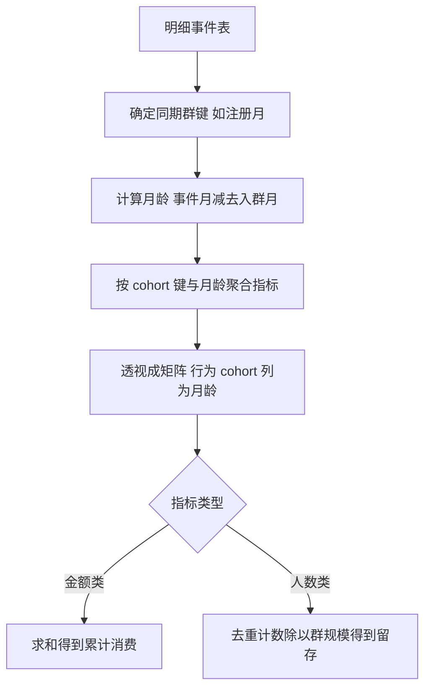
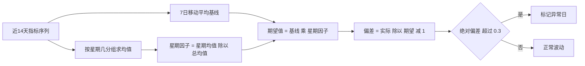
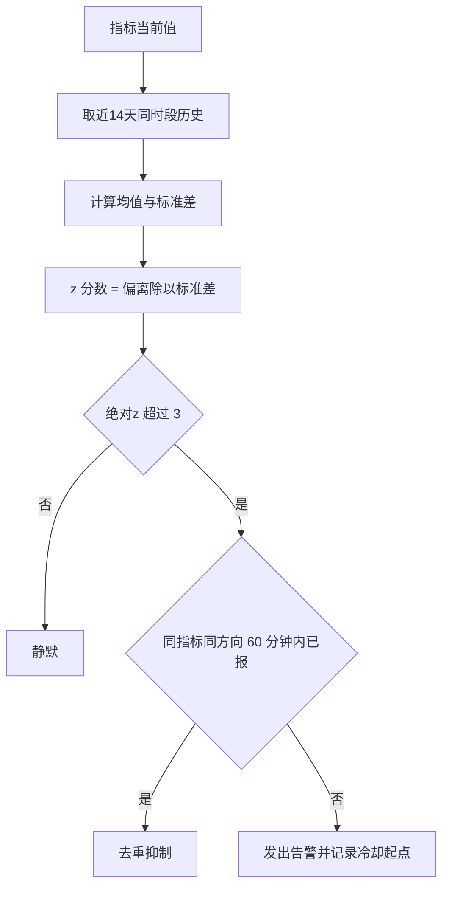
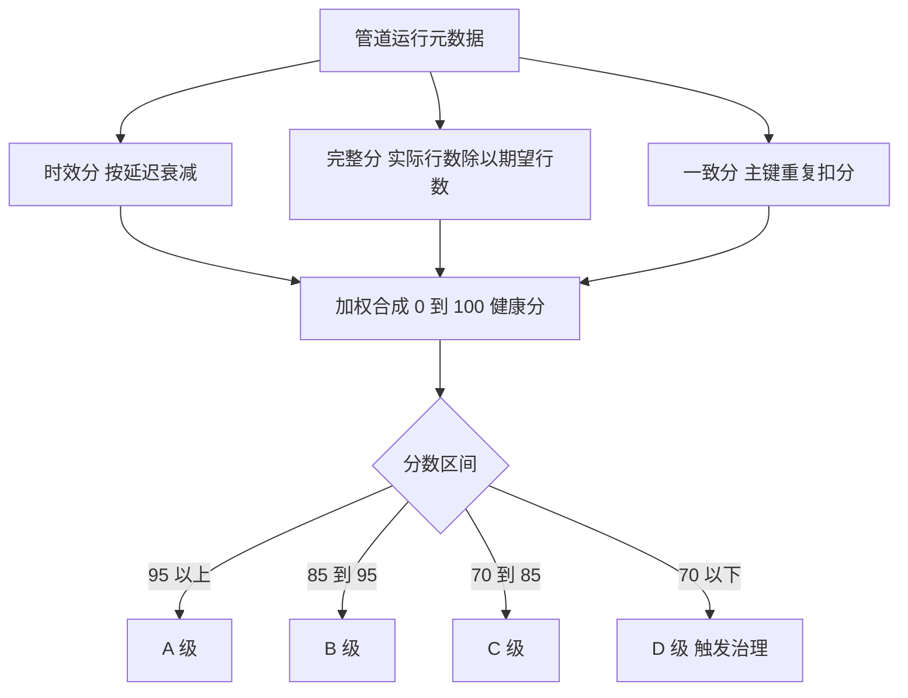
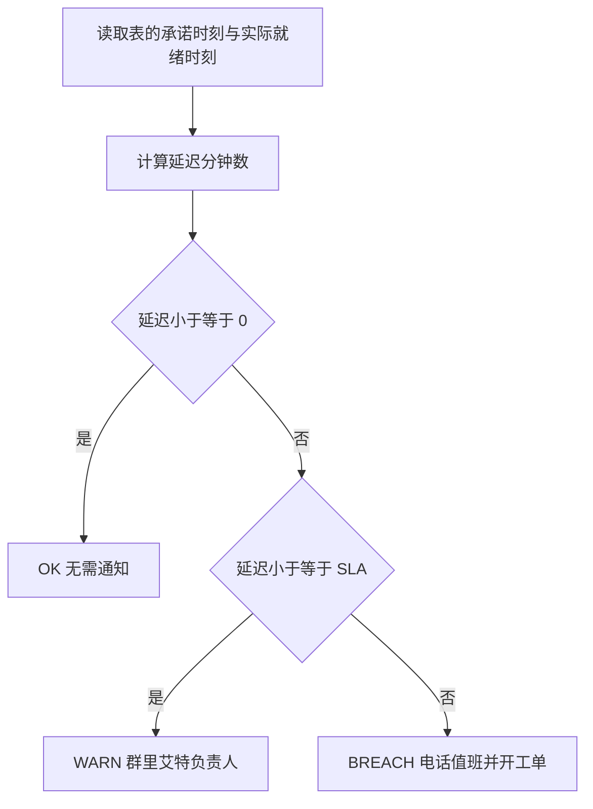
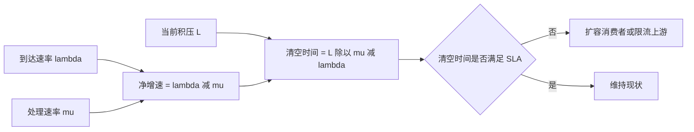
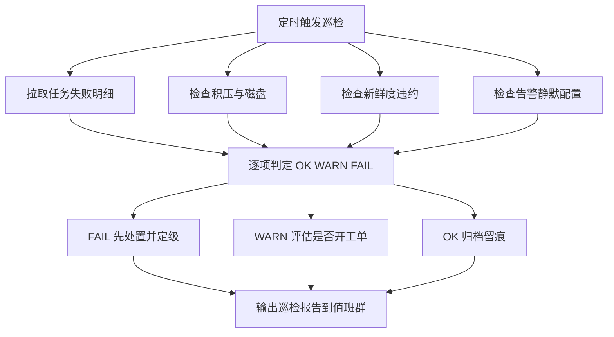
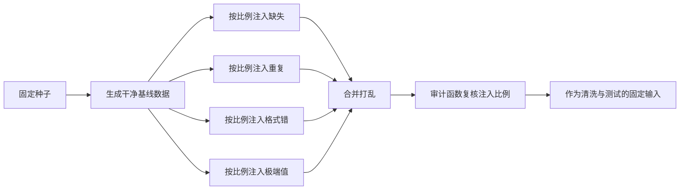
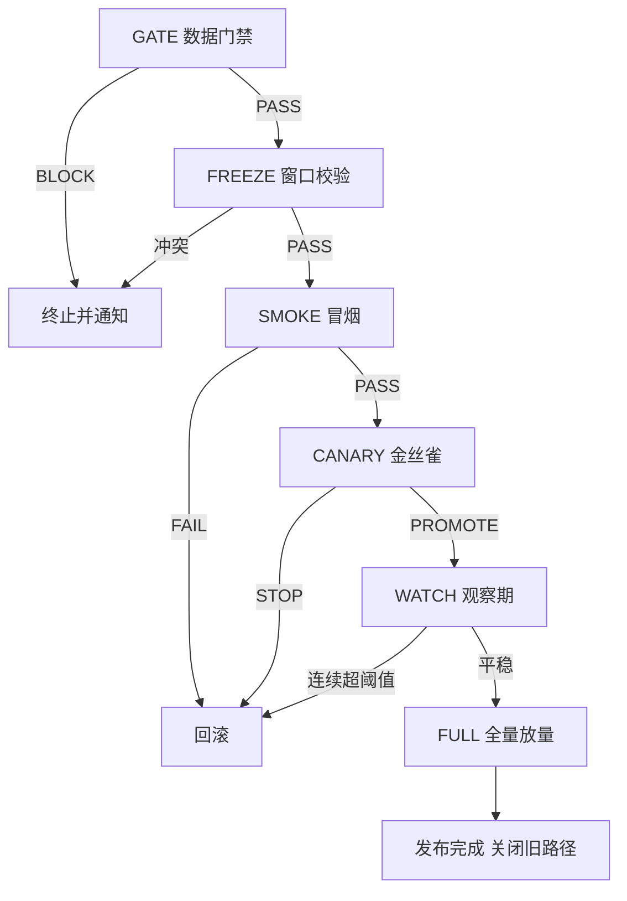

# 第 5 类 · 数据分析与工程化(夜间扩产)

> 本卷为夜间扩产篇(Q1436–Q1480,45 题):前段补齐分析场景盲区——分群动态更新与迁移矩阵、异常流量识别、指标突降归因、同期群引擎、渠道归因、漏斗置信区间与卡点时长、实体消解与实验护栏;中段加固数据管道可靠性——幂等写入、水位线与迟到数据、批流对比、断点续跑、健康分、schema 防护、exactly-once、死信区、回填限速与积压估算;尾段落到测试与发布工程——数据断言库、冒烟清单、金丝雀对比、回滚演练、值班巡检、分级门禁与发布剧本。
> 难度分布:1-2 星 9 题、3 星 23 题、4 星 13 题;题号全局唯一,与既有 Q001–Q1435 不重复。
> pandas/numpy 相关题均用 try/except ImportError 包裹,缺库时走标准库降级演示;纯逻辑题全部标准库可跑,全部代码已用 /usr/bin/python3 逐题实跑验证。

---

### Q1436 · 用户分群动态更新

> 难度:★★★☆ | 标签:用户分群, 规则引擎

**问**:业务上说"高价值用户群每天要更新",你打算怎么实现?用户从高价值掉到低价值,怎么把变化讲清楚?

**答**:核心是把"分群定义"和"分群成员"分开:定义是一段版本化的规则代码,成员是每天 T+1 用规则对全量用户重算的结果。重算后与昨日快照做三类对比——迁移、保持、新入群,迁移清单要落表,因为"昨天还是 high 今天变 low"是运营最关心的动作信号。存储上分群结果按日期 append 快照表而不是原地 update,这样既可回溯也能算迁移率。规则本身要进代码仓库走评审,改阈值等于改口径,必须留版本号。量特别大时才考虑用增量方式(只重算行为发生变化的用户),但要小心"没变的数据也依赖了过期特征"。

```python
# file: code/05_数据分析与工程化/q1436_dynamic_segment.py
"""用户分群动态更新:T+1 规则重算、迁移清单与快照留痕"""

USERS = [
    # user_id, 昨日分群, 近7天消费, 近7天活跃天数
    ("u1", "high", 1200, 6),
    ("u2", "high", 100, 1),
    ("u3", "mid", 280, 4),
    ("u4", "low", 900, 7),
    ("u5", None, 260, 5),
]


def classify(consume_7d, active_days):
    """业务规则:高价值=消费>=1000 且活跃>=5;成长群=消费>=200;其余为低价值"""
    if consume_7d >= 1000 and active_days >= 5:
        return "high"
    if consume_7d >= 200:
        return "mid"
    return "low"


def refresh(rows):
    """重算分群并区分三类变化:迁移、保持、新用户入群"""
    moved, stayed, joined = [], [], []
    for uid, old_seg, consume, days in rows:
        seg = classify(consume, days)
        if old_seg is None:
            joined.append((uid, seg))
        elif seg != old_seg:
            moved.append((uid, old_seg, seg))
        else:
            stayed.append(uid)
    return moved, stayed, joined


if __name__ == "__main__":
    moved, stayed, joined = refresh(USERS)
    print("分群迁移:", moved)
    print("保持不变:", stayed)
    print("新用户入群:", joined)
    print("工程要点:分群结果按日期 append 快照,不做原地 update,便于回溯与迁移率监控")
```

**追问**:
- 追问 1:规则频繁调整时怎么避免口径混乱?—— 规则带版本号落库,每次重算记录使用的版本,报表按版本对齐而不是按自然日。
- 追问 2:全量重算太慢怎么办?—— 只对特征有变化的重算并对未变化用户直接继承昨日结果,同时抽样比对增量与全量的差异率做正确性兜底。

### Q1437 · 分群迁移矩阵与漂移监控

> 难度:★★★☆ | 标签:用户分群, 指标监控

**问**:分群每天自动重算,你怎么发现"分群规则坏了"而不是"用户真的变了"?

**答**:给每个分群算漂移率:昨日该群用户今天有多少人换到了别的群。规则稳定时漂移率应该是低个位数,突然超过阈值(比如 20%)大概率是三类故障——上游数据缺失导致特征算错、规则阈值改动没同步、或者用户主键口径变了。落地用迁移矩阵,行是昨日分群、列是今日分群,对角线是保持不变的,一眼能看出"流失方向";矩阵外还要统计昨日有、今日找不到的用户数,这是数据缺失的直接证据。漂移率要按天画趋势,趋势性爬升和突刺要分开处理,前者是口径漂移,后者多半是数据事故。

```python
# file: code/05_数据分析与工程化/q1437_segment_drift.py
"""分群迁移矩阵:昨日分群 x 今日分群,输出漂移率并报警"""

PREV = {"u1": "high", "u2": "high", "u3": "high", "u4": "high",
        "u5": "mid", "u6": "mid", "u7": "mid", "u8": "mid",
        "u9": "low", "u10": "low", "u11": "low", "u12": "low"}
CURR = {"u1": "high", "u2": "high", "u3": "high", "u4": "high",
        "u5": "mid", "u6": "mid", "u7": "mid", "u8": "low",
        "u9": "low", "u10": "low", "u11": "low", "u12": "low"}
LABELS = ["high", "mid", "low"]
DRIFT_ALARM = 0.20  # 单群漂移超过 20% 触发报警


def migration_matrix(prev, curr, labels):
    matrix = {a: {b: 0 for b in labels} for a in labels}
    missing = 0
    for uid, a in prev.items():
        b = curr.get(uid)
        if b in matrix:
            matrix[a][b] += 1
        else:
            missing += 1
    return matrix, missing


def drift_rates(matrix):
    rates = {}
    for a, row in matrix.items():
        total = sum(row.values())
        moved = total - row[a]
        rates[a] = moved / total if total else 0.0
    return rates


if __name__ == "__main__":
    matrix, missing = migration_matrix(PREV, CURR, LABELS)
    print("迁移矩阵 行=昨日 列=今日:")
    print("      " + "  ".join(f"{b:>5}" for b in LABELS))
    for a in LABELS:
        print(f"{a:>5} " + "  ".join(f"{matrix[a][b]:>5}" for b in LABELS))
    if missing:
        print("昨日存在但今日找不到的用户:", missing, "需排查数据缺失")

    rates = drift_rates(matrix)
    for a, r in rates.items():
        flag = " <-- 超阈值,排查规则或数据源" if r > DRIFT_ALARM else ""
        print(f"{a} 群漂移率 {r:.1%}{flag}")
```

**追问**:
- 追问 1:漂移率和业务真实变化怎么区分?—— 抽漂移用户看特征明细,特征本身没变的迁移就是规则或数据问题。
- 追问 2:矩阵要不要算到用户粒度?—— 只在排查时下钻,常规监控用群级比例就够,避免明细表膨胀。

### Q1438 · 异常流量识别

> 难度:★★★☆ | 标签:反作弊, 异常检测

**问**:营销活动期间虚假流量暴涨,你在数据侧怎么识别?说下你打的信号和误杀控制。

**答**:数据侧常用四类信号:单 IP 或单设备请求频次(超同时段基线数倍)、UA 与指纹的多样性(真人 UA 会分散,脚本高度集中且熵极低)、referer 与来源结构(直连无 referer 占比异常)、路径集中度(真人会逛,机器人反复打同几个接口)。工程上把每个信号归一化成 0-1 打分再加权,总分超阈值进入"疑似名单",而不是直接封禁——先人工复核再处置,同时统计名单的转化率、留存率作旁证,机器流量通常零转化。误杀控制靠灰度:先只标记不拦截,观察一周确认精度后再接执行动作。识别规则本身要保密并定期轮换,否则会被针对性绕过。

```python
# file: code/05_数据分析与工程化/q1438_bot_traffic.py
"""异常流量识别:频次、UA 多样性、referer 缺失率、路径集中度四信号打分"""

import math
from collections import Counter, defaultdict

LOGS = [
    # ip, ua, path, referer
    ("10.0.0.1", "ua-A", "/item/1", "https://search.example.com"),
    ("10.0.0.1", "ua-A", "/item/2", "https://search.example.com"),
    ("10.0.0.1", "ua-A", "/item/1", None),
    ("10.0.0.1", "ua-A", "/item/3", None),
    ("10.0.0.1", "ua-A", "/item/1", None),
    ("10.0.0.1", "ua-A", "/item/2", None),
    ("10.0.0.2", "ua-B", "/home", "https://ad.example.com"),
    ("10.0.0.2", "ua-C", "/home", None),
    ("10.0.0.3", "ua-D", "/item/1", "https://search.example.com"),
]


def shannon_entropy(counter):
    total = sum(counter.values())
    if total == 0:
        return 0.0
    return -sum((n / total) * math.log2(n / total) for n in counter.values())


def score_ip(rows):
    """四个信号各占 25 分,总分 >= 60 判定为疑似机器流量"""
    ips = defaultdict(list)
    for ip, ua, path, ref in rows:
        ips[ip].append((ua, path, ref))
    result = {}
    for ip, hits in ips.items():
        n = len(hits)
        ua_entropy = shannon_entropy(Counter(ua for ua, _, _ in hits))
        no_ref = sum(1 for _, _, ref in hits if ref is None) / n
        path_counter = Counter(p for _, p, _ in hits)
        top_concentration = max(path_counter.values()) / n
        s_freq = min(n / 8, 1) * 25          # 频次:8 次封顶
        s_ua = (1 - min(ua_entropy, 1)) * 25  # UA 熵越低越像脚本
        s_ref = no_ref * 25
        s_path = top_concentration * 25
        result[ip] = {"score": s_freq + s_ua + s_ref + s_path, "n": n}
    return result


if __name__ == "__main__":
    for ip, info in sorted(score_ip(LOGS).items(), key=lambda x: -x[1]["score"]):
        verdict = "疑似机器流量" if info["score"] >= 60 else "正常"
        print(f"{ip} 请求 {info['n']} 次 打分 {info['score']:.0f} -> {verdict}")
    print("线上应再叠加时段分布、点击间隔方差等信号并人工复核后再封禁")
```

**追问**:
- 追问 1:为什么用信息熵而不是简单计数?—— 计数只看量,熵看分布形态,低熵才是脚本特征,高请求量的重度真人不会被误杀。
- 追问 2:识别出的流量对历史报表怎么处理?—— 打流量标记回溯历史明细,核心报表同时提供"含疑似流量"和"剔除后"两个口径。

### Q1439 · 指标突降归因:维度下钻与贡献分解

> 难度:★★★★ | 标签:归因分析, 指标监控

**问**:早上 GMV 跌了 30%,老板站在你背后要原因。你的归因方法论是什么?

**答**:两步走。第一步做加法维度的贡献分解:把总降幅按地区、渠道、品类等维度切开,每个维度的贡献等于"该维度降幅 / 总降幅",先锁定贡献最大的一两个维度,再在维度内二次下钻到具体品类或城市,这是快速缩小爆炸半径的办法。第二步做乘法口径的因子拆解:GMV = UV x CVR x AOV 时用逐因子替换法,每一步只换一个因子,把总变化拆成流量贡献、转化贡献、客单贡献,判断是"人变少了"还是"人买了但买得少"。工程上这一套要沉淀成下钻脚本或看板,而不是每次现场写 SQL;同时要提前排除数据侧原因——埋点是否丢数、上游是否断流,先证伪数据事故再谈业务原因。

```python
# file: code/05_数据分析与工程化/q1439_metric_drilldown.py
"""指标突降归因:维度贡献分解 + 乘法口径的因子替换拆解"""
try:
    import pandas as pd
except ImportError:
    pd = None

YESTERDAY = {"华东": 1200, "华南": 800, "华北": 600, "海外": 400}
TODAY = {"华东": 900, "华南": 820, "华北": 100, "海外": 380}


def dimension_contribution(prev, curr):
    """按维度算贡献:该维度降幅 / 总降幅,先定位大头再二次下钻"""
    total_drop = sum(prev.values()) - sum(curr.values())
    if total_drop == 0:
        return {}
    return {
        k: {"drop": prev[k] - curr[k], "share": (prev[k] - curr[k]) / total_drop}
        for k in prev
    }


def multiplicative_breakdown(uv_p, uv_c, cvr_p, cvr_c, aov_p, aov_c):
    """GMV = UV x CVR x AOV,逐因子替换:每步只换一个因子,交互项归到最后一步"""
    gmv_prev = uv_p * cvr_p * aov_p
    d_uv = uv_c * cvr_p * aov_p - gmv_prev
    d_cvr = uv_c * cvr_c * aov_p - uv_c * cvr_p * aov_p
    d_aov = uv_c * cvr_c * aov_c - uv_c * cvr_c * aov_p
    return {"uv": d_uv, "cvr": d_cvr, "aov": d_aov, "total": uv_c * cvr_c * aov_c - gmv_prev}


if pd is None:
    print("标准库降级:维度贡献分解")
    contrib = dimension_contribution(YESTERDAY, TODAY)
    for k, v in sorted(contrib.items(), key=lambda x: -x[1]["drop"]):
        print(f"  {k}: 下降 {v['drop']:.0f} 占总降幅 {v['share']:.1%}")
    print("乘法口径因子替换:", multiplicative_breakdown(10000, 9800, 0.04, 0.032, 120, 121))
else:
    df = pd.DataFrame({
        "region": list(YESTERDAY),
        "gmv_prev": list(YESTERDAY.values()),
        "gmv_curr": list(TODAY.values()),
    })
    df["drop"] = df["gmv_prev"] - df["gmv_curr"]
    df["share"] = df["drop"] / df["drop"].sum()
    print(df.sort_values("drop", ascending=False).to_string(index=False))
```

**追问**:
- 追问 1:多个维度都贡献大怎么归?—— 按业务因果排序下钻,并用固定顺序的逐因子替换避免重复计账,残差单列为交互项。
- 追问 2:怎么快速排除是数据事故?—— 对比埋点日志量、上游表新鲜度和同源其他指标,三者同时塌陷基本就是数据问题。

### Q1440 · 同期群分析:通用 cohort 引擎

> 难度:★★★☆ | 标签:同期群, 留存

**问**:让你从零实现一个同期群分析工具,支持任意 cohort 键和任意指标,怎么设计?

**答**:抽象成三个正交概念:cohort 键(注册月、首单日、获客渠道)、月龄(事件时间减 cohort 时间,按月或天)、聚合指标(金额求和、人数去重、次数计数)。引擎先把明细规整成"cohort 键 + 月龄 + 值"三列,再按这两个键透视成矩阵,行是同期群、列是月龄,留存矩阵只是把指标换成"去重人数除以 cohort 规模"的特例。实现上 pandas 的 pivot_table 一行搞定,标准库用双层字典也一样;关键是月龄函数要处理跨年,以及矩阵列数要用观测窗口封顶而不是数据里出现的最大月龄。输出统一带 cohort 规模列,否则横向对比不同大小的 cohort 容易误读。

```python
# file: code/05_数据分析与工程化/q1440_cohort_engine.py
"""同期群引擎:按入群键 x 月龄透视任意指标,pandas 与标准库双实现"""
try:
    import pandas as pd
except ImportError:
    pd = None

EVENTS = [
    # user, signup_month, order_month, amount
    ("u1", "2025-01", "2025-01", 100),
    ("u1", "2025-01", "2025-02", 80),
    ("u2", "2025-01", "2025-01", 200),
    ("u3", "2025-02", "2025-02", 150),
    ("u3", "2025-02", "2025-03", 90),
    ("u4", "2025-02", "2025-03", 60),
]


def month_diff(a, b):
    """b 相对 a 的月龄,格式 YYYY-MM"""
    ya, ma = int(a[:4]), int(a[5:7])
    yb, mb = int(b[:4]), int(b[5:7])
    return (yb - ya) * 12 + (mb - ma)


def cohort_table_stdlib(events, max_age=2):
    """行=同期群,列=月龄,单元格=指标聚合;留存同理把值换成人数即可"""
    agg, sizes = {}, {}
    for user, signup, order, amount in events:
        age = month_diff(signup, order)
        agg[(signup, age)] = agg.get((signup, age), 0) + amount
        sizes.setdefault(signup, set()).add(user)
    cohorts = sorted({k[0] for k in agg})
    print("cohort\t" + "\t".join(f"M{m}" for m in range(max_age + 1)) + "\t用户数")
    for c in cohorts:
        row = [agg.get((c, m), 0) for m in range(max_age + 1)]
        print(c + "\t" + "\t".join(str(v) for v in row) + f"\t{len(sizes[c])}")


if pd is None:
    print("标准库降级:cohort 消费金额矩阵")
    cohort_table_stdlib(EVENTS)
else:
    df = pd.DataFrame(EVENTS, columns=["user", "signup", "order", "amount"])
    df["month_idx"] = df.apply(lambda r: month_diff(r["signup"], r["order"]), axis=1)
    pivot = df.pivot_table(index="signup", columns="month_idx", values="amount",
                           aggfunc="sum", fill_value=0)
    print(pivot)
    print("各 cohort 用户数:", df.groupby("signup")["user"].nunique().to_dict())
```



**追问**:
- 追问 1:cohort 键和留存窗口不一致会怎样?—— 月龄为负的事件要过滤掉,否则会把入群前的行为算进去,矩阵出现负值。
- 追问 2:月龄粒度想按周怎么改?—— 把月龄函数换成天数整除 7,同时 cohort 键对齐到周一,避免周口径错位。

### Q1441 · 渠道归因模型:概念与标准库实现

> 难度:★★★☆ | 标签:渠道归因, 标准库

**问**:解释渠道归因是什么,first-touch、last-touch、linear、time-decay 各适合什么决策?

**答**:归因解决的是"一次转化前用户接触了多个渠道,功劳怎么分"的问题。last-touch 把全部功劳给最后一次触点,适合评估临门一脚的渠道(如优惠券推送);first-touch 全给第一次,适合评估拉新获客能力;linear 平均分配,适合衡量各渠道的参与度;time-decay 按距转化的时间指数衰减加权,兼顾了"越近影响越大"的直觉,是大多数业务比较稳的默认选择。要强调模型只决定功劳怎么分,不改变事实,所以正规做法是多模型并列展示对比,而不是只看单一模型的排行榜;预算决策建议参考增量实验,归因模型用于日常监控与方向感。实现上就是定义 credit 函数再按渠道累加,标准库几十行就能写清四种模型。

```python
# file: code/05_数据分析与工程化/q1441_attribution.py
"""渠道归因:首触、末触、线性、时间衰减四种模型的对照实现"""

TOUCHES = {
    # 订单 -> 有序触点序列 渠道, 次序
    "order_1": [("ad", 1), ("search", 2), ("social", 3), ("email", 4)],
    "order_2": [("search", 1), ("ad", 2)],
}


def first_touch(path):
    return {path[0][0]: 1.0}


def last_touch(path):
    return {path[-1][0]: 1.0}


def linear(path):
    credit = 1.0 / len(path)
    return {ch: credit for ch, _ in path}


def time_decay(path, half_life=1):
    """按触点距转化的步数做指数衰减,步数越近权重越大"""
    weights = [0.5 ** (len(path) - i - 1) for i in range(len(path))]
    total = sum(weights)
    return {ch: w / total for (ch, _), w in zip(path, weights)}


def aggregate(orders, model):
    totals = {}
    for path in orders.values():
        for ch, credit in model(path).items():
            totals[ch] = totals.get(ch, 0.0) + credit
    return totals


if __name__ == "__main__":
    models = [("first_touch", first_touch), ("last_touch", last_touch),
              ("linear", linear), ("time_decay", time_decay)]
    for name, fn in models:
        totals = aggregate(TOUCHES, fn)
        line = ", ".join(f"{ch}={v:.2f}" for ch, v in sorted(totals.items(),
                                                            key=lambda x: -x[1]))
        print(f"{name:<12} {line}")
    print("模型只决定'功劳怎么分',选型要跟投放决策挂钩,建议多模型并列展示")
```

**追问**:
- 追问 1:归因窗口多长合适?—— 覆盖 90% 以上转化路径的时间即可,窗口太长会引入无关触点稀释信号。
- 追问 2:跨设备触点怎么合并?—— 用登录态或概率匹配打通设备,合并前要接受归因结果的不确定性并标注覆盖率。

### Q1442 · 漏斗转化率的置信区间

> 难度:★★★★ | 标签:统计推断, 漏斗

**问**:漏斗每步转化率旁边你都会加什么?为什么直接报一个转化率数字是不够的?

**答**:报转化率必须带置信区间,因为它本质是二项比例,样本量小时点估计会大幅摆动——10 个用户转了 3 个报 30%,和 3000 个里转 900 个的 30% 完全不是一回事。工程上用 Wilson 区间而不是正态近似,它在小样本和比例接近 0 或 1 时不会给出越界(比如负的转化率)的荒谬区间。对比两个版本的漏斗时,用两比例差的置信区间:差值区间不包含 0 才能声称有差异,只看到"56% 到 60%"这种裸提升就下结论是常见事故。漏斗整体转化率是多步连乘,每步的不确定会传播放大,所以越靠后的步骤越要强调区间宽度。所有这些 statistics.NormalDist 一行就能拿到 z 值,不依赖 scipy。

```python
# file: code/05_数据分析与工程化/q1442_funnel_ci.py
"""漏斗转化率的置信区间:单步 Wilson 区间与两版本差异区间"""

import math
from statistics import NormalDist

Z = NormalDist().inv_cdf(0.975)  # 95% 置信


def wilson(success, n, z=Z):
    """Wilson 区间:小样本或低转化率下比正态近似更稳"""
    if n == 0:
        return 0.0, 0.0, 0.0
    p = success / n
    denom = 1 + z * z / n
    center = (p + z * z / (2 * n)) / denom
    half = z / denom * math.sqrt(p * (1 - p) / n + z * z / (4 * n * n))
    return p, center - half, center + half


def two_proportion(s1, n1, s2, n2, z=Z):
    """两组转化率之差的置信区间,0 不在区间内即认为差异显著"""
    p1, p2 = s1 / n1, s2 / n2
    se = math.sqrt(p1 * (1 - p1) / n1 + p2 * (1 - p2) / n2)
    diff = p2 - p1
    return diff, diff - z * se, diff + z * se


if __name__ == "__main__":
    funnel = [("访问", 10000, 3200), ("加购", 3200, 900), ("支付", 900, 540)]
    print("步骤  转化率     95% CI")
    prev_n = None
    for name, n, succ in funnel:
        base = prev_n if prev_n is not None else n
        p, lo, hi = wilson(succ, base)
        print(f"{name}  {p:.1%}  [{lo:.1%}, {hi:.1%}]")
        prev_n = succ
    d, lo, hi = two_proportion(900, 3200, 540, 1000)
    print(f"\n新版支付转化 - 旧版 = {d:+.1%},95% CI [{lo:+.1%}, {hi:+.1%}]")
    print("结论:", "显著提升" if lo > 0 else "尚不能认为有显著差异")
```

**追问**:
- 追问 1:漏斗步骤间样本相关怎么办?—— 同一用户连续走多步不是独立样本,严格做法是在用户层聚合后再检验,漏斗级 CI 只作展示。
- 追问 2:什么时候区间会严重失真?—— 分层抽样、聚类流量(同一渠道批量进入)会让有效样本量小于名义样本量,需要设计效应校正。

### Q1443 · 漏斗卡点时长分析

> 难度:★★★☆ | 标签:漏斗, 时长分析

**问**:除了每步转化率,漏斗还能挖什么?用户"最终转化但拖了很久"这个群体你怎么量化?

**答**:做步骤间时长分布。把每个会话的相邻步骤时间戳相减,得到"浏览到加购""加购到支付"的耗时序列,报中位数和 P90 而不是均值——时长是重尾分布,均值会被几小时后才回来支付的长尾拉歪。中位数反映"典型用户多久完成",P90 用来定义"慢转化"阈值,超过 P90 的群体就是催付、召回类策略的目标人群。时长分析还能暴露产品问题:如果"加购到支付"中位数从 5 分钟涨到 30 分钟,转化率可能没变,但体验已经劣化,单看转化率完全发现不了。工程上要把步骤时长做成会话粒度明细表,再在指标层聚合分位数,直接对原始事件算分位数代价太高。

```python
# file: code/05_数据分析与工程化/q1443_funnel_step_time.py
"""漏斗卡点时长分析:步骤间转化耗时的分位数,判断'慢转化'用户群"""

import statistics

SESSIONS = [
    # session, 各步骤时间戳秒:访问、加购、支付(None 表示未发生)
    ("s1", 0, 120, 600),
    ("s2", 0, 90, 3000),
    ("s3", 0, 600, 900),
    ("s4", 0, 300, None),
    ("s5", 0, 180, 1500),
    ("s6", 0, None, None),
]


def step_gaps(sessions):
    """相邻步骤的耗时列表,缺步的会话不进入该步统计"""
    gaps = {"browse_to_cart": [], "cart_to_pay": []}
    for _, t0, t1, t2 in sessions:
        if t1 is not None:
            gaps["browse_to_cart"].append(t1 - t0)
            if t2 is not None:
                gaps["cart_to_pay"].append(t2 - t1)
    return gaps


def describe(values):
    if not values:
        return "无样本"
    values = sorted(values)
    p90 = values[min(len(values) - 1, int(round(0.9 * len(values))) - 1)]
    return f"中位 {statistics.median(values):.0f}s  P90 {p90}s  均值 {statistics.mean(values):.0f}s"


if __name__ == "__main__":
    gaps = step_gaps(SESSIONS)
    for step, values in gaps.items():
        print(f"{step}: {describe(values)}")
    slow = [g for g in gaps["cart_to_pay"] if g > 1200]
    print(f"加购后超过 20 分钟才支付: {len(slow)} 人 -> 建议催付策略针对这一段")
```

**追问**:
- 追问 1:跨天完成的转化算谁的?—— 按事件时间差统计,不归属到某一天;若要看"按日的慢转化占比",用首次步骤日期做 cohort。
- 追问 2:时长和转化率冲突时信谁?—— 先看时长变化是否由产品改动引起,再判断转化率的样本期是否被时长拉长截断,多数是右侧删失问题。

### Q1444 · 新老用户判定与设备归一

> 难度:★★☆☆ | 标签:指标口径, 数据清洗

**问**:同一个用户换了账号还换了手机,你的"新用户"指标可信吗?口径怎么定?

**答**:先定主键再定口径:登录产品优先 user_id,匿名流量用设备指纹,两者用映射表打通,同一设备换账号要归一成同一个"人"。新用户判定用首活日:用户的最早活跃日期等于当日才算新用户,否则是老用户,这个逻辑必须从全量历史算而不是从报表周期起点算,否则每月一号会冒出一批假新用户。常见坑有三个:老用户清缓存被误判为新用户、换设备的老用户被重复计数、多端登录导致一个自然人拆成多个 ID。数据侧的兜底是把"新用户数"与"渠道新增"做交叉校验,两者对不上先查口径再谈业务。口径定完要写进指标字典,所有下游不得自行再算。

```python
# file: code/05_数据分析与工程化/q1444_new_user_identity.py
"""新老用户判定:设备指纹归一与首活日口径"""
try:
    import pandas as pd
except ImportError:
    pd = None

EVENTS = [
    # date, user_id, device_id
    ("2025-06-01", "u1", "d1"),
    ("2025-06-01", "u2", "d2"),
    ("2025-06-02", "u9", "d1"),   # 同设备换了账号,应归一为老用户
    ("2025-06-02", "u2", "d2"),
    ("2025-06-02", "u3", "d3"),
    ("2025-06-03", "u3", "d3"),
]


def stdlib_version(rows):
    first_seen, daily = {}, {}
    for date, uid, dev in rows:
        key = dev  # 以设备指纹为主键,同设备多账号视为同人
        first_seen.setdefault(key, date)
        daily.setdefault(date, []).append(key)
    for date in sorted(daily):
        old = sum(1 for k in daily[date] if first_seen[k] < date)
        new = len(daily[date]) - old
        print(f"{date}  新 {new}  老 {old}")


if pd is None:
    print("标准库降级:设备口径新老判定")
    stdlib_version(EVENTS)
else:
    df = pd.DataFrame(EVENTS, columns=["date", "user_id", "device_id"])
    first = df.groupby("device_id")["date"].min().rename("first_seen")
    df = df.merge(first, on="device_id")
    df["is_new"] = df["date"] == df["first_seen"]
    daily = df.groupby(["date", "is_new"]).size().unstack(fill_value=0)
    daily.columns = ["old", "new"] if set(daily.columns) == {False, True} else daily.columns
    print(daily)
```

**追问**:
- 追问 1:首活日从"报表周期起点"算会怎样?—— 历史老用户全变成新用户,新增虚高,这是最常见的新增口径事故。
- 追问 2:匿名流量和登录流量怎么衔接?—— 登录瞬间把匿名设备指纹与 user_id 绑定进映射表,归因时按映射表回溯匿名期行为。

### Q1445 · 趋势基线与季节性识别

> 难度:★★☆☆ | 标签:时间序列, 基线

**问**:日报说"今天的 PV 比昨天低 20%",你怎么判断这算不算异常?

**答**:和昨天比是最差的基线,正确做法是"移动平均基线 x 季节因子":先用近 7 天或 14 天的移动平均建立趋势基线,再按星期几分组算季节因子(该星期均值 / 总体均值),工作日和周末的流量模式完全不同,期望值等于基线乘以当天星期因子,最后用实际值对期望值的偏差判异常。这样"周一比周日跌 20%"不会被误报,而"周三比典型周三跌 20%"才会。趋势与季节分离后还能看纯趋势:排除星期效应后的基线在爬升还是下滑,这比单日波动重要得多。数据里有大促脉冲时,基线窗口要剔除或缩尾,否则季节因子会被脉冲污染。这套逻辑几十行标准库就能落地,不必上来就用 STL 分解。

```python
# file: code/05_数据分析与工程化/q1445_trend_season.py
"""趋势基线与季节性识别:移动平均基线 x 星期因子,异常日一目了然"""
try:
    import pandas as pd
except ImportError:
    pd = None

import datetime as dt

BASE = 1000
DAYS = [(dt.date(2025, 6, 2) + dt.timedelta(days=i),
         int(BASE * (1 + 0.4 * ((dt.date(2025, 6, 2) + dt.timedelta(days=i)).weekday() >= 5))
             + (i * 37 % 60) - 30)) for i in range(14)]
DAYS.append((dt.date(2025, 6, 16), 480))  # 注入一个异常低点


def weekday_factor(days):
    """星期因子 = 该星期均值 / 全体均值,滚动窗口越长越稳"""
    overall = sum(v for _, v in days) / len(days)
    buckets = {}
    for d, v in days:
        buckets.setdefault(d.weekday(), []).append(v)
    return {wd: sum(vs) / len(vs) / overall for wd, vs in buckets.items()}


def stdlib_version(days, window=7):
    factors = weekday_factor(days[:-1])
    print("date        actual  expected  偏差")
    for i, (d, v) in enumerate(days):
        if i < window:
            continue
        history = [v2 for _, v2 in days[i - window:i]]
        expected = (sum(history) / len(history)) * factors[d.weekday()]
        dev = v / expected - 1
        flag = "  <-- 异常" if abs(dev) > 0.3 else ""
        print(f"{d}  {v:>6}  {expected:>8.0f}  {dev:+.0%}{flag}")


if pd is None:
    print("标准库降级:移动平均 x 星期因子")
    stdlib_version(DAYS)
else:
    s = pd.Series({d: v for d, v in DAYS}).sort_index()
    factor = s.groupby(s.index.weekday).mean() / s.mean()
    baseline = s.rolling(7).mean().shift(1) * s.index.map(factor)
    dev = s / baseline - 1
    out = dev[dev.abs() > 0.3]
    print("pandas 结果:异常日")
    print(out.dropna().to_string())
```

**追问**:
- 追问 1:节假日怎么处理?—— 维护节假日表,假日的期望值用"历史同假日"或工作日因子单独估算,不与普通星期混算。
- 追问 2:窗口取多长?—— 覆盖至少两个完整周期(周粒度至少 14 天),太短则季节因子噪声大,太长则趋势被抹平。



### Q1446 · 用户生命周期阶段划分

> 难度:★★★☆ | 标签:用户分层, 生命周期

**问**:让你把用户切成生命周期阶段来运营,阶段怎么定义?判定顺序有什么讲究?

**答**:常用五段:新手(注册 30 天内)、成长(已激活但消费频次低)、成熟(高频或高额)、沉睡(超 30 天未活跃)、流失(超 90 天未活跃),判据用"近因 + 强度"两组变量:距最近一次活跃的天数、近 90 天订单数与消费额。实现上是规则状态机,重点是判定顺序:先判流失和沉睡(负向状态优先),再判成熟,最后才落到新手和成长——否则一个"高消费但已 100 天没来"的用户会被误标成成熟,运营会对他做激励而不是召回。阈值要跟业务节奏对齐,高频电商 30 天沉睡合理,低频房产则要用 90 天起步。阶段定义一旦上线就进了口径字典,调整要走变更评审,因为下游所有分层运营策略都挂在这个字段上。

```python
# file: code/05_数据分析与工程化/q1446_lifecycle.py
"""用户生命周期阶段划分:近因 x 消费的状态机"""

USERS = [
    # user_id, 注册至今天数, 最近一次活跃距今天数, 近90天订单数, 近90天消费
    ("u1", 15, 1, 1, 50),
    ("u2", 90, 3, 6, 900),
    ("u3", 400, 10, 20, 5000),
    ("u4", 200, 45, 3, 200),
    ("u5", 500, 120, 10, 3000),
    ("u6", 60, 8, 0, 0),
]


def stage(days_since_register, days_since_active, orders_90d, spend_90d):
    if days_since_active > 90:
        return "churned 流失"
    if days_since_active > 30:
        return "sleeping 沉睡"
    if orders_90d >= 10 or spend_90d >= 3000:
        return "mature 成熟"
    if days_since_register <= 30:
        return "new 新手"
    return "growing 成长"


if __name__ == "__main__":
    counts = {}
    for uid, reg, act, orders, spend in USERS:
        s = stage(reg, act, orders, spend)
        counts[s] = counts.get(s, 0) + 1
        print(f"{uid}: {s}")
    print("阶段分布:", counts)
    print("关键规则:先判流失再判成熟,避免'高消费但已流失'被误标为成熟")
```

**追问**:
- 追问 1:阶段之间的迁移要不要监控?—— 要,做阶段迁移矩阵,成熟用户加速流向沉睡是业务预警信号。
- 追问 2:为什么不用模型聚类代替规则?—— 聚类结果难解释且不稳定,生命周期阶段要可直接执行运营动作,规则先行、模型只在规模大后引入。

### Q1447 · 流失预警评分:规则引擎版

> 难度:★★★☆ | 标签:流失预警, 评分卡

**问**:还没上机器学习之前,你能不能先用规则把流失预警做起来?怎么保证可解释?

**答**:可以,规则评分卡是最快落地的方式:把业务上公认的流失前兆做成条件清单——近 7 天未登录、订单量环比腰斩、客单价持续走低、客诉未解决、优惠券将过期未用——每个条件配一个权重,命中加权求和得到风险分,再按分数分层为高危、关注、健康。可解释性是它最大的价值:每一条命中都带着"为什么",运营拿到名单就知道该推什么权益;上线后用"高分用户未来 30 天实际流失率"校准,如果 60 分以上用户真实流失率不到 20%,说明权重或阈值要调。规则分还有个隐性作用是给后续模型分当 baseline:模型必须显著跑赢规则分才值得引入,否则徒增维护成本。清单本身要版本化,命中明细落表,便于回溯和调参。

```python
# file: code/05_数据分析与工程化/q1447_churn_rule.py
"""流失预警评分:规则引擎版,条件命中加权求和后分层"""

RULES = [
    ("近7天未登录", lambda u: u["days_since_login"] > 7, 30),
    ("近30天订单下降超一半", lambda u: u["orders_30d"] < u["orders_prev_30d"] * 0.5, 25),
    ("客单价持续走低", lambda u: u["aov"] < u["aov_baseline"] * 0.6, 15),
    ("客诉未解决", lambda u: u["open_tickets"] > 0, 15),
    ("优惠券即将过期未用", lambda u: u["expiring_coupon"] is True, 10),
]

USERS = [
    {"uid": "u1", "days_since_login": 12, "orders_30d": 1, "orders_prev_30d": 5,
     "aov": 60, "aov_baseline": 100, "open_tickets": 1, "expiring_coupon": False},
    {"uid": "u2", "days_since_login": 1, "orders_30d": 4, "orders_prev_30d": 5,
     "aov": 95, "aov_baseline": 100, "open_tickets": 0, "expiring_coupon": True},
]


def risk_score(user):
    score, reasons = 0, []
    for name, cond, weight in RULES:
        if cond(user):
            score += weight
            reasons.append(f"{name}(+{weight})")
    return score, reasons


def band(score):
    if score >= 60:
        return "高危"
    if score >= 30:
        return "关注"
    return "健康"


if __name__ == "__main__":
    for u in USERS:
        score, reasons = risk_score(u)
        print(f"{u['uid']} 得分 {score} [{band(score)}] 命中: {'; '.join(reasons) or '无'}")
    print("规则分的好处是可解释、可快速上线;量大后再换模型分并保留规则分做兜底")
```

**追问**:
- 追问 1:怎么验证规则分有效?—— 用历史数据回测:按分数分层看实际流失率是否单调递增,不单调说明某条规则是噪声。
- 追问 2:规则之间高度相关怎么办?—— 相关规则合并或去重(比如未登录和订单下降常同时出现),否则分数会重复计账。

### Q1448 · 同人多账号合并:并查集实体消解

> 难度:★★★★ | 标签:实体消解, 并查集

**问**:同一个人有三个账号、两台设备,你的 DAU 虚高了多少你不知道。怎么做账号归并?

**答**:这是实体消解问题,标准解法是并查集:把每个账号看作节点,凡共享同一手机号、同一设备指纹或同一邮箱的账号之间连边做 union,最后每个连通分量就是一个"自然人"。选择共享键要谨慎——家庭共用 IP 和共用设备会造成误合并,所以强标识(手机号、身份证、邮箱)优先,弱标识(设备、IP)要么加权要么只在"一对一强绑定"时使用;更稳的做法是先合并强标识,再对弱标识做人工抽检确认。归并之后指标口径要切换:DAU、复购率按"自然人"算,同时保留账号粒度做对照,两套数之间的差异要单独出一份"去重收益"报告,这是数据治理最直观的成果。线上落地一般每天跑一次增量合并,合并结果落映射表,下游 join 映射表即可,不用改业务代码。

```python
# file: code/05_数据分析与工程化/q1448_identity_merge.py
"""同人多账号合并:并查集做实体消解,按共享手机号/设备/邮箱连通"""

ACCOUNTS = [
    # account_id, 手机号, 设备, 邮箱
    ("a1", "13800000001", "devA", None),
    ("a2", None, "devA", "x@mail.com"),
    ("a3", "13800000002", "devB", "x@mail.com"),
    ("a4", "13800000003", "devC", None),
    ("a5", None, "devC", None),
]


class UnionFind:
    def __init__(self, items):
        self.parent = {x: x for x in items}

    def find(self, x):
        while self.parent[x] != x:
            self.parent[x] = self.parent[self.parent[x]]  # 路径压缩
            x = self.parent[x]
        return x

    def union(self, a, b):
        ra, rb = self.find(a), self.find(b)
        if ra != rb:
            self.parent[rb] = ra


def merge_accounts(accounts):
    uf = UnionFind([a[0] for a in accounts])
    key_index = {}  # 共享键 -> 任一账号
    for aid, phone, device, email in accounts:
        for key in ("phone:" + str(phone), "dev:" + str(device), "mail:" + str(email)):
            if key.endswith("None"):
                continue
            if key in key_index:
                uf.union(key_index[key], aid)
            else:
                key_index[key] = aid
    groups = {}
    for aid, *_ in accounts:
        groups.setdefault(uf.find(aid), []).append(aid)
    return sorted(sorted(g) for g in groups.values())


if __name__ == "__main__":
    for group in merge_accounts(ACCOUNTS):
        print("同一自然人:", group)
    print("线上还要解决合并后的指标口径:按'人'聚合时用组内代表键或维护映射表")
```

**追问**:
- 追问 1:误合并了怎么办?—— 维护合并审计表记录合并依据,支持人工拆分并回写黑名单,被拆开的键以后不再自动合并。
- 追问 2:规模到亿级怎么办?—— 并查集换成图计算平台或按共享键哈希分片做 MapReduce 合并,键空间天然可并行。

### Q1449 · AB 实验的护栏:SRM、污染与护栏指标

> 难度:★★★★ | 标签:AB 测试, 实验质量

**问**:实验组转化率涨了 5%,你敢直接上报吗?上线前你会先查什么?

**答**:先查三条护栏,任何一条不过都不能看业务指标。第一是 SRM 样本比完整性校验:配置五五分的实验,实际分桶比若显著偏离预期(z 检验超过 1.96),说明分流服务有 bug、埋点丢失或过滤逻辑不对,这时的"提升"大概率是假的;第二是样本污染检测:同一用户出现在多个实验组,说明分流粘性失效,通常是缓存键用错或登录态切换导致;第三是护栏指标:延迟、错误率、崩溃率等工程指标若在实验组显著劣化,即使转化率涨了也要停——那是用体验换的数字。这三条都过了,再看业务指标并结合置信区间判断。护栏检查要自动化:实验平台每天跑一次,失败自动冻结实验并通知 owner,而不是靠人记得去查。

```python
# file: code/05_数据分析与工程化/q1449_ab_guardrail.py
"""AB 实验护栏:SRM 校验、样本污染检测与护栏指标突变"""

import math
from statistics import NormalDist


def srm_check(observed, expected_ratio, z=1.96):
    """样本比完整性校验:实际分桶比偏离配置比过大说明分流有 bug"""
    total = sum(observed.values())
    ratios = list(expected_ratio.values())
    base = sum(ratios)
    worst = None
    for name, n in observed.items():
        expect = total * ratios[list(observed).index(name)] / base
        sigma = math.sqrt(total * (expect / total) * (1 - expect / total))
        zz = (n - expect) / sigma if sigma else 0.0
        if worst is None or abs(zz) > abs(worst[1]):
            worst = (name, zz)
    name, zz = worst
    return {"worst_bucket": name, "z": round(zz, 2),
            "srm_violated": abs(zz) > z}


def pollution_check(assignments):
    """同一用户出现在多个实验组,分流服务粘性失效的典型信号"""
    seen = {}
    polluted = set()
    for user, group in assignments:
        if user in seen and seen[user] != group:
            polluted.add(user)
        seen[user] = group
    return polluted


GUARD_BASELINE = {"p99_latency_ms": 200, "error_rate": 0.01}


def guardrail_check(current):
    alerts = []
    if current["p99_latency_ms"] > GUARD_BASELINE["p99_latency_ms"] * 1.1:
        alerts.append("p99 延迟涨幅超 10%")
    if current["error_rate"] > GUARD_BASELINE["error_rate"] * 1.5:
        alerts.append("错误率涨幅超 50%")
    return alerts


if __name__ == "__main__":
    print("SRM:", srm_check({"control": 5210, "treatment": 4790},
                            {"control": 1, "treatment": 1}))
    polluted = pollution_check([("u1", "control"), ("u1", "treatment"), ("u2", "treatment")])
    print("污染用户:", polluted or "无")
    print("护栏:", guardrail_check({"p99_latency_ms": 260, "error_rate": 0.008}) or "全部正常")
    print("三条护栏任一失败都应先停实验再分析业务指标")
```

**追问**:
- 追问 1:SRM 的常见根因有哪些?—— 分流哈希键变更、机器人流量集中在单组、埋点客户端崩溃差异、按天剔除用户造成不对称。
- 追问 2:发现污染后怎么修?—— 以用户首次进入的组为准重算,或直接宣布实验作废重跑;修补分桶逻辑后数据不能拼接。

### Q1450 · 指标突变检测:基线与告警去重

> 难度:★★★☆ | 标签:异常检测, 告警治理

**问**:你配了 100 条指标告警,结果天天被告警轰炸,怎么办?

**答**:两头治。检测端用统计基线而不是固定阈值:取近 14 天同时段(按星期几对齐)计算均值和标准差,当前值偏离超过 3 个标准差才触发,这样能自动适应工作日/周末和自然增长,大幅减少"周一低谷也报警"的噪声。告警端做去重与冷却:同一指标同一方向的告警在冷却窗口(比如 60 分钟)内只发一次,避免一个故障刷出 50 条;同时告警要带上下文——当前值、基线均值、z 分数、方向,值班的人不用二次查询就能判断严重度。进一步治理要区分告警的"可行动性":收到后没有任何动作可做的告警直接删掉,高频但低价值的降级为日报条目。指标监控的目标不是"报得多"而是"报的每条都值得人抬头"。

```python
# file: code/05_数据分析与工程化/q1450_metric_anomaly.py
"""指标突变检测:同时段基线 + 报警去重,避免告警风暴"""

import statistics
from datetime import datetime, timedelta

# 指标近14天同时段取值(按星期几对齐,减少周期干扰)
HISTORY = {
    "gmv": [820, 810, 830, 815, 825, 840, 818, 822, 809, 831, 817, 826, 833, 821],
    "dau": [52000, 51800, 52100, 51900, 52300, 52000, 51950, 52150, 51850,
            52200, 52050, 51900, 52350, 52080],
}
TODAY = {"gmv": 640, "dau": 51700}
ALARM_SIGMA = 3.0
COOLDOWN_MINUTES = 60


def detect(name, history, current, k=ALARM_SIGMA):
    mean = statistics.mean(history)
    std = statistics.pstdev(history)
    if std == 0:
        return None
    z = (current - mean) / std
    if abs(z) <= k:
        return None
    return {"metric": name, "value": current, "mean": round(mean, 1),
            "z": round(z, 2), "direction": "spike" if z > 0 else "drop"}


def dedup(alerts, last_sent, now):
    """同一指标同方向在冷却期内只报一次,防告警风暴"""
    sent = []
    for a in alerts:
        key = (a["metric"], a["direction"])
        if now - last_sent.get(key, datetime.min) >= timedelta(minutes=COOLDOWN_MINUTES):
            last_sent[key] = now
            sent.append(a)
    return sent


if __name__ == "__main__":
    now = datetime(2025, 6, 16, 10, 0)
    alerts = [a for a in (detect(k, v, TODAY[k]) for k, v in HISTORY.items()) if a]
    last_sent = {}
    print("第一轮告警:", dedup(alerts, last_sent, now))
    print("冷却期内重复告警:", dedup(alerts, last_sent, now + timedelta(minutes=10)), "-> 被抑制")
    print("冷却期后再次告警:", dedup(alerts, last_sent, now + timedelta(minutes=61)))
```



**追问**:
- 追问 1:标准差对重尾指标失效怎么办?—— 改用 MAD 或分位数基线,或先对指标取对数再算 z 分数。
- 追问 2:故障恢复时会不会误报 spike?—— 会,恢复值可能反向偏离基线,所以告警要带方向和恢复识别,连续两期回归基线内自动关闭。

### Q1451 · 幂等写入器:按业务键 upsert

> 难度:★★★☆ | 标签:幂等, 写入器

**问**:数据管道重跑是常态,你怎么保证同一个批次跑三遍,结果和跑一遍一样?

**答**:关键是让写入器以"业务键"为准做 upsert,而不是向下游追加。每条数据必须带稳定的业务主键(订单号 + 更新时间这类),写入时同键覆盖,可选"更新时间更大才覆盖"的合并规则;这样无论批次重放多少次,终端状态一致,这就是幂等。反例是 append-only 写入:一次任务失败重跑,下游就多出一份重复数据,报表翻倍。配套三个工程习惯:写入前对批次做批次号登记,重放可整体跳过;合并规则要能处理乱序(旧数据晚到不覆盖新状态);用"写入前后对状态取哈希"做幂等性自测,回归测试里必须有"执行两次哈希不变"这条断言。涉及删除的同步还要额外处理墓碑消息,否则删除会被重放的旧数据复活。

```python
# file: code/05_数据分析与工程化/q1451_idempotent_writer.py
"""幂等写入器:按业务键 upsert,重放同一批次结果不变"""


class AppendSink:
    """反例:只追加的写入器,重放会产生重复数据"""

    def __init__(self):
        self.rows = []

    def write(self, batch):
        self.rows.extend(batch)


class UpsertSink:
    """正确做法:以业务键为准的 upsert,天然幂等"""

    def __init__(self):
        self.rows = {}

    def write(self, batch):
        for row in batch:
            key = row["order_id"]
            old = self.rows.get(key)
            # 业务规则:同键取更新时间更大的那条
            if old is None or row["updated_at"] > old["updated_at"]:
                self.rows[key] = row

    def snapshot(self):
        return {k: (v["amount"], v["updated_at"]) for k, v in sorted(self.rows.items())}


BATCH = [
    {"order_id": "o1", "amount": 100, "updated_at": "2025-06-01T10:00:00"},
    {"order_id": "o2", "amount": 200, "updated_at": "2025-06-01T10:05:00"},
]
UPDATE = [{"order_id": "o1", "amount": 150, "updated_at": "2025-06-01T11:00:00"}]


def state_hash(snap):
    import hashlib
    return hashlib.md5(repr(snap).encode()).hexdigest()


if __name__ == "__main__":
    sink = UpsertSink()
    h1 = state_hash(sink.snapshot())
    sink.write(BATCH)
    sink.write(UPDATE)
    good_once = state_hash(sink.snapshot())
    sink.write(BATCH)   # 故意重放旧批次
    good_twice = state_hash(sink.snapshot())
    print("upsert: 首次写入哈希 =", good_once, " 重放后哈希 =", good_twice,
          " 幂等:", good_once == good_twice)

    bad = AppendSink()
    bad.write(BATCH)
    bad.write(UPDATE)
    bad.write(BATCH)    # 重放导致重复行
    print("append: 行数 =", len(bad.rows), "-> 重放产生重复,这就是要避免的写法")
```

**追问**:
- 追问 1:没有天然业务键的数据怎么办?—— 用"来源 + 分区 + 行号"合成键,或对内容做稳定哈希,前提是上游能保证同一逻辑行生成同一键。
- 追问 2:upsert 和幂等的边界在哪?—— upsert 解决行级重放,任务级幂等还要靠分区覆盖写或批次登记,两者通常组合使用。

### Q1452 · 水位线与迟到数据

> 难度:★★★★ | 标签:流处理, 水位线

**问**:流处理里窗口什么时候"可以出结果"?乱序和迟到数据怎么处理才不丢不错?

**答**:水位线回答的就是这个问题:watermark = 已见最大事件时间减去允许乱序度,它是系统对"这个时刻之前的数据应该都到齐了"的断言,某个窗口的右边界被水位线越过时就可以触发计算输出。允许乱序度是个权衡:设大了结果完整但延迟高,设小了延迟低但更容易把慢数据判成迟到。迟到的定义是事件所属窗口已被水位线关闭,处理策略有三层——窗口关闭后留一段 allowed lateness 缓冲期,缓冲期内迟到照常并入结果;超过缓冲期的进侧输出(sink 到修正表),定期与主表合并修正;极端迟到的打标后丢弃并计数监控。面试要能说清事件时间与处理时间的区别:一切窗口、水位线都建立在事件时间上,处理时间只用于调度和监控。

```python
# file: code/05_数据分析与工程化/q1452_watermark.py
"""水位线与迟到数据:事件时间窗口的关闭与迟到修正"""

ALLOWED_LATENESS = 2
WINDOW_SIZE = 5

EVENTS = [
    # 到达顺序: user, event_time, 处理序号
    ("u1", 1, 1), ("u2", 3, 2), ("u3", 4, 3),
    ("u4", 9, 4),               # 推进 watermark 到 7,窗口 [0,5) 关闭
    ("u5", 2, 5),               # 迟到事件,落在已关闭窗口
    ("u6", 6, 6), ("u7", 11, 7),
]


def run(events, allowed_lateness=ALLOWED_LATENESS):
    watermark = float("-inf")
    max_event_time = float("-inf")
    windows = {}
    late = []
    for user, t, seq in events:
        max_event_time = max(max_event_time, t)
        watermark = max_event_time - allowed_lateness
        start = t // WINDOW_SIZE * WINDOW_SIZE
        if watermark >= start + WINDOW_SIZE:
            late.append((user, t, start))  # 窗口已关闭 -> 进侧输出修正
        else:
            windows.setdefault(start, []).append(user)
        print(f"  处理 {user} 事件时间 {t} -> watermark {watermark}")
    return windows, late


if __name__ == "__main__":
    print("按到达顺序处理:")
    windows, late = run(EVENTS)
    print("\n窗口结果:", {k: len(v) for k, v in sorted(windows.items())})
    print("迟到事件:", late)
    print("工程做法:迟到数据写入修正表并与主表 union,保证可重放和可追溯")
```

**追问**:
- 追问 1:上游长时间不发数据,水位线卡住怎么办?—— 用处理时间兜底推进 idle source 机制,空闲源超时后临时退出水位线计算,避免整个窗口卡死。
- 追问 2:允许乱序度怎么定?—— 用历史数据统计到达延迟的 P99,取略高于 P99 的值,并按迟到率监控动态调整。

### Q1453 · 批处理与流处理的思维差异

> 难度:★★★☆ | 标签:批流对比, 架构

**问**:同一个"每 5 分钟 PV 统计",批处理和流处理分别怎么做?差异的本质是什么?

**答**:批处理是"到点全量重算":每次把窗口内数据拉出来 groupby 一次,逻辑简单、结果自洽、出错好排查,代价是延迟和重复计算。流处理是"来一条累加一条":内存里维护每个窗口键的计数器,事件到达即增量更新,延迟到秒级,代价是要自己管理状态(窗口键什么时候清理)、乱序(事件时间排序靠水位线)和容错(状态要 checkpoint 否则重启丢数)。本质差异是"计算与数据的相对时机":批处理计算无状态、数据不变,流处理计算有状态、数据无界。工程上两者可以合流——让流处理以窗口键为幂等键写结果表,批处理做离线校准重算,同 key upsert 即可,这就是 Kappa 思想的朴素实现。选型经验:能接受分钟级延迟的指标,批处理永远是第一版,流处理是延迟需求倒逼出来的升级。

```python
# file: code/05_数据分析与工程化/q1453_batch_vs_stream.py
"""批处理与流处理:同一'每5分钟 PV'任务的两种实现对照"""
try:
    import pandas as pd
except ImportError:
    pd = None

EVENTS = [
    # ts 秒, page
    (0, "home"), (60, "item"), (120, "home"), (180, "item"),
    (240, "home"), (299, "home"), (301, "item"), (500, "home"),
]
WINDOW = 300


def batch_recompute(all_events):
    """批处理:每次全量重算,简单可靠,结果永远自洽"""
    windows = {}
    for ts, page in all_events:
        windows.setdefault(ts // WINDOW * WINDOW, 0)
        windows[ts // WINDOW * WINDOW] += 1
    return dict(sorted(windows.items()))


class StreamAggregator:
    """流处理:增量累加,低延迟,但要自己处理乱序与状态恢复"""

    def __init__(self):
        self.counts = {}

    def push(self, ts, page):
        key = ts // WINDOW * WINDOW
        self.counts[key] = self.counts.get(key, 0) + 1


if pd is None:
    print("标准库对照:")
    print("批处理全量重算:", batch_recompute(EVENTS))
    agg = StreamAggregator()
    for ts, page in EVENTS:
        agg.push(ts, page)
    print("流处理增量累加:", dict(sorted(agg.counts.items())))
else:
    df = pd.DataFrame(EVENTS, columns=["ts", "page"])
    df["window"] = df["ts"] // WINDOW * WINDOW
    print("批处理 pandas groupby:")
    print(df.groupby("window").size())
    agg = StreamAggregator()
    for ts, page in EVENTS:
        agg.push(ts, page)
    print("流处理增量:", dict(sorted(agg.counts.items())))
print("选型要点:结果表以'窗口键'为幂等键,批流写同一张表即 Kappa 思路")
```

**追问**:
- 追问 1:流处理状态丢了怎么恢复?—— 从 checkpoint 或上游日志重放,所以上游必须可重放,这也是流批架构对存储的共性要求。
- 追问 2:微批是什么定位?—— 是批与流的折中:攒一小批再算,复用批处理引擎获得流式延迟,Spark Streaming 即此思路,代价是延迟下限受批大小限制。

### Q1454 · 断点续跑:分片游标与检查点原子写

> 难度:★★★☆ | 标签:断点续跑, 检查点

**问**:一个跑 4 小时的迁移任务跑到 2 小时挂了,怎么让它从断点继续而不是从头再来?

**答**:三件事:把任务切成可独立完成的分片、维护检查点记录已完成分片、检查点写入必须原子。分片粒度是权衡——太大则重跑浪费多,太小则检查点频繁写、元数据开销大,一般按"单分片 1-5 分钟工作量"切。检查点用"临时文件写完再 rename"的方式落盘:直接覆盖写检查点文件,进程恰好死在写一半时,重启会读到损坏的 JSON;tmp + os.replace 是原子的,要么旧状态要么完整新状态。恢复逻辑很薄:读检查点、跳过已完成分片、继续处理,每完成一片立刻落盘而不是任务结束才写。还要注意检查点里存的是"分片完成"而不是"行级 offset"——行级 offset 要求目标支持事务,通常用分片级就够。这个模式配上一张分片清单表,就是所有长任务(回填、迁移、导出)的通用骨架。

```python
# file: code/05_数据分析与工程化/q1454_checkpoint.py
"""断点续跑:分片清单 + 检查点原子写,tmp 加 rename 防止半写状态"""

import json
import os
import tempfile

SHARDS = ["shard_00", "shard_01", "shard_02", "shard_03"]
CHECKPOINT = os.path.join(tempfile.gettempdir(), "q1454_checkpoint.json")


def load_checkpoint(path):
    if not os.path.exists(path):
        return {"done": []}
    with open(path, encoding="utf-8") as f:
        return json.load(f)


def save_checkpoint(state, path):
    """先写临时文件再原子 rename,进程崩溃也不会留下半写的检查点"""
    tmp = path + ".tmp"
    with open(tmp, "w", encoding="utf-8") as f:
        json.dump(state, f)
        f.flush()
        os.fsync(f.fileno())
    os.replace(tmp, path)


def run_pipeline(shards, crash_after=2):
    state = load_checkpoint(CHECKPOINT)
    print("恢复自检查点,已完成:", state["done"])
    processed = 0
    for shard in shards:
        if shard in state["done"]:
            print(f"  跳过 {shard}")
            continue
        print(f"  处理 {shard}")
        processed += 1
        state["done"].append(shard)
        save_checkpoint(state, CHECKPOINT)  # 每片完成即落盘
        if processed >= crash_after:
            print(f"  (模拟在处理 {shard} 后进程被杀)")
            break
    return state


if __name__ == "__main__":
    if os.path.exists(CHECKPOINT):
        os.remove(CHECKPOINT)
    print("第一次运行:")
    run_pipeline(SHARDS, crash_after=2)
    print("第二次运行:")
    run_pipeline(SHARDS, crash_after=99)
    print("最终检查点:", load_checkpoint(CHECKPOINT))
    os.remove(CHECKPOINT)
```

**追问**:
- 追问 1:分片本身要支持重入吗?—— 要,分片内部也按"写入目标幂等"设计,检查点说未完成但实际写了一半时,重跑不会产生脏数据。
- 追问 2:检查点和目标数据不一致怎么办?—— 以目标为准做最终校验,检查点只加速,不作为正确性依据,收尾必须有对账。

### Q1455 · 管道健康分模型

> 难度:★★★☆ | 标签:可观测性, 健康分

**问**:老板让你给所有数据管道搞一个"健康度",你怎么定义一个 0-100 的分数让人信服?

**答**:把健康拆成三个可独立测量的分量再加权:时效分(实际完成时刻相对计划时刻,准时满分,宽限期外按分钟线性衰减)、完整分(实际行数 / 期望行数,期望值用"上游行数"或"昨日同期"两种口径)、一致分(主键重复数、跨表对账差异数,零重复满分)。权重按业务痛感分配,时效 40%、完整 35%、一致 25% 是常见起点,加权合成 0-100 分并映射 A-D 级。健康分的关键不在公式而在用途:它是按天画趋势的治理仪表盘,连续三天降级自动开工单,而不是用来考核个人。每个分量的失分明细必须可展开——看到 72 分要能立刻知道是哪个表、哪个分量扣的,否则分数就是个装饰。分量定义写进文档并保持稳定,改公式要走评审,否则分数失去跨期可比性。

```python
# file: code/05_数据分析与工程化/q1455_pipeline_health.py
"""管道健康分:时效、完整、一致三项加权,输出 0-100 与分级"""

import datetime as dt

PIPELINES = [
    # name, 计划完成时刻, 实际完成时刻, 期望行数, 实际行数, 主键重复数
    ("ods_order", dt.time(2, 0), dt.time(2, 5), 100000, 99998, 0),
    ("dwd_order", dt.time(3, 0), dt.time(3, 40), 100000, 100000, 12),
    ("ads_funnel", dt.time(4, 0), dt.time(4, 1), 5000, 5000, 0),
]

WEIGHTS = {"freshness": 0.4, "completeness": 0.35, "consistency": 0.25}


def freshness_score(planned, actual, grace_minutes=10):
    """晚于计划即扣分,宽限期外按每分钟线性衰减,60 分钟归零"""
    delay = (dt.datetime.combine(dt.date(2025, 6, 16), actual)
             - dt.datetime.combine(dt.date(2025, 6, 16), planned)).total_seconds() / 60
    if delay <= 0:
        return 1.0
    return max(0.0, 1 - max(0.0, delay - grace_minutes) / 60)


def completeness_score(expected, actual):
    return min(1.0, actual / expected) if expected else 1.0


def consistency_score(dup_keys):
    return 1.0 if dup_keys == 0 else max(0.0, 1 - dup_keys / 1000)


def health_score(row):
    name, planned, actual, expected, actual_rows, dups = row
    parts = {
        "freshness": freshness_score(planned, actual),
        "completeness": completeness_score(expected, actual_rows),
        "consistency": consistency_score(dups),
    }
    total = sum(parts[k] * WEIGHTS[k] for k in parts) * 100
    grade = "A" if total >= 95 else "B" if total >= 85 else "C" if total >= 70 else "D"
    return name, round(total, 1), grade, {k: round(v, 3) for k, v in parts.items()}


if __name__ == "__main__":
    for name, total, grade, parts in map(health_score, PIPELINES):
        print(f"{name}: {total} 分 [{grade}] 明细 {parts}")
    print("健康分进看板并按日趋势展示,连续三天降级要触发治理工单")
```



**追问**:
- 追问 1:期望行数怎么定才公平?—— 用上游实际行数而非硬编码,上游波动时下游不应背锅,完整分退化为"对账差率"。
- 追问 2:权重怎么校准?—— 用历史事故回放:出过事故的失分模式在旧公式下应能命中低分,否则调权重直到历史事故可被识别。

### Q1456 · 上游 schema 变更防护

> 难度:★★★☆ | 标签:schema 校验, 数据契约

**问**:上游团队说"我们加个字段不影响你们",你信吗?你的防护机制是什么?

**答**:不信口头承诺,用机器做契约。注册每个上游表的期望 schema(列名、类型、语义),每次读取前先做 diff,按变更类型分级处置:删除列或类型变更属阻断级,任务直接失败并通知上游,绝不能静默吞掉——静默的结果是三个月后发现报表字段全是 NULL;新增列属警告级,放行但要记录,因为新增列可能改变默认解析行为(比如 CSV 多了一列导致列错位)。配套三件事:schema 快照按天留存,变更可追溯;上游发版流程里加"schema 变更需提前 N 天在契约平台登记"的硬约束;下游对新增列的策略是"显式 opt-in",不用白不用,用了才纳入期望 schema。这套机制的哲学是:契约的价值不在阻止变更,而在让变更成本显性化、通知自动化。

```python
# file: code/05_数据分析与工程化/q1456_schema_guard.py
"""上游 schema 变更防护:新增列放行、删列与类型变更阻断"""

EXPECTED = {
    "order_id": "str",
    "user_id": "int",
    "amount": "decimal",
    "created_at": "datetime",
}

ACTUAL_V2 = {
    "order_id": "str",
    "user_id": "str",       # 类型变更 -> BLOCK
    "amount": "decimal",
    "created_at": "datetime",
    "channel": "str",       # 新增列 -> WARN
}


def schema_diff(expected, actual):
    blockers, warnings = [], []
    for col, typ in expected.items():
        if col not in actual:
            blockers.append(f"列被删除: {col}")
        elif actual[col] != typ:
            blockers.append(f"类型变更: {col} {typ} -> {actual[col]}")
    for col in actual:
        if col not in expected:
            warnings.append(f"新增列: {col} {actual[col]}")
    return blockers, warnings


def gate(expected, actual):
    blockers, warnings = schema_diff(expected, actual)
    decision = "BLOCK" if blockers else "PASS"
    return decision, blockers, warnings


if __name__ == "__main__":
    decision, blockers, warnings = gate(EXPECTED, ACTUAL_V2)
    print("决策:", decision)
    for b in blockers:
        print("  [阻断]", b)
    for w in warnings:
        print("  [警告]", w)
    print("原则:阻断性变更让下游任务直接失败并通知上游,而不是静默吞掉脏数据")
```

**追问**:
- 追问 1:类型变宽(int 到 long)要阻断吗?—— 语义兼容的变宽可降级为警告,但收窄或语义变更必须阻断,分级标准写进契约文档。
- 追问 2:schema 校验放读取时还是入库后?—— 读取时,越早失败损失越小;入库后才校验意味着脏数据已经进湖,清理成本高一个量级。

### Q1457 · 从 at-least-once 到 exactly-once

> 难度:★★★★ | 标签:exactly-once, 去重

**问**:面试官:消息队列保证 at-least-once,你的入库管道凭什么宣称 exactly-once?

**答**:先讲清楚不可能免费拿到:exactly-once 端到端永远是"at-least-once 投递 + 幂等消费"合成出来的。核心机制是去重登记与业务写入放在同一事务:消费批次时先向"已见批次表"插入批次号,再写数据行,任何一步失败整体回滚;生产端重放同一批次时,批次号插入触发唯一键冲突,整个事务回滚,数据行零重复。批次号的来源是生产端的批次标识(分区 + offset 区间或业务批次 ID),它必须跨重放保持稳定。两个容易答错的点:一是去重表若与数据表分开提交,中间崩溃就退化成 at-least-once,所以"同事务"是命门;二是去重表的清理策略,批次登记要按保留期滚动删除,否则无限膨胀。这套思想在 Flink 的两阶段提交 sink、Kafka 事务、以及所有 CDC 管道里都是同一个骨架。

```python
# file: code/05_数据分析与工程化/q1457_exactly_once.py
"""at-least-once 到 exactly-once:去重表与数据写入同一事务"""

import sqlite3

DDL = """
CREATE TABLE ingest_rows (
    row_id TEXT PRIMARY KEY,
    batch_id TEXT NOT NULL,
    payload TEXT NOT NULL
);
CREATE TABLE seen_batches (
    batch_id TEXT PRIMARY KEY
);
"""


def consume_batch(conn, batch_id, rows):
    """整批写入与'批次登记'放在同一事务:任何一步失败整体回滚"""
    cur = conn.cursor()
    cur.execute("BEGIN IMMEDIATE")
    try:
        cur.execute("INSERT INTO seen_batches (batch_id) VALUES (?)", (batch_id,))
        cur.executemany(
            "INSERT INTO ingest_rows (row_id, batch_id, payload) VALUES (?, ?, ?)",
            [(r[0], batch_id, r[1]) for r in rows])
        conn.commit()
        return "committed"
    except sqlite3.IntegrityError:
        conn.rollback()
        return "duplicate batch skipped"


if __name__ == "__main__":
    conn = sqlite3.connect(":memory:")
    conn.executescript(DDL)
    batch = [("r1", "order o1"), ("r2", "order o2")]

    print("第一次消费 batch-1:", consume_batch(conn, "batch-1", batch))
    # at-least-once 语义下,生产端一定会重放
    print("重放 batch-1   :", consume_batch(conn, "batch-1", batch))
    print("消费 batch-2   :", consume_batch(conn, "batch-2", [("r3", "order o3")]))

    n = conn.execute("SELECT COUNT(*) FROM ingest_rows").fetchone()[0]
    b = conn.execute("SELECT COUNT(*) FROM seen_batches").fetchone()[0]
    print(f"最终行数 {n}(期望 3),已登记批次 {b}(期望 2)")
    print("要点:去重登记与业务写入必须同事务,分开写就退化成 at-least-once")
```

**追问**:
- 追问 1:目标库不支持事务怎么办?—— 退而求其次做"幂等键 + 行级去重",或先写可重放的中间层再原子切换,牺牲实时性换正确性。
- 追问 2:大事务的性能问题怎么解?—— 控制批次大小,或用"去重表先落、数据行异步幂等写"的折中,但要接受窗口期内可查询但未终态。

### Q1458 · 重试退避与抖动

> 难度:★★☆☆ | 标签:重试, 退避

**问**:接口超时了,重试策略怎么写?"立即重试三次"有什么问题?

**答**:重试要回答三个问题:值不值得重试、等多久、重试几次。第一,只对瞬时错误重试(超时、连接重置、503、限流),参数错误、权限错误重试多少次都是浪费;第二,等待用指数退避加全抖动——delay = uniform(0, min(cap, base * 2^attempt)),指数部分防止打爆,随机抖动防止大量客户端同步重试形成"重试风暴",这是 AWS 官方推荐的全抖动策略;第三,重试要有预算上限和死信出口,耗尽次数的请求进死信区而不是静默丢弃。容易被忽略的一点:重试要跟下游限流联动,收到 429 时应尊重 Retry-After 头,而不是按自己的节奏硬冲。写代码时把"是否可重试"做成显式分类函数,而不是在调用点散落 if-else。

```python
# file: code/05_数据分析与工程化/q1458_retry_backoff.py
"""重试退避:指数退避加全抖动,只有可重试错误才值得重试"""

import random

random.seed(42)

RETRYABLE = ("TimeoutError", "ConnectionError", "HTTP503")


def is_retryable(err):
    return any(token in err for token in RETRYABLE)


def full_jitter_delay(attempt, base=0.5, cap=8.0):
    """AWS 全抖动:delay = uniform(0, min(cap, base * 2**attempt))"""
    return random.uniform(0, min(cap, base * 2 ** attempt))


def call_with_retry(fn, max_attempts=5):
    for attempt in range(max_attempts):
        err = fn(attempt)
        if err is None:
            return f"第 {attempt + 1} 次成功"
        if not is_retryable(err):
            return f"第 {attempt + 1} 次致命错误 {err},直接失败不重试"
        if attempt == max_attempts - 1:
            return f"重试 {max_attempts} 次仍失败,进死信区"
        print(f"  第 {attempt + 1} 次失败 {err},退避 {full_jitter_delay(attempt):.2f}s 后重试")
    return "unreachable"


if __name__ == "__main__":
    print("场景 1:瞬时故障两次后恢复")
    fail_plan = ["TimeoutError", "ConnectionError", None]
    print(" ->", call_with_retry(lambda i: fail_plan[i] if i < len(fail_plan) else None))

    print("场景 2:参数错误,重试无意义")
    print(" ->", call_with_retry(lambda i: "ValueError: bad column"))

    print("场景 3:持续故障,耗尽次数")
    print(" ->", call_with_retry(lambda i: "HTTP503"))
    print("要点:重试要配预算与抖动,避免重试风暴把下游彻底打挂")
```

**追问**:
- 追问 1:非幂等接口能重试吗?—— 不能盲目重试,要么先让接口幂等(幂等键),要么把重试上移到业务层做补偿。
- 追问 2:重试预算怎么定?—— 按端到端 SLA 反推:每次退避时间累计不能超过调用方超时,预算用尽立即失败并上报。

### Q1459 · 死信区:坏数据隔离与回放

> 难度:★★★☆ | 标签:死信队列, 容错

**问**:管道里混进了脏数据,直接扔掉和整批失败都不对,正确姿势是什么?

**答**:用死信区隔离:解析或校验失败的记录连同"失败原因 + 原始载荷 + 上下文(分区、offset)"一起写入死信存储(通常是单独的 JSONL 文件或表),正常记录继续入库。这保证一条脏数据不会毒死整批,同时坏数据可追溯、可修复、可回放。死信区治理有三个硬要求:一是必须带原因分类,结构非法、类型非法、业务非法要分开,修复策略完全不同;二是要有回放通道——修复函数或人工修好的数据重新走校验入口,成功即从死信移除;三是滞留量要监控报警,死信积压等于数据在无声丢失,超过阈值必须当事故处理。反模式有两个:把死信写进日志文件从此没人看,或者"自动重试直到成功"导致毒丸消息反复阻塞消费。

```python
# file: code/05_数据分析与工程化/q1459_dead_letter.py
"""死信区:坏数据隔离、带原因归档与修复后回放"""

import json

RECORDS = [
    '{"row_id": "r1", "amount": "100"}',
    '{"row_id": "r2", "amount": "abc"}',        # 类型坏
    'not-json-at-all',                          # 结构坏
    '{"row_id": "", "amount": "30"}',           # 业务校验失败
    '{"row_id": "r4", "amount": "88"}',
]

DEAD_LETTER = []


def validate(payload):
    if not isinstance(payload, dict):
        return "结构非法: 不是 JSON 对象"
    if not payload.get("row_id"):
        return "业务非法: row_id 为空"
    try:
        float(payload["amount"])
    except (KeyError, TypeError, ValueError):
        return "类型非法: amount 不可解析"
    return None


def process(records):
    good = []
    for raw in records:
        try:
            payload = json.loads(raw) if raw.startswith("{") else None
        except json.JSONDecodeError:
            payload = None
        reason = validate(payload)
        if reason is None:
            good.append(payload)
        else:
            DEAD_LETTER.append({"reason": reason, "raw": raw})
    return good


def replay(dead_items, fixer):
    """修复函数处理原始载荷后再次入队,成功即从死信移除"""
    still_dead = []
    for item in dead_items:
        fixed = fixer(item["raw"])
        reason = validate(fixed)
        if reason is None:
            process([json.dumps(fixed)])
        else:
            still_dead.append(item)
    return still_dead


if __name__ == "__main__":
    good = process(RECORDS)
    print("正常入库:", [g["row_id"] for g in good])
    for d in DEAD_LETTER:
        print("死信:", d["reason"], "|", d["raw"][:40])
    print("\n修复后回放:", len(replay(
        [d for d in DEAD_LETTER if "amount" in d["raw"]],
        lambda raw: {"row_id": "r2", "amount": "0"})), "条仍滞留")
    print("要点:死信必须带原因与原始载荷,且要有回放通道和滞留量监控")
```

**追问**:
- 追问 1:死信区放哪里合适?—— 与主数据同引擎但独立表/目录,保证治理工具一致;跨系统的用独立死信主题。
- 追问 2:怎么防止死信被遗忘?—— 滞留量进巡检和周报,回放操作做成标准 CLI,把"处理死信"变成值班日常动作。

### Q1460 · 数据新鲜度 SLA 与分级通知

> 难度:★★☆☆ | 标签:SLA, 新鲜度

**问**:数据用户说"报表早上没出来",这句话怎么变成一个可执行的工程契约?

**答**:把新鲜度写成 SLA:每张核心表登记"承诺就绪时刻"和"最大可容忍延迟分钟数",监控侧每天对比实际就绪时刻与承诺时刻,得到延迟分钟数,再分三级处置——未到承诺时刻为 OK;已延迟但在 SLA 内为 WARN,群里艾特负责人即可;超过 SLA 为 BREACH,电话值班并自动开工单。三个工程细节:承诺时刻要用"业务可用时刻"而不是"任务计划完成时刻",中间留出校验和修复的时间;SLA 按表分级,老板每天看的核心报表和月度归档表不能共用一个时限;违约率按周统计进团队健康报告,让数据可靠性成为被度量的指标而不是体感。这个机制的意义是把"数据没出来"从扯皮变成有据可查的契约履行问题。

```python
# file: code/05_数据分析与工程化/q1460_freshness_sla.py
"""数据新鲜度 SLA:每表时限、延迟分级与联系人路由"""

import datetime as dt

TABLES = [
    # 表, 承诺时刻, 实际就绪时刻, SLA 分钟, 负责人
    ("ads_realtime", dt.time(0, 15), dt.time(0, 12), 15, "实时组"),
    ("dwd_trade", dt.time(3, 0), dt.time(3, 20), 15, "数仓组"),
    ("ads_report", dt.time(8, 0), dt.time(7, 30), 30, "报表组"),
]


def lag_minutes(planned, actual, day=dt.date(2025, 6, 16)):
    delta = dt.datetime.combine(day, actual) - dt.datetime.combine(day, planned)
    return delta.total_seconds() / 60


def grade(lag, sla):
    if lag <= 0:
        return "OK"
    if lag <= sla:
        return "WARN 已延迟但在 SLA 内"
    return "BREACH 违约"


if __name__ == "__main__":
    for name, planned, actual, sla, owner in TABLES:
        lag = lag_minutes(planned, actual)
        g = grade(lag, sla)
        notify = "电话值班" if g.startswith("BREACH") else \
                 ("群里 @负责人" if g.startswith("WARN") else "无需通知")
        print(f"{name}: 延迟 {lag:+.0f} 分钟 SLA {sla} -> {g} 通知: {notify}")
    print("新鲜度 SLA 要写进服务目录,违约率按周统计进团队健康报告")
```



**追问**:
- 追问 1:承诺时刻定得宽松还是紧?—— 定用户真实需要的时刻,再反推管道计划时刻;把 SLA 定成管道"碰巧能跑到的时间"是本末倒置。
- 追问 2:提前跑完算不算违约?—— 不算,但要警惕"比上游源数据还早"的表,那可能是读了旧分区,新鲜度监控要配对账。

### Q1461 · 分区完整性对账:分块校验和

> 难度:★★★☆ | 标签:数据对账, 校验和

**问**:上游一个分区 1 亿行,要确认下游同步没有丢行,怎么做才不用逐行比?

**答**:用分块校验和做逐级缩小:先把分区按行号切成块(比如每块 1 万行),每块对排序后的行内容算 MD5,上游下游各算一遍,只对比哈希值——不一致的块才进一步处理。定位到坏块后,在块内二分:每次比较半块的哈希,log 级步骤就能找到第一处差异行。整套复杂度是 O(n) 次哈希 + O(log n) 次网络往返,1 亿行的对账分钟级完成。三个工程细节:分块要两端用同一规则(同一排序键、同一块大小),否则哈希永远对不上;排序键必须全局唯一且稳定,通常用主键;对哈希前要归一化(浮点精度、字符串编码、时区),否则"数值相同表示不同"会造成大量假阳性。这个方法同样适用于表迁移校验和 T+1 抽检。

```python
# file: code/05_数据分析与工程化/q1461_partition_recon.py
"""分区完整性对账:分块校验和比对,二分定位第一个不一致块"""

import hashlib

SOURCE = [f"row-{i:04d}" for i in range(20)]
# 模拟下游第 12 行丢了
TARGET = [r for i, r in enumerate(SOURCE) if i != 12]


def block_hash(rows):
    return hashlib.md5("\n".join(rows).encode()).hexdigest()


def chunked_compare(src, dst, chunk=4):
    mismatch = []
    for i in range(0, max(len(src), len(dst)), chunk):
        hs = block_hash(src[i:i + chunk])
        hd = block_hash(dst[i:i + chunk])
        if hs != hd:
            mismatch.append((i, i + chunk))
    return mismatch


def binary_locate(src, dst, lo, hi):
    """在不一致块内二分到第一处差异的行号"""
    while lo < hi:
        mid = (lo + hi) // 2
        if block_hash(src[lo:mid + 1]) == block_hash(dst[lo:mid + 1]):
            lo = mid + 1
        else:
            hi = mid
    return lo


if __name__ == "__main__":
    print(f"上游 {len(SOURCE)} 行, 下游 {len(TARGET)} 行")
    blocks = chunked_compare(SOURCE, TARGET)
    print("不一致块:", blocks)
    lo, hi = blocks[0]
    row = binary_locate(SOURCE, TARGET, lo, hi)
    print(f"定位到首处差异在第 {row} 行: 上游 {SOURCE[row]!r} 下游缺失")
    print("要点:先比分块校验和缩小范围,再在坏块内二分,避免全表逐行比对")
```

**追问**:
- 追问 1:两端数据顺序天然不同怎么办?—— 先按同一排序键重排再切块,或退化为"排序后整体哈希 + 行数"两级校验。
- 追问 2:对账本身很耗时,频率怎么定?—— 全量对账按天或按发布触发,日常用抽样对账(随机分块)覆盖,两者结合控制成本。

### Q1462 · 依赖就绪判断与超时熔断

> 难度:★★★☆ | 标签:DAG, 熔断

**问**:你的下游任务依赖 5 个上游,其中 1 个半夜失败了。早上你的任务是跑还是不跑?系统怎么自动决策?

**答**:调度系统里"就绪"是一个明确谓词:任务的所有上游依赖都成功,且依赖表的数据分区实际存在并通过基本校验,满足才允许执行;任一上游失败,自身标记为上游失败态,级联跳过而不是空跑——空跑的输出要么报错要么更糟,产出一份看似正常的错数。熔断是时间维度的保护:给每个任务配置 deadline,超过 deadline 仍未就绪就放弃当天运行,输出明确的"未跑清单 + 失败根因链",并把人工决策权交给值班(改期重跑、降级跑、跳过)。设计要点有三:依赖声明要显式写在代码或配置里,不靠"碰巧调度时间错开";级联跳过要区分"上游失败"和"上游跳过"两种状态,处置动作不同;deadline 后的动作要可配置,有的任务宁缺毋滥,有的可以接受部分数据并打标。

```python
# file: code/05_数据分析与工程化/q1462_dependency_gate.py
"""依赖就绪判断与超时熔断:调度器视角的 DAG 执行模拟"""

import datetime as dt

TASKS = {
    # name: 依赖任务列表
    "ods_sync":   [],
    "dim_user":   [],
    "dwd_clean":  ["ods_sync"],
    "ads_funnel": ["dwd_clean", "dim_user"],
    "ads_report": ["ads_funnel"],
}

STUCK = {"dim_user"}              # 模拟一个上游迟迟不成功
DEADLINE = dt.time(4, 0)
NOW = dt.time(4, 30)


def next_runnable(done, failed):
    out = []
    for name, deps in TASKS.items():
        if name in done or name in failed:
            continue
        if all(d in done for d in deps):
            out.append(name)
    return sorted(out)


def schedule(deadline=DEADLINE, now=NOW):
    done, failed = [], set()
    for name in sorted(TASKS):
        deps = TASKS[name]
        if any(d in failed for d in deps):
            failed.add(name)      # 依赖失败级联熔断
    rounds = 0
    while rounds < 10:
        runnable = next_runnable(done, failed)
        if not runnable:
            break
        for name in runnable:
            if name in STUCK:
                failed.add(name)
                print(f"  任务 {name} 超时失败 -> 熔断")
            else:
                done.append(name)
                print(f"  任务 {name} 完成")
        rounds += 1
    if now > deadline:
        print(f"  已超过 deadline {deadline},剩余任务冻结并告警")
    return done, failed


if __name__ == "__main__":
    print("调度开始:")
    done, failed = schedule()
    print("\n完成:", done)
    print("失败/熔断:", sorted(failed))
    print("要点:就绪=依赖全部成功;熔断要输出明确的未跑清单,而不是让下游空跑")
```

**追问**:
- 追问 1:依赖表"分区存在"但数据是空的怎么办?—— 就绪谓词里加最小行数或 checksum 校验,空分区视为未就绪,这比只查元数据可靠得多。
- 追问 2:循环依赖怎么防?—— 声明后先做拓扑排序校验,有环直接拒绝注册,调度期再依赖检查来不及了。

### Q1463 · 回填限速与优先级队列

> 难度:★★★★ | 标签:回填, 限流

**问**:老板要求把两年的历史数据回填,但线上实时任务不能受影响。怎么调度?

**答**:两个机制组合:优先级隔离 + 令牌桶限速。调度队列里实时任务优先级最高,永远先于回填任务获得资源;回填任务共享一个令牌桶,每个调度周期只补充有限令牌,回填消耗令牌才能执行,令牌不足自动等待——这样回填的总吞吐被硬性限制,不会挤占实时资源。三个关键决策:回填切分成小任务(按天或按分区),单任务失败不影响整体,且天然支持断点续跑;回填与实时任务争抢的瓶颈资源(连接数、下游接口配额)要在令牌数里体现,而不是只看 CPU;监控上给回填单独的进度条与 ETA,让业务方知道"什么时候能看全量数据"。反模式是把回填脚本直接扔到生产集群全速跑——半夜打挂在线服务的事故里这占很大比例。

```python
# file: code/05_数据分析与工程化/q1463_backfill_throttle.py
"""回填限速:令牌桶控制回填吞吐,优先级队列保证实时任务先走"""

import heapq
import itertools

BUCKET_CAPACITY = 3      # 每个调度周期可用的回填令牌数
REFILL_PER_TICK = 2

JOBS = [
    # 优先级数字越小越先执行, 0=实时 5=回填, 任务名, 耗时令牌
    (0, "rt_dashboard", 1),
    (5, "bf_2024_01", 2),
    (5, "bf_2024_02", 2),
    (0, "rt_alert", 1),
    (5, "bf_2024_03", 1),
]


def scheduler(jobs, ticks=4):
    tokens = BUCKET_CAPACITY
    seq = itertools.count()
    heap = [(p, next(seq), name, cost) for p, name, cost in jobs]
    heapq.heapify(heap)
    executed, deferred = [], []
    for _ in range(ticks):
        tokens = min(BUCKET_CAPACITY, tokens + REFILL_PER_TICK) if _ else tokens
        progressed = True
        while progressed and heap:
            progressed = False
            candidates = []
            while heap:
                candidates.append(heapq.heappop(heap))
            for idx, (p, _, name, cost) in enumerate(candidates):
                if p == 0 or cost <= tokens:
                    if p == 0:
                        executed.append(name)       # 实时任务不受令牌限制
                    else:
                        tokens -= cost
                        executed.append(name)
                    candidates = candidates[:idx] + candidates[idx + 1:]
                    progressed = True
                    break
            for item in candidates:
                heapq.heappush(heap, item)
        else:
            break
    while heap:
        deferred.append(heapq.heappop(heap)[2])
    return executed, deferred


if __name__ == "__main__":
    executed, deferred = scheduler(JOBS)
    print("执行顺序:", executed)
    print("延后执行:", deferred)
    print("要点:回填永远让路实时,限速用令牌桶而不要拍脑袋 sleep")
```

**追问**:
- 追问 1:回填任务本身要幂等吗?—— 必须,按分区覆盖写,中断重跑不产生重复,否则限速节奏会被反复重跑打乱。
- 追问 2:怎么确定令牌桶容量?—— 压测得到"不影响实时任务 P99 的最大回填吞吐",容量略低于该值,并随实时流量高峰动态下调。

### Q1464 · 管道错误分类器

> 难度:★★☆☆ | 标签:错误处理, 分类器

**问**:管道半夜失败,值班的人最需要系统告诉他什么?

**答**:一句话:这个错误是"等等就会好"还是"必须人来修"。所以错误要分类:可重试类(超时、连接重置、限流 503)给自动重试和退避;致命类(权限拒绝、schema 不匹配、语法错误、OOM)禁止重试、直接告警到人,并附上修复建议方向;未知类单独标出,宁可吵醒人也不能默认当可重试——大量"未知错误被无限重试 4 小时"的事故都源于此。实现是一个带优先级的模式匹配表,错误消息加异常类型双重匹配,未命中的进 UNKNOWN。配套动作:分类结果写进任务运行记录,按类聚合出"本周失败分布",如果某类致命错误连续出现,说明该修架构而不是修脚本。分类表本身要随事故复盘持续补充,它是团队踩坑经验的沉淀物。

```python
# file: code/05_数据分析与工程化/q1464_error_classifier.py
"""管道错误分类器:可重试、致命、未知三类,给不同处置动作"""

CLASSIFIER = [
    (("timeout", "timed out"), "RETRYABLE", "指数退避重试"),
    (("connection", "eof", "reset"), "RETRYABLE", "指数退避重试"),
    (("503", "throttl", "rate limit"), "RETRYABLE", "限流退避, 降低并发"),
    (("permission", "access denied", "403"), "FATAL", "检查凭证与授权, 不重试"),
    (("syntax", "column not found", "schema"), "FATAL", "修代码或对齐 schema, 不重试"),
    (("oom", "out of memory", "killed"), "FATAL", "扩内存或优化逻辑, 不重试"),
]


def classify(message):
    low = message.lower()
    for tokens, category, action in CLASSIFIER:
        if any(t in low for t in tokens):
            return category, action
    return "UNKNOWN", "人工介入, 先查上下文再定策略"


ERRORS = [
    "ReadTimeout: socket timed out after 30s",
    "HTTP 503 Service Unavailable",
    "AnalysisException: column not found: user_city",
    "AccessDenied: 403 on s3://bucket/path",
    "Cannot allocate memory (OOM killed)",
    "weird stack trace nobody has seen",
]

if __name__ == "__main__":
    for msg in ERRORS:
        cat, action = classify(msg)
        print(f"[{cat}] {action} <- {msg[:60]}")
    print("要点:未知类错误必须显式暴露给人工,不能默认当可重试处理")
```

**追问**:
- 追问 1:错误消息乱码或被截断怎么办?—— 分类器同时看异常类型、错误码和消息三路信号,消息不可靠时类型兜底。
- 追问 2:分类错了怎么迭代?—— 每次人工介入后记录"实际类别",月度回顾把高频误分类的模式加进规则,分类表用版本号管理。

### Q1465 · 积压估算与容量规划

> 难度:★★★☆ | 标签:容量规划, 排队论

**问**:Kafka 消费积压 60 万条,老板问"什么时候能追平",你不许说"看情况"。

**答**:用排队论的最小工具 Little 定律算,三个数就够:到达速率 lambda、处理速率 mu、当前积压 L。净增速 = lambda - mu:为正则积压持续增长,任何时刻的积压 = 当前积压 + 净增速 x 时间;为负才能清空,清空时间 = L / (mu - lambda)。老板问"两小时内追平"就反推所需处理速率 = lambda + L / 时限,拿这个数和现有容量对比,差距就是需要扩容的量。这套算术的价值是把容量讨论从拍脑袋变成可验证的数字:扩容多少实例、每个实例处理速率多少、ETA 几点,全部可提前算出并可事后验证。要强调假设前提:到达和处理速率要在观察期内稳定,大促流量是阶跃型,要按峰值 lambda 而不是均值算,否则 ETA 全部过于乐观。

```python
# file: code/05_数据分析与工程化/q1465_backlog_estimation.py
"""积压估算:Little 定律与清空时间,容量规划的最小工具"""

import math

SCENARIOS = [
    # 场景, 到达速率 行/秒, 处理速率 行/秒, 当前积压 行
    ("稳态", 800, 1000, 0),
    ("积压增长", 1200, 1000, 0),
    ("故障后追赶", 800, 1000, 600000),
]


def estimate(in_rate, out_rate, backlog):
    growth = in_rate - out_rate
    if growth <= 0 and backlog == 0:
        return {"state": "稳态", "drain_hours": 0.0, "backlog_1h": 0}
    backlog_1h = max(0, backlog + growth * 3600)
    if growth < 0:
        drain_hours = backlog / (-growth) / 3600
        return {"state": "清空中", "drain_hours": round(drain_hours, 2),
                "backlog_1h": backlog_1h}
    return {"state": "持续积压", "drain_hours": math.inf,
            "backlog_1h": backlog_1h}


def required_out_rate(in_rate, backlog, deadline_hours):
    """给定清理时限反推需要的处理速率"""
    return in_rate + backlog / (deadline_hours * 3600)


if __name__ == "__main__":
    for name, r_in, r_out, backlog in SCENARIOS:
        r = estimate(r_in, r_out, backlog)
        print(f"{name}: {r}")
    need = required_out_rate(800, 600000, 2)
    print(f"2 小时内清完 60 万积压需要处理速率 {need:.0f} 行/秒")
    print("要点:容量规划就是 Lambda/W 的算术,先算清楚再谈扩容")
```



**追问**:
- 追问 1:消费者扩容就一定有效吗?—— 不一定,瓶颈常在下游库写入或分区数上限,扩容前先确认瓶颈在哪一段,分区数决定了并行度上限。
- 追问 2:积压里新旧数据要区别对待吗?—— 要,超过最大延迟的旧消息可以按策略丢弃并记录,全量追赶反而会把过期数据写进当前窗口。

### Q1466 · 数据质量断言库设计

> 难度:★★★★ | 标签:数据测试, 断言库

**问**:让你给团队写一个数据质量断言库(类似 dbt tests / Great Expectations 的思想),API 怎么设计?

**答**:核心设计是声明式 DSL:断言写成字符串规则("row_count >= 2"、"unique:user_id == True"、"null_ratio:email <= 0.5"、"in_range:age 0 120"),解析器把规则拆成"断言类型 + 目标列 + 参数",执行器对表求值,每条规则返回结构化结果(规则、通过与否、实际值),最后聚合成总体判定。选 DSL 而不是直接写 Python 函数的理由有三:规则可以被非工程师读写、可以配置化地挂在表元数据上、可以做静态分析(比如批量检查哪些表没有任何断言)。设计要点:每条结果必须带实际值,失败时人不用重跑就能定位;断言类型要可扩展(注册制,新类型实现 evaluate 即可);规则间独立执行,一条失败不影响其他,但输出要聚合成单一 pass/fail 供门禁消费。这个抽象与 dbt tests 的 schema.yml 和 Great Expectations 的 expectation 本质同构,面试时能点出这层对应关系加分。

```python
# file: code/05_数据分析与工程化/q1466_dq_assert_lib.py
"""数据质量断言库:声明式 DSL、解析器与结果对象"""

import re

TABLE = {
    "columns": ["user_id", "email", "age"],
    "rows": [
        {"user_id": 1, "email": "a@x.com", "age": 20},
        {"user_id": 1, "email": None, "age": 300},     # 重复 id + 非法年龄
        {"user_id": 3, "email": "c@x.com", "age": None},
    ],
}

RULES = [
    "row_count >= 2",
    "unique:user_id == True",
    "null_ratio:email <= 0.5",
    "in_range:age 0 120",
]


def parse_rule(rule):
    m = re.match(r"^(row_count|unique:(\w+)|null_ratio:(\w+)|in_range:(\w+))\s*(.*)$",
                 rule)
    kind, col, rest = m.group(1), m.group(2) or m.group(3) or m.group(4), m.group(5)
    return kind, col, rest.strip()


def eval_rule(table, rule):
    kind, col, rest = parse_rule(rule)
    rows = table["rows"]
    if kind == "row_count":
        op, bound = rest.split()
        actual = len(rows)
        ok = actual >= float(bound) if op == ">=" else actual == float(bound)
    elif kind.startswith("unique"):
        ids = [r[col] for r in rows if r.get(col) is not None]
        actual, ok = len(ids) == len(set(ids)), len(ids) == len(set(ids))
    elif kind.startswith("null_ratio"):
        op, bound = rest.split()
        actual = sum(1 for r in rows if r.get(col) is None) / len(rows)
        ok = actual <= float(bound)
    else:  # in_range col lo hi
        lo, hi = rest.split()
        bad = [r for r in rows if r.get(col) is not None
               and not (float(lo) <= r[col] <= float(hi))]
        actual, ok = len(bad), len(bad) == 0
    return {"rule": rule, "ok": ok, "actual": actual}


if __name__ == "__main__":
    results = [eval_rule(TABLE, r) for r in RULES]
    for r in results:
        print(("PASS" if r["ok"] else "FAIL"), r["rule"], "实际值:", r["actual"])
    print("总体:", "通过" if all(r["ok"] for r in results) else "存在质量问题,阻断下游")
```

**追问**:
- 追问 1:断言的期望值从哪来?—— 静态阈值人工配,动态基线从历史数据统计(如"行数波动 < 5%"),两者都要支持并区分标注。
- 追问 2:大表上跑断言的性能怎么控?—— 优先用数据库内聚合(SQL 表达下推),采样断言要标注"抽样置信度",避免把全表拉到内存。

### Q1467 · 发布前冒烟清单自动化

> 难度:★★★☆ | 标签:冒烟测试, 发布

**问**:发布完成后你怎么知道"服务基本是好的"?这个判断怎么自动化?

**答**:冒烟清单是覆盖关键路径的最小检查集,特点是快(分钟级)、宽(每个关键面都碰一下)、深浅可控。典型五项:健康检查返回 200、数据库连接正常、样例查询在时延预算内且有数据返回、核心指标新鲜度达标、关键配置版本正确。自动化时有三条纪律:每项检查必须输出明确的 pass/fail,不能只打印日志让人看;任何一项失败即整体阻断,发布流程停在这里等人工判断,绝不带病放量;冒烟检查自身的异常要捕获为 fail 而不是让脚本崩溃。清单要作为发布流水线的一个 gate 步骤,结果写进发布记录,失败项留在工单里。与完整回归的区别:冒烟回答"能不能继续发布",回归回答"功能对不对",前者要快到可以每次发布都跑,后者跑在合并前。

```python
# file: code/05_数据分析与工程化/q1467_smoke_checklist.py
"""发布前冒烟清单自动化:关键路径逐项检查,全部通过才放行"""

SERVICE = {
    "health": {"status": "ok"},
    "db": {"connected": True, "version": "8.0.36"},
    "orders_api": {"sample_query_ms": 180, "rows": 42},
    "metrics": {"freshness_seconds": 120},
}

CHECKS = [
    ("健康检查 200", lambda s: s["health"]["status"] == "ok"),
    ("数据库连通", lambda s: s["db"]["connected"]),
    ("样例查询 < 500ms", lambda s: s["orders_api"]["sample_query_ms"] < 500),
    ("样例查询有数据", lambda s: s["orders_api"]["rows"] > 0),
    ("指标新鲜度 < 5 分钟", lambda s: s["metrics"]["freshness_seconds"] < 300),
]


def smoke(service):
    results, passed = [], 0
    for name, check in CHECKS:
        try:
            ok = bool(check(service))
        except Exception as exc:  # 冒烟检查自身不能被异常打断
            ok, reason = False, repr(exc)
        results.append((name, ok))
        passed += ok
    return passed, len(CHECKS), results


if __name__ == "__main__":
    passed, total, results = smoke(SERVICE)
    for name, ok in results:
        print(("PASS " if ok else "FAIL "), name)
    print(f"\n冒烟结果 {passed}/{total} ->", "放行,继续灰度" if passed == total else "阻断发布")
```

**追问**:
- 追问 1:冒烟检查用什么数据环境?—— 生产影子数据或专用冒烟租户,绝不能在冒烟里写生产业务表。
- 追问 2:冒烟全过但上线后还是出事了怎么办?—— 复盘把事故模式加进冒烟清单,清单是活文档,这是它区别于一次性脚本的地方。

### Q1468 · 金丝雀指标对比脚本

> 难度:★★★★ | 标签:灰度发布, 统计检验

**问**:金丝雀跑了 30 分钟,数据出来了,脚本怎么自动决定"继续灰度"还是"回滚"?

**答**:决策要同时看业务指标和护栏指标,且都用统计口径。业务侧:canary 与 control 的转化率差异用两比例检验,给出差值的置信区间——只差值为负且区间上限小于 0(显著下降)、或相对降幅超过预设停止线时触发 STOP;单纯"看起来低一点"但区间跨 0 属于噪声,继续观察。护栏侧:延迟 P99、错误率相对基线的涨幅超阈值直接 STOP,工程劣化不因业务数字好看而豁免。脚本输出必须是三元决策 PROMOTE / HOLD / STOP:数据不足(样本量小、置信区间过宽)时输出 HOLD 并建议延长观察,而不是强行二选一。所有阈值要写在配置里可审计,决策记录落库,这样每次 STOP 都能事后检验阈值是否定得过松或过紧。

```python
# file: code/05_数据分析与工程化/q1468_canary_compare.py
"""金丝雀指标对比:两比例检验、置信区间与自动放行/停止决策"""

import math
from statistics import NormalDist

Z = NormalDist().inv_cdf(0.975)

CONTROL = {"n": 50000, "conversions": 1500, "p99_ms": 200}
CANARY = {"n": 5000, "conversions": 160, "p99_ms": 240}  # p99 上涨 20%


def two_proportion_ci(s1, n1, s2, n2, z=Z):
    p1, p2 = s1 / n1, s2 / n2
    se = math.sqrt(p1 * (1 - p1) / n1 + p2 * (1 - p2) / n2)
    diff = p2 - p1
    return p1, p2, diff, diff - z * se, diff + z * se


def decide(control, canary, rel_drop_stop=0.05, latency_stop=0.10):
    p1, p2, diff, lo, hi = two_proportion_ci(
        control["conversions"], control["n"], canary["conversions"], canary["n"])
    rel = diff / p1
    reasons = []
    if hi < 0 and abs(rel) > rel_drop_stop:
        reasons.append(f"转化率相对下降 {rel:.1%} 且显著")
    if canary["p99_ms"] > control["p99_ms"] * (1 + latency_stop):
        reasons.append(f"p99 上涨 {(canary['p99_ms'] / control['p99_ms'] - 1):.0%} 超阈值")
    verdict = "STOP 停止金丝雀并回滚" if reasons else "PROMOTE 扩大灰度"
    return verdict, reasons, (p1, p2, diff, lo, hi)


if __name__ == "__main__":
    verdict, reasons, (p1, p2, diff, lo, hi) = decide(CONTROL, CANARY)
    print(f"control {p1:.2%} vs canary {p2:.2%},差值 {diff:+.2%} CI [{lo:+.2%}, {hi:+.2%}]")
    for r in reasons:
        print("  告警:", r)
    print("决策:", verdict)
    print("要点:金丝雀决策要同时看业务指标和护栏指标,且用置信区间而非裸差值")
```

**追问**:
- 追问 1:灰度流量占比对检验功效的影响?—— 灰度比例越小样本越少、置信区间越宽,所以停止线要用"相对差 + 显著性"双条件,避免小样本误杀。
- 追问 2:要不要做多指标联合决策?—— 核心指标一票否决,次要指标用记分制,全部 AND 会过于保守导致永远放不了量。

### Q1469 · 回滚演练脚本

> 难度:★★★☆ | 标签:回滚, 演练

**问**:你怎么保证"真出事的时候回滚能成功"?而不是祈祷。

**答**:靠定期演练,把回滚当功能测试而不是应急动作。演练脚本的标准流程:冻结变更窗口 -> 摘除灰度流量 -> 切换到上一版本 -> 健康检查与冒烟验证 -> 恢复流量并观察,全程计时,产出是实测 MTTR 和执行中发现的问题。设计要点:脚本必须支持 dry-run,只打印计划不执行,用于演练前评审和变更审批;每个动作要有前置检查(比如"上一版本镜像存在"),避免演练本身变成事故;演练台账记录日期、版本对、耗时、发现的问题,连续两次演练发现同类问题说明是系统性缺陷。回滚演练最容易暴露的是"文档上的回滚步骤没人真跑过":数据库迁移不可逆、缓存格式变更不兼容、配置中心没有历史版本——这些问题在真出事前发现,成本几乎为零。

```python
# file: code/05_数据分析与工程化/q1469_rollback_drill.py
"""回滚演练脚本:dry-run 出计划、真演练记录耗时与健康验证"""

import datetime as dt
import time

DRILL_LOG = []


def step(name, fn=None, dry_run=False):
    print(f"  [计划] {name}") if dry_run else print(f"  [执行] {name}", end=" ")
    if dry_run:
        return
    start = time.perf_counter()
    if fn:
        fn()
    time.sleep(0.05)  # 模拟动作耗时
    DRILL_LOG.append((name, time.perf_counter() - start))
    print(f"完成 用时 {time.perf_counter() - start:.2f}s")


def rollback_drill(current="v2.3.1", target="v2.3.0", dry_run=False):
    print(f"回滚演练 {current} -> {target} dry_run={dry_run}")
    actions = [
        ("冻结新变更窗口", None),
        ("摘除金丝雀流量", None),
        ("切换镜像到上一版本", None),
        ("验证健康检查与冒烟", None),
        ("恢复流量并观察 10 分钟", None),
    ]
    for name, fn in actions:
        step(name, fn, dry_run)
    if not dry_run:
        total = sum(t for _, t in DRILL_LOG)
        print(f"演练总耗时 {total:.2f}s,记录进演练台账")
    print("要点:回滚演练的产出是'MTTR 实测值 + 剧本里缺的步骤',不是跑一遍就完了")


if __name__ == "__main__":
    rollback_drill(dry_run=True)
    print()
    rollback_drill(dry_run=False)
```

**追问**:
- 追问 1:数据库 schema 已前滚怎么办?—— 发布要求迁移向后兼容一个版本,回滚代码与旧 schema 匹配,这是发布纪律而不是演练技巧。
- 追问 2:演练频率多少合适?—— 核心服务按月,大版本发布前必演;频率过低会让剧本与实际系统脱节。

### Q1470 · 值班巡检脚本

> 难度:★★★☆ | 标签:值班, 巡检

**问**:值班的人每天早上要花一小时"看看有没有事",你怎么把这一小时自动化?

**答**:写巡检脚本把"看"变成"跑":聚合多类健康信号——夜间任务失败明细、管道积压量、存储使用率、核心表新鲜度违约、告警静默配置变化——每项检查输出三态 OK/WARN/FAIL,FAIL 项附带建议动作,汇总成一份可以直接贴进值班群的报告。设计原则:巡检项必须是"可行动"的,判定函数返回的不只是状态还有"下一步做什么";结果按严重度排序,FAIL 在最上,值班的人只看头部就能开始干活;巡检本身要幂等无副作用,只读不写。进阶做法是把巡检接入发布与变更日历:"昨天有发布"的巡检自动加一节"发布后指标对比",把例行检查与事件上下文关联。巡检脚本的价值是把经验制度化:老值班脑子里的检查清单,变成新人也能执行的代码。

```python
# file: code/05_数据分析与工程化/q1470_oncall_patrol.py
"""值班巡检脚本:聚合多类健康信号,输出一份可行动的巡检报告"""

import datetime as dt

NOW = dt.datetime(2025, 6, 16, 9, 0)

CHECKS = [
    # 检查项, 取值函数, 判定函数 -> 状态与建议
    ("夜间任务失败数", lambda: 3,
     lambda v: ("FAIL", "列出失败任务并逐个定级") if v > 0 else ("OK", "")),
    ("管道积压行数", lambda: 150000,
     lambda v: ("WARN", "评估清空时间,必要时扩容") if v > 100000 else ("OK", "")),
    ("数仓磁盘使用率", lambda: 0.91,
     lambda v: ("WARN", "触发归档清理") if v > 0.85 else ("OK", "")),
    ("核心表新鲜度违约数", lambda: 1,
     lambda v: ("FAIL", "按 SLA 电话通知负责人") if v > 0 else ("OK", "")),
    ("告警静默规则数", lambda: 0,
     lambda v: ("WARN", "检查是否有人误加静默") if v > 0 else ("OK", "")),
]


def patrol():
    report = {"FAIL": [], "WARN": [], "OK": []}
    for name, getter, judge in CHECKS:
        value = getter()
        status, advice = judge(value)
        report[status].append((name, value, advice))
    return report


if __name__ == "__main__":
    report = patrol()
    print(f"值班巡检报告 {NOW:%Y-%m-%d %H:%M}")
    for status in ("FAIL", "WARN", "OK"):
        for name, value, advice in report[status]:
            suffix = f" -> {advice}" if advice else ""
            print(f"[{status}] {name} = {value}{suffix}")
    print("\n结论:先处理 FAIL 再看 WARN;报告直接贴进值班群")
```



**追问**:
- 追问 1:巡检和告警的边界?—— 告警是实时触发的异常,巡检是定时汇总的例行体检;巡检能覆盖"没触发任何告警但整体在劣化"的盲区。
- 追问 2:巡检项越来越多怎么治理?—— 每季度审一遍,连续 30 天全 OK 且无行动价值的项合并进日报,保持巡检项的信噪比。

### Q1471 · 工单优先级算法

> 难度:★★☆☆ | 标签:工单, 优先级

**问**:数据团队每天几十个需求工单,靠什么排序而不是靠谁嗓门大?

**答**:用影响 x 紧急的二维矩阵量化成 P0-P3:影响面看受影响用户数与是否阻断生产(广度加深度),紧急度看承诺时限剩余时间和提出方升级状态,两者加权求和映射到优先级,每个优先级绑定 SLA 响应时限(P0 一小时、P1 四小时、P2 一天、P3 三天)。算法的关键价值是"同输入必同输出":任何两个人对同一工单打分结果一致,争议从"谁重要"变成"哪个参数对不对",后者可以客观讨论。配套两个机制:提出方必须填结构化字段(影响人数、是否阻断、期望时限),不填的信息缺失按保守值处理;优先级定期重排而不是一次定终身,过了时限未处理的自动升级。算法本身要公开写进文档,工单系统直接实现它,这就是把优先级从政治变成工程。

```python
# file: code/05_数据分析与工程化/q1471_ticket_priority.py
"""工单优先级算法:影响面 x 紧急度矩阵,输出 P0-P3 与 SLA 时限"""

TICKETS = [
    # 工单, 受影响用户数, 是否阻断生产, 承诺时限剩余小时, 提出方层级
    ("T1 核心报表白屏", 2000, True, 1, "高管"),
    ("T2 某个指标口径疑问", 1, False, 72, "运营"),
    ("T3 看板加载慢", 300, False, 24, "普通用户"),
    ("T4 数据不一致工单", 500, True, 8, "销售"),
]


def priority(affected, blocking, hours_left, escalation):
    """影响(广度 x 深度)与紧急(时限 x 升级)双维打分,矩阵映射到 P0-P3"""
    impact = 2 if affected >= 1000 else 1 if affected >= 100 else 0
    if blocking:
        impact = max(impact, 2)
    urgency = 2 if hours_left <= 4 else 1 if hours_left <= 24 else 0
    if escalation == "高管":
        urgency = max(urgency, 1)
    score = impact * 2 + urgency
    if score >= 4:
        return "P0"
    if score == 3:
        return "P1"
    if score == 2:
        return "P2"
    return "P3"


SLA_HOURS = {"P0": 1, "P1": 4, "P2": 24, "P3": 72}


if __name__ == "__main__":
    ranked = sorted(TICKETS,
                    key=lambda t: ["P0", "P1", "P2", "P3"].index(priority(*t[1:])))
    for name, affected, blocking, hours, esc in ranked:
        p = priority(affected, blocking, hours, esc)
        print(f"{p} (响应 {SLA_HOURS[p]}h 内) {name}")
    print("要点:优先级算法要写进制度,同一输入必须得到同一优先级,避免吵架")
```

**追问**:
- 追问 1:高管的工单永远插队怎么办?—— 升级只提一级紧急度不直接到 P0,制度上说明"高管诉求也走同一算法",配合向管理层同步队列视图。
- 追问 2:怎么防止 P0 泛滥?—— 限制 P0 并发数(超过即强制重估),每周复盘 P0 占比,占比异常说明阈值或申报习惯需要校准。

### Q1472 · 变更影响面:血缘反查下游

> 难度:★★★★ | 标签:血缘, 影响分析

**问**:你要改一张 ODS 表的清洗逻辑,怎么知道这一刀会伤到谁?

**答**:用表级血缘图做反查:血缘记录"每张表由哪些上游构建、被哪些下游消费",变更评估就是从改动表出发做 BFS,枚举全部传递下游,并区分三层信息——直接下游(需要同步改代码)、末端消费点(报表、API、模型特征,需要评估业务影响)、受影响团队(需要通知的 owner 名单)。影响面的处置分级:核心链路上的下游变更前必须确认兼容,非关键的进通知名单即可。工程落点:血缘要么从调度系统的任务依赖自动提取(最可靠),要么在 SQL 解析里提取;血缘必须带 owner 和更新时间,陈旧血缘比没有血缘更危险。进阶是把影响面检查挂进发布流水线:改动表有下游是阻断级消费点时,发布门禁要求附上已通知的证据。这套机制回答的正是数据平台最贵的问题:"这个改动,谁会半夜被打电话。"

```python
# file: code/05_数据分析与工程化/q1472_impact_blast.py
"""变更影响面:血缘图反查下游,输出爆炸半径与通知名单"""

LINEAGE = {
    # 上游表: 直接下游列表
    "ods_orders": ["dwd_orders", "dws_sales_daily"],
    "ods_users": ["dwd_users"],
    "dwd_orders": ["dws_sales_daily", "ads_funnel"],
    "dwd_users": ["ads_funnel", "ads_retention"],
    "dws_sales_daily": ["ads_sales_report", "api_gmv"],
    "ads_funnel": ["bi_board_growth"],
    "ads_retention": ["bi_board_growth"],
    "ads_sales_report": [],
    "api_gmv": [],
    "bi_board_growth": [],
}

OWNERS = {
    "ads_funnel": "增长组", "ads_retention": "增长组", "ads_sales_report": "销售组",
    "api_gmv": "交易中台", "bi_board_growth": "BI 平台", "dws_sales_daily": "数仓组",
    "dwd_orders": "数仓组", "dwd_users": "数仓组",
}


def blast_radius(changed):
    """BFS 反查全部下游,区分直接下游与全部受影响"""
    all_down, direct, frontier = set(), LINEAGE[changed], [changed]
    while frontier:
        node = frontier.pop()
        for child in LINEAGE.get(node, []):
            if child not in all_down:
                all_down.add(child)
                frontier.append(child)
    endpoints = [n for n in all_down if not LINEAGE.get(n)]
    owners = sorted({OWNERS.get(n, "未知") for n in all_down})
    return sorted(direct), sorted(all_down), endpoints, owners


if __name__ == "__main__":
    direct, all_down, endpoints, owners = blast_radius("ods_orders")
    print("改动表: ods_orders")
    print("直接下游:", direct)
    print("全部受影响:", all_down)
    print("末端消费点:", endpoints)
    print("需通知团队:", owners)
    print("要点:阻断级变更直接给下游任务挂 skip 并在群里点名到人")
```

**追问**:
- 追问 1:字段级血缘怎么做?—— 在列级解析 SELECT 映射,或用查询日志做统计近似;字段级血缘成本高,通常只对核心表建。
- 追问 2:血缘断链(脚本直连没登记)怎么发现?—— 定期对比调度依赖图与解析到的实际查询,出现血缘外的表引用即断链告警。

### Q1473 · 发布前后指标快照对比

> 难度:★★★☆ | 标签:指标回归, diff

**问**:发布一个 ETL 改动后,你怎么系统性地回答"数据没被改坏"?

**答**:做快照 diff:发布前对受影响指标集取一份快照(指标名、值),发布后重算同口径快照,逐项算相对偏差,和预登记的容忍度比较,超阈值的标为回归项并生成报告。设计要点有三:容忍度按指标性质分级——业务总量类宽(1%),比率类中(2%),质量类严(如退款率 30% 但绝对敏感),一刀切阈值要么漏报要么天天误报;对比必须同口径(同一分区、同一时间窗、同一过滤条件),口径不一致的 diff 全是噪声;报告要可机器消费(JSON)也可人读(表格),门禁和值班各取所需。这个机制的深层价值是把"我看了下没问题"变成可审计的证据:每次发布留下 diff 记录,出现"改坏了两周才被发现"的事故时能精确回放当时的数据状态。快照文件本身进版本库或对象存储,带哈希防篡改。

```python
# file: code/05_数据分析与工程化/q1473_metric_diff.py
"""发布前后指标快照对比:阈值化 diff 与回归报告"""

import json

BEFORE = {"gmv": 1023400, "orders": 8123, "cvr": 0.032, "refund_rate": 0.011}
AFTER = {"gmv": 1021800, "orders": 8150, "cvr": 0.0315, "refund_rate": 0.018}

# 相对波动容忍度:业务指标宽,质量指标严
TOLERANCE = {"gmv": 0.01, "orders": 0.01, "cvr": 0.02, "refund_rate": 0.3}


def metric_diff(before, after, tolerance):
    rows = []
    for name in sorted(before):
        old, new = before[name], after[name]
        if old == 0:
            rel = 0.0 if new == 0 else float("inf")
        else:
            rel = (new - old) / abs(old)
        limit = tolerance.get(name, 0.05)
        rows.append({"metric": name, "before": old, "after": new,
                     "rel": rel, "limit": limit,
                     "regressed": abs(rel) > limit})
    return rows


if __name__ == "__main__":
    rows = metric_diff(BEFORE, AFTER, TOLERANCE)
    print(json.dumps(rows, ensure_ascii=False, indent=2))
    bad = [r["metric"] for r in rows if r["regressed"]]
    print("回归结论:", "以下指标超阈值需排查 -> " + ", ".join(bad) if bad else "全部在容忍范围内")
```

**追问**:
- 追问 1:指标本来就有日间波动怎么办?—— 用同比星期基线或统计检验代替固定阈值,趋势性指标看残差而不是绝对值。
- 追问 2:快照时机怎么选?—— 发布前取"最近一个已确认正确的分区",发布后重算同一分区,保证可比;跨分区对比要剔除已知的环境差异。

### Q1474 · 变更冻结期自动校验

> 难度:★★☆☆ | 标签:变更管理, 发布窗口

**问**:大促期间"原则上不发版",这个"原则上"怎么变成机器强制?

**答**:把冻结窗口结构化:每个冻结期是一段(开始、结束、原因)区间,发布系统在创建发布单时自动校验计划时间是否落在任一窗口内,命中则拒绝创建并返回原因与解冻时间。实现要点有三:窗口数据要有唯一来源(变更管理平台),发布、调度、配置变更、数据回填都接同一个校验接口,而不是各自维护黑名单;紧急豁免要走显式审批流,豁免记录与冻结期一起留档,事后复盘时"谁批准了冻结期发布"必须可查;校验不只在创建时做,发布执行前再校验一次,防止创建后窗口被临时扩充。这个机制的隐含原则是:凡"原则上"的规则如果没有机器强制点,等于不存在;纪律必须编译进工具链,不能寄希望于人的记性。

```python
# file: code/05_数据分析与工程化/q1474_change_freeze.py
"""变更冻结期自动校验:计划发布时间与冻结窗口冲突检测"""

import datetime as dt

FREEZE_WINDOWS = [
    # 大促冻结: 周四 18:00 到 周六 24:00, 月末冻结: 每月最后一天
    (dt.datetime(2025, 6, 5, 18, 0), dt.datetime(2025, 6, 7, 23, 59), "618 大促冻结"),
    (dt.datetime(2025, 6, 30, 0, 0), dt.datetime(2025, 6, 30, 23, 59), "月末结算冻结"),
]

PLANNED_RELEASES = [
    dt.datetime(2025, 6, 6, 10, 0),
    dt.datetime(2025, 6, 12, 10, 0),
    dt.datetime(2025, 6, 30, 15, 0),
]


def check_freeze(release_time, windows):
    for start, end, reason in windows:
        if start <= release_time <= end:
            return False, f"命中冻结期 {reason}({start:%m-%d %H:%M} ~ {end:%m-%d %H:%M})"
    return True, "不在任何冻结窗口内"


if __name__ == "__main__":
    for t in PLANNED_RELEASES:
        ok, reason = check_freeze(t, FREEZE_WINDOWS)
        verdict = "允许发布" if ok else "拒绝,改期"
        print(f"{t:%Y-%m-%d %H:%M} -> {verdict}: {reason}")
    print("要点:冻结规则要么配在发布系统里硬卡,要么等于没有")
```

**追问**:
- 追问 1:冻结期内发现严重 bug 怎么办?—— 走豁免通道:安全类修复单独分级,允许"仅回滚式变更"或热修,豁免要双人审批。
- 追问 2:冻结窗口怎么定才合理?—— 按业务敏感日历(大促、结算、财报静默期)配置,并给出每类窗口允许的变更类型白名单。

### Q1475 · 故障注入测试数据生成

> 难度:★★★★ | 标签:故障注入, 测试数据

**问**:你的清洗逻辑在真实数据上天天崩,测试时却全绿。测试数据的问题出在哪?

**答**:测试数据太干净。真实数据必然包含:缺失(null 和"看起来不是 null 的缺失"如 "N/A")、类型混乱(数字存成字符串、日期多种格式)、重复(整行重复和主键重复)、极端值(-999 哨兵值、录入错误),还有编码与空白字符问题。解法是故障注入生成器:以固定种子从干净基线出发,按可配置比例注入各类缺陷,产出"已知缺陷密度"的脏数据集,这样测试就变成可断言的——清洗逻辑跑完后,各类缺陷的清除率可以精确验证,而不是只看"没抛异常"。三个关键性质:可复现(同种子必同数据,bug 报告可附带数据集)、密度可控(接近生产真实比例,不能 50% 缺失练出过拟合的清洗代码)、自带审计函数(审计函数同时就是清洗逻辑的验收器)。这和 chaos engineering 是同一思想在数据层的投影:主动制造故障,换取对故障的免疫力。

```python
# file: code/05_数据分析与工程化/q1475_fault_injection_data.py
"""故障注入测试数据生成:向干净数据注入缺失、重复、格式错与极端值"""

import random

random.seed(20250616)

CLEAN = [
    {"user_id": i, "age": 18 + i % 40, "city": ["北京", "上海", "广州"][i % 3]}
    for i in range(20)
]


def inject(rows, null_rate=0.1, dup_rate=0.05, corrupt_rate=0.1, outlier_rate=0.05):
    rng = random.Random(42)
    out = []
    for row in rows:
        r = dict(row)
        if rng.random() < null_rate:
            r["age"] = None
        if rng.random() < corrupt_rate:
            r["age"] = rng.choice(["二十", "N/A", "18.5.1"])
        if rng.random() < outlier_rate:
            r["age"] = rng.choice([-999, 9999])
        out.append(r)
    n_dup = int(len(out) * dup_rate)
    out += [dict(rng.choice(out)) for _ in range(n_dup)]
    rng.shuffle(out)
    return out


def audit(rows):
    nulls = sum(1 for r in rows if r["age"] is None)
    corrupt = sum(1 for r in rows if isinstance(r["age"], str))
    outliers = sum(1 for r in rows if isinstance(r["age"], int)
                   and not 0 <= r["age"] <= 120)
    ids = [r["user_id"] for r in rows]
    dupes = len(ids) - len(set(ids))
    return {"nulls": nulls, "corrupt": corrupt, "outliers": outliers, "dupes": dupes}


if __name__ == "__main__":
    dirty = inject(CLEAN)
    print("注入后行数:", len(dirty), "干净行数:", len(CLEAN))
    print("质量审计:", audit(dirty))
    again = inject(CLEAN)
    print("同种子可复现:", dirty == again)
    print("要点:测试数据集必须可复现,审计函数同时就是清洗逻辑的验收器")
```



**追问**:
- 追问 1:注入比例怎么定才贴近现实?—— 从生产数据统计真实缺陷率(按表、按列),生成器参数化到列级,而不是全局一个比例。
- 追问 2:组合缺陷要不要注入?—— 要,同一行既有缺失又有格式错的复合缺陷最容易打崩串行清洗管道,组合按缺陷独立性随机叠加。

### Q1476 · 发布后观察期报告

> 难度:★★☆☆ | 标签:发布, 观察期

**问**:发布成功不是终点,观察期怎么设?看什么、看多久、什么情况要升级?

**答**:观察期是发布流程的正式阶段而不是口头习惯:时长按影响半径定,普通发布 24-72 小时,涉及核心数据链路的至少覆盖一个完整周期(含一个周末)。报告机制:每天把关键指标与发布前 7 天基线对比,输出逐日偏差表,偏离超阈值(如 20%)的项标出并附趋势判断——单日超阈值可能是噪声,连续上行是明确的升级信号。升级规则要预先写好:护栏指标(崩溃率、错误率)超阈值立即升级到回滚决策;业务指标连续两天同向超阈值升级排查;观察期结束无异常才正式关闭发布单。观察期报告和发布记录一起归档,它是"这个改动到底有没有影响"的长期证据,也是下次同类发布基线调整的依据。常见错误是观察期只看发布当天,而很多数据问题(回填错误、缓存过期)在 D2-D3 才显形。

```python
# file: code/05_数据分析与工程化/q1476_post_release_watch.py
"""发布后观察期报告:逐日对比发布前基线,超阈值标红"""

import statistics

BASELINE_7D = {"gmv": [1000, 1020, 990, 1010, 1030, 1005, 1015],
               "crash_rate": [0.001, 0.001, 0.002, 0.001, 0.001, 0.001, 0.002]}
AFTER_RELEASE = {
    "gmv": {"D1": 1010, "D2": 1002, "D3": 998},
    "crash_rate": {"D1": 0.0012, "D2": 0.0026, "D3": 0.0035},
}
WATCH_DAYS = 3
ALERT_RATIO = 1.2  # 相对基线均值偏离 20% 告警


def watch_report(baseline, after, days=WATCH_DAYS, alert=ALERT_RATIO):
    findings = []
    for metric, daily in after.items():
        base = statistics.mean(baseline[metric])
        for day, value in list(daily.items())[:days]:
            rel = value / base - 1
            exceeded = abs(rel) > (alert - 1)
            findings.append((metric, day, value, base, rel, exceeded))
    return findings


if __name__ == "__main__":
    rows = watch_report(BASELINE_7D, AFTER_RELEASE)
    for metric, day, value, base, rel, exceeded in rows:
        mark = " <-- 超阈值" if exceeded else ""
        print(f"{metric} {day}: {value} 基线均值 {base:.4g} 偏差 {rel:+.1%}{mark}")
    alerts = [f"{m} {d}" for m, d, *_rest in rows if _rest[-1]]
    print("\n超阈值项:", ", ".join(alerts) or "无")
    print("结论: crash_rate 连续上行,建议按预案升级排查而不是继续观察")
```

**追问**:
- 追问 1:基线受其他变更污染怎么办?—— 观察期内在变更日历上标注并行事件,对比时剔除已知干扰,无法剔除时延长观察或做对照组。
- 追问 2:低频指标(周活、月留存)观察期不够怎么办?—— 挂"延迟观察单",到期自动重跑对比,不让低频指标逃过观察期。

### Q1477 · 值班交接摘要生成

> 难度:★★☆☆ | 标签:交接, 摘要

**问**:值班交接全靠口头和印象,第二天接手的人两眼一抹黑。怎么把交接标准化?

**答**:把交接变成从事件流自动生成的结构化摘要,三段式模板:未解决事项置顶(按严重度排序,每条带时刻、级别、当前状态)、已处理事项备查(带处理结果)、风险与建议(从事件模式自动推断:出现 schema 变更就提醒跑影响面分析,出现消费积压就提醒关注容量)。自动化部分由脚本完成分组排序与模板渲染,人只补两样机器不知道的东西:处置过程中的关键决策和"下一步建议联系谁"。好交接的判定标准很简单:接手的人不发一条消息就能开始干活,每个未解决事项都有"已经试过什么、下一步该做什么"。交接记录要落库而不是只发群消息,便于月底统计事件分布和复盘值班质量。这个场景考察的其实是:把非结构化协作变成结构化流程的能力。

```python
# file: code/05_数据分析与工程化/q1477_handover_summary.py
"""值班交接摘要生成:事件流到结构化交接文档"""

EVENTS = [
    # 时刻, 级别, 事件, 是否已解决
    ("02:10", "P1", "ads_funnel 任务失败,水位线告警", True),
    ("02:40", "P1", "ads_funnel 重跑成功,数据恢复", True),
    ("05:00", "P2", "kafka consumer lag 升至 40 万", True),
    ("07:30", "P3", "BI 群反馈看板刷新慢,已回复排期", False),
    ("08:50", "P2", "某上游表 schema 新增列,待评估影响", False),
]

TEMPLATE = """值班交接摘要 {date}
一、未解决事项 优先处理
{open_items}
二、已处理事项 备查
{closed_items}
三、风险与建议
{risks}"""


def handover(events, date="2025-06-16"):
    order = {"P1": 0, "P2": 1, "P3": 2}
    open_items = sorted([e for e in events if not e[3]], key=lambda e: order[e[1]])
    closed_items = sorted([e for e in events if e[3]], key=lambda e: order[e[1]])
    risks = []
    if any("schema" in e[2] for e in open_items):
        risks.append("- 上游 schema 变更: 今日内跑一次影响面分析")
    if any("lag" in e[2] for e in events):
        risks.append("- 消费积压反复: 关注消费者容量与重平衡")
    return TEMPLATE.format(
        date=date,
        open_items="\n".join(f"- [{e[1]}] {e[0]} {e[2]}" for e in open_items) or "- 无",
        closed_items="\n".join(f"- [{e[1]}] {e[0]} {e[2]}(已解决)" for e in closed_items),
        risks="\n".join(risks) or "- 无")


if __name__ == "__main__":
    print(handover(EVENTS))
```

**追问**:
- 追问 1:怎么保证事件被完整记录?—— 告警系统和工单系统的事件自动接入交接流,人工只补叙述,减少"忘了写"的漏洞。
- 追问 2:交接质量怎么度量?—— 抽查接手人首小时的追问数,追问集中在已写明事项说明格式问题,集中在未写明事项说明覆盖缺口。

### Q1478 · 混沌用例编排器

> 难度:★★★★ | 标签:混沌工程, 编排

**问**:让你给数据管道做混沌演练,用例怎么组织?一次演练的产出是什么?

**答**:每个混沌用例固定三要素:注入点(超时、磁盘写满、上游返回脏数据、时钟漂移)、可执行断言(系统应重试成功、应降级保活、应拒绝并进死信)、恢复验证(注入移除后回到健康态)。编排器按序执行用例:注入 -> 观察并断言 -> 恢复 -> 验证,任何一步的失败都要留记录,单用例失败不影响后续用例,整体输出演练报告(用例、注入内容、断言结果、恢复结果)。数据管道特有的注入对象是"数据形态"而不是基础设施:上游多一半空值、某分区突然翻倍、时钟回拨一小时,这些比杀进程更能暴露数据层的脆弱点。演练产出的落点是把 FAIL 项转成治理工单,并跟踪到修复后复演通过——没有闭环的混沌工程就是表演。频率上,核心管道按月演练、大改版前必演,演练窗口要避开业务高峰并提前周知。

```python
# file: code/05_数据分析与工程化/q1478_chaos_orchestrator.py
"""混沌用例编排器:注入 -> 断言 -> 恢复验证,产出演练报告"""

import time

CASES = [
    {
        "name": "下游超时 30 秒",
        "inject": lambda: "timeout_30s",
        "expect": lambda state: state.get("retry_ok") is True,
        "recover": lambda: "healthy",
    },
    {
        "name": "磁盘写满",
        "inject": lambda: "disk_full",
        "expect": lambda state: state.get("degraded_but_alive") is True,
        "recover": lambda: "healthy",
    },
]


def run_case(case):
    fault = case["inject"]()
    state = {}
    if fault == "timeout_30s":
        state["retry_ok"] = True          # 被测系统按设计应重试成功
        state["degraded_but_alive"] = True
    elif fault == "disk_full":
        state["retry_ok"] = False
        state["degraded_but_alive"] = True  # 预期: 降级但不崩溃
    time.sleep(0.02)
    passed = case["expect"](state)
    recovered = case["recover"]() == "healthy"
    return {"name": case["name"], "fault": fault,
            "assertion": passed, "recovered": recovered}


def orchestrate(cases):
    report = [run_case(c) for c in cases]
    for r in report:
        verdict = "PASS" if r["assertion"] and r["recovered"] else "FAIL"
        print(f"[{verdict}] {r['name']} 注入={r['fault']} "
              f"断言={r['assertion']} 恢复={r['recovered']}")
    print("要点:混沌用例三要素=注入点、可执行断言、恢复验证;FAIL 要开治理项")


if __name__ == "__main__":
    orchestrate(CASES)
```

**追问**:
- 追问 1:演练在自己打挂自己怎么办?—— 熔断器:演练平台带全局急停开关、注入范围白名单、生产环境双人值守,先在预发环境跑通再上生产。
- 追问 2:怎么选择注入点优先级?—— 按历史事故频次 x 未覆盖度排序,复盘里出现过的故障模式必须先变成用例。

### Q1479 · 数据测试分级门禁

> 难度:★★★☆ | 标签:门禁, 数据质量

**问**:数据测试全绿才放行,结果测试天天红,大家开始无视红灯。怎么让门禁重新有牙齿?

**答**:给断言分级,让"严格"和"现实"共存:阻断级(blocker)失败一票否决——行数波动、主键唯一、核心金额一致,这类失败代表数据不可信;警告级(warn)失败累计超过限额才拦截——空值率、枚举值合法性,单条失败记入报告但给修复窗口;信息级(info)只记录不拦截。分级的意义是把"全绿才放行"改造成"阻断必须修、警告限时限额、信息留痕",红灯重新变得值得认真对待。配套三个纪律:分级标准由团队评审并写进文档,谁都能查到"为什么这条是 blocker";警告项必须限期转绿或降级/删除,否则警告区会退化成第二个垃圾场;每次事故复盘检查门禁为什么没拦住,该升阻断级的升、该新增的新增。门禁配置版本化,改阈值和改代码一样走评审。

```python
# file: code/05_数据分析与工程化/q1479_graded_gate.py
"""数据测试分级门禁:blocker 一票否决,warn 超量同样拦截"""

CHECK_RESULTS = [
    # 检查名, 严重级别, 是否通过
    ("行数波动 < 5%", "blocker", True),
    ("主键唯一", "blocker", False),
    ("空值率 < 1%", "warn", False),
    ("枚举值合法", "warn", False),
    ("更新时间戳新鲜", "info", True),
]

WARN_LIMIT = 1


def gate(results, warn_limit=WARN_LIMIT):
    blocker_fail = [n for n, sev, ok in results if sev == "blocker" and not ok]
    warn_fail = [n for n, sev, ok in results if sev == "warn" and not ok]
    info_fail = [n for n, sev, ok in results if sev == "info" and not ok]
    blocked = bool(blocker_fail) or len(warn_fail) > warn_limit
    reasons = []
    if blocker_fail:
        reasons.append("阻断级失败: " + ", ".join(blocker_fail))
    if len(warn_fail) > warn_limit:
        reasons.append(f"警告级失败 {len(warn_fail)} 项超过阈值 {warn_limit}")
    return {"decision": "BLOCK" if blocked else "PASS",
            "blocker_fail": blocker_fail, "warn_fail": warn_fail,
            "info_fail": info_fail, "reasons": reasons}


if __name__ == "__main__":
    r = gate(CHECK_RESULTS)
    print("决策:", r["decision"])
    for reason in r["reasons"]:
        print("  理由:", reason)
    print("随附警告:", ", ".join(r["warn_fail"]) or "无")
    print("要点:分级让门禁既有牙齿又不至于草木皆兵,阈值要和团队约定并文档化")
```

**追问**:
- 追问 1:warn 限额怎么定?—— 按团队修复吞吐定,限额等于"一周内能消化并转绿的量",超过就是自欺欺人。
- 追问 2:紧急发布时想跳过门禁怎么办?—— 只允许"降级跳过 info/warn",blocker 永不可跳过;跳过行为自动记录并进复盘范围。

### Q1480 · 综合案例:一次数据发布的完整剧本

> 难度:★★★★ | 标签:发布, 综合案例

**问**:把前面所有题串起来:一次数据服务发布,从代码合并到放量完成,你的完整剧本是什么?中间任何一步失败呢?

**答**:把发布建模成状态机而不是清单,每个状态有明确的成功转移和失败转移:GATE 阶段跑分级数据门禁(断言库 + 血缘影响面),BLOCK 则终止,成本最低;FREEZE 阶段校验发布窗口与冻结期,冲突改期;SMOKE 阶段部署后跑冒烟清单,任一失败立即回滚,此时损失是分钟级;CANARY 阶段小流量金丝雀对比 30 分钟,STOP 信号触发自动回滚,此时影响面限于灰度用户;WATCH 阶段逐日观察期报告,连续超阈值回滚并复盘;FULL 阶段全量放量并关闭旧路径。状态机的要点是每一步的失败路径和成功路径一样被显式定义——大多数发布事故源于"成功剧本很熟、失败剧本空白"。整条链路的原则是:越早的拦截成本越低,所以门禁最严、冒烟要快、金丝雀要有自动决策、观察期要留证据。面试时能按这个顺序完整讲述并指出每步的失败处置,基本就是工程化成熟度的满分答案。

```python
# file: code/05_数据分析与工程化/q1480_release_playbook.py
"""综合案例:一次数据发布的完整剧本,状态机驱动可中断续跑"""

PLAYBOOK = [
    # 阶段, 动作, 失败时的处置
    ("GATE", "跑分级数据测试门禁", "BLOCK 则终止,不进入发布"),
    ("FREEZE", "校验发布窗口与冻结期", "冲突则改期并通知干系人"),
    ("SMOKE", "部署后跑冒烟清单", "任一失败立即回滚"),
    ("CANARY", "小流量金丝雀对比 30 分钟", "STOP 信号则回滚"),
    ("WATCH", "观察期报告逐日巡检", "连续超阈值则回滚并复盘"),
    ("FULL", "全量放量并关闭特性开关旧路径", "问题则按回滚剧本执行"),
]


class Release:
    def __init__(self, version):
        self.version = version
        self.stage_index = 0
        self.history = []

    def run(self, stage_results):
        """stage_results: 每阶段模拟结果, PASS / FAIL"""
        while self.stage_index < len(PLAYBOOK):
            stage, action, failure_plan = PLAYBOOK[self.stage_index]
            result = stage_results.get(stage, "PASS")
            self.history.append((stage, action, result))
            print(f"[{self.version}] {stage}: {action} -> {result}")
            if result == "FAIL":
                print(f"  处置: {failure_plan}")
                print("  执行回滚剧本,发布终止")
                return "ROLLED_BACK"
            self.stage_index += 1
        return "RELEASED"


if __name__ == "__main__":
    print("剧本 A: 顺利发布")
    r1 = Release("v2025.06.2")
    print("结果:", r1.run({}))
    print("\n剧本 B: 金丝雀阶段失败")
    r2 = Release("v2025.06.3")
    print("结果:", r2.run({"CANARY": "FAIL"}))
    print("\n要点:发布是状态机不是清单,每一态的失败路径要和成功路径一样明确")
```



**追问**:
- 追问 1:数据发布和普通服务发布的最大区别?—— 数据发布多一层"历史可回溯性":代码可回滚但已产出的错误数据要靠回填修复,所以门禁前置比什么都重要。
- 追问 2:状态机执行到一半人不在怎么办?—— 每阶段的进入条件与超时策略配置化,超时自动执行默认处置(通常是最保守动作)并升级通知。
