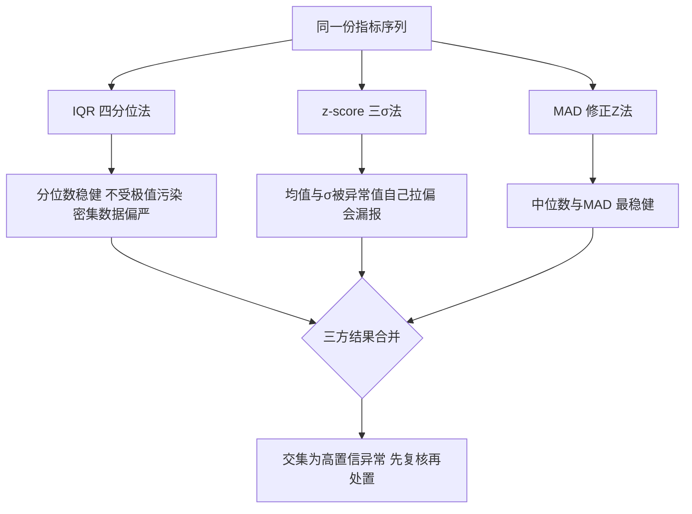
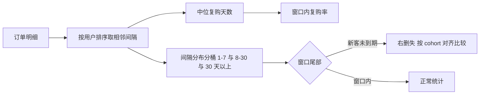
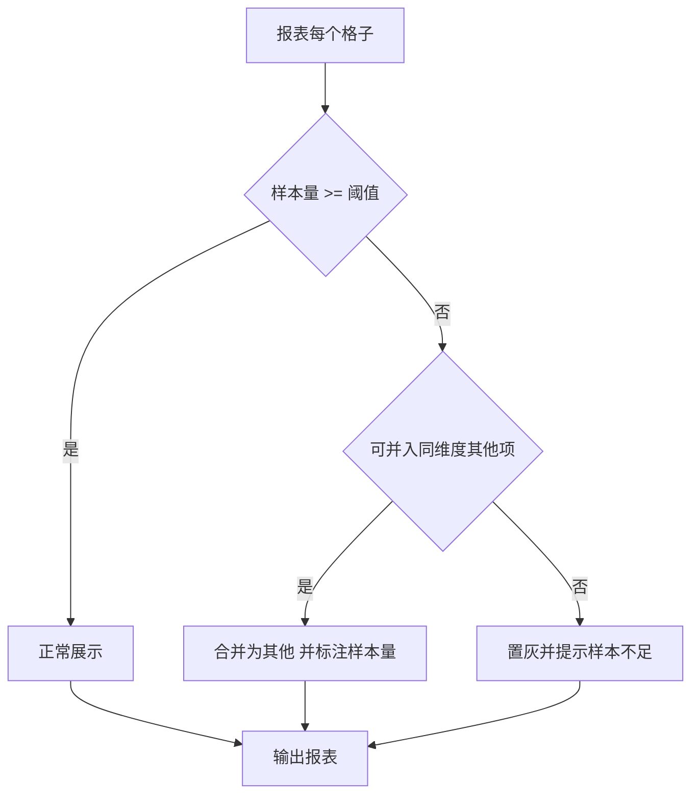
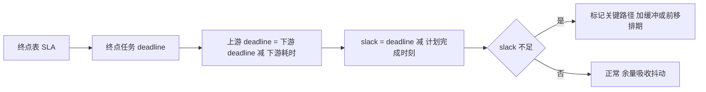
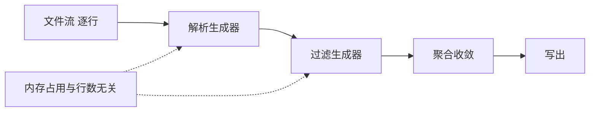
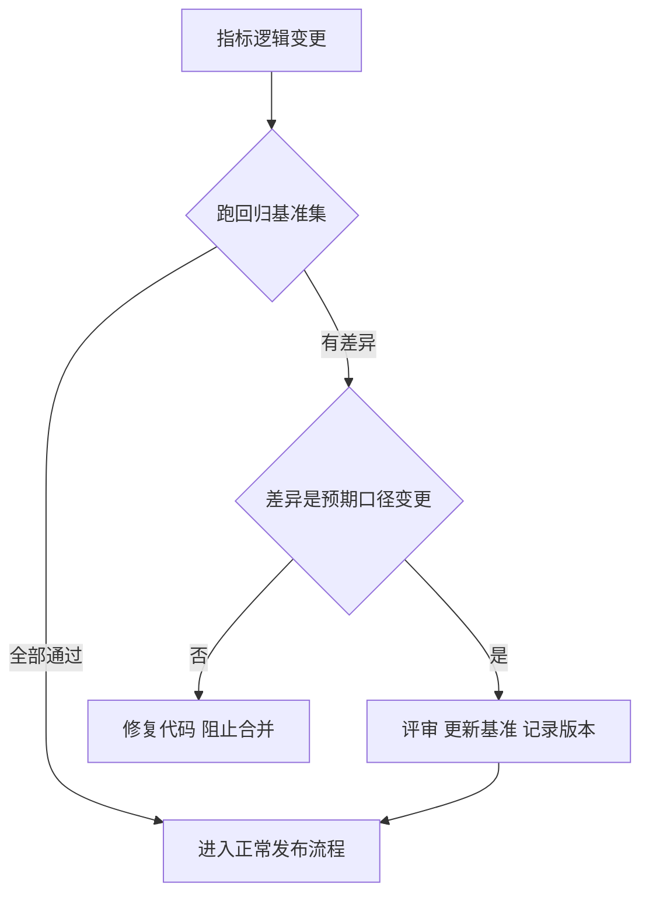
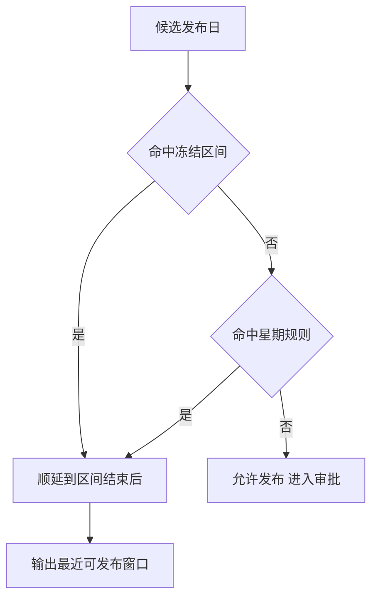
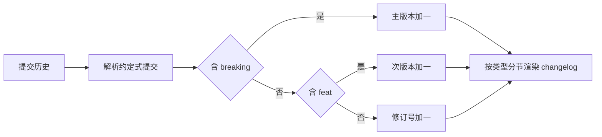

# 第 5 类 · 数据分析与工程化(夜间扩产二)

> 本卷为夜间扩产第二篇(Q1706–Q1750,45 题),继续补齐三类盲区。分析场景补遗:同环比日历对齐、移动平均去季节、帕累托 ABC、价格带分箱、购物篮共现与关联规则、异常值三方法实测、样本不平衡、相关与 VIF 共线性、实验功效模拟、留存双口径、复购周期、简化 LTV、大促对齐同比、分子分母对齐审计、快照事实表、小样本抑制;数据工程补遗:脏数据隔离区、字段级血缘、依赖拓扑排序、幂等合并写、小文件合并、新鲜度 SLA 预算传导、迟到数据修正、代理键治理、分区键选择、防重入文件锁、生成器流水线、SQL 模板参数化、schema 兼容矩阵、冷热分层归档;工程质量补遗:夹具工厂进阶、置换检验、回归基准集、灰度放量评分卡、告警风暴聚合、变更影响面清单、值班交接文档、冻结日历、CI 选择性重跑、环境漂移检查、数据字典生成、PR 风险分级、任务耗时基线与 changelog 自动生成。
> 难度分布:1-2 星 9 题、3 星 23 题、4-5 星 13 题;题号全局唯一,与既有 Q001–Q1705 不重复。
> pandas 相关题均用 try/except ImportError 包裹,缺库走标准库降级演示;纯逻辑题全部标准库可跑;含故意异常的代码均已 try/except 包裹。全部 45 段代码已用 /usr/bin/python3(3.9.6)逐题实跑验证通过。

---

### Q1706 · 同环比计算器:日历对齐与不完整期

> 难度:★★★☆ | 标签:同比环比, 指标口径

**问**:日报里 GMV 环比经常"暴跌",业务怀疑数据有问题,你怎么把同环比算对?月份只更新到一半时怎么处理?

**答**:同环比是最容易被报表坑的指标,有三个坑。一是不完整期:9 月只更新到 15 号,直接和 8 月整月比会虚降,必须把上月也对齐到同日为止再比;二是大小月与月末错位,31 号没有上月对应日,按月度口径聚合能天然规避,日度口径要明确 28-31 号的归属规则;三是同比注意闰年 2 月 29 日,按周几对齐或 ISO 周对齐更稳。工程上把这套规则沉淀成统一的同环比计算函数,所有报表调同一个实现,不允许各写各的;输出时必须带上对比区间,让读数的人一眼看到分母是什么。

```python
# file: code/05_数据分析与工程化/q1706_yoy_mom.py
"""同环比计算器:日历对齐,不完整期只比同期,避免环比虚降"""

from datetime import date, timedelta

REVENUE_2025_09 = {date(2025, 9, d): 1000 + d * 10 for d in range(1, 16)}  # 只更新到 15 日
REVENUE_2025_08 = {date(2025, 8, d): 1000 + d * 5 for d in range(1, 32)}
REVENUE_2024_09 = {date(2024, 9, d): 900 + d * 8 for d in range(1, 31)}


def period_sum(data, start, end):
    return sum(v for d, v in data.items() if start <= d <= end)


def mom_aligned(current, previous, as_of):
    """月环比:不完整期只比上月同日为止,避免"9月半月比8月全月"的假象"""
    month_start_cur = as_of.replace(day=1)
    prev_month_end = month_start_cur - timedelta(days=1)
    month_start_prev = prev_month_end.replace(day=1)
    aligned_prev_end = month_start_prev + timedelta(days=as_of.day - 1)
    cur_sum = period_sum(current, month_start_cur, as_of)
    prev_sum = period_sum(previous, month_start_prev, aligned_prev_end)
    return cur_sum, prev_sum, (cur_sum - prev_sum) / prev_sum


def yoy_aligned(current, last_year, as_of):
    """月同比:同样对齐到去年同月的同日为止,完整月后自然切换成整月口径"""
    month_start = as_of.replace(day=1)
    ly_start = date(as_of.year - 1, as_of.month, 1)
    ly_end = date(as_of.year - 1, as_of.month, as_of.day)
    cur_sum = period_sum(current, month_start, as_of)
    ly_sum = period_sum(last_year, ly_start, ly_end)
    return cur_sum, ly_sum, (cur_sum - ly_sum) / ly_sum


if __name__ == "__main__":
    as_of = date(2025, 9, 15)
    cur, prev, r = mom_aligned(REVENUE_2025_09, REVENUE_2025_08, as_of)
    print(f"月环比(截至 9/15,与 8/1-8/15 对齐): {cur} vs {prev} = {r:+.1%}")
    naive = sum(REVENUE_2025_09.values()) / sum(REVENUE_2025_08.values()) - 1
    print(f"错误口径(9月半月 vs 8月全月): {naive:+.1%} <- 虚降,不能发出去")
    cur, ly, r = yoy_aligned(REVENUE_2025_09, REVENUE_2024_09, as_of)
    print(f"月同比(9/1-9/15 vs 去年同期): {cur} vs {ly} = {r:+.1%}")
    print("要点:不完整期必须做日历对齐;月度口径天然规避大小月,日度口径要小心 28-31 号错位")
```

**追问**:
- 追问 1:2 月同比怎么处理 29 号?—— 去年闰年多一天,按周几对齐或月度口径聚合,日度口径明确 29 号并入 28 号或剔除并标注。
- 追问 2:同环比函数为什么不能各报表自己写?—— 口径分叉是报表打架的根源,统一实现加单测,改动走口径评审。

### Q1707 · 移动平均去季节性:趋势与星期因子

> 难度:★★★★ | 标签:时间序列, 季节性

**问**:移动平均除了看趋势还能干什么?说说怎么用它去掉周内季节性,思路是什么?

**答**:核心想法是用窗长等于周期的滑动平均把季节波动抹平,剩下的就是趋势:数据里周内规律明显时取 7 天居中移动平均,奇数窗口可直接居中,偶数窗口要做二次居中,边界处窗口不完整宁可留空也不要用残缺窗口伪造趋势。得到趋势后算季节比率等于实际值除以趋势值,按星期几聚合取中位数并归一化到均值 1,这就是季节因子;去季节序列等于实际值除以因子,实测里原序列 120 到 215 大幅跳动,去季节后稳定在 152 附近。用途有两个:一是看真实业务趋势,周末虚高不再干扰判断;二是给异常检测提供基线。要点是窗口长度必须和数据规律匹配,月度季节要用 12 个月窗口,数据不满两个周期时只做趋势不做季节。

```python
# file: code/05_数据分析与工程化/q1707_ma_deseason.py
"""移动平均去季节性:居中移动平均估趋势,按星期因子去季节"""

SERIES = [120, 135, 130, 128, 150, 210, 195,   # 周内规律:周末高
          122, 140, 132, 130, 155, 215, 200,
          118, 138, 129, 127, 152, 208, 198]
W = 7  # 窗口=周期长度,奇数无需二次居中


def median(xs):
    s = sorted(xs)
    n = len(s)
    return s[n // 2] if n % 2 else (s[n // 2 - 1] + s[n // 2]) / 2


def centered_ma(xs, w):
    half = w // 2
    out = []
    for i in range(len(xs)):
        lo, hi = i - half, i + half + 1
        if lo < 0 or hi > len(xs):
            out.append(None)  # 边界不补,避免用残缺窗口伪造趋势
        else:
            out.append(sum(xs[lo:hi]) / w)
    return out


def weekday_factors(xs, trend, period=7):
    """季节因子 = 实际值 / 趋势值,按星期几取中位数并归一到均值 1"""
    ratios = [[] for _ in range(period)]
    for i, (x, t) in enumerate(zip(xs, trend)):
        if t is not None:
            ratios[i % period].append(x / t)
    factors = [median(rs) for rs in ratios]
    mean_f = sum(factors) / len(factors)
    return [f / mean_f for f in factors]


if __name__ == "__main__":
    trend = centered_ma(SERIES, W)
    factors = weekday_factors(SERIES, trend)
    print("星期因子(周一-周日):", [f"{f:.3f}" for f in factors])
    print("去季节序列:")
    for i, (x, f) in enumerate(zip(SERIES, factors)):
        print(f"  第{i:>2}天 原值{x:>4} 去季节 {x / f:>6.1f}")
    print("要点:窗口取周期长度(周规律取7)才能把季节波动平均掉;因子按星期几聚合;去季节后的序列才是真正的趋势主体")
```


**追问**:
- 追问 1:偶数窗口怎么居中?—— 先做一次移动平均再对相邻两项取平均做二次居中,或者干脆改用奇数窗口。
- 追问 2:月度季节怎么去?—— 窗口取 12 个月,季节因子按月份聚合,数据不满两年时只报趋势不报季节。

### Q1708 · 帕累托分析与 ABC 分层

> 难度:★★☆ | 标签:帕累托, 分类分层

**问**:让你做一次品类或货品的帕累托分析,你怎么划分 ABC,结果用来支撑什么决策?

**答**:帕累托分析把"少数 SKU 贡献多数收入"量化出来:按金额降序排列,算累计占比,累计到 80% 的是 A 类、到 95% 是 B 类、剩下是 C 类。ABC 分层是资源分配的依据,A 类保库存保搜索位,C 类考虑下架清仓,而不是所有 SKU 一碗水端平。注意三点:排序键换成利润或订单量结论会不同,口径要写清;累计 80% 的切点附近往往几家挤在一起,分层要稳定就不能频繁重算;长尾类目样本小,看趋势比看单点更可靠。实现上 pandas 的 cumsum 一行,标准库循环十几行,实测里 3 个 A 类 SKU 贡献了约七成金额。

```python
# file: code/05_数据分析与工程化/q1708_pareto.py
"""帕累托分析:按累计占比 80% 划 A 类做 ABC 分层,指导运营与库存优先级"""

try:
    import pandas as pd
except ImportError:
    pd = None

SALES = {"SKU-A": 4200, "SKU-B": 2600, "SKU-C": 1900, "SKU-D": 1200,
         "SKU-E": 900, "SKU-F": 600, "SKU-G": 400, "SKU-H": 250,
         "SKU-I": 180, "SKU-J": 90}


def abc_classify(items, a_cut=0.8, b_cut=0.95):
    """按金额降序累计,A:累计<=80%,B:<=95%,其余 C"""
    total = sum(items.values())
    ordered = sorted(items.items(), key=lambda x: -x[1])
    out, cum = [], 0.0
    for sku, amt in ordered:
        cum += amt
        share = cum / total
        cls = "A" if share <= a_cut else ("B" if share <= b_cut else "C")
        out.append((sku, amt, amt / total, share, cls))
    return out


if pd is None:
    print("标准库降级:帕累托 ABC 分层")
    rows = abc_classify(SALES)
    total = sum(SALES.values())
    print(f"{'SKU':<8}{'金额':>8}{'单品占比':>10}{'累计占比':>10}  类别")
    for sku, amt, s, cum, cls in rows:
        print(f"{sku:<8}{amt:>8}{s:>10.1%}{cum:>10.1%}  {cls}")
    for c in "ABC":
        n = sum(1 for r in rows if r[4] == c)
        amt = sum(r[1] for r in rows if r[4] == c)
        print(f"{c} 类:{n} 个 SKU,贡献 {amt / total:.1%} 金额")
else:
    df = pd.DataFrame(sorted(SALES.items(), key=lambda x: -x[1]),
                      columns=["sku", "amount"])
    total = df["amount"].sum()
    df["item_share"] = df["amount"] / total
    df["cum_share"] = df["amount"].cumsum() / total
    df["cls"] = pd.cut(df["cum_share"], bins=[0, 0.8, 0.95, 1.0],
                       labels=["A", "B", "C"], include_lowest=True)
    print(df.to_string(index=False))
    print(df.groupby("cls")["amount"].agg(["count", "sum"]))
```

**追问**:
- 追问 1:按利润和按金额分层结论冲突怎么办?—— 两套分层并列展示,冲突的 SKU 单独评审,分层是决策输入不是结论。
- 追问 2:切点附近怎么稳定分层?—— 用固定金额阈值替代比例切点,或对切点带内的 SKU 加白名单锁定。

### Q1709 · 价格带分箱:业务带与分位带

> 难度:★★☆ | 标签:分箱, 分布分析

**问**:订单价格想按价格带统计,业务带和分位数带怎么选?分箱实现要注意什么?

**答**:分箱有两种套路:业务自定义价格带边界规整、好解读、能直接对活动门槛,但各箱容量可能悬殊;分位数分箱每箱单量接近,适合看分布形态,但边界不规整不适合对外承诺。实现上业务带用 bisect 在上界序列里定位,注意左闭右开,50 到底归哪带必须写进口径文档,否则两个报表对不上。分箱之后聚合单量与金额占比,还能看各带的转化率和客单结构,实测里 500 元以上只有 4 单却贡献 57% 金额。常见错误是浮点直接比边界导致 49.999 归错带,金额先按分取整再分箱更稳。

```python
# file: code/05_数据分析与工程化/q1709_price_bands.py
"""价格带分箱:业务自定义分箱用 bisect 实现,分位分箱各箱容量均衡"""

import bisect
from collections import defaultdict

ORDERS = [23, 45, 49, 55, 68, 88, 99, 110, 128, 149, 158, 199,
          210, 258, 320, 480, 520, 680, 890, 1200]
BANDS = [0, 50, 100, 200, 500]  # 上界序列,最后一段开区间到无穷,左闭右开


def band_label(x):
    idx = bisect.bisect_right(BANDS, x) - 1
    lo = BANDS[idx]
    hi = BANDS[idx + 1] if idx + 1 < len(BANDS) else None
    return f"{lo}-{hi}" if hi else f"{lo}以上"


def aggregate(orders):
    stats = defaultdict(lambda: [0, 0])
    for x in orders:
        s = stats[band_label(x)]
        s[0] += 1
        s[1] += x
    return stats


def quantile_cuts(orders, k=4):
    """分位分箱:每箱单量接近,但边界不规整,适合看分布不适合做活动门槛"""
    xs = sorted(orders)
    n = len(xs)
    return [xs[min(int(n * i / k), n - 1)] for i in range(k)]


if __name__ == "__main__":
    stats = aggregate(ORDERS)
    total_amt = sum(ORDERS)
    labels = [f"{BANDS[i]}-{BANDS[i + 1]}" for i in range(len(BANDS) - 1)] + [f"{BANDS[-1]}以上"]
    print("业务价格带:")
    for label in labels:
        cnt, amt = stats.get(label, [0, 0])
        print(f"  {label:<10} 单数 {cnt:>2}  金额占比 {amt / total_amt:.1%}")
    print("分位分箱边界(四分位):", quantile_cuts(ORDERS))
    print("要点:业务带便于解读与对活动规则;分位带适合看形态;边界归属(左闭右开)必须写进口径文档,50 归哪带要定死")
```

**追问**:
- 追问 1:价格带要不要定期重校?—— 物价结构变了带会失效,按季度用分位数复核各带单量占比,偏移超阈值就调带并公告。
- 追问 2:浮点价格怎么防边界错分?—— 金额先按分取整再和整数边界比较,避免浮点误差在边界上抖动。

### Q1710 · 购物篮共现矩阵

> 难度:★★☆ | 标签:购物篮, 共现分析

**问**:购物篮分析第一步是共现矩阵,它怎么算?能支撑哪些业务动作?

**答**:共现矩阵回答"买了 A 的人有多少也买了 B":把每个篮子里的商品两两配对计数,得到对称矩阵,对角线是商品自身的篮数,配套的条件概率 P(同时买 B|已买 A) 按行归一。它是捆绑销售、货架陈列、推荐召回的原料,也是关联规则的第一步。三个细节:一篮多件同商品要先去重再配对,否则矩阵虚高;低频商品对的绝对次数天然低,看条件概率比看次数公平;矩阵规模是商品数的平方,商品多时只保留 Top-N 高频商品或改稀疏存储。pandas 用 crosstab 一行,标准库双层字典十几行,实测里咖啡到牛奶的条件概率是 100%,这是小样本,别急着下结论。

```python
# file: code/05_数据分析与工程化/q1710_basket_cocc.py
"""购物篮共现矩阵:商品对共现次数与条件概率,pandas 交叉表与标准库双实现"""

try:
    import pandas as pd
except ImportError:
    pd = None

BASKETS = [
    ["面包", "牛奶", "鸡蛋"],
    ["牛奶", "咖啡"],
    ["面包", "牛奶"],
    ["咖啡", "牛奶", "饼干"],
    ["面包", "鸡蛋"],
    ["牛奶", "鸡蛋", "饼干"],
]


def cooccurrence(baskets):
    items = sorted({i for b in baskets for i in b})
    count = {a: {b: 0 for b in items} for a in items}
    for b in baskets:
        uniq = sorted(set(b))
        for a in uniq:
            for c in uniq:
                if a != c:
                    count[a][c] += 1
    item_cnt = {i: sum(1 for b in baskets if i in b) for i in items}
    return items, count, item_cnt


if pd is None:
    items, count, item_cnt = cooccurrence(BASKETS)
    print("共现次数矩阵(行=已买 列=同时买):")
    print("      " + " ".join(f"{b:>4}" for b in items))
    for a in items:
        print(f"{a:>5} " + " ".join(f"{count[a][b]:>4}" for b in items))
    print("\n条件概率 P(同时买列 | 已买行):")
    for a in items:
        others = [b for b in items if b != a]
        row = [f"{b}:{count[a][b] / item_cnt[a]:.0%}" for b in others]
        print(f"  {a} -> " + ", ".join(row))
    print("要点:共现矩阵对称,对角线即商品自身篮数;它是关联规则和捆绑销售的原料")
else:
    from itertools import combinations
    rows = []
    for b in BASKETS:
        for a, c in combinations(sorted(set(b)), 2):
            rows.append((a, c))
            rows.append((c, a))
    df = pd.DataFrame(rows, columns=["a", "c"])
    print(pd.crosstab(df["a"], df["c"]))
```

**追问**:
- 追问 1:商品上万个矩阵怎么存?—— 只对 Top-N 高频商品建稠密矩阵,长尾走稀疏字典,或直接上频繁项集挖掘。
- 追问 2:共现高就适合捆绑吗?—— 还要看毛利与增量,共现只说明一起买,捆绑要用实验验证是否真的带来增量订单。

### Q1711 · 关联规则三指标:support、confidence、lift

> 难度:★★★☆ | 标签:关联规则, 支持度

**问**:关联规则的 support、confidence、lift 各自衡量什么?为什么光看 confidence 会踩坑?

**答**:support 是规则覆盖的篮子比例,confidence 是买了 X 的人里有多少买了 Y,lift 等于观测共现除以两商品独立时的期望共现,大于 1 是正关联、约等于 1 是独立、小于 1 是替代关系。只看 confidence 会被热门商品骗:牛奶出现在一半的篮子里,什么规则指向牛奶的 confidence 都不低,lift 就是用来校正这个基线的,实测里牛奶到面包 lift 只有 0.8 是负关联,而牛奶到咖啡 1.2 是正关联。工程上先用 min_support 砍掉长尾再算 lift,输出时三个指标一起给并标方向;规则爆炸时按频繁项集的思想逐层剪枝。

```python
# file: code/05_数据分析与工程化/q1711_assoc_rules.py
"""关联规则三指标:support、confidence、lift,lift>1 才说明正关联"""

BASKETS = [
    {"面包", "牛奶", "鸡蛋"},
    {"牛奶", "咖啡"},
    {"面包", "牛奶"},
    {"咖啡", "牛奶", "饼干"},
    {"面包", "鸡蛋"},
    {"牛奶", "鸡蛋", "饼干"},
]


def support(itemset, baskets):
    n = len(baskets)
    return sum(1 for b in baskets if itemset <= b) / n


def rules(baskets, min_support=0.2):
    """从二项集生成双向规则,输出三指标并按 lift 降序"""
    items = sorted({i for b in baskets for i in b})
    out = []
    for i in range(len(items)):
        for j in range(i + 1, len(items)):
            x, y = {items[i]}, {items[j]}
            s_xy = support(x | y, baskets)
            if s_xy < min_support:
                continue
            s_x, s_y = support(x, baskets), support(y, baskets)
            out.append((f"{items[i]}->{items[j]}", s_xy, s_xy / s_x, s_xy / (s_x * s_y)))
            out.append((f"{items[j]}->{items[i]}", s_xy, s_xy / s_y, s_xy / (s_x * s_y)))
    return sorted(out, key=lambda r: -r[3])


if __name__ == "__main__":
    print(f"{'规则':<12}{'support':>9}{'confidence':>11}{'lift':>7}")
    for name, s, c, l in rules(BASKETS):
        tag = " 正关联" if l > 1.0001 else (" 独立" if abs(l - 1) <= 1e-9 else " 负关联")
        print(f"{name:<12}{s:>9.2%}{c:>11.2%}{l:>7.2f}{tag}")
    print("要点:support 看普遍性,confidence 看方向强度,lift=观测共现/独立时期望共现;热门商品天然共现高,必须用 lift 校正")
```

**追问**:
- 追问 1:规则几千条怎么筛选?—— 先 min_support 砍量,再按 lift 和 confidence 排序,最后人工按业务可解释性复核出 Top-N。
- 追问 2:lift 多高才算真关联?—— 没有统一标准,经验上 1.2 以上可看,超过 3 要先怀疑数据泄漏或统计巧合,再看样本量。

### Q1712 · 异常值三方法对比实测

> 难度:★★★★ | 标签:异常检测, IQR

**问**:数据里怀疑有异常值,IQR、z-score、MAD 三种方法你都用过吗?同一份数据上它们表现差在哪?

**答**:同一份带两个真异常(90 和 130)的数据实测:IQR 用四分位距标出 3 个,连 15 这种正常波动也标了,对密集离散数据偏严;z-score 只标出 130,90 没过 3σ 线,因为均值和标准差被异常值自己拉偏了,这就是掩蔽效应;MAD 修正 Z 精确抓到两个真异常。结论是 z-score 只在近似正态且无极端值时可靠,IQR 和 MAD 基于分位数稳健。选型建议:探索期先 IQR 粗筛,MAD 复核,人工确认业务含义后再处置,处置优先盖帽或分桶而不是直接删除。三种方法都跑出来对比,是排查数据质量最省力的做法。

```python
# file: code/05_数据分析与工程化/q1712_outlier_compare.py
"""异常值三方法实测:IQR、z-score、MAD 在同一份重尾数据上的表现对比"""

DATA = [12, 13, 12, 14, 13, 11, 12, 13, 14, 12,
        13, 12, 15, 13, 12, 13, 14, 12, 13, 12,
        11, 13, 12, 14, 13, 12, 13, 12, 90, 130]  # 末尾两个真异常


def iqr_flags(xs, k=1.5):
    s = sorted(xs)
    n = len(s)
    q1, q3 = s[n // 4], s[3 * n // 4]
    iqr = q3 - q1
    lo, hi = q1 - k * iqr, q3 + k * iqr
    return [x for x in xs if x < lo or x > hi], (q1, q3)


def zscore_flags(xs, z=3.0):
    n = len(xs)
    mean = sum(xs) / n
    std = (sum((x - mean) ** 2 for x in xs) / n) ** 0.5
    return [x for x in xs if abs((x - mean) / std) > z], (round(mean, 1), round(std, 1))


def mad_flags(xs, c=3.5):
    """修正 z = 0.6745*(x-中位数)/MAD,阈值 3.5 是经典取值"""
    med = sorted(xs)[len(xs) // 2]
    mad = sorted(abs(x - med) for x in xs)[len(xs) // 2]
    return [x for x in xs if 0.6745 * abs(x - med) / mad > c], (med, mad)


if __name__ == "__main__":
    for name, fn in [("IQR 1.5 倍", iqr_flags),
                     ("z-score 3σ", zscore_flags),
                     ("MAD 3.5", mad_flags)]:
        out, params = fn(DATA)
        print(f"{name:<12} 参数{params} -> 异常 {len(out)} 个: {sorted(set(out))}")
    print("要点:z-score 的均值与σ被异常值自己污染产生掩蔽,90 可能漏报;IQR 与 MAD 基于分位数,先 IQR 后 MAD 复核,再人工确认")
```



**追问**:
- 追问 1:三种方法结果冲突以谁为准?—— 以 MAD 与 IQR 的并集为候选,人工看业务含义再定,z-score 结果只做参考。
- 追问 2:时间序列怎么用这些方法?—— 按滚动窗口算分位数,用窗口内的分布而不是全历史,近因更能代表当前规律。

### Q1713 · 样本不平衡的准确率陷阱

> 难度:★★★☆ | 标签:样本不平衡, 评估指标

**问**:做流失预测时正负样本 1:99,模型准确率 99%,这模型能用吗?你会怎么处理不平衡?

**答**:不能用:类别 99 比 1 时,一个"永远预测多数类"的退化模型准确率就是 99%,但对少数类召回 0%,实测混淆矩阵 TP 是 0,准确率在不平衡场景没有信息量。正确做法是看混淆矩阵、精确率召回率和 PR 曲线,少数类召回才是业务关心的,欺诈、风控、流失全是少数类问题。处理手段三类:重采样(欠采样多数类或过采样少数类,过采样要防过拟合)、类别权重(损失函数加权不改数据)、下调判定阈值换召回。纪律是训练集可以重采样,评估集必须保持原始分布,否则所有指标失真。

```python
# file: code/05_数据分析与工程化/q1713_imbalance.py
"""样本不平衡演示:99:1 下全预测多数类准确率 99% 但召回 0,重采样与评估纪律"""

from collections import Counter
import random

# (编号, 标签) 标签 1 为少数类
DATA = [(i, 1 if i % 100 == 0 else 0) for i in range(1, 1001)]  # 10 正 990 负


def always_majority(data):
    """退化基线:全预测多数类,用混淆矩阵看穿准确率假象"""
    tp = fp = fn = tn = 0
    for _, y in data:
        if y == 1:
            fn += 1
        else:
            tn += 1
    acc = (tp + tn) / len(data)
    recall = tp / (tp + fn) if tp + fn else 0.0
    return acc, recall, (tp, fp, fn, tn)


def undersample(data, seed=7):
    """欠采样多数类到 1:9,重复实验要固定种子"""
    rng = random.Random(seed)
    pos = [d for d in data if d[1] == 1]
    neg = [d for d in data if d[1] == 0]
    return pos + rng.sample(neg, len(pos) * 9)


if __name__ == "__main__":
    acc, recall, cm = always_majority(DATA)
    print(f"原始分布: {dict(Counter(y for _, y in DATA))}")
    print(f"全预测多数类: 准确率 {acc:.1%} 但少数类召回 {recall:.0%} 混淆矩阵(TP,FP,FN,TN)={cm}")
    print(f"欠采样后分布: {dict(Counter(y for _, y in undersample(DATA)))}")
    print("要点:不平衡场景看召回与 PR 不看准确率;处理=重采样/类别权重/下调判定阈值;训练集可重采样,评估集必须保持原始分布")
```

**追问**:
- 追问 1:过采样和类别权重选哪个?—— 树模型常用类别权重不易过拟合,过采样配合 SMOTE 类合成采样,最终以验证集 PR 表现定。
- 追问 2:评估集保持原始分布,AUC 还能看吗?—— 能,AUC 对分布不敏感,但精确率召回率必须报告原始分布下的数字。

### Q1714 · 相关系数矩阵与 VIF 共线性检查

> 难度:★★★★ | 标签:相关性, 共线性

**问**:两个特征相关系数 0.99,是不是就不能一起用?怎么系统地检查一组特征的共线性?

**答**:相关矩阵看的是两两关系,共线性要回答的是"这一列能被其他列一起解释多少",两者不是一回事。实测里 rooms 和 area 相关 0.986,把它们放进同一组变量后 VIF 全线爆表:VIF 等于 1 除以 1 减 R²,把每一列当因变量对其余列做最小二乘,实测 area 的 VIF 达到 245。经验阈值 VIF 大于 10 视为严重共线性,进回归或评分模型前要去一留一或做合成指标,否则系数不可解释、方差膨胀。实现上 Pearson 相关 pandas 的 corr 一行,标准库几十行;VIF 需要一个小型最小二乘,用正规方程加高斯消元手写即可。注意相关只对线性关系敏感,先看散点再下结论。

```python
# file: code/05_数据分析与工程化/q1714_corr_vif.py
"""相关系数矩阵与共线性检查:Pearson 矩阵定位高相关对,VIF 手算确认"""

try:
    import pandas as pd
except ImportError:
    pd = None

# 列:面积, 房间数, 距地铁距离, 房价
COLS = [
    [50, 60, 70, 80, 90, 100, 110, 120, 130, 140],
    [1, 2, 2, 3, 3, 4, 4, 5, 5, 6],
    [800, 600, 500, 450, 400, 350, 300, 250, 200, 150],
    [200, 260, 300, 350, 390, 450, 500, 560, 620, 700],
]
NAMES = ["area", "rooms", "metro_dist", "price"]


def pearson(xs, ys):
    n = len(xs)
    mx, my = sum(xs) / n, sum(ys) / n
    cov = sum((a - mx) * (b - my) for a, b in zip(xs, ys))
    sx = sum((a - mx) ** 2 for a in xs) ** 0.5
    sy = sum((b - my) ** 2 for b in ys) ** 0.5
    return cov / (sx * sy)


def solve(A, b):
    """高斯消元解线性方程组(带列主元)"""
    n = len(A)
    M = [row[:] + [b[i]] for i, row in enumerate(A)]
    for col in range(n):
        piv = max(range(col, n), key=lambda r: abs(M[r][col]))
        M[col], M[piv] = M[piv], M[col]
        for r in range(n):
            if r != col and M[col][col]:
                f = M[r][col] / M[col][col]
                for c in range(col, n + 1):
                    M[r][c] -= f * M[col][c]
    return [M[i][n] / M[i][i] for i in range(n)]


def vif(cols, idx):
    """VIF_i = 1/(1-R2):把第 idx 列当因变量,对其余列做最小二乘求 R2"""
    ys = cols[idx]
    others = [c for j, c in enumerate(cols) if j != idx]
    n = len(ys)
    X = [[1.0] + [c[i] for c in others] for i in range(n)]
    p = len(others) + 1
    XtX = [[sum(X[i][a] * X[i][b] for i in range(n)) for b in range(p)] for a in range(p)]
    Xty = [sum(X[i][a] * ys[i] for i in range(n)) for a in range(p)]
    beta = solve(XtX, Xty)
    yhat = [sum(beta[a] * X[i][a] for a in range(p)) for i in range(n)]
    my = sum(ys) / n
    ss_res = sum((ys[i] - yhat[i]) ** 2 for i in range(n))
    ss_tot = sum((v - my) ** 2 for v in ys)
    r2 = 1 - ss_res / ss_tot
    return 1 / (1 - r2) if r2 < 1 else float("inf")


if pd is None:
    print("标准库降级:Pearson 相关矩阵")
    print("        " + " ".join(f"{n:>10}" for n in NAMES))
    for i, a in enumerate(NAMES):
        row = [f"{pearson(COLS[i], COLS[j]):>10.3f}" for j in range(len(NAMES))]
        print(f"{a:>8} " + " ".join(row))
else:
    df = pd.DataFrame({n: c for n, c in zip(NAMES, COLS)})
    print(df.corr().round(3))
print("\nVIF(VIF>10 视为严重共线性):")
for i, name in enumerate(NAMES):
    print(f"  {name:<11} VIF = {vif(COLS, i):.1f}")
print("要点:相关矩阵看两两关系,共线性要看'能被其他列解释多少',rooms 与 area 高相关导致两者 VIF 都爆表,建模前要去一留一")
```

**追问**:
- 追问 1:VIF 高但业务上都想保留怎么办?—— 改用树模型降低共线性敏感度,或对变量做主成分或业务合成后再进线性模型。
- 追问 2:相关 0.99 能断言因果吗?—— 不能,共线性恰恰说明两者可能是同一原因的影子,先找混淆变量再看业务因果。

### Q1715 · AB 实验功效的模拟估算

> 难度:★★★☆ | 标签:AB 测试, 蒙特卡洛

**问**:AB 实验公式法算样本量你们在用吗?为什么很多实验"没跑出显著"?用模拟法怎么估算功效?

**答**:公式法依赖正态近似和一串假设,模拟法直接造世界:给定期望转化率和提升幅度,反复模拟整个实验并数显著次数,显著比例就是经验功效。实测基线 5%、相对提升 10% 时,每组 3000 只有 13% 功效,8000 是 26%,要 32000 附近才够 80%——这就是"提升没做出来"最常见的原因,实验根本没到检出功率就停了。模拟法的优势是不依赖公式假设,分层配额、非常规指标、序贯检验都能直接模拟;工程要求固定种子保证可复现,迭代至少几百次控制功效估计的方差。给业务承诺实验时长之前,先跑一遍这个模拟。

```python
# file: code/05_数据分析与工程化/q1715_power_sim.py
"""AB 实验功效的模拟估算:蒙特卡洛数显著次数,反推最小样本量"""

import math
import random

P_CONTROL = 0.05
P_TREAT = 0.055   # 相对提升 10%
ALPHA = 0.05
SIMS = 800


def two_prop_z(x1, n1, x2, n2):
    p1, p2 = x1 / n1, x2 / n2
    p = (x1 + x2) / (n1 + n2)
    se = math.sqrt(p * (1 - p) * (1 / n1 + 1 / n2))
    return (p2 - p1) / se if se else 0.0


def binom(rng, n, p):
    """几何间隔法采样二项分布:随机调用次数 O(成功数),比逐人掷币快百倍"""
    logq = math.log(1.0 - p)
    count, pos = 0, -1
    while True:
        u = 1.0 - rng.random()  # (0,1]
        pos += int(math.log(u) / logq) + 1
        if pos >= n:
            return count
        count += 1


def simulate_power(n, seed=42):
    rng = random.Random(seed)
    sig = 0
    for _ in range(SIMS):
        x1 = binom(rng, n, P_CONTROL)
        x2 = binom(rng, n, P_TREAT)
        if abs(two_prop_z(x1, n, x2, n)) > 1.96:
            sig += 1
    return sig / SIMS


if __name__ == "__main__":
    for n in (3000, 8000, 16000, 32000):
        power = simulate_power(n)
        flag = " 达标" if power >= 0.8 else ""
        print(f"每组 {n:>6} 样本,模拟功效 {power:.1%}{flag}")
    print("要点:功效=真实有效时判为显著的概率,0.8 起步;模拟法不依赖公式假设,配额分层、非常规口径时尤其好用")
```

**追问**:
- 追问 1:模拟功效和公式差很多怎么办?—— 先核对口径是否一致(单双尾、配额),不一致以模拟为准,因为模拟更贴近真实实验。
- 追问 2:做到一半发现功效不够怎么办?—— 不要半路加样本导致 peeking,按事先声明的延长规则延长,或承认失败重新设计。

### Q1716 · 留存曲线两种口径

> 难度:★★★☆ | 标签:留存, 指标口径

**问**:留存有 N 日留存和滚动留存两种口径,区别是什么?各适合什么场合?

**答**:N 日留存要求用户恰好第 N 天活跃,窗口最严,是同业对比的通用口径;滚动留存只要第 N 天及以后任何一天回访都算,衡量粘性下限,永远大于等于 N 日留存。实测里 day1 两口径差 20 个百分点(60% 对 80%),day7 收敛到相同,差异大说明用户回访不规律,这类产品用滚动留存讲"还有多少人在"更诚实。报数必须标口径,否则两个团队各说各话永远吵不清;增长实验主口径建议用 N 日留存保证可横向对比,辅以滚动留存看底部。实现上就是一个 day 等于 N 和 day 大于等于 N 的谓词区别,pandas 和标准库都几行。

```python
# file: code/05_数据分析与工程化/q1716_retention_caliber.py
"""留存曲线两种口径:N 日留存(精确窗口)与滚动留存(累计回访即算)"""

try:
    import pandas as pd
except ImportError:
    pd = None

ACTIVE = {
    # user -> 活跃日偏移列表,0 为新增日
    "u1": [0, 1, 2, 3, 7],
    "u2": [0, 1, 3],
    "u3": [0, 7],
    "u4": [0, 1, 2],
    "u5": [0],
}


def nday_retention(offsets, day):
    """N 日留存:恰好第 N 天活跃 / 新增,窗口最严,同业对比用它"""
    new_users = [u for u, d in offsets.items() if 0 in d]
    hit = [u for u, d in offsets.items() if day in d]
    return len(hit) / len(new_users)


def rolling_retention(offsets, day):
    """滚动留存:第 N 天及以后任意一天回访都算,衡量粘性下限"""
    new_users = [u for u, d in offsets.items() if 0 in d]
    hit = [u for u, d in offsets.items() if any(x >= day for x in d)]
    return len(hit) / len(new_users)


if pd is None:
    print("天数   N日留存   滚动留存")
    for day in (1, 3, 7):
        print(f"{day:>3}   {nday_retention(ACTIVE, day):>8.0%}   {rolling_retention(ACTIVE, day):>7.0%}")
    print("要点:滚动留存恒 >= N 日留存;两口径差异大说明回访分散,报数必须标口径,跨团队对比前先对口径")
else:
    rows = [(u, d) for u, ds in ACTIVE.items() for d in ds]
    df = pd.DataFrame(rows, columns=["user", "day"])
    new_cnt = df[df["day"] == 0]["user"].nunique()
    for day in (1, 3, 7):
        nday = df[df["day"] == day]["user"].nunique() / new_cnt
        rolling = df[df["day"] >= day]["user"].nunique() / new_cnt
        print(f"day {day}: N日留存 {nday:.0%}, 滚动留存 {rolling:.0%}")
```

**追问**:
- 追问 1:活跃的定义算不算浏览一秒?—— 活跃定义写进口径字典,留存和 DAU 共用同一个定义,改动走口径评审。
- 追问 2:大促期新增的用户留存怎么看?—— 单独出大促 cohort 的留存曲线和自然期并排比,不要混进整体曲线稀释结论。

### Q1717 · 复购周期与间隔分布

> 难度:★★☆ | 标签:复购, 分布分析

**问**:复购周期怎么算?复购率为什么必须声明观察窗口?

**答**:复购周期是相邻订单的时间间隔:按用户把订单按时间排序,取相邻差值得到间隔序列,再看中位数和分桶(1-7 天、8-30 天、30 天以上)。中位复购天数直接指导召回时机,中位 12 天的产品第 10 天发券正合适。两个坑:一是复购率必须声明观察窗口,"窗口内有复购的用户占比"不说窗口就是废数;二是窗口尾部的新客还没来得及复购,这叫右删失,按注册 cohort 对齐截止日比较才公平,否则新客占比高的月份复购率永远偏低。间隔分布通常右偏,统计量用中位数和分位数,均值会被重度用户拉偏。

```python
# file: code/05_数据分析与工程化/q1717_repurchase.py
"""复购周期:订单间隔分布、中位复购天数与 30 天复购率"""

from datetime import date

ORDERS = {
    "u1": [date(2025, 8, 1), date(2025, 8, 6), date(2025, 8, 20)],
    "u2": [date(2025, 8, 3), date(2025, 8, 25)],
    "u3": [date(2025, 8, 5)],
    "u4": [date(2025, 8, 2), date(2025, 8, 9), date(2025, 8, 12)],
    "u5": [date(2025, 8, 8), date(2025, 8, 10)],
}


def intervals(ds):
    ds = sorted(ds)
    return [(b - a).days for a, b in zip(ds, ds[1:])]


def median(xs):
    s = sorted(xs)
    n = len(s)
    return s[n // 2] if n % 2 else (s[n // 2 - 1] + s[n // 2]) / 2


if __name__ == "__main__":
    all_iv = []
    for u, ds in ORDERS.items():
        iv = intervals(ds)
        all_iv += iv
        if iv:
            print(f"{u}: 订单 {len(ds)} 次,间隔 {iv}")
    buyers = [u for u, ds in ORDERS.items() if len(ds) >= 2]
    buckets = {"1-7天": 0, "8-30天": 0, "30天以上": 0}
    for v in all_iv:
        k = "1-7天" if v <= 7 else ("8-30天" if v <= 30 else "30天以上")
        buckets[k] += 1
    print(f"中位复购间隔 {median(all_iv)} 天,间隔分布 {buckets}")
    print(f"窗口内有复购的用户占比 {len(buyers) / len(ORDERS):.0%}")
    print("要点:复购率必须声明观察窗口;窗口尾部的新客还没来得及复购(右删失),按 cohort 对齐截止日比较才公平")
```



**追问**:
- 追问 1:复购周期和 LTV 什么关系?—— 复购周期决定召回节奏,LTV 决定召回预算上限,两者一起用才不会对高价值低频用户过度打扰。
- 追问 2:间隔分布右偏严重用什么统计量?—— 中位数加分位数,报告附直方图,均值只做参考。

### Q1718 · 简化 LTV 估算

> 难度:★★★☆ | 标签:LTV, 留存

**问**:业务要一个 LTV 数字做获客决策,你给的简化算法是什么?误差主要在哪?

**答**:简化 LTV 等于各月留存率乘月均贡献再求和:观测期有多少月算多少月,想报 24 个月就要对尾部外推,常用固定月衰减率并封顶。实测里观测期 6 个月 LTV 是 122 元,天真口径(假设月月 100% 留存)高估到 270 元,含尾部外推是 175 元,三个数差一倍多。所以报 LTV 必须同时报口径和外推假设;LTV 的价值在于和 CAC 比较判断获客是否回本,两边必须用同一口径,市场用乐观口径财务用保守口径会吵出两种决策。更精细的做法是分渠道各算曲线再汇总,好渠道和差渠道的留存差异很大,混合平均会掩盖问题。

```python
# file: code/05_数据分析与工程化/q1718_simple_ltv.py
"""简化 LTV:月留存曲线 x 月均贡献,误差全部来自留存尾部外推"""

MONTH_RETENTION = [1.0, 0.55, 0.38, 0.30, 0.26, 0.22]  # M0..M5 观测期留存
ARPU_MONTH = 45.0


def ltv_observed(retention, arpu):
    """观测期 LTV:各月存活率 x ARPU 求和,只报有数据支撑的部分"""
    return sum(r * arpu for r in retention)


def ltv_with_tail(retention, arpu, decay=0.85, cap_months=24):
    """尾部外推:末段留存按固定月衰减,并封顶避免无限累加"""
    total = sum(r * arpu for r in retention)
    r = retention[-1]
    for _ in range(len(retention), cap_months):
        r *= decay
        total += r * arpu
    return total


if __name__ == "__main__":
    l1 = ltv_observed(MONTH_RETENTION, ARPU_MONTH)
    l2 = ltv_with_tail(MONTH_RETENTION, ARPU_MONTH)
    naive = ARPU_MONTH * len(MONTH_RETENTION)
    print(f"观测期 6 个月 LTV: {l1:.0f} 元(天真口径 {naive:.0f} 元,默认月月留存 100%,高估)")
    print(f"含尾部外推 24 个月 LTV: {l2:.0f} 元")
    print("要点:LTV 的不确定部分全在尾部,衰减率与封顶假设要写进口径;CAC 回本判断必须用同一外推口径,不能两套混比")
```

**追问**:
- 追问 1:外推衰减率怎么定才不拍脑袋?—— 用更长 cohort 的实际留存回归衰减率或按行业基准校准,并附敏感性分析。
- 追问 2:不同渠道 LTV 差异大怎么报?—— 分渠道各算各的曲线再汇总,汇总口径注明是混合加权,避免高渠道掩盖低渠道。

### Q1719 · 大促对齐同比

> 难度:★★★☆ | 标签:同比, 节假日口径

**问**:双 11 每年开闸时间不一样,同比怎么对齐才不失真?

**答**:大促、春节这类节奏每年漂移的活动,自然日同比就是错位比较:实测里本届第 5 天对上届第 1 天,自然日同比虚高 151%,完全不能用。正确做法是建活动日历表,记录每届活动的开闸日,同比按"活动第 N 天"对齐,实测对齐后是 7.6%,才是可比数字;非活动日期仍用自然日口径,两套口径并行并明确标注。工程上这张日历表单独维护并进元数据,报表引擎按日期自动切换对齐方式;春节的农历漂移同理,按"春节前第 N 天"对齐。没有这张日历,所有含大促月份的同比讨论都是浪费时间。

```python
# file: code/05_数据分析与工程化/q1719_holiday_align.py
"""大促对齐同比:按活动日位次比较,而不是按自然日硬比"""

from datetime import date, timedelta

GMV = {
    # 2024 大促 10-28 开闸
    date(2024, 10, 28): 90, date(2024, 10, 29): 110, date(2024, 10, 30): 130,
    date(2024, 10, 31): 160, date(2024, 11, 1): 210, date(2024, 11, 11): 320,
    # 2025 大促 10-24 开闸,节奏提前 4 天
    date(2025, 10, 24): 95, date(2025, 10, 25): 118, date(2025, 10, 26): 140,
    date(2025, 10, 27): 172, date(2025, 10, 28): 226, date(2025, 11, 7): 341,
}
PROMO_START = {"2024": date(2024, 10, 28), "2025": date(2025, 10, 24)}


def raw_yoy(gmv, today):
    last = date(today.year - 1, today.month, today.day)
    return gmv.get(today, 0) / gmv.get(last, 1) - 1


def aligned_yoy(gmv, today, starts):
    """按大促第 N 天对齐:今天是本届第几天,就去比上届同一位次"""
    offset = (today - starts[str(today.year)]).days
    last = starts[str(today.year - 1)] + timedelta(days=offset)
    cur, prev = gmv.get(today, 0), gmv.get(last, 0)
    return offset, last, (cur - prev) / prev if prev else 0.0


if __name__ == "__main__":
    today = date(2025, 10, 28)
    print(f"自然日同比: {raw_yoy(GMV, today):+.1%} <- 本届第5天比上届第1天,虚高不能用")
    off, last, r = aligned_yoy(GMV, today, PROMO_START)
    print(f"大促对齐同比: 今日=本届第 {off + 1} 天,对齐 {last} -> {r:+.1%}")
    print("要点:大促/春节/寒暑假等跳变日历单独建表,同比按活动位次对齐;非活动日期仍用自然日口径,两套口径并行并明确标注")
```

**追问**:
- 追问 1:活动日历谁来维护?—— 运营提供活动排期,数仓落表进元数据,变更纳入 schema 与口径管理。
- 追问 2:活动跨年怎么算位次?—— 以开闸日为第 1 天连续计数,跨年不打断,上届对齐按上届开闸日加同样偏移。

### Q1720 · 分子分母对齐审计

> 难度:★★★☆ | 标签:指标口径, 数据质量

**问**:转化率的分子分母来自两张表,怎么保证它们"对齐"?对齐审计要查什么?

**答**:对齐审计查三件事:时间窗一致,两边按同一天同一种时区截断;人群一致,分子含不含未登录、分母含不含爬虫要口径对齐;粒度一致,按人还是按会话不能混。实测里订单表某天整日缺数,如果按缺失等于 0 处理,整体转化率从 6.22% 被稀释到 4.02%,业务会误读成"转化率大跌";正确做法是分子缺失的整日剔除并在报表标注。审计逻辑做成例行任务:每天检查分子分母的日期覆盖、分子大于分母这类逻辑违规和口径元数据登记,输出违规清单给指标 owner,而不是等业务投诉才发现。

```python
# file: code/05_数据分析与工程化/q1720_num_denom_audit.py
"""分子分母对齐审计:转化率的分子分母必须同时间窗、同人群、同粒度"""

ORDERS = {"d1": 120, "d2": 135}                # 订单表:d3 上游延迟,整日缺数
VISITS = {"d1": 2000, "d2": 2100, "d3": 2250}  # 访问表:d3 正常


def audit(num, den):
    issues = []
    for k in sorted(set(num) | set(den)):
        n, d = num.get(k), den.get(k)
        if d in (None, 0):
            issues.append((k, "denominator_missing", d))
        elif n is None:
            issues.append((k, "numerator_missing", n))
        elif n > d:
            issues.append((k, "num_gt_den", (n, d)))
    return issues


def safe_rate(num, den):
    """分子缺失当日整日剔除而不是按 0 处理,避免转化率被稀释"""
    ok = [k for k in den if den.get(k) and num.get(k) is not None]
    total_n = sum(num[k] for k in ok)
    total_d = sum(den[k] for k in ok)
    return total_n / total_d, ok, len(den) - len(ok)


if __name__ == "__main__":
    for k, kind, detail in audit(ORDERS, VISITS):
        print(f"违规: {k} {kind} {detail}")
    rate, used, dropped = safe_rate(ORDERS, VISITS)
    print(f"剔除异常日后整体转化率: {rate:.2%} (使用 {used}, 剔除 {dropped} 天)")
    dilute = sum(ORDERS.values()) / sum(VISITS.values())
    print(f"若按缺失=0 处理会被稀释成: {dilute:.2%}")
    print("要点:对齐三查——时间窗一致、人群一致(登录/游客)、粒度一致(人/会话);分子缺日整日剔除并标注,绝不按 0 补")
```

**追问**:
- 追问 1:剔除异常日会不会掩盖真实下跌?—— 剔除仅限分子缺失这类数据问题,业务真实下跌是数据齐但数值低,靠审计规则区分并分别标注。
- 追问 2:多指标共用分子分母怎么管理?—— 每个指标登记分子分母的表与口径版本,审计按注册表逐个检查,违规分派给指标 owner。

### Q1721 · 余额类指标与快照事实表

> 难度:★★★★ | 标签:快照事实表, 指标口径

**问**:余额、库存这类指标为什么不能用事件流水累加?数仓怎么建模才对?

**答**:余额、库存、在架商品数是"状态"不是"流量",不能靠事件累加得到:重放流水既贵又脆,实测里少了一条迟到的扣款事件,重放出来的余额比真实虚高 30,而且重放成本随历史线性增长。正确建模是周期快照事实表,每天日末把全量状态落一份,期末余额直接取快照分区,天然可回溯可审计;流水表保留着算变动量(充值额、消耗额),状态指标和流量指标各归各的表。存储压力大就上稀疏快照:只存有变化的实体,加定期全量基线,期末值用基线加重放,但对外语义仍然是快照。判断标准很简单:这个指标问的是"现在有多少"就用快照,问的是"这段时间变了多少"才用流水。

```python
# file: code/05_数据分析与工程化/q1721_snapshot_fact.py
"""余额类指标必须用快照事实表:重放事件流会漏迟到数据,期末余额只认快照"""

# 已收到的钱包事件流水(day2 的 -30 迟到,暂未到)
TX = [
    ("u1", 1, 100),
    ("u1", 4, 50),
    ("u2", 1, 80),
    ("u2", 3, -20),
]
OPENING = {"u1": 0, "u2": 0}

SNAPSHOT = {  # 日末余额快照(权威)
    1: {"u1": 100, "u2": 80},
    2: {"u1": 70, "u2": 80},
    3: {"u1": 70, "u2": 60},
    4: {"u1": 120, "u2": 60},
}


def balance_from_events(tx, opening, day):
    """重放流水算余额:缺一条事件结果就错,且重放成本随历史增长"""
    bal = dict(opening)
    for u, d, amt in sorted(tx, key=lambda x: x[1]):
        if d <= day:
            bal[u] = bal.get(u, 0) + amt
    return bal


if __name__ == "__main__":
    replay = balance_from_events(TX, OPENING, 4)
    snap = SNAPSHOT[4]
    print(f"重放流水到 day4: {replay}  <- 少了迟到扣款,虚高 30")
    print(f"快照表 day4:     {snap}")
    print(f"day4 期末总余额(快照口径): {sum(snap.values())}")
    print("要点:余额/库存/在架数是'状态'不是'流量',建周期快照表按日全量落盘;流水只算变动量,状态指标永远以快照为准")
```

**追问**:
- 追问 1:快照表太大怎么办?—— 高频实体做日快照、低频做期末快照,或稀疏快照加基线重放,语义不变、成本可控。
- 追问 2:快照和流水对不上怎么排查?—— 先对日增量,快照差值应等于当日净变动,不等则查迟到、删除和口径,定位到具体分区。

### Q1722 · 小样本抑制与报表最小展示规则

> 难度:★★☆ | 标签:报表设计, 统计口径

**问**:报表里某渠道只有 18 个访问却显示 11% 转化率,你会怎么处理这类小样本格子?

**答**:小样本格子的指标天然大起大落,18 个访问 2 单今天可以是 11%,明天变成 5%,拿这种数字做决策等于掷骰子。报表要有最小展示规则:样本量低于阈值的格子不单独展示,合并到"其他"桶并标出样本量,或者置灰提示样本不足,实测里两个小样本渠道合并后 58 个访问 12.1%。阈值按指标方差和决策成本定,转化率类 100 起步,不同指标阈值不同,写进口径文档。配套纪律:"其他"桶本身也要展示样本量,防止有人把小样本都塞进去刷出好看的数字;对外报表比内部看板更保守。

```python
# file: code/05_数据分析与工程化/q1722_small_sample.py
"""小样本抑制:格子样本量低于阈值不单独展示,合并到其他项并标注"""

CONVERSION = {
    # 渠道: (访问数, 下单数)
    "自然流量": (5200, 416),
    "信息流A": (3100, 217),
    "信息流B": (2900, 232),
    "搜索品牌": (1800, 162),
    "异业合作": (40, 5),
    "线下地推": (18, 2),
}
MIN_N = 100


def report(rows, min_n):
    big = {k: v for k, v in rows.items() if v[0] >= min_n}
    small = {k: v for k, v in rows.items() if v[0] < min_n}
    merged_n = sum(v[0] for v in small.values())
    merged_c = sum(v[1] for v in small.values())
    lines = []
    for k, (n, c) in sorted(big.items(), key=lambda x: -x[1][0]):
        lines.append(f"  {k:<8} 访问 {n:>5} 转化率 {c / n:.1%}")
    if small:
        lines.append(f"  其他(含 {len(small)} 个小样本渠道) 访问 {merged_n} 转化率 {merged_c / merged_n:.1%}")
    return lines, small


if __name__ == "__main__":
    lines, small = report(CONVERSION, MIN_N)
    print("渠道转化报表:")
    print("\n".join(lines))
    print(f"被抑制渠道: {sorted(small)} (访问数 < {MIN_N})")
    print("要点:小样本转化率天然大起大落,低于阈值要么合并要么置灰;阈值写进口径文档,'其他'桶的样本量也要展示")
```



**追问**:
- 追问 1:阈值定多少合理?—— 按指标方差和决策成本定,转化率类经验 100 到 300,可用 bootstrap 估小样本下指标波动再拍板。
- 追问 2:能不能展示小样本但加误差范围?—— 可以,点估计加置信区间比直接隐藏信息量大,但解读成本高,一般只给内部看板用。

### Q1723 · 脏数据隔离区

> 难度:★★★☆ | 标签:数据质量, 容错

**问**:上游经常给脏数据,你设计的"隔离区"机制是怎么运转的?修复后怎么回灌?

**答**:隔离区的思想是"不让脏数据毒死好数据":入库前逐行校验,不合格的行连同原因码和原始载荷写进隔离区,合格的继续走管道,当天结束输出两边计数做对账。原因码要分类,主键缺失、数值越界、枚举非法各是各的码,按原因聚合计数,同一原因码批量出现要报警,那多半是上游改了口径而不是数据脏。修复流程:人工或脚本修复隔离区的行,走重放入口回灌,而不是绕过校验直接插主表。隔离区表设留存期限,到期归档,防止变成垃圾场;隔离率本身进管道健康分。

```python
# file: code/05_数据分析与工程化/q1723_quarantine.py
"""脏数据隔离区:不合格行进 quarantine 带原因码与原始载荷,好数据继续走"""

GOOD_ROWS = []
QUARANTINE = []


def validate(row):
    """返回 None 表示通过,否则返回 (原因码, 详情)"""
    uid, amount, city = row
    if not isinstance(uid, str) or not uid:
        return ("missing_key", "user_id 为空")
    if not isinstance(amount, (int, float)) or not 0 <= amount <= 100000:
        return ("bad_amount", f"金额越界 {amount!r}")
    if city not in {"华东", "华南", "华北"}:
        return ("bad_enum", f"非法城市 {city!r}")
    return None


def ingest(rows):
    stats = {"pass": 0, "quarantined": 0}
    for row in rows:
        reason = validate(row)
        if reason is None:
            GOOD_ROWS.append(row)
            stats["pass"] += 1
        else:
            QUARANTINE.append({"row": row, "reason": reason[0], "detail": reason[1]})
            stats["quarantined"] += 1
    return stats


if __name__ == "__main__":
    batch = [
        ("u1", 120, "华东"),
        ("u2", -5, "华南"),
        ("", 80, "华北"),
        ("u4", 250000, "华东"),
        ("u5", 66, "海外"),
        ("u6", 99, "华北"),
    ]
    stats = ingest(batch)
    print(f"通过 {stats['pass']} 条,隔离 {stats['quarantined']} 条")
    for q in QUARANTINE:
        print(f"  原因={q['reason']} 明细={q['detail']} 原始行={q['row']}")
    print("要点:隔离区带原因码与原始载荷,修复后回放而不是丢弃;同一原因码批量出现要报警——可能是上游改口径而不是脏数据")
```

**追问**:
- 追问 1:隔离区数据越积越多怎么办?—— 设留存期限到期归档,修复率纳入指标,长期修不掉的原因码说明校验规则或上游口径要调整。
- 追问 2:回放时怎么避免二次污染?—— 回放走同一校验入口并带回放批次号,主表按业务键幂等合并,回放记录单独审计。

### Q1724 · 字段级血缘记录

> 难度:★★★★ | 标签:血缘, 影响分析

**问**:表级血缘和字段级血缘差在哪?字段级血缘怎么落地,主要支撑什么场景?

**答**:表级血缘够排期,字段级血缘才能回答"改这个列影响谁"。落地是一个映射注册表:目标字段(库.表.列)到来源字段列表,每条带转换规则;正查用于理解加工逻辑,反查含传递闭包用于变更影响面,实测里改 pay_amount 反查出两层下游直到报表字段。手工维护必然漂移,正确姿势是从 SQL 解析自动生成,解析不到的退化到表级并打未解析标记;血缘数据带版本,配合变更单留痕。字段级血缘是影响面清单、CI 选择性重跑这类自动化的地基,没有它所有"影响面"都停留在人脑里。

```python
# file: code/05_数据分析与工程化/q1724_field_lineage.py
"""字段级血缘:目标字段到来源字段的映射与反查,变更影响评估的基础"""

LINEAGE = {
    ("dws", "user_pay_d", "amt_7d"): [
        ("dwd", "pay_order_d", "pay_amount", "sum where dt>=today-6"),
        ("dwd", "pay_order_d", "status", "filter paid"),
    ],
    ("dws", "user_pay_d", "order_cnt_7d"): [
        ("dwd", "pay_order_d", "order_id", "count distinct where dt>=today-6"),
    ],
    ("ads", "vip_board", "pay_users_7d"): [
        ("dws", "user_pay_d", "amt_7d", "count where amt_7d>0"),
    ],
}


def downstream(field):
    """反查:某字段被哪些下游字段使用,含传递闭包"""
    direct = {tgt for tgt, srcs in LINEAGE.items()
              if field in [(s[0], s[1], s[2]) for s in srcs]}
    all_down = set(direct)
    changed = True
    while changed:
        changed = False
        for tgt, srcs in LINEAGE.items():
            if tgt not in all_down and any(s[:3] in all_down for s in srcs):
                all_down.add(tgt)
                changed = True
    return sorted(all_down)


if __name__ == "__main__":
    tgt = ("dws", "user_pay_d", "amt_7d")
    print(f"目标字段 {tgt} 的直接上游:")
    for db, tb, col, rule in LINEAGE[tgt]:
        print(f"  <- {db}.{tb}.{col}  规则: {rule}")
    field = ("dwd", "pay_order_d", "pay_amount")
    print(f"反查 {field} 的影响面(含传递): {downstream(field)}")
    print("要点:表级血缘够排期,字段级才能回答'改这个列影响谁';血缘随 SQL 解析自动生成,手工维护必然漂移")
```

**追问**:
- 追问 1:SQL 解析不出血缘怎么办?—— 退化到表级血缘并打未解析标记,配合人工补录,解析覆盖率本身作为治理指标。
- 追问 2:血缘要记到什么粒度?—— 字段级用于影响分析与合规,行列级只在审计计费场景需要,粒度越细维护成本越高。

### Q1725 · 调度依赖拓扑排序

> 难度:★★★☆ | 标签:DAG, 调度

**问**:让你实现一个简化调度器的依赖解析,怎么把任务排成可并行的批次?成环了怎么办?

**答**:调度本质是对 DAG 做拓扑排序:每轮挑出"依赖已全部完成"的任务作为一批,批内并行,直到跑完,实测里 6 个任务排成 5 批,批内最大并发 2。如果某轮挑不出任何任务,说明有环,要立即报错并打印环上任务,实测注入自环后报出 ads_board 与 report_mail,而不是让调度器空转。工程细节:依赖配置进版本库走评审,调度器只认解析后的图;自环和重复依赖在提交时用 lint 拦掉;分层结果同时是排期与容量估算的输入,回答了关键路径多长、每批最多并发多少。这套逻辑是所有调度系统(Airflow 顶层排序、Make、构建系统)的公共内核。

```python
# file: code/05_数据分析与工程化/q1725_dag_topo.py
"""调度依赖拓扑排序:按就绪条件分层输出,成环立即报错并列出环上任务"""

DEPS = {
    "ods_sync": [],
    "dwd_clean": ["ods_sync"],
    "dwd_pay": ["ods_sync"],
    "dws_user": ["dwd_clean", "dwd_pay"],
    "ads_board": ["dws_user"],
    "report_mail": ["ads_board"],
}


def topo_levels(deps):
    """每一轮挑出'依赖已全部完成'的任务作为一批,批内可并行"""
    remaining = {t: set(ds) for t, ds in deps.items()}
    done = set()
    out = []
    while remaining:
        ready = sorted(t for t, ds in remaining.items() if ds <= done)
        if not ready:
            raise ValueError(f"依赖成环,无法调度: {sorted(remaining)}")
        out.append(ready)
        done.update(ready)
        for t in ready:
            remaining.pop(t)
    return out


if __name__ == "__main__":
    for i, level in enumerate(topo_levels(DEPS)):
        print(f"第 {i + 1} 批(可并行): {level}")
    try:
        topo_levels(dict(DEPS, ads_board=["ads_board"]))
    except ValueError as e:
        print("故意注入自环:", e)
    print("要点:分层=并行波次,批内无依赖可同时跑;成环要 fail fast 并打印环上任务,别让调度器空转")
```

**追问**:
- 追问 1:同一任务多实例怎么防重入?—— 分层调度只管依赖顺序,防重入交给文件锁或租约,两层机制职责分开。
- 追问 2:依赖图很大怎么加速?—— 邻接表缓存加增量更新,变更只重算受影响子图,全量拓扑只在启动时算一次。

### Q1726 · 幂等合并写

> 难度:★★★★ | 标签:幂等, 数据写入

**问**:增量数据反复合并进主表,怎么保证重跑、乱序都不出错?说说幂等合并写的设计。

**答**:幂等合并写要求"同一批数据跑两次、以不同顺序跑,结果必须一样"。核心是把"谁赢"定义成与执行顺序无关的全序比较:同键比 version,version 相同比 value,这样合并操作满足结合律与交换律,重跑和乱序都不破坏结果,实测里先 A 后 B、先 B 后 A 再重复执行 A,最终状态完全一致。再加一层批次号登记挡住重复提交,是性能优化而不是正确性的全部。这条纪律适用于增量文件合并主表、分片结果汇总、流式 upsert;非幂等的追加覆盖在重跑时会双倍计数,是数据翻倍最常见的根因。删除用墓碑记录表达,墓碑带更高版本,合并时胜出,定期物理压实。

```python
# file: code/05_数据分析与工程化/q1726_idempotent_merge.py
"""幂等合并写:胜者规则与顺序无关,同批次重复执行结果不变"""

MASTER = {}


def merge(master, rows):
    """行格式 (key, value, version);version 大者胜,version 相同比 value 大者胜"""
    for key, value, version in rows:
        cur = master.get(key)
        if cur is None or (version, value) > (cur[1], cur[0]):
            master[key] = (value, version)


if __name__ == "__main__":
    A = [("u1", 100, 1), ("u2", 50, 1)]
    B = [("u1", 90, 2), ("u3", 70, 1)]
    m1, m2 = {}, {}
    merge(m1, A)
    merge(m1, B)          # 先 A 后 B
    merge(m2, B)
    merge(m2, A)
    merge(m2, A)          # A 重复执行一次
    print("顺序1 最终:      ", m1)
    print("顺序2(含重复)最终:", m2)
    print("幂等成立:", m1 == m2)
    print("要点:合并写幂等的本质是把'谁赢'定义成与执行顺序无关的全序比较(version+value),再加批次号挡重复提交")
```

**追问**:
- 追问 1:version 相同但内容不同怎么办?—— 全序比较里加内容指纹兜底保证结果确定,同时报冲突人工裁决。
- 追问 2:删除怎么表达?—— 墓碑记录带更高版本,合并时胜出,定期物理压实清理。

### Q1727 · 小文件合并策略

> 难度:★★★☆ | 标签:小文件, 存储治理

**问**:数仓里小文件上万了,合并策略怎么设计?哪些分区能合,哪些不能动?

**答**:小文件的代价是元数据膨胀和读放大,合并策略按分区组织:同分区小文件贪心装箱,凑满目标大小(如 32MB)一组,合并重写;单文件分区跳过;凑不满的保持原样等下个周期,实测里 25MB 和 30MB 两组分别合并,120MB 的单文件不动。实现是分组、装箱、重写计划三步,计划先 dry-run 给人看,确认后执行,合并产物原子换目录防止读到半成品。频率上低峰期定时跑,合并本身是写放大,要避开上游还在写入的分区,只动水位线之后的分区;清单式表有内建 compaction,自管文件时要记合并水印防重复合并。

```python
# file: code/05_数据分析与工程化/q1727_small_files.py
"""小文件合并策略:按目标大小装箱,单文件无可合并跳过,凑满一组才合并"""

try:
    import pandas as pd
except ImportError:
    pd = None

FILES = [
    ("part=2025-10-01/f1", 8), ("part=2025-10-01/f2", 12), ("part=2025-10-01/f3", 5),
    ("part=2025-10-01/f4", 30), ("part=2025-10-02/f1", 3), ("part=2025-10-02/f2", 2),
    ("part=2025-10-02/f3", 4), ("part=2025-10-03/f1", 120),
]
TARGET_MB = 32


def plan_merge(files, target):
    """同分区贪心装箱:能凑一组合并一组,单文件分区跳过"""
    by_part = {}
    for name, mb in files:
        by_part.setdefault(name.split("/")[0], []).append((name, mb))
    plan = []
    for part, fs in sorted(by_part.items()):
        if len(fs) == 1:
            plan.append((part, "skip", [fs[0][0]]))
            continue
        bucket, bucket_size, groups = [], 0, []
        for name, mb in fs:
            if bucket and bucket_size + mb > target:
                groups.append(bucket)
                bucket, bucket_size = [], 0
            bucket.append(name)
            bucket_size += mb
        if bucket:
            groups.append(bucket)
        for g in groups:
            plan.append((part, "merge", g))
    return plan


if pd is None:
    print("标准库降级:合并计划(装箱目标 32MB)")
    size_of = dict(FILES)
    for part, action, g in plan_merge(FILES, TARGET_MB):
        total = sum(size_of[n] for n in g)
        print(f"  {action:<6} {part} 合计 {total:>3}MB <- {g}")
else:
    df = pd.DataFrame(FILES, columns=["file", "size_mb"])
    df["part"] = df["file"].str.split("/").str[0]
    summary = df.groupby("part")["size_mb"].agg(files="count", total="sum")
    print(summary)
    for part, action, g in plan_merge(FILES, TARGET_MB):
        print(f"  {action:<6} {part} <- {g}")
```

**追问**:
- 追问 1:合并时上游还在写怎么办?—— 只合并已关闭分区(水位线之后),或先快照再合并,产物原子换目录。
- 追问 2:目标大小定多少?—— 按读侧扫描并行度和块大小定,对象存储常见 64 到 256MB,太小收益低,太大读放大。

### Q1728 · 数据新鲜度 SLA 预算传导

> 难度:★★★★ | 标签:SLA, 调度

**问**:报表 SLA 是 8 点前出数,你怎么把这个 SLA 拆到链路上每个任务?上游延迟怎么传导?

**答**:终点表的 SLA 要拆成逐任务的新鲜度预算:从 SLA 反推,终点任务 deadline 就是 SLA,上游任务 deadline 等于下游 deadline 减下游计划耗时;再用计划完成时刻减 deadline 得到各任务余量,余量最小的链就是关键路径。实测里正常计划全链有余量,把 dwd_clean 耗时膨胀到 60 分钟后,故障沿链传导,三个任务同时破线,这就是"上游延迟一分钟,下游余量同步被吃掉"的直观演示。工程用途:排期时在关键路径预留缓冲,余量吃紧的任务优先告警,扩容决策看关键路径而不是总耗时。这个模型本质是关键路径法,数据管道和项目排期通用。

```python
# file: code/05_数据分析与工程化/q1728_freshness_budget.py
"""数据新鲜度 SLA 预算:终点 SLA 反推各任务 deadline,算关键路径与余量"""

TASKS = {
    # 任务: (计划开始分钟(自 0 点), 计划耗时分钟, 下游任务)
    "ods_sync": (0, 40, ["dwd_clean", "dwd_pay"]),
    "dwd_clean": (40, 35, ["dws_user"]),
    "dwd_pay": (40, 30, ["dws_user"]),
    "dws_user": (80, 45, ["ads_board"]),
    "ads_board": (120, 25, []),
}
SLA_MIN = 160  # ads_board 必须在 0 点后 160 分钟内就绪


def simulate(tasks, sla, overrides=None):
    """正推实际完成时间 + 反推 deadline,输出各任务余量"""
    overrides = overrides or {}
    preds = {t: [] for t in tasks}
    for t, (_, _, ds) in tasks.items():
        for d in ds:
            preds[d].append(t)
    order, done = [], set()
    while len(order) < len(tasks):
        prog = [t for t in tasks if t not in done and all(p in done for p in preds[t])]
        if not prog:
            raise ValueError("依赖成环")
        order.extend(prog)
        done.update(prog)
    finish = {}
    for t in order:
        start, dur, _ = tasks[t]
        earliest = max([finish[p] for p in preds[t]] + [start])
        finish[t] = earliest + overrides.get(t, dur)
    deadline = {t: (sla if not tasks[t][2] else None) for t in tasks}
    changed = True
    while changed:
        changed = False
        for t, (_, _, ds) in tasks.items():
            if deadline[t] is None and all(deadline[s] is not None for s in ds):
                deadline[t] = min(deadline[s] - tasks[s][1] for s in ds)  # 下游 deadline 扣其耗时
                changed = True
    return [(t, finish[t], deadline[t], deadline[t] - finish[t]) for t in order]


def report(rows, title):
    print(title)
    breach = False
    for t, fin, ddl, slack in rows:
        flag = " <- 破线" if slack < 0 else (" <- 关键路径,余量吃紧" if slack <= 10 else "")
        breach |= slack < 0
        print(f"  {t:<10} 预计完成 {fin:>3} 分, deadline {ddl:>3} 分, 余量 {slack:>3} 分{flag}")
    return breach


if __name__ == "__main__":
    breach = report(simulate(TASKS, SLA_MIN), "正常计划:")
    print(f"正常计划{'会' if breach else '不会'}破 SLA")
    breach2 = report(simulate(TASKS, SLA_MIN, {"dwd_clean": 60}), "故障演练:dwd_clean 膨胀到 60 分钟:")
    print(f"故障场景{'会' if breach2 else '不会'}破 SLA,需提前扩容或压缩下游")
    print("要点:新鲜度 SLA 要拆成逐任务预算,余量集中在关键路径;上游每延迟一分钟,下游余量同步被吃掉")
```



**追问**:
- 追问 1:缓冲加在哪里?—— 加在关键路径余量最小的任务前,通常前置为上游关键任务的超时配置,不平摊。
- 追问 2:SLA 违约怎么复盘?—— 记录每个任务的实际完成与预算偏差,超阈值任务进容量评审,连续超期调整排期。

### Q1729 · 迟到数据修正合并

> 难度:★★★★ | 标签:迟到数据, 窗口

**问**:流处理窗口关闭后数据才到,你怎么修正已发布的结果?怎么保证修正本身幂等?

**答**:迟到数据的正确姿势是窗口级修正而不是丢弃或全量重算:常规流发布窗口结果,迟到明细到达后只重算受影响的窗口;合并用版本号,修正流的版本高于常规流才覆盖,同版本重复到达不生效,天然幂等;窗口已封存的迟到数据不静默丢弃,登记后走离线补数流程。实测里 10 点窗口 300 修正为 370,重复的 70 只生效一次,9 点封存窗口被单独登记。这套机制要求窗口结果表带版本列和来源标记,下游按最高版本消费;同时监控迟到率,迟到率突增通常是上游时钟或分区延迟的信号,和水位线机制配合使用。

```python
# file: code/05_数据分析与工程化/q1729_late_correction.py
"""迟到数据修正:窗口级重算 + 版本号合并,封存窗口走离线补数"""

BASE = {"10:00-10:59": 300, "11:00-11:59": 420}   # 常规流已发布窗口结果
LATE = [
    ("10:00-10:59", 70),   # 迟到明细
    ("09:00-09:59", 50),   # 窗口已封存
    ("10:00-10:59", 70),   # 重复迟到,幂等去重
]

PUBLISHED = {}


def publish(window, value, version, source):
    """只有更高版本才覆盖:修正流版本高于常规流,重复到达不回退"""
    cur = PUBLISHED.get(window)
    if cur is None or version > cur["version"]:
        PUBLISHED[window] = {"value": value, "version": version, "source": source}
        return True
    return False


def apply_late(base, late):
    out = dict(base)
    seen, skipped = set(), []
    for w, amt in late:
        if w not in out:
            skipped.append((w, amt))
            continue
        if (w, amt) in seen:
            continue
        seen.add((w, amt))
        out[w] += amt
    return out, skipped


if __name__ == "__main__":
    fixed, skipped = apply_late(BASE, LATE)
    print("修正前:", BASE)
    print("修正后:", fixed)
    print("封存窗口(走离线补数,不静默丢):", skipped)
    publish("10:00-10:59", 300, 1, "batch")
    print("修正流发布生效:", publish("10:00-10:59", 370, 2, "late-fix"))
    print("同版本重复发布被拒:", publish("10:00-10:59", 370, 2, "late-fix"))
    print("要点:迟到处理=窗口级重算 + 版本号合并 + 幂等指纹去重;窗口封存后到的数据走补数流程并留下审计记录")
```

**追问**:
- 追问 1:版本号谁来发?—— 常规流固定 v1,修正流由补数服务按重算批次递增,版本规则写进数据契约。
- 追问 2:下游怎么感知结果被修正?—— 窗口结果表带版本与更新时间,下游按更新时间增量消费,关键报表订阅修正事件通知。

### Q1730 · 代理键生成与自然键去重

> 难度:★★☆ | 标签:主键治理, 数仓

**问**:数仓主键为什么用代理键?序列键和哈希键怎么选?

**答**:代理键解决自然键的三个问题:会变(手机号换绑)、过长(身份证带校验位)、跨源不一致(同一用户在两个系统键不同)。两种生成方式:序列映射表,自然键到代理键查表分配,键连续可读便于人肉排查,但分配点是单例,高并发入库要加锁或分段预取;确定性哈希,对自然键加盐哈希,无状态可并行生成,但要评估碰撞概率并保护盐。无论哪种,入库前必须按自然键去重,实测里重复手机号第二次直接跳过;代理键一旦分配永不复用,映射表本身要做成缓慢变化维,敏感自然键加盐并固定输入顺序。

```python
# file: code/05_数据分析与工程化/q1730_surrogate_key.py
"""代理键生成:自然键到代理键用映射表或确定性哈希,入库前按自然键去重"""

import hashlib

NATURAL_KEYS = [
    ("手机号", "13800000001"),
    ("手机号", "13800000001"),   # 重复
    ("身份证", "110101199001011234"),
    ("邮箱", "a@b.com"),
]

SEQUENCE = {}   # 已分配映射: 自然键 -> 代理键


def next_id(mapping, natural):
    if natural not in mapping:
        mapping[natural] = len(mapping) + 1
    return mapping[natural]


def hash_id(natural, salt="s1"):
    """确定性哈希键:无需查表可并行生成;敏感自然键必须加盐防撞库"""
    return int(hashlib.md5((salt + "|".join(natural)).encode()).hexdigest()[:12], 16)


if __name__ == "__main__":
    seen = set()
    for kind, value in NATURAL_KEYS:
        natural = (kind, value)
        if natural in seen:
            print(f"跳过重复自然键: {natural}")
            continue
        seen.add(natural)
        print(f"{natural} -> 序列键 {next_id(SEQUENCE, natural)}, 哈希键 {hash_id(natural)}")
    print("要点:序列键连续可读但分配点是单例瓶颈;哈希键无状态可并行但要防碰撞加盐;两种方式都要先按自然键去重")
```

**追问**:
- 追问 1:自然键本身变了怎么办?—— 加映射版本,老键保留旧代理键,新键走映射变更评审,历史数据不重写。
- 追问 2:哈希碰撞概率多大?—— 48 位哈希在十亿级实体下碰撞概率千万分之一量级,但仍要留碰撞检测与重盐机制。

### Q1731 · 分区键选择与扫描量估算

> 难度:★★★☆ | 标签:分区设计, 查询优化

**问**:新表分区键怎么选?拍脑袋选 dt 有什么问题,怎么用数据说话?

**答**:分区键不该照抄建表习惯,要用查询模式反推:列出高频查询的谓词组合,对每个候选键估算每个查询的扫描分区数,查询没带的维度只能全扫,取平均扫描最小的。实测里按 city 平均扫 30 个分区最优,按 dt 平均 32,两级 dt 加 city 在全表扫时反而放大到 3600。经验法则:高频等值谓词放前面,范围谓词放最后;高基数等值维度考虑 bucket 替代;两级分区当心笛卡尔放大和空目录的元数据负担,分区数本身也是成本。上线后用真实查询日志验证估算,偏差大就重估,分区键变更属于破坏性变更要走迁移。

```python
# file: code/05_数据分析与工程化/q1731_partition_choice.py
"""分区键选择:按查询模式的谓词组合估算扫描分区数,选平均扫得最少的键"""

PARTITIONS = 60  # 候选键基数,如 60 天
QUERIES = [
    {"dt": None, "city": None},   # 全表扫
    {"dt": 1, "city": None},      # 按天
    {"dt": None, "city": 1},      # 按城市
    {"dt": 7, "city": 1},         # 天 + 城市
]


def scanned(filter_card, key):
    """扫描数 = 命中谓词的维度相乘;查询没带的维度只能全扫"""
    n = 1
    for col in key:
        c = filter_card.get(col)
        n *= PARTITIONS if c is None else c
    return n


def evaluate(candidates):
    rows = []
    for key in candidates:
        costs = [scanned(q, key) for q in QUERIES]
        rows.append((key, costs, sum(costs) / len(costs)))
    return sorted(rows, key=lambda r: r[2])


if __name__ == "__main__":
    candidates = [["dt"], ["city"], ["dt", "city"]]
    for key, costs, avg in evaluate(candidates):
        print(f"分区键 {key}: 各查询扫描 {costs}, 平均 {avg:.0f} 分区")
    best = evaluate(candidates)[0][0]
    print(f"推荐分区键: {best}")
    print("要点:分区键来自查询模式而不是建表习惯;高频等值谓词放前,范围谓词放后;两级分区当心笛卡尔放大与空目录元数据负担")
```

**追问**:
- 追问 1:查询模式会变怎么办?—— 定期用真实查询日志重估,分区键变更走双写迁移,属于破坏性变更。
- 追问 2:什么时候用 bucket 而不是分区?—— 高基数且总是等值查询的维度如用户 ID 适合 bucket,低基数范围查询适合分区。

### Q1732 · 调度防重入:文件锁与租约

> 难度:★★★☆ | 标签:并发控制, 调度

**问**:调度任务怎么防止重入?进程崩了锁卡死怎么办?

**答**:单机防重入用文件锁:O_CREAT 加 O_EXCL 原子创建锁文件,拿到即持有;锁文件写时间戳当租约,超过 TTL 视为持锁者已死允许接管,实测里等待租约过期后成功接管。关键细节:接管要先删旧锁再重建,删除要容忍竞态,被别人抢先就放弃本轮;TTL 取任务最小心跳周期的 3 到 5 倍,任务内定期 touch 续租;崩溃后锁自然过期,不会永久卡死。分布式场景把文件锁换成数据库行锁或 Redis 租约,语义相同但要考虑时钟漂移。原则是宁可少跑不可重跑,接管后先检查上一轮产物水位再决定从哪续跑。

```python
# file: code/05_数据分析与工程化/q1732_file_lock.py
"""调度防重入:文件锁原子创建 + 租约过期接管,进程崩溃后锁不会永久卡死"""

import os
import tempfile
import time

LOCK_DIR = tempfile.mkdtemp(prefix="q1732_")
LEASE_SECONDS = 2.0


def acquire(name, ttl=LEASE_SECONDS):
    path = os.path.join(LOCK_DIR, name + ".lock")
    try:
        fd = os.open(path, os.O_CREAT | os.O_EXCL | os.O_WRONLY)
    except FileExistsError:
        if time.time() - os.path.getmtime(path) > ttl:  # 租约过期,尝试接管
            try:
                os.unlink(path)
            except FileNotFoundError:
                return None  # 别的进程刚好接走
            return acquire(name, ttl)
        return None
    else:
        os.write(fd, f"{time.time()}|owner".encode())
        os.close(fd)
        return path


def release(path):
    if path and os.path.exists(path):
        os.unlink(path)


if __name__ == "__main__":
    lock = acquire("nightly_job")
    print("第一次获锁:", bool(lock))
    print("重入获锁(应失败):", acquire("nightly_job"))
    print("等待租约过期 ...")
    time.sleep(LEASE_SECONDS + 0.1)
    lock2 = acquire("nightly_job")
    print("租约过期后接管:", bool(lock2))
    release(lock2)
    print("要点:O_EXCL 创建即原子加锁;锁文件时间戳当租约,超过 TTL 才允许接管;接管与释放都要容忍竞态,宁可少跑不可重跑")
```

**追问**:
- 追问 1:TTL 定多长?—— 心跳周期的 3 到 5 倍,任务内定期 touch 续租,崩溃后自然过期被接管。
- 追问 2:多机部署怎么改?—— 换数据库行锁或 Redis SETNX 加过期时间,语义相同,注意时钟漂移对过期判断的影响。

### Q1733 · 生成器流水线:恒定内存的批处理

> 难度:★★☆ | 标签:生成器, 内存优化

**问**:不用 pandas,怎么用标准库处理一个 100GB 的文本聚合?说说生成器流水线的思路。

**答**:把读、解析、过滤、聚合串成生成器流水线:每段 yield 逐条吐出,数据像水流过管道,不落地任何中间集合,内存占用只和分组数有关,和输入行数无关,百 GB 文件也跑得动。实现要点:每段是独立生成器,可以单独测试和复用;有状态的段(聚合)放最后收敛;错误处理放在解析段,坏行进隔离区而不是中断整条流。相比一次性读全量的写法,这种结构天然支持断点续跑(记住消费位置)和多进程分段并行。它是标准库处理大数据的基本功,也是理解 pandas chunksize、Spark 流水线执行的共同抽象。

```python
# file: code/05_数据分析与工程化/q1733_generator_pipeline.py
"""生成器流水线:读-解析-过滤-聚合全链路惰性求值,内存与输入规模无关"""

from io import StringIO

RAW = StringIO("city,amount\n华东,120\n华南,80\n华东,60\n华北,90\n华东,300\n华南,20\n")


def read_lines(fh):
    """跳过表头后逐行吐出"""
    for i, line in enumerate(fh):
        if i == 0:
            continue
        yield line.rstrip("\n")


def parse(rows):
    for line in rows:
        city, amount = line.split(",")
        yield city, int(amount)


def filter_big(rows, threshold=50):
    for city, amount in rows:
        if amount >= threshold:
            yield city, amount


def sum_by_city(rows):
    acc = {}
    for city, amount in rows:
        acc[city] = acc.get(city, 0) + amount
    return acc


if __name__ == "__main__":
    pipeline = filter_big(parse(read_lines(RAW)), 50)
    result = sum_by_city(pipeline)
    print("过滤后按城市求和:", dict(sorted(result.items())))
    print("要点:各段用 yield 串联,数据逐条流过不落地中间集合,到聚合器才收敛;内存 O(分组数) 而不是 O(行数),百 GB 文件也跑得动")
```



**追问**:
- 追问 1:某一段想并行怎么办?—— 用 islice 分片给多个消费者,聚合端合并结果,顺序敏感的段不能并行。
- 追问 2:怎么验证内存真的恒定?—— 用 tracemalloc 对比 1 万行和 100 万行的峰值内存,几乎不变即是证据。

### Q1734 · SQL 模板渲染与参数化

> 难度:★★☆ | 标签:SQL 安全, 模板

**问**:报表平台支持用户自定义 SQL 条件,你的模板渲染怎么防注入?

**答**:防护分两层:值参数永远走占位符交给驱动转义,绝不内插;表名列名这类标识符驱动帮不了你,必须白名单校验,正则限定合法字符加注册表核对,实测里带分号的表名、未注册表名、含引号的参数全部被拦截。常见错误是用 format 拼 SQL 还自以为"参数是内部的所以安全",内部参数会被日志、上游表名间接污染;另一类错误是只过滤关键字,黑名单永远追不上变形。工程纪律:模板渲染做成唯一入口,散落的 f-string SQL 在 code review 一律打回;标识符白名单随 schema 注册表同步更新。

```python
# file: code/05_数据分析与工程化/q1734_sql_template.py
"""SQL 模板渲染:值参数走占位符,标识符走白名单,拒绝字符串拼接"""

import re

IDENT = re.compile(r"^[A-Za-z_][A-Za-z0-9_]*$")
ALLOWED_TABLES = {"pay_order_d", "visit_d"}


def render(template, params, table):
    """table 是标识符必须白名单校验;params 保持绑定参数不内插"""
    if not IDENT.match(table) or table not in ALLOWED_TABLES:
        raise ValueError(f"非法表名: {table!r}")
    for k, v in params.items():
        if isinstance(v, str) and ("'" in v or ";" in v):
            raise ValueError(f"参数含危险字符: {k}={v!r}")
    return template.format(table=table), params


if __name__ == "__main__":
    sql, params = render(
        "SELECT * FROM {table} WHERE dt = %s AND city = %s",
        {"dt": "2025-10-28", "city": "华东"},
        "pay_order_d",
    )
    print("渲染 SQL:", sql)
    print("绑定参数:", params)
    for bad_table in ("pay_order_d; DROP TABLE x", "unknown_t"):
        try:
            render("SELECT * FROM {table}", {}, bad_table)
        except ValueError as e:
            print("已拦截:", e)
    try:
        render("SELECT * FROM {table} WHERE city = %s", {"city": "华东'; --"}, "pay_order_d")
    except ValueError as e:
        print("已拦截:", e)
    print("要点:值用占位符交给驱动转义;标识符(表名/列名)驱动管不了,必须白名单;模板渲染永远不把值拼进 SQL 字符串")
```

**追问**:
- 追问 1:动态列名怎么安全处理?—— 列名走同一套白名单注册表或查询构造器,绝不做字符串拼接。
- 追问 2:占位符风格怎么选?—— 跟驱动走,psycopg 用 %s,sqlite 用 ?,模板保持占位符原样由渲染层统一。

### Q1735 · schema 演进兼容矩阵

> 难度:★★★★ | 标签:schema, 兼容性

**问**:上游表要加列、改类型、删列,你怎么判定这次变更能不能直接上线?

**答**:兼容矩阵逐列判定:加列兼容,读端按需取用;类型加宽兼容,int 到 bigint;删列破坏,依赖的下游直接失败;类型收窄破坏;改名等价于删加组合,也破坏。判定器吃旧 schema 和新 schema,输出每列的变更类型与处置建议,结论明确能否直接上线,实测里一次含加列加宽删列的变更被判为不可直接上线。纪律是破坏性变更走两阶段:先加新列双写,下游全部迁完再下线旧列;读端永远防御式解析,多列缺列都不崩。矩阵本身进发布门禁,CI 跑一遍,破坏性变更没附迁移计划就拒绝合入。

```python
# file: code/05_数据分析与工程化/q1735_schema_compat.py
"""schema 演进兼容矩阵:逐列判定新增/删除/改型,输出兼容结论与动作"""

OLD = {
    "uid": "string",
    "amount": "int",
    "city": "string",
    "unused": "string",
}
NEW = {
    "uid": "string",
    "amount": "bigint",     # 加宽,兼容
    "city": "string",
    "pay_status": "int",    # 新增
    # unused 被删除
}

WIDEN = {("int", "bigint"), ("float", "double"), ("int", "double")}


def judge(old, new):
    diffs = []
    for col in new:
        if col not in old:
            diffs.append((col, "added", "兼容:下游按需取用,读取端可空"))
    for col in old:
        if col not in new:
            diffs.append((col, "removed", "破坏:依赖它的下游直接失败,先确认无引用或保留占位列"))
    for col in set(old) & set(new):
        if old[col] != new[col]:
            if (old[col], new[col]) in WIDEN:
                diffs.append((col, "type_widen", "兼容:类型加宽,读取端需感知精度"))
            else:
                diffs.append((col, "type_change", "破坏:类型收窄或不兼容,需停写迁移"))
    return diffs


if __name__ == "__main__":
    diffs = judge(OLD, NEW)
    for col, kind, note in diffs:
        print(f"  [{kind:<11}] {col:<12} {note}")
    breaking = any(k in ("removed", "type_change") for _, k, _ in diffs)
    print("结论:", "含破坏性变更,不能直接上线,走两阶段:先双写新列,确认下游迁移后再删旧列" if breaking else "兼容,可直接上线")
    print("要点:兼容矩阵是发布门禁——加列与加宽直通,删列改名必须两阶段;读端永远按'可能多列缺列'防御式解析")
```

**追问**:
- 追问 1:改名怎么平滑?—— 先加新列双写,下游迁完再下线旧列,中间状态用兼容视图兜底。
- 追问 2:枚举值新增算破坏吗?—— 对读取方一般兼容,但下游有穷举校验会失败,枚举演进也要进兼容矩阵评估。

### Q1736 · 分区冷热分层与归档清理

> 难度:★★★☆ | 标签:生命周期, 存储治理

**问**:历史分区越积越多,冷热分层和归档清理怎么设计?删除怎么防止误删?

**答**:分区按年龄分三层:热层留在集群常查,温层压缩转低成本存储,冷层归档对象存储并从集群删除,分层阈值配置化,热 90 天温 365 天是常见起点。关键是删除必须是状态机:先归档、校验副本数和校验和,确认后才删,而且删除永远 dry-run 先行、留审计记录,实测里 2024 年上半年的分区被判定可删,更近的还在温层压缩。归档要保留 schema 元数据和归档清单,否则一年后想回溯数据却读不出来。生命周期策略变更走评审,临时冻结(法务要求保留)要能秒级生效覆盖年龄规则。

```python
# file: code/05_数据分析与工程化/q1736_tiering.py
"""分区生命周期:按年龄分层并生成迁移动作,删除前必须校验归档完成"""

from datetime import date, timedelta

TODAY = date(2025, 10, 28)
HOT_DAYS, WARM_DAYS = 90, 365


def tier_of(dt):
    age = (TODAY - dt).days
    if age <= HOT_DAYS:
        return "hot"
    if age <= WARM_DAYS:
        return "warm"
    return "cold"


def archived_ok(dt):
    """演示:假设 2025 之前分区已归档且校验和比对通过"""
    return dt < date(2025, 1, 1)


def actions(partitions):
    plan = []
    for dt in partitions:
        t = tier_of(dt)
        if t == "warm":
            plan.append((dt, "压缩并迁到温存储"))
        elif t == "cold":
            if archived_ok(dt):
                plan.append((dt, "从集群删除"))
            else:
                plan.append((dt, "先归档到对象存储并校验,再删除"))
    return plan


if __name__ == "__main__":
    partitions = [date(2024, 5, 1) + timedelta(days=30 * i) for i in range(18)]
    for dt, act in actions(partitions):
        print(f"  {dt} [{tier_of(dt)}] -> {act}")
    print("要点:分层动作必须是状态机不是定时强删——hot 压缩、warm 归档、cold 校验副本与校验和后才删除;删除永远 dry-run 先行")
```

**追问**:
- 追问 1:归档后怎么保证还能查?—— 保留分区元数据与归档清单,查询层支持冷热联合查询,冷数据按需解冻并缓存。
- 追问 2:误删怎么防?—— 删除双确认加延时执行,对象存储开版本控制,关键分区保留异地副本。

### Q1737 · 夹具工厂进阶:覆盖、嵌套与序列

> 难度:★★★☆ | 标签:测试, 工厂模式

**问**:测试数据工厂写到后面几十个字段全是默认值,怎么组织工厂代码才不失控?

**答**:夹具工厂的进阶形态抓三件事:默认值加覆盖,一行造出定制对象;嵌套构造,订单工厂自动带出用户工厂,对象图一层层长出来,需要时用参数替换内层;序列计数器保证批量数据的键唯一。实测里 make_order 传 user 和 amount 就同时定制了两层。工厂和 pytest fixture 分工:工厂负责造什么样的数据,fixture 负责生命周期和注入,测试里通常是 fixture 调工厂;工厂保持纯函数无副作用,状态(计数器)可重置或按测试隔离。和 Builder 模式的边界:字段多、可选参数多、构造有顺序依赖时用 Builder,普通场景 kwargs 覆盖的工厂就够了。

```python
# file: code/05_数据分析与工程化/q1737_fixture_factory.py
"""夹具工厂进阶:默认值覆盖、嵌套构造与序列计数器,测试数据一行造好"""

COUNTERS = {}


def seq(name):
    COUNTERS[name] = COUNTERS.get(name, 0) + 1
    return COUNTERS[name]


def make_user(**overrides):
    user = {"uid": f"u{seq('user'):04d}", "city": "华东", "vip": False, "age": 25}
    user.update(overrides)
    return user


def make_order(user=None, **overrides):
    """嵌套构造:订单工厂自动带出一个用户工厂,可用参数替换"""
    u = user or make_user()
    order = {"order_id": f"o{seq('order'):05d}", "uid": u["uid"],
             "amount": 100, "status": "paid"}
    order.update(overrides)
    order["_user"] = u
    return order


def make_orders(n, **common):
    """批量场景:共享特征,键唯一"""
    return [make_order(**common) for _ in range(n)]


if __name__ == "__main__":
    u = make_user(city="华北", vip=True)
    o = make_order(user=u, amount=250)
    batch = make_orders(3, status="created")
    print("定制用户:", u)
    print("嵌套订单:", {k: v for k, v in o.items() if k != "_user"})
    for b in batch:
        print("  批量:", b["order_id"], b["uid"], b["status"])
    print("要点:工厂=默认值+覆盖+序列号,嵌套工厂控制对象图;工厂造数据,pytest fixture 管生命周期,两者分工不混")
```

**追问**:
- 追问 1:工厂状态会污染测试吗?—— 会,计数器做成可重置或按测试名加前缀,断言不依赖具体序号值。
- 追问 2:嵌套工厂和 fixture 怎么配合?—— fixture 调工厂并管清理,工厂纯函数无副作用,清理放 fixture 的 yield 后半段。

### Q1738 · 置换检验简化实现

> 难度:★★★★ | 标签:假设检验, 统计

**问**:不依赖 scipy,怎么验证两组数差异是否显著?说说置换检验的实现和适用场景。

**答**:置换检验不假设分布形态,只要求两组样本可交换:把两组混在一起反复随机重排,每次算两组均值差,看观测差值在这堆随机世界里排第几,占比就是 p 值。实测里观测差 0.5,一万次重排只有 0.23% 达到,结论显著。它的价值在于小样本、非正态、统计量复杂(中位数差、自定义损失差)时都能用,比 t 检验适用面宽得多;代价是计算量大,固定种子保证可复现,迭代一万起步。报告时写明置换次数和统计量定义;工程上把它和 t 检验并排跑,两者结论一致时增强信心,不一致时优先怀疑分布假设。

```python
# file: code/05_数据分析与工程化/q1738_permutation_test.py
"""置换检验:把两组标签随机重排,看观测差值在随机世界里有多罕见"""

import random

A = [12.1, 11.8, 12.4, 12.0, 11.9, 12.3, 12.2, 11.7]   # 对照
B = [12.6, 12.3, 12.9, 12.5, 12.4, 12.8, 12.7, 12.2]   # 处理


def mean(xs):
    return sum(xs) / len(xs)


def perm_test(a, b, iters=10000, seed=42):
    rng = random.Random(seed)
    pooled = a + b
    n_a = len(a)
    obs = abs(mean(b) - mean(a))
    hits = 0
    for _ in range(iters):
        rng.shuffle(pooled)
        if abs(mean(pooled[n_a:]) - mean(pooled[:n_a])) >= obs:
            hits += 1
    return hits / iters, obs


if __name__ == "__main__":
    p, obs = perm_test(A, B)
    print(f"观测差值 {obs:.3f},置换检验 p 值 ≈ {p:.4f}")
    print("结论:", "两组差异显著" if p < 0.05 else "差异不显著,可能只是波动")
    print("要点:置换检验不假设正态,只要求两组可交换;小样本比 t 检验稳;迭代 1 万起步,固定种子保证可复现")
```

**追问**:
- 追问 1:样本量大了置换检验还划算吗?—— 用随机抽样置换即可,或退化用参数检验,大样本下两者结论通常一致。
- 追问 2:配对数据怎么置换?—— 对配对差值做符号翻转置换,而不是打乱分组,保持配对结构。

### Q1739 · 回归基准集

> 难度:★★★☆ | 标签:回归测试, 数据质量

**问**:指标计算逻辑每次改动都靠人肉点检,怎么建一套回归基准集把它钉住?

**答**:回归基准集是"固定输入加期望输出加容忍度"的用例集合,专门钉住指标计算逻辑:每次改动跑一遍,全过才放行。和单元测试的区别是它面向口径而不是代码分支,用例直接来自业务边界(空输入、退款、凑整),期望值由人确认过,实测里口径 v1 四个用例全过,改成退款不计单的 v2 后 c3 用例失败,预期内就走更新基准流程,预期外就修代码。基准更新必须走评审留版本,不允许悄悄重置,否则回归测试退化成"给当前行为拍快照"。落地是基准文件进仓库,runner 进 CI 门禁,失败输出实际与期望的差异明细。

```python
# file: code/05_数据分析与工程化/q1739_regression_bench.py
"""回归基准集:固定输入 + 期望输出 + 容忍度,指标逻辑改动先跑基准再上线"""

BENCH = [
    # case_id, 输入(订单额列表), 期望 gmv, 期望订单数
    ("c1_smoke", [100, 200, 300], 600, 3),
    ("c2_zero", [], 0, 0),
    ("c3_refund", [100, -50, 80], 130, 3),
    ("c4_round", [33, 33, 34], 100, 3),
]
TOL = 0.0


def calc_v1(orders):
    """被测口径 v1:GMV 按净额(退款冲减),订单数全量计数"""
    return sum(orders), len(orders)


def calc_v2(orders):
    """被测口径 v2:退款单不计 GMV 也不计订单数 —— 演示口径变更触发基准更新"""
    return sum(x for x in orders if x > 0), len([x for x in orders if x > 0])


def run(bench, calc, tol=TOL):
    passed, failed = 0, []
    for cid, orders, exp_gmv, exp_cnt in bench:
        gmv, cnt = calc(orders)
        if abs(gmv - exp_gmv) <= tol and cnt == exp_cnt:
            passed += 1
        else:
            failed.append((cid, (gmv, cnt), (exp_gmv, exp_cnt)))
    return passed, failed


if __name__ == "__main__":
    passed, failed = run(BENCH, calc_v1)
    print(f"口径 v1 基准回归: {passed}/{len(BENCH)} 通过")
    passed2, failed2 = run(BENCH, calc_v2)
    print(f"口径 v2 基准回归: {passed2}/{len(BENCH)} 通过")
    for cid, got, exp in failed2:
        print(f"  失败 {cid}: 实际 {got} 期望 {exp} -> 属预期口径变更则走'评审-更新基准-记版本',否则修复代码")
    print("要点:基准集=输入+期望+容忍度,进 CI 门禁;更新基准必须留版本与评审记录,不允许悄悄重置")
```



**追问**:
- 追问 1:基准集会变成复制粘贴吗?—— 会,所以期望值必须来自已确认的口径文档并带版本,用例覆盖边界而不是复制线上结果。
- 追问 2:容忍度怎么定?—— 浮点按精度定相对容忍,计数类必须精确,口径有舍入规则时按规则定。

### Q1740 · 灰度放量评分卡

> 难度:★★★★★ | 标签:灰度发布, SRE

**问**:灰度期间十几个指标有涨有跌,放量决策怎么做到客观?说说评分卡的设计。

**答**:评分卡把稳定性、性能、业务三类指标合成一个可解释的分数:每个指标按方向算相对变化,劣化到红线记 0 分、无劣化记 1 分,线性扣分后按权重加权;红线指标如错误率劣化超 50% 一票否决,总分不足门槛同样 HOLD。实测里错误率正好踩线触发否决,总分 0.13 远低于 0.8,结论 HOLD 而不是 PROMOTE。评分卡的价值是让放量决策可解释可审计,避免"看起来还行就全量";阈值与权重由稳定性评审事先定死写进配置,发布当天不许现场改,否则评分卡退化成给想要的结论找数字。决策输出三态:PROMOTE 放量、HOLD 保持观察、回滚,各态都有明确的下一步动作。

```python
# file: code/05_数据分析与工程化/q1740_canary_scorecard.py
"""灰度放量评分卡:多指标加权打分,红线一票否决,总分不足同样拦下"""

BASELINE = {"error_rate": 0.004, "p99_ms": 320, "cvr": 0.052}
CANARY = {"error_rate": 0.006, "p99_ms": 410, "cvr": 0.049}
RULES = [
    # 指标, 方向, 劣化红线(相对), 权重
    ("error_rate", "lower", 0.50, 0.4),
    ("p99_ms", "lower", 0.25, 0.3),
    ("cvr", "higher", 0.10, 0.3),
]
PASS_SCORE = 0.8


def score_metric(b, c, good_when, redline):
    rel = (c - b) / b
    bad = max(rel, 0.0) if good_when == "lower" else max(-rel, 0.0)
    return max(0.0, 1.0 - bad / redline), rel


def decision(baseline, canary, rules, pass_score):
    total, veto, detail = 0.0, False, []
    for name, good, redline, w in rules:
        s, rel = score_metric(baseline[name], canary[name], good, redline)
        total += s * w
        detail.append(f"{name}: 变化 {rel:+.1%} 得分 {s:.2f} 权重 {w}")
        if s == 0.0:
            veto = True
    verdict = "HOLD" if veto or total < pass_score else "PROMOTE"
    return verdict, total, detail


if __name__ == "__main__":
    verdict, total, detail = decision(BASELINE, CANARY, RULES, PASS_SCORE)
    for d in detail:
        print(" ", d)
    print(f"总分 {total:.2f},门槛 {PASS_SCORE} -> {verdict}")
    print("要点:评分卡让放量决策可解释可审计;红线指标一票否决,总分不足也 HOLD;阈值权重由稳定性评审定,发布当天不许现场改")
```

**追问**:
- 追问 1:cvr 这种滞后指标灰度期看得到吗?—— 看不到完整值,用加购率点击率等代理指标先行,放量后补验 cvr。
- 追问 2:权重怎么定?—— 由故障影响倒推,错误率类权重最高,业务指标权重看产品阶段,评审会定死进配置。

### Q1741 · 告警风暴聚合去重

> 难度:★★★☆ | 标签:告警治理, 可观测性

**问**:一次故障产生 500 条告警把值班群刷屏,你的告警聚合去重怎么设计?

**答**:告警风暴的本质是同一故障产生几百条独立通知,聚合按指纹分组:服务加告警名加关键维度值构成指纹,窗口内重复 firing 折叠计数只发首条,恢复时发一条共触发 N 次的汇总,实测里 7 条原始告警只产出 4 条通知。配套手段三层:静默期,同一指纹恢复后 N 分钟内不再触发新通知;分级,风暴期间低级别告警只进看板不进 IM;依赖抑制,上游已红则下游告警降级或静默。聚合键粒度是设计核心,太粗吞掉局部故障,太细聚合不动,按告警本身的可行动粒度定;所有折叠与静默都要留计数,事后复盘时能还原原始告警量。

```python
# file: code/05_数据分析与工程化/q1741_alert_storm.py
"""告警风暴聚合:同指纹窗口内折叠计数,恢复发一条汇总,避免刷屏"""

RAW_ALERTS = [
    # 时间偏移秒, 服务, 告警名, 状态
    (0, "api", "HighLatency", "firing"),
    (5, "api", "HighLatency", "firing"),
    (9, "api", "HighLatency", "firing"),
    (12, "db", "ConnPoolFull", "firing"),
    (20, "api", "HighLatency", "resolved"),
    (25, "api", "HighLatency", "firing"),
    (40, "db", "ConnPoolFull", "resolved"),
]


def aggregate(alerts):
    """按 (服务, 告警名) 指纹聚合:firing 折叠计数,首条发出,恢复发汇总"""
    groups, out = {}, []
    for t, svc, name, state in alerts:
        key = (svc, name)
        g = groups.setdefault(key, {"firing": 0, "open": False})
        if state == "firing":
            g["firing"] += 1
            if not g["open"]:
                g["open"] = True
                out.append((t, key, "首条告警"))
        elif g["open"]:
            g["open"] = False
            out.append((t, key, f"恢复:共触发 {g['firing']} 次,折叠为 1 条通知"))
            g["firing"] = 0
    return out


if __name__ == "__main__":
    for t, key, msg in aggregate(RAW_ALERTS):
        print(f"[t+{t:>2}s] {key[0]}/{key[1]}: {msg}")
    print("要点:聚合键=指纹(服务+告警名+维度值),窗口内折叠计数只发首条;再叠加静默期与分级,风暴时低级别告警只进看板不进 IM")
```

**追问**:
- 追问 1:窗口内恢复又触发怎么算?—— 视为新的一轮,firing 计数重置,保留上一轮摘要可查,防止恢复抖动被吞。
- 追问 2:指纹粒度怎么定?—— 服务加告警名加关键维度值,按告警可行动粒度定,太粗吞局部故障,太细聚不动。

### Q1742 · 变更影响面清单生成器

> 难度:★★★☆ | 标签:变更管理, 清单

**问**:变更引发事故大多因为"没想到影响面",怎么把影响面检查清单系统化?

**答**:影响面清单不是每次现场回忆,而是"变更类型 x 强制动作"的注册表:字段类型变更、口径变更、调度时间变更各有固定检查项,生成器按类型渲染成 markdown 清单,留出变更人、评审人、回滚方案签字位;未登记的变更类型直接拒绝,逼着新类型先走评审进注册表,实测里 db_drop_table 被拦截。清单和血缘联动:类型变更的检查项里就包含"反查字段级血缘列下游",把人脑里的影响面变成数据查询。执行记录留档,审计能查到谁在何时按哪版清单改了什么,这是变更管理从人治到系统化的最小闭环。

```python
# file: code/05_数据分析与工程化/q1742_change_checklist.py
"""变更影响面清单:按变更类型套注册表生成检查项,清单跟着类型走不靠记忆"""

CHECKLISTS = {
    "field_type_change": [
        "反查字段级血缘,列出下游任务",
        "下游读写方确认新类型兼容",
        "准备历史分区回填脚本",
        "观察期 1 天,新旧口径双跑一致",
    ],
    "metric_caliber_change": [
        "指标字典登记新版本号",
        "报表与看板同步切换时间",
        "历史数据是否重算由业务拍板",
        "对外报表提前一周公告",
    ],
    "schedule_time_change": [
        "确认数据就绪水位线时间",
        "检查下游任务起始时间联动",
        "核对冻结日历,冻结期内不得调整",
    ],
}


def gen_checklist(change_type, target):
    items = CHECKLISTS.get(change_type)
    if not items:
        raise ValueError(f"未登记的变更类型: {change_type}")
    lines = [f"## 变更清单 {change_type} @ {target}", ""]
    lines += [f"- [ ] {item}" for item in items]
    lines += ["", "- 变更人:____  评审人:____  回滚方案:____"]
    return "\n".join(lines)


if __name__ == "__main__":
    print(gen_checklist("metric_caliber_change", "ads.vip_board.pay_users_7d"))
    try:
        gen_checklist("db_drop_table", "dwd.pay_order_d")
    except ValueError as e:
        print("\n已拦截未登记类型:", e)
    print("要点:清单本质是'变更类型 x 强制动作'注册表,新类型进注册表要走评审;执行记录留档,审计能查到谁在何时改了什么")
```

**追问**:
- 追问 1:清单执行谁来验证?—— 高风险项由评审人逐项勾选,系统记录勾选时间与操作者,发布门禁校验必选项齐全才放行。
- 追问 2:清单会不会越来越长?—— 定期复盘把从未拦住问题的检查项降级为提示或删除,清单保持每项都有存在理由。

### Q1743 · 值班交接文档生成

> 难度:★★★☆ | 标签:值班运维, 文档生成

**问**:值班交接全靠口头,新人接不住,怎么用自动化生成交接文档?

**答**:交接文档最容易漏的是未闭环事项没有下一步动作,生成器从工单、告警、变更系统拉事件,自动汇总成三段:已闭环、未闭环按优先级排序带类型与状态、关键上下文由当班人写观察指标与升级条件,实测里 P1 的埋点下跌排在最前并附了"跌破 8% 立即升级"。机器生成解决格式和遗漏,人补充判断,所以模板必须留关键上下文一节而不是全自动。配套纪律:未闭环项必须带优先级和状态,禁止只写继续观察;交接以文档为准而不是口头,文档进知识库可追溯;下个班次确认接收才算交接完成。

```python
# file: code/05_数据分析与工程化/q1743_handover_doc.py
"""值班交接文档:事件汇总 + 未闭环事项带优先级带状态,新人一眼接得住"""

EVENTS = [
    ("incident", "dws_user 延迟 40 分钟,已扩容恢复", "P2", "closed"),
    ("incident", "埋点上报量下跌 12%,根因 SDK 发版,待观察", "P1", "watching"),
    ("change", "ads_board 口径切换 v3,已公告", "P3", "done"),
    ("alert", "小文件数量超阈值,待合并", "P3", "open"),
]
PRIORITY_ORDER = {"P1": 0, "P2": 1, "P3": 2}


def handover(events, oncall_from="A", oncall_to="B", date_str="2025-10-28"):
    open_items = sorted((e for e in events if e[3] != "done"),
                        key=lambda e: PRIORITY_ORDER[e[2]])
    lines = [f"# 值班交接 {date_str} ({oncall_from} -> {oncall_to})", "", "## 已闭环"]
    lines += [f"- [x] {e[1]}" for e in events if e[3] == "done"]
    lines += ["", "## 未闭环(按优先级)"]
    lines += [f"- [{pri}] ({kind}/{status}) {desc}" for kind, desc, pri, status in open_items]
    lines += ["", "## 关键上下文", "- 观察埋点上报量是否回升,跌破 8% 立即升级"]
    return "\n".join(lines)


if __name__ == "__main__":
    print(handover(EVENTS))
    print("\n要点:交接文档机器生成——事件源是工单/告警/变更系统;未闭环项必须带优先级与下一步动作,不能只写'继续观察'")
```

**追问**:
- 追问 1:怎么保证交接不被口头替代?—— 文档进值班流程硬性关卡,下个班次不确认接收,升级链路自动通知上级。
- 追问 2:多班次连续值班怎么合并?—— 每班生成增量,交接时按时间合并去重,未闭环项保持状态机流转。

### Q1744 · 冻结日历与最近可发布窗口

> 难度:★★★★ | 标签:发布管理, 冻结期

**问**:大促、财结、周五都要冻结发布,冻结规则怎么建模?"什么时候能发"怎么回答?

**答**:冻结规则三类:日期区间(大促、财结封账)、星期规则(周五变更窗口禁用)、临时事件(线上事故后加冻),可发布判定就是三类规则的并集,实测里大促中的周五、封账中的月末都被拦下。比"能不能发"更有价值的是"什么时候能发":从候选日向后扫描,输出最近可发布窗口和等待天数,实测给出大促结束后 6 天、封账结束后 5 天的具体日期。工程上冻结日历做成服务,审批系统发布前强制校验;大促冻结覆盖放量前 3 天和收尾 2 天,临时冻结秒级生效并通知在途发布;冻结期豁免走升级审批并留记录。

```python
# file: code/05_数据分析与工程化/q1744_freeze_calendar.py
"""冻结日历:日期区间 + 星期规则求并集判定可否发布,并给最近可发布窗口"""

from datetime import date, timedelta

FREEZE_RANGES = [
    (date(2025, 11, 1), date(2025, 11, 12), "双11大促"),
    (date(2025, 12, 28), date(2026, 1, 3), "财结封账"),
]
WEEKLY_FROZEN = {4: "周五变更窗口禁用"}  # Monday=0


def is_frozen(d):
    for start, end, reason in FREEZE_RANGES:
        if start <= d <= end:
            return True, reason
    if d.weekday() in WEEKLY_FROZEN:
        return True, WEEKLY_FROZEN[d.weekday()]
    return False, None


def next_release(d, horizon=45):
    for i in range(horizon):
        cand = d + timedelta(days=i)
        if not is_frozen(cand)[0]:
            return cand, i
    return None, horizon


if __name__ == "__main__":
    for d in (date(2025, 10, 28), date(2025, 11, 7), date(2025, 12, 30)):
        frozen, reason = is_frozen(d)
        if frozen:
            cand, wait = next_release(d)
            print(f"{d} 冻结中({reason}),最近可发布 {cand},等待 {wait} 天")
        else:
            print(f"{d} 可发布")
    print("要点:冻结规则=区间+星期+临时事件的并集,审批系统强制校验;大促冻结要覆盖放量前 3 天和收尾 2 天,临时冻结要能秒级加进去")
```



**追问**:
- 追问 1:临时冻结怎么快速生效?—— 冻结日历服务热更新,生效即广播通知在途发布,审批队列自动重校验。
- 追问 2:冻结期出了 P0 故障怎么办?—— 修复类变更走紧急豁免通道,双人审批加事后复盘,豁免记录单独审计。

### Q1745 · CI 选择性重跑

> 难度:★★★★ | 标签:CI, 血缘

**问**:数据仓库上百个任务,CI 全量重跑要几小时,怎么做选择性重跑?

**答**:选择性重跑按变更文件圈定受影响集:变更文件通过映射表找到种子任务,再沿血缘向下游扩散得到闭包,闭包内的任务才重跑,实测里改 dwd 转换脚本触发 4 个任务,改看板 SQL 只触发 1 个,改文档触发 0 个直接跳过。要点是文件到任务的映射表必须和血缘同源生成,两套来源必然漂移;圈定结果打印出来让人确认,首次接入时抽几条人工核对;保留"宁多跑勿漏跑"的兜底开关。多个 PR 同批次合并时取变更文件并集圈定,共享一次重跑。这条机制通常省一半以上 CI 时间,也让全量重跑变成异常路径。

```python
# file: code/05_数据分析与工程化/q1745_ci_selective.py
"""CI 选择性重跑:按变更文件沿依赖图圈定受影响任务,只跑受影响的"""

GRAPH = {
    # 变更文件 -> 种子任务;任务 -> 下游任务,共用一张图
    "transform_dwd.py": ["dwd_clean", "dwd_pay"],
    "model_dws.py": ["dws_user"],
    "board_sql/": ["ads_board"],
    "dwd_clean": ["dws_user"],
    "dwd_pay": ["dws_user"],
    "dws_user": ["ads_board"],
}
ALL_TASKS = ["ods_sync", "dwd_clean", "dwd_pay", "dws_user", "ads_board", "report_mail"]


def affected(changed_files, graph, tasks):
    seeds = set()
    for f in changed_files:
        hit = graph.get(f)
        if hit is None:  # 目录前缀匹配
            for prefix, ds in graph.items():
                if prefix.endswith("/") and f.startswith(prefix):
                    seeds.update(x for x in ds if x in tasks)
                    break
        else:
            seeds.update(x for x in hit if x in tasks)
    selected, frontier = set(), set(seeds)
    while frontier:
        t = frontier.pop()
        if t in selected:
            continue
        selected.add(t)
        frontier.update(x for x in graph.get(t, []) if x in tasks)  # 沿任务->下游扩散
    return sorted(selected, key=tasks.index)


if __name__ == "__main__":
    for changed in (["transform_dwd.py"], ["model_dws.py"], ["board_sql/vip.sql"], ["docs/readme.md"]):
        runs = affected(changed, GRAPH, ALL_TASKS)
        print(f"变更 {changed} -> 重跑 {runs if runs else '无,跳过数据任务'}")
    print("要点:受影响圈定=变更文件映射种子任务,再沿血缘扩散;映射表与血缘同源生成防漂移,纯文档变更直接跳过省一半 CI 时间")
```

**追问**:
- 追问 1:圈定不准导致漏跑怎么办?—— 映射表与血缘同源生成并定期抽查,漏跑事故反查映射缺口,保留宁多跑勿漏跑的兜底开关。
- 追问 2:多个 PR 同时合并怎么圈?—— 按合并批次取变更文件并集圈定,发布窗口内的批次共享一次重跑。

### Q1746 · 环境漂移检查

> 难度:★★★☆ | 标签:依赖管理, 环境一致性

**问**:"本地好的线上坏",你会从哪查起?开发和生产的依赖漂移怎么系统治理?

**答**:依赖漂移是头号嫌疑,检查器对比两份依赖清单输出三类差异:缺包、多包、版本不一致,再按严重度分级,主版本不一致是高危因为行为可能完全不同,小版本领先是中危,dev 独有是低危但要确认是不是误装,实测里 pandas 1.5.3 对 2.1.1 被标高。根因治理靠共享锁文件:生产和开发从同一把锁安装,CI 里跑依赖 diff 不一致直接红;兜底是镜像构建只认锁文件安装,禁止裸 pip install。比较要含传递依赖,直接依赖一致但闭包不一致同样漂移,所以锁文件 diff 要带层级。

```python
# file: code/05_数据分析与工程化/q1746_env_drift.py
"""环境漂移检查:对比生产与开发依赖清单,差异分级输出修复建议"""

PROD = {
    "pandas": "1.5.3", "numpy": "1.24.4", "requests": "2.31.0",
    "pydantic": "1.10.12",
}
DEV = {
    "pandas": "2.1.1", "numpy": "1.24.4", "requests": "2.31.0",
    "pydantic": "1.10.12", "pytest": "7.4.2", "ruff": "0.1.3",
}


def parse_ver(v):
    return tuple(int(x) for x in v.split("."))


def drift(prod, dev):
    rows = []
    for name in sorted(set(prod) | set(dev)):
        pv, dv = prod.get(name), dev.get(name)
        if pv is None:
            rows.append((name, "-", dv, "dev_only", "低:确认是否误装,或补进 prod 锁文件"))
        elif dv is None:
            rows.append((name, pv, "-", "prod_only", "高:dev 装不上会阻塞新人,补 dev"))
        elif parse_ver(dv) > parse_ver(pv):
            major_dev = dv.split(".")[0] != pv.split(".")[0]
            note = "高:主版本不一致,复现问题会失真" if major_dev else "中:小版本领先,收敛到同一锁文件"
            rows.append((name, pv, dv, "dev_newer", note))
        else:
            rows.append((name, pv, dv, "match", "一致"))
    return rows


if __name__ == "__main__":
    for name, pv, dv, kind, note in drift(PROD, DEV):
        print(f"{name:<10} prod={pv:<9} dev={dv:<9} [{kind}] {note}")
    print("要点:漂移根因是没共享锁文件;CI 里做依赖 diff 不一致直接红,主版本不一致的漂移会制造'本地好的线上坏'的幽灵问题")
```

**追问**:
- 追问 1:传递依赖要不要比?—— 要,锁文件含全量闭包,直接依赖一致但传递依赖不一致同样会漂移,diff 要带层级。
- 追问 2:多环境怎么扩展?—— 清单比较推广到 N 份输出矩阵,任意两环境主版本不一致都标高。

### Q1747 · 数据字典自动生成

> 难度:★★★☆ | 标签:数据治理, 文档

**问**:数据字典靠人维护总是过期,怎么让字典自动生成并保持新鲜?

**答**:字典不该手写,手写必然过期。生成器从 schema 元数据(字段名、类型、注释、PII 标记)渲染 markdown 字典:注释缺失的列自动标出并汇总计数,实测里 pay_amount 被点名;PII 列打标并联动脱敏策略与权限系统。三个要点:元数据是唯一事实源,字典只是视图,手改不生效;注释缺失率纳入表质量分,推动 owner 补齐而不是生成器替人圆谎;PII 标记错误比缺失更危险,标记变更走审计。字典随 CI 随 schema 变更自动重渲发布,评审 schema 变更时先看字典 diff,过期问题就从"靠自觉"变成了"靠流水线"。

```python
# file: code/05_数据分析与工程化/q1747_data_dict.py
"""数据字典自动生成:从 schema 元数据渲染 markdown,注释缺失本身就是质量问题"""

TABLES = [
    {
        "name": "dwd.pay_order_d",
        "desc": "支付订单日增量",
        "owner": "team-data",
        "cols": [
            ("order_id", "string", "订单号", False),
            ("uid", "string", "用户ID", False),
            ("pay_amount", "bigint", "", False),
            ("id_card", "string", "身份证号", True),
        ],
    },
    {
        "name": "dws.user_pay_d",
        "desc": "用户支付日汇总",
        "owner": "team-data",
        "cols": [
            ("uid", "string", "用户ID", False),
            ("amt_7d", "double", "近7天支付金额", False),
        ],
    },
]


def render_dict(tables):
    out = ["# 数据字典(自动生成)", ""]
    missing = []
    for t in tables:
        out.append(f"## {t['name']}")
        out.append(f"{t['desc']} | owner: {t['owner']}")
        out += ["", "| 字段 | 类型 | 说明 | PII |", "|---|---|---|---|"]
        for col, ctype, comment, pii in t["cols"]:
            if not comment:
                missing.append(f"{t['name']}.{col}")
            out.append(f"| {col} | {ctype} | {comment or '缺注释'} | {'是' if pii else ''} |")
        out.append("")
    out.append(f"> 注释缺失 {len(missing)} 处: {', '.join(missing)}")
    return "\n".join(out)


if __name__ == "__main__":
    print(render_dict(TABLES))
    print("\n要点:字典从元数据渲染而不是手写;PII 列必须打标并联动脱敏策略;注释缺失率纳入表质量分,推动 owner 补齐")
```

**追问**:
- 追问 1:PII 标记错误怎么办?—— 扫描器辅助加人工确认双通道,标记变更进审计,误标修复优先级高于补注释。
- 追问 2:字典怎么防过期?—— CI 随 schema 变更自动重渲发布,缺失率纳入表质量分,过期本质是元数据无人维护。

### Q1748 · PR 风险自动分级

> 难度:★★★☆ | 标签:代码评审, 风险

**问**:每天 PR 很多,评审资源不够,怎么按风险自动分级并把对的人拉进评审?

**答**:风险分级用"路径前缀 x 风险分"的规则表:碰口径文件 5 分并要求指标负责人,碰迁移 5 分要求 DBA,碰调度 4 分要求调度负责人,普通数仓代码 3 分,文档 1 分;总分映射到 HIGH、MEDIUM、LOW,并强制相应评审人,实测里同时碰调度和迁移的 PR 直接 9 分高危。分级解决的是"谁必须看"而不是"能不能合",分数只是门槛,不替代人工评审;未知路径默认低风险但打标,复盘误判案例定期补规则。规则表进版本库与 CI 联动自动指派 reviewer,规则变更走评审,防止有人给自己减负。

```python
# file: code/05_数据分析与工程化/q1748_pr_risk.py
"""PR 风险自动分级:按触碰的文件类别打风险分,高风险强制相应评审人"""

RULES = [
    # 路径前缀, 风险分, 需要的评审角色
    ("calibers/", 5, "指标负责人"),
    ("scheduler/", 4, "调度负责人"),
    ("migrations/", 5, "DBA"),
    ("dwd/", 3, "数仓 owner"),
    ("docs/", 1, None),
]
HIGH = 5


def classify(files):
    score, roles, hits = 0, set(), []
    for f in files:
        for prefix, s, role in RULES:
            if f.startswith(prefix):
                score += s
                hits.append((f, s))
                if role:
                    roles.add(role)
                break
        else:
            hits.append((f, 1))
            score += 1
    level = "HIGH" if score >= HIGH else ("MEDIUM" if score >= 3 else "LOW")
    return level, score, roles, hits


if __name__ == "__main__":
    cases = [
        ["calibers/gmv.py"],
        ["dwd/transform_x.py", "docs/readme.md"],
        ["scheduler/daily_dag.py", "migrations/0007_add_col.sql"],
    ]
    for files in cases:
        level, score, roles, hits = classify(files)
        reviewers = ",".join(sorted(roles)) or "普通评审"
        print(f"PR {files} -> {level} ({score} 分) 评审: {reviewers}")
    print("要点:分级规则进版本库与 CI,碰口径/迁移/调度一律强制对应负责人;分数只是门槛,不替代人工评审")
```

**追问**:
- 追问 1:路径规则覆盖不了怎么办?—— 未知路径默认低风险并打标,复盘误判案例补规则,规则表变更走评审。
- 追问 2:分数会被刷吗?—— 会,所以高风险类型一票强制对应评审人,分数只影响流程长度,不决定是否跳过评审。

### Q1749 · 任务耗时基线与劣化检测

> 难度:★★★☆ | 标签:监控, 基线

**问**:调度任务耗时每天有波动,怎么建基线区分"正常抖动"和"真劣化"?

**答**:耗时告警的基线不用均值加σ,一次慢跑会把基线拉偏,后续要么狼来了要么漏报;用中位数加 MAD:阈值等于中位数加 k 乘 1.4826 乘 MAD,1.4826 把 MAD 校正到正态 σ 的尺度,k 取 4 到 6。实测里基线 728 秒、阈值 816 秒,历史波动 760 秒不告警,980 秒才告警。收到劣化告警先查数据量环比,行数涨了耗时涨是正常,行数没涨耗时涨才是代码劣化,所以告警消息要附上行数、分区数等规模指标。基线滚动更新时剔除最近一次告警样本,防止劣化被慢慢学进基线;历史完全一致时给 MAD 兜底,避免阈值退化为零容忍。

```python
# file: code/05_数据分析与工程化/q1749_runtime_baseline.py
"""任务耗时基线:中位数与 MAD 做稳健基线,劣化超阈值才告警,不追每次抖动"""

HISTORY = [720, 735, 710, 760, 725, 740, 715, 730]   # 近 8 次运行秒数
TODAY_RUN = 980
ALARM_SLACK = 6.0


def median(xs):
    s = sorted(xs)
    n = len(s)
    return s[n // 2] if n % 2 else (s[n // 2 - 1] + s[n // 2]) / 2


def baseline(history):
    med = median(history)
    mad = median([abs(x - med) for x in history])
    return med, mad


def check(value, med, mad, slack):
    if mad == 0:
        mad = max(1.0, med * 0.01)  # 历史完全一致时给 1% 兜底
    limit = med + slack * mad * 1.4826  # 1.4826 把 MAD 校正到正态 sigma
    return limit, value > limit


if __name__ == "__main__":
    med, mad = baseline(HISTORY)
    limit, bad = check(TODAY_RUN, med, mad, ALARM_SLACK)
    print(f"基线中位数 {med:.0f}s, MAD {mad:.1f}s, 劣化阈值 {limit:.0f}s")
    print(f"本次运行 {TODAY_RUN}s ->", "告警:疑似劣化,先查数据量环比再查代码" if bad else "正常")
    _, still_ok = check(760, med, mad, ALARM_SLACK)
    print(f"对照:历史波动 760s ->", "告警" if still_ok else "正常(不狼来了)")
    print("要点:基线用中位数+MAD 抗离群,均值+σ会被一次慢跑污染;告警附上行数环比,区分'数据量变大'与'代码劣化'")
```

**追问**:
- 追问 1:k 取多少合适?—— 4 到 6 起步,按历史误报率调,太小狼来了太多会麻痹值班,太大漏报真实劣化。
- 追问 2:并行度变化影响耗时怎么消除?—— 记录并行度做归一化,或按资源配额分组建基线,不同配额不同基线。

### Q1750 · changelog 自动生成

> 难度:★★☆ | 标签:提交规范, 版本管理

**问**:发版说明每次手写又漏又乱,怎么从提交记录自动生成 changelog?

**答**:约定式提交的红利就是 changelog 可以机器生成:解析 type 加 scope 加感叹号加描述,按 feat、fix、docs、chore 分节渲染,带感叹号的提交进 BREAKING 区并要求附迁移说明;版本号由提交类型推导,有 breaking 升主版本,有 feat 升次版本,否则升修订号,完全不用人拍脑袋,实测里一次含 breaking 的提交把 1.4.2 推到 2.0.0。配套是 commit lint 进 CI,不合规提交直接拒,范围漏写、描述空泛同样拦;changelog 生成后进发布说明,和 git tag 原子对应存档。这套机制的真正价值是让"改了什么"有唯一事实源,事故追溯和客户通知都从这里出发。

```python
# file: code/05_数据分析与工程化/q1750_changelog.py
"""changelog 自动生成:解析约定式提交,按类型分节,顺手算下一个版本号"""

import re

COMMITS = [
    "feat(board): 新增留存看板",
    "fix(etl): 修复时区偏移导致的重复计数",
    "feat(api)!: 调整分页参数为 cursor",     # ! 表示 breaking
    "chore(deps): 升级 pandas",
    "docs(readme): 补充部署说明",
]
PAT = re.compile(r"^(\w+)(?:\(([^)]*)\))?(!)?: (.+)$")


def parse(msg):
    m = PAT.match(msg)
    if not m:
        return None
    return {"type": m.group(1), "scope": m.group(2),
            "breaking": bool(m.group(3)), "subject": m.group(4)}


def bump(version, commits):
    parsed = [p for p in (parse(c) for c in commits) if p]
    major, minor, patch = map(int, version.split("."))
    if any(p["breaking"] for p in parsed):
        return f"{major + 1}.0.0"
    if "feat" in {p["type"] for p in parsed}:
        return f"{major}.{minor + 1}.0"
    return f"{major}.{minor}.{patch + 1}"


def changelog(version, commits):
    parsed = [p for p in (parse(c) for c in commits) if p]
    sections = {"feat": "### 新功能", "fix": "### 修复", "chore": "### 杂项", "docs": "### 文档"}
    out = [f"## {version}", ""]
    if any(p["breaking"] for p in parsed):
        out += ["**BREAKING**: 存在不兼容变更,升级前阅读迁移说明", ""]
    for t, title in sections.items():
        items = [p for p in parsed if p["type"] == t]
        if items:
            out.append(title)
            out += [f"- {p['scope'] + ': ' if p['scope'] else ''}{p['subject']}" for p in items]
            out.append("")
    return "\n".join(out)


if __name__ == "__main__":
    nxt = bump("1.4.2", COMMITS)
    print(changelog(nxt, COMMITS))
    print(f"下一版本: 1.4.2 -> {nxt}")
    print("要点:changelog 是提交规范的红利,feat/fix/! 约定进 commit lint;breaking 必须附迁移说明,版本号由提交类型推导而不是拍脑袋")
```



**追问**:
- 追问 1:merge commit 怎么处理?—— 跳过 merge commit 只看分支原始提交,或依赖 squash 合并时的 PR 标题规范。
- 追问 2:changelog 和 git tag 怎么对应?—— 发布时生成 changelog 连同版本号写入 tag 注释对象,两者原子提交。
