# 第 5 类 · 数据分析与工程化(夜间扩产三)

> 本卷为夜间扩产第三篇(Q1976–Q2020,45 题),继续补齐三类盲区。分析场景补遗:LTV 留存加权粗估、漏斗端到端卡方、分群口径对齐检查、指标树对数分解、同店集合漂移、稀疏事件贝叶斯收缩、加权留存、排名波动监控、同期分位基线带、手写交叉透视、跳转矩阵、粘性比、时间衰减活跃分、重尾客单价、口径变更桥接、渠道秩归一评分、埋点覆盖率对账、搜索无结果监控、流失线分位定界;数据管道补遗:小维表广播 join、写入模式选择器、分区裁剪模拟、故障重放闭包分层、字段默认值治理、数据冻结快照读、字段级血缘反查、时点对齐 join、管道参数化、上游延迟降级读、结果原子发布、任务心跳、业务日切;工程质量补遗:配置漂移 diff、argparse 统一模板、细粒度 checkpoint、许可证门禁、日志分级采样、演练清单执行器、值班公平性、故障注入开关、子进程看门狗、配置模板渲染、备份恢复演练、输入指纹跳过、监控自身的监控。
> 难度分布:1-2 星 9 题、3 星 23 题、4-5 星 13 题;题号全局唯一,与既有 Q001–Q1975 不重复。
> pandas 相关题均用 try/except ImportError 包裹,缺库走标准库降级演示,降级路径实跑通过;纯逻辑题全部标准库可跑;含故意异常的代码均已 try/except 包裹。全部 45 段代码已用 /usr/bin/python3(3.9.6)逐题实跑验证通过。

---

### Q1976 · LTV 粗估:留存加权与截断外推

> 难度:★★★★ | 标签:LTV, 用户价值

**问**:投放前要估用户生命周期价值,但新用户只能观察到前几个月的数据,你怎么做粗估?怎么把不确定性讲清楚?

**答**:粗估分两层:观测期内直接累加各月留存率乘各月 ARPU,实测到 M6 是 50.7 元;观察不满目标期时,对留存曲线按固定环比衰减外推,衰减系数用更早的老 cohort 校准,ARPU 先按最近水平持平。输出必须带区间:对衰减系数取上下界(0.70/0.95)重算,实测外推到 M12 基准 55.5 元、区间 53.7 到 57.3 元,外推增量占 9%,投放 ROI 判断用保守下界。避免三个错误:把观测期数字直接当全生命周期;外推不给区间;用 LTV=ARPU×寿命的简单公式冒充精细化——它只适合数量级判断。LTV 是给决策用的,宁可给窄而诚实的下界,不给漂亮的点估计。

```python
# file: code/05_数据分析与工程化/q1976_ltv_est.py
"""LTV 粗估:留存曲线加权 ARPU,观察不满时按留存衰减外推并给区间"""

try:
    import pandas as pd
except ImportError:
    pd = None

# 观测到 M6 的月度留存率与各月人均收入
RETENTION = [1.00, 0.42, 0.31, 0.26, 0.23, 0.21, 0.19]
ARPU = [30.0, 18.0, 14.0, 12.0, 10.0, 9.0, 8.0]
HORIZON = 12


def extrapolate(series, target_len, tail_ratio):
    """尾部按固定环比衰减外推到目标期数,用于截断观测的粗估"""
    out = list(series)
    while len(out) < target_len:
        out.append(out[-1] * tail_ratio)
    return out[:target_len]


def ltv(retention, arpu):
    return sum(r * a for r, a in zip(retention, arpu))


if __name__ == "__main__":
    obs = ltv(RETENTION, ARPU)
    arpu_flat = extrapolate(ARPU, HORIZON, 1.0)   # ARPU 按最近一月持平
    base = ltv(extrapolate(RETENTION, HORIZON, 0.85), arpu_flat)
    low = ltv(extrapolate(RETENTION, HORIZON, 0.70), arpu_flat)
    high = ltv(extrapolate(RETENTION, HORIZON, 0.95), arpu_flat)
    print(f"观测到 M6 的 LTV: {obs:.1f} 元(只信观测期)")
    print(f"外推到 M12(ARPU 持平): 基准 {base:.1f} 元,区间 [{low:.1f}, {high:.1f}] 元")
    print(f"外推增量占粗估 {1 - obs / base:.0%},投放 ROI 判断用保守下界 {low:.1f} 元")
    print("要点:ARPUx寿命公式只做数量级判断;不确定性主要来自留存衰减,衰减系数用老 cohort 校准;报告必须带区间与观测期标注")
    if pd is not None:
        df = pd.DataFrame({"month": range(len(RETENTION)),
                           "ret": RETENTION, "arpu": ARPU})
        df["contrib"] = df["ret"] * df["arpu"]
        print("pandas 视角: 累计 LTV 到 M6 =", round(df["contrib"].sum(), 1))
```

**追问**:
- 追问 1:为什么不上机器学习模型预测 LTV?—— 早期数据少时模型不如衰减外推稳健,先建基线,数据积累后再换模型并与基线对拍。
- 追问 2:ARPU 持平还是递减怎么定?—— 用多 cohort 对比各月 ARPU 曲线,递减明显就按趋势衰减,别为乐观估计人为持平。

### Q1977 · 漏斗整体显著性:端到端卡方与逐级下钻

> 难度:★★★★ | 标签:假设检验, 漏斗

**问**:AB 实验里漏斗整体转化率 B 组更高,怎么判断这个差异是真的?逐级看哪一步起的作用时要注意什么?

**答**:顺序是先端到端后逐级。先把两版本看成"到达支付与未到达"的二分类,做 2x2 卡方检验,统计量超过 3.84(自由度 1 的 0.05 临界值)才算显著;显著才允许下钻。逐级检验每一步都是一次独立检验,做 k 次假阳性按约 1-(1-0.05)^k 膨胀,三步就有约 14% 概率出假显著,下钻结论要按 Bonferroni(阈值除以步数)打折。实测端到端卡方 7.21 显著,下钻发现差异集中在曝光到点击那一步(卡方 7.38),点击到加购 0.87、加购到支付 2.77 都不显著——结论是"新素材点击率更高",而不是笼统的"转化更好"。报告必须写明检验口径与多重比较处理,不能只报最好看的那一级。

```python
# file: code/05_数据分析与工程化/q1977_funnel_sig.py
"""漏斗整体显著性:先端到端卡方检验,再逐级下钻并警惕多重比较"""

FUNNEL_STEPS = ["曝光", "点击", "加购", "支付"]

DATA = {
    "A": {"曝光": 10000, "点击": 1800, "加购": 620, "支付": 210},
    "B": {"曝光": 10000, "点击": 1950, "加购": 700, "支付": 268},
}
CHI2_CRITICAL_95 = 3.84  # 自由度 1 的 0.05 临界值


def chi2_2x2(a, b, c, d):
    """2x2 卡方统计量:两版本在转化/未转化上是否有差异"""
    n = a + b + c + d
    if min(a + b, c + d, a + c, b + d) == 0:
        return 0.0
    num = n * (a * d - b * c) ** 2
    den = (a + b) * (c + d) * (a + c) * (b + d)
    return num / den


if __name__ == "__main__":
    ra = DATA["A"]["支付"] / DATA["A"]["曝光"]
    rb = DATA["B"]["支付"] / DATA["B"]["曝光"]
    print(f"端到端转化率 A={ra:.2%} B={rb:.2%} 相对提升 {(rb - ra) / ra:+.1%}")
    a, b_ = DATA["A"]["支付"], DATA["A"]["曝光"] - DATA["A"]["支付"]
    c, d_ = DATA["B"]["支付"], DATA["B"]["曝光"] - DATA["B"]["支付"]
    x2 = chi2_2x2(a, b_, c, d_)
    print(f"端到端卡方 = {x2:.2f} -> {'显著,可下钻' if x2 > CHI2_CRITICAL_95 else '不显著,先别吹'}")
    print("-" * 48)
    for i in range(1, len(FUNNEL_STEPS)):
        prev, cur = FUNNEL_STEPS[i - 1], FUNNEL_STEPS[i]
        a, b_ = DATA["A"][cur], DATA["A"][prev] - DATA["A"][cur]
        c, d_ = DATA["B"][cur], DATA["B"][prev] - DATA["B"][cur]
        x = chi2_2x2(a, b_, c, d_)
        print(f"步骤 {prev}->{cur}: 卡方 {x:6.2f} {'显著' if x > CHI2_CRITICAL_95 else ''}")
    print("要点:先整体后局部;逐级检验做了 k 次就抬了假阳性,下钻结论按 Bonferroni 打折;报告写明检验口径")
```

**追问**:
- 追问 1:为什么用卡方不用两比例 z 检验?—— 大样本下两者等价,2x2 卡方的平方根就是 z,卡方更好扩展到多组比较。
- 追问 2:样本很小时怎么办?—— 卡方近似失真,改 Fisher 精确检验,或用置换检验直接拿经验 p 值。

### Q1978 · 分群口径对齐检查:同群不同数

> 难度:★★★☆ | 标签:分群, 指标口径

**问**:两张报表的"高价值用户"人数对不上,业务怀疑数据错了,你怎么定位?

**答**:先别判谁错,跑一遍口径对齐检查:把两份分群定义翻译成可执行的事件清单,在同一份数据上各算一次,输出各自人数、差集样本和 Jaccard 一致度。差集样本比总数有用——它直接列出哪些用户在 A 口径里而不在 B 口径里,顺着样本就能定位到事件或时间窗的差异。实测"任意事件"与"关键事件"两口径 Jaccard 0.67,人数差 4,差集全是有浏览无下单的用户,结论是口径不同而非数据错误。口径差异是报表打架的第一大原因,这个检查要固化成例行动作,新报表上线前先与老报表对齐,口径变更留版本号。

```python
# file: code/05_数据分析与工程化/q1978_segment_align.py
"""分群口径对齐检查:同一分群两种口径的人数差、差集样本与一致度"""

USERS_EVENTS = {
    "u1": {"pv": 12, "order": 1},
    "u2": {"pv": 3, "order": 0},
    "u3": {"pv": 0, "order": 2},
    "u4": {"pv": 0, "order": 0},   # 只有登录
    "u5": {"pv": 1, "order": 0},
    "u6": {"pv": 8, "order": 0},
    "u7": {"pv": 0, "order": 0},
}

DEF_A = {"name": "口径A 任意事件", "events": ("pv", "order")}
DEF_B = {"name": "口径B 关键事件", "events": ("order",)}


def segment(events, definition):
    return {u for u, ev in events.items()
            if any(ev.get(e, 0) > 0 for e in definition["events"])}


if __name__ == "__main__":
    seg_a, seg_b = segment(USERS_EVENTS, DEF_A), segment(USERS_EVENTS, DEF_B)
    print(f"{DEF_A['name']}: {len(seg_a)} 人 {sorted(seg_a)}")
    print(f"{DEF_B['name']}: {len(seg_b)} 人 {sorted(seg_b)}")
    print(f"仅 A 命中(有浏览无下单): {sorted(seg_a - seg_b)}")
    print(f"仅 B 命中: {sorted(seg_b - seg_a)}")
    jaccard = len(seg_a & seg_b) / len(seg_a | seg_b)
    print(f"Jaccard 一致度 = {jaccard:.2f},人数差 {len(seg_a) - len(seg_b)}")
    if jaccard < 0.9:
        print("结论:两张报表人数对不上是口径问题,先对齐事件清单再谈数据质量")
    print("要点:对齐检查输出差集样本和一致度,而不是只报两个总数;口径变更要留版本号")
```

**追问**:
- 追问 1:一致度多少算过关?—— 业务分群建议 0.95 以上,探索性看板可放宽,但必须在报表标注口径版本。
- 追问 2:定义一样人数还对不上呢?—— 查时间窗与链路:统计截止时刻、时区、上游分区是否一致。

### Q1979 · 指标树拆解:乘法链与对数贡献分解

> 难度:★★★★★ | 标签:指标拆解, 归因

**问**:GMV 涨了或者跌了,你怎么把原因讲清楚,而不是说"流量不行"?

**答**:把 KPI 拆成乘法链:GMV=UV×转化率×客单价,指标树建在口径字典里,每个叶子有唯一负责人。环比差异用对数分解:log(GMV1/GMV0) 精确等于各因子 log 比值之和,零残差,各因子贡献占比一目了然。实测 GMV +3.52%,UV -6.7% 贡献 -201%、转化率 +7.4% 贡献 +206%、客单价 +3.4% 贡献 +96%——流量下滑被转化率提升几乎完全对冲,这就是分解的价值。注意总变化接近 0 时占比会爆成几百个百分点,那时只报方向不报占比。维度下钻回答"哪个渠道哪个地区",指标树回答"哪个因子",两者结合才是完整归因。

```python
# file: code/05_数据分析与工程化/q1979_metric_tree.py
"""指标树拆解:GMV = UV x 转化率 x 客单价,对数分解精确定位因子贡献"""

import math

BASE = {"uv": 52000, "cvr": 0.0420, "aov": 142.8}
CURR = {"uv": 48500, "cvr": 0.0451, "aov": 147.6}
FACTORS = [("uv", "流量UV"), ("cvr", "转化率"), ("aov", "客单价")]


def gmv(f):
    return f["uv"] * f["cvr"] * f["aov"]


def log_decompose(base, curr):
    """log(GMV1/GMV0) = sum log(因子比值),各因子贡献之和恒等于总变化"""
    total = math.log(gmv(curr) / gmv(base))
    parts = {k: math.log(curr[k] / base[k]) for k in base}
    return total, parts


if __name__ == "__main__":
    g0, g1 = gmv(BASE), gmv(CURR)
    print(f"GMV: {g0:,.0f} -> {g1:,.0f}  变化 {g1 / g0 - 1:+.2%}")
    total, parts = log_decompose(BASE, CURR)
    residue = total - sum(parts.values())
    print(f"总对数变化 {total:+.4f},残差 {residue:.2e}(对数分解精确无残差)")
    for k, name in FACTORS:
        delta = CURR[k] / BASE[k] - 1
        share = parts[k] / total if abs(total) > 1e-12 else 0.0
        print(f"  {name:<6} {BASE[k]:>8} -> {CURR[k]:>8} ({delta:+.1%})  贡献 {share:+.0%}")
    print("要点:乘法链指标用对数分解替代拍脑袋归因;总变化接近 0 时占比无意义只报方向;维度下钻答'谁',指标树答'为什么'")
```

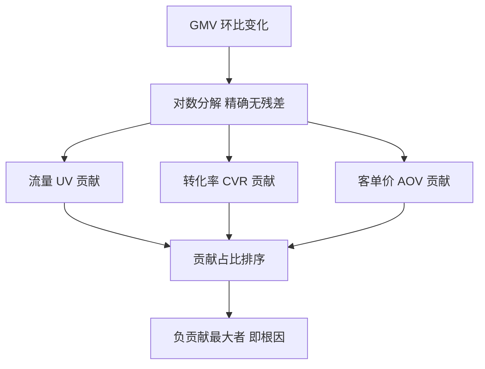

**追问**:
- 追问 1:因子间强相关怎么办?—— 对数分解是恒等式不依赖独立性,但解释时别说因果,要下因子级实验或时序对照。
- 追问 2:指标树和杜邦分析什么关系?—— 同一思想,财务的 ROE 三拆就是指标树,数据团队把它推广到任意乘法链 KPI。

### Q1980 · 同店同比:门店集合漂移的陷阱

> 难度:★★★☆ | 标签:同比, 指标口径

**问**:同比报表被业务质疑"虚高",你查了一圈发现口径没错,问题可能出在哪?

**答**:出在集合漂移上:同比的分子和分母必须来自同一个门店集合,今年有新店、去年有闭店,直接全量相除会把"开店"误报成"增长"。做法是定义同店口径:开业满 N 个月(常见 12 或 18)的门店才算可比集合,同比只在集合内算,新店贡献单独列一行。实测全店同比 +24.1%,同店同比只有 +3.8%,新店贡献占全部增量的 84%——不剔除就是严重误导。三个坑:N 取多少要写进报表标题且不能悄悄改;闭店门店剔除会把亏损店藏起来,要看"同店"与"同店加闭店"两个口径;加盟直营结构变化也算集合漂移。

```python
# file: code/05_数据分析与工程化/q1980_same_store.py
"""同店同比:剔除开业不满 N 月的门店,避免门店集合漂移虚增同比"""

from datetime import date

STORES = {
    "s1": {"open": date(2023, 6, 1), "cur": 520.0, "ly": 480.0},
    "s2": {"open": date(2022, 3, 1), "cur": 300.0, "ly": 310.0},
    "s3": {"open": date(2022, 11, 1), "cur": 410.0, "ly": 395.0},
    "s4": {"open": date(2025, 8, 1), "cur": 180.0, "ly": 0.0},   # 新店,去年无营收
    "s5": {"open": date(2025, 10, 1), "cur": 60.0, "ly": 0.0},   # 新店
}
AS_OF = date(2026, 6, 30)
MIN_AGE_MONTHS = 12


def month_age(opened, as_of):
    return (as_of.year - opened.year) * 12 + (as_of.month - opened.month)


if __name__ == "__main__":
    cur_all = sum(s["cur"] for s in STORES.values())
    ly_all = sum(s["ly"] for s in STORES.values())
    mature = {k: s for k, s in STORES.items()
              if month_age(s["open"], AS_OF) >= MIN_AGE_MONTHS}
    cur_same = sum(s["cur"] for s in mature.values())
    ly_same = sum(s["ly"] for s in mature.values())
    print(f"全店口径: {cur_all:.0f} vs {ly_all:.0f}  同比 {cur_all / ly_all - 1:+.1%}(被新店抬高)")
    print(f"同店口径(开业≥{MIN_AGE_MONTHS}月,共 {len(mature)} 家): "
          f"{cur_same:.0f} vs {ly_same:.0f}  同比 {cur_same / ly_same - 1:+.1%}")
    new_contrib = cur_all - cur_same
    if cur_all > ly_all:
        print(f"新店贡献 {new_contrib:.0f},占全部增量 {new_contrib / (cur_all - ly_all):.0%}")
    print("要点:门店/品类集合随时间漂移,同比必须固定可比集合;同店定义(剔除几个月)要写进报表标题,换定义等于换指标")
```

**追问**:
- 追问 1:线上业务有同店问题吗?—— 有,新开品类页、改渠道归因都会造成可比集合漂移,思路一样:固定集合再比。
- 追问 2:同店口径还要做大促对齐吗?—— 要,集合固定解决"谁在比",日历对齐解决"和哪天比",两者正交。

### Q1981 · 稀疏事件平滑:伪计数与贝叶斯收缩

> 难度:★★★★ | 标签:平滑, 小样本

**问**:按页面统计支付失败率,小页面一会儿 0% 一会儿 50%,排名完全没法看,怎么办?

**答**:低频事件率在小样本分组上剧烈跳动,实测 2/4 的页面原始率 50%,样本 900 的页面只有 1.2%,直接排序毫无意义。平滑的思想是给每个分组注入先验:平滑率等于 (k+a)/(n+a+b),a、b 来自全体数据拟合的 Beta 先验(矩估计),样本越小组越被拉向全局均值,大组几乎不动。实测 0/6 的页面从 0% 收缩到 2.1%,2/4 从 50% 收缩到 19.2%。拉普拉斯加一是特例,先验是均匀分布,不如数据驱动先验准。样本上万就不需要平滑;平滑后的数字必须在报表标注方法,不能和原始率混排,否则读者不知道自己在看什么口径。

```python
# file: code/05_数据分析与工程化/q1981_sparse_smooth.py
"""稀疏事件平滑:伪计数与贝叶斯收缩,小样本率向全局均值收缩防跳变"""

EVENTS = {"页面A": (3, 40), "页面B": (28, 320), "页面C": (0, 6),
          "页面D": (5, 50), "页面E": (11, 900), "页面F": (2, 4)}


def fit_prior(pairs):
    """矩估计 Beta 先验:均值取全体比率,离散度人工给定并夹底防负"""
    n_total = sum(n for _, n in pairs)
    k_total = sum(k for k, _ in pairs)
    mean = k_total / n_total
    var = max(0.004, 1e-6)
    common = max(mean * (1 - mean) / var - 1, 1.0)
    return mean * common, (1 - mean) * common


def shrink(k, n, a, b):
    """平滑率 = (k + a) / (n + a + b),n 越小越贴近先验均值"""
    return (k + a) / (n + a + b)


if __name__ == "__main__":
    a, b = fit_prior(list(EVENTS.values()))
    print(f"Beta 先验: a={a:.3f} b={b:.3f},先验均值 {a / (a + b):.3f}")
    print(f"{'页面':<6}{'原始比率':>10}{'拉普拉斯':>10}{'贝叶斯收缩':>11}")
    for name, (k, n) in sorted(EVENTS.items()):
        raw = k / n if n else 0.0
        lap = (k + 1) / (n + 2)
        sm = shrink(k, n, a, b)
        print(f"{name:<6}{raw:>10.1%}{lap:>10.1%}{sm:>11.1%}")
    print("要点:小样本页面的原始率会在 0% 和 50% 之间乱跳;拉普拉斯是均匀先验,贝叶斯收缩向真实全局均值收;样本越大收缩越弱,两万级样本无需平滑")
```

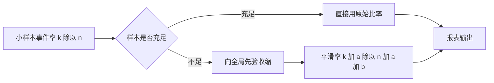

**追问**:
- 追问 1:先验方差怎么定?—— 用历史多期数据的组间方差做矩估计并定期重估,方差越小收缩越强。
- 追问 2:平滑和最小展示阈值怎么选?—— 阈值简单粗暴会把长尾全藏掉,平滑保留全部分组但承认不确定性,排名类场景平滑更合适。

### Q1982 · 加权留存:按活跃权重看真实留存

> 难度:★★★☆ | 标签:留存, 加权

**问**:日报把每天的次日留存求平均,这个数有什么问题?正确的整体留存怎么算?

**答**:直接对日留存求平均,等于给每天同样的票,但基期流量差一倍多时,小流量日的话事权虚高。实测一周里工作日次留 42-45%、周末只有 31-33%,而周末 DAU 反而最大(1.5 万上下),简单平均 39.4%,按基期 DAU 加权后 38.8%,方向被周末拉低。误差大小取决于流量与留存的相关性,大促日流量高留存低,失真会被急剧放大。规范做法:整体留存要么按分子分母分别加总再相除(sum(n×r)/sum(n),等价于直接在事件层算全局留存),要么不给单值、直接看 cohort 矩阵;跨期对比时加权权重必须固定,否则权重随流量波动,指标又不可比了。

```python
# file: code/05_数据分析与工程化/q1982_weighted_retention.py
"""加权留存:按基期流量加权,小流量日不再拉偏整体留存"""

try:
    import pandas as pd
except ImportError:
    pd = None

COHORTS = [
    # (基期日, 基期 DAU, 次日留存)
    ("周一", 12000, 0.44), ("周二", 11500, 0.43), ("周三", 11800, 0.45),
    ("周四", 11200, 0.42), ("周五", 13400, 0.38), ("周六", 15800, 0.31),
    ("周日", 15200, 0.33),
]


def simple_avg(rows):
    return sum(r for _, _, r in rows) / len(rows)


def weighted_avg(rows):
    total_w = sum(n for _, n, _ in rows)
    return sum(n * r for _, n, r in rows) / total_w


if __name__ == "__main__":
    s, w = simple_avg(COHORTS), weighted_avg(COHORTS)
    for day, n, r in COHORTS:
        print(f"  {day} DAU={n:>6} 次留 {r:.0%}")
    print(f"简单平均留存 {s:.1%}  流量加权留存 {w:.1%}  差 {w - s:+.1%}")
    print("要点:周末流量大但留存低,简单平均被高留存的工作日抬高;整体留存要么按流量加权,要么直接看 cohort 矩阵,别用日留存求均值")
    if pd is not None:
        df = pd.DataFrame(COHORTS, columns=["dow", "dau", "ret"])
        print("pandas 视角: 简单 =", round(df["ret"].mean(), 4),
              "加权 =", round(float((df["dau"] * df["ret"]).sum() / df["dau"].sum()), 4))
```

**追问**:
- 追问 1:7 留、30 留也要加权吗?—— 要,凡是对日粒度比率求汇总的地方都要,原则是分子分母先加总再相除。
- 追问 2:加权后和全局直接算还差一点怎么办?—— 检查分子分母对齐:全局留存=次日活跃数之和/基期活跃数之和,与 sum(n×r)/sum(n) 在 r 为精确比率时应一致,差值来自四舍五入。

### Q1983 · 排名波动监控:榜单结构变化告警

> 难度:★★☆ | 标签:排名监控, 告警

**问**:榜单 Top10 每天都在变,业务天天来问"排名为什么变了",你怎么把监控做得有信号量?

**答**:排名类指标天生高波动,盯单点名次会天天"狼来了"。监控对象应该是榜单结构:今天和昨天比,谁进榜、谁掉榜、在榜者位移多少,进出榜家数或最大位移超过阈值才告警。实测 Top10 里 3 家进出榜、最大位移触发阈值,判定告警,先查口径与爬虫流量再谈业务解释。位移分布本身是个好指标:正常日大多在 ±1,突然出现一批 ±5 就是榜单算法或数据出了问题。阈值别拍脑袋,用历史位移的分位数定;榜单口径或权重调整要打版本标,重算造成的排名变化和自然波动要分开归因。

```python
# file: code/05_数据分析与工程化/q1983_rank_watch.py
"""排名波动监控:Top-N 榜单日间对比,进出榜与位移超限告警"""

YESTERDAY = ["商品A", "商品B", "商品C", "商品D", "商品E",
             "商品F", "商品G", "商品H", "商品I", "商品J"]
TODAY = ["商品B", "商品A", "商品K", "商品C", "商品L",
         "商品D", "商品F", "商品E", "商品G", "商品M"]
ALARM_TURN = 2    # 进出榜家数阈值
ALARM_SHIFT = 3   # 单品最大位移阈值


def rank_map(lst):
    return {name: i + 1 for i, name in enumerate(lst)}


def compare(prev, curr):
    r_prev, r_curr = rank_map(prev), rank_map(curr)
    dropped = sorted(set(r_prev) - set(r_curr))
    entered = sorted(set(r_curr) - set(r_prev))
    moves = {k: r_curr[k] - r_prev[k]
             for k in set(r_prev) & set(r_curr) if r_curr[k] != r_prev[k]}
    return dropped, entered, moves


if __name__ == "__main__":
    r_prev, r_curr = rank_map(YESTERDAY), rank_map(TODAY)
    dropped, entered, moves = compare(YESTERDAY, TODAY)
    print(f"掉榜: {dropped}  新进: {entered}")
    for k, m in sorted(moves.items(), key=lambda x: x[1]):
        print(f"  {k}: 第{r_prev[k]} -> 第{r_curr[k]} ({m:+d})")
    alarm = len(dropped) + len(entered) > ALARM_TURN or \
        any(abs(m) > ALARM_SHIFT for m in moves.values())
    print(f"告警判定: {'触发,榜单结构剧变,先查口径与爬虫流量' if alarm else '正常波动'}")
    print("要点:排名天然高波动,监控比的是榜单结构(进出榜/位移分布)而不是单点名次;阈值按历史位移分位数定")
```

**追问**:
- 追问 1:为什么不直接对排名做显著性检验?—— 排名是序数,背后是分数,在分数层检验更有功效,排名结构监控是兜底而非首选。
- 追问 2:Top10 之外怎么监控?—— 分层:Top10 盯进出榜,11-100 盯位移分布稳定性,长尾只看聚合指标。

### Q1984 · 异常检测的基线带:同期分位带

> 难度:★★★☆ | 标签:异常检测, 基线

**问**:固定阈值告警在周期性指标上天天误报,怎么做一条能"容忍正常波动"的基线?

**答**:阈值告警在周期性数据上必挂:全局阈值要么把每个周末都报一遍,要么宽松到工作日异常抓不住。基线带按周期分量分别构造:以周规律为例,把历史值按星期几分桶,各桶取 p10-p90 分位形成"今天的预期范围",当前值出带才算异常候选。实测周一基线带 105-110,今天 138 出带告警;而全局固定带 107-161 会漏掉这个异常。三个要点:带的宽窄由业务容忍度定,不必默认 p10-p90;出带不等于告警,还要叠加持续时间(连续 2-3 个点出带)过滤毛刺;历史里本身有异常要先清洗,否则带被撑宽。带要滚动更新,周期规律变了带也要跟着变。

```python
# file: code/05_数据分析与工程化/q1984_baseline_band.py
"""异常检测基线带:按星期几取历史分位带,出带才告警"""

import random

random.seed(7)
HIST = []  # 28 天历史:周末高、工作日低
for day in range(28):
    dow = day % 7
    base = [110, 112, 115, 113, 120, 165, 158][dow]
    HIST.append(base + random.randint(-6, 6))

TODAY_DOW = 0      # 今天周一
TODAY_VALUE = 138  # 明显高于历史周一


def quantile(xs, q):
    s = sorted(xs)
    pos = (len(s) - 1) * q
    lo, hi = int(pos), min(int(pos) + 1, len(s) - 1)
    frac = pos - lo
    return s[lo] * (1 - frac) + s[hi] * frac


def band_for_dow(hist, dow, lo_q=0.1, hi_q=0.9):
    xs = hist[dow::7]
    return quantile(xs, lo_q), quantile(xs, hi_q)


if __name__ == "__main__":
    print("星期几基线带 p10-p90:")
    names = ["周一", "周二", "周三", "周四", "周五", "周六", "周日"]
    for d, name in enumerate(names):
        lo, hi = band_for_dow(HIST, d)
        mark = "  <- 今天" if d == TODAY_DOW else ""
        print(f"  {name}: [{lo:.0f}, {hi:.0f}]{mark}")
    lo, hi = band_for_dow(HIST, TODAY_DOW)
    out = TODAY_VALUE > hi or TODAY_VALUE < lo
    print(f"今天 {TODAY_VALUE}: 基线带 [{lo:.0f}, {hi:.0f}] -> {'出带,告警并人工复核' if out else '带内,正常'}")
    lo_all, hi_all = quantile(HIST, 0.1), quantile(HIST, 0.9)
    print(f"对照:全局固定带 [{lo_all:.0f}, {hi_all:.0f}] 会把每个周末都误报")
    print("要点:基线带按周期分量分别构造,同分布才可比;带取 p10-p90,出带只代表异常候选,告警还要叠加持续时间条件")
```

**追问**:
- 追问 1:数据不满四个周期怎么办?—— 先只上趋势基线不上分位带,或临时放大带宽并标注"低置信"。
- 追问 2:为什么不用正态假设算 3 sigma?—— 现实指标多偏态重尾,分位带直接来自经验分布,不做分布假设更稳。

### Q1985 · 双维度交叉透视:手写 pivot 与边际合计

> 难度:★★☆ | 标签:透视表, pandas

**问**:让你不看文档手写一个交叉透视表,行列都有合计,你会怎么组织代码?

**答**:实现三步:扫描行数据按(行键,列键)进桶收集值;对同格多值先聚合(求和/计数/平均);缺格补零。加边际:每行合计、每列合计、总计,合计用来核对总量,实测总计 2170 与源数据一致,这是透视表上线前的必做核对。占比要单独输出而不是混进同一张矩阵,一行里既有绝对值又有百分比是报表大忌。pandas 里是 pivot_table 的 aggfunc 加 margins 一行,但要懂它的默认行为:aggfunc 缺省是 mean 会悄悄平均、fill_value 缺省 NaN、margins 名称默认 All。同格多行必须先聚合再成表,顺序错了会把聚合算在聚合上。

```python
# file: code/05_数据分析与工程化/q1985_cross_pivot.py
"""双维度交叉透视:标准库手写 pivot,含行列边际与行占比"""

try:
    import pandas as pd
except ImportError:
    pd = None

ORDERS = [
    ("自然流量", "工作日", 320), ("自然流量", "周末", 410),
    ("付费投放", "工作日", 560), ("付费投放", "周末", 380),
    ("老客召回", "工作日", 150), ("老客召回", "周末", 260),
    ("付费投放", "工作日", 90),   # 同格多行,演示先聚合再成表
]


def pivot(rows, row_idx, col_idx, agg=sum):
    cols, grid = [], {}
    for r in rows:
        rk, ck = r[row_idx], r[col_idx]
        if ck not in cols:
            cols.append(ck)
        grid.setdefault(rk, {}).setdefault(ck, []).append(r[2])
    table = {rk: {ck: agg(grid[rk][ck]) if ck in grid[rk] else 0
                  for ck in cols} for rk in grid}
    return table, cols


def with_margins(table, cols):
    out = {rk: dict(row) for rk, row in table.items()}
    for rk in out:
        out[rk]["合计"] = sum(out[rk][c] for c in cols)
    cols_all = cols + ["合计"]
    out["总计"] = {c: sum(out[rk][c] for rk in table) for c in cols_all}
    return out, cols_all


if __name__ == "__main__":
    table, cols = pivot(ORDERS, 0, 1)
    full, cols_all = with_margins(table, cols)
    print("渠道 x 时段 订单数:")
    print(f"{'渠道':<8}" + "".join(f"{c:>8}" for c in cols_all))
    for rk, row in full.items():
        print(f"{rk:<8}" + "".join(f"{row[c]:>8}" for c in cols_all))
    print("行占比(占本渠道):")
    for rk in table:
        total = full[rk]["合计"]
        print(f"{rk:<8}" + "".join(f"{full[rk][c] / total:>8.0%}" for c in cols))
    print("要点:同格多行先聚合再成表;边际合计用于核对总量;占比单独成表,别和绝对值混在一张矩阵里")
    if pd is not None:
        df = pd.DataFrame(ORDERS, columns=["channel", "bucket", "orders"])
        pv = pd.pivot_table(df, index="channel", columns="bucket",
                            values="orders", aggfunc="sum",
                            margins=True, fill_value=0)
        print("pandas 视角:")
        print(pv)
```

**追问**:
- 追问 1:三个以上维度怎么透视?—— 行或列任一侧嵌套多层,或拆成多张二维表;维度超过三个优先分层下钻,别做一张没人读得懂的大表。
- 追问 2:pivot_table 和 groupby 加 unstack 的区别?—— groupby 先聚合再 unstack 更可控,pivot_table 一步到位但聚合语义藏在参数里,排查口径时拆开更稳。

### Q1986 · 跳转矩阵:页面间转移概率与主流出

> 难度:★★★☆ | 标签:路径分析, 转移矩阵

**问**:想看用户在页面之间实际怎么跳,怎么把会话日志变成可分析的结构?

**答**:把每条会话按相邻页面切成转移对,计数后按行归一,得到一步转移概率矩阵:行是"从哪来",列是"到哪去",终点页一行全零。从矩阵里读三件事:每页最大去向(用户认为的自然路径)、每个转移的概率(路径是否集中)、流出率(会话在该页结束的比例)。实测详情页最大去向是下单 100%,但活动页一半会话直接结束——活动页才是断点。跳转矩阵是路径分析的骨架,Top-N 路径、漏斗设计、流失页定位都从它出发。注意它只记相邻两步,跨步路径要靠 n 阶矩阵或序列分析;页面集合要先归一化,带参数的 URL 会把矩阵撑爆。

```python
# file: code/05_数据分析与工程化/q1986_transition_matrix.py
"""跳转矩阵:页面序列转转移概率,找主流出页"""

SESSIONS = [
    ["首页", "列表", "详情", "下单"],
    ["首页", "列表", "详情"],
    ["首页", "详情", "下单"],
    ["首页", "列表"],
    ["首页", "活动", "列表", "详情", "下单"],
    ["首页", "活动"],
    ["首页", "列表", "详情"],
    ["首页", "详情"],
]


def transitions(sessions):
    cnt = {}
    for path in sessions:
        for a, b in zip(path, path[1:]):
            cnt[(a, b)] = cnt.get((a, b), 0) + 1
    return cnt


def row_normalize(cnt):
    totals = {}
    for (a, b), c in cnt.items():
        totals[a] = totals.get(a, 0) + c
    probs = {(a, b): c / totals[a] for (a, b), c in cnt.items()}
    return probs, totals


if __name__ == "__main__":
    cnt = transitions(SESSIONS)
    probs, totals = row_normalize(cnt)
    pages = sorted({p for path in SESSIONS for p in path})
    print("转移概率(行归一):")
    print("    " + "".join(f"{p:>6}" for p in pages))
    for a in pages:
        row = "".join(f"{probs.get((a, b), 0):>6.2f}" for b in pages)
        print(f"{a:<4}" + row)
    arrive = {}
    for path in SESSIONS:
        for p in path:
            arrive[p] = arrive.get(p, 0) + 1
    print("各页去向与流出:")
    for a in pages:
        outgoing = [(p, b) for (x, b), p in probs.items() if x == a]
        ends = sum(1 for path in SESSIONS if path[-1] == a)
        if not outgoing:
            print(f"  {a}: 终点页,到达 {arrive[a]} 次,全部会话在此结束")
            continue
        best = max(outgoing)
        print(f"  {a}: 到达 {arrive[a]} 次,最大去向 {best[1]} {best[0]:.0%},"
              f"会话在此结束 {ends / arrive[a]:.0%}")
    print("要点:转移矩阵按行归一,每行是一步的条件分布;流出率高的页是漏斗断点,优先修'最大去向占比低且流出率高'的页")
```

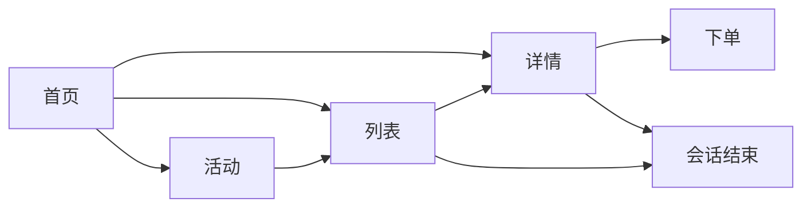

**追问**:
- 追问 1:转移矩阵和漏斗什么关系?—— 漏斗是给定顺序的强约束,矩阵是无约束的全量转移,漏斗设计前先看用户实际怎么走。
- 追问 2:稀疏页面怎么处理?—— 长尾页面聚合成"其他"桶,矩阵维度控制在两位数以内再分析。

### Q1987 · DAU/MAU 粘性比:滚动口径与自然期口径

> 难度:★★☆ | 标签:活跃指标, 指标口径

**问**:DAU/MAU 这个粘性比怎么算才算对?为什么它经常"莫名其妙"跌一半?

**答**:粘性比等于 DAU 除以 MAU,衡量"月活里有多少天天来"。工程上最容易错的是 MAU 口径:自然月 MAU 每月一号跳变,滚动 30 天 MAU 逐日重算才平滑,两个口径在同一天能差出不少,报表必须写明用的哪个,实测用 5 天窗口演示了滚动口径的逐日计算。粘性比经常莫名下跌,最常见原因是拉新做大分母:实测随新用户涌入,粘性比从 0.8 掉到 0.44,产品并没有变糟。所以粘性比看趋势和结构性变化,不看绝对值;跨产品比较要同品类同口径,电商和社交没有可比性。行业经验区间只做参考,自家基线自己建。

```python
# file: code/05_数据分析与工程化/q1987_stickiness.py
"""DAU/MAU 粘性比:滚动窗口口径与自然期口径的差异"""

ACTIVE = {
    1: {"u1", "u2", "u3", "u4"},
    2: {"u1", "u2", "u5"},
    3: {"u1", "u3", "u6", "u7", "u8"},
    4: {"u1", "u2", "u3"},
    5: {"u1", "u4", "u9"},
    6: {"u1", "u10", "u11", "u12"},
    7: {"u1", "u2", "u3", "u13"},
}
WINDOW = 5  # 演示用 5 天窗口,生产 MAU 用滚动 30 天


def rolling_mau(active, day, window):
    s = set()
    for d in range(day - window + 1, day + 1):
        s |= active.get(d, set())
    return s


if __name__ == "__main__":
    for day in sorted(ACTIVE):
        dau = len(ACTIVE[day])
        mau = rolling_mau(ACTIVE, day, WINDOW)
        print(f"第{day}天 DAU={dau:>2}  滚动{WINDOW}日 MAU={len(mau):>2}  粘性比 {dau / len(mau):.2f}")
    last = max(ACTIVE)
    all_users = set().union(*ACTIVE.values())
    print(f"自然期口径:整期去重 {len(all_users)} 人,末日粘性比 {len(ACTIVE[last]) / len(all_users):.2f}")
    print("要点:MAU 要逐日滚动重算而不是自然月一次;粘性比看趋势不看绝对值,跌一半常见于拉新带来的分母膨胀")
```

**追问**:
- 追问 1:wDAU/MAU 是什么?—— 周活跃比月活,衡量周节奏用户的占比,与日粘性比搭配看活跃频次的分层。
- 追问 2:滚动 MAU 算起来贵怎么办?—— 用 BitMap 或 HLL 存每日活跃集,滚动并集在位图上做,成本与窗口天数线性。

### Q1988 · 时间衰减活跃分:指数半衰期评分

> 难度:★★★☆ | 标签:评分模型, 时间衰减

**问**:要给用户算一个"当前活跃度"分数,数最近 30 天活跃天数有什么问题?

**答**:数活跃天数把 30 天前的一次活跃和昨天的一次等权,分层结果偏向"老黄牛"而不是"当前活跃"。指数衰减分对每次活跃按 0.5 的(距今天数/半衰期)次方计权后求和:半衰期 7 天时,7 天前的活跃权重 0.5、14 天前 0.25。实测 dave 活跃 6 天但分散在两周,alice 只有 4 天但集中在近三天,衰减分反超,这才是业务想要的排序。半衰期取业务周期,周活跃产品 7 天、月活跃产品 30 天,不要把它当成需要反复调优的模型参数;分数用于分层与召回排序,不跨业务比较绝对值。对数、幂次衰减是替代方案,指数衰减胜在半衰期语义直观,在线场景还能 O(1) 增量维护。

```python
# file: code/05_数据分析与工程化/q1988_decay_score.py
"""时间衰减活跃分:指数半衰期加权,近期活跃权重更大"""

USERS = {
    "alice": [1, 2, 3, 10],      # 活跃发生在 N 天前
    "bob":   [30, 29, 28],
    "cindy": [2],
    "dave":  [1, 3, 5, 7, 9, 11],
}
HALF_LIFE = 7.0


def decay_score(active_days_ago, half_life):
    return sum(0.5 ** (d / half_life) for d in active_days_ago)


if __name__ == "__main__":
    print(f"半衰期 {HALF_LIFE:.0f} 天:7 天前的活跃权重 0.5,14 天前 0.25,21 天前 0.125")
    print(f"{'用户':<8}{'衰减分':>8}{'活跃天数':>8}")
    scored = sorted(USERS.items(), key=lambda kv: -decay_score(kv[1], HALF_LIFE))
    for u, days in scored:
        print(f"{u:<8}{decay_score(days, HALF_LIFE):>8.2f}{len(days):>8}")
    by_count = dict(sorted(((u, len(d)) for u, d in USERS.items()), key=lambda kv: -kv[1]))
    print("对照(按活跃天数):", by_count)
    print("要点:半衰期取业务周期(周活跃 7 天/月活跃 30 天),不是数学参数;衰减分用于分层与召回,不跨业务比较绝对值")
```

**追问**:
- 追问 1:和 RFM 里的 R 有什么区别?—— R 只看最近一次,衰减分累加历史活跃强度,两者可拼:衰减分做量、R 做新近度门控。
- 追问 2:在线场景怎么增量维护?—— 每天把历史分乘 0.5 的(1/半衰期)次方再加当天活跃的 1 分,单次更新常数开销。

### Q1989 · 重尾客单价:均值失真与分位数口径

> 难度:★★★☆ | 标签:分布, 统计口径

**问**:运营说"客单价涨了 80%",你怎么判断这个数字可信?

**答**:订单金额天然重尾,一单大单就能把均值抬高:实测 20 笔订单里混进一笔 9990,均值 599 元、中位数只有 119 元,"客单价涨 80%"很可能在讲那一单。规范是客单价报表固定"中位数+均值"并列:中位数代表典型用户,均值代表金额总量口径(与 GMV 一致);两期对比先看分布(p25/p50/p75/p90)再谈均值位移。大单(B2B、企业采购)单独建视图,不混入 C 端客单价;截尾均值(去首尾各 10%)是内部趋势监控的折中。任何"剔除异常大单"的决定都要有明文规则和留痕,不能因为影响汇报就临时剔除。

```python
# file: code/05_数据分析与工程化/q1989_heavy_tail_aov.py
"""重尾客单价:均值被大单拉高,报表口径用中位数与均值并列"""

try:
    import pandas as pd
except ImportError:
    pd = None

ORDERS = [79, 99, 128, 89, 159, 109, 69, 139, 119, 95,
          149, 88, 129, 105, 79, 199, 9990, 149, 115, 89]


def median(xs):
    s = sorted(xs)
    n = len(s)
    return s[n // 2] if n % 2 else (s[n // 2 - 1] + s[n // 2]) / 2


def trimmed_mean(xs, cut=0.1):
    s = sorted(xs)
    k = int(len(s) * cut)
    body = s[k:len(s) - k]
    return sum(body) / len(body)


def quantile(xs, q):
    s = sorted(xs)
    pos = (len(s) - 1) * q
    lo, hi = int(pos), min(int(pos) + 1, len(s) - 1)
    frac = pos - lo
    return s[lo] * (1 - frac) + s[hi] * frac


if __name__ == "__main__":
    n = len(ORDERS)
    print(f"订单数 {n}")
    print(f"均值 {sum(ORDERS) / n:.0f}  中位数 {median(ORDERS):.0f}  "
          f"p90 {quantile(ORDERS, 0.9):.0f}  截尾均值 {trimmed_mean(ORDERS):.0f}")
    print(f"剔除最大单后均值 {(sum(ORDERS) - max(ORDERS)) / (n - 1):.0f}")
    print("要点:一单 9990 把均值抬了约 500,客单价报表固定'中位数+均值'并列;大单单独走 B2B 视图;对比两期客单价先看分布再谈均值")
    if pd is not None:
        s = pd.Series(ORDERS)
        print("pandas 视角:", {"mean": round(s.mean(), 1), "median": s.median(),
                             "p90": float(s.quantile(0.9))})
```

**追问**:
- 追问 1:为什么不用对数均值?—— log 均值回到原空间是几何均值,解释成本高,适合建模不适合报表,报表坚持中位数。
- 追问 2:重尾下均值什么时候仍有意义?—— 指标本身就是"总量/单量"的 GMV 口径时必须保留,但要和中位数一起看,单独看就是误导。

### Q1990 · 口径变更桥接:新旧口径并行期的差异桥

> 难度:★★★★ | 标签:口径变更, 桥接分析

**问**:活跃口径必须从"任意事件"改成"关键事件",新口径天然比旧口径低一截,你怎么保证长期曲线不断?

**答**:口径切换最大的风险是历史序列断裂:曲线陡降被误读成业务崩盘。桥接的标准做法是并行期换算:切换前至少两周新旧口径每天同时算,得到新/旧比值序列;比值稳定则取中位数为校准系数,实测七天内极差只有 0.0069,取 k=0.8919;历史序列乘 k 换算到新口径,并校验换算值与并行期实测吻合(12180×k=10863,约等于新口径实测 10900)。比值不稳定说明口径实现本身有波动,先修实现再并行,不能硬接。输出必须标注:哪些区间是实测新口径、哪些是换算、系数与生效日期;口径字典永久保留旧口径定义,审计回溯都靠它。

```python
# file: code/05_数据分析与工程化/q1990_metric_bridge.py
"""口径变更桥接:并行期双口径算校准系数,历史数据按系数换算可比"""

PARALLEL = [
    # (日期, 旧口径日活, 新口径日活)
    ("11-01", 10200, 9100), ("11-02", 10450, 9320), ("11-03", 10180, 9050),
    ("11-04", 10990, 9800), ("11-05", 11230, 10010), ("11-06", 12300, 11020),
    ("11-07", 12180, 10900),
]


def calibration_ratio(rows):
    """并行期新/旧比值的中位数做校准系数,抗单日波动"""
    ratios = sorted(new / old for _, old, new in rows)
    n = len(ratios)
    mid = ratios[n // 2] if n % 2 else (ratios[n // 2 - 1] + ratios[n // 2]) / 2
    return mid, ratios


if __name__ == "__main__":
    k, ratios = calibration_ratio(PARALLEL)
    print("并行期 新/旧 比值:", [f"{r:.4f}" for r in ratios])
    print(f"校准系数(中位数)k = {k:.4f}")
    old_last = PARALLEL[-1][1]   # 并行期最后一天的旧口径实测
    print(f"桥接校验: 同日旧口径 {old_last} x k = {old_last * k:.0f}"
          f"  ≈ 新口径实测 {PARALLEL[-1][2]}")
    drift = max(ratios) - min(ratios)
    verdict = "稳定,系数可用" if drift < 0.03 else "波动大,先查口径实现再并行"
    print(f"比值极差 {drift:.4f} -> {verdict}")
    print("要点:切换前至少两周并行;系数取中位数;换算序列必须标注口径与系数生效区间,报表读者有权知道今天和昨天用的不是一个定义")
```

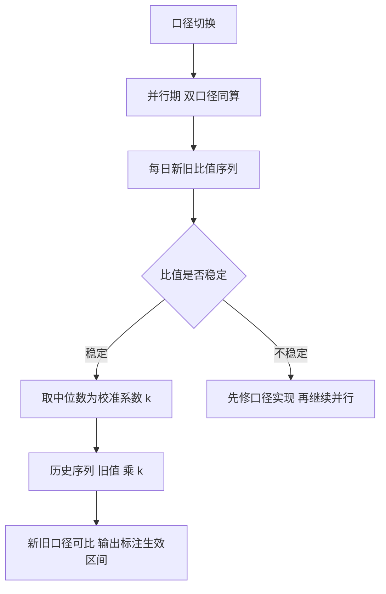

**追问**:
- 追问 1:并行期成本太高怎么办?—— 至少覆盖一个完整周循环(七天)再加两端各一天,并避开大促期。
- 追问 2:校准系数会漂移吗?—— 会,业务结构变化会改变新旧口径差,系数要定期复检,超阈值重新并行。

### Q1991 · 渠道质量评分:多指标归一化加权

> 难度:★★★☆ | 标签:评分卡, 渠道分析

**问**:四个渠道各有转化率、留存、客单价、ROI,怎么合成一个综合分排出名次?

**答**:三步:统一方向(成本类指标取倒数)、归一化、加权求和。坑在归一化:min-max 会被离群值压扁,实测 roi 最大 3.8、其余在 1.4-2.1,min-max 后其他渠道在这一维全挤在 0.2 附近;秩归一只看名次,离群值只占一个名次,不拉伸整条轴,代价是丢失幅度信息且可能并列。实测秩归一加权后搜索 0.73 居首,社交裂变与应用商店并列 0.60。权重是第二个坑,0.3/0.3/0.2/0.2 要过评审留痕,权重一调排名就变,调权重等于调结论。评分用于排序观察,不能直接当预算分配依据,预算还要看边际 ROI。

```python
# file: code/05_数据分析与工程化/q1991_channel_score.py
"""渠道质量评分:秩归一抗离群,多指标加权合成综合分"""

try:
    import pandas as pd
except ImportError:
    pd = None

CHANNELS = {
    "搜索":   {"cvr": 0.032, "ret7": 0.41, "aov": 156, "roi": 2.1},
    "信息流": {"cvr": 0.018, "ret7": 0.29, "aov": 98,  "roi": 1.4},
    "社交裂变": {"cvr": 0.027, "ret7": 0.46, "aov": 88,  "roi": 3.8},
    "应用商店": {"cvr": 0.041, "ret7": 0.38, "aov": 141, "roi": 1.9},
}
WEIGHTS = {"cvr": 0.3, "ret7": 0.3, "aov": 0.2, "roi": 0.2}


def rank_norm(values):
    """秩归一:映射到 0-1,离群值只占一个名次,不拉伸整条轴"""
    order = sorted(range(len(values)), key=lambda i: values[i])
    rank = [0.0] * len(values)
    for pos, idx in enumerate(order):
        rank[idx] = pos / (len(values) - 1) if len(values) > 1 else 0.5
    return rank


def score_channels(channels, weights):
    names = list(channels)
    norms = {}
    for k in weights:
        vals = [channels[c][k] for c in names]
        norms[k] = dict(zip(names, rank_norm(vals)))
    out = {}
    for c in names:
        total = sum(norms[k][c] * w for k, w in weights.items())
        out[c] = (total, {k: round(norms[k][c], 2) for k in weights})
    return out


if __name__ == "__main__":
    scored = score_channels(CHANNELS, WEIGHTS)
    for c, (s, detail) in sorted(scored.items(), key=lambda kv: -kv[1][0]):
        print(f"{c:<6} 综合分 {s:.2f}  各项秩 {detail}")
    print("要点:合成前统一指标方向(成本类取倒数);min-max 会被 roi=3.8 这种离群值压扁其他渠道,秩归一不拉伸但有名次并列风险;权重必须评审留痕,别让调权重变成调结论")
    if pd is not None:
        df = pd.DataFrame(CHANNELS).T
        print("pandas 视角(原始指标):")
        print(df)
```

**追问**:
- 追问 1:渠道数量很多时秩归一还合适吗?—— 渠道多时秩归一接近线性,可改分位数归一或 winsorize 后 min-max。
- 追问 2:某渠道缺一个指标怎么办?—— 缺维度给中性秩并标注,不许默认 0 拉低或 1 抬高。

### Q1992 · 埋点覆盖率对账:应有事件与实收事件

> 难度:★★★☆ | 标签:埋点, 数据对账

**问**:怎么系统性发现"埋点丢了"这类问题,而不是等业务看报表时才发现数据缺一块?

**答**:埋点质量和数据质量一样需要对账:基准是埋点方案(事件清单加必填字段),实收是线上真实上报。检查器逐事件比对三类问题:事件缺失、字段到达率(必填字段出现次数除以采样总量,90% 算达标)、未登记的野事件。实测 order_submit 的 channel 字段只到 120/500,覆盖率 33% 是唯一红灯;page_view 是野事件,要么补登记要么清退。这类对账要例行化:埋点方案变更走评审并自动更新基准,对账报告进周会;没有事件字典的对账是无源之水,先有基准再谈覆盖率。

```python
# file: code/05_数据分析与工程化/q1992_tracking_audit.py
"""埋点覆盖率对账:埋点方案清单对实收事件,输出缺失事件与缺字段"""

PLAN = {
    "order_submit": {"required": ["order_id", "amount", "channel"]},
    "pay_success": {"required": ["order_id", "pay_type"]},
    "search_click": {"required": ["query", "pos"]},
}
RECEIVED = {
    "order_submit": {"order_id": 500, "amount": 498, "channel": 120},
    "pay_success": {"order_id": 470},
    "page_view": {"url": 9000},
}
SAMPLE_TOTAL = 500
COV_LINE = 0.9   # 字段到达率 90% 算达标


def audit(plan, received):
    report = []
    for event, spec in plan.items():
        if event not in received:
            report.append((event, "事件缺失", 0.0, []))
            continue
        fields = received[event]
        missing = [f for f in spec["required"]
                   if fields.get(f, 0) < SAMPLE_TOTAL * COV_LINE]
        hit = sum(1 for f in spec["required"]
                  if fields.get(f, 0) >= SAMPLE_TOTAL * COV_LINE)
        cov = hit / len(spec["required"])
        report.append((event, "字段不全" if missing else "正常", cov, missing))
    extra = sorted(e for e in received if e not in plan)
    return report, extra


if __name__ == "__main__":
    report, extra = audit(PLAN, RECEIVED)
    for event, status, cov, missing in report:
        line = f"{event:<14} {status:<6} 字段覆盖 {cov:.0%}"
        if missing:
            line += f"  缺: {missing}"
        print(line)
    print(f"未登记事件(埋点野数据): {extra}")
    print("要点:以埋点方案为基准逐事件对账,字段级到达率 90% 算达标;野事件要么补登记要么清退,长期挂着会污染事件字典")
```

**追问**:
- 追问 1:字段到了但值非法呢?—— 到达率只看有没有,合法率要另加值域断言,两层合起来才是字段质量。
- 追问 2:客户端版本碎片化怎么办?—— 到达率按版本分维统计,老版本的自然衰减要和"新版本埋点坏了"区分开。

### Q1993 · 搜索无结果率与空转监控

> 难度:★★☆ | 标签:搜索分析, 监控

**问**:搜索业务给你一周的搜索日志,你怎么评估搜索质量的第一道底线?

**答**:无结果率等于零结果 query 数除以总 query 数,是搜索质量的第一道仪表:它直接量化"用户搜了但什么都没有"。实测 16 条 query 里 6 条零结果(演示数据),线上正常值应在个位数百分比,突增通常来自品类下架、分词故障或爬虫 query。零结果 query 要按前缀粗聚类给人工归并:实测"无线/無线"提示繁简归一缺失,"耳机"簇提示耳机类目词库空缺。动作按序:补同义词与别名词库、确认无货的 query 做相关推荐兜底、长期零转化的 query 从热搜榜降权。监控看周趋势,单日会被运营活动扰动;补词后的 query 要回归验证无结果率真实下降。

```python
# file: code/05_数据分析与工程化/q1993_search_null.py
"""搜索无结果率:整体比率与空转 query 前缀粗聚类"""

LOGS = [
    ("iPhone 手机壳", 12), ("iphone 壳", 8), ("蓝牙耳机", 30), ("無线耳机", 0),
    ("无线耳机", 25), ("充电器", 18), ("苹果充电线", 0), ("苹果 data线", 0),
    ("手机支架", 7), ("折叠支架", 2), ("隐私贴膜", 0), ("钢化膜", 44),
    ("耳机包", 0), ("耳机收纳包", 3), ("游戏手柄", 9), ("ns2 手柄", 0),
]


def null_rate(logs):
    zeros = [q for q, c in logs if c == 0]
    return len(zeros) / len(logs), zeros


def prefix_cluster(queries, width=2):
    groups = {}
    for q in queries:
        groups.setdefault(q[:width], []).append(q)
    return sorted(groups.items(), key=lambda kv: -len(kv[1]))


if __name__ == "__main__":
    rate, zeros = null_rate(LOGS)
    print(f"无结果率 {rate:.0%}({len(zeros)}/{len(LOGS)} 条 query 零结果)")
    for pre, qs in prefix_cluster(zeros):
        print(f"  前缀[{pre}] x{len(qs)}: {qs}")
    print("要点:零结果 query 按前缀粗聚再人工归并,繁简与大小写变体提示要先做归一化;头部类目优先补词库与同义词;无结果率看周趋势,单日受运营活动扰动")
```

**追问**:
- 追问 1:有结果但全是无关结果怎么发现?—— 加首屏点击率与跳出率,零点击高跳出的 query 是"伪无结果",比真零结果更隐蔽。
- 追问 2:query 归一化做到什么程度?—— 繁简、大小写、全半角必须做,同义词归一要谨慎,错归一会把不同需求混在一起。

### Q1994 · 流失线定界:静默期分位数法

> 难度:★★★☆ | 标签:流失, 指标口径

**问**:"多少天不来算流失"这个口径怎么定才不是拍脑袋?

**答**:用回访间隔分布定界:取活跃用户相邻两次回访间隔的 p90 或 p95 作流失线,再向上取整到整周或整月。实测间隔中位 5 天,p90 是 20 天、p95 是 29 天,取 20 天线当前判流失 2 人、取 29 天线判 1 人——线越严流失越多,口径直接影响所有流失指标。三个配套:流失线写进口径字典带生效日期;改线等于改口径,要走并行期桥接;运营的召回动作要在流失线之内触达,过了线的用户召回成本完全不同。业务高速增长期间隔分布会整体拉长,流失线按季度复检,但要区分结构性变化和季节波动。

```python
# file: code/05_数据分析与工程化/q1994_churn_line.py
"""流失线定界:用回访间隔分布分位数定静默期阈值,超过即判流失"""

GAPS = [1, 1, 2, 2, 2, 3, 3, 3, 3, 4, 4, 5, 5, 6, 7,
        7, 8, 10, 12, 14, 18, 21, 30, 45]
USERS_LAST_ACTIVE = {"u1": 3, "u2": 9, "u3": 16, "u4": 25,
                     "u5": 40, "u6": 5, "u7": 12}


def quantile(xs, q):
    s = sorted(xs)
    pos = (len(s) - 1) * q
    lo, hi = int(pos), min(int(pos) + 1, len(s) - 1)
    frac = pos - lo
    return s[lo] * (1 - frac) + s[hi] * frac


if __name__ == "__main__":
    print("回访间隔分布:中位", quantile(GAPS, 0.5), "天, p90", round(quantile(GAPS, 0.9)), "天")
    for level in (0.90, 0.95):
        line = round(quantile(GAPS, level))
        churned = [u for u, d in USERS_LAST_ACTIVE.items() if d > line]
        print(f"p{int(level * 100)} 间隔 = {line} 天 -> 流失线 {line} 天,"
              f"当前判流失 {len(churned)} 人 {churned}")
    print("要点:流失线不拍脑袋定 30 天,用回访间隔分位数定再向上取整;口径一旦上线不要改,要改就走并行期桥接;运营'召回已流失'的召回窗口要在流失线之内")
```

**追问**:
- 追问 1:不同用户群共用一条流失线吗?—— 高频与低频品类分开定,大件商品的间隔分布天然长,统一线会误杀。
- 追问 2:为什么取 p90 而不是 p99?—— p99 被真流失的长尾拖得过大,判定过于宽松;p90 到 p95 是"大多数会回来"与"及时识别"的折中。

### Q1995 · 小维表广播 join:避免大表 shuffle

> 难度:★★★★ | 标签:join 优化, 数据管道

**问**:大事实表关联一张小维表,引擎为什么经常选错 join 策略?广播 join 的原理和边界是什么?

**答**:大表 join 小维表时,把维表整个装进内存 dict,大表分块流式过、逐行查表,这就是广播 join:没有 shuffle,复杂度线性于大表行数。对照朴素嵌套循环是 O(大表×维表),实测 6 行大表对 5 行维表就要扫 26 次,百万行对十万行不可行。适用边界是维表几十 MB 内;超过上限要么给维表瘦身(只留需要列或热键),要么回到 shuffle join。两个工程细节:维表要定时刷新并带版本,别拿昨天的维表 join 今天的事实;未命中键给默认值并单独计数,实测 u9 未命中被标记"未知"——join 静默丢行是最难查的数据事故之一。

```python
# file: code/05_数据分析与工程化/q1995_broadcast_join.py
"""小维表广播 join:维表进内存 dict,大表分块流式查表,无 shuffle"""

DIM_USER = {"u1": "VIP", "u2": "普通", "u3": "VIP", "u4": "普通", "u5": "普通"}

FACT_CHUNKS = [
    [("o1", "u1", 200), ("o2", "u3", 150)],
    [("o3", "u2", 88), ("o4", "u9", 66)],   # u9 不在维表
    [("o5", "u1", 320), ("o6", "u5", 99)],
]


def broadcast_join(chunks, dim, default="未知"):
    """大表按块流式过,维表常驻内存 dict,复杂度 O(大表行数),无 shuffle"""
    missed = 0
    for chunk in chunks:
        out = []
        for oid, uid, amt in chunk:
            level = dim.get(uid)
            if level is None:
                missed += 1
                level = default
            out.append((oid, uid, amt, level))
        yield out, missed


def naive_join_cost(chunks, dim):
    """对照:每行全量扫维表,O(大表 x 维表),维表大时不可行"""
    scans = 0
    for chunk in chunks:
        for row in chunk:
            for k in dim:
                scans += 1
                if k == row[1]:
                    break
    return scans


if __name__ == "__main__":
    total_miss = 0
    for chunk, missed in broadcast_join(FACT_CHUNKS, DIM_USER):
        for row in chunk:
            print("  ", row)
        total_miss = missed
    probes = sum(len(c) for c in FACT_CHUNKS)
    scans = naive_join_cost(FACT_CHUNKS, DIM_USER)
    print(f"广播查表 {probes} 次;朴素嵌套循环扫描 {scans} 次(维表 {len(DIM_USER)} 行)")
    print(f"未命中维表的行 {total_miss} 条,已用默认值标记并单独计数")
    print("要点:几十 MB 内的维表广播最优;广播表要设大小上限并定时刷新;未命中给默认值且计数,不让 join 静默丢行")
```

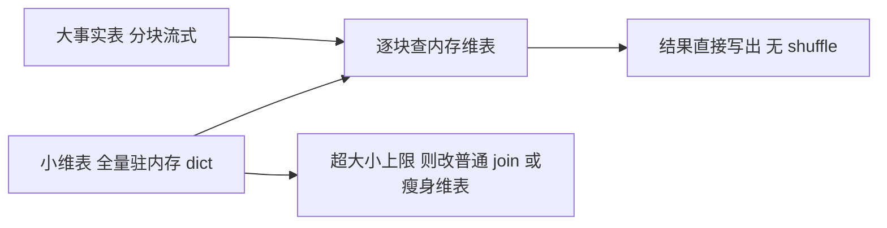

**追问**:
- 追问 1:维表多大算小?—— 经验值 100MB 到 1GB,取决于执行器内存,关键是能整体驻留且留有余量。
- 追问 2:Spark 里怎么确认真的广播了?—— broadcast 提示或依赖引擎自动广播,然后看物理计划里有没有 BroadcastHashJoin,别只看没报错。

### Q1996 · 幂等覆盖 vs 追加:写入模式选择器

> 难度:★★☆ | 标签:幂等写入, 数据管道

**问**:新表上线要定写入模式,append、overwrite、upsert 怎么选?选错会怎样?

**答**:写入模式选错,重跑不是数据翻倍就是历史被清空。三种模式:append 只追加,要配去重键;overwrite_partition 按分区覆盖,重跑即重写当天,天然幂等;upsert 按业务键更新。把决策规则化成选择器:不可重放的流水只能 append;可重放流水与聚合快照按分区覆盖;维表按业务键 upsert。实测五张示例表里,外部同步表没有匹配规则,选择器返回 manual 并拒绝自动选择——规则覆盖不到的表形态应该停下来转人工,而不是猜一个。规则表进代码评审,新表形态先补规则再上线;append 表必须配套去重键与迟到数据策略,否则幂等只完成一半。

```python
# file: code/05_数据分析与工程化/q1996_write_mode.py
"""写入模式选择器:按表形态与重放语义选 append overwrite 还是 upsert"""

RULES = [
    (lambda m: m["kind"] == "事件流水" and not m["replayable"],
     "append", "流水不可重放,只追加,重复靠去重键兜底"),
    (lambda m: m["kind"] == "事件流水" and m["replayable"],
     "overwrite_partition", "可重放流水按分区覆盖,重跑即重写当天"),
    (lambda m: m["kind"] == "聚合快照",
     "overwrite_partition", "聚合结果按分区覆盖,天然幂等"),
    (lambda m: m["kind"] == "维表",
     "upsert", "维表按业务键 upsert,保留最新属性"),
]


def decide(meta):
    for cond, mode, reason in RULES:
        if cond(meta):
            return mode, reason
    return "manual", "未匹配规则,禁止自动选择,转人工评审"


if __name__ == "__main__":
    cases = [
        {"kind": "事件流水", "replayable": False, "name": "埋点日志"},
        {"kind": "事件流水", "replayable": True, "name": "订单事实"},
        {"kind": "聚合快照", "replayable": True, "name": "渠道日聚合"},
        {"kind": "维表", "replayable": True, "name": "商品维表"},
        {"kind": "未知形态", "replayable": False, "name": "外部同步表"},
    ]
    for meta in cases:
        mode, reason = decide(meta)
        print(f"{meta['name']:<8} -> {mode:<20} {reason}")
    print("要点:写法选错,重跑不是翻倍就是丢历史;规则表进代码评审,新表形态先补规则再上线;append 表要配套去重键与迟到数据策略")
```

**追问**:
- 追问 1:overwrite 全表和 overwrite 分区的区别?—— 全表覆盖是核弹,误触发丢全部历史;只允许分区级覆盖,全表覆盖单独审批。
- 追问 2:upsert 的合并键怎么定?—— 业务唯一键而不是代理键;键选错(比如把会话 id 当用户键)会留下重复主体。

### Q1997 · 分区裁剪:概念模拟与扫描量对比

> 难度:★★★☆ | 标签:分区, 查询优化

**问**:分区表"省钱"的机制到底是什么?为什么有些带分区字段的查询还是很慢?

**答**:分区裁剪是分区表省钱的机制:查询条件带分区键时,引擎先在元数据层算出命中的分区,只扫这些分区,不命中的一行都不读。实测 6 个分区 76 万行,带两天分区条件后只扫 2 个分区 25.6 万行,扫描量降到 34%——裁剪发生在元数据层,不用读数据就省了钱。裁剪失效的两大现场:查询没带分区键(全扫);分区键被函数或表达式包裹(如 date_format(dt)),引擎无法与字面量比对。排查慢查询先看执行计划里读了几个分区,再看 SQL 写法。分区粒度也影响收益:按年裁剪太粗,按小时小文件爆炸,日分区是多数管道的平衡点。

```python
# file: code/05_数据分析与工程化/q1997_partition_prune.py
"""分区裁剪:带分区条件的查询只扫命中分区,模拟扫描量对比"""

PARTITIONS = {
    "dt=2026-10-30": 120_000, "dt=2026-10-31": 135_000,
    "dt=2026-11-01": 128_000, "dt=2026-11-02": 122_000,
    "dt=2026-11-03": 130_000, "dt=2026-11-04": 126_000,
}


def plan_scan(partitions, dt_filter=None):
    """dt_filter=None 全表扫描;给日期列表则只扫命中分区"""
    hit = {p: n for p, n in partitions.items()
           if dt_filter is None or any(p.endswith(d) for d in dt_filter)}
    return hit


if __name__ == "__main__":
    full = plan_scan(PARTITIONS)
    pruned = plan_scan(PARTITIONS, ["2026-11-03", "2026-11-04"])
    full_rows, pruned_rows = sum(full.values()), sum(pruned.values())
    print(f"全表扫描: {len(full)} 分区 {full_rows:,} 行")
    print(f"裁剪后:   {len(pruned)} 分区 {pruned_rows:,} 行  扫描量降至 {pruned_rows / full_rows:.0%}")
    for p in sorted(pruned):
        print(f"  命中 {p}: {pruned[p]:,} 行")
    print("要点:裁剪发生在元数据层,不读数据就省了钱;查询必须带分区键,分区键被函数包裹(如 date_format(dt))会让裁剪失效,这是慢查询排查第一现场")
```

**追问**:
- 追问 1:二级分区怎么裁剪?—— 先裁一级再裁二级,条件要同时覆盖两级键,只裁二级不裁一级等于没裁。
- 追问 2:动态分区插入为什么慢?—— 目标分区多时产生大量小文件,reduce 数与合并任务要按分区数配置。

### Q1998 · 管道重放:受影响下游闭包与重放顺序

> 难度:★★★★ | 标签:重放, 依赖管理

**问**:上游任务失败重跑后,下游几十个任务怎么办?全量重跑还是挑着跑?顺序怎么定?

**答**:下游不是全部重跑,而是"受影响的下游闭包"。步骤:在依赖 DAG 上从故障任务沿边正向 BFS 求闭包,实测 ods_orders 故障,闭包 5 个任务;对闭包子图做 Kahn 拓扑分层,同层可并行、层间串行,输出批次计划,实测分 4 批。重放期间冻结下游取数,全部批次完成后校验水位与行数再解冻。三个纪律:闭包外任务不动,避免重放扩大化;同层任务可并行,但写同一张表的要串行;重放计划生成器先 dry-run 输出确认再执行——这一步把事故恢复从"老师傅经验"变成"任何人可执行"。

```python
# file: code/05_数据分析与工程化/q1998_replay_plan.py
"""故障重放:从故障任务反查下游闭包,拓扑分层给出重放批次"""

DAG = {
    "ods_orders": ["dwd_orders"],
    "ods_users": ["dwd_users"],
    "dwd_orders": ["dws_shop_day", "ads_funnel"],
    "dwd_users": ["dws_shop_day"],
    "dws_shop_day": ["ads_gmv", "ads_funnel"],
    "ads_gmv": [],
    "ads_funnel": [],
}
FAILED = ["ods_orders"]


def downstream(dag, starts):
    """沿边正向 BFS,求故障任务的受影响下游闭包(含自身)"""
    seen, stack = set(), list(starts)
    while stack:
        node = stack.pop()
        if node in seen:
            continue
        seen.add(node)
        stack.extend(dag.get(node, []))
    return seen


def topo_batches(sub_dag):
    """Kahn 分层:同层任务可并行重放"""
    indeg = {n: 0 for n in sub_dag}
    for vs in sub_dag.values():
        for v in vs:
            indeg[v] += 1
    layer = sorted(n for n, d in indeg.items() if d == 0)
    batches = []
    while layer:
        batches.append(layer)
        nxt = []
        for u in layer:
            for v in sub_dag[u]:
                indeg[v] -= 1
                if indeg[v] == 0:
                    nxt.append(v)
        layer = sorted(nxt)
    return batches


if __name__ == "__main__":
    closure = downstream(DAG, FAILED)
    sub = {n: [v for v in DAG.get(n, []) if v in closure] for n in closure}
    print(f"故障: {FAILED} -> 受影响闭包 {len(closure)} 个任务: {sorted(closure)}")
    for i, batch in enumerate(topo_batches(sub), 1):
        print(f"  重放批次{i}(可并行): {batch}")
    print("要点:先求闭包再分层,同层并行、层间串行;重放期间冻结下游取数,全部完成后校验水位与行数再解冻;闭包外任务不动,避免重放扩大化")
```

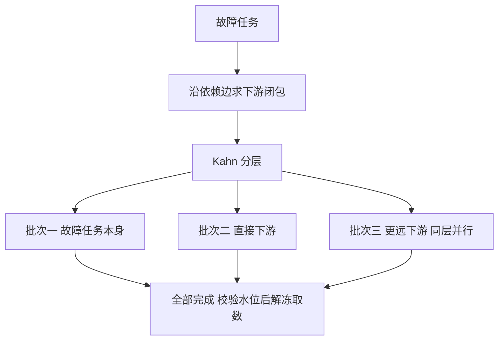

**追问**:
- 追问 1:闭包里有的任务重放后数据没变,白跑了怎么办?—— 幂等覆盖写让重复重放无害,优先保证正确性;要省算力可在重放前比对上游分区指纹。
- 追问 2:依赖是数据就绪而非任务依赖怎么办?—— 就绪检查也建模成依赖节点,重放计划里插入就绪等待步骤。

### Q1999 · 字段默认值治理:补默认与追溯审计

> 难度:★★☆ | 标签:数据治理, schema

**问**:上游加了新字段,下游写了一堆默认值兜底,时间久了没人说得清有多少数据被兜过,怎么治理?

**答**:散落的硬编码默认值是治理黑洞:没人知道多少行被兜底、为什么是这个值。规范是默认值进注册表,带默认值、生效版本、理由三件套;读取侧统一走 fill_defaults,每次补默认都返回审计记录;定期统计命中率,命中率升高等于上游字段劣化。实测 channel 默认命中率 50% 触发告警——兜底变常态就是掩盖故障,要推动上游修埋点而不是永久兜底。默认值取值也有讲究:"unknown" 比 0 或空串安全,聚合时能单独识别;能不给默认就不给,宁可让下游显式处理缺失。

```python
# file: code/05_数据分析与工程化/q1999_default_gov.py
"""字段默认值治理:注册表单点管理,使用默认必须留审计痕迹"""

DEFAULTS = {
    # 字段: (默认值, 生效自版本, 理由)
    "channel": ("unknown", "v1.2", "老版本埋点无渠道字段"),
    "device": ("unknown", "v1.0", "服务端日志无设备信息"),
}


def fill_defaults(record):
    filled, used = dict(record), []
    for field, (value, since, _why) in DEFAULTS.items():
        if field not in filled or filled[field] in (None, ""):
            filled[field] = value
            used.append((field, value, since))
    return filled, used


def audit(filled_rows):
    """统计默认值命中率:命中率升高=上游字段劣化"""
    n = len(filled_rows)
    if not n:
        return {}
    stats = {}
    for _, used in filled_rows:
        for field, _, _since in used:
            stats[field] = stats.get(field, 0) + 1
    return {f: c / n for f, c in stats.items()}


if __name__ == "__main__":
    batch = [
        {"uid": "u1", "channel": "push"},
        {"uid": "u2"},
        {"uid": "u3", "channel": None},
        {"uid": "u4", "channel": "search", "device": "ios"},
    ]
    filled_rows = []
    for r in batch:
        filled, used = fill_defaults(r)
        filled_rows.append((filled, used))
        if used:
            print(f"uid={r['uid']} 补默认: {used}")
    rates = audit(filled_rows)
    print("默认值命中率:", {k: f"{v:.0%}" for k, v in rates.items()})
    if rates.get("channel", 0) > 0.5:
        print("告警:channel 默认值命中过半,推动上游修埋点,而不是永久兜底")
    print("要点:默认值必须注册生效版本与理由,禁止散落硬编码;命中率是上游健康度信号,兜底变常态等于掩盖故障")
```

**追问**:
- 追问 1:默认值和 schema 校验什么关系?—— schema 校验在前,缺字段报错或进隔离区;默认值只给已评审的兼容场景,两者不能互相替代。
- 追问 2:历史数据要按新默认回填吗?—— 不自动回填,历史按当时口径冻结,需要时按生效版本分段解释。

### Q2000 · 数据冻结快照读:报表的时点一致性

> 难度:★★★☆ | 标签:快照, 一致性

**问**:上月汇报的 GMV 和这个月报表里同一天的数字对不上,数据被回刷了,怎么让"昨天的汇报"永远可复现?

**答**:对账和复盘读的必须是"当时那版数据"。结果表被回刷(11-01 的 GMV 从 1210 修正到 1301)后,拿最新表复盘会得到和当时汇报不一样的数字,信任就从这里流失。冻结快照读:每次发布把结果表按版本固化,查询带 as_of 参数,取版本日不晚于 as_of 的最新版本。实测 as_of=11-02 读 11-01 得 1235,as_of=11-03 读同一分区得 1301——两个都是正确答案,取决于站在哪天看。当期看板读最新版,复盘与对账读 as_of 版,两者要能互相切换;快照按报表等级定保留期;无版本化的回刷会让对账永远扯皮。

```python
# file: code/05_数据分析与工程化/q2000_snapshot_read.py
"""数据冻结快照读:报表按 as_of 读当时版本,回刷不影响已发布数字"""

SNAPSHOTS = {
    "dws_gmv_day": [
        # (快照版本日, 该版本下的数据)
        ("2026-11-01", {"11-01": 1210, "10-31": 980}),
        ("2026-11-02", {"11-01": 1235, "11-02": 1102, "10-31": 980}),
        # 11-03 版本里 11-01 被回刷修正
        ("2026-11-03", {"11-01": 1301, "11-02": 1140, "11-03": 1188, "10-31": 995}),
    ],
}


def read_as_of(table, as_of, dt):
    versions = [v for v in SNAPSHOTS[table] if v[0] <= as_of]
    if not versions:
        raise KeyError(f"{table} 在 {as_of} 之前无快照")
    version_day, data = versions[-1]
    return data.get(dt), version_day


if __name__ == "__main__":
    for as_of in ("2026-11-02", "2026-11-03"):
        val, snap = read_as_of("dws_gmv_day", as_of, "11-01")
        print(f"as_of={as_of} 读 11-01 GMV = {val}(来自快照 {snap})")
    try:
        read_as_of("dws_gmv_day", "2026-10-31", "11-01")
    except KeyError as e:
        print("故意越界读:", e)
    print("要点:对账与复盘必须走 as_of 快照读,当期看板读最新版,两者要能互相切换;快照按报表等级定保留期;没有版本化,回刷会让昨天的汇报永远对不上")
```

**追问**:
- 追问 1:和 SCD2 什么关系?—— 同一思想:维度表按生效区间存历史,快照读是结果表版的"按时间取版本"。
- 追问 2:快照读 API 怎么设计?—— as_of 必填或显式默认"最新",返回值带 version 字段,让调用方无法假装不知道版本。

### Q2001 · 下游影响查询器:字段级血缘分级反查

> 难度:★★★☆ | 标签:血缘, 影响分析

**问**:要改 ods_orders.user_id 的加工逻辑,上线前怎么回答"下游都有谁在用、分别要做什么"?

**答**:字段级血缘存成有向边(源字段到目标字段加引用类型),查询器从变更字段出发 BFS 反查下游,输出每层节点与引用类型:直接引用(读字段本身)必须适配,聚合引用(count distinct user_id)需要回归验证。实测 ods_orders.user_id 的链路:ads_retention 与 ads_dash.dau_card 是两层直接引用,dws_user_day.distinct_users 是一层聚合引用,分级行动清单直接可执行。血缘必须在任务上线时自动登记(SQL 解析或显式声明),人肉补的血缘一定过期;输出影响面时带"血缘覆盖范围"声明,未登记的下游不等于不存在,这是血缘工具的诚实性要求。

```python
# file: code/05_数据分析与工程化/q2001_lineage_query.py
"""下游影响查询器:字段级血缘反查,按引用类型分级处置"""

EDGES = [
    ("ods_orders.user_id", "dwd_orders.user_id", "直接引用"),
    ("dwd_orders.user_id", "dws_user_day.user_id", "直接引用"),
    ("dwd_orders.user_id", "dws_user_day.distinct_users", "聚合引用"),
    ("dws_user_day.user_id", "ads_retention.user_col", "直接引用"),
    ("dws_user_day.distinct_users", "ads_dash.dau_card", "直接引用"),
    ("ods_orders.amount", "dwd_orders.pay_amount", "直接引用"),
]


def impact(source, edges):
    """BFS 反查下游,输出每节点的深度与入边引用类型"""
    adj = {}
    for src, dst, kind in edges:
        adj.setdefault(src, []).append((dst, kind))
    out, queue, seen = [], [(source, 0, "")], {source}
    while queue:
        node, depth, incoming = queue.pop(0)
        if node != source:
            out.append((node, incoming, depth))
        for dst, kind in adj.get(node, []):
            if dst not in seen:
                seen.add(dst)
                queue.append((dst, depth + 1, kind))
    return out


if __name__ == "__main__":
    print("变更 ods_orders.user_id 的影响面:")
    for node, kind, depth in impact("ods_orders.user_id", EDGES):
        grade = "必须适配" if kind == "直接引用" else "需回归验证"
        print(f"  {'  ' * (depth - 1)}<- {node} [{kind}] {grade}")
    print("要点:字段级血缘在任务上线时自动登记,别靠人肉补;直接引用要改代码,聚合引用要重算验证;血缘覆盖不全时,影响面结论必须带'可能遗漏'声明")
```

**追问**:
- 追问 1:表级血缘和字段级血缘怎么共存?—— 表级做粗筛快,字段级做精确影响面;查询器先表级圈表、字段级细分。
- 追问 2:血缘图出现环怎么办?—— BFS 天然防环,但登记时发现环要直接拒绝,依赖成环说明设计有问题。

### Q2002 · 时点对齐 join:事实与维度的快照匹配

> 难度:★★★★ | 标签:SCD, join

**问**:事实表关联用户等级维表,用户中途升级了,历史订单的等级应该算哪个?直接 join 最新版会怎样?

**答**:必须按事件发生时刻取"当时"的维表版本,直接取最新版就是数据穿越:实测 u1 六月升级黄金,四月的订单会被错标成黄金,历史等级分布被回写,所有基于等级的分析失真。标准实现是维表拉链化:每个键保存生效区间的属性列表,join 时按事件时间二分定位生效区间。三个注意:区间闭开约定全库统一,避免边界双匹配或漏匹配;事件时间早于维表建键时间的给 unknown 并计数,别硬塞第一个版本;维表被回修时要重建区间并重算受影响事实,配合快照读使用。merge_asof 是"最近一次状态"的就近匹配,与"生效区间"语义不同,不要混用。

```python
# file: code/05_数据分析与工程化/q2002_point_in_time_join.py
"""时点对齐 join:事实按发生时刻匹配维表当时版本,防数据穿越"""

from bisect import bisect_right

# 用户等级维表拉链: key -> [(生效起, 失效止, 等级)]
DIM_LEVEL = {
    "u1": [("2026-01-01", "2026-05-31", "白银"),
           ("2026-06-01", "9999-12-31", "黄金")],
    "u2": [("2026-01-01", "9999-12-31", "白银")],
}
FACTS = [
    ("o1", "u1", "2026-04-10", 200),
    ("o2", "u1", "2026-06-05", 300),
    ("o3", "u2", "2026-03-01", 88),
    ("o4", "u1", "2026-07-01", 120),
]


def pit_join(fact, segments):
    """按事件时间二分定位生效区间,返回当时的维度值"""
    starts = [s[0] for s in segments]
    i = bisect_right(starts, fact[2]) - 1
    if i < 0:
        return None
    start, end, level = segments[i]
    return level if start <= fact[2] <= end else None


if __name__ == "__main__":
    for oid, uid, dt, amt in FACTS:
        pit = pit_join((oid, uid, dt, amt), DIM_LEVEL[uid])
        latest = DIM_LEVEL[uid][-1][2]
        flag = "" if pit == latest else "  <- 直接用最新版会错标"
        print(f"{oid} {uid} 下单于 {dt}: 时点等级 {pit}{flag}")
    print("要点:事实关联缓变维必须按事件时间取当时版本,直接取最新版是数据穿越,历史报表会被回写;拉链表加生效区间二分是标准解")
```

**追问**:
- 追问 1:事实量很大时性能怎么办?—— 事实按键预排序后归并匹配,或对热点键做每日时点快照物化。
- 追问 2:维表没有历史怎么办?—— 先声明"无法时点对齐"并标注口径限制,从现在开始补拉链,别假装对齐。

### Q2003 · 管道参数化:一份模板多渠道复用

> 难度:★★★☆ | 标签:参数化, 模板

**问**:三十个渠道的日聚合管道,复制三十份 SQL 的团队后来怎么样了?正确做法是什么?

**答**:复制粘贴的管道改一处漏二十九处。正确做法是模板化:一份定义带 channel、dt 等占位符,渲染时注入参数;必填参数缺失要一次性列全并显式报错,实测缺 owner 被拒绝;默认值只给低危项如重试次数。实测三渠道各渲染出独立任务配置,SQL、分区、负责人齐全。两个纪律:渲染产物要能 dump 留档,排查"线上到底跑了什么"时直接看渲染结果而不是猜;参数不允许静默替换成空字符串——渲染出 WHERE channel='' 的任务比报错危险得多。模板本身版本化,改模板等于改所有实例,要走评审。

```python
# file: code/05_数据分析与工程化/q2003_pipeline_template.py
"""管道参数化:一份模板渲染多渠道任务,必填校验与默认值合并"""

TEMPLATE = {
    "task": "agg_channel_{channel}",
    "sql": ("SELECT channel, SUM(amount) FROM dwd_orders "
            "WHERE dt = '{dt}' AND channel = '{channel}' GROUP BY channel"),
    "partition": "{dt}",
}
REQUIRED = ["channel", "dt", "owner"]
DEFAULTS = {"retries": 2, "priority": "normal"}


def render(template, params):
    missing = [k for k in REQUIRED if not params.get(k)]
    if missing:
        raise ValueError(f"缺少必填参数: {missing},拒绝渲染")
    merged = dict(DEFAULTS)
    merged.update(params)
    out = {}
    for k, v in template.items():
        s = str(v)
        for pk, pv in merged.items():
            s = s.replace("{" + pk + "}", str(pv))
        out[k] = s
    for k, v in merged.items():
        out.setdefault(k, v)
    return out


if __name__ == "__main__":
    for ch in ("search", "feed", "crm"):
        cfg = render(TEMPLATE, {"channel": ch, "dt": "2026-11-04",
                                "owner": "ops@" + ch})
        print(f"{cfg['task']} | {cfg['sql'][:58]}... | retries={cfg['retries']}")
    try:
        render(TEMPLATE, {"channel": "search", "dt": "2026-11-04"})
    except ValueError as e:
        print("故意缺参:", e)
    print("要点:N 个渠道共用一份模板,改动只发生在一处;必填缺失要一次性列全并显式报错,不许渲染出空字符串任务;渲染产物要能 dump 留档")
```

**追问**:
- 追问 1:参数化和 SQL 注入的关系?—— 参数值也要白名单校验(渠道名只允许注册过的),占位符替换在配置层做,不允许用户输入直接进 SQL 字符串。
- 追问 2:什么时候该拆模板?—— 实例间开始出现 if-else 分支差异时拆成两个模板,别让模板长成配置语言。

### Q2004 · 上游延迟降级读:新鲜度兜底选分区

> 难度:★★★★ | 标签:降级, 数据新鲜度

**问**:今天的数据分区迟到了,下游接口是等、报错,还是读昨天的数据?怎么把"读旧数据"做得体面?

**答**:规范做法是降级读:目标分区未就绪则按天回退,在最大回退天数(实测设 2 天)内找就绪分区,命中后响应必须打标——实测打 data_date=2026-11-03,前端展示"数据截至昨日";超出回退范围就明确报错,绝不静默给更旧的数据。三个纪律:回退天数是 SLA 的一部分,与上游新鲜度预算联动,不是代码里随手写的数字;打标信息要让下游无法忽略,响应头加字段级标注;降级事件本身要计数上报,长期频繁降级说明上游该修了。这比"一律报错"业务友好,比"永远给最新可用"诚实。注意财务对账、结算类场景禁止降级读,宁可不可用不能给错数。

```python
# file: code/05_数据分析与工程化/q2004_stale_fallback.py
"""上游延迟降级读:目标分区未就绪时回退旧分区并标注新鲜度"""

from datetime import date, timedelta

READY = {
    "2026-11-04": False,   # 今日分区上游迟到
    "2026-11-03": True,
    "2026-11-02": True,
    "2026-11-01": True,
}
ROWCOUNTS = {"2026-11-03": 122_000, "2026-11-02": 118_000, "2026-11-01": 90_000}
STALE_LIMIT = 2   # 最多回退 2 天,这是 SLA 的一部分


def choose_partition(target, ready, limit):
    d = date.fromisoformat(target)
    for back in range(limit + 1):
        cand = (d - timedelta(days=back)).isoformat()
        if ready.get(cand):
            return cand, back
    return None, limit + 1


if __name__ == "__main__":
    part, back = choose_partition("2026-11-04", READY, STALE_LIMIT)
    if part is None:
        print("降级失败:回退范围内无就绪分区,接口应报错而不是给空结果")
    else:
        tag = "最新" if back == 0 else f"降级 T-{back}"
        print(f"请求 2026-11-04 -> 实际读 {part} [{tag}],行数 {ROWCOUNTS.get(part, 0):,}")
        if back:
            print(f"响应打标 data_date={part},前端展示'数据截至 {part}'")
    print("要点:降级读必须有显式标注与最大回退天数;宁可报错也不静默给更旧的数据;回退天数与上游 SLA 联动,不是拍脑袋")
```

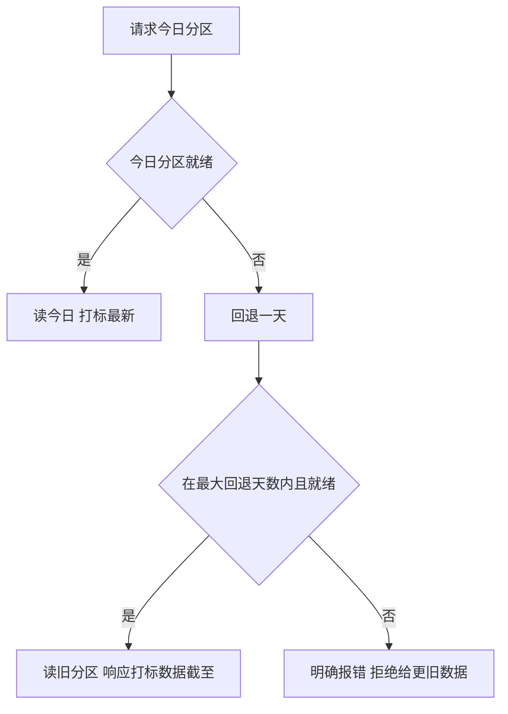

**追问**:
- 追问 1:什么场景禁止降级读?—— 财务对账与结算,宁可不可用不能给错数;降级只用于展示类读。
- 追问 2:分区就绪状态怎么维护?—— 上游发布完成后写就绪标记(带行数与校验和),读侧只信标记,不做猜测式探测。

### Q2005 · 结果原子发布:临时目录与 rename 提交

> 难度:★★★☆ | 标签:原子写, 数据发布

**问**:结果表写到一半被读者读到半成品怎么办?"先写后改名"为什么能解决问题?

**答**:结果分区最怕读者看到半成品:缺一部分文件的目录、写到一半的表。原子发布三步:先写临时目录(target.tmp),跑完做行数与校验和校验,校验通过后 rename 提交——同文件系统内 rename 是原子操作,读方要么看不到目录、要么看到完整目录。实测首次发布与二次覆盖都干净完成;二次覆盖的细节是旧目录先 rename 成 .bak 再换入,失败可回退。校验必须发生在 rename 之前,失败只留 tmp,正式路径永不污染,tmp 由下次发布或清理任务回收。文件系统不支持原子 rename(对象存储)时,用版本目录加指针文件模拟,指针文件自身单文件原子覆盖。

```python
# file: code/05_数据分析与工程化/q2005_atomic_publish.py
"""结果原子发布:先写临时目录,校验通过后 rename 提交,失败不留半成品"""

import json
import os
import shutil
import tempfile

BASE = tempfile.mkdtemp(prefix="pub_demo_")


def build_output(workdir):
    rows = [{"dt": "2026-11-04", "channel": "search", "gmv": 1200},
            {"dt": "2026-11-04", "channel": "feed", "gmv": 860}]
    os.makedirs(workdir, exist_ok=True)
    with open(os.path.join(workdir, "part-000.json"), "w") as f:
        for r in rows:
            f.write(json.dumps(r) + "\n")
    return rows


def validate(workdir, expect_rows):
    files = [f for f in os.listdir(workdir) if f.endswith(".json")]
    n = sum(sum(1 for _ in open(os.path.join(workdir, f))) for f in files)
    if n != expect_rows:
        raise ValueError(f"行数校验失败: {n} != {expect_rows}")
    return True


def publish(target):
    tmp = target + ".tmp"
    if os.path.exists(tmp):
        shutil.rmtree(tmp)
    rows = build_output(tmp)
    validate(tmp, len(rows))            # 校验不过就抛异常,正式路径不受影响
    backup = target + ".bak"
    if os.path.exists(target):
        os.rename(target, backup)       # 旧版挪走,再原子换入
        os.rename(tmp, target)
        shutil.rmtree(backup)
    else:
        os.rename(tmp, target)
    return len(rows)


if __name__ == "__main__":
    target = os.path.join(BASE, "dws_channel_day", "dt=2026-11-04")
    print("首次发布:", publish(target), "行 ->", sorted(os.listdir(target)))
    print("二次覆盖:", publish(target), "行 ->", sorted(os.listdir(target)))
    shutil.rmtree(BASE)
    print("要点:同分区 rename 是原子的,读方永远只看到完整目录;校验放在 rename 之前;失败只留 tmp 目录,由下次发布或清理任务回收")
```

**追问**:
- 追问 1:多任务写同一分区怎么互斥?—— 发布前抢目录级锁(文件锁或租约),与调度防重入同一套机制。
- 追问 2:读者在 rename 瞬间正在读怎么办?—— rename 只改目录项,已打开的句柄继续读旧 inode,POSIX 语义天然安全;对象存储靠版本化读。

### Q2006 · 任务心跳:进度上报与僵尸识别

> 难度:★★☆ | 标签:心跳, 任务监控

**问**:有个任务跑了六个小时还没完,怎么区分"它该跑这么久"和"它其实已经死了"?

**答**:跑着但没进展的任务(僵尸)比立刻失败的任务更危险:占着资源,看起来还活着。心跳机制:任务运行中周期性写心跳文件(时间戳加进度),监控端按心跳年龄判断,超过阈值判僵尸。实测 etl_orders 心跳 10 秒前、进度 42% 判存活;etl_users 心跳 10 分钟没更新、卡在 98% 判僵尸——98% 卡死是最常见的僵尸形态,死在收尾阶段。处理顺序:先确认进程状态,僵尸先 kill 再重放,直接重放会制造双跑。心跳间隔取任务预期时长的十分之一,写心跳要原子覆盖;心跳和日志分工明确——心跳回答"还活着吗",日志回答"发生了什么"。

```python
# file: code/05_数据分析与工程化/q2006_task_heartbeat.py
"""任务心跳:运行中周期上报进度,监控端按心跳年龄识别僵尸任务"""

import json
import os
import tempfile
import time

HEARTBEAT_DIR = tempfile.mkdtemp(prefix="hb_demo_")
STALE_AFTER = 60   # 心跳超过 60 秒未更新视为僵尸


def beat(task, done, total, now):
    path = os.path.join(HEARTBEAT_DIR, task + ".json")
    with open(path, "w") as f:
        json.dump({"done": done, "total": total, "ts": now}, f)


def check(task, now):
    path = os.path.join(HEARTBEAT_DIR, task + ".json")
    if not os.path.exists(path):
        return "无心跳,任务可能没启动", None
    with open(path) as f:
        hb = json.load(f)
    age = now - hb["ts"]
    progress = hb["done"] / hb["total"] if hb["total"] else 1.0
    if age > STALE_AFTER:
        return f"僵尸: 心跳 {age:.0f}s 未更新, 卡在进度 {progress:.0%}", progress
    return f"存活: 进度 {progress:.0%}", progress


if __name__ == "__main__":
    beat("etl_orders", 4200, 10000, now=time.time() - 10)
    beat("etl_users", 9800, 10000, now=time.time() - 600)   # 10 分钟没有心跳
    for t in ("etl_orders", "etl_users"):
        state, _ = check(t, now=time.time())
        print(f"{t}: {state}")
    print("要点:心跳文件写时间戳加进度并原子覆盖;心跳停了但进程还在 = 僵尸,先杀再重放;心跳间隔取任务时长的十分之一,太密伤 IO")
```

**追问**:
- 追问 1:心跳由任务自己写可信吗?—— 任务库函数统一注入写心跳,监控端交叉验证进程存在性与 CPU 时间,防假心跳。
- 追问 2:分布式任务的进度怎么聚合?—— 各分片写各自心跳,聚合端取最新时间戳汇总进度,分片级僵尸单独报警。

### Q2007 · 业务日切:数据分区归属与跨时区边界

> 难度:★★★★ | 标签:日切, 时区

**问**:数据分区按 UTC 日期切还是按业务日切?凌晨的订单该算哪天?这个定义错了会怎样?

**答**:分区归属不等于 UTC 日期,业务日由业务时区决定:东八区业务日按北京时间 0 点切,对应 UTC 16 点,实测 UTC 15:59 属当日、16:01 已属次日。日切错了,所有日报的分子分母都在错误的桶里,而且是系统性错一天,很难从数字本身发现。规范:业务日定义(时区加切点)写进口径字典,全公司唯一;分区写入统一走 business_day 函数,禁止各管道自己转换;跨时区业务按主市场定一套业务日,其他时区映射过去。改日切定义等于重写全部历史分区,成本极高,上线前必须评审到位。

```python
# file: code/05_数据分析与工程化/q2007_business_day.py
"""业务日切:UTC 时间戳按东八区 0 点切业务日,决定分区归属"""

from datetime import datetime, timedelta, timezone

CST = timezone(timedelta(hours=8))
CASES = [
    "2026-11-04T15:59:00+00:00",   # 北京 23:59,业务日 11-04
    "2026-11-04T16:01:00+00:00",   # 北京 00:01,业务日 11-05
    "2026-11-04T07:00:00+00:00",   # 北京 15:00,业务日 11-04
    "2026-11-04T18:30:00+00:00",   # 北京 02:30,已属次日
]


def business_day(ts_str):
    ts = datetime.fromisoformat(ts_str).astimezone(CST)
    return ts.date(), ts.strftime("%H:%M")


if __name__ == "__main__":
    for s in CASES:
        d, hm = business_day(s)
        print(f"UTC {s}  北京 {hm} -> 业务日 {d}  分区 dt={d}")
    print("要点:分区按业务日切而不是 UTC 日,日切边界由业务定并写入口径字典;改动日切定义等于重写全部分区,必须评审;跨时区业务要一司一套业务日,禁止各管道自定义")
```

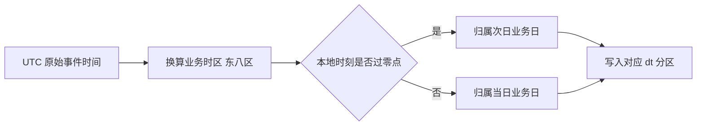

**追问**:
- 追问 1:为什么不用各地当地时间各自切?—— 多时区各自切会让"同一天"口径分裂,跨区对账无法进行;统一业务日牺牲局部精确换全局可比。
- 追问 2:业务说"凌晨 6 点前算前一天"怎么办?—— 显式改切点为北京时间 6 点并做并行桥接,不要在代码里散落 if hour 判断。

### Q2008 · 配置漂移检测:多实例配置 diff

> 难度:★★★☆ | 标签:配置管理, 漂移检测

**问**:线上十几台实例,怎么保证它们的配置和基准一致?"有人上机改过"这种事怎么发现?

**答**:实例多了配置必然漂:有人 SSH 上去改参数忘了同步、发布部分失败、灰度实例参数不同。漂移检测三步:基准配置入库版本化;定时拉取各实例实际配置;逐键 diff 分三类(缺失/多余/不同),敏感键(db_host、auth_url)单独分级,漂移立即告警。实测 node-2 有三项漂移且 db_host 指向 staging,是"实例连错环境"的典型事故,普通 diff 只会说三个键不一样,敏感键分级才能定级响应。修复方向是回归基准而不是把漂移固化成新基准——"大家都这么配"式改基准会掩埋变更语义。检测要覆盖配置加载后的最终值,环境变量注入的漂移只有运行时才暴露。

```python
# file: code/05_数据分析与工程化/q2008_config_drift.py
"""配置漂移检测:各实例配置对基准逐键 diff,敏感键单独分级"""

BASELINE = {
    "log_level": "INFO", "timeout": 30, "max_conn": 100,
    "feature_dark_mode": "on", "db_host": "db.internal",
}
SENSITIVE = {"db_host", "auth_url"}   # 这些键漂移必须立即告警
INSTANCES = {
    "node-1": {"log_level": "INFO", "timeout": 30, "max_conn": 100,
               "feature_dark_mode": "on", "db_host": "db.internal"},
    "node-2": {"log_level": "DEBUG", "timeout": 30, "max_conn": 80,
               "feature_dark_mode": "on", "db_host": "db-staging.internal",
               "legacy_flag": "on"},
    "node-3": {"log_level": "INFO", "timeout": 60, "max_conn": 100,
               "feature_dark_mode": "off", "db_host": "db.internal"},
}


def diff(baseline, actual):
    keys = set(baseline) | set(actual)
    out = {}
    for k in sorted(keys):
        if k not in actual:
            out[k] = ("缺失", baseline[k])
        elif k not in baseline:
            out[k] = ("多余", actual[k])
        elif baseline[k] != actual[k]:
            out[k] = ("不同", f"{baseline[k]} -> {actual[k]}")
    return out


if __name__ == "__main__":
    for node, cfg in INSTANCES.items():
        d = diff(BASELINE, cfg)
        if not d:
            print(f"{node}: 一致")
            continue
        critical = [k for k in d if k in SENSITIVE]
        suffix = f"  <敏感键漂移 {critical},立即处理>" if critical else ""
        print(f"{node}: 漂移 {len(d)} 项 {d}{suffix}")
    print("要点:基准配置入库版本化,实例配置定时拉回 diff;缺失/多余/不同三类分开报;漂移修复是回归基准,而不是把漂移固化成新基准")
```

**追问**:
- 追问 1:合法的实例差异(如分片数不同)怎么办?—— 基准支持按实例组的覆盖层,diff 对着"该实例应有的基准"做,而不是全局单一基准。
- 追问 2:多久检测一次?—— 配置变更后即时检测加每日全量兜底,漂移的破坏力随时间放大。

### Q2009 · 脚本入口统一 argparse 模板:公共参数与子命令

> 难度:★★☆ | 标签:argparse, CLI

**问**:组里十几个运维脚本各有各的参数风格,你怎么把它们统一起来?

**答**:统一入口模板一次投入长期受益:公共参数(--dry-run、--log-level、--config)在公共 parser 定义一次,经 parents 注入每个子命令,新增子命令自动继承;业务参数挂在子命令上。实测 datatool 的 export 与 backfill 共享同一套公共参数。--dry-run 是破坏性操作的标配,先打印将执行的动作;--log-level 统一三档;--config 让环境切换不靠改代码。顺手统一退出码约定:0 成功、2 用法错误、1 业务失败,让 cron 和 CI 能按退出码分支。新脚本从模板复制起步,评审时加参数风格一致性检查——一致性比"哪种风格更好"重要。

```python
# file: code/05_数据分析与工程化/q2009_cli_template.py
"""脚本入口统一模板:公共参数一次定义,经 parents 注入所有子命令"""

import argparse


def common_args():
    """公共参数只在这里定义一次,新子命令 parents 接上即可继承"""
    c = argparse.ArgumentParser(add_help=False)
    c.add_argument("--dry-run", action="store_true", help="只打印不执行")
    c.add_argument("--log-level", default="INFO",
                   choices=["DEBUG", "INFO", "WARNING"])
    c.add_argument("--config", default="prod", help="环境配置名")
    return c


def build_parser():
    common = common_args()
    p = argparse.ArgumentParser(prog="datatool",
                                description="统一脚本入口模板,公共参数放子命令之后")
    sub = p.add_subparsers(dest="cmd", required=True)

    p_export = sub.add_parser("export", parents=[common], help="导出报表")
    p_export.add_argument("--date", required=True)
    p_export.add_argument("--fmt", default="csv", choices=["csv", "xlsx"])

    p_backfill = sub.add_parser("backfill", parents=[common],
                                help="回填历史分区")
    p_backfill.add_argument("--start", required=True)
    p_backfill.add_argument("--end", required=True)
    return p


def run(args):
    if args.cmd == "export":
        print(f"export date={args.date} fmt={args.fmt}")
    else:
        print(f"backfill {args.start} -> {args.end}")
    print(f"config={args.config} log_level={args.log_level}")
    if args.dry_run:
        print("dry-run: 以上动作未真正执行")


if __name__ == "__main__":
    parser = build_parser()
    for argv in (["export", "--date", "2026-11-04", "--fmt", "xlsx",
                  "--dry-run", "--log-level", "DEBUG"],
                 ["backfill", "--start", "2026-11-01", "--end", "2026-11-03"]):
        print("$ datatool", " ".join(argv))
        run(parser.parse_args(argv))
        print()
    print("要点:--dry-run/--log-level/--config 只定义一次,经 parents 注入每个子命令,新脚本先抄模板;子命令让一个入口长成工具箱,而不是复制十个各写各的脚本")
```

**追问**:
- 追问 1:为什么不用 click 或 typer?—— 模板思想不变;argparse 标准库零依赖,内部小工具优先,对外发布再换现代框架。
- 追问 2:公共参数放子命令前还是后?—— 模板里放子命令后随子命令注入,usage 写清楚;全组一致比哪种更好更重要。

### Q2010 · 长任务的细粒度 checkpoint:批级状态与恢复验证

> 难度:★★★☆ | 标签:checkpoint, 容错

**问**:一个跑八小时的任务,checkpoint 多久存一次?存什么?怎么证明恢复后是对的?

**答**:checkpoint 粒度是恢复成本与落盘开销的折中:按条太贵,按整个任务太脆,工程折中是批级:每处理 N 条把 offset 加已算结果原子写一次(先 tmp 后 os.replace)。实测 12 条任务批大小 3,第 7 条模拟崩溃,恢复从 offset=6 续跑,最终结果与一次性跑完完全一致——恢复等价性要写进代码自动对账,不靠肉眼。三个细节:checkpoint 状态要小,大中间产物放外部存储、只存引用;崩溃发生在批中间时,已处理未落盘的部分会被重算,所以处理逻辑必须幂等;恢复后的第一批打日志标记"从 checkpoint 恢复",方便统计实际损失。批大小按"重算五分钟的成本"与"落盘一次的开销"权衡。

```python
# file: code/05_数据分析与工程化/q2010_fine_ckpt.py
"""细粒度 checkpoint:批级状态原子落盘,崩溃恢复后结果与一次跑完一致"""

import json
import os
import tempfile

CKPT = os.path.join(tempfile.mkdtemp(prefix="ckpt_demo_"), "state.json")
RECORDS = [f"r{i}" for i in range(1, 13)]
BATCH = 3


def load_state():
    if os.path.exists(CKPT):
        with open(CKPT) as f:
            return json.load(f)
    return {"offset": 0, "results": []}


def save_state(state):
    tmp = CKPT + ".tmp"                 # 原子写: 先 tmp 后 replace
    with open(tmp, "w") as f:
        json.dump(state, f)
    os.replace(tmp, CKPT)


def process(rec):
    return rec.upper()


def run(records, crash_after=None):
    state = load_state()
    done = 0
    for i in range(state["offset"], len(records)):
        state["results"].append(process(records[i]))
        done += 1
        if crash_after is not None and state["offset"] + done >= crash_after:
            raise RuntimeError(f"模拟崩溃于第 {state['offset'] + done} 条")
        if done % BATCH == 0:
            state["offset"] += done
            done = 0
            save_state(state)
    state["offset"] = len(records)
    save_state(state)
    return state["results"]


if __name__ == "__main__":
    try:
        run(RECORDS, crash_after=7)
    except RuntimeError as e:
        print("第一次运行:", e)
    partial = load_state()
    print(f"崩溃后 checkpoint: offset={partial['offset']}, 已落盘 {partial['results']}")
    results = run(RECORDS)
    print("恢复续跑最终结果:", results)
    once = [process(r) for r in RECORDS]
    verdict = "完全一致,不重不漏" if results == once else "不一致,有 bug"
    print("与一次性跑完对比:", verdict)
    print("要点:粒度取批,批大小是恢复成本与落盘开销的折中;状态原子写;恢复正确性用'与一次跑完对账'自动验证,别靠肉眼")
```

**追问**:
- 追问 1:和分片游标式断点续跑的区别?—— 分片游标恢复到片、实现简单;批级 checkpoint 恢复到批、粒度细但要管状态体积,按任务时长与单条成本选。
- 追问 2:checkpoint 文件写坏了怎么办?—— 原子写避免半写,再加版本号与校验和,坏档回退上一版或从头重跑并告警。

### Q2011 · 依赖库许可证检查:deny/allow 清单门禁

> 难度:★★★☆ | 标签:许可证, 合规

**问**:为什么引入一个 GPL 的库可能有法律风险?工程上怎么系统性把关?

**答**:GPL 类许可证有传染性,链接了它的代码可能被要求整体开源,服务商用会承担合规义务,所以许可证检查要进 CI 而不是靠记忆。实现四件套:license 数据库(随锁文件更新)、deny 清单(GPL 与 AGPL 系列)、allow 清单(MIT/Apache/BSD/LGPL)、unknown 处理——许可证未知要人工复核后登记,不是放行。实测六个依赖里 gpl-tool 被 blocked 拒绝合并,mystery-pkg 被标记 unknown。两个延伸:传染性判断与链接方式有关(动态链接、进程隔离义务不同),法律结论交给法务,工程侧把 deny 清单当硬门禁;内部二进制依赖和 SaaS 调用也要人工登记进同一张表。

```python
# file: code/05_数据分析与工程化/q2011_license_check.py
"""依赖许可证检查:deny/allow 清单加 unknown 人工复核"""

from fnmatch import fnmatch

LICENSE_DB = {
    "requests": "Apache-2.0", "numpy": "BSD-3-Clause",
    "pandas": "BSD-3-Clause", "gpl-tool": "GPL-3.0-only",
    "lgpl-binding": "LGPL-2.1", "mystery-pkg": None,
}
DEPS = ["requests", "numpy", "pandas", "gpl-tool", "lgpl-binding", "mystery-pkg"]
DENY = ["GPL-*", "AGPL-*"]
ALLOW = ["MIT", "Apache-*", "BSD-*", "LGPL-*"]


def check(dep):
    lic = LICENSE_DB.get(dep)
    if lic is None:
        return "unknown", "许可证未知,人工复核后登记"
    if any(fnmatch(lic, p) for p in DENY):
        return "blocked", f"{lic} 具传染性,禁止引入"
    if any(fnmatch(lic, p) for p in ALLOW):
        return "ok", lic
    return "review", f"{lic} 不在白名单,评审后决定"


if __name__ == "__main__":
    counts = {"ok": 0, "review": 0, "blocked": 0, "unknown": 0}
    for dep in DEPS:
        state, msg = check(dep)
        counts[state] += 1
        print(f"{dep:<14} {state:<8} {msg}")
    print(f"汇总: {counts}")
    if counts["blocked"]:
        print("门禁: 存在 blocked 依赖,合并被拒绝,先找替代品")
    print("要点:许可证检查放进 CI,license 数据库随锁文件一起更新;unknown 不是 ok,积压 unknown 等于失去合规视野;传染性许可看链接方式,法律问题交给法务兜底")
```

**追问**:
- 追问 1:为什么 unknown 不能放行?—— 放行一个 unknown 清单就永远不再全绿,合规视野从此失真;unknown 必须显式人工关闭。
- 追问 2:依赖没升级但上游改了许可证怎么发现?—— 锁文件升级时重跑检查,加定期全量重扫,上游改许可证的事件真实发生过。

### Q2012 · 日志采样与分级丢弃:高压丢弃与丢弃审计

> 难度:★★★☆ | 标签:日志, 采样

**问**:大促期间日志量是平时二十倍,把采集链路压垮了,怎么在丢日志和保系统之间做取舍?

**答**:分级采样是标准解:DEBUG 每 10 条放 1 条、INFO 每 2 条放 1 条、WARNING 以上永不丢。实现上挂 logging.Filter 在 handler,采样用确定性计数(每 N 条的第 1 条放行)而不是随机,同一输入可复现、排查可对照。实测 30 轮日志:DEBUG 只出 3 条、INFO 丢 15 条、WARN 与 ERROR 全保留。丢弃计数必须可观测:过滤器累计 passed 与 dropped,周期性输出丢弃审计,高峰期丢了多少日志要说得清——不可见的丢弃等于静默吞证据。级别选择是另一维度:该打 INFO 的别打 DEBUG,采样只救量救不了乱打;审计日志、安全日志、交易日志设为不可采样白名单。

```python
# file: code/05_数据分析与工程化/q2012_log_sample.py
"""日志分级采样:过滤器按级别确定性采样,保留丢弃计数用于审计"""

import logging

RATES = {"DEBUG": 10, "INFO": 2, "WARNING": 1, "ERROR": 1}   # 每 N 条放行 1 条


class SamplerFilter(logging.Filter):
    """确定性计数采样:第 1 条放行,之后每 N 条放行 1 条,可复现"""

    def __init__(self, rates):
        super().__init__()
        self.rates = rates
        self.counters = {}
        self.passed = {}
        self.dropped = {}

    def filter(self, record):
        level = record.levelname
        self.counters[level] = self.counters.get(level, 0) + 1
        rate = self.rates.get(level, 1)
        keep = True if rate <= 1 else (self.counters[level] - 1) % rate == 0
        if keep:
            self.passed[level] = self.passed.get(level, 0) + 1
        else:
            self.dropped[level] = self.dropped.get(level, 0) + 1
        return keep


if __name__ == "__main__":
    logger = logging.getLogger("sampler")
    logger.setLevel(logging.DEBUG)
    logger.handlers.clear()
    logger.propagate = False
    handler = logging.StreamHandler()
    handler.setFormatter(logging.Formatter("%(levelname)s %(message)s"))
    sampler = SamplerFilter(RATES)
    handler.addFilter(sampler)
    logger.addHandler(handler)

    for i in range(1, 31):
        logger.debug("debug 细节 %d", i)
        logger.info("info 请求 %d", i)
        if i % 10 == 0:
            logger.warning("warning 慢查询 %d", i)
        if i == 30:
            logger.error("error 任务失败")
    print("-" * 40)
    print("丢弃审计:", {k: v for k, v in sampler.dropped.items() if v})
    print("放行统计:", {k: v for k, v in sampler.passed.items() if v})
    print("要点:采样按确定性计数不按随机,同一输入可复现;WARNING 以上永不丢;丢弃数本身要可观测,高峰期丢了多少日志要说得清")
```

**追问**:
- 追问 1:为什么不用队列限流就够?—— 队列解决背压不解决信息取舍,丢哪条是业务决策,要显式分级策略。
- 追问 2:分布式下怎么保证链路完整?—— 按 trace id 哈希决定采样,同请求全链路同采样,链路完整性优先于单条随机。

### Q2013 · 演练清单执行器:步骤状态机与人工确认门

> 难度:★★★☆ | 标签:演练, 自动化

**问**:故障演练的 runbook 写在 wiki 上没人照着执行,怎么把它变成可靠执行的流程?

**答**:执行器把剧本变成可运行的状态机:步骤列表(名称、动作、是否需人工确认),逐个执行,确认门暂停等人工应答,失败即中止,最后产出报告(passed/failed/skipped 三态加耗时)。实测四步剧本在"恢复写"步骤失败,执行器立即中止,验证步骤未执行——绝不硬跑后面的步骤,那是二次事故的来源。人工确认门是演练执行器与普通脚本的本质区别:停写、切流这类高危动作必须有人点头;预置应答序列可让演练半自动化。演练报告留档并与上次对比耗时与失败点,演练才有改进闭环;失败现场(日志、状态快照)由执行器自动收集,别靠事后回忆。

```python
# file: code/05_数据分析与工程化/q2013_drill_runner.py
"""演练清单执行器:步骤状态机,人工确认门,失败即中止并出报告"""

import time

STEPS = [
    ("预检", lambda: "ok", False),
    ("停写", lambda: "ok", True),      # True = 需人工确认
    ("切流", lambda: "ok", True),
    ("恢复写", lambda: "error: 连接池未释放", False),
    ("验证", lambda: "ok", False),
]
CONFIRM_ANSWERS = ["y", "y"]           # 预置确认应答,模拟人工


def run_drill(steps, answers):
    report, answer_idx = [], 0
    aborted = False
    for step in steps:
        name, action = step[0], step[1]
        need_confirm = len(step) > 2 and step[2]
        if need_confirm:
            ans = answers[answer_idx] if answer_idx < len(answers) else "n"
            answer_idx += 1
            if ans != "y":
                report.append((name, "SKIPPED", "人工未确认", ""))
                aborted = True
                break
        t0 = time.perf_counter()
        result = str(action())
        cost = time.perf_counter() - t0
        if result.startswith("error"):
            report.append((name, "FAILED", result, f"{cost:.4f}s"))
            aborted = True
            break
        report.append((name, "PASSED", result, f"{cost:.4f}s"))
    status = "ABORTED" if aborted else "PASSED"
    return report, status


if __name__ == "__main__":
    report, status = run_drill(STEPS, CONFIRM_ANSWERS)
    print(f"演练结论: {status}")
    for r in report:
        print("  ", " ".join(x for x in r if x))
    print("要点:演练步骤有 passed/failed/skipped 三态,失败即停不硬跑后面的步骤;确认门保证高危动作必须有人点头;报告留档供复盘与下次演练对照")
```

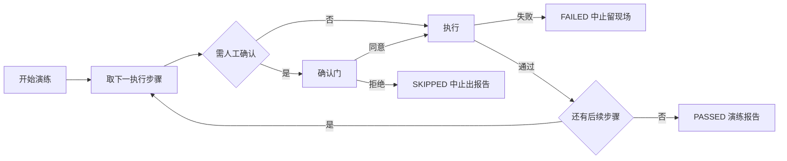

**追问**:
- 追问 1:演练误伤生产怎么办?—— 环境隔离加双确认:目标环境写进配置并打印确认,执行器拒绝在非声明环境跑高危步骤。
- 追问 2:报告自动化到什么程度?—— 步骤结果与耗时自动,结论与改进项人工写,全自动复盘会失去判断。

### Q2014 · oncall 值班表公平性:加权轮转与负载均衡

> 难度:★★★☆ | 标签:oncall, 排班

**问**:值班表按名单轮流排,为什么总有抱怨?怎么把"公平"变成可计算的?

**答**:按名单顺序转,节假日总砸在同几个人头上。加权负载轮转:每期值班有权重(工作日 1、周末 1.5、节假日 2),轮转时挑累计加权负载最小的人。实测 4 人 8 周含一个节假日周,负载极差只有 1.0,判定公平。三个配套:权重系数公开并经团队确认,这是公平感的来源;调班必须记回负载账本,私下互换不记账会让账目失效;负载按季度结算或滚动清零,避免有人背着一年前的债。特殊豁免(休假、健康)走显式冻结名单,而不是悄悄跳过——值班系统的可信度建立在账目透明上。

```python
# file: code/05_数据分析与工程化/q2014_oncall_fair.py
"""值班表公平性:按累计加权负载挑人,节假日加倍计入"""

from datetime import date, timedelta

MEMBERS = ["Alice", "Bob", "Carol", "Dave"]
START = date(2026, 11, 2)      # 周一开始
WEEKS = 8
HOLIDAYS = {date(2026, 11, 26)}        # 含一个节假日
WEEKEND_W, HOLIDAY_W, NORMAL_W = 1.5, 2.0, 1.0


def week_load(day):
    total = 0.0
    for i in range(7):
        d = day + timedelta(days=i)
        if d in HOLIDAYS:
            total += HOLIDAY_W
        elif d.weekday() >= 5:
            total += WEEKEND_W
        else:
            total += NORMAL_W
    return total


def schedule(members, start, weeks):
    load = {m: 0.0 for m in members}
    shifts = []
    for w in range(weeks):
        week_start = start + timedelta(days=7 * w)
        person = min(members, key=lambda m: (load[m], members.index(m)))
        load[person] += week_load(week_start)
        shifts.append((f"第{w + 1}周({week_start})", person))
    return shifts, load


if __name__ == "__main__":
    shifts, load = schedule(MEMBERS, START, WEEKS)
    for week, person in shifts:
        print(f"{week}: {person}")
    print("累计加权负载:", load)
    spread = max(load.values()) - min(load.values())
    verdict = "公平" if spread <= 3 else "需要调班"
    print(f"负载极差 {spread:.1f} -> {verdict}")
    print("要点:节假日与周末权重更高,轮转看累计负载而不是按名单循环;调班必须记回负载账本,否则公平性账目失效")
```

**追问**:
- 追问 1:按周指派还是按天指派?—— 按周连续性更好(上下文完整),跨节假日周允许拆分,把节假日单独加权指派。
- 追问 2:负载不均到什么程度要干预?—— 极差超过一期值班权重就触发调班建议,阈值随团队规模标定。

### Q2015 · 故障注入开关:运行时注入点设计

> 难度:★★★★ | 标签:故障注入, 混沌工程

**问**:想在生产环境演练下游超时,代码里要怎么埋故障,才能既练得到又不会忘关出事?

**答**:混沌工程的前提是故障可以安全注入:故障点常驻代码路径,但默认关闭,显式 arm 后才生效,且 arm 自带时长、到期自动失效——防止演练开关忘关变成真事故。实现 FaultSwitch:arm 设置失效时间戳,check 在调用点判断,未激活零开销直通,激活时抛出与真实故障同类型的异常(TimeoutError、ConnectionError),让上游的超时、重试、熔断真实演练一遍。实测下游超时被注入并被上游捕获,过期后调用恢复直通。三个约束:注入异常类型必须与真实故障一致,注入假的异常练不到处理逻辑;开关状态可观测(当前 arm 列表、注入次数);arm 操作全审计,谁能 arm、何时 arm 留痕。

```python
# file: code/05_数据分析与工程化/q2015_fault_switch.py
"""故障注入开关:默认关闭,显式 arm 才生效,带自动过期防遗忘"""

import time


class FaultSwitch:
    def __init__(self, name):
        self.name = name
        self.armed_until = 0.0
        self.triggered = 0

    def arm(self, seconds=60):
        self.armed_until = time.time() + seconds
        print(f"[fault] {self.name} 已激活 {seconds}s")

    def disarm(self):
        self.armed_until = 0.0

    @property
    def active(self):
        return time.time() < self.armed_until

    def check(self, error_factory):
        """调用点模板: 常驻代码路径,未 arm 时零开销直通"""
        if self.active:
            self.triggered += 1
            raise error_factory()
        return False


TIMEOUT_FAULT = FaultSwitch("downstream_timeout")


def call_downstream(latency):
    TIMEOUT_FAULT.check(lambda: TimeoutError(f"注入故障: 下游 {latency}ms 超时"))
    return f"ok({latency}ms)"


if __name__ == "__main__":
    print(call_downstream(20))
    TIMEOUT_FAULT.arm(seconds=1)
    try:
        call_downstream(35)
    except TimeoutError as e:
        print("注入命中并被上游捕获:", e)
    time.sleep(1.1)
    print("过期自动失效:", call_downstream(25))
    TIMEOUT_FAULT.disarm()
    print(f"注入次数 {TIMEOUT_FAULT.triggered}, 开关 active={TIMEOUT_FAULT.active}")
    print("要点:故障点常驻代码但默认关闭;arm 必须显式且自动过期,防止演练开关忘关变成真事故;注入的异常类型与真实故障一致,上游才练得到")
```

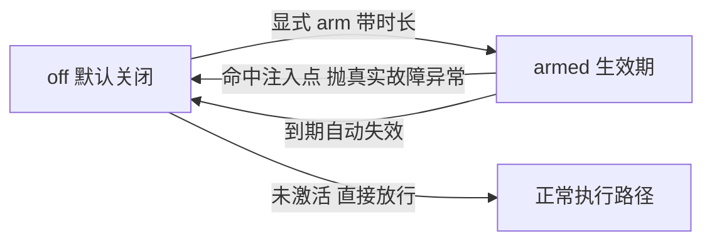

**追问**:
- 追问 1:为什么不只在测试环境注入?—— 生产故障形态(真实流量与数据量)测试环境造不出来,生产注入从最小半径开始。
- 追问 2:注入点放哪?—— 依赖边界(网络调用前后),别放业务判断内部,否则练的是业务逻辑不是容错。

### Q2016 · 子进程超时看门狗:兜底终止与现场保留

> 难度:★★★☆ | 标签:超时, 看门狗

**问**:脚本调用一个子进程,它卡住了两个小时,怎么从机制上保证这种事不会无限期持续?

**答**:所有外部调用都要有超时——没有超时的子进程、HTTP 请求是悬挂的定时炸弹。子进程看门狗用 subprocess.run 的 timeout 参数,超时抛 TimeoutExpired 并自动 kill,异常对象保留已产生的部分输出,这是排查第一证据:实测超时后拿到 step1 done,证明卡在第二步。三个要点:timeout 值按任务耗时基线的 P99 加余量,统一 30 秒对快任务太长、慢任务太短;超时后的清理要完整,子进程有孙进程时用进程组 kill,先 SIGTERM 给优雅退出机会再 SIGKILL;超时事件计数上报,频繁超时说明基线漂移,该调阈值或该优化任务。

```python
# file: code/05_数据分析与工程化/q2016_watchdog.py
"""子进程超时看门狗:超时兜底终止,保留已产生的输出现场"""

import subprocess
import sys

CHILD = "print('step1 done', flush=True); import time; time.sleep(30)"


def run_with_watchdog(cmd, timeout):
    try:
        proc = subprocess.run(cmd, capture_output=True, text=True,
                              timeout=timeout)
        return proc.returncode, proc.stdout
    except subprocess.TimeoutExpired as e:
        out = e.stdout or ""
        if isinstance(out, bytes):
            out = out.decode("utf-8", "ignore")
        return "TIMEOUT-KILL", out


if __name__ == "__main__":
    code, out = run_with_watchdog([sys.executable, "-c", CHILD], timeout=2)
    print(f"超时任务: 状态 {code}, 现场输出: {out.strip()!r}")
    code, out = run_with_watchdog([sys.executable, "-c", "print('fast ok')"],
                                  timeout=5)
    print(f"正常任务: 状态 {code}, 输出 {out.strip()!r}")
    print("要点:所有外部调用必须带 timeout;超时先杀再留现场,部分输出是排查第一证据;timeout 值按任务耗时基线的 P99 加余量,而不是统一 30 秒")
```

**追问**:
- 追问 1:SIGKILL 和 SIGTERM 怎么选?—— 先 SIGTERM 给优雅退出机会,短宽限后再 SIGKILL,数据库类子进程强杀会留下恢复现场。
- 追问 2:超时阈值从哪来?—— 任务耗时基线的 P99 加余量,阈值跟着基线走,而不是写死在代码里。

### Q2017 · 配置模板渲染:环境注入与必填校验

> 难度:★★★☆ | 标签:配置, 模板

**问**:多环境配置用模板加环境变量渲染,渲染环节最容易出什么事故?怎么在渲染期就拦住?

**答**:渲染期三类错误必须拦截:必填缺失(一次性列全再报错,别改一处跑一次)、注入空值(禁止静默渲染成 host= 的配置)、未知占位符(模板拼写错误直接报)。实测缺 DB_PORT 被拒绝并列出缺失项,DB_POOL 有默认值可缺省。渲染产物落盘留档,排查环境问题时直接 diff 渲染结果,"这台机器配置不对"的争论五分钟结束。两个延伸:默认值只给低危项,连接池大小可以默认,数据库密码绝不;渲染和部署分离,渲染产物进制品库,部署只消费产物,保证测过的就是上线的。

```python
# file: code/05_数据分析与工程化/q2017_config_render.py
"""配置模板渲染:环境变量注入,必填缺失显式报错,禁止静默空值"""

import re

TEMPLATE = """host = ${DB_HOST}
port = ${DB_PORT}
pool = ${DB_POOL}
"""
REQUIRED = ["DB_HOST", "DB_PORT"]
DEFAULTS = {"DB_POOL": "5"}
PLACEHOLDER = re.compile(r"\$\{(\w+)\}")


def render(template, env):
    keys = sorted(set(PLACEHOLDER.findall(template)))
    missing = [k for k in keys if k not in env and k not in DEFAULTS]
    if missing:
        raise ValueError(f"缺少必填配置: {missing},拒绝渲染")
    out = template
    for k in keys:
        value = env.get(k, DEFAULTS.get(k))
        if value in (None, ""):
            raise ValueError(f"{k} 为空,禁止静默渲染空值")
        out = out.replace("${" + k + "}", str(value))
    return out


if __name__ == "__main__":
    print(render(TEMPLATE, {"DB_HOST": "db.internal", "DB_PORT": "5432"}))
    try:
        render(TEMPLATE, {"DB_HOST": "db.internal"})
    except ValueError as e:
        print("故意缺配置:", e)
    print("要点:占位符缺失要一次性列全再报错,别改一处跑一次;默认值只给低危项;渲染产物落盘留档,排查环境问题时直接 diff 渲染结果")
```

**追问**:
- 追问 1:为什么不用 YAML 直接写完整配置?—— 多环境差异 80% 相同时模板最小化差异面;环境差异超过一半就该每环境独立配置,模板不是万能的。
- 追问 2:敏感值怎么处理?—— 敏感值不进渲染产物,运行时从 secret 管理拉取注入,产物里只留占位符。

### Q2018 · 备份恢复演练:备份可用性验证

> 难度:★★☆ | 标签:备份, 演练

**问**:备份每天在做,你怎么证明"真的能恢复"?

**答**:没恢复过的备份等于没备份:文件损坏、校验和缺失、恢复脚本过时、权限变更,全是恢复那天才发现的故障。演练脚本把最近备份恢复到隔离沙箱,双校验:文件校验和比对加行数断言,实测坏备份校验和不匹配被当场拦截,好备份恢复成功。演练按固定周期跑(至少每周),结果进监控,演练失败当事故处理——不是改脚本让它变绿,那是自欺。三个细节:恢复目标必须隔离,演练不能影响生产;演练覆盖"完整恢复"与"单表恢复"两种粒度;恢复耗时也要记录,超过 RTO 的备份等于不合格。

```python
# file: code/05_数据分析与工程化/q2018_backup_drill.py
"""备份恢复演练:把最近备份恢复到沙箱并校验,坏备份当场拦截"""

import hashlib
import json
import os
import shutil
import tempfile

RESTORE_DIR = tempfile.mkdtemp(prefix="restore_demo_")

GOOD = {"rows": 1200, "data": list(range(1200))}
GOOD["checksum"] = hashlib.sha256(json.dumps(GOOD["data"]).encode()).hexdigest()
BAD = {"rows": 1200, "data": list(range(900)), "checksum": "deadbeef"}


def drill(backup):
    data = backup["data"]
    actual = hashlib.sha256(json.dumps(data).encode()).hexdigest()
    if actual != backup["checksum"]:
        return False, "校验和不匹配,备份已损坏"
    if len(data) != backup["rows"]:
        return False, f"行数不符 {len(data)} != {backup['rows']}"
    with open(os.path.join(RESTORE_DIR, "restored.json"), "w") as f:
        json.dump(data, f)
    return True, f"恢复成功,行数 {len(data)}"


if __name__ == "__main__":
    for name, b in (("good_backup", GOOD), ("bad_backup", BAD)):
        ok, msg = drill(b)
        print(f"{name}: {'通过' if ok else '未通过'} - {msg}")
    shutil.rmtree(RESTORE_DIR)
    print("要点:没恢复过的备份等于没备份;演练按固定周期跑,校验和与行数双检;演练失败要当事故处理,而不是改脚本让它变绿")
```

**追问**:
- 追问 1:数据库备份怎么演练?—— 恢复到临时实例后跑冒烟查询(行数、抽样、业务一致性),应用层验证比文件校验更真。
- 追问 2:演练频率怎么定?—— 备份策略变更、存储迁移、大版本升级后立即演练;日常频率与 RPO 容忍度挂钩,重要数据至少每周。

### Q2019 · 输入指纹跳过:内容寻址的增量执行

> 难度:★★★★ | 标签:增量计算, 指纹

**问**:调度器每天定时跑任务,但输入数据经常没变,怎么做到"没变就跳过、变了才重算",而且规则升级也能触发重算?

**答**:增量判断的依据不是"今天跑过了吗",而是"输入变了吗":对任务输入(数据参数加规则版本)排序后哈希成指纹,与上次一致就跳过,变了才重算并更新指纹。实测 agg_daily 第二次运行被跳过,规则版本从 v3 升到 v4 后自动重算——规则版本必须纳入指纹,只盯数据不变会漏算逻辑变更,这是增量系统最常见的 bug。同参数回填天然幂等:回填三天前的数据,指纹没变自动跳过。指纹状态与结果数据同生命周期清理,分区被删指纹也要删,否则会误跳过。输入超大时先对输入文件做内容哈希,任务层只哈希这些哈希。

```python
# file: code/05_数据分析与工程化/q2019_input_fingerprint.py
"""输入指纹跳过:对输入内容寻址,指纹没变就跳过,变了才重算"""

import hashlib
import json
import os
import tempfile

STATE = os.path.join(tempfile.mkdtemp(prefix="fp_demo_"), "fingerprints.json")


def fingerprint(inputs):
    """对输入键值对排序后哈希:内容决定指纹,顺序无关"""
    payload = json.dumps(sorted(inputs.items()), sort_keys=True)
    return hashlib.sha256(payload.encode()).hexdigest()[:16]


def load_fingerprints():
    if os.path.exists(STATE):
        with open(STATE) as f:
            return json.load(f)
    return {}


def run_task(task, inputs, log):
    fp = fingerprint(inputs)
    old = load_fingerprints().get(task)
    if old == fp:
        log.append(f"{task}: SKIPPED(指纹 {fp} 未变)")
        return
    log.append(f"{task}: RAN(指纹 {old} -> {fp})")   # 这里替换为真正计算
    state = load_fingerprints()
    state[task] = fp
    with open(STATE, "w") as f:
        json.dump(state, f)


if __name__ == "__main__":
    log = []
    daily = {"dt": "2026-11-04", "rows": 1200, "rule_ver": "v3"}
    run_task("agg_daily", daily, log)
    run_task("agg_daily", daily, log)          # 输入没变 -> 跳过
    daily["rule_ver"] = "v4"                   # 规则升级 -> 重算
    run_task("agg_daily", daily, log)
    for line in log:
        print(" ", line)
    print("要点:指纹对内容哈希而不是对时间,同参数重跑天然幂等;规则版本必须纳入指纹,只盯数据不变会漏算逻辑变更;指纹状态要与结果数据同生命周期清理")
```

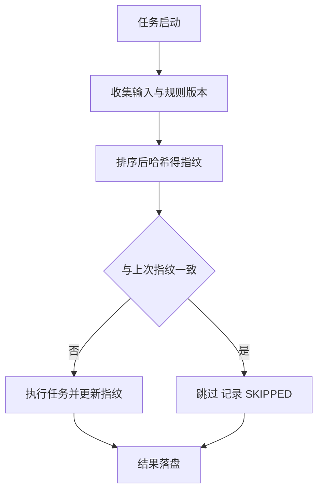

**追问**:
- 追问 1:和 make 的思想什么关系?—— 完全一致:目标依赖输入,输入没变不重建;make 用 mtime,内容寻址更稳但成本更高。
- 追问 2:部分输入变化怎么处理?—— 指纹按输入组分开算,只重算受影响分支,这就是数据感知调度的原理。

### Q2020 · 监控自身的监控:采集断流与元监控

> 难度:★★★★ | 标签:可观测性, 元监控

**问**:监控采集器自己挂了怎么办?仪表盘全灰了你却以为天下太平,这个"盲区中的盲区"怎么消除?

**答**:元监控跟踪每个采集器的最近心跳,分级判定:fresh(30 秒内)、stale(滞后,先查资源与网络)、dead(断流,数据缺口已产生,评估补点)。实测 log_shipper 断流 15 分钟被标 P2——断流比指标异常更严重,因为缺口永远补不回来,告警必须升级。设计要点:元监控与业务监控分开部署,告警走独立通道(不同厂商、短信),避免单点同时哑火;心跳与数据流分离,采集器活着但数据断了要用"端到端数据心跳"(最后一条数据的时间)检测;分级阈值按采集周期标定,秒级采集 30 秒算滞后,日级任务 30 小时才算。

```python
# file: code/05_数据分析与工程化/q2020_meta_monitor.py
"""监控自身的监控:采集器心跳登记,断流与滞后分级检测"""

COLLECTORS = {
    # 采集器: 最近心跳距今秒数
    "node_exporter": 5,
    "app_metrics": 40,
    "log_shipper": 900,
}
STALE_AFTER = 30      # 超过 30s 没心跳算滞后
DEAD_AFTER = 300      # 超过 300s 算断流
ESCALATE = {"log_shipper": "P2", "app_metrics": "P3", "node_exporter": "P3"}


def classify(age):
    if age is None:
        return "never", "从未上报,检查采集器是否启动"
    if age > DEAD_AFTER:
        return "dead", "断流,数据缺口已产生,评估从备份补点"
    if age > STALE_AFTER:
        return "stale", "滞后,先看采集器资源与网络"
    return "fresh", "正常"


if __name__ == "__main__":
    alarms = []
    for name, age in COLLECTORS.items():
        state, advice = classify(age)
        line = f"{name:<14} 距上次心跳 {age:>4}s [{state}] {advice}"
        print(line)
        if state != "fresh":
            alarms.append((name, state, ESCALATE.get(name, "P3")))
    print("告警升级:", alarms if alarms else "无")
    print("要点:元监控与业务监控分开部署,告警走独立通道,避免监控挂了没人知道;断流比指标异常更严重,因为缺口永远补不回来")
```

**追问**:
- 追问 1:元监控自己挂了怎么办?—— 递归监控没有终点,实用解是两条独立链路互为看门狗,再加外部拨测定时探活。
- 追问 2:断流后的数据怎么补?—— 依赖上游可重放:补跑历史区间加幂等覆盖写,断流演练要和重放机制联测。
