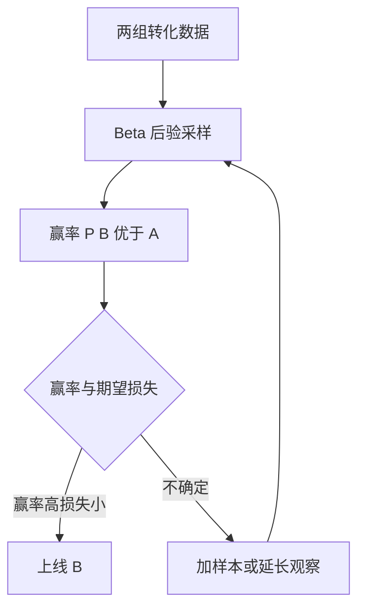
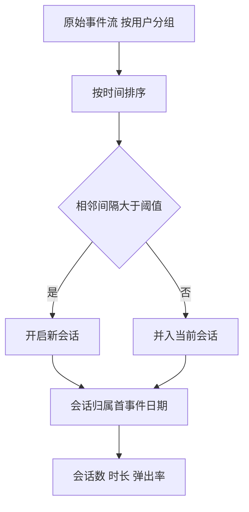
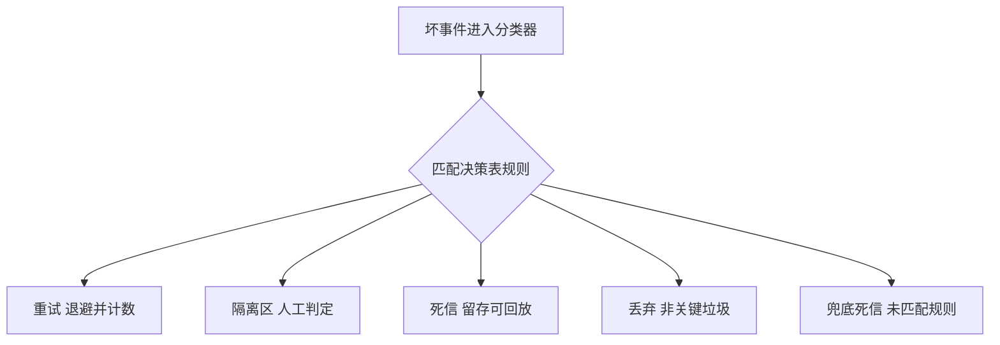
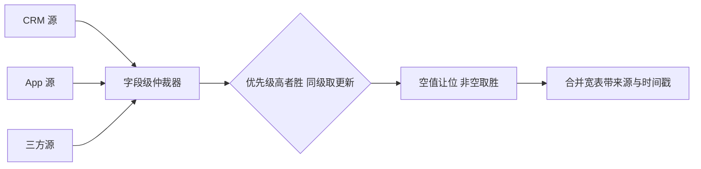
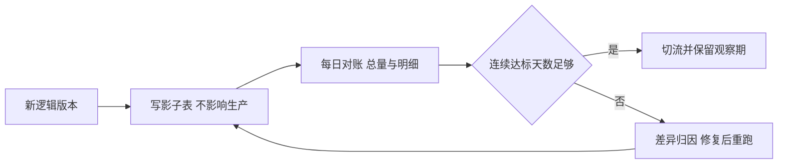
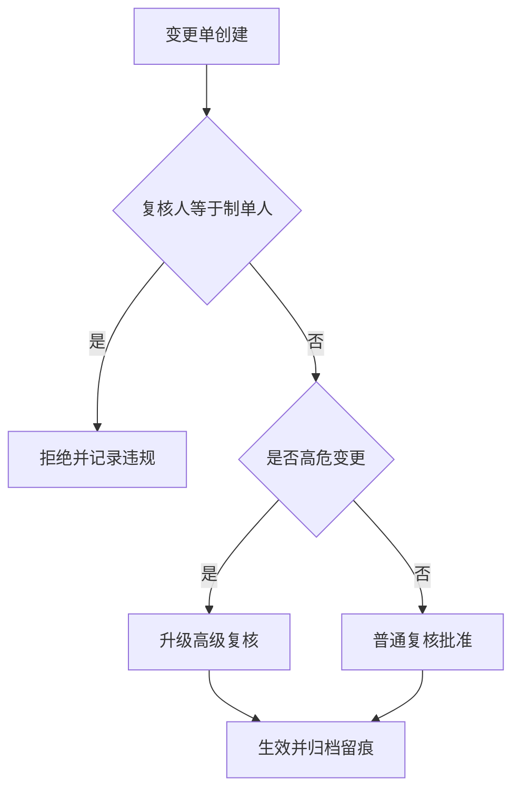
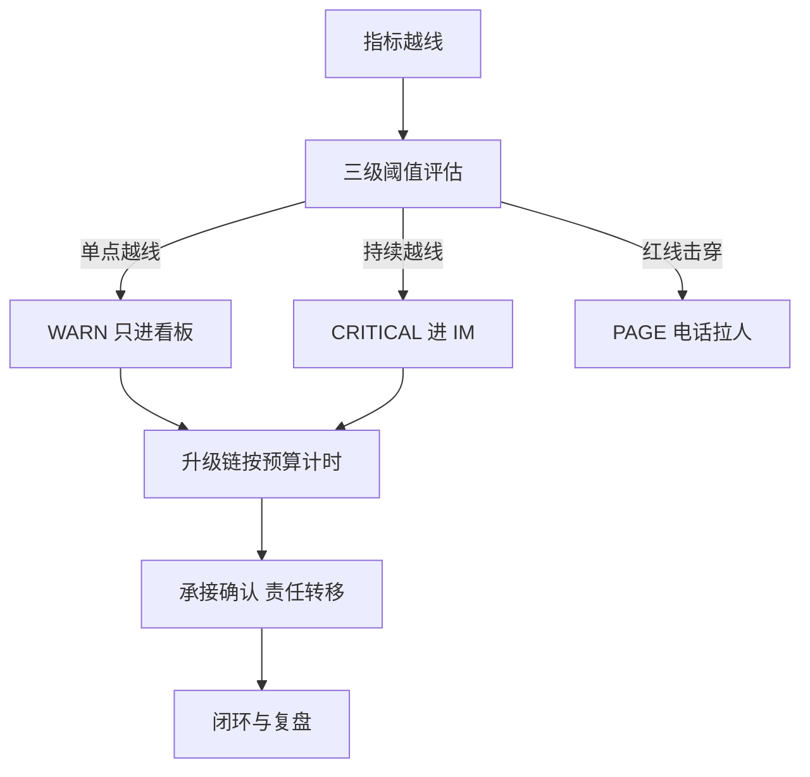

# 第 5 类 · 数据分析与工程化(夜间扩产四)

> 本卷为夜间扩产第四篇(Q2246–Q2290,45 题),继续按三线补盲区。分析场景补遗:NPS 与 CSAT 口径加权、价格弹性粗估、UTM 归一去重、cohort 窗口边界、节假日对齐同比、均值中位数决策翻转、过拟合直观演示、FDR 校正、贝叶斯赢率、标签更新分层、问卷事后分层加权、激活口径、渠道响应曲线、不显著解读、会话重建;数据管道补遗:重复投递去重窗口、水位修正、超时分级、回填影响面、schema 版本协商、丢弃死信决策表、三级阈值告警、关键路径松弛、成本核算、字段级仲裁、run_id 贯穿、互斥组、分区级回滚、影子双跑、时钟回拨;工程补遗:灰度桶持久化、巡检降噪、演练评分、导出分页限速、双人复核、自动回滚判定、交接承接确认、事故时间线、升级链、任务错峰、密钥台账、工单合并、行动项跟踪、SLA 月报、告警发布关联。
> 难度分布:1-2 星 9 题、3 星 23 题、4-5 星 13 题;题号 Q2246–Q2290 全局唯一,与既有 Q001–Q2245 不重复。
> 纯逻辑题全部标准库可跑;涉及 pandas 的题以 try/except ImportError 包裹,缺库走标准库降级演示且降级路径实跑通过;含故意异常处均已 try/except 包裹。全部 45 段代码已用 /usr/bin/python3(3.9.6)逐题实跑验证通过。

---

### Q2246 · NPS 与 CSAT:口径规则与分群加权

> 难度:★★☆☆ | 标签:NPS, 问卷口径

**问**:领导让你出 NPS 和 CSAT 两个数,你会怎么算?问卷回收的样本结构和真实用户结构不一致时要不要处理?

**答**:NPS 是推荐者占比减贬损者占比,0-6 分是贬损者、7-8 是被动者不计分、9-10 是推荐者;CSAT 是 4-5 分(满意)占全部打分的比例,两个指标回答不同问题,NPS 量忠诚度、CSAT 量当次体验,不能互相替代。实测里新用户 NPS 25 分、老用户 16.7 分,问卷回收却偏向老用户,未加权 NPS 20 分,按真实用户结构加权后是 21.7 分——样本结构偏斜必须做分群加权,权重来自用户结构表而不是问卷本身。样本量要报告:分群回收少于 30 份只看趋势不打分;加权后要同时给有效样本量,区间变宽是诚实的代价。

```python
# file: code/05_数据分析与工程化/q2246_nps_csat.py
"""NPS 与 CSAT 口径:分类规则、分群加权与样本量提示"""

RAW_NPS = [
    # 分群, 推荐题打分 0-10
    ("新用户", 9), ("新用户", 10), ("新用户", 7), ("新用户", 6),
    ("老用户", 9), ("老用户", 10), ("老用户", 10), ("老用户", 8),
    ("老用户", 5), ("老用户", 3),
]
RAW_CSAT = [5, 4, 3, 5, 2]          # 满意度题打分 1-5
SEG_WEIGHT = {"新用户": 0.6, "老用户": 0.4}   # 真实用户结构


def nps(scores):
    n = len(scores)
    if n == 0:
        return None
    promoters = sum(1 for s in scores if s >= 9)
    detractors = sum(1 for s in scores if s <= 6)
    return 100.0 * (promoters - detractors) / n


def csat(scores_1_5):
    if not scores_1_5:
        return None
    return 100.0 * sum(1 for s in scores_1_5 if s >= 4) / len(scores_1_5)


if __name__ == "__main__":
    by_seg = {}
    for seg, s in RAW_NPS:
        by_seg.setdefault(seg, []).append(s)
    weighted = 0.0
    for seg, scores in by_seg.items():
        seg_nps = nps(scores)
        weighted += SEG_WEIGHT[seg] * seg_nps
        print(f"{seg}: n={len(scores)} NPS={seg_nps:.1f} 真实占比={SEG_WEIGHT[seg]:.0%}")
    raw = nps([s for _, s in RAW_NPS])
    print(f"未加权 NPS={raw:.1f}, 按真实结构加权 NPS={weighted:.1f}, 偏差 {weighted - raw:+.1f} 分")
    print(f"CSAT(4-5 分占比) = {csat(RAW_CSAT):.1f}%, 与 NPS 是两个口径不可互替")
    print("要点: 被动者 7-8 分不计分但占样本; 加权系数来自用户结构表; 分群 n<30 只看趋势不打分")
```

**追问**:
- 追问 1:被动者那么大一群,不计分合理吗?—— 合理,NPS 只关心推荐意愿的极性,被动者反映在样本量与追问题目里,而不是硬塞进分数。
- 追问 2:为什么同一批人 CSAT 高但 NPS 低?—— CSAT 评单次触点、NPS 评整体关系,当次体验好不代表愿意推荐,两者背离本身就是分析结论。

### Q2247 · 价格弹性粗估:对数回归斜率与自助区间

> 难度:★★★★ | 标签:价格弹性, 回归

**问**:想粗估一下商品涨价 1% 销量掉多少,手头只有不同促销时点的价格和销量观测,怎么做最简单可靠?

**答**:用对数回归:对价格和销量各取对数做一元最小二乘,斜率就是价格弹性,实测八组观测算出弹性约 -1.2,属于富有弹性,提价会损失收入。点估计必须配区间:对观测做自助法重采样几百次,取斜率的 2.5% 与 97.5% 分位,给出 95% 置信区间。最大的坑是混淆变量:高价档位如果碰巧赶上淡季或需求上行的其他因素,斜率会被系统性带偏,实测混入同向需求波动后弹性明显失真,所以粗估前至少要控住季节与趋势,最好按同店同周型配对比较。弹性只回答"这一档价格附近"的局部响应,别拿去外推到天差地别的价位。

```python
# file: code/05_数据分析与工程化/q2247_price_elasticity.py
"""价格弹性粗估: 对数回归斜率与自助法区间"""

import math
import random

try:
    import pandas as pd
except ImportError:
    pd = None

random.seed(7)

# 城市-周级别的价格与销量观测, 来自不同促销时点
OBS = [
    (9.9, 820), (10.9, 745), (11.9, 690), (12.9, 610),
    (13.9, 560), (14.9, 520), (15.9, 470), (16.9, 430),
]


def log_log_slope(pairs):
    xs = [math.log(p) for p, _ in pairs]
    ys = [math.log(q) for _, q in pairs]
    n = len(xs)
    mx, my = sum(xs) / n, sum(ys) / n
    cov = sum((x - mx) * (y - my) for x, y in zip(xs, ys))
    var = sum((x - mx) ** 2 for x in xs)
    return cov / var


def bootstrap_ci(pairs, times=500):
    stats = []
    n = len(pairs)
    for _ in range(times):
        sample = [pairs[random.randrange(n)] for _ in range(n)]
        stats.append(log_log_slope(sample))
    stats.sort()
    return stats[int(0.025 * times)], stats[int(0.975 * times)]


if __name__ == "__main__":
    slope = log_log_slope(OBS)
    lo, hi = bootstrap_ci(OBS)
    print(f"弹性点估计 {slope:.2f}, 95% 区间 [{lo:.2f}, {hi:.2f}]")
    print(f"|E|={abs(slope):.2f} -> {'富有弹性, 提价损失收入' if abs(slope) > 1 else '缺乏弹性, 提价短期增收'}")
    mixed = [(p, q * 0.6 if p >= 13.9 else q) for p, q in OBS]   # 高价档恰逢淡季的失真
    print(f"混入同向需求波动后弹性变成 {log_log_slope(mixed):.2f}, 粗估前必须控季节与趋势")
    if pd is not None:
        df = pd.DataFrame(OBS, columns=["price", "qty"])
        df["lp"] = df["price"].apply(math.log)
        df["lq"] = df["qty"].apply(math.log)
        print("pandas 视角: 弹性 =", round(df["lp"].cov(df["lq"]) / df["lp"].var(), 2))
```

**追问**:
- 追问 1:为什么用对数变换?—— 幂律需求下 log-log 线性化后斜率直接就是弹性,且把乘性波动变成加性,更接近回归假设。
- 追问 2:怎么把粗估升级成可信结论?—— 上价格实验或利用自然实验做差分,先控住时间与门店固定效应,弹性才有因果含义。

### Q2248 · 渠道 UTM 归因去重:归一化与触点合并窗口

> 难度:★★★☆ | 标签:渠道归因, UTM

**问**:渠道报表里微信一会儿叫 wechat 一会儿叫 WeChat,同一用户短时间被重复计了多次触点,归因前你怎么清洗?

**答**:清洗分两步。第一步参数归一化:utm_source 与 utm_campaign 统一小写、去空白、合并别名(wx/weixin 归 wechat)、剥掉 gclid 这类跟踪垃圾参数,否则同一渠道会被拆成好几行。第二步触点去重:同一用户对同一 campaign 的重复投递(短时间多次点击同一条投放)在合并窗口内只算一个触点,实测六条原始点击清出四条有效触点,剔掉了两条重复。去重之后再做归因,转化来源统计才不会放大高频重复渠道的功劳。窗口长度按投放的曝光节奏定,信息流短、EDM 长;归一化规则要沉淀成公共函数,埋点端与报表端共用,不允许各洗各的。

```python
# file: code/05_数据分析与工程化/q2248_utm_dedup.py
"""UTM 归一化与重复投递去重: 归因前先清洗触点"""

from collections import Counter
from datetime import datetime, timedelta

CLICKS = [
    # 用户, 时间, utm_source, utm_campaign, 是否转化
    ("u1", "2026-03-01 09:00", "WeChat ", "spring_sale", False),
    ("u1", "2026-03-01 09:40", "wechat", "Spring_Sale", False),       # 窗口内重复投递
    ("u1", "2026-03-01 18:00", "wechat", "spring_sale", True),        # 超出窗口, 有效新触点
    ("u2", "2026-03-02 10:00", "douyin", "brand_x", False),
    ("u2", "2026-03-02 10:05", "douyin", "brand_x&gclid=abc", False),  # 带跟踪垃圾参数
    ("u3", "2026-03-02 11:00", " DouYin", "brand_x", True),
]
ALIAS = {"wx": "wechat", "weixin": "wechat", "dy": "douyin"}
FMT = "%Y-%m-%d %H:%M"


def normalize(source, campaign):
    s = source.strip().lower()
    s = ALIAS.get(s, s)
    c = campaign.split("&")[0].strip().lower()
    return s, c


def dedup_touches(clicks, window_min=60):
    """同一用户同一 campaign 在窗口内只保留首个触点"""
    out, last_seen = [], {}
    for user, ts, src, camp, conv in clicks:
        s, c = normalize(src, camp)
        key = (user, s, c)
        t = datetime.strptime(ts, FMT)
        prev = last_seen.get(key)
        if prev is not None and t - prev <= timedelta(minutes=window_min):
            continue
        last_seen[key] = t
        out.append((user, t, s, c, conv))
    return out


if __name__ == "__main__":
    clean = dedup_touches(CLICKS)
    for user, t, s, c, conv in clean:
        print(f"{user} {t:%m-%d %H:%M} {s}/{c} 转化={conv}")
    print(f"原始触点 {len(CLICKS)} 条, 清洗去重后 {len(clean)} 条, 剔除 {len(CLICKS) - len(clean)} 条")
    conv_src = Counter(s for _, _, s, _, conv in clean if conv)
    print("去重后转化来源分布:", dict(conv_src))
    print("要点: 归一化别名表与去重窗口都进公共清洗函数, 埋点端报表端共用一套")
```

**追问**:
- 追问 1:去重窗口设多长?—— 覆盖同一投放的正常重复曝光节奏,信息流 30 分钟内、EDM 按小时到天,设长了会吞掉真实的多次兴趣触点。
- 追问 2:gclid 这类参数该删还是该留?—— 归因维度上删,但原始日志必须留全量,清洗只发生在分析层。

### Q2249 · cohort 窗口边界:半开区间与不完整期遮罩

> 难度:★★★★ | 标签:cohort, 口径边界

**问**:留存矩阵大家都会算,但同一份数据两个人算出两套数,问题往往出在哪?

**答**:出在窗口边界。三个必须冻结的规则:一是半开区间,第 i 期是 [起始日+i×窗口, 起始日+(i+1)×窗口),边界日归下一期,实测 1 月 12 日对 1 月 5 日 cohort 属于 P1 而不是 P0,取整方向不同结果就不同;二是 cohort 起点归属,首日活跃用户同时出现在 cohort 期与活跃期,必须明确 M0 是"起始日当天到当天+窗口";三是不完整期遮罩,窗口还没有走完的期列不参与留存对比,实测观测截止 1 月 20 日时 P2、P3 列必须标"未到期",否则越近的 cohort 留存天然虚低。这些规则要写成带自测的公共函数,谁调用都是同一个答案。

```python
# file: code/05_数据分析与工程化/q2249_cohort_boundary.py
"""cohort 窗口边界: 半开区间归属与不完整期遮罩"""

from datetime import date, timedelta

COHORT_START = {"a": date(2026, 1, 5), "b": date(2026, 1, 5), "c": date(2026, 1, 12)}
ACTIVITIES = [
    ("a", date(2026, 1, 5)), ("a", date(2026, 1, 11)), ("a", date(2026, 1, 12)),
    ("b", date(2026, 1, 5)), ("b", date(2026, 1, 6)),
    ("c", date(2026, 1, 12)), ("c", date(2026, 1, 19)),
]
TODAY = date(2026, 1, 20)      # 数据观测截止日
PERIOD_DAYS = 7
MAX_PERIOD = 4                 # 想看 P0..P3


def period_index(cohort_start, active_day):
    """半开区间 [start+i*d, start+(i+1)*d) 归第 i 期, 边界日归下一期"""
    delta = (active_day - cohort_start).days
    if delta < 0:
        return None
    return delta // PERIOD_DAYS


if __name__ == "__main__":
    for user, start in sorted(COHORT_START.items()):
        cells = []
        for i in range(MAX_PERIOD):
            users = {u for u, day in ACTIVITIES
                     if u == user and period_index(start, day) == i}
            window_end = start + timedelta(days=(i + 1) * PERIOD_DAYS - 1)
            cells.append(f"{len(users)}人" if window_end <= TODAY else "未到期")
        print(f"cohort {user} 起始 {start}: " + " | ".join(
            f"P{i}={c}" for i, c in enumerate(cells)))
    assert period_index(date(2026, 1, 5), date(2026, 1, 12)) == 1, "边界日应归下一期"
    assert period_index(date(2026, 1, 5), date(2026, 1, 11)) == 0, "窗口最后一日归本期"
    print("边界自测通过: 1月11日属 P0, 1月12日属 P1, 半开区间方向唯一")
    print("遮罩规则: 窗口未走完的期只可看不可比, 报表上必须标'未到期'")
```

**追问**:
- 追问 1:cohort 按注册日还是首单日?—— 看分析目的,注册日 cohort 回答获客质量,首单日 cohort 回答付费质量,换定义等于换指标必须换名字。
- 追问 2:7 日窗口和自然周窗口哪个好?—— 业务节奏按周走就用自然周,但要写进口径字典;两者混用是留存对不上的常见根因。

### Q2250 · 节假日对齐同比:基期映射表

> 难度:★★★☆ | 标签:同比, 节假日口径

**问**:国庆假期每年起止日不一样,日报的同比在 10 月初总是乱跳,怎么修?

**答**:自然日同比在假期错位处全是噪声:今年 10 月 3 日已经节后上班,去年 10 月 3 日还在假期,实测自然日同比 -60.5%,完全是错位比较。修法是建基期映射表:假期内按"假期第 N 天对第 N 天",节后按"节后第 N 个工作日对第 N 个工作日",今年 10 月 3 日映射到去年 10 月 8 日,对齐后同比 +6.3%,才是可比数字;非假期日期仍走自然日映射。映射表由节假日日历统一维护进元数据,所有含假期的报表共用;无映射可用的日期宁可输出空值加标注,也不要给一个错位同比。这套机制与"活动第 N 天"口径同构,大促和春节漂移都是同一类问题。

```python
# file: code/05_数据分析与工程化/q2250_holiday_aligned_yoy.py
"""节假日对齐同比: 基期映射表修正假期漂移"""

from datetime import date

SALES_2025 = {date(2025, 9, 28): 300, date(2025, 9, 29): 305, date(2025, 9, 30): 310,
              date(2025, 10, 1): 900, date(2025, 10, 2): 880, date(2025, 10, 3): 860,
              date(2025, 10, 8): 320}
SALES_2026 = {date(2026, 9, 28): 330, date(2026, 9, 29): 335, date(2026, 9, 30): 340,
              date(2026, 10, 1): 950, date(2026, 10, 2): 930, date(2026, 10, 3): 340,
              date(2026, 10, 8): 330}
# 基期映射: 假期第 N 天对第 N 天, 节后工作日对节后工作日
HOLIDAY_MAP = {
    date(2026, 10, 1): date(2025, 10, 1),
    date(2026, 10, 2): date(2025, 10, 2),
    date(2026, 10, 3): date(2025, 10, 8),   # 今年节后首个工作日 对 去年节后首个工作日
}


def align_base(today, holiday_map):
    """今天的对齐基期: 命中映射表走映射, 否则走自然日"""
    return holiday_map.get(today, date(today.year - 1, today.month, today.day))


if __name__ == "__main__":
    print(f"{'日期':<14}{'自然日同比':>12}{'对齐同比':>12}{'对齐基期':>14}")
    for d in sorted(SALES_2026):
        natural = None
        nb = date(d.year - 1, d.month, d.day)
        if SALES_2025.get(nb):
            natural = (SALES_2026[d] - SALES_2025[nb]) / SALES_2025[nb]
        base = align_base(d, HOLIDAY_MAP)
        aligned = None
        if SALES_2025.get(base):
            aligned = (SALES_2026[d] - SALES_2025[base]) / SALES_2025[base]
        n_txt = f"{natural:+.1%}" if natural is not None else "-"
        a_txt = f"{aligned:+.1%}" if aligned is not None else "-"
        print(f"{str(d):<14}{n_txt:>12}{a_txt:>12}{str(base):>14}")
    print("要点: 假期漂移日必须走映射表; 没有映射的日期输出空值加标注, 不给错位同比")
```

**追问**:
- 追问 1:映射表谁来维护?—— 节假日日历作为唯一来源单独维护并版本化,报表引擎按日期自动查,业务方不自行改。
- 追问 2:调休的补班日怎么算?—— 补班日在工作日口径里算工作日、在自然日口径里算周末,两套口径分开标注,不允许混。


### Q2251 · 均值还是中位数:口径选择的决策翻转

> 难度:★★☆☆ | 标签:统计口径, 决策

**问**:同一组实验数据,均值口径说实验组赢了,中位数口径说输了,听谁的?

**答**:先看数据形态再做决策,规则是"加总类问题看均值,体验类问题看中位数"。实测对照组 19 笔 80 元加一笔 4000 元,均值 276、中位数 80;实验组 14 笔 70 元加六笔 3000 元,均值 949、中位数 70——均值口径实验组大胜 244%,中位数口径实验组掉 12.5%,结论完全相反。再看头部集中度:实验组流水 95% 来自头部 3 单,均值结论完全被大单绑架,极不稳。正确动作是把两个口径并列输出,再按业务问题选择:如果评估的是"每单平均收入与 GMV",看均值但必须补头部集中度;如果评估"典型用户的单笔体验",看中位数。头部占比超过一半时,任何均值结论都要先分层再谈。

```python
# file: code/05_数据分析与工程化/q2251_mean_vs_median.py
"""均值还是中位数: 同一实验两个口径给出相反结论"""

import statistics as st

GROUP_A = [80] * 19 + [4000]          # 对照组 20 单, 一笔企业大单
GROUP_B = [70] * 14 + [3000] * 6      # 实验组 20 单, 六笔中大型单


def summary(name, orders):
    top3 = sum(sorted(orders)[-3:]) / sum(orders)
    print(f"{name}: 均值 {st.mean(orders):.0f} 中位数 {st.median(orders):.0f} 头部3单占流水 {top3:.0%}")
    return st.mean(orders), st.median(orders)


if __name__ == "__main__":
    ma, med_a = summary("对照组", GROUP_A)
    mb, med_b = summary("实验组", GROUP_B)
    print(f"均值口径: 实验 vs 对照 {mb / ma - 1:+.1%} -> 实验胜")
    print(f"中位数口径: 实验 vs 对照 {med_b / med_a - 1:+.1%} -> 实验负")
    print("决策规则: 加总类指标看均值配头部集中度, 体验类指标看中位数; 头部占比过半先分层")
```

**追问**:
- 追问 1:截尾均值什么时候用?—— 内部趋势监控用它折中,对外汇报和决策不能只用截尾值,要说明截了多少。
- 追问 2:为什么"剔除大单再比"要谨慎?—— 大单是真金白银,剔除规则必须事先明文并留痕,临时剔除等于改结论。

### Q2252 · 过拟合直观演示:多项式次数与验证误差

> 难度:★★★★ | 标签:过拟合, 回归

**问**:怎么用一段代码让业务同学直观理解"过拟合"?

**答**:用多项式拟合作演示:真函数是一次线性关系,采样 12 个带噪点,用纯 Python 最小二乘从 1 次拟合到 7 次,训练误差随次数单调下降,但独立验证集的误差是 U 形——在低次数附近最低,次数继续升高反而回升,这就是过拟合的直观形态:模型开始背噪声而不是学规律。实测 12 个样本拟合 7 次多项式有 8 个自由参数,自由参数逼近样本数时训练误差趋近 0 而泛化崩溃。给业务讲清三句话:训练误差持续下降不代表模型更好;判断好坏要用训练时没见过的数据;模型复杂度要和数据量、信号复杂度匹配。工程上对应的手段是预留验证集、正则化与交叉验证。

```python
# file: code/05_数据分析与工程化/q2252_overfit_demo.py
"""过拟合直观演示: 多项式次数与验证误差的 U 形曲线"""

import random

random.seed(42)


def make_data(n, noise=0.8):
    xs, ys = [], []
    for _ in range(n):
        x = random.uniform(-1, 1)
        y = 3 * x + 1 + random.gauss(0, noise)
        xs.append(x)
        ys.append(y)
    return xs, ys


def solve(A, b):
    """高斯消元求线性方程组, 部分主元"""
    n = len(A)
    M = [row[:] + [b[i]] for i, row in enumerate(A)]
    for col in range(n):
        p = max(range(col, n), key=lambda r: abs(M[r][col]))
        if abs(M[p][col]) < 1e-12:
            return None
        M[col], M[p] = M[p], M[col]
        for r in range(col + 1, n):
            f = M[r][col] / M[col][col]
            for c in range(col, n + 1):
                M[r][c] -= f * M[col][c]
    x = [0.0] * n
    for r in range(n - 1, -1, -1):
        s = M[r][n] - sum(M[r][c] * x[c] for c in range(r + 1, n))
        x[r] = s / M[r][r]
    return x


def polyfit(xs, ys, deg):
    A = [[sum(x ** (i + j) for x in xs) for j in range(deg + 1)] for i in range(deg + 1)]
    b = [sum(y * x ** i for x, y in zip(xs, ys)) for i in range(deg + 1)]
    return solve(A, b)


def sse(xs, ys, coef):
    return sum((y - sum(c * x ** i for i, c in enumerate(coef))) ** 2 for x, y in zip(xs, ys))


if __name__ == "__main__":
    train = make_data(12)
    valid = make_data(200, noise=0.8)
    results = []
    for deg in range(1, 8):
        coef = polyfit(train[0], train[1], deg)
        tr = sse(train[0], train[1], coef) / len(train[0])
        va = sse(valid[0], valid[1], coef) / len(valid[0])
        results.append((deg, tr, va))
    best = min(results, key=lambda r: r[2])
    print(f"{'次数':>4}{'训练误差':>10}{'验证误差':>10}")
    for deg, tr, va in results:
        mark = "  <- 验证最低" if deg == best[0] else ""
        print(f"{deg:>4}{tr:>10.3f}{va:>10.3f}{mark}")
    print("真函数是一次线性, 验证误差却在低次数处最低: 训练误差一路降而验证误差回升就是过拟合")
```

**追问**:
- 追问 1:验证集、测试集为什么要分开?—— 验证集选模型、测试集只做最终评估,用测试集调参等于把答案泄给了模型。
- 追问 2:样本够多还会过拟合吗?—— 会,只要模型容量远超信号复杂度,样本只是抬高了过拟合的门槛。

### Q2253 · 分组比较的 FDR 控制:Bonferroni 与 BH 实现

> 难度:★★★☆ | 标签:多重检验, FDR

**问**:分城市看实验效果,20 个城市总有几个显著,怎么避免把噪声当发现?

**答**:20 个检验按 0.05 水平,期望假阳性就有 1 个,实测 20 个 p 值里不校正显著 7 个。两种校正:Bonferroni 用 alpha/m 的阈值,实测只放行 2 个,控制的是"任何假阳性"的族错误率,最保守,适合一锤定音的决策;Benjamini-Hochberg 控制的是错误发现率 FDR——把 p 值升序排,找最大的 k 使第 k 个 p 值不超过 k/m×alpha,实测放行 5 个,恰好把注入的 5 个真实差异全部抓到,期望假阳性不超过 0.05×5。探索性分析用 BH 保功效,注册过的主指标判定不需要多重校正。实现只有十几行,关键是阈值与排序规则要进公共库,而不是每个人手里一套。

```python
# file: code/05_数据分析与工程化/q2253_fdr_bh.py
"""分组比较的多重检验校正: Bonferroni 与 Benjamini-Hochberg"""

# 20 个分组比较的 p 值, 前 5 个来自真实存在差异的组
P_VALUES = [0.001, 0.002, 0.004, 0.009, 0.012,
            0.031, 0.044, 0.072, 0.103, 0.158,
            0.211, 0.276, 0.309, 0.412, 0.487,
            0.563, 0.641, 0.725, 0.818, 0.934]
ALPHA = 0.05


def bonferroni(pvals, alpha):
    m = len(pvals)
    return [i for i, p in enumerate(pvals) if p <= alpha / m]


def benjamini_hochberg(pvals, alpha):
    """找最大的 k 使第 k 小的 p <= k/m * alpha, 拒绝前 k 个"""
    m = len(pvals)
    order = sorted(range(m), key=lambda i: pvals[i])
    k = 0
    for r, idx in enumerate(order, start=1):
        if pvals[idx] <= r / m * alpha:
            k = r
    return sorted(order[:k]) if k else []


if __name__ == "__main__":
    raw = [i for i, p in enumerate(P_VALUES) if p < ALPHA]
    bon = bonferroni(P_VALUES, ALPHA)
    bh = benjamini_hochberg(P_VALUES, ALPHA)
    print(f"不校正: 显著 {len(raw)} 个, 期望假阳性约 {ALPHA * len(P_VALUES):.1f} 个")
    print(f"Bonferroni 阈值 {ALPHA / len(P_VALUES):.4f}: {len(bon)} 个 -> {[P_VALUES[i] for i in bon]}")
    print(f"BH(FDR=5%): {len(bh)} 个 -> {[P_VALUES[i] for i in bh]}")
    print("结论: BH 保功效抓全 5 个真实差异且期望假阳性 <= 0.25 个; 一锤定音用 Bonferroni, 探索下钻用 BH")
```

**追问**:
- 追问 1:BH 和 Bonferroni 谁更严?—— Bonferroni 更严,它控族错误率,BH 只控错误发现比例,所以 BH 的拒绝数永远不少于 Bonferroni。
- 追问 2:p 值之间相关时 BH 还成立吗?—— BH 在正向回归相关下仍控 FDR,城市分组近似满足,极端相关才需要更保守的校正。

### Q2254 · 转化率的贝叶斯比较:后验采样与赢率

> 难度:★★★★ | 标签:贝叶斯, 实验

**问**:两个版本的转化率分别 4.5% 和 6.0%,业务问"B 更好吗",你怎么回答得比 p 值更可读?

**答**:用 Beta-二项后验回答:转化率服从 Beta(k+1, n-k+1) 后验,对两个版本各采样两万次,直接算 P(B 优于 A)。实测大样本组 B 的赢率约 99.9%,可以直接上;而小样本组 4/40 对 6/40 的同样差距,赢率只有七成多,后验区间宽得吓人,必须继续积累。输出三件东西比 p 值可读:每个版本转化率的后验 95% 区间、赢率、以及选错的期望损失——即选 B 平均会掉多少,实测大样本组期望损失约万分之四,业务可以直接拿它和切换成本比。这个框架天然处理小样本,也避免了"不显著就是没差异"的误读;先验要注明,默认用均匀先验或历史数据估的先验,两者结论差异要在报告里交代。

```python
# file: code/05_数据分析与工程化/q2254_bayes_winrate.py
"""转化率的贝叶斯比较: 后验采样与赢率"""

import random

random.seed(11)


def compare(k_a, n_a, k_b, n_b, size=20000):
    sa = [random.betavariate(k_a + 1, n_a - k_a + 1) for _ in range(size)]
    sb = [random.betavariate(k_b + 1, n_b - k_b + 1) for _ in range(size)]
    wins = sum(1 for x, y in zip(sa, sb) if y > x)
    loss = sum(max(x - y, 0) for x, y in zip(sa, sb)) / size
    sa.sort()
    lo, hi = sa[int(0.025 * size)], sa[int(0.975 * size)]
    return wins / size, loss, lo, hi


if __name__ == "__main__":
    print("== 大样本组 ==")
    p, loss, lo, hi = compare(45, 1000, 60, 1000)
    print(f"A 后验区间 [{lo:.2%}, {hi:.2%}], B 赢率 {p:.1%}, 选 B 的期望损失 {loss:.3%}")
    print("== 小样本组 ==")
    p2, loss2, lo2, hi2 = compare(4, 40, 6, 40)
    print(f"A 后验区间 [{lo2:.2%}, {hi2:.2%}], B 赢率 {p2:.1%}, 期望损失 {loss2:.3%}")
    print("要点: 赢率和期望损失比 p 值可读; 小样本赢率七成也敢说'倾向B但继续积累'; 先验来源必须写进报告")
```

**追问**:
- 追问 1:先验怎么定?—— 默认 Beta(1,1) 均匀先验;有历史转化数据时用经验贝叶斯估先验参数,并做先验敏感性对比。
- 追问 2:多次比较时这套框架怎么校正?—— 赢率阈值随比较次数上调,或对多个版本的赢率做归一化分配。



### Q2255 · 用户标签的更新频率分层:新鲜度 SLA 与成本

> 难度:★★☆☆ | 标签:用户标签, 数据架构

**问**:用户标签体系几十个标签,多久更新一次怎么定?

**答**:按标签服务的决策场景定频率,而不是一刀切全量日更。分层三层:风险分、支付状态这类驱动实时决策的标签走事件触发,要求秒级可见;活跃度、最近下单档位影响运营推送,日批量足够;品类偏好、生命周期阶段变化缓慢,周批或月批即可。用"最坏陈旧天数"来校验:批处理模式下事件发生在批后一瞬要等整整一个周期才可见,实测日批最坏陈旧 1 天、周批 7 天、月批 30 天,和各标签的新鲜度 SLA 逐一对账,超 SLA 的标签要么提频要么改触发。每上一个频率档成本翻几倍,所以原则是"能批不实时、能触发不定时",再加一条:标签值本身变化(如大额支付)可以插队触发刷新,兼顾成本与时效。

```python
# file: code/05_数据分析与工程化/q2255_tag_refresh_tiers.py
"""用户标签的更新频率分层: 新鲜度 SLA 与成本匹配"""

import math

# 标签, 刷新方式, 新鲜度 SLA 天, 更新成本相对值
TAGS = [
    ("风险分", "实时触发", 0.5, 10),
    ("最近活跃档", "每日批", 1, 3),
    ("品类偏好", "每周批", 7, 2),
    ("生命周期", "每月批", 30, 5),
]
EVENT_DAYS = [0, 1, 2, 3, 5, 8, 13, 21, 34]   # 用户行为发生的日期偏移
BATCH_DAYS = {"每日批": 1, "每周批": 7, "每月批": 30}


def worst_staleness(mode, event_days):
    """批处理: 事件要等下一个批周期才可见, 返回最坏陈旧天数"""
    if mode == "实时触发":
        return 0
    step = BATCH_DAYS[mode]
    worst = 0
    for d in event_days:
        visible = math.ceil((d + 1) / step) * step
        worst = max(worst, visible - d)
    return worst


if __name__ == "__main__":
    print(f"{'标签':<8}{'刷新方式':<8}{'最坏陈旧':>8}{'SLA':>6}{'成本':>5}  判定")
    for name, mode, sla, cost in TAGS:
        worst = worst_staleness(mode, EVENT_DAYS)
        ok = worst <= sla
        print(f"{name:<8}{mode:<8}{worst:>6}天{sla:>5}天{cost:>5}  {'达标' if ok else '超时: 提频或改触发'}")
    print("设计规则: 频率跟决策场景走, 能批不实时; 标签值突变可插队触发刷新, 成本与时效兼顾")
```

**追问**:
- 追问 1:标签血缘要记什么?—— 来源事件、加工逻辑版本、最近刷新时间,出问题时能定位是数据错还是频率不够。
- 追问 2:全量重算和增量更新怎么选?—— 依赖滚动窗口的标签只能重算,可重放的计数类标签可增量,判断标准与管道写模式一致。

### Q2256 · 问卷偏差校正:事后分层加权与有效样本量

> 难度:★★☆☆ | 标签:问卷, 加权

**问**:满意度问卷回收上来发现年轻人特别积极,中老年不爱填,直接算平均会怎样?怎么修?

**答**:这是典型的无应答偏差:实测样本里 18-25 岁占一半而总体只占两成,未加权满意度 3.9 分,按年龄段事后分层加权(权重等于总体占比除以样本占比)后掉到 3.45 分,年轻样本把整体拉高了约 0.45 分。加权三步:选与满意度相关且总体分布已知的分层变量(年龄段、会员等级);算每层权重;用加权均值替代原始均值,并汇报加权后的有效样本量——实测权重离散度让有效样本从 10 降到 7.3,区间变宽是诚实的代价。注意加权只能修"已观测变量上的偏差",不填的人如果连满意度倾向都系统性不同,MNAR 偏差修不掉,只能靠提高回收率与多渠道触达从根上缓解。

```python
# file: code/05_数据分析与工程化/q2256_survey_reweight.py
"""问卷偏差校正: 事后分层加权与有效样本量"""

RESPONDENTS = [
    # 年龄段, 满意度 1-5
    ("18-25", 5), ("18-25", 4), ("18-25", 5), ("18-25", 4), ("18-25", 5),
    ("26-40", 4), ("26-40", 4), ("26-40", 3),
    ("40+", 3), ("40+", 2),
]
POP_SHARE = {"18-25": 0.2, "26-40": 0.45, "40+": 0.35}

if __name__ == "__main__":
    by_seg = {}
    for seg, s in RESPONDENTS:
        by_seg.setdefault(seg, []).append(s)
    total = len(RESPONDENTS)
    weighted_sum, weight_sum, sq_sum = 0.0, 0.0, 0.0
    print(f"{'年龄段':<8}{'样本占比':>8}{'总体占比':>8}{'权重':>6}{'段内均值':>8}")
    for seg, scores in by_seg.items():
        share = len(scores) / total
        w = POP_SHARE[seg] / share
        seg_mean = sum(scores) / len(scores)
        weighted_sum += w * seg_mean * len(scores)
        weight_sum += w * len(scores)
        sq_sum += w * w * len(scores)
        print(f"{seg:<8}{share:>8.0%}{POP_SHARE[seg]:>8.0%}{w:>6.2f}{seg_mean:>8.2f}")
    weighted = weighted_sum / weight_sum
    raw = sum(s for _, s in RESPONDENTS) / total
    ess = weight_sum * weight_sum / sq_sum
    print(f"未加权满意度 {raw:.2f}, 加权后 {weighted:.2f}, 年轻样本高估 {raw - weighted:.2f} 分")
    print(f"有效样本量 {total} -> {ess:.1f}, 加权让区间变宽是诚实的代价")
```

**追问**:
- 追问 1:权重极端大怎么办?—— 截尾权重并报告截尾比例,极端权重大多说明该层回收太少,该补采样而不是硬加权。
- 追问 2:加权能修所有偏差吗?—— 不能,只修可观测分层上的偏差,不填者与填写者的系统性差异要靠回收率治理。

### Q2257 · 激活口径:关键行为窗口的天数选择

> 难度:★★★☆ | 标签:激活, 口径

**问**:都说"新用户 7 日内完成关键行为算激活",这个 7 天是怎么定的?换一天会怎样?

**答**:激活窗口不是拍出来的,标准有三个:一要短于下一个决策周期,增长实验通常 7 天出数,激活窗口太长实验就没法以激活为指标收敛;二要看关键行为的自然到达分布,实测同一批用户 1 日激活 20%、3 日 33%、7 日 43%,窗口每放宽一次激活率单调上升,所以跨期对比必须同窗口,改窗口等于改指标要换名字;三要分渠道看,信息流用户的激活集中在前 3 天、搜索用户当天就动,统一 7 天会抹掉渠道节奏差异,窗口按主流渠道分布的 P90 定。口径一旦冻结进口径字典就不再动,历史口径变更走标注而不是悄悄改。激活行为本身的定义(注册?首单?)比窗口更敏感,两者要一起冻结。

```python
# file: code/05_数据分析与工程化/q2257_activation_window.py
"""激活口径: 关键行为窗口的天数选择如何改变结论"""

# 用户: 渠道, 注册到完成关键行为的天数, None 表示 14 天内未完成
USERS = [
    ("搜索", 0), ("搜索", 1), ("搜索", 2), ("搜索", None),
    ("信息流", 1), ("信息流", 3), ("信息流", 5), ("信息流", 6),
    ("信息流", None), ("信息流", None),
    ("自然量", 0), ("自然量", 2), ("自然量", 4), ("自然量", None),
]


def activation_rate(days, window):
    hit = sum(1 for d in days if d is not None and d <= window)
    return hit / len(days)


if __name__ == "__main__":
    chans = {}
    for ch, d in USERS:
        chans.setdefault(ch, []).append(d)
    print(f"{'渠道':<6}{'n':>3}{'1日激活':>9}{'3日激活':>9}{'7日激活':>9}")
    for ch, ds in chans.items():
        cells = [f"{activation_rate(ds, w):.0%}" for w in (1, 3, 7)]
        print(f"{ch:<6}{len(ds):>3}" + "".join(f"{c:>9}" for c in cells))
    print("要点: 窗口短于下一个决策周期; 窗口每放宽激活率必升, 跨期对比必须同窗口; 行为定义与窗口一起冻结")
```

**追问**:
- 追问 1:激活和留存的窗口为什么常不一致?—— 激活衡量上手速度、留存衡量长期价值,时间尺度天然不同,各自独立定并分别标注。
- 追问 2:多步激活怎么处理?—— 定义为完成全部关键步骤的最后时间,或按漏斗逐步给"深度激活分级",避免单一二值口径丢信息。

### Q2258 · 渠道响应曲线:幂律拟合与边际 CPA

> 难度:★★★★ | 标签:投放, 边际分析

**问**:预算要加 20%,怎么回答"加给哪个渠道"而不是拍脑袋?

**答**:用历史多档位预算数据拟合每个渠道的响应曲线,回答边际问题而不是平均问题。幂律响应 installs = k×spend^b,对数线性最小二乘拟出弹性 b:实测信息流 b 约 0.66,扩量衰减最快;搜索 0.65;应用商店接近 0.95,几乎线性,扩量最划算。当前预算下的边际 CPA 等于平均 CPA 除以弹性(精确式为 1 除以 k×b×s^(b-1)),实测在 2 万档位:应用商店边际 7.5 元、搜索 15 元、信息流 19 元——平均 CPA 的排序会把预算给错渠道,边际排序才是加钱依据。两条纪律:曲线是历史拟合,外推一倍以上预算不可信,一次挪 10-20% 再看数据迭代;弹性接近 1 的渠道优先吃增量,弹性低的渠道先做素材优化而不是硬砸钱。

```python
# file: code/05_数据分析与工程化/q2258_channel_response_curve.py
"""渠道响应曲线: 幂律拟合与边际 CPA, 回答下一块钱投谁"""

import math

# 渠道 -> 历史不同预算档位下的 花费, 安装数
DATA = {
    "应用商店": [(5000, 760), (10000, 1450), (20000, 2800), (40000, 5400), (80000, 10500)],
    "搜索": [(5000, 800), (10000, 1350), (20000, 2150), (40000, 3300), (80000, 4800)],
    "信息流": [(5000, 600), (10000, 1000), (20000, 1600), (40000, 2500), (80000, 3800)],
}
CURRENT = {"应用商店": 20000, "搜索": 20000, "信息流": 20000}


def fit_power(pairs):
    """安装 = k * 花费^b, 对数线性最小二乘"""
    xs = [math.log(s) for s, _ in pairs]
    ys = [math.log(i) for _, i in pairs]
    n = len(xs)
    mx, my = sum(xs) / n, sum(ys) / n
    cov = sum((x - mx) * (y - my) for x, y in zip(xs, ys))
    var = sum((x - mx) ** 2 for x in xs)
    b = cov / var
    k = math.exp(my - b * mx)
    return k, b


if __name__ == "__main__":
    print(f"{'渠道':<8}{'弹性b':>7}{'当前边际CPA':>12}")
    ranked = []
    for ch, pairs in DATA.items():
        k, b = fit_power(pairs)
        s0 = CURRENT[ch]
        marginal = k * b * s0 ** (b - 1)          # 边际安装数 每 元
        mcpa = 1.0 / marginal                      # 边际每安装成本
        ranked.append((mcpa, ch, b))
        print(f"{ch:<8}{b:>7.2f}{mcpa:>10.1f}元")
    ranked.sort()
    print(f"追加预算排序: {' > '.join(ch for _, ch, _ in ranked)}")
    print("要点: 弹性接近 1 的渠道优先吃增量; 平均 CPA 会排错序, 边际才是加钱依据; 外推一倍以上预算不可信")
```

**追问**:
- 追问 1:为什么不用线性回归直接拟合花费和安装量?—— 线性假设边际恒定会系统性高估大预算下的产出,幂律或饱和曲线才符合渠道衰减规律。
- 追问 2:拟合数据里预算档位太少怎么办?—— 至少要 4-5 个档位且跨度拉开;档位不足时先做小规模加预算试探,拿真实响应点再拟合。

### Q2259 · 实验不显著的正确解读:区间与回溯功效

> 难度:★★★☆ | 标签:实验, 置信区间

**问**:实验跑完 p 值 0.2,老板问"到底有没有效果",你怎么回答?

**答**:不能说"没效果",只能说"当前样本区分不开"。正确输出是差值的置信区间:实测 A 组 210/9800、B 组 232/9800,差 0.22 个百分点,95% 区间 [-0.19%, +0.64%]——最坏 B 掉 0.19pp、最好 B 涨 0.64pp,业务拿这两个数就能做决策:如果 B 的实现与维护成本高、上界收益不划算,直接放弃;如果下界都够赚,直接上。再补一个回溯功效:按当前观察到的差异为最小可检测效应,每组约需 6.9 万样本,是现在的 7 倍,结论要么延长实验,要么接受"效果小到不值得追"。"不显著等于无差异"和"不显著再跑两周"是两个最常见误读,前者混淆了证据不足与不存在,后者是变相 peeking。

```python
# file: code/05_数据分析与工程化/q2259_nonsignificant_ab.py
"""实验不显著的正确解读: 差值区间与回溯功效"""

import math

NA = NB = 9800
XA, XB = 210, 232


def two_prop_ci(xa, na, xb, nb, z=1.96):
    pa, pb = xa / na, xb / nb
    diff = pb - pa
    pooled = (xa + xb) / (na + nb)
    se = math.sqrt(pooled * (1 - pooled) * (1 / na + 1 / nb))
    return diff, diff - z * se, diff + z * se


def required_n_per_arm(p, mde):
    """两比例检验 80% 功效所需每组样本量"""
    z_alpha, z_beta = 1.96, 0.84
    return 2 * p * (1 - p) * (z_alpha + z_beta) ** 2 / mde ** 2


if __name__ == "__main__":
    diff, lo, hi = two_prop_ci(XA, NA, XB, NB)
    print(f"A 率 {XA / NA:.3%}, B 率 {XB / NB:.3%}, 差 {diff:+.3%}")
    print(f"差值 95% 区间 [{lo:+.3%}, {hi:+.3%}], 跨 0 -> 不显著, 但不是'无差异'")
    p_pool = (XA + XB) / (NA + NB)
    need = required_n_per_arm(p_pool, abs(diff))
    print(f"按当前差异为 MDE, 每组需 {need:.0f} 样本, 是现有 {NA} 的 {need / NA:.1f} 倍")
    print("决策: 上界收益不够覆盖成本就放弃, 下界都够赚就上, 中间地带才延长实验")
```

**追问**:
- 追问 1:为什么不显著就直接再跑两周?—— 以"跑出显著"为目标延长实验是 peeking,假阳性率随观察次数膨胀,延长要按预设样本量走。
- 追问 2:回溯功效和先验功效什么关系?—— 实验前用先验功效定样本量,回溯功效只用于事后解释"为什么没测出来",不能反过来指导要不要继续。

### Q2260 · 会话重建:30 分钟切分与跨午夜归属

> 难度:★★★☆ | 标签:会话, 埋点

**问**:日志里没有 session id,怎么从一串用户事件重建会话?跨零点的会话算哪一天的?

**答**:标准规则是 30 分钟不活跃切分:按用户分组、按时间排序,相邻事件间隔超过 30 分钟即开新会话。实测五组事件重建出四个会话,验证了三个边界:间隔 15 分钟的跨零点事件属于同一会话,会话归属首事件的日期,不能按自然日硬切;间隔 40 分钟的两次访问是两个会话;单事件会话计入弹出率。会话指标三件套要分开口径:会话数、会话时长(首尾事件差,只是活跃时长的下界)、弹出率(单事件会话占比)。工程上切分函数要做成纯函数便于回归测试,30 分钟阈值与归属规则写进口径字典;如果埋点端后来补了 session id,要抽样对比两种口径的差异再切换,防止指标断层。

```python
# file: code/05_数据分析与工程化/q2260_session_rebuild.py
"""会话重建: 30 分钟不活跃切分与跨午夜归属"""

from datetime import datetime, timedelta

EVENTS = [
    ("u1", "2026-03-01 23:40", "home"), ("u1", "2026-03-01 23:50", "list"),
    ("u1", "2026-03-02 00:05", "detail"),          # 跨午夜但间隔 15 分钟, 同一会话
    ("u1", "2026-03-02 09:00", "home"),            # 新会话
    ("u2", "2026-03-02 10:00", "home"),
    ("u2", "2026-03-02 10:40", "detail"),          # 间隔 40 分钟, 新会话
    ("u3", "2026-03-02 11:00", "home"),            # 单事件会话, 弹出
]
GAP = timedelta(minutes=30)
FMT = "%Y-%m-%d %H:%M"


def build_sessions(events):
    sessions, cur = [], []
    prev_t = prev_u = None
    for user, ts, page in events:
        t = datetime.strptime(ts, FMT)
        if prev_u != user or (cur and t - prev_t > GAP):
            if cur:
                sessions.append(cur)
            cur = []
        cur.append((user, t, page))
        prev_t, prev_u = t, user
    if cur:
        sessions.append(cur)
    return sessions


if __name__ == "__main__":
    sessions = build_sessions(EVENTS)
    bounce = sum(1 for s in sessions if len(s) == 1)
    print(f"共 {len(sessions)} 个会话, 弹出会话 {bounce} 个, 弹出率 {bounce / len(sessions):.0%}")
    for s in sessions:
        start = s[0][1]
        dur = (s[-1][1] - start).total_seconds() / 60
        print(f"{s[0][0]} 会话起始 {start:%m-%d %H:%M} 归属日 {start.date()} 页面数 {len(s)} 时长 {dur:.0f} 分钟")
    print("要点: 会话归属首事件日期, 跨零点不断开; 时长是活跃下界; 阈值与归属规则进口径字典")
```

**追问**:
- 追问 1:为什么是 30 分钟?—— 行业惯例源于早期网页分析,应结合自家访问间隔分布的断层校准,关键是全公司统一。
- 追问 2:后台播放这类长事件怎么处理?—— 心跳事件单独打标不计入切分,否则一个心跳间隔就把会话切碎。



### Q2261 · 上游重复投递的去重窗口:TTL 与容量权衡

> 难度:★★☆☆ | 标签:去重, 数据管道

**问**:上游 Kafka 声明 at-least-once,同一条消息可能隔几十条又来一次,你的去重怎么设计?

**答**:核心是一个带 TTL 的去重缓存:事件按唯一键登记,窗口内的重复直接丢弃并计数。两个参数决定漏与不漏:TTL 决定能拦多远的重复,实测窗口 2 个事件时只拦住近处的重复、隔了 11 条的重复漏掉,窗口放宽到 15 后全拦住;容量决定内存上限,容量 5 时老指纹被容量淘汰挤出,远处的重复同样漏——所以容量必须按窗口内的峰值事件量配置,不能拍一个固定值。实现上用按插入序维护的双端结构,先按 TTL 淘汰再按容量淘汰;更重的场景换布隆过滤器加短窗口兜底,接受极小误判率换内存。两个铁律:被拦截的重复必须计数并抽样留样,否则上游语义变了你都不知道;去重键要选业务唯一键,消息 offset 在重分区后会变。

```python
# file: code/05_数据分析与工程化/q2261_dedup_window.py
"""上游重复投递的去重窗口: TTL 与容量的权衡"""

from collections import OrderedDict


class DedupCache:
    def __init__(self, ttl_events, capacity):
        self.ttl = ttl_events          # 用事件数近似时间窗
        self.capacity = capacity
        self.seen = OrderedDict()      # event_id -> 登记时的 tick

    def is_duplicate(self, event_id, tick):
        if event_id in self.seen:
            return True
        while self.seen and tick - next(iter(self.seen.values())) > self.ttl:
            self.seen.popitem(last=False)          # TTL 淘汰
        while len(self.seen) >= self.capacity:
            self.seen.popitem(last=False)          # 容量淘汰
        self.seen[event_id] = tick
        return False


STREAM = ["e1", "e2", "e3", "e2", "e4", "e5", "e6", "e7", "e8", "e9", "e10", "e11", "e2", "e12"]
# e2 重复三次: 距首次 2 个事件与 11 个事件

if __name__ == "__main__":
    for ttl, cap in [(2, 100), (15, 100), (15, 5)]:
        cache = DedupCache(ttl, cap)
        passed = [e for i, e in enumerate(STREAM) if not cache.is_duplicate(e, i)]
        print(f"窗口={ttl:>2} 容量={cap:>3}: 拦截重复 {len(STREAM) - len(passed)} 个, 放行 {len(passed)} 个")
    print("权衡: TTL 覆盖上游常见重投间隔, 容量覆盖窗口内峰值事件量; 拦截必须计数并抽样留样")
```

**追问**:
- 追问 1:布隆过滤器为什么不能完全替代?—— 它有假阳性(把新事件当重复丢弃)且不支持删除,只适合做粗筛,精确去重仍要窗口缓存。
- 追问 2:去重键选错了会怎样?—— 键太细(含时间戳)拦不住重复,键太粗(只含 user)会把真实新事件误杀,键要等于业务幂等单元。

### Q2262 · 乱序到达的水位修正:更正记录与桶重算

> 难度:★★★★★ | 标签:水位线, 流处理

**问**:窗口已经按水位关闭输出了,一条更早的事件才到,你怎么保证下游最终看到的是对的数?

**答**:水位线只是断言"大概率到齐",不保证没有迟到,所以正确性要靠更正机制兜底。规则:事件时间所属桶仍开放就正常并入;所属桶已被水位关闭,不改历史输出,而是发一条更正记录——带桶标识与增量值,下游按键覆盖重算,同时本地把该桶的累计值修正,留一条完整的处理日志可审计。实测十分钟桶聚合:10:06 的事件在水位推进到 10:20 桶后才到,发更正记录,该桶最终从 30 修正为 100;10:22 的事件在 10:31 之后到,同理修正 10:20 桶。配套两个策略:allowed lateness 缓冲期把常见迟到挡在关闭之前,减少更正流量;更正记录与主输出同 schema,监控更正率,突然升高说明上游乱序度变大,该调水位延迟而不是硬扛。

```python
# file: code/05_数据分析与工程化/q2262_watermark_correction.py
"""乱序到达的水位修正: 迟到触发更正记录与桶重算"""

from datetime import datetime, timedelta

EVENTS = [
    # 到达顺序: 事件时间, 值
    ("10:02", 10), ("10:07", 20), ("10:14", 30), ("10:19", 40),
    ("10:24", 50), ("10:29", 60),
    ("10:06", 70),      # 迟到: 属于已关闭的 10:00 桶
    ("10:31", 80),
    ("10:22", 90),      # 迟到: 属于已关闭的 10:20 桶
]
BUCKET = timedelta(minutes=10)
EPOCH = datetime(1900, 1, 1)
FMT = "%H:%M"


def bucket_start(t):
    return EPOCH + BUCKET * ((t - EPOCH) // BUCKET)


if __name__ == "__main__":
    buckets, corrections, log, max_seen = {}, [], [], None
    for ts, val in EVENTS:
        t = datetime.strptime(ts, FMT)
        b = bucket_start(t)
        if max_seen is not None and b < bucket_start(max_seen):
            corrections.append((b, val))
            buckets[b] = buckets.get(b, 0) + val
            log.append(f"更正: {ts} 值 {val} 属已关闭桶 {b:%H:%M}, 发更正记录并重算")
        else:
            buckets[b] = buckets.get(b, 0) + val
            log.append(f"并入: {ts} 值 {val} -> 桶 {b:%H:%M}")
        max_seen = t if max_seen is None else max(max_seen, t)
    for line in log:
        print(" ", line)
    print("更正记录:", [(f"{b:%H:%M}", v) for b, v in corrections])
    for b in sorted(buckets):
        print(f"最终桶 {b:%H:%M} -> {buckets[b]}")
    print("要点: 更正不改历史输出而是发增量记录; 更正率突变要回头调水位延迟")
```

**追问**:
- 追问 1:allowed lateness 设多长?—— 按历史迟到分布的 P99 加余量,太长占状态内存,太短更正流量放大,要跟着分布漂移定期复核。
- 追问 2:下游怎么消费更正记录?—— 更正记录带桶键与版本号,下游按键做覆盖式重算,聚合任务保持可重放,最终一致。

### Q2263 · 管道任务的超时分级:软超时告警与硬超时终止

> 难度:★★★☆ | 标签:超时, 管道治理

**问**:管道任务卡住两小时没人管,你的超时机制怎么设计才能既不误杀也不放任?

**答**:超时必须分级,一个全局值既误杀慢任务又放过快任务。按任务类别配两档:软超时是观察点,超过就发告警并继续跑,留给慢查询和抖动;硬超时是止损点,超过就终止进程、保留现场(部分输出、日志、最后心跳)并升级告警。实测快任务类软 5s 硬 15s,慢任务类软 60s 硬 180s,同一套评估函数按类别取参,200 秒的慢任务触发硬超时被终止。阈值来自耗时基线的 P99 加余量,基线漂移时阈值跟着评审更新,频繁触碰软超时是基线劣化的早期信号。硬超时后的清理要完整:子进程按进程组杀,先 TERM 后 KILL,事务类任务确认无半提交状态再放行重跑。

```python
# file: code/05_数据分析与工程化/q2263_timeout_tiers.py
"""管道任务的超时分级: 软超时告警, 硬超时终止"""

from collections import namedtuple

Task = namedtuple("Task", "name cls seconds")
TASKS = [
    Task("ods_sync", "快任务", 3),
    Task("dwd_build", "慢任务", 95),
    Task("ads_agg", "快任务", 8),
    Task("dwd_build", "慢任务", 200),   # 注入一个超硬超时的任务
]
POLICY = {"快任务": (5, 15), "慢任务": (60, 180)}   # 类别 -> 软超时秒, 硬超时秒


def evaluate(task):
    soft, hard = POLICY[task.cls]
    if task.seconds > hard:
        return "硬超时", f"超过硬阈值 {hard}s, 终止进程保留现场并升级告警"
    if task.seconds > soft:
        return "软超时", f"超过软阈值 {soft}s, 发告警继续观察不杀进程"
    return "正常", f"{task.seconds}s 在 [{soft}s, {hard}s] 内"


if __name__ == "__main__":
    for t in TASKS:
        state, action = evaluate(t)
        print(f"{t.name:<10} {t.cls} 用时 {t.seconds:>3}s -> {state}: {action}")
    print("要点: 软超时是观察点硬超时是止损点; 阈值按类别按基线 P99 定; 频繁触软是基线劣化的早期信号")
```

**追问**:
- 追问 1:软超时告警怎么防刷屏?—— 同一任务的软超时告警带抑制窗口,状态升级到硬超时才再次通知,与三级阈值机制共用。
- 追问 2:为什么保留现场而不是直接重跑?—— 现场是定位卡死根因的唯一证据,无脑重跑既可能复现又丢证据,还可能造成重复写入。

### Q2264 · 数据回填的影响面限制:切片配额与冻结黑名单

> 难度:★★★☆ | 标签:回填, 影响面

**问**:要回填 10 天历史数据,怎么限制它对线上生产的影响面?

**答**:回填前先算影响面再跑,四道闸门:切片粒度,按天或分区切成小任务,失败不影响整体且天然断点续跑;每日配额,实测每天最多执行 4 个切片,10 天数据排成 3 个执行日,把对在线资源的挤占摊开;并发上限,单批最多 2 个切片并行,瓶颈资源(连接数、下游接口配额)按占用算进并发而不是只看机器;黑名单时段与冻结日,业务高峰 20-23 点不排任务,下游冻结日直接跳过并记录原因,而不是降速硬跑。执行前输出完整计划干跑确认,执行中回填任务与实时任务资源隔离,进度和 ETA 单独上报。反模式是把回填脚本扔上生产全速跑,半夜打挂在线服务的事故一半来自这里。

```python
# file: code/05_数据分析与工程化/q2264_backfill_blast_radius.py
"""数据回填的影响面限制: 切片配额, 并发上限与冻结黑名单"""

from datetime import date, timedelta

RANGE = (date(2026, 2, 1), date(2026, 2, 10))   # 待回填 10 天分区
MAX_CONCURRENCY = 2
DAILY_QUOTA = 4                                  # 每个执行日最多 4 个切片
BLACKOUT = (20, 23)                              # 业务高峰 20-23 点不排任务
FREEZE = {date(2026, 2, 6): "大促演练冻结"}       # 冻结日直接跳过

if __name__ == "__main__":
    start, end = RANGE
    days = [start + timedelta(d) for d in range((end - start).days + 1)]
    runnable, skipped = [], []
    for d in days:
        if d in FREEZE:
            skipped.append((d, FREEZE[d]))
        else:
            runnable.append(d)
    batches = [runnable[i:i + DAILY_QUOTA] for i in range(0, len(runnable), DAILY_QUOTA)]
    print(f"待回填 {len(days)} 天, 冻结跳过 {len(skipped)} 天: {[(str(d), r) for d, r in skipped]}")
    print(f"执行分批: {len(batches)} 个执行日, 每日配额 {DAILY_QUOTA} 切片, 单批并发上限 {MAX_CONCURRENCY}")
    for i, b in enumerate(batches, 1):
        print(f"  执行日 {i}: {[str(x) for x in b]}")
    print(f"排程约束: 高峰 {BLACKOUT[0]}-{BLACKOUT[1]} 点不跑; 上线前先干跑输出本计划人工确认")
    print("要点: 回填四限 -- 切片, 每日配额, 并发上限, 黑名单冻结; 影响面先算后跑")
```

**追问**:
- 追问 1:回填和实时任务怎么隔离?—— 资源池隔离加优先级,实时任务永远先拿资源,回填共享剩余吞吐,用令牌桶硬限。
- 追问 2:冻结日为什么跳过而不是降速?—— 冻结的本意是零干扰,降速回填仍占连接与下游配额,跳过并改期才符合冻结语义。

### Q2265 · schema 版本协商:生产者声明与消费者适配

> 难度:★★★★ | 标签:schema, 版本管理

**问**:上游数据格式要升级,几十个下游不可能同步改,版本协商机制怎么设计?

**答**:把兼容规则做成机器可执行的协商协议。生产者在数据里声明 schema 版本,注册中心维护版本树;消费者声明自己支持的版本集合。协商规则三条:命中支持集合直接读;同主版本内更高小版本走适配读——次版本只允许加可选字段,老消费者按旧版本解析、新字段走默认值,实测生产者 1.2 对只认 1.1 的消费者走适配读;跨主版本直接拒绝——主版本意味着语义破坏(如金额从分改元),必须走双写迁移期,消费者升级完成前生产者不能切。协商逻辑写死在公共库,禁止每个下游自行判断;拒绝事件要计数告警,它暴露的是"有人发了下游接不住的版本"。这套协议的本质是把"版本兼容"从口头约定变成握手行为,破坏性变更在握手处被拦截而不是在生产数据里被发现。

```python
# file: code/05_数据分析与工程化/q2265_schema_negotiation.py
"""schema 版本协商: 生产者声明, 消费者适配或拒绝"""

REGISTRY = {
    "1.0": {"order_id": "str", "amount_cents": "int", "status": "str"},
    "1.1": {"order_id": "str", "amount_cents": "int", "status": "str", "channel": "str?"},
    "1.2": {"order_id": "str", "amount_cents": "int", "status": "str", "channel": "str?", "memo": "str?"},
    "2.0": {"order_id": "str", "amount_yuan": "float", "status": "str"},   # 语义破坏: 分改元
}
CONSUMER_SUPPORTS = {"1.0", "1.1"}   # 消费者已适配的版本


def negotiate(producer_version, consumer_supports):
    if producer_version in consumer_supports:
        return "直接读", producer_version
    major, minor = producer_version.split(".")
    same_major = sorted(
        (v for v in consumer_supports if v.split(".")[0] == major),
        key=lambda v: int(v.split(".")[1]),
        reverse=True,
    )
    if same_major and int(minor) >= int(same_major[0].split(".")[1]):
        return "适配读", same_major[0]   # 新增可选字段对老读者透明
    return "拒绝", None                   # 主版本变更, 必须升级消费端


if __name__ == "__main__":
    for pv in ["1.0", "1.1", "1.2", "2.0"]:
        mode, read_as = negotiate(pv, CONSUMER_SUPPORTS)
        if mode == "适配读":
            detail = f"按 {read_as} 解析, 新增字段走默认值"
        elif mode == "直接读":
            detail = ""
        else:
            detail = "主版本语义变更, 消费端升级前生产者保持双写"
        print(f"生产者 {pv} -> {mode} {detail}")
    print("要点: 次版本只加可选字段, 主版本必须双写迁移; 协商逻辑进公共库, 拒绝事件计数告警")
```

**追问**:
- 追问 1:适配读时新字段默认值给什么?—— 显式 NULL 加缺失标记,不用猜测性默认值,统计口径里把缺失单独计数。
- 追问 2:怎么防止"次版本"夹带语义变化?—— 注册中心做变更类型 lint,类型改动或含义变更必须升主版本,评审加自动化双重把关。

### Q2266 · 丢弃与死信的决策表:条件到动作的显式映射

> 难度:★★★★ | 标签:死信, 决策表

**问**:坏数据来了,重试、丢弃、隔离、进死信,靠什么决定?拍脑袋会怎样?

**答**:拍脑袋的结果通常是"要么无限重试堵死队列,要么随手丢弃丢掉真金白银"。正确做法是把处置规则做成显式决策表:条件是错误类型、重试次数、是否关键字段,动作是重试、隔离区、死信、丢弃,按顺序首条匹配生效。实测六条事件全部按表路由:关键字段格式坏进死信,非关键字段格式坏直接丢弃,超时未耗尽预算退避重试,耗尽转死信,业务校验失败进隔离区等人工判定,未匹配任何规则的走兜底进死信——宁可多存不可静默丢。决策表必须进配置随版本评审,每个动作带计数,丢弃量与死信量进日报;表里没有的异常形态会通过兜底路径暴露出来,推动规则补全,而不是被某个 if 分支悄悄吞掉。

```python
# file: code/05_数据分析与工程化/q2266_drop_dlq_decision_table.py
"""丢弃与死信的决策表: 条件到处置动作的显式映射"""

from collections import namedtuple

Event = namedtuple("Event", "id error retries critical")
# 决策表: 错误类型, 重试下限, 是否关键字段(None 不限) -> 动作, 理由
RULES = [
    ("格式错误", 0, True, "死信", "结构坏且关键字段缺失, 进死信等回放"),
    ("格式错误", 0, False, "丢弃", "非关键字段坏, 丢弃并计数, 别为垃圾占队列"),
    ("超时", 3, None, "死信", "重试预算耗尽, 转死信避免无限重试"),
    ("超时", 0, None, "重试", "预算未用完, 退避重试"),
    ("业务校验", 0, None, "隔离区", "格式对但业务不合理, 人工判定"),
]
FALLBACK = ("死信", "未匹配规则兜底, 宁可多存不可静默丢")


def route(event):
    for etype, min_retry, need_critical, action, why in RULES:
        if event.error != etype or event.retries < min_retry:
            continue
        if need_critical is not None and event.critical != need_critical:
            continue
        return action, why
    return FALLBACK


if __name__ == "__main__":
    stream = [
        Event("e1", "格式错误", 0, True),
        Event("e2", "格式错误", 0, False),
        Event("e3", "超时", 1, False),
        Event("e4", "超时", 5, False),
        Event("e5", "业务校验", 0, False),
        Event("e6", "未知异常", 0, False),
    ]
    for e in stream:
        action, why = route(e)
        print(f"{e.id} [{e.error} 重试{e.retries} 关键={e.critical}] -> {action}: {why}")
    print("要点: 决策表进配置走评审; 每个动作带计数; 兜底死信让未知形态暴露而不是被吞掉")
```

**追问**:
- 追问 1:隔离区和死信有什么区别?—— 隔离区是"疑似坏、待人工判",死信是"确认处理不了、留档可回放",两者的回放策略和保留期不同。
- 追问 2:丢弃为什么也要留痕?—— 只计数不留样就无法回答"丢了什么",留样本与丢弃原因才能在事后审计里还原。



### Q2267 · 管道告警的三级阈值:持续条件与回滞

> 难度:★★☆☆ | 标签:告警, 阈值

**问**:堆积量一过 80 就告警,结果在 80 附近抖一晚上刷了几百条,怎么改?

**答**:阈值告警要加两个机制。一是持续时间条件:单点越线只进 WARN 看板,连续 2 个周期越线才升 CRITICAL 进 IM,红线击穿立即 PAGE 电话,实测序列 82、85 只 WARN,连续 91、93 才升 CRITICAL,单点噪声不再升级。二是回滞恢复:告警解除用更低的恢复线(实测 70),在 70-90 之间的回落保持原级别不变,否则指标在阈值附近抖动会造成告警-恢复-告警的乒乓刷屏。三级各自绑定响应方式:WARN 当日看板巡查、CRITICAL 群通知限时认领、PAGE 电话拉人,级别与响应 SLA 对应。阈值与持续窗口、回滞带宽一起进配置并定期用历史数据回测误报率,而不是上线后靠体感调。

```python
# file: code/05_数据分析与工程化/q2267_alert_thresholds.py
"""管道告警的三级阈值: 持续时间条件与回滞"""

SERIES = [55, 82, 85, 91, 93, 88, 92, 96, 70, 65]
WARN, CRIT, PAGE = 80, 90, 95
CRIT_SUSTAIN = 2      # 连续 2 个周期超 90 才升级 CRITICAL
CLEAR = 70            # 回滞: 低于 70 才解除


def evaluate(series):
    level, over = "正常", 0
    log = []
    for i, v in enumerate(series):
        if v > PAGE:
            level = "PAGE"
        elif v > CRIT:
            over += 1
            level = "CRITICAL" if over >= CRIT_SUSTAIN else "WARN"
        elif v > WARN:
            level, over = "WARN", 0
        elif v <= CLEAR:
            level, over = "正常", 0
        # WARN 与 CLEAR 之间保持原级别, 这就是回滞带
        log.append((i, v, level))
    return log


if __name__ == "__main__":
    for i, v, level in evaluate(SERIES):
        print(f"周期 {i}: 值 {v:>3} -> {level}")
    print("要点: 单点越线只 WARN, 持续越线才升级; 恢复用更低回滞线, 否则在阈值附近乒乓刷屏")
```

**追问**:
- 追问 1:持续窗口设几个周期?—— 按指标噪声周期定,通常 2-3 个采集周期;窗口越长越稳但发现越晚,和水位线一样是延迟换稳定。
- 追问 2:回滞带宽怎么定?—— 覆盖指标的正常抖动幅度,常用阈值上下 10-15%,带宽太窄照样乒乓,太宽则恢复迟钝。

### Q2268 · 调度关键路径与松弛时间:瓶颈任务的定位

> 难度:★★★★★ | 标签:DAG, 关键路径

**问**:数据链路 6 个任务,老板问"几点能出数、优化哪个任务最有用",你怎么回答?

**答**:用关键路径法回答。对 DAG 先拓扑排序,正向算每个任务的最早开始与最早结束,反向算最晚开始与最晚结束,两者之差是松弛时间:松弛为 0 的任务串成关键路径,实测 extract-ods_load-dwd_clean-dws_agg-ads_report 共 110 分钟,任何关键任务省下的时间直接转化为整条链路提前;而 dim_sync 松弛 30 分钟,它慢 30 分钟以内完全不影响出数时间,优化它是白花机器。这就是容量与优化的分配依据:只把资源花在松弛为 0 或接近 0 的任务上。关键路径会随优化移动——把 dwd_clean 从 40 压到 25 后,dim_sync 变成新的并行瓶颈,重算一遍再决定下一步。汇报时"最早完成时间"和"瓶颈任务"两个数字就能回答老板的问题。

```python
# file: code/05_数据分析与工程化/q2268_critical_path.py
"""调度关键路径与松弛时间: 找出拖慢整条管道的瓶颈任务"""

DUR = {"extract": 20, "ods_load": 15, "dwd_clean": 40, "dim_sync": 10,
       "dws_agg": 25, "ads_report": 10}
DEPS = {
    "ods_load": ["extract"], "dwd_clean": ["ods_load"], "dim_sync": ["ods_load"],
    "dws_agg": ["dwd_clean", "dim_sync"], "ads_report": ["dws_agg"],
}


def topo_order():
    indeg = {t: len(DEPS.get(t, [])) for t in DUR}
    order, ready = [], [t for t in DUR if indeg[t] == 0]
    while ready:
        t = ready.pop()
        order.append(t)
        for u, ups in DEPS.items():
            if t in ups:
                indeg[u] -= 1
                if indeg[u] == 0:
                    ready.append(u)
    return order


def cpm():
    order = topo_order()
    est, eft = {}, {}
    for t in order:
        est[t] = max((eft[u] for u in DEPS.get(t, [])), default=0)
        eft[t] = est[t] + DUR[t]
    project = max(eft.values())
    lst = {}
    for t in reversed(order):
        downs = [u for u, ups in DEPS.items() if t in ups]
        lft = min((lst[u] for u in downs), default=project)
        lst[t] = lft - DUR[t]
    slack = {t: lst[t] - est[t] for t in order}
    return est, slack, project


if __name__ == "__main__":
    est, slack, project = cpm()
    print(f"整条管道最早完成: {project} 分钟")
    print(f"{'任务':<12}{'最早开始':>8}{'松弛':>6}  判定")
    for t in sorted(est, key=lambda x: est[x]):
        tag = "关键路径" if slack[t] == 0 else f"可延误 {slack[t]} 分钟"
        print(f"{t:<12}{est[t]:>8}{slack[t]:>6}  {tag}")
    print("要点: 优化只花在松弛为 0 的任务上; 关键路径会随优化移动, 每轮优化后重算")
```

**追问**:
- 追问 1:松弛时间在调度上还有什么用?—— 它是可以推迟执行的余量,低优先级回填正好填进高松弛任务的空档。
- 追问 2:任务耗时波动时关键路径怎么维护?—— 用耗时基线的滚动分位数代替点值算路径,波动大的任务给概率关键度,例行重算。

### Q2269 · 管道成本核算:单次运行费用与成本漂移

> 难度:★★★☆ | 标签:成本, FinOps

**问**:云上数仓每月账单一发吓一跳,怎么把成本看清楚、管起来?

**答**:把账单拆到任务级,两个口径并行:单次运行成本(计算分钟费加扫描流量费)和单位成本(每百万行处理成本)。实测 dwd_orders 单次 56.8 元、每百万行 10.9 元,ads_report 单次才 6 元、每百万行却要 150 元——总额上小任务毫不起眼,单位成本上它最贵,小表跑重任务的浪费只有单位口径能暴露。再配耗时漂移:每个任务对照耗时基线,漂移超 40% 的优先查数据倾斜与数据膨胀,实测 dwd_orders 漂移 +40%,是成本治理第一优先级,而不是先谈降配缩容。成本数据要随运行自动落库,月度按任务排序出 Top 消耗榜;归因清楚之后,治理动作依次是修 SQL、调频率、降规格,每一档都有量化依据。

```python
# file: code/05_数据分析与工程化/q2269_pipeline_cost.py
"""管道成本核算: 单次运行费用与成本漂移"""

RUNS = [
    # 任务, 用时分钟, 扫描 GB, 写出行数
    ("dwd_orders", 42, 380, 5_200_000),
    ("dws_user", 18, 95, 1_100_000),
    ("ads_report", 6, 12, 40_000),
]
RATE_PER_MIN = 0.9
RATE_PER_GB = 0.05
BASELINE_MIN = {"dwd_orders": 30, "dws_user": 15, "ads_report": 6}


def cost(minutes, gb):
    return minutes * RATE_PER_MIN + gb * RATE_PER_GB


if __name__ == "__main__":
    total = 0.0
    print(f"{'任务':<12}{'计算费':>7}{'扫描费':>7}{'合计':>7}{'每百万行':>9}{'耗时漂移':>9}")
    for name, m, gb, rows in RUNS:
        c = cost(m, gb)
        drift = f"{m / BASELINE_MIN[name] - 1:+.0%}".rjust(9)
        print(f"{name:<12}{m * RATE_PER_MIN:>7.1f}{gb * RATE_PER_GB:>7.1f}{c:>7.1f}"
              f"{c / (rows / 1_000_000):>9.1f}{drift}")
        total += c
    print(f"日总成本 {total:.1f} 元, 月度约 {total * 30:.0f} 元")
    print("要点: 单位成本比总额更能暴露小表重任务; 耗时漂移超 40% 先查倾斜膨胀, 再谈降配")
```

**追问**:
- 追问 1:为什么每百万行成本小任务反而高?—— 固定开销(调度、资源拉起、元数据)摊在少量行上,行数越少单位越贵,提示该合并调度或降低频率。
- 追问 2:成本告警怎么设?—— 按任务设月度预算加日漂移告警,预算消耗超 80% 提醒、超 100% 升级,和 SLO 预算同一套机制。

### Q2270 · 多源档案合并:字段级优先级与新鲜度仲裁

> 难度:★★★☆ | 标签:主数据, 数据合并

**问**:用户画像要从 CRM、App 埋点、三方数据三个来源合并,同一个字段大家给的值不一样,听谁的?

**答**:按字段配置取胜规则,而不是全局一刀切。每个字段维护来源优先级表,合并时过滤空值,优先级高者胜,同级取更新时间新的;每个字段必须留来源与时间戳,出错可回放。实测手机号 CRM 优先级最高取 CRM;城市 CRM 为空,跳过空值取 App 的杭州——空值永远让位是铁律,否则一个空值会覆盖真实数据;vip 等级 CRM 胜。再加兜底开关:某些字段可以设置最低可信来源门槛,实测城市只信 App 及以上来源时三方数据被排除。合并结果是一张带溯源列的宽表,审计问题"这个城市哪来的"一查便知。优先级表本身要走评审,因为"谁更可信"是业务判断;三方数据默认最低优先级,且有合规下线开关。

```python
# file: code/05_数据分析与工程化/q2270_field_arbitration.py
"""多源档案合并: 字段级优先级与新鲜度仲裁"""

PROFILES = {
    # 字段 -> [(来源, 值, 优先级, 更新批次)]
    "phone": [("crm", "138****", 3, "d5"), ("app", "139****", 2, "d1"), ("3rd", "137****", 1, "d2")],
    "city": [("crm", None, 3, "d5"), ("app", "杭州", 2, "d1"), ("3rd", "上海", 1, "d3")],
    "vip_level": [("crm", "gold", 3, "d5"), ("app", "silver", 2, "d1")],
}


def merge(records, min_priority=0):
    """优先级高者胜, 同级取更新者, 空值跳过"""
    valid = [r for r in records if r[1] is not None and r[2] >= min_priority]
    if not valid:
        return None, "无可用来源"
    valid.sort(key=lambda r: (-r[2], r[3]))
    return valid[0][1], f"来源 {valid[0][0]} 优先级 {valid[0][2]} 批次 {valid[0][3]}"


if __name__ == "__main__":
    for field, records in PROFILES.items():
        value, why = merge(records)
        print(f"{field:<10} -> {str(value):<10} ({why})")
    print("city 只信 App 及以上来源:", merge(PROFILES['city'], min_priority=2)[0])
    print("要点: 规则按字段配置; 每字段留来源与时间戳可回放; 空值永远让位, 三方来源默认最低级")
```

**追问**:
- 追问 1:两个高优先级来源打架怎么办?—— 配置互斥组强制二选一,或按业务规则(如实名信息只认 CRM)收敛,不引入随机性。
- 追问 2:溯源列要保留多久?—— 与画像数据同生命周期,至少覆盖一个回溯审计周期,溯源列本身也是个人数据要一并脱敏。



### Q2271 · 管道 run_id 贯穿:跨任务日志串联

> 难度:★★★☆ | 标签:可观测性, 日志

**问**:一条数据链路十几个任务,凌晨出了问题,你怎么把散在各任务日志里的事件拼成完整故事?

**答**:靠 run_id 贯穿。调度器在每次运行开始生成全局唯一 run_id,透传给每个任务的每一行日志,日志平台按 run_id 一检索,跨任务的完整时间线就出来了。实测还原 run_20260301:extract 09:00:05 启动 40 秒完成 18.2 万行,dwd_build 09:02 启动 29 分钟完成,quality_check 09:31:30 报行数不平失败 1000 行,dwd_build 09:35 重跑成功——一次重跑的因果链在几行日志里讲清楚,不用再靠时间戳猜。配套纪律:run_id 由调度器单点生成,任务不允许自造;日志格式统一带 run_id 字段而不是塞在 message 里;同一个 run 的启动、完成、失败、重跑事件用统一动词,方便聚合统计每个 run 的任务数与重跑率。

```python
# file: code/05_数据分析与工程化/q2271_run_id_trace.py
"""管道 run_id 贯穿: 从混合日志还原一次数据生产的完整时间线"""

from collections import defaultdict

LOGS = [
    ("d1 09:00:05", "extract", "run_20260301", "START rows=0"),
    ("d1 09:00:40", "extract", "run_20260301", "DONE rows=182000"),
    ("d1 09:01:02", "extract", "run_20260228", "RETRY rows=0"),   # 别的运行, 混在同一日志
    ("d1 09:02:00", "dwd_build", "run_20260301", "START"),
    ("d1 09:31:00", "dwd_build", "run_20260301", "DONE rows=181000"),
    ("d1 09:31:30", "quality_check", "run_20260301", "FAIL rows_mismatch=1000"),
    ("d1 09:35:00", "dwd_build", "run_20260301", "RERUN rows=182000"),
]


def timeline(logs, run_id):
    events = defaultdict(list)
    for ts, task, rid, msg in logs:
        if rid == run_id:
            events[task].append((ts, msg))
    return events


if __name__ == "__main__":
    events = timeline(LOGS, "run_20260301")
    flat = sorted(((ts, task, msg) for task, evs in events.items() for ts, msg in evs),
                  key=lambda x: x[0])
    for ts, task, msg in flat:
        print(f"{ts} [{task:<13}] {msg}")
    starts = sum(1 for _, _, m in flat if m.startswith("START"))
    print(f"该 run 共 {len(flat)} 条事件, START 出现 {starts} 次 -> dwd_build 重跑 1 次, 起因是行数校验不平")
    print("要点: run_id 调度器单点生成全程透传; 统一动词 START DONE FAIL RERUN 便于聚合")
```

**追问**:
- 追问 1:run_id 和 trace id 什么关系?—— run_id 串一次数据生产,trace id 串一次服务调用,管道任务内部调用服务时把 run_id 作为 trace 的 baggage 传播。
- 追问 2:日志平台按 run_id 查不到怎么办?—— 说明有任务没透传,用"缺失 run_id 的日志量"做例行巡检项,把透传纪律变成可监控指标。

### Q2272 · 互斥组:同表写入的串行化

> 难度:★★★☆ | 标签:并发, 调度

**问**:几个任务都要写同一张表,并行跑时数据互相覆盖,怎么治?

**答**:把"写同一资源"声明成互斥组,调度器按组串行:任务启动前申请它声明的全部表锁,锁不可用就等到全部可用才启动,实测四个任务在两张表上排队,总工期 60 分钟,而完全并行只需 30 分钟——这就是一致性的代价,要让它显式可见。三个纪律:锁粒度到表而不是到库,粒度太粗会把无关任务也串死;多锁任务必须按固定顺序(如字母序)申请锁,这是防死锁的铁律,否则 A 等 B 的锁、B 等 A 的锁互相饿死;等待要带超时与告警,等锁超过预算说明排程有问题而不是让它无限等。互斥声明写进任务配置走评审,谁在写哪张表因此永远有据可查,顺带解决了"这张表谁在写"的血缘疑问。

```python
# file: code/05_数据分析与工程化/q2272_mutex_groups.py
"""互斥组: 同表写入任务串行化与锁申请"""

from collections import namedtuple

Task = namedtuple("Task", "name locks dur")
TASKS = [
    Task("dwd_orders_build", ["orders", "user"], 30),
    Task("dws_orders_agg", ["orders"], 20),
    Task("dws_user_agg", ["user"], 15),
    Task("ads_both", ["orders", "user"], 10),
]


def schedule(tasks):
    """全部锁可用才启动, 等价于按互斥组串行; 返回时间线"""
    busy_until, timeline = {}, []
    for task in tasks:
        start = max([busy_until.get(r, 0) for r in sorted(task.locks)] + [0])
        end = start + task.dur
        for r in task.locks:
            busy_until[r] = end
        timeline.append((task.name, task.locks, start, end))
    return timeline


if __name__ == "__main__":
    timeline = schedule(TASKS)
    print(f"{'任务':<18}{'锁':<16}{'起':>4}{'止':>4}")
    for name, locks, s, e in timeline:
        print(f"{name:<18}{','.join(locks):<16}{s:>4}{e:>4}")
    makespan = max(e for _, _, _, e in timeline)
    print(f"总工期 {makespan} 分钟, 无互斥理论下限 {max(t.dur for t in TASKS)}; 差值是一致性代价")
    print("要点: 锁粒度到表; 多锁按固定顺序申请防死锁; 等锁带超时告警; 互斥声明走配置评审")
```

**追问**:
- 追问 1:能不能读写分离放宽并发?—— 可以,读读共享锁读写互斥,但要确认读方容忍读到哪个时点的数据,快照读是更好的解法。
- 追问 2:分区级锁有意义吗?—— 有,写不同分区的任务可以并行,锁粒度到分区能把一致性代价降到最低,代价是锁管理复杂度。

### Q2273 · 分区级回滚:误写分区的检测修复与审计

> 难度:★★★★ | 标签:回滚, 数据修复

**问**:上游脏数据把昨天的分区写坏了,你怎么把它安全地修回来?

**答**:修复的单位是分区而不是整表,流程四步:检测,行数对 7 日基线中位数偏离超 30% 即判异常,实测 3 月 8 日分区 1.2 万行对基线 101.7 万行断崖,当场标出;隔离,冻结下游对该分区的读取,防止坏数据继续扩散;修复,上游已修复就走重跑生成新分区,上游未修就用最近校验和验证过的快照整体覆盖并打降级标注,先验校验和再覆盖,防止拿坏快照修坏数据;审计,无论重跑还是覆盖都写审计记录,谁在何时用哪个快照修了哪个分区永久留痕。修复期间下游读旧快照或降级视图,修复完成复核行数与质量断言再解冻。分区级回滚的价值是把"数据坏了"从全局事故降级为单分区维护动作,几分钟完成且全程可追溯。

```python
# file: code/05_数据分析与工程化/q2273_partition_rollback.py
"""分区级回滚: 误写分区检测, 快照覆盖与审计"""

import hashlib
import json
from datetime import date

PART_ROWS = {
    date(2026, 3, 6): 1_020_000,
    date(2026, 3, 7): 1_015_000,
    date(2026, 3, 8): 12_000,      # 上游脏数据污染当天分区
    date(2026, 3, 9): 1_018_000,
}
BASELINE = 1_017_000
TOL = 0.3
SNAPSHOT = {   # 模拟快照服务返回: 内容与校验和
    "rows": 1_018_000,
    "blob": "snapshot_d7_parquet",
    "checksum": hashlib.md5(b"snapshot_d7_parquet").hexdigest(),
}


def detect_bad():
    return sorted(d for d, n in PART_ROWS.items() if abs(n - BASELINE) / BASELINE > TOL)


def repair_plan(upstream_fixed):
    steps = ["冻结下游对该分区的读取"]
    if upstream_fixed:
        steps.append("上游已修复 -> 重跑当天管道生成新分区")
    else:
        steps.append(f"上游未修 -> 用快照整体覆盖, 校验和 {SNAPSHOT['checksum'][:8]}")
        steps.append(f"覆盖后复核行数 {SNAPSHOT['rows']} 并打 degraded 标注")
    steps.append("写审计记录供追溯")
    return steps


if __name__ == "__main__":
    bad = detect_bad()
    print(f"异常分区: {[str(d) for d in bad]} (偏离基线超 {TOL:.0%})")
    for d in bad:
        for s in repair_plan(upstream_fixed=False):
            print(f"  {d}: {s}")
    audit = {"partition": str(bad[0]) if bad else None, "action": "restore_from_snapshot",
             "checksum": SNAPSHOT["checksum"][:8], "rows": SNAPSHOT["rows"]}
    print("审计:", json.dumps(audit, ensure_ascii=False))
    print("要点: 修复粒度到分区; 快照先验校验和再覆盖; 一切覆盖动作写审计可追溯")
```

**追问**:
- 追问 1:快照从哪来?—— 每次分区写入前对上一版本做快照或依赖存储的版本化能力,没有版本化就没有回滚的本钱。
- 追问 2:下游已经读了坏数据怎么办?—— 修复后发分区版本变更通知,下游带校验重刷,契约里必须约定"分区可能被更正"这一条。

### Q2274 · 影子运行:新旧逻辑双跑对账再切流

> 难度:★★★★ | 标签:影子运行, 数据迁移

**问**:重写了一个核心聚合任务,怎么证明"新逻辑和旧逻辑等价"才敢切?

**答**:影子运行:新旧逻辑对同一份输入各算各的,新逻辑只写影子表,生产零影响;每天对账两组输出,指标覆盖总量(GMV、订单数)与明细行数,行数必须严格相等,总量给相对差容忍度。实测七日对账:D1 GMV 相对差 0.82% 超出 0.5% 容忍度,归因是新逻辑修了老逻辑的空值处理,属预期差异;从 D2 起连续六天达标,满足"连续 5 天达标"的切流门,判定通过切读端。切流不是终点:切后保留影子运行一个观察期防回退,对账差异要逐条归因(预期差异要写进差异台账,未预期差异必须查明才能切)。这套流程把"我觉得等价"变成可审计的证据链,迁移、口径重构、引擎替换都适用。

```python
# file: code/05_数据分析与工程化/q2274_shadow_run.py
"""影子运行: 新逻辑双跑对账, 达标才切流"""

DAYS = [
    # 天, GMV 相对差, 订单数相对差, 明细行数差
    ("D1", 0.0082, -0.0004, 0),
    ("D2", 0.0031, -0.0002, 0),
    ("D3", 0.0006, 0.0000, 0),
    ("D4", -0.0004, 0.0001, 0),
    ("D5", 0.0002, 0.0000, 0),
    ("D6", 0.0001, 0.0000, 0),
    ("D7", 0.0000, 0.0000, 0),
]
TOL = 0.005
NEED = 5   # 连续达标天数门槛建议


def gate(days, tol, need):
    streak = 0
    for day, gmv, order, rows in days:
        ok = abs(gmv) <= tol and abs(order) <= tol and rows == 0
        streak = streak + 1 if ok else 0
        print(f"{day}: GMV差 {gmv:+.2%} 订单差 {order:+.2%} -> "
              f"{'达标' if ok else '超标'} 连续达标 {streak}/{need}")
    return streak >= need


if __name__ == "__main__":
    promote = gate(DAYS, TOL, NEED)
    print(f"切流判定: {'通过, 可切换读端' if promote else '未通过, 继续双跑并归因超标天'}")
    print("要点: 新逻辑写影子表零影响; 对账含总量与行数; 差异先归因再切流, 预期差异进台账")
```

**追问**:
- 追问 1:双跑成本很高,能只跑抽样流量吗?—— 按用户或分区抽样可以降本,但总量对账就不严格了,等价性证明建议全量,日常监控才抽样。
- 追问 2:切流后老逻辑什么时候下线?—— 保留一个完整数据周期(含月末与节假日)的影子期,期间差异告警持续在线,期满才下线。



### Q2275 · 时钟回拨:事件时间偏移的检测与修正

> 难度:★★★☆ | 标签:时钟偏移, 事件时间

**问**:有些设备时钟不准,上报的事件时间超前半小时或者落后几天,聚合结果被搅乱,怎么处理?

**答**:接入层做偏移检测与修正,规则两条:事件时间超前服务器超过阈值(实测 5 分钟)判定时钟偏快,夹到服务器时间;落后超过阈值(实测 24 小时)判定时钟不可信,用到达时间近似并打标。修正必须双列共存——原始事件时间永远保留,修正时间另开一列,统计用修正列、排查用原始列,永不覆盖原始值。实测三条事件:正常的直通,超前的 12:40 被夹回 12:00,落后三天的用到达时间近似。更根本的治理是把偏移设备清单化:同一设备反复偏移要告警出设备名单,推动客户端校时,接入层修正只是止血。还要防一类特殊场景:批量补传的历史事件会被误判为"时钟偏慢",所以补传流量要带显式标记,走独立的时区与时间处理路径。

```python
# file: code/05_数据分析与工程化/q2275_clock_skew.py
"""时钟回拨: 设备时钟偏移的检测与事件时间修正"""

from datetime import datetime, timedelta

SERVER_NOW = datetime(2026, 3, 1, 12, 0, 0)
FMT = "%Y-%m-%d %H:%M:%S"
AHEAD_LIMIT = timedelta(minutes=5)     # 事件时间超前 5 分钟视为时钟偏快
BEHIND_LIMIT = timedelta(hours=24)     # 落后超 1 天视为时钟不可信


def correct(raw_event_time, server_now):
    skew = raw_event_time - server_now
    if skew > AHEAD_LIMIT:
        return server_now, f"时钟偏快 {skew.total_seconds() / 60:.0f} 分钟, 夹到服务器时间"
    if skew < -BEHIND_LIMIT:
        return server_now - timedelta(minutes=1), "时钟偏慢, 事件时间不可信, 用到达时间近似并打标"
    return raw_event_time, "正常"


if __name__ == "__main__":
    stream = [
        "2026-03-01 11:59:30",
        "2026-03-01 12:40:00",
        "2026-02-26 08:00:00",
    ]
    for raw in stream:
        t = datetime.strptime(raw, FMT)
        fixed, note = correct(t, SERVER_NOW)
        print(f"原始 {raw} -> 修正 {fixed:%H:%M:%S} ({note})")
    print("要点: 修正列与原始列共存, 永不覆盖原始值; 反复偏移的设备清单化推动校时; 补传流量带显式标记")
```

**追问**:
- 追问 1:为什么不用服务器接收时间替代事件时间?—— 接收时间包含传输与积压延迟,统计用户行为节奏会失真,事件时间是分析正确性的基础,修正只针对明显异常。
- 追问 2:偏移阈值怎么定?—— 超前阈值覆盖正常网络延迟加少量漂移(分钟级),落后阈值要给离线场景留余量(天级),两个阈值都进配置定期复核。

### Q2276 · 灰度开关的桶分配持久化:放量不换人

> 难度:★★☆☆ | 标签:灰度发布, 特性开关

**问**:灰度从 10% 放到 20%,用户在实验组里进进出出,数据没法看,怎么保证"放量不换人"?

**答**:关键是首次判定即持久化。纯哈希分流 hash(exp:user) mod 100 天然可复现,但放量瞬间桶位不变、进组人数变——10% 时的用户桶位都在 0-10,放量到 20% 后他们仍在组内,这本来是哈希的天然优点;真正出问题的是缩量与规则变更场景。所以工程上加一层持久化:用户首次判定结果写入分配表,后续请求只读持久层,哈希只作持久化缺失时的兜底,保证任何情况下同一用户不会被反复洗牌。实测 12 个用户从 10% 放到 20%:原实验组用户全部保持,新进用户只来自 10-20 的桶位区间。三条纪律:持久层键要含实验标识,实验结束才允许清理;缩量时保留记录,用户不会弹回;分配记录同时是实验分组的对账底账,和实验平台数据定期核对。

```python
# file: code/05_数据分析与工程化/q2276_sticky_buckets.py
"""灰度开关的桶分配持久化: 放量不换人"""

import hashlib


def base_bucket(exp, user, buckets=100):
    digest = hashlib.md5(f"{exp}:{user}".encode()).hexdigest()
    return int(digest[:8], 16) % buckets


def assign(exp, user, ratio, persisted):
    """已持久化的分配优先, 哈希只作兜底"""
    if user in persisted:
        return persisted[user], "沿用"
    in_test = base_bucket(exp, user) < ratio
    persisted[user] = in_test      # 首次判定即持久化
    return in_test, "新判定"


if __name__ == "__main__":
    users = [f"u{i}" for i in range(12)]
    persisted = {}
    in10 = {u: assign("pay_v2", u, 10, persisted)[0] for u in users}
    in20 = {u: assign("pay_v2", u, 20, persisted)[0] for u in users}
    exited = [u for u in users if in10[u] and not in20[u]]
    entered = [u for u in users if not in10[u] and in20[u]]
    print(f"放量 10%->20%: 原实验组 {sum(in10.values())} 人, 退出 {len(exited)} 人 {exited}")
    print(f"新进实验组 {len(entered)} 人: {entered}")
    print("要点: 首次判定即持久化, 后续只读; 哈希兜底可复现; 缩量保留记录不弹回")
```

**追问**:
- 追问 1:持久化读不到时哈希兜底会不会导致洗牌?—— 会回到纯哈希结果,因为哈希本身可复现,所以兜底结果与持久化结果一致,这正是选确定性哈希的原因。
- 追问 2:多设备登录怎么保证同一人一致?—— 分流口径统一用账号 ID 而不是设备 ID,设备维度只做辅助维度分析。

### Q2277 · 巡检脚本的降噪聚合:折叠计数与白名单

> 难度:★★★☆ | 标签:巡检, 告警治理

**问**:巡检脚本每天产出上百条发现项,值班根本看不完,怎么降噪?

**答**:降噪三招:指纹折叠,同一规则加同一资源的重复发现折叠成一条带计数,实测 8 条原始发现折叠成 4 组,disk_high 在 node-1 上的三次重复只占一行;白名单豁免,已接受的风险(已排期优化)进豁免表免打扰,但豁免必须带到期日,过期自动恢复告警并提示清理豁免项,实测 gateway 证书的旧豁免过期后恢复出现;分级排序,FAIL 在最上 WARN 在下,值班只看头部就能开始干活。豁免表本身就是治理工具:每次加豁免要写理由与到期日,季度例行清理,豁免数量增长快说明技术债在堆积。折叠后的发现项保留首末时间与计数,追查时能还原原始量级,降噪不能以丢信息为代价。

```python
# file: code/05_数据分析与工程化/q2277_patrol_noise.py
"""巡检脚本的降噪聚合: 发现项折叠与白名单豁免"""

from datetime import date

FINDINGS = [
    ("disk_high", "node-1", "WARN"), ("disk_high", "node-1", "WARN"),
    ("disk_high", "node-1", "WARN"),
    ("disk_high", "node-2", "WARN"),
    ("stale_table", "dws_user", "FAIL"), ("stale_table", "dws_user", "FAIL"),
    ("slow_task", "ads_report", "WARN"),
    ("cert_expiry", "gateway", "WARN"),
]
ALLOWLIST = {   # 规则, 资源 -> 豁免到期日, 理由
    ("slow_task", "ads_report"): (date(2026, 4, 1), "已排期 3 月底优化, 免打扰"),
    ("cert_expiry", "gateway"): (date(2026, 1, 1), "旧豁免已过期, 应恢复告警"),
}
TODAY = date(2026, 3, 15)

if __name__ == "__main__":
    groups, suppressed, expired = {}, 0, []
    for rule, res, level in FINDINGS:
        allow = ALLOWLIST.get((rule, res))
        if allow and allow[0] >= TODAY:
            suppressed += 1
            continue
        if allow and allow[0] < TODAY:
            expired.append((rule, res))
        key = (rule, res)
        g = groups.setdefault(key, {"level": level, "count": 0})
        g["count"] += 1
    print("聚合后发现项:")
    for (rule, res), g in groups.items():
        print(f"  [{g['level']}] {rule} @ {res} x{g['count']}")
    print(f"白名单抑制 {suppressed} 条; 过期豁免需清理: {expired}")
    print("要点: 同指纹折叠计数; 豁免必带到期日, 过期自动恢复; FAIL 排最上, 值班只看一屏")
```

**追问**:
- 追问 1:折叠指纹怎么定?—— 规则名加资源标识,太粗吞掉局部故障,太细折叠不动,按"一个动作能修一批"的粒度定。
- 追问 2:巡检和告警的边界?—— 巡检是低频深度检查产出报告,告警是高频实时判定触发通知,巡检发现项升级成告警要走显式规则。

### Q2278 · 应急演练的评分引擎:预期对照与退步检测

> 难度:★★★☆ | 标签:演练, 复盘

**问**:演练做完了,只有"成功/失败"一个结论太粗糙,怎么把演练结果变成可改进的分数?

**答**:给演练装评分引擎,三层评估:步骤层,预期结果对照实际结果给 PASS 或 FAIL,实测四步里"恢复流量"超时判 FAIL;耗时层,每步用时对照上次演练,劣化超过 20% 记为退步项,实测切换备用 150 秒对上次 120 秒、数据校验 90 对 70、恢复流量 120 对 90,三个退步项——通过但变慢也是退步,只看成败会把性能劣化全放过;整体层,通过率加耗时预算,生成与上次的对比报告。FAIL 项直接生成整改单带负责人和期限,接进行动项跟踪机制;连续两次演练出现同类 FAIL 说明是系统性缺陷要专项治理。演练分数入台账,季度出趋势,演练的价值从"证明能恢复"升级成"持续变快"。

```python
# file: code/05_数据分析与工程化/q2278_drill_scoring.py
"""应急演练的评分引擎: 预期对照与退步检测"""

from collections import namedtuple

Step = namedtuple("Step", "name expect actual budget_s used_s")
CURRENT = [
    Step("摘除流量", "成功", "成功", 60, 40),
    Step("切换备用", "成功", "成功", 120, 150),
    Step("数据校验", "通过", "通过", 60, 90),
    Step("恢复流量", "成功", "超时", 60, 120),
]
LAST = {"摘除流量": 45, "切换备用": 120, "数据校验": 70, "恢复流量": 90}


def score(steps, last):
    passed = 0
    regress = []
    for s in steps:
        if s.expect == s.actual:
            passed += 1
        if s.used_s > last.get(s.name, s.used_s) * 1.2:
            regress.append(f"{s.name} {s.used_s}s 对上次 {last[s.name]}s")
    return passed / len(steps), regress


if __name__ == "__main__":
    rate, regress = score(CURRENT, LAST)
    for s in CURRENT:
        mark = "PASS" if s.expect == s.actual else "FAIL"
        print(f"  [{mark}] {s.name}: 预期 {s.expect} 实际 {s.actual} 用时 {s.used_s}s 预算 {s.budget_s}s")
    print(f"步骤通过率 {rate:.0%}; 耗时退步项: {regress if regress else '无'}")
    print("要点: 通过但变慢也是退步; FAIL 直接生成整改单; 分数入台账看季度趋势")
```

**追问**:
- 追问 1:耗时预算怎么定?—— 首次演练取各步 P90 作基线,之后按"上次实测 x 1.2"滚动收紧,预算只紧不松。
- 追问 2:演练分数要不要和绩效挂钩?—— 分数用于改进闭环而不是惩罚,挂钩会催生演练表演,与 blameless 原则冲突。

### Q2279 · 数据导出的分页限速:keyset 分页与令牌桶

> 难度:★★★☆ | 标签:导出, 限流

**问**:业务要批量导出千万行数据,直接给一个全量接口会被打挂,你怎么设计?

**答**:两个机制组合。分页用 keyset 而不是 offset:每页返回下一页游标(上一页最后一行的键),深翻页性能恒定且翻页期间数据变动不影响一致性;offset 分页翻到十万页时数据库要扫过前面所有行,必挂。限速用按客户端的令牌桶:每秒补充固定令牌、桶有容量上限,取不到令牌直接返回限流响应,客户端拿到明确的"稍后重试"而不是拖死服务端。实测 1000 行按 200 行一页,令牌桶 burst 3 时前三页成功,第四页被限流,cursor 停在 599,客户端退避后带 cursor 续传——断点续传是 keyset 的天然副产品。导出任务还应支持后台异步生成加下载链接,同步接口只服务小批量;限流配额按客户端分级,大客户单独配额池。

```python
# file: code/05_数据分析与工程化/q2279_export_pagination.py
"""数据导出的分页限速: keyset 分页与令牌桶"""

import time


class TokenBucket:
    def __init__(self, rate_per_sec, burst):
        self.rate, self.burst = rate_per_sec, burst
        self.tokens = float(burst)
        self.last = time.monotonic()

    def take(self, n=1):
        now = time.monotonic()
        self.tokens = min(self.burst, self.tokens + (now - self.last) * self.rate)
        self.last = now
        if self.tokens >= n:
            self.tokens -= n
            return True
        return False   # 简化: 不等待, 直接拒绝让客户端退避


def export_page(table, cursor=None, page_size=200, bucket=None):
    """模拟 keyset 分页: cursor 是上一页最后一行 id"""
    if bucket is not None and not bucket.take():
        return [], cursor, "rate_limited"
    start = 0 if cursor is None else cursor + 1
    end = min(start + page_size, 1000)   # 表里共 1000 行
    rows = list(range(start, end))
    return rows, (rows[-1] if rows else cursor), "ok"


if __name__ == "__main__":
    bucket = TokenBucket(rate_per_sec=1000, burst=3)
    cursor, pages, fetched = None, 0, 0
    while cursor is None or cursor < 999:
        rows, cursor, status = export_page("orders", cursor, 200, bucket)
        if status == "rate_limited":
            print(f"第 {pages + 1} 页被限流, 客户端应退避重试, cursor 停在 {cursor} 可续传")
            break
        pages += 1
        fetched += len(rows)
        print(f"页 {pages}: 行 {rows[0]}-{rows[-1]} cursor={cursor}")
    print(f"已取 {fetched} 行; keyset 深翻页不退化, 限流按客户端配额, cursor 即断点")
```

**追问**:
- 追问 1:keyset 的游标键怎么选?—— 唯一且单调的列(自增 id 或 时间加id 复合),键不唯一会漏行或重行,复合键在排序里也要保持唯一序。
- 追问 2:导出期间数据在变怎么办?—— 按快照读或带上界条件(如 updated_at 小于任务开始时间),保证导出自洽。

### Q2280 · 配置变更的双人复核:制单复核分离与升级

> 难度:★★★☆ | 标签:变更管理, 双人复核

**问**:配置改错一行能搞挂整个数据链路,"双人复核"怎么落地而不是走形式?

**答**:双人规则的核心是制单人与复核人分离,引擎做三道检查:同一人被拒绝——实测 alice 给自己批 CHG-1 被直接拒绝并记录违规;无复核人挂起等待认领,超时自动升级找下一级,不许"挂到过期";高危变更按内容分级,实测切换数仓大版本这类高危动作要求高级复核人,普通复核批不动要升级。通过后变更生效并归档,归档记录带制单人、复核人、时间与变更内容,审计时"谁批准的"永远可查。三个配套:复核界面要展示 diff 与影响面清单,复核人不是点同意按钮而是审内容;紧急变更走快速通道但事后 24 小时内补正式复盘;复核超时升级链与告警升级共用一套机制。

```python
# file: code/05_数据分析与工程化/q2280_two_person_rule.py
"""配置变更的双人复核: 制单复核分离与高危升级"""

from collections import namedtuple

Change = namedtuple("Change", "id maker checker action")


def review(change, is_senior=False):
    if change.checker == change.maker:
        return "拒绝", "制单人与复核人相同, 双人规则被破坏, 记录违规"
    if change.checker is None:
        return "挂起", "等待独立复核人认领, 超时自动升级"
    if "大版本" in change.action and not is_senior:
        return "升级", "高危变更需高级复核人批准"
    return "通过", f"复核人 {change.checker} 批准并归档"


if __name__ == "__main__":
    cases = [
        Change("CHG-1", "alice", "alice", "下调连接池到 5"),
        Change("CHG-2", "alice", None, "调整分区保留 30 天"),
        Change("CHG-3", "alice", "bob", "切换数仓大版本"),
    ]
    for c in cases:
        state, why = review(c)
        print(f"{c.id} [{c.action}] 制单 {c.maker} 复核 {c.checker} -> {state}: {why}")
    state, why = review(cases[2], is_senior=True)
    print(f"CHG-3 高级复核 -> {state}: {why}")
    print("要点: 制单复核分离; 高危变更按内容分级要求更高权限; 超时升级不许挂到过期; 归档可审计")
```

**追问**:
- 追问 1:小团队只有两个人怎么双人复核?—— 最低要求是时间分离,自批改为延迟生效加变更后自动校验,同时把高危动作收敛到配置模板减少手工修改。
- 追问 2:复核人怎么知道该看什么?—— 变更单强制附 diff、影响面清单和回滚方式,复核清单按变更类型生成,不看裸 diff。



### Q2281 · 发布后的自动回滚判定:连续窗口与硬上限

> 难度:★★★★★ | 标签:自动回滚, SLO

**问**:发布后半夜指标劣化,人来不及反应,自动回滚的判定条件怎么设计才敢真交给机器?

**答**:判定条件分两类,发布前写死并演练过。持续劣化条件:错误率连续 3 个观察窗口高于软阈值即判劣化成立——连续性是为了滤单点噪声,实测 W3、W4、W5 连续三轮超 0.5% 在 W5 触发;硬上限条件:错误率击穿 1.5% 或 p99 越红线立即回滚,不等窗口累积,灾难不做平滑。触发后动作三件套:自动执行回滚(切回上一版本)、进入冷却期禁止自动再发布、升级通知值班带决策时间线。防误杀两个设计:判定基于发布前基线而不是昨天,基线本身异常时挂起自动判定转人工;回滚动作幂等可重入,重复触发不会来回切。自动回滚的最大心理障碍是"敢不敢",答案是先在低风险服务灰度启用,用演练数据证明误报率可接受再扩大范围。

```python
# file: code/05_数据分析与工程化/q2281_auto_rollback.py
"""发布后的自动回滚判定: 连续窗口与硬上限"""

WINDOWS = [
    # 观察窗口, 错误率, p99 延迟 ms
    ("W1", 0.002, 210), ("W2", 0.004, 230), ("W3", 0.011, 260),
    ("W4", 0.012, 250), ("W5", 0.013, 240), ("W6", 0.013, 235),
]
ERR_SOFT, ERR_HARD = 0.005, 0.015
LAT_HARD = 400
CONSECUTIVE = 3


def decide(windows):
    streak = 0
    for name, err, lat in windows:
        if err > ERR_HARD or lat > LAT_HARD:
            return name, f"硬上限击穿: 错误率 {err:.1%} 或 p99 {lat}ms 越红线, 立即回滚"
        streak = streak + 1 if err > ERR_SOFT else 0
        if streak >= CONSECUTIVE:
            return name, f"错误率连续 {streak} 个窗口高于 {ERR_SOFT:.1%}, 判定劣化成立, 自动回滚"
    return windows[-1][0], "观察期结束未触发回滚条件, 发布单正常关闭"


if __name__ == "__main__":
    for name, err, lat in WINDOWS:
        print(f"{name}: 错误率 {err:.1%} p99 {lat}ms")
    w, reason = decide(WINDOWS)
    print(f"决策: 在 {w} 触发 -> {reason}")
    print("要点: 连续性滤噪声, 硬上限防灾难; 触发后进冷却期禁止自动再发布; 误报率先用演练数据验证")
```

**追问**:
- 追问 1:怎么防止基线异常导致的误回滚?—— 发布前校验基线健康度,基线自身处于异常窗口时自动判定挂起,改人工值守。
- 追问 2:回滚后要不要自动重新发布修复版?—— 不要,回滚只负责止损,修复是新变更要走完整发布流程,自动化里"止损"和"变更"必须隔离。

### Q2282 · 值班交接的承接确认:必填校验与跨班次追踪

> 难度:★★☆☆ | 标签:值班, 交接

**问**:交接文档发了群里就算交接完了吗?怎么保证接班的人真的接住了?

**答**:交接完成的定义是"承接被显式确认",不是"文档已发送"。机制三块:结构化条目,每个未闭环事项是结构化记录(标题、级别、状态、下一步动作),必填字段缺失直接打回——实测"慢查询原因待查"缺下一步动作被系统拒绝承接,杜绝"继续观察"式空话;承接动作,接班人逐条 ack,已闭环事项自动归档备查不需承接,未闭环的 ack 后责任正式转移;跨班次追踪,未闭环项自动滚动到下一班并累计班次数,滚动超过两班自动升级提醒,防止事项在交接间无限漂移。模板里机器负责结构化与校验,人负责补充"已经试过什么、该联系谁"这两样机器不知道的上下文。交接质量指标:承接及时率、跨班次漂移数、被打回条数,月度回看交接机制本身是否在退化。

```python
# file: code/05_数据分析与工程化/q2282_handover_ack.py
"""值班交接的承接确认: 必填校验与跨班次追踪"""

from collections import namedtuple

Item = namedtuple("Item", "title level status next_action shifts")
ITEMS = [
    Item("埋点上报量下跌排查中", "P1", "进行中", "9 点拉日志看上报通道", 1),
    Item("回填任务已完成 80%", "P2", "进行中", "白天继续, 配额剩 20 片", 2),
    Item("新增报表需求已交付", "P3", "已闭环", "", 0),
    Item("慢查询原因待查", "P2", "进行中", "", 1),   # 缺下一步动作
]
REQUIRED = ("level", "status", "next_action")


def ack(item, incoming):
    if item.status == "已闭环":
        return None
    missing = [f for f in REQUIRED if not getattr(item, f)]
    if missing:
        return f"无法承接 [{item.title}]: 缺必填字段 {missing}"
    return f"{incoming} 已承接 [{item.level}] {item.title} -> {item.next_action} (已滚动 {item.shifts} 班)"


if __name__ == "__main__":
    for it in ITEMS:
        result = ack(it, "白班")
        print(result if result else f"[归档备查] {it.title} 已闭环不需承接")
    drift = [it.title for it in ITEMS if it.status != "已闭环" and it.shifts >= 2]
    print(f"跨班次漂移提醒: {drift if drift else '无'}")
    print("要点: 承接是显式动作不是已读; 必填缺失打回; 未闭环项跨班滚动计数, 超两班升级")
```

**追问**:
- 追问 1:接班人为什么要把关必填字段?—— 承接即接管责任,信息不全时承接等于接了个黑盒,打回是逼交班人补齐上下文。
- 追问 2:上下文补充怎么避免写成流水账?—— 模板只留两个字段:已尝试的动作与下一步联系谁,写字数上限,逼着写结论。

### Q2283 · 事故时间线自动汇总:多源归并与相位锚点

> 难度:★★★★ | 标签:事故管理, 时间线

**问**:复盘会上各说各的时间,"我 8 点半就告警了""不对是 9 点",怎么让时间线自动长出来?

**答**:从多源自动归并:发布系统、告警系统、值班群消息按时间戳归一后排序,同源同刻的重复投递折叠,实测七条原始事件去重成六条。相位锚点固定四个:变更部署、首告警、止损动作、恢复确认,锚点一钉,指标自动算出——实测 MTTD 19 分钟(上线到首告警)、MTTR 21 分钟(首告警到指标回落),复盘直接引用数字而不是回忆。锚点定义要全团队统一:首告警取第一条相关告警而不是最响的那条,恢复确认取指标回基线并保持稳定,而不是"感觉恢复了"。时间线之外留一层人工注解:关键决策(为什么先扩容而不是回滚)机器推不出来,由当值人在复盘前补齐。时间线落库后成为组织资产,下次同类事故的响应时间就有对比基线。

```python
# file: code/05_数据分析与工程化/q2283_incident_timeline.py
"""事故时间线自动汇总: 多源事件归并与相位锚点"""

from datetime import datetime

RAW = [
    ("2026-03-01 20:12", "deploy", "v2.3.1 上线 pay-service"),
    ("2026-03-01 20:31", "alert", "错误率 3.2% 超阈值"),
    ("2026-03-01 20:31", "alert", "错误率 3.2% 超阈值"),      # 重复投递折叠
    ("2026-03-01 20:34", "chat", "值班认领"),
    ("2026-03-01 20:41", "action", "执行回滚 v2.3.0"),
    ("2026-03-01 20:52", "alert", "错误率回落 0.3%"),
    ("2026-03-01 20:55", "chat", "确认恢复"),
]
FMT = "%Y-%m-%d %H:%M"


def build_timeline(raw):
    events, seen = [], set()
    for ts, kind, msg in raw:
        key = (ts, kind, msg)
        if key in seen:
            continue
        seen.add(key)
        events.append((datetime.strptime(ts, FMT), kind, msg))
    events.sort(key=lambda e: e[0])
    dep = next((e for e in events if e[1] == "deploy"), None)
    alert = next((e for e in events if e[1] == "alert"), None)
    act = next((e for e in events if e[1] == "action"), None)
    rec = next((e for e in reversed(events) if e[1] == "alert" and "回落" in e[2]), None)
    return events, dep, alert, act, rec


if __name__ == "__main__":
    events, dep, alert, act, rec = build_timeline(RAW)
    for t, kind, msg in events:
        print(f"{t:%H:%M} [{kind:<7}] {msg}")
    if dep and alert:
        print(f"\nMTTD {alert[0] and (alert[0] - dep[0]).total_seconds() / 60:.0f} 分钟 (部署->首告警)")
    if alert and rec:
        print(f"MTTR {(rec[0] - alert[0]).total_seconds() / 60:.0f} 分钟 (首告警->指标回落)")
    print("要点: 多源归并去重; 四个相位锚点全团队统一; 关键决策靠人工注解, 时间线落库成组织资产")
```

**追问**:
- 追问 1:各系统时间戳不一致怎么办?—— 统一 NTP 加时间戳归一到 UTC,归并时给秒级容差窗口,跨系统偏差在容差内视为同时。
- 追问 2:群聊消息怎么进时间线?—— 用机器人把"认领/升级/恢复"等关键指令结构化采集,自由聊天靠人工摘录,不追求全量自动化。

### Q2284 · 告警升级链:确认超时的自动升级

> 难度:★★★☆ | 标签:告警, 升级

**问**:告警发到值班群没人理,一小时后问题恶化了才被看到,怎么让"没人理"自动变成"有人管"?

**答**:升级链把认领变成时间驱动:告警发出后给第一责任人一个确认预算(实测 10 分钟),超时未确认自动升级到第二级(短信加群),再超时升级到 manager 电话强制介入,每级预算独立计时。实测三条告警:错误率 2 分钟被 primary 确认闭环;队列积压 primary 10 分钟没理,自动升到 secondary 接住;磁盘满 25 分钟无人认领,一路打穿到 manager 电话——升级到底是最后防线,升级到底的告警当天必须复盘"为什么没人认领",是 fatigue 还是路由错了人。配套:确认即停止升级,处理完成要显式关闭而不是放着自愈;升级记录入台账,升级率是健康度指标——升级率持续偏高说明排班或路由配置有问题,而不是值班人不努力。

```python
# file: code/05_数据分析与工程化/q2284_escalation_chain.py
"""告警升级链: 确认超时自动升级"""

CHAIN = [("primary", 10), ("secondary", 10), ("manager", None)]
ALERTS = [
    ("err_rate_high", 2, "primary"),     # 2 分钟被 primary 确认
    ("queue_backlog", 14, "secondary"),  # primary 超时, secondary 接住
    ("db_disk_full", 25, None),          # 无人认领, 升级到底
]


def escalation(acker):
    path = []
    for role, limit in CHAIN:
        if acker == role:
            path.append(f"{role} 确认")
            return path, "闭环"
        if limit is None:
            path.append(f"{role} 电话强制介入")
            return path, "升级到底"
        path.append(f"{role} {limit} 分钟未确认 -> 升级")
    return path, "未闭环"


if __name__ == "__main__":
    for name, ack_after, acker in ALERTS:
        path, final = escalation(acker)
        print(f"告警 {name} ({ack_after} 分钟后由 {acker or '无人'} 认领):")
        for step in path:
            print(f"  {step}")
        print(f"  结果: {final}")
    print("要点: 升级是自动的时间驱动; 每级预算独立计时; 升级到底的告警当天必须复盘认领缺失原因")
```

**追问**:
- 追问 1:升级预算怎么定?—— 按告警级别定,P0 直接电话级,P2 才给长预算;预算应短于问题恶化时间,从历史事故的恶化曲线反推。
- 追问 2:怎么避免升级链变成骚扰链?—— 升级前给确认动作降低门槛(一键 ack),静默期的告警不升级,升级链长度有限且到底即止。

### Q2285 · 定时任务错峰:泳道排布压平峰值

> 难度:★★★☆ | 标签:调度, 容量

**问**:几十个定时任务都配在整点,凌晨机器飙满互相拖慢,怎么排?

**答**:错峰的本质是给任务做容量感知的排程:按允许的峰值并发划泳道,任务依次放进当前负载最小的泳道,泳道内顺序排,整点扎堆变成均匀铺开。实测 7 个任务按 3 条泳道排布:泳道 0 装下三个重任务串行 75 分钟,泳道 1、2 装轻任务,总工期 75 分钟且任意时刻最多 3 个任务并行,机器峰值被泳道数硬性压平。三条纪律:任务声明预期时长进配置,排程用声明值、监控用实测值,偏差大就更新声明;有依赖关系的任务先满足依赖再错峰,错峰不能破坏 DAG;排程结果随任务增减自动重算,窗口超限时告警提示扩容或减任务,而不是默默排队溢出到白天。整点扎堆是自造故障里最常见的一种,错峰排程是成本最低的治理。

```python
# file: code/05_数据分析与工程化/q2285_job_stagger.py
"""定时任务错峰: 泳道排布压平峰值"""

from collections import namedtuple

Job = namedtuple("Job", "name dur_min lane")
JOBS = [
    Job("dwd_a", 25, 0), Job("dwd_b", 20, 0), Job("dwd_c", 30, 0),
    Job("dws_a", 15, 1), Job("dws_b", 10, 1),
    Job("export_mail", 8, 2), Job("cleanup", 12, 2),
]
WINDOW = 90   # 凌晨维护窗口分钟数


def stagger(jobs):
    """任务进当前负载最小的泳道, 泳道内顺序排"""
    lanes, load = {}, {}
    for j in jobs:
        start = load.get(j.lane, 0)
        end = start + j.dur_min
        lanes.setdefault(j.lane, []).append((start, end, j.name))
        load[j.lane] = end
    return lanes


if __name__ == "__main__":
    lanes = stagger(JOBS)
    peak = 0
    for lane in sorted(lanes):
        print(f"泳道 {lane}: " + "  ".join(f"{name}[{s}-{e}]" for s, e, name in lanes[lane]))
        peak = max(peak, max(e for _, e, _ in lanes[lane]))
    over = [l for l, items in lanes.items() if max(e for _, e, _ in items) > WINDOW]
    print(f"总工期 {peak} 分钟, 峰值并发 <= 泳道数 {len(lanes)}, 超窗泳道: {over if over else '无'}")
    print("要点: 整点扎堆是自造故障; 泳道数硬限峰值并发; 依赖先于错峰, 窗口超限要告警而不是默默溢出")
```

**追问**:
- 追问 1:泳道数怎么定?—— 按机器峰值容量反推,同时能跑几组重任务就开几条,留 20% 余量给临时任务。
- 追问 2:任务实际耗时经常超声明怎么办?—— 实测值滚动更新声明,连续超时任务单独治理;泳道间留缓冲位吸收抖动。



### Q2286 · 密钥轮换台账:到期分级预警与留痕

> 难度:★★☆☆ | 标签:安全, 密钥管理

**问**:安全审计问"你们有多少密钥、上次轮换是什么时候",怎么让这个问题永远有答案?

**答**:建密钥台账,先知道有什么才谈得上轮换。台账字段:密钥名、归属服务、到期日、轮换记录;到期分级自动预警:剩 30 天以上 OK、8-30 天 WARN 排入本周计划、7 天内 CRITICAL、已过期不是提醒而是事故——立即轮换并审计窗口期内是否有泄露。实测四把密钥:支付网关 API key 已过期 5 天标红;对象存储 AK 剩 4 天进 CRITICAL;数据库密码剩 41 天 OK;JWT 密钥剩半年 OK,按到期日排序输出一张可直接执行的处置清单。轮换动作必须留痕(谁、何时、验证结果),轮换后做一次联调验证才算闭环,只改不验等于没换。台账本身要最小权限存储,密钥值绝不进台账,台账只记元数据;新增密钥强制登记,无台账记录的密钥在扫描中发现即视为违规。

```python
# file: code/05_数据分析与工程化/q2286_secret_rotation.py
"""密钥轮换台账: 到期分级预警与轮换留痕"""

from datetime import date

TODAY = date(2026, 3, 15)
SECRETS = [
    # 名称, 到期日, 最近轮换记录
    ("支付网关 API key", date(2026, 3, 10), "2026-02-20 轮换过"),
    ("对象存储 AK", date(2026, 3, 19), "未轮换"),
    ("数据库密码", date(2026, 4, 25), "2026-01-15 轮换过"),
    ("内部 JWT 签名密钥", date(2026, 12, 31), "未轮换"),
]


def level(days_left):
    if days_left < 0:
        return "已过期: 立即轮换并审计泄露"
    if days_left <= 7:
        return "CRITICAL: 7 天内必须轮换"
    if days_left <= 30:
        return "WARN: 排入本周计划"
    return "OK"


if __name__ == "__main__":
    for name, expire, last in sorted(SECRETS, key=lambda s: s[1]):
        d = (expire - TODAY).days
        print(f"{name:<14} 到期 {expire} 剩 {d:>4} 天 [{level(d)}] 记录: {last}")
    print("要点: 台账只记元数据不存密钥值; 过期即事故; 轮换必须带联调验证才算闭环; 新增密钥强制登记")
```

**追问**:
- 追问 1:轮换不停服怎么做到?—— 双密钥并存期:新旧同时有效,验证新密钥全链路通后再吊销旧的,平均生效时间用监控确认。
- 追问 2:台账怎么防止变成摆设?—— 到期预警自动化并接入值班巡检,过期密钥按事故处理;台账数量与实际扫描到的密钥数定期对账。

### Q2287 · 重复工单合并:Jaccard 相似聚类

> 难度:★★★☆ | 标签:工单, 文本相似

**问**:一个故障爆发,二十个"订单指标为空"的工单涌进来,处理人重复劳动,怎么自动合并?

**答**:文本相似聚类:工单标题分词后算 Jaccard 相似度,与已有组的代表比较,达到阈值(实测 0.5)归入该组,否则自立新组。实测五张工单聚成三组:"订单指标为空"的两张合一、"导出报表失败"的两张合一、白屏单独立——同一故障只修一次,减少了 2 单重复处理。设计要点:中文必须先分词,直接比子串会漏;阈值宁松勿紧,误合并代价是人工一键拆开,漏合并的代价是重复劳动,不对称;合并关系必须留痕可回溯,故障修复后合并组批量回复与关单。升级方向是加时间窗约束(同窗口内才合并,跨天的相似工单可能是新问题)和向量化相似度,但先用词级 Jaccard 跑起来,把人工合并量降下来再迭代。

```python
# file: code/05_数据分析与工程化/q2287_duplicate_tickets.py
"""重复工单合并: Jaccard 相似聚类, 同一故障只修一次"""

TICKETS = [
    ("T1", "数据大盘 订单指标 为空"),
    ("T2", "订单指标 为空 大盘"),
    ("T3", "导出报表 失败 超时"),
    ("T4", "报表 导出 超时 失败"),
    ("T5", "登录 页面 白屏"),
]


def jaccard(a, b):
    x, y = set(a.split()), set(b.split())
    if not x or not y:
        return 0.0
    return len(x & y) / len(x | y)


def cluster(items, threshold=0.5):
    groups = []   # [代表id, [成员id]]
    text_of = dict(items)
    for tid, text in items:
        for g in groups:
            if jaccard(text_of[g[0]], text) >= threshold:
                g[1].append(tid)
                break
        else:
            groups.append([tid, [tid]])
    return groups


if __name__ == "__main__":
    text_of = dict(TICKETS)
    groups = cluster(TICKETS)
    for rep, members in groups:
        extra = f" <- 合并 {members[1:]}" if len(members) > 1 else ""
        print(f"代表 {rep} 「{text_of[rep]}」{extra}")
    dup = sum(len(m) - 1 for _, m in groups)
    print(f"原始 {len(TICKETS)} 单合并为 {len(groups)} 组, 减少 {dup} 单重复处理")
    print("要点: 先分词再算 Jaccard; 阈值宁松勿紧, 拆开比漏合便宜; 合并关系留痕, 修复后批量关单")
```

**追问**:
- 追问 1:阈值 0.5 怎么来的?—— 从历史人工合并样本回测不同阈值的准确率召回率,选误合并可接受的最高召回点,而不是拍脑袋。
- 追问 2:为什么和代表比较而不是组内两两比较?—— 星型聚类 O(n) 且保证组内一致,全连通聚类 O(n 平方) 还可能出现链式合并把不相似的拉进一组。

### Q2288 · 复盘行动项跟踪:逾期升级与老化报告

> 难度:★★★☆ | 标签:复盘, 行动项

**问**:复盘会开完行动项记了一堆,三个月后一个都没落地,怎么让行动项真的闭环?

**答**:行动项进跟踪系统,四要素缺一不可:事项、负责人、到期日、最近进展时间——没有负责人和期限的"行动项"是愿望清单。跟踪引擎做三件事:分级,按逾期天数与无进展天数分四档,实测"巡检白名单季度清理"逾期 10 天且 23 天无进展标 STALE,"修复导出接口"逾期 3 天标 OVERDUE;升级,逾期本周必须闭环,STALE 直接升级到主管——沉默的欠账比逾期更危险,逾期至少说明还在拖,STALE 说明已经忘了;老化报告,每周自动发复盘群,分布一目了然。落地两个机制:行动项在下次同类事故复盘时逐条核对,没落地的当场追责;同类事故复发时自动关联历史行动项,让"上次说好的"有据可查。指标看两点:闭环率与平均闭环时长,月度趋势比单点数字重要。

```python
# file: code/05_数据分析与工程化/q2288_action_items.py
"""复盘行动项跟踪: 逾期升级与老化报告"""

from datetime import date, timedelta

TODAY = date(2026, 3, 15)
ITEMS = [
    # 事项, 负责人, 到期日, 最近进展日
    ("给 dwd_clean 加行数断言", "李雷", date(2026, 3, 20), date(2026, 3, 12)),
    ("修复导出接口分页", "韩梅", date(2026, 3, 12), date(2026, 3, 1)),
    ("巡检白名单季度清理", "李雷", date(2026, 3, 5), date(2026, 2, 20)),
    ("值班手册更新 Q1 版", "王五", date(2026, 3, 30), None),
]


def bucket(due, touched, today):
    overdue = (today - due).days
    idle = 999 if touched is None else (today - touched).days
    if overdue > 0 and idle > 14:
        return "STALE", f"逾期 {overdue} 天且 {idle} 天无进展, 升级到主管"
    if overdue > 0:
        return "OVERDUE", f"逾期 {overdue} 天, 本周必须闭环"
    if overdue > -4:
        return "DUE_SOON", "临近到期, 关注"
    return "ON_TRACK", "正常推进"


if __name__ == "__main__":
    stats = {}
    for title, owner, due, touched in ITEMS:
        b, note = bucket(due, touched, TODAY)
        stats[b] = stats.get(b, 0) + 1
        print(f"[{b:<8}] {title} @{owner}: {note}")
    print("老化分布:", dict(sorted(stats.items())))
    print("要点: 四要素缺一不是行动项; STALE 比 OVERDUE 危险; 老化报告周发, 闭环率看趋势")
```

**追问**:
- 追问 1:行动项和普通任务系统工单什么关系?—— 行动项是复盘的产物,必须能溯源到某次复盘;可在任务系统实现,但要保留复盘关联字段。
- 追问 2:行动项太多记不过来怎么办?—— 复盘时按影响排序只留 Top 3-5,其余进待办池,行动项通货膨胀会稀释每一次的执行力度。

### Q2289 · SLA 月报:可用率与 MTTA MTTR 分位

> 难度:★★★☆ | 标签:SLA, 报告

**问**:月底要向业务方交代服务稳定性,SLA 月报里放什么数字才既诚实又有用?

**答**:四个口径:月度可用率(1 减停机时长除以总时长),实测 4 起事故共停机 313 分钟,可用率 99.276%,未达 99.9% 的 SLO;错误预算消耗,停机 313 分钟对 43.2 分钟的月度预算是 724%——预算击穿要触发冻结发布,这是 SLO 机制的牙齿;MTTA 与 MTTR 用分位数不用平均,实测 MTTA 中位 15 分钟、P90 31.4 分钟,平均会被一起小事故拉低造成"看起来很快"的错觉。报告三个纪律:停机时长按对用户的影响计算而不是按修复时长,灰度期间只有部分用户受影响要按比例折算;每起事故附一行根因归类,月报按类别聚合指向最该投入的改进方向;分位数样例少时注明方法,别用小样本分位数装精确。

```python
# file: code/05_数据分析与工程化/q2289_sla_report.py
"""SLA 月报: 可用率, 错误预算与 MTTA MTTR 分位"""

from statistics import quantiles

MONTH_MINUTES = 30 * 24 * 60
INCIDENTS = [
    # id, 起止(同日内简化), 确认耗时分钟
    ("I1", "03-04 02:10", "03-04 02:55", 8),
    ("I2", "03-11 14:00", "03-11 15:40", 22),
    ("I3", "03-19 09:30", "03-19 09:48", 5),
    ("I4", "03-27 21:00", "03-27 23:30", 35),
]
BUDGET_MIN = 43.2   # 99.9% SLO 的月度错误预算


def minutes_of(hhmm):
    h, m = map(int, hhmm.split(":"))
    return h * 60 + m


if __name__ == "__main__":
    downtime, acks, repairs = 0.0, [], []
    for inc_id, start, end, acked in INCIDENTS:
        mins = minutes_of(end.split(" ")[1]) - minutes_of(start.split(" ")[1])
        downtime += mins
        acks.append(acked)
        repairs.append(mins)
    avail = 1 - downtime / MONTH_MINUTES
    q_ack = quantiles(acks, n=10, method="inclusive")
    q_rep = quantiles(repairs, n=10, method="inclusive")
    print(f"月可用率 {avail:.3%} (SLO 99.9%, 预算 {BUDGET_MIN} 分钟)")
    print(f"停机 {downtime:.0f} 分钟, 错误预算消耗 {downtime / BUDGET_MIN:.0%}")
    print(f"MTTA 中位 {q_ack[4]:.1f} 分钟, P90 {q_ack[8]:.1f} 分钟")
    print(f"MTTR 中位 {q_rep[4]:.1f} 分钟, P90 {q_rep[8]:.1f} 分钟")
    print("要点: 停机按用户影响折算; 预算击穿触发冻结发布; 分位数不平均, 小样本注明方法")
```

**追问**:
- 追问 1:预算击穿后冻结发布的豁免怎么给?—— 走紧急审批带条件(只许修不允许新功能),豁免记录与预算恢复挂钩,复盘时检查豁免是否被滥用。
- 追问 2:错误预算和告警阈值什么关系?—— 预算消耗速率是多窗口燃烧率告警的输入,消耗过快提前升级,比月终算总账更早发现问题。

### Q2290 · 告警与发布的关联:时间窗匹配缩小排查面

> 难度:★★★☆ | 标签:告警分析, 变更关联

**问**:告警响了,排查的第一问永远是"最近是不是发过版",这个关联能不能自动化?

**答**:时间窗匹配自动回答:每条告警往前找 2 小时内的发布,命中则标注"疑似该发布引发",实测四条告警三条命中(支付告警距 v2.3.1 发布 25 分钟、搜索超时距 search 发布 15 分钟),一条磁盘告警窗口内无发布,按环境问题处理,排查方向当场分流。输出关联率与疑似肇事发布排行:关联率高说明该服务发布质量差,排行靠前的发布是重点复盘对象。两个边界必须讲清:关联不等于因果,窗口内的告警只是嫌疑,要用回滚验证或指标拐点对齐来确认;窗口长度按服务告警延迟分布定,告警平均延迟 5 分钟的服务用 30 分钟窗就够,用大窗口会把无关变更全拉进来。前置条件是发布日历机器可查——发布记录结构化落库,这个分析才能自动化,手工对时间是最大的浪费。

```python
# file: code/05_数据分析与工程化/q2290_alert_deploy_correlation.py
"""告警与发布的关联: 时间窗匹配回答是不是发版搞的"""

from datetime import datetime, timedelta

DEPLOYS = [
    ("2026-03-01 18:40", "pay-service v2.3.1"),
    ("2026-03-02 10:05", "search v1.9.0"),
    ("2026-03-02 11:30", "web v4.2.0"),
]
ALERTS = [
    ("2026-03-01 19:05", "pay 错误率超阈值"),
    ("2026-03-01 19:40", "pay 错误率超阈值"),
    ("2026-03-02 10:20", "search 查询超时"),
    ("2026-03-02 16:00", "磁盘使用率高"),
]
FMT = "%Y-%m-%d %H:%M"
WINDOW = timedelta(minutes=120)

if __name__ == "__main__":
    deploys = [(datetime.strptime(t, FMT), name) for t, name in DEPLOYS]
    linked, unlinked = [], []
    for t, msg in ALERTS:
        t = datetime.strptime(t, FMT)
        candidates = [(dt, name) for dt, name in deploys if timedelta(0) <= t - dt <= WINDOW]
        if candidates:
            dt, name = candidates[0]   # 窗口内最近一次发布
            gap = (t - dt).total_seconds() / 60
            linked.append((msg, name))
            print(f"{t:%m-%d %H:%M} {msg} <-> 疑似 {name} (间隔 {gap:.0f} 分钟)")
        else:
            unlinked.append(msg)
            print(f"{t:%m-%d %H:%M} {msg} <-> 窗口内无发布, 按环境问题处理")
    suspects = sorted(set(n for _, n in linked))
    print(f"关联率 {len(linked)}/{len(ALERTS)}, 疑似肇事发布: {suspects}")
    print("要点: 关联不是因果, 回滚验证或拐点对齐确认; 窗口按告警延迟分布定; 发布记录必须结构化可查")
```

**追问**:
- 追问 1:怎么提高关联的可信度?—— 加指标拐点对齐(告警前指标是否已在变化)、回滚后告警消失的反证,多重证据叠加才升级为因果。
- 追问 2:配置变更要不要纳入关联窗?—— 要,配置与发布同属变更源,合并进统一的变更日历,关联分析才完整。


