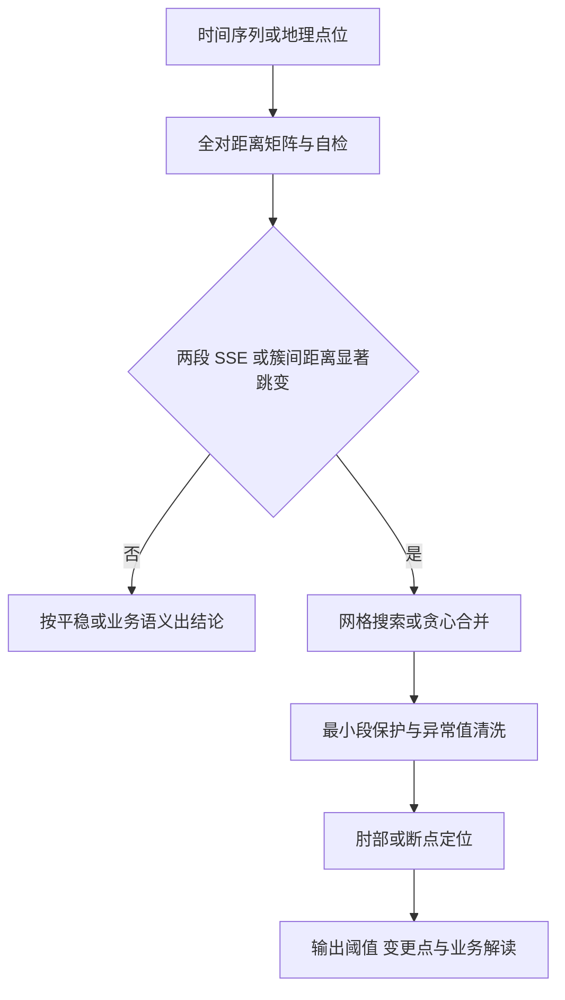
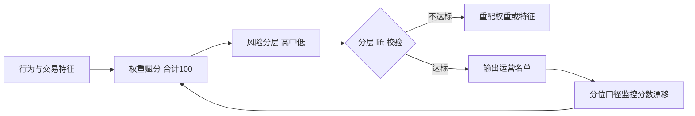
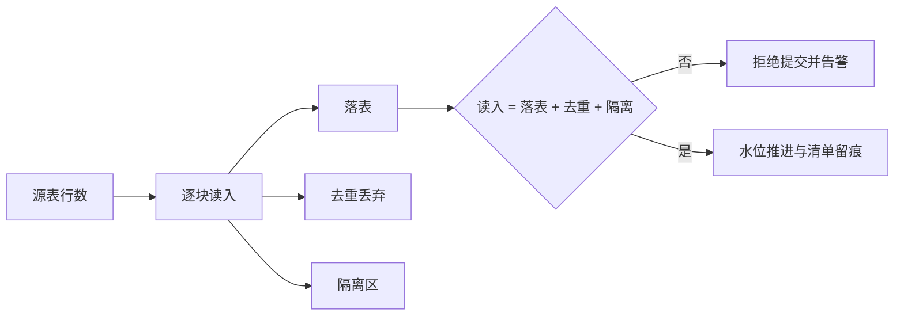
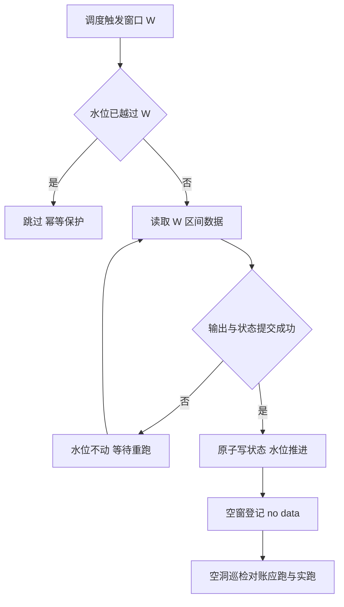
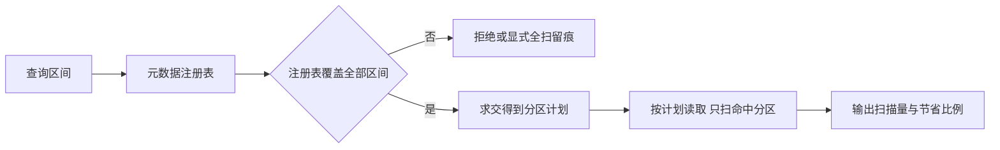
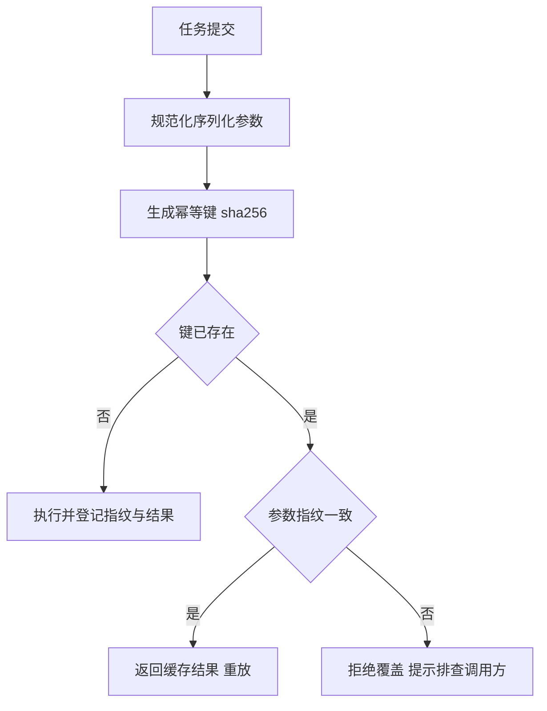
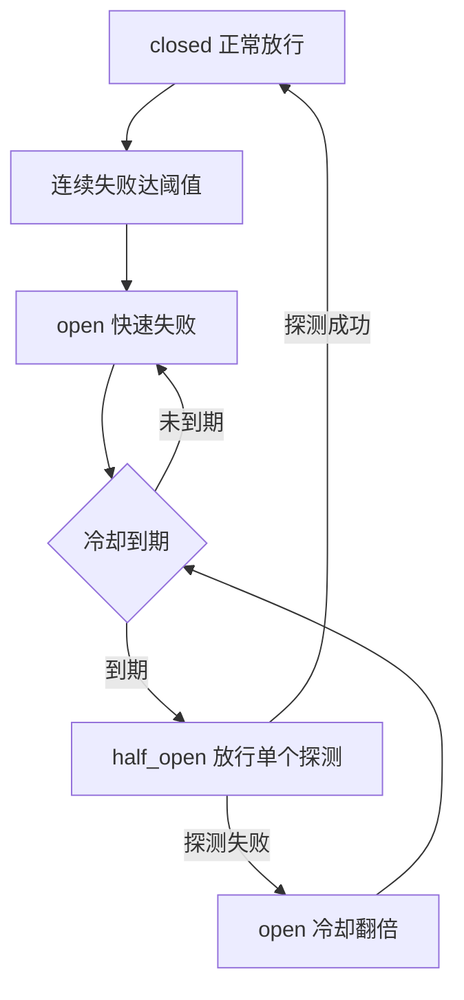
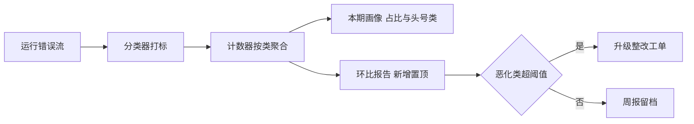
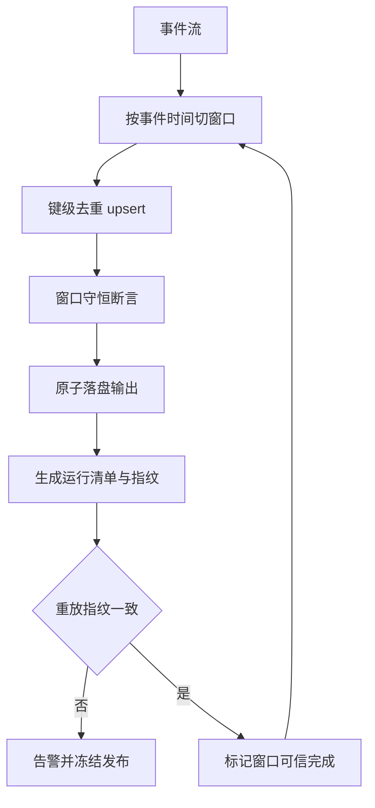

# 第 5 类 · 数据分析与工程化(夜间扩产五)

> 本卷为夜间扩产第五篇(Q2516–Q2560,45 题),三线补遗收官。分析场景补遗:分段回归与断点搜索、辛普森悖论分层复现、地理聚类最小距离矩阵与肘部阈值、RFM 量化边界与跨期滞回、用户合并规则引擎与 ID 映射解绑审计、流失评分卡与分层 lift、曝光去重与频次疲劳、应计实收对照与退款归属桥;数据管道补遗:行数守恒断言与差额分块定位、字段级 diff 报告与分布画像、批量水位提交后推进与空洞检测、运行清单与重放校验、上游心跳双指标检测、断流告警静默期、元数据分区裁剪与扫描预算守卫、应跑未跑对账;工程补遗:幂等键生成规范与冲突拒绝、CLI 的 --json 与 --dry-run 约定、CI 数据质量门禁、产物校验和清单、长查询分级熔断与半开恢复、单测临时数据工厂与边界用例集、错误分类统计与环比报告、依赖时钟注入、导出行列上限保护与自动分片,末题以五道断言做综合演练。
> 难度分布:1-2 星 9 题、3 星 23 题、4-5 星 13 题;题号 Q2516–Q2560 全局唯一,与既有 Q001–Q2515 不重复。
> 纯逻辑题全部标准库可跑;涉及 pandas 的题以 try/except ImportError 包裹,缺库走标准库降级演示且降级路径实跑通过;含故意异常处均已 try/except 包裹。全部 45 段代码已用 /usr/bin/python3(3.9.6)逐题实跑验证通过。

---

### Q2516 · 分段回归:结构性变化的检测

> 难度:★★★★ | 标签:分段回归, 结构变化

**问**:业务方说"感觉渠道效率从某个月起变了",你怎么把这句话变成可检验的结论?

**答**:用分段回归:在候选断点处把时间序列切成两段各拟合一条最小二乘直线,与全程单段拟合比较残差平方和,SSE 显著下降就说明存在结构性变化。实测 24 个月转化率数据,单段 SSE 0.61,在第 13 个月切开后 SSE 下降 57%,前后斜率从 0.09 翻到 0.16,正好对应渠道算法改版时点。关键是必须配反例检验:平稳带噪声的对照数据同法切开 SSE 只降 1%,不触发告警,这说明阈值是有区分度的。单段斜率把两个时代搅在一起,本身就没有业务含义;分段之后"变没变、何时变、变了多少"三个问题一次回答。该方法也常用于评估政策干预和大促改版的前后效应。

```python
# file: code/05_数据分析与工程化/q2516_seg_regression.py
"""分段回归: 用两段最小二乘检测结构性变化"""


def fit_line(xs, ys):
    """一元最小二乘, 返回斜率 截距 残差平方和"""
    n = len(xs)
    mx = sum(xs) / n
    my = sum(ys) / n
    cov = sum((x - mx) * (y - my) for x, y in zip(xs, ys))
    var = sum((x - mx) ** 2 for x in xs)
    slope = cov / var if var else 0.0
    intercept = my - slope * mx
    sse = sum((y - (intercept + slope * x)) ** 2 for x, y in zip(xs, ys))
    return slope, intercept, sse


MONTHS = list(range(1, 25))
# 前 12 个月转化率平缓爬坡, 第 13 个月起渠道算法改版斜率抬升
CONV = [2.0, 2.2, 2.1, 2.4, 2.3, 2.6, 2.5, 2.7, 2.8, 2.7, 3.0, 3.1,
        3.0, 3.4, 3.6, 3.5, 3.9, 4.1, 4.0, 4.4, 4.5, 4.4, 4.8, 5.0]


def segment_gain(xs, ys, k):
    """在 k 处切成两段的 SSE 改善比例"""
    _, _, sse_all = fit_line(xs, ys)
    _, _, sse_a = fit_line(xs[:k], ys[:k])
    _, _, sse_b = fit_line(xs[k:], ys[k:])
    return 1 - (sse_a + sse_b) / sse_all


if __name__ == "__main__":
    slope, _, sse_all = fit_line(MONTHS, CONV)
    gain = segment_gain(MONTHS, CONV, 12)
    s_a, _, _ = fit_line(MONTHS[:12], CONV[:12])
    s_b, _, _ = fit_line(MONTHS[12:], CONV[12:])
    print(f"单段拟合: 斜率 {slope:.3f}, SSE {sse_all:.2f}")
    print(f"两段拟合: 前段斜率 {s_a:.3f}, 后段斜率 {s_b:.3f}, SSE 下降 {gain:.0%}")
    assert gain > 0.5, "改版数据应检出结构性变化"
    print(f"解读: 斜率从 {s_a:.2f} 翻倍到 {s_b:.2f}, 第 13 个月是政策/算法变更点")
    # 反例: 平稳带噪声的数据不应误报
    stable = [3.0 + 0.05 * m + 0.04 * ((m % 3) - 1) for m in MONTHS]
    gain_s = segment_gain(MONTHS, stable, 12)
    print(f"平稳对照数据 SSE 仅下降 {gain_s:.0%}, 不应触发告警")
    assert gain_s < 0.2, "平稳数据不应误报结构变化"
    print("要点: 分段回归把'感觉变了'变成可检验的 SSE 下降, 前后斜率各自解释两个时代")
```

**追问**:
- 追问 1:为什么不直接看环比突刺?—— 环比只看相邻两点,噪声就能造假;分段回归用整段趋势说话,还能给出变化幅度。
- 追问 2:断点已知和未知时做法有何不同?—— 已知变更点直接按点切开检验;未知时用下一题的网格搜索,但要加最小段保护。

### Q2517 · 断点搜索:最小段保护与异常值先行

> 难度:★★★★ | 标签:断点检测, 网格搜索

**问**:变更点不确定时,你怎么搜索断点?搜索会不会被异常值带偏?

**答**:网格搜索:每个候选切点都做一次两段拟合,取总 SSE 最小的位置,但必须加最小段保护——每段至少覆盖一个完整业务周期,本例 min_seg=8。实测干净数据能定位到第 18 个月,SSE 下降 91%;随后在月末放一个 +1.5 的大促异常点,无保护搜索立刻跳到第 28 个月,把"尾部 2 个点"硬凑成假断点,SSE 下降 82% 看似更优实则全是噪声;加保护后短尾段被禁止,但断点仍被拉到第 22 个月,说明保护不消除异常值影响,搜索前要先清洗极值。结论分两层:最小段保护保证"不为你制造假断点",异常值处理保证"真断点不被拉偏",两道工序缺一不可。断点搜索的计算量是 O(n) 次拟合,月度数据毫无压力。

```python
# file: code/05_数据分析与工程化/q2517_breakpoint_search.py
"""断点网格搜索: 最小段保护, 防止尾部小段硬凑出假断点"""


def fit_sse(xs, ys):
    n = len(xs)
    mx, my = sum(xs) / n, sum(ys) / n
    cov = sum((x - mx) * (y - my) for x, y in zip(xs, ys))
    var = sum((x - mx) ** 2 for x in xs)
    slope = cov / var if var else 0.0
    return sum((y - (my - slope * mx + slope * x)) ** 2 for x, y in zip(xs, ys))


def search_break(xs, ys, min_seg):
    """网格搜索最优断点, 每段至少 min_seg 个点, 返回 断点 SSE 改善"""
    sse_all = fit_sse(xs, ys)
    best_k, best_sse = None, sse_all
    for k in range(min_seg, len(xs) - min_seg + 1):
        sse = fit_sse(xs[:k], ys[:k]) + fit_sse(xs[k:], ys[k:])
        if sse < best_sse:
            best_k, best_sse = k, sse
    return best_k, 1 - best_sse / sse_all


MONTHS = list(range(1, 31))
# 真实断点在第 18 个月, 叠加确定性伪噪声
CONV = [0.08 * m + 0.08 * (((m * 11) % 7) - 3) / 3 for m in range(1, 19)]
CONV += [1.44 + 0.16 * (m - 18) + 0.08 * (((m * 11) % 7) - 3) / 3 for m in range(19, 31)]


def to_month(k):
    return f"{2024 + (k - 1) // 12}-{(k - 1) % 12 + 1:02d}"


if __name__ == "__main__":
    k_g, gain_g = search_break(MONTHS, CONV, min_seg=8)
    print(f"干净数据 min_seg=8: 断点在第 {k_g} 个月 {to_month(k_g)}, SSE 下降 {gain_g:.0%}")
    assert k_g == 18, f"应定位到第 18 个月, 实际 {k_g}"
    # 月末大促制造一个极端异常点, 再看两种搜索的表现
    noisy = CONV[:]
    noisy[-1] += 1.5
    k_u, gain_u = search_break(MONTHS, noisy, min_seg=2)
    k_p, gain_p = search_break(MONTHS, noisy, min_seg=8)
    print(f"含月末异常点 min_seg=2: 断点跳到第 {k_u} 个月, SSE 下降 {gain_u:.0%} -> 尾部 2 个点的假断点")
    assert k_u >= 25, "无保护时应被异常点吸到尾部"
    print(f"含月末异常点 min_seg=8: 断点在第 {k_p} 个月, SSE 下降 {gain_p:.0%} -> 小段硬凑被禁止")
    assert k_p <= len(MONTHS) - 8, "有保护时不可能选出超短尾段"
    print("要点: 最小段保护保证不为你制造假断点, 但异常值要先行清洗, 否则长段也会被拉偏")
```

**追问**:
- 追问 1:更严格的做法是什么?—— 对每个候选断点做 Chow 检验或自助法给出显著性,而不是只看 SSE 改善幅度。
- 追问 2:多个断点怎么办?—— 递归二分:先找最显著断点,再对两段各自重复搜索,直到没有段的改善超过阈值。

### Q2518 · 辛普森悖论复现:分层与加权对照

> 难度:★★★☆ | 标签:辛普森悖论, 标准化

**问**:AB 实验里 A 在每个渠道都赢了,B 却在总转化率上赢了,可能吗?

**答**:可能,这就是辛普森悖论,值得亲手复现一次。实测三层数据:A 在搜索 9%、直访 5%、推送 3% 全部高于 B 的 8%、4%、2%,但 B 把 70% 流量堆进高转化的搜索层,聚合后 B 6.7% 反超 A 4.8%。根因是聚合率混合了"层内能力"与"流量结构"两个因素,流量结构被 B 的分配策略污染了。修正方法是标准化:用统一的流量结构权重(各层总访客占比)去加权两边的分层转化率,得到 A 6.2% 对 B 5.3%,方向与分层一致。所以结论顺序是:先看分层是否同向,再看结构差异是否有业务解释,决策用标准化口径而不是裸聚合率。悖论不是数学错误,而是提醒你问对了分层问题没有。

```python
# file: code/05_数据分析与工程化/q2518_simpson_repro.py
"""辛普森悖论复现: 分层全胜却在聚合层翻车, 加权标准化还原真相"""

# 变体 -> 来源层 -> (访客数, 转化数); 每层 A 的转化率都更高
DATA = {
    "A": {"搜索": (200, 18), "直访": (300, 15), "推送": (500, 15)},
    "B": {"搜索": (700, 56), "直访": (250, 10), "推送": (50, 1)},
}


def rate(cell):
    visits, conv = cell
    return conv / visits


if __name__ == "__main__":
    total = sum(v for var in DATA.values() for v, _ in var.values())
    weights = {}
    for src in DATA["A"]:
        n = sum(DATA[var][src][0] for var in DATA)
        weights[src] = n / total
    print("分层转化率(A 应全胜):")
    for src in DATA["A"]:
        ra, rb = rate(DATA["A"][src]), rate(DATA["B"][src])
        assert ra > rb, f"{src} 层 A 应更高"
        print(f"  {src}: A {ra:.1%} > B {rb:.1%}, 该层流量权重 {weights[src]:.0%}")
    agg = {}
    for var, strata in DATA.items():
        v = sum(x for x, _ in strata.values())
        c = sum(y for _, y in strata.values())
        agg[var] = c / v
    print(f"聚合转化率: A {agg['A']:.1%} vs B {agg['B']:.1%}"
          f" -> {'B 胜' if agg['B'] > agg['A'] else 'A 胜'}, 悖论出现")
    assert agg["B"] > agg["A"], "聚合层应出现方向翻转"
    std = {}
    for var, strata in DATA.items():
        std[var] = sum(weights[src] * rate(cell) for src, cell in strata.items())
    print(f"按统一流量结构标准化: A {std['A']:.1%} vs B {std['B']:.1%}"
          f" -> {'A 胜' if std['A'] > std['B'] else 'B 胜'}, 与分层一致")
    assert std["A"] > std["B"], "标准化后应与分层方向一致"
    print("根因: B 把流量堆进高转化层, 聚合率混合了'层内能力'与'结构差异'两个因素")
```

**追问**:
- 追问 1:什么权重才算"统一结构"?—— 用不含分组的总体结构或实验前基期结构,不能用任一变体自身的流量分布。
- 追问 2:什么时候聚合结论反而是对的?—— 当流量结构差异本身就是策略的一部分,比如 B 的投放策略就是有效手段,此时看业务总产出。

### Q2519 · 地理聚类的最小距离矩阵

> 难度:★★★☆ | 标签:地理聚类, haversine

**问**:8 个仓要做片区合并,距离用什么算?怎么聚?

**答**:球面距离用 haversine 公式算,别拿经纬度差直接当距离——纬度 1 度约 111 公里,经度 1 度随纬度收缩。先建全对距离矩阵,三个自检必须做:对角线为 0、矩阵对称、无负值。聚类用贪心合并:每轮找簇间最小距离最小的一对合并,超过业务阈值(如 8 公里)就停,实测 8 个仓聚成 3 个片区加 1 个孤仓,与地图直觉一致。最小距离矩阵还有独立用途:每个站点的最近邻行能直接暴露选点重叠,实测两对仓相距仅 1.4 公里,是明显的重复布点。复杂度 O(n²),几十到几百个点完全够用,上千点再上网格索引或 KD 树加速近邻查询。

```python
# file: code/05_数据分析与工程化/q2519_geo_min_matrix.py
"""地理聚类的最小距离矩阵: haversine 全对距离与贪心合并"""

import math

SITES = [
    ("朝阳仓", 39.920, 116.470), ("通州仓", 39.910, 116.490),
    ("亦庄仓", 39.900, 116.480), ("海淀仓", 40.000, 116.300),
    ("昌平仓", 40.010, 116.310), ("大兴仓", 39.730, 116.340),
    ("房山仓", 39.720, 116.350), ("顺义仓", 40.130, 116.650),
]
THRESHOLD_KM = 8.0


def haversine_km(lat1, lon1, lat2, lon2):
    r = 6371.0
    p1, p2 = math.radians(lat1), math.radians(lat2)
    dp = math.radians(lat2 - lat1)
    dl = math.radians(lon2 - lon1)
    a = math.sin(dp / 2) ** 2 + math.cos(p1) * math.cos(p2) * math.sin(dl / 2) ** 2
    return 2 * r * math.asin(math.sqrt(a))


def dist_matrix(points):
    n = len(points)
    d = [[0.0] * n for _ in range(n)]
    for i in range(n):
        for j in range(i + 1, n):
            km = haversine_km(points[i][1], points[i][2], points[j][1], points[j][2])
            d[i][j] = d[j][i] = km
    return d


def greedy_clusters(points, d, threshold_km):
    clusters = [[i] for i in range(len(points))]
    while len(clusters) > 1:
        best = None
        for a in range(len(clusters)):
            for b in range(a + 1, len(clusters)):
                pair_min = min(d[i][j] for i in clusters[a] for j in clusters[b])
                if best is None or pair_min < best[0]:
                    best = (pair_min, a, b)
        if best[0] > threshold_km:
            break
        _, a, b = best
        clusters[a].extend(clusters[b])
        del clusters[b]
    return clusters


if __name__ == "__main__":
    d = dist_matrix(SITES)
    n = len(SITES)
    assert all(d[i][j] == d[j][i] for i in range(n) for j in range(n)), "矩阵应对称"
    assert all(d[i][i] == 0.0 for i in range(n)), "对角线必须为 0"
    print("站点 0 的距离行: " + ", ".join(f"{SITES[j][0]} {d[0][j]:.1f}km" for j in range(1, n)))
    for i in range(n):
        nn = min((d[i][j], j) for j in range(n) if j != i)
        print(f"  {SITES[i][0]} 最近邻 {SITES[nn[1]][0]} {nn[0]:.1f}km")
    clusters = greedy_clusters(SITES, d, THRESHOLD_KM)
    print(f"贪心合并(阈值 {THRESHOLD_KM}km, 簇间距离取最小对) 得到 {len(clusters)} 个簇:")
    for c in clusters:
        print("  " + " + ".join(SITES[i][0] for i in c))
    assert len(clusters) < n, "阈值应能合并出簇"
    print("要点: 最近邻只看单点, 聚类看簇间最小距离; 复杂度 O(n^2) 起步, 大规模需网格索引")
```

**追问**:
- 追问 1:簇间距离用最小对还是平均对?—— 最小对单链接容易拉链,平均对更稳;按业务含义选,配送片区常用最小对保证簇内可达。
- 追问 2:跨城场景距离公式要换吗?—— 短距离 haversine 足够;跨大洲要考虑椭球模型如 Vincenty,误差从 0.5% 降到 0.01% 量级。

### Q2520 · 聚类停止阈值:合并距离的肘部

> 难度:★★★☆ | 标签:聚类, 肘部法则

**问**:上一题的 8 公里是拍脑袋的吧?阈值有没有数据依据?

**答**:有,用合并距离序列找肘部:把贪心合并每一步的簇间距离记录下来,簇内自然聚合时距离平稳(本例 1.4 到 2.0 公里),跨簇硬凑时距离跳涨(直接跳到 16.9 公里),最大跳变比达 8.3 倍,取跳变两侧的中点 9.5 公里做阈值,得到 4 个簇。肘部的含义是"合并成本突然变贵"的位置,那之后合并的都是不该在一起的点。相比拍一个 5 公里或 10 公里,肘部给了可复现、可解释的依据,还能写进口径字典随数据更新重算。注意肘部不明显时(跳变比小于 2)说明数据没有天然分组,此时应回到业务语义定阈值,而不是硬找肘部。轮廓系数是另一个候选指标,但计算量大且对单链接聚类不敏感,小规模场景肘部更直观。

```python
# file: code/05_数据分析与工程化/q2520_cluster_elbow.py
"""聚类停止阈值: 用合并距离序列的肘部替代拍脑袋"""

import math

SITES = [
    ("朝阳仓", 39.920, 116.470), ("通州仓", 39.910, 116.490),
    ("亦庄仓", 39.900, 116.480), ("海淀仓", 40.000, 116.300),
    ("昌平仓", 40.010, 116.310), ("大兴仓", 39.730, 116.340),
    ("房山仓", 39.720, 116.350), ("顺义仓", 40.130, 116.650),
]


def haversine_km(lat1, lon1, lat2, lon2):
    r = 6371.0
    p1, p2 = math.radians(lat1), math.radians(lat2)
    dp = math.radians(lat2 - lat1)
    dl = math.radians(lon2 - lon1)
    a = math.sin(dp / 2) ** 2 + math.cos(p1) * math.cos(p2) * math.sin(dl / 2) ** 2
    return 2 * r * math.asin(math.sqrt(a))


def merge_distances(points):
    """逐步合并最近的两个簇, 记录每次合并时的簇间最小距离"""
    d = [[haversine_km(p[1], p[2], q[1], q[2]) for q in points] for p in points]
    clusters = [[i] for i in range(len(points))]
    history = []
    while len(clusters) > 1:
        best = None
        for a in range(len(clusters)):
            for b in range(a + 1, len(clusters)):
                pair_min = min(d[i][j] for i in clusters[a] for j in clusters[b])
                if best is None or pair_min < best[0]:
                    best = (pair_min, a, b)
        history.append((best[0], len(clusters) - 1))
        _, a, b = best
        clusters[a].extend(clusters[b])
        del clusters[b]
    return history


def elbow_threshold(history):
    """取相邻合并距离比值最大的一跳之后作为阈值"""
    best_i, best_ratio = 1, 1.0
    for i in range(1, len(history)):
        prev = max(history[i - 1][0], 1e-9)
        ratio = history[i][0] / prev
        if ratio > best_ratio:
            best_i, best_ratio = i, ratio
    return (history[best_i - 1][0] + history[best_i][0]) / 2, best_ratio


if __name__ == "__main__":
    history = merge_distances(SITES)
    print("合并距离序列(距离, 合并后簇数):")
    for dist, k in history:
        print(f"  合并到 {k} 簇时距离 {dist:.1f}km")
    thr, ratio = elbow_threshold(history)
    print(f"肘部: 最大跳变 x{ratio:.1f}, 建议阈值取 {thr:.1f}km")
    assert ratio > 2, "本例应存在明显肘部"
    kept = sum(1 for dist, _ in history if dist <= thr)
    print(f"按该阈值停止合并, 得到 {kept} 个簇; 与按 5km 拍脑袋相比有数据依据")
    print("要点: 肘部找的是'合并成本突然变贵'的位置, 那之后合并的都是跨商圈硬凑")
```

**追问**:
- 肘部不明显时怎么办?——多组随机起点重复合并取平均合并距离序列,或换轮廓系数/Gap Statistic 交叉验证;单一序列的肘部有时真不清晰。
- 阈值取 9.5 还是取跳变点 16.9?——取跳变中点:低于 16.9 的簇内合并全部保留,高于则全部拒绝;取跳变点本身会把边界簇错误拆开。
- 肘部法的前提是什么?——合并是贪心且距离单调增长的;非凸簇或密度差异大的数据上肘部法会失真,要换 DBSCAN 类按密度定义簇的方法。




### Q2521 · RFM 分段边界:分位与间隙法

> 难度:★★★☆ | 标签:RFM, 分箱

**问**:RFM 的 R、F、M 都要打分,分段的切点怎么定才不随意?

**答**:三种方法有优先级。第一是间隙法:把指标排序后找相邻值之间的最大间隔,天然断档处切刀最贴合数据形态,但要加两侧样本量保护(各不少于 25%),实测 F 的间隙法边界是 7 和 8,与分位数法的 4 和 8 不同,间隙法尊重了"8 次以上是一小撮高频用户"的事实。第二是分位数法:保证各段人数均衡,适合段数必须固定的场景,但会把没有断档的连续分布硬切三段。第三是业务规则覆盖:比如 M≥8000 直接定为超级用户,不管分位数怎么说,这类规则来自运营策略必须显式优先。顺序是间隙优先、分位兜底、业务覆盖,三种边界连同段数定义一起写进口径字典,换人复算结果一致。

```python
# file: code/05_数据分析与工程化/q2521_rfm_boundary.py
"""RFM 分段边界: 分位数法与间隙法, 业务规则最后覆盖"""

try:
    import pandas as pd
except ImportError:
    pd = None

CUSTOMERS = [
    # id, R 天数(越小越近), F 次数, M 金额
    ("u1", 5, 12, 8600), ("u2", 40, 2, 700), ("u3", 12, 8, 4200),
    ("u4", 65, 1, 300), ("u5", 20, 5, 1500), ("u6", 8, 15, 9800),
    ("u7", 55, 3, 900), ("u8", 30, 6, 2400), ("u9", 3, 20, 15000),
    ("u10", 75, 1, 150), ("u11", 18, 4, 1100), ("u12", 25, 7, 3300),
]


def quantile_bounds(values, n_seg):
    """等分位切点: 按 rank 均分后取组内最大值作边界"""
    s = sorted(values)
    cuts = []
    for i in range(1, n_seg):
        idx = min(len(s) * i // n_seg, len(s) - 1)
        cuts.append(s[idx])
    return cuts


def gap_bounds(values, n_seg, min_side_ratio=0.25):
    """间隙法: 取最大间隔作切点, 且两侧样本都不得过少"""
    s = sorted(set(values))
    gaps = []
    for a, b in zip(s, s[1:]):
        left = sum(1 for v in values if v <= a)
        right = len(values) - left
        if left >= len(values) * min_side_ratio and right >= len(values) * min_side_ratio:
            gaps.append((b - a, a))
    gaps.sort(reverse=True)
    return sorted(a for _, a in gaps[:n_seg - 1])


def label(value, cuts, reverse=False):
    """reverse=True 时值越小段位越高, 例如 R"""
    seg = sum(1 for c in cuts if value > c)
    return seg if not reverse else (len(cuts) - seg)


if __name__ == "__main__":
    fs = [c[2] for c in CUSTOMERS]
    ms = [c[3] for c in CUSTOMERS]
    q_f, q_m = quantile_bounds(fs, 3), quantile_bounds(ms, 3)
    g_f, g_m = gap_bounds(fs, 3), gap_bounds(ms, 3)
    print(f"F 边界: 分位数法 {q_f}, 间隙法 {g_f}")
    print(f"M 边界: 分位数法 {q_m}, 间隙法 {g_m}")
    assert g_f != q_f, "两法在本例应给出不同边界"
    final_m = g_m if g_m else q_m
    vip = [c[0] for c in CUSTOMERS if c[3] >= 8000]
    counts = {}
    for cid, r, f, m in CUSTOMERS:
        seg_f = label(f, g_f)
        seg_m = label(m, final_m)
        tag = "超级用户" if m >= 8000 else f"F{seg_f}M{seg_m}"
        counts[tag] = counts.get(tag, 0) + 1
    print("业务规则覆盖: M>=8000 直接定为超级用户:", ",".join(vip))
    print("最终分布:", dict(sorted(counts.items())))
    if pd is not None:
        df = pd.DataFrame(CUSTOMERS, columns=["id", "R", "F", "M"])
        print("pandas 视角: F 三分位边界", df["F"].quantile([1 / 3, 2 / 3]).tolist())
    print("要点: 分位数保段数均衡, 间隙法找自然断档, 业务规则兜底, 三者写进口径字典")
```

**追问**:
- 追问 1:R 要反向打分吗?—— 要,间隔天数越小段位越高,label 函数里用 reverse 翻转,方向搞反是 RFM 最常见的实现事故。
- 追问 2:为什么不用 K-means 自动分段?—— K-means 结果难解释且不稳定,运营要的是"F 大于 7"这种可执行规则,不是坐标中心。

### Q2522 · RFM 分段跨期稳定性与滞回

> 难度:★★★★ | 标签:RFM, 稳定性

**问**:用户上月在高频段、这个月掉到中频段又弹回去,分段在边界上反复横跳怎么办?

**答**:先量化再治。做两期转移矩阵:行是上月段位、列是本月段位,对角线外的迁移就是段位流动;再看高频集合的 Jaccard 重叠度,本例两期高频集合 Jaccard 0.71,12 人里 3 人换了段。治理手段是滞回:降级加缓冲带——高频用户 F 回落到 6 减 1 以内不降级,升级即时生效,实测换段人数从 3 降到 2,Jaccard 升到 0.86。这不是篡改数据,而是承认分段是标签不是测量:标签抖动会污染所有下游运营动作,比如刚进高频就退出群发名单。稳定段的标准建议定在跨期重叠 70% 以上,达不到先查边界再查数据,别急着怪业务。滞回带宽按指标噪声水平定,通常一个最小业务单位(1 次购买、1 天间隔)。

```python
# file: code/05_数据分析与工程化/q2522_rfm_stability.py
"""RFM 分段跨期稳定性: 转移矩阵 Jaccard 与降级滞回"""

F1 = {"u1": 12, "u2": 2, "u3": 8, "u4": 1, "u5": 5, "u6": 15,
      "u7": 3, "u8": 6, "u9": 20, "u10": 1, "u11": 4, "u12": 7}
F2 = {"u1": 13, "u2": 3, "u3": 7, "u4": 1, "u5": 6, "u6": 14,
      "u7": 4, "u8": 6, "u9": 18, "u10": 2, "u11": 5, "u12": 5}
HI = 6        # 高频阈值: F>=6
MARGIN = 1    # 降级滞回: 高频用户 F 回落到 HI-MARGIN 以内不降级


def seg(f):
    if f >= HI:
        return "高频"
    return "中频" if f >= 3 else "低频"


def seg_hyst(prev, f):
    if prev == "高频" and f >= HI - MARGIN:
        return "高频"
    return seg(f)


def jaccard(a, b):
    inter = len(a & b)
    union = len(a | b)
    return inter / union if union else 1.0


if __name__ == "__main__":
    raw = {u: seg(f) for u, f in F1.items()}
    raw2 = {u: seg(f) for u, f in F2.items()}
    hyst2 = {u: seg_hyst(raw[u], f) for u, f in F2.items()}
    labels = ["高频", "中频", "低频"]
    matrix = {(a, b): 0 for a in labels for b in labels}
    for u in F1:
        matrix[(raw[u], raw2[u])] += 1
    print("原始转移矩阵(行=上月, 列=本月):")
    for a in labels:
        print("  " + a + ": " + ", ".join(f"{b} {matrix[(a, b)]}" for b in labels))
    flips_raw = sum(1 for u in F1 if raw[u] != raw2[u])
    flips_hyst = sum(1 for u in F1 if raw[u] != hyst2[u])
    hi1 = {u for u, s in raw.items() if s == "高频"}
    j_raw = jaccard(hi1, {u for u, s in raw2.items() if s == "高频"})
    j_hyst = jaccard(hi1, {u for u, s in hyst2.items() if s == "高频"})
    print(f"换段人数: 原始 {flips_raw}, 加滞回 {flips_hyst}; 高频集合 Jaccard: {j_raw:.2f} -> {j_hyst:.2f}")
    assert flips_hyst < flips_raw and j_hyst > j_raw, "滞回应降低抖动"
    print("要点: 边界上的用户在两期之间反复横跳, 降级加一段缓冲带, 升级即时生效")
```

**追问**:
- 追问 1:滞回会不会让降级太迟钝?—— 会有一期延迟,这是买稳定性的代价;对时效敏感的场景可以只对升配加滞回。
- 追问 2:怎么区分边界抖动和真实流失?—— 看绝对指标是否同步下滑,F 从 7 掉到 5 还在买是抖动,F 掉到 0 且 R 拉长是真流失。

### Q2523 · 用户合并的规则引擎

> 难度:★★★☆ | 标签:实体消解, 规则引擎

**问**:同一个用户注册了三四个账号,什么条件能自动合并,什么必须人工复核?

**答**:用规则引擎按证据强度分层裁决,规则按序执行、命中即返回。强证据自动合并:归一化后的手机号相同(138-0000-1111 与 13800001111 是一个号)、或归一化邮箱相同,实测 a1 与 a2 命中同手机号直接 AUTO_MERGE。弱证据进人工复核:同名同市但一方缺手机号,证据不足以自动合并,进 REVIEW 队列。都不命中就 KEEP。归一化是前置工序:去空白、统一小写、剥分隔符,脏数据不归一,强证据也会漏配。引擎的关键设计是规则注册表:裁决循环只写一次,新证据(如同一设备号)以 lambda 追加进注册表并插到队首即可,实测注册后 a1 与 a5 凭设备号自动合并,核心代码零改动。手机号可以带定位兜底,但自动合并永远要求至少一条强证据。

```python
# file: code/05_数据分析与工程化/q2523_merge_rule_engine.py
"""用户合并的规则引擎: 证据分层裁决, 规则可注册不可改核"""


def norm_phone(p):
    return "".join(ch for ch in (p or "") if ch.isdigit()) or None


def norm_email(e):
    return (e or "").strip().lower() or None


RULES = [
    {"name": "同手机号", "tier": "AUTO_MERGE",
     "test": lambda a, b: norm_phone(a["phone"]) and norm_phone(a["phone"]) == norm_phone(b["phone"])},
    {"name": "同邮箱", "tier": "AUTO_MERGE",
     "test": lambda a, b: norm_email(a["email"]) and norm_email(a["email"]) == norm_email(b["email"])},
    {"name": "同名同市缺手机", "tier": "REVIEW",
     "test": lambda a, b: a["name"] == b["name"] and a["city"] == b["city"]
                          and (not norm_phone(a["phone"]) or not norm_phone(b["phone"]))},
]


def decide(ra, rb):
    """规则按注册顺序即证据强度裁决, 命中即返回"""
    for rule in RULES:
        if rule["test"](ra, rb):
            return rule["tier"], rule["name"]
    return "KEEP", None


A1 = {"id": "a1", "phone": "13800001111", "email": "a@x.com", "name": "张三", "city": "北京", "device": None}
A2 = {"id": "a2", "phone": "138-0000-1111", "email": " A@X.com ", "name": "张三", "city": "北京", "device": None}
A3 = {"id": "a3", "phone": None, "email": "zhangsan@x.com", "name": "张三", "city": "北京", "device": "d9"}
A4 = {"id": "a4", "phone": "13911112222", "email": "l@x.com", "name": "李四", "city": "上海", "device": None}
A5 = {"id": "a5", "phone": "13600009999", "email": "w@x.com", "name": "王五", "city": "广州", "device": "d1"}
A1["device"] = "d1"


if __name__ == "__main__":
    for ra, rb in [(A1, A2), (A1, A3), (A1, A4)]:
        tier, rule = decide(ra, rb)
        print(f"{ra['id']} vs {rb['id']}: {tier}" + (f" 证据={rule}" if rule else ""))
    assert decide(A1, A2)[0] == "AUTO_MERGE"
    assert decide(A1, A3)[0] == "REVIEW"
    assert decide(A1, A4)[0] == "KEEP"
    # 动态注册新证据: 同设备号视为强证据, 只追加不改核
    RULES.insert(0, {"name": "同设备号", "tier": "AUTO_MERGE",
                     "test": lambda a, b: a["device"] and a["device"] == b["device"]})
    tier, rule = decide(A1, A5)
    print(f"注册'同设备号'规则后 {A1['id']} vs {A5['id']}: {tier} 证据={rule}")
    assert tier == "AUTO_MERGE" and rule == "同设备号"
    print("要点: 强证据自动合并, 弱证据进人工复核队列, 新证据规则只追加进注册表")
```

**追问**:
- 追问 1:全家共用一个手机号怎么办?—— 强证据也会误并,auto 合并前可以加黑名单(同号多姓名)拦截,宁漏勿错。
- 追问 2:候选对从哪来?—— 别做全量两两比对,用手机号、邮箱、设备号做分桶,只在桶内生成候选对,O(n²) 降为近似线性。

### Q2524 · 合并的 ID 映射与解绑审计

> 难度:★★★☆ | 标签:ID 映射, 审计

**问**:账号合并之后,历史订单还挂在旧 ID 上,查询怎么写?合错了能反悔吗?

**答**:不改历史数据,只加映射层:维护 old_id 到 canonical 的映射表,每条记录带合并时间、操作人与原因,查询时用 resolve 函数沿映射链解析到规范 ID。实测 a2、a3 合并进 u_main 后,resolve(a2) 返回 u_main;发现 a3 是误合并后走 unmerge:校验该旧 ID 的主 ID 确实是 u_main,弹出映射并强制写审计(操作人 op_liu、原因"误合并, 用户申诉成立"),此后 resolve(a3) 返回 a3 自己,历史数据从未被改写,报表随时可按当前映射重算。两条防线必须有:主 ID 不可解绑(它不是映射项),已合并的旧 ID 不可重复合并,实测都抛出明确异常。合并要可回滚是实体消解的底线,凡是"物理改写旧 ID"的方案,误合并就是数据事故。

```python
# file: code/05_数据分析与工程化/q2524_id_mapping_audit.py
"""合并后的 ID 映射与解绑审计: 可解析 可反悔 可追责"""

from datetime import datetime

MAPPING = {}      # old_id -> {"canonical": ..., "merged_at": ..., "reason": ..., "operator": ...}
AUDIT = []


def apply_merge(canonical, old_id, operator, reason, now=None):
    if old_id == canonical:
        raise ValueError("不能把主 ID 合并进自己")
    if old_id in MAPPING:
        raise ValueError(f"{old_id} 已合并过, 需先解绑")
    MAPPING[old_id] = {"canonical": canonical, "merged_at": now or datetime(2026, 3, 1, 10),
                       "reason": reason, "operator": operator}


def resolve(uid, _seen=None):
    """沿映射链解析到规范 ID, 带环检测"""
    seen = _seen or set()
    if uid in seen:
        raise ValueError(f"映射链出现环: {uid}")
    seen.add(uid)
    if uid in MAPPING:
        return resolve(MAPPING[uid]["canonical"], seen)
    return uid


def unmerge(canonical, old_id, operator, reason, now=None):
    """解绑必须写审计: 谁 何时 为什么; 主 ID 不可解绑"""
    if old_id not in MAPPING:
        raise ValueError(f"{old_id} 不存在合并记录")
    if MAPPING[old_id]["canonical"] != canonical:
        raise ValueError(f"{old_id} 的主 ID 不是 {canonical}")
    MAPPING.pop(old_id)
    AUDIT.append({"event": "UNMERGE", "old_id": old_id, "canonical": canonical,
                  "operator": operator, "reason": reason, "at": now or datetime(2026, 3, 5, 15)})


if __name__ == "__main__":
    apply_merge("u_main", "a2", "op_chen", "客服确认同手机号")
    apply_merge("u_main", "a3", "auto_job", "同名同市自动合并")
    print("合并后: resolve(a2) =", resolve("a2"), ", resolve(a3) =", resolve("a3"))
    assert resolve("a2") == "u_main" and resolve("a3") == "u_main"
    unmerge("u_main", "a3", "op_liu", "误合并, 用户申诉成立")
    print("解绑后: resolve(a3) =", resolve("a3"))
    assert resolve("a3") == "a3"
    for item in AUDIT:
        print(f"审计: {item['at']} {item['operator']} 解绑 {item['old_id']} <- {item['canonical']}, 原因: {item['reason']}")
    try:
        unmerge("u_main", "u_main", "op_x", "误操作")
    except ValueError as e:
        print("主 ID 不可解绑:", e)
    print("要点: 合并只加映射不改历史数据, 解绑走审计留痕, 报表随时可按当前映射重算")
```

**追问**:
- 追问 1:映射链变长了怎么办?—— 定期路径压缩,把深层映射直接指到最终规范 ID;resolve 里带环检测防脏数据成环。
- 追问 2:映射表放 OLTP 还是数仓?—— 两边都要:OLTP 用于实时查询改写,数仓按日快照供历史报表按"当时映射"或"当前映射"双口径重算。

### Q2525 · 流失评分卡:权重赋分与风险分层

> 难度:★★★☆ | 标签:流失预警, 评分卡

**问**:不用机器学习,怎么快速搭一个流失预警评分?

**答**:评分卡三步走。第一步选特征定权重:近 7 日未登录 30 分、客单价环比下降 20 分、未结客诉 20 分、距上次购买超 1.5 倍周期 20 分、新客未复购 10 分,权重和恒为 100,分数即"流失风险百分比的心智模型",业务方能一眼读懂。第二步分层:60 分以上高危、40 到 59 中危、其余低危,阈值看 lift 定。第三步回验:拿有标签样本算每组实际流失率与整体基线之比,实测高危组流失率 100%、低危组 0%,整体 50%,高危 lift 2.0,说明分层有区分度才算成立。评分卡的价值在可解释和可运营:每个分数都能指着具体特征解释,客服按名单外呼即可。局限也明确:权重靠经验,特征间有相关性时会重复计分,上线后要用持续回流的真实标签滚动校准。

```python
# file: code/05_数据分析与工程化/q2525_churn_scorecard.py
"""流失评分卡: 权重赋分 风险分层与 lift 校验"""

WEIGHTS = {
    "近7日未登录": 30,
    "客单价环比下降": 20,
    "未结客诉": 20,
    "距上次购买超1.5倍周期": 20,
    "新客未复购": 10,
}
USERS = [
    # id, 命中特征, 实际是否流失
    ("u1", ["近7日未登录", "客单价环比下降", "未结客诉", "距上次购买超1.5倍周期", "新客未复购"], True),
    ("u2", ["近7日未登录", "未结客诉"], True),
    ("u3", ["客单价环比下降", "新客未复购"], False),
    ("u4", ["距上次购买超1.5倍周期"], False),
    ("u5", ["近7日未登录", "距上次购买超1.5倍周期"], True),
    ("u6", ["近7日未登录", "客单价环比下降", "未结客诉"], True),
    ("u7", [], False),
    ("u8", ["新客未复购"], False),
]


def score(flags):
    return sum(WEIGHTS[f] for f in flags)


def band(s):
    if s >= 60:
        return "高危"
    return "中危" if s >= 40 else "低危"


if __name__ == "__main__":
    assert sum(WEIGHTS.values()) == 100, "权重必须配满 100 分"
    rows = []
    for uid, flags, churn in USERS:
        rows.append((uid, score(flags), band(score(flags)), churn))
    print("用户打分:")
    for uid, s, b, churn in rows:
        print(f"  {uid}: {s:3d} 分 {b} 实际流失={churn}")
    base = sum(c for *_, c in rows) / len(rows)
    print(f"整体流失率 {base:.1%}")
    for b in ["高危", "中危", "低危"]:
        grp = [c for _, _, bb, c in rows if bb == b]
        if not grp:
            continue
        rate = sum(grp) / len(grp)
        print(f"  {b}: n={len(grp)} 流失率 {rate:.0%} lift {rate / base:.2f}")
    hi = [c for _, _, bb, c in rows if bb == "高危"]
    assert sum(hi) / len(hi) > base, "高危组流失率必须显著高于整体"
    print("要点: 权重和恒为 100 便于解读, 分层阈值看 lift 定, 评分卡上线前必须用有标签样本回验")
```

**追问**:
- 追问 1:特征相关性怎么处理?—— 同源特征合并或降权,比如"未登录"与"未购买"高度重叠,合并成一条或各给一半权重。
- 追问 2:什么时候必须升级到模型?—— 特征超过十几条、需要非线性交互、或 lift 不再达标时,上逻辑回归拿系数反推权重。

### Q2526 · 评分卡校验:分层 lift 与分数漂移

> 难度:★★★★ | 标签:评分卡, 分数漂移

**问**:评分卡上线后,怎么证明它还有效?

**答**:两个校验。一是分层 lift:按分数排序切十分位,逐组算实际流失率与基线之比,实测头部十分位 lift 2.86、单调递减到尾部队 0,曲线单调说明分数有区分力,曲线翻转说明权重该重配了。二是分数漂移:全员行为变化会让分数整体位移,实测次月所有用户分数统一抬升 25 分后,固定阈值 60 分的命中名单从 18 人膨胀到 29 人,运营容量瞬间被击穿;改用分位数口径——取分数最高 25% 做名单——两期都是 10 人,规模稳定。正确姿势是双轨:绝对分阈值解读业务含义(60 分以上值得外呼),相对分位生成行动名单,漂移监控盯分数分布的 PSI。分数是仪表盘不是刻在石头上的律法,分布变了校准就要跟。

```python
# file: code/05_数据分析与工程化/q2526_scorecard_lift.py
"""评分卡校验: 十分位 lift 曲线与分数漂移的口径修正"""

USERS = []
for i in range(40):
    USERS.append({"id": f"u{i:02d}", "score": 10 + (i * 37) % 90})
USERS.sort(key=lambda u: -u["score"])
for j, u in enumerate(USERS):          # 分数越高流失概率越高, 用排序位造标签
    u["churn"] = j < 14

RAW_THRESHOLD = 60
DRIFT_DELTA = 25                        # 次月全员行为变化, 分数整体抬升


def decile_lift(users, parts=10):
    n = len(users)
    size = n // parts
    base = sum(u["churn"] for u in users) / n
    lifts = []
    for d in range(parts):
        grp = users[d * size:(d + 1) * size]
        rate = sum(u["churn"] for u in grp) / size
        lifts.append(rate / base)
    return base, lifts


if __name__ == "__main__":
    base, lifts = decile_lift(USERS)
    print("十分位 lift(第1组=分数最高): " + ", ".join(f"D{i + 1} {l:.2f}" for i, l in enumerate(lifts)))
    assert lifts[0] > 2 * lifts[-1], "头部组 lift 应显著高于尾部组"
    print(f"整体流失率 {base:.0%}, 头部十分位 lift {lifts[0]:.2f}")
    month1 = [u["score"] for u in USERS]
    month2 = [min(s + DRIFT_DELTA, 100) for s in month1]
    raw1 = sum(1 for s in month1 if s >= RAW_THRESHOLD)
    raw2 = sum(1 for s in month2 if s >= RAW_THRESHOLD)
    print(f"固定阈值 {RAW_THRESHOLD} 分: 本月命中 {raw1} 人, 次月命中 {raw2} 人 -> 行为漂移导致误报膨胀")
    assert raw2 > raw1 * 1.5, "次月原始阈值命中数应显著膨胀"
    k = len(USERS) // 4
    print(f"改为分位数口径(取分数最高 25%): 本月 {k} 人, 次月 {k} 人 -> 名单规模稳定")
    assert k == 10
    print("要点: 阈值用绝对分解读业务含义, 拿名单看相对分位, 二者并行才扛得住分布漂移")
```

**追问**:
- 为什么固定阈值会被漂移击穿?——分数分布整体位移时,固定分数线两侧的人群数量剧变,运营容量是按人配的;分位数口径自动适配分布位移。
- lift 单调性怎么用?——头部组 lift 高且逐组递减说明排序有效;出现翻转(中段比头部高)说明某维权重把人群排反了,要回权重配置查。
- 怎么决定用哪个口径上线?——看下游消费方式:固定阈值便于解释和 SLA,分位数口径容量稳定;两者都要在监控里配漂移告警。




### Q2527 · 运营曝光去重:毛曝光与独立触达

> 难度:★★☆☆ | 标签:曝光去重, 触达

**问**:活动报表里曝光 9 万次,老板问"到底多少人看到了",怎么答?

**答**:把三个口径拆开算:毛曝光是日志条数,考核投放执行;去重触点是同一"用户×活动×素材"在合并窗口内的重复投递只计一次,考核真实到达;独立触达是去重后的去重用户数,考核人头。实测 c1 活动毛曝光 5 条、窗口内重复 1 条、去重后 4 个触点、独立用户 3 人;u1 在 c2 活动的重复点击跨渠道发生,照样要被合并窗口剔掉。窗口长度按投放节奏定:信息流短(5 到 10 分钟)、EDM 长(小时级),定短了重复漏剔、定长了真实频次被抹掉。跨活动汇总时独立用户必须按人重算,同一个人在两个活动各被触达,总数只能算一个人头。三个数混用是渠道汇报里最常见的注水方式,先把口径钉死再谈数字。

```python
# file: code/05_数据分析与工程化/q2527_exposure_dedup.py
"""运营曝光去重: 毛曝光 触点去重与独立触达"""

from datetime import datetime, timedelta

IMPS = [
    # 用户, 活动, 素材, 渠道, 时间
    ("u1", "c1", "v1", "push", "09:00"),
    ("u1", "c1", "v1", "push", "09:05"),    # 10 分钟窗口内重复投递
    ("u1", "c1", "v1", "push", "09:20"),    # 窗口外, 计一次
    ("u2", "c1", "v1", "feed", "10:00"),
    ("u3", "c1", "v2", "feed", "10:00"),
    ("u1", "c2", "v1", "search", "11:00"),
    ("u1", "c2", "v1", "search", "11:05"),  # 10 分钟窗口内跨渠道重复投递
    ("u2", "c2", "v1", "search", "12:00"),
    ("u4", "c2", "v1", "search", "12:00"),
]
WINDOW = timedelta(minutes=10)


def dedup(imps):
    """同一 用户x活动x素材 在合并窗口内只计一个触点"""
    kept = []
    last_seen = {}
    for user, camp, creative, channel, ts in sorted(imps, key=lambda x: x[4]):
        key = (user, camp, creative)
        t = datetime.strptime(ts, "%H:%M")
        if key in last_seen and t - last_seen[key] < WINDOW:
            continue
        last_seen[key] = t
        kept.append((user, camp, creative, channel, ts))
    return kept


if __name__ == "__main__":
    kept = dedup(IMPS)
    campaigns = sorted({row[1] for row in IMPS})
    print(f"{'活动':<4} 毛曝光 去重后 独立用户 人均频次")
    for camp in campaigns:
        raw = [r for r in IMPS if r[1] == camp]
        kp = [r for r in kept if r[1] == camp]
        users = {r[0] for r in kp}
        freq = len(kp) / len(users)
        print(f"{camp:<4} {len(raw):4d} {len(kp):6d} {len(users):6d} {freq:8.2f}")
    assert len(IMPS) == 9 and len(kept) == 7, "应剔掉 2 条窗口内重复"
    same_user_multi = len({r[0] for r in kept if r[1] == "c1"} & {r[0] for r in kept if r[1] == "c2"})
    print(f"跨活动独立用户仍按人计: u1 同时出现在 {same_user_multi} 个活动, 汇总去重不许重复算人头")
    print("要点: 毛曝光考核投放执行, 去重触点考核真实到达, 独立触达考核人头, 三个数不可混用")
```

**追问**:
- 追问 1:去重键为什么含素材?—— 换素材是真实的再次曝光,不算重复;同素材短窗口内连投才是重试或叠加。
- 追问 2:设备去重和人去重的差距怎么估?—— 用登录用户的账号-设备映射估一机多号比例,未登录流量单独标注,不可硬并。

### Q2528 · 曝光频次分布与疲劳信号

> 难度:★★★☆ | 标签:频次, 素材疲劳

**问**:投放团队说"曝光越多效果越好",数据支持吗?

**答**:把用户按活动期总曝光频次分桶(1 次、2 次、3 到 5 次、6 到 10 次、11 次以上),逐桶算 CTR,疲劳曲线自己会说话。实测 CTR 在 3 到 5 次档达到峰值 33.3%,6 到 10 次档跌到 16.7%,11 次以上只剩 3.7%,比峰值缩水九成——频次超过 6 之后,每多投一次的边际 CTR 急跌,钱花在已疲劳的人身上。结论不是"曝光无用",而是有有效频次窗口:低频段 CTR 低是因为还没形成记忆,中频段最佳,高频段是纯浪费。运营动作有三:按 6 到 8 次设频次上限、高频桶轮换素材重置疲劳、把省下的预算挪给未触达用户。汇报时用分桶 CTR 而不是总体 CTR,总体会被频次结构变化悄悄带偏。

```python
# file: code/05_数据分析与工程化/q2528_frequency_fatigue.py
"""曝光频次分布与疲劳信号: CTR 随频次衰减的实测"""

USERS = [
    # 用户在活动期的总曝光次数与总点击数
    (1, 0), (2, 0), (3, 1), (4, 1), (5, 2),
    (6, 2), (7, 1), (8, 1), (9, 1), (12, 1), (15, 0),
]
BUCKETS = [("1", 1, 1), ("2", 2, 2), ("3-5", 3, 5), ("6-10", 6, 10), ("11+", 11, 10 ** 9)]


def bucket_of(n):
    for name, lo, hi in BUCKETS:
        if lo <= n <= hi:
            return name
    raise ValueError(n)


if __name__ == "__main__":
    agg = {name: [0, 0] for name, _, _ in BUCKETS}
    for imp, click in USERS:
        b = bucket_of(imp)
        agg[b][0] += imp
        agg[b][1] += click
    print(f"{'频次档':<6} 曝光 点击 CTR")
    ctrs = {}
    for name, _, _ in BUCKETS:
        imp, click = agg[name]
        if imp == 0:
            continue
        ctr = click / imp
        ctrs[name] = ctr
        print(f"{name:<6} {imp:4d} {click:4d} {ctr:6.1%}")
    peak = max(ctrs, key=ctrs.get)
    last = [b for b in ("6-10", "11+") if b in ctrs][-1]
    print(f"峰值在 {peak} 档({ctrs[peak]:.1%}), 高频档 {last} 跌到 {ctrs[last]:.1%}, 疲劳明显")
    assert ctrs[peak] > ctrs[last] * 5, "高频档应显著衰减"
    print("要点: 频次超 6 后每多投一次的边际 CTR 急跌, 与其加频次不如换素材或直接封顶")
```

**追问**:
- 追问 1:相关性不等于因果,高频 CTR 低会不会是人群差异?—— 会的,重度曝光人群本身转化意愿可能不同,用同一人群的前后对比或频次上限实验来确认因果。
- 追问 2:分桶边界怎么定?—— 前 3 档按单次精确定位拐点,之后按倍数段粗分,保证每桶曝光量足够大,否则 CTR 噪声淹没趋势。

### Q2529 · 收入口径:应计与实收对照

> 难度:★★★☆ | 标签:收入确认, 递延收入

**问**:财务说一季度收入 300 万,经营报表说 1200 万,谁错了?

**答**:都没错,是两个口径。收付实现制(实收)按钱到账记账:年费 1200 元 1 月 1 日一次收清,实收口径 1 月 1200、2 月 0、3 月 0;权责发生制(应计)按服务发生记账:每月确认 100,三个月各 100。连接两口径的是递延收入(合同负债)滚存:期初 0 + 新收款 1200 - 本期确认 300 = 期末 900,滚存式必须逐期守恒,实测 Q1 末余额正是 900。全年看两口径总收入相等,差异只是时间分布,所以"谁错了"的答案是:看现金流用实收,看经营业绩用应计,递延余额是两者的桥。月付订阅则两口径逐月一致,对照表能直接暴露预收模式的收入前置风险——实收漂亮的月份可能正在透支未来服务。

```python
# file: code/05_数据分析与工程化/q2529_accrual_cash.py
"""收入口径: 应计(权责发生)与实收(现金收付)对照与递延收入滚存"""

MONTHS_Q1 = ["1月", "2月", "3月"]
ANNUAL_PRICE = 1200          # 年费订阅, 1 月 1 日一次性收款
MONTHLY_RECOG = ANNUAL_PRICE / 12


def accrual_view():
    """权责发生制: 服务逐月确认, 每月 100"""
    return {m: MONTHLY_RECOG for m in MONTHS_Q1}


def cash_view():
    """收付实现制: 钱几月到账算几月收入"""
    return {"1月": ANNUAL_PRICE, "2月": 0.0, "3月": 0.0}


def deferred_rollforward(opening, billed, recognized):
    """递延收入(合同负债)滚存: 期初 + 新收款 - 本期确认 = 期末"""
    closing = opening + billed - recognized
    assert abs((closing + recognized) - (opening + billed)) < 1e-9, "滚存必须守恒"
    return closing


if __name__ == "__main__":
    acc, cash = accrual_view(), cash_view()
    print(f"{'月份':<4} 实收口径 应计口径 递延余额")
    deferred = 0.0
    for m in MONTHS_Q1:
        deferred = deferred_rollforward(deferred, cash[m], acc[m])
        print(f"{m:<4} {cash[m]:8.0f} {acc[m]:6.0f} {deferred:8.0f}")
    assert deferred == 900.0, "Q1 末递延收入应为 900"
    # 全年口径守恒: 现金总收入 == 应计总收入, 差的只是时间分布
    total_cash = ANNUAL_PRICE
    total_acc = sum(MONTHLY_RECOG for _ in range(12))
    assert abs(total_cash - total_acc) < 1e-9
    print(f"全年对照: 实收 {total_cash:.0f} == 应计 {total_acc:.0f}, 两口径全年守恒, 差异只在月份分布")
    print("要点: 看现金流用实收, 看经营业绩用应计, 递延余额是两者的桥, 滚存必须逐期守恒")
```

**追问**:
- 追问 1:递延余额怎么用?—— 它是未来已收款的履约义务,除以月确认额直接给出收入跑道长度,也是预收模式下退费风险的上限。
- 追问 2:中途退费怎么处理?—— 从递延余额扣未履约部分退现金,已确认部分走当期冲减,滚存式天然支持逐笔追溯。

### Q2530 · 退款冲销:净收入桥与归属口径

> 难度:★★★★ | 标签:退款对账, 口径治理

**问**:三月净收入突然跌了 8%,但销售说业务没变,查出来是什么?

**答**:查到的是一笔一月老订单的退款。退款归属有两种政策:政策 A 记在退款发生月,历史不动,实测 3 月净收入 105 减两笔退款 7 得 98,环比 -8.4%,跌幅里 5 个点是 1 月旧账砸下来的假波动;政策 B 冲回原销售月,3 月只承担自己的 2 笔退款得 103,环比 -3.7% 反映真实经营,但 1 月要重述为 95,报表必须脚注标 restated。两种政策都对,错的是混用和漂移:政策一经选用必须冻结,换口径等于换指标;同月环比只能在同一政策下比较。实操上给每笔退款留两个字段——原销售月与退款月——两种桥随时都能出,口径选择留给报表层而不是把 ETL 写死。跨月退款永远会制造 A 口径的假波动,这是它必须配脚注的原因。

```python
# file: code/05_数据分析与工程化/q2530_refund_bridge.py
"""退款冲销: 净收入桥与归属口径的抉择"""

GROSS = {"1月": 100, "2月": 110, "3月": 105}     # 千元
# 退款事件: 原销售月, 退款发生月, 金额
REFUNDS = [("1月", "3月", 5), ("2月", "2月", 3), ("3月", "3月", 2)]
MONTHS = ["1月", "2月", "3月"]


def net_by_refund_month():
    """政策A: 退款记在退款发生月, 历史不动"""
    net = dict(GROSS)
    for _, refund_m, amt in REFUNDS:
        net[refund_m] -= amt
    return net


def net_by_sale_month():
    """政策B: 退款冲回原销售月, 历史月份需重述"""
    net = dict(GROSS)
    for sale_m, _, amt in REFUNDS:
        net[sale_m] -= amt
    return net


def mom(net):
    return {m: (net[m] / net[p] - 1) * 100 for p, m in zip(MONTHS, MONTHS[1:])}


if __name__ == "__main__":
    a, b = net_by_refund_month(), net_by_sale_month()
    print("政策A 按退款月: " + ", ".join(f"{m} 净收入 {a[m]}" for m in MONTHS))
    print("政策B 归原销售月: " + ", ".join(f"{m} 净收入 {b[m]}" for m in MONTHS))
    assert a["3月"] != b["3月"], "两种政策对 3 月应给出不同的净收入"
    print(f"政策A 环比: 2月 {mom(a)['2月']:+.1f}%, 3月 {mom(a)['3月']:+.1f}%"
          " <- 3月大跌其实是 1 月的旧账退款砸下来的")
    print(f"政策B 环比: 2月 {mom(b)['2月']:+.1f}%, 3月 {mom(b)['3月']:+.1f}%"
          " <- 平滑, 但 1 月是重述数, 报表必须脚注标 restated")
    assert a["1月"] == 100 and b["1月"] == 95, "政策B 重述 1 月"
    print("要点: 归属口径一经选用必须冻结, 换口径等于换指标; 跨月退款永远会制造 A 口径的假波动")
```

**追问**:
- 追问 1:已出报表的历史月份被重述,怎么管理?—— 版本化报表快照,重述月打 restated 标记并记录重述原因,凡引用旧数的地方给出迁移指引。
- 追问 2:退款还有第三种口径吗?—— 有,坏账口径:超期未追回的退款单独列示,不影响净收入桥但影响利润表,三条线各管各的。

### Q2531 · 目标表行数守恒断言

> 难度:★★☆☆ | 标签:数据对账, 守恒

**问**:ETL 跑完了,你怎么保证没有静默丢数据?

**答**:上守恒断言:源表读入行数 = 落表 + 去重丢弃 + 隔离区,三笔支出都必须显式记账,差一行就拒绝提交。实测三块共 3000 行的正常批次守恒通过;把中间一块改成"读入 1000、落表 900、去重 0、隔离 1",断言当场爆炸并报出"差额 99",而不是等月底对账才发现少了 99 行说不出去向。守恒式的价值在于把"数据去哪了"变成强制回答:每一行输入必须在三个出口里选一个,不允许第四种消失方式。落地时逐块校验加总账双保险,块级失败能直接定位分片。配套的隔离区要有人管:隔离行数持续增长说明上游 schema 或质量在恶化,守恒通过不代表数据健康,只代表去向清楚。

```python
# file: code/05_数据分析与工程化/q2531_row_conservation.py
"""目标表行数守恒断言: 输入 = 落表 + 去重 + 隔离, 差一行都不行"""


class ConservationError(Exception):
    """行数守恒被破坏"""


def check_chunks(chunks):
    """chunks: 每块 (读入, 落表, 去重丢弃, 隔离区); 逐块与总账双重校验"""
    total_read = total_out = 0
    for i, (read, written, dup, reject) in enumerate(chunks):
        if read != written + dup + reject:
            raise ConservationError(
                f"第 {i} 块守恒失败: 读入 {read} != 落表 {written} + 去重 {dup} + 隔离 {reject}"
                f", 差额 {read - written - dup - reject}")
        total_read += read
        total_out += written + dup + reject
    return total_read, total_out


if __name__ == "__main__":
    good = [(1000, 950, 30, 20), (1000, 990, 5, 5), (1000, 995, 3, 2)]
    read, out = check_chunks(good)
    print(f"正常批次: 读入 {read}, 支出 {out}, 守恒通过")
    assert read == out == 3000
    broken = good[:]
    broken[1] = (1000, 900, 0, 1)          # 中途丢行, 去重与隔离都没接住
    try:
        check_chunks(broken)
    except ConservationError as e:
        print("守恒断言拦截:", e)
    else:
        raise AssertionError("坏批次必须被拦截")
    print("要点: 守恒式把'数据去哪了'变成强制回答, 静默丢行在落地当场爆炸而不是月底对账才发现")
```

**追问**:
- 守恒断言放在哪个环节?——每批数据落表前的提交守卫里,断言失败拒绝提交;月底对账是事后追溯,守恒是事中拦截。
- 隔离区的行最终怎么处理?——进入人工/自动修复队列,修复后重新走一遍守恒计入;隔离不是终点,长期堆积分帐只会越积越多。
- 去重丢弃和业务上「合理重复」怎么区分?——去重键在口径文档里显式定义并告警丢弃率突增;丢弃率从 1% 跳到 10% 本身就是上游异常信号。




### Q2532 · 守恒差额的分块定位

> 难度:★★★★ | 标签:数据对账, 定位

**问**:总账对不上,只知道少了 20 行,怎么最快找到丢在哪?

**答**:给每块记台账(块号、读入、支出),然后算累计差额:逐块累加"读入减支出",差额首次从零变非零的块就是事故现场。实测 c1、c2 差额为零,c3 读入 1000 支出 980,累计差额在此变 20,肇事块锁定 c3 且丢失 20 行,c4 保持 20 说明后面没再丢;修复后重跑,首个异常块为 None、期末累计差额归零,验证闭环。这个方法把"总数对不上"的搜索空间从全表收缩到具体分片,本质是前缀和的一次线性扫描;分片再多也可以二分——先看中点的累计差额,为零说明事故在右半,非零在左半,log n 步锁定。前提是每块的读写计数在处理时就要落台账,事后补记的台账不可信。

```python
# file: code/05_数据分析与工程化/q2532_conservation_bisect.py
"""守恒差额的分块定位: 累计差额首次非零的块就是事故现场"""

LEDGER = [
    # 块号, 读入行数, 支出行数(落表+去重+隔离)
    ("c1", 1000, 1000),
    ("c2", 1000, 1000),
    ("c3", 1000, 980),      # 这一块丢了 20 行
    ("c4", 1000, 1000),
]


def locate(ledger):
    """累计差额首次变非零的块即肇事块"""
    cum = 0
    for chunk_id, read, out in ledger:
        prev = cum
        cum += read - out
        if cum != 0:
            return chunk_id, cum - prev, cum
    return None, 0, cum


if __name__ == "__main__":
    chunk_id, delta, cum = locate(LEDGER)
    print(f"定位: 肇事块 {chunk_id}, 该块未落账 {delta} 行, 此后累计差额 {cum}")
    assert chunk_id == "c3" and delta == 20
    fixed = [(c, r, o if c != "c3" else r) for c, r, o in LEDGER]
    chunk_id2, _, cum2 = locate(fixed)
    print(f"修复后重跑: 首个异常块 {chunk_id2}, 期末累计差额 {cum2}")
    assert chunk_id2 is None and cum2 == 0, "修复后必须全零"
    print("要点: 逐块台账让'总数对不上'收缩到具体分片; 块级差额等价于一次线性扫描, 大表可再二分")
```

**追问**:
- 追问 1:多块同时丢怎么定位?—— 累计差额在多个位置跳变,每个跳变点对应一个肇事块,逐段解析差额增量即可。
- 追问 2:台账本身怎么保证可信?—— 计数在处理路径内落库且与输出同事务,重跑时先核台账再核数据,台账对不上优先怀疑计数逻辑。

### Q2533 · 字段级 diff 报告生成

> 难度:★★★☆ | 标签:diff, 变更报告

**问**:昨天和今天的快照表,除了行数变化,怎么生成一份能直接贴周报的变更说明?

**答**:三层 diff 一次出。行级:按主键求差集,新增 o4、删除 o3;字段级:交集行逐字段比较,列出"o1: amt 100 到 120"这样的变更明细,谁变了、变了什么一目了然;列级:汇总每列的变更行数,实测 amt 变了 1 行、city 变了 0 行,直接回答"哪张字段在动"。报告模板固定三段:新增删除计数、变更明细、列级汇总,贴周报或发变更通知都够用。实现上纯字典比较就够,数据大了用 pandas 外连接加 indicator 一行得出 added/removed/both,再逐列比较。注意 diff 的键必须是业务主键,主键错了 diff 全错;时间戳、更新时间这类元数据列默认从字段级比较里剔除,否则每行都"变了"。

```python
# file: code/05_数据分析与工程化/q2533_field_diff_report.py
"""字段级 diff 报告: 新增 删除 变更与列级汇总"""

try:
    import pandas as pd
except ImportError:
    pd = None

OLD = {
    "o1": {"city": "北京", "amt": 100},
    "o2": {"city": "上海", "amt": 200},
    "o3": {"city": "深圳", "amt": 300},
}
NEW = {
    "o1": {"city": "北京", "amt": 120},
    "o2": {"city": "上海", "amt": 200},
    "o4": {"city": "广州", "amt": 400},
}
FIELDS = ["city", "amt"]


def diff(old, new):
    added = sorted(set(new) - set(old))
    removed = sorted(set(old) - set(new))
    changed = {}
    for k in sorted(set(old) & set(new)):
        field_changes = [(f, old[k][f], new[k][f]) for f in FIELDS if old[k][f] != new[k][f]]
        if field_changes:
            changed[k] = field_changes
    return added, removed, changed


def render(added, removed, changed):
    lines = [f"新增 {len(added)} 行: {','.join(added) or '无'}",
             f"删除 {len(removed)} 行: {','.join(removed) or '无'}",
             f"变更 {len(changed)} 行:"]
    col_hits = {f: 0 for f in FIELDS}
    for k, changes in changed.items():
        detail = ", ".join(f"{f}: {o}->{n}" for f, o, n in changes)
        lines.append(f"  {k}: {detail}")
        for f, _, _ in changes:
            col_hits[f] += 1
    lines.append("列级汇总: " + ", ".join(f"{f} 变更 {c} 行" for f, c in col_hits.items()))
    return lines, col_hits


if __name__ == "__main__":
    added, removed, changed = diff(OLD, NEW)
    lines, col_hits = render(added, removed, changed)
    print("\n".join(lines))
    assert added == ["o4"] and removed == ["o3"]
    assert col_hits == {"city": 0, "amt": 1}, "只有 amt 变了 1 行"
    if pd is not None:
        df_o = pd.DataFrame([{"k": k, **v} for k, v in OLD.items()])
        df_n = pd.DataFrame([{"k": k, **v} for k, v in NEW.items()])
        m = df_o.merge(df_n, on="k", how="outer", suffixes=("_old", "_new"), indicator=True)
        print("pandas 视角: ", m["_merge"].value_counts().to_dict())
    print("要点: 行级 diff 告诉谁变了, 字段级 diff 告诉变了什么, 列级汇总是发周报和写变更说明的素材")
```

**追问**:
- 追问 1:数值字段的浮点误差怎么处理?—— 比较前按精度归一,金额统一到分、浮点用相对误差阈值,否则伪变更刷屏。
- 追问 2:百万行级别的 diff 怎么做?—— 先按分区或主键哈希分桶,只在同桶内做行级比较,跳过哈希一致的桶,IO 从全量降到变更量级。

### Q2534 · 字段级 diff 的分布画像

> 难度:★★★★ | 标签:分布漂移, 数据画像

**问**:两天行数一模一样、守恒也对,就一定安全吗?

**答**:不安全,行数 diff 抓不到"字段悄悄变空"。给每列建画像三件套:空值率、基数、数值均值,跨期比较并设容忍带,实测 amount 列空值率从 2% 飙到 40%、基数从 98 掉到 60,均值几乎没动,行数守恒完全无感知,画像层直接标 DRIFT;uid 和 city 两列无漂移标 OK。这类事故的典型来源是上游把某个错误吞成了 NULL,或枚举值悄悄合并,守恒和行数都对,数已经坏了。所以门禁是三层递进:行数守恒答"行去哪了",行级 diff 答"哪些行变了",列画像答"分布变没变",缺一层就有盲区。容忍带按列业务属性定:金额空值率零容忍,自由文本基数波动放宽。画像要落历史,连续多期缓慢漂移比单期跳变更值得警惕。

```python
# file: code/05_数据分析与工程化/q2534_field_profile_drift.py
"""字段级 diff 的分布画像: 行数守恒也要查分布漂移"""

try:
    import pandas as pd
except ImportError:
    pd = None

N = 100
TOLERANCE = 0.05      # 空值率漂移容忍 5 个百分点


def make_rows(null_rule):
    rows = []
    for i in range(N):
        rows.append({
            "uid": f"u{i:03d}",
            "city": ["北京", "上海", "广州", "深圳", "杭州"][i % 5],
            "amount": None if null_rule(i) else 100.0 + i,
        })
    return rows


def profile(rows):
    cols = {}
    for f in rows[0]:
        vals = [r[f] for r in rows]
        nulls = sum(1 for v in vals if v is None)
        numeric = [v for v in vals if isinstance(v, (int, float))]
        cols[f] = {
            "null_rate": nulls / len(vals),
            "distinct": len({v for v in vals if v is not None}),
            "mean": sum(numeric) / len(numeric) if numeric else None,
        }
    return cols


if __name__ == "__main__":
    p1 = profile(make_rows(lambda i: i % 50 == 0))     # 昨日: amount 空值率 2%
    p2 = profile(make_rows(lambda i: (i % 5) < 2))     # 今日: amount 空值率 40%
    print(f"两日行数一致: {N} == {N}, 守恒断言无感知")
    for f in p1:
        d_null = abs(p2[f]["null_rate"] - p1[f]["null_rate"])
        verdict = "DRIFT" if d_null > TOLERANCE else "OK"
        print(f"  [{verdict}] {f}: 空值率 {p1[f]['null_rate']:.0%} -> {p2[f]['null_rate']:.0%}, "
              f"基数 {p1[f]['distinct']} -> {p2[f]['distinct']}, 均值 {p1[f]['mean'] and round(p1[f]['mean'], 1)}"
              f" -> {p2[f]['mean'] and round(p2[f]['mean'], 1)}")
    assert p2["amount"]["null_rate"] - p1["amount"]["null_rate"] > TOLERANCE
    if pd is not None:
        df2 = pd.DataFrame(make_rows(lambda i: (i % 5) < 2))
        print("pandas 视角: 空值率", df2.isna().mean().round(2).to_dict())
    print("要点: 行数 diff 抓不到'字段悄悄变空', 列画像把空值率 基数 均值三件套纳入门禁")
```

**追问**:
- 追问 1:基数骤降一定是坏事吗?—— 不一定,枚举合并是正常演进,但必须有人确认;画像只负责把变化顶到明面上。
- 追问 2:数值列还要看什么?—— 分位数比均值抗重尾,最小最大值能抓单位错误(分与元),直方图相似度可量化整体漂移。

### Q2535 · 批量窗口的水位推进

> 难度:★★★☆ | 标签:水位线, 幂等

**问**:批处理窗口的水位什么时候能往前推?任务处理完了算不算数?

**答**:水位是"已提交边界"不是"已处理边界":窗口 [lo, lo+window) 的输出没有和状态更新一起提交,水位就一步都不许动。实测三幕:第一幕窗口 [0,60) 处理完 2 行但在提交前崩溃,水位保持 0,状态文件一字未动;第二幕重跑同一窗口,因为落表是按键 upsert 的幂等写,重复执行不产生重复行,处理 2 行、水位推进到 60;第三幕窗口 [120,180) 没有任何数据,空窗照样推进并登记"空窗"备注,否则管道卡死在旧水位上空转。状态文件用临时文件加 rename 原子写,防止半截状态被读到。三句话总结:提交前崩溃可安全重跑、重跑靠幂等不重复、空窗显式登记不停摆。水位推进与输出提交是同一个事务的两面,拆开就是丢数或重数的开端。

```python
# file: code/05_数据分析与工程化/q2535_watermark_advance.py
"""批量窗口的水位推进: 提交后才推进 崩溃重跑 空窗也要走"""

import json
import os
import tempfile

WINDOW = 60          # 窗口长度: 分钟
EVENTS = [("e1", 5), ("e2", 30), ("e3", 70)]      # 事件 id, 事件时间(分钟)


class WatermarkState:
    def __init__(self, path):
        self.path = path
        self.load()

    def load(self):
        if os.path.exists(self.path):
            with open(self.path, encoding="utf-8") as f:
                self.data = json.load(f)
        else:
            self.data = {"watermark": 0}

    def save(self):
        """原子写: 先落临时文件再 rename, 防止半截状态"""
        tmp = self.path + ".tmp"
        with open(tmp, "w", encoding="utf-8") as f:
            json.dump(self.data, f)
        os.replace(tmp, self.path)


def run_window(state, sink, commit=True):
    lo = state.data["watermark"]
    hi = lo + WINDOW
    picked = [e for e in EVENTS if lo <= e[1] < hi]
    for eid, _ in picked:                       # upsert 语义: 重复执行不产生重复行
        sink[eid] = True
    if not commit:
        raise RuntimeError("提交前崩溃, 水位不得推进")
    state.data["watermark"] = hi
    state.data["last_note"] = f"窗口 [{lo},{hi}) 处理 {len(picked)} 行" + ("(空窗)" if not picked else "")
    state.save()


if __name__ == "__main__":
    with tempfile.TemporaryDirectory() as tmp:
        state = WatermarkState(os.path.join(tmp, "state.json"))
        sink = {}
        try:
            run_window(state, sink, commit=False)
        except RuntimeError as e:
            print(f"窗口 [0,60) 崩溃: {e}, 水位仍为 {state.data['watermark']}")
        assert state.data["watermark"] == 0, "未提交不得推进水位"
        run_window(state, sink)                 # 重跑同一窗口, upsert 幂等
        print(f"重跑窗口 [0,60): 处理 2 行, 水位推进到 {state.data['watermark']}, 落表 {len(sink)} 行")
        run_window(state, sink)                 # 窗口 [60,120)
        run_window(state, sink)                 # 窗口 [120,180) 空窗
        print(f"空窗也推进: 水位 {state.data['watermark']}, 备注: {state.data['last_note']}")
        assert state.data["watermark"] == 180 and len(sink) == 3
    print("要点: 水位是'已提交边界'不是'已处理边界', 推进必须与输出同事务, 空窗不停摆")
```

**追问**:
- 追问 1:窗口状态文件损坏怎么办?—— 保留最近 N 份状态副本;水位丢失时按最小幂等原则从保守水位重跑,upsert 保证多算不多记。
- 追问 2:窗口切多长合适?—— 权衡延迟与重跑成本:窗口越长重跑代价越大,越短调度开销越高,通常取上游批次周期的 1 到 2 倍。

### Q2536 · 水位空洞检测:应跑窗口对账

> 难度:★★★★ | 标签:水位线, 空洞检测

**问**:调度显示所有任务"跑过了",为什么下游数还是缺一截?

**答**:因为调度只保证"触发过",不保证"连续覆盖"。10 点窗口失败后,如果 11 点窗口照常基于自己的水位跑,10 点那段数据就静默丢失,而所有任务都显示成功。检测方法是应跑与实跑对账:按调度计划枚举期望窗口序列(08 到 12 点共 5 个),与已处理窗口集合求差,实测检出空洞 10:00,同时检查孤儿窗口(计划外执行)与重复执行;回填重跑空洞后,5 个窗口全部连续,水位覆盖无缝。空洞检测应作为独立巡检任务挂在调度之外,每天对每个水位型管道核一次连续性。根因预防也重要:窗口任务必须只依赖水位而不依赖墙钟跳窗,失败窗口显式进重试队列,而不是被下一个窗口"顺理成章"地覆盖过去。

```python
# file: code/05_数据分析与工程化/q2536_watermark_gap.py
"""水位空洞检测: 应跑窗口与实跑窗口对账, 补上静默丢失的窗口"""

STEP = 60
EXPECTED = [h * 60 for h in range(8, 13)]          # 08:00..12:00 每小时一个窗口
PROCESSED = [480, 540, 660, 720]                   # 08 09 11 12 点的窗口, 10 点那次失败后没人补


def fmt(minute):
    return f"{minute // 60:02d}:{minute % 60:02d}"


def find_gaps(expected, processed):
    processed_set = set(processed)
    holes = [w for w in expected if w not in processed_set]
    orphans = sorted(processed_set - set(expected))
    dup = len(processed) - len(processed_set)
    return holes, orphans, dup


if __name__ == "__main__":
    holes, orphans, dup = find_gaps(EXPECTED, PROCESSED)
    print(f"应跑 {len(EXPECTED)} 个窗口, 实跑 {len(set(PROCESSED))} 个")
    print("空洞(静默丢数): " + (", ".join(fmt(h) for h in holes) or "无"))
    assert [fmt(h) for h in holes] == ["10:00"], "10 点窗口应被检出"
    print(f"孤儿窗口(计划外): {orphans or '无'}, 重复执行 {dup} 次")
    fixed = sorted(set(PROCESSED) | set(holes))       # 空洞回填重跑
    holes2, _, _ = find_gaps(EXPECTED, fixed)
    assert not holes2, "回填后不应再有空洞"
    print(f"回填重跑后: {len(fixed)} 个窗口全部连续, 水位覆盖无缝")
    print("要点: 调度只保证'触发过', 空洞检测保证'连续覆盖', 失败窗口必须显式回填而不是跳过")
```

**追问**:
- 空洞检测为什么不能靠任务自身补?——任务只知道自己那次跑没跑,不知道「计划里还应有哪些窗口」;必须有一个独立于任务的计划视图做对账。
- 回填时怎么保证幂等?——按窗口键 upsert 或先清后写该窗口分区;回填和正常写入走同一套幂等逻辑才不会双倍。
- 孤儿窗口和重复执行分别说明什么?——孤儿是计划外执行(手工触发/配置漂移),重复是同一窗口跑了两次;前者查变更记录,后者查调度去重。




### Q2537 · 管道运行清单:版本与可复现

> 难度:★★★☆ | 标签:可复现, 运行清单

**问**:三个月前的一次跑批结果被质疑,你怎么证明它当时算得对?

**答**:靠运行清单(run manifest):每次运行记录四件套——管道代码版本、参数、全部输入文件的 SHA256 指纹、输出指纹,一份 JSON 存档。实测同一输入同参数跑两次,输出指纹完全一致,可复现成立;上游内容一变,输出指纹立刻变化,责任边界清晰:输入没变输出变了是代码问题,输入变了是上游问题。有了清单,质疑来时先重放:按清单里的输入指纹找回当时的输入,用当时版本的代码加参数重算,输出指纹对得上就结案,对不上再深挖。清单要落盘到与数据相同的存储并保留策略一致,否则"清单在、数据没了"一样复现不了。可复现不是奢侈品,是数据团队的自证能力:没有清单的管道,每次质疑都是一次罗生门。

```python
# file: code/05_数据分析与工程化/q2537_run_manifest.py
"""管道运行清单: 版本 参数 输入输出校验和, 给历史可复现留证据"""

import hashlib
import json


def sha256(text):
    return hashlib.sha256(text.encode("utf-8")).hexdigest()


def transform(content, params):
    """确定性变换: 原地去重保序 + 可选过滤空行"""
    seen, out = set(), []
    for line in content.splitlines():
        if params.get("drop_blank") and not line.strip():
            continue
        if line in seen:
            continue
        seen.add(line)
        out.append(line)
    return "\n".join(out)


def run(version, params, inputs):
    manifest = {
        "pipeline_version": version,
        "params": params,
        "inputs": {name: sha256(body) for name, body in inputs.items()},
    }
    output = transform(inputs["events.csv"], params)
    manifest["output_sha256"] = sha256(output)
    return manifest, output


INPUT = "click\npv\nclick\n\npv\norder"
INPUT_CHANGED = "click\npv\nclick\ncart"      # 上游内容变了


if __name__ == "__main__":
    params = {"drop_blank": True}
    m1, out1 = run("pipe-1.2.0", params, {"events.csv": INPUT})
    m2, out2 = run("pipe-1.2.0", params, {"events.csv": INPUT})
    print(f"两次同参运行输出校验和一致: {m1['output_sha256'][:12]} == {m2['output_sha256'][:12]}")
    assert m1["output_sha256"] == m2["output_sha256"]
    print(f"输出内容: {out1.splitlines()}")
    m3, _ = run("pipe-1.2.0", params, {"events.csv": INPUT_CHANGED})
    assert m3["output_sha256"] != m1["output_sha256"]
    print(f"上游变更后校验和变化: {m1['output_sha256'][:12]} -> {m3['output_sha256'][:12]}")
    print("清单要素: 版本 + 参数 + 输入指纹 + 输出指纹, 四件套齐了历史才谈得上可复现")
    print(json.dumps(m1, ensure_ascii=False)[:100], "...")
```

**追问**:
- 追问 1:变换里有时钟或随机数怎么办?—— 注入时钟(Q2556)并固定种子,把种子记进清单;非确定性变换就谈不上可复现。
- 追问 2:清单存哪里?—— 与输出数据同生命周期存储,通常每个输出分区旁放一个 manifest 文件,数据删清单删,永远对得上。

### Q2538 · 重放校验:清单驱动的复现比对

> 难度:★★★★ | 标签:重放, 指纹

**问**:有了运行清单,重放具体怎么做?什么情况会暴露出来?

**答**:重放三步:读清单、按清单参数重算、比对指纹。实测同输入重放,输入输出指纹双双一致,历史可复现得到背书;把上游内容偷偷换掉(混入一行 promoted 事件)再重放,输入指纹与输出指纹同时不符,程序显式报告"上游内容漂移,需追查混入行",而不是悄悄算出一份新结果当作历史。代码升级也被清单兜住:当前代码已升到 1.3.0 而清单是 1.2.0,重放前先提示"参数以清单为准",防止新版默认值污染重算。重放比对的是指纹不是肉眼,漂移无论来自上游、代码还是参数都会被顶到明面。工程上把重放做成一键命令:输入清单路径,输出比对报告,数据事故复盘时直接跑,证明力远超口头解释。

```python
# file: code/05_数据分析与工程化/q2538_replay_verify.py
"""重放校验: 按运行清单复现历史输出, 指纹不符即报告漂移"""

import hashlib


def sha256(text):
    return hashlib.sha256(text.encode("utf-8")).hexdigest()


def transform(content, params):
    seen, out = set(), []
    for line in content.splitlines():
        if params.get("drop_blank") and not line.strip():
            continue
        if line in seen:
            continue
        seen.add(line)
        out.append(line)
    return "\n".join(out)


MANIFEST = {
    "pipeline_version": "pipe-1.2.0",
    "params": {"drop_blank": True},
    "inputs": {"events.csv": sha256("click\npv\nclick\n\npv\norder")},
    "output_sha256": None,          # 由真实运行填入
}
CURRENT_VERSION = "pipe-1.3.0"      # 本机代码已升级
INPUT = "click\npv\nclick\n\npv\norder"
INPUT_DRIFTED = "click\npv\nclick\npromoted\n\npv\norder"   # 上游混入新行


def replay(manifest, inputs, current_version):
    if manifest["pipeline_version"] != current_version:
        print(f"  版本提示: 清单 {manifest['pipeline_version']} != 当前 {current_version}, 参数以清单为准")
    input_ok = sha256(inputs["events.csv"]) == manifest["inputs"]["events.csv"]
    output = transform(inputs["events.csv"], manifest["params"])
    output_ok = sha256(output) == manifest["output_sha256"]
    return input_ok, output_ok


if __name__ == "__main__":
    MANIFEST["output_sha256"] = sha256(transform(INPUT, MANIFEST["params"]))
    ok_in, ok_out = replay(MANIFEST, {"events.csv": INPUT}, CURRENT_VERSION)
    print(f"重放一致: 输入指纹 {ok_in}, 输出指纹 {ok_out}")
    assert ok_in and ok_out, "同输入同参数必须复现同输出"
    try:
        ok_in, ok_out = replay(MANIFEST, {"events.csv": INPUT_DRIFTED}, CURRENT_VERSION)
        assert not (ok_in and ok_out)
        bad = "输入" if not ok_in else ""
        bad += "输出" if not ok_out else ""
        raise AssertionError(f"重放漂移未上报: {bad} 指纹不符")
    except AssertionError as e:
        print("重放拦截:", e, "-> 上游内容漂移, 需追查混入行再重放")
    print("要点: 重放比对的是指纹不是 eyeball, 上游漂移与代码升级都被显式暴露而不是被静默吸收")
```

**追问**:
- 追问 1:外部依赖(如当天汇率)变了怎么办?—— 外部快照也要进清单:依赖接口的响应指纹或参数快照存档,重放时按快照注入。
- 追问 2:重放成本太高怎么办?—— 分级重放:先重放指纹最便宜的聚合层,不一致再下钻明细层,层层收缩可疑范围。

### Q2539 · 上游心跳检测

> 难度:★★☆☆ | 标签:心跳, 断流检测

**问**:上游服务明明活着,为什么你的表三天没新数据了?

**答**:因为"进程活着"和"数据在流"是两回事,心跳检测必须查两个指标。第一个是心跳年龄:上游每完成一个批次就写一条心跳(时刻、批次水位、行数),监控端算 now 减最后心跳,超过两倍周期判 stale,实测停跳 80 分钟被正确捕获。第二个是批次水位滞后:实测最阴险的场景——上游还在每 10 分钟跳一次心跳,但批次水位卡在 09:00 不再推进,滞后再拉长,跳得再欢也是空转型断流,11:40 检查时心跳年龄才 10 分钟、批次水位却滞后 160 分钟,必须报警。所以心跳表必须带批次水位,只查进程心跳会漏掉一半的死法。检测逻辑放在监控侧而不是上游自查,上游连自己挂了都不能指望它告诉你。心跳间隔按上游 SLA 周期定,容忍带两倍起,太紧了会被正常抖动打爆。

```python
# file: code/05_数据分析与工程化/q2539_upstream_heartbeat.py
"""上游心跳检测: 进程活着不等于数据在流, 心跳与水位双查"""

INTERVAL = 10          # 上游正常 10 分钟一跳
WINDOW = 60            # 批窗口 60 分钟
# 心跳记录: 跳动时刻(分钟), 已完成批次窗口末端, 批行数
RECORDS = [
    (600, 540, 1200),   # 10:00 跳, 完成到 09:00 批
    (610, 540, 1200),   # 10:10 还在跳, 但批次没再推进
    (620, 540, 1200),
    (690, 540, 1200),   # 11:30 仍在跳, 已空转一小时
]


def check(records, now):
    last_t, last_batch, _ = records[-1]
    hb_age = now - last_t                       # 心跳年龄
    batch_lag = now - last_batch                # 批次水位滞后
    if hb_age >= INTERVAL * 2:
        return "stale", f"心跳停跳 {hb_age} 分钟"
    if batch_lag >= WINDOW * 2:
        return "stale", f"心跳在跳但批次水位滞后 {batch_lag} 分钟"
    return "fresh", "正常"


if __name__ == "__main__":
    status, reason = check(RECORDS, 605)
    print(f"10:05 检查: {status} ({reason})")
    assert status == "fresh"
    status, reason = check(RECORDS, 700)
    print(f"11:40 检查: {status} ({reason})")
    assert status == "stale" and "滞后" in reason, "应检出'活着但没出货'"
    status, reason = check(RECORDS[:-1], 700)
    print(f"若心跳也停了: {status} ({reason})")
    assert "停跳" in reason
    print("要点: 心跳表要带批次水位, 只查进程心跳会漏掉'空转'型断流, 双指标才抓得住两种死法")
```

**追问**:
- 追问 1:心跳写哪里?—— 一张极简心跳表或心跳文件即可:时间戳、批次水位、行数三列,上游写监控读,别嵌在业务表里。
- 追问 2:多上游怎么办?—— 每个上游独立心跳与独立静默键,聚合看板给全局新鲜度热力图,一眼看出哪个源在空转。

### Q2540 · 心跳分级判定与防抖

> 难度:★★★★ | 标签:告警, 防抖

**问**:上游延迟监控一会儿报警一会儿恢复,值班群被刷屏,怎么治?

**答**:两招:分级加防抖。分级按周期倍数定:延迟不超 1 倍周期是 ok,1 到 3 倍是 warn(降级),超 3 倍是 dead(断流),实测 20 分钟延迟落在 warn、40 分钟落在 dead。防抖是状态机:状态翻转需要连续两拍同带采样才确认,单点毛刺直接忽略。实测 9 个采样(5, 8, 20, 20, 40, 40, 35, 5, 5)只产生 3 个事件——进入降级、进入断流、恢复,而不是 9 条告警;35 那拍仍属 dead 带不重复报,5 那拍要先凑满连续两拍 ok 才确认恢复。恢复也要防抖是常被漏掉的细节:上游抖一下就"恢复",下一秒又断,比不报还折磨人。事件化输出(状态迁移才发通知)配合静默期,是告警系统可用的最低标准,逐采样告警的系统两周就会被值班员静音。

```python
# file: code/05_数据分析与工程化/q2540_heartbeat_debounce.py
"""心跳分级判定与防抖: 连续两个采样才确认状态翻转"""

INTERVAL = 10       # 正常周期 10 分钟


def band(delay):
    """延迟分级: ok <=1x, warn 1-3x, dead >3x"""
    if delay <= INTERVAL:
        return "ok"
    return "warn" if delay <= INTERVAL * 3 else "dead"


SAMPLES = [5, 8, 20, 20, 40, 40, 35, 5, 5]


def observe(samples):
    events, confirmed, pending, count = [], "ok", None, 0
    for delay in samples:
        b = band(delay)
        if b == confirmed:
            pending, count = None, 0
            continue
        if b == pending:
            count += 1
        else:
            pending, count = b, 1
        if count >= 2:
            confirmed = b
            events.append(("进入降级" if b == "warn" else "进入断流") if b != "ok" else "恢复")
    return events


if __name__ == "__main__":
    events = observe(SAMPLES)
    print(f"采样序列 {SAMPLES} -> 状态事件 {events}")
    assert events == ["进入降级", "进入断流", "恢复"], "应只有三次状态确认"
    print("9 个采样只发 3 个事件: 单点毛刺不告警, 状态翻转需连续两拍确认, 恢复同样要确认")
    print("要点: 分级阈值按周期倍数定, 防抖消掉'一跳正常一跳异常'的抖动告警, 值班才不会麻")
```

**追问**:
- 追问 1:防抖的代价是什么?—— 检出延迟一拍,真断流要多等一个周期才告警;关键管道可以缩短采样间隔来补,而不是取消防抖。
- 追问 2:warn 和 dead 的动作差异?—— warn 通知值班群人工关注,dead 自动升级并触发降级读或熔断,两级的响应剧本必须提前写好。

### Q2541 · 断流告警的静默期

> 难度:★★★☆ | 标签:告警治理, 静默期

**问**:同一个断流告警五分钟响一次,怎么既不漏报又不刷屏?

**答**:静默期机制:同一"源+类型"键的告警在活跃期间,静默窗口(如 30 分钟)内的重复触发只计数不通知,超窗重发一次作提醒,恢复事件清掉静默状态。实测时间线:10:00 首报 notified;10:10 重复触发被压制,suppressed 计数 1;10:40 距上次通知 40 分钟超静默期,发 reminded 提醒"还在坏";10:50 恢复清除活跃状态;11:00 再次断流作为全新事件 notified。最终通知 3 次、压制 1 次,值班群看到的是完整事件线而不是风暴。三个易错点:静默键必须含源和类型,不同管道的断流不能互相静默;压制要计数,事后统计噪音率;恢复必须清状态,否则复发被旧静默吞掉。静默期与升级链配合:静默期内没人认领就自动升级,降噪不等于降责任。

```python
# file: code/05_数据分析与工程化/q2541_alert_silence.py
"""断流告警的静默期: 同因重复只计数, 超期重提醒, 恢复即清零"""

SILENCE = 30       # 静默期分钟


class AlertManager:
    def __init__(self):
        self.active = {}      # key -> last_notify 时刻
        self.notified = 0
        self.suppressed = 0

    def fire(self, source, kind, now):
        key = (source, kind)
        if key in self.active:
            if now - self.active[key] < SILENCE:
                self.suppressed += 1
                return "suppressed"
            self.active[key] = now
            self.notified += 1
            return "reminded"
        self.active[key] = now
        self.notified += 1
        return "notified"

    def recover(self, source, kind, now):
        self.active.pop((source, kind), None)
        return f"已恢复@{now}"


if __name__ == "__main__":
    m = AlertManager()
    print(f"10:00 首报: {m.fire('orders_db', 'no_data', 0)}")
    print(f"10:10 重复: {m.fire('orders_db', 'no_data', 10)} (静默期内只计数)")
    print(f"10:40 再响: {m.fire('orders_db', 'no_data', 40)} (超静默期重提醒)")
    print(f"10:50 恢复: {m.recover('orders_db', 'no_data', 50)}")
    print(f"11:00 再断: {m.fire('orders_db', 'no_data', 60)} (恢复后是新事件)")
    assert (m.notified, m.suppressed) == (3, 1)
    print(f"统计: 实际通知 {m.notified} 次, 静默压制 {m.suppressed} 次")
    print("要点: 静默键 = 源+类型, 通知不消失只是降噪, 恢复事件必须清静默否则复发被吞")
```

**追问**:
- 追问 1:静默期设多长?—— 略长于平均修复时间:太短回到刷屏,太长掩盖恶化;有 MTTR 数据就按 P75 修复时间定。
- 追问 2:计划内停机怎么办?—— 维护窗口显式登记为静默计划,窗口内告警直接标 planned,与故障静默分开统计。

### Q2542 · 元数据驱动的分区裁剪

> 难度:★★★☆ | 标签:分区裁剪, 元数据

**问**:查询只要 3 天数据,怎么保证引擎不扫全库 58 个分区?

**答**:把裁剪做成显式规划而不是祈祷优化器:维护一份分区元数据注册表(日期、行数统计),查询时用查询区间与注册表求交得到分区计划,只读命中分区。实测查询 03-02 到 03-04,计划 3 个分区、全库 58 个,扫描节省 95%。关键防线在覆盖缺口:查询区间超出注册表范围(如要到 04-02 而注册表只到 03-30)时,拒绝静默退化成全表扫,要么补元数据要么显式 allow_full_scan 并留痕,实测守卫把缺口 03-31 到 04-02 报了出来。元数据驱动的价值在可控:计划生成是纯函数,扫描量在执行前就能估算和审批,而不是跑完看账单吓一跳。注册表要随分区产出自动登记,过期分区下线时同步清理,元数据 itself 也要有新鲜度监控——它是所有裁剪决策的地基。

```python
# file: code/05_数据分析与工程化/q2542_meta_partition_prune.py
"""元数据驱动的分区裁剪: 注册表求交规划, 覆盖不全必须显式放行"""

from datetime import date, timedelta

REGISTRY = [(date(2026, 2, 1) + timedelta(days=i)).isoformat() for i in range(58)]   # 02-01..03-30


def plan_partitions(query_start, query_end, registry, allow_full_scan=False):
    """规划要读的分区; 注册表覆盖不住查询区间时拒绝静默全扫"""
    qs, qe = date.fromisoformat(query_start), date.fromisoformat(query_end)
    wanted = []
    d = qs
    while d <= qe:
        wanted.append(d.isoformat())
        d += timedelta(days=1)
    missing = [w for w in wanted if w not in registry]
    if missing:
        if not allow_full_scan:
            raise ValueError(f"注册表缺少 {len(missing)} 个分区 {missing[0]}..{missing[-1]},"
                             "需补元数据或显式 allow_full_scan")
        return sorted(registry), missing
    return sorted(set(wanted) & set(registry)), []


if __name__ == "__main__":
    plan, missing = plan_partitions("2026-03-02", "2026-03-04", REGISTRY)
    print(f"查询 03-02..03-04: 计划读 {len(plan)} 个分区 {plan}, 全库 {len(REGISTRY)} 个, 省扫描 {1 - len(plan) / len(REGISTRY):.0%}")
    assert len(plan) == 3 and not missing
    try:
        plan_partitions("2026-03-25", "2026-04-02", REGISTRY)
    except ValueError as e:
        print("裁剪守卫拦截:", e)
    else:
        raise AssertionError("覆盖缺口必须被拦截")
    fallback, missing = plan_partitions("2026-03-25", "2026-04-02", REGISTRY, allow_full_scan=True)
    print(f"显式放行后: 全量 {len(fallback)} 分区兜底, 缺口 {missing[0]}..{missing[-1]} 已留痕")
    print("要点: 裁剪计划来自元数据注册表, 缺分区是元数据事故, 不许悄悄退化成全表扫")
```

**追问**:
- 元数据和实际分区不一致怎么办?——对账任务定期校验注册表与存储实际分区;查询命中不存在的分区要么显式空结果要么报错,不能静默吞掉。
- 为什么宁可报错也不允许静默全表扫?——一次全表扫可能打爆查询预算与 SLA;显式 allow_full_scan 让「扫全库」成为人做出的决定而不是事故。
- 分区粒度怎么选?——按查询最常用的过滤维度(日期)+ 目标分区数(单表几千以内);粒度过细元数据与文件数爆炸,过粗裁剪失效。




### Q2543 · 扫描预算守卫:超预算即拒跑

> 难度:★★★★ | 标签:成本治理, 预算

**问**:怎么防止一个手滑的查询把当月扫描预算烧光?

**答**:在执行前算账:分区元数据带行数统计,计划分区数乘以每分区行数得到预估扫描量,超过预算直接拒跑并给出路——缩小日期区间、提高分区粒度,或显式 allow_over_budget 留痕放行。实测 3 个分区预估 24000 行超 20000 预算被拒;收窄到 2 个分区 16000 行放行;显式放行则输出警告并记录,方便事后审计谁批的。守卫的价值是把成本事故从"月底账单见"前移到"提交时见":全表扫往往不是恶意,是没人知道代价,把代价在提交时亮出来,大多数人会自觉收窄。预算按用户组或项目分配,告警线设 80%,允许申请临时提额但留工单。与 Q2542 配合成完整链路:先裁剪再估量后守卫,三道闸把扫描成本锁在计划阶段。

```python
# file: code/05_数据分析与工程化/q2543_scan_budget_guard.py
"""扫描预算守卫: 估算超预算即拒跑, 放行必须显式"""


class BudgetExceeded(Exception):
    """预估扫描量超过预算"""


ROWS_PER_PARTITION = 8000
BUDGET_ROWS = 20000


def estimate(partitions):
    return len(partitions) * ROWS_PER_PARTITION


def guard(plan, budget=BUDGET_ROWS, allow_over_budget=False):
    est = estimate(plan)
    if est <= budget:
        return f"放行: 预估扫描 {est} 行 <= 预算 {budget} 行"
    if allow_over_budget:
        return f"警告: 预估 {est} 行超预算 {budget} 行, 已显式放行并留痕"
    raise BudgetExceeded(
        f"预估扫描 {est} 行超出预算 {budget} 行, 建议: 缩小日期区间 / 提高分区粒度 / 显式 allow_over_budget")


if __name__ == "__main__":
    wide = ["2026-03-01", "2026-03-02", "2026-03-03"]
    narrow = wide[:2]
    try:
        guard(wide)
    except BudgetExceeded as e:
        print("预算守卫拒绝:", e)
    else:
        raise AssertionError("超预算必须拒绝")
    print(guard(narrow))
    print(guard(wide, allow_over_budget=True))
    assert "警告" in guard(wide, allow_over_budget=True)
    print("要点: 守卫把成本事故前移到提交时, 超预算是常态化的诱惑, 放行必须留下显式痕迹")
```

**追问**:
- 追问 1:行数统计过时了怎么办?—— 统计带采集时间,过期就用上界估计并放大安全系数;元数据的新鲜度本身也要监控。
- 追问 2:放行额度怎么治理?—— 放行要关联工单与审批人,月度复盘放行记录,高频放行的查询应该升级成分区或物化,而不是月月特批。

### Q2544 · 应跑未跑对账:调度清单 diff

> 难度:★★★☆ | 标签:调度对账, 巡检

**问**:怎么在数据事故发生前发现"有个任务今天根本没跑"?

**答**:调度系统自己的成功率只回答"跑了的成功率",不回答"该跑的都跑了吗"。做法是两份清单求差:调度计划(每天必跑的任务集合)与执行台账(任务名、逻辑日期),差集即漏跑,反向差集即计划外任务。实测 2026-03-01:etl_users 的台账记录落在 02-28,对账立即报出漏跑;adhoc_backfill 不在计划里,报出计划外并要求补登记。关键细节是对账按逻辑日期而非执行时间:凌晨补跑昨天的任务,台账逻辑日期要记昨天,否则"补跑昨天的任务救不了今天的分区"这种错位永远对不平。漏跑处置是立即补跑加回填水位;计划外任务补登记,否则血缘与影响面分析永远有暗账。这个巡检挂在调度之外独立运行,成本极低(两个集合求差),收益是漏跑从"下游炸了才知道"提前到"当天上午就看见"。

```python
# file: code/05_数据分析与工程化/q2544_schedule_recon.py
"""应跑未跑对账: 调度清单与执行台账的差集"""

SCHEDULE = {"etl_orders", "etl_payments", "etl_users"}     # 每日必跑任务
LEDGER = [
    ("etl_orders", "2026-03-01"),
    ("etl_payments", "2026-03-01"),
    ("etl_users", "2026-02-28"),        # 跑了但跑错日期
    ("adhoc_backfill", "2026-03-01"),   # 计划外临时任务
]


def reconcile(schedule, ledger, day):
    executed = {t for t, d in ledger if d == day}
    missing = sorted(schedule - executed)
    orphans = sorted(executed - schedule)
    return missing, orphans


if __name__ == "__main__":
    day = "2026-03-01"
    missing, orphans = reconcile(SCHEDULE, LEDGER, day)
    print(f"{day} 对账: 漏跑 {missing or '无'}, 计划外 {orphans or '无'}")
    assert missing == ["etl_users"], "etl_users 昨天跑的不算今天数"
    assert orphans == ["adhoc_backfill"], "临时任务必须显式登记计划"
    print("处置: 漏跑任务立即补跑并回填水位; 计划外任务补登记, 否则依赖对账永远有暗账")
    missing2, _ = reconcile(SCHEDULE, LEDGER + [("etl_users", day)], day)
    assert not missing2, "补跑后应清零"
    print("要点: 台账按 逻辑日期 对账而不是按执行时间, 补跑昨天的任务救不了今天的分区")
```

**追问**:
- 追问 1:低频任务(周跑月跑)怎么对账?—— 计划模型带频率与锚点,期望实例按日历展开生成,周任务只在锚点日要求出现。
- 追问 2:补跑顺序怎么定?—— 按依赖拓扑排序补,上游就绪检查通过才放行下游,防止补跑时读半截数据。

### Q2545 · 任务幂等键的生成规范

> 难度:★★★☆ | 标签:幂等, 规范

**问**:重试和补跑满天飞,凭什么保证同一个任务不会被算两遍?

**答**:给每个执行实例发一个确定性的幂等键,规范四要素:scope(业务域)+ target(目标表或产物)+ logical_date(逻辑日期)+ params(参数哈希),用规范化序列化后取 SHA256。规范化是命门:json.dumps 加 sort_keys 和紧凑分隔符,保证字典键序不同(实测 window/dedup 两种顺序)算出同一个键,不同机器不同时间也算同一个键;列表保持原序,因为列表顺序是语义,顺序不同就是不同任务。实测逻辑日期、scope、参数任一变化都得到新键,四个键互不相同。有了键,重试先查键:同键同参返回已有结果,同键不同参拒绝(Q2546),彻底消灭"重试把窗口算了两遍写了两份"这类事故。键要写进日志、清单和输出元数据,三处一致才构成完整证据链。

```python
# file: code/05_数据分析与工程化/q2545_idempotency_key.py
"""任务幂等键的生成规范: 规范化序列化 + 范围隔离 + 语义日期"""

import hashlib
import json


def canonical_json(obj):
    """规范化序列化: 键排序 紧凑分隔符; 列表保持原序, 顺序即语义"""
    return json.dumps(obj, sort_keys=True, separators=(",", ":"), ensure_ascii=False)


def idempotency_key(scope, target, logical_date, params):
    payload = {
        "scope": scope,
        "target": target,
        "logical_date": logical_date,
        "params": params,
    }
    return hashlib.sha256(canonical_json(payload).encode("utf-8")).hexdigest()


if __name__ == "__main__":
    k1 = idempotency_key("etl", "dwd_orders", "2026-03-01", {"window": 60, "dedup": True})
    k2 = idempotency_key("etl", "dwd_orders", "2026-03-01", {"dedup": True, "window": 60})
    print(f"字典键序不同: {k1[:12]} == {k2[:12]}")
    assert k1 == k2, "同一语义参数必须得到同一键"
    k3 = idempotency_key("etl", "dwd_orders", "2026-03-02", {"window": 60, "dedup": True})
    k4 = idempotency_key("backfill", "dwd_orders", "2026-03-01", {"window": 60, "dedup": True})
    k5 = idempotency_key("etl", "dwd_orders", "2026-03-01", {"window": 30, "dedup": True})
    assert len({k1, k3, k4, k5}) == 4, "日期 范围 参数任一变化都要换键"
    print(f"逻辑日期/范围/参数任一变化 -> 新键: {len({k1, k3, k4, k5})} 个互不相同")
    assert idempotency_key("etl", "t", "d", {"tags": ["a", "b"]}) != \
           idempotency_key("etl", "t", "d", {"tags": ["b", "a"]})
    print("要点: 幂等键四要素 scope+目标+逻辑日期+参数哈希, 规范化序列化保证不同机器算出同一个键")
```

**追问**:
- 追问 1:为什么用逻辑日期不用执行时间?—— 执行时间每次都不同,键会漂移;逻辑日期标识"这份数据属于哪一天",补跑与首跑同键。
- 追问 2:SHA256 冲突要考虑吗?—— 256 位空间实际不可能碰撞,真正要防的是人为复用旧键带新参,那是下一题的拒绝逻辑。

### Q2546 · 幂等键冲突:同键不同参拒绝

> 难度:★★★☆ | 标签:幂等, 冲突处理

**问**:同一个幂等键来了两次,但参数不一样,怎么办?

**答**:这是幂等设计里最关键的裁决:同键同参重放返回缓存结果(实测第二次返回 replay 且结果一致);同键不同参必须硬拒绝,因为覆盖会把两份语义不同的结果搅在同一键下,下游再也分不清哪份是真的。实测用 fp-2026-03-02 的指纹去撞已占用键,立即抛 IdempotencyConflict 并提示排查调用方 bug;冲突被拒后,原指纹重放仍然返回原结果,缓存未被污染。拒绝不是刁难,同键不同参只可能是三种错:调用方把键算错了、参数真变了却没换键、或有人在重放旧请求夹带新参数,三种都需要人来查而不是系统猜。存储结构是键到"指纹+结果"的映射,指纹同样用规范化参数哈希生成,与幂等键同源,保证比对口径一致。

```python
# file: code/05_数据分析与工程化/q2546_key_conflict_reject.py
"""幂等键冲突: 同键同参重放, 同键不同参必须拒绝"""


class IdempotencyConflict(Exception):
    """同一个幂等键被用来提交不同的参数"""


class IdempotencyStore:
    def __init__(self):
        self._store = {}      # key -> (fingerprint, result)

    def execute(self, key, fingerprint, result):
        if key in self._store:
            old_fp, old_result = self._store[key]
            if old_fp != fingerprint:
                raise IdempotencyConflict(
                    f"键 {key[:12]} 已被其他参数占用, 拒绝覆盖, 请先排查调用方 bug")
            return "replay", old_result
        self._store[key] = (fingerprint, result)
        return "new", result


if __name__ == "__main__":
    store = IdempotencyStore()
    status, value = store.execute("key-abc", "fp-2026-03-01", "结果A")
    print(f"首次提交: {status} -> {value}")
    status, value = store.execute("key-abc", "fp-2026-03-01", "结果A")
    print(f"同键同参重试: {status} -> {value} (不重复执行)")
    assert status == "replay"
    try:
        store.execute("key-abc", "fp-2026-03-02", "结果B")
    except IdempotencyConflict as e:
        print("同键不同参:", e)
    else:
        raise AssertionError("同键不同参必须拒绝")
    status, value = store.execute("key-abc", "fp-2026-03-01", "结果A")
    assert status == "replay" and value == "结果A", "冲突被拒后原结果不受污染"
    print("冲突被拒后原键仍可安全重放, 结果未被污染")
    print("要点: 幂等键是承诺不是缓存, 同键不同参说明调用方有 bug, 覆盖会把两份数据搅在一起")
```

**追问**:
- 追问 1:参数真的要变、任务要重算,合法路径是什么?—— 显式换键:参数进键,新参数自然新键;或走版本化重算,旧键结果归档不删。
- 追问 2:结果很大不适合缓存怎么办?—— 键登记指向产物指针(路径+指纹)而不是内联结果,重放校验指针所指产物的指纹仍在即可。



### Q2547 · CLI 的 --json 输出约定

> 难度:★★☆☆ | 标签:CLI, 输出契约

**问**:你的工具要被调度系统和同事两种人用,输出怎么设计?

**答**:双模式加一条铁律:stdout 只出数据,日志一律走 stderr。默认人读模式打印对齐表格和警告摘要给人看;--json 模式往 stdout 打一个纯 JSON 对象,直接可管道给 jq,实测日志 [log] 行出现在 stderr,JSON 单行干净输出。JSON 结构带 schema_version 字段(1.0),消费者据此协商升级——未来加字段不破坏老消费者,改语义必须升版本。这套约定让同一个工具同时喂两个世界:人肉运维看表格,自动化管线解析 JSON 拿退出码和结构化数据,互不迁就。反面教材是 print 调试信息和数据混在 stdout,下游解析全靠正则猜,版本一升全炸。JSON 输出还要保证确定性:键序固定、时间戳带时区,自动化对账才有得比。

```python
# file: code/05_数据分析与工程化/q2547_cli_json.py
"""CLI 的 --json 输出约定: stdout 只出数据, 日志走 stderr"""

import argparse
import json
import sys

SUMMARY = {
    "date": "2026-03-01",
    "orders": 120,
    "gmv": 9800.5,
}
WARNINGS = ["3 笔小额订单待人工核验"]


def build_result():
    return {"schema_version": "1.0", "data": SUMMARY, "warnings": WARNINGS}


def log(msg):
    print(f"[log] {msg}", file=sys.stderr)


def main(argv):
    parser = argparse.ArgumentParser(description="订单日报工具")
    parser.add_argument("--json", action="store_true", help="输出机器可读 JSON")
    args = parser.parse_args(argv)
    log("读取汇总数据完成")            # 日志永远走 stderr, 不污染管道
    if args.json:
        print(json.dumps(build_result(), ensure_ascii=False))
        return 0
    print("日期       订单数   GMV")
    print(f"{SUMMARY['date']}  {SUMMARY['orders']:6d}  {SUMMARY['gmv']:8.1f}")
    print("警告: " + "; ".join(WARNINGS))
    return 0


if __name__ == "__main__":
    print("== 人读模式(日志可见于 stderr) ==")
    main([])
    print("== JSON 模式 ==")
    main(["--json"])
    payload = json.loads(json.dumps(build_result()))
    assert payload["schema_version"] == "1.0" and payload["data"]["orders"] == 120
    print("约定: stdout 可直接管道给 jq, schema_version 保证消费者可协商升级")
```

**追问**:
- 追问 1:错误怎么输出?—— 出错时 stdout 保持干净,错误结构化打到 stderr 并配非零退出码,JSON 模式可输出 {"error": {"code": ..., "message": ...}} 到 stderr。
- 追问 2:大结果集怎么避免 JSON 撑爆内存?—— 支持 NDJSON 逐行流式输出,配合 --limit 分页,消费者流式解析不必全量载入。

### Q2548 · CLI 的 --dry-run 预演

> 难度:★☆☆☆ | 标签:CLI, dry-run

**问**:一个会写文件、会调接口的工具,怎么让用户敢直接跑?

**答**:给所有有副作用的命令配 --dry-run:预演时执行与正式运行完全相同的计划生成逻辑,输出"将写哪个文件、多少行、估多大",但不落一笔副作用。实测 dry-run 后目标目录 os.listdir 为空,零副作用得到断言级验证;正式执行写入 3 行,与计划声明的行数严格一致——因为计划与执行共用同一份 plan 生成代码,不存在两套逻辑漂移的空间。dry-run 的价值是把"你确定吗"从口头确认变成机器验证:预演输出可以贴进审批单、可以接进自动审核,审批通过再去掉 dry-run 执行。写文件的、发请求的、改配置的命令都该有它,这是 CLI 的安全带。预演还能顺带暴露路径权限、目标冲突这类环境问题,提前到执行前失败。

```python
# file: code/05_数据分析与工程化/q2548_cli_dry_run.py
"""CLI 的 --dry-run 预演: 只出计划 零副作用"""

import csv
import json
import os
import tempfile

ROWS = [{"id": 1, "user": "u1", "amt": 100.0},
        {"id": 2, "user": "u2", "amt": 250.0},
        {"id": 3, "user": "u3", "amt": 80.0}]


def make_plan(rows, target_dir):
    path = os.path.join(target_dir, "orders_export.csv")
    return {"target": path, "rows": len(rows), "bytes_estimate": len(json.dumps(rows))}


def export(rows, target_dir, dry_run=False):
    plan = make_plan(rows, target_dir)
    if dry_run:
        return plan, False
    with open(plan["target"], "w", newline="", encoding="utf-8") as f:
        writer = csv.DictWriter(f, fieldnames=list(rows[0].keys()))
        writer.writeheader()
        writer.writerows(rows)
    return plan, True


if __name__ == "__main__":
    with tempfile.TemporaryDirectory() as tmp:
        plan, wrote = export(ROWS, tmp, dry_run=True)
        print(f"dry-run 计划: 将写 {plan['rows']} 行到 {os.path.basename(plan['target'])}, 实际写入={wrote}")
        assert not wrote and os.listdir(tmp) == [], "dry-run 不得留下任何文件"
        print("预演后目录仍为空, 副作用为零, 可安全接进审批流")
        plan, wrote = export(ROWS, tmp, dry_run=False)
        with open(plan["target"], encoding="utf-8") as f:
            n = sum(1 for _ in f) - 1
        print(f"正式执行: 写入 {n} 行, 与计划一致={n == plan['rows']}")
        assert wrote and n == plan["rows"]
    print("要点: dry-run 与正式执行共用同一份 plan 生成逻辑, 计划与结果天然对得上, 不容两套代码漂移")
```

**追问**:
- 追问 1:dry-run 能覆盖外部副作用吗?—— 对写类接口传 execute=false 让下游也预演,或预演时改调影子环境;只预演本地、外部照发是最常见的假安全。
- 追问 2:预演和事务回滚什么关系?—— 互补:事务保证"失败即无痕",dry-run 保证"执行前人已看过计划",一个管失败一个管决策。

### Q2549 · CI 中的数据质量门禁

> 难度:★★★☆ | 标签:CI, 质量门禁

**问**:怎么让数据质量检查卡在合并代码之前,而不是报表上线之后?

**答**:把质量断言做成 CI 里的一道门禁:检查项分 error 和 warn 两级,error 不过退出码 1 直接拦截合并,warn 只进报告留痕。实测四项检查(行数、主键唯一、空值率、新鲜度)跑在两个样本上:正常样本全 PASS 退出码 0;异常样本主键重复、空值率 24%,两个 ERROR 触发退出码 1。CI 只认退出码这一种通用语言,所以门禁脚本的退出码语义必须干净:0 放行、1 拦截,warn 绝不污染退出码否则人人加 --force。检查数据从哪来:仓库里提交的小样本夹具加上对 schema 的静态校验,跑得快且稳定,秒级出结果。真正的线上数据门禁是另一道(Q1479 的分级体系),CI 门禁守住的是"代码变更不破坏质量契约"这一层,两层各司其职。

```python
# file: code/05_数据分析与工程化/q2549_ci_quality_gate.py
"""CI 中的数据质量门禁: error 拦合并 warn 只留痕"""

import sys

CHECKS = [
    ("row_count", "error", lambda d: (d["rows"] > 0, f"rows={d['rows']}")),
    ("unique_key", "error", lambda d: (len(d["ids"]) == len(set(d["ids"])), "主键唯一")),
    ("null_ratio", "error", lambda d: (d["nulls"] / max(d["rows"], 1) < 0.1,
                                       f"空值率 {d['nulls'] / max(d['rows'], 1):.0%}")),
    ("freshness", "warn", lambda d: (d["age_hours"] <= 24, f"数据龄 {d['age_hours']}h")),
]


def gate(data):
    errors, warns, lines = 0, 0, []
    for name, severity, fn in CHECKS:
        ok, msg = fn(data)
        tag = "PASS" if ok else severity.upper()
        lines.append(f"[{tag}] {name}: {msg}")
        if not ok and severity == "error":
            errors += 1
        elif not ok:
            warns += 1
    code = 1 if errors else 0
    lines.append(f"门禁结论: error={errors} warn={warns} -> 退出码 {code}"
                 + ("(拦截合并)" if code else "(放行)"))
    return code, lines


if __name__ == "__main__":
    good = {"rows": 500, "ids": list(range(500)), "nulls": 10, "age_hours": 3}
    bad = {"rows": 500, "ids": list(range(499)) + [0], "nulls": 120, "age_hours": 3}
    for name, data in [("正常样本", good), ("异常样本", bad)]:
        code, lines = gate(data)
        print(f"-- {name} --")
        print("\n".join("  " + l for l in lines))
        assert code == (0 if name == "正常样本" else 1)
        if code:
            sys.exit = sys.exit          # CI 场景下非零码直接拦截, 演示中仅断言
    print("要点: 门禁分 error/warn 两级, error 卡合并, warn 进报告; 退出码是 CI 唯一通用的语言")
```

**追问**:
- 追问 1:门禁跑得太慢怎么办?—— 夹具缩样、并行跑检查、缓存不变输入;超过 5 分钟的门禁会被开发者绕过或跳过,快是纪律的一部分。
- 追问 2:误拦截怎么治理?—— 每次拦截留 issue 记录是哪条检查,季度复盘把长期误报降级为 warn,门禁的信用的确要靠养。

### Q2550 · 发布产物的校验和清单

> 难度:★★★☆ | 标签:校验和, 发布

**问**:导出的文件传到一半断了,或者被人手改过,消费端怎么第一时间发现?

**答**:发布时随产物生成 SHA256 清单,消费端使用前先验指纹。实测两个产物(orders.csv、summary.json)构建清单并校验通过;把 summary.json 模拟传输截断追加几个字节后,校验立即报"期望 4e40340630a4,实得 d4e70fc658bd,可能截断或被篡改",损坏在入口处现形,而不是下游解析崩溃或更糟——静默算错数。清单本身要与产物一起分发、一起归档,校验逻辑放在加载的第一行,通过才允许进入处理流程。这个机制在数据交换、模型发布、备份归档三个场景都是标配,成本是一次哈希扫描,收益是把完整性从"大概没事"变成"当场可证"。大文件用分块读取流式哈希,内存恒定;超大目录可以按目录树分层出清单。

```python
# file: code/05_数据分析与工程化/q2550_artifact_manifest.py
"""发布产物的校验和清单: SHA256 清单 + 校验, 截断损坏当场现形"""

import hashlib
import json
import os
import tempfile


def sha256_file(path):
    h = hashlib.sha256()
    with open(path, "rb") as f:
        for chunk in iter(lambda: f.read(65536), b""):
            h.update(chunk)
    return h.hexdigest()


def build_manifest(artifacts):
    return {name: sha256_file(path) for name, path in sorted(artifacts.items())}


def verify(artifacts, manifest):
    for name, path in artifacts.items():
        if name not in manifest:
            raise KeyError(f"清单缺少产物 {name}")
        actual = sha256_file(path)
        if actual != manifest[name]:
            raise IOError(f"产物 {name} 校验失败: 期望 {manifest[name][:12]}, 实得 {actual[:12]}, 可能截断或被篡改")


if __name__ == "__main__":
    with tempfile.TemporaryDirectory() as tmp:
        paths = {}
        for name, body in {"orders.csv": b"id,amt\n1,100\n2,250\n",
                           "summary.json": b'{"orders": 2}'}.items():
            p = os.path.join(tmp, name)
            with open(p, "wb") as f:
                f.write(body)
            paths[name] = p
        manifest = build_manifest(paths)
        print("清单:", json.dumps({k: v[:12] for k, v in manifest.items()}))
        verify(paths, manifest)
        print("校验通过: 两个产物指纹一致")
        with open(paths["summary.json"], "ab") as f:
            f.write(b" truncated")            # 模拟传输截断
        try:
            verify(paths, manifest)
        except IOError as e:
            print("拦截:", e)
        else:
            raise AssertionError("损坏产物必须被拦截")
    print("要点: 清单随产物一起发, 消费端先验指纹再使用, 网络截断和手工改动都藏不住")
```

**追问**:
- 追问 1:清单被篡改怎么办?—— 清单再加签名或把清单指纹登记在带审计的存储里,单靠随行清单防不了主动篡改,只防传输损坏。
- 追问 2:增量发布怎么维护清单?—— 新版本清单合并旧条目并记录版本号,消费端可按版本回溯验证历史产物。

### Q2551 · 长查询的分级熔断

> 难度:★★★☆ | 标签:熔断, 超时

**问**:下游库被一条失控的慢查询拖死了,应用层能做什么自保?

**答**:三级熔断逐级收窄爆炸半径。L1 连接超时:建连阶段秒级失败,网络或库挂了立刻知道,不等 TCP 默认超时。L2 语句超时:单条查询限时,超时中断并计数。L3 断路器:连续 3 次语句超时就打开熔断,之后所有请求在应用层快速失败,连查询都不发——实测第 4 次调用被 BreakerOpen 拦截,模拟查询函数的调用数停在 3,依赖得到了真正的喘息。三级各自保护不同对象:L1 保护建连资源,L2 保护单次执行,L3 保护整个依赖不被重试洪峰打死。应用层熔断与数据库侧 statement_timeout 要同时配:前者省应用线程,后者真正停掉库里的执行。熔断打开期间要有清晰的对外表现(降级读缓存、排队提示),而不是让用户看到一片红色报错。

```python
# file: code/05_数据分析与工程化/q2551_query_breaker.py
"""长查询的分级熔断: 连接秒级失败 语句限时 连续超时即断路"""

MAX_CONSECUTIVE = 3


class BreakerOpen(Exception):
    """熔断打开, 快速失败"""


def make_query(behavior):
    """模拟查询函数: behavior 依次决定每次调用 ok 或 timeout"""
    calls = {"n": 0}

    def query():
        i = calls["n"]
        calls["n"] += 1
        if i >= len(behavior):
            return "ok"
        if behavior[i] == "timeout":
            raise TimeoutError("语句超时")
        return "ok"

    return query, calls


def run_with_breaker(query, breaker_state):
    if breaker_state["open"]:
        raise BreakerOpen("熔断打开中, 不发查询, 快速失败等冷却")
    try:
        result = query()
        breaker_state["consecutive_timeouts"] = 0
        return result
    except TimeoutError:
        breaker_state["consecutive_timeouts"] += 1
        if breaker_state["consecutive_timeouts"] >= MAX_CONSECUTIVE:
            breaker_state["open"] = True
        raise


if __name__ == "__main__":
    query, calls = make_query(["timeout", "timeout", "timeout", "ok"])
    state = {"open": False, "consecutive_timeouts": 0}
    for i in range(3):
        try:
            run_with_breaker(query, state)
        except TimeoutError:
            print(f"第 {i + 1} 次语句超时, 连续计数 {state['consecutive_timeouts']}")
    assert state["open"], "连续 3 次超时应触发熔断"
    before = calls["n"]
    try:
        run_with_breaker(query, state)
    except BreakerOpen as e:
        print("熔断拦截:", e, f"-> 查询函数未被调用(调用数仍为 {calls['n']})")
    assert calls["n"] == before, "熔断打开后不得再碰依赖"
    print("要点: L1 连接超时保护建连, L2 语句超时保护单查, L3 熔断保护整个依赖, 逐级收窄爆炸半径")
```

**追问**:
- 追问 1:超时阈值怎么定?—— 看 P99 查询耗时:P99 的 2 到 3 倍做语句超时,把正常长查询和失控查询分开,阈值太紧会误杀报表任务。
- 追问 2:超时的查询在数据库侧停了吗?—— 不一定,应用层超时只是放弃等待,必须配 statement_timeout 或 kill 机制,否则超时的查询还在库里烧 CPU。

### Q2552 · 熔断恢复:半开探测与退避

> 难度:★★★★ | 标签:熔断, 半开

**问**:熔断打开后,服务恢复了你怎么知道?总不能一直手动重启吧?

**答**:状态机三态:closed、open、half_open。open 状态过冷却期后进入 half_open,只放行一个探测请求:探测成功则闭合、计数清零、冷却复位;探测失败则重新打开且冷却翻倍。实测时间线:t=0 连续失败 3 次进入 open 冷却 30 秒;t=29 仍拒绝;t=31 放行探测,成功后回到 closed;再次失败 3 次进 open,t=71 放行探测但失败,冷却翻倍到 60 秒。半开期只放一个探测是关键细节:放一群探测等于让重试洪峰把刚喘过气的依赖再次打死,这正是很多自研熔断恢复即雪崩的原因。冷却翻倍是指数退避思想用在了恢复侧,反复探测失败说明依赖没好,别每小时去戳一次。时钟必须注入,否则恢复逻辑的测试要靠真实 sleep,单测跑不动。

```python
# file: code/05_数据分析与工程化/q2552_breaker_halfopen.py
"""熔断恢复: 半开探测成功才闭合, 失败退避翻倍"""

BASE_COOLDOWN = 30
FAIL_LIMIT = 3


class Breaker:
    def __init__(self, clock):
        self.clock = clock
        self.state = "closed"
        self.fails = 0
        self.cooldown = BASE_COOLDOWN
        self.opened_at = None

    def can_pass(self):
        if self.state == "closed":
            return True
        if self.state == "open" and self.clock() - self.opened_at >= self.cooldown:
            self.state = "half_open"      # 只放一个探测请求
            return True
        return False

    def on_result(self, ok):
        if ok:
            self.state, self.fails, self.cooldown = "closed", 0, BASE_COOLDOWN
        else:
            self.fails += 1
            if self.state == "half_open":
                self.cooldown *= 2        # 探测失败, 退避翻倍
            if self.fails >= FAIL_LIMIT or self.state == "half_open":
                self.state, self.opened_at = "open", self.clock()


now = [0]


def clock():
    return now[0]


def fail_n(bk, n):
    for _ in range(n):
        bk.on_result(False)


if __name__ == "__main__":
    bk = Breaker(clock)
    fail_n(bk, FAIL_LIMIT)
    print(f"t={now[0]} 连续失败 3 次 -> {bk.state}, 冷却 {bk.cooldown}s")
    now[0] = 29
    assert not bk.can_pass()
    now[0] = 31
    assert bk.state == "open" and bk.can_pass()
    print(f"t=31 冷却结束放行探测 -> {bk.state}")
    bk.on_result(True)
    print(f"探测成功 -> {bk.state}, 计数清零冷却复位 {bk.cooldown}s")
    fail_n(bk, FAIL_LIMIT)
    now[0] = 71
    assert bk.can_pass() and bk.state == "half_open"
    bk.on_result(False)
    print(f"t=71 探测失败 -> {bk.state}, 冷却翻倍到 {bk.cooldown}s")
    assert bk.cooldown == 60 and bk.state == "open"
    print("要点: 半开期只放一个探测, 成功闭合 失败退避翻倍, 避免恢复瞬间被重试洪峰再次打死")
```

**追问**:
- 为什么探测只放一个请求?——半开期下游可能未恢复,全量放行等于二次冲击;单探测成功才逐步放量。
- 冷却翻倍的依据?——指数退避思想:连续探测失败说明故障未愈,避免固定间隔反复冲击;通常配冷却上限封顶。
- 熔断期间调用方怎么办?——直接走降级路径(缓存/默认值),并把熔断状态暴露为指标;熔断不感知就是白熔断。




### Q2553 · 单测的临时数据工厂

> 难度:★★☆☆ | 标签:测试, 数据工厂

**问**:每个测试都要手搓 CSV,重复又容易抄错,怎么收拾?

**答**:写一个数据工厂:make_user_csv 一次调用产出带完整表头和默认数据的临时文件,缺省 5 行覆盖常规路径,overrides 按主键定向改字段造边界数据——实测把 id=2 的金额改成 0、id=3 的城市置空,两个边界行一行代码拿到。生命周期交给 tempfile.TemporaryDirectory 托管:每个测试拿到全新目录,上下文退出自动销毁,实测退出后目录不存在,跨用例零污染。工厂与 pytest fixture 工厂的区别在于不绑定测试框架:纯函数随处可调,脚本调试、CI 冒烟都能复用。工厂只造数据不造环境(连接、服务另说),字段与真实 schema 同构,上游加列时只改工厂一处。测试数据管理的原则是:默认值集中、覆盖显式、清理自动,三者齐了测试才写得快也删得干净。

```python
# file: code/05_数据分析与工程化/q2553_tmp_data_factory.py
"""单测的临时数据工厂: 一次调用一份样例, 用完即毁"""

import csv
import os
import tempfile

DEFAULT_ROWS = lambda: [{"id": i + 1, "name": f"用户{i + 1}", "city": "北京", "amount": 100.0 + i}
                        for i in range(5)]


def make_user_csv(dir_path, rows=None, overrides=None):
    """数据工厂: 缺省造 5 行, overrides 按 id 覆盖字段"""
    data = [dict(r) for r in (rows if rows is not None else DEFAULT_ROWS())]
    for rid, patch in (overrides or {}).items():
        for r in data:
            if r["id"] == rid:
                r.update(patch)
    path = os.path.join(dir_path, "users.csv")
    with open(path, "w", newline="", encoding="utf-8") as f:
        writer = csv.DictWriter(f, fieldnames=["id", "name", "city", "amount"])
        writer.writeheader()
        writer.writerows(data)
    return path


def read_rows(path):
    with open(path, encoding="utf-8") as f:
        return list(csv.DictReader(f))


if __name__ == "__main__":
    # 用例一: 缺省样例
    with tempfile.TemporaryDirectory() as d1:
        p = make_user_csv(d1)
        rows = read_rows(p)
        assert len(rows) == 5 and rows[0]["amount"] == "100.0"
        print(f"用例一: 缺省工厂产出 {len(rows)} 行, 首行 amount={rows[0]['amount']}")
    assert not os.path.exists(d1), "上下文退出即清理"
    print("用例一目录已自动销毁, 不留跨用例污染")
    # 用例二: 覆盖造边界数据
    with tempfile.TemporaryDirectory() as d2:
        p = make_user_csv(d2, overrides={2: {"amount": 0.0}, 3: {"city": ""}})
        rows = {r["id"]: r for r in read_rows(p)}
        assert rows["2"]["amount"] == "0.0" and rows["3"]["city"] == ""
        print("用例二: overrides 定向造出 0 金额与空城市两个边界行")
    print("要点: 工厂只造数据不造环境, tempfile 托管生命周期, 每个用例拿到的都是全新目录")
```

**追问**:
- 追问 1:工厂默认值会不会掩盖 schema 变更?—— 会,所以工厂要挂一个 schema 契约测试:用工厂造的全字段样例过一遍加载器,列增删立刻红。
- 追问 2:大数据量的性能测试怎么办?—— 工厂支持 n_rows 参数批量生成,但性能基准建议用专门的合成数据集,别让单测背 10 万行的锅。

### Q2554 · 数据工厂的边界用例集

> 难度:★★★☆ | 标签:测试, 边界用例

**问**:加载器只测正常数据,上线第一天就被空文件打崩,怎么补?

**答**:把边界用例做成工厂的一部分:五类脏文件各有建造器——空文件、仅表头、必填字段缺失、主键重复、数值类型非法,逐个喂给加载器,断言每一类都被明确拒绝且报错信息说得清。实测 5/5 全部拒绝:空文件报"空文件"、仅表头报"无数据行"、空姓名报"必填字段缺失"、重复 id 报"主键重复"、字母金额报"数值字段非法",没有一类被静默吞掉。这套用例集本质是加载器的可执行契约:它定义了"什么输入必须拒绝、拒绝时说什么",新人重构加载器跑一遍就知道有没有破坏契约。拒绝信息要可行动——告诉用户错在哪一列怎么改,而不是一个裸 traceback。边界集要随事故扩充:线上每次因脏数据出的事故,都沉淀一个新用例,这是测试资产最有效的积累方式。

```python
# file: code/05_数据分析与工程化/q2554_factory_boundary.py
"""数据工厂的边界用例集: 五类脏文件, 加载器必须逐类给出明确拒绝"""

import os
import tempfile

HEADER = "id,name,amount\n"


def w(dir_path, name, content):
    path = os.path.join(dir_path, name)
    with open(path, "w", encoding="utf-8") as f:
        f.write(content)
    return path


def build_cases(d):
    return [
        ("空文件", w(d, "empty.csv", "")),
        ("仅表头", w(d, "header.csv", HEADER)),
        ("必填缺失", w(d, "null_required.csv", HEADER + "1,,100\n")),
        ("主键重复", w(d, "dup.csv", HEADER + "1,张三,100\n1,李四,200\n")),
        ("类型非法", w(d, "bad_type.csv", HEADER + "1,张三,abc\n")),
    ]


def load(path):
    with open(path, encoding="utf-8") as f:
        content = f.read()
    if not content.strip():
        raise ValueError("空文件")
    lines = content.strip().splitlines()
    if len(lines) < 2:
        raise ValueError("无数据行")
    header = lines[0].split(",")
    idx = {name: i for i, name in enumerate(header)}
    seen, rows = set(), []
    for line in lines[1:]:
        cells = line.split(",")
        if not cells[idx["name"]]:
            raise ValueError("必填字段缺失")
        if cells[idx["id"]] in seen:
            raise ValueError("主键重复")
        seen.add(cells[idx["id"]])
        try:
            float(cells[idx["amount"]])
        except ValueError:
            raise ValueError("数值字段非法")
        rows.append(cells)
    return rows


if __name__ == "__main__":
    with tempfile.TemporaryDirectory() as d:
        caught = 0
        for label, path in build_cases(d):
            try:
                load(path)
            except ValueError as e:
                caught += 1
                print(f"  [拒绝] {label}: {e}")
            else:
                print(f"  [漏网] {label}: 竟然加载成功!")
        assert caught == 5, "五类脏文件必须全部被拒绝"
    print("边界用例 5/5 被明确拒绝, 无一静默吞掉")
    print("要点: 工厂不只造'好数据', 边界用例集是加载器契约的一部分, 新人改坏立刻红")
```

**追问**:
- 追问 1:拒绝和修复的边界在哪?—— 可机械修复的(去空白、统一大小写)加载器内自动修并计数上报;语义级的(空必填、重复主键)必须拒绝进隔离区,自动"猜"是最危险的选择。
- 追问 2:编码和换行符算边界吗?—— 算,GBK 文件、CRLF、BOM 都是真实事故源,边界集里值得各留一个用例。

### Q2555 · 错误分类统计

> 难度:★★☆☆ | 标签:错误分类, 运营

**问**:一周下来日志里几百条错误,你怎么跟领导汇报?

**答**:别贴日志,给画像。先把错误按四类 taxonomy 打标:upstream(上游依赖)、data(数据质量)、infra(基础设施)、code(代码缺陷),Counter 聚合出占比。实测 12 条错误:data 类 5 条占 42% 居首、upstream 3 条 25%、infra 与 code 各 2 条各 17%,一句话汇报"四成错误是数据质量类,优先治理"。再下钻一层:头号类内部按重复消息聚合——"金额字段出现非数字"出现 2 次,说明一个根因引发多报,修一处消一半,治理顺序立刻清楚。分类统计的价值在把救火变成排期:各类占比决定编制和优先级,data 类高说明上游质量差该推契约,code 类高说明测试欠债。分类要靠规则加人工兜底持续维护,taxonomy 本身每季度复审一次,过细过粗都会失去区分力。

```python
# file: code/05_数据分析与工程化/q2555_error_taxonomy.py
"""错误分类统计: 一批运行的错误画像"""

from collections import Counter

ENTRIES = [
    ("orders_sync", "upstream", "源库连接拒绝"),
    ("orders_sync", "data", "金额字段出现非数字"),
    ("orders_sync", "data", "日期格式非法"),
    ("payments_sync", "data", "金额字段出现非数字"),
    ("payments_sync", "infra", "磁盘写满"),
    ("users_sync", "code", "KeyError: city"),
    ("users_sync", "upstream", "接口 503"),
    ("users_sync", "data", "手机号位数异常"),
    ("report_build", "infra", "对象存储超时"),
    ("report_build", "code", "TypeError 拼接"),
    ("report_build", "data", "空文件输入"),
    ("report_build", "upstream", "源库连接拒绝"),
]


def classify(entries):
    counts = Counter(cat for _, cat, _ in entries)
    total = sum(counts.values())
    return counts, total


if __name__ == "__main__":
    counts, total = classify(ENTRIES)
    print(f"运行错误 {total} 条, 分类画像:")
    for cat, n in counts.most_common():
        bar = "#" * n
        print(f"  {cat:<9} {n:2d} {n / total:5.0%} {bar}")
    top = counts.most_common(1)[0]
    print(f"头号问题: {top[0]} 类占 {top[1] / total:.0%}, 优先排班处理")
    assert top[0] == "data", "本批头号应是数据类错误"
    detail = Counter(msg for _, cat, msg in ENTRIES if cat == top[0])
    print("头号类内部: " + ", ".join(f"{m} x{n}" for m, n in detail.most_common()))
    print("要点: 先分类再统计, 治理顺序看占比; 同类内再聚重复消息, 一类错往往就是一个根因")
```

**追问**:
- 追问 1:分类怎么自动打?—— 关键词与异常类型映射打底,置信度低的进人工标注队列;分类表和映射规则要进版本管理。
- 追问 2:占比会误导吗?—— 会,分母是错误总数,量骤降时占比虚高,所以要配绝对量与趋势看,Q2557 的环比就是解法。

### Q2556 · 依赖时钟的注入模式

> 难度:★★★☆ | 标签:测试, 依赖注入

**问**:过期判定、重试间隔、报表截止日都依赖当前时间,怎么测试才不用真的等?

**答**:把时钟当依赖注入:业务函数只认参数里的 clock 对象,生产注入 SystemClock(包一层 datetime.now),测试注入 FrozenClock——冻结在任意时刻,还能手动 advance 推进。实测试用 14 天过期判定:冻结在 03-10 判未到期,推进 6 天越过 03-15 边界立刻翻转,全程零 sleep,毫秒级完成;跨边界、闰日、月末这些用真实时间永远测不到的场景,冻结时钟一秒覆盖。反面模式是函数体内直接调 datetime.now 加 time.sleep(86400) 式测试,前者不可测,后者把 CI 拖死。时钟注入也让"截止日"类逻辑可以回放:把当时的时钟冻结值存进清单,事故复盘能精确重现当时的判定。注:Python 3.9 无 datetime.UTC,演示统一用 naive datetime,生产建议显式带时区。

```python
# file: code/05_数据分析与工程化/q2556_clock_injection.py
"""依赖时钟的注入模式: Clock 抽象与冻结测试"""

from datetime import datetime, timedelta


class SystemClock:
    def now(self):
        return datetime.now()


class FrozenClock:
    """测试专用: 冻结起点, 可手动推进, 永不真实等待"""

    def __init__(self, fixed):
        self.fixed = fixed

    def now(self):
        return self.fixed

    def advance(self, **kwargs):
        self.fixed += timedelta(**kwargs)


def trial_expired(clock, started_at, days=14):
    """业务逻辑只认 clock, 不认全局时间"""
    return clock.now() > started_at + timedelta(days=days)


if __name__ == "__main__":
    started = datetime(2026, 3, 1)
    fc = FrozenClock(datetime(2026, 3, 10))
    assert not trial_expired(fc, started), "第 10 天试用未到期"
    print("冻结在 03-10: 试用未到期, 测试零等待")
    fc.advance(days=6)
    assert trial_expired(fc, started), "推进 6 天越过边界后应判定到期"
    print(f"手动推进到 {fc.now():%m-%d}: 越过 14 天边界判定翻转, 无需 sleep")
    sc = SystemClock()
    print(f"生产注入 SystemClock: now={sc.now():%Y-%m-%d %H:%M} (演示用 naive 时间, 3.9 兼容)")
    print("要点: 时间是隐式依赖, 把 now() 注入进来, 过期 续费 重试间隔才可测, 测试也不再真睡")
```

**追问**:
- 追问 1:改造成本太高,存量代码怎么渐进?—— 先只在模块级封装一个 get_now() 单点,再逐个模块改传参;新代码强制注入,存量靠重构节奏消化。
- 追问 2:monkyepatch 时间函数不行吗?—— 能用但脆弱:patch 范围容易错(Q193 的坑),且全局 patch 会互相污染;注入是显式契约,可读可查。

### Q2557 · 错误统计的跨期对比报告

> 难度:★★★☆ | 标签:错误统计, 环比

**问**:单期画像有了,怎么证明这周的治理动作有效?

**答**:上环比:上期与本期的分类计数逐类对比,输出差值、环比百分比和状态标签。实测上期 17 条到本期 18 条:data 类 10 降到 4(-60%)标改善,是本周修字段校验的成效;upstream 5 升到 9(+80%)标恶化,要追上游;code 类上期没有、本期 3 条,标新增且置顶——新类别出现永远最值得看,可能是新功能带病上线。排序规则:新增类置顶,其余按差值降序,恶化在前改善在后,行动项一目了然。合计也要给:总量 17 到 18 差 +1,防止单类占比误导。环比报告和画像互补:画像回答"现在的病是什么",环比回答"药有没有效",两者贴在同一份周报里,治理闭环才成立。基数为零的类别无法算环比,显式标"无法计算"而不是除零或硬给个百分比。

```python
# file: code/05_数据分析与工程化/q2557_error_trend_report.py
"""错误统计的跨期对比: 环比差值 新增类别与治理成效"""

PREV = {"upstream": 5, "data": 10, "infra": 2}
CURR = {"upstream": 9, "data": 4, "infra": 2, "code": 3}


def trend_report(prev, curr):
    lines, total_delta = [], 0
    cats = sorted(set(prev) | set(curr),
                  key=lambda c: (0 if prev.get(c, 0) == 0 else 1,
                                 -(curr.get(c, 0) - prev.get(c, 0))))
    for cat in cats:
        p, c = prev.get(cat, 0), curr.get(cat, 0)
        delta = c - p
        total_delta += delta
        if p == 0:
            tag, pct = "[新增]", "无法计算环比"
        else:
            pct = f"{delta / p:+.0%}"
            tag = "[恶化]" if delta > 0 else ("[改善]" if delta < 0 else "[持平]")
        lines.append(f"  {cat:<9} {p:3d} -> {c:3d}  差 {delta:+3d}  {pct:<8} {tag}")
    lines.append(f"  合计      {sum(prev.values()):3d} -> {sum(curr.values()):3d}  差 {total_delta:+3d}")
    return lines


if __name__ == "__main__":
    lines = trend_report(PREV, CURR)
    print("错误分类环比报告(上期 -> 本期):")
    print("\n".join(lines))
    assert "code" in lines[0] and "[新增]" in lines[0], "code 类应标记为新增且排最前"
    up_line = next(l for l in lines if l.strip().startswith("upstream"))
    data_line = next(l for l in lines if l.strip().startswith("data"))
    assert "[恶化]" in up_line and "[改善]" in data_line
    print("要点: 环比比绝对量更能驱动行动, 新增类别永远置顶, 改善类别要写进周报给团队正反馈")
```

**追问**:
- 为什么新增类别要置顶?——新错误类别意味着新故障源(新功能/新依赖),比存量类别的涨跌优先级高;置顶是给值班人的行动排序。
- 环比基线怎么选?——与上一周期比看短期变化,与上周同期比消除周内效应;日报用昨日环比+上周同期双基线。
- 分类体系本身怎么演进?——固定顶层枚举 + 受控的细分维护;分类随意增加会让跨期对比失去可比性。




### Q2558 · 导出文件的行列上限保护

> 难度:★★☆☆ | 标签:导出, 上限保护

**问**:用户点了"导出全部",两百万行砸向 xlsx,会发生什么?

**答**:要么生成半截损坏文件,要么内存爆炸,所以上限保护必须在生成文件之前做。xlsx 的硬上限是 1048576 行、16384 列,guard_export 在动笔前核对行列数:实测 200 万行直接抛 ExportTooLarge,拒绝信息里给出三条出路——改 CSV/Parquet、按日期分片、服务端聚合后导;100 万行(占用上限 95.4%)超过 90% 预警线,放行但返回 warn,让调用方决定是否分片;50 万行正常放行。拒绝必须给替代方案:只说"不行"的上限保护会被产品要求拆掉,给出路的才会被保留。预警线是人性化的关键:贴着上限的导出大概率是用户误选了过宽的范围,提前提醒比事后文件打不开体验好得多。保护逻辑做成纯函数,任何导出入口(页面、API、定时任务)都复用同一段。

```python
# file: code/05_数据分析与工程化/q2558_export_row_cap.py
"""导出文件的行列上限保护: 超限拒导, 贴近上限预警"""

XLSX_MAX_ROWS = 1048576
XLSX_MAX_COLS = 16384
WARN_RATIO = 0.9


class ExportTooLarge(Exception):
    """导出规模超过格式硬上限"""


def guard_export(n_rows, n_cols):
    if n_cols > XLSX_MAX_COLS:
        raise ExportTooLarge(f"列数 {n_cols} 超过 xlsx 上限 {XLSX_MAX_COLS}, 请裁列或改 CSV/Parquet")
    if n_rows > XLSX_MAX_ROWS:
        raise ExportTooLarge(
            f"行数 {n_rows} 超过 xlsx 上限 {XLSX_MAX_ROWS}, 可选: 1 改 CSV/Parquet 2 按日期分片 3 服务端聚合后导出")
    ratio = n_rows / XLSX_MAX_ROWS
    if ratio >= WARN_RATIO:
        return "warn", ratio
    return "ok", ratio


if __name__ == "__main__":
    try:
        guard_export(2_000_000, 20)
    except ExportTooLarge as e:
        print("超限拦截:", e)
    else:
        raise AssertionError("超上限必须拒绝导出")
    status, ratio = guard_export(1_000_000, 30)
    print(f"百万行导出: {status}, 已用上限 {ratio:.1%}, 预警线 {WARN_RATIO:.0%}")
    assert status == "warn"
    status, ratio = guard_export(500_000, 30)
    print(f"50 万行导出: {status}, 余量充足")
    assert status == "ok"
    print("要点: 上限保护要在生成文件之前做, 拒绝信息必须给出替代方案, 别让用户拿到半截文件")
```

**追问**:
- 追问 1:CSV 没有行上限,还要守卫吗?—— 要换守卫维度:文件体积与单元格注入(=开头的公式注入),导出 CSV 时做公式字符转义。
- 追问 2:内存里的 200 万行怎么办?—— 守卫之前根本不该全量加载:导出接口改流式分页读取,行数从元数据或 count 拿,先估后导。

### Q2559 · 超限导出的自动分片

> 难度:★★☆☆ | 标签:导出, 分片

**问**:用户就是要完整的 245 万行,拒掉之后怎么给他?

**答**:自动分片:按上限切块、每片一个文件、文件名零填充保证排序稳定,并附一份清单(manifest)记录每片的行数与行号区间。实测 2450 行按 1000 行一片切成 3 片:part001 到 part003,行数 1000、1000、450,区间连续无缝;核账两道——分片行数之和等于源行数,逐片回读计数再等于源行数,守恒成立才算导出成功。清单是分片的灵魂:消费端拿到的是一袋文件,没有清单就不知道边界、不知道有没有丢片;有清单就能先核账再合并,合并程序也简单——按文件名排序顺序读入。分片键优先用业务字段(按月、按区域),纯行号分片是兜底方案;片名带业务键还能让下游按需只取部分片。导出、传输、加载三端都认清单,分片才是完整协议而不是一袋散文件。

```python
# file: code/05_数据分析与工程化/q2559_export_sharding.py
"""超限导出的自动分片: 定长切块 清单核账"""

import csv
import json
import os
import tempfile

DEMO_LIMIT = 1000          # 演示用小分片, 真实 xlsx 上限 1048576 行
ROWS = list(range(2450))   # 模拟 2450 行数据


def export_sharded(rows, dir_path, limit=DEMO_LIMIT):
    parts = [rows[i:i + limit] for i in range(0, len(rows), limit)]
    manifest = {"source_rows": len(rows), "limit": limit, "parts": []}
    for i, part in enumerate(parts, 1):
        name = f"users_part{i:03d}.csv"
        path = os.path.join(dir_path, name)
        with open(path, "w", newline="", encoding="utf-8") as f:
            writer = csv.writer(f)
            writer.writerow(["id"])
            for rid in part:
                writer.writerow([rid])
        manifest["parts"].append({"file": name, "rows": len(part),
                                  "range": [part[0], part[-1]]})
    with open(os.path.join(dir_path, "manifest.json"), "w", encoding="utf-8") as f:
        json.dump(manifest, f, ensure_ascii=False, indent=1)
    return manifest


if __name__ == "__main__":
    with tempfile.TemporaryDirectory() as tmp:
        manifest = export_sharded(ROWS, tmp)
        total = sum(p["rows"] for p in manifest["parts"])
        print(f"{len(ROWS)} 行切成 {len(manifest['parts'])} 片: "
              + ", ".join(f"{p['file']}[{p['range'][0]}..{p['range'][1]}]x{p['rows']}" for p in manifest["parts"]))
        assert total == len(ROWS) == 2450, "分片行数之和必须等于源行数"
        read_back = 0
        for p in manifest["parts"]:
            with open(os.path.join(tmp, p["file"]), encoding="utf-8") as f:
                read_back += sum(1 for _ in csv.reader(f)) - 1
        assert read_back == len(ROWS), "回读行数必须守恒"
        print(f"回读核账: {read_back} 行 == 源 {len(ROWS)} 行, manifest 已随片落盘")
    print("要点: 分片名零填充保证排序稳定, 清单记录每片行数与区间, 消费端先核账再合并")
```

**追问**:
- 追问 1:分片过程中途失败怎么办?—— 先写临时目录再原子发布,或每片写完即登记清单,断点续传只补缺失片,清单行数对不上就重导该片。
- 追问 2:消费端合并大文件爆内存呢?—— 合并也流式:逐片逐行写入目标,或直接用分片当分区交给下游引擎,永远别把全量载进内存。

### Q2560 · 综合案例:批窗口守恒与可复现全链路

> 难度:★★★★★ | 标签:综合案例, 管道设计

**问**:把本卷的能力拼起来:一个可信的批处理窗口,最少要过几道关?

**答**:五道断言一条链。第一道窗口切片:按事件时间把事件流切进 [0,60)、[60,120)、[120,180) 三个窗口;第二道幂等去重:键级 upsert,窗口内重复的 (u1,30,pv) 只落表一次;第三道窗口守恒:读入 = 新落表 + 重复,实测窗口 1 读 4 行 = 新 3 + 重 1;第四道跨窗总账:三窗合计读入 7 行等于全部事件 7 行,无一行失踪;第五道清单指纹:每次运行落版本、参数、逐窗输入输出 SHA256,重放时落盘内容指纹与清单一致。五道关对应本卷五条主线——水位切片、幂等键、守恒断言、原子落盘、运行清单,任何一道缺失都有对应事故:少第一道丢数据,少第二道重计数,少第三四道静默失踪,少第五道历史说不清。可信的管道不是跑得通,是每一步都能自证。

```python
# file: code/05_数据分析与工程化/q2560_capstone_window.py
"""综合案例: 批窗口守恒与可复现全链路, 一次跑通五道断言"""

import hashlib
import json
import os
import tempfile

PIPELINE_VERSION = "pipe-2.0.0"
WINDOW = 60
EVENTS = [
    ("u1", 5, "click"), ("u2", 12, "pv"), ("u1", 30, "pv"),
    ("u1", 30, "pv"),                          # 窗口内重复事件
    ("u3", 70, "order"), ("u2", 95, "click"), ("u4", 130, "pv"),
]


def sha256(text):
    return hashlib.sha256(text.encode("utf-8")).hexdigest()


def process_window(lo, sink):
    """一个窗口: 按事件时间切片, 键级去重落表, 窗口内守恒对账"""
    hi = lo + WINDOW
    picked = [e for e in EVENTS if lo <= e[1] < hi]
    before = len(sink)
    dup = 0
    for user, ts, action in picked:
        key = (user, ts, action)
        if key in sink:
            dup += 1
        else:
            sink[key] = True
    new = len(sink) - before
    assert len(picked) == new + dup, "窗口守恒: 读入 = 新落表 + 重复"
    return {"window": [lo, hi], "read": len(picked), "new": new, "dup": dup,
            "input_sha256": sha256(json.dumps(picked))}


if __name__ == "__main__":
    with tempfile.TemporaryDirectory() as tmp:
        sink = {}
        manifest = {"pipeline_version": PIPELINE_VERSION, "params": {"window": WINDOW}, "windows": []}
        for lo in range(0, 180, WINDOW):
            entry = process_window(lo, sink)
            content = json.dumps(sorted(map(list, sink.keys())))
            out_path = os.path.join(tmp, f"out_{lo:03d}.json")
            with open(out_path, "w", encoding="utf-8") as f:
                f.write(content)
            with open(out_path, encoding="utf-8") as f:
                entry["output_sha256"] = sha256(f.read())
            manifest["windows"].append(entry)
            print(f"窗口 [{entry['window'][0]:3d},{entry['window'][1]:3d}): 读 {entry['read']} 行"
                  f" = 新落表 {entry['new']} + 重复 {entry['dup']}, 累计 {len(sink)} 键")
        accounted = sum(w["read"] for w in manifest["windows"])
        assert accounted == len(EVENTS), "跨窗口总账守恒"
        print(f"总账: 窗口合计读入 {accounted} 行 == 全部事件 {len(EVENTS)} 行, 无一行失踪")
        with open(os.path.join(tmp, "out_120.json"), encoding="utf-8") as f:
            replay = sha256(f.read()) == manifest["windows"][-1]["output_sha256"]
        assert replay, "重放校验: 落盘内容指纹必须与清单一致"
        print("重放校验: 末窗落盘指纹与清单一致, 版本/参数/逐窗指纹四件套齐备")
        print(f"清单版本 {manifest['pipeline_version']}, 参数 {manifest['params']}")
    print("要点: 窗口守恒 跨窗总账 幂等去重 原子落盘 清单指纹, 五道断言组成一次可信的批处理")
```

**追问**:
- 五道断言的执行顺序为什么不能换?——切片在前去重在后、窗口守恒依赖前两步产物、跨窗总账依赖全部窗口、指纹最后封存;顺序是数据流决定的。
- 清单指纹包含什么?——代码版本、参数、输入校验和、输出行数与校验和;有了指纹任何一次历史运行都能复现与比对。
- 这条链路怎么推广?——凡是「多步批处理」都可套用:切片→去重→分窗守恒→总账→指纹;断言失败立即阻断下游,坏数据走不远。



