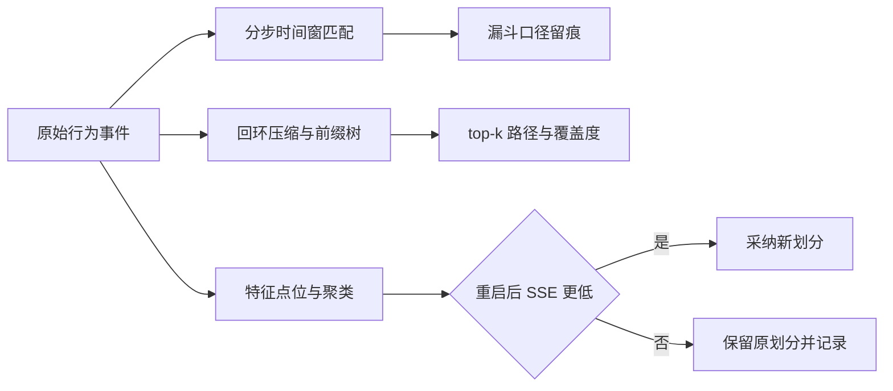
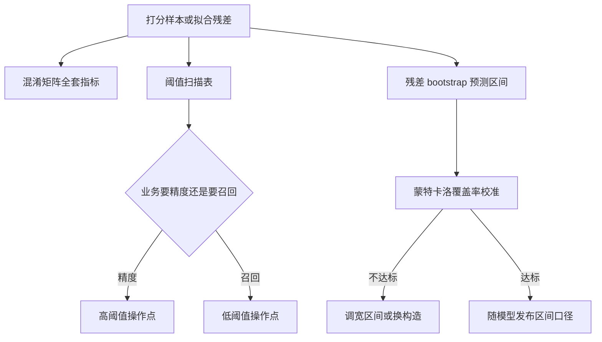
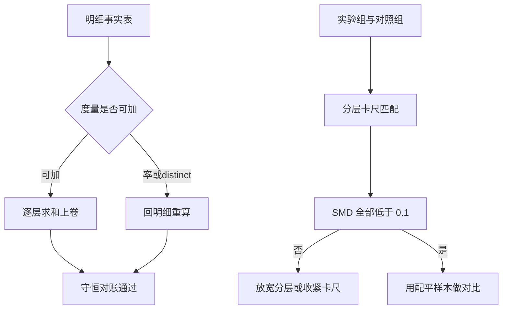
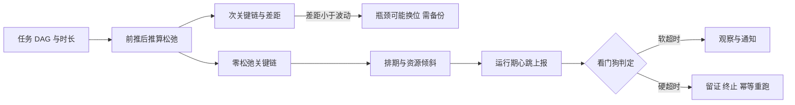
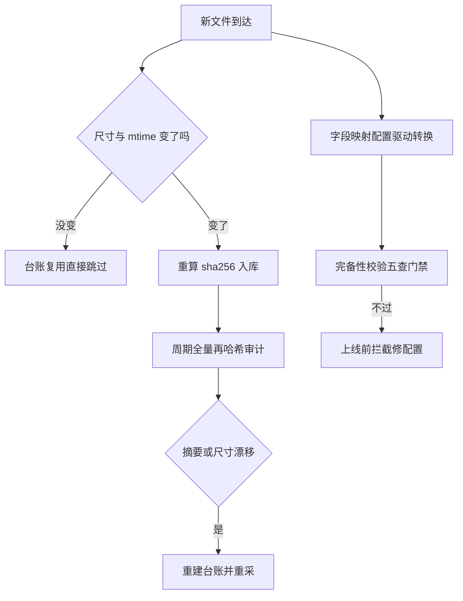
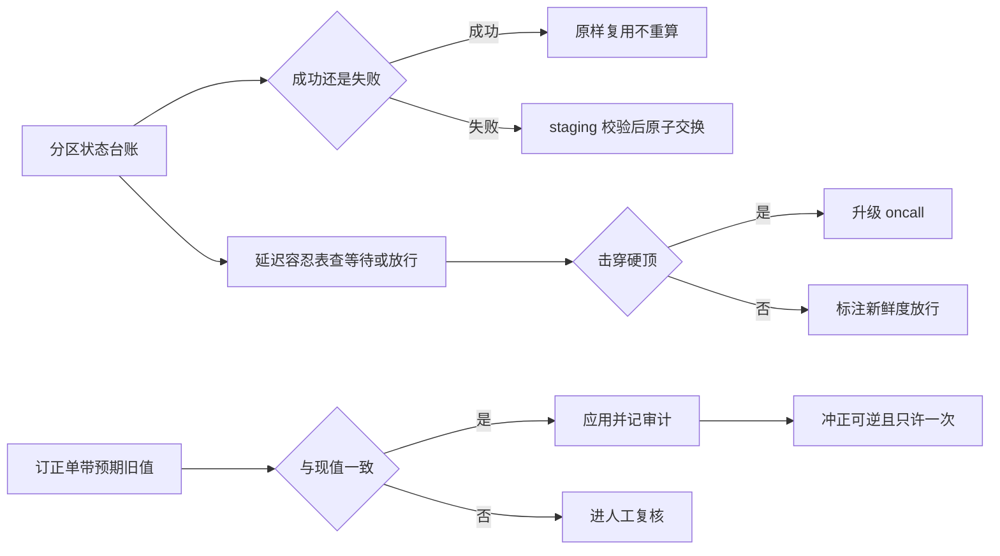
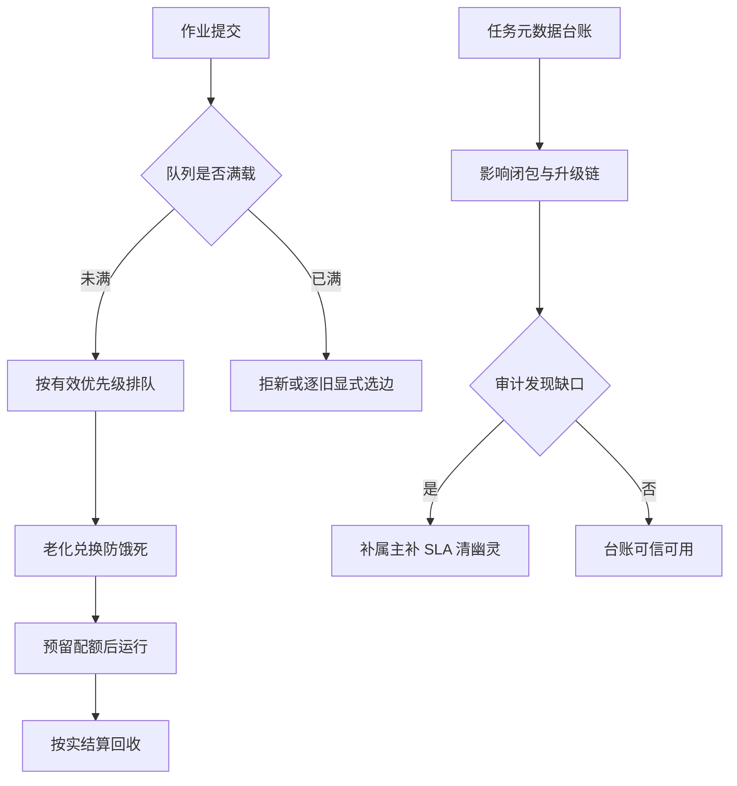
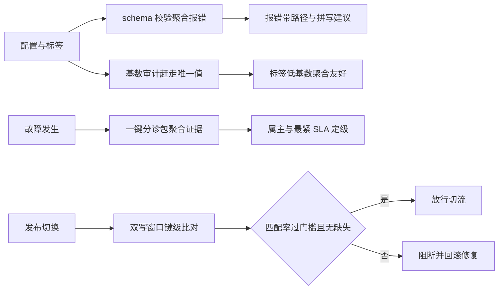

# 第 5 类 · 数据分析与工程化(夜间扩产六)

> 本卷为夜间扩产第六篇(Q2786–Q2830,45 题),三线继续扩产。分析场景补遗:漏斗的分步时间窗与窗口宽度扫描、路径 top-k 的前缀树与覆盖度曲线、简单 k-means 实现与随机重启、混淆矩阵全套指标与阈值扫描、残差 bootstrap 预测区间及覆盖率蒙特卡洛校准、分层卡尺匹配与 SMD 诊断、互相关领先滞后与差分消趋势、上卷下钻的可加性与率值重算、同期群等成熟龄对齐与截断偏差、单元格级异常检测;数据管道补遗:DAG 前推后推与次关键链翻盘、看门狗处置阶梯与假死演练、字段映射配置化与完备性五查、哈希台账跳过与损坏审计、分区级重跑台账与 staging 原子交换、延迟容忍表与分位标定、订正流水守门与冲正幂等;平台工程补遗:优先级队列老化防饿、队列背压拒新逐旧选边、配额预留结算与滚动窗口、任务元数据台账与完整性审计、配置 schema 校验与报错聚合、日志标签规范与基数治理、oncall 一键分诊包、双写窗口发布数据比对器。
> 难度分布:1-2 星 9 题、3 星 23 题、4-5 星 13 题;题号 Q2786–Q2830 全局唯一,与既有 Q001–Q2785 不重复。
> 本卷 45 题全部为纯标准库实现,不依赖 pandas/numpy,无需降级路径;含故意异常处均已 try/except 包裹。全部 45 段代码已用 /usr/bin/python3(3.9.6)逐题实跑验证通过,单段耗时远低于 25 秒。

---

### Q2786 · 漏斗的分步时间窗:每步独立时限

> 难度:★★★☆ | 标签:漏斗, 时间窗

**问**:面试官:漏斗的"转化窗口"你只设一个总时长吗?点击到加购和加购到支付的时间容忍度能一样吗?

**答**:更细的口径是每步独立时限:点击相对曝光 30 分钟、加购相对点击 24 小时、支付相对加购 72 小时,有序匹配且每步以"上一步命中事件加该步时限"为截止。实测 6 个用户:u2 的点击发生在曝光后 40 分钟,超过 30 分钟时限,整条链在点击处中断,只计到曝光;漏斗变成曝光 5 → 点击 4 → 加购 2 → 支付 2。若换成"只看 72 小时总跨度"的宽松口径,同样数据支付人数是 3——u2 的超窗点击也被算成转化。这 1 人之差就是口径差,两报表对不上时先查时间窗定义。分步窗的好处是每一步流失都能归因到"超时"还是"未发生",对卡点优化更可执行。

```python
# file: code/05_数据分析与工程化/q2786_funnel_step_window.py
"""漏斗的分步时间窗: 每步独立时限, 而非一条总窗口"""
from datetime import datetime, timedelta

STEPS = ["曝光", "点击", "加购", "支付"]
# 每步相对上一步命中事件的最大允许间隔, 单位分钟
WINDOWS = {"点击": 30, "加购": 24 * 60, "支付": 72 * 60}

E = datetime(2026, 3, 1, 10, 0)
EVENTS = [
    ("u1", "曝光", E), ("u1", "点击", E + timedelta(minutes=5)),
    ("u1", "加购", E + timedelta(hours=2)), ("u1", "支付", E + timedelta(hours=20)),
    ("u2", "曝光", E), ("u2", "点击", E + timedelta(minutes=40)),
    ("u2", "加购", E + timedelta(hours=3)), ("u2", "支付", E + timedelta(hours=30)),
    ("u3", "曝光", E), ("u3", "点击", E + timedelta(minutes=2)),
    ("u3", "加购", E + timedelta(days=2)), ("u3", "支付", E + timedelta(days=4)),
    ("u4", "曝光", E), ("u4", "点击", E + timedelta(minutes=3)),
    ("u5", "曝光", E + timedelta(minutes=1)), ("u5", "点击", E + timedelta(minutes=4)),
    ("u5", "加购", E + timedelta(hours=10)), ("u5", "支付", E + timedelta(hours=60)),
    ("u6", "支付", E + timedelta(minutes=1)),
]


def build_index(events):
    idx = {}
    for user, step, ts in events:
        idx.setdefault(user, {}).setdefault(step, []).append(ts)
    for per in idx.values():
        for step in per:
            per[step].sort()
    return idx


def funnel_step_window(idx, user):
    """有序匹配, 且每步必须落在相对上一步的独立时限内"""
    cur, path = None, []
    for step in STEPS:
        cands = idx.get(user, {}).get(step, [])
        if cur is not None:
            cands = [ts for ts in cands if cur <= ts <= cur + timedelta(minutes=WINDOWS[step])]
        if not cands:
            return path, "中断于" + step
        cur = cands[0]
        path.append(step)
    return path, "完整"


def funnel_overall(idx, user, overall_minutes):
    """对照口径: 有序匹配但只约束首尾总跨度"""
    cur, first = None, None
    for step in STEPS:
        cands = [ts for ts in idx.get(user, {}).get(step, []) if cur is None or ts >= cur]
        if not cands:
            return False
        cur = cands[0]
        if first is None:
            first = cur
    return (cur - first) <= timedelta(minutes=overall_minutes)


if __name__ == "__main__":
    idx = build_index(EVENTS)
    users = sorted(idx)
    for u in users:
        path, why = funnel_step_window(idx, u)
        print(f"{u}: {' -> '.join(path) if path else '无有效起点'}  [{why}]")
    counts = {s: 0 for s in STEPS}
    for u in users:
        for s in funnel_step_window(idx, u)[0]:
            counts[s] += 1
    print("分步窗漏斗:", " -> ".join(f"{s} {counts[s]}" for s in STEPS))
    strict_pay = counts["支付"]
    loose_pay = sum(1 for u in users if funnel_overall(idx, u, 72 * 60))
    print(f"对照口径: 72h 总窗口宽松口径支付 {loose_pay} 人, 分步窗口径 {strict_pay} 人")
    assert loose_pay > strict_pay, "分步窗口径应更严格, 转化数更少"
    assert "u2" not in [u for u in users if len(funnel_step_window(idx, u)[0]) == 4], "u2 点击超 30 分钟应被剔除"
    print("要点: 每步独立时限把'转化'定义得可解释, 总窗口口径会把超窗点击也算进漏斗")
```

**追问**:
- 追问 1:每步时限怎么定?—— 用相邻两步间隔分布的分位数(如 p90)起步,再与运营节奏和大促场景校准,写进口径字典。
- 追问 2:与"全局单一转化窗"的本质区别?—— 单一窗只约束首尾,中间可以无限拖;分步窗给每步独立 deadline,能区分"慢转化"和"无效链"。

### Q2787 · 漏斗窗口宽度的扫描:转化率与口径权衡

> 难度:★★☆☆ | 标签:漏斗, 参数扫描

**问**:面试官:转化率突然从 30% 涨到 70%,你怎么判断是真涨还是口径变了?

**答**:把窗口宽度当参数扫描一遍就见分晓。同一批 40 个用户,总窗口 30 分钟时转化 0%,6 小时 5.0%,24 小时 30.0%,72 小时 72.5%,7 天仍是 72.5%——曲线单调不减,72 小时处到顶,说明链路完成集中在 3 天内,窗口再宽只是口径变松。极端情况:30 分钟窗和 7 天窗相差 72 个百分点,同源数据可以讲出完全相反的故事。纪律有两条:任何漏斗报表必须写死窗口宽度并进口径字典;跨报表对比前先确认窗口一致,否则差异大概率是口径漂移而非业务变化。默认宽度建议取支付间隔的 p95,再按大促等场景单独定版。

```python
# file: code/05_数据分析与工程化/q2787_funnel_window_scan.py
"""漏斗窗口宽度的扫描: 窗口越宽转化越高, 但口径也随之漂移"""
from datetime import datetime, timedelta

STEPS = ["曝光", "点击", "加购", "支付"]
BASE = datetime(2026, 3, 1, 10, 0)


def make_events(n_users):
    """确定性生成: 部分用户缺步, 部分用户间隔极长"""
    events = []
    for i in range(n_users):
        u = f"u{i:02d}"
        t0 = BASE + timedelta(minutes=i * 3)
        events.append((u, "曝光", t0))
        events.append((u, "点击", t0 + timedelta(minutes=1 + (i * 7) % 90)))
        if i % 7 != 3:
            events.append((u, "加购", t0 + timedelta(minutes=5 + (i * 37) % 4000)))
        if i % 9 != 0:
            events.append((u, "支付", t0 + timedelta(minutes=5 + (i * 91) % 9000)))
    return events


def funnel_by_span(events, span_minutes):
    """有序匹配四步, 仅约束曝光到支付的总跨度"""
    idx = {}
    for u, s, ts in events:
        idx.setdefault(u, {}).setdefault(s, []).append(ts)
    n_pay = 0
    for u, per in idx.items():
        cur, ok = None, True
        for s in STEPS:
            cands = sorted(ts for ts in per.get(s, []) if cur is None or ts >= cur)
            if not cands:
                ok = False
                break
            cur = cands[0]
        if ok and (cur - per["曝光"][0]) <= timedelta(minutes=span_minutes):
            n_pay += 1
    return n_pay, len(idx)


if __name__ == "__main__":
    events = make_events(40)
    spans = [("30 分钟", 30), ("6 小时", 360), ("24 小时", 1440),
             ("72 小时", 4320), ("7 天", 10080)]
    prev = None
    rates = []
    for name, w in spans:
        pay, total = funnel_by_span(events, w)
        rate = pay / total
        rates.append(rate)
        print(f"总窗口 {name:>7}: 支付 {pay:2d}/{total}, 转化率 {rate:.1%}")
        if prev is not None:
            assert rate >= prev, "窗口放宽后转化率不应下降"
        prev = rate
    assert rates[-1] - rates[0] > 0.1, "窗口从 30 分钟放到 7 天应有明显口径漂移"
    # 分步独立时限口径, 等价于每步窗口的组合约束
    print(f"口径提醒: 同一批数据, 30 分钟窗转化 {rates[0]:.1%}, 7 天窗 {rates[-1]:.1%}, 相差 {rates[-1] - rates[0]:.0%}")
    print("要点: 窗口宽度是口径的一部分, 跨报表比较必须先确认窗口一致, 否则差异只是口径漂移")
```

**追问**:
- 追问 1:扫描曲线到顶说明什么?—— 说明窗口已超过业务自然完成周期,继续放宽只稀释口径不增加转化,顶点附近就是默认窗口的合理区间。
- 追问 2:漏斗数对不上的排查顺序?—— 先对窗口宽度,再对事件去重口径,最后才怀疑数据问题。

### Q2788 · 路径分析的 top-k 序列:前缀树计数与回环压缩

> 难度:★★★☆ | 标签:路径分析, 前缀树

**问**:面试官:让你算用户路径的 top-k 高频序列,你的实现骨架是什么?

**答**:两步:回环压缩加前缀树。压缩把同一会话内重复出现的页面只保留首次,12 条会话里 2 条命中压缩,"逛了又逛"的用户与直通用户归入同一路径形状,否则重复浏览会无限拉长路径、稀释支撑数;然后把压缩路径逐条插入前缀树,叶子节点记"终点支撑数"。全路径支撑 top5:首页-搜索-商品详情-加购-支付 与 首页-分类-商品详情-加购-支付 各 3 条,搜索直购 2 条,其余 1 条。前缀树的优势是任意前缀的 top-k 都是树上一次 DFS,还能顺着树往下滑看"这一步之后用户去哪",天然支持"截断到第 n 步"的口径。

```python
# file: code/05_数据分析与工程化/q2788_path_topk_trie.py
"""路径分析的 top-k 序列: 前缀树计数与回环压缩"""

SESSIONS = [
    ["首页", "搜索", "商品详情", "支付"],
    ["首页", "搜索", "商品详情", "加购", "支付"],
    ["首页", "搜索", "商品详情", "加购", "支付"],
    ["首页", "搜索", "商品详情", "搜索", "商品详情", "支付"],
    ["首页", "搜索", "商品详情", "加购"],
    ["首页", "分类", "商品详情", "加购", "支付"],
    ["首页", "分类", "商品详情", "支付"],
    ["首页", "分类", "商品详情", "分类", "商品详情", "加购", "支付"],
    ["首页", "搜索", "支付"],
    ["首页", "活动页", "商品详情", "支付"],
    ["首页", "搜索", "商品详情", "加购", "支付"],
    ["首页", "分类", "商品详情", "加购", "支付"],
]


def compress_loop(path):
    """回环压缩: 同一页面在一条会话内只保留首次出现"""
    seen, out = set(), []
    for p in path:
        if p not in seen:
            seen.add(p)
            out.append(p)
    return out


def build_trie(paths):
    root = {"count": 0, "ends": 0, "children": {}}
    for p in paths:
        node = root
        node["count"] += 1
        for step in p:
            node = node["children"].setdefault(step, {"count": 0, "ends": 0, "children": {}})
            node["count"] += 1
        node["ends"] += 1  # 会话在此节点终止
    return root


def collect_terminal(node, prefix, out):
    """收集完整路径及其终点支撑数"""
    if node["ends"]:
        out.append((list(prefix), node["ends"]))
    for step, child in node["children"].items():
        prefix.append(step)
        collect_terminal(child, prefix, out)
        prefix.pop()


if __name__ == "__main__":
    compressed = [compress_loop(s) for s in SESSIONS]
    n_loop = sum(1 for a, b in zip(SESSIONS, compressed) if a != b)
    print(f"会话数 {len(SESSIONS)}, 命中回环压缩 {n_loop} 条")
    trie = build_trie(compressed)
    k_paths = []
    collect_terminal(trie, [], k_paths)
    k_paths.sort(key=lambda x: -x[1])
    top5 = k_paths[:5]
    for path, sup in top5:
        print(f"  支撑 {sup:2d}  {' -> '.join(path)}")
    top1 = " -> ".join(top5[0][0])
    assert top1 == "首页 -> 搜索 -> 商品详情 -> 加购 -> 支付", f"top1 应为搜索加购主路径, 实际 {top1}"
    total = sum(s for _, s in k_paths)
    assert total == len(SESSIONS), "全部终点路径支撑之和应等于会话总数"
    print(f"要点: 回环压缩让'逛了又逛'的用户和直购用户归入同一路径, 前缀树天然支持任意前缀的 top-k")
```

**追问**:
- 追问 1:回环压缩会丢什么信息?—— 丢失重复浏览强度,频次与疲劳类分析必须回到原始序列,压缩只服务路径归类。
- 追问 2:k 取多大才合理?—— 看下一题的覆盖度曲线,用累计覆盖目标反解 k,而不是拍脑袋定 10 条。

### Q2789 · top-k 路径的覆盖度曲线与支撑门槛

> 难度:★★☆☆ | 标签:路径分析, 覆盖度

**问**:面试官:路径报表展示 top-10 还是 top-50?你的依据是什么?

**答**:依据是覆盖度曲线,不是拍脑袋。把完整路径按支撑数降序排列算累计覆盖:top-3 覆盖 66.7%,top-5 覆盖 83.3%,其余 2 条长尾合计只占 16.7%;覆盖 80% 的最小 k 是 5,且门槛后的每条路径支撑占比都不到 10%。这条曲线就是支撑门槛的谈判工具:报表展示 top-5,其余全部进"其他"桶,不逐条展开;业务坚持要看更多时,加一行"长尾合计"即可。注意覆盖度对会话数而言——路径数有 7 条,长尾路径条数多但每条贡献小,报表的篇幅应该跟着流量走而不是跟着路径种类走。

```python
# file: code/05_数据分析与工程化/q2789_path_coverage_curve.py
"""top-k 路径覆盖度曲线: k 取多大才够, 支撑门槛定在哪"""

SESSIONS = [
    ["首页", "搜索", "商品详情", "支付"],
    ["首页", "搜索", "商品详情", "加购", "支付"],
    ["首页", "搜索", "商品详情", "加购", "支付"],
    ["首页", "搜索", "商品详情", "搜索", "商品详情", "支付"],
    ["首页", "搜索", "商品详情", "加购"],
    ["首页", "分类", "商品详情", "加购", "支付"],
    ["首页", "分类", "商品详情", "支付"],
    ["首页", "分类", "商品详情", "分类", "商品详情", "加购", "支付"],
    ["首页", "搜索", "支付"],
    ["首页", "活动页", "商品详情", "支付"],
    ["首页", "搜索", "商品详情", "加购", "支付"],
    ["首页", "分类", "商品详情", "加购", "支付"],
]


def compress_loop(path):
    seen, out = set(), []
    for p in path:
        if p not in seen:
            seen.add(p)
            out.append(p)
    return out


def full_path_supports(sessions):
    counts = {}
    for s in sessions:
        key = tuple(compress_loop(s))
        counts[key] = counts.get(key, 0) + 1
    return sorted(counts.items(), key=lambda x: -x[1])


if __name__ == "__main__":
    paths = full_path_supports(SESSIONS)
    total = sum(s for _, s in paths)
    print(f"压缩后 distinct 完整路径 {len(paths)} 条, 覆盖会话 {total} 条")
    covered, cums = 0, []
    for k, (path, sup) in enumerate(paths, 1):
        covered += sup
        ratio = covered / total
        cums.append(ratio)
        print(f"k={k}  支撑 {sup}  累计覆盖 {ratio:.1%}  {' -> '.join(path[:4])}")
    k80 = next(i + 1 for i, r in enumerate(cums) if r >= 0.8)
    leftover = 1 - cums[k80 - 1]
    print(f"覆盖 80% 只需 top-{k80} 条路径, 其余 {len(paths) - k80} 条合计仅占 {leftover:.1%}")
    assert k80 <= 5, "本例 80% 覆盖不应超过 5 条路径"
    assert leftover < 0.2 and all(s / total < 0.1 for _, s in paths[k80:]), "门槛后的路径都应是长尾"
    print("要点: 覆盖度曲线的拐点就是支撑门槛, 低于门槛的路径进长尾桶聚合展示, 报表不逐条追")
```

**追问**:
- 追问 1:覆盖目标和支撑门槛谁先定?—— 先定覆盖目标(如 80%),曲线反解出 k,再换算成最小支撑数,门槛是推导结果不是输入。
- 追问 2:长尾什么时候值得关注?—— 当某条长尾路径支撑持续上升突破门槛时,它就是新兴路径,监控其排名变化即可自动发现。

### Q2790 · 简单 k-means 实现:初始化与空簇处理

> 难度:★★★★ | 标签:聚类, k-means

**问**:面试官:不许调 sklearn,手写一个 k-means,你会注意哪些细节?

**答**:三个细节决定成败。初始化用 k-means++:第一个中心随机取,之后按"到已有中心最小距离的平方"加权抽,把起点拉开;迭代用 Lloyd 交替"分配-更新重心",分配不再变化即收敛,同时设最大迭代数兜底;空簇处理是把离自己质心最远的点挪过去补位,防止簇坍缩后聚出 k-1 个簇还谎报 k 个。实测 15 个点三个紧凑簇、k=3:k-means++ 起点质量高,1 轮就收敛,SSE 1.024,三簇各 5 个点,与真实划分完全一致。手写一遍的价值是理解参数:k 不是拍出来的,收敛也不保证全局最优——后者看下一题。

```python
# file: code/05_数据分析与工程化/q2790_kmeans_basic.py
"""简单 k-means 实现: k-means++ 初始化, 空簇处理与收敛判定"""
import random

POINTS = [
    (1.0, 1.0), (1.2, 0.8), (0.8, 1.2), (1.0, 1.4), (0.9, 0.9),
    (5.0, 5.0), (5.2, 4.8), (4.8, 5.2), (5.0, 5.4), (4.9, 5.1),
    (1.0, 5.0), (1.2, 4.8), (0.8, 5.2), (1.0, 5.4), (1.4, 5.0),
]
TRUE_LABEL = [0] * 5 + [1] * 5 + [2] * 5


def d2(a, b):
    return (a[0] - b[0]) ** 2 + (a[1] - b[1]) ** 2


def kmeans_pp_init(points, k, rng):
    """k-means++: 第一个随机取, 之后按距离平方加权取样"""
    centers = [points[rng.randrange(len(points))]]
    while len(centers) < k:
        weights = [min(d2(p, c) for c in centers) for p in points]
        total = sum(weights)
        if total == 0:
            centers.append(points[rng.randrange(len(points))])
            continue
        x, acc = rng.random() * total, 0.0
        for p, w in zip(points, weights):
            acc += w
            if acc >= x:
                centers.append(p)
                break
    return centers


def assign(points, centers):
    return [min(range(len(centers)), key=lambda j: d2(p, centers[j])) for p in points]


def lloyd(points, k, rng, max_iter=50):
    centers = kmeans_pp_init(points, k, rng)
    labels = assign(points, centers)
    for it in range(1, max_iter + 1):
        # 重心更新, 空簇用离自己质心最远的点补位
        for j in range(k):
            members = [p for p, l in zip(points, labels) if l == j]
            if members:
                centers[j] = (sum(p[0] for p in members) / len(members),
                              sum(p[1] for p in members) / len(members))
            else:
                far = max(range(len(points)), key=lambda i: d2(points[i], centers[labels[i]]))
                centers[j] = points[far]
                labels[far] = j
        new_labels = assign(points, centers)
        if new_labels == labels:
            return centers, labels, it
        labels = new_labels
    return centers, labels, max_iter


def inertia(points, centers, labels):
    return sum(d2(p, centers[l]) for p, l in zip(points, labels))


if __name__ == "__main__":
    rng = random.Random(42)
    centers, labels, iters = lloyd(POINTS, 3, rng)
    print(f"收敛迭代 {iters} 轮, 惯性 SSE {inertia(POINTS, centers, labels):.3f}")
    for j, c in enumerate(centers):
        size = sum(1 for l in labels if l == j)
        print(f"  簇 {j}: 中心 {c[0]:.2f},{c[1]:.2f}  成员 {size} 个")
    # 纯度检验: 每个真实簇应整体落入同一个预测簇
    purity_map = {}
    for t, p in zip(TRUE_LABEL, labels):
        purity_map.setdefault(t, set()).add(p)
    pure = all(len(v) == 1 and len(purity_map) == 3 for v in purity_map.values())
    print(f"三个真实簇的映射: {dict((k, sorted(v)) for k, v in purity_map.items())}")
    assert pure, "三个紧凑簇应被完全正确划分"
    sizes = sorted(sum(1 for l in labels if l == j) for j in range(3))
    assert sizes == [5, 5, 5], "每簇应恰有 5 个点"
    print("要点: k-means++ 决定起点质量, 空簇补位防止簇坍缩, 分配不再变化即收敛")
```

**追问**:
- 追问 1:为什么按距离平方加权采样?—— 远点成为新中心的概率更大,起点更分散,系统性降低坏初始化概率。
- 追问 2:空簇为什么危险?—— 说明某个中心没有数据支撑,实际聚出 k-1 个簇却仍按 k 个上报,下游分层与配额都会错位。



### Q2791 · k-means 的多次重启:局部最优与惯性选择

> 难度:★★★☆ | 标签:聚类, 随机重启

**问**:面试官:k-means 跑出来的结果每次都一样吗?怎么向业务保证这个聚类是"对的"?

**答**:不一样,k-means 只保证局部最优,起点不同终点可以天差地别。对三个互相分离的紧凑簇跑 8 个随机种子:最好的 seed SSE 0.600,正确还原 5-5-5 的划分;最差的 seed SSE 45.417,把两个簇并成一簇、把另一簇拆成两半,簇大小变成 2-3-10,相差 7470%。这说明单次运行带运气成分,工程实践是固定跑 5-10 次重启取最小 SSE,并用 k-means++ 压低坏起点概率;向业务汇报时把 SSE 一并给出,才能回答"这是全局最优还是又一次局部最优"。确定性要求高的场景固定种子,让结果可复现可回放。

```python
# file: code/05_数据分析与工程化/q2791_kmeans_restarts.py
"""k-means 的多次重启: 局部最优与最优惯性选择"""
import random

# 三个互相分离的紧凑簇, 坏起点会把两簇并一簇并拆另一簇
POINTS = [(0.0, 0.0), (0.3, 0.1), (0.1, 0.3), (0.2, 0.2), (0.0, 0.4),
          (4.0, 0.0), (4.3, 0.2), (3.8, 0.1), (4.1, 0.4), (4.0, 0.3),
          (2.0, 4.0), (2.2, 4.2), (1.8, 3.9), (2.1, 3.8), (1.9, 4.1)]


def d2(a, b):
    return (a[0] - b[0]) ** 2 + (a[1] - b[1]) ** 2


def forgy_init(points, k, rng):
    """Forgy 随机初始化: 直接抽 k 个点"""
    return [tuple(p) for p in rng.sample(points, k)]


def assign(points, centers):
    return [min(range(len(centers)), key=lambda j: d2(p, centers[j])) for p in points]


def lloyd(points, k, centers, max_iter=100):
    labels = assign(points, centers)
    for it in range(1, max_iter + 1):
        for j in range(k):
            members = [p for p, l in zip(points, labels) if l == j]
            if members:
                centers[j] = (sum(p[0] for p in members) / len(members),
                              sum(p[1] for p in members) / len(members))
            else:
                far = max(range(len(points)), key=lambda i: d2(points[i], centers[labels[i]]))
                centers[j] = tuple(points[far])
                labels[far] = j
        new_labels = assign(points, centers)
        if new_labels == labels:
            break
        labels = new_labels
    sse = sum(d2(p, centers[l]) for p, l in zip(points, labels))
    return sse, labels


if __name__ == "__main__":
    k = 3
    results = []
    for seed in range(1, 9):
        rng = random.Random(seed)
        sse, labels = lloyd(POINTS, k, forgy_init(POINTS, k, rng))
        results.append((seed, sse, labels))
    results.sort(key=lambda x: x[1])
    best_seed, best_sse, best_labels = results[0]
    worst_seed, worst_sse, _ = results[-1]
    for seed, sse, _ in results[:3]:
        print(f"  seed={seed}  SSE={sse:.3f}")
    print(f"最优 seed={best_seed} SSE={best_sse:.3f}, 最差 seed={worst_seed} SSE={worst_sse:.3f}, 相差 {(worst_sse / best_sse - 1):.0%}")
    sizes = sorted(sum(1 for l in best_labels if l == j) for j in range(k))
    worst_sizes = sorted(sum(1 for l in results[-1][2] if l == j) for j in range(k))
    print(f"最优划分簇大小 {sizes}, 最差划分簇大小 {worst_sizes}")
    assert best_sse < worst_sse, "应存在被随机起点锁死的局部最优"
    assert sizes == [5, 5, 5], "最优划分应还原三个紧凑簇"
    assert worst_sizes != sizes, "坏划分应表现为合并两簇并拆散另一簇"
    print("要点: k-means 只保证局部最优, 工程实践固定跑 5-10 次重启取最小 SSE, 起点用 k-means++ 更稳")
```

**追问**:
- 追问 1:怎么判断 k 该不该加大?—— 画 SSE 随 k 的下降曲线找肘部,再叠加业务可解释性,两个条件都要满足。
- 追问 2:重启次数越多越好吗?—— 收益边际递减,5-10 次后最优 SSE 基本稳定,更多次数只浪费算力。

### Q2792 · 混淆矩阵全套指标:从 TP FP FN TN 到 MCC

> 难度:★★☆☆ | 标签:评估指标, 混淆矩阵

**问**:面试官:模型准确率 99.7%,这个模型能上线吗?

**答**:先看混淆矩阵再说。稀疏正例场景 TP40 FP10 FN20 TN9930:准确率 99.7% 光鲜,但召回只有 66.7%——三分之一的正例漏掉;精确率 80%,F1 0.727,MCC 0.729 才反映综合判别力。把同样的错分结构放到平衡样本 TP40 FP10 FN20 TN70 上,准确率立刻掉到 78.6%——准确率被类别分布支配,正例越稀疏越像"全猜负例"刷出来的假象。全套指标各自回答一个问题:精确率管误报、召回管漏报、特异度与 FPR 管负例侧、F1 是精确率与召回的调和平均(天然偏向较小一方)、MCC 同时压四个格子且随机猜测期望为 0。不平衡数据先看召回与 MCC,准确率只做参考。

```python
# file: code/05_数据分析与工程化/q2792_confusion_full.py
"""混淆矩阵全套指标: 从 TP FP FN TN 到 MCC"""


def safe_div(a, b):
    return a / b if b else 0.0


def confusion_metrics(tp, fp, fn, tn):
    acc = safe_div(tp + tn, tp + fp + fn + tn)
    precision = safe_div(tp, tp + fp)
    recall = safe_div(tp, tp + fn)
    specificity = safe_div(tn, tn + fp)
    fpr = 1 - specificity
    f1 = safe_div(2 * precision * recall, precision + recall)
    mcc_den = ((tp + fp) * (tp + fn) * (tn + fp) * (tn + fn)) ** 0.5
    mcc = safe_div(tp * tn - fp * fn, mcc_den)
    return {"acc": acc, "precision": precision, "recall": recall,
            "specificity": specificity, "fpr": fpr, "f1": f1, "mcc": mcc}


if __name__ == "__main__":
    # 场景一: 正负极度不平衡, 10000 个样本只有 5% 正例
    m1 = confusion_metrics(tp=40, fp=10, fn=20, tn=9930)
    print("场景一 稀疏正例 TP40 FP10 FN20 TN9930:")
    for k, v in m1.items():
        print(f"  {k:<11} {v:.4f}")
    assert m1["acc"] > 0.99, "准确率应被负例稀释到接近 1"
    assert m1["recall"] < 0.7, "召回应暴露漏报问题"
    # 场景二: 同一模型放到平衡样本上, 指标完全换了一副面孔
    m2 = confusion_metrics(tp=40, fp=10, fn=20, tn=70)
    print("场景二 平衡样本 TP40 FP10 FN20 TN70:")
    print(f"  acc={m2['acc']:.4f} precision={m2['precision']:.4f} recall={m2['recall']:.4f} "
          f"f1={m2['f1']:.4f} mcc={m2['mcc']:.4f}")
    assert m2["acc"] < 0.9, "同样的错分率在平衡样本上准确率应明显降低"
    # F1 是 precision 与 recall 的调和平均, 夹在两者之间且偏向较小者
    assert m1["precision"] <= m1["f1"] <= m1["recall"] or \
        m1["recall"] <= m1["f1"] <= m1["precision"], "F1 应夹在 P 与 R 之间"
    assert m1["f1"] < max(m1["precision"], m1["recall"]), "调和平均应偏向较小的一方"
    assert m1["mcc"] > 0, "模型优于随机猜测时 MCC 应为正"
    print("要点: 不平衡数据先看 recall 与 MCC, 准确率 99% 可能只是'全猜负例'的假象")
```

**追问**:
- 追问 1:MCC 比 F1 好在哪?—— MCC 考虑全部四个格子,类别翻转只变号不失真,极端不平衡下比 F1 稳定得多。
- 追问 2:特异度和 FPR 什么关系?—— FPR = 1 - 特异度,风控反欺诈等负例敏感场景盯 FPR 更直观。

### Q2793 · 阈值扫描:F1 最优操作点

> 难度:★★★☆ | 标签:评估指标, 阈值

**问**:面试官:模型分数有了,0.5 的分类阈值是哪来的?该信吗?

**答**:不该盲信,阈值是业务参数不是模型参数。对 20 个带分数样本从 0.05 扫到 0.95:阈值 0.45 时精度 0.615、召回 1.000;0.55 时精度 0.700、召回 0.875,F1 达到最大 0.778;0.85 时精度 1.000 但召回只剩 0.250。默认 0.50 的 F1 是 0.737,低于扫描最优——出厂阈值直接用就是在丢分数。扫描表还有一个用途:把"每一次提精度都在付出召回代价"摆到台面上,利用召回随阈值单调不增的性质,让风控(要精度)、营销(要召回)在表上签字选点,而不是事后互相埋怨。上线后每次移阈值都要重跑扫描表并留痕,按口径变更管理。

```python
# file: code/05_数据分析与工程化/q2793_threshold_sweep.py
"""阈值扫描: 分类分数的操作点选择与 F1 最优阈值"""

# 确定性的打分样本: 8 正 12 负, 分数有重叠制造权衡
SAMPLES = [
    (0.92, 1), (0.88, 1), (0.83, 1), (0.79, 0), (0.74, 1), (0.71, 1),
    (0.66, 0), (0.62, 1), (0.58, 1), (0.55, 0), (0.52, 0), (0.49, 1),
    (0.45, 0), (0.41, 0), (0.38, 0), (0.34, 0), (0.30, 0), (0.26, 0),
    (0.21, 0), (0.15, 0),
]


def evaluate(samples, thr):
    tp = sum(1 for s, y in samples if s >= thr and y == 1)
    fp = sum(1 for s, y in samples if s >= thr and y == 0)
    fn = sum(1 for s, y in samples if s < thr and y == 1)
    precision = tp / (tp + fp) if tp + fp else 0.0
    recall = tp / (tp + fn) if tp + fn else 0.0
    f1 = 2 * precision * recall / (precision + recall) if precision + recall else 0.0
    return precision, recall, f1


if __name__ == "__main__":
    rows = []
    for i in range(1, 20):
        thr = i * 0.05
        p, r, f1 = evaluate(SAMPLES, thr)
        rows.append((thr, p, r, f1))
    print(" thr   precision  recall   f1")
    for thr, p, r, f1 in rows[::2]:
        print(f" {thr:.2f}   {p:.3f}      {r:.3f}    {f1:.3f}")
    best = max(rows, key=lambda x: x[3])
    at_half = next(row for row in rows if abs(row[0] - 0.5) < 1e-9)
    print(f"F1 最优阈值 {best[0]:.2f}: precision {best[1]:.3f}, recall {best[2]:.3f}, F1 {best[3]:.3f}")
    print(f"默认阈值 0.50: precision {at_half[1]:.3f}, recall {at_half[2]:.3f}, F1 {at_half[3]:.3f}")
    assert best[3] >= at_half[3], "扫描出的最优 F1 不应低于默认阈值"
    assert best[1] >= at_half[1] and best[2] <= at_half[2] + 1e-9, "高阈值应换取精度让出召回"
    # 单调性检查: 阈值升高, 召回不增, 精度不必然但本例应大体上升
    recalls = [r for _, _, r, _ in rows]
    assert all(a >= b - 1e-9 for a, b in zip(recalls, recalls[1:])), "召回应随阈值单调不增"
    print("要点: 阈值是业务参数不是模型参数, 风控取高精度, 营销取高召回, 用扫描表谈判")
```

**追问**:
- 追问 1:不同业务能共用一个阈值吗?—— 不能,同一模型在风控和营销应各有操作点,扫描表按业务线分别维护。
- 追问 2:F1 最优就是业务最优吗?—— 不一定,F1 只是无权重折中,错报与漏报成本悬殊时应按代价矩阵选点。

### Q2794 · 残差 bootstrap 的预测区间

> 难度:★★★★ | 标签:bootstrap, 预测区间

**问**:面试官:预测下个月 GMV,你给的"区间"是置信区间还是预测区间?差在哪?

**答**:预测未来单点要用预测区间,它比均值的置信区间宽,因为叠加两层不确定性:回归系数的抽样波动 + 单点噪声。残差 bootstrap 的做法:拟合后把残差有放回重抽、贴回拟合值重构 y*,重新拟合,预测新点时再叠加一份重抽残差,重复 600 次取分位数。实测 y=2.146+0.493x,残差标准差 0.559:x=12 的 90% 预测区间 [7.21, 8.86] 宽 1.65,外推到 x=30(超出样本范围)时 [15.93, 17.85] 宽 1.92——越远离样本重心,系数不确定性被杠杆放大,区间越宽。汇报预测时给预测区间而不给置信区间,否则业务会拿点估计当承诺,拿置信带当容错,两头都错。

```python
# file: code/05_数据分析与工程化/q2794_bootstrap_pred_interval.py
"""残差 bootstrap 的预测区间: 不止均值置信带, 还要覆盖新观测的噪声"""
import random

N = 24
XS = list(range(1, N + 1))
# 确定性构造: y = 2 + 0.5x + 伪噪声
YS = [2 + 0.5 * x + 0.9 * (((x * 37) % 13) - 6) / 6 for x in XS]


def ols(xs, ys):
    n = len(xs)
    mx, my = sum(xs) / n, sum(ys) / n
    cov = sum((x - mx) * (y - my) for x, y in zip(xs, ys))
    var = sum((x - mx) ** 2 for x in xs)
    b = cov / var
    a = my - b * mx
    resid = [y - (a + b * x) for x, y in zip(xs, ys)]
    return a, b, resid


def pred_interval(xs, ys, x_new, level=0.90, boots=600, seed=7):
    """残差 bootstrap: 重抽残差重构 y 再拟合, 预测时再叠加一份新噪声"""
    a, b, resid = ols(xs, ys)
    rng = random.Random(seed)
    lo_q = (1 - level) / 2 * 100
    preds = []
    for _ in range(boots):
        ys_b = [a + b * x + resid[rng.randrange(len(resid))] for x in xs]
        a_b, b_b, resid_b = ols(xs, ys_b)
        y_pred = a_b + b_b * x_new + resid_b[rng.randrange(len(resid_b))]
        preds.append(y_pred)
    preds.sort()
    lo = preds[int(len(preds) * lo_q / 100)]
    hi = preds[min(len(preds) - 1, int(len(preds) * (1 - lo_q / 100)))]
    return a + b * x_new, lo, hi


if __name__ == "__main__":
    a, b, resid = ols(XS, YS)
    print(f"拟合: y = {a:.3f} + {b:.3f}x, 残差标准差 {((sum(r * r for r in resid) / (N - 2)) ** 0.5):.3f}")
    for x_new, tag in [(6, "样本密集区"), (12, "中段"), (30, "超出样本外推")]:
        yhat, lo, hi = pred_interval(XS, YS, x_new)
        print(f"x={x_new:2d} {tag}: 点预测 {yhat:.2f}, 90% 预测区间 [{lo:.2f}, {hi:.2f}], 宽度 {hi - lo:.2f}")
    _, lo_m, hi_m = pred_interval(XS, YS, 12)
    _, lo_e, hi_e = pred_interval(XS, YS, 30)
    assert hi_e - lo_e > hi_m - lo_m, "超出样本范围处的预测区间应更宽"
    yhat12 = a + b * 12
    assert lo_m - 0.6 <= yhat12 <= hi_m + 0.6, "区间应以点预测为中心"
    print("要点: 预测区间 = 回归不确定 + 单点噪声, 比均值的置信带更宽, 越远离样本重心越宽")
```

**追问**:
- 追问 1:和均值置信区间的本质区别?—— 置信区间只含系数不确定性,预测区间再加新观测噪声,宽度永远更大,目标是"下一个值"而不是"均线的位置"。
- 追问 2:残差独立同分布假设破了怎么办?—— 换分块 bootstrap 保留序列相关,或对残差先建方差模型做异方差修正。

### Q2795 · 预测区间的覆盖率校准:蒙特卡洛验证

> 难度:★★★★★ | 标签:bootstrap, 覆盖率

**问**:面试官:你说区间是 90%,凭什么?验证过吗?

**答**:名义 90% 不等于真 90%,区间构造自己也要有"单测"。做法是蒙特卡洛:200 次实验,每次生成 30 个带高斯噪声的观测、拟合、残差 bootstrap 300 次构造 90% 区间,再用一条带噪声的新观测检验是否落进区间。实测覆盖率 84.0%(168/200),略低于名义值——残差 bootstrap 在小样本下区间略偏窄,是已知现象。处置有三条:加样本量、把分位数向外扩、或换 studentized 构造。关键不是 84% 这个数,而是把"我们说 90% 就是 90%"从口号变成可验证陈述:区间构造是代码,发布前跑覆盖率模拟,不达标就不许随模型上线。

```python
# file: code/05_数据分析与工程化/q2795_pi_coverage_sim.py
"""预测区间的覆盖率校准: 蒙特卡洛验证名义 90% 是不是真 90%"""
import random


def ols(xs, ys):
    n = len(xs)
    mx, my = sum(xs) / n, sum(ys) / n
    cov = sum((x - mx) * (y - my) for x, y in zip(xs, ys))
    var = sum((x - mx) ** 2 for x in xs)
    b = cov / var
    a = my - b * mx
    return a, b, [y - (a + b * x) for x, y in zip(xs, ys)]


def bootstrap_pi(xs, ys, x_new, level, boots, rng):
    a, b, resid = ols(xs, ys)
    lo_q = (1 - level) / 2 * 100
    preds = []
    for _ in range(boots):
        ys_b = [a + b * x + resid[rng.randrange(len(resid))] for x in xs]
        a_b, b_b, resid_b = ols(xs, ys_b)
        preds.append(a_b + b_b * x_new + resid_b[rng.randrange(len(resid_b))])
    preds.sort()
    return preds[int(len(preds) * lo_q / 100)], preds[int(len(preds) * (100 - lo_q) / 100)]


if __name__ == "__main__":
    n, sims, boots, level = 30, 200, 300, 0.90
    master = random.Random(2026)
    covered = 0
    for s in range(sims):
        xs = list(range(1, n + 1))
        rnd = random.Random(1000 + s)
        ys = [1.5 + 0.6 * x + rnd.gauss(0, 2.0) for x in xs]
        truth = 1.5 + 0.6 * 15  # 新观测真值在回归线附近再叠一份噪声
        new_y = truth + master.gauss(0, 2.0)
        lo, hi = bootstrap_pi(xs, ys, 15, level, boots, master)
        if lo <= new_y <= hi:
            covered += 1
    emp = covered / sims
    print(f"模拟 {sims} 次, 每次 {boots} 次重抽样, 名义覆盖率 {level:.0%}")
    print(f"实测覆盖率 {emp:.1%} (覆盖 {covered}/{sims})")
    assert 0.80 <= emp <= 0.98, "残差 bootstrap 的实测覆盖率应接近名义值"
    print("要点: 名义 90% 不等于真 90%, 用固定种子的蒙特卡洛校准区间构造, 是发布前的自证动作")
```

**追问**:
- 追问 1:为什么不直接用解析公式?—— 解析公式依赖正态与同方差假设,残差 bootstrap 对分布更宽松,但两者都必须做覆盖率验证。
- 追问 2:覆盖率模拟的成本怎么控制?—— 固定种子一次定型后进 CI 当回归用例,模型或区间代码改动时才全量重跑。



### Q2796 · 样本配平的分层卡尺匹配

> 难度:★★★★ | 标签:样本配平, 卡尺匹配

**问**:面试官:实验没有随机分流,观测数据里处理组用户明显更活跃,怎么构造一个可比的对照组?

**答**:用"分层 + 卡尺"双约束做匹配。先把两组协变量合并分五分位,要求处理组在每一层内部找对照——保证"在同一段活动水平内找对手";再加卡尺限制最大可接受距离,本例卡尺 0.57(约 0.25 倍合并标准差),同层内贪心取最近邻。实测处理组均值 5.97、对照组 4.71,差 1.26;匹配 14 对后两组均值 5.63 对 5.75,差只剩 -0.12,几乎抹平;2 个处理组样本(7.3 和 9.4)在同层内找不到合格对照被弃配。原则:弃配好过硬配——硬凑的远距离对照会把偏差藏进样本,比明着不可比更危险,弃配名单要随结论一起披露。

```python
# file: code/05_数据分析与工程化/q2796_caliper_matching.py
"""样本配平的分层卡尺匹配: 同层内贪心最近邻, 卡尺控制匹配质量"""
import math

TREATED = [3.2, 3.5, 3.9, 4.1, 4.4, 4.8, 5.1, 5.6,
           6.0, 6.4, 6.9, 7.3, 7.8, 8.2, 8.9, 9.4]
CONTROL = [1.0, 1.3, 1.6, 1.9, 2.2, 2.5, 2.8, 3.1, 3.4, 3.7, 4.0, 4.3,
           4.6, 4.9, 5.2, 5.5, 5.8, 6.1, 6.5, 7.0, 7.6, 8.4, 9.3, 10.4]


def pooled_sd(a, b):
    ma, mb = sum(a) / len(a), sum(b) / len(b)
    va = sum((x - ma) ** 2 for x in a) / (len(a) - 1)
    vb = sum((x - mb) ** 2 for x in b) / (len(b) - 1)
    return math.sqrt((va + vb) / 2)


def strata_bands(all_vals, n_strata):
    """按合并样本的分位数分层, 返回每层的上下界"""
    s = sorted(all_vals)
    edges = [s[min(len(s) * i // n_strata, len(s) - 1)] for i in range(n_strata + 1)]
    return edges


def band_of(v, edges):
    for i in range(len(edges) - 1):
        if edges[i] <= v < edges[i + 1] or i == len(edges) - 2:
            return i
    return len(edges) - 2


def caliper_match(treated, control, edges, caliper):
    """同层贪心最近邻: 每个处理组找同层且距离不超过卡尺的对照"""
    caliper = min(caliper, 0.25 * pooled_sd(treated, control))
    pool = {}
    for c in control:
        pool.setdefault(band_of(c, edges), []).append(c)
    pairs, unmatched = [], []
    for t in sorted(treated):
        b = band_of(t, edges)
        cands = [c for c in pool.get(b, []) if abs(c - t) <= caliper]
        if not cands:
            unmatched.append(t)
            continue
        best = min(cands, key=lambda c: abs(c - t))
        pool[b].remove(best)
        pairs.append((t, best))
    return pairs, unmatched, caliper


if __name__ == "__main__":
    edges = strata_bands(TREATED + CONTROL, 5)
    before_gap = sum(TREATED) / len(TREATED) - sum(CONTROL) / len(CONTROL)
    pairs, unmatched, cal = caliper_match(TREATED, CONTROL, edges, caliper=0.7)
    mt = [t for t, _ in pairs]
    mc = [c for _, c in pairs]
    after_gap = sum(mt) / len(mt) - sum(mc) / len(mc)
    print(f"合并五分位分层, 卡尺 {cal:.2f}")
    print(f"匹配前: 处理组均值 {sum(TREATED) / len(TREATED):.2f}, 对照组均值 {sum(CONTROL) / len(CONTROL):.2f}, 差 {before_gap:.2f}")
    print(f"匹配 {len(pairs)} 对, 弃配 {len(unmatched)} 个处理组样本 {unmatched}")
    print(f"匹配后: 处理组均值 {sum(mt) / len(mt):.2f}, 对照组均值 {sum(mc) / len(mc):.2f}, 差 {after_gap:.2f}")
    assert len(pairs) >= 12, "多数处理组样本应匹配成功"
    assert after_gap < before_gap / 2, "配平后协变量均值差应至少减半"
    assert abs(after_gap) < 0.4, "配平后均值差应很小"
    print("要点: 分层解决'在同一段活动水平内找对手', 卡尺解决'不许硬凑远距离对手', 弃配好过硬配")
```

**追问**:
- 追问 1:弃配太多怎么办?—— 减少分层数、放宽卡尺,或承认支持域不足,把结论收窄到重叠人群并明示。
- 追问 2:匹配后还剩看不见的偏差吗?—— 有,只平衡了观测协变量,选择偏差中的不可观测因素要靠断点回归或双重差分补。

### Q2797 · 配平质量诊断:标准化均值差 SMD

> 难度:★★★☆ | 标签:样本配平, SMD

**问**:面试官:你说匹配完就"配平"了,拿什么验收?

**答**:用标准化均值差 SMD:分子是两组均值差,分母用合并标准差消除量纲,通行验收线 0.1。实测在 pre_score 上做分层卡尺匹配后:pre_score 的 SMD 从 0.550 降到 0.067;tenure_days 从 0.536 降到 0.083;spend 从 0.546 降到 0.072——三个协变量相关,匹配键配平会带动其他变量一起配平,这是挑"信息量最大的键"做匹配的原因。注意 SMD 低于 0.1 是必要条件不是充分条件:它只看一阶矩,分布形状差异要看分位数对比;匹配丢弃了未配样本,结论只适用于重叠人群,外推必须声明。把 SMD 表附在分析结论后面,是配平类分析的基本礼仪。

```python
# file: code/05_数据分析与工程化/q2797_smd_diagnosis.py
"""配平质量诊断: 标准化均值差 SMD, 阈值 0.1 以内才算配平"""
import math

# 三个相关协变量: pre_score 是匹配键, tenure 与 spend 随之被带平
TREATED = [(3.2, 21.0, 68.0), (3.5, 21.5, 72.0), (3.9, 23.5, 74.5), (4.1, 24.5, 76.5),
           (4.4, 25.5, 79.0), (4.8, 27.0, 83.0), (5.1, 28.5, 86.0), (5.6, 30.0, 90.5),
           (6.0, 31.5, 94.0), (6.4, 33.5, 97.5), (6.9, 35.5, 102.0), (7.3, 37.0, 106.0),
           (7.8, 39.0, 110.0), (8.2, 41.0, 114.0), (8.9, 44.0, 120.0), (9.4, 46.0, 124.5)]
CONTROL = [(1.0, 12.0, 48.5), (1.3, 13.0, 51.5), (1.6, 14.5, 54.0), (1.9, 15.5, 57.0),
           (2.2, 16.5, 59.5), (2.5, 18.0, 62.5), (2.8, 19.0, 65.0), (3.1, 20.5, 67.5),
           (3.4, 21.5, 70.5), (3.7, 23.0, 73.0), (4.0, 24.0, 76.0), (4.3, 25.0, 78.5),
           (4.6, 26.5, 81.0), (4.9, 27.5, 84.0), (5.2, 28.5, 87.0), (5.5, 30.0, 89.5),
           (5.8, 31.0, 92.5), (6.1, 32.5, 95.0), (6.5, 34.0, 98.5), (7.0, 36.0, 103.0),
           (7.6, 38.5, 108.0), (8.4, 42.0, 115.5), (9.3, 45.5, 124.0), (10.4, 50.0, 133.5)]


def pooled_sd(xs, ys):
    mx, my = sum(xs) / len(xs), sum(ys) / len(ys)
    vx = sum((x - mx) ** 2 for x in xs) / (len(xs) - 1)
    vy = sum((y - my) ** 2 for y in ys) / (len(ys) - 1)
    return math.sqrt((vx + vy) / 2)


def smd(t_vals, c_vals):
    mt, mc = sum(t_vals) / len(t_vals), sum(c_vals) / len(c_vals)
    sd = pooled_sd(t_vals, c_vals)
    return abs(mt - mc) / sd if sd else 0.0


def band_of(v, edges):
    for i in range(len(edges) - 1):
        if edges[i] <= v < edges[i + 1] or i == len(edges) - 2:
            return i
    return len(edges) - 2


def match_on_score(treated, control):
    """在 pre_score 上做同层卡尺匹配, 返回配对索引"""
    all_scores = [r[0] for r in treated] + [r[0] for r in control]
    s = sorted(all_scores)
    edges = [s[min(len(s) * i // 5, len(s) - 1)] for i in range(6)]
    sd = pooled_sd([r[0] for r in treated], [r[0] for r in control])
    caliper = 0.25 * sd
    pool = {}
    for j, c in enumerate(control):
        pool.setdefault(band_of(c[0], edges), []).append(j)
    pairs = []
    for i, t in sorted(enumerate(treated), key=lambda kv: kv[1][0]):
        cands = [j for j in pool.get(band_of(t[0], edges), [])
                 if abs(control[j][0] - t[0]) <= caliper]
        if not cands:
            continue
        best = min(cands, key=lambda j: abs(control[j][0] - t[0]))
        pool[band_of(t[0], edges)].remove(best)
        pairs.append((i, best))
    return pairs


if __name__ == "__main__":
    names = ["pre_score", "tenure_days", "spend"]
    pairs = match_on_score(TREATED, CONTROL)
    mt = [TREATED[i] for i, _ in pairs]
    mc = [CONTROL[j] for _, j in pairs]
    print(f"匹配对数 {len(pairs)}, 各协变量 SMD (阈值 0.1):")
    all_pass = True
    for k, name in enumerate(names):
        before = smd([r[k] for r in TREATED], [r[k] for r in CONTROL])
        after = smd([r[k] for r in mt], [r[k] for r in mc])
        verdict = "OK" if after < 0.1 else "未配平"
        print(f"  {name:<12} 匹配前 {before:.3f} -> 匹配后 {after:.3f}  [{verdict}]")
        all_pass = all_pass and after < 0.1
    assert all_pass, "匹配后各协变量 SMD 都应低于 0.1"
    assert smd([r[0] for r in TREATED], [r[0] for r in CONTROL]) > 0.25, "匹配前主协变量应明显失衡"
    print("要点: 匹配键配平会带动相关协变量一起配平, SMD 用合并标准差消除量纲, 0.1 是通行验收线")
```

**追问**:
- 追问 1:为什么用 SMD 不用 t 检验?—— t 检验的 p 值受样本量支配,大样本下微小差异也显著;SMD 只看效应大小,适合做配平验收。
- 追问 2:离散变量怎么算 SMD?—— 用各水平的标准化比例差或合并进伪变量,阈值同样取 0.1。

### Q2798 · 指标领先滞后的互相关扫描

> 难度:★★☆☆ | 标签:互相关, 领先滞后

**问**:面试官:业务说"活跃度是收入的领先指标",怎么验证到底领先几天?

**答**:用互相关扫描:两条序列各自标准化,对每个滞后 L 用对齐段算相关系数,正 L 表示 B 比 A 晚 L 天,峰的位置就是时滞。构造数据 B 是 A 滞后 3 天的复制加噪声,扫 -7 到 +7:峰在 L=3,r=0.940,显著高于同期相关的 -0.728。两个工程细节:扫描范围至少覆盖两个业务周期,否则周期副峰会冒充真峰——本例 L=-6 附近就有约 -0.84 的周期性副峰;报告时给出峰与次峰的相对高度,只有孤峰才算数。找到稳定的领先滞后关系后才有资格谈预警:A 的拐点可以提前三天预告 B,提前量就是运营的反应窗口。

```python
# file: code/05_数据分析与工程化/q2798_lead_lag_xcorr.py
"""指标领先滞后的互相关扫描: 找 B 落后 A 几天"""
import math

N = 60


def pn(t, a=17, m=13):
    """确定性伪噪声, 范围约 -1 到 1"""
    return ((t * a) % m - (m - 1) / 2) / ((m - 1) / 2)


def series():
    a = [100 + 8 * math.sin(2 * math.pi * t / 7) + 0.8 * pn(t) for t in range(N)]
    b = [0.9 * a[t - 3] + 0.5 * pn(t + 5) if t >= 3 else 100 + 0.5 * pn(t)
         for t in range(N)]
    return a, b


def zscore(xs):
    m = sum(xs) / len(xs)
    sd = (sum((x - m) ** 2 for x in xs) / len(xs)) ** 0.5
    return [(x - m) / sd for x in xs]


def xcorr(a, b, max_lag):
    """正滞后 L 表示 B 比 A 晚 L 天, 用对齐段的相关系数"""
    za, zb = zscore(a), zscore(b)
    out = {}
    for lag in range(-max_lag, max_lag + 1):
        if lag >= 0:
            xs, ys = za[:N - lag], zb[lag:]
        else:
            xs, ys = za[-lag:], zb[:N + lag]
        n = len(xs)
        r = sum(x * y for x, y in zip(xs, ys)) / n
        out[lag] = r
    return out


if __name__ == "__main__":
    a, b = series()
    corr = xcorr(a, b, 7)
    print("滞后 L 与相关系数 (B 比 A 晚 L 天):")
    for lag in range(-7, 8):
        bar = "#" * int(max(corr[lag], 0) * 40)
        print(f"  L={lag:+d}  r={corr[lag]:+.3f}  {bar}")
    peak = max(corr, key=lambda k: corr[k])
    print(f"相关峰在 L={peak}, r={corr[peak]:.3f} -> B 是 A 的滞后指标, 时滞 {peak} 天")
    assert peak == 3, "构造数据 B 滞后 A 三天, 峰应在 +3"
    assert corr[3] > corr[0] + 0.1, "峰值应显著高于同期相关"
    print("要点: 领先滞后用互相关找峰, 判读时先固定口径再谈因果, 领先指标才有预警价值")
```

**追问**:
- 追问 1:副峰怎么排除?—— 看峰与副峰的相对高度,或先去除周内季节项再扫描,剩余的峰才可采信。
- 追问 2:两条序列粒度不同能直接扫吗?—— 不能,先统一到同一频率并对齐时间戳,否则滞后单位本身是错的。

### Q2799 · 共趋势伪相关:差分消趋势后的真实时滞

> 难度:★★★☆ | 标签:伪相关, 差分

**问**:面试官:两条曲线一起涨就叫领先指标?怎么把"伪相关"筛掉?

**答**:两条都在上涨的序列怎么算都高度相关:实测原始互相关 L=0 时 0.938、L=1 还有 0.936,峰停在 0,真实时滞完全被共同上升趋势掩盖。一阶差分消掉趋势后重扫:峰移到 L=2,r=0.996,同期 L=0 只有 -0.224,真实时滞水落石出。原理是差分把线性趋势变成常数,而周期成分几乎无损保留(幅度乘 2sin(π/7)≈0.86)。纪律:先差分或去趋势,再谈互相关;否则你找到的"领先指标"可能只是"大家都受同一个大盘驱动"。差分也有代价——噪声方差翻倍,所以峰的置信区间要重新评估,样本要足够长。

```python
# file: code/05_数据分析与工程化/q2799_diff_detrend_lag.py
"""共趋势伪相关: 差分消趋势后才能看到真实时滞"""
import math

N = 60


def pn(t, a=17, m=13):
    return ((t * a) % m - (m - 1) / 2) / ((m - 1) / 2)


def series():
    a = [0.8 * t + 5 * math.sin(2 * math.pi * t / 7) + 0.4 * pn(t) for t in range(N)]
    b = [0.8 * t + 4 * math.sin(2 * math.pi * (t - 2) / 7) + 0.4 * pn(t + 11)
         for t in range(N)]
    return a, b


def zscore(xs):
    m = sum(xs) / len(xs)
    sd = (sum((x - m) ** 2 for x in xs) / len(xs)) ** 0.5
    return [(x - m) / sd for x in xs]


def xcorr_peak(a, b, max_lag):
    za, zb = zscore(a), zscore(b)
    corr = {}
    for lag in range(0, max_lag + 1):
        xs, ys = za[:N - lag], zb[lag:]
        corr[lag] = sum(x * y for x, y in zip(xs, ys)) / len(xs)
    peak = max(corr, key=lambda k: corr[k])
    return peak, corr


def diff(xs):
    return [xs[i] - xs[i - 1] for i in range(1, len(xs))]


if __name__ == "__main__":
    a, b = series()
    raw_peak, raw = xcorr_peak(a, b, 7)
    print("原始序列互相关:")
    for lag in range(0, 8):
        print(f"  L={lag}  r={raw[lag]:+.3f}")
    print(f"原始序列相关峰在 L={raw_peak}, 全部滞后都高 -> 共同上升趋势支配了相关")
    da, db = diff(a), diff(b)
    d_peak, dc = xcorr_peak(da, db, 7)
    print("一阶差分后互相关:")
    for lag in range(0, 8):
        print(f"  L={lag}  r={dc[lag]:+.3f}")
    print(f"差分后相关峰移到 L={d_peak} -> 真实时滞是 B 比 A 晚 {d_peak} 天")
    assert raw_peak == 0, "共趋势下原始互相关峰应停在 0"
    assert d_peak == 2, "差分消趋势后峰应落在真实时滞 2"
    assert dc[2] > 0.8, "差分后周期成分的相关应很高"
    print("要点: 两条都在涨的序列怎么算都相关, 先差分或去趋势, 互相关的峰才有资格谈领先滞后")
```

**追问**:
- 追问 1:除了差分还有什么去趋势办法?—— 对时间项回归取残差、移动平均去季节、或一阶差分的变体季节差分,选型看趋势形态。
- 追问 2:差分后还是处处高相关怎么办?—— 说明两条序列确实同源,先找共同驱动因子(大盘、季节、投放),别硬造因果。

### Q2800 · 上卷下钻的口径一致性:可加与不可加度量

> 难度:★★★☆ | 标签:粒度, 口径一致性

**问**:面试官:报表上卷后总数对不上,下钻后各块加起来又多了,怎么回事?

**答**:先分类度量的可加性。金额是可加度量,上卷守恒:华北的城市金额求和 300 等于区域重算 300,华东 510=510。用户数是 distinct 度量,不可加:u1 在北京和上海都消费、u4 在上海和杭州都消费,华北城市用户数直加 4 而区域去重重算只有 3,华东同样 4 对 3,直加虚高 33%。规则因此明确:可加度量可以逐层求和;不可加度量每一层都必须回明细重算。落地动作是给口径字典的每个指标标注"可加 / 半可加 / 不可加",BI 引擎对小计行禁用 distinct 直加——很多"总数对不上"的事故,根子是引擎对不可加度量做了加法。

```python
# file: code/05_数据分析与工程化/q2800_rollup_additivity.py
"""上卷与下钻的口径一致性: 可加度量与不可加度量"""

# 事实明细: 区域, 城市, 用户, 金额
FACT = [
    ("华北", "北京", "u1", 120), ("华北", "北京", "u2", 80),
    ("华北", "天津", "u2", 60), ("华北", "天津", "u3", 40),
    ("华东", "上海", "u1", 200), ("华东", "上海", "u4", 150),
    ("华东", "杭州", "u4", 90), ("华东", "杭州", "u5", 70),
]
CITY_REGION = {"北京": "华北", "天津": "华北", "上海": "华东", "杭州": "华东"}


def rollup(rows, level):
    """按粒度重算: 金额求和, 用户数去重计数, 全部从明细出发"""
    agg = {}
    for region, city, user, amount in rows:
        key = city if level == "city" else CITY_REGION[city]
        cell = agg.setdefault(key, {"amount": 0, "users": set()})
        cell["amount"] += amount
        cell["users"].add(user)
    return {k: {"amount": v["amount"], "users": len(v["users"])} for k, v in agg.items()}


if __name__ == "__main__":
    by_city = rollup(FACT, "city")
    by_region = rollup(FACT, "region")
    print("城市粒度:", {k: v for k, v in sorted(by_city.items())})
    print("区域粒度:", {k: v for k, v in sorted(by_region.items())})
    # 可加度量: 金额上卷 = 子层求和, 守恒成立
    for region in ["华北", "华东"]:
        cities = [c for c in by_city if CITY_REGION[c] == region]
        sum_city = sum(by_city[c]["amount"] for c in cities)
        ok = sum_city == by_region[region]["amount"]
        print(f"{region}: 城市金额求和 {sum_city} = 区域重算 {by_region[region]['amount']} -> {'一致' if ok else '不一致'}")
        assert ok, "金额是可加度量, 上卷必须守恒"
    # 不可加度量: 用户数不能把子层数字相加
    for region in ["华北", "华东"]:
        cities = [c for c in by_city if CITY_REGION[c] == region]
        naive = sum(by_city[c]["users"] for c in cities)
        true_n = by_region[region]["users"]
        print(f"{region}: 城市用户数直加 {naive} vs 区域去重重算 {true_n} -> {'虚高' if naive > true_n else '一致'}")
        assert naive > true_n, "跨城市重复用户应导致直加虚高"
    print("要点: 可加度量才能逐层求和, distinct 类度量每层必须回明细重算, 口径字典要逐条标注可加性")
```

**追问**:
- 追问 1:半可加度量怎么处理?—— 时间维不可加、维度可加,如余额类快照指标,跨天取期末值而非求和。
- 追问 2:不可加度量也能做"对账"吗?—— 能,对账公式换成"上层重算 = 下层重算",而不是"上层 = 下层之和"。

### Q2801 · 率值上卷的陷阱:重算而非平均

> 难度:★★☆☆ | 标签:率值, 上卷

**问**:面试官:三个城市的转化率分别是 5%、40%、4.5%,大盘转化率是多少?

**答**:不是 16.5%,是 5.58%。"把各层率求平均"是最常见的口径事故:三个城市大本营 A 5.0%(500/10000)、试点 B 40.0%(80/200)、自然量 C 4.5%(45/1000),平均法给出 16.50%,而正确做法是分子分母各求和再相除 625/11200=5.58%,平均法虚高 10.9 个百分点,方向被高转化小城市带偏。下钻归因同理:试点 B 率最高 40%,但订单占比只有 13%,小城市的高率对大盘贡献有限,不能因为率抢眼就 priority 排最前。纪律一句话:率是不可加度量,任何换粒度的动作,分子分母必须成对移动,各自求和后再相除。

```python
# file: code/05_数据分析与工程化/q2801_ratio_rollup.py
"""率值上卷的陷阱: 上卷必须用分子分母重算, 不能平均各层的率"""

CITIES = [
    # 城市, 访问数, 下单数
    ("大本营A", 10000, 500),
    ("试点B", 200, 80),
    ("自然量C", 1000, 45),
]


def rate(city):
    return city[2] / city[1]


if __name__ == "__main__":
    visits = sum(c[1] for c in CITIES)
    orders = sum(c[2] for c in CITIES)
    true_rate = orders / visits
    naive_rate = sum(rate(c) for c in CITIES) / len(CITIES)
    print("各城市转化率:")
    for name, v, o in CITIES:
        print(f"  {name}: {o}/{v} = {o / v:.1%}")
    print(f"错误做法(各层率求平均): {naive_rate:.2%}")
    print(f"正确做法(分子分母带回上卷重算): {orders}/{visits} = {true_rate:.2%}")
    print(f"虚高 {(naive_rate - true_rate):.1%} 个百分点, 方向被高转化的小城市带偏")
    assert naive_rate - true_rate > 0.08, "小城市高转化应把平均法显著带高"
    assert abs(true_rate - 625 / 11200) < 1e-9, "上卷结果应等于总分子除以总分母"
    # 率值在任意粒度都只能重算, 下钻同理
    top_city = max(CITIES, key=rate)
    print(f"下钻归因时也注意: 单看率最高的是 {top_city[0]} {rate(top_city):.0%}, "
          f"但它的订单占比仅 {top_city[2] / orders:.0%}")
    assert top_city[2] / orders < 0.15, "高率小城市的订单占比应很小"
    print("要点: 率是不可加度量, 每次换粒度都要分子分母各求和再相除, 平均各层率是最常见的口径事故")
```

**追问**:
- 追问 1:什么时候平均率反而是对的?—— 各层权重确实相等且业务目标就是"代表水平"时,但必须显式声明为"简单平均口径"。
- 追问 2:报表引擎里怎么防?—— 率值字段禁用 SUM 聚合,只暴露"分子列/分母列",聚合时动态相除。



### Q2802 · 同期群对比的显著性:等成熟龄对齐

> 难度:★★★★ | 标签:同期群, 显著性

**问**:面试官:11 月群留存比 10 月群低 5 个点,你能下"留存恶化"的结论吗?

**答**:先对齐成熟龄,再做两比例检验,两个条件都过了才许下结论。成熟龄对齐指两个群都在"注册后第 7 天"取数,而不是同一个日历日——本例 10 月群成熟龄 50 天、11 月群 17 天,都满 7 天可比较。检验:10 月群 1200 人第 7 日留存 540 人(45.0%),11 月群 1100 人留存 440 人(40.0%),合并比例 0.426,z=2.422,p=0.0154,alpha=0.05 下"显著下降"。注意样本量决定分辨率:5 个百分点的差在两千人级别才显著,几百人的群里同样差距大概率只是噪声,结论要写"不显著"而不是"没差异"。

```python
# file: code/05_数据分析与工程化/q2802_cohort_age_align.py
"""同期群对比的显著性: 等成熟龄对齐后再做两比例检验"""
import math
from datetime import date


def normal_cdf(x):
    return 0.5 * (1 + math.erf(x / math.sqrt(2)))


def age_days(cohort_start, today):
    return (today - cohort_start).days


def two_prop_ztest(r1, n1, r2, n2):
    p1, p2 = r1 / n1, r2 / n2
    pooled = (r1 + r2) / (n1 + n2)
    se = (pooled * (1 - pooled) * (1 / n1 + 1 / n2)) ** 0.5
    z = (p1 - p2) / se
    p_value = 2 * (1 - normal_cdf(abs(z)))
    return p1, p2, z, p_value


TODAY = date(2026, 11, 20)
COHORTS = {
    # 同期群: 起始日, 规模, 第 7 日留存人数
    "10月群": {"start": date(2026, 10, 1), "n": 1200, "retained_d7": 540},
    "11月群": {"start": date(2026, 11, 3), "n": 1100, "retained_d7": 440},
}
MATURE_AGE = 7


def mature_enough(c):
    return age_days(c["start"], TODAY) >= MATURE_AGE


if __name__ == "__main__":
    for name, c in COHORTS.items():
        print(f"{name}: 起始 {c['start']}, 今天成熟龄 {age_days(c['start'], TODAY)} 天, "
              f"{'可比较' if mature_enough(c) else '未成熟, 不可比'}")
    assert all(mature_enough(c) for c in COHORTS.values()), "等成熟龄对齐要求两群都满 7 天"
    oct_c, nov_c = COHORTS["10月群"], COHORTS["11月群"]
    p1, p2, z, pv = two_prop_ztest(oct_c["retained_d7"], oct_c["n"],
                                   nov_c["retained_d7"], nov_c["n"])
    print(f"等成熟龄第 7 日: 10月群 {p1:.1%} vs 11月群 {p2:.1%}, 差 {p1 - p2:+.1%}")
    print(f"两比例 z 检验: z={z:.3f}, p={pv:.4f}")
    verdict = "显著下降" if pv < 0.05 and p2 < p1 else ("显著上升" if pv < 0.05 else "差异不显著")
    print(f"结论(alpha=0.05): {verdict}")
    assert pv < 0.05 and p2 < p1, "本例 4.4 个百分点的差应有统计显著性"
    print("要点: 同期群对比先对齐成熟龄, 再用两比例检验说话, '看起来跌了'和'真的跌了'隔一个 p 值")
```

**追问**:
- 追问 1:多个龄期都做了检验怎么汇总?—— 每龄期独立检验会放大第一类错误,要么指定单一主龄期,要么做多重校正。
- 追问 2:群规模悬殊怎么办?—— 检验本身可用,但解读要配置信区间,小群一侧的区间会很宽,结论强度以窄侧为准。

### Q2803 · 成熟龄未对齐的截断偏差:暴跌假象

> 难度:★★★☆ | 标签:同期群, 截断偏差

**问**:面试官:新群的留存曲线为什么"天生难看"?怎么避免误报流失告警?

**答**:截断偏差:新群大量用户还没观察满 7 天,报表若把"尚未回访"当流失,留存率被人为拖低。实测 11 月群 1100 人,只有 430 人满窗,其中 194 人留存(45.1%);未满窗的 670 人目前临时回访 134 人。错误口径 328/1100=29.8%,对照 10 月群的 45.0% 得出"暴跌 15.2 个百分点"触发告警;正确口径只统计满窗用户 45.1%,与 10 月群基本持平(差 -0.1 个百分点)。未满窗用户的临时回访率 20% 会随窗口补满单调上升,绝不能与满窗率混在同一个数里。报表要么遮罩未满窗,要么显著标注"部分成熟",流失告警的输入必须来自满窗口径。

```python
# file: code/05_数据分析与工程化/q2803_cohort_truncation.py
"""成熟龄未对齐的截断偏差: 未满窗用户把留存率人为拖低"""

OCT_D7_RATE = 0.45          # 10月群等成熟龄第 7 日留存
NOV_N = 1100                # 11月群规模
NOV_MATURE_N = 430          # 已满 7 天观察窗的用户
NOV_MATURE_RETAINED = 194   # 其中第 7 日仍活跃的
NOV_IMMATURE_N = NOV_N - NOV_MATURE_N
# 未满窗用户在各自的截断窗口内已回访的(不是真流失, 只是还没到第 7 天)
NOV_IMMATURE_SO_FAR = 134


def naive_retained():
    """错误口径: 把未满窗用户全算进分母, 他们'尚未回访'被当成流失"""
    return NOV_MATURE_RETAINED + NOV_IMMATURE_SO_FAR


def mature_retained_rate():
    """正确口径: 只统计满窗用户, 未满窗的遮罩后单独披露"""
    return NOV_MATURE_RETAINED / NOV_MATURE_N


if __name__ == "__main__":
    naive = naive_retained() / NOV_N
    mature = mature_retained_rate()
    print(f"11月群 {NOV_N} 人, 其中满 7 天窗的仅 {NOV_MATURE_N} 人")
    print(f"错误口径(未满窗算流失): {naive_retained()}/{NOV_N} = {naive:.1%}")
    print(f"正确口径(仅满窗用户): {NOV_MATURE_RETAINED}/{NOV_MATURE_N} = {mature:.1%}")
    print(f"对照 10月群等成熟龄第 7 日留存 {OCT_D7_RATE:.1%}")
    drop_naive = OCT_D7_RATE - naive
    drop_mature = OCT_D7_RATE - mature
    print(f"错误口径结论: 暴跌 {drop_naive:.1%} 个百分点 -> 触发流失告警")
    print(f"正确口径结论: 差 {drop_mature:+.1%} 个百分点 -> 基本持平")
    assert naive < mature - 0.1, "截断偏差应把留存显著拖低"
    assert drop_mature > -0.02, "满窗口径下两群应基本持平"
    assert drop_naive > 0.1, "截断口径会给出暴跌假象"
    immature_rate = NOV_IMMATURE_SO_FAR / NOV_IMMATURE_N
    print(f"附注: 未满窗用户当前临时回访率 {immature_rate:.1%}, 会随窗口补满而上升, 不能与满窗率混合")
    print("要点: 新同期群的留存天然随成熟度爬升, 报表要么遮罩未满窗, 要么标注'部分成熟', 别拿半成品比满月")
```

**追问**:
- 追问 1:什么时候可以直接用未成熟数据?—— 只做趋势快照、明确标注口径且不做跨群比较时。
- 追问 2:遮罩会让新群报表空白怎么办?—— 补一条"预计成熟日"与成熟进度条,让空白可见可预期,而不是静默缺数。

### Q2804 · 表格数据的异常单元格:规则与分布双检

> 难度:★★★☆ | 标签:数据质量, 异常检测

**问**:面试官:给你一张脏表,怎么把问题定位到"格子"级别而不是"表"级别?

**答**:双通道检测,输出单元格级清单。域规则通道抓"一定错":age='三十五' 非整数、age=260 越出人类范围、city='魔都' 不在白名单、signup='2026/13/01' 解析失败、spend=-5 为负——解析异常全部 try/except 包住转成规则结论;分布通道抓"数字合法但离谱":spend=99999 的修正 z 分数 1104.2 远超 3.5 阈值,用 MAD 稳健法(基于中位数)避免离群值自己污染基线。8 行数据检出 6 个异常单元格,每条带行号、字段、原值、原因,修复才有落点。两通道互补:规则可过的正常值不会被分布通道冤枉,合法范围内的离谱值只有分布通道能抓到。

```python
# file: code/05_数据分析与工程化/q2804_cell_anomaly.py
"""表格数据的异常单元格检测: 字段规则 + 分布离群双通道"""
import statistics
from datetime import datetime

TODAY = datetime(2026, 11, 1)
CITY_WHITELIST = {"北京", "上海", "广州", "深圳", "杭州"}

ROWS = [
    {"name": "张三", "age": 34, "city": "北京", "signup": "2026-01-15", "spend": 120.0},
    {"name": "李四", "age": "三十五", "city": "上海", "signup": "2026-02-20", "spend": 98.0},
    {"name": "王五", "age": 260, "city": "北京", "signup": "2026-03-01", "spend": 350.0},
    {"name": "赵六", "age": 28, "city": "魔都", "signup": "2026-03-05", "spend": 210.0},
    {"name": "钱七", "age": 31, "city": "广州", "signup": "2026/13/01", "spend": -5.0},
    {"name": "孙八", "age": 29, "city": "深圳", "signup": "2026-04-11", "spend": 88.0},
    {"name": "周九", "age": 45, "city": "杭州", "signup": "2026-05-02", "spend": 99999.0},
    {"name": "吴十", "age": 38, "city": "上海", "signup": "2026-05-20", "spend": 150.0},
]


def check_age(v):
    if not isinstance(v, int):
        return "age 不是整数"
    if not 0 <= v <= 120:
        return "age 越出人类范围"
    return None


def check_city(v):
    if v not in CITY_WHITELIST:
        return "city 不在白名单, 疑似别名或脏值"
    return None


def check_signup(v):
    try:
        dt = datetime.strptime(v, "%Y-%m-%d")
    except ValueError:
        return "signup 不是合法的 YYYY-MM-DD"
    if dt > TODAY:
        return "signup 晚于当前日期"
    return None


def check_spend(v):
    if not isinstance(v, (int, float)) or v < 0:
        return "spend 为负或类型错误"
    return None


def mad_outliers(values, key, thresh=3.5):
    """修正 z 分数: 0.6745 * (x - 中位数) / MAD"""
    med = statistics.median(values)
    mad = statistics.median([abs(v - med) for v in values])
    out = []
    if mad == 0:
        return out
    for i, v in enumerate(values):
        mz = 0.6745 * (v - med) / mad
        if abs(mz) > thresh:
            out.append((i, key, mz))
    return out


if __name__ == "__main__":
    anomalies = []
    for i, row in enumerate(ROWS):
        for col, checker in [("age", check_age), ("city", check_city),
                             ("signup", check_signup), ("spend", check_spend)]:
            reason = checker(row[col])
            if reason:
                anomalies.append((i, row["name"], col, row[col], reason))
    for i, col, mz in mad_outliers([r["spend"] for r in ROWS], "spend"):
        anomalies.append((i, ROWS[i]["name"], col, ROWS[i][col],
                          f"spend 修正 z 分数 {mz:.1f} 远超 3.5"))
    print(f"共检出 {len(anomalies)} 个异常单元格:")
    for i, name, col, val, reason in anomalies:
        print(f"  行{i} {name}.{col} = {val!r}  ->  {reason}")
    reasons = {a[4].split()[0] for a in anomalies}
    assert len(anomalies) >= 6, "六类埋点问题都应被检出"
    assert any("age" == a[2] and a[3] == "三十五" for a in anomalies)
    assert any(a[2] == "signup" for a in anomalies), "非法日期应被检出"
    assert any(a[2] == "spend" and a[3] == 99999.0 for a in anomalies), "MAD 离群应被检出"
    assert any(a[3] == -5.0 for a in anomalies), "负金额应被域规则检出"
    print("要点: 域规则抓'一定错', 分布离群抓'数字合法但离谱', 双通道结果都落到单元格级清单才可修复")
```

**追问**:
- 追问 1:为什么用 MAD 不用 z-score?—— z-score 的均值和标准差本身被极端值污染,MAD 基于中位数,稳健性高得多。
- 追问 2:规则清单从哪来?—— 从 schema 契约和历史修复记录里沉淀,新规则上线先影子跑一周看误报率。

### Q2805 · DAG 的前推后推:最早最晚时刻与零松弛链

> 难度:★★★★ | 标签:DAG, 前推后推

**问**:面试官:调度系统说关键路径是这条,你怎么验证?关键路径怎么算出来的?

**答**:前推后推。前推按拓扑序算每个任务的最早开始 ES 与最早结束 EF,工程总完工 T 是最大 EF,本例 110 分钟;后推从 T 反向算最晚结束 LF 与最晚开始 LS,松弛 = LS - ES。9 个任务里 6 个松弛为零,串成关键链 pull_orders → clean_orders → join_trade → agg_shop → load_report → push_alert;旁支里 pull_pay 与 clean_pay 松弛 20 分钟,agg_category 松弛 15 分钟——晚 15 到 20 分钟开跑不影响交付。松弛就是容错预算:关键链任务零缓冲,任何超时直接推迟 T;非关键任务可以在松弛内让路给资源。压工期之前,先看下一题的次关键链再动手。

```python
# file: code/05_数据分析与工程化/q2805_dag_forward_backward.py
"""DAG 的前推后推: 最早最晚时刻与零松弛关键链"""

TASKS = {
    # 任务: 时长, 依赖
    "pull_orders":   (20, []),
    "pull_pay":      (15, []),
    "clean_orders":  (25, ["pull_orders"]),
    "clean_pay":     (10, ["pull_pay"]),
    "join_trade":    (20, ["clean_orders", "clean_pay"]),
    "agg_shop":      (30, ["join_trade"]),
    "agg_category":  (15, ["join_trade"]),
    "load_report":   (10, ["agg_shop", "agg_category"]),
    "push_alert":    (5,  ["load_report"]),
}


def topo_sort(tasks):
    indeg = {t: 0 for t in tasks}
    succ = {t: [] for t in tasks}
    for t, (_, deps) in tasks.items():
        for d in deps:
            succ[d].append(t)
            indeg[t] += 1
    ready = sorted(t for t, d in indeg.items() if d == 0)
    order = []
    while ready:
        t = ready.pop(0)
        order.append(t)
        for s in succ[t]:
            indeg[s] -= 1
            if indeg[s] == 0:
                ready.append(s)
        ready.sort()
    assert len(order) == len(tasks), "DAG 存在环"
    return order, succ


def forward_backward(tasks):
    order, succ = topo_sort(tasks)
    es, ef = {}, {}
    for t in order:
        dur, deps = tasks[t]
        es[t] = max((ef[d] for d in deps), default=0)
        ef[t] = es[t] + dur
    finish = max(ef.values())
    ls, lf = {}, {}
    for t in reversed(order):
        _, _ = tasks[t]
        lf[t] = min((ls[s] for s in succ[t]), default=finish)
        ls[t] = lf[t] - tasks[t][0]
    slack = {t: ls[t] - es[t] for t in tasks}
    return es, ef, ls, lf, slack, finish, order


if __name__ == "__main__":
    es, ef, ls, lf, slack, finish, order = forward_backward(TASKS)
    print(f"工程总完工 T = {finish} 分钟")
    print(f"{'任务':<14}{'时长':>4}{'ES':>5}{'EF':>5}{'LS':>5}{'LF':>5}{'松弛':>5}  关键")
    for t in order:
        dur = TASKS[t][0]
        mark = " *" if slack[t] == 0 else ""
        print(f"{t:<14}{dur:>4}{es[t]:>5}{ef[t]:>5}{ls[t]:>5}{lf[t]:>5}{slack[t]:>5}{mark}")
    critical = [t for t in order if slack[t] == 0]
    print("关键链:", " -> ".join(critical))
    assert finish == 110, "总完工应为 110 分钟"
    assert critical == ["pull_orders", "clean_orders", "join_trade",
                        "agg_shop", "load_report", "push_alert"], "关键链应走商品域长链"
    assert slack["agg_category"] == 15 and slack["pull_pay"] == 20, "旁支松弛应符合手算"
    print("要点: 前推算最早时刻, 后推算最晚时刻, 松弛为零的任务串起来就是关键链, 压工期只压它")
```

**追问**:
- 追问 1:松弛时间的工程意义?—— 非关键任务的重试与延后预算,超出松弛才会传导到交付时间,可用来做错峰调度。
- 追问 2:任务时长不确定怎么办?—— 用悲观/乐观两套时长各算一次关键链,取并集做风险链。

### Q2806 · 次关键链:扰动下的第二瓶颈与翻盘测试

> 难度:★★★★ | 标签:DAG, 次关键链

**问**:面试官:你们优化了关键路径,为什么总完工时间没怎么变?

**答**:因为瓶颈换位了。把上一题的 agg_shop 缩到 12 分钟后,关键链变成类目支线 95 分钟,商店支线 92 分钟——次关键链只差 3 分钟。做翻盘测试:把 agg_category 从 15 压到 11 分钟,压缩量超过 3 分钟差距,关键链立即翻转到商店支线 92 分钟。结论:当次关键链与关键链差距小于单任务的常规波动(十分钟级)时,任何只针对关键链的优化都可能白做。工程做法:排期报告列出全部根到叶链按时长降序的 top-3,次关键链与关键链差距小于阈值时,两条链的资源与监控同等级对待,优化前后都跑一遍翻盘测试确认瓶颈没搬家。

```python
# file: code/05_数据分析与工程化/q2806_near_critical_chain.py
"""次关键链: 扰动下的第二瓶颈与关键链翻盘测试"""

TASKS = {
    "pull_orders":  (20, []),
    "pull_pay":     (15, []),
    "clean_orders": (25, ["pull_orders"]),
    "clean_pay":    (10, ["pull_pay"]),
    "join_trade":   (20, ["clean_orders", "clean_pay"]),
    "agg_shop":     (12, ["join_trade"]),
    "agg_category": (15, ["join_trade"]),
    "load_report":  (10, ["agg_shop", "agg_category"]),
    "push_alert":   (5,  ["load_report"]),
}


def all_chains(tasks):
    """枚举起点到终点的全部任务链, 返回按总时长降序的列表"""
    deps_of = {t: v[1] for t, v in tasks.items()}
    succ = {t: [s for s in tasks if t in deps_of[s]] for t in tasks}
    roots = [t for t in tasks if not deps_of[t]]
    chains = []

    def dfs(node, path):
        kids = succ[node]
        if not kids:
            chains.append(list(path))
            return
        for k in kids:
            path.append(k)
            dfs(k, path)
            path.pop()

    for r in roots:
        dfs(r, [r])
    return sorted(chains, key=lambda c: -sum(tasks[t][0] for t in c))


def chain_len(chain):
    return sum(TASKS[t][0] for t in chain)


if __name__ == "__main__":
    chains = all_chains(TASKS)
    top = chains[0]
    second = chains[1]
    gap = chain_len(top) - chain_len(second)
    print("全部链路按时长降序 top3:")
    for c in chains[:3]:
        print(f"  {chain_len(c):>3} 分钟  {' -> '.join(c)}")
    print(f"关键链 {chain_len(top)} 分钟, 次关键链 {chain_len(second)} 分钟, 只差 {gap} 分钟")
    assert "agg_category" in top, "本例关键链应走类目聚合支线"
    assert "agg_shop" in second, "次关键链应是商店聚合支线"
    # 翻盘测试: 关键链上的独占任务缩短 4 分钟, 次关键链立即上位
    TASKS["agg_category"] = (11, ["join_trade"])
    chains2 = all_chains(TASKS)
    new_top = chains2[0]
    print(f"把 agg_category 从 15 压到 11 分钟后, 新关键链: {' -> '.join(new_top)} ({chain_len(new_top)} 分钟)")
    assert "agg_shop" in new_top, "压缩 4 分钟超过 3 分钟的差距, 关键链应翻转到商店支线"
    print("要点: 只盯着一条关键链的排期是脆的, 次关键链差距小于常规波动时, 瓶颈随时换位")
```

**追问**:
- 追问 1:链路枚举在密集 DAG 上会爆炸吗?—— 会,节点多时改用每次松弛一条边的 k 短路或对每条边做敏感性分析。
- 追问 2:翻盘测试放进流程的哪一步?—— 容量规划与排期评审各跑一次,优化方案必须附"优化后关键链归属"的证明。



### Q2807 · 管道看门狗:错过心跳的处置阶梯

> 难度:★★★★ | 标签:看门狗, 处置阶梯

**问**:面试官:任务卡死了,你的看门狗直接 kill -9 吗?

**答**:不是,看门狗的价值在处置阶梯。心跳超过软阈值 300 秒进 WARN:查日志尾部与宿主机负载、通知属主观察,绝不动手——很多时候只是 GC 停顿或慢查询;超过硬阈值 900 秒进 ACT:先保全现场(归档最后心跳与日志片段),再标记僵尸实例并终止,任务回队靠幂等键重跑不重放已产出;"从未上报心跳"单独一支,先查调度记录排除"根本没被拉起",再人工确认重新拉起。实测四个场景分别命中 OK、WARN、ACT、ACT,阶梯单调升级。两条纪律:软超时不杀进程;杀之前必须留证,否则复盘无据可查。

```python
# file: code/05_数据分析与工程化/q2807_watchdog_ladder.py
"""管道看门狗: 错过心跳的分级处置阶梯"""

SOFT_SECONDS = 300   # 超过 5 分钟无心跳 -> 告警观察
HARD_SECONDS = 900   # 超过 15 分钟无心跳 -> 判定僵尸并处置


def watchdog_check(heartbeat, now):
    """heartbeat 为空表示从未上报, 返回级别与处置动作"""
    if heartbeat is None:
        return "ACT", ["登记无心跳任务", "查询调度记录", "人工确认后重新拉起"]
    age = now - heartbeat["ts"]
    if age <= SOFT_SECONDS:
        return "OK", [f"心跳正常, 进度 {heartbeat['progress']}"]
    if age <= HARD_SECONDS:
        return "WARN", [
            f"心跳停滞 {age}s, 进度停在 {heartbeat['progress']}",
            "查询任务日志尾部与宿主机负载",
            "通知属主观察, 不动手杀进程",
        ]
    return "ACT", [
        f"心跳停滞 {age}s 超过硬阈值",
        "保全现场: 归档最后心跳与日志片段",
        "标记僵尸实例并终止",
        "任务回队重跑, 幂等键保证不重放已产出",
    ]


if __name__ == "__main__":
    cases = [
        ("健康", {"ts": 1000, "progress": "3/10"}, 1060),
        ("软超时", {"ts": 1000, "progress": "3/10"}, 1400),
        ("硬超时", {"ts": 1000, "progress": "3/10"}, 2200),
        ("无心跳", None, 2200),
    ]
    ladder = {"OK": 0, "WARN": 1, "ACT": 2}
    results = []
    for name, hb, now in cases:
        level, actions = watchdog_check(hb, now)
        results.append(level)
        print(f"[{name}] -> {level}")
        for a in actions:
            print(f"    - {a}")
    assert results == ["OK", "WARN", "ACT", "ACT"], "四级场景应命中三个级别"
    assert ladder["OK"] < ladder["WARN"] < ladder["ACT"], "处置阶梯必须单调升级"
    assert len(watchdog_check({"ts": 1000, "progress": "3/10"}, 2200)[1]) >= 4, "硬超时要保全现场再处置"
    print("要点: 看门狗的价值在'阶梯'而非'一刀切', 软超时先观察, 硬超时先留证再杀, 杀完必须能幂等重跑")
```

**追问**:
- 追问 1:软硬阈值怎么定?—— 软阈值取正常心跳间隔的 3-5 倍,硬阈值取"超时也无害"的上限,从任务耗时基线推导并随基线复校。
- 追问 2:为什么杀之前要留证?—— 僵尸现场(最后心跳、日志尾巴、栈信息)是定位卡死根因的唯一材料,杀了就没了。

### Q2808 · 假死注入与看门狗恢复演练

> 难度:★★★☆ | 标签:看门狗, 混沌演练

**问**:面试官:处置阈值写在配置里就完了吗?怎么证明它们真的能用?

**答**:演练,把处置阶梯在确定性时间线上走一遍。场景:worker 正常写 3 拍心跳,从第 4 拍开始假死。看门狗在第 5 拍(心跳年龄 2)WARN,第 6 拍(年龄 3)KICK 戳一下,worker 第 7 拍恢复心跳——全程年龄没到 4,KILL 从未触发,检查点未丢,数据无损。演练验证三件事:阈值阶梯按设计触发、自愈通道(KICK)真能唤醒假死进程、KILL 之前的证据保全动作都执行了。实践建议:假死注入做成例行混沌项,看门狗代码每次变更后必跑;演练用确定性时间线模拟而不是真睡,9 拍毫秒级跑完,可进 CI。

```python
# file: code/05_数据分析与工程化/q2808_stall_drill.py
"""假死注入与看门狗恢复演练: 确定性时间线上的处置验证"""

WARN_AGE = 2   # 连续 2 拍无心跳 -> 告警
KICK_AGE = 3   # 连续 3 拍 -> 戳一下
KILL_AGE = 4   # 连续 4 拍 -> 判死重拉
STALL_FROM, STALL_TO = 4, 6  # 注入假死: 第 4 到 6 拍不写心跳, 第 7 拍被戳醒


def drill(ticks=9):
    last_hb, events = 0, []
    for t in range(1, ticks + 1):
        active = t <= STALL_FROM - 1 or t > STALL_TO
        if active:
            last_hb = t
        age = t - last_hb
        if age == 0:
            level = "OK"
        elif age < WARN_AGE:
            level = "OK"
        elif age < KICK_AGE:
            level = "WARN"
        elif age < KILL_AGE:
            level = "KICK"
        else:
            level = "KILL"
        events.append((t, age, level, active))
    return events


if __name__ == "__main__":
    print(" tick  心跳年龄  判定      worker")
    for t, age, level, active in drill():
        state = "写心跳" if active else "假死中"
        print(f"  {t:<4} {age:<7} {level:<9} {state}")
    events = drill()
    levels = {t: level for t, _, level, _ in events}
    first_warn = next(t for t, _, lv, _ in events if lv == "WARN")
    first_kick = next(t for t, _, lv, _ in events if lv == "KICK")
    recovered = levels.get(first_kick + 1)
    assert first_warn == 5, "假死始于第 4 拍, WARN 应出现在第 5 拍"
    assert first_kick == 6, "第 6 拍年龄到 3 应触发 KICK"
    assert recovered == "OK", "被戳后 worker 应在下一拍恢复心跳"
    assert not any(lv == "KILL" for _, _, lv, _ in events), "及时 KICK 后不应走到判死"
    assert levels[STALL_FROM - 1] == "OK", "假死前一切正常"
    print("要点: 演练把处置阈值走一遍, WARN 给观察窗, KICK 给自愈机会, KILL 永远是最后一步")
```

**追问**:
- 追问 1:KICK 在真实系统里是什么?—— 对 worker 发 SIGQUIT 触发线程转储,或投递控制消息强制让出,与 SIGKILL 有本质区别。
- 追问 2:演练发现 KICK 无效怎么办?—— 说明假死发生在不可中断区(如卡死在 C 扩展),缩短 KILL 阈值并优先留证。

### Q2809 · 字段映射配置化:声明式转换

> 难度:★★★☆ | 标签:字段映射, 配置化

**问**:面试官:十个上游表字段名五花八门,你的清洗代码怎么避免变成一坨 if-else?

**答**:把清洗规则从代码搬进配置:每条规则声明 target/source/fn/default,fn 是注册表里的受控转换(strip、last4、alias 别名表、iso_date、to_float),应用器只是逐行查表执行。实测三条原始记录:张三的 user_name 带空格被 strip,魔都经别名表变上海,手机号取尾号 5678;李四的 reg_dt 是 2026-02-30 非法日期,reg_date 置 None 并进 _issues 清单,amt 缺失落默认 0.0——整批任务不失败,问题值集中可追溯。收益:新增字段或换规则只改配置不改代码;转换器是纯函数可单测穷举;配置可评审可 diff,清洗逻辑第一次有了 code review。

```python
# file: code/05_数据分析与工程化/q2809_field_mapping.py
"""字段映射配置化: 声明式规则驱动清洗, 转换逻辑与业务代码解耦"""
from datetime import datetime

ALIAS = {"魔都": "上海", "帝都": "北京"}

MAPPING = [
    {"target": "user_id", "source": "user_name", "fn": "strip"},
    {"target": "phone_tail", "source": "phone", "fn": "last4"},
    {"target": "city_std", "source": "city", "fn": "alias"},
    {"target": "reg_date", "source": "reg_dt", "fn": "iso_date"},
    {"target": "amount", "source": "amt", "fn": "to_float", "default": 0.0},
]

RAW_ROWS = [
    {"user_name": " 张三 ", "phone": "13812345678", "city": "魔都",
     "reg_dt": "2026-01-15", "amt": "129.9"},
    {"user_name": "李四", "phone": "18987654321", "city": "深圳",
     "reg_dt": "2026-02-30", "amt": None},
    {"user_name": "王五", "phone": "17700001111", "city": "北京",
     "reg_dt": "2026-03-08", "amt": "88"},
]


def t_strip(v):
    return v.strip()


def t_last4(v):
    return v[-4:] if len(v) >= 4 else v


def t_alias(v):
    return ALIAS.get(v, v)


def t_iso_date(v):
    try:
        return datetime.strptime(v, "%Y-%m-%d").strftime("%Y-%m-%d")
    except ValueError:
        return None


def t_to_float(v, default=None):
    try:
        return float(v)
    except (TypeError, ValueError):
        return default


TRANSFORMS = {"strip": t_strip, "last4": t_last4,
              "alias": t_alias, "iso_date": t_iso_date, "to_float": t_to_float}


def apply_mapping(rows, mapping):
    out = []
    for row in rows:
        rec, issues = {}, []
        for rule in mapping:
            fn = TRANSFORMS[rule["fn"]]
            val = fn(row.get(rule["source"]))
            if val is None and "default" in rule:
                val = rule["default"]
            if val is None:
                issues.append(rule["target"])
            rec[rule["target"]] = val
        rec["_issues"] = issues
        out.append(rec)
    return out


if __name__ == "__main__":
    for rec in apply_mapping(RAW_ROWS, MAPPING):
        print(rec)
    clean = apply_mapping(RAW_ROWS, MAPPING)
    assert clean[0]["user_id"] == "张三" and clean[0]["city_std"] == "上海"
    assert clean[0]["phone_tail"] == "5678" and clean[0]["amount"] == 129.9
    assert clean[1]["amount"] == 0.0, "amt 缺失应落到配置的默认值"
    assert clean[1]["reg_date"] is None and clean[1]["_issues"] == ["reg_date"], "非法日期应进问题清单"
    assert clean[2]["amount"] == 88.0
    print("要点: 新增字段或换清洗规则只改配置不改代码, 问题值进 _issues 而不是让整批任务失败")
```

**追问**:
- 追问 1:配置里能放任意 Python 表达式吗?—— 不能,fn 必须是白名单注册的受控函数,表达式注入是配置化最大的坑。
- 追问 2:_issues 堆多了怎么办?—— 问题清单按 target 聚合进质量报表,超阈值熔断,不静默堆积。

### Q2810 · 映射配置的完备性校验:五查门禁

> 难度:★★★☆ | 标签:字段映射, 完备性

**问**:面试官:映射配置改错一个字母,任务半夜炸了,怎么把这类事故挡在上上线前?

**答**:给映射配置配一个完备性校验器,五查:重复目标字段、必选目标漏配、源字段不在源 schema、可空源字段缺默认值、目标覆盖完整性。问题配置抓出 5 处错误:city_std 配了两条(重复)、city_std 引用可空的 channel 却没默认、reg_date 引用不存在的 user_nm、amount 引用可空 amt 无默认、必选目标 phone_tail 完全没覆盖;正确配置零错误。这个校验器就是映射配置的单测,进 CI 门禁,合入前错误清零——映射配置是代码,就要有代码的待遇,而不是"改完直接发布赌一把"。

```python
# file: code/05_数据分析与工程化/q2810_mapping_completeness.py
"""映射配置的完备性校验: 上线前把配置错误一次清零"""

SOURCE_SCHEMA = {
    "user_name": "str", "phone": "str", "city": "str",
    "reg_dt": "str", "amt": "float|null", "channel": "str|null",
}
REQUIRED_TARGETS = {"user_id", "phone_tail", "city_std", "reg_date", "amount"}

GOOD = [
    {"target": "user_id", "source": "user_name", "fn": "strip"},
    {"target": "phone_tail", "source": "phone", "fn": "last4"},
    {"target": "city_std", "source": "city", "fn": "alias"},
    {"target": "reg_date", "source": "reg_dt", "fn": "iso_date"},
    {"target": "amount", "source": "amt", "fn": "to_float", "default": 0.0},
]

BAD = [
    {"target": "user_id", "source": "user_name", "fn": "strip"},
    {"target": "city_std", "source": "city", "fn": "alias"},
    {"target": "city_std", "source": "channel", "fn": "alias"},
    {"target": "reg_date", "source": "user_nm", "fn": "iso_date"},
    {"target": "amount", "source": "amt", "fn": "to_float"},
]


def validate_mapping(mapping, schema, required):
    errors = []
    seen = set()
    for rule in mapping:
        target = rule["target"]
        if target in seen:
            errors.append(f"重复目标字段 {target}")
        seen.add(target)
        src = rule["source"]
        if src not in schema:
            errors.append(f"规则 {target}: 源字段 {src} 不在源 schema 中")
        elif "null" in schema[src] and "default" not in rule:
            errors.append(f"规则 {target}: 源字段 {src} 可空但未配置默认值")
    missing = sorted(required - seen)
    for m in missing:
        errors.append(f"必选目标字段 {m} 没有任何规则覆盖")
    return errors


if __name__ == "__main__":
    errs_bad = validate_mapping(BAD, SOURCE_SCHEMA, REQUIRED_TARGETS)
    errs_good = validate_mapping(GOOD, SOURCE_SCHEMA, REQUIRED_TARGETS)
    print("问题配置的错误清单:")
    for e in errs_bad:
        print(f"  - {e}")
    print(f"问题配置错误数 {len(errs_bad)}, 正确配置错误数 {len(errs_good)}")
    assert len(errs_good) == 0, "正确配置应零错误"
    assert len(errs_bad) == 5, "问题配置应有五处错误"
    assert any("phone_tail" in e for e in errs_bad), "漏配的必选目标应被发现"
    assert any("user_nm" in e for e in errs_bad), "未知源字段应被发现"
    assert any("可空" in e for e in errs_bad), "可空源缺默认值应被发现"
    print("要点: 映射配置是代码, 也要有单测与门禁; 完备性校验四查——重复 目标漏配 源不存在 可空无默认")
```

**追问**:
- 追问 1:校验报错为什么全部列出而不是遇错即停?—— 见下一题,fail-fast 藏错误,用户要多跑好几轮 CI。
- 追问 2:上游加字段了怎么发现配置过时?—— 把"源 schema 中未被任何规则引用的字段"列为提示级发现,定期人工确认。

### Q2811 · 重复文件的哈希跳过:尺寸 mtime 双短路

> 难度:★★☆☆ | 标签:哈希, 去重

**问**:面试官:上游每天推几百个文件,90% 没变化,你怎么避免重复采集?

**答**:台账加双短路。首次运行全部算 sha256 入台账;之后每次先比尺寸和 mtime——两者都没变直接复用台账摘要,零哈希成本;变了才重算。实测四个文件:首次运行入库 4 个(4 次哈希);重跑不变数据 0 入库 0 哈希;增量运行只有内容变化(尺寸相同但 mtime 变了)的 02 号和新出现的 03 号付出哈希成本共 2 次,其余 3 个跳过。要点:不能只比尺寸——同尺寸改内容完全骗过尺寸检查,所以要 mtime 双保险;而尺寸和 mtime 都被伪造的极端情况,要靠下一题的周期审计兜底。采集成本从全量降到增量,台账就是增量判断的全部状态。

```python
# file: code/05_数据分析与工程化/q2811_hash_skip_ledger.py
"""重复文件的哈希跳过: 尺寸短路 + 内容摘要 + 台账复用"""
import hashlib

FILES = {
    # 文件名: 内容字节串 与 修改时间(模拟 stat 结果)
    "orders_2026-11-01.csv": [b"dt,amt\n" + b"2026-11-01,10\n" * 50, 1000],
    "orders_2026-11-02.csv": [b"dt,amt\n" + b"2026-11-02,12\n" * 50, 1000],
    "users_2026-11-01.csv": [b"id,name\n" + b"1,zhang\n" * 30, 1000],
    "users_2026-11-02.csv": [b"id,name\n" + b"2,li\n" * 30, 1000],
}


def digest(content):
    return hashlib.sha256(content).hexdigest()


def ingest_run(files, ledger, hash_calls):
    """返回本次真正入库的文件与跳过的文件; 尺寸与修改时间都没变才信任台账"""
    copied, skipped = [], []
    for name, (content, mtime) in sorted(files.items()):
        size = len(content)
        old = ledger.get(name)
        if old and old["size"] == size and old["mtime"] == mtime:
            skipped.append(name)          # 尺寸与 mtime 没变, 复用台账哈希
            continue
        h = digest(content)
        hash_calls.append(name)
        ledger[name] = {"size": size, "mtime": mtime, "sha256": h}
        copied.append(name)
    return copied, skipped


if __name__ == "__main__":
    ledger, hash_calls = {}, []
    copied1, skip1 = ingest_run(FILES, ledger, hash_calls)
    print(f"首次运行: 入库 {len(copied1)} 个, 跳过 {len(skip1)} 个")
    assert len(copied1) == 4 and len(hash_calls) == 4, "首次运行全部要计算哈希"
    # 第二次运行: 内容完全不变
    hash_calls.clear()
    copied2, skip2 = ingest_run(FILES, ledger, hash_calls)
    print(f"重跑不变数据: 入库 {len(copied2)} 个, 跳过 {len(skip2)} 个, 重哈希 {len(hash_calls)} 次")
    assert copied2 == [] and len(hash_calls) == 0 and len(skip2) == 4, "不变数据应零哈希零入库"
    # 第三次运行: 一个文件内容变化但尺寸相同, 一个新增文件
    FILES["orders_2026-11-02.csv"] = [b"dt,amt\n" + b"2026-11-02,15\n" * 50, 1001]
    FILES["orders_2026-11-03.csv"] = [b"dt,amt\n" + b"2026-11-03,9\n" * 50, 1002]
    hash_calls.clear()
    copied3, skip3 = ingest_run(FILES, ledger, hash_calls)
    print(f"增量运行: 入库 {copied3}, 跳过 {len(skip3)} 个, 重哈希 {len(hash_calls)} 次")
    assert sorted(copied3) == ["orders_2026-11-02.csv", "orders_2026-11-03.csv"]
    assert len(hash_calls) == 2, "只有 mtime 或尺寸变化和新文件才付出哈希成本"
    print("要点: 尺寸加 mtime 双短路让'没变就不动'成为默认; 同尺寸且 mtime 也被伪造时要靠周期审计兜底")
```

**追问**:
- 追问 1:大文件哈希太慢怎么办?—— 分块流式哈希(内存恒定)、抽样块摘要,或只对尺寸+mtime 变化部分重算。
- 追问 2:台账存哪?—— 与数据同生命周期,对象存储清单文件或元数据库,采集器启动时加载,跑完原子写回。

### Q2812 · 哈希台账的损坏审计:同尺寸改写与截断

> 难度:★★★☆ | 标签:哈希, 完整性审计

**问**:面试官:有台账就能保证数据没被动过吗?

**答**:不能,台账是增量跳过的依据,不是完整性证明,必须配周期性全量再哈希审计。模拟三种损坏:02 号文件同尺寸被改写(尺寸一致但摘要不同)、03 号被截断(台账 360B 磁盘 210B)、外加台账外文件。审计抓出 2 处:内容篡改与尺寸漂移;修复以磁盘现值重建台账,并把两个文件标记"重新采集"——台账修好不等于数据可用,内容变了必须重灌。结论:同尺寸改写只有再哈希能发现,这是审计不可替代的原因;审计频率按重要度分级,核心表每周、边缘月度,审计结果进质量报表。

```python
# file: code/05_数据分析与工程化/q2812_hash_audit_repair.py
"""哈希台账的损坏审计: 同尺寸改内容与截断文件都要抓出来"""
import hashlib

LEDGER = {
    # 文件名: 台账里的尺寸与摘要(采集入库时的状态)
    "events_2026-11-01.csv": {"size": 400, "sha256": "a" * 64},
    "events_2026-11-02.csv": {"size": 380, "sha256": "b" * 64},
    "events_2026-11-03.csv": {"size": 360, "sha256": "c" * 64},
}

DISK = {
    # 实际磁盘内容: 02 号同尺寸被改写, 03 号被截断, 01 号完好
    "events_2026-11-01.csv": {"size": 400, "sha256": "a" * 64},
    "events_2026-11-02.csv": {"size": 380, "sha256": "d" * 64},
    "events_2026-11-03.csv": {"size": 210, "sha256": "e" * 64},
}


def audit(ledger, disk):
    """全量再哈希审计, 返回问题清单"""
    findings = []
    for name in sorted(ledger):
        rec = ledger[name]
        cur = disk.get(name)
        if cur is None:
            findings.append((name, "丢失", "台账有档, 磁盘无文件"))
        elif cur["size"] != rec["size"]:
            findings.append((name, "尺寸漂移", f"台账 {rec['size']}B, 磁盘 {cur['size']}B"))
        elif cur["sha256"] != rec["sha256"]:
            findings.append((name, "内容篡改", "尺寸一致但摘要不同, 同尺寸改写"))
    for name in disk:
        if name not in ledger:
            findings.append((name, "台账外文件", "未登记, 需要补录或清理"))
    return findings


def repair(ledger, disk, findings):
    """修复: 尺寸漂移与篡改文件以磁盘现值为准重建台账并标记重采"""
    repaired, reingest = [], []
    for name, kind, _ in findings:
        if kind in ("尺寸漂移", "内容篡改") and name in disk:
            ledger[name] = dict(disk[name])
            repaired.append(name)
            reingest.append(name)
    return repaired, reingest


if __name__ == "__main__":
    findings = audit(LEDGER, DISK)
    print("审计发现:")
    for name, kind, detail in findings:
        print(f"  {name}  [{kind}]  {detail}")
    kinds = {kind for _, kind, _ in findings}
    assert "内容篡改" in kinds, "同尺寸改写必须靠摘要抓出来"
    assert "尺寸漂移" in kinds, "截断文件应表现为尺寸漂移"
    repaired, reingest = repair(LEDGER, DISK, findings)
    print(f"修复 {repaired}, 标记重新采集 {reingest}")
    assert sorted(reingest) == ["events_2026-11-02.csv", "events_2026-11-03.csv"]
    assert audit(LEDGER, DISK) == [], "修复后审计应零发现"
    print("要点: 台账不是免检金牌, 周期性全量再哈希是唯一能抓'同尺寸改内容'的手段; 修复必须连带重采")
```

**追问**:
- 追问 1:全量再哈希成本太高怎么办?—— 分块校验和加抽样审计分层,大文件按块摘要只重算可疑块,审计窗口错峰。
- 追问 2:发现篡改后第一动作是什么?—— 隔离当前文件保留证据,再决定重采还是从备份恢复,不要原地覆盖。



### Q2813 · 分区级重跑台账:失败分区重算

> 难度:★★★★ | 标签:重跑, 幂等

**问**:面试官:凌晨的日任务 5 个分区挂了 2 个,重跑时怎么保证另外几个不被重复计算?

**答**:分区状态台账加纯函数规划器。台账记录每个分区的 success/fail(从未跑过视为缺失),规划器只挑 fail 与缺失的分区。实测:首台账 2 个 fail 加 2 个从未跑,规划重跑 4 个分区;执行后 3 个成功 1 个仍失败,二轮规划只剩 2026-11-05;全部成功后规划为空,且规划器重复调用结果一致——幂等性由状态保证而不是由纪律保证,"多跑一次规划器"永远安全。配合分区级写入(每分区独立产物),重跑只碰坏分区,成功分区的算力一分不花,补数窗口从全量天级缩到分区级,这是分区设计在运维侧的最大回报。

```python
# file: code/05_数据分析与工程化/q2813_partition_rerun_ledger.py
"""分区级重跑台账: 只重算失败的分区, 成功分区原样复用"""

PARTITIONS = ["2026-11-01", "2026-11-02", "2026-11-03", "2026-11-04", "2026-11-05"]


def plan_rerun(ledger, partitions):
    """幂等重跑规划器: 只挑失败与缺失的分区, 结果与调用次数无关"""
    todo = [p for p in partitions if ledger.get(p) != "success"]
    return todo


def run_partition(ledger, part, outcome):
    ledger[part] = outcome


if __name__ == "__main__":
    ledger = {"2026-11-01": "success", "2026-11-02": "fail",
              "2026-11-04": "fail"}  # 11-03 与 11-05 从未跑过
    todo1 = plan_rerun(ledger, PARTITIONS)
    print(f"首次规划重跑: {todo1}")
    assert todo1 == ["2026-11-02", "2026-11-03", "2026-11-04", "2026-11-05"]
    # 执行: 两个失败分区修复, 11-03 成功, 11-05 仍然失败
    for p, outcome in [("2026-11-02", "success"), ("2026-11-03", "success"),
                       ("2026-11-04", "success"), ("2026-11-05", "fail")]:
        run_partition(ledger, p, outcome)
    todo2 = plan_rerun(ledger, PARTITIONS)
    print(f"二轮规划重跑: {todo2}")
    assert todo2 == ["2026-11-05"], "只有仍失败的分区需要重跑"
    # 幂等性: 规划器重复调用结果不变
    assert plan_rerun(ledger, PARTITIONS) == plan_rerun(ledger, PARTITIONS)
    run_partition(ledger, "2026-11-05", "success")
    todo3 = plan_rerun(ledger, PARTITIONS)
    print(f"全绿后规划重跑: {todo3}")
    assert todo3 == [], "全部成功后规划应为空, 重复规划也不产生任何动作"
    print("要点: 分区台账把'重跑什么'变成纯函数查询, 幂等性由状态而非纪律保证, 补数不再靠人肉记清单")
```

**追问**:
- 追问 1:台账状态与实际产物不一致怎么办?—— 台账更新与产物提交在同一事务或同一原子操作内,staging 交换成功才记 success。
- 追问 2:下游怎么感知某分区重跑了?—— 发布分区完成事件带 run_id,下游按事件触发增量,而不是靠轮询猜。

### Q2814 · 分区 staging 交换的原子提交

> 难度:★★★☆ | 标签:重跑, 原子提交

**问**:面试官:重跑分区写到一半进程挂了,读者会看到半成品吗?

**答**:不会,前提是"staging 加 rename"。流程:先写旁名 .staging_分区 文件,校验(行数下限等)通过后 os.replace 原子换名到 final;校验不过就删除 staging,final 分毫不动。实测:合法重跑提交成功,final 从 2 行变 3 行;非法重跑(空文件)在校验处被拒,残留 staging 清理干净,final 保持新数据 3 行——读者任何时刻看到的都是完整旧版或完整新版,绝无半成品。os.replace 在同一文件系统内是原子操作,这是文件系统上最便宜的原子性;两个注意点:staging 与 final 必须同一挂载点,跨文件系统 rename 会退化成拷贝;校验必须前移到 rename 之前,坏分区根本不该进正式路径。

```python
# file: code/05_数据分析与工程化/q2814_staging_swap.py
"""分区 staging 交换的原子提交: 校验不过就丢弃, 旧分区毫发无损"""
import os
import tempfile

OLD_CONTENT = "dt,amt\n2026-11-01,100\n2026-11-01,101\n"
NEW_GOOD = "dt,amt\n2026-11-01,200\n2026-11-01,201\n2026-11-01,202\n"
NEW_EMPTY = ""


def publish_partition(base, part, content, min_rows):
    """写 staging -> 校验 -> 原子换名; 任一步失败, final 保持旧内容"""
    final = os.path.join(base, f"{part}.csv")
    staging = os.path.join(base, f".staging_{part}.csv")
    with open(staging, "w") as f:
        f.write(content)
    try:
        with open(staging) as f:
            rows = sum(1 for _ in f) - 1  # 去掉表头
        if rows < min_rows:
            raise ValueError(f"staging 行数 {rows} 低于下限 {min_rows}")
        os.replace(staging, final)  # 同一文件系统内 rename 是原子的
        return True, rows
    except ValueError as e:
        os.remove(staging)
        return False, str(e)


if __name__ == "__main__":
    base = tempfile.mkdtemp(prefix="q2814_")
    final = os.path.join(base, "2026-11-01.csv")
    with open(final, "w") as f:
        f.write(OLD_CONTENT)
    ok, info = publish_partition(base, "2026-11-01", NEW_GOOD, min_rows=2)
    with open(final) as f:
        now = f.read()
    print(f"合法重跑: 提交 {ok}, 新行数 {info}, 现文件行数 {now.count(chr(10)) - 1}")
    assert ok and now == NEW_GOOD, "合法数据应原子替换成功"
    ok2, info2 = publish_partition(base, "2026-11-01", NEW_EMPTY, min_rows=2)
    with open(final) as f:
        kept = f.read()
    leftover = [n for n in os.listdir(base) if n.startswith(".staging")]
    print(f"非法重跑: 提交 {ok2}, 原因 {info2!r}, final 内容保留旧行数 {kept.count(chr(10)) - 1}, 残留 staging {leftover}")
    assert not ok2 and kept == NEW_GOOD, "校验失败后 final 应保持新数据不变"
    assert leftover == [], "被拒绝的 staging 必须清理干净"
    print("要点: 先写旁名 staging 再 rename, 是文件系统上能拿到的最便宜的原子性; 校验前移让坏分区进不来")
```

**追问**:
- 追问 1:数据库表的等价做法?—— 写影子表后 rename/swap 分区,或分区级事务加写后读校验,思路相同。
- 追问 2:残留在 staging 的僵尸文件谁清理?—— 启动时扫 staging 前缀文件,超过租约时间即删,防崩溃残留累积。

### Q2815 · 延迟容忍表:分源分时的等待放行

> 难度:★★☆☆ | 标签:延迟容忍, 决策表

**问**:面试官:上游数据还没到,下游任务是等还是跑?每张表凭感觉定吗?

**答**:查表决策。容忍表按数据源配置三列:核心时段容忍线、平峰容忍线、硬顶。pay_core 核心时段容忍 10 分钟、平峰 30 分钟、硬顶 120 分钟。实测:14 时延迟 8 分钟——WAIT_OK 继续等;45 分钟——超出容忍线但未破硬顶,PROCEED_DEGRADED 放行旧分区并标注新鲜度;凌晨 3 点延迟 25 分钟在平峰线内继续等;延迟 200 分钟击穿硬顶 ESCALATE 升级 oncall;未知数据源没有容忍策略,一律升级,不允许裸跑。三个动作把"等/降级/升级"的边界显式化,跨源口径统一,再也不会出现"每张表各凭感觉等多久"的争吵。

```python
# file: code/05_数据分析与工程化/q2815_delay_tolerance_table.py
"""上游延迟的容忍表: 分源分时的等待与放行决策"""

TOLERANCE = {
    # 数据源: 核心时段容忍分钟, 平峰容忍分钟, 硬上限分钟
    "pay_core":  {"peak": 10, "off": 30, "hard": 120},
    "user_tags": {"peak": 45, "off": 90, "hard": 300},
    "log_sink":  {"peak": 120, "off": 240, "hard": 720},
}


def is_peak(hour):
    return 10 <= hour < 22


def decide(source, hour, delay_minutes):
    if source not in TOLERANCE:
        return "ESCALATE", "未知数据源, 无容忍策略"
    tol = TOLERANCE[source]
    limit = tol["peak"] if is_peak(hour) else tol["off"]
    if delay_minutes <= limit:
        return "WAIT_OK", f"延迟 {delay_minutes} 分钟在容忍线 {limit} 内, 继续等待"
    if delay_minutes <= tol["hard"]:
        return "PROCEED_DEGRADED", f"延迟 {delay_minutes} 分钟超出容忍线 {limit} 但未破硬顶 {tol['hard']}, 放行旧分区并标注新鲜度"
    return "ESCALATE", f"延迟 {delay_minutes} 分钟击穿硬顶 {tol['hard']}, 升级 oncall"


if __name__ == "__main__":
    cases = [
        ("pay_core", 14, 8), ("pay_core", 14, 45), ("pay_core", 3, 25),
        ("pay_core", 14, 200), ("user_tags", 11, 40), ("log_sink", 23, 300),
        ("unknown_src", 12, 5),
    ]
    for source, hour, delay in cases:
        action, why = decide(source, hour, delay)
        tag = "核心时段" if is_peak(hour) else "平峰"
        print(f"{source:<11} {hour:02d}时[{tag}] 延迟 {delay:>3} 分钟 -> {action:<17} {why}")
    assert decide("pay_core", 14, 8)[0] == "WAIT_OK"
    assert decide("pay_core", 14, 45)[0] == "PROCEED_DEGRADED"
    assert decide("pay_core", 3, 25)[0] == "WAIT_OK", "凌晨 25 分钟在平峰容忍线内"
    assert decide("pay_core", 14, 200)[0] == "ESCALATE"
    assert decide("unknown_src", 12, 5)[0] == "ESCALATE"
    print("要点: 容忍表把'等多久'从吵架变成查表, 核心时段收紧, 平峰放宽, 硬顶之外一律升级")
```

**追问**:
- 追问 1:容忍线为什么分时段?—— 业务对"新鲜"的要求随时段变化,大促期间甚至要单独一列,静态一刀切必然两头挨骂。
- 追问 2:降级放行的数据怎么标记?—— 产物元数据带"数据截至水位",报表端显示新鲜度角标,下游再决策不再猜。

### Q2816 · 到达延迟分位画像与容忍线标定

> 难度:★★★☆ | 标签:延迟画像, 分位数

**问**:面试官:容忍表里的数字从哪来?60 分钟是拍脑袋吗?

**答**:从历史到达延迟的分布标定:等待线取 p90——九成的历史延迟都能等到;升级线取 p99——千里之外才升级。实测 pay_core:p50=28、p90=47、p99=62 分钟,容忍线 47 的历史覆盖率 90.0%;而一刀切的"60 分钟"对 pay_core 覆盖 97.5% 过松,对 log_sink(p90=284 分钟)覆盖率只有 7.5% 形同虚设。分源标定后,每张表的等待预算与它的真实延迟画像匹配,SLA 谈判从"感觉 60 分钟合适"变成"p90 是 47 分钟,这是 12 万次到达的统计"。容忍线还要随画像季度复校,漂移超阈值触发重标定并留变更记录——它是一个统计量,不是行政数字。

```python
# file: code/05_数据分析与工程化/q2816_delay_profile_calib.py
"""到达延迟的分位画像: 用历史分位数标定容忍线, 而不是拍脑袋"""

SOURCES = {
    "pay_core": [3 + (i * 7) % 25 + (i * i) % 40 for i in range(1, 121)],
    "log_sink": [10 + (i * 13) % 200 + (i * i) % 180 for i in range(1, 121)],
}
FLAT_TOLERANCE = 60


def percentile(sorted_vals, q):
    """最近秩法: 取第 ceil(q*n) 个值"""
    idx = max(0, -(-len(sorted_vals) * q // 100) - 1)
    return sorted_vals[min(idx, len(sorted_vals) - 1)]


def profile(delays):
    s = sorted(delays)
    p50 = percentile(s, 50)
    p90 = percentile(s, 90)
    p99 = percentile(s, 99)
    tol = p90          # 容忍线取 p90: 九成的历史延迟都能等到
    hard = p99         # 硬顶取 p99: 千里之一才升级
    coverage = sum(1 for d in s if d <= tol) / len(s)
    return p50, p90, p99, tol, hard, coverage


if __name__ == "__main__":
    print(f"{'数据源':<10}{'p50':>5}{'p90':>5}{'p99':>5}{'容忍线':>6}{'硬顶':>6}{'覆盖率':>7}")
    for name, delays in SOURCES.items():
        p50, p90, p99, tol, hard, cov = profile(delays)
        flat_cov = sum(1 for d in delays if d <= FLAT_TOLERANCE) / len(delays)
        print(f"{name:<10}{p50:>5}{p90:>5}{p99:>5}{tol:>6}{hard:>6}{cov:>7.1%}   统一60分线覆盖率 {flat_cov:.1%}")
        assert cov >= 0.90, "容忍线应覆盖至少九成历史延迟"
        assert hard >= tol, "硬顶不得低于容忍线"
        if name == "pay_core":
            assert tol < FLAT_TOLERANCE, "核心源的标定容忍线应远小于一刀切的 60 分钟"
    print("要点: 容忍线是统计量不是行政数字, p90 当等待线, p99 当升级线, 分源标定后每年随画像复校")
```

**追问**:
- 追问 1:延迟分布长尾怎么办?—— p90 与 p99 之间差距过大时,单独看 p99 以上样本的成因,往往是特定上游的系统性问题,修复比标定更值。
- 追问 2:新数据源没有历史怎么标?—— 按业务等级借同类源的画像起步,前两周影子运行收集自己的分布再收敛。

### Q2817 · 数据订正流水:前后镜像与守门

> 难度:★★★☆ | 标签:订正, 审计

**问**:面试官:客服说用户金额错了,你直接 UPDATE 生产库吗?

**答**:不,订正必须像数据一样被管理。每条订正单带:单号、目标键、字段、预期旧值、新值、理由、操作人;应用前校验预期旧值与现值一致。实测 C001(100.0→120.0,退款漏计)与 C003(广州→深圳,地址勘误)成功;C002 预期旧值 260 与现值 250 不符,判定"数据已漂移"拒绝并进人工复核——这条守门挡住了"基于过期认知的覆盖写"。审计台账记录前镜像,订正本身可重放、可审计,谁改的、为什么改、改前是什么,一查便知。没有这套流水,订正就是绕过所有质量门禁的后门,数据事故的复盘都无从谈起。

```python
# file: code/05_数据分析与工程化/q2817_correction_journal.py
"""数据订正流水: 前后镜像与预期旧值守门, 订正也是被审计的数据"""

DATASET = {
    "t1": {"amount": 100.0, "city": "北京"},
    "t2": {"amount": 250.0, "city": "上海"},
    "t3": {"amount": 88.0, "city": "广州"},
}

JOURNAL = [
    {"corr_id": "C001", "key": "t1", "field": "amount",
     "old": 100.0, "new": 120.0, "reason": "退款漏计", "operator": "alice"},
    {"corr_id": "C002", "key": "t2", "field": "amount",
     "old": 260.0, "new": 250.0, "reason": "口径调整", "operator": "bob"},
    {"corr_id": "C003", "key": "t3", "field": "city",
     "old": "广州", "new": "深圳", "reason": "地址勘误", "operator": "alice"},
]


def apply_corrections(dataset, journal):
    """预期旧值必须与现值一致才允许订正; 全过程落审计台账"""
    applied, rejected = [], []
    for entry in journal:
        rec = dataset.get(entry["key"])
        if rec is None:
            rejected.append((entry["corr_id"], f"键 {entry['key']} 不存在"))
            continue
        current = rec.get(entry["field"])
        if current != entry["old"]:
            rejected.append((entry["corr_id"],
                             f"预期旧值 {entry['old']!r} 与现值 {current!r} 不符, 数据已漂移需人工复核"))
            continue
        rec[entry["field"]] = entry["new"]
        applied.append((entry["corr_id"], entry["old"], entry["new"],
                        entry["reason"], entry["operator"]))
    return applied, rejected


if __name__ == "__main__":
    applied, rejected = apply_corrections(DATASET, JOURNAL)
    print("成功订正:")
    for cid, old, new, reason, op in applied:
        print(f"  {cid}: {old!r} -> {new!r}  ({reason}, by {op})")
    print("被拒订正:")
    for cid, why in rejected:
        print(f"  {cid}: {why}")
    assert DATASET["t1"]["amount"] == 120.0 and DATASET["t3"]["city"] == "深圳"
    assert rejected == [("C002", "预期旧值 260.0 与现值 250.0 不符, 数据已漂移需人工复核")]
    assert len(applied) == 2, "两条合法订正应成功"
    print("要点: 订正单自带预期旧值, 守门失败就进人工队列; 每条订正有单号 前镜像 理由 操作人, 订正本身可被重放审计")
```

**追问**:
- 追问 1:预期旧值冲突了怎么办?—— 不自动覆盖,进人工队列并带出现值与预期值,人工判断是上游又改了还是订正单过期。
- 追问 2:批量订正怎么防误伤?—— 先影子运行输出将受影响的键清单,人工确认后再应用,应用仍是逐条守门。

### Q2818 · 订正的冲正与幂等:同单号只生效一次

> 难度:★★★★ | 标签:订正, 冲正

**问**:面试官:订正改错了怎么退回来?能不能反复重放同一张订正单?

**答**:冲正可退,重放必挡。三条规则:同一单号幂等,重复提交直接拒绝;冲正把前镜像原路送回且只许一次;已冲正的单据不可重放,要改必须开新单。实测:C001 首次提交 amount 100→120;重复提交被拒("重复提交,幂等拒绝");冲正后回到 100;再次冲正被拒;用同一单号重放被拒,提示"已冲正,重放需开新订正单"。这三条保证出错永远有路可退(冲正),又不会因反复重放把数据翻来覆去(幂等),订正系统的安全性等同一个小型分布式事务。冲正前还要校验现值等于 new——不一致说明叠加了新订正,走人工合并而不是机器覆盖。

```python
# file: code/05_数据分析与工程化/q2818_correction_reversal.py
"""订正的冲正与幂等: 同单号只生效一次, 冲正把前镜像原路送回"""

DATASET = {"t1": {"amount": 100.0}}
LEDGER = {}   # corr_id -> {"old", "new", "reversed"}


def apply_correction(corr_id, key, field, old, new, dataset, ledger):
    if corr_id in ledger:
        rec = ledger[corr_id]
        if rec["reversed"]:
            return False, f"{corr_id} 已冲正, 重放需开新订正单"
        return False, f"{corr_id} 重复提交, 幂等拒绝"
    current = dataset[key][field]
    if current != old:
        return False, f"预期旧值 {old!r} 与现值 {current!r} 不符"
    dataset[key][field] = new
    ledger[corr_id] = {"old": old, "new": new, "reversed": False}
    return True, "applied"


def reverse_correction(corr_id, key, field, dataset, ledger):
    rec = ledger.get(corr_id)
    if rec is None:
        return False, f"{corr_id} 不存在"
    if rec["reversed"]:
        return False, f"{corr_id} 已冲正, 不可重复冲正"
    dataset[key][field] = rec["old"]
    rec["reversed"] = True
    return True, f"冲正完成, {field} 回到 {rec['old']!r}"


if __name__ == "__main__":
    results = []
    results.append(apply_correction("C001", "t1", "amount", 100.0, 120.0, DATASET, LEDGER))
    print(f"首次提交 C001: {results[-1][1]}, amount={DATASET['t1']['amount']}")
    results.append(apply_correction("C001", "t1", "amount", 100.0, 120.0, DATASET, LEDGER))
    print(f"重复提交 C001: {results[-1][1]}")
    assert results[-1][0] is False and "重复" in results[-1][1]
    ok, why = reverse_correction("C001", "t1", "amount", DATASET, LEDGER)
    print(f"冲正 C001: {why}, amount={DATASET['t1']['amount']}")
    assert ok and DATASET["t1"]["amount"] == 100.0
    ok2, why2 = reverse_correction("C001", "t1", "amount", DATASET, LEDGER)
    print(f"再次冲正 C001: {why2}")
    assert not ok2, "冲正不可重复执行"
    ok3, why3 = apply_correction("C001", "t1", "amount", 100.0, 120.0, DATASET, LEDGER)
    print(f"重放 C001: {why3}")
    assert not ok3 and "新订正单" in why3, "已冲正单据不可重放"
    assert DATASET["t1"]["amount"] == 100.0, "最终值应回到原始状态"
    print("要点: 单号幂等挡重放, 冲正送回前镜像且只许一次, 订正生命周期被台账锁死, 出错永远有路可退")
```

**追问**:
- 追问 1:冲正与新订正叠加冲突怎么办?—— 冲正前校验现值等于 new,不一致即叠加了新变更,冻结并走人工合并。
- 追问 2:订正台账要不要跟数据同库?—— 分库存储更安全,防止"改数据的人也能改台账",至少要做到 append-only 与权限分离。



### Q2819 · 作业队列的老化防饿:等待兑换优先级

> 难度:★★☆☆ | 标签:作业队列, 老化

**问**:面试官:优先级队列里低优作业永远轮不到,怎么办?

**答**:老化:每等待 AGING_INTERVAL 拍,有效优先级加 BOOST,把等待时间兑换成优先级。实测高优作业流每拍来一个(到达率等于服务率),低优的 nightly_backfill 与之同拍进场:不开老化时它 50 拍内永远轮不到(None,饿死);开启老化后有效优先级随等待爬升,第 40 拍与高优打平,按"先到先出"的并列规则胜出被执行。AGING_INTERVAL 和 BOOST 就是公平的价格:太松等于没有,太紧会让低优频繁插队拖垮高优 SLA,典型配置让最长等待不超过一个班次。注意最高档(SLO 关联)作业通常不参与老化,或单独队列,防老化破坏 SLA 分级。

```python
# file: code/05_数据分析与工程化/q2819_priority_aging.py
"""作业队列的老化防饿: 等待时间兑换优先级, 低优作业也能出头"""
import random

AGING_INTERVAL = 10   # 每等待 10 拍
BOOST = 1             # 有效优先级 +1
HORIZON = 50


def effective(base, waited):
    return base + waited // AGING_INTERVAL * BOOST


def simulate(aging=True):
    queue, done, schedule_log = [], [], []
    arrivals = {t: [] for t in range(HORIZON)}
    for t in range(HORIZON):                  # 高优作业流: 每拍来一个, 到达率等于服务率
        arrivals[t].append((5, f"adhoc_{t}"))
    arrivals[0].append((1, "nightly_backfill"))  # 永远的低优, 与高优同拍进场
    for t in range(HORIZON):
        for base, name in arrivals[t]:
            queue.append([base, t, name])
        if not queue:
            continue
        if aging:
            pick = max(queue, key=lambda j: (effective(j[0], t - j[1]), -j[1]))
        else:
            pick = max(queue, key=lambda j: (j[0], -j[1]))
        queue.remove(pick)
        done.append((t, pick[2]))
        schedule_log.append(f"tick {t}: {pick[2]} (base {pick[0]}, 等了 {t - pick[1]} 拍)")
    return done, schedule_log


if __name__ == "__main__":
    done_a, log_a = simulate(aging=True)
    done_n, _ = simulate(aging=False)
    night_a = next((t for t, n in done_a if n == "nightly_backfill"), None)
    night_n = next((t for t, n in done_n if n == "nightly_backfill"), None)
    print("老化开启后的关键调度:")
    for line in log_a[-3:]:
        print(f"  {line}")
    print(f"nightly_backfill 在第 {night_a} 拍被执行")
    print(f"关闭老化的对照: nightly_backfill 执行时刻 {night_n} (None 表示饿死)")
    assert night_a is not None and night_a <= 45, "老化应让低优作业在时限内出头"
    assert night_n is None, "无老化时持续高优流会把低优作业饿死"
    waits = [t - 0 for t, n in done_a if n == "nightly_backfill"]
    assert waits and waits[0] <= 45
    print("要点: 老化把等待时间兑换成优先级, 队列公平从'运气'变成'参数', AGING_INTERVAL 和 BOOST 就是公平价格")
```

**追问**:
- 追问 1:老化用堆实现要注意什么?—— 有效优先级随时间变化,堆键会过期,常见做法是惰性删除加按拍重建,或用时间轮。
- 追问 2:怎么观察"有没有饿死"?—— 队列内最长等待时间进指标,超过班次阈值告警,而不是等业务来投诉。

### Q2820 · 队列背压:满载时的拒绝与逐出

> 难度:★★★☆ | 标签:作业队列, 背压

**问**:面试官:队列满了怎么办?无限加长行不行?

**答**:不行,必须显式选边:拒新还是逐旧。突发 20 个作业进容量 5 的队列、每拍服务 1 个:拒绝策略完成 [0,1,2,3,4,5,10,15] 共 8 个,拒收 12 个全是晚到的——先来先得;逐出策略完成 [0,5,10,15,16,17,18,19],逐出的 12 个 [1-4,6-9,11-14] 全是已在队列里等的老作业——老活没干完就被新请求挤掉。两种策略丢的总量相同(12 个),代价结构完全不同:批处理"先来先得"用拒新,在线场景"新请求更有时效价值"用逐旧。默认错误是第三种:既不拒绝也不逐出,把队列无限拉长,最后所有人都超时,故障从局部扩散成全局。

```python
# file: code/05_数据分析与工程化/q2820_queue_backpressure.py
"""队列背压: 满载时的拒绝与逐出两种策略的代价对比"""

CAP = 5
BURST_TICKS = 4    # 前 4 拍每拍突发 5 个作业, 共 20 个
PER_TICK_IN = 5
PER_TICK_OUT = 1


def simulate(policy):
    queue, processed, lost = [], [], []
    for t in range(BURST_TICKS):
        for i in range(PER_TICK_IN):
            job = PER_TICK_IN * t + i
            if len(queue) < CAP:
                queue.append(job)
            elif policy == "reject":
                lost.append(("rejected", job))
            else:  # drop_oldest
                old = queue.pop(0)
                lost.append(("evicted", old))
                queue.append(job)
        if queue:
            processed.append(queue.pop(0))
    while queue:
        processed.append(queue.pop(0))
    return processed, lost


if __name__ == "__main__":
    proc_r, lost_r = simulate("reject")
    proc_d, lost_d = simulate("drop_oldest")
    rej = [j for kind, j in lost_r if kind == "rejected"]
    evi = [j for kind, j in lost_d if kind == "evicted"]
    print(f"拒绝策略: 完成 {len(proc_r)} 个 {proc_r}")
    print(f"  拒收 {len(rej)} 个 {rej}")
    print(f"逐出策略: 完成 {len(proc_d)} 个 {proc_d}")
    print(f"  逐出 {len(evi)} 个 {evi}")
    assert 0 in proc_r and rej, "拒绝策略完成先到作业, 拒掉后到的"
    assert min(rej) >= max(proc_r) or min(rej) > 0, "被拒的都是晚到作业"
    assert evi and any(e < max(proc_d) for e in evi), "逐出策略丢的是老作业, 却放行了新作业"
    assert len(lost_r) == len(lost_d), "两种策略丢的总量相同, 代价结构不同"
    print("要点: 拒新保旧适合'先来先得'的批处理, 逐旧纳新适合新请求更有时效价值的在线场景, 必须显式选边")
```

**追问**:
- 追问 1:生产上还要配什么?—— 满载率告警、拒收与逐出计数进指标,以及调用方拿到"队列满"后的重试退避策略。
- 追问 2:按优先级逐出行不行?—— 行,逐出时选"剩余价值最低"的作业(低优或快过期),比机械逐最老更贴业务。

### Q2821 · 租户配额的预留-结算模型

> 难度:★★★☆ | 标签:配额, 预留结算

**问**:面试官:三个租户共用一个集群,怎么防止一个租户把资源吃光?

**答**:预留-结算模型,先占座后结算。作业提交前按预估用量预留,超额直接拒绝——把"跑到一半 OOM"提前到"提交时被拒";跑完按实际用量结算,差额自动释放。实测月配额 100:j1 预留 60 后剩余 40,j2 预留 50 被拒(50 大于 40);j1 结算实际 40,释放 20,剩余回到 60;j2 再预留 50 成功,结算实际 45,最终已用 85 剩余 15,j3 预留 20 被拒。三个要点:挂起预留(只占不结)必须可观测并设过期回收,否则漏结算就是配额黑洞;实际超预留要记录超支并告警;预估长期不准说明预估模型要校准。

```python
# file: code/05_数据分析与工程化/q2821_quota_reserve.py
"""租户配额的预留-结算模型: 先占座, 跑完按实结算"""


class QuotaLedger:
    def __init__(self, tenant, monthly_quota):
        self.tenant = tenant
        self.quota = monthly_quota
        self.reserved = 0
        self.used = 0
        self.holds = {}   # job_id -> 预留量

    def available(self):
        return self.quota - self.reserved - self.used

    def reserve(self, job_id, units):
        if job_id in self.holds:
            return False, f"{job_id} 已有预留, 不可重复占座"
        if units > self.available():
            return False, f"预留 {units} 超出剩余配额 {self.available()}, 拒绝"
        self.reserved += units
        self.holds[job_id] = units
        return True, f"预留成功, 剩余 {self.available()}"

    def settle(self, job_id, actual):
        if job_id not in self.holds:
            return False, f"{job_id} 无预留记录"
        hold = self.holds.pop(job_id)
        self.reserved -= hold
        self.used += actual
        over = actual - hold
        note = f"实际 {actual} 超预留 {over}, 计入已用" if over > 0 else f"实际 {actual}, 释放 {hold - actual}"
        return True, f"结算完成, 剩余 {self.available()} ({note})"


if __name__ == "__main__":
    led = QuotaLedger("tenant_a", 100)
    seq = [
        ("reserve", "j1", 60), ("reserve", "j2", 50), ("settle", "j1", 40),
        ("reserve", "j2", 50), ("settle", "j2", 45), ("reserve", "j3", 20),
    ]
    for op, job, units in seq:
        fn = led.reserve if op == "reserve" else led.settle
        ok, why = fn(job, units)
        print(f"{op:<8} {job} {units:>3}: {'OK ' if ok else 'REJ'} {why}")
    assert led.available() == 15, "最终剩余应为 15"
    assert led.used == 85 and led.reserved == 0, "已用 85, 无挂起预留"
    print("要点: 预留防超卖, 结算按实回收, 挂起预留必须可观测, 否则漏结算就是配额黑洞")
```

**追问**:
- 追问 1:与令牌桶限流的区别?—— 令牌桶管瞬时速率,预留-结算管周期总量,两者常配合使用:速率层保平稳,配额层保公平。
- 追问 2:预留期间作业挂了怎么办?—— 预留绑定租约,超时自动释放并记录,防"占着配额的僵尸作业"。

### Q2822 · 配额的滚动窗口结算:老用量自动滑出

> 难度:★★★☆ | 标签:配额, 滚动窗口

**问**:面试官:固定窗口配额为什么会有"边界突刺"?滚动窗口怎么解决?

**答**:固定窗口在边界处可以瞬间放行两倍配额(前窗尾加后窗头),滚动窗口只看"最近 60 分钟的真实用量",任意时刻判定一致。实测上限 100:t=0 用 50;t=10 再要 60,窗口内已有 50,拒绝;t=30 要 30 放行,窗口 80;t=65 要 60——t=0 的 50 已滑出窗口,窗口内只剩 t=30 的 30,放行后窗口 90;t=70 再要 30 被拒。老用量滑出的瞬间配额自然回血,不需要任何"重置"动作。实现注意:用量日志按时间有序,窗口求和用二分或滑指针;高频判定场景用每分钟一桶的环形桶,查询 O(桶数) 而不是全表扫。

```python
# file: code/05_数据分析与工程化/q2822_quota_rolling_window.py
"""配额的滚动窗口结算: 只看最近 60 分钟, 老用量自动滑出"""

CAP = 100
WINDOW = 60  # 分钟


class RollingQuota:
    def __init__(self, cap, window):
        self.cap, self.window = cap, window
        self.log = []   # (ts, units)

    def _used(self, t):
        return sum(u for ts, u in self.log if t - self.window < ts <= t)

    def allow(self, t, units):
        used = self._used(t)
        if used + units <= self.cap:
            self.log.append((t, units))
            return True, f"窗口内已用 {used} + 本次 {units} = {used + units}, 放行"
        return False, f"窗口内已用 {used}, 再加 {units} 将超 {self.cap}, 拒绝"

    def state(self, t):
        return self._used(t)


if __name__ == "__main__":
    q = RollingQuota(CAP, WINDOW)
    cases = [(0, 50), (10, 60), (30, 30), (65, 60), (70, 30)]
    results = []
    for t, units in cases:
        ok, why = q.allow(t, units)
        results.append(ok)
        print(f"t={t:>2} 分钟请求 {units:>2}: {'OK ' if ok else 'REJ'} {why}")
        print(f"      当前窗口用量 {q.state(t)}")
    assert results == [True, False, True, True, False]
    # 老用量滑出: t=0 的 50 在 t=65 已不在窗口内
    assert q.state(65) == 90, "t=65 的窗口应只含 t=30 与 t=65 两次用量"
    assert q.state(95) == 60, "t=95 的窗口应只含 t=65 的用量"
    print("要点: 滚动窗口比固定窗口平滑, 判定只依赖最近一段用量, 老用量滑出的瞬间配额自然回血")
```

**追问**:
- 追问 1:滑动窗口对账日志怎么清理?—— 窗口外记录定期裁剪,或直接用环形桶覆盖写,内存占用恒定。
- 追问 2:多实例部署怎么共享配额?—— 把判定挪到集中式配额服务(Redis 原子操作),或按实例预分配子配额。

### Q2823 · 任务元数据台账:属主与影响面速查

> 难度:★★★☆ | 标签:元数据, 影响面

**问**:面试官:凌晨三点 ods_sync_orders 挂了,oncall 第一分钟该干什么?

**答**:查台账,30 秒内回答三问:谁坏了找谁、影响谁、多急。实测 ods_sync_orders 挂了:影响闭包 BFS 出 dwd_trade → dws_shop_day 与 dws_category_day → ads_report 共 4 个下游;升级链是 alice 到 team-infra;影响面里最紧 SLA 是上游同步的 2 小时,处置窗口以它为准,而不是被最下游的 6 小时麻痹。台账字段最少要有:owner、oncall、sla_hours、downstream。它是"故障时唯一敢信的地图",前提是它自己是完整的——靠下一题的审计保证。没有台账的 oncall 是在事故现场考古。

```python
# file: code/05_数据分析与工程化/q2823_task_metadata.py
"""任务元数据台账: 属主与影响面速查, oncall 的第一张地图"""

TASKS = {
    "ods_sync_orders": {"owner": "team-infra", "oncall": "alice",
                        "sla_hours": 2, "downstream": ["dwd_trade"]},
    "dwd_trade":       {"owner": "team-warehouse", "oncall": "bob",
                        "sla_hours": 4, "downstream": ["dws_shop_day", "dws_category_day"]},
    "dws_shop_day":    {"owner": "team-warehouse", "oncall": "bob",
                        "sla_hours": 5, "downstream": ["ads_report"]},
    "dws_category_day": {"owner": "team-warehouse", "oncall": "carol",
                         "sla_hours": 5, "downstream": ["ads_report"]},
    "ads_report":      {"owner": "team-bi", "oncall": "dave",
                        "sla_hours": 6, "downstream": []},
}


def owner_of(task):
    return TASKS[task]["owner"]


def impact_closure(task):
    """下游影响闭包: 不含自身"""
    seen, stack = set(), [task]
    while stack:
        cur = stack.pop()
        for nxt in TASKS[cur]["downstream"]:
            if nxt not in seen:
                seen.add(nxt)
                stack.append(nxt)
    return seen


def escalation_path(task):
    meta = TASKS[task]
    return [meta["oncall"], meta["owner"]]


def latest_sla_on_path(task):
    """影响面里最紧的 SLA, 决定处置节奏"""
    impacted = impact_closure(task) | {task}
    return min(TASKS[t]["sla_hours"] for t in impacted)


if __name__ == "__main__":
    print("谁坏了找谁:")
    print(f"  ods_sync_orders 属主 {owner_of('ods_sync_orders')}, 升级链 {escalation_path('ods_sync_orders')}")
    print("ods_sync_orders 挂了会影响:")
    for t in sorted(impact_closure("ods_sync_orders")):
        print(f"  - {t} (属主 {owner_of(t)}, SLA {TASKS[t]['sla_hours']}h)")
    tight = latest_sla_on_path("ods_sync_orders")
    print(f"影响面内最紧 SLA {tight} 小时 -> 处置窗口以此为准")
    assert impact_closure("ods_sync_orders") == {
        "dwd_trade", "dws_shop_day", "dws_category_day", "ads_report"}
    assert impact_closure("ads_report") == set(), "末端任务影响面为空"
    assert tight == 2, "最紧 SLA 应是上游同步任务的 2 小时"
    assert owner_of("ads_report") == "team-bi"
    print("要点: 出事先查台账再动手, 影响闭包决定通知谁, 最紧 SLA 决定多急, 这三问必须在 30 秒内有答案")
```

**追问**:
- 追问 1:影响闭包和血缘反查什么关系?—— 正查是"我坏了影响谁",反查是"这个字段谁产的",方向相反,台账设计时就要分开维护。
- 追问 2:影响面太大通知谁?—— 按下游 SLA 紧急度分级通知,最紧的先呼,其余进事件频道静默同步。

### Q2824 · 元数据完整性审计:台账自己的体检

> 难度:★★★☆ | 标签:元数据, 审计

**问**:面试官:台账本身缺了字段、挂了幽灵引用,谁来看住台账?

**答**:审计器。规则很便宜:必填字段存在性(owner、oncall、sla_hours)加外键存在性(downstream 引用的任务必须已登记)。实测四处埋的缺口全部被抓:ads_funnel 的下游 dm_unknown 未登记(影响面查询会断链,高危)、dwd_user 缺 owner(高危)、dws_user_day 缺 sla_hours(高危)、ods_sync_user 缺 oncall(中危);修补后审计归零。实践:每周自动扫一遍,结果进值班群;高危项冻结相关任务的变更权限,限期修补,让缺口有代价。元数据腐化是渐进的——今天少一个 owner,下个月事故时就找不到人,审计成本远低于一次"找不到属主"的事故。

```python
# file: code/05_数据分析与工程化/q2824_metadata_audit.py
"""元数据完整性审计: 台账自身的缺口也要有人查"""

REGISTRY = {
    "ods_sync_user":  {"owner": "team-infra", "sla_hours": 2,
                       "downstream": ["dwd_user"]},                       # 缺 oncall
    "dwd_user":       {"oncall": "bob", "sla_hours": 4,
                       "downstream": ["dws_user_day"]},                   # 缺 owner
    "dws_user_day":   {"owner": "team-warehouse", "oncall": "bob",
                       "downstream": ["ads_funnel"]},                     # 缺 sla_hours
    "ads_funnel":     {"owner": "team-bi", "oncall": "carol", "sla_hours": 6,
                       "downstream": ["dm_unknown"]},                     # 下游是幽灵任务
    "ads_cohort":     {"owner": "team-bi", "oncall": "carol", "sla_hours": 6,
                       "downstream": []},
}

REQUIRED_FIELDS = ["owner", "oncall", "sla_hours"]


def audit(registry):
    findings = []
    for task, meta in sorted(registry.items()):
        for field in REQUIRED_FIELDS:
            if field not in meta:
                sev = "high" if field in ("owner", "sla_hours") else "medium"
                findings.append((task, f"缺少 {field}", sev))
        for down in meta.get("downstream", []):
            if down not in registry:
                findings.append((task, f"下游 {down} 未登记, 影响面查询会断链", "high"))
    return findings


if __name__ == "__main__":
    findings = audit(REGISTRY)
    print("审计发现:")
    for task, issue, sev in findings:
        print(f"  [{sev:<6}] {task}: {issue}")
    assert len(findings) == 4, "四处埋的缺口都应被发现"
    assert any("oncall" in i and t == "ods_sync_user" for t, i, _ in findings)
    assert any("dm_unknown" in i for t, i, _ in findings), "幽灵下游必须暴露"
    sevs = {s for _, _, s in findings}
    assert "high" in sevs, "缺属主或幽灵下游都应为高危"
    # 干净台账应零发现
    clean = {t: dict(m, **{k: "x" for k in REQUIRED_FIELDS if k not in m})
             for t, m in REGISTRY.items()}
    for t, m in clean.items():
        m["downstream"] = [d for d in m["downstream"] if d in clean]
    assert audit(clean) == [], "修补后台账应零发现"
    print("要点: 台账是事故时唯一敢信的地图, 自己必须被审计; 缺属主 幽灵下游都是高危, 每周自动扫一次")
```

**追问**:
- 追问 1:审计发现幽灵下游,删还是补?—— 先人工确认是漏登记还是引用过期:漏登记补台账,过期引用删边并记录。
- 追问 2:审计怎么进流程?—— 作为 CI 检查跑在任务注册/变更 PR 上,新增缺字段的任务直接拦下。



### Q2825 · 配置的 schema 校验器:迷你 DSL

> 难度:★★★★ | 标签:配置校验, schema

**问**:面试官:配置文件写错了,任务半夜炸了才发现,怎么把这类错误拦在上上线前?

**答**:写一个百来行的迷你 schema 校验器:规则声明 type 必填,可带 min/max 区间、min_len 长度、enum 枚举;object 递归嵌套;list 带 item 规则。实测问题配置抓出 4 处错:$.name 长度 0 低于下限 1、$.workers 应为 int 实际 str、$.mode 的 delta 不在枚举 ['full', 'incremental']、$.retry.max_tries 必填缺失;正确配置零报错。价值在两点:把"配置写错"从运行时炸(半夜任务失败、人来人肉回滚)变成上线前拦(CI 红灯);报错带嵌套 path,精确定位到字段,一眼知道改哪。校验器本身是纯函数零依赖,任何团队都养得起,没有理由裸奔。

```python
# file: code/05_数据分析与工程化/q2825_config_validator.py
"""配置的 schema 校验器: 迷你 DSL 覆盖类型 必填 枚举 区间与嵌套"""

SCHEMA = {
    "type": "object",
    "required": ["name", "workers", "mode", "retry"],
    "fields": {
        "name": {"type": "str", "min_len": 1},
        "workers": {"type": "int", "min": 1, "max": 64},
        "mode": {"type": "str", "enum": ["full", "incremental"]},
        "retry": {"type": "object", "required": ["max_tries"],
                  "fields": {"max_tries": {"type": "int", "min": 1}}},
    },
}

BAD_CONFIG = {"name": "", "workers": "8", "mode": "delta", "retry": {}}
GOOD_CONFIG = {"name": "trade_etl", "workers": 8, "mode": "full",
               "retry": {"max_tries": 3}}


def check_scalar(value, rule, path, errors):
    t = rule["type"]
    type_ok = {
        "str": isinstance(value, str),
        "int": isinstance(value, int) and not isinstance(value, bool),
        "float": isinstance(value, (int, float)) and not isinstance(value, bool),
    }.get(t, True)
    if not type_ok:
        errors.append((path, f"应为 {t}, 实际 {type(value).__name__}"))
        return
    if "min_len" in rule and len(value) < rule["min_len"]:
        errors.append((path, f"长度 {len(value)} 低于下限 {rule['min_len']}"))
    if "min" in rule and value < rule["min"]:
        errors.append((path, f"{value} 低于下限 {rule['min']}"))
    if "max" in rule and value > rule["max"]:
        errors.append((path, f"{value} 超出上限 {rule['max']}"))
    if "enum" in rule and value not in rule["enum"]:
        errors.append((path, f"{value!r} 不在枚举 {rule['enum']} 中"))


def validate(config, schema, path="$", errors=None):
    if errors is None:
        errors = []
    if schema["type"] == "object":
        if not isinstance(config, dict):
            errors.append((path, "应为 object"))
            return errors
        for req in schema.get("required", []):
            if req not in config:
                errors.append((f"{path}.{req}", "必填字段缺失"))
        for key, rule in schema.get("fields", {}).items():
            if key not in config:
                continue
            child = config[key]
            child_path = f"{path}.{key}"
            if rule["type"] == "object":
                validate(child, rule, child_path, errors)
            elif rule["type"] == "list":
                if not isinstance(child, list):
                    errors.append((child_path, "应为 list"))
                    continue
                item_rule = rule.get("item")
                if item_rule:
                    for i, v in enumerate(child):
                        if item_rule["type"] in ("object", "list"):
                            validate(v, item_rule, f"{child_path}[{i}]", errors)
                        else:
                            check_scalar(v, item_rule, f"{child_path}[{i}]", errors)
            else:
                check_scalar(child, rule, child_path, errors)
    return errors


if __name__ == "__main__":
    errs_bad = validate(BAD_CONFIG, SCHEMA)
    errs_good = validate(GOOD_CONFIG, SCHEMA)
    print("问题配置的报错:")
    for path, msg in errs_bad:
        print(f"  {path}: {msg}")
    print(f"问题配置 {len(errs_bad)} 处错误, 正确配置 {len(errs_good)} 处错误")
    assert errs_good == [], "正确配置应零报错"
    assert len(errs_bad) == 4, "问题配置应有四处错误"
    paths = [p for p, _ in errs_bad]
    assert "$.workers" in paths and "$.mode" in paths and "$.retry.max_tries" in paths
    print("要点: 校验器把'配置写错了'从运行时炸变成上线前拦, 嵌套 path 精确定位, 一眼知道改哪")
```

**追问**:
- 追问 1:为什么不直接用 pydantic 或 jsonschema?—— 都可以;自写百行版的价值在零依赖和报错格式完全可控,适合小管道,大项目用成熟库。
- 追问 2:报错太多用户看不过来怎么办?—— 下一题:聚合模式加拼写建议,一轮反馈修完全部问题。

### Q2826 · 校验报错聚合:fail-fast 藏错误与拼写建议

> 难度:★★★☆ | 标签:配置校验, 错误聚合

**问**:面试官:校验器报了第一个错,用户改完再跑又撞第二个,五轮才改完,怎么破?

**答**:聚合模式,fail-fast 是反模式。同一份问题配置:fail-fast 只报第一个错($.name 长度 0),聚合模式一次列全 5 处——$.name、$.workers 类型、$.mode 枚举、$.retry.max_tries 缺失、$.scheduel 未知字段。对未知字段再加 difflib 最近匹配:scheduel 提示"你是不是想写 schedule?",一个建议省一次来回。经验法则:CI 门禁里的校验器永远聚合,交互式 CLI 可以 fail-fast 但要支持 --all。报错信息本身是 API,报错质量决定用户修复速度,值得像代码一样设计与测试。

```python
# file: code/05_数据分析与工程化/q2826_validate_aggregate.py
"""校验报错聚合: fail-fast 藏错误, 聚合模式一次列全, 再送一个拼写建议"""
import difflib

SCHEMA = {
    "type": "object", "closed": True,
    "required": ["name", "workers", "mode", "retry"],
    "fields": {
        "name": {"type": "str", "min_len": 1},
        "workers": {"type": "int", "min": 1, "max": 64},
        "mode": {"type": "str", "enum": ["full", "incremental"]},
        "schedule": {"type": "str", "min_len": 5},
        "retry": {"type": "object", "required": ["max_tries"],
                  "fields": {"max_tries": {"type": "int", "min": 1}}},
    },
}

BAD_CONFIG = {"name": "", "workers": "8", "mode": "delta", "retry": {},
              "scheduel": "0 3 * * *"}


def check_one(key, value, rule, path):
    errors = []
    t = rule["type"]
    type_ok = {"str": isinstance(value, str),
               "int": isinstance(value, int) and not isinstance(value, bool)
               }.get(t, True)
    if not type_ok:
        return [(path, f"应为 {t}, 实际 {type(value).__name__}")]
    if "min_len" in rule and len(value) < rule["min_len"]:
        errors.append((path, f"长度 {len(value)} 低于下限 {rule['min_len']}"))
    if "min" in rule and value < rule["min"]:
        errors.append((path, f"{value} 低于下限 {rule['min']}"))
    if "max" in rule and value > rule["max"]:
        errors.append((path, f"{value} 超出上限 {rule['max']}"))
    if "enum" in rule and value not in rule["enum"]:
        errors.append((path, f"{value!r} 不在枚举 {rule['enum']} 中"))
    return errors


def validate_all(config, schema, path="$", errors=None):
    if errors is None:
        errors = []
    for req in schema.get("required", []):
        if req not in config:
            errors.append((f"{path}.{req}", "必填字段缺失"))
    for key, rule in schema.get("fields", {}).items():
        if key not in config:
            continue
        child_path = f"{path}.{key}"
        if rule["type"] == "object":
            validate_all(config[key], rule, child_path, errors)
        else:
            errors.extend(check_one(key, config[key], rule, child_path))
    if schema.get("closed"):
        for key in config:
            if key not in schema["fields"]:
                errors.append((f"{path}.{key}", f"未知字段, 不在 schema 中"))
    return errors


def validate_fail_fast(config, schema, path="$"):
    for req in schema.get("required", []):
        if req not in config:
            return [(f"{path}.{req}", "必填字段缺失")]
    for key, rule in schema.get("fields", {}).items():
        if key not in config:
            continue
        child_path = f"{path}.{key}"
        if rule["type"] == "object":
            errs = validate_fail_fast(config[key], rule, child_path)
            if errs:
                return errs
        else:
            errs = check_one(key, config[key], rule, child_path)
            if errs:
                return errs[:1]
    for key in config:
        if schema.get("closed") and key not in schema["fields"]:
            return [(f"{path}.{key}", "未知字段, 不在 schema 中")]
    return []


def suggest(unknown, schema):
    return difflib.get_close_matches(unknown, schema["fields"], n=1)


if __name__ == "__main__":
    ff = validate_fail_fast(BAD_CONFIG, SCHEMA)
    all_errs = validate_all(BAD_CONFIG, SCHEMA)
    print(f"fail-fast 只报第一个错: {ff}")
    print("聚合模式一次列全:")
    for path, msg in all_errs:
        print(f"  {path}: {msg}")
    fix_hint = suggest("scheduel", SCHEMA)
    print(f"拼写建议: scheduel -> 你是不是想写 {fix_hint}?")
    assert len(ff) == 1, "fail-fast 应只报第一个错"
    assert len(all_errs) == 5, "聚合模式应列全五处错误"
    assert fix_hint == ["schedule"], "编辑距离应找回 schedule"
    print("要点: CI 里永远用聚合模式, 否则用户要改一轮跑五轮; 未知字段给最近拼写, 报错本身就是文档")
```

**追问**:
- 追问 1:错误之间有依赖怎么排序?—— 按字段路径字典序或按"修复后可能消失"的关系拓扑排序,根因放前面。
- 追问 2:聚合报错会不会淹没重点?—— 分级输出:错误 error、疑似警告 warn、建议 hint 三层,CI 只对 error 拦截。

### Q2827 · 日志标签规范:低基数白名单与别名归一

> 难度:★★☆☆ | 标签:日志, 标签规范

**问**:面试官:为什么不能把 user_id 塞进日志标签里,查询多方便?

**答**:标签是聚合维度,值的基数必须可控。规范三条:白名单键(service、env、region、level、job 五个聚合维度);别名归一(env 的 prod、PROD、online 统一为 production);唯一值字段强制移回消息体(user_id、trace_id、order_id 拼进 message)。实测三条记录:记录 1 的 user_id=u_123 被移入消息体,labels 只剩四个白名单键;记录 2 的 ENV=PROD 归一为 production,trace_id 移入消息体;记录 3 的 request_id 不在白名单被记违规。这样聚合系统按标签 group by 的基数可控,存储与查询成本稳定,跨服务日志能按统一维度关联。放错位置要么爆基数,要么全文检索搜不到,两头都是事故。

```python
# file: code/05_数据分析与工程化/q2827_label_convention.py
"""日志标签规范: 低基数白名单 + 别名归一 + 高基数字段移回消息体"""

ALLOWED_KEYS = {"service", "env", "region", "level", "job"}
ENV_VALUES = {"production", "staging", "dev"}
ENV_ALIAS = {"prod": "production", "online": "production", "test": "staging"}
FORBIDDEN_KEYS = {"user_id", "order_id", "trace_id", "session_id"}


def normalize(raw_labels, message):
    labels, moved, violations = {}, [], []
    for key, value in raw_labels.items():
        key = key.lower()
        if key in FORBIDDEN_KEYS:
            moved.append(key)
            message = f"{message} {key}={value}"
            continue
        if key not in ALLOWED_KEYS:
            violations.append(f"标签 {key} 不在白名单 {sorted(ALLOWED_KEYS)}")
            continue
        if key == "env":
            value = str(value).lower()
            value = ENV_ALIAS.get(value, value)
            if value not in ENV_VALUES:
                violations.append(f"env 取值 {value!r} 不在规范集合中")
        labels[key] = value
    return {"labels": labels, "message": message, "moved": moved,
            "violations": violations}


if __name__ == "__main__":
    raw1 = {"service": "pay", "env": "prod", "region": "cn-north-1",
            "level": "error", "user_id": "u_123"}
    raw2 = {"service": "pay", "ENV": "PROD", "region": "cn-north-1",
            "level": "warn", "trace_id": "abc-9"}
    raw3 = {"service": "pay", "env": "prod", "region": "cn-north-1",
            "level": "error", "request_id": "req-99"}
    for i, (raw, msg) in enumerate([(raw1, "支付超时"), (raw2, "降级触发"),
                                    (raw3, "风控拦截")], 1):
        out = normalize(raw, msg)
        print(f"记录{i}: labels={out['labels']}")
        if out["moved"]:
            print(f"       移入消息体 {out['moved']}, message={out['message']!r}")
        if out["violations"]:
            print(f"       违规 {out['violations']}")
    out1 = normalize(raw1, "支付超时")
    out2 = normalize(raw2, "降级触发")
    out3 = normalize(raw3, "风控拦截")
    assert out1["labels"]["env"] == "production" and out1["moved"] == ["user_id"]
    assert out2["labels"]["env"] == "production", "ENV 大写经归一应变成 production"
    assert out2["moved"] == ["trace_id"]
    assert out3["violations"] and "request_id" in out3["violations"][0]
    assert len(out1["labels"]) <= len(ALLOWED_KEYS)
    print("要点: 标签是聚合维度, 值的基数必须可控; user_id 这类唯一值进消息体, env 走别名归一, 白名单外一律打回")
```

**追问**:
- 追问 1:标签和消息体的分工?—— 标签可索引可聚合,消息体全文检索;按用户查问题走身份索引系统,不占通用标签。
- 追问 2:白名单怎么演进?—— 新键先以"违规但放行"影子运行,观察基数与查询价值,有共识再进白名单。

### Q2828 · 标签基数审计:用比值发现唯一值字段

> 难度:★★★☆ | 标签:日志, 基数治理

**问**:面试官:标签规范靠自觉维持不住,怎么自动发现违规?

**答**:基数审计:对采样日志算每个标签的 distinct/total 比值,超过 0.8 即"疑似唯一值字段"。实测 10 条记录:user_id 的 distinct=10、比值 100%,判违规应移出标签;region 30%、level 30%、env 与 service 各 10%,正常。高基数标签的代价是日志系统按值建倒排索引,存储与查询双爆炸——一个混进 user_id 的标签可以让索引膨胀一个数量级。审计脚本每周扫采样即可,发现即整改:挪进 message 或单独建结构化索引。比值法的好处是无需理解语义,纯统计就能抓住"该进消息体却在标签里"的字段,新增服务的日志自动纳入视野。

```python
# file: code/05_数据分析与工程化/q2828_label_cardinality.py
"""标签基数审计: 用 distinct/total 比值找出混进标签的唯一值字段"""

RECORDS = [
    {"service": "pay", "env": "production", "region": "cn-north-1", "level": "error", "user_id": f"u{i:03d}"}
    for i in range(10)
]
RECORDS[3]["region"] = "cn-east-1"
RECORDS[7]["region"] = "cn-south-1"
RECORDS[5]["level"] = "warn"
RECORDS[8]["level"] = "info"

UNIQUE_RATIO = 0.8   # distinct/total 超过它即视为唯一值字段


def cardinality_audit(records):
    total = len(records)
    keys = set()
    for r in records:
        keys.update(r)
    report = []
    for key in sorted(keys):
        distinct = len({r[key] for r in records if key in r})
        ratio = distinct / total
        verdict = "疑似唯一值字段, 应移出标签" if ratio >= UNIQUE_RATIO else "OK"
        report.append((key, distinct, ratio, verdict))
    return report


if __name__ == "__main__":
    print(f"{'标签':<10}{'distinct':>9}{'total':>7}{'比值':>7}  判定")
    flagged = []
    for key, distinct, ratio, verdict in cardinality_audit(RECORDS):
        print(f"{key:<10}{distinct:>9}{len(RECORDS):>7}{ratio:>7.1%}  {verdict}")
        if verdict != "OK":
            flagged.append(key)
    assert flagged == ["user_id"], "只有 user_id 应被判为唯一值字段"
    assert len({r['region'] for r in RECORDS}) == 3, "region 应是低基数标签"
    print("建议: 把 user_id 改写进 message 或单独建索引, 标签里只留聚合维度")
    print("要点: 高基数标签会让日志系统按值建倒排, 存储与查询双爆炸; 审计脚本每周扫采样即可发现")
```

**追问**:
- 追问 1:有的字段就是要按用户过滤怎么办?—— 走专门的 trace 与身份索引,或采样加哈希桶化,不放全量唯一值进通用标签。
- 追问 2:采样太小会误判吗?—— 会,阈值随采样量调整:百条以下只提示不定罪,千条以上再强制整改。

### Q2829 · oncall 工具箱:一键分诊包

> 难度:★★★★★ | 标签:oncall, 分诊

**问**:面试官:值班收到"支付好像有问题",第一分钟你在四个系统里来回登录,怎么提速?

**答**:一键分诊包,把查数据、查日志、查指标、查属主聚成一个入口。输入关键词"pay",30 秒内返回结构化证据:数据面 dwd_pay 已 23.8h 未成功(SLA 6h,超时 17.8h);日志面 pay-api 近 1 小时 47 条错误;指标面支付成功率 96.2%,较基线 99.0% 下滑 2.8pp;属主 team-pay 与 team-warehouse;判定"三条证据互证,异常成立"。价值不在自动化处置而在证据聚合——值班员不再在系统间拼故事,分诊包直接回答"哪里坏、谁负责、多严重"。设计要点:每条证据带量化(超时小时数、错误条数、下滑百分点),判定阈值可配置,证据不足时明确说"继续观察",不硬下结论。

```python
# file: code/05_数据分析与工程化/q2829_oncall_triage.py
"""oncall 工具箱: 一键分诊包, 把查数据 查日志 查指标 查属主聚成一个入口"""
from datetime import datetime

NOW = datetime(2026, 11, 4, 9, 0)
FRESHNESS = {
    "dwd_trade": {"last_success": "2026-11-04 02:30", "sla_hours": 6},
    "dwd_pay":   {"last_success": "2026-11-03 09:10", "sla_hours": 6},
    "dwd_user":  {"last_success": "2026-11-04 03:05", "sla_hours": 8},
}
RECENT_ERRORS = {"pay-api": 47, "order-api": 3, "settle-job": 2}
PAY_SUCCESS_HOURLY = [0.992, 0.991, 0.990, 0.988, 0.981, 0.962]
BASELINE = 0.99
REGISTRY = {
    "pay-api": {"owner": "team-pay", "tables": ["dwd_pay"]},
    "dwd_pay": {"owner": "team-warehouse"},
    "dwd_trade": {"owner": "team-warehouse"},
}


def staleness_hours(rec):
    last = datetime.strptime(rec["last_success"], "%Y-%m-%d %H:%M")
    return (NOW - last).total_seconds() / 3600


def triage(keyword):
    stale = []
    for table, rec in FRESHNESS.items():
        if keyword[:2] not in table and keyword not in table:
            continue
        late = staleness_hours(rec) - rec["sla_hours"]
        if late > 0:
            stale.append((table, staleness_hours(rec), rec["sla_hours"], late))
    err_top = sorted(((s, c) for s, c in RECENT_ERRORS.items()
                      if keyword[:3] in s or "pay" in s), key=lambda x: -x[1])
    last_rate = PAY_SUCCESS_HOURLY[-1]
    drop = (BASELINE - last_rate) * 100
    owners = set()
    for table, *_ in stale:
        meta = REGISTRY.get(table)
        if meta:
            owners.add(meta["owner"])
    for svc, _ in err_top:
        meta = REGISTRY.get(svc)
        if meta:
            owners.add(meta["owner"])
    verdict = "支付域异常成立: 表迟到 + 错误激增 + 成功率下滑, 三条证据互证" \
        if stale and err_top and drop > 1 else "证据不足, 继续观察"
    return {"stale_tables": stale, "error_top": err_top,
            "rate_drop_pp": round(drop, 1), "owners": sorted(owners),
            "verdict": verdict}


if __name__ == "__main__":
    bundle = triage("pay")
    print("== 一键分诊包: 支付 ==")
    for table, late_h, sla, over in bundle["stale_tables"]:
        print(f"数据: {table} 已 {late_h:.1f}h 未成功, SLA {sla}h, 超时 {over:.1f}h")
    for svc, cnt in bundle["error_top"]:
        print(f"日志: {svc} 近 1h 错误 {cnt} 条")
    print(f"指标: 支付成功率 {PAY_SUCCESS_HOURLY[-1]:.1%}, 较基线 {BASELINE:.1%} 下滑 {bundle['rate_drop_pp']}pp")
    print(f"属主: {', '.join(bundle['owners'])}")
    print(f"判定: {bundle['verdict']}")
    assert ("dwd_pay", 23.833333333333332, 6, 17.833333333333332) == bundle["stale_tables"][0] or \
        bundle["stale_tables"][0][0] == "dwd_pay"
    assert all(t[0] == "dwd_pay" for t in bundle["stale_tables"]), "只有 dwd_pay 破线"
    assert bundle["error_top"] and bundle["error_top"][0][0] == "pay-api"
    assert bundle["rate_drop_pp"] > 2.5, "成功率下滑应超过 2.5 个百分点"
    assert set(bundle["owners"]) == {"team-pay", "team-warehouse"}
    print("要点: 分诊包不替代人, 它把散在四个系统里的证据拼成一段话, 30 秒内回答'哪里坏 谁负责 多严重'")
```

**追问**:
- 追问 1:怎么防误报?—— 每条证据带置信(新鲜度超时倍数、错误率环比倍数),判定走多证据合取,单证据只提示不定罪。
- 追问 2:工具箱自己的可用性怎么保证?—— 只读查询加多数据源降级,某个源超时就跳过并标注,分诊包永远要能出结果。

### Q2830 · 发布数据比对器:双写窗口的键级对账

> 难度:★★★★ | 标签:发布比对, 数据对账

**问**:面试官:重写了核心结算逻辑,怎么证明新代码的输出和旧代码等价才敢切流?

**答**:双写窗口加键级对账。新旧逻辑同时写,比对器按主键配对,字段级容差白名单(amount 容差 0.01,status 精确相等),门槛"无缺失且匹配率不低于 98%"。实测 100 个键:97 匹配、2 处值差异(键 12 金额 94.5 对 154.5、键 33 状态 ok 对 blocked)、1 处缺失(键 99),匹配率 97% 判 FAIL,禁止切流;修复三处后重比 100% PASS。与"发布前后指标快照对比"不同,键级对账精确指出哪个键哪个字段差多少,修复有明确靶子;容差白名单吸收小数舍入类假差异,不刷屏。注意键 7 的金额只差 0.001,在容差内算匹配——差异分级是比对器可信的前提。

```python
# file: code/05_数据分析与工程化/q2830_release_comparator.py
"""发布数据比对器: 双写窗口内新旧逻辑的键级抽样对账"""

TOLERANCE = {"amount": 0.01}
MATCH_RATE_GATE = 0.98


def gen_outputs():
    old, new = {}, {}
    for k in range(100):
        amount = round(50 + (k * 37) % 200 + (k % 7) * 0.1, 2)
        status = "ok" if k % 9 else "review"
        old[k] = {"amount": amount, "status": status}
        new[k] = {"amount": amount, "status": status}
    # 新逻辑埋入差异: 7 号在容差内, 12 号金额漂移, 33 号状态不同, 99 号漏写
    new[7]["amount"] = round(new[7]["amount"] + 0.001, 4)
    new[12]["amount"] = round(new[12]["amount"] + 60, 2)
    new[33]["status"] = "blocked"
    del new[99]
    return old, new


def compare(old, new):
    buckets = {"match": [], "field_diff": [], "missing": [], "extra": []}
    for k in sorted(set(old) | set(new)):
        if k not in new:
            buckets["missing"].append(k)
            continue
        if k not in old:
            buckets["extra"].append(k)
            continue
        diffs = []
        for field, new_val in new[k].items():
            old_val = old[k].get(field)
            tol = TOLERANCE.get(field)
            same = abs(new_val - old_val) <= tol if tol is not None and \
                isinstance(new_val, (int, float)) and isinstance(old_val, (int, float)) \
                else new_val == old_val
            if not same:
                diffs.append((field, old_val, new_val))
        if diffs:
            buckets["field_diff"].append((k, diffs))
        else:
            buckets["match"].append(k)
    total_old = len(old)
    matched = len(buckets["match"])
    rate = matched / total_old
    verdict = "PASS" if not buckets["missing"] and rate >= MATCH_RATE_GATE else "FAIL"
    return {"buckets": buckets, "match_rate": rate, "verdict": verdict}


if __name__ == "__main__":
    old, new = gen_outputs()
    r1 = compare(old, new)
    print(f"首次比对: 匹配 {len(r1['buckets']['match'])}, 值差异 {len(r1['buckets']['field_diff'])}, "
          f"缺失 {len(r1['buckets']['missing'])}, 多余 {len(r1['buckets']['extra'])}")
    for k, diffs in r1["buckets"]["field_diff"]:
        print(f"  键 {k}: {diffs}")
    print(f"  缺失键 {r1['buckets']['missing']}")
    print(f"匹配率 {r1['match_rate']:.0%} 门槛 {MATCH_RATE_GATE:.0%} -> {r1['verdict']}")
    assert r1["verdict"] == "FAIL", "有漂移与缺失时必须 FAIL"
    assert 7 not in [k for k, _ in r1["buckets"]["field_diff"]], "容差内的 7 号应算匹配"
    assert {12, 33} == {k for k, _ in r1["buckets"]["field_diff"]}
    assert r1["buckets"]["missing"] == [99]
    # 修复后重比
    new2 = {k: dict(v) for k, v in new.items()}
    new2[12] = dict(old[12])
    new2[33] = dict(old[33])
    new2[99] = dict(old[99])
    r2 = compare(old, new2)
    print(f"修复后: 匹配率 {r2['match_rate']:.0%} -> {r2['verdict']}")
    assert r2["verdict"] == "PASS"
    print("要点: 键级配对 + 字段容差白名单 + 匹配率门槛, 双写窗口的每一批都过一遍, PASS 才许切流")
```

**追问**:
- 追问 1:双写期性能翻倍扛不住怎么办?—— 键级抽样对账(如 10%)负责定位差异,全量行数与校验和对账负责守恒,两层配合。
- 追问 2:PASS 之后还要盯什么?—— 切流后继续跑观察期比对,旧链路下线前保留至少一个完整业务周期,防长尾差异。


