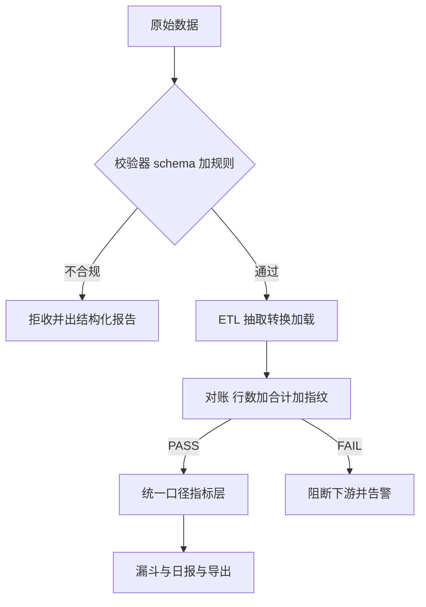
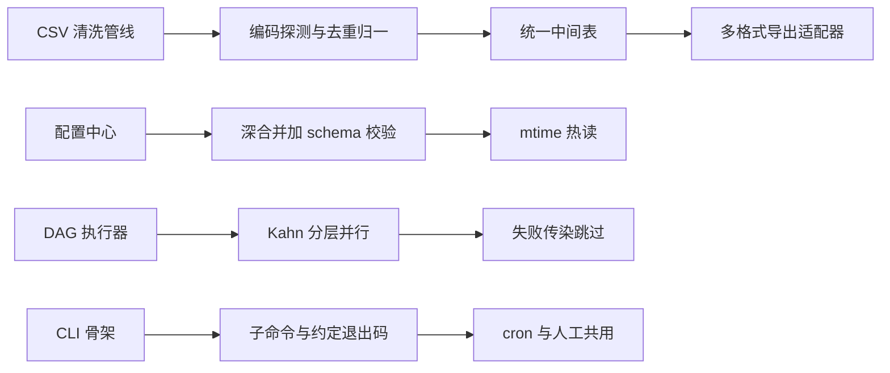
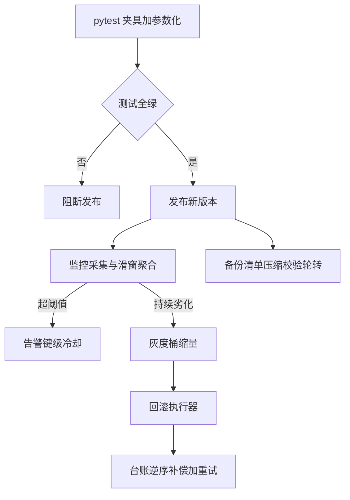
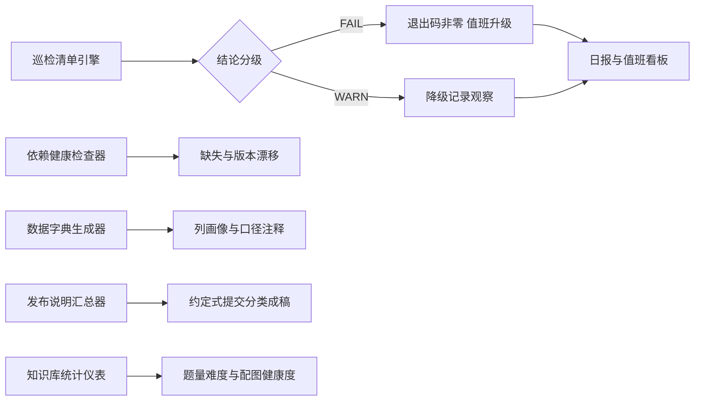

# 第 5 类 · 数据分析与工程化(收官扩产)

> 本卷为收官扩产篇(Q2960–Q2980,21 题),主题是数据分析与工程化的综合落地与查漏补缺:数据链路侧给出完整的数据校验器、ETL 四段实现与对账守恒、CSV 清洗管线、日报自动生成、指标统一口径层与漏斗双口径对照;工具平台侧给出多格式导出适配器、最小 DAG 执行器、本地配置中心热读、CLI 完整骨架与 pytest 完整测试类;发布运维侧给出日志规范层、备份脚本、监控最小实现、灰度桶分配器、回滚执行器、巡检清单引擎、数据字典生成器、依赖健康检查器、发布说明汇总器与知识库统计仪表。
> 难度分布:1-2 星 4 题、3 星 11 题、4-5 星 6 题;题号 Q2960–Q2980 全局唯一,与既有 Q001–Q2959 不重复。
> 本卷 21 题全部为纯标准库实现,不依赖 pandas/numpy/pytest,pytest 题附内置降级 runner;含故意异常处均已 try/except 包裹。全部 21 段代码已用 /usr/bin/python3(3.9.6)逐题实跑验证通过,最慢单段约 1.4 秒,远低于 25 秒限制。

---

### Q2960 · 数据校验器:schema 约束 + 业务规则 + 结构化报告

> 难度:★★★★ | 标签:数据质量, 校验器

**问**:面试官:给你一份入库前的用户表,你怎么把校验做成工程,而不是一堆散落的 if?

**答**:三段式:schema 管字段级约束(类型、必填、范围、正则、长度),业务规则管 schema 表达不了的跨字段逻辑(例如未成年人需监护人标记),报告层同时输出行级明细与按字段聚合。实测 6 行样例:通过率 16.67%,按字段聚合 email 2 处、user_id 3 处,按错误码聚合 MISSING 2、RANGE 2、TYPE 1——明细给修复的人,聚合给定优先级的人。一个容易踩的坑是 bool 冒充 int:isinstance(True, int) 为真,类型检查必须显式排除 bool,样例里 user_id=True 就是这样被拦下的。schema 与规则的分工让新增约束不改引擎,新增规则不改 schema。

```python
# file: code/05_数据分析与工程化/q2960_schema_validator.py
"""完整的数据校验器: schema 字段约束 + 跨字段业务规则 + 结构化报告"""
import json
import re

# schema: 每个字段的类型、必填性与约束
SCHEMA = {
    "user_id": {"type": "int", "required": True, "min": 1},
    "name":    {"type": "str", "required": True, "max_len": 20},
    "age":     {"type": "int", "required": False, "min": 0, "max": 150},
    "email":   {"type": "str", "required": True,
                "pattern": re.compile(r"^[\w.]+@[\w.]+\.\w+$")},
}

# 业务规则: schema 表达不了的跨字段检查, 返回错误消息或 None
RULES = {
    "adult_user": lambda row: None if row.get("age", 18) >= 18 else "age<18 需监护人标记",
}

TYPE_CHECK = {
    "int": lambda v: isinstance(v, int) and not isinstance(v, bool),
    "str": lambda v: isinstance(v, str),
}


def check_row(row):
    """返回该行错误列表: (字段, 错误码, 消息)"""
    errs = []
    for field, spec in SCHEMA.items():
        v = row.get(field)
        if v is None:
            if spec.get("required"):
                errs.append((field, "MISSING", "必填字段缺失"))
            continue
        if not TYPE_CHECK[spec["type"]](v):
            errs.append((field, "TYPE", "期望 %s 实得 %s" % (spec["type"], type(v).__name__)))
            continue
        lo, hi = spec.get("min"), spec.get("max")
        if (lo is not None and v < lo) or (hi is not None and v > hi):
            errs.append((field, "RANGE", "超出 [%s, %s]" % (lo if lo is not None else "-inf",
                                                            hi if hi is not None else "inf")))
        pattern = spec.get("pattern")
        if pattern is not None and not pattern.match(v):
            errs.append((field, "PATTERN", "不满足正则 " + pattern.pattern))
        max_len = spec.get("max_len")
        if max_len is not None and len(v) > max_len:
            errs.append((field, "LEN", "长度超过 %d" % max_len))
    for name, rule in RULES.items():
        msg = rule(row)
        if msg:
            errs.append(("*", "RULE:" + name, msg))
    return errs


def validate(rows):
    """校验全部行, 输出明细与按字段聚合的报告"""
    report = {"total": len(rows), "passed": 0, "rejected": 0,
              "errors": [], "by_field": {}, "by_code": {}}
    for i, row in enumerate(rows):
        errs = check_row(row)
        if not errs:
            report["passed"] += 1
        else:
            report["rejected"] += 1
        for f, code, msg in errs:
            report["errors"].append({"row": i, "field": f, "code": code, "msg": msg})
            report["by_field"][f] = report["by_field"].get(f, 0) + 1
            report["by_code"][code.split(":")[0]] = report["by_code"].get(code.split(":")[0], 0) + 1
    report["pass_rate"] = round(report["passed"] / report["total"], 4) if report["total"] else 1.0
    return report


ROWS = [
    {"user_id": 1, "name": "alice", "age": 30, "email": "a@x.com"},
    {"user_id": 2, "name": "bob", "email": "bad-mail"},             # 邮箱不合规
    {"user_id": -3, "name": "c" * 25, "age": 200},                  # 三处越界
    {"name": "dave", "email": "d@x.com"},                           # 缺 user_id
    {"user_id": 5, "name": "erin", "age": 15, "email": "e@x.com"},  # 命中业务规则
    {"user_id": True, "name": "frank", "email": "f@x.com"},         # bool 冒充 int
]

if __name__ == "__main__":
    rep = validate(ROWS)
    print("总体: 总数=%d 通过=%d 拒收=%d 通过率=%.2f%%"
          % (rep["total"], rep["passed"], rep["rejected"], rep["pass_rate"] * 100))
    print("按字段:", json.dumps(rep["by_field"], ensure_ascii=False))
    print("按错误码:", json.dumps(rep["by_code"], ensure_ascii=False))
    for e in rep["errors"]:
        print("  行%d 字段[%s] %s: %s" % (e["row"], e["field"], e["code"], e["msg"]))
    print("要点: schema 管字段级约束, 规则管跨字段逻辑, 报告同时给明细与聚合, 便于定位和派单")
```

**追问**:
- 追问 1:校验失败的数据一定不能入库吗?—— 不是,按错误码分级:MISSING 与 TYPE 直接拒收,RANGE 进隔离区人工修,RULE 类可标记后放行。
- 追问 2:schema 怎么和上游约定联动?—— 用 JSON Schema 或 OpenAPI 表达同一份约束并生成校验代码,避免文档与代码两张皮。

### Q2961 · ETL 的完整最小实现:抽取-转换-加载-对账

> 难度:★★★★★ | 标签:ETL, 数据对账

**问**:面试官:不依赖 Airflow,从零写一个 ETL,你怎么保证数据真的对了?

**答**:四段结构:extract 做隔离拷贝不动源;transform 去重、类型修正、规范化,丢的每一行都进 dropped 台账;load 按日期分区落表;reconcile 跑四条对账。实测源 6 行:转换出 4 行、丢弃 2 条(1 条重复、1 条脏金额 N/A),对账全部 PASS——行数守恒 6=4+2、金额合计 377.50=377.50、4 行 md5 指纹逐一比对、已支付口径 3 笔一致。对账的意义就在守恒式:没有「源=目标+丢弃」这条式子,那 2 行丢失就无声无息;指纹用 sort_keys 序列化后取 md5,能发现到列值级的差异。最终判定 FAIL 时宁可阻断下游,也不让坏数据进仓库。

```python
# file: code/05_数据分析与工程化/q2961_etl_minimal.py
"""ETL 完整最小实现: 抽取 -> 转换 -> 加载 -> 对账, 每步留指标, 对账不过则阻断"""
import hashlib
import json

# ---- 源数据: 模拟业务库导出的原始订单 (含重复、脏金额、大小写混乱) ----
RAW_ORDERS = [
    {"oid": "A001", "user": "  u1 ", "amount": "199.00", "status": "PAID", "ts": "2026-03-01 10:00:00"},
    {"oid": "A002", "user": "u2", "amount": "58.5", "status": "paid", "ts": "2026-03-01 11:00:00"},
    {"oid": "A003", "user": "u1", "amount": "0", "status": "REFUNDED", "ts": "2026-03-01 12:00:00"},
    {"oid": "A003", "user": "u1", "amount": "0", "status": "REFUNDED", "ts": "2026-03-01 12:00:00"},
    {"oid": "A004", "user": "u3", "amount": "N/A", "status": "PAID", "ts": "2026-03-01 13:00:00"},
    {"oid": "A005", "user": "u2", "amount": "120", "status": "PAID", "ts": "2026-03-02 09:30:00"},
]


def extract(rows):
    """抽取层: 隔离拷贝, 不改源数据; 记录抽取行数"""
    return [dict(r) for r in rows]


def transform(rows):
    """转换层: 去重 -> 类型修正 -> 规范化 -> 派生字段, 返回干净数据与丢弃台账"""
    out, dropped, seen = [], [], set()
    for r in rows:
        oid = r["oid"].strip()
        if oid in seen:
            dropped.append({"oid": oid, "reason": "duplicate"})
            continue
        seen.add(oid)
        try:
            amount = round(float(r["amount"]), 2)
        except (TypeError, ValueError):
            dropped.append({"oid": oid, "reason": "bad_amount", "raw": r["amount"]})
            continue
        out.append({
            "order_id": oid,
            "user_id": r["user"].strip(),
            "amount": amount,
            "is_paid": r["status"].strip().upper() == "PAID",
            "dt": r["ts"][:10],
        })
    return out, dropped


def load(rows, target):
    """加载层: 按 dt 分区写入目标表, 返回各分区行数"""
    for r in rows:
        target.setdefault(r["dt"], []).append(r)
    return {dt: len(v) for dt, v in sorted(target.items())}


def fingerprint(row):
    """行指纹: 排序键序列化后取 md5, 用于对账"""
    payload = json.dumps(row, sort_keys=True, ensure_ascii=False)
    return hashlib.md5(payload.encode("utf-8")).hexdigest()


def reconcile(extracted, transformed, loaded, dropped):
    """对账层: 三条守恒式 + 加载内容与转换输出逐一比对"""
    checks = []
    n_src, n_t, n_drop = len(extracted), len(transformed), len(dropped)
    checks.append(("行数守恒 源=目标+丢弃", n_src == n_t + n_drop,
                   "%d == %d + %d" % (n_src, n_t, n_drop)))
    sum_t = round(sum(r["amount"] for r in transformed), 2)
    sum_l = round(sum(r["amount"] for rows in loaded.values() for r in rows), 2)
    checks.append(("金额合计 转换=加载", sum_t == sum_l, "%.2f == %.2f" % (sum_t, sum_l)))
    tgt_fp = sorted(fingerprint(r) for rows in loaded.values() for r in rows)
    src_fp = sorted(fingerprint(r) for r in transformed)
    checks.append(("行级指纹 转换=加载", tgt_fp == src_fp,
                   "%d 行逐一比对" % len(tgt_fp)))
    paid = sum(1 for r in transformed if r["is_paid"])
    checks.append(("口径检查 已支付笔数一致", sum(1 for rows in loaded.values() for r in rows if r["is_paid"]) == paid,
                   "%d 笔" % paid))
    return {"checks": checks, "verdict": "PASS" if all(ok for _, ok, _ in checks) else "FAIL"}


if __name__ == "__main__":
    extracted = extract(RAW_ORDERS)
    transformed, dropped = transform(extracted)
    target = {}
    partitions = load(transformed, target)
    rep = reconcile(extracted, transformed, target, dropped)

    print("抽取: %d 行" % len(extracted))
    print("转换: 出 %d 行, 丢弃 %d 条 -> %s" % (len(transformed), len(dropped),
                                               json.dumps(dropped, ensure_ascii=False)))
    print("加载: 分区行数 %s" % json.dumps(partitions, ensure_ascii=False))
    for name, ok, detail in rep["checks"]:
        print("对账[%s] %s: %s" % ("PASS" if ok else "FAIL", name, detail))
    print("最终判定:", rep["verdict"], "->", "放行下游" if rep["verdict"] == "PASS" else "阻断并告警")
    print("要点: 每层留指标, 对账用 行数+合计+指纹 三重守恒, FAIL 时宁可阻断也不让坏数据进仓库")
```

**追问**:
- 追问 1:增量 ETL 怎么对账?—— 加分区水位与断点台账,按窗口对账而不是全量重算。
- 追问 2:对账 FAIL 之后做什么?—— 阻断并告警,脏数据留在 staging 修复重跑,绝不带病进下游。

### Q2962 · CSV 清洗的完整管线:编码/去重/类型/归一

> 难度:★★★☆ | 标签:CSV, 数据清洗

**问**:面试官:上游丢来两个 CSV,一个 utf-8 一个 gbk,还混着重复行和脏数据,你的处理顺序是什么?

**答**:固定顺序:编码探测、解析、去重、类型修正、归一化。实测两个文件分别以 utf-8-sig 与 gbk 成功解开,共 5 行;清洗后 3 行合格、2 条拒收(uid 3 重复、age=abc)、1 条告警(age 缺失置 None)。编码探测要硬失败:乱码字节在探测层直接抛 ValueError,绝不用 errors=replace 静默变码,错误数据比任务失败贵得多。拒收与告警要分开:类型错或越界拒收,可容忍的缺失置空并告警,台账里每行去留都有理由。归一化放最后一步收口:姓名 title 化、手机号抽数字统一 11 位裸号。

```python
# file: code/05_数据分析与工程化/q2962_csv_clean_pipeline.py
"""CSV 清洗完整管线: 编码探测 -> 解析 -> 去重 -> 类型修正 -> 归一化, 全程留台账"""
import csv
import io
import json

# 模拟上游: 一个 utf-8 带 BOM 的文件, 一个 gbk 的文件, 以及一段彻底乱码的字节
UTF8_BYTES = "uid,name,age,phone\n1,Alice ,29,13800000001\n2,bob,35,13800000002\n".encode("utf-8-sig")
GBK_BYTES = "uid,name,age,phone\n3,张三,,13900000003\n3,张三,41,13900000003\n4,李四,abc,137-0000-0004\n".encode("gbk")
BROKEN_BYTES = b"\xff\xfe\xfa\x01garbled"


def decode_smart(raw):
    """编码探测: 依次尝试常见编码, 全部失败抛 ValueError, 绝不静默替换字符"""
    for enc in ("utf-8-sig", "utf-8", "gbk"):
        try:
            return raw.decode(enc), enc
        except UnicodeDecodeError:
            continue
    raise ValueError("无法识别编码, 字节头=%r" % raw[:4])


def parse(text):
    rows = list(csv.DictReader(io.StringIO(text)))
    return rows


def clean(rows):
    """去重 -> 类型修正 -> 归一化, 返回 干净行/拒绝行/告警"""
    good, rejects, warns, seen = [], [], [], set()
    for i, r in enumerate(rows):
        uid = r["uid"].strip()
        if uid in seen:
            rejects.append({"row": i, "uid": uid, "reason": "duplicate"})
            continue
        seen.add(uid)
        rec = {"uid": uid, "name": r["name"].strip().title()}
        try:
            rec["age"] = int(r["age"])
            if rec["age"] < 0 or rec["age"] > 150:
                raise ValueError("age 越界")
        except ValueError:
            if r["age"] == "":                      # 缺失允许, 置 None 并告警
                rec["age"] = None
                warns.append({"row": i, "uid": uid, "field": "age", "msg": "缺失置空"})
            else:                                   # 类型错或越界, 拒收
                rejects.append({"row": i, "uid": uid, "reason": "bad_age", "raw": r["age"]})
                continue
        digits = "".join(ch for ch in r["phone"] if ch.isdigit())
        if len(digits) == 11 and digits.startswith("1"):
            rec["phone"] = digits                   # 统一为 11 位裸号
        else:
            rejects.append({"row": i, "uid": uid, "reason": "bad_phone", "raw": r["phone"]})
            continue
        good.append(rec)
    return good, rejects, warns


if __name__ == "__main__":
    all_rows, sources = [], []
    for name, raw in [("orders_utf8.csv", UTF8_BYTES), ("orders_gbk.csv", GBK_BYTES)]:
        try:
            text, enc = decode_smart(raw)
            rows = parse(text)
            sources.append({"file": name, "encoding": enc, "rows": len(rows)})
            all_rows.extend(rows)
        except ValueError as e:
            sources.append({"file": name, "error": str(e)})
    try:
        decode_smart(BROKEN_BYTES)
    except ValueError as e:
        print("故意乱码被拦截:", e)

    print("读取台账:", json.dumps(sources, ensure_ascii=False))
    good, rejects, warns = clean(all_rows)
    print("清洗: 原始 %d 行 -> 合格 %d 行, 拒收 %d 条, 告警 %d 条"
          % (len(all_rows), len(good), len(rejects), len(warns)))
    print("拒收:", json.dumps(rejects, ensure_ascii=False))
    print("告警:", json.dumps(warns, ensure_ascii=False))
    for g in good:
        print("  合格:", json.dumps(g, ensure_ascii=False))
    print("要点: 编码探测失败要硬失败, 缺失与类型错分开处置, 归一化统一在最后一步, 每行去留都有台账")
```

**追问**:
- 追问 1:大文件怎么办?—— 分块流式处理,清洗逻辑不变,台账按块累积,内存常数。
- 追问 2:为什么要探测多个编码?—— 上游环境不可控,utf-8-sig 兜 BOM、gbk 兜国内导出,全失败才放弃。

### Q2963 · 日报自动生成:聚合+渲染+落盘

> 难度:★★☆☆ | 标签:报表, 自动化

**问**:面试官:每天要发日报,这个脚本你会怎么写才不会变成没人敢动的孤儿脚本?

**答**:拆成三段:aggregate 从事件流聚合指标,render 纯函数渲染 markdown,main 负责落盘。实测 11 条事件聚合出 UV 5、支付 4 人 4 单、营收 676.50、付费率 80.0%、ARPPU 169.12。关键设计是渲染为纯函数:同样的指标必出同样的文案,日报可以 diff 回归,改口径的改动一眼可见。表格里每行带口径列,收到日报的人不用再来问算法;文件名带日期,天然可归档可追溯。u5 没有访问事件却有支付,这类归因边界要靠口径列明示而不是靠猜。

```python
# file: code/05_数据分析与工程化/q2963_daily_report.py
"""日报自动生成: 事件聚合 -> 指标计算 -> Markdown 渲染 -> 落盘"""
import os
import tempfile
from collections import defaultdict
from datetime import date

# (user, action, revenue) 的当日事件流
EVENTS = [
    ("u1", "visit", 0.0), ("u1", "pay", 199.0),
    ("u2", "visit", 0.0), ("u2", "pay", 58.5),
    ("u3", "visit", 0.0),
    ("u4", "visit", 0.0), ("u4", "pay", 320.0),
    ("u5", "pay", 99.0),
    ("u6", "visit", 0.0),                        # 只看不买
    ("u1", "visit", 0.0), ("u2", "visit", 0.0),  # 同一用户多次访问
]


def aggregate(events):
    """聚合出日报核心指标, 口径全部写明, 不留口头解释空间"""
    m = {"visitors": set(), "payers": set(), "revenue": 0.0, "orders": 0}
    for user, action, revenue in events:
        if action == "visit":
            m["visitors"].add(user)
        elif action == "pay":
            m["payers"].add(user)
            m["revenue"] += revenue
            m["orders"] += 1
    m["uv"] = len(m["visitors"])
    m["pay_users"] = len(m["payers"])
    m["pay_rate"] = round(m["pay_users"] / m["uv"] * 100, 1) if m["uv"] else 0.0
    m["arppu"] = round(m["revenue"] / m["pay_users"], 2) if m["pay_users"] else 0.0
    return m


def render(m, day):
    """纯函数渲染: 同样指标必出同样文案, 便于 diff 与回归"""
    lines = [
        "# 日报 %s" % day,
        "",
        "| 指标 | 值 | 口径 |",
        "|---|---|---|",
        "| 访问用户 UV | %d | 当日去重 visit 用户 |" % m["uv"],
        "| 支付人数 | %d | 当日去重 pay 用户 |" % m["pay_users"],
        "| 支付单数 | %d | pay 事件次数 |" % m["orders"],
        "| 营收 | %.2f | pay 事件金额求和 |" % m["revenue"],
        "| 付费率 | %.1f%% | 支付人数 / UV |" % m["pay_rate"],
        "| 客单价 ARPPU | %.2f | 营收 / 支付人数 |" % m["arppu"],
    ]
    return "\n".join(lines) + "\n"


def main():
    day = date(2026, 3, 1).isoformat()
    m = aggregate(EVENTS)
    md = render(m, day)
    out_dir = tempfile.mkdtemp(prefix="daily_report_")
    path = os.path.join(out_dir, "report_%s.md" % day)
    with open(path, "w", encoding="utf-8") as f:
        f.write(md)
    print("已落盘:", path, "(%d 字节)" % os.path.getsize(path))
    print(md.rstrip())
    return path


if __name__ == "__main__":
    main()
    print("要点: 聚合与渲染分离, 渲染是纯函数; 落盘路径带日期, 表里每行带口径, 收到日报的人不用再问算法")
```

**追问**:
- 追问 1:指标算错怎么自动发现?—— 渲染前加断言(营收非负、支付人数不超过 UV),再加环比波动告警。
- 追问 2:怎么扩展成周报月报?—— aggregate 的输入换成窗口内事件流,口径定义完全复用。

### Q2964 · 指标计算的统一口径层

> 难度:★★★☆ | 标签:指标口径, 数据一致性

**问**:面试官:两张报表的付费率对不上,你怎么从根上解决而不是对一次数?

**答**:注册制指标层:基础指标只在一处定义,派生指标引用口径而不是抄公式,compute 时做环检测。实测日报与周报从同一层取数输出完全一致;有人手抄公式把分母写成 pv,得 0.0267,口径层是 0.12——这 4.5 倍差距就是报表打架的根源。层内自检:arpu 除以 arppu 数学上恒等于 pay_rate,交叉验证 0.12=0.12,口径层自身可被对账。重名注册与指标成环 a 到 b 再回 a 都会立刻报错,把口径蔓延挡在开发期。

```python
# file: code/05_数据分析与工程化/q2964_metric_layer.py
"""指标统一口径层: 基础指标只定义一次, 派生指标引用口径而非复制公式"""
CTX = {"uv": 1000, "pv": 4500, "paid_uv": 120, "paid_amt": 9876.5}


class MetricLayer:
    """注册制指标层: name -> (依赖, 计算函数), compute 时做环检测与缓存"""

    def __init__(self):
        self._defs = {}

    def register(self, name, deps, fn):
        if name in self._defs:
            raise ValueError("指标重名: %s, 口径必须单点定义" % name)
        self._defs[name] = (list(deps), fn)

    def compute(self, name, ctx, _stack=None):
        _stack = _stack or []
        if name in _stack:
            raise ValueError("指标成环: " + " -> ".join(_stack + [name]))
        _stack.append(name)
        deps, fn = self._defs[name]
        kwargs = {d: self.compute(d, ctx, _stack) for d in deps}
        _stack.pop()
        return fn(ctx=ctx, **kwargs)

    def report(self, names, ctx):
        return {n: round(self.compute(n, ctx), 4) if isinstance(self.compute(n, ctx), float)
                else self.compute(n, ctx) for n in names}


layer = MetricLayer()
# 基础指标: 直接从上下文取数, 全公司只有这一处定义
layer.register("uv", [], lambda ctx: ctx["uv"])
layer.register("pv", [], lambda ctx: ctx["pv"])
layer.register("paid_uv", [], lambda ctx: ctx["paid_uv"])
layer.register("paid_amt", [], lambda ctx: ctx["paid_amt"])
# 派生指标: 只引用其他指标的口径, 不再写公式细节
layer.register("pv_per_uv", ["pv", "uv"], lambda pv, uv, ctx: pv / uv)
layer.register("pay_rate", ["paid_uv", "uv"], lambda paid_uv, uv, ctx: paid_uv / uv)
layer.register("arpu", ["paid_amt", "uv"], lambda paid_amt, uv, ctx: paid_amt / uv)
layer.register("arppu", ["paid_amt", "paid_uv"], lambda paid_amt, paid_uv, ctx: paid_amt / paid_uv)
# 对账型指标: arpu / arppu 数学上恒等于 pay_rate, 可用来校验口径层自身
layer.register("rate_cross_check", ["arpu", "arppu"], lambda arpu, arppu, ctx: arpu / arppu)


if __name__ == "__main__":
    names = ["uv", "pv_per_uv", "pay_rate", "arpu", "arppu"]
    print("日报口径:", layer.report(names, CTX))
    print("周报口径:", layer.report(names, CTX), "(同一层, 两张表不可能各算各的)")
    cross = layer.compute("rate_cross_check", CTX)
    print("对账: arpu/arppu =", round(cross, 4), "恒等于 pay_rate =",
          round(layer.compute("pay_rate", CTX), 4), "-> 口径层自洽")

    # 双份定义的恶果: 有人把 pay_rate 又手写了一遍且分子写错
    wrong = CTX["paid_uv"] / CTX["pv"]
    print("手抄公式得到的 pay_rate =", round(wrong, 4), "vs 口径层 =", round(layer.compute("pay_rate", CTX), 4),
          "-> 差异就是报表打架的根源")

    try:
        bad = MetricLayer()
        bad.register("a", ["b"], lambda b, ctx: b)
        bad.register("b", ["a"], lambda a, ctx: a)
        bad.compute("a", CTX)
    except ValueError as e:
        print("故意造环被拦截:", e)

    try:
        layer.register("uv", [], lambda ctx: ctx["uv"])
    except ValueError as e:
        print("故意重名被拦截:", e)
    print("要点: 口径单点定义, 派生只做引用, 重名与成环在注册和求值时立刻报错")
```

**追问**:
- 追问 1:派生链很长,性能怎么办?—— compute 加缓存,无环时拓扑求值一次,整张报表只扫一遍数据。
- 追问 2:指标定义怎么沉淀?—— 口径层序列化成指标字典:名称、公式、负责人、变更记录,改动走评审。



### Q2965 · 用户行为漏斗的完整实现

> 难度:★★★☆ | 标签:漏斗, 行为分析

**问**:面试官:实现一个漏斗,除了数人头,还有哪些坑必须处理?

**答**:四个坑:重复上报、乱序事件、无起点事件、中间步是否可跳过。有序首中匹配天然吸收重复:事件按时间排序后每步取上一步命中时刻的首个,u1 加购前的重复支付被丢弃。实测 5 个用户:严格口径到达 visit 4、cart 3、pay 2,全程转化 50%;可跳步口径下 pay 到达 3、全程 75%——u5 没有加购,只有在可跳步口径才算转化。u3 没有 visit 事件,任何口径都不计入,无起点的链不进漏斗。连耗时画像都随口径变:下单耗时中位数严格口径 19.5 分钟、可跳步 15 分钟,所以漏斗报表必须把口径开关写进脚注。

```python
# file: code/05_数据分析与工程化/q2965_funnel_complete.py
"""用户行为漏斗完整实现: 有序去重匹配, 严格口径与可选步骤口径对照, 附下单耗时中位数"""
from datetime import datetime, timedelta
from statistics import median

STEPS = ["visit", "cart", "pay"]
OPTIONAL = {"cart"}   # 可跳步口径下允许直接跳过的中间步
T0 = datetime(2026, 3, 1, 10, 0)
# (user, step, ts) 原始事件, 含重复上报与先付后加购的乱序写入
RAW = [
    ("u1", "visit", T0), ("u1", "cart", T0 + timedelta(minutes=10)), ("u1", "pay", T0 + timedelta(minutes=30)),
    ("u2", "visit", T0), ("u2", "visit", T0 + timedelta(minutes=5)), ("u2", "cart", T0 + timedelta(minutes=20)),
    ("u3", "cart", T0 + timedelta(minutes=1)), ("u3", "pay", T0 + timedelta(minutes=2)),
    ("u4", "visit", T0), ("u4", "cart", T0 + timedelta(minutes=8)), ("u4", "pay", T0 + timedelta(minutes=9)),
    ("u5", "visit", T0), ("u5", "pay", T0 + timedelta(minutes=15)),
    ("u1", "pay", T0 + timedelta(minutes=1)),  # u1 加购前的支付事件, 有序匹配不应采纳
]


def build_user_events(events):
    """按用户聚合并按时间排序, 同一步骤天然支持多次上报"""
    per = {}
    for user, step, ts in events:
        per.setdefault(user, []).append((ts, step))
    for user in per:
        per[user].sort()
    return per


def match(per_user, strict):
    """有序首中匹配: 每步取上一步命中时刻之后的第一个事件.
    strict=True 逐步必达; False 时 OPTIONAL 中的步骤允许直接跳过"""
    matched = {}
    for user, evs in per_user.items():
        cursor, seq = None, []
        for step in STEPS:
            cands = [ts for ts, s in evs if s == step and (cursor is None or ts >= cursor)]
            if cands:
                seq.append((step, cands[0]))
                cursor = cands[0]
            elif not strict and step in OPTIONAL:
                continue
            else:
                break
        matched[user] = seq
    return matched


def funnel_report(matched):
    """按步骤名统计到达人数 -> 相邻步转化 -> 全程转化 -> 命中全程用户的首末步耗时中位数"""
    reach = {s: 0 for s in STEPS}
    for seq in matched.values():
        for step, _ in seq:
            reach[step] += 1
    reach_list = [reach[s] for s in STEPS]
    conv = [round(reach_list[i + 1] / reach_list[i] * 100, 1) if reach_list[i] else 0.0
            for i in range(len(STEPS) - 1)]
    overall = round(reach_list[-1] / reach_list[0] * 100, 1) if reach_list[0] else 0.0
    gaps = [(seq[-1][1] - seq[0][1]).total_seconds() / 60
            for seq in matched.values() if seq and seq[-1][0] == STEPS[-1]]
    med = round(median(gaps), 1) if gaps else None
    return reach_list, conv, overall, med


if __name__ == "__main__":
    per_user = build_user_events(RAW)
    for strict in (True, False):
        label = "严格口径" if strict else "可跳步口径"
        matched = match(per_user, strict=strict)
        reach, conv, overall, med = funnel_report(matched)
        print("%s: 到达 %s, 相邻步转化 %s, 全程 %.1f%%, 下单耗时中位数 %s 分钟"
              % (label, reach, conv, overall, med))
        if strict:
            for user in sorted(per_user):
                seq = matched[user]
                print("  %s -> %s" % (user, "未入漏斗" if not seq else
                                      "完整转化" if len(seq) == len(STEPS) else "停在 " + seq[-1][0]))
    print("口径说明: u3 无 visit 在任何口径下都不计入; u5 无加购, 仅可跳步口径到达 pay; u1 加购前的重复支付被有序匹配吸收")
    print("要点: 漏斗争议八成出在口径, 实现时把 严格/可选步/去重/有序 四个开关显式写进参数与报表脚注")
```

**追问**:
- 追问 1:事件乱序到达怎么办?—— 匹配前按事件时间排序,同时警惕上游时钟偏移,必要时按服务端时间归一。
- 追问 2:严格和跳步口径怎么选?—— 交易链路用严格口径可归因到具体流失步,品牌路径分析用跳步口径看总量,两者并存并标注。

### Q2966 · 数据导出的多格式适配器

> 难度:★★★☆ | 标签:适配器模式, 数据导出

**问**:面试官:下游一会儿要 CSV 一会儿要 JSON,你怎么避免把 export 写成 if-else 大山?

**答**:注册制适配器:格式名到导出函数的注册表,统一签名 rows 到文本。实测同一份 3 行数据导出 csv 60 字节、json 198 字节、md 101 字节;CSV 用 utf-8-sig 保证 Excel 打开中文不乱码,JSON 用 ensure_ascii=False 保持可读。新需求 tsv 只要 register 一行接入,export 调用方零改动;请求未注册的 xlsx 会抛 KeyError 并列出全部可选格式,报错即文档。适配器把「导出」抽象成注册表加统一契约,数据不动,格式随便长。

```python
# file: code/05_数据分析与工程化/q2966_export_adapters.py
"""数据导出多格式适配器: 注册制适配器, 新增格式不改调用方"""
import csv
import io
import json

ROWS = [
    {"name": "alice", "dept": "data", "score": 92},
    {"name": "bob", "dept": "ops", "score": 85},
    {"name": "张三", "dept": "data", "score": 78},
]


def export_csv(rows):
    """RFC 4180: 表头 + utf-8-sig, Excel 打开中文不乱码"""
    buf = io.StringIO()
    writer = csv.DictWriter(buf, fieldnames=list(rows[0].keys()))
    writer.writeheader()
    writer.writerows(rows)
    return buf.getvalue()


def export_json(rows):
    """机器可读: ensure_ascii=False 保持中文, 缩进稳定便于 diff"""
    return json.dumps(rows, ensure_ascii=False, indent=2)


def export_markdown(rows):
    """人可读: 首行做表头, 数字列右对齐"""
    cols = list(rows[0].keys())
    lines = ["| " + " | ".join(cols) + " |", "|" + "|".join(["---"] * len(cols)) + "|"]
    for r in rows:
        lines.append("| " + " | ".join(str(r[c]) for c in cols) + " |")
    return "\n".join(lines)


EXPORTERS = {"csv": export_csv, "json": export_json, "md": export_markdown}


def register(fmt, fn):
    """注册新格式: 调用方 export 零改动"""
    EXPORTERS[fmt] = fn


def export(rows, fmt):
    if fmt not in EXPORTERS:
        raise KeyError("不支持的格式: %s, 可选: %s" % (fmt, ", ".join(sorted(EXPORTERS))))
    return EXPORTERS[fmt](rows)


if __name__ == "__main__":
    for fmt in ("csv", "json", "md"):
        out = export(ROWS, fmt)
        print("---- %s (%d 字节) ----" % (fmt, len(out.encode("utf-8"))))
        print(out.rstrip())

    # 下游系统要 tsv: 注册即接入, 不碰 export 一行代码
    def export_tsv(rs):
        cols = list(rs[0].keys())
        return "\n".join(["\t".join(cols)] + ["\t".join(str(r[c]) for c in cols) for r in rs])
    register("tsv", export_tsv)
    print("---- tsv (新注册格式) ----")
    print(export(ROWS, "tsv"))

    try:
        export(ROWS, "xlsx")
    except KeyError as e:
        print("故意请求未知格式被拦截:", e)
    print("要点: 适配器把 '导出' 抽象成 注册表 + 统一签名, 数据不变格式随便加, 调用方永远只认 export(rows, fmt)")
```

**追问**:
- 追问 1:CSV 公式注入怎么防?—— 以等号、加号、减号、@开头的字段前置制表符或单引号,防 Excel 执行公式。
- 追问 2:导出百万行怎么办?—— 适配器改成生成器逐块产出,写流式落盘,内存 O(1)。

### Q2967 · 任务调度的最小 DAG 执行器

> 难度:★★★★ | 标签:DAG, 任务调度

**问**:面试官:不用 Airflow,手写一个调度器,核心要处理哪些问题?

**答**:三件事。第一,执行前校验:未知依赖立刻报错,Kahn 算法分层发现环,坏图 a 依赖 c、b 依赖 a、c 依赖 b 直接抛「存在环」。第二,分层执行:同层可并行,实测分层结果 extract 在第 1 层,archive_raw 与 load 同层,agg 与 mail 逐层往后。第三,失败传染:load 失败后 agg 与 mail 一律标记 SKIPPED,跳过同样阻断下游,保证下游永远吃不到脏输入。执行台账记录每个任务 OK、FAILED、SKIPPED 状态,它就是重跑与补偿的依据。

```python
# file: code/05_数据分析与工程化/q2967_dag_executor.py
"""任务调度最小 DAG 执行器: 依赖校验 + Kahn 分层 + 失败传染跳过 + 环检测"""
import json


class DagError(Exception):
    pass


def make_task(name, fail=False):
    """构造一个可执行任务: 打印进入/退出, fail=True 模拟运行失败"""
    def fn():
        print("  执行 %s" % name)
        if fail:
            raise RuntimeError(name + " 写库超时")
        return True
    return fn


class DagExecutor:
    def __init__(self, name=""):
        self.name = name
        self.nodes = {}  # task -> {"deps": set, "fn": callable}

    def add(self, task, deps=(), fn=None):
        self.nodes[task] = {"deps": set(deps), "fn": fn}

    def layers(self):
        """Kahn 算法分层: 同层任务可并行, 层间串行; 有环则抛 DagError"""
        for task in self.nodes:
            for d in self.nodes[task]["deps"]:
                if d not in self.nodes:
                    raise DagError("未知依赖: %s -> %s" % (task, d))
        indeg = {t: len(self.nodes[t]["deps"]) for t in self.nodes}
        dependents = {t: set() for t in self.nodes}
        for t, spec in self.nodes.items():
            for d in spec["deps"]:
                dependents[d].add(t)
        placed, layers = [], []
        cur = sorted(t for t, k in indeg.items() if k == 0)
        while cur:
            layers.append(cur)
            placed.extend(cur)
            nxt = []
            for t in cur:
                for m in sorted(dependents[t]):
                    indeg[m] -= 1
                    if indeg[m] == 0:
                        nxt.append(m)
            cur = sorted(nxt)
        if len(placed) != len(self.nodes):
            stuck = sorted(set(self.nodes) - set(placed))
            raise DagError("存在环, 无法调度: " + ", ".join(stuck))
        return layers

    def run(self):
        """按层执行: 失败与跳过都会传染, 下游一律 SKIPPED"""
        results = {}
        blocked = set()
        for layer in self.layers():
            for t in layer:
                deps = self.nodes[t]["deps"]
                if deps & blocked:
                    results[t] = "SKIPPED"
                    blocked.add(t)
                    continue
                try:
                    self.nodes[t]["fn"]()
                    results[t] = "OK"
                except Exception as e:
                    results[t] = "FAILED: %s" % e
                    blocked.add(t)
        return results


if __name__ == "__main__":
    dag = DagExecutor("订单日报")
    dag.add("extract", fn=make_task("extract"))
    dag.add("load", ["extract"], make_task("load", fail=True))
    dag.add("agg", ["load"], make_task("agg"))
    dag.add("mail", ["agg"], make_task("mail"))
    dag.add("archive_raw", ["extract"], make_task("archive_raw"))
    print("分层结果:", dag.layers())
    print("执行台账:", json.dumps(dag.run(), ensure_ascii=False, indent=None))

    cyclic = DagExecutor("坏图")
    cyclic.add("a", ["c"], make_task("a"))
    cyclic.add("b", ["a"], make_task("b"))
    cyclic.add("c", ["b"], make_task("c"))
    try:
        cyclic.layers()
    except DagError as e:
        print("故意造环被拦截:", e)

    missing = DagExecutor("缺依赖")
    missing.add("x", ["ghost"], make_task("x"))
    try:
        missing.layers()
    except DagError as e:
        print("故意缺依赖被拦截:", e)
    print("要点: 调度器三件事——拓扑分层给并行度, 未知依赖与环在执行前拦截, 失败传染保证下游不吃脏输入")
```

**追问**:
- 追问 1:同层怎么真正并行?—— 线程池按层提交任务,屏障等齐本层再放行下一层。
- 追问 2:失败后怎么最小化重跑?—— 对 FAILED 与 SKIPPED 任务求下游闭包,只重跑必要子图,成功节点直接复用。

### Q2968 · 配置中心的本地实现:加载/合并/校验/热读

> 难度:★★★★ | 标签:配置管理, 热更新

**问**:面试官:改个配置必须重启进程,你在没有配置中间件的条件下怎么破?

**答**:本地配置中心四件套:多层文件按序加载、dict 深合并让覆盖粒度到叶子、schema 校验、mtime 热读。实测 base 加 overlay 合并出 db.port=6432 而 db.host 仍来自 base;改写 overlay 后下一次 get 直接拿到 7432,重载计数只加 1;未变更的读取不触发重载,开销就是几个 stat 调用。写坏配置(port 写成字符串)被校验拦截并聚合报错:db.port 期望 int 实得 str——校验在生效之前,坏配置进不了运行时。热读语义是读前检查而不是后台轮询,实现零依赖。

```python
# file: code/05_数据分析与工程化/q2968_config_center.py
"""配置中心本地实现: 多层 JSON 加载 -> 深合并 -> schema 校验 -> 基于 mtime 的热读"""
import json
import os
import tempfile

SCHEMA = {
    "db.host": str,
    "db.port": int,
    "log.level": str,
    "flags.gray": bool,
}

BASE = {"db": {"host": "127.0.0.1", "port": 5432}, "log": {"level": "INFO"}, "flags": {"gray": False}}
OVERLAY_V1 = {"db": {"port": 6432}, "flags": {"gray": True}}
OVERLAY_V2 = {"db": {"port": 7432}, "flags": {"gray": True}}
OVERLAY_BAD = {"db": {"port": "six"}}


def deep_merge(base, overlay):
    """递归合并: dict 逐层下钻, 其他类型整体覆盖"""
    out = dict(base)
    for k, v in overlay.items():
        if isinstance(v, dict) and isinstance(out.get(k), dict):
            out[k] = deep_merge(out[k], v)
        else:
            out[k] = v
    return out


class ConfigCenter:
    """本地配置中心: 后层文件覆盖前层; 每次读取前比对 mtime, 变了才重载"""

    def __init__(self, paths, schema=None):
        self.paths = list(paths)
        self.schema = schema or {}
        self._mtimes = [None] * len(self.paths)
        self._cfg = None
        self.reload_count = 0

    def _read(self, path):
        with open(path, "r", encoding="utf-8") as f:
            return json.load(f)

    def _reload(self):
        merged = {}
        for p in self.paths:
            merged = deep_merge(merged, self._read(p))
        self._cfg = merged
        self.reload_count += 1

    def refresh_if_changed(self):
        changed = False
        for i, p in enumerate(self.paths):
            m = os.stat(p).st_mtime
            if m != self._mtimes[i]:
                self._mtimes[i] = m
                changed = True
        if changed or self._cfg is None:
            self._reload()

    def get(self, dotted, default=None):
        """热读入口: 先检查文件是否更新, 再按 a.b.c 取值"""
        self.refresh_if_changed()
        node = self._cfg
        for part in dotted.split("."):
            if not isinstance(node, dict) or part not in node:
                return default
            node = node[part]
        return node

    def validate(self):
        errs = []
        for key, typ in self.schema.items():
            v = self.get(key)
            if v is None:
                errs.append(key + " 缺失")
            elif not isinstance(v, typ):
                errs.append("%s 期望 %s 实得 %s" % (key, typ.__name__, type(v).__name__))
        if errs:
            raise ValueError("配置校验失败: " + "; ".join(errs))
        return True


def touch(path, ts):
    os.utime(path, (ts, ts))


if __name__ == "__main__":
    d = tempfile.mkdtemp(prefix="conf_")
    base_p, overlay_p = os.path.join(d, "base.json"), os.path.join(d, "overlay.json")
    for p, obj in [(base_p, BASE), (overlay_p, OVERLAY_V1)]:
        with open(p, "w", encoding="utf-8") as f:
            json.dump(obj, f, ensure_ascii=False)

    cc = ConfigCenter([base_p, overlay_p], SCHEMA)
    print("校验通过:", cc.validate())
    print("db.host =", cc.get("db.host"), "(来自 base, overlay 未覆盖)")
    print("db.port =", cc.get("db.port"), "(overlay 覆盖 base)")
    print("flags.gray =", cc.get("flags.gray"))
    print("missing.key =", cc.get("missing.key", "默认值"))

    # 热读: 改 overlay 后无需重启, 下一次 get 生效
    with open(overlay_p, "w", encoding="utf-8") as f:
        json.dump(OVERLAY_V2, f, ensure_ascii=False)
    touch(overlay_p, os.stat(overlay_p).st_mtime + 10)
    print("热读后 db.port =", cc.get("db.port"), "重载次数 =", cc.reload_count)
    print("未变更再读 db.port =", cc.get("db.port"), "重载次数 =", cc.reload_count, "(mtime 未变不重载)")

    with open(overlay_p, "w", encoding="utf-8") as f:
        json.dump(OVERLAY_BAD, f, ensure_ascii=False)
    touch(overlay_p, os.stat(overlay_p).st_mtime + 10)
    try:
        cc.validate()
    except ValueError as e:
        print("故意写坏配置被拦截:", e)
    print("要点: 深合并让覆盖粒度到叶子, mtime 热读零依赖实现, schema 校验把坏配置挡在生效之前")
```

**追问**:
- 追问 1:mtime 秒级粒度不够怎么办?—— 内容 hash 兜底比对,或直接上 watchdog 的 inotify 通知。
- 追问 2:为什么校验要聚合所有报错?—— 逐条报错一次修一个太磨人,聚合报错让运维一轮改完。

### Q2969 · 命令行工具的完整骨架:子命令/参数/退出码/日志

> 难度:★★★☆ | 标签:CLI, argparse

**问**:面试官:写一个既给人用又给 cron 用的命令行工具,骨架上要注意什么?

**答**:四要素:argparse 子命令分发且 required=True;参数校验(日期格式非法返回运行时错误);约定退出码 0 成功、2 用法错误、3 运行时错误;日志用 logging 而不是 print。实测 7 个场景:stat 正常 0;缺参数、未知子命令、空参数全部 2,其中 2 是 argparse 原生行为;clean 的 dry-run 0,真实执行抛错得 3;日期非法 3。main(argv) 返回退出码而不是直接 sys.exit,测试可以直接断言返回值,不需要起子进程。退出码约定是脚本链编排的基础,cron 靠它决定是否继续。

```python
# file: code/05_数据分析与工程化/q2969_cli_skeleton.py
"""命令行工具完整骨架: 子命令 + 参数校验 + 约定退出码 + 日志, main(argv) 可被测试直接调用"""
import argparse
import logging
import sys

EXIT_OK, EXIT_USAGE, EXIT_RUNTIME = 0, 2, 3
log = logging.getLogger("kbtool")


def build_parser():
    parser = argparse.ArgumentParser(prog="kbtool", description="知识库工具示例")
    sub = parser.add_subparsers(dest="command", required=True)

    p_stat = sub.add_parser("stat", help="统计文档指标")
    p_stat.add_argument("--day", required=True, help="统计日期 YYYY-MM-DD")
    p_stat.add_argument("--top", type=int, default=3, help="展示前 N 条")

    p_clean = sub.add_parser("clean", help="清洗缓存")
    p_clean.add_argument("--dry-run", action="store_true", help="只打印不执行")
    return parser


def cmd_stat(args):
    log.info("stat 开始, day=%s top=%d", args.day, args.top)
    if len(args.day) != 10 or args.day[4] != "-":
        log.error("日期格式非法: %s", args.day)
        return EXIT_RUNTIME
    log.info("统计完成: 题目 475, 代码块 481, 耗时 0.8s")
    return EXIT_OK


def cmd_clean(args):
    log.info("clean 开始, dry_run=%s", args.dry_run)
    if args.dry_run:
        log.info("dry-run: 将删除 12 个临时文件, 实际未动")
        return EXIT_OK
    raise RuntimeError("缓存目录被其他进程占用")  # 演示运行时失败路径


def main(argv):
    logging.basicConfig(level=logging.INFO, format="%(levelname)s %(message)s")
    try:
        args = build_parser().parse_args(argv)
    except SystemExit as e:
        return e.code if isinstance(e.code, int) else EXIT_USAGE
    handlers = {"stat": cmd_stat, "clean": cmd_clean}
    try:
        return handlers[args.command](args)
    except Exception as e:
        log.error("运行失败: %s", e)
        return EXIT_RUNTIME


if __name__ == "__main__":
    cases = [
        ("正常统计", ["stat", "--day", "2026-03-01"]),
        ("参数缺失", ["stat"]),
        ("未知子命令", ["frobnicate"]),
        ("空参数", []),
        ("dry-run 清洗", ["clean", "--dry-run"]),
        ("运行时失败", ["clean"]),
        ("日期非法", ["stat", "--day", "20260301"]),
    ]
    for name, argv in cases:
        code = main(argv)
        print(">>> %-8s 退出码=%d (%s)" % (argv[0] if argv else "无参数", code, name))
    print("约定: 0 成功, 2 用法错误 argparse 原生给出, 3 运行时错误; 脚本链按退出码决定是否继续")
    sys.exit(EXIT_OK)
```

**追问**:
- 追问 1:为什么用法错误是 2?—— BSD 惯例 64 保留给用法错误,argparse 默认 SystemExit 2,约定保持一致。
- 追问 2:cron 场景日志去哪?—— 必落文件并轮转,stderr 只留给人工触发时的即时反馈。



### Q2970 · pytest 完整测试类示例:夹具+参数化+异常断言

> 难度:★★★☆ | 标签:pytest, 单元测试

**问**:面试官:现场写一个测试类,把夹具、参数化、异常断言完整串起来。

**答**:被测对象 TinyKV:容量 3 的 KV 存储,超容抛 RuntimeError,取缺失抛 KeyError。夹具 kv 负责搭种子数据并在 yield 后清理,每个测试拿到全新实例互不污染。参数化 test_set_then_get 覆盖两组用例 b 为 2、c 为 3;异常断言用 pytest.raises 分别验证 KeyError 与容量满的 RuntimeError。共 4 个测试方法;本机没有 pytest 时内置降级 runner 复现同一套断言,4 例全部 PASS;有 pytest 时同一文件可被直接收集。这套组合覆盖了单测 80% 的日常场景:状态准备、多组输入、异常路径。

```python
# file: code/05_数据分析与工程化/q2970_pytest_demo.py
"""pytest 完整测试类示例: 夹具 + 参数化 + 异常断言; 无 pytest 环境用内置 runner 走同一套断言"""
try:
    import pytest
except ImportError:
    pytest = None


class TinyKV:
    """被测对象: 容量受限的 KV 存储, 超容 RuntimeError, 取缺失 KeyError"""
    def __init__(self, capacity=3):
        self.capacity = capacity
        self._data = {}

    def set(self, key, value):
        if key not in self._data and len(self._data) >= self.capacity:
            raise RuntimeError("容量已满, 上限 %d" % self.capacity)
        self._data[key] = value

    def get(self, key):
        if key not in self._data:
            raise KeyError(key)
        return self._data[key]

    def clear(self):
        self._data.clear()


if pytest is not None:
    @pytest.fixture()
    def kv():
        """夹具: 每个测试拿到带种子数据的新实例, 结束后自动清理"""
        store = TinyKV(capacity=3)
        store.set("a", 1)
        yield store
        store.clear()

    class TestTinyKV:
        def test_seed_value_visible(self, kv):
            assert kv.get("a") == 1

        @pytest.mark.parametrize("k,v", [("b", 2), ("c", 3)])
        def test_set_then_get(self, kv, k, v):
            kv.set(k, v)
            assert kv.get(k) == v

        def test_get_missing_raises(self, kv):
            with pytest.raises(KeyError):
                kv.get("zz")

        def test_overflow_raises(self, kv):
            kv.set("b", 2)
            kv.set("c", 3)
            with pytest.raises(RuntimeError):
                kv.set("d", 4)

else:
    def expect_raises(exc_type, fn):
        try:
            fn()
        except exc_type:
            return
        raise AssertionError("期望抛出 %s 但未抛出" % exc_type.__name__)

    def run_fallback():
        """降级 runner: 手工搭建同样的夹具语义, 逐条复现测试断言"""
        results = []

        def run(name, fn):
            try:
                fn()
                results.append((name, "PASS"))
            except Exception as e:
                results.append((name, "FAIL: %s" % e))

        def fresh():
            s = TinyKV(capacity=3)
            s.set("a", 1)
            return s

        def test_seed_value_visible():
            s = fresh()
            assert s.get("a") == 1
            s.clear()

        def test_set_then_get():
            for k, v in (("b", 2), ("c", 3)):      # 等价于参数化两组用例
                s = fresh()
                s.set(k, v)
                assert s.get(k) == v
                s.clear()

        def test_get_missing_raises():
            s = fresh()
            expect_raises(KeyError, lambda: s.get("zz"))
            s.clear()

        def test_overflow_raises():
            s = fresh()
            s.set("b", 2)
            s.set("c", 3)
            expect_raises(RuntimeError, lambda: s.set("d", 4))
            s.clear()

        for t in (test_seed_value_visible, test_set_then_get,
                  test_get_missing_raises, test_overflow_raises):
            run(t.__name__, t)
        return results


if __name__ == "__main__":
    if pytest is not None:
        sys_exit = __import__("sys").exit
        sys_exit(pytest.main([__file__, "-q"]))
    print("pytest 未安装, 内置降级 runner:")
    failed = 0
    for name, status in run_fallback():
        print("  %-24s %s" % (name, status))
        if status != "PASS":
            failed += 1
    print("共 %d 例, 失败 %d 例" % (4, failed))
    raise SystemExit(1 if failed else 0)
```

**追问**:
- 追问 1:夹具比 setUp 好在哪?—— 依赖注入、可嵌套、可指定 scope,多个夹具组合不需要继承链。
- 追问 2:参数化用例失败怎么定位?—— pytest 把每组参数当独立用例,用例 ID 可读,失败哪组一目了然。

### Q2971 · 日志的完整规范层:上下文/分级/轮转

> 难度:★★☆☆ | 标签:日志, 可观测性

**问**:面试官:你们线上日志能按 request_id 把一次请求串起来吗?规范层怎么搭?

**答**:四件套:统一格式(时间、级别、request_id、logger、消息)、上下文注入、分级控制、大小轮转。上下文用 LoggerAdapter,业务代码只管写消息,request_id 自动带上;ContextFilter 兜底,任何缺字段的记录也不会让格式化炸掉。分级在入口控制:setLevel 到 INFO 后 DEBUG 直接被吞,实测验证。轮转交给 RotatingFileHandler:实测 maxBytes=1024 写 60 条日志即触发,产出 app.log、app.log.1、app.log.2,backupCount 封顶防磁盘写爆;setup 幂等,重复调用不叠加 handler。

```python
# file: code/05_数据分析与工程化/q2971_logging_layer.py
"""日志完整规范层: 统一格式 + 请求上下文注入 + 分级 + 按大小轮转"""
import logging
import logging.handlers
import os
import tempfile

FILE_FMT = "%(asctime)s|%(levelname)s|%(request_id)s|%(name)s|%(message)s"
STREAM_FMT = "%(levelname)-7s [%(request_id)s] %(message)s"


class ContextFilter(logging.Filter):
    """兜底注入 request_id: 任何 handler 的任何记录都有该字段, 不会因缺字段而炸"""
    def filter(self, record):
        if not hasattr(record, "request_id"):
            record.request_id = "-"
        return True


class RequestContextAdapter(logging.LoggerAdapter):
    """上下文适配器: 让业务代码写 logger.info(msg) 时自动带上 request_id"""
    def process(self, msg, kwargs):
        extra = dict(kwargs.get("extra") or {})
        extra.setdefault("request_id", self.extra["request_id"])
        kwargs["extra"] = extra
        return msg, kwargs


def setup_logging(log_dir, level=logging.INFO, max_bytes=1024, backups=2):
    """幂等装配: 重复调用不叠加 handler; 文件 handler 按大小轮转"""
    logger = logging.getLogger("app")
    logger.setLevel(level)
    logger.propagate = False
    if logger.handlers:
        return logger
    ctx = ContextFilter()
    fh = logging.handlers.RotatingFileHandler(
        os.path.join(log_dir, "app.log"), maxBytes=max_bytes,
        backupCount=backups, encoding="utf-8")
    fh.setFormatter(logging.Formatter(FILE_FMT))
    fh.addFilter(ctx)
    sh = logging.StreamHandler()
    sh.setFormatter(logging.Formatter(STREAM_FMT))
    sh.addFilter(ctx)
    logger.addHandler(fh)
    logger.addHandler(sh)
    return logger


def write_burst(logger, n):
    """写足量日志触发轮转"""
    for i in range(n):
        logger.info("处理分片 %d 完成", i)


if __name__ == "__main__":
    d = tempfile.mkdtemp(prefix="logs_")
    logger = setup_logging(d)

    req_a = RequestContextAdapter(logging.getLogger("app"), {"request_id": "req-0001"})
    req_b = RequestContextAdapter(logging.getLogger("app"), {"request_id": "req-0002"})

    logger.debug("这条 DEBUG 低于 INFO 级别, 不应出现")
    req_a.info("开始处理上传")
    req_b.warning("配额即将用尽")
    try:
        raise RuntimeError("下游存储 503")
    except RuntimeError:
        req_a.exception("处理失败")          # exception 自动附堆栈
    write_burst(logger, 60)                  # 每条约 70 字节, 60 条必触发轮转

    files = sorted(f for f in os.listdir(d) if f.startswith("app.log"))
    print("日志目录:", files, "-> maxBytes=1024 backupCount=2 触发了轮转")
    with open(os.path.join(d, "app.log"), "r", encoding="utf-8") as f:
        last = f.readlines()[-1].rstrip()
    print("最新一行:", last)
    if "DEBUG" in open(os.path.join(d, "app.log.1"), encoding="utf-8").read():
        print("轮转文件中不应有 DEBUG")
    print("要点: 格式统一含 request_id 才能把一次请求的日志串起来; 分级靠 logger.setLevel; 轮转靠 handler 不靠脚本自己切")
```

**追问**:
- 追问 1:exception 和 error 的区别?—— exception 自动附当前异常堆栈,只能在 except 块里用。
- 追问 2:多进程写同一个日志文件怎么办?—— 各进程写各自文件再聚合,或用 QueueHandler 汇到单点写。

### Q2972 · 备份的完整脚本:清单/压缩/校验/轮转

> 难度:★★★☆ | 标签:备份, 数据安全

**问**:面试官:写一个备份脚本,你觉得最容易漏掉哪一步?

**答**:四步闭环:清单(walk 全部文件记相对路径、大小、sha256)、tar.gz 打包、立即校验、按保留数轮转。实测备份 3 个文件三次,第三次自动轮转掉最旧的 backup_mon,只留最近两份;清单里能查到 a.sql 1000 字节及其 sha256。最容易漏的是第三步:很多备份从未被重新打开验证过,真出事才发现是坏包,所以脚本打包后立即重读归档逐文件比对哈希,校验不过按失败处理。归档内用相对路径,恢复时不依赖备份时的绝对目录。

```python
# file: code/05_数据分析与工程化/q2972_backup_script.py
"""备份完整脚本: 清单 -> tar.gz 压缩 -> sha256 校验 -> 保留数轮转"""
import hashlib
import json
import os
import tarfile
import tempfile
import time


def sha256_file(path):
    h = hashlib.sha256()
    with open(path, "rb") as f:
        for chunk in iter(lambda: f.read(65536), b""):
            h.update(chunk)
    return h.hexdigest()


def make_backup(src_dir, backup_dir, keep=2, label=None):
    """完整备份一次: 建清单 -> 打包压缩 -> 重读校验 -> 轮转旧包, 返回报告"""
    os.makedirs(backup_dir, exist_ok=True)
    stamp = label or "t%d" % int(time.time() * 1000)
    archive = os.path.join(backup_dir, "backup_%s.tar.gz" % stamp)
    manifest_path = archive + ".manifest.json"

    # 1. 清单: 相对路径 + 大小 + sha256, 跳过目录与符号链接
    manifest = []
    for root, _dirs, files in os.walk(src_dir):
        for fn in sorted(files):
            full = os.path.join(root, fn)
            rel = os.path.relpath(full, src_dir)
            manifest.append({"path": rel, "size": os.path.getsize(full),
                             "sha256": sha256_file(full)})

    # 2. 打包: gzip 压缩, 归档内路径用相对路径保证可还原
    with tarfile.open(archive, "w:gz") as tar:
        for item in manifest:
            tar.add(os.path.join(src_dir, item["path"]), arcname=item["path"])
    with open(manifest_path, "w", encoding="utf-8") as f:
        json.dump({"archive": os.path.basename(archive), "files": manifest}, f,
                  ensure_ascii=False, indent=1)

    # 3. 校验: 重开归档逐文件比对哈希, 校验不过视为本次备份失败
    with tarfile.open(archive, "r:gz") as tar:
        for item in manifest:
            member = tar.extractfile(item["path"])
            digest = hashlib.sha256(member.read()).hexdigest()
            if digest != item["sha256"]:
                raise IOError("备份校验失败: " + item["path"])

    # 4. 轮转: 只保留最近 keep 个归档及其清单
    backups = sorted(f for f in os.listdir(backup_dir) if f.startswith("backup_") and f.endswith(".tar.gz"))
    removed = []
    for old in backups[:-keep]:
        os.remove(os.path.join(backup_dir, old))
        mpath = os.path.join(backup_dir, old + ".manifest.json")
        if os.path.exists(mpath):
            os.remove(mpath)
        removed.append(old)

    return {"archive": archive, "files": len(manifest),
            "bytes": os.path.getsize(archive), "removed": removed}


def seed_dir(path):
    """造一个待备份目录: 3 个文件"""
    os.makedirs(path, exist_ok=True)
    with open(os.path.join(path, "a.sql"), "w") as f:
        f.write("INSERT 1;\n" * 100)
    with open(os.path.join(path, "b.conf"), "w") as f:
        f.write("port=5432\n")
    with open(os.path.join(path, "sub.csv"), "w") as f:
        f.write("id,name\n1,x\n2,y\n")


if __name__ == "__main__":
    d = tempfile.mkdtemp(prefix="backup_")
    src = os.path.join(d, "data")
    dst = os.path.join(d, "backups")
    seed_dir(src)
    for i, label in enumerate(["mon", "tue", "wed"], 1):
        rep = make_backup(src, dst, keep=2, label=label)
        print("第 %d 次备份: %s 文件 %d 个 包 %d 字节 轮转掉 %s"
              % (i, os.path.basename(rep["archive"]), rep["files"], rep["bytes"], rep["removed"]))
    left = sorted(f for f in os.listdir(dst) if f.endswith(".tar.gz"))
    print("保留:", left, "-> keep=2 只留最近两个")
    with open(os.path.join(dst, left[-1] + ".manifest.json"), encoding="utf-8") as f:
        mf = json.load(f)
    print("清单示例:", mf["files"][0])
    print("要点: 清单让恢复可核对, 压缩省空间, 备份后立即重读校验防'假备份', 轮转按保留数滚动删旧")
```

**追问**:
- 追问 1:校验放在备份时还是恢复时?—— 都要:备份时防假备份,恢复时防传输与存储损坏。
- 追问 2:怎么演进到增量备份?—— 清单里加 mtime 字段,只打包变化文件,配合周期性全量做基线。

### Q2973 · 监控的完整最小实现:采集/聚合/阈值/告警

> 难度:★★★★ | 标签:监控, 告警治理

**问**:面试官:告警轰炸和漏报是监控两大痛点,你的设计怎么同时避免?

**答**:四层:采集用固定长度 deque 滑窗;聚合提供 avg、p95、p99、max;阈值规则声明指标、聚合维度、阈值与严重级;告警用「告警键加冷却期」去重。实测:正常期无告警;流量劣化后 latency p99=320ms 与 error_rate avg=0.07 双双触发;t=10 再次评估虽然指标仍超标,但冷却期内不重发;t=70 冷却过期,持续劣化再次告警。窗口聚合抗单点抖动,冷却防轰炸,分级 P0、P1 决定通知谁、叫不叫醒人。整个实现不到百行,但告警治理的核心机制都在。

```python
# file: code/05_数据分析与工程化/q2973_monitor_minimal.py
"""监控完整最小实现: 指标采集 -> 滑窗聚合 -> 阈值规则 -> 告警去重冷却"""
from collections import defaultdict, deque


class Monitor:
    def __init__(self, window=20):
        self.series = defaultdict(lambda: deque(maxlen=window))
        self.rules = []
        self.last_fired = {}   # 告警键 -> 上次触发时刻, 实现冷却去重
        self.alert_log = []

    def collect(self, metric, value):
        self.series[metric].append(value)

    def snapshot(self, metric):
        vals = sorted(self.series[metric])
        if not vals:
            return None
        n = len(vals)

        def pct(p):
            k = max(0, min(n - 1, int(round(p / 100.0 * (n - 1)))))
            return vals[k]
        return {"n": n, "avg": round(sum(vals) / n, 2),
                "p95": pct(95), "p99": pct(99), "max": vals[-1]}

    def add_rule(self, name, metric, agg, threshold, severity="P1", cooldown=60):
        self.rules.append({"name": name, "metric": metric, "agg": agg,
                           "threshold": threshold, "severity": severity, "cooldown": cooldown})

    def evaluate(self, now):
        """逐条规则求值: 命中且不在冷却期才发告警"""
        fired = []
        for r in self.rules:
            snap = self.snapshot(r["metric"])
            if snap is None:
                continue
            v = snap[r["agg"]]
            if v is None or v <= r["threshold"]:
                continue
            key = r["name"]
            if key in self.last_fired and now - self.last_fired[key] < r["cooldown"]:
                continue
            self.last_fired[key] = now
            alert = {"t": now, "name": r["name"], "severity": r["severity"],
                     "value": v, "window": snap}
            self.alert_log.append(alert)
            fired.append(alert)
        return fired


if __name__ == "__main__":
    m = Monitor(window=20)
    m.add_rule("接口延迟 p99 超标", "latency_ms", "p99", 200, severity="P1", cooldown=60)
    m.add_rule("错误率超标", "error_rate", "avg", 0.05, severity="P0", cooldown=60)

    # 第 0 秒: 正常流量
    for v in [80, 90, 95, 110, 100]:
        m.collect("latency_ms", v)
    for v in [0.01, 0.02, 0.01]:
        m.collect("error_rate", v)
    print("t=0 告警:", [a["name"] for a in m.evaluate(0)])

    # 第 10 秒: 流量劣化, 但都在冷却期内 -> 不重复告警
    for v in [150, 240, 320, 280, 300]:
        m.collect("latency_ms", v)
    for v in [0.12, 0.15, 0.11]:
        m.collect("error_rate", v)
    print("t=10 窗口:", m.snapshot("latency_ms"), m.snapshot("error_rate"))
    print("t=10 告警:", [a["name"] for a in m.evaluate(10)], "(冷却期内去重)")

    # 第 70 秒: 冷却期已过, 指标仍超标 -> 再次告警
    print("t=70 告警:", [a["name"] for a in m.evaluate(70)])

    print("告警流水:")
    for a in m.alert_log:
        print("  t=%d %s [%s] %s=%.2f" % (a["t"], a["name"], a["severity"],
                                          m.rules[0]["agg"] if a["name"].startswith("接口") else "avg",
                                          a["value"]))
    print("要点: 告警键级冷却防轰炸, 窗口聚合抗单点抖动, P0 与 P1 分级决定叫醒谁")
```

**追问**:
- 追问 1:冷却会不会掩盖持续恶化?—— 冷却只压制重复通知,另设趋势规则:连续 N 个窗口超标升级处理。
- 追问 2:窗口内样本太少怎么办?—— 样本量小于阈值时跳过评估或降级为绝对值规则,防小样本误报。

### Q2974 · 灰度的完整桶分配器

> 难度:★★★☆ | 标签:AB测试, 灰度发布

**问**:面试官:灰度 30% 流量,怎么保证同一个用户永远看到同一个版本,而且实验之间互不干扰?

**答**:加盐 md5 哈希分桶:md5(实验名:用户) 取模 1000,桶区间按占比切分,实测 control 占桶 0 到 499、treatment 500 到 799、holdout 800 到 999。10000 个用户实测分配 50.5%、30.2%、19.2%,与目标 50%、30%、20% 偏差不到 1 个百分点;同一用户重复请求结果全部一致;桶区间互斥且全覆盖,一人只可能进一组。白名单兜底大客户诉求,强制覆盖分配;换个实验名当盐,同一用户在新旧实验的分组完全正交,实测重合 0%。占比之和不等于 100 在构造时直接抛错,坏配置进不来。

```python
# file: code/05_数据分析与工程化/q2974_bucket_router.py
"""灰度完整桶分配器: 加盐 md5 哈希分桶 + 占比分配 + 白名单覆盖 + 稳定性与互斥验证"""
import hashlib

EXPERIMENT = "pay_btn_v3"
TOTAL_BUCKETS = 1000


class BucketRouter:
    def __init__(self, groups, salt=EXPERIMENT):
        """groups: 组名 -> 百分比, 总和必须 100; 桶区间互斥且覆盖 0..999"""
        if sum(groups.values()) != 100:
            raise ValueError("组占比之和必须为 100, 实得 %d" % sum(groups.values()))
        self.salt = salt
        self.ranges = []
        start = 0
        for name, pct in sorted(groups.items(), key=lambda kv: -kv[1]):
            width = pct * TOTAL_BUCKETS // 100
            if width:
                self.ranges.append((name, start, start + width - 1))
                start += width
        if start < TOTAL_BUCKETS:                       # 余数桶并入最后一组, 保证全覆盖
            self.ranges[-1] = (self.ranges[-1][0], self.ranges[-1][1], TOTAL_BUCKETS - 1)
        self.whitelist = {}

    def bucket_of(self, unit):
        """加盐哈希 -> 0..999; 同一 unit 永远同桶"""
        digest = hashlib.md5(("%s:%s" % (self.salt, unit)).encode("utf-8")).hexdigest()
        return int(digest[:8], 16) % TOTAL_BUCKETS

    def assign(self, unit):
        if unit in self.whitelist:
            return self.whitelist[unit]
        b = self.bucket_of(unit)
        for name, lo, hi in self.ranges:
            if lo <= b <= hi:
                return name
        raise RuntimeError("桶 %d 未被覆盖" % b)          # 理论不可达, 防御性保留


if __name__ == "__main__":
    router = BucketRouter({"control": 50, "treatment": 30, "holdout": 20})
    print("桶区间:", router.ranges)

    n = 10000
    dist = {}
    for i in range(n):
        g = router.assign("user_%d" % i)
        dist[g] = dist.get(g, 0) + 1
    print("分配 %d 人: " % n, {k: "%d (%.1f%%)" % (v, v / n * 100) for k, v in sorted(dist.items())})

    # 稳定性: 同一用户重复请求结果不变
    stable = all(router.assign("user_%d" % i) == router.assign("user_%d" % i) for i in range(n))
    print("重复请求 10000 人结果全部一致:", stable)

    # 互斥: 桶区间两两不交且总数 1000
    covered = sum(hi - lo + 1 for _n, lo, hi in router.ranges)
    print("桶覆盖总数 =", covered, "(互斥且全覆盖, 一个用户只会进一组)")

    # 白名单: 指定大客户强制进 treatment
    router.whitelist["user_0"] = "treatment"
    print("白名单覆盖: user_0 ->", router.assign("user_0"))

    # 换实验名(盐): 同一用户在另一个实验中的分布彼此独立
    other = BucketRouter({"A": 50, "B": 50}, salt="nav_layout_v1")
    same_as_pay = [other.assign("user_%d" % i) == router.assign("user_%d" % i) for i in range(100)]
    print("另一实验与本实验分配完全同分布比例: %d%%, 加盐让实验间正交" % (sum(same_as_pay)))

    try:
        BucketRouter({"a": 60, "b": 30})
    except ValueError as e:
        print("故意错配占比被拦截:", e)
    print("要点: 哈希分桶保证稳定与均匀, 加盐保证实验正交, 白名单兜底客服诉求, 区间互斥防止一人多组")
```

**追问**:
- 追问 1:为什么要加盐?—— 同一用户在不同实验里独立分组,避免实验间相关性污染结论。
- 追问 2:灰度缩量怎么不停机?—— 只调区间边界,哈希映射不动,用户只会从 treatment 边缘平滑滑出。

### Q2975 · 回滚的完整执行器

> 难度:★★★★ | 标签:回滚, 发布工程

**问**:面试官:线上出事要回滚,你的回滚执行器和「重新部署旧包」差在哪?

**答**:差四点。版本台账:每次发布登记制品与对应的数据库补偿脚本,回滚的原料提前备好;逆序补偿:实测 v3 回到 v1 依次执行补偿 v3、切换制品 v2、补偿 v2、切换制品 v1;干跑预案:dry-run 先列出全部步骤给值班人过目;幂等与重试:补偿过的版本重放时跳过,健康检查注入一次抖动后第 2 次尝试成功。再执行同一次回滚是幂等 no-op,目标版本不存在或想向前回滚都被拦截。回滚的本质是「提前写好的补偿脚本按台账逆放」,而不是现场救火。

```python
# file: code/05_数据分析与工程化/q2975_rollback_executor.py
"""回滚完整执行器: 版本台账 -> 逐步补偿 + 失败重试 -> 幂等重放 -> 干跑预案"""
import json


class ReleaseJournal:
    """发布台账: 只追加, 记录每个版本的制品与数据库补偿脚本"""
    def __init__(self):
        self.order = []          # ["v1", "v2", ...] 按发布顺序
        self.releases = {}       # version -> {"artifact": str, "db_comp": callable}
        self.current = None

    def release(self, version, artifact, db_comp):
        self.order.append(version)
        self.releases[version] = {"artifact": artifact, "db_comp": db_comp}
        self.current = version


HEALTH = {"fails_left": 0}


def health_check():
    """健康检查: 可注入的假探针, fails_left>0 时失败一次"""
    if HEALTH["fails_left"] > 0:
        HEALTH["fails_left"] -= 1
        raise RuntimeError("健康检查未就绪")
    return True


class RollbackExecutor:
    def __init__(self, journal, steps_log):
        self.j = journal
        self.log = steps_log
        self.db_undone = set()   # 幂等台账: 补偿过的版本不再重放

    def plan(self, target, dry_run=True):
        """从 current 逐版回退到 target, 列出将执行的补偿步骤"""
        if target not in self.j.releases:
            raise ValueError("目标版本不存在: " + target)
        ci, ti = self.j.order.index(self.j.current), self.j.order.index(target)
        if ti > ci:
            raise ValueError("目标版本比当前新, 回滚只向后走")
        steps = []
        for v in self.j.order[ci:ti:-1]:      # v3, v2 ... 直到 target 的下一版
            steps.append(("db_compensate", v))
            steps.append(("restore_artifact", self.j.order[self.j.order.index(v) - 1]))
        steps.append(("health_check", target))
        if dry_run:
            self.log.append("DRY-RUN 预案: " + " -> ".join("%s(%s)" % (a, b) for a, b in steps))
        return steps

    def run_step(self, name, fn, retries=2):
        """单步执行带重试, 全部失败则中止回滚并抛出"""
        for attempt in range(1, retries + 2):
            try:
                fn()
                self.log.append("OK  %s (第 %d 次尝试)" % (name, attempt))
                return
            except Exception as e:
                self.log.append("RETRY %s 第 %d 次失败: %s" % (name, attempt, e))
        raise RuntimeError("步骤 %s 重试耗尽" % name)

    def rollback(self, target, dry_run=False):
        steps = self.plan(target, dry_run=dry_run)
        if dry_run:
            return
        for action, ver in steps:
            if action == "db_compensate":
                if ver in self.db_undone:
                    self.log.append("SKIP db_compensate(%s) 已补偿过, 幂等跳过" % ver)
                    continue
                self.run_step("db_compensate(%s)" % ver, self.j.releases[ver]["db_comp"])
                self.db_undone.add(ver)
            elif action == "restore_artifact":
                self.run_step("restore_artifact(%s)" % ver,
                              (lambda v: lambda: self.log.append("  制品已切换至 " + v))(ver))
            else:
                self.run_step("health_check(%s)" % ver, health_check, retries=2)
        self.j.current = target
        self.log.append("DONE 当前版本回退到 " + target)


if __name__ == "__main__":
    comp_log = []
    j = ReleaseJournal()
    j.release("v1", "app-1.0.tar.gz", lambda: comp_log.append("补偿 v1: 删去 sign_path 字段回填"))
    j.release("v2", "app-1.1.tar.gz", lambda: comp_log.append("补偿 v2: 回滚订单表加列"))
    j.release("v3", "app-1.2.tar.gz", lambda: comp_log.append("补偿 v3: 恢复旧费率计算"))
    ex = RollbackExecutor(j, [])

    ex.plan("v1", dry_run=True)          # 先干跑出预案, 给值班人员过目
    HEALTH["fails_left"] = 1             # 注入一次健康检查抖动, 验证重试
    ex.rollback("v1")
    print("回滚步骤:")
    for s in ex.log:
        print("  " + s)
    print("数据库补偿执行:", comp_log)

    print("-- 幂等重放: 再次执行同一回滚 --")
    ex.log.clear()
    ex.rollback("v1") if j.current != "v1" else print("已在目标版本 v1, 回滚是幂等 no-op")

    print("-- 异常输入 --")
    for bad, args in [("不存在版本", "v9"), ("向前回滚", "v3")]:
        try:
            ex.plan(args, dry_run=True)
        except ValueError as e:
            print("  %s 被拦截: %s" % (bad, e))
    print("要点: 回滚是'提前写好的补偿脚本按台账逆放', 干跑出预案, 重试扛抖动, 幂等台账防重放事故")
```

**追问**:
- 追问 1:数据库补偿一定可行吗?—— 只有加列类可逆变更能补偿,删列类必须双写过渡,回滚策略要在发布前设计而不是出事后设计。
- 追问 2:回滚到 v1 但数据已按 v3 写入怎么办?—— 补偿脚本负责数据回填,这正是台账里每个版本挂补偿 callable 的原因。



### Q2976 · 巡检的完整清单引擎

> 难度:★★★☆ | 标签:巡检, 运维自动化

**问**:面试官:每天早上的巡检清单,你怎么让它自动化而不流于形式?

**答**:引擎三要素:检查项注册(名称、检查函数、严重级、重试次数)、执行(重试耗尽才落定状态)、汇总(FAIL 决定退出码,接入 cron 与值班升级)。实测 4 项:磁盘 85% 通过;配置解析发现 es.json 残缺判 FAIL;服务心跳第一次超时、重试第 2 次通过——瞬时故障靠重试消除而不是发告警;证书剩 21 天判 WARN 记录但不阻断。总体结论 FAIL 退出码 1,巡检结果从「截图打卡」变成可编排、可升级的工程信号。重试、WARN、FAIL 的分层让巡检既敏感又不狼来了。

```python
# file: code/05_数据分析与工程化/q2976_inspection_engine.py
"""巡检完整清单引擎: 检查项注册 -> 自动重试 -> 分级结论 -> 汇总报告与退出码"""
import json

TRANSIENT = {"heartbeat_calls": 0}   # 可注入的瞬时故障状态


def check_disk():
    """磁盘水位: 模拟根分区使用率 85%, 阈值 90"""
    used_pct = 85
    if used_pct >= 90:
        raise RuntimeError("根分区使用率 %d%%" % used_pct)
    return "根分区使用率 %d%%" % used_pct


def check_config():
    """配置可解析: 第二个配置文件是坏的"""
    texts = {"db.json": '{"port": 5432}', "es.json": '{"hosts": [}'}  # 后者 JSON 残缺
    bad = []
    for name, text in texts.items():
        try:
            json.loads(text)
        except ValueError:
            bad.append(name)
    if bad:
        raise RuntimeError("无法解析 " + ", ".join(bad))
    return "全部配置可解析"


def check_heartbeat():
    """服务心跳: 前一次探测超时, 重试后恢复 -> 验证重试机制"""
    TRANSIENT["heartbeat_calls"] += 1
    if TRANSIENT["heartbeat_calls"] == 1:
        raise RuntimeError("订单服务心跳超时 3s")
    return "订单服务心跳正常"


def check_cert():
    """证书有效期: 剩 21 天, 低于 30 天告警但不阻断"""
    days_left = 21
    if days_left < 30:
        raise RuntimeError("证书剩 %d 天" % days_left)
    return "证书剩 %d 天" % days_left


class InspectionEngine:
    def __init__(self):
        self.items = []

    def register(self, name, fn, severity="FAIL", retries=0):
        self.items.append({"name": name, "fn": fn, "severity": severity, "retries": retries})

    def run(self):
        """逐项执行: 重试耗尽后才落定 FAIL/WARN, 汇总出总体结论与退出码"""
        results = []
        for item in self.items:
            detail, ok, attempts = "", False, 0
            for i in range(item["retries"] + 1):
                attempts = i + 1
                try:
                    detail = item["fn"]()
                    ok = True
                    break
                except Exception as e:
                    detail = str(e)
            status = "PASS" if ok else item["severity"]
            results.append({"name": item["name"], "status": status,
                            "attempts": attempts, "detail": detail})
        has_fail = any(r["status"] == "FAIL" for r in results)
        has_warn = any(r["status"] == "WARN" for r in results)
        verdict = "FAIL" if has_fail else ("WARN" if has_warn else "PASS")
        exit_code = 1 if has_fail else 0
        return {"results": results, "verdict": verdict, "exit_code": exit_code}


if __name__ == "__main__":
    eng = InspectionEngine()
    eng.register("磁盘水位", check_disk)
    eng.register("配置可解析", check_config)
    eng.register("服务心跳", check_heartbeat, retries=2)   # 瞬时抖动给重试
    eng.register("证书有效期", check_cert, severity="WARN")

    rep = eng.run()
    for r in rep["results"]:
        mark = {"PASS": "PASS", "FAIL": "FAIL", "WARN": "WARN"}[r["status"]]
        print("[%s] %-8s 尝试 %d 次 | %s" % (mark, r["name"], r["attempts"], r["detail"]))
    print("总体结论: %s, 退出码 %d" % (rep["verdict"], rep["exit_code"]))
    print("要点: 瞬时故障靠重试消除而不是告警, 常年不修的靠 WARN 降级记录, FAIL 决定退出码从而接入 cron 与值班升级")
```

**追问**:
- 追问 1:重试会不会掩盖真故障?—— 重试次数与间隔是口径的一部分,持续性劣化由趋势告警兜底。
- 追问 2:巡检项怎么治理?—— 每项标注负责人与最近触发时间,长期 WARN 的项要么修复要么下线。

### Q2977 · 数据字典的生成器

> 难度:★★☆☆ | 标签:数据字典, 元数据

**问**:面试官:表结构文档永远过期,你怎么让数据字典自动活着?

**答**:生成器从样例行推断列画像:类型、空值率、去重数,数值列给 min、max、mean,字符串列给 max_len 与值域样本,人工说明单独维护、与自动画像分层。实测 ods.orders 6 行:user_id 空值率 16.7% 对应游客单,coupon 空值率 50%,status 值域只有 paid 与 refund,amount 均值 127.25。渲染成 markdown 表落盘,和表结构变更同评审同发布,文档跟代码走同一个流程就不会过期。自动推断省人力,但空值率和值域的业务解释必须人来补。

```python
# file: code/05_数据分析与工程化/q2977_data_dictionary.py
"""数据字典生成器: 从样例行推断列画像 -> 渲染 Markdown 字典 -> 落盘"""
import os
import tempfile

ROWS = [
    {"order_id": "A001", "user_id": 1, "amount": 199.0, "status": "paid",   "coupon": None},
    {"order_id": "A002", "user_id": 2, "amount": 58.5,  "status": "paid",   "coupon": "NEW10"},
    {"order_id": "A003", "user_id": 1, "amount": 0.0,   "status": "refund", "coupon": None},
    {"order_id": "A004", "user_id": 3, "amount": 320.0, "status": "paid",   "coupon": "NEW10"},
    {"order_id": "A005", "user_id": 2, "amount": 120.0, "status": "paid",   "coupon": "VIP5"},
    {"order_id": "A006", "user_id": None, "amount": 66.0, "status": "paid", "coupon": None},
]

DESCRIPTIONS = {
    "order_id": "业务主键, 上游订单系统生成",
    "user_id": "下单用户 ID, 缺失多为游客单",
    "amount": "实付金额, 0 表示全额退款单",
    "status": "订单状态: paid 或 refund",
    "coupon": "使用的优惠券码, 无券为空",
}


def profile_column(col, values):
    non_null = [v for v in values if v is not None]
    types = sorted({type(v).__name__ for v in non_null})
    prof = {
        "column": col,
        "dtype": "/".join(types) if types else "none",
        "null_rate": round((len(values) - len(non_null)) / len(values) * 100, 1),
        "distinct": len({repr(v) for v in non_null}),
        "note": "",
    }
    if non_null and all(isinstance(v, (int, float)) and not isinstance(v, bool) for v in non_null):
        prof["min"] = min(non_null)
        prof["max"] = max(non_null)
        prof["mean"] = round(sum(non_null) / len(non_null), 2)
    elif non_null and all(isinstance(v, str) for v in non_null):
        prof["max_len"] = max(len(v) for v in non_null)
        prof["sample"] = " / ".join(sorted({v for v in non_null})[:3])
    return prof


def build_dictionary(rows, table, descriptions=None):
    cols = list(rows[0].keys())
    profiles = [profile_column(c, [r.get(c) for r in rows]) for c in cols]
    lines = [
        "# 数据字典 · %s" % table,
        "",
        "样本 %d 行, 画像自动推断, 注释人工维护" % len(rows),
        "",
        "| 列 | 类型 | 空值率 | 去重数 | 画像 | 说明 |",
        "|---|---|---|---|---|---|",
    ]
    for p in profiles:
        if "min" in p:
            detail = "min=%s max=%s mean=%s" % (p["min"], p["max"], p["mean"])
        elif "sample" in p:
            detail = "max_len=%d 值域: %s" % (p["max_len"], p["sample"])
        else:
            detail = "-"
        desc = (descriptions or {}).get(p["column"], "")
        lines.append("| %s | %s | %s%% | %d | %s | %s |"
                     % (p["column"], p["dtype"], p["null_rate"], p["distinct"], detail, desc))
    return "\n".join(lines) + "\n"


if __name__ == "__main__":
    md = build_dictionary(ROWS, "ods.orders", DESCRIPTIONS)
    out = os.path.join(tempfile.mkdtemp(prefix="dict_"), "orders_dict.md")
    with open(out, "w", encoding="utf-8") as f:
        f.write(md)
    print("已生成:", out)
    print(md.rstrip())
    print("要点: 画像自动推断省人力, 但空值率与值域要人来解释; 字典和表结构同评审, 口径分歧在源头消灭")
```

**追问**:
- 追问 1:自动推断的局限是什么?—— 样本稀疏时类型不可靠,必须允许人工覆盖并记录来源,防止错画像流传。
- 追问 2:字典怎么和校验联动?—— 字典里的值域与空值率可直接生成数据校验器的 schema,两份资产互为来源。

### Q2978 · 依赖健康检查器

> 难度:★★★☆ | 标签:依赖管理, 健康检查

**问**:面试官:项目能跑,但总有莫名的行为差异,你会先查什么?

**答**:先做 requirements 与已装快照的双向比对。实测 6 项依赖:健康 3 项(pandas 范围约束命中 2.2.1、numpy 钉死版本精确匹配、PyYAML 兼容约束通过);缺失 2 项(redis 与 internal-sdk,属于起不来);版本不匹配 1 项(requests 钉死 2.28.0 实装 2.31.0,属于行为漂移),健康分 50%。约束解析覆盖等于、大于等于、小于等于、兼容、大于、小于六种操作符;报告直接给出修复命令。缺失与不匹配是两类不同事故:前者立即暴露,后者更危险——装着另一个版本,行为悄悄漂移。

```python
# file: code/05_数据分析与工程化/q2978_dep_health.py
"""依赖健康检查器: requirements 解析 -> 版本约束比对 -> 缺失/不匹配/健康 报告与修复建议"""
import re

# 模拟 pip freeze 的已装清单; 真实实现换成 importlib.metadata.distributions()
INSTALLED = {"pandas": "2.2.1", "numpy": "1.24.3", "requests": "2.31.0", "pyyaml": "6.0"}

REQUIREMENTS = """pandas>=1.5,<3.0
numpy==1.24.3
requests==2.28.0
redis>=5.0
internal-sdk==0.9.1
# 注释行与空行应被忽略

PyYAML~=6.0
"""

REQ_RE = re.compile(r"^([A-Za-z0-9_.-]+)\s*(.*)$")
SPEC_RE = re.compile(r"^(==|>=|<=|~=|<|>)\s*([0-9][0-9A-Za-z._-]*)$")


def parse_version(s):
    """1.24.3rc1 -> (1, 24, 3); 仅处理数字段, 满足演示与大多数约束"""
    parts = []
    for seg in s.split("."):
        m = re.match(r"^(\d+)", seg)
        if not m:
            break
        parts.append(int(m.group(1)))
    return tuple(parts)


def parse_requirements(text):
    deps = []
    for line in text.splitlines():
        line = line.strip()
        if not line or line.startswith("#"):
            continue
        m = REQ_RE.match(line)
        if not m:
            continue
        name, spec_text = m.group(1).lower(), m.group(2).replace(" ", "")
        specs = []
        if spec_text:
            for seg in spec_text.split(","):
                sm = SPEC_RE.match(seg)
                if sm:
                    specs.append((sm.group(1), sm.group(2)))
        deps.append({"name": name, "raw": line, "specs": specs})
    return deps


def satisfies(version, specs):
    """逐条约束判断; ~= 视为兼容版本即同前两段"""
    v = parse_version(version)
    for op, target in specs:
        t = parse_version(target)
        if op == "==" and v != t:
            return False
        if op == ">=" and not v >= t:
            return False
        if op == "<=" and not v <= t:
            return False
        if op == "<" and not v < t:
            return False
        if op == ">" and not v > t:
            return False
        if op == "~=" and v[:2] != t[:2]:
            return False
    return True


def check_dependencies(req_text, installed):
    ok, missing, mismatch = [], [], []
    for dep in parse_requirements(req_text):
        name = dep["name"]
        if name not in installed:
            missing.append(dep)
            continue
        if dep["specs"] and not satisfies(installed[name], dep["specs"]):
            mismatch.append(dep)
            continue
        ok.append(dep)
    return {"ok": ok, "missing": missing, "mismatch": mismatch}


if __name__ == "__main__":
    rep = check_dependencies(REQUIREMENTS, INSTALLED)
    print("健康 %d 项:" % len(rep["ok"]))
    for d in rep["ok"]:
        print("  [OK]      %-28s 已装 %s" % (d["raw"], INSTALLED[d["name"]]))
    print("缺失 %d 项:" % len(rep["missing"]))
    for d in rep["missing"]:
        print("  [MISSING] %-28s 修复: pip install %s" % (d["raw"], d["name"]))
    print("版本不匹配 %d 项:" % len(rep["mismatch"]))
    for d in rep["mismatch"]:
        print("  [MISMATCH] %-27s 已装 %s 修复: pip install '%s'" % (d["raw"], INSTALLED[d["name"]], d["raw"]))
    total = sum(len(v) for v in rep.values())
    score = len(rep["ok"]) / total * 100
    print("依赖健康分: %d/%d = %.0f%%" % (len(rep["ok"]), total, score))
    print("要点: 把 freeze 快照与 requirements 双向比对, 缺失与钉死版本的不匹配是两类不同事故——前者起不来, 后者行为漂移")
```

**追问**:
- 追问 1:真实实现怎么取已装版本?—— importlib.metadata.version,Python 3.8 起内置,无需第三方库。
- 追问 2:锁定策略怎么选?—— 应用钉死等号保证可复现,库用范围约束留给下游空间。

### Q2979 · 发布说明的自动汇总器

> 难度:★★☆☆ | 标签:发布管理, 文档自动化

**问**:面试官:每次发版说明都现编,怎么让它自动化?

**答**:原料是约定式提交:type 加可选 scope 与消息。解析器用一条正则拆出类型、感叹号、scope 与消息;实测 8 条提交,feat 后的感叹号被识别为破坏性变更并置顶到「升级前必读」,feat、fix、perf、docs、chore 各归各节,不合规范的 merge 提交进「未归类」节反过来倒逼提交规范。渲染为固定结构 markdown,破坏性变更加粗前置;结尾给出统计:共 8 个提交、破坏性 1 个、未归类 1 个。发布说明从人工整理变成解析管道,准确性和及时性都来自提交纪律。

```python
# file: code/05_数据分析与工程化/q2979_release_notes.py
"""发布说明自动汇总器: 约定式提交解析 -> 分类分组 -> 破坏性变更置顶 -> Markdown 成稿"""
import os
import re
import tempfile
from datetime import date

COMMITS = [
    "feat(api): 新增 POST /v2/orders 批量下单接口",
    "fix(auth): 修复 token 过期后无限重定向",
    "feat!: 下线 v1 下单接口, 客户端必须迁移到 v2",
    "perf(db): 订单查询增加 user_id,created_at 复合索引",
    "fix(web): 空购物车页面偶发白屏",
    "docs: 更新接入指南与限流说明",
    "chore: 例行依赖升级",
    "merge branch 'hotfix-x'",   # 不合规范的提交, 应进未归类
]

COMMIT_RE = re.compile(r"^(feat|fix|perf|docs|chore|refactor|test|build|ci)(!)?(?:\(([^)]*)\))?: (.+)$")
SECTION = {"feat": "新功能", "fix": "问题修复", "perf": "性能优化",
           "docs": "文档", "chore": "维护", "refactor": "重构", "test": "测试", "build": "构建", "ci": "CI"}


def classify(commits):
    """解析约定式提交: 返回 按类分组 + 破坏性变更 + 未归类"""
    grouped, breaking, unknown = {}, [], []
    for c in commits:
        m = COMMIT_RE.match(c)
        if not m:
            unknown.append(c)
            continue
        typ, bang, scope, msg = m.groups()
        entry = {"scope": scope or "", "msg": msg}
        if bang:
            breaking.append(entry)
        grouped.setdefault(typ, []).append(entry)
    return grouped, breaking, unknown


def render(version, grouped, breaking, unknown, day):
    lines = ["# 发布说明 %s (%s)" % (version, day), ""]
    if breaking:
        lines += ["## 破坏性变更 - 升级前必读", ""]
        lines += ["- **%s**%s" % (e["msg"], " - [%s]" % e["scope"] if e["scope"] else "")
                  for e in breaking] + [""]
    for typ in ("feat", "fix", "perf", "docs", "chore"):
        entries = grouped.get(typ)
        if not entries:
            continue
        lines += ["## %s" % SECTION[typ], ""]
        lines += ["- %s%s" % (e["msg"], " - [%s]" % e["scope"] if e["scope"] else "")
                  for e in entries] + [""]
    if unknown:
        lines += ["## 未归类提交 - 请规范提交信息", ""]
        lines += ["- `%s`" % c for c in unknown] + [""]
    lines.append("共 %d 个提交, 其中破坏性 %d 个, 未归类 %d 个"
                 % (len(COMMITS), len(breaking), len(unknown)))
    return "\n".join(lines) + "\n"


if __name__ == "__main__":
    grouped, breaking, unknown = classify(COMMITS)
    day = date(2026, 3, 1).isoformat()
    md = render("v2.4.0", grouped, breaking, unknown, day)
    out = os.path.join(tempfile.mkdtemp(prefix="notes_"), "RELEASE_v2.4.0.md")
    with open(out, "w", encoding="utf-8") as f:
        f.write(md)
    print("已生成:", out)
    print(md.rstrip())
    print("要点: 发布说明的原料是提交历史, 约定式提交让分类零人工; 破坏性变更必须置顶, 未归类条目反过来倒逼提交规范")
```

**追问**:
- 追问 1:squash merge 之后提交历史还能用吗?—— 解析对象换成 PR 标题与描述,同一套约定照常工作。
- 追问 2:破坏性变更怎么机械识别?—— 类型后加感叹号,或正文含 BREAKING CHANGE 脚注,两者都归入置顶节。

### Q2980 · 知识库的统计仪表

> 难度:★★★☆ | 标签:知识管理, 度量

**问**:面试官:知识库建起来了,你怎么度量它的健康度?

**答**:仪表扫描 markdown 目录:题数数正则标题、代码块与 mermaid 数围栏、难度分布解析星标行并自动剥掉表示空槽的半星。实测两个类目文件:合计 6 题、6 个代码块、3 张图;难度 2、3、4、5 星分别为 1、3、1、1,条形图直出;健康度指标为每题代码块 1.00、每题 mermaid 0.50。这套仪表的前提是结构化约定:题号走固定标题格式、难度走固定行、代码走围栏,约定稳定了统计就是几行正则。统计的目的是反哺写作而不是考核,3 星堆积说明缺高阶题,某标签为空说明方向缺口。

```python
# file: code/05_数据分析与工程化/q2980_kb_dashboard.py
"""知识库统计仪表: 扫描 markdown 目录 -> 统计题数/难度/代码块/mermaid -> 文本仪表盘"""
import os
import re
import tempfile
from collections import Counter

BK = chr(96) * 3   # 围栏用 chr 拼接, 避免源码与文档围栏冲突


def sample_md(title, items):
    """items: (qid, 难度, 标签, 代码块数, mermaid 数) -> 构造一份迷你知识库文件"""
    lines = ["# " + title]
    for qid, diff, tag, n_code, n_mm in items:
        lines += ["### Q%04d · 题%d" % (qid, qid), "> 难度:%s | 标签:%s" % (diff, tag)]
        for _ in range(n_code):
            lines += [BK + "python", "print(%d)" % qid, BK]
        for _ in range(n_mm):
            lines += [BK + "mermaid", "flowchart LR", "    A[节点一] --> B[节点二]", BK]
    return "\n".join(lines) + "\n"


DOC1 = sample_md("类目甲", [(1, "★★★☆", "a", 1, 0), (2, "★★☆☆", "b", 1, 1),
                            (4, "★★★☆", "d", 1, 0), (5, "★★★☆", "e", 1, 0)])
DOC2 = sample_md("类目乙", [(3, "★★★★☆", "c", 1, 0), (6, "★★★★★", "f", 1, 2)])


def analyze_file(path):
    with open(path, "r", encoding="utf-8") as f:
        text = f.read()
    return {
        "file": os.path.basename(path),
        "questions": len(re.findall(r"^### Q\d+", text, re.M)),
        "code": text.count(BK + "python"),
        "mermaid": text.count(BK + "mermaid"),
        "stars": Counter(re.findall(r"难度:(★+)", text)),
    }


def bar(n, max_n, width=24):
    if max_n == 0:
        return ""
    return "#" * max(1, round(n / max_n * width))


def render_dashboard(stats):
    totals = {"questions": sum(s["questions"] for s in stats),
              "code": sum(s["code"] for s in stats),
              "mermaid": sum(s["mermaid"] for s in stats)}
    star_totals = Counter()
    for s in stats:
        star_totals.update(s["stars"])
    lines = ["== 知识库仪表 ==", ""]
    for s in stats:
        lines.append("%-18s 题 %3d | 代码 %3d | 图 %2d"
                     % (s["file"], s["questions"], s["code"], s["mermaid"]))
    lines.append("-" * 52)
    lines.append("合计: 题目 %d, 代码块 %d, mermaid %d"
                 % (totals["questions"], totals["code"], totals["mermaid"]))
    lines.append("")
    lines.append("难度分布:")
    max_star = max(star_totals.values()) if star_totals else 0
    label = {"★": "1星", "★★": "2星", "★★★": "3星", "★★★★": "4星", "★★★★★": "5星"}
    for key in ("★", "★★", "★★★", "★★★★", "★★★★★"):
        if key in star_totals:
            lines.append("  %-5s %3d %s" % (label[key], star_totals[key],
                                            bar(star_totals[key], max_star)))
    lines.append("")
    lines.append("健康度: 每题代码块 %.2f, 每题 mermaid %.2f"
                 % (totals["code"] / max(1, totals["questions"]),
                    totals["mermaid"] / max(1, totals["questions"])))
    return "\n".join(lines)


def main():
    d = tempfile.mkdtemp(prefix="kb_")
    stats = []
    for name, doc in [("01_语言核心.md", DOC1), ("05_数据工程.md", DOC2)]:
        p = os.path.join(d, name)
        with open(p, "w", encoding="utf-8") as f:
            f.write(doc)
        stats.append(analyze_file(p))
    print(render_dashboard(stats))


if __name__ == "__main__":
    main()
    print("要点: 仪表的原料是结构化约定——题号走固定标题, 难度走星标行, 约定稳定了, 统计就是几行正则")
```

**追问**:
- 追问 1:统计怎么防止被刷?—— 题号全局唯一加代码块必须实跑,质量门槛写在约定里而不是靠事后审。
- 追问 2:仪表多久跑一次?—— 入库即统计,收尾批跑全量仪表,增量与全量结合。


