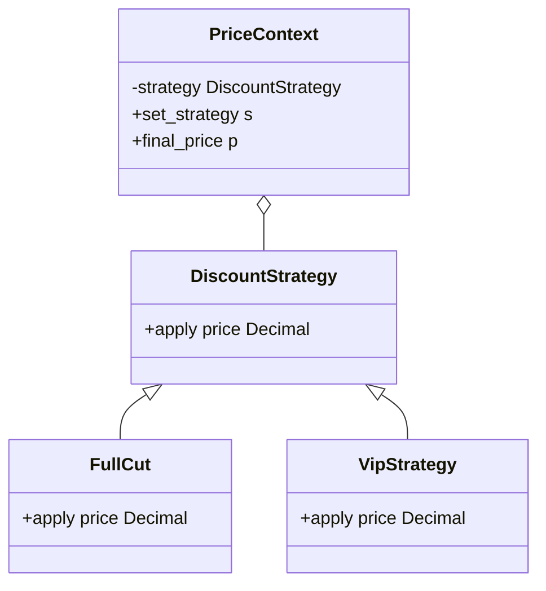
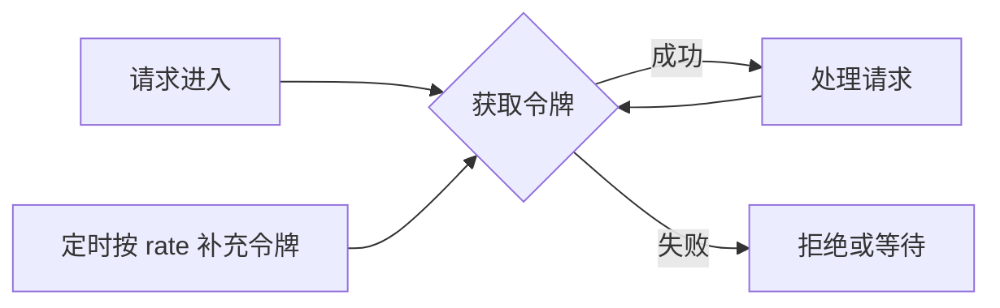
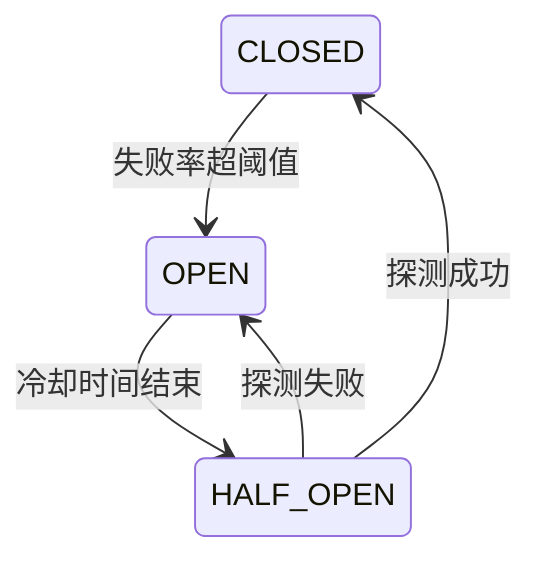
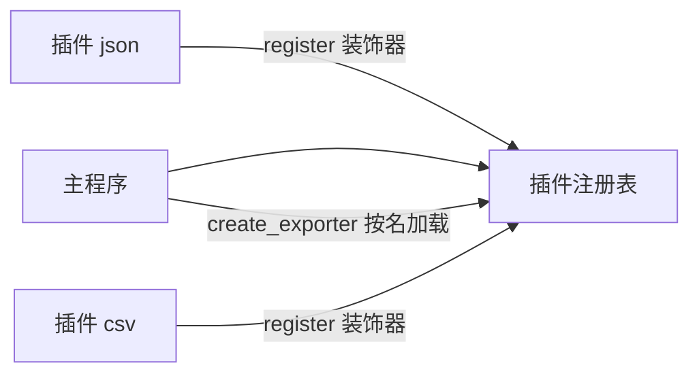
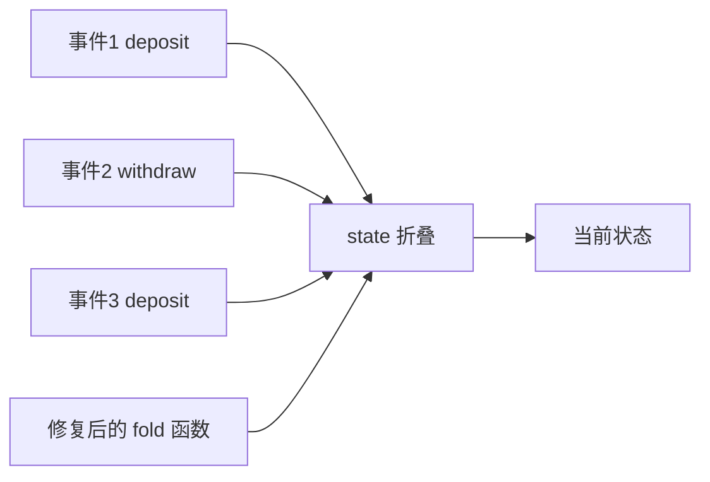

# 第 7 章 · 系统设计与代码工程辅助实战

> 本章聚焦工程实战:单例与依赖注入、策略模式替换 if-else、观察者事件总线、适配器与仓库模式隔离外部依赖,再到重试退避、幂等键、限流器、熔断器、优雅降级等稳定性手段。
> 同时覆盖后台任务队列、定时调度、插件架构、特性开关、灰度发布、流水线与大文件处理等业务落地场景。
> 最后落到审计日志、脱敏、健康检查、优雅停机、自愈脚本、契约测试与故障演练等生产必备能力。
> 所有代码仅用标准库,可直接运行,适合面试白板与实际项目复用。

---

### Q276 · 单例模式与模块级单例的取舍
> 难度:★★ | 标签:设计模式, 单例

**问**:面试官问:Python 里实现单例有哪几种方式?你会选哪种,为什么?

**答**:常见三种:`__new__` 拦截、元类控制、模块级实例(Python 官方推荐)。`__new__` 方式要考虑线程安全,通常配 `threading.Lock` 双重检查;元类方式对继承链更可控。实际项目中最推荐模块级单例或容器式懒加载,简单且天然规避多线程初始化竞争。

```python
# file: code/06_Agent与LLM及系统设计/q276_singleton.py
import threading


class Singleton:
    """线程安全的 __new__ 单例,面试高频写法。"""
    _instance = None
    _lock = threading.Lock()

    def __new__(cls, *args, **kwargs):
        if cls._instance is None:
            with cls._lock:
                if cls._instance is None:  # 双重检查
                    cls._instance = super().__new__(cls)
        return cls._instance


def test():
    a = Singleton()
    b = Singleton()
    print(a is b)  # True


if __name__ == "__main__":
    test()
```

**追问**:
- 单例在测试里为什么麻烦?——全局状态被共享,测试之间互相污染,通常要提供 `reset()` 方法或改用依赖注入。
- 模块导入本身是单例吗?——是,模块在 `sys.modules` 里缓存,天然单例且线程安全。

---

### Q277 · 依赖注入:让代码可测试
> 难度:★★★ | 标签:设计模式, 测试

**问**:什么是依赖注入?相比在函数内部直接 `import` 并实例化依赖,好处是什么?

**答**:依赖注入是把对象依赖通过参数/构造函数从外部传入,而不是在内部硬编码创建。好处:一是不依赖全局状态,测试时传入 fake/mock 即可;二是同一实现可在不同环境替换(如真实 DB 换成内存版)。Python 中简单靠构造函数参数即可,大型项目可用 `dependency-injector` 库或容器。

```python
# file: code/06_Agent与LLM及系统设计/q277_dependency_injection.py
from dataclasses import dataclass
from typing import Protocol


class Notifier(Protocol):
    def send(self, user: str, msg: str) -> None: ...


class EmailNotifier:
    def send(self, user: str, msg: str) -> None:
        print(f"[email] to={user} msg={msg}")


class FakeNotifier:
    """测试替身,不发真邮件。"""
    def __init__(self):
        self.sent = []

    def send(self, user: str, msg: str) -> None:
        self.sent.append((user, msg))


@dataclass
class UserService:
    notifier: Notifier  # 依赖通过构造注入

    def register(self, user: str) -> None:
        self.notifier.send(user, "welcome")


if __name__ == "__main__":
    svc = UserService(EmailNotifier())
    svc.register("alice")

    fake = FakeNotifier()
    UserService(fake).register("bob")
    print(fake.sent)  # 断言用
```

**追问**:
- 依赖注入和 import 全局单例差在哪?——import 把依赖焊死在命名空间,换实现只能 patch;注入让同一代码在测试与生产拿到不同实现。
- Python 里不上框架怎么落地 DI?——构造函数参数 + 工厂函数组装(wire 函数),装配集中在入口;小项目不需要 dependency-injector。
- 注入过多参数是什么信号?——构造函数 8+ 依赖说明类职责过多;先拆类再谈注入,DI 不解决设计问题。

---

### Q278 · 策略模式替换长长的 if-else
> 难度:★★★ | 标签:设计模式, 重构

**问**:一个函数里有 20 个 if-elif 分支做不同的折扣计算,如何用策略模式重构?

**答**:把每个分支抽成独立策略类或函数,用字典(策略表)按类型分发,新增策略只加一行注册,不改主流程,符合开闭原则。这是面试中“重构 if-else”的标准答案,同时要点出:分支少(2-3 个)不必过度设计,策略表本身也是隐式耦合,注意保持 key 语义清晰。

```python
# file: code/06_Agent与LLM及系统设计/q278_strategy.py
from decimal import Decimal


def vip_price(price: Decimal) -> Decimal:
    return price * Decimal("0.8")


def new_user_price(price: Decimal) -> Decimal:
    return price * Decimal("0.9")


def default_price(price: Decimal) -> Decimal:
    return price


STRATEGIES = {
    "vip": vip_price,
    "new": new_user_price,
    "default": default_price,
}


def calc_price(user_type: str, price: Decimal) -> Decimal:
    return STRATEGIES.get(user_type, default_price)(price)


class DiscountStrategy:
    """面向对象的策略写法,适合策略本身有状态的场景。"""
    def apply(self, price: Decimal) -> Decimal:
        raise NotImplementedError


class FullCut(DiscountStrategy):
    def __init__(self, threshold: Decimal, cut: Decimal):
        self.threshold, self.cut = threshold, cut

    def apply(self, price: Decimal) -> Decimal:
        return price - self.cut if price >= self.threshold else price


if __name__ == "__main__":
    print(calc_price("vip", Decimal("100")))   # 80.0
    print(calc_price("xxx", Decimal("100")))   # 100
    print(FullCut(Decimal("100"), Decimal("20")).apply(Decimal("120")))
```

**追问**:
- 策略表和 match/case 怎么选?——分发键是开放集合(会持续增加)用策略表;封闭枚举分支 3.10+ 用 match 更直观。
- 策略需要共享上下文怎么办?——统一签名 `execute(ctx)`,上下文对象传递;签名不一致的策略用适配器包一层。
- 怎么防止策略表 key 语义漂移?——key 用 Enum/Literal 而不是裸字符串;未注册的 key 要显式抛错(默认分支告警)而不是静默。



---

### Q279 · 观察者模式与进程内事件总线
> 难度:★★★ | 标签:设计模式, 事件驱动

**问**:如何实现一个进程内的事件总线实现模块解耦?同步总线有什么隐患?

**答**:核心是一个 `dict[str, list[callback]]`,发布时遍历调用订阅者。要点:订阅/退订接口、异常隔离(一个订阅者崩不能影响其他)、同步调用的隐患是阻塞发布方且无持久化,失败消息丢失。跨进程可靠事件应上消息队列(MQ),进程内总线只适合轻量解耦。

```python
# file: code/06_Agent与LLM及系统设计/q279_event_bus.py
from collections import defaultdict
from typing import Callable


class EventBus:
    def __init__(self):
        self._subs: dict[str, list[Callable]] = defaultdict(list)

    def subscribe(self, event: str, fn: Callable) -> None:
        self._subs[event].append(fn)

    def unsubscribe(self, event: str, fn: Callable) -> None:
        self._subs[event].remove(fn)

    def publish(self, event: str, *args, **kwargs) -> None:
        for fn in list(self._subs[event]):
            try:
                fn(*args, **kwargs)
            except Exception as exc:  # 隔离订阅者异常
                print(f"[warn] subscriber {fn} failed: {exc}")


bus = EventBus()
bus.subscribe("order.paid", lambda oid: print(f"send email for {oid}"))
bus.subscribe("order.paid", lambda oid: print(f"add points for {oid}"))

if __name__ == "__main__":
    bus.publish("order.paid", 1001)
```

**追问**:
- 订阅者抛异常怎么隔离?——逐个 try/except + 日志,一个失败不影响其他;否则发布方被拖死或后面的订阅者收不到。
- 同步总线的隐患?——阻塞发布方、失败无持久化、无重试;跨进程或要求可靠投递就上 MQ,进程内总线定位是「轻量解耦」。
- 怎么调试事件流?——订阅者调用记录(事件名、耗时、结果)打日志;事件风暴类 bug 靠 trace id 串发布与消费。

---

### Q280 · 适配器模式隔离第三方 SDK
> 难度:★★★ | 标签:设计模式, 隔离

**问**:项目直接调用第三方支付 SDK,对方 API 一变全项目要改,怎么治理?

**答**:用适配器模式定义自己领域的接口(如 `PaymentGateway.pay`),为每家三方写一个适配器把它的 API 翻译成内部接口。收益:三方变化被限制在适配器内;换供应商只换适配器;测试用内存适配器。这是防腐层(Anti-Corruption Layer)思想的落地。

```python
# file: code/06_Agent与LLM及系统设计/q280_adapter.py
from abc import ABC, abstractmethod


class PaymentGateway(ABC):
    """内部统一支付接口,业务只认它。"""
    @abstractmethod
    def pay(self, order_id: str, amount_cents: int) -> str: ...


class ThirdPartySDK:
    """模拟一家风格古怪的三方 SDK。"""
    def do_transaction(self, oid: str, money_fen: int) -> dict:
        return {"ret": 0, "trade_no": "TP-" + oid, "fee": money_fen}


class ThirdPartyAdapter(PaymentGateway):
    def __init__(self, sdk: ThirdPartySDK):
        self._sdk = sdk

    def pay(self, order_id: str, amount_cents: int) -> str:
        res = self._sdk.do_transaction(order_id, amount_cents)
        if res["ret"] != 0:
            raise RuntimeError("pay failed")
        return res["trade_no"]


class FakeGateway(PaymentGateway):
    def pay(self, order_id: str, amount_cents: int) -> str:
        return f"FAKE-{order_id}-{amount_cents}"


if __name__ == "__main__":
    gw = ThirdPartyAdapter(ThirdPartySDK())
    print(gw.pay("o1", 9900))
    print(FakeGateway().pay("o1", 9900))
```

**追问**:
- 适配器层该多薄?——只做参数/响应格式翻译与错误码映射,不含业务逻辑;业务漏进适配器,防腐层就名存实亡。
- 三方接口变更怎么监控?——契约测试(响应结构断言)+ 灰度探活;SDK 大版本升级在适配器内消化,业务无感。
- 测试怎么用内存适配器?——实现同一接口的 InMemory 版,单测不碰网络;行为细节(错误、超时)也模拟出来。

---

### Q281 · 仓库模式隔离 ORM
> 难度:★★★ | 标签:架构, ORM

**问**:为什么要把 SQL/ORM 查询封装到 Repository 层?Service 层直接写 ORM 有什么问题?

**答**:Repository 层负责把领域对象与存储细节隔离,Service 只面向领域语义调用 `user_repo.get_by_email`。好处:单测可用内存仓库替换、换存储引擎不动业务、查询逻辑集中可优化复用。代价是多一层抽象,简单 CRUD 项目不必上。

```python
# file: code/06_Agent与LLM及系统设计/q281_repository.py
from __future__ import annotations
from abc import ABC, abstractmethod
from dataclasses import dataclass


@dataclass
class User:
    id: int
    email: str


class UserRepository(ABC):
    @abstractmethod
    def get_by_email(self, email: str) -> User | None: ...

    @abstractmethod
    def add(self, user: User) -> None: ...


class InMemoryUserRepository(UserRepository):
    """测试用内存实现,接口与 SQL 版一致。"""
    def __init__(self):
        self._data: dict[str, User] = {}
        self._next_id = 1

    def get_by_email(self, email: str) -> User | None:
        return self._data.get(email)

    def add(self, user: User) -> None:
        self._data[user.email] = user


class SQLAlchemyUserRepository(UserRepository):
    """生产实现:模拟,不真正连库。"""
    def __init__(self):
        self._rows: dict[str, dict] = {}

    def get_by_email(self, email: str) -> User | None:
        row = self._rows.get(email)
        return User(**row) if row else None

    def add(self, user: User) -> None:
        self._rows[user.email] = {"id": user.id, "email": user.email}


def register(repo: UserRepository, email: str) -> User | None:
    if repo.get_by_email(email):
        return None
    user = User(id=1, email=email)
    repo.add(user)
    return user


if __name__ == "__main__":
    repo = InMemoryUserRepository()
    print(register(repo, "a@x.com"))
    print(register(repo, "a@x.com"))  # None 已存在
```

**追问**:
- Repository 和 DAO 有何区别?——DAO 偏单表 CRUD,Repository 面向聚合根/领域语义,是 DDD 里的概念。
- Repository 怎么和 SQLAlchemy 配合?——Repo 封装 session 操作返回领域对象,事务边界留在 Service/UoW;别把 session 泄漏给业务层。
- 什么项目不必上 Repository?——简单 CRUD、ORM 即领域模型的小服务;多一层抽象只有成本没有收益。
- 查询逻辑集中在 Repo 的好处?——N+1、深分页这类调优只改一处;散落在各 Service 的查询无法统一治理。
### Q282 · 重试与指数退避装饰器
> 难度:★★★★ | 标签:可靠性, 装饰器

**问**:调用外部接口偶发超时,写一个可复用的重试装饰器,要注意哪些坑?

**答**:要点:指数退避加抖动 jitter 防止雪崩、只对可重试异常重试(Timeout 而非 ValueError)、最大尝试次数封顶、finally 保证次数限制不丢失。坑:非幂等操作不能盲目重试;退避太长拖垮调用方;tenacity 库是生产首选,面试手写要体现上面四点。

```python
# file: code/06_Agent与LLM及系统设计/q282_retry_backoff.py
import functools
import random
import time
from typing import Callable


def retry(times: int = 3, base_delay: float = 0.1,
          exceptions: tuple = (TimeoutError,)) -> Callable:
    def deco(fn: Callable) -> Callable:
        @functools.wraps(fn)
        def wrapper(*args, **kwargs):
            for attempt in range(1, times + 1):
                try:
                    return fn(*args, **kwargs)
                except exceptions:
                    if attempt == times:
                        raise  # 用尽后抛出原始异常
                    # 指数退避 + 抖动
                    delay = base_delay * (2 ** (attempt - 1))
                    delay = random.uniform(0, delay * 2)
                    print(f"retry {attempt}, sleep {delay:.2f}s")
                    time.sleep(delay)
        return wrapper
    return deco


_call_count = 0


@retry(times=3, base_delay=0.05)
def flaky_api() -> str:
    global _call_count
    _call_count += 1
    if _call_count < 3:
        raise TimeoutError("simulated timeout")
    return "ok"


if __name__ == "__main__":
    print(flaky_api())
```

**追问**:
- 为什么必须加 jitter?——同时失败的客户端同时重试会同步震荡打挂下游(重试风暴);随机化退避时长打破同步。
- 怎么区分可重试异常?——白名单:超时、429、503;参数错误、4xx 确定性失败重试无意义;tenacity 用 `retry_if_exception_type` 声明。
- 重试和幂等的关系?——非幂等操作(下单、扣款)重试可能双倍执行;先幂等键保护再重试,顺序不能反。

---

### Q283 · 超时包装:把慢调用变成可控失败
> 难度:★★★★ | 标签:可靠性, 并发

**问**:如何给一个没有 timeout 参数的同步函数加超时控制?

**答**:线程池方案:用 `concurrent.futures.ThreadPoolExecutor` 提交任务后 `future.result(timeout=...)`,超时抛 `TimeoutError`。注意:超时只是不再等结果,线程仍在跑无法强杀,长期占用要靠线程池 max_workers 限流或改造目标函数支持取消;CPU 密集场景应考虑进程池。

```python
# file: code/06_Agent与LLM及系统设计/q283_timeout_wrapper.py
import functools
from concurrent.futures import ThreadPoolExecutor, TimeoutError as FutTimeout

executor = ThreadPoolExecutor(max_workers=8)


def with_timeout(seconds: float) -> functools.partial:
    """装饰器:超时抛 TimeoutError,不阻塞主流程。"""
    def deco(fn):
        @functools.wraps(fn)
        def wrapper(*args, **kwargs):
            future = executor.submit(fn, *args, **kwargs)
            try:
                return future.result(timeout=seconds)
            except FutTimeout:
                raise TimeoutError(f"{fn.__name__} timed out after {seconds}s")
        return wrapper
    return deco


import time


@with_timeout(seconds=1.0)
def slow_call():
    time.sleep(3)
    return "done"


@with_timeout(seconds=1.0)
def fast_call():
    return "quick"


if __name__ == "__main__":
    print(fast_call())
    try:
        slow_call()
    except TimeoutError as e:
        print(e)
```

**追问**:
- 超时后线程还在跑怎么办?——无法强杀,靠池上限防堆积;目标函数要支持协作式取消(周期检查取消标志)。
- 超时值怎么定?——下游 P99 × 安全系数,而不是拍脑袋;分级(连接/读/总)超时比单一总超时精细。
- CPU 密集为什么用进程池?——线程超时后无法终止且 GIL 下并行无效;进程可 terminate 真正回收。

---

### Q284 · 幂等键设计:支付回调为什么要幂等
> 难度:★★★★ | 标签:可靠性, 分布式

**问**:支付网关可能重复推送同一笔回调,后端如何保证只入账一次?

**答**:给每笔业务操作分配全局唯一幂等键(如 `pay:{order_id}:{channel}`),服务端先查幂等表:键存在且已成功则直接返回上次结果;不存在则插入占位记录(唯一索引兜底防并发)再执行业务,事务内一起提交。消息场景同理,消费前查重。核心是“状态查询 + 唯一约束 + 条件更新”三板斧。

```python
# file: code/06_Agent与LLM及系统设计/q284_idempotency.py
import sqlite3

DDL = """
CREATE TABLE IF NOT EXISTS idempotency (
    key TEXT PRIMARY KEY,
    status TEXT NOT NULL,
    result TEXT
)
"""


def process_callback(conn: sqlite3.Connection, idem_key: str, amount: int) -> str:
    """唯一主键是并发下的最终防线,业务执行与幂等记录同事务。"""
    try:
        cur = conn.cursor()
        cur.execute("INSERT INTO idempotency(key,status) VALUES(?,'processing')",
                    (idem_key,))
    except sqlite3.IntegrityError:
        row = conn.execute("SELECT status,result FROM idempotency WHERE key=?",
                           (idem_key,)).fetchone()
        return row[1] or "duplicated"

    # --- 真正的业务:入账 ---
    result = f"credited {amount}"
    conn.execute("UPDATE idempotency SET status='done',result=? WHERE key=?",
                 (result, idem_key))
    conn.commit()
    return result


if __name__ == "__main__":
    conn = sqlite3.connect(":memory:")
    conn.execute(DDL)
    print(process_callback(conn, "pay:1001", 100))
    print(process_callback(conn, "pay:1001", 100))  # 重复回调,返回旧结果
```

**追问**:
- 幂等键超时没完成怎么办?——加过期时间,超时的 processing 记录由对账/定时任务回收后允许重试。
- 唯一索引兜底怎么兜?——并发重复插入触发 IntegrityError,捕获后回读已成功结果返回;「先查后插」在并发下必漏。
- 幂等键的命名空间?——含业务前缀与渠道(`pay:{order}:{channel}`),不同业务复用键会互相误判去重。
- 回调重放攻击怎么防?——验签(平台签名)+ 幂等键 + 金额与订单状态校验;验签是第一道,幂等只是防重复。
### Q285 · 令牌桶限流器
> 难度:★★★★ | 标签:限流, 并发

**问**:手写一个令牌桶限流器,和滑动窗口计数相比各有什么特点?

**答**:令牌桶以恒定速率往桶里放令牌,请求取不到令牌就被拒绝,允许短时突发(桶容量即突发上限);滑动窗口计数统计窗口内请求数,平滑限流但没有突发能力。实现时用 `threading.Lock` 保护 `tokens` 和 `last_refill`,按经过时间补充令牌即可。分布式场景用 Redis + Lua 保证原子性。

```python
# file: code/06_Agent与LLM及系统设计/q285_token_bucket.py
import threading
import time


class TokenBucket:
    def __init__(self, rate: float, capacity: int):
        self.rate = rate              # 每秒补充令牌数
        self.capacity = capacity      # 桶容量,决定突发上限
        self.tokens = float(capacity)
        self.last = time.monotonic()
        self.lock = threading.Lock()

    def allow(self, n: int = 1) -> bool:
        with self.lock:
            now = time.monotonic()
            self.tokens = min(self.capacity,
                              self.tokens + (now - self.last) * self.rate)
            self.last = now
            if self.tokens >= n:
                self.tokens -= n
                return True
            return False


if __name__ == "__main__":
    bucket = TokenBucket(rate=5, capacity=5)
    ok = [bucket.allow() for _ in range(10)]
    print(ok)               # 前 5 个 True,后 5 个 False
    time.sleep(0.5)
    print(bucket.allow())   # 又有令牌
```

**追问**:
- 令牌桶参数怎么定?——rate=平均 QPS 上限、capacity=允许突发量;按下游容量与 SLA 反推,压测验证。
- 分布式实现为什么用 Lua?——取令牌涉及「读余额-计算补充-扣减」多步,Redis 单线程执行脚本保证原子;应用层多步有竞态。
- 拒绝的请求怎么处理?——返回 429 + Retry-After,按业务降级(排队/丢弃/兜底);静默丢弃最不可取。



---

### Q286 · 滑动窗口限流器
> 难度:★★★ | 标签:限流, 算法

**问**:实现一个滑动窗口限流器,相比固定窗口解决了什么问题?

**答**:固定窗口在窗口交界处可能放过 2 倍流量(0:59 放 100 个、1:00 又放 100 个);滑动窗口只保留窗口期内的请求时间戳,统计真实最近 N 秒的请求数,没有边界突变。注意时间戳列表的内存清理,分布式下用 Redis ZSET 实现。

```python
# file: code/06_Agent与LLM及系统设计/q286_sliding_window.py
import threading
import time
from collections import deque


class SlidingWindowLimiter:
    def __init__(self, max_requests: int, window_seconds: float):
        self.max_requests = max_requests
        self.window = window_seconds
        self.hits: deque[float] = deque()
        self.lock = threading.Lock()

    def allow(self) -> bool:
        now = time.monotonic()
        with self.lock:
            while self.hits and now - self.hits[0] > self.window:
                self.hits.popleft()  # 清理过期记录
            if len(self.hits) < self.max_requests:
                self.hits.append(now)
                return True
            return False


if __name__ == "__main__":
    limiter = SlidingWindowLimiter(max_requests=3, window_seconds=1.0)
    print([limiter.allow() for _ in range(5)])  # T T T F F
```

**追问**:
- 滑动窗口的内存怎么控?——ZSET 定期 ZREMRANGEBYSCORE 清理过期时间戳;进程内 deque 也要 popleft 清理。
- 滑动窗口计数和滑动窗口日志的区别?——计数(窗口分片加权)省内存但有近似误差;日志(存时间戳)精确但内存 O(请求数)。
- 多实例限流怎么聚合?——集中计数(Redis)保证全局限流;各实例独立计数则总流量 = N × 单实例阈值。

---

### Q287 · 熔断器:让故障快速失败
> 难度:★★★★ | 标签:可靠性, 状态机

**问**:描述熔断器的三个状态和转换条件,用代码实现一个简易熔断器。

**答**:三态:`CLOSED` 正常放行并统计失败率,失败率超阈值后打开;`OPEN` 直接拒绝请求,经过冷却时间进入 HALF_OPEN;`HALF_OPEN` 放少量探测请求,成功则回到 CLOSED,失败则重回 OPEN。价值是防止调用方线程被下游故障拖死,配合降级返回兜底数据。

```python
# file: code/06_Agent与LLM及系统设计/q287_circuit_breaker.py
import time


class CircuitBreaker:
    def __init__(self, fail_threshold: int = 3, cooldown: float = 1.0):
        self.fail_threshold = fail_threshold
        self.cooldown = cooldown
        self.state = "CLOSED"
        self.failures = 0
        self.opened_at = 0.0

    def allow(self) -> bool:
        if self.state == "OPEN":
            if time.monotonic() - self.opened_at >= self.cooldown:
                self.state = "HALF_OPEN"  # 冷却结束,放探测请求
                return True
            return False
        return True

    def record_success(self) -> None:
        self.failures = 0
        self.state = "CLOSED"

    def record_failure(self) -> None:
        if self.state == "HALF_OPEN":
            self.state = "OPEN"      # 探测失败,再次熔断
            self.opened_at = time.monotonic()
            return
        self.failures += 1
        if self.failures >= self.fail_threshold:
            self.state = "OPEN"
            self.opened_at = time.monotonic()


def call_with_breaker(breaker: CircuitBreaker, fn, *args):
    if not breaker.allow():
        return "degraded"  # 降级响应
    try:
        res = fn(*args)
        breaker.record_success()
        return res
    except Exception:
        breaker.record_failure()
        return "degraded"


def bad_downstream():
    raise ConnectionError("downstream down")


if __name__ == "__main__":
    br = CircuitBreaker(fail_threshold=2, cooldown=0.2)
    for _ in range(3):
        print(call_with_breaker(br, bad_downstream))
    print(br.state)  # OPEN
    time.sleep(0.3)
    print(call_with_breaker(br, lambda: "ok"))  # HALF_OPEN 探测成功
    print(br.state)  # CLOSED
```

**追问**:
- 失败率统计窗口怎么选?——滚动小窗口(如 10s 内 ≥50% 且请求数 ≥20 才触发);样本太小一次失败就熔断是误杀。
- HALF_OPEN 放多少探测?——1-2 个/批,成功才逐步放量;直接全放等于没有熔断。
- 熔断和降级怎么配合?——熔断器 OPEN 时触发降级链(缓存/默认值/裁剪);降级路径要预先演练,OPEN 后才写降级逻辑就晚了。



---

### Q288 · 优雅降级:读缓存、默认值与功能裁剪
> 难度:★★★ | 标签:可靠性

**问**:核心接口依赖的推荐服务挂了,首页还是要能打开,你怎么设计降级?

**答**:降级三板斧:一是读旧数据(本地/Redis 缓存的上一份结果),二是返回默认值或裁剪功能模块(推荐位隐藏但商品列表照常),三是把降级决策集中到一个 `fallback` 层由熔断器触发并打点告警。原则:降级是预案不是事故后拍脑袋,每个降级路径要有对应的恢复策略和监控指标。

```python
# file: code/06_Agent与LLM及系统设计/q288_graceful_degradation.py
import time


class RecommendationService:
    def fetch(self, uid: str) -> list[str]:
        raise ConnectionError("service down")


class CachedRecommendation:
    """读旧缓存兜底,缓存里保存最近一次成功结果。"""
    def __init__(self, svc: RecommendationService):
        self.svc = svc
        self.cache: dict[str, tuple[float, list]] = {}

    def get(self, uid: str) -> list[str]:
        try:
            data = self.svc.fetch(uid)
            self.cache[uid] = (time.time(), data)
            return data
        except ConnectionError:
            cached = self.cache.get(uid)
            if cached:
                print("[degrade] serve stale cache")
                return cached[1]
            return []  # 默认空推荐,页面隐藏模块


if __name__ == "__main__":
    svc = CachedRecommendation(RecommendationService())
    svc.cache["u1"] = (time.time(), ["item1", "item2"])
    print(svc.get("u1"))
    print(svc.get("u2"))  # 无缓存,返回默认
```

**追问**:
- 降级会不会把脏数据给用户?——缓存降级要带时间戳提示「数据截至 X 时刻」;金额类关键数据宁可报错不可旧值。
- 降级决策放哪一层?——集中 fallback 层由熔断触发,业务代码只声明降级产物;散落各处的 if 网络异常无法统一治理。
- 怎么验证降级预案有效?——故障演练(见 Q310)主动注入依赖故障;没演练过的降级代码约等于没有。

---

### Q289 · 标准库 queue 实现后台任务队列
> 难度:★★★★ | 标签:并发, 任务队列

**问**:不用 Celery,如何用标准库实现一个进程内后台任务队列?要考虑哪些细节?

**答**:生产者 `queue.Queue.put` 投递任务,worker 线程循环 `get` 执行。细节:用 `queue.Queue(task_done/join)` 做优雅退出与背压;异常要 catch 并记录,不能让 worker 死掉;worker 用 `daemon=False` + 哨兵值(None)通知退出;阻塞型任务注意超时与重试。进程崩溃队列即丢,可靠任务仍需持久化队列如 Redis/RabbitMQ。

```python
# file: code/06_Agent与LLM及系统设计/q289_task_queue.py
import queue
import threading


class TaskQueue:
    def __init__(self, workers: int = 2):
        self.q: queue.Queue = queue.Queue(maxsize=100)
        self.workers: list[threading.Thread] = []
        for i in range(workers):
            t = threading.Thread(target=self._run, name=f"worker-{i}")
            t.start()
            self.workers.append(t)

    def submit(self, fn, *args, **kwargs) -> None:
        self.q.put((fn, args, kwargs))  # 队列满时自动阻塞,形成背压

    def _run(self) -> None:
        while True:
            item = self.q.get()
            if item is None:      # 哨兵:退出信号
                self.q.task_done()
                break
            fn, args, kwargs = item
            try:
                fn(*args, **kwargs)
            except Exception as exc:
                print(f"[error] task failed: {exc}")
            finally:
                self.q.task_done()

    def shutdown(self) -> None:
        for _ in self.workers:
            self.q.put(None)
        for t in self.workers:
            t.join()


if __name__ == "__main__":
    tq = TaskQueue(workers=2)
    tq.submit(print, "send email")
    tq.submit(print, "generate report")
    tq.q.join()
    tq.shutdown()
```

**追问**:
- Queue 满了怎么办?——put 阻塞形成背压,或用 put_nowait + 拒绝策略(记录/丢弃/持久化)。
- worker 死了任务就丢吗?——get 后未 task_done 崩溃即丢;关键任务先落持久层(Redis/DB)再投内存队列,内存队列只当调度。
- 背压怎么落地?——有界 maxsize + put 阻塞,或 put_nowait+拒绝策略记录;无界队列在高生产速率下内存无限涨。
- 优雅退出怎么编排?——停接新任务→哨兵×worker 数→join;只放一个哨兵其余 worker 永久阻塞。
### Q290 · 定时任务调度器:轮询与调度分离
> 难度:★★★ | 标签:调度, 并发

**问**:不用 crontab/APScheduler,写一个进程内定时任务调度器,支持注册周期任务并优雅停止。

**答**:每个任务一个独立线程,循环 `stop_event.wait(interval)` 代替 `time.sleep`,这样 stop 时能立即唤醒退出而不是等满一个周期。要处理任务执行时间超过周期的情况(串行跳过即可),分布式部署时同一任务要加分布式锁防多实例重复执行。生产环境推荐 APScheduler 或系统 crontab。

```python
# file: code/06_Agent与LLM及系统设计/q290_scheduler.py
import threading
import time


class Scheduler:
    def __init__(self):
        self.stop_event = threading.Event()
        self.threads: list[threading.Thread] = []

    def every(self, interval: float, name: str = ""):
        def deco(fn):
            def loop():
                while not self.stop_event.is_set():
                    start = time.monotonic()
                    try:
                        fn()
                    except Exception as exc:
                        print(f"[error] task {name}: {exc}")
                    # 补齐剩余等待,执行慢于周期时自动跳过
                    self.stop_event.wait(max(0, interval - (time.monotonic() - start)))
            t = threading.Thread(target=loop, name=f"sched-{name or fn.__name__}")
            self.threads.append(t)
            t.start()
            return fn
        return deco

    def stop(self) -> None:
        self.stop_event.set()
        for t in self.threads:
            t.join()


sched = Scheduler()


@sched.every(0.2, name="heartbeat")
def heartbeat():
    print("heartbeat at", time.strftime("%H:%M:%S"))


if __name__ == "__main__":
    time.sleep(0.5)
    sched.stop()
    print("scheduler stopped")
```

**追问**:
- 为什么用 `stop_event.wait(interval)` 而不是 sleep?——wait 可被 set 立即唤醒,停机不用等满周期;sleep 是死等。
- 执行时间超过周期怎么办?——串行跳过(下一轮顺延)并告警;并行重入会让同一任务并发执行,除非明确幂等。
- 分布式防重复执行?——任务级分布式锁(Redis SETNX+TTL)或调度中心统一派发;每个实例各跑一份定时器必重复。

---

### Q291 · 配置驱动设计:把变化从代码挪到配置
> 难度:★★ | 标签:架构, 配置

**问**:一个规则每个季度都变,每次都要发版,如何用配置驱动思想改造?

**答**:把易变的部分(阈值、开关、映射表)外置为配置文件,代码只实现“读取配置 → 校验 → 应用”的通用逻辑。要点:启动或热更新时用 dataclass/校验器(如 pydantic)校验,非法配置快速失败;区分环境(dev/staging/prod)用不同配置;敏感值走环境变量不进文件。配置变化的生效时机要明确(重启 or 热加载)。

```python
# file: code/06_Agent与LLM及系统设计/q291_config_driven.py
import json
from dataclasses import dataclass


@dataclass
class QuotaConfig:
    daily_upload_mb: int
    max_file_size_mb: int
    allowed_types: list

    @classmethod
    def from_json(cls, raw: dict) -> "QuotaConfig":
        # 启动时校验,非法配置快速失败
        assert raw["daily_upload_mb"] > 0, "daily_upload_mb must be positive"
        assert raw["allowed_types"], "allowed_types cannot be empty"
        return cls(**raw)


CONFIG_JSON = '''
{"daily_upload_mb": 500, "max_file_size_mb": 20, "allowed_types": ["pdf", "png"]}
'''


def can_upload(cfg: QuotaConfig, used_mb: int, size_mb: int, ftype: str) -> bool:
    return (ftype in cfg.allowed_types
            and size_mb <= cfg.max_file_size_mb
            and used_mb + size_mb <= cfg.daily_upload_mb)


if __name__ == "__main__":
    cfg = QuotaConfig.from_json(json.loads(CONFIG_JSON))
    print(can_upload(cfg, 480, 15, "pdf"))  # True
    print(can_upload(cfg, 480, 30, "exe"))  # False
```

**追问**:
- 热更新和重启生效怎么选?——阈值/开关类热更新(监听变更+原子替换);结构变更(新依赖)重启;热更新路径也要走校验。
- 配置校验失败怎么办?——启动期 fail-fast 拒绝启动;热更新时保留旧配置继续跑并告警,不能让进程带病或崩溃。
- 敏感值怎么管?——环境变量/秘密管理器注入,配置文件里只留引用;git 历史里的密码就算后来删了也算泄露。

---

### Q292 · 插件架构:entry_points 与注册表两种思路
> 难度:★★★★ | 标签:架构, 插件

**问**:设计一个支持第三方扩展的插件系统,Python 里有哪些实现路径?

**答**:两条主流路径:一是包管理器级 `entry_points`(importlib.metadata 发现),第三方按声明自动被发现,适合 pip 安装类生态如 pytest 插件;二是进程内注册表(装饰器注册),简单可控,适合业务内部的规则/导出器扩展。共同点是定义稳定的插件接口 + 发现机制 + 失败隔离(单个插件加载失败不影响整体)。

```python
# file: code/06_Agent与LLM及系统设计/q292_plugin_registry.py
from typing import Callable, Protocol


class Exporter(Protocol):
    def export(self, data: dict) -> str: ...


_REGISTRY: dict[str, Callable[[], Exporter]] = {}


def register(name: str):
    """装饰器注册:新插件只需 import 本文件并加装饰器。"""
    def deco(factory: Callable[[], Exporter]):
        _REGISTRY[name] = factory
        return factory
    return deco


def create_exporter(name: str) -> Exporter:
    if name not in _REGISTRY:
        raise KeyError(f"unknown exporter: {name}")
    return _REGISTRY[name]()


@register("json")
class JsonExporter:
    def export(self, data: dict) -> str:
        import json
        return json.dumps(data)


@register("csv")
class CsvExporter:
    def export(self, data: dict) -> str:
        return ",".join(f"{k}={v}" for k, v in data.items())


if __name__ == "__main__":
    print(create_exporter("json").export({"a": 1}))
    print(create_exporter("csv").export({"a": 1}))
```

**追问**:
- entry_points 的发现原理?——importlib.metadata 读已安装包的元数据声明;延迟 import,单个插件加载失败要 try 包住。
- 注册表模式怎么防重复注册?——同名 key 二次注册显式报错(或版本覆盖声明);静默覆盖是排查噩梦。
- 插件接口怎么保持稳定?——接口版本号 + 兼容承诺(只增不改);破坏性变更升大版本并给迁移期。



---

### Q293 · 特性开关与灰度发布思路
> 难度:★★★ | 标签:发布, 运维

**问**:如何用特性开关实现新功能按用户比例灰度上线?

**答**:特性开关本质是“代码与发布解耦”:新代码始终在线上,由开关决定是否生效。灰度常用策略:白名单(内部员工)→ 按用户 id 哈希取模/一致哈希分桶(稳定,同一用户体验一致)→ 全量。要点:开关要有清理机制(长期不删的开关是技术债),关键开关的读写要打监控,数据库里做开关判断时注意幂等。

```python
# file: code/06_Agent与LLM及系统设计/q293_feature_flag.py
import hashlib


class FeatureFlags:
    def __init__(self):
        self.flags: dict[str, dict] = {
            "new_checkout": {"enabled": True, "percent": 30, "whitelist": ["admin"]},
            "beta_search": {"enabled": False, "percent": 0, "whitelist": []},
        }

    def is_enabled(self, flag: str, user_id: str) -> bool:
        cfg = self.flags.get(flag)
        if not cfg or not cfg["enabled"]:
            return False
        if user_id in cfg["whitelist"]:
            return True
        # 哈希分桶:同一用户结果稳定,与请求顺序无关
        bucket = int(hashlib.md5(f"{flag}:{user_id}".encode()).hexdigest(), 16) % 100
        return bucket < cfg["percent"]


if __name__ == "__main__":
    flags = FeatureFlags()
    samples = [flags.is_enabled("new_checkout", f"user{i}") for i in range(10)]
    print(samples)
    print("stable for same user:",
          flags.is_enabled("new_checkout", "u1") == flags.is_enabled("new_checkout", "u1"))
```

**追问**:
- 为什么用哈希而不是随机数?——随机数每次判断结果不同,用户体验不一致,且无法精确控制放量比例。
- 开关的清理机制怎么落地?——登记创建时间与 owner,定期审计:全量打开超过 N 周的开关强制移除代码路径;开关是债不是资产。
- 开关读的高频热路径怎么办?——本地缓存 + 订阅变更(轮询/推送),别每次请求查库;开关系统自身挂了要 fail-safe(默认值)。
- 数据库里做开关判断注意什么?——批处理与请求路径判断结果要一致(同一快照);半开状态下的写操作必须可回滚。
### Q294 · 长任务进度上报
> 难度:★★★ | 标签:任务, 并发

**问**:一个导入任务要跑 10 分钟,前端要显示进度条,后端如何设计进度上报?

**答**:任务在后台线程执行,把进度写入一个可查询的存储(内存 dict 或 Redis,含状态 pending/running/done/failed、百分比、当前步骤、错误信息),API 提供 `GET /tasks/{id}` 轮询,或用 SSE/WebSocket 推送。注意:进度写入要线程安全,百分比按子步骤计数而非猜测,终态要保留一段时间供查询。

```python
# file: code/06_Agent与LLM及系统设计/q294_task_progress.py
import threading
import time


class TaskManager:
    def __init__(self):
        self._tasks: dict[str, dict] = {}
        self._lock = threading.Lock()

    def submit(self, task_id: str, total: int, fn) -> None:
        self._tasks[task_id] = {"status": "running", "done": 0,
                                "total": total, "error": None}

        def runner():
            try:
                for i in range(total):
                    fn(i)
                    with self._lock:  # 进度写入线程安全
                        self._tasks[task_id]["done"] = i + 1
                self._tasks[task_id]["status"] = "done"
            except Exception as exc:
                self._tasks[task_id]["status"] = "failed"
                self._tasks[task_id]["error"] = str(exc)

        threading.Thread(target=runner, daemon=True).start()

    def query(self, task_id: str) -> dict:
        t = self._tasks[task_id]
        pct = round(t["done"] / t["total"] * 100) if t["total"] else 0
        return {**t, "percent": pct}


def work(step: int) -> None:
    time.sleep(0.05)  # 模拟处理一行数据


if __name__ == "__main__":
    tm = TaskManager()
    tm.submit("t1", 10, work)
    for _ in range(12):
        info = tm.query("t1")
        if info["status"] in ("done", "failed"):
            break
        time.sleep(0.1)
    print(tm.query("t1"))
```

**追问**:
- 进度为什么不按时间估?——子步骤计数(3/10)真实可信,时间外推靠不住;长尾步骤单独标注「耗时较长」。
- 终态保留多久?——按业务查询窗口(如 24h)后归档;立即清除会让用户「任务消失了」。
- 推送和轮询怎么选?——内部低频任务轮询足够;对外体验要求高用 SSE 推送,推送断了要能退化为轮询。

---

### Q295 · 文件处理流水线
> 难度:★★★ | 标签:架构, 流水线

**问**:上传文件后要经历校验、转码、缩略图、落库多步,如何设计一条可复用的处理流水线?

**答**:流水线 = 有序步骤列表 + 统一的步骤接口(输入上下文,输出上下文或抛异常),失败时中止并记录停在哪个步骤,可从失败步骤重试(需要步骤幂等)。优点:新增步骤零侵入、步骤可独立测试。复杂场景把每步变成异步任务上消息队列,实现重试与横向扩展。

```python
# file: code/06_Agent与LLM及系统设计/q295_pipeline.py
from dataclasses import dataclass, field
from typing import Callable


@dataclass
class Ctx:
    filename: str
    size_mb: float = 0
    validated: bool = False
    thumbnails: list = field(default_factory=list)
    db_id: str = ""
    failed_step: str = ""


def validate(ctx: Ctx) -> Ctx:
    if ctx.size_mb <= 0:
        raise ValueError("empty file")
    ctx.validated = True
    return ctx


def thumbnail(ctx: Ctx) -> Ctx:
    ctx.thumbnails = [f"{ctx.filename}_small.jpg"]
    return ctx


def save_db(ctx: Ctx) -> Ctx:
    ctx.db_id = f"id-{ctx.filename}"
    return ctx


class Pipeline:
    def __init__(self):
        self.steps: list[tuple[str, Callable]] = []

    def add(self, name: str, step: Callable) -> "Pipeline":
        self.steps.append((name, step))
        return self  # 链式构建

    def run(self, ctx: Ctx) -> Ctx:
        for name, step in self.steps:
            try:
                ctx = step(ctx)
            except Exception as exc:
                ctx.failed_step = name
                print(f"[pipeline] failed at {name}: {exc}")
                break
        return ctx


if __name__ == "__main__":
    pipe = Pipeline().add("validate", validate).add("thumbnail", thumbnail).add("save", save_db)
    ok = pipe.run(Ctx(filename="a.jpg", size_mb=2.0))
    print(ok.db_id, ok.failed_step)
    bad = pipe.run(Ctx(filename="b.jpg", size_mb=0))
    print(bad.db_id, bad.failed_step)  # 在 validate 失败
```

**追问**:
- 步骤幂等怎么保证?——每步以「输入哈希+步骤名」为键检查已完成;或设计为纯转换(同输入同输出随便重跑)。
- 失败停在哪一步怎么记录?——上下文里存 completed_steps 列表持久化;没有断点记录的重试等于从头再来。
- 什么时候升级为消息队列?——步骤间需要解耦、横向扩展、或失败重试策略复杂;进程内流水线是起点不是终点。

---

### Q296 · CSV 导入的健壮性设计
> 难度:★★★ | 标签:数据处理, 健壮性

**问**:用户上传 CSV 批量导入,格式五花八门,如何设计一个健壮的导入流程?

**答**:要点:用 `csv.DictReader` 按表头映射而非下标;逐行校验并收集错误(行号+原因),坏行跳过不中断全量;类型转换显式处理(金额用 Decimal、日期 strptime);限制文件大小与编码(`utf-8-sig` 兼容 Excel 导出的 BOM);结果返回成功/失败统计。关键决策:部分成功(跳过坏行)还是全量回滚,要和业务确认。

```python
# file: code/06_Agent与LLM及系统设计/q296_csv_import.py
import csv
import io


def import_rows(text: str) -> dict:
    ok_rows, errors = [], []
    reader = csv.DictReader(io.StringIO(text))
    for lineno, row in enumerate(reader, start=2):  # 表头是第 1 行
        try:
            name = row["name"].strip()
            if not name:
                raise ValueError("empty name")
            amount = int(row["amount"])  # 显式类型转换
            ok_rows.append((name, amount))
        except (KeyError, ValueError) as exc:
            errors.append({"line": lineno, "reason": str(exc)})
    return {"imported": len(ok_rows), "failed": len(errors), "errors": errors}


if __name__ == "__main__":
    sample = "name,amount\nalice,10\n,bad\nbob,xx\n"
    print(import_rows(sample))
```

**追问**:
- 部分成功和全量回滚怎么选?——数据完整性要求高(账务)全量回滚;批量导入类部分成功+错误清单更实用;必须和业务方确认。
- 金额为什么用 Decimal?——float 二进制误差会让 0.1+0.2≠0.3,账务对不上分;入库也用精确类型。
- utf-8-sig 是什么?——带 BOM 的 UTF-8,兼容 Excel 导出;按 utf-8 读会多出 \ufeff 污染第一列表头。

---

### Q297 · Excel 导出在大数据量下的内存问题
> 难度:★★★ | 标签:数据处理, 性能

**问**:导出 100 万行 Excel 报 OOM,怎么解决?

**答**:三种手段:一是流式生成,用 openpyxl 的 `write_only` 模式逐行写不回读,并从数据库 `fetchmany` 分批取数;二是控制格式,`xlsxwriter` 的 constant_memory 模式;三是超过一定行数降级为 CSV(Excel 单 sheet 上限约 104 万行)。生成后放对象存储返回下载链接,避免 HTTP 响应超时。

```python
# file: code/06_Agent与LLM及系统设计/q297_excel_export.py
import csv
import io


def export_stream(rows_iter, columns: list) -> io.StringIO:
    """逐行写入 StringIO,不持有全量数据;生产中可换 xlsx write_only。
    这里用 csv 演示流式思路,rows_iter 支持数据库游标分批产出。"""
    out = io.StringIO()
    writer = csv.writer(out)
    writer.writerow(columns)
    for row in rows_iter:      # 迭代器,内存 O(1)
        writer.writerow(row)
    return out


def fake_db_cursor(total: int, batch: int):
    """模拟分批取数:fetchmany 模式。"""
    start = 0
    while start < total:
        yield from [(i, f"name{i}") for i in range(start, min(start + batch, total))]
        start += batch


if __name__ == "__main__":
    buf = export_stream(fake_db_cursor(1000, 100), ["id", "name"])
    print(buf.getvalue()[:60], "...")
```

**追问**:
- write_only 模式限制?——只支持追加不可回读改样式;样式按列预配置;需要复杂样式考虑拆 sheet 或换 xlsxwriter。
- 导出超时怎么防?——异步任务生成后对象存储链接;同步 HTTP 大导出会被网关超时与内存拖垮。
- 为什么 104 万行要降级 CSV?——xlsx 单 sheet 行数硬上限;超限写入直接报错,提前检查并切分多 sheet 或转 CSV。

---

### Q298 · 大文件流式处理
> 难度:★★★★ | 标签:IO, 性能

**问**:处理一个 20GB 的日志文件统计错误行数,直接 read() 会怎样?正确做法是什么?

**答**:`read()` 会把 20GB 全部载入内存直接 OOM;正确做法是逐行迭代(文件对象天然是迭代器,缓冲读取),或 `read(chunk_size)` 固定块处理二进制。注意:逐行迭代每行末尾带 `\n` 需要 rstrip;统计类任务用生成器串联保持惰性;若要并行可分块后多进程处理再聚合。

```python
# file: code/06_Agent与LLM及系统设计/q298_stream_large_file.py
from typing import Iterator


def iter_error_lines(path: str, chunk: int = 1 << 20) -> Iterator[tuple[int, str]]:
    """流式统计:逐行迭代,内存 O(1),返回行号与内容。"""
    with open(path, encoding="utf-8", errors="replace") as f:
        for lineno, line in enumerate(f, 1):  # 文件对象即迭代器
            if "ERROR" in line:
                yield lineno, line.rstrip("\n")


def count_by_chunk(path: str) -> int:
    """二进制块读取版本,适合无行概念的大文件。"""
    count = 0
    with open(path, "rb") as f:
        while True:
            block = f.read(1 << 20)
            if not block:
                break
            count += block.count(b"ERROR")
    return count


if __name__ == "__main__":
    with open("demo.log", "w") as f:
        for i in range(1000):
            f.write(f"{i} INFO ok\n" if i % 10 else f"{i} ERROR boom\n")
    hits = list(iter_error_lines("demo.log"))[:3]
    print(hits, "total:", len(list(iter_error_lines("demo.log"))))
    print(count_by_chunk("demo.log"))
```

**追问**:
- chunk 读取会切断一行吗?——会,按块读需要保留残余 buffer 与下一块拼接再按 `\n` 切分。
- 生成器串联的好处?——各阶段惰性、内存 O(1);任何一步物化 list 都让整条链退化为全量加载。
- 逐行读的编码坑?——显式 encoding='utf-8' + errors 策略;默认 locale 编码在 Windows 上必出 UnicodeDecodeError。
- 怎么并行处理大文件?——按字节区间分块多进程(各 worker 独立 seek),再按块序聚合;行边界要留残余 buffer 拼接。
### Q299 · 幂等爬虫与增量抓取
> 难度:★★★ | 标签:爬虫, 幂等

**问**:爬虫重复运行会重复入库,如何设计成幂等的增量爬虫?

**答**:为每条内容定义稳定业务键(URL 归一化后哈希),入库用 `INSERT ... ON CONFLICT DO UPDATE`(upsert)或先查再写;增量靠记录每页的最后抓取指纹(ETag/Last-Modified/最新一条时间戳),未变化直接跳过。URL 去重集合(布隆过滤器或已抓集合)避免重复抓取。遵守 robots.txt 并加限速,礼貌爬取。

```python
# file: code/06_Agent与LLM及系统设计/q299_idempotent_crawler.py
import hashlib
from dataclasses import dataclass


def normalize_url(url: str) -> str:
    """URL 归一化:去尾部斜杠与 tracking 参数,保证业务键稳定。"""
    base = url.split("?")[0].rstrip("/")
    return base


def content_key(url: str) -> str:
    return hashlib.sha256(normalize_url(url).encode()).hexdigest()[:16]


@dataclass
class Page:
    url: str
    etag: str
    body: str


class Crawler:
    def __init__(self):
        self.seen: dict[str, str] = {}   # key -> etag
        self.store: dict[str, str] = {}

    def visit(self, page: Page) -> str:
        key = content_key(page.url)
        if self.seen.get(key) == page.etag:
            return "skipped"           # 内容未变,幂等跳过
        self.store[key] = page.body
        self.seen[key] = page.etag
        return "updated"


if __name__ == "__main__":
    c = Crawler()
    p = Page("https://example.com/post/1/", "v1", "hello")
    print(c.visit(p))                                # updated
    print(c.visit(Page("https://example.com/post/1", "v1", "hello")))  # skipped
    print(c.visit(Page("https://example.com/post/1/", "v2", "hello2")))  # updated
```

**追问**:
- URL 归一化要去掉什么?——追踪参数(utm_*)、fragment、协议与尾斜杠统一;同一页面多 URL 会破坏增量判断。
- ETag/Last-Modified 怎么用?——带 If-None-Match/If-Modified-Since 条件请求,304 跳过解析;比全量抓回来再哈希省带宽。
- 布隆过滤器误判怎么办?——误判「已抓」会漏抓,可接受;要严格就布隆+兜底 DB 查重,或 Counting Bloom 支持删除。

---

### Q300 · 并发下载器
> 难度:★★★★ | 标签:并发, IO

**问**:批量下载 100 个文件,如何用标准库做并发下载并控制失败重试?

**答**:用 `ThreadPoolExecutor`(IO 密集适合线程)+ `as_completed` 收集结果,单文件下载内部加超时与重试;提交任务上限用信号量或直接限制 max_workers 控制并发数;失败文件收集后统一重试一轮。每文件先写临时文件成功后 rename,避免半截文件污染。GIL 对网络 IO 影响小,线程方案够用;需要更细粒度控制可用 asyncio。

```python
# file: code/06_Agent与LLM及系统设计/q300_concurrent_download.py
import random
import time
from concurrent.futures import ThreadPoolExecutor, as_completed


def download_one(url: str) -> str:
    time.sleep(random.uniform(0.05, 0.2))  # 模拟网络 IO
    if random.random() < 0.2:
        raise ConnectionError(url)
    return f"saved {url}"


def download_all(urls: list, max_workers: int = 4) -> dict:
    results = {}
    with ThreadPoolExecutor(max_workers=max_workers) as pool:
        futures = {pool.submit(download_one, u): u for u in urls}
        for fut in as_completed(futures):
            url = futures[fut]
            try:
                results[url] = fut.result()
            except ConnectionError:
                results[url] = "failed"  # 收集后可统一重试
    return results


if __name__ == "__main__":
    random.seed(42)
    res = download_all([f"https://cdn.example.com/f{i}" for i in range(10)])
    print(len([v for v in res.values() if v != "failed"]), "ok")
```

**追问**:
- 什么时候用线程池、什么时候用 asyncio?——少量并发或依赖同步 SDK 用线程池;高并发 IO 且生态支持 asyncio 时用异步。
- 为什么先写临时文件再 rename?——半截文件会污染下游与重试判断;`os.replace` 同目录原子,失败重试不产生脏产物。
- 下载失败的重试策略?——失败清单统一重试一轮 + 指数退避;单文件内分段下载(Range)可断点续传。
- 连接池和超时怎么配?——Session 复用连接 + 连接/读超时分级;每请求新建连接的下载器并发一高就端口耗尽。
### Q301 · 缓存装饰器与失效策略
> 难度:★★★ | 标签:缓存, 装饰器

**问**:手写一个带 TTL 的缓存装饰器,并说明如何做主动失效?

**答**:装饰器内用 dict 存 `(expire_ts, value)`,命中判断未过期即返回,否则重算并写回;用 `functools.lru_cache` 的版本没有 TTL。主动失效:提供 `invalidate(key)` 方法删除缓存项,更实用的模式是“版本号失效”——写操作时 bump 版本前缀,所有旧 key 自然失效,避免遍历删除。注意缓存的读写并发与惊群(热点 key 失效瞬间大量回源)。

```python
# file: code/06_Agent与LLM及系统设计/q301_cache_decorator.py
import functools
import time


def ttl_cache(seconds: float, maxsize: int = 128):
    def deco(fn):
        cache: dict = {}

        @functools.wraps(fn)
        def wrapper(*args, **kwargs):
            key = (args, tuple(sorted(kwargs.items())))
            now = time.monotonic()
            hit = cache.get(key)
            if hit and hit[0] > now:
                return hit[1]
            value = fn(*args, **kwargs)
            if len(cache) >= maxsize:  # 简单淘汰:清空过期项
                for k in [k for k, v in cache.items() if v[0] <= now]:
                    del cache[k]
            cache[key] = (now + seconds, value)
            return value

        wrapper.invalidate = lambda *a, **kw: cache.pop(
            (a, tuple(sorted(kw.items()))), None)
        return wrapper
    return deco


_calls = 0


@ttl_cache(seconds=1.0)
def get_user_profile(uid: str) -> dict:
    global _calls
    _calls += 1
    return {"id": uid, "level": 3}


if __name__ == "__main__":
    get_user_profile("u1"); get_user_profile("u1")
    print("calls:", _calls)          # 1,命中缓存
    get_user_profile.invalidate("u1")
    get_user_profile("u1")
    print("calls after invalidate:", _calls)  # 2
```

**追问**:
- 版本号失效怎么实现?——写路径 bump 版本,读键拼 `prefix:version:key`;写后读天然拿到新版本,避免遍历删键。
- 惊群怎么破?——single-flight(同 key 并发回源只放一个,其余等结果)+ 逻辑过期(异步刷新不阻塞读);见 Q172 缓存三件套。
- TTL 缓存怎么测试?——冻结时间(freezegun)驱动过期边界;真实 sleep 的测试既慢又 flaky。

---

### Q302 · 本地事件重放:用事件溯源修复数据
> 难度:★★★★ | 标签:架构, 事件溯源

**问**:什么是事件重放?线上出 bug 导致数据算错,如何用重放修复?

**答**:把所有状态变更记为不可变事件(append-only),当前状态是事件按序折叠(fold/reduce)的结果。出问题时修复策略:修正有 bug 的处理函数,从事件流重放到最新状态即可得到正确结果;也可在任意历史点分叉重放做对比验证。前提是事件记录完整、处理函数确定性(同输入同输出),这也是事件溯源的核心约束。

```python
# file: code/06_Agent与LLM及系统设计/q302_event_replay.py
from dataclasses import dataclass


@dataclass(frozen=True)
class Event:
    type: str
    payload: dict


def fold(events: list[Event]) -> dict:
    """从事件流折叠出当前状态,处理函数是唯一真相来源。"""
    state = {"balance": 0}
    for e in events:
        if e.type == "deposit":
            state["balance"] += e.payload["amount"]
        elif e.type == "withdraw":
            state["balance"] -= e.payload["amount"]
    return state


# 有 bug 的版本:withdraw 少扣了手续费
def fold_buggy(events: list[Event]) -> dict:
    state = {"balance": 0}
    for e in events:
        if e.type == "deposit":
            state["balance"] += e.payload["amount"]
        elif e.type == "withdraw":
            state["balance"] -= e.payload["amount"] - 5  # bug
    return state


if __name__ == "__main__":
    events = [
        Event("deposit", {"amount": 100}),
        Event("withdraw", {"amount": 30}),
        Event("deposit", {"amount": 20}),
    ]
    print("buggy:", fold_buggy(events))   # 修复前线上错误状态
    print("fixed:", fold(events))         # 修复后重放得到正确状态
```

**追问**:
- 处理函数非确定性会怎样?——重放结果和现状不一致,事件溯源的根基崩塌;时间、随机、外部调用都要在写入时记录为事件数据。
- 事件 schema 演进怎么办?——upcasting(旧事件读时升级到新版本)+ 版本号字段;不能改写历史事件。
- 快照为什么要做?——事件流太长全量重放慢;定期快照折叠状态,重放从最近快照继续。



---

### Q303 · 审计日志设计
> 难度:★★ | 标签:安全, 日志

**问**:审计日志和普通业务日志有何区别?设计时要注意什么?

**答**:审计日志回答“谁在什么时候对什么做了什么,结果如何”,面向合规与追责,要求:不可篡改(只追加,敏感场景可哈希链)、结构化(actor/action/resource/before/after/request_id)、与业务同事务或至少可靠投递、保留期符合合规要求。实现上独立表或专用通道,绝不打在普通 log 里混掉。

```python
# file: code/06_Agent与LLM及系统设计/q303_audit_log.py
import hashlib
import json
import time


class AuditLog:
    """只追加审计日志,带哈希链防篡改。"""
    def __init__(self):
        self.records: list[dict] = []
        self._prev_hash = "GENESIS"

    def record(self, actor: str, action: str, resource: str,
               before=None, after=None) -> dict:
        entry = {
            "ts": time.strftime("%Y-%m-%d %H:%M:%S"),
            "actor": actor, "action": action, "resource": resource,
            "before": before, "after": after, "prev": self._prev_hash,
        }
        entry["hash"] = hashlib.sha256(
            json.dumps(entry, sort_keys=True).encode()).hexdigest()[:16]
        self._prev_hash = entry["hash"]
        self.records.append(entry)
        return entry

    def verify(self) -> bool:
        prev = "GENESIS"
        for r in self.records:
            if r["prev"] != prev:
                return False
            prev = r["hash"]
        return True


if __name__ == "__main__":
    log = AuditLog()
    log.record("admin", "update", "salary:1001", before=5000, after=6000)
    log.record("hr", "delete", "employee:42")
    print(log.verify())  # True
    log.records[0]["after"] = 9999  # 模拟篡改
    print(log.verify())  # False
```

**追问**:
- 审计日志和普通日志为什么分开?——审计要不可篡改、结构化、可检索、按合规保留;混进应用日志既删不了也查不动。
- 同事务还是异步投递?——强合规(金融)同事务保证一致;一般业务异步(本地消息表/可靠投递)避免拖慢主链路。
- before/after 记什么?——变更前后快照(或字段级 diff),敏感字段脱敏后记录;没有 before/after 的审计无法回答「改成了什么」。

---

### Q304 · 敏感数据脱敏
> 难度:★★ | 标签:安全, 数据处理

**问**:日志里不能出现手机号、身份证,如何做脱敏?常见策略有哪些?

**答**:常见策略:掩码(138****1234)、部分截断(只留前 3 后 4)、哈希(用于关联但不可读)、整字段删除。工程上分两层:存储层按字段类型配置脱敏规则;日志层在日志框架里挂全局 filter,用正则兜底扫手机号/身份证模式自动打码,防止业务代码漏改。注意脱敏后要保持格式可读、长度不暴露过多信息。

```python
# file: code/06_Agent与LLM及系统设计/q304_data_masking.py
import re


def mask_phone(s: str) -> str:
    return s[:3] + "****" + s[-4:] if len(s) == 11 else s


def mask_id_card(s: str) -> str:
    return s[:4] + "*" * (len(s) - 8) + s[-4:]


def mask_email(s: str) -> str:
    if "@" not in s:
        return s
    name, domain = s.split("@", 1)
    return (name[:1] + "***" + "@" + domain) if name else s


PHONE_RE = re.compile(r"(?<!\d)1[3-9]\d{9}(?!\d)")
ID_RE = re.compile(r"(?<!\d)\d{17}[\dXx](?!\d)")


def sanitize_log(text: str) -> str:
    """日志框架全局兜底:正则自动打码。"""
    text = PHONE_RE.sub(lambda m: mask_phone(m.group()), text)
    text = ID_RE.sub(lambda m: mask_id_card(m.group()), text)
    return text


if __name__ == "__main__":
    print(mask_email("zhangsan@example.com"))
    print(sanitize_log("user 13812345678 paid, id 11010119900307867X"))
```

**追问**:
- 日志层兜底脱敏怎么实现?——logging.Filter 全局挂正则(手机号/身份证/卡号)匹配即打码;业务漏改时最后一道防线。
- 哈希脱敏的盐怎么管?——盐进环境变量统一;不加盐可被值域反查(手机号就 11 位)。
- 脱敏后还能做统计吗?——掩码破坏关联;分析场景用确定性哈希保留 join 能力,展示场景才用掩码。

---

### Q305 · 健康检查端点设计
> 难度:★★ | 标签:运维, 可观测性

**问**:健康检查端点 `/healthz` 和 `/readyz` 有什么区别?检查什么内容?

**答**:`/healthz`(liveness)只回答“进程还活着”,失败触发重启,里面不要查外部依赖否则会被依赖故障误杀;`/readyz`(readiness)回答“能否接流量”,检查 DB/缓存/下游连接,失败时从负载均衡摘除但不重启。响应要轻量快速(毫秒级)、无鉴权、返回结构化状态,依赖检查要设超时防止拖死探针。

```python
# file: code/06_Agent与LLM及系统设计/q305_health_check.py
from http.server import BaseHTTPRequestHandler, HTTPServer
import json


class HealthState:
    """模拟依赖健康状态,生产中来自连接池 ping。"""
    def __init__(self):
        self.db_ok = True
        self.cache_ok = True

    def liveness(self) -> tuple[int, dict]:
        return 200, {"status": "alive"}  # 不碰外部依赖

    def readiness(self) -> tuple[int, dict]:
        deps = {"db": self.db_ok, "cache": self.cache_ok}
        ok = all(deps.values())
        return (200 if ok else 503), {"status": "ready" if ok else "not ready",
                                      "checks": deps}


state = HealthState()


class Handler(BaseHTTPRequestHandler):
    def do_GET(self):
        if self.path == "/healthz":
            code, body = state.liveness()
        elif self.path == "/readyz":
            code, body = state.readiness()
        else:
            code, body = 404, {"error": "not found"}
        self.send_response(code)
        self.send_header("Content-Type", "application/json")
        self.end_headers()
        self.wfile.write(json.dumps(body).encode())

    def log_message(self, *a):  # 静音默认日志
        pass


if __name__ == "__main__":
    import threading
    import time
    from urllib.request import build_opener, ProxyHandler

    server = HTTPServer(("127.0.0.1", 0), Handler)  # 随机空闲端口
    port = server.server_address[1]
    th = threading.Thread(target=server.serve_forever, daemon=True)
    th.start()

    opener = build_opener(ProxyHandler({}))  # 本机回环直连,不走环境代理
    def probe(path: str) -> tuple[int, dict]:
        from urllib.error import HTTPError, URLError
        for _ in range(50):  # 端口就绪等待
            try:
                with opener.open(f"http://127.0.0.1:{port}{path}", timeout=2) as r:
                    return r.status, json.loads(r.read())
            except HTTPError as e:  # 503 也是合法探针结果,直接读 body
                return e.code, json.loads(e.read())
            except URLError:
                time.sleep(0.05)  # 连接不上=服务未就绪,重试
        raise RuntimeError("server not ready")

    print("liveness:", probe("/healthz"))
    print("readiness(依赖正常):", probe("/readyz"))
    state.db_ok = False  # 模拟依赖故障
    print("readiness(db 挂了):", probe("/readyz"))
    server.shutdown()
    print("结论:存活探针不碰依赖,依赖故障只影响 readiness(503)")
```

**追问**:
- liveness 为什么要查依赖是反模式?——DB 抖动会让全部实例被循环重启,局部故障放大成全局雪崩;依赖只进 readiness。
- 探针接口要鉴权吗?——不要(要快且 LB/编排器要能访问),但端口可只绑内网;返回结构化状态+版本号便于诊断。
- 依赖检查超时设多少?——1-2 秒级,超时视为不健康;探针卡死本身就是故障。

---

### Q306 · 优雅停机:信号处理与资源清理
> 难度:★★★★ | 标签:运维, 信号

**问**:收到 SIGTERM 时服务如何优雅停机?直接退出有什么问题?

**答**:标准流程:注册 `signal.signal(SIGTERM, handler)` 只置停止标志;主循环感知后停止接新请求,等待在处理中的请求完成(设超时上限如 30 秒),关闭连接池/线程池/刷盘,最后退出。直接退出会丢正在处理的请求和未落盘数据。注意:信号处理函数里只能做简单操作,复杂清理放到主循环;SIGKILL 无法捕获,所以清理必须快。

```python
# file: code/06_Agent与LLM及系统设计/q306_graceful_shutdown.py
import signal
import threading
import time


class Server:
    def __init__(self):
        self.stop_event = threading.Event()
        self.inflight = 0
        self.lock = threading.Lock()

    def handle_signal(self, signum, frame):
        print(f"received signal {signum}, shutting down...")
        self.stop_event.set()  # 只置标志,不在这里做重活

    def serve(self):
        signal.signal(signal.SIGTERM, self.handle_signal)
        signal.signal(signal.SIGINT, self.handle_signal)
        n = 0
        while not self.stop_event.is_set():
            with self.lock:
                self.inflight += 1
            n += 1
            threading.Thread(target=self.handle_request, args=(n,),
                             daemon=True).start()
            time.sleep(0.1)
        self.drain()

    def handle_request(self, idx: int):
        time.sleep(0.3)  # 模拟请求处理
        with self.lock:
            self.inflight -= 1

    def drain(self, timeout: float = 5.0):
        deadline = time.time() + timeout
        while self.inflight > 0 and time.time() < deadline:
            time.sleep(0.05)
        print(f"drained, inflight={self.inflight}, server stopped")


if __name__ == "__main__":
    srv = Server()
    threading.Timer(0.4, lambda: signal.raise_signal(signal.SIGTERM)).start()
    srv.serve()
```

**追问**:
- 为什么 handler 里只置标志?——信号处理在任意字节码间异步执行,复杂操作(拿锁、IO)可能死锁;清理放主循环感知标志后执行。
- 在途请求等多久?——按业务 P99 上限(如 30s)强制退出;无上限的等待会被 SIGKILL 强杀更糟。
- 容器里有什么额外要求?——exec form 让应用是 PID 1 收得到 SIGTERM;shell form 收不到信号直接被 KILL(见 Q216)。

---

### Q307 · 进程监控与自愈脚本
> 难度:★★★ | 标签:运维, 脚本

**问**:如何写一个守护脚本:目标进程挂了自动拉起,连续失败要告警?

**答**:守护脚本循环:检查进程是否存活(找 pid 文件或按命令名匹配)→ 不存活则启动并记录重启次数;用指数退避限制重启频率(快速失败的重启风暴要避免);连续 N 次重启失败升级为告警并停止自愈(避免无限循环),交给人工。生产环境优先用 systemd 的 `Restart=on-failure` 或 supervisord,自写脚本用于无 root 权限的特殊场景。

```python
# file: code/06_Agent与LLM及系统设计/q307_watchdog.py
import subprocess
import time


def is_alive(proc: subprocess.Popen) -> bool:
    return proc.poll() is None


def watchdog(command: list, max_restarts: int = 3, backoff: float = 1.0,
             max_observations: int = 60):
    restarts = 0
    proc = subprocess.Popen(command)
    observations = 0
    while True:
        observations += 1
        if observations > max_observations:  # 保险丝:观察超限直接告警退出
            print("[alert] watchdog observation budget exhausted, give up")
            proc.terminate()
            return
        time.sleep(1)  # 观察间隔
        if is_alive(proc):
            restarts = 0  # 稳定运行后重置计数
            continue
        restarts += 1
        print(f"process died, restart {restarts}")
        if restarts > max_restarts:
            print("[alert] too many restarts, give up and page human")
            break
        time.sleep(backoff * (2 ** (restarts - 1)))  # 退避防重启风暴
        proc = subprocess.Popen(command)


if __name__ == "__main__":
    import sys
    # 演示:被守护的进程一启动就崩,退避重启 2 次后放弃并告警(有界,可自动收尾)
    victim = [sys.executable, "-c", "import sys; sys.exit(1)"]
    watchdog(victim, max_restarts=2, backoff=0.1)
    print("演示结束:watchdog 已放弃并告警,生产中这里应触发人工介入")
```

**追问**:
- 重启风暴怎么防?——指数退避 + 连续 N 次失败停止自愈转告警;盲目循环重启会掩盖根因还耗资源。
- systemd 的优势?——cgroup 资源管理、依赖顺序、日志 journald 集成;自写守护脚本只用于无权限场景。
- 怎么记录自愈行为?——每次重启记时间与原因,上报指标(重启次数);静默自愈会让问题拖到不可收拾。

---

### Q308 · 契约测试:防止接口两边说不同话
> 难度:★★★★ | 标签:测试, 契约

**问**:服务 A 调服务 B 的 API,B 改了字段名 A 就炸,如何用契约测试防住?

**答**:契约测试把“双方对接口的约定”固化为可执行断言:消费方定义自己实际依赖的字段与语义(不是全量 schema),提供方每次发版跑消费方契约做验证,不满足则 CI 失败。与集成测试的区别:契约测试只验证约定面,跑得快、定位准。Python 可用 pact-python,或轻量做法——共享一份 JSON schema 文件,两边都用它校验请求/响应。

```python
# file: code/06_Agent与LLM及系统设计/q308_contract_test.py
import json

try:
    from jsonschema import validate, ValidationError  # 演示用,pip install jsonschema
except ImportError:
    print("该题演示需要第三方库 jsonschema:pip install jsonschema,原理见正文")
    raise SystemExit(0)

USER_CONTRACT = {
    "type": "object",
    "required": ["id", "email"],     # 消费方只依赖这两个字段
    "properties": {
        "id": {"type": "integer"},
        "email": {"type": "string", "format": "email"},
    },
}


def provider_get_user() -> dict:
    """模拟提供方响应,新版本把 email 改成了 mail —— 契约测试应抓住。"""
    return {"id": 1, "mail": "a@x.com", "name": "alice"}


def consumer_uses(resp: dict) -> str:
    return f"send to {resp['email']}"


def test_provider_honors_contract():
    try:
        validate(instance=provider_get_user(), schema=USER_CONTRACT)
        print("contract ok")
    except ValidationError as e:
        print(f"contract broken: {e.message}")
        raise


if __name__ == "__main__":
    try:
        test_provider_honors_contract()
    except ValidationError:
        pass  # 演示:捕获后展示契约破坏
```

**追问**:
- 契约测试和单测/集成测试如何分工?——单测验内部逻辑,契约测验跨服务约定,集成测验端到端真实链路。
- 契约只定义「消费方依赖的字段」为什么重要?——全量契约让提供方任何内部变更都失败,过紧;按消费驱动的最小约定才可持续。
- 轻量做法怎么落地?——共享 JSON schema 双端校验 + CI 阻断;pact-python 适合多团队正式治理。
- 契约失败的责任在哪边?——破坏契约的一方(提供方未按约定发布/消费方升级契约);消费方提契约变更要给提供方迁移期。
### Q309 · 灰度数据迁移:双写方案
> 难度:★★★★ | 标签:迁移, 数据库

**问**:把用户表从旧库迁到新库,不能停机,如何设计迁移方案?

**答**:标准双写迁移四阶段:1) 灰度双写,写路径同时写新旧库(旧库为主,新库失败只记录不阻断),存量数据用脚本按 id 分批回填;2) 对账,定时任务比对两库差异并修复,直到差异率为 0;3) 灰度切读,按用户分桶逐步把读切到新库,观察错误率与延迟;4) 收尾,新库转正、停旧写、下线旧库。每一步都可回滚是核心要求。

```python
# file: code/06_Agent与LLM及系统设计/q309_dual_write.py
import random


class MigrationManager:
    def __init__(self, read_percent: int = 0):
        self.old: dict[int, dict] = {}
        self.new: dict[int, dict] = {}
        self.read_percent = read_percent  # 阶段开关:读新库比例
        self.mismatch_log: list = []

    def write(self, uid: int, data: dict) -> str:
        self.old[uid] = data                       # 旧库为主
        try:
            if random.random() < 0.9:              # 模拟新库偶发失败
                self.new[uid] = data
            else:
                raise ConnectionError("new db down")
        except ConnectionError:
            self.mismatch_log.append(uid)          # 只记录,不阻断
        return "dual-write ok"

    def read(self, uid: int) -> dict:
        # 按用户分桶灰度切读,同一用户始终走同一侧,结果稳定
        use_new = uid % 100 < self.read_percent
        return self.new[uid] if use_new else self.old[uid]

    def reconcile(self) -> int:
        """对账:找出两边不一致的用户并修复新库。"""
        fixed = 0
        for uid in set(self.old) | set(self.new):
            if self.old.get(uid) != self.new.get(uid):
                self.new[uid] = self.old.get(uid)
                fixed += 1
        self.mismatch_log.clear()
        return fixed


if __name__ == "__main__":
    random.seed(1)
    m = MigrationManager(read_percent=30)
    for uid in (1, 2, 3, 4, 5, 101):   # 101 与 1 同桶(101%100==1),验证分桶读
        m.write(uid, {"name": f"u{uid}"})
    print("mismatch fixed:", m.reconcile())
    print(m.read(1), m.read(101))  # 同一桶内读侧一致
```

**追问**:
- 双写以谁为主?——灰度期旧库为准(新库失败不阻断业务),靠对账补差异;新库为主必须等对账差异率为 0 之后。
- 回填为什么分批?——大事务锁表与主从延迟;按 id 区间分批+限速,业务低峰执行。
- 停旧写之前要确认什么?——读已全量切新、对账连续 N 天零差异、回滚开关演练过;三条件不齐不下线。


---

### Q310 · 故障演练:主动制造故障验证预案
> 难度:★★★★ | 标签:混沌工程, 运维

**问**:什么是故障演练(混沌工程)?如何在低风险地前提下开始?

**答**:故障演练是在生产或类生产环境主动注入故障(断网、延迟、杀实例、磁盘满),验证熔断/降级/重试/备份这些预案真的有效。低风险入门路径:先在测试环境演练、从爆炸半径最小的注入点开始(单实例延迟)、演练前明确“稳态假设”和回滚开关、全程可观测并一键终止。Python 进程内可先做单元级演练:给依赖注入“延迟/失败”的 fake 依赖,验证降级逻辑。

```python
# file: code/06_Agent与LLM及系统设计/q310_chaos.py
import random
import time


class ChaosInjector:
    """给依赖注入故障,验证调用方的降级预案是否生效。"""
    def __init__(self, fail_rate: float = 0.0, delay_ms: int = 0):
        self.fail_rate = fail_rate
        self.delay_ms = delay_ms
        self.enabled = False  # 回滚开关:随时一键停止注入

    def wrap(self, fn):
        def call(*args, **kwargs):
            if self.enabled:
                time.sleep(self.delay_ms / 1000)
                if random.random() < self.fail_rate:
                    raise ConnectionError("[chaos] injected failure")
            return fn(*args, **kwargs)
        return call


@ChaosInjector(fail_rate=0.5).wrap
def downstream_inventory(sku: str) -> int:
    return 99


def get_stock(sku: str) -> str:
    try:
        return f"stock={downstream_inventory(sku)}"
    except ConnectionError:
        return "stock=unknown"  # 降级:不因库存服务故障阻塞下单页


if __name__ == "__main__":
    random.seed(7)
    results = [get_stock("sku1") for _ in range(6)]
    print(results)
    print("fallback works:", any(r == "stock=unknown" for r in results))
```

**追问**:
- 演练发现降级没生效怎么办?——这就是演练的价值:记录为缺陷,修复后重跑同一场景形成闭环,而不是追责。
- 稳态假设怎么定?——演练前明确正常指标范围(QPS/P99/错误率),偏离即终止;没有稳态定义的演练是玩火。
- 爆炸半径怎么控制?——从单实例/单依赖开始,生产演练要有一键终止与演练时间段审批;新业务先在预发演练。
- 进程内演练怎么做?——DI 注入 fake 依赖(延迟/抛错/返回垃圾数据)验证降级与重试;它是单测与生产演练之间的中间层。
