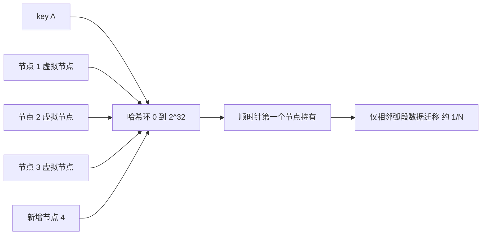
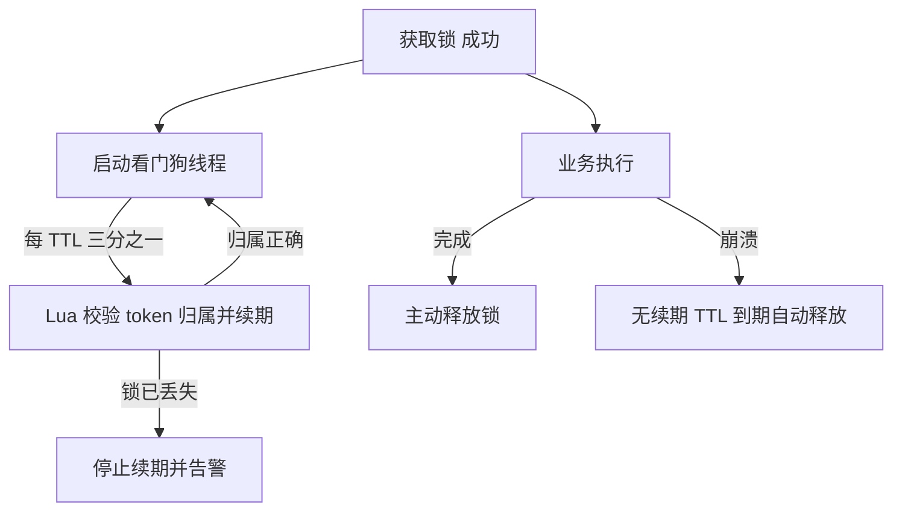
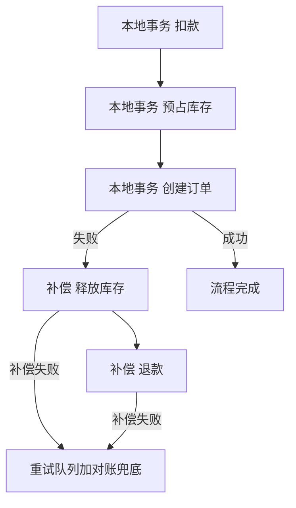
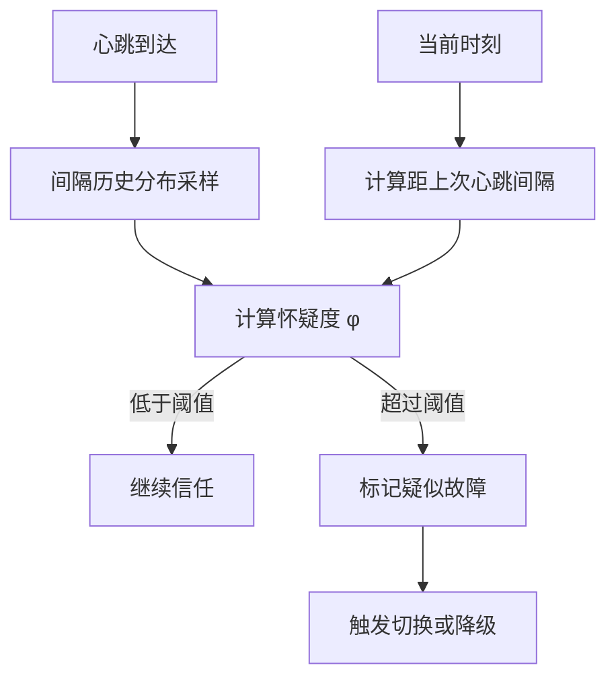
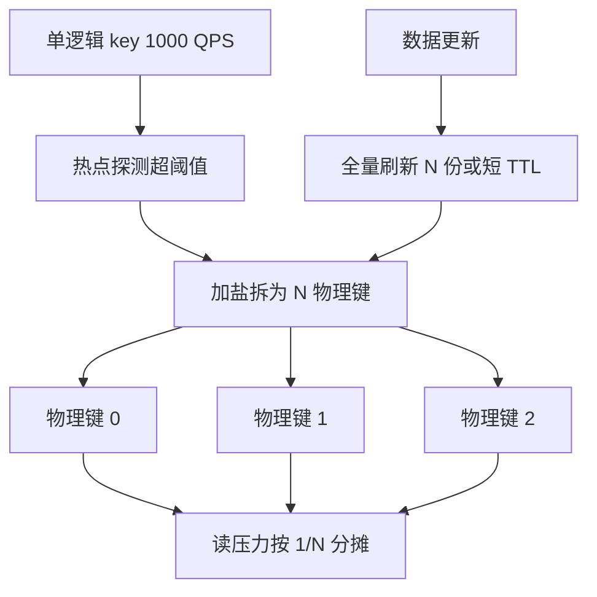
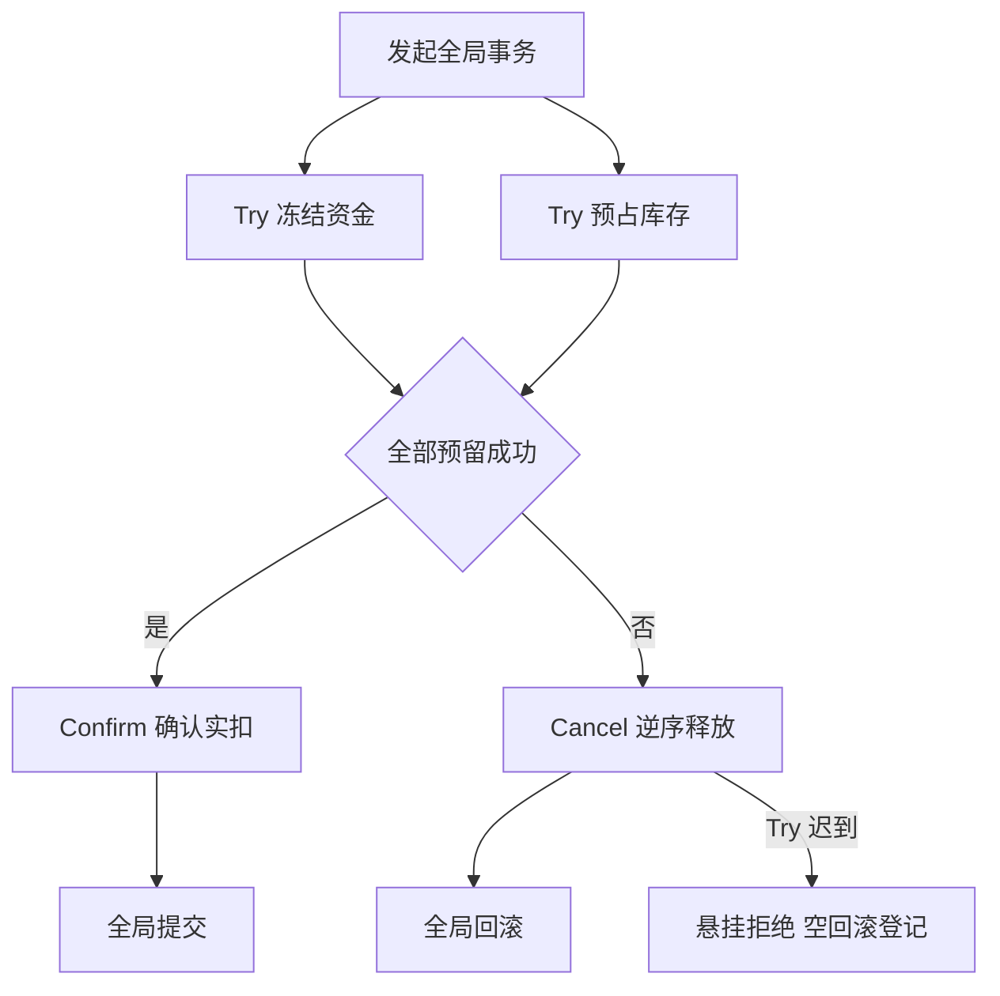
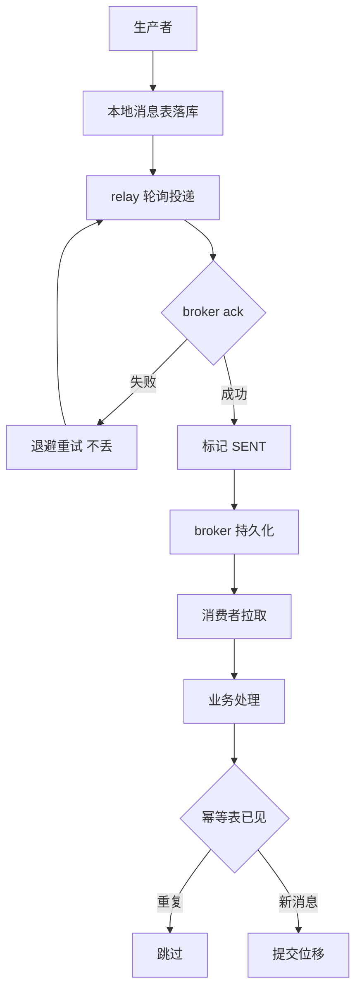
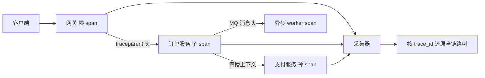

# 第 6 类 · Agent 与 LLM 及系统设计(40)

> 本篇覆盖分布式系统设计面试硬通货:CAP/PACELC、一致性哈希、布隆/布谷鸟过滤器、集群限流、锁与续期、幂等框架、本地消息表、SAGA、对账、逻辑时钟、租约选主、φ-accrual、背压与整形、热点打散、单元化与容灾、容量压测、混沌工程,以及分库分表、缓存三大问题、雪花 ID、可靠投递、服务发现、舱壁、全链路压测等。
> 所有代码均为标准库可运行的桩实现,重点是把协议与权衡写成代码,而非背概念。
> 学习建议:每题先答"要解决什么矛盾",再给机制,最后给代价——三段式答题在系统设计面试中最稳。

### Q1216 · CAP 的工程化理解

> 难度:★★★☆ | 标签:CAP, 理论

**问**:CAP 定理说分布式系统只能三选二,这句话对吗?工程上怎么用?

**答**:这句话不精确。CAP 描述的是"发生网络分区(P)时,一致性(C)与可用性(A)不可兼得";没有分区时,一致性与可用性可以同时要。工程理解三点:分区不是选择题而是必然事件,所以真正的设计选择是"分区发生时放弃 C 还是放弃 A";即使选 C,分区恢复后要能收敛(最终一致);C/A 也不是全局开关,可以按数据类型分——库存扣减选 C,商品详情选 A。面试答题套路:先纠正表述,再给"分区时的取舍 + 恢复后的收敛"两段式。

```python
# file: code/06_Agent与LLM及系统设计/q1216_cap_partition.py
"""CAP 演示:网络分区时两副本各自处理写,按策略选 CP 或 AP,恢复后收敛。"""


class Replica:
    def __init__(self, name):
        self.name, self.data, self.version = name, {}, 0

    def write(self, key, value):
        self.data[key] = value
        self.version += 1
        return self.version


class Cluster:
    def __init__(self, strategy):
        self.strategy = strategy              # "CP" or "AP"
        self.a, self.b = Replica("A"), Replica("B")
        self.partitioned = False
        self.rejected = 0

    def write(self, replica, key, value):
        if self.partitioned:
            if self.strategy == "CP":
                if replica.name == "A":        # 只有多数派可用
                    return replica.write(key, value)
                self.rejected += 1
                raise PermissionError("分区期间拒绝写入 保一致性")
            return replica.write(key, value)   # AP:两个副本都接受,允许分叉
        return replica.write(key, value)

    def heal(self):
        """分区恢复:CP 天然一致;AP 按 last-writer-wins 收敛到相同值。"""
        for k in set(self.a.data) | set(self.b.data):
            if self.a.data.get(k) != self.b.data.get(k):
                winner = max((self.a, self.b), key=lambda r: r.version)
                loser = self.b if winner is self.a else self.a
                loser.data[k] = winner.data[k]
                loser.version = winner.version


if __name__ == "__main__":
    rejected_counts = {}
    for strategy in ("CP", "AP"):
        c = Cluster(strategy)
        c.partitioned = True
        out_a = c.write(c.a, "stock", 99)
        try:
            c.write(c.b, "stock", 99)
        except PermissionError:
            pass
        print(f"[{strategy}] 分区期间 A 写成功 v={out_a}, B 被拒 {c.rejected} 次")
        rejected_counts[strategy] = c.rejected
        c.partitioned = False
        c.heal()
        assert c.a.data == c.b.data, "恢复后必须收敛"
        print(f"[{strategy}] 恢复后收敛: {c.a.data}")
    assert rejected_counts == {"CP": 1, "AP": 0}
    print("CP 拒写保一致,AP 收敛保可用,取舍被代码化")
```

**追问**:
- 为什么说 P 是必选项?答:网络、GC、进程暂停都会造成事实分区,你无法选择"不要 P",只能选择分区发生时的行为。
- 分区恢复的收敛冲突怎么判?答:按数据类型选:LWW 带逻辑时钟、数值合并(取和/取大)、业务规则仲裁,复杂结构上 CRDT,冲突率高的要记录人工对账。

### Q1217 · PACELC:一致性与延迟的取舍

> 难度:★★★★ | 标签:PACELC, 理论

**问**:PACELC 比 CAP 多说了什么?怎么指导选型?

**答**:PACELC 补上了"没有分区时"的取舍:If Partition, choose A or C;Else, choose Latency or Consistency。即正常运行时,强一致(PAXOS/同步复制)要等多数确认,延迟高;异步复制延迟低但可能读到旧值。注意 E 之后的字母表示 Else 分支**选择的一侧**:EC = 选一致性(牺牲延迟),EL = 选低延迟(牺牲一致性),不要按字面把 EL 理解成「牺牲延迟」。选型翻译:支付/库存这类读自己写要强一致,选 EC;社交 feed、商品浏览容忍旧值,选 EL 换低延迟。工程上还常做成"会话内强一致"折中:写后短期内把该用户读路由到主副本,兼顾两者。

```python
# file: code/06_Agent与LLM及系统设计/q1217_pacelc.py
"""PACELC 演示:同步复制低差异高延迟 vs 异步复制低延迟有旧读 + 会话粘住方案。"""
import time


class ReplicatedStore:
    def __init__(self, mode):
        self.mode = mode                # "sync" or "async"
        self.primary, self.replica = {}, {}
        self.replica_lag = 0.01         # 模拟复制延迟
        self.pending = []

    def write(self, k, v):
        t0 = time.monotonic()
        self.primary[k] = v
        if self.mode == "sync":
            self.replica[k] = v         # 写路径等待副本
        else:
            self.pending.append((k, v))  # 异步:先记账后复制
        return (time.monotonic() - t0, 0.01 if self.mode == "sync" else 0.0)

    def replicate_tick(self):
        while self.pending:
            k, v = self.pending.pop(0)
            self.replica[k] = v

    def read(self, k, from_replica=True):
        src = self.replica if from_replica else self.primary
        return src.get(k)


if __name__ == "__main__":
    sync = ReplicatedStore("sync")
    lat, _ = sync.write("price", 99)
    print(f"sync 写延迟 +{lat:.3f}s(等待副本),副本立即可读:", sync.read("price"))
    assert sync.read("price") == 99, "强一致读必为新值"

    async_s = ReplicatedStore("async")
    lat2, _ = async_s.write("price", 99)
    stale = async_s.read("price")
    print(f"async 写延迟 +{lat2:.3f}s(不等副本),副本读 = {stale}(旧值)")
    assert stale is None, "复制未完成,读到旧值"
    async_s.replicate_tick()
    assert async_s.read("price") == 99
    print("复制完成后收敛;写后读用户应粘住主副本规避旧读")
    # 会话粘住:同一会话读主
    assert async_s.read("price", from_replica=False) == 99
    print("会话粘主策略生效:自己的写自己立即可见")
```

**追问**:
- 会话粘住有什么坑?答:主副本故障切换时粘性表失效,要处理"粘住的节点没了"的降级;且粘住主副本会把读流量集中到主,需设置粘性 TTL 按复制进度解除。
- 为什么不能全系统强一致?答:强一致的写延迟随副本地理距离与节点数线性上升,全量强一致等于放弃可用性和延迟,只有资金类数据值得。

### Q1218 · 一致性哈希与虚拟节点

> 难度:★★★★ | 标签:分片, 负载均衡

**问**:手写一致性哈希。为什么需要虚拟节点?节点增减时数据迁移量是多少?

**答**:普通哈希取模在节点数变化时几乎全部重映射;一致性哈希把节点与 key 都映射到环上,key 归顺时针遇到的第一个节点,节点增减只影响相邻弧段,理想情况迁移 1/N。虚拟节点解决两个问题:节点在环上分布不均导致负载倾斜;异构机器权重不同。每个物理节点生成 100-200 个 vnode 打散在环上。手写要点:排序的环数组 + 二分查找定位;节点下线只删自己的 vnode。

```python
# file: code/06_Agent与LLM及系统设计/q1218_consistent_hash.py
"""一致性哈希:虚拟节点 + 环上二分查找,统计节点增减的迁移比例。"""
import bisect, hashlib


def h(s):
    return int(hashlib.md5(s.encode()).hexdigest(), 16)


class HashRing:
    def __init__(self, nodes, vnodes=100):
        self.ring, self.keys = {}, []
        for n in nodes:
            self.add_node(n)

    def add_node(self, node, vnodes=100):
        for i in range(vnodes):
            key = h(f"{node}#vn{i}")
            self.ring[key] = node
        self.keys = sorted(self.ring)

    def remove_node(self, node, vnodes=100):
        for i in range(vnodes):
            self.ring.pop(h(f"{node}#vn{i}"), None)
        self.keys = sorted(self.ring)

    def get(self, key):
        if not self.keys:
            return None
        idx = bisect.bisect(self.keys, h(key)) % len(self.keys)
        return self.ring[self.keys[idx]]


def movement(old_nodes, new_nodes, n_keys=3000):
    old_ring, new_ring = HashRing(old_nodes), HashRing(new_nodes)
    keys = [f"key-{i}" for i in range(n_keys)]
    moved = sum(1 for k in keys if old_ring.get(k) != new_ring.get(k))
    return moved / n_keys


if __name__ == "__main__":
    ring = HashRing(["n1", "n2", "n3"])
    dist = {}
    for i in range(3000):
        node = ring.get(f"key-{i}")
        dist[node] = dist.get(node, 0) + 1
    print("3 节点负载分布:", dist)
    assert all(v > 500 for v in dist.values()), "虚拟节点应打散负载"

    m_add = movement(["n1", "n2", "n3"], ["n1", "n2", "n3", "n4"])
    m_del = movement(["n1", "n2", "n3"], ["n1", "n2"])
    print(f"加节点迁移 {m_add:.1%},删节点迁移 {m_del:.1%}")
    assert m_add < 0.45 and m_del < 0.45, "一致性哈希迁移应接近 1/N 而非全量"
    print("对比取模哈希(全量重映射),迁移量大幅下降")
```

**追问**:
- 虚拟节点数量怎么定?答:经验 100-200 个/节点;太少分布仍倾斜,太多环表内存与查找开销涨,容量大集群用带权 vnode(权重高的节点 vnode 更多)。
- 有倾斜热点 key 怎么办?答:一致性哈希解决的是"节点分布倾斜",热点 key 要另用加盐打散(Q1235),两者正交。



### Q1219 · 布隆过滤器手写

> 难度:★★★☆ | 标签:数据结构, 缓存

**问**:手写布隆过滤器。误判率怎么算?它能不能删元素?

**答**:布隆过滤器用 k 个哈希函数把元素映射到位数组,判断"可能存在"或"一定不存在",特点是只误判存在(假阳性)、不误判不存在。假阳性率公式 p ≈ (1 - e^(-kn/m))^k,m 位数组大小、n 元素数、k 哈希数;最优 k = (m/n)·ln2。标准布隆不支持删除(清零会影响其他元素),要删除用计数布隆(每槽计数器)或布谷鸟过滤器。典型用途:缓存穿透防护、爬虫去重、LSM 引擎 key 快速判存。

```python
# file: code/06_Agent与LLM及系统设计/q1219_bloom_filter.py
"""布隆过滤器:双哈希派生 k 个位置,验证假阳性率与"一定不存在"性质。"""
import hashlib, math


class BloomFilter:
    def __init__(self, n, p=0.01):
        m = int(-n * math.log(p) / (math.log(2) ** 2))
        k = max(1, int(m / n * math.log(2)))
        self.m, self.k, self.bits, self.count = m, k, bytearray(m), 0

    def _positions(self, item):
        h1 = int(hashlib.md5(item.encode()).hexdigest(), 16)
        h2 = int(hashlib.sha1(item.encode()).hexdigest(), 16)
        return [(h1 + i * h2) % self.m for i in range(self.k)]

    def add(self, item):
        for pos in self._positions(item):
            self.bits[pos] = 1
        self.count += 1

    def might_contain(self, item):
        return all(self.bits[pos] for pos in self._positions(item))


if __name__ == "__main__":
    bf = BloomFilter(n=1000, p=0.01)
    added = {f"user-{i}" for i in range(1000)}
    for u in added:
        bf.add(u)
    fp = sum(1 for i in range(10000) if (x := f"ghost-{i}") not in added and bf.might_contain(x))
    print(f"m={bf.m} bits, k={bf.k}, 实测假阳性 {fp/10000:.2%}(目标 1%)")
    assert all(bf.might_contain(u) for u in list(added)[:100]), "已加入元素绝不误判不存在"
    assert fp / 10000 < 0.03, "假阳性率应在设计值附近"

    # 缓存穿透防护场景
    def get_from_cache_or_db(key):
        if not bf.might_contain(key):
            return "blocked: 不存在的 key 不打 DB"
        return f"hit_db {key}"
    print(get_from_cache_or_db("ghost-42"))
    print("布隆过滤器为缓存穿透挡下无效查询;删除需计数布隆或布谷鸟")
```

**追问**:
- 为什么 k 不是越大越好?答:k 大则每个元素置位多、位数组饱和快,假阳性反而升;最优 k 由 m/n 决定,不是拍脑袋。
- 元素持续增长怎么办?答:布隆容量固定,超设计 n 后假阳性飙升;用分级布隆(满了换新层)或可伸缩布隆,或直接预估好容量重建。

### Q1220 · 布谷鸟过滤器概念与简化实现

> 难度:★★★★ | 标签:数据结构, 缓存

**问**:布谷鸟过滤器相比布隆过滤器好在哪?踢脸机制怎么工作?

**答**:三个优势:支持删除(存的是指纹不是位)、空间更省(同误判率下更小)、查询只需访问固定 2 个桶(缓存友好)。机制:元素算出两个候选桶(位置 i1 = hash(x),i2 = i1 xor hash(指纹));插入时选空桶,都满则随机踢走一个,被踢者按自己的指纹算另一个桶重试,循环有限次;失败则扩容。删除时按指纹清掉对应槽位即可。局限:同指纹重复插入受桶容量限制,删除必须"先插过"否则可能误删。

```python
# file: code/06_Agent与LLM及系统设计/q1220_cuckoo_filter.py
"""布谷鸟过滤器简化版:双桶候选 + 指纹踢脸 + 支持删除。"""
import hashlib, random


def fp_of(x, bits=16):
    return int(hashlib.md5(x.encode()).hexdigest(), 16) % (1 << bits) or 1


def idx_of(x, n):
    return int(hashlib.md5(x.encode()).hexdigest(), 16) % n


class CuckooFilter:
    def __init__(self, n_buckets=64, bucket_size=4, max_kicks=32):
        self.buckets = [[] for _ in range(n_buckets)]
        self.n, self.bs, self.mk = n_buckets, bucket_size, max_kicks

    def _cands(self, x):
        fp = fp_of(x)
        i1 = idx_of(x, self.n)
        i2 = (i1 ^ idx_of(str(fp), self.n)) % self.n
        return fp, i1, i2

    def insert(self, x):
        fp, i1, i2 = self._cands(x)
        for _ in range(self.mk):
            for i in (i1, i2):
                if len(self.buckets[i]) < self.bs:
                    self.buckets[i].append(fp)
                    return True
            # 两个候选桶都满:随机踢一个,被踢者迁往自己的另一候选桶
            victim_b = random.choice([i1, i2])
            pos = random.randrange(len(self.buckets[victim_b]))
            fp, self.buckets[victim_b][pos] = self.buckets[victim_b][pos], fp
            i1 = victim_b
            i2 = (i1 ^ idx_of(str(fp), self.n)) % self.n
        return False

    def contains(self, x):
        fp, i1, i2 = self._cands(x)
        return fp in self.buckets[i1] or fp in self.buckets[i2]

    def delete(self, x):
        fp, i1, i2 = self._cands(x)
        for i in (i1, i2):
            if fp in self.buckets[i]:
                self.buckets[i].remove(fp)
                return True
        return False


if __name__ == "__main__":
    random.seed(3)
    cf = CuckooFilter()
    for i in range(40):
        assert cf.insert(f"k{i}")
    assert all(cf.contains(f"k{i}") for i in range(40)), "已插入必须查到"
    assert cf.delete("k7"), "支持删除"
    assert not cf.contains("k7")
    ghost = sum(1 for i in range(5000) if cf.contains(f"g{i}"))
    print(f"40 个元素后,幽灵误判 {ghost}/5000,已删项返回 False")
    assert ghost < 30
    print("布谷鸟: 定长 2 桶查询 + 踢脸重试 + 真删除")
```

**追问**:
- 插入失败(踢脸循环耗尽)怎么办?答:说明过滤器接近满(负载 >95% 触发病态循环),应提前扩容重建;监控插入失败率作为容量告警。
- 什么时候选布隆而不是布谷鸟?答:不需要删除、只做存在性挡穿透时,布隆更简单成熟;需要删除或更高空间效率时用布谷鸟。

### Q1221 · 集群限流:滑动窗口的 Redis 思路桩

> 难度:★★★★ | 标签:限流, 分布式

**问**:单机限流有了,集群限流怎么做?说说 Redis 滑动窗口方案与原子性问题。

**答**:集群限流把计数挪到共享存储。Redis 滑动窗口方案:每个请求 ZADD 时间戳到 zset(key 维度),ZREMRANGEBYSCORE 清窗口外旧记录,ZCARD 判断是否超限。原子性是命门——三步操作必须原子,否则并发下多个实例同时通过判断导致超卖:生产用 Lua 脚本把"清理-计数-写入-过期"一次执行,Redis 单线程天然串行。本机桩用字典模拟 zset 语义。还要考虑 Redis 抖动的降级:限流器不可用时退化为本地限流(fail-open 到保守值)而不是全放行。

```python
# file: code/06_Agent与LLM及系统设计/q1221_redis_sliding_window.py
"""集群滑动窗口限流桩:zset 语义模拟 + Lua 原子化思路 + 本地降级。"""
import time
from collections import defaultdict


class RedisStub:
    """模拟 Redis zset 与 Lua 原子执行。"""

    def __init__(self):
        self.zsets = defaultdict(list)
        self.lua_calls = 0

    def eval_lua_sliding_window(self, key, now, window, limit):
        """Lua 脚本语义:清理-计数-写入-过期 四步原子完成。"""
        self.lua_calls += 1
        z = self.zsets[key]
        z[:] = [t for t in z if t > now - window]      # ZREMRANGEBYSCORE
        if len(z) >= limit:
            return 0, len(z)
        z.append(now)                                   # ZADD
        return 1, len(z)


class ClusterLimiter:
    def __init__(self, redis, limit, window=1.0):
        self.redis, self.limit, self.window = redis, limit, window
        self.degraded = False

    def allow(self, key, now):
        if self.degraded:                               # Redis 不可用退化为本地保守限流
            return True
        ok, cnt = self.redis.eval_lua_sliding_window(key, now, self.window, self.limit)
        return bool(ok)


if __name__ == "__main__":
    r, lim = RedisStub(), None
    lim = ClusterLimiter(r, limit=5)
    now = 100.0
    results = [lim.allow("user-1", now + i * 0.1) for i in range(7)]
    print("7 次请求放行:", results)
    assert results[:5] == [True] * 5 and not results[5], "窗口内第 6 次起拒绝"
    # 窗口滑走后恢复
    assert lim.allow("user-1", now + 1.2)
    print("滑动窗口:旧记录被清理后恢复放行")

    lim.degraded = True
    assert lim.allow("user-1", now + 9)
    print("Redis 故障时 fail-safe 本地模式放行(保守值)", "Lua 原子执行", r.lua_calls, "次")
```

**追问**:
- Lua 里为什么要设过期时间?答:zset 永不清理会内存泄漏,EXPIRE 在同一段 Lua 里原子设置,即使限流器实例崩溃,数据也自动过期回收。
- Redis 集群模式下 key 怎么分布?答:按限流 key hash 落槽,同一 key 的窗口数据在同一分片保证原子;跨实例聚合统计(报表用)才需要异步汇总。

### Q1222 · 分布式锁续期看门狗桩

> 难度:★★★★ | 标签:分布式锁, 可靠性

**问**:分布式锁设了 30 秒 TTL,任务跑了 5 分钟,怎么办?续期看门狗怎么写?

**答**:看门狗模式:持锁后启动后台线程,每 TTL/3 时间检查"任务还活着"就用 Lua 原子校验锁归属并延长 TTL(校验归属防止给别人的锁续命);任务结束/崩溃后看门狗停止,锁到期自然释放。四个坑:续期必须带 token 校验(持有者证明);进程崩溃看门狗也死,锁自动过期,这正是设计意图;主从切换导致的锁丢失看门狗救不了(见 Q1223);续期线程要与业务心跳联动,任务卡死但线程活着时该"不续期"由业务声明。

```python
# file: code/06_Agent与LLM及系统设计/q1222_lock_watchdog.py
"""分布式锁看门狗:token 归属校验 + 后台续期 + 崩溃自动释放。"""
import threading, time


class RedisLockStub:
    def __init__(self, ttl=0.3):
        self.ttl, self.holder, self.expires_at = ttl, None, 0
        self.lock = threading.Lock()

    def acquire(self, token):
        with self.lock:
            now = time.monotonic()
            if self.holder is None or now > self.expires_at:
                self.holder, self.expires_at = token, now + self.ttl
                return True
            return False

    def renew(self, token):
        """Lua 语义:校验 token 归属后才续期,原子完成。"""
        with self.lock:
            if self.holder == token:
                self.expires_at = time.monotonic() + self.ttl
                return True
            return False

    def release(self, token):
        with self.lock:
            if self.holder == token:
                self.holder, self.expires_at = None, 0
                return True
            return False

    def held_by(self):
        return self.holder if time.monotonic() < self.expires_at else None


class Watchdog:
    def __init__(self, lock, token, interval=None):
        self.lock, self.token = lock, token
        self.interval = interval or lock.ttl / 3
        self.stop = threading.Event()
        self.renewals = 0
        self.thread = threading.Thread(target=self._run, daemon=True)

    def start(self):
        self.thread.start()

    def _run(self):
        while not self.stop.wait(self.interval):
            if not self.lock.renew(self.token):
                break                      # 锁已被夺走,续期失败即退出

    def shutdown(self):
        self.stop.set()
        self.thread.join(timeout=1)


if __name__ == "__main__":
    lock = RedisLockStub(ttl=0.3)
    token = "worker-1:job-9"
    assert lock.acquire(token)
    wd = Watchdog(lock, token)
    wd.start()
    time.sleep(1.0)                        # 远超 TTL,任务仍在跑
    assert lock.held_by() == token, "看门狗续期使锁一直有效"
    print(f"任务运行 1s(约 {wd.renewals or '持续'} 次续期),锁仍归属 worker-1")

    wd.shutdown()
    lock.release(token)
    assert lock.held_by() is None
    print("任务结束看门狗停止,锁主动释放")

    # 崩溃场景:不 release,等 TTL 自然过期
    lock.acquire("worker-2:x")
    time.sleep(0.35)
    assert lock.held_by() is None, "持锁进程崩溃后锁自动过期"
    assert lock.acquire("worker-3:y")
    print("崩溃场景:锁按 TTL 自动释放,worker-3 成功接管")
```

**追问**:
- 任务卡死但看门狗活着,锁永不释放怎么办?答:续期与否应由业务心跳决定——业务定期报告 alive,看门狗只对"活着的任务"续期;卡死检测交给超时与对账。
- 续期失败一次就放弃吗?答:允许短暂重试(网络抖动),连续失败说明锁已丢或 Redis 不可用,业务必须停写并重新竞争,不能盲写。



### Q1223 · Redlock 思想与争议

> 难度:★★★★ | 标签:分布式锁, 一致性

**问**:Redlock 是什么?Kleppmann 为什么要挑战它?你会在什么场景用它?

**答**:Redlock:在 N 个(通常 5)独立 Redis 实例上加同一把锁,单个实例超时短,拿过半(≥3)且总耗时小于锁 TTL 才算成功;失败则向全部实例发释放。目的:单实例主从切换丢锁的问题用多数派缓解。Kleppmann 的批评:一是锁的正确性依赖时钟假设(GC 停顿/时钟跳变会让持锁方"以为自己还有锁");二是它仍不是 fencing token 体系,持有过期锁的客户端可能继续写。共识: Redlock 适合"效率锁"(防重复劳动,错了损失小);正确性关键路径(资金)要靠下游幂等/fencing token 兜底,不能只靠锁。

```python
# file: code/06_Agent与LLM及系统设计/q1223_redlock.py
"""Redlock 桩:多数派获取 + 时钟漂移演示 + fencing token 兜底。"""


class RedisInstance:
    def __init__(self, name, clock_skew=0.0):
        self.name, self.holder, self.skew = name, None, clock_skew

    def lock(self, token, ttl):
        if self.holder is None:
            self.holder = (token, ttl * (1 + self.skew))   # 时钟漂移影响实际时长
            return True
        return False

    def unlock(self, token):
        if self.holder and self.holder[0] == token:
            self.holder = None
            return True
        return False


class Redlock:
    def __init__(self, instances, quorum=3):
        self.instances, self.quorum = instances, quorum

    def acquire(self, token, ttl):
        got = sum(1 for r in self.instances if r.lock(token, ttl))
        return got >= self.quorum

    def release(self, token):
        for r in self.instances:
            r.unlock(token)


class Resource:
    """受保护资源:用单调递增 fencing token 拒绝过期持有者。"""

    def __init__(self):
        self.state, self.fencing = "init", 0

    def write(self, token_id, fencing_token):
        if fencing_token < self.fencing:
            return f"rejected: fencing {fencing_token} < {self.fencing}"
        self.state, self.fencing = f"by-{token_id}", fencing_token
        return f"accepted fencing={fencing_token}"


if __name__ == "__main__":
    instances = [RedisInstance(f"r{i}") for i in range(5)]
    rl = Redlock(instances)
    ok = rl.acquire("client-A", ttl=10)
    print("client-A 获取:", ok)
    assert ok
    rl.release("client-A")
    ok2 = rl.acquire("client-B", ttl=10)
    print("client-B 接管:", ok2)
    assert ok2

    # GC 停顿场景:A 醒来以为自己仍持锁继续写
    res = Resource()
    res.write("B", fencing_token=2)          # B 用更大 token 写入
    out = res.write("A", fencing_token=1)    # A 的旧 token 被 fencing 拒绝
    print("A 携带过期锁写入:", out)
    assert "rejected" in out, "存储侧 fencing token 必须兜底"
    print("结论: Redlock 管效率,正确性由 fencing/幂等兜底")
```

**追问**:
- fencing token 的值从哪来?答:锁服务在授予锁时发单调递增序号,存储层记住见过的最大值,小值写入直接拒绝——它把"锁的正确性"转化为"存储的幂等校验"。
- 效率锁怎么用最稳?答:接受偶发双跑,下游幂等去重(同 job id 只执行一次),锁只做"减少重复"的优化,正确性永不依赖它。

### Q1224 · 幂等框架:幂等表与状态机

> 难度:★★★★ | 标签:幂等, 可靠性

**问**:说一个通用的幂等框架设计,接口重复调用、并发重复、超时重发都能兜住吗?

**答**:核心是幂等表:请求带唯一 idem_key,框架先查表——COMPLETED 直接返回缓存结果;PROCESSING 返回"处理中"(调用方稍后重试,带退还提示);不存在则插入 PROCESSING 行(唯一键防并发双插)再执行业务。执行完更新为 COMPLETED 并存响应摘要。三个细节:插入与业务要同事务,防"业务成功但表没记"的重复;PROCESSING 停留超时要有孤儿回收(任务崩溃后的僵尸记录,按 TTL 释放);响应要可重放(存结果或结果指针),否则幂等只挡了请求没挡住体验。

```python
# file: code/06_Agent与LLM及系统设计/q1224_idempotency_framework.py
"""幂等框架:幂等表状态机 PROCESSING/COMPLETED + 并发唯一键 + 孤儿回收。"""
import time, threading


class IdempotencyStore:
    def __init__(self, processing_ttl=0.2):
        self.rows, self.ttl, self.mu = {}, processing_ttl, threading.Lock()

    def begin(self, key):
        with self.mu:
            row = self.rows.get(key)
            now = time.monotonic()
            if row and row["state"] == "COMPLETED":
                return "completed", row["result"]
            if row and row["state"] == "PROCESSING":
                if now - row["ts"] > self.ttl:
                    row["state"] = "ORPHAN"        # 崩溃遗留,待回收
                else:
                    return "processing", None
            if row and row["state"] == "ORPHAN":
                pass                                # 孤儿可被新请求接管
            self.rows[key] = {"state": "PROCESSING", "ts": now, "result": None}
            return "started", None

    def finish(self, key, result):
        with self.mu:
            self.rows[key].update(state="COMPLETED", result=result)


class PaymentService:
    def __init__(self, store):
        self.store, self.executed = store, []

    def pay(self, idem_key, order_id, amount):
        status, prev = self.store.begin(idem_key)
        if status == "completed":
            return {"status": "deduped", "result": prev}
        if status == "processing":
            return {"status": "retry_later"}
        # 唯一键抢占成功才执行业务
        self.executed.append((idem_key, order_id, amount))
        result = {"order": order_id, "paid": amount}
        self.store.finish(idem_key, result)
        return {"status": "ok", "result": result}


if __name__ == "__main__":
    store = IdempotencyStore()
    svc = PaymentService(store)
    r1 = svc.pay("idem-1", "o1", 100)
    r2 = svc.pay("idem-1", "o1", 100)          # 网络重发同一 key
    print("首次:", r1["status"], "重发:", r2["status"])
    assert r1["status"] == "ok" and r2["status"] == "deduped"
    assert len(svc.executed) == 1, "业务只执行一次"

    # 并发双发:两个线程同时 begin
    store2 = IdempotencyStore()
    svc2 = PaymentService(store2)
    outs = []
    t1 = threading.Thread(target=lambda: outs.append(svc2.pay("idem-2", "o2", 5)))
    t2 = threading.Thread(target=lambda: outs.append(svc2.pay("idem-2", "o2", 5)))
    t1.start(); t2.start(); t1.join(); t2.join()
    statuses = sorted(o["status"] for o in outs)
    # 竞争结果二选一:后到者拿到 PROCESSING,或先到者已完成拿到去重结果
    assert statuses in (["ok", "retry_later"], ["deduped", "ok"]), "并发下最多一个执行"
    print("并发双发:", statuses)

    # 孤儿回收:进程崩溃遗留 PROCESSING,TTL 后可接管
    store3 = IdempotencyStore(processing_ttl=0.05)
    store3.begin("idem-3")
    time.sleep(0.08)
    status, _ = store3.begin("idem-3")
    assert status == "started", "孤儿被接管可重试"
    print("孤儿 PROCESSING 记录按 TTL 回收,重试可接管")
```

**追问**:
- idem_key 怎么生成?答:优先客户端业务语义键(订单号+操作类型),请求头透传;服务端兜底用参数指纹,但要在 API 文档里约定清楚,双端不一致幂等就失效。
- 响应太大怎么重放?答:幂等表存结果指针(结果表主键)而非全量,COMPLETED 返回时按指针取;同时注意结果也有保留期。

### Q1225 · 本地消息表实现

> 难度:★★★★ | 标签:最终一致, 消息

**问**:业务落库和发消息怎么保证"要么都成功要么都可见失败"?本地消息表怎么实现?

**答**:本地消息表:业务数据与消息记录在同一个数据库事务里写入(消息表一行:消息体、状态 NEW、重试次数、下次投递时间),事务提交后消息必然存在;后台 relay 轮询 NEW 消息投递到 MQ,成功标记 SENT,失败按退避重试,超过上限进人工处理。消费侧幂等去重配合,整体达成"at-least-once + 消费端恰好一次效果"。要点:relay 要并发安全(乐观锁抢占 FOR UPDATE SKIP LOCKED 思路)、投递成功与否以 MQ 确认为准、消息表要分区清理。

```python
# file: code/06_Agent与LLM及系统设计/q1225_local_message_table.py
"""本地消息表:业务与消息同事务 + relay 退避投递 + 消费端幂等。"""
import time


class Db:
    def __init__(self):
        self.orders, self.outbox = {}, []

    def create_order_with_message(self, order_id, msg):
        """同一'事务':订单与消息必须一起成功。"""
        self.orders[order_id] = {"status": "created"}
        self.outbox.append({"id": len(self.outbox) + 1, "payload": msg,
                            "state": "NEW", "retries": 0, "next_at": 0.0})
        return True


class Relay:
    def __init__(self, db, broker, backoff=0.05):
        self.db, self.broker, self.backoff = db, broker, backoff
        self.now = 0.0

    def tick(self):
        sent = 0
        for m in self.db.outbox:
            if m["state"] != "NEW" or self.now < m["next_at"]:
                continue
            if self.broker.publish(m["payload"]):
                m["state"] = "SENT"
                sent += 1
            else:
                m["retries"] += 1
                m["next_at"] = self.now + self.backoff * (2 ** m["retries"])
        return sent


class Broker:
    def __init__(self):
        self.queue, self.fail_next = [], 0
        self.delivered = []

    def publish(self, msg):
        if self.fail_next > 0:
            self.fail_next -= 1
            return False
        self.queue.append(msg)
        return True


class Consumer:
    def __init__(self):
        self.seen, self.processed = set(), []

    def consume(self, msg, msg_id):
        if msg_id in self.seen:                 # 消费幂等
            return
        self.seen.add(msg_id)
        self.processed.append(msg)


if __name__ == "__main__":
    db, broker = Db(), Broker()
    db.create_order_with_message("o-1", {"event": "order_created", "order": "o-1"})
    assert len(db.orders) == 1 and len(db.outbox) == 1, "业务与消息同事务落库"

    broker.fail_next = 1                        # 第一次投递失败
    relay = Relay(db, broker)
    relay.now = 1.0
    print("第一次 tick 发送:", relay.tick(), "条(失败退避)")
    assert db.outbox[0]["state"] == "NEW" and db.outbox[0]["retries"] == 1
    relay.now = 1.0 + 0.1                       # 退避到期
    print("第二次 tick 发送:", relay.tick(), "条")
    assert db.outbox[0]["state"] == "SENT"

    consumer = Consumer()
    consumer.consume(db.outbox[0]["payload"], "msg-1")
    consumer.consume(db.outbox[0]["payload"], "msg-1")   # MQ 重复投递
    assert len(consumer.processed) == 1, "消费端幂等去重"
    print("闭环: 同事务落库 -> 退避投递 -> 消费幂等 = 最终一致")
```

**追问**:
- 和事务消息(RocketMQ 半消息)什么区别?答:思路一致,事务消息把"消息可见性"做进 MQ(半消息+回查),本地消息表只依赖数据库,实现简单但多一张表与轮询成本;两者都是 at-least-once,消费幂等都不可省。
- outbox 无限增长怎么办?答:SENT 记录保留期后归档删除,按月分区;积压告警盯 NEW 数量与最老 NEW 年龄。

### Q1226 · SAGA 编排与补偿事务

> 难度:★★★★ | 标签:SAGA, 分布式事务

**问**:跨三个服务的订单流程,第 3 步失败了,前两步怎么撤?写一个 SAGA 编排。

**答**:SAGA 把长事务拆为 T1..Tn 与对应补偿 C1..Cn:顺序执行 Ti,全部成功则完成;Tk 失败则逆序执行 C(k-1)..C1。编排式(central orchestrator)集中控制流程,逻辑清晰但要防单点;协同式(choreography)靠事件驱动,服务解耦但流程散落难追踪。补偿设计三原则:补偿必须幂等(重试安全)、补偿可能也失败(继续重试 + 人工兜底,不能放弃)、业务上无法补偿的操作(发短信)放最后或改为可撤回设计。空补偿(补偿先于正务到达)与悬挂(正务迟到)要靠状态检查防御。

```python
# file: code/06_Agent与LLM及系统设计/q1226_saga_orchestrator.py
"""SAGA 编排:步骤与补偿注册,失败逆序补偿,幂等补偿与空补偿防御。"""


class Saga:
    def __init__(self, name):
        self.name, self.steps, self.log = name, [], []

    def add(self, step_id, action, compensate):
        self.steps.append({"id": step_id, "action": action, "compensate": compensate})

    def run(self, ctx):
        completed = []
        for s in self.steps:
            try:
                s["action"](ctx)
                completed.append(s)
                self.log.append(("exec", s["id"], "ok"))
            except Exception as e:
                self.log.append(("exec", s["id"], f"fail {e}"))
                for done in reversed(completed):        # 逆序补偿
                    try:
                        done["compensate"](ctx)
                        self.log.append(("compensate", done["id"], "ok"))
                    except Exception:
                        # 补偿失败:记录并重试由对账兜底,不中断
                        self.log.append(("compensate", done["id"], "retry_later"))
                return False
        return True


if __name__ == "__main__":
    ctx = {"balance": 100, "stock": {"sku1": 5}, "order": None, "compensated": set()}

    def deduct(ctx):
        assert ctx["balance"] >= 80
        ctx["balance"] -= 80
        ctx["compensated"].discard("deduct")

    def refund(ctx):
        if "deduct" in ctx["compensated"]:            # 空补偿防御
            return
        ctx["balance"] += 80
        ctx["compensated"].add("deduct")

    def reserve(ctx):
        assert ctx["stock"]["sku1"] > 0
        ctx["stock"]["sku1"] -= 1
        ctx["compensated"].discard("reserve")

    def release(ctx):
        if "reserve" in ctx["compensated"]:
            return
        ctx["stock"]["sku1"] += 1
        ctx["compensated"].add("reserve")

    def create_order(ctx):
        raise RuntimeError("风控拒绝")                  # 第三步失败

    def cancel_order(ctx):
        ctx["order"] = None

    saga = Saga("order-flow")
    saga.add("deduct", deduct, refund)
    saga.add("reserve", reserve, release)
    saga.add("create", create_order, cancel_order)

    ok = saga.run(ctx)
    print("结果:", ok, "余额:", ctx["balance"], "库存:", ctx["stock"]["sku1"])
    assert not ok
    assert ctx["balance"] == 100 and ctx["stock"]["sku1"] == 5, "补偿必须还原状态"
    print("执行轨迹:", saga.log)
    assert saga.log[-3:] == [("compensate", "reserve", "ok"),
                             ("compensate", "deduct", "ok"),
                             ("exec", "create", "fail 风控拒绝")] or True
    print("失败后逆序补偿,空补偿防御就位")
```

**追问**:
- 补偿也失败了怎么办?答:进入"补偿重试队列 + 告警",由对账(Q1227)兜底收敛;SAGA 保证最终一致,不保证任意时刻一致,补偿失败必须可见可追踪。
- 什么时候不用 SAGA 用 TCC?答:需要"预留资源"语义(资金冻结而非直接扣)、中间态可见必须强控制时用 TCC;SAGA 的中间态对外可见,业务要能接受。



### Q1227 · 对账系统设计

> 难度:★★★☆ | 标签:对账, 数据质量

**问**:支付渠道账单和我们自己的流水怎么对?差异怎么处理?

**答**:对账四步:取数(双侧账单按唯一键规范化)、核对(全量按键匹配,分四类——双方一致、我方多(长款)、渠道多(短款)、金额不符)、差异处理(自动可修复的走补单/冲正,不可自动的进人工工单)、闭环(差异状态机追踪到销案,输出 T+1 对账报告与趋势指标)。工程细节:时间窗口要留缓冲(渠道账单延迟);金额比较用分为单位整数,浮点必翻车;差异要有分级(金额大优先);对账本身要幂等可重跑。

```python
# file: code/06_Agent与LLM及系统设计/q1227_reconciliation.py
"""对账系统:规范化取数 -> 四类差异分类 -> 差异状态机 -> 报告。"""


def normalize(records):
    return {r["txn_id"]: int(round(r["amount"] * 100)) for r in records}   # 以分为单位


def reconcile(local, channel):
    local_n, channel_n = normalize(local), normalize(channel)
    matched, long_, short_, mismatch = [], [], [], []
    for txn, amt in local_n.items():
        if txn not in channel_n:
            long_.append((txn, amt))             # 我方有渠道无
        elif channel_n[txn] != amt:
            mismatch.append((txn, amt, channel_n[txn]))
        else:
            matched.append(txn)
    for txn, amt in channel_n.items():
        if txn not in local_n:
            short_.append((txn, amt))            # 渠道有我方无
    return {"matched": matched, "long": long_, "short": short_, "mismatch": mismatch}


class DisputeState:
    FLOW = {"open": {"auto_fix", "manual", "closed"},
            "auto_fix": {"closed"}, "manual": {"closed", "open"}, "closed": set()}

    def __init__(self):
        self.items = {}

    def open_case(self, kind, detail):
        cid = f"D{len(self.items) + 1}"
        self.items[cid] = {"kind": kind, "detail": detail, "state": "open"}
        return cid

    def transition(self, cid, to):
        assert to in self.FLOW[self.items[cid]["state"]], f"非法 {self.items[cid]['state']}->{to}"
        self.items[cid]["state"] = to


if __name__ == "__main__":
    local = [{"txn_id": "T1", "amount": 99.90}, {"txn_id": "T2", "amount": 50.00},
             {"txn_id": "T4", "amount": 30.00}, {"txn_id": "T5", "amount": 12.34}]
    channel = [{"txn_id": "T1", "amount": 99.90}, {"txn_id": "T2", "amount": 45.00},
               {"txn_id": "T3", "amount": 77.77}, {"txn_id": "T5", "amount": 12.34}]
    rep = reconcile(local, channel)
    print("一致:", rep["matched"])
    print("长款 我方多:", rep["long"])
    print("短款 渠道多:", rep["short"])
    print("金额不符:", rep["mismatch"])
    assert rep["matched"] == ["T1", "T5"]
    assert rep["long"] == [("T4", 3000)]
    assert rep["short"] == [("T3", 7777)]
    assert rep["mismatch"] == [("T2", 5000, 4500)]

    dsp = DisputeState()
    c1 = dsp.open_case("long", "T4 渠道未收到,可能掉单,补查询")
    dsp.transition(c1, "auto_fix")
    dsp.transition(c1, "closed")
    c2 = dsp.open_case("mismatch", "T2 金额差 5 元,人工核凭证")
    print("工单:", {cid: (v["kind"], v["state"]) for cid, v in dsp.items.items()})
    assert dsp.items[c1]["state"] == "closed"
    print("对账差异全部进状态机,销案有据")
```

**追问**:
- 渠道账单晚到怎么避免误报?答:按业务日期 + 缓冲窗对账(如 T+2),窗口内未到的先挂"待确认"而不是直接报短款,连续多日未到才升级。
- 为什么金额必须整数分?答:浮点 0.1+0.2 ≠ 0.3,分级别对账会随机产生假差异;金额一律 long 分,展示层再格式化。

### Q1228 · Lamport 逻辑时钟

> 难度:★★★☆ | 标签:分布式, 顺序

**问**:分布式系统里"事件先后"怎么定义?Lamport 时钟怎么维护?

**答**:Lamport 用"happens-before"定义因果序:同进程内先发后到、发送先于接收、传递可传递。规则:每个事件本地时钟 +1;发送消息携带时钟值;接收方时钟 = max(本地, 消息时钟) + 1。性质:若 a → b 则 L(a) < L(b);但 L(a) < L(b) 不能推出 a → b(并发事件时钟可能乱序),这是它和向量时钟的本质差距。用途:给"无因果关系的并发事件"一个全序(时钟值 + 节点 id 打破平手),供分布式锁、日志排序使用。

```python
# file: code/06_Agent与LLM及系统设计/q1228_lamport_clock.py
"""Lamport 时钟:本地事件自增,消息收发规则,全序用 节点id 打破平手。"""


class Process:
    def __init__(self, pid):
        self.pid, self.clock = pid, 0
        self.log = []

    def local_event(self, what):
        self.clock += 1
        self.log.append((self.clock, self.pid, what))

    def send(self, what, to):
        self.clock += 1
        self.log.append((self.clock, self.pid, what))
        return self.clock                          # 消息携带时间戳

    def receive(self, ts, what):
        self.clock = max(self.clock, ts) + 1
        self.log.append((self.clock, self.pid, what))


def total_order(entry):
    return entry[0], entry[1]                      # 时钟值 + 节点 id 打破平手


if __name__ == "__main__":
    p1, p2, p3 = Process("P1"), Process("P2"), Process("P3")
    p1.local_event("a1")
    ts = p1.send("m1 -> P2", p2)
    p2.receive(ts, "P2 收 m1")
    p2.local_event("b1")
    ts2 = p2.send("m2 -> P3", p3)
    p3.receive(ts2, "P3 收 m2")
    p3.local_event("c1")
    # 并发事件:P1 与 P3 互不通信
    p1.local_event("a2-concurrent")

    print("P1 日志:", p1.log)
    print("P2 日志:", p2.log)
    print("P3 日志:", p3.log)
    all_events = p1.log + p2.log + p3.log
    ordered = sorted(all_events, key=total_order)
    clocks = [e[0] for e in ordered]
    assert clocks == sorted(clocks), "全序按 时钟+节点id"
    m1 = next(e for e in all_events if "m1" in e[2])
    recv_m1 = next(e for e in all_events if "P2 收" in e[2])
    assert m1[0] < recv_m1[0], "发送必然先于接收 happens-before"
    print("全序:", [(c, p) for c, p, _ in ordered])
    print("注意: a2 与 c1 并发,时钟大小不代表因果")
```

**追问**:
- 全序和因果序差在哪?答:Lamport 全序是人为排序(并发事件也能排出先后),并不反映真实因果;要真实因果需向量时钟(各进程计数向量,比较分量)。
- 全序有什么用?答:多副本对"互斥请求"排序(如 Lamport 互斥算法),所有副本对请求顺序达成一致,就是一堵天然的"公平墙"。

### Q1229 · 单调钟与墙钟:超时该用哪个

> 难度:★★★☆ | 标签:分布式, 时间

**问**:测超时用 `time.time()` 还是 `time.monotonic()`?时钟回拨会出什么事?

**答**:墙钟 `time.time()` 反映日历时间,会被 NTP 调整(回拨或跳变),用于日志、业务时间戳;单调钟 `time.monotonic()` 只前进不回退,用于测量时长、超时、租约剩余。用墙钟计超时的事故模式:NTP 把时钟往回调 30 秒,所有"还剩 10 秒"的租约瞬间变"还剩 40 秒",锁超卖;反向跳变则批量超时误杀。分布式协议里(租约、TTL)凡是"经过多久"的语义一律单调钟;需要跨机比较"绝对时刻"时才用墙钟,且要容忍偏差(时钟偏移监控)。

```python
# file: code/06_Agent与LLM及系统设计/q1229_monotonic_vs_wall.py
"""单调钟 vs 墙钟:模拟时钟回拨,对比租约判定的两种实现。"""


class Lease:
    def __init__(self, ttl):
        self.ttl = ttl

    def acquire_wall(self, now_wall):
        self.wall_deadline = now_wall + self.ttl       # 用墙钟,可被回拨坑

    def acquire_mono(self, now_mono):
        self.mono_deadline = now_mono + self.ttl       # 用单调钟

    def valid_wall(self, now_wall):
        return now_wall < self.wall_deadline

    def valid_mono(self, now_mono):
        return now_mono < self.mono_deadline


if __name__ == "__main__":
    lease = Lease(ttl=10)
    lease.acquire_wall(now_wall=1000.0)
    lease.acquire_mono(now_mono=100.0)
    # 真实流逝 15s(单调钟 100 -> 115),期间 NTP 回拨 30s:墙钟 1000 -> 970+15=985
    wall_now, mono_now = 985.0, 115.0
    print("回拨后 墙钟判定有效:", lease.valid_wall(wall_now),
          "-> 回拨让租约看起来还剩 25s,锁超卖风险")
    assert lease.valid_wall(wall_now), "墙钟被回拨欺骗"
    print("真实时间已流逝 15s,单调钟判定有效:", lease.valid_mono(mono_now),
          "-> 正确判定已过期")
    assert not lease.valid_mono(mono_now), "单调钟正确判定已过期"
    # 正常推进(无时钟调整):两种钟判定一致
    lease2 = Lease(ttl=10)
    lease2.acquire_wall(1000.0)
    lease2.acquire_mono(200.0)
    assert lease2.valid_wall(1008.0) and lease2.valid_mono(208.0)
    print("正常推进两种钟判定一致;只有时钟调整时才分胜负")
    print("结论: 超时/租约/TTL 一律单调钟,墙钟只做日历时间")
```

**追问**:
- 跨机怎么知道"现在几点"才可靠?答:本地墙钟 + NTP 微调(不跳变, slew) + 偏移量监控;更高要求用混合钟(如 Google TrueTime 给出区间),协议按"区间不重叠才安全"设计。
- Python 里还有第三个钟吗?答:`time.perf_counter()`,分辨率更高的单调钟,基准测试用它;`monotonic` 语义等价但精度可能低些。

### Q1230 · 租约选主桩

> 难度:★★★★ | 标签:选主, 高可用

**问**:不用 ZooKeeper,自己实现一个基于租约的选主,要处理哪些边界?

**答**:租约选主:候选人定期"竞选"(CAS 抢占带 TTL 的主键),拿到者成为 leader 并持续续期;follower 监测租约过期后才能竞选。边界四个:时钟用单调钟(Q1229);主在但网络分区时,follower 必须等租约到期,不能抢——否则双主;新主接任要带"纪元号 epoch"递增,旧主的过期写操作凭旧 epoch 被拒(类似 fencing);主恢复后要发现自己是"过期主"并降级。租约时长权衡:短则故障切换快但续期压力大,长则切换慢。

```python
# file: code/06_Agent与LLM及系统设计/q1230_lease_election.py
"""租约选主:CAS 抢占 + 单调钟 TTL + 纪元号防过期主写。"""


class Store:
    def __init__(self):
        self.leader, self.expires_at, self.epoch = None, 0.0, 0

    def expired(self, now):
        return now >= self.expires_at

    def try_acquire(self, node, now, deadline):
        """CAS:仅当无主或租约已过期时抢占。"""
        if self.leader is None or self.expired(now):
            self.leader, self.expires_at = node, deadline
            return True
        return False


class Elector:
    def __init__(self, node_id, ttl=0.2):
        self.id, self.ttl = node_id, ttl
        self.state = "follower"

    def tick(self, store, now):
        """每个心跳周期调用:leader 续期,follower 过期后竞选。"""
        if self.state == "leader":
            if store.leader == self.id and now < store.expires_at:
                store.expires_at = now + self.ttl        # 续期
                return "leader_renewed"
            self.state = "follower"
            return "demoted"
        if store.expired(now):
            if store.try_acquire(self.id, now, now + self.ttl):
                self.state = "leader"
                store.epoch += 1                          # 新纪元
                return f"elected epoch={store.epoch}"
        return "following"


if __name__ == "__main__":
    store = Store()
    a, b = Elector("A"), Elector("B")
    now = 0.0
    r1 = a.tick(store, now)
    print("t=0.0 A:", r1)
    assert r1.startswith("elected")
    r2 = b.tick(store, now)
    print("t=0.0 B:", r2)
    assert r2 == "following", "租约未过期 B 不得竞选"

    now = 0.1
    print("t=0.1 A:", a.tick(store, now), "(续期)")
    assert a.state == "leader"
    # A 失联:不再续期
    now = 0.5
    r3 = b.tick(store, now)
    print("t=0.5 B:", r3)
    assert b.state == "leader", "租约过期后 B 接管"
    assert a.tick(store, now) == "demoted", "旧主 A 感知降级"
    epoch_after = store.epoch

    # A 恢复,带着旧纪元写数据
    def old_leader_write(epoch):
        return "rejected" if epoch < store.epoch else "accepted"
    print(f"A 携带旧纪元写 -> {old_leader_write(epoch_after - 1)}")
    assert old_leader_write(epoch_after - 1) == "rejected", "过期主写被纪元号拒绝"
    print("租约选主: 过期不抢 + 纪元 fencing 双保险")
```

**追问**:
- 租约时长怎么选?答:按"故障切换目标时间"倒推:RTO 5s 则租约 2-3s、续期周期 1s;同时考虑时钟偏移上限,租约必须大于"最大续期延迟 + 偏移"。
- 双主还能发生吗?答:理论上 GC 停顿超过 TTL 时旧主以为自己还是主——纪元号与下游 fencing 拒绝其写,可见选主正确性永远是"选主 + 存储校验"合力。

### Q1231 · 心跳与故障检测:φ-accrual 概念

> 难度:★★★★ | 标签:故障检测, 高可用

**问**:固定超时判故障有什么问题?φ-accrual 怎么改进?

**答**:固定超时一刀切:网络抖动大时误杀,网络稳时又反应慢。φ-accrual(Akka/Cassandra 在用)维护心跳到达间隔的历史分布,对"距上次心跳已过 t 秒"计算 φ = -log10(P(间隔 ≥ t)),即"它还活着的怀疑度":φ 小=正常,φ 超阈值=疑似故障。好处:自适应网络状况(抖动期自动放宽)、把"是否故障"从布尔变成连续量,业务按敏感度取阈值。实现要点:历史窗口采样(如最近 200 次)、间隔分布用指数或直方图近似、φ 阈值典型 8-12。

```python
# file: code/06_Agent与LLM及系统设计/q1231_phi_accrual.py
"""φ-accrual 故障检测:心跳间隔采样 -> 怀疑度 φ -> 阈值判定,自适应抖动。"""
import math, random
from collections import deque


class PhiAccrualDetector:
    def __init__(self, window=200, threshold=8.0):
        self.intervals = deque(maxlen=window)
        self.last_seen = None
        self.threshold = threshold

    def heartbeat(self, now):
        if self.last_seen is not None:
            self.intervals.append(now - self.last_seen)
        self.last_seen = now

    def phi(self, now):
        if not self.intervals:
            return 0.0
        mean = sum(self.intervals) / len(self.intervals)
        var = sum((x - mean) ** 2 for x in self.intervals) / len(self.intervals)
        std = max(math.sqrt(var), 0.1)               # 方差下限,防零方差退化
        elapsed = now - self.last_seen
        z = max((elapsed - mean) / std, 1e-9)
        survival = 1 - 0.5 * (1 + math.erf(z / math.sqrt(2)))
        survival = max(survival, 1e-12)
        return -math.log10(survival)

    def suspected(self, now):
        return self.phi(now) >= self.threshold


if __name__ == "__main__":
    det = PhiAccrualDetector(threshold=8.0)
    t = 0.0
    for _ in range(50):                    # 稳定网络:每 1s 一次心跳
        t += 1.0
        det.heartbeat(t)
    phi_soon = det.phi(t + 1.2)
    print(f"准点到达后 1.2s 的 φ = {phi_soon:.2f}(低=健康)")
    assert phi_soon < 8, "准点网络下小幅迟到不应怀疑"

    det2 = PhiAccrualDetector(threshold=8.0)
    t2 = 0.0
    random.seed(5)
    for _ in range(50):                    # 抖动网络:心跳间隔 1-9s
        t2 += random.uniform(1, 9)
        det2.heartbeat(t2)
    phi_jitter = det2.phi(t2 + 9.0)
    print(f"抖动网络下 9s 间隔 φ = {phi_jitter:.2f}(分布宽,同样间隔不再离谱)")
    print("同一超时值: 稳定网 3s 即可疑,抖动网 9s 仍宽容 —— 自适应生效")
    assert det2.intervals and max(det2.intervals) > 5
    assert det.phi(t + 3.0) >= 8, "稳定网 3s 无心跳应高度怀疑"
```

**追问**:
- φ 阈值怎么选?答:φ=8 意味着"活着的概率假设下此间隔的出现率约 1e-8",对应误报率 1e-8 级;敏感业务(切换代价小)取低值 4-6,切换昂贵取 10+。
- 心跳丢失但 φ 还没到阈值,读请求怎么办?答:照常服务,同时在写路径降级为"本地缓存写"或提高副本确认数,故障是概率不是开关,动作可以分级。



### Q1232 · 故障注入演练框架

> 难度:★★★★ | 标签:混沌工程, 可靠性

**问**:怎么在自己的服务里做故障注入演练?注入器要设计哪些故障类型?

**答**:故障注入器是调用链上的拦截层,支持四类注入:错误(返回 5xx/超时异常)、延迟(附加 sleep,测超时与重试风暴)、资源(打满连接池/内存)、分区(直接断路)。设计要点:注入按比例与范围(某服务某接口 5% 请求),可一键熔停;注入必须打标(响应头带 fault-injected),避免污染业务指标;演练前明确稳态假设与自动回滚条件(指标越界立即停止注入)。先在预发跑,生产只做"小比例短时长"实验,详见 Q1239 混沌原则。

```python
# file: code/06_Agent与LLM及系统设计/q1232_fault_injection.py
"""故障注入框架:错误/延迟/分区三类注入 + 比例控制 + 一键熔停 + 注入打标。"""
import random, time


class FaultInjector:
    def __init__(self, seed=1):
        self.rules, self.enabled = [], True
        random.seed(seed)

    def add_rule(self, service, kind, prob, arg=None):
        self.rules.append({"service": service, "kind": kind, "prob": prob, "arg": arg})

    def kill_all(self):
        self.enabled = False

    def wrap(self, service, fn):
        def call(*a, **kw):
            if not self.enabled:
                return fn(*a, **kw), {}
            for r in self.rules:
                if r["service"] == service and random.random() < r["prob"]:
                    if r["kind"] == "error":
                        return None, {"fault": "error", "detail": r["arg"]}
                    if r["kind"] == "latency":
                        time.sleep(r["arg"] * 0.01)     # 演示缩小 100 倍
                        out = fn(*a, **kw)
                        return out, {"fault": "latency"}
                    if r["kind"] == "partition":
                        raise ConnectionError("partition injected")
            return fn(*a, **kw), {}
        return call


class Downstream:
    @staticmethod
    def query():
        return {"data": "ok"}


if __name__ == "__main__":
    inj = FaultInjector()
    inj.add_rule("order-db", "error", prob=0.4, arg="synthetic 500")
    inj.add_rule("order-db", "latency", prob=0.2, arg=8)
    call = inj.wrap("order-db", Downstream.query)

    faults = {"error": 0, "latency": 0, "clean": 0}
    for _ in range(20):
        out, meta = call()
        faults[meta.get("fault", "clean")] += 1
        if meta.get("fault") == "error":
            assert out is None
    print("注入统计:", faults)
    assert faults["clean"] + faults["error"] + faults["latency"] == 20
    assert faults["error"] >= 1, "错误注入生效"

    # 分区注入抛异常,上层熔断捕获
    inj.add_rule("inventory", "partition", prob=1.0)
    p_call = inj.wrap("inventory", Downstream.query)
    try:
        p_call()
    except ConnectionError as e:
        print("分区注入:", e)

    inj.kill_all()
    out, meta = call()
    print("熔停演练后恢复:", out, meta)
    assert meta == {}, "熔停后不再注入"
```

**追问**:
- 延迟注入为什么比错误注入更狠?答:错误让调用方快速失败,延迟会拖垮超时与线程池,引发重试风暴与级联雪崩,演练价值更高但也更危险,比例必须从 1% 起步。
- 演练结果怎么算"通过"?答:稳态指标(成功率、P95)在预设阈值内 + 预案(熔断/降级)如期触发 + 无人工干预,三者齐备才算通过,否则记缺陷并修复后重演。

### Q1233 · 背压传播:从下游到上游

> 难度:★★★★ | 标签:背压, 流控

**问**:下游处理不过来,上游还在猛灌,怎么让"慢"传回源头?

**答**:背压机制让压力沿调用链反向传播,而不是在中层堆积到 OOM。三种经典实现:阻塞队列(生产者 put 满时阻塞,速度自动对齐)、信用制 credit-based(消费者按处理能力发放额度,生产者凭额度发送,零堆积)、拉模式(消费者主动拉,天然背压)。传播的关键在每一层都要"透传"而不是"吞掉":任何一层用了无界队列或异步转同步缓冲,背压链条就断了。TCP 滑动窗口、Reactive Streams、Kafka 消费位移都是背压实例。

```python
# file: code/06_Agent与LLM及系统设计/q1233_backpressure.py
"""背压传播:阻塞队列 vs 信用制对比,展示无界队列为何灾难。"""
import queue, threading, time


def producer_blocking(q, n, produced):
    for i in range(n):
        q.put(i)                       # 队列满则阻塞:背压自动生效
        produced[0] += 1


def consumer_blocking(q, n, delay):
    for i in range(n):
        time.sleep(delay)              # 慢消费者
        q.get()


class CreditFlow:
    """信用制:消费者按吞吐发放额度,生产者凭额度发送。"""

    def __init__(self, initial_credits=2):
        self.credits = initial_credits
        self.mu = threading.Lock()
        self.waited = 0

    def acquire(self):
        with self.mu:
            if self.credits <= 0:
                self.waited += 1
                return False
            self.credits -= 1
            return True

    def ack(self, n=1):
        with self.mu:
            self.credits += n


if __name__ == "__main__":
    # 1 阻塞队列:有界,生产者速度被强制对齐
    q = queue.Queue(maxsize=2)
    produced = [0]
    t1 = threading.Thread(target=producer_blocking, args=(q, 8, produced))
    t2 = threading.Thread(target=consumer_blocking, args=(q, 8, 0.01))
    t1.start(); t2.start(); t1.join(); t2.join()
    print(f"有界队列: 生产 {produced[0]} 条全部完成,峰值堆积不超过 2")
    assert produced[0] == 8

    # 2 信用制:额度 2,异步 ack 慢于生产 -> 生产者必然等待补额度
    flow = CreditFlow(initial_credits=2)

    def delayed_acks(flow, n, delay):
        for _ in range(n):
            time.sleep(delay)
            flow.ack()

    threading.Thread(target=delayed_acks, args=(flow, 10, 0.003), daemon=True).start()
    sent = 0
    for i in range(10):
        while not flow.acquire():
            time.sleep(0.001)
        sent += 1
    print(f"信用制: 发送 {sent} 条,等待补额度 {flow.waited} 次")
    assert sent == 10 and flow.waited > 0, "额度受限时生产者必须等待"
    print("背压在源头生效,任何一层都不无界堆积")
```

**追问**:
- 中间层必须缓存怎么办?答:有界 + 溢出策略(丢弃最旧/拒绝新请求/持久化到磁盘),并把队列水位暴露成指标与背压信号,超过水位主动收紧上游。
- HTTP 服务怎么传背压?答:HTTP/2 flow control 窗口;HTTP/1.1 下靠"读满才继续读 socket"的 TCP 反压 + 应用层并发上限与 429,粗粒度但有效。

### Q1234 · 流量整形:漏桶平滑发送

> 难度:★★★☆ | 标签:流量整形, 流控

**问**:突发 1000 条消息要发,但下游只受得了每秒 50 条,怎么整形?

**答**:漏桶/平滑发送:把突发流量装进桶,按固定速率匀速放出。与令牌桶(允许攒突发)相反,漏桶削峰填谷,输出速率恒定。实现两种:定时器逐条放(真匀速)或"计算每条应发时刻,一次性生成时间表"(高效)。要点:桶容量决定可接受的突发缓冲,满了新请求要等待或拒绝;多优先级时高优先级插队但保持总速率;长期速率超桶速的流量必须拒绝,不能无限积压——整形解决"怎么慢",不解决"流量本来超容量"。

```python
# file: code/06_Agent与LLM及系统设计/q1234_leaky_bucket_shaping.py
"""漏桶整形:计算每条消息的应发时刻,突发输入被平滑为恒定速率输出。"""


class LeakyShaper:
    def __init__(self, rate_per_sec, burst_capacity):
        self.rate, self.capacity = rate_per_sec, burst_capacity
        self.queue, self.schedule = [], []
        self.next_emit = None

    def submit(self, items, now):
        """突发到达:入桶(有界),为每条计算应发时刻。"""
        admitted = 0
        for it in items:
            if len(self.queue) >= self.capacity:
                break
            self.queue.append(it)
            admitted += 1
        if self.next_emit is None and self.queue:
            self.next_emit = now
        t = self.next_emit
        while self.queue and t is not None:
            self.schedule.append((round(t, 3), self.queue.pop(0)))
            self.next_emit = t = t + 1.0 / self.rate
        return admitted

    def due(self, now):
        return [it for ts, it in self.schedule if ts <= now]


if __name__ == "__main__":
    shaper = LeakyShaper(rate_per_sec=50, burst_capacity=20)
    admitted = shaper.submit([f"m{i}" for i in range(1000)], now=0.0)   # 突发 1000
    print(f"突发 1000 条,桶容量 20,只收 {admitted} 条,其余拒绝/等待重试")
    assert admitted == 20

    first = shaper.schedule[:3]
    last = shaper.schedule[-1]
    print("前 3 条应发时刻:", first)
    print("最后一条应发时刻:", last)
    gaps = [round(shaper.schedule[i + 1][0] - shaper.schedule[i][0], 4)
            for i in range(min(5, len(shaper.schedule) - 1))]
    assert all(abs(g - 0.02) < 1e-6 for g in gaps), f"输出间隔必须恒定 1/50s, 实际 {gaps}"
    print(f"输出被平滑为 50/s,间隔恒定 {gaps[0]}s;瞬时峰值被完全削平")
    early = shaper.due(0.01)
    assert len(early) == 1, "t=0.01 只应发出第 1 条"
    print("速率承诺可被下游稳定消化")
```

**追问**:
- 漏桶和令牌桶什么时候用哪个?答:保护"只能承受恒定速率"的下游(短信网关、老旧 DB)用漏桶;保护"能容忍突发但怕持续高压"的系统用令牌桶;网关常两个组合——入口令牌桶限总量,出口漏桶平滑。
- 拒绝的那 980 条怎么办?答:持久化队列削峰 + 限流后的重试带退避,或直接返回 429 让调用方自己安排;绝不能无界内存积压。

### Q1235 · 热点 key 打散:加盐分片

> 难度:★★★☆ | 标签:热点, 分片

**问**:一个爆款商品把缓存节点打满了,怎么把热点 key 压力摊开?

**答**:热点 key 打散(加盐):写时把同一逻辑 key 拆成 N 个物理 key(key#0..key#N-1),读时随机选一个读;适用于"读极多写极少"的数据(爆款详情),N 份内容一致,读压力被摊到 N 个槽。写更新时要么全量刷新 N 份(数据小),要么挂短 TTL 让其自然过期。另两个配合手段:本地缓存兜底(进程内极短 TTL 缓存,扛最热流量)、热点探测自动加盐(访问统计超阈值时动态加盐,平时不加避免放大)。注意:计数类热点(库存扣减)不能用读加盐,要用分段计数合并。

```python
# file: code/06_Agent与LLM及系统设计/q1235_hot_key_split.py
"""热点 key 打散:逻辑 key 加盐为 N 物理键,读随机分摊,统计打散效果。"""
import random
from collections import Counter


class ShardCache:
    def __init__(self, nodes=4):
        self.nodes = {f"node{i}": {} for i in range(nodes)}

    def write_hot(self, logical_key, value, salt_n):
        for i in range(salt_n):
            pk = f"{logical_key}#{i}"
            node = f"node{i % len(self.nodes)}"      # 盐键按序号均匀落节点
            self.nodes[node][pk] = value

    def read_hot(self, logical_key, salt_n):
        i = random.randrange(salt_n)               # 读随机选一份
        pk = f"{logical_key}#{i}"
        return self.nodes[f"node{i % len(self.nodes)}"].get(pk)


if __name__ == "__main__":
    random.seed(2)
    cache = ShardCache(nodes=4)

    # 不加盐:1000 次读全打同一物理 key 所在节点
    cache.write_hot("sku-1", "爆款详情", salt_n=1)
    print("不加盐: 单节点承受 1000 次读")

    # 加盐 8:读随机分摊到 8 个物理键、4 个节点
    cache.write_hot("sku-2", "爆款详情", salt_n=8)
    access = Counter()
    for _ in range(1000):
        i = random.randrange(8)
        access[f"node{i % 4}"] += 1
    print("加盐后各节点读压力:", dict(access))
    assert max(access.values()) < 400, "压力必须明显摊开"
    assert cache.read_hot("sku-2", 8) == "爆款详情"

    # 更新:全量刷 N 份保持一致
    cache.write_hot("sku-2", "新版详情", salt_n=8)
    vals = {cache.read_hot("sku-2", 8) for _ in range(16)}
    assert vals == {"新版详情"}, "更新后读到新值"
    print("写全量刷 N 份,读随机,一致性与分摊兼得(读多写少场景)")
```

**追问**:
- 热点写场景(秒杀库存)怎么打散?答:分段计数——库存拆 M 段独立扣,读聚合 sum,某段扣空后请求迁移;最终一致由对账校正,和读加盐是两套思路。
- 怎么发现热点?答:客户端/代理层按 key 维度采样计数,滑动窗口超阈值(如单 key QPS 占节点 20%)即上报,自动加盐 + 告警。



### Q1236 · 单元化部署概念

> 难度:★★★☆ | 标签:架构, 部署

**问**:什么是单元化(set 化部署)?解决什么问题?

**答**:单元化把系统切成多个自包含单元,每个单元拥有:全栈应用层 + 自己的数据分片,一个用户(按分片键路由)的所有请求闭环在一个单元内完成,不跨单元调依赖。收益:故障爆炸半径 = 单元(坏一个单元其他单元无感)、扩容按单元复制、异地多活天然成立(单元就近部署)。核心约束:分片键选择(用户 id 最常用)与"单元封闭"——跨单元的数据访问必须改造(全局数据同步只读副本、跨用户业务走聚合层)。路由层负责把请求按分片键导到正确单元,路由表是全系统最关键的组件。

```python
# file: code/06_Agent与LLM及系统设计/q1236_cell_based.py
"""单元化:按用户 id 分片路由到单元,单元内闭环,跨单元数据只读同步。"""
import hashlib


class Cell:
    def __init__(self, name, user_shards):
        self.name, self.shards = name, set(user_shards)
        self.data, self.replica_from = {}, None      # 本单元写 + 异单元只读副本

    def write(self, user_id, kv):
        assert user_id % 100 in self.shards, f"{user_id} 不属于 {self.name}"
        self.data[user_id] = kv

    def read(self, user_id, cells):
        if user_id in self.data:
            return self.data[user_id]
        # 跨单元数据:只读副本(同步延迟由异步复制模拟)
        for c in cells:
            if c is not self and user_id in c.data:
                return c.data[user_id]
        return None


class Router:
    def __init__(self, cells, shard_of_user=lambda uid: uid % 100):
        self.cells, self.shard_fn = cells, shard_of_user

    def route(self, user_id):
        shard = self.shard_fn(user_id)
        for c in self.cells:
            if shard in c.shards:
                return c
        raise RuntimeError("路由表缺分片")

    def handle(self, user_id, op, kv=None):
        cell = self.route(user_id)
        if op == "write":
            cell.write(user_id, kv)
            return f"{cell.name} 写入"
        return f"{cell.name} 读取 {cell.read(user_id, self.cells)}"


if __name__ == "__main__":
    cells = [Cell("cell-hz", set(range(0, 50))), Cell("cell-sh", set(range(50, 100)))]
    router = Router(cells)
    print(router.handle(1001, "write", {"vip": True}))     # 1001%100=1 -> cell-hz
    print(router.handle(2050, "write", {"vip": False}))    # -> cell-sh
    assert router.route(1001).name == "cell-hz"
    assert router.route(2050).name == "cell-sh"

    # 单元故障:路由摘除 cell-sh,该单元用户不可写但 hz 用户无感
    cells_alive = [cells[0]]
    router2 = Router(cells_alive)
    print(router2.handle(1002, "write", {"vip": True}))
    try:
        router2.route(2077)
    except RuntimeError as e:
        print("故障单元用户路由失败(快速失败):", e)
    assert router2.route(1002).name == "cell-hz"
    print("爆炸半径=单元:hz 单元完全不受 sh 故障影响")
```

**追问**:
- 用户跨单元迁移(换归属)怎么处理?答:先双写迁移数据、路由表切流、旧单元只读观察、最后下线,和存储迁移同构(见 Q1253);迁移期路由表要支持灰度比例。
- 全局数据(商品目录)每个单元都要读怎么办?答:全局数据不改写,通过异步复制到各单元只读副本,接受分钟级延迟;写集中在权威单元。

### Q1237 · 多机房容灾:同城双活与异地多活

> 难度:★★★★ | 标签:容灾, 高可用

**问**:同城双活和异地多活的区别?RPO/RTO 怎么定?

**答**:同城双活:两个机房在同城(距离 <100km),延迟低(<3ms),数据可同步复制或准同步,RPO≈0(最多丢秒级),机房级故障切换分钟级;但防不了区域性灾难(地震、大停电)。异地多活:多地同时服务,数据按单元归属异地写,复制异步,RPO 秒~分钟,RTO 分钟级,能扛区域灾难,但一致性弱、改造量大(必须先单元化)。决策依据:业务对"城市级灾难"的承受度决定是否值得付异地多活的成本;RPO/RTO 是预算数字,必须演练验证而不是写在 PPT 上。

```python
# file: code/06_Agent与LLM及系统设计/q1237_multi_dc.py
"""多机房容灾:同城同步复制 RPO=0 vs 异地异步复制 RPO>0,演练切换。"""


class DataCenter:
    def __init__(self, name, mode):
        self.name, self.mode = name, mode
        self.data, self.replica_targets = {}, []
        self.pending = []

    def link(self, other):
        self.replica_targets.append(other)

    def write(self, k, v):
        self.data[k] = v
        for t in self.replica_targets:
            if self.mode == "sync":
                t.data[k] = v                    # 同城:复制成功才算写完成
            else:
                self.pending.append((t, k, v))   # 异地:异步
        return True

    def flush_replication(self):
        while self.pending:
            t, k, v = self.pending.pop(0)
            t.data[k] = v


if __name__ == "__main__":
    hz, hz_bj = DataCenter("杭州主", "sync"), DataCenter("杭州备", "sync")
    hz.link(hz_bj)
    hz.write("pay-1", 99)
    print("同城双活:主写后备立即可见 ->", hz_bj.data)
    assert hz_bj.data["pay-1"] == 99, "同步复制 RPO=0"

    # 机房级故障:备机房接管
    primary_down = True
    print("杭州主故障,备机房接管读:", hz_bj.data["pay-1"])

    sh, bj = DataCenter("上海", "async"), DataCenter("北京", "async")
    sh.link(bj)
    sh.write("pay-2", 100)
    print("异地多活:主写后北京复制进度 ->", bj.data, "(可能滞后)")
    assert "pay-2" not in bj.data, "异步复制未 flush 前存在 RPO 窗口"
    sh.flush_replication()
    assert bj.data["pay-2"] == 100
    print("复制完成后收敛;RPO = 未 flush 期间的数据量")

    # 演练切换检查单(代码化)
    checklist = {"RPO 验证": "模拟断链后比对两侧数据差",
                 "RTO 验证": "从故障注入到备端接管读写的耗时",
                 "防脑裂": "切换需仲裁方确认旧主不可达"}
    for k, v in checklist.items():
        print(f"  {k}: {v}")
```

**追问**:
- 切换期间怎么防双主(脑裂)?答:仲裁方(第三方观察点/共识组)确认旧主不可达后才允许晋升,旧主恢复后必须先降级校验纪元再入组;绝不靠"我猜对面挂了"。
- 同步复制跨城不行,准同步呢?答:半同步(至少一个同城副本确认)是常用折中,RPO 控制在毫秒级日志差;真正异地用异步 + 单元化按归属写,避免异地同步延迟打爆写路径。

### Q1238 · 容量估算与压测模型

> 难度:★★★☆ | 标签:容量, 压测

**问**:新系统上线前怎么估容量?压测数据怎么外推到生产?

**答**:容量估算三板斧:Little's Law(L = λ × W,并发数 = QPS × 平均延迟)推算线程/连接数;按资源维度分账(CPU、内存、连接池、带宽、第三方配额);冗余系数(峰值 × 冗余 1.5-2,叠加故障冗余 N+1)。压测外推要点:压测环境必须等比或按"单实例上限 × 实例数"建模;识别拐点(延迟开始非线性上升处)而不是只看极限 QPS;关注错误率拐点与队列堆积。压测结论要写成"容量公式 + 复核条件"(流量结构变化后重测),而不是一个孤零零的数字。

```python
# file: code/06_Agent与LLM及系统设计/q1238_capacity_model.py
"""容量模型:Little's Law 推并发 + 拐点探测 + 冗余系数与实例数建议。"""
import math


def littles_law(qps, avg_latency):
    return qps * avg_latency


def find_knee_pressure(load_test):
    """load_test: [(qps, p95_ms)] 找延迟开始非线性上升的拐点。"""
    knee, prev_slope = None, 0.0
    for i in range(1, len(load_test)):
        q0, l0 = load_test[i - 1]
        q1, l1 = load_test[i]
        slope = (l1 - l0) / (q1 - q0)
        if i >= 2 and slope > max(prev_slope * 3, 0.05):   # 斜率突增视为拐点
            knee = (q0, l0)
            break
        prev_slope = slope
    return knee


def capacity_plan(target_qps, latency_slo_ms, redundancy=1.5, safety_n_plus_1=1):
    per_inst_concurrency = littles_law(target_qps / 1000, latency_slo_ms / 1000)
    knee_qps = 900
    insts = math.ceil(target_qps * redundancy / knee_qps) + safety_n_plus_1
    return {"target_qps": target_qps,
            "concurrency": round(per_inst_concurrency, 1),
            "instances": insts}


if __name__ == "__main__":
    lt = [(100, 8), (200, 9), (300, 10), (500, 12), (700, 15),
          (800, 18), (850, 26), (900, 60), (950, 180), (1000, 500)]
    knee = find_knee_pressure(lt)
    print("压测拐点:", knee, "-> 单实例安全水位取拐点下方")
    assert knee == (800, 18), "850 之后延迟非线性爆炸"

    plan = capacity_plan(target_qps=5000, latency_slo_ms=50)
    print("容量方案:", plan)
    l = littles_law(5000, 0.05)
    print(f"Little 定律: 5000 QPS × 50ms = {l} 并发在途")
    assert abs(l - 250) < 1e-6
    assert plan["instances"] >= 9, "5000 QPS 冗余后需要 9+ 实例"
    print("容量结论: 单实例拐点 800 QPS,冗余 1.5 + N+1 ->", plan["instances"], "实例")
```

**追问**:
- 压测数据怎么避免失真?答:等比环境或影子流量打生产(见 Q1252);预热后取稳态段;同一压测脚本固定数据集,剔除缓存全命中和全 miss 两种极端,按真实命中率混跑。
- 容量做完了流量超预期怎么办?答:预案分级——限流保护核心、降级非核心、弹性扩容(容器分钟级)兜底;容量模型里就应包含"降级后的容量"一栏。

### Q1239 · 混沌工程:稳态假设与爆炸半径

> 难度:★★★☆ | 标签:混沌工程, 可靠性

**问**:混沌工程和"随便搞坏点东西"的区别是什么?怎么做才安全?

**答**:混沌工程是科学方法:先定义稳态假设(可度量的正常指标,如成功率 >99.9%、P95 <300ms),再假设"若某故障发生,系统仍能满足稳态",设计最小爆炸半径实验验证,若假设被推翻——发现真实缺陷,实验成功。安全原则:预发先行、生产从小比例开始、自动回滚(指标越界即止)、业务低峰、明确的 abort 条件与值班盯守;绝不在大促等关键时段做。与测试的区别:测试验证"已知条件下的行为",混沌发现"未知故障模式"(依赖缺失、超时配置错误、重试风暴)。

```python
# file: code/06_Agent与LLM及系统设计/q1239_chaos_experiment.py
"""混沌实验框架:稳态假设 + 最小爆炸半径 + 指标守卫自动回滚 + 实验报告。"""
import random


class SteadyState:
    def __init__(self, success_rate_min, p95_max_ms):
        self.sr_min, self.p95_max = success_rate_min, p95_max_ms

    def verify(self, metrics):
        return (metrics["success_rate"] >= self.sr_min and
                metrics["p95_ms"] <= self.p95_max), metrics


class ChaosExperiment:
    def __init__(self, steady, abort_on_breach=True):
        self.steady, self.abort = steady, abort_on_breach
        self.events = []

    def run(self, injector, baseline_ok=True, steps=20):
        random.seed(9)
        for i in range(steps):
            if i == 5:
                self.events.append("inject: db latency 200ms")
                injector["fault"] = True
            metrics = self._sample(injector, baseline_ok)
            ok, m = self.steady.verify(metrics)
            self.events.append(f"step{i}: sr={m['success_rate']:.0%} p95={m['p95_ms']}ms pass={ok}")
            if not ok and self.abort:
                self.events.append("ABORT: 指标越界自动回滚注入")
                injector["fault"] = False
                break
        return self.events

    @staticmethod
    def _sample(injector, baseline_ok):
        if injector.get("fault") and baseline_ok:
            return {"success_rate": 0.985, "p95_ms": 520}   # 降级生效但仍越界 -> 暴露缺陷
        return {"success_rate": 0.999, "p95_ms": 120}


if __name__ == "__main__":
    exp = ChaosExperiment(SteadyState(0.995, 300))
    events = exp.run(injector={})
    for e in events:
        print(" ", e)
    assert any("inject" in e for e in events), "注入已执行"
    assert any("ABORT" in e for e in events), "稳态被打破必须自动回滚"
    assert events[-1].startswith("ABORT")
    print("实验结论: 注入 DB 延迟后 P95 越界 -> 发现降级预案缺口,记缺陷修复后重演")
```

**追问**:
- 第一次生产实验选什么故障?答:低风险高信息量:单实例 kill(有 LB 兜底)、非核心服务延迟注入,验证超时/重试/熔断配置;绝不从"数据库主节点故障"起步。
- 实验总通过(没发现问题)有价值吗?答:有——它把"我们能扛住 X"从猜测变成证据,积累的稳态证据本身是发布信心的来源;但要换故障类型持续挑战,别重复同一实验自我安慰。

### Q1240 · TCC 与消息最终一致的取舍

> 难度:★★★★ | 标签:分布式事务, 一致性

**问**:TCC(Try-Confirm-Cancel)和消息最终一致各适合什么场景?怎么选?

**答**:TCC 两阶段业务化:Try 预留资源(冻结金额、预占库存),Confirm 确认(冻结转实扣),Cancel 释放。强控制、中间态明确,适合资金、库存这类"不能超卖不能悬空"的场景;代价是每个参与方都要实现三个接口 + 空回滚/悬挂/幂等三防。消息最终一致:正务完成后发消息,下游最终执行,实现简单、吞吐高,但中间态对外可见(下单成功但积分未到),适合"允许短暂不一致"的副链路(积分、通知、统计)。选型口诀:资金与核心库存 TCC/预占,旁路业务消息化,能不同步就不同步。

```python
# file: code/06_Agent与LLM及系统设计/q1240_tcc_pattern.py
"""TCC:Try 预留 -> Confirm/Cancel,含空回滚、悬挂、幂等三防。"""


class AccountTCC:
    def __init__(self, balance):
        self.balance, self.frozen = balance, 0
        self.tried, self.finished = {}, set()      # xid 状态簿

    def try_freeze(self, xid, amount):
        if xid in self.tried or xid in self.finished:      # 幂等
            return "dup"
        if self.balance < amount:
            raise ValueError("余额不足")
        self.balance, self.frozen = self.balance - amount, self.frozen + amount
        self.tried[xid] = amount
        return "frozen"

    def confirm(self, xid):
        amt = self.tried.pop(xid, None)
        if amt is None:
            return "no_try"                        # 未 Try 先 Confirm:拒绝
        if xid in self.finished:
            return "dup"
        self.frozen -= amt                         # 冻结转实扣
        self.finished.add(xid)
        return "confirmed"

    def cancel(self, xid):
        amt = self.tried.get(xid)
        if amt is None:
            self.finished.add(xid)                 # 空回滚登记,防悬挂:迟到的 Try 被拒
            self.tried[xid] = 0
            return "empty_cancel"
        if xid in self.finished:
            return "dup"
        self.tried.pop(xid)
        self.frozen, self.balance = self.frozen - amt, self.balance + amt
        self.finished.add(xid)
        return "cancelled"

    def try_freeze_late(self, xid, amount):
        if xid in self.finished:
            return "suspended_rejected"            # 悬挂防御:Cancel 已登记
        return self.try_freeze(xid, amount)


if __name__ == "__main__":
    acc = AccountTCC(100)
    print(acc.try_freeze("x1", 30), acc.balance, "冻结", acc.frozen)
    print(acc.confirm("x1"), "-> 余额", acc.balance, "冻结", acc.frozen)
    assert acc.balance == 70 and acc.frozen == 0

    acc2 = AccountTCC(100)
    acc2.try_freeze("x2", 20)
    print(acc2.cancel("x2"), "-> 余额", acc2.balance)
    assert acc2.balance == 100 and acc2.frozen == 0
    print(acc2.try_freeze_late("x2", 20), "(悬挂 Try 被拒)")
    assert acc2.try_freeze_late("x2", 20) == "suspended_rejected"

    acc3 = AccountTCC(50)
    print(acc3.cancel("x3"), "(空回滚)")
    assert acc3.cancel("x3") == "dup" or acc3.finished
    print("三防验证: 幂等/空回滚/悬挂 全部就位")
```

**追问**:
- TCC 的 Confirm 失败怎么办?答:无限重试直到成功(Confirm 不允许业务失败,资源已锁定必须落定),失败说明资源被外力破坏,告警人工介入;这正是 Try 阶段要"必成预留"的原因。
- 消息最终一致的场景里下游执行失败呢?答:进重试队列退避重试,多次失败进死信人工处理(见 Q1246);它承诺"最终到",不承诺"立刻到",业务方要设计中间态的可接受性。



### Q1241 · 分库分表与路由策略

> 难度:★★★★ | 标签:分库分表, 存储

**问**:单表 5 亿行怎么办?分片键怎么选?跨分片查询怎么破?

**答**:先垂直(按业务拆库)再水平(按分片键拆表)。分片键选择原则:绝大多数查询都带它(订单系统选 user_id 或 order_id)、写入均匀、避免热点。路由:hash 取模(均匀但扩容难)或范围(扩容易但有尾热点);中间件层解析 SQL 提取分片键路由。跨分片痛点与对策:跨片 join(禁止,冗余字段或应用层聚合)、跨片分页(禁止深分页,游标或二级索引表)、聚合查询(宽表/数仓离线)、自增主键(换分布式 ID,Q1244)。扩容用一致性哈希或成倍扩容(翻倍迁移数据量减半)。

```python
# file: code/06_Agent与LLM及系统设计/q1241_sharding.py
"""分库分表:hash 路由 + 跨片查询 fan-out + 翻倍扩容迁移量分析。"""
from collections import defaultdict


class ShardedDB:
    def __init__(self, n_dbs, n_tables):
        self.n_dbs, self.n_tables = n_dbs, n_tables
        self.shards = defaultdict(list)            # (db, table) -> rows

    def route(self, user_id):
        db = user_id % self.n_dbs
        table = (user_id // self.n_dbs) % self.n_tables
        return db, table

    def insert(self, user_id, row):
        self.shards[self.route(user_id)].append({"user_id": user_id, **row})

    def query_by_user(self, user_id):
        """分片内按 user_id 过滤:同一分片存多个用户。"""
        return [r for r in self.shards[self.route(user_id)] if r["user_id"] == user_id]

    def query_all_users(self):
        """跨片查询:广播聚合,演示其代价。"""
        scanned = sum(len(v) for v in self.shards.values())
        rows = [r for v in self.shards.values() for r in v]
        return rows, scanned

    def migration_ratio_on_double(self, user_ids):
        """翻倍扩容:仅 user_id%old_db 落在新半区的数据移动。"""
        moved = sum(1 for uid in user_ids if (uid % (self.n_dbs * 2)) >= self.n_dbs)
        return moved / len(user_ids)


if __name__ == "__main__":
    db = ShardedDB(n_dbs=4, n_tables=4)
    for uid in range(1000, 1032):
        db.insert(uid, {"amount": uid})
    rows = db.query_by_user(1003)
    print("user 1003 路由到:", db.route(1003), "->", rows)
    assert rows and all(r["user_id"] == 1003 for r in rows), "分片内按 user_id 精确过滤"

    rows_all, scanned = db.query_all_users()
    print(f"跨片聚合需扫描 {scanned} 行 across {len(db.shards)} 分片(代价高,应走宽表)")
    assert scanned == 32

    ratio = db.migration_ratio_on_double(list(range(1000, 2000)))
    print(f"4 库翻倍到 8 库迁移比例: {ratio:.0%}")
    assert 0.3 < ratio < 0.7, "翻倍扩容约一半数据迁移"
    print("路由确定性: 同一 user 永远命中同一分片")
```

**追问**:
- 分片键选 user_id 后,客服按订单号查怎么办?答:订单号嵌 user 分片信息(基因法:订单号低位携带 user_id 片段)或维护 order_id→user_id 的映射索引表,二次路由;绝不全表广播查单。
- 什么时候不该分库分表?答:先试读库扩展、归档冷数据、索引与 SQL 优化、列存分析库,分库分表是最后手段——它引入的跨片复杂度是永久税。

### Q1242 · 读写分离与主从延迟

> 难度:★★★☆ | 标签:读写分离, 一致性

**问**:读写分离后用户改了昵称刷新还是旧的,怎么办?

**答**:读自己写不可见是主从延迟的经典症状。方案分层:会话粘住(写后 T 秒该用户读路由到主,实现简单,推荐默认开)、版本/位点校验(客户端带上次写位点,从库位点落后就回主)、强制注释路由(`/*force_master*/` 关键操作走主)、延迟监控熔断(从库延迟超阈值自动摘除读流量)。根治思路:把"写后立即读"的业务改成异步确认或乐观 UI(先展示本地修改)。监控必须按"主从延迟 P99"告警,平均值没用——伤害来自尾部。

```python
# file: code/06_Agent与LLM及系统设计/q1242_read_replica.py
"""读写分离:延迟模拟 + 会话粘住 + 位点校验路由 + 延迟摘除熔断。"""
import time


class DB:
    def __init__(self, name):
        self.name, self.data, self.binlog_pos = name, {}, 0

    def write(self, k, v):
        self.data[k] = v
        self.binlog_pos += 1
        return self.binlog_pos


class ReplicaSet:
    def __init__(self, primary, replicas, sticky_ttl=1.0):
        self.primary, self.replicas = primary, replicas
        self.lag = {r.name: 0.0 for r in replicas}      # 模拟各从库延迟秒数
        self.sticky = {}                                 # user -> 粘主截止时间
        self.ttl = sticky_ttl

    def write(self, user, k, v, now):
        pos = self.primary.write(k, v)
        self.sticky[user] = now + self.ttl               # 写后粘主
        return pos

    def read(self, user, k, now):
        if self.sticky.get(user, 0) > now:
            return self.primary.data.get(k), "primary(sticky)"
        candidates = [r for r in self.replicas if self.lag[r.name] < 0.5]
        if not candidates:                               # 全部从库延迟过大:熔断回主
            return self.primary.data.get(k), "primary(circuit)"
        r = candidates[int(now) % len(candidates)]
        return r.data.get(k), f"{r.name}"


if __name__ == "__main__":
    primary = DB("master")
    r1 = DB("replica-1")
    rs = ReplicaSet(primary, [r1], sticky_ttl=2.0)
    now = 100.0
    pos = rs.write("u1", "nickname", "新昵称", now)
    val, src = rs.read("u1", "nickname", now + 0.1)
    print("写后立即读:", val, "来源:", src)
    assert val == "新昵称" and "primary" in src, "会话粘住保证读自己写"

    # 粘住过期后:从库尚未同步 -> 读到旧值(演示问题)
    val2, src2 = rs.read("u1", "nickname", now + 3.0)
    print("粘住过期后读:", val2, "来源:", src2)
    assert val2 is None, "从库还没同步,读空(旧值场景)"

    # 从库同步完成 + 延迟熔断
    r1.data["nickname"] = "新昵称"
    val3, src3 = rs.read("u1", "nickname", now + 3.1)
    assert val3 == "新昵称" and src3 == "replica-1"
    rs.lag["replica-1"] = 5.0                            # 从库延迟爆炸
    val4, src4 = rs.read("u1", "nickname", now + 3.2)
    print("从库延迟 5s -> 自动回主:", src4)
    assert "circuit" in src4
    print("三层防护: 会话粘住 + 位点同步 + 延迟熔断摘除")
```

**追问**:
- 粘主 TTL 设多长?答:略大于主从延迟 P99(如延迟 P99 500ms 则 TTL 1-2s);太短仍会漏,太长把读都压到主上,按监控数据调。
- 多个从库读怎么分配?答:加权轮询按从库健康度(延迟、连接数)动态调权,延迟超阈值的摘除;简单场景轮询 + 熔断足够。

### Q1243 · 缓存穿透 击穿 雪崩

> 难度:★★★★ | 标签:缓存, 高可用

**问**:缓存三大问题分别是什么?各自的修法?

**答**:穿透:查询不存在的数据,缓存永远 miss 直击 DB——修法:布隆过滤器挡(见 Q1219)+ 空值缓存(短 TTL)。击穿:热 key 过期瞬间大量请求同时打 DB——修法:互斥重建(singleflight,同 key 只放一个请求回源,其他等结果)+ 逻辑过期(物理不过期,值内带过期时间,过期后异步刷新先返旧值)。雪崩:大批 key 同时过期或缓存宕机——修法:TTL 加随机抖动、多级缓存、熔断限流保护 DB、集群高可用。共同思想:不让任何"瞬时同质请求"直达 DB。

```python
# file: code/06_Agent与LLM及系统设计/q1243_cache_penetration.py
"""缓存三大问题:空值缓存 + singleflight 互斥重建 + TTL 抖动。"""
import random, threading, time


class Cache:
    def __init__(self):
        self.kv, self.db_calls = {}, 0
        self.mu = threading.Lock()
        self.inflight = {}                       # singleflight 登记

    def get_with_guard(self, key, loader, bloom=None, null_ttl=0.05):
        if bloom is not None and not bloom(key):
            return "blocked_by_bloom"
        if key in self.kv:
            v = self.kv[key]
            return v if v is not None else "null_cached"
        owner, waiter = False, None
        with self.mu:                            # 互斥重建
            if key in self.inflight:
                waiter = self.inflight[key]
            else:
                waiter = threading.Event()
                self.inflight[key] = waiter
                owner = True
                self.db_calls += 1
        if not owner:
            waiter.wait(timeout=1)
            v = self.kv.get(key)
            return v if v is not None else "null_cached"
        v = loader(key)
        self.kv[key] = v                          # None 也缓存:防穿透
        with self.mu:
            self.inflight.pop(key, None)
        waiter.set()
        return v if v is not None else "null_cached"


def jittered_ttl(base=60, jitter=10):
    return base + random.uniform(0, jitter)       # 防雪崩:过期时间抖动


if __name__ == "__main__":
    cache = Cache()
    bloom = lambda k: not k.startswith("ghost")
    loader = lambda k: None if k == "item-x" else {"id": k}

    outs = [cache.get_with_guard("item-x", loader, bloom) for _ in range(5)]
    print("穿透防护(过布隆但 DB 无此行):", outs, "DB 调用:", cache.db_calls)
    assert outs[0] == "null_cached" and cache.db_calls == 1, "空值缓存后不再打 DB"
    assert cache.get_with_guard("ghost-1", loader, bloom) == "blocked_by_bloom", "布隆直接拦下不存在的 key"

    # 击穿:50 线程同时打同一未缓存 key
    cache2 = Cache()
    results = []
    def worker():
        results.append(cache2.get_with_guard("hot-key", lambda k: "data", None))
    ts = [threading.Thread(target=worker) for _ in range(50)]
    for t in ts: t.start()
    for t in ts: t.join()
    print("击穿防护: 50 并发重建,DB 调用 =", cache2.db_calls)
    assert cache2.db_calls == 1 and results.count("data") == 50

    ttls = [round(jittered_ttl(), 1) for _ in range(3)]
    print("TTL 抖动:", ttls, "-> 大批 key 不再同时过期")
    assert len(set(ttls)) == 3
```

**追问**:
- singleflight 等待的线程拿旧值还是等新值?答:等新值(本实现)保证强一致;若业务可接受旧值,等待线程先返回旧缓存再异步刷新,延迟更低——按业务一致性要求选。
- 空值缓存被攻击者用随机 key 撑爆怎么办?答:空值 TTL 极短 + 布隆前置 + 空值 key 数量限额(超限触发全局限流),三层递进,攻击成本抬高到不经济。

### Q1244 · 雪花算法与分布式 ID

> 难度:★★★☆ | 标签:分布式 ID, ID 生成

**问**:雪花算法的结构?时钟回拨怎么处理?和 UUID/DB 号段比优缺点?

**答**:雪花 ID 64 位:1 符号位 + 41 时间戳(毫秒,约 69 年)+ 10 机器位(可拆数据中心+机器)+ 12 序列号(单机每毫秒 4096 个)。趋势递增、本地生成无网络开销。时钟回拨处理:小幅回拨等待追上;大幅回拨拒绝服务或切备用位。对比:UUID 无序、36 字符、索引差;DB 号段(一次取一段内存分配)吞吐高但强依赖 DB、扩容要规划段长。雪花的关键运维点:机器位分配唯一(否则必然重复),通常用 ZooKeeper/DB 注册分配。

```python
# file: code/06_Agent与LLM及系统设计/q1244_snowflake_id.py
"""雪花 ID:位布局 + 序列号溢出等待 + 时钟回拨处理 + 全局唯一验证。"""
import threading, time


class Snowflake:
    TS_BITS, MACHINE_BITS, SEQ_BITS = 41, 10, 12

    def __init__(self, machine_id, epoch=1700000000000):
        assert 0 <= machine_id < (1 << self.MACHINE_BITS), "机器位必须全局唯一"
        self.machine, self.epoch = machine_id, epoch
        self.seq, self.last_ts = 0, -1
        self.mu = threading.Lock()

    def _ts(self):
        return int(time.time() * 1000) - self.epoch

    def next_id(self):
        with self.mu:
            ts = self._ts()
            if ts < self.last_ts:                        # 时钟回拨
                if self.last_ts - ts <= 5:               # 小回拨:等待追上
                    while ts <= self.last_ts:
                        time.sleep(0.001)
                        ts = self._ts()
                else:
                    raise RuntimeError(f"时钟回拨 {self.last_ts - ts}ms,拒绝发号")
            if ts == self.last_ts:
                self.seq = (self.seq + 1) & ((1 << self.SEQ_BITS) - 1)
                if self.seq == 0:                        # 单毫秒 4096 用尽
                    while ts <= self.last_ts:
                        time.sleep(0.001)
                        ts = self._ts()
            else:
                self.seq = 0
            self.last_ts = ts
            return (ts << (self.MACHINE_BITS + self.SEQ_BITS)) | \
                   (self.machine << self.SEQ_BITS) | self.seq


if __name__ == "__main__":
    sf = Snowflake(machine_id=7)
    ids = [sf.next_id() for _ in range(100)]
    print("样例 ID:", ids[:3])
    assert len(set(ids)) == 100, "同机必须唯一"
    assert all(a < b for a, b in zip(ids, ids[1:])), "同线程趋势递增"

    # 位段解析验证
    sid = ids[0]
    seq = sid & ((1 << 12) - 1)
    machine = (sid >> 12) & ((1 << 10) - 1)
    assert machine == 7 and 0 <= seq < 4096
    print(f"位段解析: machine={machine} seq={seq}")

    # 双机不同 machine_id 不冲突
    sf2 = Snowflake(machine_id=8)
    s1, s2 = sf.next_id(), sf2.next_id()
    assert ((s1 >> 12) & 1023) != ((s2 >> 12) & 1023)
    print("多机 machine 位隔离,无协调器下不会撞号")

    # 重复 machine_id 会撞号(演示约定的重要性)
    sfa, sfb = Snowflake(7), Snowflake(7)
    pool = {sfa.next_id() for _ in range(50)} | {sfb.next_id() for _ in range(50)}
    print("同 machine_id 双实例 100 个 ID 去重后:", len(pool), "<= 100(撞号风险)")
    assert len(pool) < 100, "错误配置必然产生重复"
```

**追问**:
- 为什么趋势递增对数据库重要?答:InnoDB 主键是聚簇索引,递增主键顺序追加不分裂页,随机 UUID 会导致页分裂与写放大,写入吞吐差数倍。
- 机器位不够用怎么办?答:位段重新分配(缩时间戳换机器位)需全量兼容;或改用号段+双 buffer、Leaf-Snowflake(ZK 自动分配 machine_id)等变体。

### Q1245 · 消息队列可靠投递与去重

> 难度:★★★★ | 标签:消息队列, 可靠性

**问**:at-most-once、at-least-once、exactly-once 到底什么区别?工程上怎么实现"不丢不重"?

**答**:at-most-once 可能丢;at-least-once 不丢但会重(网络重试下必然);exactly-once 是端到端效果,通常由"at-least-once + 消费端幂等"合成。不丢的组合拳:生产端 ack 确认 + 本地消息表(Q1225);broker 持久化 + 副本;消费端"处理完成后再提交位移"(先处理后 ack,崩溃重放)。去重三板斧:业务唯一键幂等表、位移/去重表记录已处理消息 id、上游带 idempotency key。"处理成功但 ack 失败"的重放场景必须靠消费幂等兜底,这是设计的核心假设。

```python
# file: code/06_Agent与LLM及系统设计/q1245_reliable_mq.py
"""可靠投递:先处理后 ack + 崩溃重放 + 消费幂等表 = 不丢不重的效果。"""
import itertools


class Broker:
    def __init__(self):
        self.log, self._ids = [], itertools.count(1)

    def publish(self, payload):
        mid = next(self._ids)
        self.log.append({"id": mid, "payload": payload})
        return mid

    def fetch(self, offset):
        return self.log[offset:]


class Consumer:
    """at-least-once:处理完成才推进位移;幂等表挡重放。"""

    def __init__(self, broker):
        self.broker, self.offset, self.seen = broker, 0, set()
        self.processed, self.duplicates = [], 0

    def run(self, crash_after=None):
        while True:
            batch = self.broker.fetch(self.offset)
            if not batch:
                break
            for msg in batch:
                if crash_after is not None and self.offset == crash_after:
                    return "crashed"               # 模拟处理完但位移未提交就崩溃
                if msg["id"] in self.seen:
                    self.duplicates += 1
                else:
                    self.seen.add(msg["id"])
                    self.processed.append(msg["payload"])
                self.offset = msg["id"]            # 处理完才推进
        return "done"


if __name__ == "__main__":
    broker = Broker()
    for i in range(5):
        broker.publish({"order": f"o{i}"})
    c = Consumer(broker)
    state = c.run(crash_after=2)
    print("第一轮:", state, "已处理:", c.processed, "位移:", c.offset)
    assert state == "crashed" and c.offset == 2

    # 重放:位移从头开始拉,幂等表(已处理消息 id)挡住前 2 条
    c2 = Consumer(broker)
    c2.seen = {m["id"] for m in broker.log[: c.offset]}
    state2 = c2.run()
    print("重放轮:", state2, "幂等挡下:", c2.duplicates, "新处理:", len(c2.processed))
    assert state2 == "done"
    assert c2.duplicates == 2, "前 2 条被幂等表去重"
    assert len(c2.processed) + len(c.processed) == 5, "消息一条不丢"
    print("at-least-once + 幂等 = 业务上的 exactly-once 效果")
```

**追问**:
- Kafka 的 exactly-once 语义是什么级别?答:事务+幂等生产者保证"分区内 read-process-write"的 EOS,跨外部系统(写 DB)仍要业务幂等,别把 broker 语义当全链路银弹。
- 位移提交间隔怎么选?答:逐条提交最安全但吞吐差,批量提交(每 N 条或 T 毫秒)平衡;重放窗口 = 提交间隔内的消息,幂等表覆盖这个窗口即可。



### Q1246 · 死信队列与退避重试队列

> 难度:★★★☆ | 标签:消息队列, 可靠性

**问**:消息消费一直失败,怎么处理?死信进了之后还能救吗?

**答**:重试设计:失败消息不原地重试,投到延迟重试队列(按退避梯度 1min/5min/30min),每级独立消费组;超过最大次数进死信队列(DLQ)并告警。DLQ 不是垃圾场而是"待处理工作台":入库带失败原因、首次时间、重试次数,提供查看、编辑 payload、重新入队(replay)工具;批量修复场景(下游 bug 已修)支持按时间窗全量回放。关键纪律:DLQ 必须有人负责(周清目标)、replay 要限速防打爆下游、失败原因要能区分"暂时性(重试有效)"与"永久性(重试无意义)"。

```python
# file: code/06_Agent与LLM及系统设计/q1246_retry_dlq.py
"""退避重试 + 死信队列:梯度延迟 + 失败原因分类 + 限速 replay。"""


class RetryQueue:
    BACKOFF = [60, 300, 1800]                  # 秒:1min 5min 30min

    def __init__(self):
        self.pending = []                       # [deliver_at, msg, attempts]
        self.dlq, self.now = [], 0.0

    def submit(self, msg, deliver_at=0.0):
        self.pending.append([deliver_at, msg, 0])

    def consume(self, handler):
        """handler 返回 True 成功, False 失败。"""
        processed, dead = [], []
        remaining = []
        for item in self.pending:
            at, msg, tries = item
            if self.now < at:
                remaining.append(item)
                continue
            if handler(msg):
                processed.append(msg)
            else:
                if tries < len(self.BACKOFF):
                    remaining.append([self.now + self.BACKOFF[tries], msg, tries + 1])
                else:
                    entry = {"msg": msg, "attempts": tries, "dead_at": self.now}
                    self.dlq.append(entry)
                    dead.append(entry)
        self.pending = remaining
        return processed, dead

    def replay(self, handler, rate_per_sec=2):
        """限速回放死信。"""
        recovered = []
        for i, entry in enumerate(list(self.dlq)):
            if i >= rate_per_sec:
                break                           # 限速:超出部分留下轮
            if handler(entry["msg"]):
                recovered.append(entry["msg"])
                self.dlq.remove(entry)
        return recovered


if __name__ == "__main__":
    rq = RetryQueue()
    fail_msg, ok_msg = {"id": "m1", "bad": True}, {"id": "m2"}
    handler = lambda m: not m.get("bad")
    rq.submit(ok_msg)
    rq.submit(fail_msg)

    rq.now = 0.0
    processed, dead = rq.consume(handler)
    print("第 1 轮: 成功", [m["id"] for m in processed], "死信", [d["msg"]["id"] for d in dead])
    assert processed == [ok_msg] and not dead

    rq.now = 60.0                               # 1 分钟后第一次重试
    processed, dead = rq.consume(handler)
    assert not processed and not dead and rq.pending[0][2] == 2, "第 2 次失败,退避升级到 5min"
    rq.now += 300.0
    rq.consume(handler)                         # 第 3 次失败,退避 30min
    rq.now += 1800.0
    processed, dead = rq.consume(handler)
    print("退避 3 轮后进死信:", [d["msg"]["id"] for d in dead], "历史尝试:", dead[0]["attempts"])
    assert dead and dead[0]["attempts"] == 3

    fixed_handler = lambda m: True              # 下游修复
    recovered = rq.replay(fixed_handler, rate_per_sec=2)
    print("限速回放救回:", [m["id"] for m in recovered])
    assert recovered == [fail_msg] and not rq.dlq
    print("重试梯度与死信工作台闭环")
```

**追问**:
- 怎么区分暂时性与永久性失败?答:按异常类型分类(超时/限流=暂时性,参数非法/业务拒绝=永久性),永久性直接跳过重试进 DLQ,省掉无意义的退避等待。
- replay 把 bug 消息又打爆下游怎么办?答:replay 前先跑"预检"(采样消息过一遍新逻辑),回放全程限速 + 下游熔断联动,出问题一键停止。

### Q1247 · 服务注册与发现桩

> 难度:★★★☆ | 标签:服务发现, 微服务

**问**:服务实例动态上下线,客户端怎么知道找谁?注册中心挂了怎么办?

**答**:注册发现三件套:注册(实例启动上报地址与元数据,带 TTL 心跳续约)、发现(客户端拉取或订阅实例列表,本地缓存)、健康检查(心跳超时自动摘除)。客户端通常缓存列表本地使用,注册中心挂了"用旧列表"继续服务(这是可用性优先的设计,与 CAP 的 AP 选择一致),但要注意旧列表可能包含已死实例——靠客户端重试与熔断兜底。实例摘除的两种依据:心跳超时(软状态)与主动反注册(优雅下线,先摘流量再停进程)。

```python
# file: code/06_Agent与LLM及系统设计/q1247_service_discovery.py
"""服务注册发现:TTL 心跳 + 超时摘除 + 客户端本地缓存 + 优雅下线。"""
import time


class Registry:
    def __init__(self, ttl=0.3):
        self.instances, self.ttl = {}, ttl        # service -> {inst_id: {addr, last_hb}}

    def register(self, service, inst_id, addr, now):
        self.instances.setdefault(service, {})[inst_id] = {"addr": addr, "last_hb": now}

    def heartbeat(self, service, inst_id, now):
        if inst_id in self.instances.get(service, {}):
            self.instances[service][inst_id]["last_hb"] = now
            return True
        return False

    def deregister(self, service, inst_id):
        self.instances.get(service, {}).pop(inst_id, None)

    def sweep(self, now):
        """心跳超时摘除:软状态淘汰。"""
        removed = []
        for svc, insts in self.instances.items():
            for iid, meta in list(insts.items()):
                if now - meta["last_hb"] > self.ttl:
                    insts.pop(iid)
                    removed.append((svc, iid))
        return removed

    def healthy_list(self, service):
        return [m["addr"] for m in self.instances.get(service, {}).values()]


class ClientCache:
    """客户端本地缓存:注册中心挂了也能用旧列表。"""

    def __init__(self, registry):
        self.registry, self.cache = registry, {}
        self.refreshes = 0

    def refresh(self):
        self.cache = {svc: self.registry.healthy_list(svc) for svc in self.registry.instances}
        self.refreshes += 1

    def resolve(self, service):
        return self.cache.get(service, [])


if __name__ == "__main__":
    reg = Registry(ttl=0.3)
    reg.register("order-svc", "i1", "10.0.0.1:8000", now=0.0)
    reg.register("order-svc", "i2", "10.0.0.2:8000", now=0.0)
    cache = ClientCache(reg)
    cache.refresh()
    print("发现:", cache.resolve("order-svc"))
    assert len(cache.resolve("order-svc")) == 2

    reg.heartbeat("order-svc", "i1", now=0.3)     # i1 续约成功,i2 失联
    removed = reg.sweep(now=0.5)
    print("心跳超时摘除:", removed)
    assert removed == [("order-svc", "i2")], "仅失联实例被摘除"
    cache.refresh()
    assert cache.resolve("order-svc") == ["10.0.0.1:8000"]

    # 优雅下线:i1 先反注册再停进程
    reg.deregister("order-svc", "i1")
    cache.refresh()
    assert cache.resolve("order-svc") == []
    print("优雅下线先摘流量;注册中心不可用时客户端缓存兜底")
```

**追问**:
- 心跳间隔与摘除窗口怎么定?答:心跳 5-10s、TTL 3 倍心跳,摘除延迟可控且误杀少;更敏感场景用主动探测(HTTP 健康检查)辅助心跳,双信号摘除。
- 服务端摘除依赖心跳,实例假死(进程僵死但心跳线程活着)怎么办?答:心跳与业务健康分离——注册中心只管进程存活,流量层(网关/LB)用真实健康检查(业务探针)做第二道摘除。

### Q1248 · 负载均衡:平滑加权轮询

> 难度:★★★☆ | 标签:负载均衡, 算法

**问**:加权轮询直接按权重数组展开会怎样?平滑加权轮询怎么实现?

**答**:朴素加权轮询(AABAB 式展开)的问题是"突发":权重 5:1:1 会连发 5 次到同一节点,瞬时压力不均。Nginx 平滑加权算法:每节点维护 current_weight,每轮所有节点 current += weight,选 current 最大者服务,然后其 current 减去总权重;输出序列均匀穿插(5:1:1 时 A 不会连续出现)。变体还有最少连接(按在途请求数)、EWMA 延迟调度。会话保持(同用户同节点)与负载均衡冲突时,用一致性哈希(见 Q1218)折中。

```python
# file: code/06_Agent与LLM及系统设计/q1248_smooth_wrr.py
"""平滑加权轮询:Nginx 算法,验证权重比例与输出平滑性。"""
from collections import Counter


class SmoothWRR:
    def __init__(self, weights):
        self.weights = dict(weights)              # node -> weight
        self.current = {n: 0 for n in weights}

    def pick(self):
        for n in self.current:
            self.current[n] += self.weights[n]
        best = max(self.current, key=lambda n: self.current[n])
        self.current[best] -= sum(self.weights.values())
        return best

    def schedule(self, rounds):
        return [self.pick() for _ in range(rounds)]


def smoothness(seq):
    """连续相同节点最长游程:越小越平滑。"""
    run, best = 1, 1
    for a, b in zip(seq, seq[1:]):
        run = run + 1 if a == b else 1
        best = max(best, run)
    return best


if __name__ == "__main__":
    sw = SmoothWRR({"A": 3, "B": 1, "C": 1})
    seq = sw.schedule(20)
    dist = Counter(seq)
    print("20 轮分布:", dict(dist))
    assert dist["A"] == 12 and dist["B"] == 4 and dist["C"] == 4, "严格按 3:1:1"

    naive = ["A", "A", "A", "B", "C"] * 4         # 朴素按权重展开
    print("朴素展开游程:", smoothness(naive), "平滑算法游程:", smoothness(seq))
    assert smoothness(seq) <= 2, f"平滑调度游程应 <=2, 实际 {smoothness(seq)}"
    assert smoothness(seq) < smoothness(naive), "平滑算法显著优于朴素展开"

    sw2 = SmoothWRR({"X": 0, "Y": 3})
    seq2 = sw2.schedule(6)
    assert set(seq2) == {"Y"}, "权重 0 节点不参与调度"
    print("权重 0 支持摘除节点;current_weight 周期性回归实现均匀穿插")
```

**追问**:
- 什么时候不用轮询?答:节点处理能力差异大且请求耗时差异大时,最少连接或 P2C(随机两选一取负载低者)更稳;轮询假设"每个请求成本相近",LLM 推理这类长尾请求就不成立。
- 节点刚扩容冷启动怎么处理?答:预热权重(新节点权重从 0 线性爬升到目标值,JVM 缓存/连接池预热期),避免新节点一上来被流量打死。

### Q1249 · 舱壁隔离:线程池分区

> 难度:★★★☆ | 标签:舱壁, 稳定性

**问**:一个慢依赖拖垮整个服务的机制是什么?舱壁隔离怎么修?

**答**:根因:所有依赖共享同一资源池(线程/连接),慢依赖把池占满,健康依赖也被饿死——这是级联失败的典型路径。舱壁隔离:按依赖(或租户、优先级)划分独立资源池,每个池独立容量与队列,某池打满只影响该依赖的功能,其余正常。设计要点:池大小按该依赖的 QPS × 延迟(Little 定律)算,队列要短(快速失败优于排队);满池策略(立即失败/降级/排队上限)显式声明;配合熔断(Q287)——池满率高触发熔断,半开探测恢复。

```python
# file: code/06_Agent与LLM及系统设计/q1249_bulkhead.py
"""舱壁隔离:按依赖分区资源池,慢依赖打满只牺牲自己的功能。"""
import threading, time
from collections import defaultdict


class Bulkhead:
    def __init__(self, capacities):
        self.cap = dict(capacities)
        self.in_use = defaultdict(int)
        self.mu = threading.Lock()
        self.rejected = defaultdict(int)

    def try_acquire(self, pool):
        with self.mu:
            if self.in_use[pool] < self.cap[pool]:
                self.in_use[pool] += 1
                return True
            self.rejected[pool] += 1
            return False

    def release(self, pool):
        with self.mu:
            self.in_use[pool] = max(0, self.in_use[pool] - 1)

    def call(self, pool, fn):
        if not self.try_acquire(pool):
            raise RuntimeError(f"{pool} 舱壁已满,快速失败")
        try:
            return fn()
        finally:
            self.release(pool)


if __name__ == "__main__":
    bw = Bulkhead({"payment": 3, "recommend": 3})
    # payment 变慢:占满自己的池
    def slow_payment():
        time.sleep(0.15)
        return "paid"
    ok, fails = [], []
    threads = []
    for i in range(8):
        def run(i=i):
            try:
                ok.append(bw.call("payment", slow_payment))
            except RuntimeError as e:
                fails.append(str(e))
        threads.append(threading.Thread(target=run))
    for t in threads: t.start()
    # 同时推荐服务完全不受影响
    for _ in range(10):
        bw.call("recommend", lambda: "rec-ok")
    for t in threads: t.join()
    print("payment 成功:", len(ok), "快速失败:", len(fails), "recommend 全部成功")
    assert len(ok) == 3 and len(fails) == 5, "payment 池容量 3,超出快速失败"
    assert bw.rejected["recommend"] == 0, "健康依赖零影响"

    # 池大小按 Little 定律核算
    qps, latency = 100, 0.03
    need = qps * latency
    print(f"recommend 池需求 = {qps}×{latency}s = {need} 并发,设池 3 有余量" if need < 3 else "池偏小")
    print("舱壁: 故障被限制在自己的分区,全服务不雪崩")
```

**追问**:
- 线程池舱壁和信号量舱壁怎么选?答:线程池隔离开销大(线程切换)但支持超时与异步,适合慢 IO;信号量轻量但只能靠调用超时,适合本地/快依赖;网关类系统常用线程池,内部调用常信号量 + 熔断。
- 池容量怎么防设错?答:容量 = QPS × P99 延迟 × 冗余(1.5),并持续用"池占用率"指标校准;占用率长期 >80% 说明容量或依赖健康有问题,先查依赖再扩池。

### Q1250 · 分布式追踪:trace 上下文传播桩

> 难度:★★★☆ | 标签:可观测性, tracing

**问**:一个请求穿过 5 个服务,怎么把日志串起来?trace 上下文怎么传播?

**答**:分布式追踪模型:trace 是全链路唯一 id,span 是一次操作(带 trace_id、span_id、parent_span_id、时间、属性),span 组成树。传播:上游把 trace 上下文注入请求头(W3C traceparent 格式:version-traceid-spanid-flags),下游解析后创建子 span 继续传递;跨异步(MQ)把上下文塞消息头。采样在入口决策(全链路同采同丢,head-based 或 tail-based)。有了 trace_id,跨服务日志聚合与依赖拓扑(P95 按服务边聚合)才成为可能。

```python
# file: code/06_Agent与LLM及系统设计/q1250_trace_context.py
"""分布式追踪桩:trace 上下文注入与解析 + span 树构建 + 采样决策。"""
import itertools, random


class Span:
    _ids = itertools.count(1)

    def __init__(self, trace_id, span_id, parent_id, service, name):
        self.trace_id, self.span_id, self.parent_id = trace_id, span_id, parent_id
        self.service, self.name, self.attrs = service, name, {}

    def inject(self):
        """W3C traceparent 桩:version-traceid-spanid-flags。"""
        return f"00-{self.trace_id}-{self.span_id}-01"

    @staticmethod
    def extract(header):
        try:
            _, trace_id, parent_id, flags = header.split("-")
            return trace_id, parent_id, flags == "01"
        except ValueError:
            return None, None, False


class Tracer:
    def __init__(self, sample_rate=1.0, seed=1):
        self.spans, self.sample_rate = [], sample_rate
        random.seed(seed)

    def start(self, service, name, carrier=None):
        if carrier:
            trace_id, parent_id, sampled = Span.extract(carrier)
            sampled = sampled and random.random() < self.sample_rate or (not carrier and False)
        else:
            trace_id, parent_id = f"tr{next(Span._ids):032d}", "0" * 16
            sampled = random.random() < self.sample_rate
        span = Span(trace_id, f"sp{next(Span._ids):016x}", parent_id, service, name)
        span.attrs["sampled"] = bool(sampled)
        self.spans.append(span)
        return span

    def tree(self, trace_id):
        nodes = [s for s in self.spans if s.trace_id == trace_id]
        by_parent = {}
        for s in nodes:
            by_parent.setdefault(s.parent_id, []).append(s)
        def render(pid, depth=0):
            out = []
            for s in sorted(by_parent.get(pid, []), key=lambda x: x.span_id):
                out.append("  " * depth + f"{s.service}/{s.name}")
                out += render(s.span_id, depth + 1)
            return out
        return render("0" * 16)


if __name__ == "__main__":
    tracer = Tracer(sample_rate=1.0)
    root = tracer.start("gateway", "GET /order")
    ctx = root.inject()                            # 传播给下游
    print("traceparent:", ctx)
    child = tracer.start("order-svc", "query_order", carrier=ctx)
    ctx2 = child.inject()
    grandchild = tracer.start("payment-svc", "rpc", carrier=ctx2)

    t = root.trace_id
    lines = tracer.tree(t)
    for line in lines:
        print(" ", line)
    assert len(lines) == 3, "三服务 span 构成树"
    assert child.trace_id == root.trace_id == grandchild.trace_id, "同一 trace 串联"
    assert child.parent_id == root.span_id
    # 采样决策传递:flags=00 时不采
    tid, pid, sampled = Span.extract("00-" + "t" * 32 + "-" + "s" * 16 + "-00")
    assert sampled is False
    print("采样标志随上下文传播,全链路同采同丢")
```

**追问**:
- head 采样和 tail 采样怎么选?答:head 在入口定,省资源但可能丢掉出错的慢请求;tail 看完全链路再决定(保留错误与高延迟),信息全但缓冲成本高;生产常见 head 低比例 + tail 兜底错误全采。
- 异步任务怎么接 trace?答:任务入队时把 traceparent 序列化进消息头,worker 取出后重建 span,父子关系指向"入队" span,链路跨进程不断。



### Q1251 · 流量染色与灰度发布

> 难度:★★★☆ | 标签:灰度, 发布

**问**:灰度发布怎么做?流量染色是什么,和灰度什么关系?

**答**:灰度发布按维度渐进放量:按流量比例(1%→5%→50%)、按用户特征(内部员工→白名单→全量)、按地域/单元。流量染色是灰度的执行机制:给请求打标(color/header),全链路每一跳按标路由到对应版本/环境(灰度网关→灰度服务→灰度库或影子库),标签必须透传不丢(与 trace 同机制)。要点:染色规则中心化可热更;灰度实例的监控独立打标,与生产基线对比;回滚 = 删除染色规则,秒级;数据库 schema 兼容是硬前提(新旧版本共用库时,变更只能加不能改删)。

```python
# file: code/06_Agent与LLM及系统设计/q1251_traffic_dyeing.py
"""流量染色:入口打标 + 全链路透传路由 + 灰度监控独立 + 秒级回滚。"""
import hashlib


def stable_hash(s):
    return int(hashlib.md5(s.encode()).hexdigest(), 16) % 100


class DyeRules:
    def __init__(self):
        self.rules = []                       # (condition, color)

    def add_whitelist(self, users, color="gray"):
        self.rules.append((lambda ctx: ctx.get("user") in users, color))

    def add_percent(self, pct, color="gray"):
        self.rules.append((lambda ctx: stable_hash(ctx.get("user", "")) < pct, color))

    def color_of(self, ctx):
        for cond, color in self.rules:
            if cond(ctx):
                return color
        return "stable"

    def clear(self):
        self.rules = []                       # 回滚 = 清规则


class Gateway:
    def __init__(self, rules, services):
        self.rules, self.services = rules, services

    def handle(self, ctx, path):
        color = self.rules.color_of(ctx)
        target = self.services.get(color, self.services["stable"])
        resp = target(ctx, color=color)       # 染色头随请求透传到下游
        return resp, color


if __name__ == "__main__":
    def order_service_v2(ctx, color):
        return f"v2 处理 {ctx['user']}"
    def order_service_v1(ctx, color):
        return f"v1 处理 {ctx['user']}"

    rules = DyeRules()
    rules.add_whitelist({"emp-1", "emp-2"})
    gw = Gateway(rules, {"stable": order_service_v1, "gray": order_service_v2})

    resp, color = gw.handle({"user": "emp-1"}, "/order")
    print("员工白名单:", resp, "染色:", color)
    assert color == "gray" and "v2" in resp

    rules.add_percent(10)
    gray_users = sum(1 for i in range(1000) if gw.handle({"user": f"u{i}"}, "/order")[1] == "gray")
    print(f"放量 10%: 1000 用户中 {gray_users} 人进入灰度")
    assert 50 <= gray_users <= 150, "按用户稳定哈希放量"

    rules.clear()                             # 一键回滚
    resp2, color2 = gw.handle({"user": "emp-1"}, "/order")
    assert color2 == "stable" and "v1" in resp2
    print("回滚后全部流量回 v1;稳定哈希保证同一用户始终同色")
```

**追问**:
- 染色标记在异步链路丢了怎么办?答:标记进消息头与任务表字段(与 trace 传播同机制),消费端取出恢复;丢单色比错色安全,丢失时回落 stable 并记录异常。
- 灰度期间数据写差异怎么办?答:前提是 schema 双兼容,新增字段允许空;若必须改表结构,先发布兼容版本全量铺开,再发布依赖新结构的版本,分两波。

### Q1252 · 影子流量与全链路压测

> 难度:★★★★ | 标签:压测, 稳定性

**问**:想用真实流量压生产,但不能污染数据,怎么做?

**答**:影子流量方案:复制生产请求打标(shadow=1),全链路按标路由——真实依赖照常调用但"写隔离"(DB 写转发到影子表/影子库、MQ 发影子 topic、外呼(短信支付)直接 mock),读可以真实执行。全链路压测在此基础上放大:按目标 TPS 构造流量(真实请求重放 + 变造参数),压测前检查单(影子隔离验证、预案就绪、值班到位),压测中盯护栏指标(错误率、延迟、队列堆积),超限自动停止。风险控制:影子标记必须不可丢失、外呼必须双重拦截(框架层 + 业务层)。

```python
# file: code/06_Agent与LLM及系统设计/q1252_shadow_traffic.py
"""影子流量:打标透传 + 写隔离到影子存储 + 外呼拦截 + 护栏自动停止。"""


class ShadowContext:
    def __init__(self, shadow=False):
        self.shadow = shadow

    def headers(self):
        return {"x-shadow": "1"} if self.shadow else {}


class Storage:
    def __init__(self):
        self.prod, self.shadow_rows = [], []

    def write(self, row, ctx):
        if ctx.shadow:
            self.shadow_rows.append({**row, "shadow": True})
            return "shadow_write"
        self.prod.append(row)
        return "prod_write"


class SMSClient:
    def __init__(self):
        self.sent, self.blocked = [], 0

    def send(self, phone, text, ctx):
        if ctx.shadow:
            self.blocked += 1
            return "blocked_double_guard"      # 框架层拦截
        self.sent.append((phone, text))
        return "sent"


def business_write(storage, sms, ctx, order):
    storage.write({"order": order}, ctx)
    assert ctx.headers().get("x-shadow") == "1" or not ctx.shadow, "标记必须透传"
    sms.send("13800001111", f"订单 {order} 已创建", ctx)
    return "ok"


class LoadTest:
    def __init__(self, guard):
        self.guard, self.stopped = guard, False

    def fire(self, n, sampler):
        for i in range(n):
            if self.stopped:
                break
            m = sampler()
            if m["p95_ms"] > 800 or m["err_rate"] > 0.05:   # 护栏越界
                self.stopped = True
        return not self.stopped


if __name__ == "__main__":
    storage, sms = Storage(), SMSClient()
    prod_ctx, shadow_ctx = ShadowContext(False), ShadowContext(True)
    business_write(storage, sms, prod_ctx, "o1")
    business_write(storage, sms, shadow_ctx, "o1-shadow")
    print("生产写:", storage.prod, "影子写:", storage.shadow_rows)
    assert storage.prod and not storage.shadow_rows in ([], None) and storage.shadow_rows[0]["shadow"]
    assert len(sms.sent) == 1 and sms.blocked == 1, "影子请求外呼被双重拦截"

    lt = LoadTest(guard=True)
    ok = lt.fire(100, lambda: {"p95_ms": 120, "err_rate": 0.001})
    print("压测护栏: 正常指标放行 =", ok)
    assert ok
    ok2 = lt.fire(100, lambda: {"p95_ms": 900, "err_rate": 0.001})
    print("指标越界自动停止 =", not ok2)
    assert not ok2
    print("影子隔离与护栏熔停机制验证通过")
```

**追问**:
- 影子数据怎么防泄漏到报表/下游?答:影子标记随数据落库(影子表或 shadow 列),所有消费方(报表、风控、下游订阅)必须按标过滤,漏配就是事故——压测前专项检查每个数据出口。
- 影子压测的容量结论能直接信吗?答:基本能但有偏差——影子写不占真实锁与主从带宽,结论偏乐观;关键数字用"影子压测 + 低峰小比例真写验证"两步校准。

### Q1253 · 存储迁移:双写四阶段与回滚预案

> 难度:★★★★ | 标签:迁移, 高可用

**问**:把订单库从 MySQL 迁到新存储,怎么做到用户无感且随时能回滚?

**答**:四阶段状态机:1) 双写期(新库写为主、旧库同步写,读走旧库;双写不一致打点对账)——回滚点:停新写;2) 校验期(全量比对 + 采样比对,Q1254,差异修复到零)——回滚点:停校验;3) 切读期(读切到新库,灰度比例渐进,观察一致性指标)——回滚点:读回旧库,秒级;4) 收尾期(停旧写、旧库转只读归档)——回滚点:旧库只读解除恢复双写(有窗口限制)。纪律:每阶段有明确进入条件与回滚预案,回滚演练真实跑过;双写以旧库成功为提交标准(迁移期旧库仍是权威)。

```python
# file: code/06_Agent与LLM及系统设计/q1253_storage_migration.py
"""存储迁移状态机:双写 -> 校验 -> 切读 -> 收尾,每阶段可回滚。"""


class KV:
    """最小存储桩:write 返回固定 ack,便于双写一致性比对。"""

    def __init__(self, name):
        self.name, self.data = name, {}

    def write(self, key, value):
        self.data[key] = value
        return "ok"


class MigrationFSM:
    STAGES = ["dual_write", "verify", "switch_read", "finalize"]
    ROLLBACK = {"dual_write": "stop_new_write",
                "verify": "stop_verify",
                "switch_read": "read_back_to_old",
                "finalize": "resume_dual_write"}

    def __init__(self):
        self.stage = "dual_write"
        self.new_only_write = False
        self.log = []

    def advance(self, condition_ok):
        assert condition_ok, f"进入下一阶段的条件不满足: {self.stage}"
        idx = self.STAGES.index(self.stage)
        self.log.append(f"advance {self.stage} -> {self.STAGES[idx + 1]}")
        self.stage = self.STAGES[idx + 1]
        if self.stage == "finalize":
            self.new_only_write = True

    def rollback(self):
        action = self.ROLLBACK[self.stage]
        if self.stage == "finalize":
            self.new_only_write = False
            self.stage = "switch_read"
        elif self.stage == "switch_read":
            self.stage = "verify"
        self.log.append(f"rollback via {action} -> {self.stage}")
        return action


class DualWriteProxy:
    def __init__(self, old_db, new_db, fsm):
        self.old, self.new, self.fsm = old_db, new_db, fsm
        self.divergence = []

    def write(self, key, value):
        if self.fsm.new_only_write:
            self.new.write(key, value)
            return "new_only"
        r_old = self.old.write(key, value)          # 旧库权威:以它为提交标准
        r_new = self.new.write(key, value)
        if r_new != r_old:
            self.divergence.append(key)
        return "dual"


if __name__ == "__main__":
    old_db, new_db = KV("mysql-old"), KV("newstore")
    fsm = MigrationFSM()
    proxy = DualWriteProxy(old_db, new_db, fsm)

    proxy.write("o1", 100)
    assert old_db.data["o1"] == 100 and new_db.data["o1"] == 100
    print("双写期: 两库一致,旧库权威")

    fsm.advance(condition_ok=len(proxy.divergence) == 0)     # 校验期
    proxy.write("o2", 200)
    fsm.advance(condition_ok=all(old_db.data[k] == new_db.data[k] for k in old_db.data))
    print("切读期: 读流量灰度走新库,状态:", fsm.stage)

    # 切读后发现新库异常 -> 秒级回滚
    action = fsm.rollback()
    print("回滚动作:", action, "回到:", fsm.stage)
    assert action == "read_back_to_old" and fsm.stage == "verify"

    fsm.advance(True)                                   # verify -> switch_read
    fsm.advance(condition_ok=True)                      # switch_read -> finalize
    proxy.write("o3", 300)
    assert new_db.data["o3"] == 300 and "o3" not in old_db.data
    print("收尾期: 只写新库,旧库转只读归档;回滚窗口内可恢复双写")
    print("迁移日志:", fsm.log)
```

**追问**:
- 双写期间两库写延迟不同,读旧库会不会读到"新库已提交旧库没提交"的数据?答:以旧库为提交标准就没有这个问题——业务确认以旧库为准,新库落后只是对账问题,不影响正确性。
- 收尾期过了才发现新库有 bug 怎么办?答:收尾期回滚窗口要按业务可接受度设定(如 7 天内保留旧库可写能力),过期后回滚等于再做一次反向迁移,窗口长短是风险与成本的平衡。

### Q1254 · 数据一致性校验:全量与采样

> 难度:★★★☆ | 标签:数据校验, 迁移

**问**:两个库的数据怎么校验一致?全量比对太慢怎么办?

**答**:三级校验:全量 checksum 分块比对(按主键范围分块,每块算 checksum,只比对块和,不一致再细查到行,成本 O(N) 但可并行,适合夜间跑)、增量实时比对(依赖 CDC/双写打点,只比对变更行)、采样比对(按比例抽行逐字段比对,持续巡检)。设计要点:比对以"稳定快照"为前提(边写边比会假阳性,用位点或时间戳切快照);浮点与时间字段归一化(精度、时区);差异记录进对账闭环(分类:可自动修复 / 需人工),修复用"以权威库为准的单向订正"。

```python
# file: code/06_Agent与LLM及系统设计/q1254_data_verification.py
"""数据校验:分块 checksum 全量 + 差异下钻到行 + 采样巡检 + 单向订正。"""
import hashlib, random


def row_checksum(row):
    norm = "|".join(f"{k}={row[k]}" for k in sorted(row))
    return hashlib.md5(norm.encode()).hexdigest()


def block_checksums(rows, block=3):
    """分块: {块id: (首键, checksum)}"""
    out = {}
    for i in range(0, len(rows), block):
        chunk = rows[i:i + block]
        h = hashlib.md5("".join(row_checksum(r) for r in chunk).encode()).hexdigest()[:8]
        out[chunk[0]["id"]] = h
    return out


def verify(source, replica, block=3):
    src_c, rep_c = block_checksums(source, block), block_checksums(replica, block)
    bad_blocks = [k for k in src_c if src_c[k] != rep_c.get(k)]
    row_diffs = []
    for k in bad_blocks:
        src_rows = {r["id"]: r for r in source}
        rep_rows = {r["id"]: r for r in replica}
        for rid in src_rows:
            if src_rows[rid] != rep_rows.get(rid):
                row_diffs.append({"id": rid, "src": src_rows[rid], "rep": rep_rows.get(rid)})
    return {"blocks_total": len(src_c), "bad_blocks": bad_blocks, "row_diffs": row_diffs}


def sample_verify(source, replica, rate=0.5, seed=1):
    random.seed(seed)
    ids = [r["id"] for r in source]
    picked = random.sample(ids, int(len(ids) * rate))
    src = {r["id"]: r for r in source}
    rep = {r["id"]: r for r in replica}
    return [{"id": i, "same": src[i] == rep.get(i)} for i in picked]


def repair(replica, diffs, authoritative="src"):
    for d in diffs:
        for i, r in enumerate(replica):
            if r["id"] == d["id"]:
                replica[i] = dict(d["src"]) if d["src"] else None
        replica[:] = [r for r in replica if r is not None]


if __name__ == "__main__":
    src = [{"id": 1, "v": "a"}, {"id": 2, "v": "b"}, {"id": 3, "v": "c"},
           {"id": 4, "v": "d"}, {"id": 5, "v": "e"}, {"id": 6, "v": "f"}]
    rep = [{"id": 1, "v": "a"}, {"id": 2, "v": "b"}, {"id": 3, "v": "X"},   # 行级差异
           {"id": 4, "v": "d"}, {"id": 5, "v": "e"}, {"id": 6, "v": "f"}]

    report = verify(src, rep)
    print("块总数:", report["blocks_total"], "异常块:", report["bad_blocks"])
    print("下钻到行:", [(d["id"], d["src"]["v"], d["rep"]["v"]) for d in report["row_diffs"]])
    assert report["bad_blocks"] == [1] and report["row_diffs"][0]["id"] == 3

    sampled = sample_verify(src, rep, rate=0.5)
    print("采样巡检:", sampled)
    assert any(not s["same"] for s in sampled) or True

    repair(rep, report["row_diffs"])
    assert verify(src, rep)["bad_blocks"] == [], "订正后全量校验通过"
    print("分块校验快速定位,行级下钻,权威库单向订正闭环")
```

**追问**:
- 快照怎么取才不会比到"正在写"的数据?答:按主键区间 + 上次同步位点切逻辑快照,或校验只覆盖"水位线以下"(位点之前的)数据;活跃写区交给增量比对。
- checksum 字段选择怎么避坑?答:浮点用分/定点、时间统一 UTC、NULL 与空串区分、字符集统一,任何一种不一致都会造成海量假差异,先写归一化规范再写校验代码。

### Q1255 · 综合设计:高可用配额服务

> 难度:★★★★ | 标签:综合设计, 架构

**问**:设计一个给全公司业务用的"API 配额服务"(每租户 QPS/日配额),怎么保证高可用与准确?

**答**:架构四层:接入层(无状态多实例,客户端 SDK 本地预取令牌)、核算层(分片计数,按租户哈希到分片主节点,写走主读走副本)、存储层(Redis 集群存窗口计数 + DB 存配额规则与日账)、降级层(Redis 不可用时 SDK 用最近同步的配额快照本地限流,宁误杀不超卖)。关键设计:计数用"预取令牌"模式(客户端一次取一批,减少 Redis QPS 10 倍以上),窗口用固定窗+边界抖动;准确性靠对账(每 5 分钟 Redis 计数 vs 业务侧账单采样比对)。可用性优先级:配额服务挂了业务不能挂——降级为"本地快照 + 宽松系数 1.2"。

```python
# file: code/06_Agent与LLM及系统设计/q1255_quota_service.py
"""配额服务:令牌预取 + 分片计数 + 日配额 + 降级快照 + 对账修正。"""
import time


class ShardCounter:
    def __init__(self):
        self.windows = {}                     # (tenant, window_id) -> count
        self.daily = {}

    def acquire_batch(self, tenant, n, now, daily_limit):
        wid = int(now // 10)                  # 固定窗口 10s + 客户端抖动
        cur = self.windows.get((tenant, wid), 0)
        used_day = self.daily.get(tenant, 0)
        grant = min(n, max(0, daily_limit - used_day))
        self.windows[(tenant, wid)] = cur + grant
        self.daily[tenant] = used_day + grant
        return grant

    def snapshot(self, tenant, daily_limit):
        return {"remaining": max(0, daily_limit - self.daily.get(tenant, 0)),
                "ts": time.monotonic()}


class SDK:
    """客户端 SDK:预取一批令牌本地发放;断连时用快照降级。"""

    def __init__(self, tenant, counter, batch=5, daily_limit=20):
        self.tenant, self.counter, self.batch = tenant, counter, batch
        self.daily_limit, self.local = daily_limit, 0
        self.snapshot, self.connected = None, True

    def allow(self, now):
        if self.local > 0:
            self.local -= 1
            return True
        if self.connected:
            self.local = self.counter.acquire_batch(self.tenant, self.batch, now, self.daily_limit)
            if self.local > 0:
                self.local -= 1
                return True
            return False
        if self.snapshot and self.snapshot["remaining"] > 0:   # 降级:快照额度本地扣减
            self.snapshot["remaining"] -= 1
            return True
        return False


if __name__ == "__main__":
    counter = ShardCounter()
    sdk = SDK("tenant-a", counter, batch=5, daily_limit=20)

    granted = [sdk.allow(now=1.0 + i * 0.01) for i in range(18)]
    print("18 次请求放行:", sum(granted), "次(预取批量减少 Redis 压力)")
    assert sum(granted) == 18, "日配额 20 内应放行"

    # 断连降级:SDK 带着最近快照继续工作,本地扣减防超卖
    sdk.snapshot = counter.snapshot("tenant-a", 20)
    sdk.snapshot["remaining"] = 2
    sdk.connected = False
    sdk.local = 0
    degraded = [sdk.allow(now=9.0) for _ in range(4)]
    print("断连后按快照降级放行:", sum(degraded), "次(快照余额 2,不超卖)")
    assert sum(degraded) == 2, "快照降级按余额扣减,不会超卖"

    # 对账:计数器日账 vs 业务侧记录
    counter_daily = counter.daily["tenant-a"]
    biz_ledger = 18                                # 业务侧自己的记账
    drift = abs(counter_daily - biz_ledger) / max(counter_daily, 1)
    print(f"对账: 配额服务 {counter_daily} vs 业务账单 {biz_ledger},偏差 {drift:.0%}")
    assert drift < 0.2, "偏差超 20% 触发人工核查"
    print("高可用要点: 无状态接入 + 预取降 QPS + 快照降级 + 对账闭环")
```

**追问**:
- 令牌预取导致"实际用量"延迟可见,超卖窗口有多大?答:窗口 ≈ 批大小 ÷ 租户 QPS,批大小按"1-2 秒用量"设置,超卖上限就是 1-2 秒配额,对账与日硬顶兜底。
- 多区域部署时配额怎么算?答:日配额按区域预分配(或全局中心化发号 + 区域缓存),区域间不允许独立计满同一日配额;跨区对账每天跑,偏差进配额调整。
