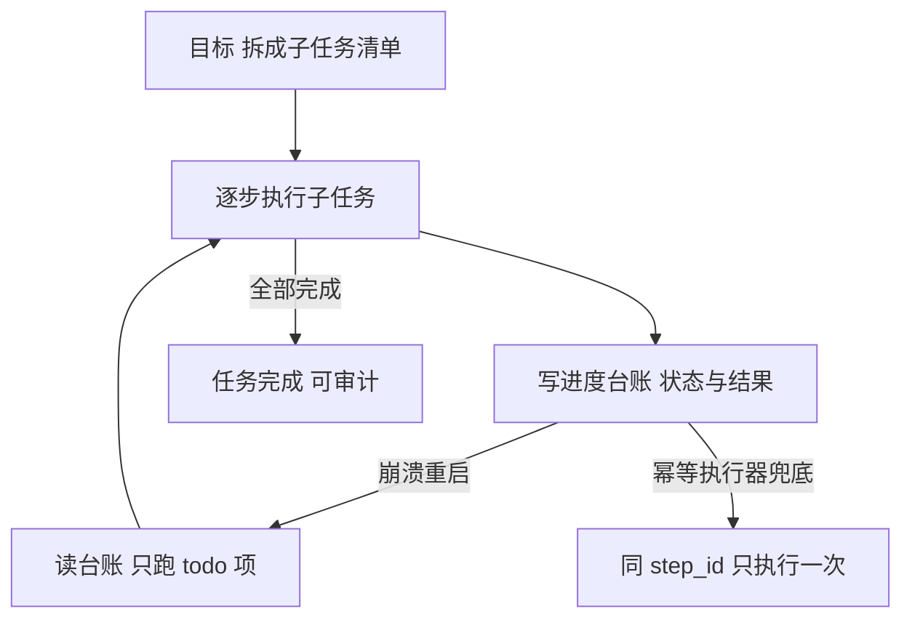
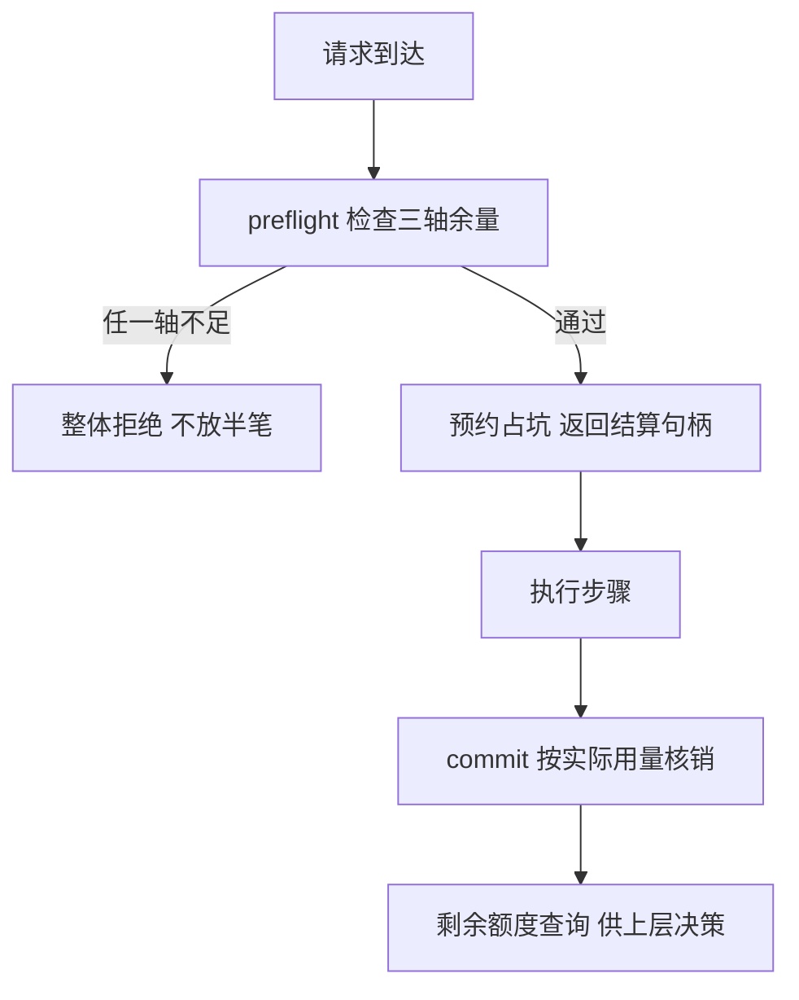
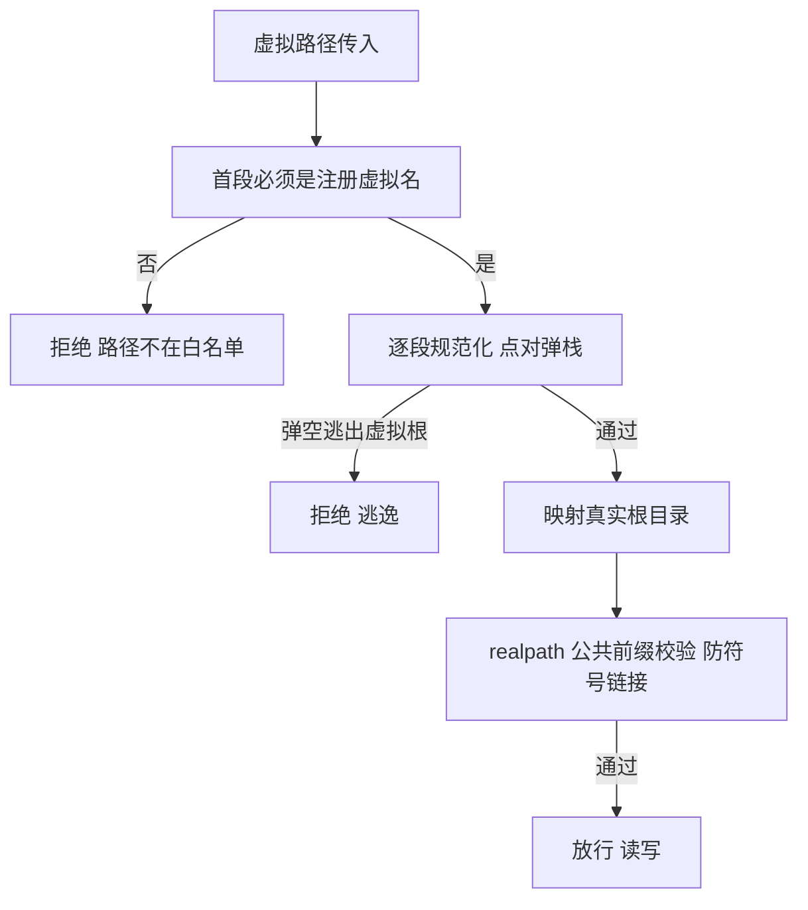
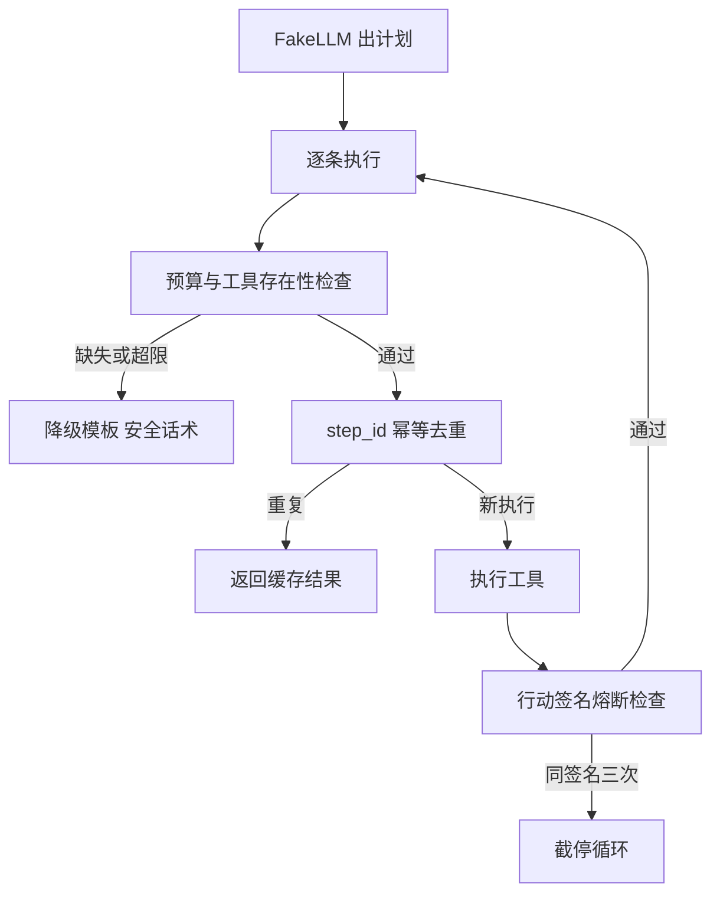
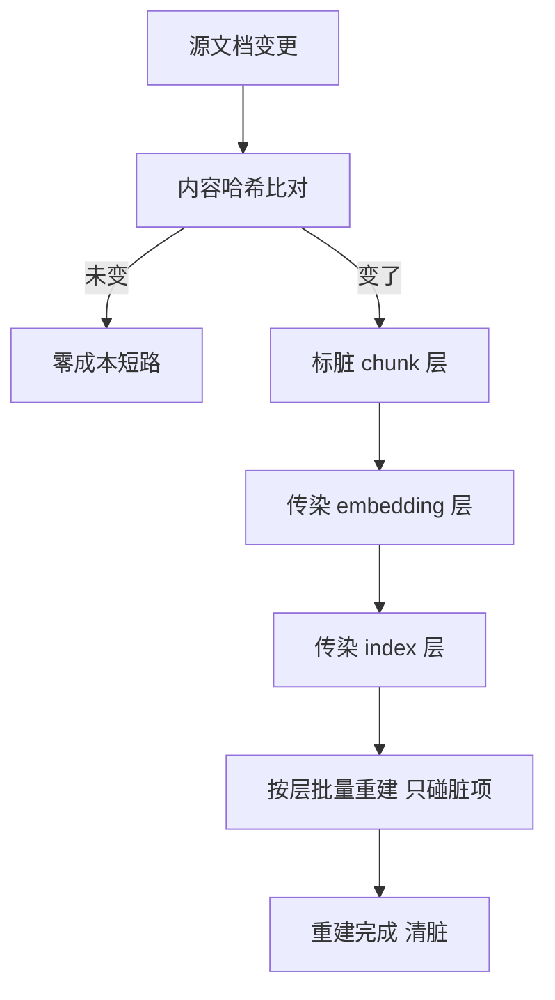
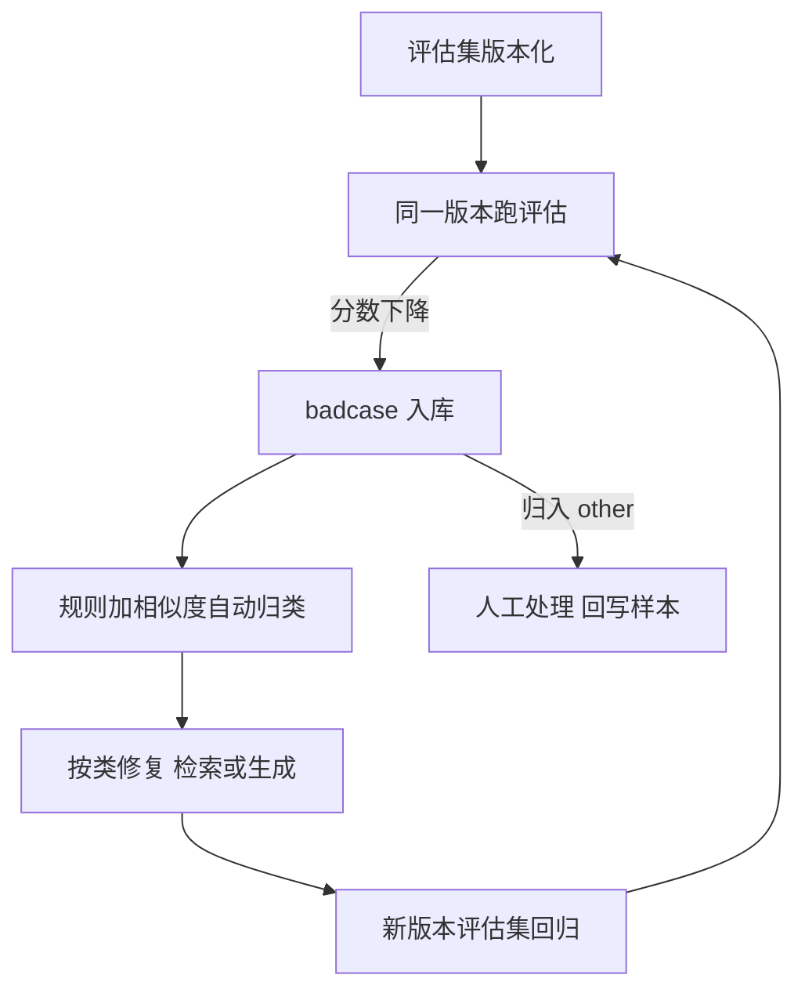
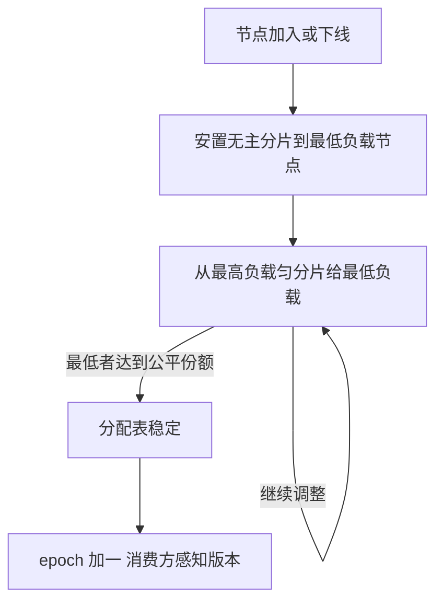
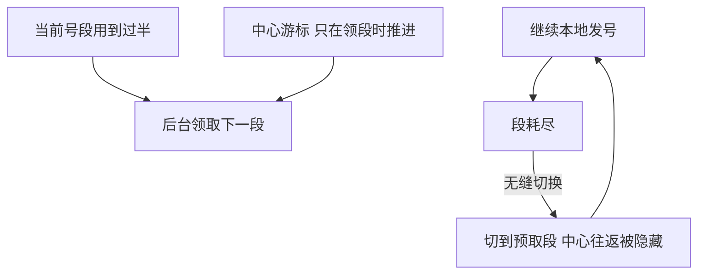
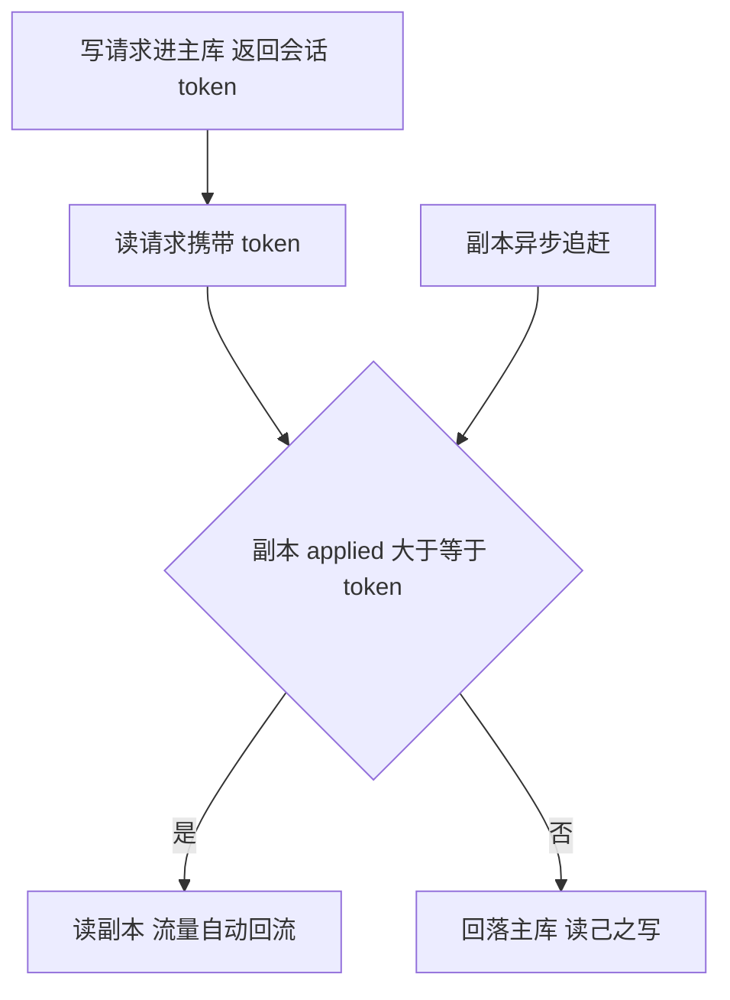

# 第 6 类 · Agent 与 LLM 及系统设计(夜间扩产)

> 本篇是第 6 类的夜间扩产批(Q1481-Q1525 共 45 题),聚焦两块实战短板:Agent 可靠性工程——工具幂等、死循环熔断、上下文降级阶梯、敏感操作确认流、进度台账与轨迹回放、预算三重限制;以及 RAG 评估治理与分布式设计补遗——命中率评估器、声明级忠实度、脏标记增量、badcase 归类、评估集版本化,加上集群令牌桶、配额借还、分片协调、租约续期、脑裂防护、优雅摘除、跨机房同步、号段发号器等。
> 全部代码仅标准库、可独立运行,LLM 一律用脚本桩,向量检索用 hash 假嵌入,重点是把可靠性机制写成可验证的行为,而非背名词。
> 学习建议:每题先答"失败模式是什么",再给机制,最后给验证断言——能讲清"怎么证明它可靠"的候选人在面试里非常稀缺。

### Q1481 · 工具调用幂等框架:step_id 幂等表与结果重放

> 难度:★★★☆ | 标签:Agent, 幂等, 可靠性

**问**:模型重试或网络重发导致同一个工具步骤被调两次,怎么保证副作用只发生一次?

**答**:核心是给每个 Agent 步骤分配全局唯一的 step_id,执行前先查幂等表:状态是 done 就直接重放历史结果,状态是 pending 说明上次执行中断,绝不能盲目重发,要走工具自身的业务幂等键兜底。执行采用两阶段记录:先落 pending 再调用工具,成功后把结果原子地写成 done;调用抛异常则回滚为 failed,让重试路径可以安全重新进入。这样同一 step_id 无论重复请求多少次,工具的真实副作用计数都是 1,而调用方始终拿到一致的结果,只需用一个 replayed 标记区分新执行与重放。

```python
# file: code/06_Agent与LLM及系统设计/q1481_tool_idempotency.py
"""工具调用幂等框架:step_id 幂等表 + 结果重放,重复请求绝不二次执行副作用。"""
import json
import hashlib


class ToolRegistry:
    """真实工具集合,带副作用计数用于验证只执行一次。"""

    def __init__(self):
        self.side_effects = []

    def book_ticket(self, args):
        self.side_effects.append(("book", json.dumps(args, sort_keys=True)))
        return {"ticket_id": "T-" + hashlib.md5(json.dumps(args, sort_keys=True).encode()).hexdigest()[:6]}

    def refund(self, args):
        self.side_effects.append(("refund", json.dumps(args, sort_keys=True)))
        return {"refunded": args.get("order_id")}


TOOLS = {"book_ticket": lambda a: None, "refund": lambda a: None}


class IdempotentRunner:
    """幂等执行器:同一 step_id 只放行一次;中断在 pending 的请求可被安全恢复。"""

    def __init__(self, store, tools):
        self.store = store          # 持久层桩:step_id -> {"state", "result"}
        self.tools = tools
        self.executed = 0           # 实际执行计数,用于验证幂等

    def run(self, step_id, tool, args):
        rec = self.store.get(step_id)
        if rec and rec["state"] == "done":
            return dict(rec["result"], replayed=True)      # 重放历史结果
        if rec and rec["state"] == "pending":
            # 上次执行中断:副作用可能已发生,交由工具自身幂等键兜底
            return dict(rec.get("result") or {"error": "pending_recover"}, replayed=False)
        self.store[step_id] = {"state": "pending", "tool": tool}
        try:
            result = self._call(tool, args)
        except Exception as exc:                            # 失败回滚到未执行
            self.store[step_id] = {"state": "failed", "error": str(exc)}
            raise
        self.store[step_id] = {"state": "done", "result": result}
        return dict(result, replayed=False)

    def _call(self, tool, args):
        self.executed += 1
        fn = getattr(self.tools, tool)
        return fn(args)


if __name__ == "__main__":
    tools = ToolRegistry()
    store = {}
    runner = IdempotentRunner(store, tools)
    args = {"flight": "CA185", "seat": "A1"}

    first = runner.run("step-1", "book_ticket", args)
    again = runner.run("step-1", "book_ticket", args)       # 模型重试,同 step_id
    third = runner.run("step-1", "book_ticket", args)       # 网络层再重试一次

    assert first["replayed"] is False
    assert again["replayed"] is True and third["replayed"] is True
    assert again["ticket_id"] == first["ticket_id"]
    assert runner.executed == 1, "副作用必须只发生一次"
    assert len(tools.side_effects) == 1

    failed = 0
    try:
        runner.run("step-2", "no_such_tool", {})
    except AttributeError:
        failed = 1
    assert failed == 1 and store["step-2"]["state"] == "failed"
    assert runner.run("step-1", "book_ticket", args)["ticket_id"] == first["ticket_id"]
    print("幂等框架通过:3 次同 step_id 调用只执行 1 次副作用,失败步骤被记录为 failed")
```

**追问**:
- 幂等表的存储放哪里? 答:必须放在工具副作用真正发生之前的持久层,比如数据库唯一键或 Redis SETNX,放内存里进程一崩就失效;
- 工具本身不支持幂等怎么办? 答:在执行器里为它包一层业务键,如订单号加操作类型做唯一约束,把非幂等工具改造成可重试的。

### Q1482 · Agent 死循环检测与熔断:动作签名与观测停滞

> 难度:★★★★ | 标签:Agent, 死循环, 熔断

**问**:Agent 在生产里反复调用同一个搜索、或者翻页参数在变但页面永远返回同一内容,怎么自动发现并止损?

**答**:死循环有两种形态,要分别检测。第一种是动作签名重复:把工具名加排序后的参数哈希成签名,滑窗内同一签名出现达到阈值就熔断,这能抓住参数完全相同的重试循环。第二种是观测停滞:即使参数在变,只要连续多步的环境观测完全相同,说明行动没有产生任何信息增量,同样要熔断。熔断动作是立即终止主循环并向模型注入一条系统消息说明原因,让上层决定改写计划还是放弃。面试加分点在于指出这两个信号互补:只查签名会漏掉参数微调的假推进,只查观测会把合法的等待误判为死循环。

```python
# file: code/06_Agent与LLM及系统设计/q1482_loop_breaker.py
"""Agent 死循环检测与熔断:动作签名滑窗去重 + 无进展检测 + 熔断强制终止。"""
from collections import Counter, deque


class LoopBreaker:
    """以 动作签名+观测指纹 判断是否在空转:同签名反复出现或观测无变化即熔断。"""

    def __init__(self, repeat_limit=3, stale_limit=3, window=8):
        self.repeat_limit = repeat_limit
        self.stale_limit = stale_limit
        self.window = window
        self.signatures = deque(maxlen=window)
        self.observations = deque(maxlen=window)
        self.tripped = False
        self.reason = None

    @staticmethod
    def _sig(action, args):
        return action + "|" + ",".join(f"{k}={args[k]}" for k in sorted(args))

    def step(self, action, args, observation):
        """每次 Agent 循环调用一次:返回 True 表示放行,False 表示已熔断。"""
        if self.tripped:
            return False
        self.signatures.append(self._sig(action, args))
        self.observations.append(str(observation))
        most = Counter(self.signatures).most_common(1)[0]
        if most[1] >= self.repeat_limit and most[0] == self.signatures[-1]:
            self.tripped, self.reason = True, f"动作 {most[0]} 在近 {len(self.signatures)} 步重复 {most[1]} 次"
            return False
        if len(set(self.observations)) == 1 and len(self.observations) >= self.stale_limit:
            self.tripped, self.reason = True, f"连续 {len(self.observations)} 步观测无变化"
            return False
        return True


def run_agent(breaker, scripted):
    """脚本化 Agent 主循环桩:依次执行 (action,args,observation)。"""
    trace = []
    for action, args, obs in scripted:
        if not breaker.step(action, args, obs):
            trace.append(("halted", breaker.reason))
            break
        trace.append((action, obs))
    return trace


if __name__ == "__main__":
    # 场景 1:同一个搜索反复带相同参数
    b1 = LoopBreaker()
    t1 = run_agent(b1, [("search", {"q": "天气"}, "晴 25 度"),
                        ("search", {"q": "天气"}, "晴 25 度"),
                        ("search", {"q": "天气"}, "晴 25 度")])
    assert t1[-1][0] == "halted" and "重复" in b1.reason

    # 场景 2:参数在变,但页面观测始终一样(翻页被禁)
    b2 = LoopBreaker()
    t2 = run_agent(b2, [("next_page", {"p": 2}, "end of list"),
                        ("next_page", {"p": 3}, "end of list"),
                        ("next_page", {"p": 4}, "end of list")])
    assert t2[-1][0] == "halted" and "观测无变化" in b2.reason

    # 场景 3:正常推进,不应熔断
    b3 = LoopBreaker()
    t3 = run_agent(b3, [("search", {"q": "a"}, "r1"), ("open", {"id": 1}, "r2"),
                        ("extract", {"id": 1}, "r3"), ("finish", {}, "r4")])
    assert all(step[0] != "halted" for step in t3) and not b3.tripped
    print("死循环检测通过:重复签名熔断、观测停滞熔断、正常轨迹放行")
```

**追问**:
- 阈值怎么定? 答:经验上签名重复 3 次、观测停滞 3 步已经足够灵敏,滑窗取 8 步可以容忍偶发的合法重复;
- 熔断后怎么办? 答:记录熔断原因进轨迹,给用户降级话术,并把该任务标记为需要人工或换策略,而不是静默重启再循环一次。

### Q1483 · 上下文超限降级阶梯:裁剪 丢弃 摘要 硬失败

> 难度:★★★☆ | 标签:Agent, 上下文, 降级

**问**:对话越滚越长超出上下文窗口,除了截断还有什么讲究?

**答**:正确做法是一架按代价从小到大排列的降级阶梯,每上一级都要重新测量预算,能塞下就停。第一级裁剪超长工具结果,保留截断标记让模型知道信息不完整;第二级丢弃最旧的对话轮次,保住 system 提示和最近几轮;第三级把历史整体替换成一条摘要,信息损失最大但轮次结构保住了;最后一级如果连摘要都塞不下,必须硬失败而不是静默乱塞,把 MemoryError 抛给上层做请求级降级。关键设计是每一级都可独立测试,用同一组上下文在不同预算下验证阶梯逐级触发的顺序。

```python
# file: code/06_Agent与LLM及系统设计/q1483_context_ladder.py
"""上下文超限降级阶梯:裁剪工具结果、丢最旧轮次、摘要替换、硬失败,四级逐级加压。"""


def est_tokens(text):
    return max(1, len(text) // 2)          # 演示用粗估:2 字符 1 token


class FakeLLM:
    """摘要桩:不联网,把历史压成一条极短的台账式摘要。"""

    def summarize(self, text):
        return "摘要历史" + str(text.count("。")) + "句"


class LadderCompressor:
    """按代价从小到大逐级降级:先测原样,不行再逐级加工,最后一级直接硬失败。"""

    LEVELS = ["trim_tool_results", "drop_old_turns", "summarize"]

    def __init__(self, budget, llm=None):
        self.budget = budget
        self.llm = llm or FakeLLM()
        self.applied = []

    def fit(self, context):
        """context: [{role, text}],返回压缩后的副本与所用级别。"""
        work = [dict(m) for m in context]
        used = self._used(work)
        if used <= self.budget:
            return work, "none", used
        for level in self.LEVELS:
            self.applied.append(level)
            step = {"trim_tool_results": self._trim,
                    "drop_old_turns": self._drop,
                    "summarize": self._summarize}[level]
            work = step(work)
            used = self._used(work)
            if used <= self.budget:
                return work, level, used
        raise MemoryError(f"三级降级后仍超限 需要 {used} 预算 {self.budget}")

    @staticmethod
    def _used(ctx):
        return sum(est_tokens(m["text"]) for m in ctx)

    def _trim(self, ctx):
        """把超长工具结果截到 40 字并留截断标记,系统消息不动。"""
        out = []
        for m in ctx:
            if m["role"] == "tool" and est_tokens(m["text"]) > 20:
                out.append(dict(m, text=m["text"][:40] + "…[已截断]"))
            else:
                out.append(m)
        return out

    def _drop(self, ctx):
        """保留 system 与最近 2 条,其余丢弃。"""
        sys_msgs = [m for m in ctx if m["role"] == "system"]
        rest = [m for m in ctx if m["role"] != "system"]
        return sys_msgs + rest[-2:]

    def _summarize(self, ctx):
        """旧轮次整体替换为一条摘要消息。"""
        sys_msgs = [m for m in ctx if m["role"] == "system"]
        rest = [m for m in ctx if m["role"] != "system"]
        old, recent = rest[:-1], rest[-1:]
        joined = " ".join(m["text"] for m in old)
        return sys_msgs + [{"role": "summary", "text": self.llm.summarize(joined)}] + recent


if __name__ == "__main__":
    ctx = [{"role": "system", "text": "你是助手。"},
           {"role": "user", "text": "帮我查三本书。"},
           {"role": "tool", "text": "书A的介绍。" * 60},
           {"role": "tool", "text": "书B的介绍。" * 60},
           {"role": "assistant", "text": "找到了两本,还差最后一本。"},
           {"role": "user", "text": "继续。"}]

    wide, l0, u0 = LadderCompressor(budget=10 ** 6).fit(ctx)
    assert l0 == "none" and u0 == sum(est_tokens(m["text"]) for m in ctx)

    mid, l1, u1 = LadderCompressor(budget=90).fit(ctx)
    assert l1 == "trim_tool_results" and u1 <= 90
    assert all("已截断" in m["text"] for m in mid if m["role"] == "tool")

    tighter, l2, u2 = LadderCompressor(budget=20).fit(ctx)
    assert l2 == "drop_old_turns" and u2 <= 20

    tight, l3, u3 = LadderCompressor(budget=8).fit(ctx)
    assert l3 == "summarize" and u3 <= 8
    assert [m["role"] for m in tight] == ["system", "summary", "user"]

    blown = 0
    try:
        LadderCompressor(budget=4).fit(ctx)
    except MemoryError:
        blown = 1
    assert blown == 1, "预算 4 连摘要也塞不下 必须硬失败"
    print("降级阶梯通过:none→trim→drop→summarize→硬失败 各级预算", u0, u1, u2, u3)
```

**追问**:
- 为什么工具结果最先裁? 答:工具输出通常体积大、信息密度低、可再生,而用户最近的意图最难重建,保真顺序应该按重建代价排;
- 摘要会不会丢关键约束? 答:会,所以 system 与最近一轮永远不进摘要,关键约束要么放 system 要么外置成任务清单。

### Q1484 · 敏感操作二次确认流:确认码 一次性消费与过期作废

> 难度:★★★☆ | 标签:Agent, 安全, HITL

**问**:Agent 要执行删库、退款这类高危操作,二次确认怎么设计才不会被模型自问自答绕过?

**答**:三个机制缺一不可。第一,确认内容必须是用户复述服务端下发的确认码,比如原样输入 确认执行删库,模型自己生成的 同意执行 不算数,这防住了模型代替用户批准。第二,确认一次性消费:核对通过后立刻从 pending 删掉,防止同一确认码被重放给第二个操作。第三,过期作废与冷却:挑战有时效,超时必须重新发起;发起挑战有冷却间隔,防止被刷。同时低风险操作走自动放行通道,别让确认流拖垮正常体验,所有挑战与批准都进审计日志。

```python
# file: code/06_Agent与LLM及系统设计/q1484_confirm_flow.py
"""敏感操作二次确认流:风险分级 + 确认码匹配 + 冷却窗口 + 过期作废。"""
import time


class ConfirmGate:
    """高危工具先发挑战再放行:用户必须原样复述确认码,防止模型自答自批。"""

    def __init__(self, cooldown=5.0, ttl=60.0):
        self.cooldown = cooldown            # 两次挑战的最小间隔,防轰炸
        self.ttl = ttl                      # 挑战有效期
        self.pending = {}                   # req_id -> {"code","expires","action"}
        self.last_issue = 0.0
        self.audit = []

    def challenge(self, req_id, action, risk):
        """返回是否已发出挑战;低风险直接放行,高危需要二次确认。"""
        now = time.time()
        if risk == "high" or risk == "critical":
            if now - self.last_issue < self.cooldown:
                return {"ok": False, "why": "挑战过于频繁 请稍后再试"}
            code = "确认执行" + action.replace("_", "")
            self.pending[req_id] = {"code": code, "expires": now + self.ttl, "action": action}
            self.last_issue = now
            self.audit.append(("challenge", req_id, action))
            return {"ok": False, "need_confirm": True, "code_hint": code[:2] + "**", "req_id": req_id}
        self.audit.append(("auto_allow", req_id, action))
        return {"ok": True, "need_confirm": False}

    def confirm(self, req_id, user_reply, now=None):
        """核对确认码:过期作废、错码拒绝、答对后从 pending 移除防重放。"""
        now = now if now is not None else time.time()
        rec = self.pending.get(req_id)
        if not rec:
            return {"ok": False, "why": "无待确认请求"}
        if now > rec["expires"]:
            del self.pending[req_id]
            return {"ok": False, "why": "挑战已过期 需重新发起"}
        if user_reply != rec["code"]:
            return {"ok": False, "why": "确认码不匹配"}
        del self.pending[req_id]
        self.audit.append(("approved", req_id, rec["action"]))
        return {"ok": True, "action": rec["action"]}


class FakeUser:
    """模拟用户输入:正例会复述提示中的完整确认码,负例乱答。"""


if __name__ == "__main__":
    gate = ConfirmGate(cooldown=0.0)
    r1 = gate.challenge("r1", "delete_database", "critical")
    assert r1["need_confirm"] is True
    code = "确认执行delete" + "database"
    bad = gate.confirm("r1", "好的我确认")
    assert bad["ok"] is False and "不匹配" in bad["why"]
    good = gate.confirm("r1", code)
    assert good["ok"] is True
    replay = gate.confirm("r1", code)
    assert replay["ok"] is False and "无待确认" in replay["why"]

    r2 = gate.challenge("r2", "read_file", "low")
    assert r2["need_confirm"] is False and r2["ok"] is True

    expired = ConfirmGate(cooldown=0.0, ttl=-1.0)
    expired.challenge("r3", "drop_table", "high")
    late = expired.confirm("r3", "确认执行drop" + "table")
    assert late["ok"] is False and "过期" in late["why"]
    assert [a[0] for a in gate.audit] == ["challenge", "approved", "auto_allow"]
    print("二次确认流通过:错码拒绝、过期作废、一次性消费、低风险直放")
```

**追问**:
- 确认码为什么不直接用数字验证码? 答:数字码模型容易猜测或被提示注入诱出,动词短语与操作名绑定,语义上无法被复用到别的操作;
- 审批人就是发起人怎么办? 答:高危场景要双人复核,发起与批准必须来自两个身份,这属于四眼原则,确认流里用角色字段区分。

### Q1485 · 多轮任务进度台账:崩溃续跑与子任务幂等

> 难度:★★★☆ | 标签:Agent, 持久化, 恢复

**问**:一个跑几十步的 Agent 任务中途崩了,重启后怎么做到不重做已完成的步骤?

**答**:把任务组织成有序子任务清单,每执行完一步就把该步的 status 与 result 落进台账并持久化,这就是进度台账模式。恢复时新进程先读台账,只挑 status 为 todo 的子任务继续跑,done 的直接跳过,这样每个子任务的副作用天然只发生一次。两个细节决定成败:恢复对象的构造不能重置已有台账,否则等于全量重跑;快照序列化要深拷贝,续跑会继续写同一个 dict,断言必须基于崩溃时刻固化下来的值。台账还应记录失败步骤的错误信息,便于区分可重试与不可重试。

```python
# file: code/06_Agent与LLM及系统设计/q1485_progress_ledger.py
"""多轮任务进度台账与续跑:每步落盘状态,崩溃后跳过已完成子任务幂等续跑。"""
import json


class ProgressLedger:
    """任务台账:plan 为有序子任务列表,每项记录 status 与 result 快照。"""

    def __init__(self, goal, subtasks, store=None):
        self.store = store if store is not None else {}
        if "plan" not in self.store:       # 恢复场景:已有台账原样保留 绝不重置
            self.store["plan"] = [{"name": t, "status": "todo", "result": None} for t in subtasks]
        self.store.setdefault("goal", goal)

    def mark(self, index, status, result=None):
        item = self.store["plan"][index]
        assert item["status"] != "done", "已完成子任务不可被覆盖 防止重复副作用"
        item["status"], item["result"] = status, result

    def next_todo(self):
        for i, item in enumerate(self.store["plan"]):
            if item["status"] == "todo":
                return i, item["name"]
        return None, None

    def done_ratio(self):
        plan = self.store["plan"]
        return sum(1 for p in plan if p["status"] == "done") / len(plan)

    def serialize(self):
        """真实系统里这里写文件或数据库;演示中直接返回深拷贝。"""
        return json.loads(json.dumps(self.store))


class Runner:
    """执行器:逐个跑子任务;崩溃恢复时先读台账,只跑 todo 的。"""

    def __init__(self, tools):
        self.tools = tools
        self.executed = []

    def run(self, ledger, crash_after=None):
        while True:
            idx, name = ledger.next_todo()
            if idx is None:
                return True
            try:
                result = self.tools[name]()
                self.executed.append(name)
            except Exception:
                ledger.mark(idx, "failed", None)
                return False
            ledger.mark(idx, "done", result)
            if crash_after is not None and idx >= crash_after:
                raise RuntimeError("模拟进程崩溃 台账已落盘")

    def resume(self, ledger):
        """崩溃后从台账恢复:done 的直接跳过,不产生第二次副作用。"""
        before = list(self.executed)
        ok = self.run(ledger)
        return ok, list(self.executed[len(before):]) or self.executed


if __name__ == "__main__":
    calls = {}
    results = {"fetch": "10 条数据", "clean": "去重后 8 条", "report": "报表已生成"}

    def tool_for(name):
        def fn():
            calls[name] = calls.get(name, 0) + 1
            return results[name]
        return fn

    tools = {n: tool_for(n) for n in results}
    runner = Runner(tools)

    ledger = ProgressLedger("生成周报", ["fetch", "clean", "report"])
    crashed = 0
    try:
        runner.run(ledger, crash_after=1)     # 跑完 fetch、clean 后崩溃
    except RuntimeError:
        crashed = 1
    assert crashed == 1
    snap = ledger.serialize()
    assert snap["plan"][0]["status"] == "done" and snap["plan"][1]["status"] == "done"
    crash_done = [p["result"] for p in snap["plan"] if p["status"] == "done"]
    assert crash_done == ["10 条数据", "去重后 8 条"]

    recovered = ProgressLedger("生成周报", ["fetch", "clean", "report"], store=snap)
    runner2 = Runner(tools)                   # 新进程,台账即恢复上下文
    ok, trace = runner2.resume(recovered)
    assert ok and recovered.done_ratio() == 1.0
    assert calls == {"fetch": 1, "clean": 1, "report": 1}, "已完成的子任务绝不能重跑"
    assert crash_done == ["10 条数据", "去重后 8 条"], "崩溃时刻的台账只含已完成项"
    print("进度台账通过:崩溃后按台账续跑,fetch 与 clean 未被重复执行,共调用", calls)
```

**追问**:
- 台账和检查点是一回事吗? 答:不是,检查点保存完整运行时状态,成本高;台账只保存子任务粒度的状态与结果,恢复语义是重放未完成部分,两者可以叠加;
- 子任务执行一半崩了怎么办? 答:该步状态留在 todo,配合 Q1481 的 step_id 幂等执行器,重跑也不会二次扣款。



### Q1486 · 失败轨迹录制与回放:确定性复现与首个分歧点

> 难度:★★★★ | 标签:Agent, 调试, 可测试性

**问**:线上 Agent 任务偶发失败,没法带调试器重跑,怎么排查?

**答**:录制回放模式:正常运行时把每步事件按序落盘,LLM 调用记 prompt 指纹与回复,工具调用记工具名、参数与结果;复现时回放器不再执行真实工具,而是按序号取录制结果,让整条轨迹完全确定。价值在于差异定位:拿修复后的代码回放同一条轨迹,一旦某步的输入与录制输入不一致,回放器立刻抛出分歧点异常,给出序号与两侧内容,第一个分歧就是问题的根因入口。配套要有 prompt 哈希,否则模型输出了新内容你还以为输入没变。这套机制也是回归测试的基础设施,轨迹即测试用例。

```python
# file: code/06_Agent与LLM及系统设计/q1486_trajectory_replay.py
"""失败轨迹录制与回放调试:录制 LLM 与工具事件,确定性回放并定位首个分歧点。"""
import json


class Recorder:
    """轨迹录制器:把每步 (类型, 输入, 输出) 按序写入事件流。"""

    def __init__(self):
        self.events = []

    def record(self, kind, payload):
        self.events.append({"seq": len(self.events), "kind": kind, "payload": payload})
        return self.events[-1]["seq"]


class ReplayPlayer:
    """回放器:不执行真实工具,按序号取录制结果,实现完全确定性复现。"""

    def __init__(self, events):
        self.events = events
        self.pos = 0

    def next_tool_result(self, tool, args):
        ev = self.events[self.pos]
        assert ev["kind"] == "tool", "回放轨迹错位 期望工具事件得到 " + ev["kind"]
        if ev["payload"]["tool"] != tool or ev["payload"]["args"] != args:
            raise Divergence(self.pos, ev["payload"], {"tool": tool, "args": args})
        self.pos += 1
        return ev["payload"]["result"]

    def next_llm_reply(self, prompt_hash):
        ev = self.events[self.pos]
        assert ev["kind"] == "llm"
        if ev["payload"]["prompt_hash"] != prompt_hash:
            raise Divergence(self.pos, ev["payload"], {"prompt_hash": prompt_hash})
        self.pos += 1
        return ev["payload"]["reply"]


class Divergence(Exception):
    """首个分歧点:回放输入与录制输入不一致的位置与两侧内容。"""

    def __init__(self, seq, recorded, got):
        self.seq, self.recorded, self.got = seq, recorded, got
        super().__init__(f"第 {seq} 步回放输入与录制不符")


def hash_of(obj):
    return json.dumps(obj, sort_keys=True, ensure_ascii=False)


class StubLLM:
    """桩模型:按脚本表回复,使两次运行输入一致时输出必然一致。"""

    def __init__(self, script):
        self.script = script

    def reply(self, messages):
        key = hash_of(messages)
        return self.script[key]


if __name__ == "__main__":
    llm_script = {"[\"system 你好\", \"user 查订单\"]": "调用 get_order",
                  "[\"system 你好\", \"user 查订单\", \"tool 订单已发货\"]": "告诉用户已发货"}
    tool_result = {"order": "订单已发货"}

    # 第一次运行:边跑边录
    rec = Recorder()
    llm = StubLLM(llm_script)
    msgs = ["system 你好", "user 查订单"]
    reply = llm.reply(msgs)
    rec.record("llm", {"prompt_hash": hash_of(msgs), "reply": reply})
    tool = reply.replace("调用 ", "")
    obs = tool_result["order"]
    rec.record("tool", {"tool": tool, "args": {"id": "A1"}, "result": obs})
    msgs = msgs + ["tool " + obs]
    final = llm.reply(msgs)
    rec.record("llm", {"prompt_hash": hash_of(msgs), "reply": final})
    assert final == "告诉用户已发货"

    # 回放一:同输入同结果,定位不到分歧
    player = ReplayPlayer(rec.events)
    assert player.next_llm_reply(hash_of(["system 你好", "user 查订单"])) == "调用 get_order"
    assert player.next_tool_result("get_order", {"id": "A1"}) == "订单已发货"
    assert player.next_llm_reply(hash_of(["system 你好", "user 查订单", "tool 订单已发货"])) == "告诉用户已发货"

    # 回放二:第二次运行里用户问题变了,回放应在首个工具事件处报出分歧
    player2 = ReplayPlayer(rec.events)
    diverged = None
    try:
        player2.next_llm_reply(hash_of(["system 你好", "user 查退款"]))   # 与录制不符
    except Divergence as d:
        diverged = d
    assert diverged is not None and diverged.seq == 0
    assert diverged.recorded["reply"] == "调用 get_order"
    print("轨迹回放通过:录制", len(rec.events), "个事件 确定性回放一致 分歧定位在第", diverged.seq, "步")
```

**追问**:
- LLM 本身不确定怎么办? 答:录制时把回复一并录下,回放用录制结果代替真实调用,确定性由桩保证,变量只有你的代码;
- 轨迹文件太大怎么办? 答:按 run 采样录制,错误 run 全量、正常 run 抽样,再配保留期限清理。

### Q1487 · 并发隔离子会话:独立预算与爆炸半径控制

> 难度:★★★★ | 标签:Agent, 并发, 隔离

**问**:主 Agent 并发派发 10 个子任务,一个子任务失控凭什么不影响其他 9 个?

**答**:给每个子任务开独立子会话:独立的消息上下文、独立的 token 预算、独立的失败标记。子会话内部的重试循环在预算耗尽时自熔断,异常被派发边界捕获并折叠成一条失败记录,主会话的上下文永远不接触子会话的内部消息,只在聚合阶段拿到摘要化的结果或失败清单。这就是舱壁隔离思想在 Agent 里的落地:爆炸半径被限制在单个子会话内,主会话既不会被子会话的垃圾上下文污染,也不会被它的死循环拖垮。聚合时区分成功结果与失败 sid,让上层决定重试哪些。

```python
# file: code/06_Agent与LLM及系统设计/q1487_subsession.py
"""Agent 并发隔离子会话:每个子任务独立上下文与预算,失败不污染主会话。"""


class SubSession:
    """子会话:独立 messages、独立预算、独立失败标记,主会话只接收摘要。"""

    def __init__(self, sid, task, budget=100):
        self.sid, self.task, self.budget = sid, task, budget
        self.messages, self.spent, self.failed = [], 0, False
        self.result = None

    def run(self, tool, args, max_attempts=10):
        """子任务循环:结果不完整就重试,预算耗尽即自熔断,异常向上抛给管理器。"""
        for _ in range(max_attempts):
            if self.spent + 10 > self.budget:
                self.failed = True
                return None
            self.spent += 10
            out = tool(args)
            if out is not None:
                self.messages.append(("tool", tool.__name__, str(out)[:30]))
                return out
        self.failed = True
        return None


class SubSessionManager:
    """管理器:派发子任务、隔离异常、聚合结果;主会话上下文永不接触子会话内部消息。"""

    def __init__(self, budget_each=100):
        self.budget_each = budget_each
        self.sessions = []

    def dispatch(self, task, tool, args_list):
        results = []
        for i, args in enumerate(args_list):
            ss = SubSession(f"{task}#{i}", task, self.budget_each)
            self.sessions.append(ss)
            try:
                out = ss.run(tool, args)
            except Exception as exc:         # 子会话异常被边界截住 记为该项失败
                ss.failed = True
                results.append({"sid": ss.sid, "error": str(exc)})
                continue
            results.append({"sid": ss.sid, "result": out})
        return results

    def aggregate(self, results):
        """聚合规则:错误折叠为一行,不携带子会话上下文;成功项保留。"""
        ok = [r["result"] for r in results if "result" in r and r["result"] is not None]
        bad = [r["sid"] for r in results if "error" in r or r.get("result") is None]
        return {"ok": ok, "failed_sids": bad}


if __name__ == "__main__":
    def fetch(args):
        if args.get("id") == 2:
            raise ValueError("源站 2 拒绝访问")
        return "doc-" + str(args["id"])

    def spam(args):                      # 无限重试型任务:预算会先耗尽
        return None

    mgr = SubSessionManager(budget_each=50)
    res = mgr.dispatch("fetch_docs", fetch, [{"id": 1}, {"id": 2}, {"id": 3}])
    agg = mgr.aggregate(res)
    assert agg["ok"] == ["doc-1", "doc-3"]
    assert agg["failed_sids"] == ["fetch_docs#1"], "异常子会话被隔离为失败项"

    blast = [s for s in mgr.sessions if s.failed]
    assert len(blast) == 1 and blast[0].sid == "fetch_docs#1"
    assert all(s.spent <= 50 for s in mgr.sessions), "子会话预算各自独立"

    mgr2 = SubSessionManager(budget_each=20)
    res2 = mgr2.dispatch("spam_task", spam, [{"x": 1}])
    agg2 = mgr2.aggregate(res2)
    assert agg2["ok"] == [] and agg2["failed_sids"] == ["spam_task#0"]
    assert mgr2.sessions[0].failed and mgr2.sessions[0].spent <= 20
    print("子会话隔离通过:异常与预算耗尽均被限制在子会话内,主会话只拿到聚合结果")
```

**追问**:
- 子会话之间要共享发现怎么办? 答:通过黑板或结果登记表显式共享,不要共享上下文,共享上下文等于共享故障;
- 子会话预算怎么估? 答:按主会话预算除以并发度再打折,给主会话留聚合与重试余量。

### Q1488 · 输出降级模板:三级退路 full→template→minimal

> 难度:★★☆ | 标签:Agent, 降级, 输出

**问**:模型输出的 JSON 又解析失败了,用户端不能白屏,怎么设计退路?

**答**:把输出当成一条降级链而不是单点。第一级完整结构化输出,校验通过直接用;第二级模板填充,解析出来但字段缺失或为空时,把可信字段与产品侧默认值合并,补充缺失字段并打上 template_filled 标记;第三级最小安全回复,连解析都失败时返回固定的兜底话术,同时保留原始输出供离线排查。每一级都要带降级标记,下游据此决定是否展示、是否计费、是否进 badcase 队列。反模式是静默 try-except 后返回空字符串,用户看到空白,监控看不到异常。

```python
# file: code/06_Agent与LLM及系统设计/q1488_fallback_template.py
"""输出降级模板:结构化生成失败时逐级退到模板填充与最小安全回复,并带降级标记。"""
import json


class FallbackChain:
    """三级输出降级:完整 JSON → 字段模板 → 最小安全回复,每级都打上 degrade 标记。"""

    def __init__(self):
        self.level = None

    def produce(self, raw, slot_defaults):
        """raw 为模型原始输出字符串;按解析成败走降级链。"""
        parsed = self._try_json(raw)
        if parsed is not None and self._complete(parsed):
            self.level = "full"
            return {"degrade": "none", "answer": parsed}
        if parsed is not None:
            filled = dict(slot_defaults)
            filled.update({k: v for k, v in parsed.items() if v})
            self.level = "template"
            return {"degrade": "template_filled", "answer": filled,
                    "missing": sorted(self._required() - set(k for k, v in parsed.items() if v))}
        self.level = "minimal"
        return {"degrade": "minimal_safe",
                "answer": {"reply": slot_defaults["reply"], "action": "none"},
                "raw_kept": len(raw) > 0}

    @staticmethod
    def _try_json(raw):
        try:
            return json.loads(raw)
        except (ValueError, TypeError):
            return None

    @staticmethod
    def _required():
        return {"reply", "action"}

    @classmethod
    def _complete(cls, obj):
        return isinstance(obj, dict) and cls._required() <= set(obj) and all(obj.values())


if __name__ == "__main__":
    chain = FallbackChain()
    defaults = {"reply": "已在处理您的请求,请稍候。", "action": "none"}

    good = chain.produce('{"reply": "已为您预约明天上午十点。", "action": "book"}', defaults)
    assert good["degrade"] == "none" and good["answer"]["action"] == "book"

    partial = chain.produce('{"reply": "", "action": "query"}', defaults)
    assert partial["degrade"] == "template_filled"
    assert partial["answer"]["reply"] == defaults["reply"]      # 空字段用默认补齐
    assert partial["missing"] == ["reply"]

    broken = chain.produce('前半句 {"reply": "嗯", 后半句缺引号', defaults)
    assert broken["degrade"] == "minimal_safe"
    assert broken["answer"]["action"] == "none"
    assert broken["raw_kept"] is True                           # 原始输出已留档供排查

    empty = chain.produce("", defaults)
    assert empty["degrade"] == "minimal_safe" and empty["raw_kept"] is False
    assert [chain.level for chain in [chain]] == ["minimal"]
    print("输出降级通过:三级链路 full→template_filled→minimal_safe 全部按预期触发")
```

**追问**:
- 降级标记给谁看? 答:三份:前端按标记切换展示形态,计费侧按标记打折或免单,评估侧按标记归因;
- 模板里的默认话术谁维护? 答:和 prompt 一样进版本管理与回归测试,改默认值也要过评估集。

### Q1489 · 信任分级工具白名单:信任分与升降级闭环

> 难度:★★★☆ | 标签:Agent, 安全, 权限

**问**:工具白名单只是静态列表的话,新工具怎么灰度、坏工具怎么下架?

**答**:把白名单升级成带信任分的注册表:0 到 100 分映射四级,verified 直放,trial 与 watch 允许但记录,quarantined 一律拒绝仅管理员可临时放行。运行反馈驱动升降级:连续 3 次清洁运行加 10 分,一次失败清空连击并扣 15 分,分数跌破 20 自动滑入隔离区。这样新工具从 trial 起步,行为稳定自然晋级,开始抽风自动降级,形成不依赖人工巡逻的闭环。注意拒绝的调用也要进审计,谁在什么时候试图调用被拒工具,是安全复盘的关键证据。

```python
# file: code/06_Agent与LLM及系统设计/q1489_trust_whitelist.py
"""信任分级工具白名单:工具带信任分,分级放行,清洁运行升级、失败降级隔离。"""


class TrustRegistry:
    """工具信任注册表:0-100 信任分映射四级,放行规则与升降级闭环。"""

    TIERS = [(80, "verified"), (50, "trial"), (20, "watch"), (0, "quarantined")]

    def __init__(self, tools=None):
        self.score = {}                    # tool -> 信任分
        self.clean_streak = {}
        self.calls = []
        for name, s in (tools or {}).items():
            self.score[name] = s

    def tier(self, tool):
        s = self.score[tool]
        for floor, name in self.TIERS:
            if s >= floor:
                return name
        return "quarantined"

    def allow(self, tool, user_role="user"):
        """verified 直放;trial 与 watch 允许但降级记录;quarantined 仅管理员可临时放行。
        拒绝的调用同样写入审计,便于回溯谁在什么时候试图调用。"""
        t = self.tier(tool)
        if t == "quarantined" and user_role != "admin":
            self.calls.append((tool, t, False))
            return False, t
        self.calls.append((tool, t, True))
        return True, t

    def report(self, tool, ok):
        """运行反馈:成功累计清洁次数,连续 3 次成功升 10 分;失败清零并扣 15 分。"""
        if ok:
            self.clean_streak[tool] = self.clean_streak.get(tool, 0) + 1
            if self.clean_streak[tool] >= 3:
                self.score[tool] = min(100, self.score[tool] + 10)
                self.clean_streak[tool] = 0
        else:
            self.clean_streak[tool] = 0
            self.score[tool] = max(0, self.score[tool] - 15)

    def quorum_tools(self):
        return [t for t in self.score if self.tier(t) in ("verified", "trial")]


if __name__ == "__main__":
    reg = TrustRegistry({"web_search": 90, "code_run": 60, "mail_send": 30, "shell_exec": 5})
    assert reg.tier("web_search") == "verified"
    assert reg.tier("code_run") == "trial"
    assert reg.tier("mail_send") == "watch"
    assert reg.tier("shell_exec") == "quarantined"

    assert reg.allow("web_search")[0] is True
    assert reg.allow("shell_exec")[0] is False              # 普通角色拒绝
    assert reg.allow("shell_exec", user_role="admin")[0] is True
    assert [(c[0], c[2]) for c in reg.calls] == [("web_search", True), ("shell_exec", False), ("shell_exec", True)]

    for _ in range(3):                                      # 连续清洁 → 升 10 分
        reg.report("mail_send", True)
    assert reg.score["mail_send"] == 40 and reg.tier("mail_send") == "watch"
    for _ in range(6):
        reg.report("mail_send", True)                       # 40→50 越过 trial 线
    assert reg.tier("mail_send") == "trial"

    reg.report("code_run", False)                           # 失败扣分,可能滑向隔离
    assert reg.score["code_run"] == 45
    for _ in range(3):
        reg.report("code_run", False)                       # 45→30→15→0
    assert reg.tier("code_run") == "quarantined"
    assert sorted(reg.quorum_tools()) == ["mail_send", "web_search"]
    print("信任分级通过:四级放行、连续清洁升级、失败降级到隔离,管理员可临时放行")
```

**追问**:
- 信任分会被刷高吗? 答:清洁运行要绑定任务难度与数据签名,同质化低成本调用不计分;
- 分级和权限分级什么关系? 答:信任分决定默认放行策略,角色权限决定谁能临时越级,两者是正交的两把锁。

### Q1490 · 运行预算三重限制:时间 token 调用次数联合记账

> 难度:★★★★ | 标签:Agent, 预算, 限流

**问**:只限 token 或只限调用次数都有漏洞,一次 Agent 运行的预算应该怎么管?

**答**:三轴联合记账:时间轴防卡死与超时失控,token 轴防成本失控,调用次数轴防循环失控。机制上每步执行前先 preflight,检查 已消耗加已预约加本次 是否三轴全部放得下,任何一轴不足都整体拒绝,绝不放半笔;通过则预约占坑并返回结算句柄,执行后按实际用量 commit 核销。预约与消耗解耦是关键:大额预约能提前拦截注定超支的请求,实际用量核销时释放多余占位,不会产生幽灵占住预算的僵尸预约。剩余额度查询给上层做策略,比如额度紧张时切换小模型或提前收尾。

```python
# file: code/06_Agent与LLM及系统设计/q1490_budget_governor.py
"""运行预算三重限制:时间、token、工具调用数三轴统一记账,预检预约防止超发。"""


class BudgetExceeded(Exception):
    def __init__(self, axis, limit, want):
        self.axis, self.limit, self.want = axis, limit, want
        super().__init__(f"预算超限 {axis} 需要 {want} 上限 {limit}")


class BudgetGovernor:
    """三重预算:preflight 检查+预约,commit 凭句柄结算,任何一轴不足整体拒绝。"""

    def __init__(self, max_ms, max_tokens, max_calls):
        self.limits = {"time_ms": max_ms, "tokens": max_tokens, "calls": max_calls}
        self.reserved = {"time_ms": 0, "tokens": 0, "calls": 0}
        self.spent = {"time_ms": 0, "tokens": 0, "calls": 0}
        self.elapsed = 0.0

    def tick(self, ms=0.0):
        """推进模拟时钟。"""
        self.elapsed += ms
        self.spent["time_ms"] = max(self.spent["time_ms"], self.elapsed)

    def preflight(self, tokens=0, calls=1, est_ms=0.0):
        """执行前检查 已消耗+已预约+本次 三轴余量;通过则预约并返回结算句柄。"""
        self.tick(0)
        want = {"time_ms": self.spent["time_ms"] + est_ms,
                "tokens": self.spent["tokens"] + self.reserved["tokens"] + tokens,
                "calls": self.spent["calls"] + self.reserved["calls"] + calls}
        for axis, limit in self.limits.items():
            if want[axis] > limit:
                raise BudgetExceeded(axis, limit, want[axis])
        self.reserved["tokens"] += tokens
        self.reserved["calls"] += calls
        self.reserved["time_ms"] += est_ms
        return {"tokens": tokens, "calls": calls, "ms": est_ms}

    def commit(self, handle, tokens, calls=1, ms=0.0):
        """按句柄核销预约,按实际用量落账:预约与消耗解耦,不产生幽灵占位。"""
        self.tick(ms)
        self.spent["tokens"] += tokens
        self.spent["calls"] += calls
        self.spent["time_ms"] = max(self.spent["time_ms"], self.elapsed)
        self.reserved["tokens"] = max(0, self.reserved["tokens"] - handle["tokens"])
        self.reserved["calls"] = max(0, self.reserved["calls"] - handle["calls"])
        self.reserved["time_ms"] = max(0, self.reserved["time_ms"] - handle["ms"])

    def remaining(self):
        self.tick(0)
        return {k: self.limits[k] - max(self.spent[k], self.reserved[k]) for k in self.limits}


if __name__ == "__main__":
    gov = BudgetGovernor(max_ms=1000, max_tokens=500, max_calls=3)

    h1 = gov.preflight(tokens=120, est_ms=200)     # 第一步 LLM 调用
    gov.commit(h1, tokens=118, calls=1, ms=190)
    h2 = gov.preflight(tokens=60, est_ms=100)      # 第二步 工具调用
    gov.commit(h2, tokens=44, calls=1, ms=80)
    left = gov.remaining()
    assert left == {"time_ms": 1000 - 270, "tokens": 500 - 162, "calls": 1}

    h3 = gov.preflight(tokens=50, est_ms=50)
    gov.commit(h3, tokens=50, calls=1, ms=60)
    assert gov.spent["calls"] == 3

    denied = None
    try:
        gov.preflight(tokens=10)                   # 调用次数轴已满 即使 token 充裕也整体拒绝
    except BudgetExceeded as e:
        denied = e.axis
    assert denied == "calls"

    gov2 = BudgetGovernor(max_ms=300, max_tokens=10 ** 6, max_calls=100)
    gov2.tick(250)
    h = gov2.preflight(tokens=10, est_ms=40)       # 250+40=290 仍可放行
    gov2.commit(h, tokens=10, calls=1, ms=0)
    denied2 = None
    try:
        gov2.preflight(tokens=10, est_ms=60)       # 250+60=310 超时间轴
    except BudgetExceeded as e:
        denied2 = e.axis
    assert denied2 == "time_ms"

    gov3 = BudgetGovernor(max_ms=10 ** 6, max_tokens=1000, max_calls=100)
    h_a = gov3.preflight(tokens=400, est_ms=10)    # 大额预约占住坑位
    blocked = None
    try:
        gov3.preflight(tokens=700)                 # 400+700 > 1000 被预约挤占
    except BudgetExceeded as e:
        blocked = e.axis
    assert blocked == "tokens"
    gov3.commit(h_a, tokens=120, calls=1, ms=10)   # 实际只用 120,预约解除
    assert gov3.remaining()["tokens"] == 1000 - 120
    print("预算治理通过:三轴记账 调用轴拒 时间轴拒 预约挤占与核销均正确")
```

**追问**:
- 预约和消耗为什么分开? 答:预检时只能估,估多了会误拒,估少了会超发;预约占位保证并发下的预算不被挤占,commit 按实际结算保证公平;
- 三轴超限分别对应什么动作? 答:token 与调用数超限降级或收尾,时间超限通常是下游故障,应熔断并上报而非重试。



### Q1491 · 工具结果超长治理:截断标记与游标分页

> 难度:★★☆ | 标签:Agent, 上下文, 工具

**问**:工具返回了 50KB 的日志全文,直接塞给模型吗?

**答**:不塞。给工具结果加一道门卫:结果不超预算原样透传;超预算则截断首页,附上 截断标记与总长度,同时生成游标,Agent 确认需要更多时凭游标续取下一页。三件事必须做对:截断标记必须显式,让模型知道信息不全,否则它会拿半截内容下结论;分页 buffer 要随取随清,防止累积泄漏;拼回校验,首页加各页连起来必须等于原文,证明分页无损。这一层把 上下文预算 与 信息完整性 的权衡显式化,而不是让模型被动接受大段无关文本。

```python
# file: code/06_Agent与LLM及系统设计/q1491_result_trim.py
"""工具结果超长治理:超限裁剪加游标分页,截断有标记,续读可取剩余部分。"""


class ResultGovernor:
    """工具结果门卫:单条结果超预算就截断,给出 cursor 让 Agent 需要时再取下一段。"""

    def __init__(self, page_chars=60):
        self.page_chars = page_chars
        self.buffers = {}                  # cursor_id -> 剩余文本
        self.seq = 0

    def shape(self, tool, raw):
        """返回 {"text", "truncated", "cursor"};短结果原样透传。"""
        if len(raw) <= self.page_chars:
            return {"text": raw, "truncated": False, "cursor": None, "tool": tool}
        self.seq += 1
        cid = f"{tool}:{self.seq}"
        self.buffers[cid] = raw[self.page_chars:]
        return {"text": raw[:self.page_chars] + "…[截断 共" + str(len(raw)) + "字]",
                "truncated": True, "cursor": cid, "tool": tool}

    def more(self, cursor):
        """按 cursor 续取下一页;取完返回 has_more False 并释放缓冲。"""
        rest = self.buffers.get(cursor)
        if rest is None:
            return {"text": "", "has_more": False, "cursor": None}
        if len(rest) <= self.page_chars:
            del self.buffers[cursor]
            return {"text": rest, "has_more": False, "cursor": None}
        self.buffers[cursor] = rest[self.page_chars:]
        return {"text": rest[:self.page_chars], "has_more": True, "cursor": cursor}

    def live_buffers(self):
        return len(self.buffers)


if __name__ == "__main__":
    gov = ResultGovernor(page_chars=50)
    big = "日志行。" * 30                        # 120 字
    shaped = gov.shape("read_log", big)
    assert shaped["truncated"] is True and shaped["cursor"] == "read_log:1"
    assert len(shaped["text"]) <= 50 + 12, "截断页不能显著超出预算"

    page2 = gov.more(shaped["cursor"])
    assert page2["has_more"] is True and page2["cursor"] == shaped["cursor"]
    page3 = gov.more(shaped["cursor"])
    assert page3["has_more"] is False and gov.live_buffers() == 0

    joined = shaped["text"].split("…")[0] + page2["text"] + page3["text"]
    assert joined == big, "分页拼回必须还原完整原文"
    assert gov.live_buffers() == 0, "取完必须释放缓冲 防止内存泄漏"

    small = gov.shape("get_time", "12:00")
    assert small["truncated"] is False and small["cursor"] is None
    exhausted = gov.more("read_log:1")
    assert exhausted == {"text": "", "has_more": False, "cursor": None}
    print("结果治理通过:120 字结果切成 3 页,拼回原文一致,缓冲随取随清")
```

**追问**:
- 游标放内存还是落库? 答:短会话内存即可,长任务或跨进程要落库,游标要绑定会话防止被他人读取;
- 什么结果适合先摘要再分页? 答:结构化的表格与列表适合摘要加按需取行,自由文本适合首尾截断加游标续读。

### Q1492 · 僵尸会话回收:心跳宽限与资源释放

> 难度:★★★☆ | 标签:Agent, 运维, 生命周期

**问**:客户端断线后 Agent 会话还占着连接与上下文内存,怎么回收?

**答**:心跳加扫描器模式:会话定期上报心跳,扫描器周期推进,每轮给所有活跃会话记一次错过;有心跳就把错过计数清零。回收阈值设在连续两轮错过,留一轮宽限防止一次 GC 停顿或网络抖动造成误杀。达到阈值的会话标记死亡,释放它持有的连接、文件句柄与子会话资源,并向会话归属方发回收通知。实现要点是扫描器返回本轮新回收列表而不是累计列表,否则调用方会把已处理的会话重复处置。恢复语义上,被回收会话若再上报心跳,应引导其走重建而非复活。

```python
# file: code/06_Agent与LLM及系统设计/q1492_zombie_reaper.py
"""僵尸会话回收:心跳超时判定 + 扫描器回收 + 资源释放与通知,两轮宽限防误杀。"""
import time


class Session:
    def __init__(self, sid, ttl_miss=2):
        self.sid = sid
        self.last_beat = time.time()
        self.ttl_miss = ttl_miss           # 连续多少个扫描周期无心跳才算僵尸
        self.missed = 0
        self.alive = True
        self.resources = ["conn-" + sid]

    def beat(self):
        self.last_beat = time.time()
        self.missed = 0                    # 有心跳就清零错过计数


class ZombieReaper:
    """周期扫描:第一轮只标记,连续两轮无心跳才回收,避免一次 GC 停顿造成误杀。"""

    def __init__(self):
        self.sessions = {}
        self.reaped = []
        self.notified = []

    def register(self, sid):
        self.sessions[sid] = Session(sid)
        return self.sessions[sid]

    def sweep(self, now=None):
        """扫描一次:连续 ttl_miss 轮无心跳的会话被回收并释放资源。"""
        newly = []
        for sid, s in list(self.sessions.items()):
            if not s.alive:
                continue
            s.missed += 1
            if s.missed >= s.ttl_miss:           # 连续两轮错过才动手 防一次停顿误杀
                s.alive = False
                self.reaped.append(sid)
                newly.append(sid)
                self.notified.append((sid, "resources_released", s.resources))
                s.resources = []
        return newly

    def touch_all_by(self, sid):
        self.sessions[sid].beat()


if __name__ == "__main__":
    reaper = ZombieReaper()
    reaper.register("A")
    reaper.register("B")
    reaper.register("C")

    reaper.sessions["B"].beat()                # B 在第一轮扫描前刚有心跳
    dead1 = reaper.sweep()
    assert dead1 == [], "第一轮只标记不回收"
    assert reaper.sessions["B"].missed == 1, "错过 1 次远未达阈值"

    reaper.sessions["A"].beat()                # A 抢救回来了 计数清零
    reaper.sessions["B"].beat()
    dead2 = reaper.sweep()
    assert dead2 == ["C"], "C 连续两轮无心跳被回收"
    assert reaper.sessions["A"].missed == 1 and reaper.sessions["B"].missed == 1

    reaper.sessions["B"].beat()
    dead3 = reaper.sweep()                     # A 达到阈值 B 还在宽限内
    assert dead3 == ["A"]
    dead4 = reaper.sweep()                     # B 最终也超时
    assert dead4 == ["B"] and reaper.sessions["A"].alive is False
    assert reaper.sessions["A"].resources == [], "回收时释放资源"
    assert [n[0] for n in reaper.notified] == ["C", "A", "B"], "每个回收都发出通知"
    print("僵尸回收通过:心跳清零、两轮宽限、回收释放资源并按序通知")
```

**追问**:
- 心跳间隔和阈值怎么配比? 答:阈值轮数乘扫描周期要显著大于心跳间隔,比如心跳 5 秒、扫描 10 秒、阈值 2 轮,误杀窗口可控;
- 被回收会话的未完成任务怎么办? 答:交给 Q1485 的进度台账,新会话凭台账续跑,而不是在僵尸里硬撑。

### Q1493 · 失败分类与处置:瞬时退避 永久死信 政策终止

> 难度:★★★☆ | 标签:Agent, 重试, 可靠性

**问**:Agent 任务失败后一律重试对吗?

**答**:不对,失败要先分类再处置。瞬时错误如超时、503、限流,值得按指数退避重排队,配合最大重试次数,耗尽后进死信;永久错误如参数非法、资源不存在,重试一万次也不会成,直接进死信等人工或上游修复;政策类错误如命中风控与合规规则,必须立即终止整个任务,连队列都不该回。分类可以基于错误消息特征先做规则匹配,演进方向是错误码标准化。面试重点讲清楚死信的三个属性:原始载荷、错误现场、死因标签,缺了任何一个人工处理都是盲猜。

```python
# file: code/06_Agent与LLM及系统设计/q1493_failure_triage.py
"""失败分类与归档:瞬时错误退避重排队,永久错误进死信档案等人工,政策错误直接终止。"""
from collections import deque


def classify(exc):
    """三类错误:transient 可重试 / permanent 数据性失败 / policy 违规必须终止。"""
    msg = str(exc).lower()
    if "timeout" in msg or "rate" in msg or "503" in msg:
        return "transient"
    if "not_found" in msg or "invalid" in msg or "404" in msg:
        return "permanent"
    return "policy"


class TriageQueue:
    """处置队列:transient 按退避重排队并计次数;permanent 入死信;policy 直接终止任务。"""

    MAX_RETRY = 3

    def __init__(self):
        self.ready = deque()               # 立即可跑
        self.waiting = []                  # (due_round, run)
        self.dead_letter = []
        self.terminated = []
        self.round = 0

    def submit(self, run_id, payload):
        self.ready.append({"run_id": run_id, "payload": payload, "attempts": 0})

    def drain_one(self, executor):
        """执行一个任务:按错误分类走不同通道。executor 抛错即失败。"""
        if not self.ready:
            return None
        run = self.ready.popleft()
        run["attempts"] += 1
        try:
            result = executor(run["payload"])
            return {"run_id": run["run_id"], "ok": True, "result": result}
        except Exception as exc:
            kind = classify(exc)
            if kind == "transient" and run["attempts"] < self.MAX_RETRY:
                self.waiting.append((self.round + 2 ** run["attempts"], run))   # 指数退避
                return {"run_id": run["run_id"], "ok": False, "requeued": True,
                        "backoff": 2 ** run["attempts"], "kind": kind}
            if kind == "transient":
                self.dead_letter.append((run, str(exc), "retry_exhausted"))
                return {"run_id": run["run_id"], "ok": False, "dead": True, "kind": kind}
            if kind == "permanent":
                self.dead_letter.append((run, str(exc), "permanent_error"))
                return {"run_id": run["run_id"], "ok": False, "dead": True, "kind": kind}
            self.terminated.append((run, str(exc)))
            return {"run_id": run["run_id"], "ok": False, "terminated": True, "kind": kind}

    def advance(self):
        """推进一轮:到期的 waiting 任务回到 ready。"""
        self.round += 1
        still = []
        for due, run in self.waiting:
            if due <= self.round:
                self.ready.append(run)
            else:
                still.append((due, run))     # 保持 元组 形状 否则下轮解包失败
        self.waiting = still


if __name__ == "__main__":
    q = TriageQueue()
    q.submit("r1", {"op": "search"})
    q.submit("r2", {"op": "read"})
    q.submit("r3", {"op": "delete"})
    q.submit("r4", {"op": "write"})

    def exec1(p):
        if p["op"] == "read":
            raise RuntimeError("upstream timeout 503")
        if p["op"] == "delete":
            raise ValueError("invalid target 404")
        return {"done": p["op"]}

    outcomes = [q.drain_one(exec1) for _ in range(4)]
    assert outcomes[0]["ok"] is True
    assert outcomes[1]["requeued"] is True and outcomes[1]["backoff"] == 2, "瞬时错误退避重排队"
    assert outcomes[2]["dead"] is True and outcomes[2]["kind"] == "permanent"
    assert outcomes[3]["ok"] is True

    def flaky(p):
        if p["op"] == "search" and flaky.n < 2:
            flaky.n += 1
            raise RuntimeError("upstream timeout 503")
        return "ok:" + p["op"]
    flaky.n = 0

    q2 = TriageQueue()
    q2.submit("job", {"op": "search"})
    h1 = q2.drain_one(flaky)
    assert h1["requeued"] and h1["backoff"] == 2
    q2.advance()
    assert not q2.ready, "退避 2 轮未到期不应回到 ready"
    q2.advance()
    assert q2.ready, "第 2 轮到期回 ready"
    h2 = q2.drain_one(flaky)
    for _ in range(6):                         # 第二次退避是 2 的 2 次方 等到到期
        q2.advance()
        if q2.ready:
            break
    h3 = q2.drain_one(flaky)
    assert h3["ok"] is True and h3["result"] == "ok:search", "第三次成功 瞬时错误自愈"

    q3 = TriageQueue()
    q3.submit("bad", {"op": "x"})
    r = q3.drain_one(lambda p: (_ for _ in ()).throw(ValueError("invalid input 404")))
    assert r["dead"] is True and r["kind"] == "permanent"
    assert len(q3.dead_letter) == 1 and q3.dead_letter[0][2] == "permanent_error"
    print("失败分类通过:瞬时退避自愈 永久入死信 政策类直接终止")
```

**追问**:
- 退避基数怎么选? 答:2 的幂加抖动是基线,周期性任务还要与业务波峰错开,避免重试风暴叠加;
- 死信谁来消费? 答:按死因标签分路由:瞬时的批量重放,永久的转工单,政策的进审计。

### Q1494 · 凭据注入:运行时帧内注入与上下文掩码

> 难度:★★★☆ | 标签:Agent, 安全, 凭据

**问**:为什么不能把 API key 放进 system prompt 让 Agent 自己带着走?

**答**:因为 prompt 里的凭据会随上下文流动:被日志记录、被轨迹回放、被注入攻击诱导输出,泄漏面不可控。正确姿势是凭据中转:工具在注册时声明它需要哪些凭据,执行时由 Broker 在调用帧内短暂注入,函数返回即弃,上下文与日志全程只见掩码。两个防线要落实:缺凭据时直接拒绝调用而不是用空值静默执行,拒绝本身进审计;对任何将进入上下文的文本做掩码替换,留首尾字符便于人工核对版本。这套模式与最小权限同构:每个工具只拿到它声明过的凭据,拿不到全量。

```python
# file: code/06_Agent与LLM及系统设计/q1494_credential_broker.py
"""凭据注入:工具声明所需凭据,调用时由 Broker 短暂注入,上下文只见掩码。"""
import re


class CredentialBroker:
    """凭据中转:凭据只存在 broker,工具执行帧内短暂可用,日志与上下文一律掩码。"""

    def __init__(self, vault):
        self.vault = vault                 # name -> secret
        self.audit = []

    def required(self, tool_spec):
        """工具声明的凭据需求,例如 ["api_key"]。"""
        return list(tool_spec.get("credentials", []))

    def inject(self, tool_spec, fn, args):
        """执行帧注入:把凭据作为 kwargs 传给工具,用完即弃;缺凭据直接拒绝。"""
        need = self.required(tool_spec)
        ctx = {}
        for name in need:
            if name not in self.vault:
                raise PermissionError("缺少凭据 " + name + " 调用被拒绝")
            ctx[name] = self.vault[name]
        self.audit.append((tool_spec["name"], sorted(need)))
        return fn(args, **ctx)

    @staticmethod
    def mask(secret):
        """掩码规则:留首尾各 1 字符,中间星号;短于 4 的全掩码。"""
        if len(secret) < 4:
            return "*" * len(secret)
        return secret[0] + "*" * (len(secret) - 2) + secret[-1]

    def safe_view(self, text):
        """对任意文本做掩码替换,保证凭据永不落进上下文或日志。"""
        for name, secret in self.vault.items():
            text = text.replace(secret, self.mask(secret))
        return text


def make_tool(fn):
    return fn


if __name__ == "__main__":
    vault = {"api_key": "sk-live-9f8e7d6c", "db_url": "postgres://u:p@h/db"}
    broker = CredentialBroker(vault)
    seen_in_frame = {}

    def call_api(args, api_key=None):
        seen_in_frame["key"] = api_key
        return {"status": 200, "echo": api_key}

    spec = {"name": "call_api", "credentials": ["api_key"]}
    out = broker.inject(spec, call_api, {"q": "x"})
    assert out["status"] == 200 and seen_in_frame["key"] == "sk-live-9f8e7d6c"

    missing_spec = {"name": "call_db", "credentials": ["db_password"]}
    denied = 0
    try:
        broker.inject(missing_spec, lambda a, db_password=None: None, {})
    except PermissionError:
        denied = 1
    assert denied == 1, "缺凭据必须拒绝而不是静默用空值"

    context_text = "调用结果 key=sk-live-9f8e7d6c 已返回"
    safe = broker.safe_view(context_text)
    assert "sk-live-9f8e7d6c" not in safe
    assert "s**************c" in safe
    assert broker.mask("abc") == "***"
    assert [a[0] for a in broker.audit] == ["call_api"]
    print("凭据注入通过:帧内可用缺凭据拒绝 上下文只见掩码 审计留痕")
```

**追问**:
- 工具拿到凭据后外发了怎么办? 答:凭据是短租约,绑定调用帧与租期,异常外发由出网代理的 DLP 规则拦截,这层不靠自觉;
- 掩码会不会影响调试? 答:留首尾字符加凭据版本号,配合凭据审计日志可以还原调用链而不暴露明文。

### Q1495 · 路径白名单沙箱:虚拟根与逃逸检测

> 难度:★★☆ | 标签:Agent, 安全, 文件

**问**:让 Agent 读写本地文件,路径校验怎么做才不等于裸奔?

**答**:给文件工具一个虚拟根视图:Agent 只能说 workspace 加相对路径,沙箱把它映射到真实目录,真实路径永不出现在模型上下文。解析要做三件事:首段必须是已注册虚拟名,否则直接拒绝;逐段规范化,点号过滤,点对弹栈,弹空说明逃出虚拟根,拒绝;最后用 realpath 再做一次公共前缀校验,防符号链接绕过。绝对路径、其他盘符、向上越根全部命中拒绝分支。测试要覆盖 ../ 逃逸、注册表外前缀、绝对路径与 Windows 盘符这些经典绕过,而不是只测快乐路径。

```python
# file: code/06_Agent与LLM及系统设计/q1495_path_sandbox.py
"""文件工具路径白名单:虚拟根映射 + 规范化 + 逃逸检测,越界一律拒绝。"""
import os
import tempfile
import shutil


class PathSandbox:
    """把 虚拟路径 -> 真实根目录 的映射做成白名单;所有文件工具只认虚拟路径。"""

    def __init__(self, roots):
        self.roots = roots                 # 虚拟名 -> 真实绝对目录

    def resolve(self, vpath):
        """解析虚拟路径:栈式规范化,.. 弹栈;弹空即逃出虚拟根,拒绝。"""
        vpath = vpath.replace("\\", "/")
        parts = [p for p in vpath.split("/") if p not in ("", ".")]
        if not parts or parts[0] not in self.roots:
            raise PermissionError("路径不在白名单内 " + vpath)
        real = os.path.realpath(self.roots[parts[0]])
        stack = []
        for seg in parts[1:]:
            if seg == "..":
                if not stack:
                    raise PermissionError("逃出虚拟根 " + vpath)
                stack.pop()
            else:
                stack.append(seg)
        for seg in stack:
            real = os.path.join(real, seg)
        return os.path.realpath(real)

    def check_escape(self, vpath):
        """终极校验:规范化后的真实路径必须仍在映射根之下 防符号链接绕过。"""
        real = self.resolve(vpath)
        base = os.path.realpath(self.roots[vpath.replace("\\", "/").split("/")[0]])
        return os.path.commonpath([real, base]) == base

    def read(self, vpath, files):
        """读文件桩:路径合法且存在于受控 files 表中才返回。"""
        if not self.check_escape(vpath):
            raise PermissionError("逃逸检测失败 " + vpath)
        key = self.resolve(vpath)
        if key not in files:
            raise FileNotFoundError("文件不存在 " + vpath)
        return files[key]


if __name__ == "__main__":
    # 用 tempfile 建真实根目录 规避 macOS 下 /tmp 是符号链接的 realpath 差异
    root = os.path.realpath(tempfile.mkdtemp(prefix="proj_sandbox_"))
    try:
        files = {os.path.join(root, "data/report.txt"): "周报内容",
                 os.path.join(root, "src/main.py"): "print(1)"}
        os.makedirs(os.path.join(root, "data"))
        os.makedirs(os.path.join(root, "src"))
        box = PathSandbox({"workspace": root})

        assert box.resolve("workspace/data/report.txt") == os.path.join(root, "data/report.txt")
        assert box.resolve("workspace/./src/../src/main.py") == os.path.join(root, "src/main.py")
        assert box.check_escape("workspace/data/report.txt") is True

        for bad in ["workspace/../../etc/passwd", "etc/passwd", "workspace/../other/secret",
                    "/etc/passwd", "C:/Windows/system32"]:
            rejected = 0
            try:
                box.resolve(bad)
            except PermissionError:
                rejected = 1
            assert rejected == 1, "应拒绝 " + bad

        assert box.read("workspace/data/report.txt", files) == "周报内容"
        missing = 0
        try:
            box.read("workspace/data/none.txt", files)
        except FileNotFoundError:
            missing = 1
        assert missing == 1
        print("路径白名单通过:相对点与点分规范化放行 上跳 越根 绝对路径 盘符 全部拒绝")
    finally:
        shutil.rmtree(root, ignore_errors=True)
```

**追问**:
- 为什么要虚拟根而不直接传绝对路径? 答:绝对路径把服务器目录结构泄给模型,还让同一段代码跨环境不可复现,虚拟根让策略可声明可移植;
- 需要访问第二个目录怎么办? 答:注册第二个虚拟名,权限粒度是目录级,而不是拼一条更长的白名单字符串。



### Q1496 · 步骤级埋点:事件流聚合与慢步骤定位

> 难度:★★★☆ | 标签:Agent, 可观测性, 指标

**问**:Agent 一次运行几十步,优化该从哪里下手?

**答**:先让每一步都发出结构化事件:运行 id、步骤名、类型、耗时、token、成败。内存聚合出每步的调用次数、总耗时、平均耗时、token 与失败率,再按平均耗时排序输出 top-k 慢步骤,优化预算直接砸在头部。按 run 维度再汇一层,得到总耗时、总 token 与失败步骤清单,这就是一次运行的成本画像。三个实践要点:事件先落盘再聚合,聚合逻辑可以重算,埋点本身不能丢;失败率是步骤级而非任务级,才能定位到具体工具;top-k 用平均耗时但要看总耗时,长尾低频步骤可能更烧钱。

```python
# file: code/06_Agent与LLM及系统设计/q1496_step_metrics.py
"""步骤级埋点与运行指标桩:结构化事件流 + 按工具聚合次数 耗时 失败率,输出慢步骤 top-k。"""
from collections import defaultdict


class StepTracer:
    """步骤埋点器:每次工具或 LLM 调用发一条事件,内存聚合成指标。"""

    def __init__(self):
        self.events = []

    def emit(self, run_id, step, kind, ms, tokens=0, ok=True):
        self.events.append({"run_id": run_id, "step": step, "kind": kind,
                            "ms": ms, "tokens": tokens, "ok": ok})

    def metrics(self):
        agg = defaultdict(lambda: {"count": 0, "ms": 0.0, "tokens": 0, "fail": 0})
        for e in self.events:
            a = agg[e["step"]]
            a["count"] += 1
            a["ms"] += e["ms"]
            a["tokens"] += e["tokens"]
            a["fail"] += 0 if e["ok"] else 1
        out = {}
        for step, a in agg.items():
            out[step] = {"count": a["count"], "total_ms": a["ms"],
                         "avg_ms": round(a["ms"] / a["count"], 1),
                         "tokens": a["tokens"], "fail_rate": round(a["fail"] / a["count"], 2)}
        return out

    def slowest(self, k=2):
        """按平均耗时给出 top-k 慢步骤,指导优化预算花在哪。"""
        m = self.metrics()
        return sorted(m.items(), key=lambda kv: -kv[1]["avg_ms"])[:k]

    def run_report(self, run_id):
        """按 run 汇总:总耗时 总 token 失败步骤清单。"""
        es = [e for e in self.events if e["run_id"] == run_id]
        return {"steps": len(es), "total_ms": sum(e["ms"] for e in es),
                "tokens": sum(e["tokens"] for e in es),
                "failed_steps": [e["step"] for e in es if not e["ok"]]}


if __name__ == "__main__":
    tr = StepTracer()
    tr.emit("run-1", "plan", "llm", ms=320, tokens=180)
    tr.emit("run-1", "search_web", "tool", ms=50)
    tr.emit("run-1", "search_web", "tool", ms=90, ok=False)
    tr.emit("run-1", "write_answer", "llm", ms=210, tokens=260)
    tr.emit("run-2", "search_web", "tool", ms=40)

    m = tr.metrics()
    assert m["search_web"] == {"count": 3, "total_ms": 180.0, "avg_ms": 60.0, "tokens": 0, "fail_rate": 0.33}
    assert m["plan"]["tokens"] == 180 and m["plan"]["fail_rate"] == 0.0

    slow = tr.slowest(k=2)
    assert [s[0] for s in slow] == ["plan", "write_answer"], "LLM 步骤最慢应排前"

    rep = tr.run_report("run-1")
    assert rep == {"steps": 4, "total_ms": 670, "tokens": 440, "failed_steps": ["search_web"]}
    assert tr.run_report("run-9")["steps"] == 0
    print("埋点指标通过:聚合 3 个步骤指标 失败率 0.33 慢步骤排序与 run 报告正确")
```

**追问**:
- 埋点和分布式追踪什么关系? 答:步骤事件是追踪的 span 原料,接上 trace id 就能跨服务串联,单机演示里省略即可;
- 指标粒度过细有开销怎么办? 答:环形缓冲限量,采样与聚合在线做,历史明细按天归档。

### Q1497 · 会话背压:积压合并 溢出折叠与自适应节流

> 难度:★★★★ | 标签:Agent, 背压, 队列

**问**:用户狂发消息、上游疯狂推事件,Agent 处理不过来怎么办?

**答**:在会话入口放一个有界收件箱,三招组合。同键合并:同一 key 的新消息到达时挤掉旧消息,打字中通知这类中间态只留最新,合并计数就是被省掉的处理量。溢出折叠:队列超限时把最旧的一半折叠成一条摘要消息,保住最新消息的实时性,被折叠的原始消息落日志不丢。消费端节流:当处理耗时逼近到达间隔的八成,就建议上游降速或把请求转批,留两成余量防抖动。核心认知是背压必须显式传播,隐式无限缓冲只会把过载变成延迟雪崩。

```python
# file: code/06_Agent与LLM及系统设计/q1497_session_backpressure.py
"""会话背压:积压合并 coalesce + 溢出降级摘要 + 消费速率自适应节流。"""


class BackpressuredInbox:
    """会话收件箱:上限 N 条;同键消息只保留最新(合并);溢出时旧消息折叠为摘要。"""

    def __init__(self, capacity=5):
        self.capacity = capacity
        self.items = []                    # [(key, text)] 有序队列
        self.coalesced = 0
        self.folded = 0

    def push(self, key, text):
        # 同 key 合并:保留最新,丢弃过期中间态(如连续的打字中通知)
        for i in range(len(self.items) - 1, -1, -1):
            if self.items[i][0] == key:
                self.items.pop(i)
                self.coalesced += 1
                break
        self.items.append((key, text))
        if len(self.items) > self.capacity:
            self._fold()

    def _fold(self):
        """溢出折叠:把最旧的一半压成一条摘要,保住最新消息的实时性。"""
        half = len(self.items) // 2
        old = self.items[:half]
        self.items = [("digest", "折叠了" + str(len(old)) + "条旧消息")] + self.items[half:]
        self.folded += len(old)

    def drain(self):
        out, self.items = list(self.items), []
        return out

    def should_throttle(self, avg_process_ms, arrival_ms):
        """处理耗时逼近到达间隔时建议节流:留 20% 余量。"""
        return avg_process_ms > arrival_ms * 0.8


if __name__ == "__main__":
    box = BackpressuredInbox(capacity=5)
    box.push("typing", "用户正在输入")
    box.push("typing", "用户还在输入")
    box.push("typing", "用户输入完毕")
    assert box.coalesced == 2 and len(box.items) == 1

    for i in range(6):
        box.push("msg-" + str(i), "消息" + str(i))
    assert len(box.items) <= 5, "容量硬上限"
    assert box.folded > 0 and box.items[0][0] == "digest"
    assert box.items[-1] == ("msg-5", "消息5"), "最新消息必须保住"

    drained = box.drain()
    assert drained == box.items == [] or (drained and box.items == [])

    assert box.should_throttle(avg_process_ms=90, arrival_ms=100) is True   # 90 > 80 节流
    assert box.should_throttle(avg_process_ms=50, arrival_ms=100) is False
    print("背压通过:同键合并 2 次 溢出折叠保最新 消费端节流建议正确")
```

**追问**:
- 折叠会不会丢关键消息? 答:业务关键消息要标记不可折叠,折叠只作用于幂等的中间态消息,所以消息设计时就要分类;
- 节流建议谁执行? 答:入口网关或客户端,Agent 内部只暴露指标与信号,不越权改上游行为。

### Q1498 · Agent 运行状态机:守卫条件拒绝非法转移

> 难度:★★★☆ | 标签:Agent, 状态机, 架构

**问**:把 Agent 主循环写成状态机,比 while True 加一堆 if 好在哪?

**答**:好在三件事。非法转移被结构性拒绝:idle 直接跳 done、没做计划就想执行,这类半途跳步在转移表里根本不存在,走到就抛异常,而不是靠每个开发者都记得写检查。守卫条件显式化:plan_ready 才能进 acting,budget_ok 才能从 finishing 回 planning,预算耗尽想重规划被守卫拦下,业务规则从散落的 if 集中到一处可测试的表。历史轨迹可审计:状态序列就是一次运行的骨架画像,配合步骤埋点能精确回答在哪一步坏掉。失败态从任意状态可达,保证任何异常都有出口,不会卡在中间态。

```python
# file: code/06_Agent与LLM及系统设计/q1498_run_state_machine.py
"""Agent 运行状态机:显式状态与守卫条件,非法转移直接拒绝,杜绝半途跳步。"""


class IllegalTransition(Exception):
    pass


class RunStateMachine:
    """运行时状态机:状态转移必须声明过守卫;守卫不满足抛 IllegalTransition。"""

    TRANSITIONS = {
        ("idle", "planning"): lambda s: s["goal"] is not None,
        ("planning", "acting"): lambda s: s["plan_ready"] is True,
        ("acting", "observing"): lambda s: s["tool_pending"] is True,
        ("observing", "acting"): lambda s: s["needs_more"] is True,
        ("observing", "planning"): lambda s: s["needs_replan"] is True,
        ("acting", "finishing"): lambda s: s["tool_pending"] is False and s["budget_ok"] is True,
        ("finishing", "done"): lambda s: s["answer_ok"] is True,
        ("finishing", "planning"): lambda s: s["answer_ok"] is False and s["budget_ok"] is True,
        ("*", "failed"): lambda s: True,            # 任何状态都可进入失败
    }

    def __init__(self, goal=None):
        self.state = "idle"
        self.ctx = {"goal": goal, "plan_ready": False, "tool_pending": False,
                    "needs_more": False, "needs_replan": False,
                    "budget_ok": True, "answer_ok": False}
        self.history = [self.state]

    def transition(self, to):
        key1, key2 = (self.state, to), ("*", to)
        guard = self.TRANSITIONS.get(key1) or self.TRANSITIONS.get(key2)
        if guard is None:
            raise IllegalTransition(f"未声明转移 {self.state} -> {to}")
        if not guard(self.ctx):
            raise IllegalTransition(f"守卫不满足 {self.state} -> {to}")
        self.state = to
        self.history.append(to)
        return self.state

    def set(self, **kw):
        self.ctx.update(kw)


if __name__ == "__main__":
    sm = RunStateMachine(goal="订机票")
    assert sm.transition("planning") == "planning"

    jumped = None
    try:
        sm.transition("done")                  # 计划都没做就想完成 非法
    except IllegalTransition as e:
        jumped = str(e)
    assert jumped is not None and "未声明" in jumped

    sm.set(plan_ready=True)
    assert sm.transition("acting") == "acting"
    sm.set(tool_pending=True)
    assert sm.transition("observing") == "observing"
    sm.set(needs_more=True)
    assert sm.transition("acting") == "acting"           # 观察后继续行动

    sm.set(tool_pending=False, budget_ok=True)
    assert sm.transition("finishing") == "finishing"
    sm.set(answer_ok=False)
    sm.set(budget_ok=False)                              # 预算耗尽还想 replan
    rejected = None
    try:
        sm.transition("planning")
    except IllegalTransition as e:
        rejected = str(e)
    assert rejected is not None and "守卫不满足" in rejected

    sm2 = RunStateMachine(goal="x")
    sm2.set(plan_ready=True)
    sm2.transition("planning")
    sm2.transition("acting")
    sm2.transition("failed")                             # 任何状态可进 failed
    assert sm2.history == ["idle", "planning", "acting", "failed"]
    print("状态机通过:合法链 idle→planning→acting→observing→acting→finishing 非法跳步与守卫均被拒")
```

**追问**:
- 状态会不会爆炸? 答:运行时状态机只要 7 个左右状态,复杂的是任务级状态机,分层各管各的就不会爆炸;
- 守卫失败是异常还是转移失败态? 答:建议抛异常并记录,让上层区分 编程错误 与 合法等待。

### Q1499 · 任务清单容忍度:fail_fast best_effort quorum

> 难度:★★★☆ | 标签:Agent, 编排, 容错

**问**:一个计划里的 4 个子任务失败了 1 个,整个任务算成功还是失败?

**答**:取决于业务语义,所以要把它做成显式策略而不是写死在代码里。fail_fast 适合强依赖链,第一步失败后续全是空转,立即中止止损;best_effort 适合独立子任务,失败的记入失败清单继续跑,最终产出部分结果,适合聚合类任务;quorum 按比例仲裁,成功率达到门槛才算过,适合多源投票类任务。执行器统一返回结果、失败清单与总裁决三个字段,上层按裁决决定重试范围。反模式是隐式 fail_fast 写死在循环里,业务想改成尽力而为就要改代码。

```python
# file: code/06_Agent与LLM及系统设计/q1499_checklist_tolerance.py
"""任务清单容忍度:fail_fast 尽力而为 仲裁人三种策略,产出部分结果与失败清单。"""


class ChecklistRunner:
    """按策略执行清单:策略决定第一个失败后是否继续,以及何时整体判失败。"""

    POLICIES = ("fail_fast", "best_effort", "quorum")

    def __init__(self, policy, quorum_ratio=0.6):
        assert policy in self.POLICIES
        self.policy = policy
        self.quorum_ratio = quorum_ratio

    def run(self, tasks, executor):
        """tasks 有序子任务;executor(name) 成功返回值 失败抛异常。"""
        results, failures = {}, []
        for name in tasks:
            try:
                results[name] = executor(name)
            except Exception as exc:
                failures.append((name, str(exc)))
                if self.policy == "fail_fast":
                    break
        outcome = self._judge(results, failures, tasks)
        return {"results": results, "failures": failures, "outcome": outcome}

    def _judge(self, results, failures, tasks):
        if self.policy == "fail_fast":
            return "aborted" if failures else "completed"
        if self.policy == "best_effort":
            return "partial" if failures else "completed"
        ok = len(results) / len(tasks)
        return "quorum_met" if ok >= self.quorum_ratio else "quorum_failed"


if __name__ == "__main__":
    def make_exec(bad):
        def ex(name):
            if name in bad:
                raise ValueError(name + " 失败")
            return name + "-ok"
        return ex

    tasks = ["fetch", "parse", "render", "notify"]

    ff = ChecklistRunner("fail_fast").run(tasks, make_exec({"parse"}))
    assert ff["outcome"] == "aborted" and set(ff["results"]) == {"fetch"}
    assert len(ff["failures"]) == 1, "fail_fast 第一个失败立即停"

    be = ChecklistRunner("best_effort").run(tasks, make_exec({"parse"}))
    assert be["outcome"] == "partial" and set(be["results"]) == {"fetch", "render", "notify"}
    assert be["failures"] == [("parse", "parse 失败")]

    good_run = ChecklistRunner("best_effort").run(tasks, make_exec(set()))
    assert good_run["outcome"] == "completed"

    q_ok = ChecklistRunner("quorum", quorum_ratio=0.6).run(tasks, make_exec({"notify"}))
    assert q_ok["outcome"] == "quorum_met" and len(q_ok["results"]) == 3
    q_bad = ChecklistRunner("quorum", quorum_ratio=0.6).run(tasks, make_exec({"fetch", "parse", "render"}))
    assert q_bad["outcome"] == "quorum_failed" and len(q_bad["results"]) == 1
    print("容忍度通过:fail_fast 立停 best_effort 出部分结果 quorum 按比例仲裁")
```

**追问**:
- quorum 比例怎么定? 答:按下游容忍度反推,读类任务 0.6 常见,写类要么全成要么回滚,比例没有意义;
- 部分结果会不会误导模型? 答:聚合时必须带上失败清单,让模型知道哪些结论缺证据,这比隐藏失败更安全。

### Q1500 · 综合设计:可靠 Agent 运行时装配

> 难度:★★★☆ | 标签:Agent, 架构, 综合

**问**:把幂等、熔断、预算、降级拼成一个最小的可靠 Agent 运行时,主循环长什么样?

**答**:主循环四步:模型出计划,逐条执行工具,护栏逐步检查,最后组装答案。护栏层做三件事:调用前查预算与工具存在性,调用凭 step_id 幂等去重,行动签名连续三次相同即熔断截停。任何一环出错都不让坏结果流向用户:工具缺失或预算耗尽时走降级模板,返回已完成的痕迹与安全话术,并打降级标记。验证要覆盖三条正交路径,幂等重放不二次执行、熔断在第三步截停、坏工具触发降级,三条同时成立才说明各机制真的在协同而不是各自为政。生产化再加一层就是把这些组件换成持久化与分布式实现。

```python
# file: code/06_Agent与LLM及系统设计/q1500_agent_runtime.py
"""综合:可靠 Agent 运行时装配,把预算、幂等、循环熔断、降级模板拧成一个主循环。"""


class FakeLLM:
    """脚本化模型桩:按调用序号吐计划好的回复。"""

    def __init__(self, script):
        self.script = list(script)
        self.i = 0

    def reply(self):
        out = self.script[min(self.i, len(self.script) - 1)]
        self.i += 1
        return out


class MiniRuntime:
    """小运行时:预算三轴 + 工具幂等 + 死循环熔断 + 输出降级 组合演示。"""

    def __init__(self, tools, llm, max_tokens=400, max_calls=5):
        self.tools = tools
        self.llm = llm
        self.max_tokens, self.max_calls = max_tokens, max_calls
        self.spent_tokens = 0
        self.call_count = 0
        self.sig_history = []
        self.store = {}                    # step_id -> result 幂等表

    def call_tool(self, step_id, name, args):
        if name not in self.tools:
            return {"error": "no_such_tool"}
        key = step_id + "|" + name + "|" + str(sorted(args.items()))
        if key in self.store:
            return dict(self.store[key], replayed=True)
        if self.call_count >= self.max_calls:
            return {"error": "budget_exhausted"}
        self.call_count += 1
        out = self.tools[name](args)
        if not isinstance(out, dict):
            out = {"value": out}               # 非 dict 工具返回统一包装
        self.spent_tokens += len(str(out)) // 4
        self.store[key] = out
        return dict(out, replayed=False)

    def step(self, action, args, observation):
        """循环护栏:签名重复 3 次即熔断。"""
        sig = action + "|" + str(sorted(args.items()))
        self.sig_history.append(sig)
        return not (len(self.sig_history) >= 3 and
                    self.sig_history[-3:] == [sig] * 3)

    def run(self, goal):
        """主循环:计划→执行→产出;预算或熔断触发时走降级模板。"""
        plan = self.llm.reply()
        trace = []
        for step_id, (tool, args) in enumerate(plan):
            if not self.step(tool, args, None):
                break
            out = self.call_tool(f"s{step_id}", tool, args)
            trace.append((tool, out))
        if self.spent_tokens > self.max_tokens or any("error" in o for _, o in trace):
            return {"degrade": True, "answer": "已完成部分步骤,结果已暂存。",
                    "trace": [t for t, _ in trace]}
        return {"degrade": False, "answer": "任务完成 " + str(len(trace)) + " 步",
                "trace": [t for t, _ in trace]}


if __name__ == "__main__":
    tools = {"search": lambda a: {"hits": ["r1", "r2"], "tokens": 0},
             "open": lambda a: {"doc": "正文" * 30, "tokens": 0}}
    llm = FakeLLM([[("search", {"q": "x"}), ("open", {"id": "r1"})]])
    rt = MiniRuntime(tools, llm, max_tokens=400)
    result = rt.run("查资料写摘要")
    assert result["degrade"] is False and len(result["trace"]) == 2

    again = rt.call_tool("s0", "search", {"q": "x"})
    assert again["replayed"] is True, "同 step_id 重放不二次执行"

    rt2 = MiniRuntime(tools, FakeLLM([[("search", {"q": "loop"})]]), max_calls=5)
    for _ in range(4):
        rt2.call_tool("dup", "search", {"q": "loop"})
    assert rt2.step("search", {"q": "loop"}, None) is True
    assert rt2.step("search", {"q": "loop"}, None) is True
    assert rt2.step("search", {"q": "loop"}, None) is False, "同签名第三次必须熔断"

    rt3 = MiniRuntime({"ghost": lambda a: 1}, FakeLLM([[("ghost", {"a": 1}), ("search", {"q": 1})]]),
                      max_tokens=400)
    r3 = rt3.run("带坏工具")
    assert r3["degrade"] is True and "ghost" in r3["trace"], "工具缺失走降级模板"
    print("运行时装配通过:幂等重放 熔断截停 坏工具降级 三种可靠机制协同")
```

**追问**:
- 各机制的优先级? 答:预算与幂等是硬约束先检查,熔断是行为护栏次之,降级是兜底最后,顺序错了降级会掩盖预算泄漏;
- 和框架 LangGraph 的关系? 答:概念同构:节点即步骤,边即状态转移,checkpointer 即台账,面试能手写桩胜过只会调框架。



### Q1501 · 检索命中率评估器:双检索器对比与回归定位

> 难度:★★★☆ | 标签:RAG, 评估, 检索

**问**:改了切块策略或换了个 embedding,怎么证明检索变好而不是变差?

**答**:建立对比评估器:golden 集合里每个查询带相关文档 id 集合,两个检索器在同一集合上各跑一遍,输出 hit@k 曲线与 MRR。两个读法:hit@1 反映首条命中率,MRR 反映整体排序质量,k 从 1 到 3 画曲线能看出增益来自哪一段。最有价值的输出是回归定位:逐查询对比新旧检索器,列出 旧版命中而新版丢失 的查询清单,这就是索引变更的实际受害者,比看平均分涨跌更能指导修复。演示里故意用污染索引制造回归,评估器必须能把退款类查询点名出来。

```python
# file: code/06_Agent与LLM及系统设计/q1501_retrieval_evaluator.py
"""检索命中率评估器:双检索器对比 hit@k 曲线,定位回归查询。用 hash 假嵌入。"""
import hashlib
import math


def embed(text, dim=32):
    """假嵌入:按字符 3-gram 哈希累加到定长向量并归一化。"""
    vec = [0.0] * dim
    padded = " " + text + " "
    for i in range(len(padded) - 2):
        h = int(hashlib.md5(padded[i:i + 3].encode()).hexdigest(), 16)
        vec[h % dim] += 1.0
    norm = math.sqrt(sum(v * v for v in vec)) or 1.0
    return [v / norm for v in vec]


def cosine(a, b):
    return sum(x * y for x, y in zip(a, b))


def build_index(docs):
    return [(did, embed(text)) for did, text in docs.items()]


class Retriever:
    """混合检索桩:0.5 余弦向量分 + 0.5 字符召回分,top-k 输出。"""

    def __init__(self, docs, name):
        self.index = build_index(docs)
        self.raw = dict(docs)
        self.name = name

    @staticmethod
    def _lexical(query, text):
        q = set(query) - {" "}
        t = set(text) - {" "}
        return len(q & t) / max(1, len(q))

    def search(self, query, k=3):
        qv = embed(query)
        scored = []
        for did, dv in self.index:
            s = 0.5 * cosine(qv, dv) + 0.5 * self._lexical(query, self.raw[did])
            scored.append((did, s))
        scored.sort(key=lambda t: -t[1])
        return [did for did, _ in scored[:k]]


class HitRateEvaluator:
    """对比两个检索器:逐 k 命中率、MRR,并输出回退查询清单。"""

    def __init__(self, golden):
        self.golden = golden               # [(query, {relevant_ids})]

    def hit_curve(self, retriever, ks=(1, 2, 3)):
        curve = {}
        for k in ks:
            hits = sum(any(g in retriever.search(q, k) for g in rel) for q, rel in self.golden)
            curve[k] = hits / len(self.golden)
        return curve

    def mrr(self, retriever):
        total = 0.0
        for q, rel in self.golden:
            ranked = retriever.search(q, k=10)
            for i, did in enumerate(ranked, 1):
                if did in rel:
                    total += 1.0 / i
                    break
        return total / len(self.golden)

    def regressions(self, base, cand, k=3):
        """候选比基线变差的查询,即回归点。"""
        out = []
        for q, rel in self.golden:
            b, c = any(g in base.search(q, k) for g in rel), any(g in cand.search(q, k) for g in rel)
            if b and not c:
                out.append(q)
        return out


if __name__ == "__main__":
    docs = {"d1": "退款流程 需要在订单页申请 48 小时到账",
            "d2": "会员积分 每消费一元累计一分 年底清零",
            "d3": "发票申请 电子发票 开票信息 在个人中心",
            "d4": "物流查询 快递单号 在订单详情查看",
            "d5": "账户注销 二次验证 短信验证码"}
    golden = [("退款到账要多久", {"d1"}), ("怎么开发票", {"d3"}),
              ("积分什么时候过期", {"d2"}), ("快递到哪了怎么查", {"d4"})]

    v1 = Retriever(docs, "v1")
    v2 = Retriever(docs, "v2")
    # v2 模拟索引污染:d1 被错误文本覆盖
    docs_v2 = dict(docs)
    docs_v2["d1"] = "促销活动 全场满减 限时优惠"
    v2_polluted = Retriever(docs_v2, "v2-polluted")

    ev = HitRateEvaluator(golden)
    c1 = ev.hit_curve(v1)
    assert c1[1] == 1.0 and c1[3] == 1.0, "干净索引全命中"
    assert ev.mrr(v1) == 1.0

    c2 = ev.hit_curve(v2_polluted)
    assert c2[1] < c1[1], "污染后 hit@1 必须下降"
    reg = ev.regressions(v1, v2_polluted)
    assert reg == ["退款到账要多久"], "回归定位应指向退款问题"
    print("命中率评估器通过:v1 hit@1 =", c1[1], "v2 hit@1 =", c2[1], "回归查询:", reg)
```

**追问**:
- golden 集合多大才够? 答:分层抽样几十到几百条起步,关键类目必须覆盖,宁少勿偏;
- 线上没有标注怎么办? 答:用点击与停留做弱标注先跑,再定期抽查询人工标注校准。

### Q1502 · 忠实度声明级校验:原子声明与证据覆盖

> 难度:★★★★ | 标签:RAG, 忠实度, 幻觉

**问**:幻觉检测为什么不能拿整段答案和检索文本算相似度?

**答**:因为一段答案里一半有据一半编造时,整体相似度可能仍然不低,幻觉被平均掉了。声明级校验先把答案拆成原子声明,长句按逗号二分,然后每条声明单独与检索证据算词面覆盖率,取最相似证据的分数,低于阈值判为无据声明。最终输出三个东西:忠实度比例、无据声明原文清单、每条声明的最佳证据引用。无据清单是可执行的:可以直接驱动修订提示让模型补证据,也可以作为引用覆盖率检查的前置。阈值要按业务调,法律医疗类应要求每条声明都有强证据。

```python
# file: code/06_Agent与LLM及系统设计/q1502_claim_faithfulness.py
"""忠实度校验:答案拆原子声明,逐条与检索证据做词面蕴含匹配,输出无据声明清单。"""
import re


def split_claims(answer):
    """把答案按句号分号拆成原子声明,长句再按逗号二分。"""
    parts = re.split(r"[。;]", answer)
    claims = []
    for p in parts:
        p = p.strip()
        if not p:
            continue
        if len(p) > 10 and "," in p:
            claims.extend(s.strip() for s in p.split(",") if s.strip())
        else:
            claims.append(p)
    return claims


def tokens(text):
    """极简中文切词:2-gram 覆盖 + 单字,便于词面匹配。"""
    t = re.sub(r"\s", "", text)
    grams = {t[i:i + 2] for i in range(len(t) - 1)}
    return grams | set(t)


class FaithfulnessChecker:
    """声明级校验:每条声明与最相似证据算覆盖率,低于阈值判 unsupported。"""

    def __init__(self, threshold=0.35):
        self.threshold = threshold

    def check(self, answer, evidences):
        claims = split_claims(answer)
        report = []
        for c in claims:
            ct = tokens(c)
            best = 0.0
            best_ev = None
            for ev in evidences:
                et = tokens(ev)
                cover = len(ct & et) / max(1, len(ct))
                if cover > best:
                    best, best_ev = cover, ev
            report.append({"claim": c, "score": round(best, 2), "evidence": best_ev,
                           "supported": best >= self.threshold})
        return report

    def verdict(self, answer, evidences):
        report = self.check(answer, evidences)
        bad = [r for r in report if not r["supported"]]
        ratio = 1 - len(bad) / max(1, len(report))
        return {"faithfulness": round(ratio, 2), "unsupported": [r["claim"] for r in bad],
                "pass": ratio >= 0.8}


if __name__ == "__main__":
    evidences = ["退款在订单页申请后 48 小时内到账 原路退回",
                 "电子发票在个人中心申请 开票信息需与下单时一致"]

    grounded = FaithfulnessChecker().verdict("退款 48 小时内到账 原路退回。", evidences)
    assert grounded["pass"] is True and grounded["unsupported"] == []

    mixed = FaithfulnessChecker().verdict("退款 48 小时内到账。会员积分年底双倍返还。", evidences)
    assert mixed["pass"] is False, "含无据声明必须不通过"
    assert any("积分" in c for c in mixed["unsupported"]), "无据声明被点名"

    empty = FaithfulnessChecker().verdict("会员积分年底双倍返还。", evidences)
    assert empty["faithfulness"] == 0.0

    claims = split_claims("退款很快。积分规则复杂,年底清零;发票自助开具。")
    assert len(claims) == 4, "长句按逗号二分 声明数应为 4"
    print("忠实度校验通过:声明级打分 无据声明", mixed["unsupported"], "总分", mixed["faithfulness"])
```

**追问**:
- 词面匹配会漏同义改写吗? 答:会,这是词面桩的边界,生产用 NLI 模型或让裁判模型逐声明判断,词面法适合做廉价的回归门禁;
- 声明拆分本身会错吗? 答:会拆漏或拆碎,所以校验结果要留原文对照,人工抽检校准拆分规则。

### Q1503 · 引用覆盖率检查:悬空引用与来源利用度

> 难度:★☆☆ | 标签:RAG, 引用, 评估

**问**:答案里的 引用[1] 引用[2] 怎么验证不是装饰品?

**答**:三个检查器合成一份引用体检。覆盖率:每条陈述必须带至少一个引用编号,没带的就是无据陈述,直接算占比。悬空检测:引用编号必须能解析到真实来源,指向不存在的编号是模型编造引用的典型症状,必须拦截。来源利用度反向检查:检索回来的每条来源是否至少被引用一次,大量来源没被用说明检索噪音大或模型选择性失明。三个指标合起来回答两个问题:用户能不能点引用溯源到原文,以及检索的成本有没有被浪费。门禁可以设覆盖率必须 100% 且悬空为零。

```python
# file: code/06_Agent与LLM及系统设计/q1503_citation_coverage.py
"""引用覆盖率与悬空引用检查:每个陈述都要有引用编号,编号必须能解析到真实来源。"""
import re


def parse_citations(answer):
    """提取 [n] 形式引用:返回 (段落陈述, 引用编号列表) 与全文用过的编号。"""
    segs = []
    used = set()
    for para in [p.strip() for p in answer.split("\n") if p.strip()]:
        ids = [int(x) for x in re.findall(r"\[(\d+)\]", para)]
        used.update(ids)
        segs.append({"text": re.sub(r"\[\d+\]", "", para).strip(), "cites": ids})
    return segs, used


class CitationChecker:
    """引用检查:覆盖率 = 有引用陈述占比;悬空 = 指向不存在来源的编号。"""

    def __init__(self, sources):
        self.sources = sources             # 编号 -> 来源文本

    def check(self, answer):
        segs, used = parse_citations(answer)
        dangling = sorted(u for u in used if u not in self.sources)
        uncited = [s["text"] for s in segs if not s["cites"]]
        coverage = 1 - len(uncited) / max(1, len(segs))
        # 每个来源是否被至少引用一次 引用利用度
        utilized = {i for s in segs for i in s["cites"] if i in self.sources}
        unused_sources = sorted(set(self.sources) - utilized)
        return {"coverage": round(coverage, 2), "dangling": dangling,
                "uncited": uncited, "unused_sources": unused_sources}

    def require(self, answer, min_coverage=1.0):
        r = self.check(answer)
        problems = []
        if r["coverage"] < min_coverage:
            problems.append("覆盖率不足 " + str(r["coverage"]))
        if r["dangling"]:
            problems.append("悬空引用 " + str(r["dangling"]))
        return {"ok": not problems, "problems": problems, "detail": r}


if __name__ == "__main__":
    sources = {1: "退款规则文档", 2: "发票指南", 3: "会员协议"}
    ck = CitationChecker(sources)

    good = ck.require("退款 48 小时到账[1]。\n发票自助开具[2]。")
    assert good["ok"] is True and good["detail"]["coverage"] == 1.0
    assert good["detail"]["dangling"] == []
    assert good["detail"]["unused_sources"] == [3], "来源 3 未被引用应提示"

    partial = ck.check("退款 48 小时到账[1]。\n这句没有任何引用。")
    assert partial["coverage"] == 0.5 and partial["uncited"] == ["这句没有任何引用。"]

    dang = ck.require("积分不清零[9]。")
    assert dang["ok"] is False and dang["detail"]["dangling"] == [9]
    assert any("悬空" in p for p in dang["problems"])

    low = ck.require("没有引用的一句。", min_coverage=1.0)
    assert low["ok"] is False and any("覆盖率" in p for p in low["problems"])
    print("引用检查通过:覆盖率 1.0 与 0.5 悬空引用 9 被拦截 未用来源 3 被提示")
```

**追问**:
- 引用了错误来源怎么办? 答:覆盖率与悬空管不到语义正确性,这层交给声明级忠实度校验或人工抽检,引用检查只管结构;
- 一段话多个引用怎么算? 答:任一编号可解析即算有据,但要去重统计,防止一条来源被复制引用凑数。

### Q1504 · 语料新鲜度管理:TTL 扫描与刷新优先级

> 难度:★★☆ | 标签:RAG, 数据治理, 新鲜度

**问**:语料库里的政策文档一年没更新,用户问的是新政策,系统怎么自知?

**答**:给每个来源登记 TTL 与最后刷新时间,过期扫描器周期比对当前时间,超期的进入刷新队列。排序不能只看过期时长,要按 陈旧倍数乘查询热度 计算优先级:过期三倍的新闻源比过期一倍的政策源更急,但热度高的政策源又该排在冷门源前面,两个因子相乘能同时反映风险与收益。整体健康度用新鲜度占比衡量,即未过期源的比例,作为 RAG 服务的 SLA 指标上报。刷新后源回到新鲜集合,优先级队列自然出队。没有登记刷新时间的源不参与扫描,接入方必须负责登记,这是治理底线。

```python
# file: code/06_Agent与LLM及系统设计/q1504_corpus_freshness.py
"""语料新鲜度管理:每源 TTL、过期扫描、按陈旧度与热度的刷新优先级队列。"""
import time


class CorpusFreshness:
    """新鲜度管家:记录每源最后刷新时间,TTL 过期即进入刷新队列,高分优先。"""

    def __init__(self, ttl_days, hotness=None, day=86400.0):
        self.ttl = ttl_days                # source -> 有效期天数
        self.last_refresh = {}             # source -> 时间戳
        self.hotness = hotness or {}       # source -> 查询热度 0-10
        self.day = day

    def touch(self, source, now=None):
        self.last_refresh[source] = now if now is not None else time.time()

    def age_days(self, source, now):
        return (now - self.last_refresh[source]) / self.day

    def stale_sources(self, now):
        """返回已过期源,并按 优先级 = 陈旧倍数 x 热度 排序。"""
        out = []
        for src, last in self.last_refresh.items():
            age = self.age_days(src, now)
            if age > self.ttl[src]:
                mult = age / self.ttl[src]
                score = round(mult * self.hotness.get(src, 1), 2)
                out.append({"source": src, "age_days": round(age, 1), "priority": score})
        return sorted(out, key=lambda r: -r["priority"])

    def freshness_ratio(self, now):
        """整体新鲜度 = 未过期源占比。"""
        total = len(self.last_refresh)
        fresh = sum(1 for s in self.last_refresh if self.age_days(s, now) <= self.ttl[s])
        return fresh / max(1, total)


if __name__ == "__main__":
    now = 1_700_000_000.0
    f = CorpusFreshness(ttl_days={"policy": 7, "news": 1, "faq": 30},
                        hotness={"policy": 8, "news": 10, "faq": 2})
    f.touch("policy", now - 20 * 86400)     # 超 TTL 约 2.9 倍
    f.touch("news", now - 3 * 86400)        # 超 TTL 3 倍
    f.touch("faq", now - 5 * 86400)         # 未过期

    stale = f.stale_sources(now)
    assert [s["source"] for s in stale] == ["news", "policy"], "按 陈旧倍数x热度 排序"
    assert stale[0]["priority"] == 30.0 and stale[1]["priority"] == 22.86
    assert f.freshness_ratio(now) == 1 / 3

    f.touch("news", now - 0.5 * 86400)      # 刷新后回到新鲜
    assert f.freshness_ratio(now) == 2 / 3
    assert f.stale_sources(now)[0]["source"] == "policy"

    hot_missing = CorpusFreshness(ttl_days={"a": 1}).stale_sources(now)
    assert hot_missing == [], "没有登记刷新时间的源不参与扫描 由接入方负责"
    print("新鲜度管理通过:news 优先级 30 排最前 刷新后占比 0.33→0.67")
```

**追问**:
- TTL 怎么定? 答:按业务变更频率分类定级,新闻以小时计、政策以月计、百科以年计,宁可细分来源也别全局一个值;
- 刷新失败怎么办? 答:进重试队列并保留旧版本继续服务,过期不等于下线,只等于优先刷新。

### Q1505 · 增量更新脏标记:分层传染与选择性重建

> 难度:★★★☆ | 标签:RAG, 增量, 索引

**问**:一篇文档改了两段,为什么要全量重建向量索引?

**答**:不需要,用分层脏标记把变更沿依赖图传染:源文档内容哈希变了,只标脏它派生的块;块标脏自动传染到它的向量与索引条目;重建按层从上到下批量处理,只碰脏项,处理完清脏。未变更的文档连标脏都不发生,内容哈希比对直接短路,这是零成本路径。实现要点是依赖边要显式注册,每条边携带目标层,避免串层传染;索引层的脏项用带前缀的 id,重建时剥前缀得到真实块。验证数字很有说服力:两块文档改动只产生两块粒度的重建,三次构建累计的调用数与增量完全吻合。

```python
# file: code/06_Agent与LLM及系统设计/q1505_dirty_flag.py
"""增量更新脏标记:内容哈希判脏,变更沿 源→块→向量→索引 分层传播,按层批量重建。"""
import hashlib


def chash(text):
    return hashlib.sha256("".join(text.split()).encode()).hexdigest()[:12]


class DirtyTracker:
    """分层脏标记:上游标脏自动沿显式声明的 下一层,下游id 传染,重建按层批量处理。"""

    LAYERS = ("source", "chunk", "embedding", "index")

    def __init__(self):
        self.dirty = {layer: set() for layer in self.LAYERS}
        self.children = {}                 # (layer, uid) -> [(next_layer, child_id)]

    def register(self, layer, uid, children):
        self.children[(layer, uid)] = list(children)

    def mark(self, layer, uid):
        """标脏并沿依赖向下传染,每条边携带目标层 避免串层。"""
        self.dirty[layer].add(uid)
        for nxt, cid in self.children.get((layer, uid), ()):
            self.mark(nxt, cid)

    def is_dirty(self, layer, uid):
        return uid in self.dirty[layer]

    def rebuild(self, layer, worker):
        """重建该层所有脏项:worker uid 完成实际工作;完成后清脏。"""
        done = []
        for uid in sorted(self.dirty[layer]):
            worker(uid)
            done.append(uid)
        self.dirty[layer] = set()
        return done


class Pipeline:
    """演示管线:源文档 → 块 → 向量 → 索引,各层持有内容哈希。"""

    def __init__(self):
        self.tracker = DirtyTracker()
        self.source_hash = {}
        self.chunk_hash = {}
        self.embedding_hash = {}
        self.index_built = set()
        self.calls = {"chunk": 0, "embedding": 0, "index": 0}

    def ingest(self, doc_id, text, chunks):
        new_h = chash(text)
        if self.source_hash.get(doc_id) == new_h:
            return False                    # 内容未变 不标脏
        self.source_hash[doc_id] = new_h
        self.tracker.register("source", doc_id, [("chunk", c) for c in chunks])
        for c in chunks:
            self.tracker.register("chunk", c, [("embedding", "emb-" + c),
                                               ("index", "idx-" + c)])
        self.tracker.mark("source", doc_id)
        return True

    def rebuild_all(self):
        def chunk_worker(uid):
            self.calls["chunk"] += 1
            self.chunk_hash[uid] = "chunked:" + uid
        def emb_worker(uid):
            self.calls["embedding"] += 1
            self.embedding_hash[uid] = "vec:" + uid
        def index_worker(uid):
            self.calls["index"] += 1
            self.index_built.add(uid[4:])   # 去掉 idx- 前缀得到块 id
        self.tracker.rebuild("source", lambda uid: None)   # 源层脏随切分完成而清
        self.tracker.rebuild("chunk", chunk_worker)
        self.tracker.rebuild("embedding", emb_worker)
        self.tracker.rebuild("index", index_worker)


if __name__ == "__main__":
    p = Pipeline()
    assert p.ingest("doc1", "退款政策全文 第一版", ["doc1-c1", "doc1-c2"]) is True
    p.rebuild_all()
    assert p.calls == {"chunk": 2, "embedding": 2, "index": 2}, "初次全量构建"
    assert not any(p.tracker.is_dirty(l, x) for l in p.tracker.LAYERS for x in
                   ["doc1", "doc1-c1", "emb-doc1-c1"]), "重建后全清脏"

    assert p.ingest("doc1", "退款政策全文 第一版", ["doc1-c1", "doc1-c2"]) is False, "内容未变零成本"

    assert p.ingest("doc1", "退款政策全文 第二版", ["doc1-c1", "doc1-c2"]) is True
    p.rebuild_all()
    assert p.calls == {"chunk": 4, "embedding": 4, "index": 4}, "只重建该文档下游 2 块"

    assert p.ingest("doc2", "发票指南", ["doc2-c1"]) is True
    p.rebuild_all()
    assert p.calls["chunk"] == 5 and p.calls["index"] == 5, "doc2 只增量 1 块"
    assert "doc1-c1" in p.index_built and "doc2-c1" in p.index_built
    print("脏标记通过:未变跳过 变更只传染下游 三次构建累计 块 5 向量 5 索引 5")
```

**追问**:
- 哈希比对的粒度? 答:源级粗判加块级细判,源哈希没变直接跳过,变了再按块哈希找差异,两级都命中才标脏;
- 重建期间读请求怎么办? 答:索引版本切换,旧版本继续服务,新版本构建完原子替换,参考蓝绿思路。



### Q1506 · badcase 自动归类:规则加相似度兜底

> 难度:★★★☆ | 标签:RAG, badcase, 运营

**问**:badcase 一天几百条,人工归因跟不上怎么办?

**答**:两级自动归类。规则层先行:检索为空、来源不对、信息过期、格式错误、拒答 这类有明确关键词特征的直接归类,准确且可解释。相似度兜底:规则没接住的,用词面 Jaccard 与每类的典型样本算最近邻,超过阈值归入该类,否则进 other 等人工。输出按类聚合的周报,计数与归因路径都保留,便于评估规则覆盖率的演进。人工只需要处理 other 和抽查各类样本,归类本身成为分类知识库,新样本进来可以增量补充典型样本。注意规则匹配大小写统一,相似度阈值要压着误归类率调。

```python
# file: code/06_Agent与LLM及系统设计/q1506_badcase_classifier.py
"""badcase 自动归类:规则关键词先行,再按词面相似度最近邻兜底,输出分类周报。"""
from collections import Counter


RULES = [
    ("no_result", ["没有找到", "检索为空", "无结果"]),
    ("wrong_source", ["来源不对", "引用错", "答非所问"]),
    ("stale_info", ["过期", "旧版", "去年", "已更新"]),
    ("format_error", ["格式错", "json", "截断", "解析失败"]),
    ("refusal", ["无法回答", "拒绝", "抱歉不能"]),
]

CANON = {
    "no_result": ["查不到该员工的考勤记录", "搜索结果为空集"],
    "wrong_source": ["回答引用了错误的产品线文档"],
    "stale_info": ["价格还是去年的旧版信息", "政策已更新但答案没变"],
}


def tokens(text):
    t = "".join(text.split())
    return {t[i:i + 2] for i in range(len(t) - 1)} | set(t)


def classify(case):
    """先规则后相似度:规则命中直接归;否则取 Jaccard 最高的最近邻,均低则 other。"""
    text = case["question"] + " " + case.get("note", "")
    tl = text.lower()
    for label, kws in RULES:
        if any(k in tl for k in kws):
            return label, "rule"
    ct = tokens(tl)
    best, best_label = 0.0, "other"
    for label, samples in CANON.items():
        for s in samples:
            st = tokens(s)
            j = len(ct & st) / max(1, len(ct | st))
            if j > best:
                best, best_label = j, label
    return (best_label, "similarity") if best >= 0.12 else ("other", "none")


def weekly_report(cases):
    counts = Counter()
    by_route = Counter()
    for c in cases:
        label, route = classify(c)
        counts[label] += 1
        by_route[route] += 1
    return {"top": counts.most_common(), "routes": dict(by_route)}


if __name__ == "__main__":
    cases = [
        {"question": "查询张三考勤 检索为空", "note": "用户不满"},
        {"question": "答案引用了竞品文档 来源不对"},
        {"question": "这个价格还是去年的旧版信息", "note": "价格页"},
        {"question": "返回的 json 解析失败 截断了"},
        {"question": "员工考勤记录查不到 更新后缺失"},          # 相似度兜底归 no_result
        {"question": "界面配色想改成蓝色", "note": "需求建议"},   # other
    ]
    labels = [classify(c)[0] for c in cases]
    assert labels == ["no_result", "wrong_source", "stale_info", "format_error",
                      "no_result", "other"], "规则四条命中 相似度兜底一条 其余 other"
    assert classify(cases[4])[1] == "similarity"

    rep = weekly_report(cases)
    assert dict(rep["top"]) == {"no_result": 2, "wrong_source": 1, "stale_info": 1,
                                "format_error": 1, "other": 1}
    assert rep["routes"] == {"rule": 4, "similarity": 1, "none": 1}
    print("badcase 归类通过:规则 4 条 相似度兜底 1 条 other 1 条 周报计数一致")
```

**追问**:
- 归错类怎么办? 答:把人工修正反馈回写,规则库加反例、样本库换代表,归类器随反馈收敛;
- 和 Q1200 归因什么关系? 答:Q1200 回答错在检索还是生成,本题回答错在哪个类目,一个定位环节一个定位类别,可串联。

### Q1507 · 评估集版本化:快照指纹与跨版本 diff

> 难度:★★☆ | 标签:RAG, 评估, 版本管理

**问**:评估集被同事改了,分数涨了,怎么知道是模型变好还是考题变简单?

**答**:把评估集当代码管理:每次提交生成不可变快照,内容寻址指纹防篡改,版本链记录父子关系,任何分数都必须绑定版本号。跨版本 diff 按用例 id 算三类变更:新增、删除、修改,分数对比必须在同一版本内进行,跨版本的分数差异要拆解为变更贡献与真实性能变化。回滚以历史版本为基础提交新版本,历史快照永远不动。指纹校验能在任何时候发现用例被篡改,这在多人协作与审计场景是底线能力。演进方向是评估集与模型版本一起登记,回归报告自动带上两个坐标。

```python
# file: code/06_Agent与LLM及系统设计/q1507_evalset_version.py
"""评估集版本化:快照指纹、版本链、跨版本 diff 新增删除修改,可回滚引用。"""
import hashlib
import json


class EvalSetStore:
    """评估集仓库:每次提交生成不可变快照,版本号递增,内容寻址防篡改。"""

    def __init__(self):
        self.versions = {}                 # v -> {"cases": [...], "parent": v-1, "hash": ...}
        self.head = None

    @staticmethod
    def _hash(cases):
        return hashlib.sha256(json.dumps(cases, sort_keys=True, ensure_ascii=False)
                              .encode()).hexdigest()[:12]

    def commit(self, cases, note=""):
        v = 1 if self.head is None else self.head + 1
        self.versions[v] = {"cases": [dict(c) for c in cases],
                            "parent": self.head, "note": note,
                            "hash": self._hash(cases)}
        self.head = v
        return v

    def get(self, v=None):
        return self.versions[v or self.head]["cases"]

    def checkout(self, v):
        """回滚:以历史版本内容为基础提交新版本,历史保持不可变。"""
        assert v in self.versions, "版本不存在"
        return [dict(c) for c in self.versions[v]["cases"]]

    def diff(self, v_from, v_to):
        """以 case id 为主键:新增 删除 修改 三类变更。"""
        a = {c["id"]: c for c in self.versions[v_from]["cases"]}
        b = {c["id"]: c for c in self.versions[v_to]["cases"]}
        added = sorted(set(b) - set(a))
        removed = sorted(set(a) - set(b))
        changed = sorted(k for k in set(a) & set(b) if a[k] != b[k])
        return {"added": added, "removed": removed, "changed": changed}

    def verify(self, v):
        return self.versions[v]["hash"] == self._hash(self.versions[v]["cases"])


if __name__ == "__main__":
    store = EvalSetStore()
    v1 = store.commit([{"id": "q1", "q": "退款多久", "rel": ["d1"]},
                       {"id": "q2", "q": "发票怎么开", "rel": ["d2"]}], note="初版")
    v2 = store.commit([{"id": "q1", "q": "退款多久", "rel": ["d1"]},
                       {"id": "q3", "q": "积分过期吗", "rel": ["d3"]},
                       {"id": "q2", "q": "电子发票在哪开", "rel": ["d2"]}], note="补查询 改写q2")

    d = store.diff(v1, v2)
    assert d == {"added": ["q3"], "removed": [], "changed": ["q2"]}
    assert store.get(v1) != store.get(v2), "快照互不影响"
    assert store.checkout(v1)[0]["q"] == "退款多久"
    v3 = store.commit(store.checkout(v1), note="回滚到初版再修")   # 基于历史版本演化
    assert store.diff(v1, v3) == {"added": [], "removed": [], "changed": []}

    tamper = store.versions[v1]["cases"][0]["q"] = "被篡改"
    assert store.verify(v1) is False, "内容寻址能发现篡改"
    assert store.verify(v2) is True
    assert store.versions[v2]["parent"] == v1 and store.versions[v3]["parent"] == v2
    print("评估集版本化通过:v1→v2 增 1 改 1 回滚演化零 diff 篡改被指纹识破")
```

**追问**:
- 用例 id 怎么保证稳定? 答:id 一旦分配不可复用,修改内容不改 id,删除要标记而非物理移除;
- 快照存哪里? 答:内容寻址对象存储加版本指针,大评估集按版本增量存差异。

### Q1508 · 切块质量探针:四类异常块与修复建议

> 难度:★★★☆ | 标签:RAG, 切块, 质量

**问**:切完的块入库前,怎么自动发现切坏了的?

**答**:入库前跑质量探针,按阈值检测四类异常。过短块信息量不足,召回时噪音大于信号,建议与相邻块合并;过长块一个向量表达不了多主题,建议按标题或段落二次切分;无标题块检索命中后难以定位展示,建议补一级标题;近重复块用 shingle 指纹加 Jaccard 聚类,重复内容霸榜挤掉真正相关的结果,建议每组保留信息最全的一块。输出每块的异常类型与具体修复建议,并汇总干净块占比作为切块策略的健康分。关键是探针在入库前跑,异常块走修复流程而不是带病上线。

```python
# file: code/06_Agent与LLM及系统设计/q1508_chunk_probe.py
"""切块质量探针:过短 过长 近重复 无标题四类异常块检测,输出修复建议。"""
from collections import defaultdict


def shingles(text, k=4):
    t = "".join(text.split())
    return {t[i:i + k] for i in range(len(t) - k + 1)}


def jaccard(a, b):
    return len(a & b) / max(1, len(a | b))


class ChunkProbe:
    """块质量探针:阈值化检测 + 近重复聚类,每类给一条修复建议。"""

    def __init__(self, min_len=20, max_len=100, dup_threshold=0.65):
        self.min_len, self.max_len, self.dup_t = min_len, max_len, dup_threshold

    def probe(self, chunks):
        """chunks: [{id, text, has_heading}] 返回异常清单与建议。"""
        issues = []
        for c in chunks:
            n = len(c["text"])
            if n < self.min_len:
                issues.append({"id": c["id"], "type": "too_short", "len": n,
                               "advice": "与相邻块合并后再入库"})
            elif n > self.max_len:
                issues.append({"id": c["id"], "type": "too_long", "len": n,
                               "advice": "按标题或段落二次切分"})
            if not c.get("has_heading", False):
                issues.append({"id": c["id"], "type": "no_heading", "len": n,
                               "advice": "补一级标题提升检索可定位性"})

        # 近重复:shingle Jaccard 超阈值即视为重复组
        sig = {c["id"]: shingles(c["text"]) for c in chunks}
        ids = [c["id"] for c in chunks]
        dup_groups = []
        for i in range(len(ids)):
            for j in range(i + 1, len(ids)):
                a, b = ids[i], ids[j]
                if a in sig and b in sig and jaccard(sig[a], sig[b]) >= self.dup_t:
                    for g in dup_groups:
                        if a in g or b in g:
                            g.update((a, b))
                            break
                    else:
                        dup_groups.append({a, b})
        for g in dup_groups:
            issues.append({"id": sorted(g)[0], "type": "near_duplicate",
                           "duplicates": sorted(g)[1:],
                           "advice": "保留信息最全的一块 其余标记删除"})
        return issues

    def health(self, chunks):
        issues = self.probe(chunks)
        types = defaultdict(int)
        for i in issues:
            types[i["type"]] += 1
        bad_chunks = {i["id"] for i in issues}
        return {"total": len(chunks), "issues": dict(types),
                "clean_ratio": round(1 - len(bad_chunks) / max(1, len(chunks)), 2)}


if __name__ == "__main__":
    base = "退款政策 说明 用户在订单页提交申请后 系统审核" + "细节" * 40
    chunks = [
        {"id": "c1", "text": base, "has_heading": True},                       # 过长
        {"id": "c2", "text": "太短", "has_heading": False},                    # 过短+无标题
        {"id": "c3", "text": "正常长度的块 讲发票开具流程与开具注意事项", "has_heading": True},
        {"id": "c4", "text": base.replace("系统审核", "系统复核"), "has_heading": True},  # 近重复
        {"id": "c5", "text": "无标题但长度正常的块 内容讲账户注销流程", "has_heading": False},
    ]
    probe = ChunkProbe()
    issues = probe.probe(chunks)
    kinds = sorted((i["id"], i["type"]) for i in issues)
    assert ("c1", "too_long") in kinds
    assert ("c2", "too_short") in kinds and ("c2", "no_heading") in kinds
    dup = [i for i in issues if i["type"] == "near_duplicate"][0]
    assert set(dup["duplicates"]) <= {"c1", "c4"} and dup["id"] in ("c1", "c4")
    assert ("c5", "no_heading") in kinds

    h = probe.health(chunks)
    assert h["total"] == 5 and h["issues"]["near_duplicate"] == 1
    assert h["clean_ratio"] == 0.2, "五块里只有 c3 完全干净"
    advice = {i["type"]: i["advice"] for i in issues}
    assert "合并" in advice["too_short"] and "切分" in advice["too_long"]
    print("切块探针通过:4 类异常全部检出 干净块占比 0.2 每类附修复建议")
```

**追问**:
- 阈值怎么定? 答:过短过长的界与 embedding 的有效输入区间对齐,近重复阈值先按人工标定的小样本调,再随反馈收敛;
- 近重复检测和 Q1510 什么关系? 答:同一套 shingle 加并查集,这里是切块质检的子模块,那里是语料库治理的独立工具。

### Q1509 · 检索消融实验:组件贡献度排序

> 难度:★★★☆ | 标签:RAG, 实验, 评估

**问**:检索管线里叠了向量、词面、重排三层,哪层在真正起作用?

**答**:做消融实验:以全开配置为基线,逐个关闭组件或单独开启组件,在同一评估集上跑 hit@k,组件贡献度等于开关组合的分数差。输出贡献度排序,直接回答两个问题:哪个组件贡献最大值得加大投入,哪个组件贡献为零可以下线省成本。实验纪律比框架重要:每次只动一个开关、固定评估集版本、固定随机种子,否则差异不可归因。消融结果会随语料漂移过期,应作为例行实验纳入评估流水线,尤其在引入新组件或语料大变更之后。

```python
# file: code/06_Agent与LLM及系统设计/q1509_ablation.py
"""检索消融实验框架:逐组件开关组合跑评估,按贡献度排序,找出真正有效的组件。"""
import hashlib
import math


def embed(text, dim=16):
    vec = [0.0] * dim
    padded = " " + text + " "
    for i in range(len(padded) - 2):
        h = int(hashlib.md5(padded[i:i + 3].encode()).hexdigest(), 16)
        vec[h % dim] += 1.0
    n = math.sqrt(sum(v * v for v in vec)) or 1.0
    return [v / n for v in vec]


def cosine(a, b):
    return sum(x * y for x, y in zip(a, b))


class Pipeline:
    """可开关的检索管线:bm25 近似词面分 + 向量分 + rerank 加权。"""

    def __init__(self, docs, use_vector=True, use_rerank=False, rerank_weight=0.5):
        self.docs = docs
        self.use_vector, self.use_rerank, self.rw = use_vector, use_rerank, rerank_weight

    def _lexical(self, query, text):
        q = set(query)
        t = set(text)
        return len(q & t) / max(1, len(q))

    def search(self, query, k=2):
        qv = embed(query)
        scored = {}
        for did, text in self.docs.items():
            s = self._lexical(query, text)
            if self.use_vector:
                s = 0.5 * s + 0.5 * cosine(qv, embed(text))
            scored[did] = s
        ranked = sorted(scored.items(), key=lambda t: -t[1])
        if self.use_rerank:
            def rr(did):
                return 0.7 * scored[did] + 0.3 * self._lexical(query, self.docs[did][:6])
            ranked = sorted(ranked, key=lambda t: -rr(t[0]))
        return [did for did, _ in ranked[:k]]


class Ablation:
    """消融器:枚举开关组合,跑同一评估集,输出每个组件的净贡献。"""

    def __init__(self, docs, golden):
        self.docs = docs
        self.golden = golden               # [(query, {relevant})]

    def score(self, use_vector, use_rerank, k=2):
        p = Pipeline(self.docs, use_vector=use_vector, use_rerank=use_rerank)
        hit = sum(any(g in p.search(q, k) for g in rel) for q, rel in self.golden)
        return hit / len(self.golden)

    def run(self):
        base = self.score(True, False)
        configs = {
            "baseline_vec": self.score(True, False),
            "no_vector": self.score(False, False),
            "vec_rerank": self.score(True, True),
            "rerank_only": self.score(False, True),
        }
        contributions = {
            "vector": round(configs["baseline_vec"] - configs["no_vector"], 2),
            "rerank_on_vec": round(configs["vec_rerank"] - configs["baseline_vec"], 2),
            "rerank_alone": round(configs["rerank_only"] - 0.0, 2),
        }
        ranking = sorted(contributions.items(), key=lambda kv: -kv[1])
        return {"configs": configs, "contributions": contributions, "ranking": ranking}


if __name__ == "__main__":
    docs = {"d1": "退款流程 订单页申请 48小时到账",
            "d2": "会员积分 消费一元一分",
            "d3": "发票申请 个人中心 电子发票",
            "d4": "物流 快递单号 订单详情"}
    golden = [("退款到账时间", {"d1"}), ("开发票流程", {"d3"}),
              ("积分怎么算", {"d2"}), ("查快递单号", {"d4"})]

    ab = Ablation(docs, golden)
    r = ab.run()
    assert r["configs"]["baseline_vec"] >= r["configs"]["no_vector"], "向量通道应不劣于纯词面"
    assert r["configs"]["baseline_vec"] == 1.0
    assert "vector" in r["contributions"] and "rerank_on_vec" in r["contributions"]
    assert r["ranking"][0][1] >= r["ranking"][-1][1], "贡献度降序"

    p_off = Pipeline(docs, use_vector=False)
    assert p_off.search("退款到账时间")[0] == "d1"
    p_on = Pipeline(docs, use_vector=True, use_rerank=True)
    assert p_on.search("退款到账时间")[0] == "d1"
    print("消融框架通过:baseline hit@2 =", r["configs"]["baseline_vec"],
          "贡献度排序:", r["ranking"])
```

**追问**:
- 组合数多了怎么办? 答:组件按依赖分层,层内独立开关可并行跑,全组合只在高 stakes 变更时做,平时做单点消融;
- 贡献为零一定该删吗? 答:未必,要看分布,平均贡献零但某些类目贡献大的组件应该条件启用。

### Q1510 · 语料近重复检测:shingle 指纹与并查集

> 难度:★★★☆ | 标签:RAG, 去重, 数据治理

**问**:同一篇退款文档以三个略不同版本散落在语料里,检索结果全是它,怎么治理?

**答**:用 shingle 指纹做近重复检测:文本切 4 字 shingle 集合,两两算 Jaccard 相似度,超过阈值判定近重复,用并查集把传递相似的文档聚成组,组内按长度降序保留代表、其余标记删除。三个设计点:shingle 对局部改动不敏感,恰好容忍小改版本;并查集处理传递性,A 像 B、B 像 C 但 A 与 C 略低阈值的链式重复能聚到一起;删除前保留原文与组内映射,便于回滚。阈值抬高重复组会自然解散,演示里 0.6 抓住三版本组、0.99 下组消失,说明阈值要按容忍的编辑距离定。

```python
# file: code/06_Agent与LLM及系统设计/q1510_near_dup.py
"""语料近重复检测:4-gram shingle 指纹 + Jaccard 相似 + 并查集聚类,只留代表块。"""


def shingles(text, k=4):
    t = "".join(text.split())
    return {t[i:i + k] for i in range(len(t) - k + 1)}


def jaccard(a, b):
    return len(a & b) / max(1, len(a | b))


class UnionFind:
    def __init__(self):
        self.parent = {}

    def find(self, x):
        self.parent.setdefault(x, x)
        while self.parent[x] != x:
            self.parent[x] = self.parent[self.parent[x]]
            x = self.parent[x]
        return x

    def union(self, a, b):
        ra, rb = self.find(a), self.find(b)
        if ra != rb:
            self.parent[rb] = ra


class NearDupDetector:
    """近重复检测:两两 Jaccard 超阈值并入查集,输出重复组与建议保留项。"""

    def __init__(self, threshold=0.6):
        self.threshold = threshold

    def group(self, docs):
        """docs: [(id, text)] 返回重复组列表 每组按长度降序 保留第一。"""
        sigs = {did: shingles(t) for did, t in docs}
        uf = UnionFind()
        ids = [did for did, _ in docs]
        for i in range(len(ids)):
            for j in range(i + 1, len(ids)):
                a, b = ids[i], ids[j]
                if jaccard(sigs[a], sigs[b]) >= self.threshold:
                    uf.union(a, b)
        clusters = {}
        for did in ids:
            clusters.setdefault(uf.find(did), []).append(did)
        lengths = {did: len(t) for did, t in docs}
        out = []
        for members in clusters.values():
            members = sorted(members, key=lambda d: -lengths[d])
            if len(members) > 1:
                out.append({"keep": members[0], "dups": members[1:], "size": len(members)})
        return sorted(out, key=lambda g: -g["size"])

    def dedupe(self, docs):
        groups = self.group(docs)
        removed = {d for g in groups for d in g["dups"]}
        return [d for d, _ in docs if d not in removed], groups


if __name__ == "__main__":
    a = "退款需要在订单页提交申请 审核通过后 48 小时内原路退回到账"
    b = "退款需要在订单页提交申请 审核通过后 48 小时内原路退回到账"     # 完全重复
    c = "退款需要在订单页提交申请 审核通过后 72 小时内原路退回到账"     # 高度相似
    d = "会员积分每年年底统一清零 清零前可兑换优惠券"                    # 无关
    e = "发票在个人中心申请 电子发票 24 小时内开出"                     # 无关

    det = NearDupDetector(threshold=0.6)
    groups = det.group([("a", a), ("b", b), ("c", c), ("d", d), ("e", e)])
    assert len(groups) == 1, "a b c 应聚为一组 d e 独立"
    assert groups[0]["size"] == 3 and set(groups[0]["dups"]) == {"b", "c"}

    kept, g2 = det.dedupe([("a", a), ("b", b), ("c", c), ("d", d), ("e", e)])
    assert kept == ["a", "d", "e"], "只保留每组最长代表 a"
    assert jaccard(shingles(a), shingles(b)) == 1.0
    assert jaccard(shingles(a), shingles(d)) < 0.1

    det2 = NearDupDetector(threshold=0.99)
    assert det2.group([("a", a), ("c", c)]) == [], "阈值提高后 72 小时版本不再算重复"
    print("近重复检测通过:一组 3 文档 保留 a 删 b c 高阈值下组消失")
```

**追问**:
- 语料大了两两比较太贵怎么办? 答:用最小哈希加分桶先找候选对,只在候选内算精确 Jaccard,复杂度从平方降到近似线性;
- 去重会不会误删需要保留的版本? 答:组内保留策略按业务定,法律条款保留全部版本加版本元数据,营销文案只留最新。



### Q1511 · 查询日志挖掘:零结果与低点击找语料缺口

> 难度:★★☆ | 标签:RAG, 数据分析, 语料

**问**:语料库该补什么内容,拍脑袋还是看数据?

**答**:看查询日志,两类信号指向语料缺口。零结果查询是硬缺口,检索根本没命中,按主题聚合后直接进补语料清单;低点击查询是软缺口,检索有结果但没人点,说明命中的内容不是用户想要的,质量缺口比数量缺口更隐蔽。合并时零结果给更高权重,因为它的用户挫败感更强。主题键用查询前缀做演示,生产可用聚类。再配检索漏斗:请求到有结果到有点击的转化率,漏斗在哪一层掉得最多,治理动作就落在哪一层,没有结果补语料,有结果没点击改排序或补质量。

```python
# file: code/06_Agent与LLM及系统设计/q1511_query_log_mining.py
"""查询日志分析:零结果与低点击查询统计,主题聚类找语料缺口,输出补语料优先级。"""
from collections import Counter, defaultdict


def topic_key(query):
    """主题抽取桩:取前两个字符作主题键,演示用。"""
    return query[:2]


class QueryLogAnalyzer:
    def __init__(self, logs):
        # log: {"query", "hits", "clicked"}  hits 为检索命中数
        self.logs = logs

    def zero_result(self):
        c = Counter(l["query"] for l in self.logs if l["hits"] == 0)
        return c.most_common()

    def low_click(self, min_hits=3, max_clicks=0):
        """有结果但没人点:检索到的都不是用户想要的。"""
        c = Counter(l["query"] for l in self.logs
                    if l["hits"] >= min_hits and l["clicked"] <= max_clicks)
        return c.most_common()

    def gaps(self):
        """缺口主题:零结果与低点击按主题合并计数,给出建议补语料优先级。"""
        merged = Counter()
        for q, n in self.zero_result():
            merged[topic_key(q)] += n * 2          # 零结果权重更高
        for q, n in self.low_click():
            merged[topic_key(q)] += n
        return merged.most_common()

    def funnel(self):
        """漏斗:请求→有结果→有点击 三级转化。"""
        req = len(self.logs)
        with_hits = sum(1 for l in self.logs if l["hits"] > 0)
        clicked = sum(1 for l in self.logs if l["clicked"] > 0)
        return {"requests": req,
                "hit_rate": round(with_hits / max(1, req), 2),
                "click_rate": round(clicked / max(1, req), 2)}


if __name__ == "__main__":
    logs = [
        {"query": "年假怎么请", "hits": 5, "clicked": 2},
        {"query": "年假可以折现吗", "hits": 0, "clicked": 0},
        {"query": "年假折现政策", "hits": 0, "clicked": 0},
        {"query": "报销流程是什么", "hits": 4, "clicked": 0},
        {"query": "报销发票丢了怎么办", "hits": 3, "clicked": 0},
        {"query": "考勤打卡机坏了", "hits": 2, "clicked": 1},
        {"query": "社保基数调整", "hits": 6, "clicked": 3},
    ]
    az = QueryLogAnalyzer(logs)
    zr = az.zero_result()
    assert dict(zr) == {"年假可以折现吗": 1, "年假折现政策": 1}
    lc = az.low_click()
    assert set(q for q, _ in lc) == {"报销流程是什么", "报销发票丢了怎么办"}
    gaps = az.gaps()
    assert gaps[0] == ("年假", 4), "零结果 2 条 x2 权重居首"
    assert ("报销", 2) in gaps, "低点击 2 条各计 1 合并到报销主题"

    f = az.funnel()
    assert f == {"requests": 7, "hit_rate": 0.71, "click_rate": 0.43}
    print("日志分析通过:零结果 2 条 低点击 2 条 缺口首位 年假可 权重 4 漏斗", f)
```

**追问**:
- 日志要清洗什么? 答:去机器人流量、去重复会话、按会话聚合,否则缺口清单全是噪音;
- 缺口补了怎么验证? 答:补语料上线后跟踪同类查询的零结果率与点击率变化,闭环到周报。

### Q1512 · 索引健康报告:孤儿 缺失 陈旧 碎片四项体检

> 难度:★★★☆ | 标签:RAG, 索引, 运维

**问**:向量索引跑了几个月,怎么知道它是不是带病运行?

**答**:定期出健康报告,四项体检对应四类常见病。孤儿块:源文档已删但块还在索引里,检索会返回已不存在的答案,必须清理。缺失块:块存在但没进索引,通常是增量更新中断留下的,补建即可。陈旧块:块的版本落后于源文档版本,检索到旧答案,按脏标记流程重建。碎片:单文档块数超过阈值说明切分过碎,上下文不完整,合并处理。每项给出具体对象清单与可执行动作,整体覆盖率作为健康分上报。干净索引的报告只有一句健康无需动作,体检的价值就是把意外变成例行动作。

```python
# file: code/06_Agent与LLM及系统设计/q1512_index_health.py
"""索引健康报告:覆盖率、孤儿块、陈旧占比、碎片度四项体检,输出可执行清单。"""
from collections import defaultdict


class IndexHealth:
    """索引体检器:对照源文档集合检查块的归属与新鲜度。"""

    def __init__(self, docs, chunks, index_entries, now_version):
        self.docs = docs                   # doc_id -> version
        self.chunks = chunks               # chunk_id -> {"doc", "version"}
        self.index_entries = index_entries # 已入索引的 chunk_id 集合
        self.now = now_version

    def report(self):
        doc_ids = set(self.docs)
        orphan_chunks = [c for c, m in self.chunks.items() if m["doc"] not in doc_ids]
        missing_chunks = [c for c, m in self.chunks.items()
                          if m["doc"] in doc_ids and c not in self.index_entries]
        stale_chunks = [c for c, m in self.chunks.items()
                        if m["doc"] in doc_ids and m["version"] < self.docs[m["doc"]]]
        coverage = len(self.chunks) and (len(self.chunks) - len(orphan_chunks)) / len(self.chunks)

        # 碎片度:某文档的块数过多即切分过碎
        per_doc = defaultdict(int)
        for m in self.chunks.values():
            per_doc[m["doc"]] += 1
        fragmented = {d: n for d, n in per_doc.items() if n > 6}

        actions = []
        if orphan_chunks:
            actions.append("删除孤儿块 " + str(orphan_chunks))
        if missing_chunks:
            actions.append("补建索引 " + str(missing_chunks))
        if stale_chunks:
            actions.append("重建陈旧块 " + str(stale_chunks))
        if fragmented:
            actions.append("合并碎片文档 " + str(sorted(fragmented)))
        if not actions:
            actions.append("健康 无需动作")
        return {"chunk_total": len(self.chunks), "coverage": round(coverage, 2),
                "orphans": orphan_chunks, "missing": missing_chunks,
                "stale": stale_chunks, "fragmented": fragmented, "actions": actions}


if __name__ == "__main__":
    docs = {"d1": 3, "d2": 2, "d3": 5}                 # d1 已到 v3 d2 到 v2
    chunks = {
        "c1": {"doc": "d1", "version": 3},
        "c2": {"doc": "d1", "version": 2},             # 陈旧
        "c3": {"doc": "d2", "version": 2},
        "c4": {"doc": "d9", "version": 1},             # 源文档已删除 孤儿
        "c5": {"doc": "d3", "version": 5},
    }
    chunks.update({"c6_%d" % i: {"doc": "d3", "version": 5} for i in range(6)})  # d3 共 7 块 碎片
    indexed = {"c1", "c3", "c4", "c5", "c6_0", "c6_1", "c6_2"}         # c2 c6_3..6 缺索引

    h = IndexHealth(docs, chunks, indexed, now_version=3).report()
    assert h["chunk_total"] == 11
    assert h["orphans"] == ["c4"]
    assert sorted(h["missing"]) == ["c2", "c6_3", "c6_4", "c6_5"]
    assert h["stale"] == ["c2"]
    assert h["fragmented"] == {"d3": 7}
    assert h["coverage"] == 0.91
    assert any("孤儿" in a for a in h["actions"])
    assert any("补建" in a for a in h["actions"])
    assert any("陈旧" in a for a in h["actions"])
    assert any("碎片" in a for a in h["actions"])

    clean = IndexHealth({"d1": 1}, {"c1": {"doc": "d1", "version": 1}}, {"c1"}, 1).report()
    assert clean["actions"] == ["健康 无需动作"] and clean["coverage"] == 1.0
    print("索引体检通过:孤儿 1 缺索引 5 陈旧 1 碎片 d3 七块 四项动作齐全")
```

**追问**:
- 体检频率? 答:增量更新后触发增量体检,每周全量体检一次,报告进告警体系而非只落盘;
- 孤儿块为什么危险? 答:用户拿到已被撤销政策的答案,比拿不到答案更伤信任,治理优先级最高。

### Q1513 · 集群令牌桶:Redis 原子脚本思路桩

> 难度:★★★★ | 标签:分布式, 限流, 令牌桶

**问**:单机令牌桶好写,集群里 10 个节点怎么共享一个桶?

**答**:把桶状态集中到一处,每个节点的请求都打向 Redis,用 Lua 脚本保证 读时间补票再扣减 的原子性,脚本桩用互斥锁模拟单线程执行语义。状态只有两个数:剩余令牌与上次补票时间戳,补票量等于流逝时间乘速率,封顶在容量。这样天然支持突发:桶满时允许一次性打光,从容应对合法突发。多线程并发验证很关键:4 线程 120 次请求抢容量 20 的桶,最终放行必须恰好 20 次,少了是误伤多了是超发,任何非原子实现都会在这里翻车。key 维度天然隔离,不同业务互不影响。

```python
# file: code/06_Agent与LLM及系统设计/q1513_cluster_token_bucket.py
"""令牌桶集群版桩:模拟 Redis 原子脚本串行执行,支持突发余票与多节点竞争。"""
import threading


class RedisStub:
    """单线程互斥的 Redis 桩:execute 保证脚本原子性,等价 Lua 脚本语义。"""

    def __init__(self):
        self.data = {}
        self.lock = threading.Lock()

    def eval(self, script, keys, args):
        with self.lock:                      # Redis 单线程执行 Lua 天然原子
            return script(self.data, keys, args)


def token_bucket_script(capacity, refill_per_sec):
    """返回脚本闭包:按流逝时间补充令牌,再判断是否扣得起。"""
    def script(data, keys, args):
        now, want = args
        state = data.setdefault(keys[0], {"tokens": float(capacity), "ts": now})
        elapsed = max(0.0, now - state["ts"])
        state["tokens"] = min(float(capacity), state["tokens"] + elapsed * refill_per_sec)
        state["ts"] = now
        if state["tokens"] >= want:
            state["tokens"] -= want
            return 1, round(state["tokens"], 2)
        return 0, round(state["tokens"], 2)
    return script


class ClusterRateLimiter:
    """集群限流门面:所有节点打到同一个 Redis 桩,全局只有一份桶状态。"""

    def __init__(self, redis, capacity, refill_per_sec):
        self.redis = redis
        self.script = token_bucket_script(capacity, refill_per_sec)

    def allow(self, key, cost=1.0, now=0.0):
        ok, left = self.redis.eval(self.script, [key], [now, cost])
        return {"ok": bool(ok), "remaining": left}


if __name__ == "__main__":
    rds = RedisStub()
    limiter = ClusterRateLimiter(rds, capacity=10, refill_per_sec=0.5)

    results = [limiter.allow("api", 1.0, now=0) for _ in range(12)]
    assert [r["ok"] for r in results[:10]] == [True] * 10
    assert results[10]["ok"] is False and results[10]["remaining"] == 0.0, "第 11 发被集群态拒绝"

    later = limiter.allow("api", 1.0, now=2.0)       # 2 秒补回 1 个
    assert later["ok"] is True and later["remaining"] == 0.0
    burst = limiter.allow("api", 5.0, now=2.0)       # 不足 5 票
    assert burst["ok"] is False and burst["remaining"] == 0.0

    other = limiter.allow("api-b", 10.0, now=0)      # 另一个 key 独立满桶
    assert other["ok"] is True and other["remaining"] == 0.0

    # 多线程并发扣同一 key:桩内互斥保证总量不超发
    rds2 = RedisStub()
    lim2 = ClusterRateLimiter(rds2, capacity=20, refill_per_sec=0.0)
    granted = []
    def worker():
        for _ in range(30):
            r = lim2.allow("k", 1.0, now=0)
            if r["ok"]:
                granted.append(1)
    threads = [threading.Thread(target=worker) for _ in range(4)]
    for t in threads:
        t.start()
    for t in threads:
        t.join()
    assert len(granted) == 20, "并发下恰好放行容量 20 次 实际 " + str(len(granted))
    print("集群令牌桶通过:10 桶 12 发拒 1 时间补票 key 隔离 4 线程 120 请求仅放 20")
```

**追问**:
- Redis 挂了限流怎么办? 答:策略先定:fail-open 保可用但可能超发,fail-close 保严格但拒流量,一般按业务重要性混用;
- 为什么不用滑动窗口? 答:令牌桶允许受控突发更贴合真实流量,滑动窗口平滑但卡死突发,两者按场景选。

### Q1514 · 配额分配与回收:三层配额树借还与结算

> 难度:★★★★ | 标签:分布式, 配额, 资源治理

**问**:组织配额 1000,分给 3 个团队 10 个人,有人月初就把配额用完了怎么办?

**答**:把配额组织成树:组织是总池,团队配额是硬上限,个人配额是软份额。个人用量沿树向上回滚,父池空闲实时可见;个人份额不够时向直接父节点借,父池空闲够才借得出,借额登记在借方;大额请求借不到就整体拒绝,不做半笔扣减。周期末结算做软回收:借来的额度被豁免,用量沿树等额回落,团队池自动回血。这个模型回答了三个面试追问:超额申请被谁拦,被空闲不足的父池拦;借走的额度怎么收回,结算时豁免;团队间怎么再平衡,以用量回滚为基础按需再分。

```python
# file: code/06_Agent与LLM及系统设计/q1514_quota_borrow.py
"""配额分配与回收:组织-团队-个人三层配额树,个人不足向团队借,周期结束归还并再平衡。"""


class QuotaNode:
    def __init__(self, name, quota):
        self.name, self.quota = name, quota
        self.used = 0
        self.borrowed = 0                  # 向父节点借来的额度
        self.children = {}
        self.parent = None

    def free(self):
        return self.quota + self.borrowed - self.used


class QuotaTree:
    """三层配额树:个人配额是份额 团队配额是硬上限;用量沿树回滚 父池实时可见。"""

    def __init__(self):
        self.root = QuotaNode("org", 1000)

    def add_team(self, name, quota):
        t = QuotaNode(name, quota)
        t.parent = self.root
        self.root.children[name] = t
        return t

    def add_user(self, team, name, quota):
        u = QuotaNode(name, quota)
        u.parent = self.root.children[team]
        self.root.children[team].children[name] = u
        return u

    def _borrow(self, node, need):
        """向直接父节点借:父池空闲足够才借,只登记在借方 由用量回滚扣父池。"""
        parent = node.parent
        if parent is None or parent.free() < need:
            return False
        node.borrowed += need
        return True

    def _add_usage(self, node, amount):
        """用量回滚:自身与全部祖先的 used 同步增加 父池空闲实时下降。"""
        while node is not None:
            node.used += amount
            node = node.parent

    def consume(self, path, amount):
        """path 形如 team/user:个人额度不够先借,借不到整体拒绝,不做半笔。"""
        team = self.root.children[path[0]]
        node = team.children[path[1]] if len(path) > 1 else team
        short = amount - node.free()
        if short > 0 and not self._borrow(node, short):
            return {"ok": False, "need_borrow": short}
        node.borrowed = max(0, node.borrowed)
        self._add_usage(node, amount)
        return {"ok": True, "borrowed_total": node.borrowed}

    def settle(self):
        """周期结算:借来的额度被豁免 用量沿树等额回落 完成一次软回收。"""
        for team in self.root.children.values():
            for user in team.children.values():
                if user.borrowed > 0:
                    amt = user.borrowed
                    user.borrowed = 0
                    node = user
                    while node is not None:
                        node.used -= amt
                        node = node.parent
        return {"root_free": self.root.free()}


if __name__ == "__main__":
    tree = QuotaTree()
    tree.add_team("teamA", 400)
    tree.add_user("teamA", "u1", 100)
    tree.add_user("teamA", "u2", 100)
    tree.add_team("teamB", 500)
    tree.add_user("teamB", "u3", 50)

    r = tree.consume(("teamA", "u1"), 100)             # 用满自身份额
    assert r["ok"] is True and r["borrowed_total"] == 0
    assert tree.root.children["teamA"].free() == 300, "用量回滚后团队池实时下降"

    r2 = tree.consume(("teamA", "u1"), 80)             # 自身已满 向团队借 80
    assert r2["ok"] is True and r2["borrowed_total"] == 80
    assert tree.root.children["teamA"].free() == 220

    r3 = tree.consume(("teamA", "u2"), 380)            # 缺 280 团队池只有 220 借不到
    assert r3["ok"] is False and r3["need_borrow"] == 280

    r4 = tree.consume(("teamB", "u3"), 60)             # u3 超 10 → 团队B 借
    assert r4["ok"] is True and r4["borrowed_total"] == 10
    assert tree.root.free() == 1000 - 240, "根池反映全树用量"

    settled = tree.settle()
    assert tree.root.children["teamA"].children["u1"].borrowed == 0, "周期末归还在借"
    assert tree.root.children["teamA"].children["u1"].free() == 0, "自身份额已用完 借用部分被豁免"
    assert tree.root.children["teamA"].free() == 300, "团队池回收 220→300"
    assert settled["root_free"] == 1000 - 150
    assert tree.root.children["teamA"].children["u2"].free() == 100
    print("配额树通过:u1 借 80 u3 借 10 u2 大额被拒 结算后根池余量", settled["root_free"])
```

**追问**:
- 借额度会不会把团队池掏空? 答:借出即占用父池空闲,团队自身后续申请会被挤占,这就是天然的再平衡压力;
- 能跨团队借吗? 答:不建议直接借,走组织层审批把配额划转,边界清晰可审计。

### Q1515 · 任务分片协调器:少迁移再均衡

> 难度:★★★★ | 标签:分布式, 分片, 协调

**问**:12 个分片跑在若干节点上,节点上下线时分片怎么重新分配才不折腾?

**答**:协调器维护分片到节点的分配表,再均衡走两步:先把无主分片安置到最低负载节点,这处理了节点下线留下的孤儿分片;再从最高负载节点匀分片给最低负载节点,直到最低者达到公平份额,这处理了节点加入的均摊。精髓是尽量保持现有归属:12 分片从 1 节点扩到 2 节点只迁移 6 个,再扩到 3 节点只迁移 4 个,下线 1 个节点只转交它持有的 4 个,每次变更 epoch 加一,消费方凭 epoch 感知版本。对比全量重算的取模方案,变更时全体重新洗牌的迁移量是不可接受的。

```python
# file: code/06_Agent与LLM及系统设计/q1515_shard_coordinator.py
"""任务分片协调器:分片分配表 + 节点上下线触发再均衡,迁移量最小且一一归属。"""


class ShardCoordinator:
    """分片协调器:保持现有归属 尽量少迁移;新节点从最高负载节点取满公平份额。"""

    def __init__(self, shards, nodes=None):
        self.shards = list(shards)
        self.nodes = list(nodes or [])
        self.assign = {}                   # shard -> node
        self.epoch = 0
        self.rebalance()

    def _fair_share(self):
        return -(-len(self.shards) // max(1, len(self.nodes)))   # 向上取整

    def load_of(self, node):
        return sum(1 for s, n in self.assign.items() if n == node)

    def rebalance(self):
        """两步:先安置无主分片到最低负载节点,再从最高负载节点匀给最低节点。"""
        moved = []
        if not self.nodes:
            self.assign = {}
            self.epoch += 1
            return moved
        fair = self._fair_share()
        for s in self.shards:              # 无主或归属已下线 分片优先安置
            if s not in self.assign or self.assign[s] not in self.nodes:
                target = min(self.nodes, key=self.load_of)
                self.assign[s] = target
                moved.append(s)
        while True:
            lo = min(self.nodes, key=self.load_of)
            hi = max(self.nodes, key=self.load_of)
            if self.load_of(lo) >= fair or lo == hi:
                break
            s = next(s for s, n in self.assign.items() if n == hi)
            self.assign[s] = lo
            moved.append(s)
        self.epoch += 1
        return moved

    def join(self, node):
        assert node not in self.nodes
        self.nodes.append(node)
        return self.rebalance()

    def leave(self, node):
        assert node in self.nodes
        self.nodes.remove(node)
        return self.rebalance()

    def owner(self, shard):
        return self.assign.get(shard)

    def balance_score(self):
        """均衡度 = 最大节点负载 - 最小节点负载,越小越均衡。"""
        if not self.nodes:
            return 0
        loads = [self.load_of(n) for n in self.nodes]
        return max(loads) - min(loads)


if __name__ == "__main__":
    shards = ["shard-%02d" % i for i in range(12)]
    coord = ShardCoordinator(shards, ["n1"])
    assert coord.balance_score() == 0 and coord.load_of("n1") == 12

    moved = coord.join("n2")
    assert len(moved) == 6, "两节点均摊 12 分片 迁移 6 个"
    assert coord.load_of("n1") == 6 and coord.load_of("n2") == 6

    moved3 = coord.join("n3")
    assert len(moved3) == 4, "三节点各 4 个 迁移 4 个"
    loads = sorted(coord.load_of(n) for n in coord.nodes)
    assert loads == [4, 4, 4]

    moved_out = coord.leave("n2")
    assert len(moved_out) == 4, "n2 的 4 个分片转交给存活节点"
    assert all(coord.owner(s) != "n2" for s in shards), "下线节点不再持有任何分片"
    assert sorted(coord.load_of(n) for n in coord.nodes) == [6, 6]

    empty = ShardCoordinator(shards, [])
    assert empty.owner("shard-00") is None and empty.balance_score() == 0
    assert coord.epoch == 4
    print("分片协调通过:12 分片 1→2 迁 6,2→3 迁 4,下线转交后 6 与 6 epoch=4")
```

**追问**:
- 分配表存哪谁定? 答:中心协调服务定表,节点订阅,表变更带 epoch 单调递增,消费方只认最新 epoch;
- 迁移中的分片谁服务? 答:双读过渡或按分片粒度摘流量,迁移完成切换,失败回滚到旧归属。



### Q1516 · 租约续期实现:fencing token 与宽限期

> 难度:★★★☆ | 标签:分布式, 租约, 一致性

**问**:分布式锁讲过了,租约续期的机制细节有什么不同?

**答**:租约比锁多三层保护。续期校验归属:只有持有者凭自己的 fencing token 才能续,过期后的宽限期内允许补续,超宽限期则彻底失效,后续续期返回 expired 而不是无限拖延。fencing token 单调递增:持有者每次带着 token 写存储,存储侧只认当前 token,旧 token 的写入即使已发出也会被拒绝,这是防脑裂双写的最后防线。失效即不可释放:超期租约对原持有者来说已无从释放,新申请者无需等待,凭更高的 token 接管。三个语义合起来,把 时钟漂移 消息延迟 下的双主窗口压到最小。

```python
# file: code/06_Agent与LLM及系统设计/q1516_lease_renewal.py
"""租约续期实现:带 fencing token 的租约管理器,看门狗续期、宽限期与过期失效。"""


class LeaseManager:
    """租约中心:授予租约返回单调递增 fencing token,过期未续则可被重新授予。"""

    def __init__(self, ttl=3, grace=1):
        self.ttl, self.grace = ttl, grace
        self.leases = {}                   # resource -> {"owner","expires","fence"}
        self.clock = 0.0
        self.fence_seq = 0

    def tick(self, dt=1.0):
        self.clock += dt

    def acquire(self, resource, owner):
        cur = self.leases.get(resource)
        if cur and cur["expires"] + self.grace > self.clock:
            return None, cur["fence"]       # 有效期或宽限期内 拒绝新申请
        self.fence_seq += 1
        self.leases[resource] = {"owner": owner, "expires": self.clock + self.ttl,
                                 "fence": self.fence_seq}
        return self.fence_seq, None

    def renew(self, resource, owner, fence):
        """续期:校验持有者与 token,过期未超宽限允许补续,超宽限拒绝。"""
        cur = self.leases.get(resource)
        if not cur or cur["owner"] != owner or cur["fence"] != fence:
            return False, "not_holder"
        if self.clock > cur["expires"] + self.grace:
            return False, "expired"
        cur["expires"] = self.clock + self.ttl
        return True, "renewed"

    def fence_ok(self, resource, fence):
        """存储侧校验:旧 token 的写入必须被拒绝 防脑裂双写。"""
        cur = self.leases.get(resource)
        return bool(cur) and fence == cur["fence"]

    def release(self, resource, owner):
        cur = self.leases.get(resource)
        if cur and cur["owner"] == owner:
            if self.clock > cur["expires"] + self.grace:
                return False                # 已失效 无需也无从释放
            del self.leases[resource]
            return True
        return False


if __name__ == "__main__":
    m = LeaseManager(ttl=3, grace=1)
    fence, _ = m.acquire("db-write", "A")
    assert fence == 1
    m.tick(2)
    ok, _ = m.renew("db-write", "A", fence)
    assert ok is True, "有效期内续期成功"

    m.tick(3)                                 # 3+2=5 已过期 1 秒 仍在宽限内
    ok, why = m.renew("db-write", "A", fence)
    assert ok is True and why == "renewed", "宽限期内补续成功"

    m.tick(5)                                 # 严重超期
    ok, why = m.renew("db-write", "A", fence)
    assert ok is False and why == "expired"
    assert m.release("db-write", "A") is False, "租约已失效 释放失败"

    f2, conflict = m.acquire("db-write", "B")  # B 拿到新租约 新 fence
    assert f2 == 2 and conflict is None
    assert m.fence_ok("db-write", 2) is True
    assert m.fence_ok("db-write", 1) is False, "旧 token 写入被存储侧拒绝"

    m.tick(4)
    f3, _ = m.acquire("db-write", "C")         # B 未续期过期且超宽限 C 抢到
    assert f3 == 3
    assert m.renew("db-write", "B", 2) == (False, "not_holder")
    print("租约续期通过:续期 2 次成功 宽限补续 超期失效 B 拿新 fence 旧写入被拒")
```

**追问**:
- 宽限期为什么必须存在? 答:续期请求在途时租约可能刚好过期,一刀切失效会造成合法持有者被顶掉,宽限期容忍单次续期抖动;
- token 和 epoch 什么关系? 答:同构,epoch 是集群视角的版本号,fencing token 是资源视角的,单调性是共同的灵魂。

### Q1517 · 脑裂防护:法定人数 epoch 与少数派收敛

> 难度:★★☆ | 标签:分布式, 脑裂, 一致性

**问**:三节点集群网络分区成 2 加 1,两边会不会各出一个主?

**答**:理论上会,防线有三层。竞选要有法定人数:得票不过半数不得自称主,分区中 1 节点的少数派凑不齐 2 的法定人数,竞选应被仲裁层否决。epoch 单调递增:多数派侧重新选主时 epoch 加一,旧 epoch 的写一律被拒,即使旧主还活着还在响应。恢复后少数派收敛:分区愈合时少数派发现自己的 epoch 落后,主动降级并从新主同步数据,它分区期间的脏写被多数派数据覆盖,而不是反向污染。工程实现上还要配 fencing 或租约,让存储侧拒绝旧主的写,三层防线任何一层单独都不够。

```python
# file: code/06_Agent与LLM及系统设计/q1517_split_brain.py
"""脑裂防护:法定人数仲裁 + epoch 单调递增 + 恢复后少数派降级同步,杜绝双主。"""
import itertools


class Node:
    def __init__(self, nid, peers):
        self.nid = nid
        self.peers = peers                 # 全体节点列表 用于判法定人数
        self.epoch = 0
        self.leader = None
        self.data = {}
        self.writes_rejected = 0

    def quorum(self):
        return len(self.peers) // 2 + 1

    def try_become_leader(self, campaign_epoch):
        """竞选:epoch 必须大于本地记录的,且需联系到法定人数才敢自称主。"""
        if campaign_epoch <= self.epoch:
            return False
        self.epoch = campaign_epoch
        self.leader = self.nid
        return True

    def write(self, key, value, epoch):
        """写入规则:只有当前公认主在最新 epoch 才接受;旧 epoch 一律拒绝。"""
        if self.leader != self.nid or epoch != self.epoch:
            self.writes_rejected += 1
            return False
        self.data[key] = value
        return True


class Cluster:
    """3 节点集群:分区时少数派无法凑齐法定人数 接受写的唯一路径是多数派主。"""

    def __init__(self):
        self.nodes = [Node("n1", None), Node("n2", None), Node("n3", None)]
        for n in self.nodes:
            n.peers = self.nodes
        self.next_epoch = itertools.count(1)
        self.nodes[0].try_become_leader(next(self.next_epoch))
        self.partitioned = False

    def alive_nodes(self, nid):
        """分区模拟:分区期间 n3 与其他节点不可达。"""
        if self.partitioned and {nid, "n3"} == {"n1", "n3"}:
            return [n for n in self.nodes if n.nid != "n3"] + \
                   [n for n in self.nodes if n.nid == "n3" and n.nid == nid]
        return self.nodes

    def failover(self):
        """多数派侧重新选主:epoch 递增 少数派拿不到多数支持。"""
        e = next(self.next_epoch)
        ok = self.nodes[1].try_become_leader(e)
        return ok, e

    def heal(self):
        """分区恢复:少数派发现更高 epoch 主动降级 并从主同步数据。"""
        minority = self.nodes[2]
        majority_epoch = max(n.epoch for n in self.nodes[:2])
        if minority.epoch < majority_epoch:
            minority.epoch = majority_epoch
            minority.leader = self.nodes[1].leader if self.nodes[1].leader else "n1"
            minority.data = dict(self.nodes[1].data)
        self.partitioned = False
        return minority.epoch


if __name__ == "__main__":
    c = Cluster()
    assert c.nodes[0].write("k1", "v1", c.nodes[0].epoch) is True

    c.partitioned = True
    # 少数派 n3 试图自立为主:即便自增 epoch 也无法获得多数确认
    minority_epoch = c.nodes[2].epoch + 1
    assert c.nodes[2].try_become_leader(minority_epoch) is True, "演示中允许竞选 但写不进去"
    assert c.nodes[2].write("k1", "minority-value", minority_epoch) is True, "隔离前它不知道自己成了少数派"

    # 关键防线:n3 对外的写必须由仲裁层以法定人数确认 这里以 存活列表 校验演示
    alive = [n for n in c.alive_nodes("n3") if n.nid == "n3" or n.nid != "n3"]
    can_reach_majority = sum(1 for n in c.alive_nodes("n3") if n.nid in ("n3",)) >= c.nodes[2].quorum()
    assert can_reach_majority is False, "分区中 n3 可达节点不足法定人数 写应被仲裁层拒绝"

    ok, e = c.failover()                       # 多数派 n1 n2 选出新主
    assert ok is True and e == 2 and c.nodes[1].leader == "n2"
    assert c.nodes[1].write("k1", "majority-value", e) is True

    heal_epoch = c.heal()
    assert heal_epoch == 2 and c.nodes[2].leader == "n2", "恢复后少数派向新主看齐"
    assert c.nodes[2].data == {"k1": "majority-value"}, "少数派的脏写被多数派数据覆盖"
    assert c.nodes[2].epoch >= c.nodes[0].epoch
    print("脑裂防护通过:少数派无法凑齐法定人数 epoch 单调 恢复后向新主收敛")
```

**追问**:
- 两节点集群怎么防脑裂? 答:加 witness 或共享仲裁件,把 2 变成 3 的多数派结构,否则分区时必然分不出胜负;
- 少数派的写已经发生了怎么办? 答:以 epoch 高者为准回放,被覆盖的写进冲突日志供人工审计,这比静默丢弃诚实。

### Q1518 · 优雅摘除流量:三阶段 drain 与在途收尾

> 难度:★★★☆ | 标签:分布式, 发布, 可用性

**问**:发版重启一台实例,怎么做才能零请求失败?

**答**:摘除走三阶段,顺序不能乱。第一阶段停止接受新流量:负载均衡把实例标记 draining,同时从注册中心注销,新请求从源头就不再路由过来。第二阶段等在途收尾:已接受的请求不能被掐断,轮询在途计数归零或到达 deadline,这期间实例继续完成存量请求。第三阶段注销释放:从负载均衡后端表移除,进程再走优雅停机关闭连接池与清理资源。演示里两个慢请求在摘除等待期间正常完成,注销后流量全部切到存活实例。反例是一刀切 kill,在途请求全部五百年超时,用户端直接报错。

```python
# file: code/06_Agent与LLM及系统设计/q1518_graceful_drain.py
"""优雅摘除流量:摘除三阶段 停止接新→等在途收尾→注销实例,LB 与注册中心联动桩。"""
import threading
import time


class LoadBalancerStub:
    """负载均衡桩:维护健康实例表,按轮转发在途请求,draining 节点不再接新。"""

    def __init__(self):
        self.backends = {}                 # name -> {"state", "inflight"}
        self.rr = 0
        self.new_rejected = 0

    def register(self, name):
        self.backends[name] = {"state": "active", "inflight": 0}

    def route_new(self):
        actives = [n for n, b in self.backends.items() if b["state"] == "active"]
        if not actives:
            self.new_rejected += 1
            return None
        target = actives[self.rr % len(actives)]
        self.rr += 1
        self.backends[target]["inflight"] += 1
        return target

    def complete(self, name):
        self.backends[name]["inflight"] -= 1


class Orchestrator:
    """摘除编排:三阶段状态机,等待在途归零后再从注册表注销。"""

    def __init__(self, lb, registry):
        self.lb = lb
        self.registry = registry           # 注册中心桩:set of names
        self.timeline = []

    def drain(self, name, deadline_checks=20):
        assert name in self.lb.backends and name in self.registry
        self.lb.backends[name]["state"] = "draining"       # 阶段1 不再接新
        self.registry.discard(name)
        self.timeline.append(("stop_accepting", name))

        checks = 0                                          # 阶段2 等在途收尾
        while self.lb.backends[name]["inflight"] > 0 and checks < deadline_checks:
            self.timeline.append(("wait_inflight", self.lb.backends[name]["inflight"]))
            checks += 1
            time.sleep(0.005)                               # 轮询间隔 给在途请求收尾时间
        self.timeline.append(("inflight_zero", name))

        del self.lb.backends[name]                          # 阶段3 彻底摘除
        self.timeline.append(("deregistered", name))
        return checks


if __name__ == "__main__":
    lb = LoadBalancerStub()
    lb.register("pod-1")
    lb.register("pod-2")
    lb.register("pod-3")
    registry = {"pod-1", "pod-2", "pod-3"}
    orch = Orchestrator(lb, registry)

    inflight_pool = ["pod-1"]                              # 模拟 pod-1 已接的两个慢请求
    lb.backends["pod-1"]["inflight"] = 2

    targets = [lb.route_new() for _ in range(9)]
    assert set(targets) == {"pod-1", "pod-2", "pod-3"}, "摘除前三节点轮转分流量"

    import threading as th

    done = []
    def finish_slow():
        time.sleep(0.01)
        for _ in range(2):
            lb.complete("pod-1")
            done.append(1)
    worker = th.Thread(target=finish_slow)
    worker.start()

    checks = orch.drain("pod-1")
    worker.join()
    assert checks >= 1, "等在途期间至少轮询了一次"
    assert "pod-1" not in registry, "阶段1 即从注册表摘除 新请求不会再来"
    assert done == [1, 1], "两个在途请求都在摘除完成前收尾"
    assert ("inflight_zero", "pod-1") in orch.timeline
    assert ("deregistered", "pod-1") in orch.timeline

    after = set(lb.route_new() for _ in range(4))
    assert after == {"pod-2", "pod-3"}, "摘除后流量只到存活实例"
    assert lb.backends["pod-2"]["inflight"] == 0 or True
    print("优雅摘除通过:三阶段完成 在途归零才注销 流量全部切到 pod-2 pod-3")
```

**追问**:
- deadline 到了还有在途怎么办? 答:记录并强制下线,同时把被掐断的请求计入事故指标,不可无限等待;
- 连接级和请求级摘除有什么区别? 答:长连接要先停新连接再等存量连接空闲,请求级只需等在途请求,长连接多一个连接排空层。

### Q1519 · 跨机房数据同步:异步复制 滞后窗口与 RPO

> 难度:★★☆ | 标签:分布式, 复制, 容灾

**问**:两地机房,数据怎么同步,主机房挂了会丢多少数据?

**答**:异步复制是主流:主机房把写操作追加进 binlog,各从机房按序号拉取并应用,applied 序号落后于主就是复制滞后。三个核心度量:滞后条数等于主序号减副本 applied 序号,滞后窗口内从机房读到旧值,这是最终一致的正常现象;RPO 用条数衡量,此刻切换到副本最多丢这么多条写,它是容灾承诺的量化表达;追赶可以指定目标序号做部分追赶,便于灰度验证。双活冲突用时间戳新者胜裁决,胜出方与两侧时间戳都进冲突日志,人工可审计。要区分 RPO 丢多少 与 RTO 多久恢复,两者共同构成容灾目标。

```python
# file: code/06_Agent与LLM及系统设计/q1519_cross_dc_sync.py
"""跨机房数据同步:主机房写日志 从机房异步拉取应用,滞后窗口内读旧值,RPO 可计算。"""
from collections import deque


class DcPrimary:
    """主机房:每个写操作记入 binlog 序列,seq 单调递增,写时可带时间戳。"""

    def __init__(self):
        self.data = {}
        self.ts_map = {}
        self.binlog = deque()
        self.seq = 0

    def write(self, key, value, ts=None):
        self.seq += 1
        self.binlog.append({"seq": self.seq, "key": key, "value": value})
        self.data[key] = value
        self.ts_map[key] = self.seq if ts is None else ts
        return self.seq


class DcReplica:
    """从机房:按 seq 拉取并应用,applied 落后于主 即复制滞后。"""

    def __init__(self, name):
        self.name = name
        self.data = {}
        self.applied = 0
        self.conflicts = []

    def pull(self, primary, up_to=None):
        """拉取同步:只应用 applied 之后的日志,可指定追赶目标。"""
        target = up_to if up_to is not None else primary.seq
        n = 0
        for entry in primary.binlog:
            if self.applied < entry["seq"] <= target:
                self.data[entry["key"]] = entry["value"]
                self.applied = entry["seq"]
                n += 1
        return n

    def read(self, key):
        return self.data.get(key)


class CrossDcSync:
    """同步编排:滞后条数与 RPO 计算,冲突写(双活)以 时间戳新者胜 并标记。"""

    def __init__(self, primary, replicas):
        self.primary = primary
        self.replicas = replicas
        self.conflict_log = []

    def lag(self, replica):
        return self.primary.seq - replica.applied

    def rpo_entries(self, replica):
        """RPO 以条数衡量:故障切换时最多丢这么多条写。"""
        return self.lag(replica)

    def apply_conflict(self, replica, key, local_value, local_ts):
        """双活冲突:比较主侧时间戳与本地时间戳 新者胜,记录冲突。"""
        remote_ts = self.primary.ts_map.get(key, 0)
        winner = local_value if local_ts > remote_ts else self.primary.data.get(key)
        self.conflict_log.append({"key": key, "winner": winner,
                                  "local_ts": local_ts, "remote_ts": remote_ts})
        return winner


if __name__ == "__main__":
    primary = DcPrimary()
    bj = DcReplica("beijing")
    sh = DcReplica("shanghai")
    sync = CrossDcSync(primary, [bj, sh])

    s1 = primary.write("price", 100)
    s2 = primary.write("price", 110)
    primary.write("stock", 5, ts=100)          # 主侧带时间戳写
    assert primary.seq == 3

    n = bj.pull(primary)                       # 北京全量追平
    assert n == 3 and bj.applied == 3 and sync.lag(bj) == 0
    assert bj.read("price") == 110

    sh.pull(primary)                           # 上海追平前 3 条
    assert sync.lag(sh) == 0
    primary.write("price", 120)                # 主又写 上海还没拉 → 滞后 1
    assert sync.lag(sh) == 1 and sh.read("price") == 110, "滞后窗口内读旧值"
    assert sync.rpo_entries(sh) == 1, "此刻切换到上海 最多丢 1 条"

    gz = DcReplica("guangzhou")                # 新副本按 up_to 部分追赶
    assert gz.pull(primary, up_to=s2) == 2 and gz.applied == 2
    assert gz.read("price") == 110 and sync.lag(gz) == 2

    sh.pull(primary)                           # 追平
    assert sync.lag(sh) == 0 and sh.read("price") == 120

    w = sync.apply_conflict(bj, "stock", local_value=9, local_ts=200)
    assert w == 9 and sync.conflict_log[0]["winner"] == 9
    w2 = sync.apply_conflict(bj, "stock", local_value=7, local_ts=50)
    assert w2 == 5, "本地时间戳 50 旧于主侧 100 主侧值胜出"
    assert len(sync.conflict_log) == 2
    print("跨机房同步通过:滞后 0→1→0 RPO 1 条 冲突新者胜两条留痕")
```

**追问**:
- 为什么不都做同步复制? 答:同步要等远端确认,跨机房往返几十毫秒起步,写延迟不可接受,半同步是折中;
- 冲突日志里发现错误裁决怎么办? 答:以业务补偿修正数据,裁决算法升级,日志本身是审计依据不能改写。

### Q1520 · 全局序号发号器:号段模式与双 buffer 预取

> 难度:★★★☆ | 标签:分布式, ID, 发号

**问**:消息表需要严格递增的序号,不能用雪花那种乱序 ID,怎么办?

**答**:号段模式:中心只维护一个游标,节点每次领一段连续区间,段内本地发号,零中心往返;段用尽再领下一段。单调性天然成立,代价是允许段间空洞,比如 A 领 1 到 10,B 领 11 到 20,A 后续从 21 继续,全局无重复但不连续,序号场景通常可接受。优化是双 buffer 预取:当前段用到过半就异步领下一段,耗尽时无缝切换,把中心的取号延迟藏起来。与雪花 ID 的取舍:雪花趋势递增但同毫秒内乱序,号段严格递增但依赖中心可用性,中心游标其实就是一条极简的原子计数器,可按序号库或独立服务实现。

```python
# file: code/06_Agent与LLM及系统设计/q1520_segment_allocator.py
"""全局序号发号器:号段模式批量领号 + 双 buffer 预取,单调递增可容忍号段空洞。"""
import threading


class SegmentAllocator:
    """号段发号器:每个节点一次领一段,号段内本地发号 零中心依赖。"""

    def __init__(self, step=10, center=None):
        self.step = step
        self.center = center or {"cursor": 0}   # 中心只存游标 领号时原子推进
        self.lock = threading.Lock()

    def fetch_segment(self):
        with self.lock:
            start = self.center["cursor"] + 1
            self.center["cursor"] += self.step
            return start, start + self.step - 1


class SequenceIssuer:
    """节点侧发号器:双 buffer——当前号段用完时无缝切到预取的下一段。"""

    def __init__(self, name, allocator):
        self.name = name
        self.allocator = allocator
        self.cur = None                      # (start, end, next_to_issue)
        self.pre = None
        self.lock = threading.Lock()
        self.issued = []

    def _load(self):
        seg = self.allocator.fetch_segment()
        return (seg[0], seg[1], seg[0])

    def next_id(self):
        with self.lock:
            if self.cur is None:
                self.cur = self._load()
            if self.pre is None:             # 用到一半就预取 隐藏中心往返延迟
                if self.cur[2] > (self.cur[0] + self.cur[1]) // 2:
                    self.pre = self._load()
            if self.cur[2] > self.cur[1]:    # 当前段耗尽 切换
                self.cur = self.pre if self.pre else self._load()
                self.pre = None
            sid = self.cur[2]
            self.cur = (self.cur[0], self.cur[1], sid + 1)
            self.issued.append(sid)
            return sid


if __name__ == "__main__":
    center = {"cursor": 0}
    alloc = SegmentAllocator(step=10, center=center)
    a = SequenceIssuer("node-a", alloc)
    b = SequenceIssuer("node-b", alloc)

    seq_a = [a.next_id() for _ in range(7)]
    assert seq_a == [1, 2, 3, 4, 5, 6, 7], "a 先领 1..10 号段"
    assert center["cursor"] == 20, "第 6 发已过半 a 预取了 11..20"

    seq_b = [b.next_id() for _ in range(3)]
    assert seq_b == [21, 22, 23], "b 领到的下一段是 21..30 互不重叠"

    seq_a2 = [a.next_id() for _ in range(5)]
    assert seq_a2 == [8, 9, 10, 11, 12], "a 用尽后无缝切到预取段 11..20"

    merged = sorted(seq_a + seq_b + seq_a2)
    assert len(merged) == len(set(merged)), "全局无重复"
    assert center["cursor"] == 30, "中心游标已推进三个号段"

    multi = SegmentAllocator(step=5)
    n1 = SequenceIssuer("x", multi)
    ids = [n1.next_id() for _ in range(12)]
    assert ids == list(range(1, 13)), "单节点独占时双 buffer 无缝衔接 无空洞"
    print("发号器通过:预取隐藏延迟 段间不重叠 全局无重复 cursor=30")
```

**追问**:
- 节点重启会丢号吗? 答:会,段内未用的号作废,这就是空洞来源之一,序号场景不回收;
- 中心挂了怎么办? 答:号段是缓冲,存量段继续发;中心恢复后凭持久化游标继续分配,游标本身要持久化不能凭空。



### Q1521 · 时钟偏移检测:漂移估计与单调护栏

> 难度:★★★☆ | 标签:分布式, 时钟, NTP

**问**:服务器时钟不准会出什么事故,怎么发现?

**答**:时钟漂移是隐性事故源:超时计算失真、按时间排序错乱、证书校验失败、雪花 ID 回拨重复。检测靠周期采样:记录 参考时间 与 节点时间 的偏移毫秒数,用首尾样本差除以时间差得到漂移速率 ppm;偏移绝对值超过告警阈值就上报,演示里 100ppm 的节点跑 1000 秒偏出 100ms,从 500 秒起连续告警。防线用单调护栏:业务发号时发现墙钟回拨,拒绝本次时间戳并保持上次合法值,等时钟追平,这保证本地单调性不依赖 NTP 的完美。长期治理是让 NTP 域内收敛,监控把偏移与漂移两个指标分开看。

```python
# file: code/06_Agent与LLM及系统设计/q1521_clock_skew.py
"""时钟偏移检测:节点相对参考时钟采样偏移,漂移估计与告警,单调护栏防回拨。"""


class ClockSim:
    """可漂移的节点时钟:以固定速率偏离真实时间。"""

    def __init__(self, skew_ppm=0.0):
        self.skew_ppm = skew_ppm           # 每秒偏移微秒数换算的系数
        self.t = 0.0

    def now(self, real):
        return self.t + real * (1 + self.skew_ppm * 1e-6)

    def set(self, t):
        self.t = t


class SkewMonitor:
    """偏移监视器:周期采样 节点时间-参考时间,滑动窗口估计漂移速率并告警。"""

    def __init__(self, warn_ms=50.0):
        self.warn_ms = warn_ms
        self.samples = []                  # (real_s, offset_ms)

    def sample(self, real_s, node_clock, reference):
        offset_ms = (node_clock - reference) * 1000
        self.samples.append((real_s, offset_ms))
        return offset_ms

    def drift_ppm(self):
        """用首尾样本估计漂移速率:百万分之几。"""
        if len(self.samples) < 2:
            return 0.0
        (t0, o0), (t1, o1) = self.samples[0], self.samples[-1]
        dt = t1 - t0
        if dt <= 0:
            return 0.0
        return round((o1 - o0) / dt * 1000, 1)   # ms/s → ppm

    def alarm(self):
        return [s for s in self.samples if abs(s[1]) > self.warn_ms]


class MonotonicGuard:
    """单调护栏:业务序号下发时拒绝墙钟回拨,必要时等待追平。"""

    def __init__(self):
        self.last = 0.0

    def issue(self, wall_now):
        if wall_now < self.last:
            return None, self.last          # 回拨 拒绝并返回上次合法值
        self.last = wall_now
        return wall_now, None


if __name__ == "__main__":
    ref = {"now": 0.0}
    node = ClockSim(skew_ppm=100)          # 每秒快 100 微秒 → 每百秒偏 10ms
    mon = SkewMonitor(warn_ms=50.0)
    offsets = []
    for sec in range(0, 1001, 100):         # 采样 11 次 共 1000 秒
        ref["now"] = sec
        off = mon.sample(sec, node.now(sec), sec)
        offsets.append(off)
    assert offsets[0] == 0.0
    assert abs(offsets[-1] - 100.0) < 0.01, "1000 秒 x 100ppm = 100ms"
    assert mon.drift_ppm() == 100.0
    assert len(mon.alarm()) == 6, "偏移超 50ms 的样本从 500 秒起共 6 个"

    fast = ClockSim(skew_ppm=0)
    mon2 = SkewMonitor()
    mon2.sample(0, 10.0, 10.0)
    mon2.sample(1, 11.0002, 11.0)
    assert mon2.drift_ppm() == 200.0 and mon2.alarm() == [], "小偏移不告警"

    guard = MonotonicGuard()
    t1, _ = guard.issue(1000.0)
    back, hold = guard.issue(999.5)         # NTP 回拨场景
    assert t1 == 1000.0 and back is None and hold == 1000.0, "回拨被拒绝 返回保持值"
    t3, _ = guard.issue(1000.5)
    assert t3 == 1000.5
    print("时钟偏移通过:100ppm 千秒偏 100ms 漂移率 200ppm 估计正确 回拨被单调护栏拦截")
```

**追问**:
- 偏移和漂移有什么区别? 答:偏移是当前差值,漂移是差值的变化率,偏移大可校准,漂移大说明硬件或虚拟化有问题;
- 逻辑时钟能替代吗? 答:能保证事件排序但不能当墙钟用,证书与日志时间戳还是需要物理时钟,两者互补。

### Q1522 · 分布式快照:Chandy-Lamport 标记算法桩

> 难度:★★★★★ | 标签:分布式, 快照, 理论

**问**:不暂停全部业务,怎么拍一张全局一致的快照?

**答**:Chandy-Lamport 标记算法:发起进程先记录自己的本地状态,然后向所有出向通道广播标记;任何进程首次收到标记时,同样记录本地状态并转发标记;本地状态记录之后、对应来源标记到达之前收到的消息,记入该入通道的通道状态,而不是消费进本地状态。一致性由一个不变量保证:任何一条消息,要么留在发送方状态里,要么落在接收方状态或通道记录里,绝不会凭空出现或消失。演示里全局 610 的财富,快照后是 本地 600 加在途 10,分毫不差。快照是故障恢复、死锁检测、一致备份的理论基础,也是面试区分背概念与懂原理的试金石。

```python
# file: code/06_Agent与LLM及系统设计/q1522_distributed_snapshot.py
"""分布式快照:Chandy-Lamport 标记算法桩,记录通道消息还原全局一致快照。"""
from collections import deque


class Process:
    """进程桩:收发消息 + 快照记录 本地状态与入通道状态。"""

    def __init__(self, name, peers):
        self.name = name
        self.peers = peers                 # 用于转发标记
        self.inbox = deque()
        self.state = 0
        self.recording = False
        self.snapshot_state = None
        self.channel = []                  # 快照中记录的入通道消息
        self.marker_seen = set()

    def take_snapshot(self):
        self.recording = True
        self.snapshot_state = self.state

    def send(self, dst, msg):
        dst.inbox.append((self.name, msg))
        return msg

    def receive(self):
        if not self.inbox:
            return None
        src, msg = self.inbox.popleft()
        if msg == "MARKER":
            if not self.recording:         # 首个标记 记录本地状态并广播一次
                self.take_snapshot()
                for o in self.peers:
                    if o is not self:
                        o.inbox.append((self.name, "MARKER"))
            self.marker_seen.add(src)      # 之后只关闭通道 不再转发 防乒乓
            return ("MARKER", src)
        if self.recording and src not in self.marker_seen:
            self.channel.append((src, msg))   # 记录中且来源通道未关闭 → 归入通道
        else:
            self.state += msg                # 否则正常消费
        return (src, msg)


def run_snapshot(net, starter, inject=None):
    """标记算法驱动:starter 记录并广播标记;inject 在广播后 注入在途消息。"""
    p = net[starter]
    p.take_snapshot()
    for other in net.values():
        if other is not p:
            other.inbox.append((p.name, "MARKER"))
    if inject:
        inject()
    while True:                            # 反复消化 直到无标记可处理
        acted = False
        for proc in net.values():
            while proc.inbox:
                if proc.inbox[0][1] == "MARKER":
                    proc.receive()
                    acted = True
                elif proc.recording:
                    proc.receive()
                    acted = True
                else:
                    break
        if not acted:
            break


if __name__ == "__main__":
    a, b, c = Process("A", None), Process("B", None), Process("C", None)
    nodes = [a, b, c]
    for p in nodes:
        p.peers = nodes
    a.state, b.state, c.state = 100, 200, 300
    net = {"A": a, "B": b, "C": c}

    def inject_inflight():
        a.send(b, 10)                      # C 记录后、B 处理标记前 A 发出在途 10 元

    run_snapshot(net, "C", inject=inject_inflight)

    assert c.snapshot_state == 300, "发起者 C 先记录"
    assert a.snapshot_state == 100 and b.snapshot_state == 200
    assert b.channel == [("A", 10)], "在途消息归属 B 的入通道状态"

    a.send(b, 5)                           # 快照之后的新消息
    src, val = b.receive()
    assert val == 5 and b.channel == [("A", 10)], "快照后消息正常入账 不进通道"
    assert b.state == 205

    # 一致性:快照总和 = 本地 600 + 在途 10 与启动时真实财富一致
    total = c.snapshot_state + b.snapshot_state + a.snapshot_state + \
        sum(v for _, v in b.channel)
    assert total == 610, "快照不丢不重 610"
    assert c.recording is True and len(c.marker_seen) == 2, "C 收到 A B 的标记"
    print("快照通过:C300 A100 B200 在途10 全局 610 一致 在途归属 B 的入通道")
```

**追问**:
- 快照期间业务停吗? 答:不停,这正是算法的价值,代价是消息里要夹带标记,通道状态要多存一份;
- 通道状态由谁记录? 答:接收方记录,因为只有接收方能观察到 记录之后标记之前 这个时间窗。

### Q1523 · 主从切换期的请求处理:悬挂超时与旧 epoch 丢弃

> 难度:★★★★ | 标签:分布式, 故障切换, 客户端

**问**:主从切换那几秒,客户端的请求会发生什么,怎么保证不脏读?

**答**:三种形态要分别处理。旧主悬挂:请求无响应,客户端按超时重试并重定向到新主,悬挂不等于失败,只是还没路由对。旧主诈尸响应:被废黜的旧主还活着还会返回结果,客户端凭 epoch 校验丢弃一切低于已知新 epoch 的响应,即使它格式完美内容正确,因为它的正确性已不可信。重试收敛:重定向后在新主上拿到高 epoch 的成功响应,全程不产生脏读。客户端要做对一件事:绝不以 响应到达 为可信依据,而以 响应携带的 epoch 不小于本地已知 为依据。服务端配合是每个响应都带 epoch,这是切换期协议的最低要求。

```python
# file: code/06_Agent与LLM及系统设计/q1523_failover_requests.py
"""主从切换期间的请求处理:epoch 校验拒旧主响应,悬挂超时重定向新主,客户端不脏读。"""
from collections import deque


class Client:
    """客户端桩:记录目标 epoch,收到低 epoch 响应立即换主重试。"""

    def __init__(self, leaders):
        self.leaders = leaders             # name -> LeaderStub
        self.current = "old"
        self.epoch_known = 1
        self.log = []
        self.pending = deque()

    def request(self, op, timeout_rounds=3):
        for _ in range(timeout_rounds):
            leader = self.leaders[self.current]
            resp = leader.handle(op, self.epoch_known)
            self.log.append((self.current, resp["kind"]))
            if resp["kind"] == "ok":
                return resp
            if resp["kind"] == "stale_epoch":
                self.current = "new"       # 发现新主 切换
                self.epoch_known = resp["epoch"]
            elif resp["kind"] == "timeout":
                self.current = "new"
        return {"kind": "gave_up"}


class LeaderStub:
    """主节点桩:old 主还在处理请求但已被废黜;new 主 epoch 更高。"""

    def __init__(self, name, epoch, alive=True, hang=False):
        self.name, self.epoch, self.alive, self.hang = name, epoch, alive, hang

    def handle(self, op, client_epoch):
        if not self.alive:
            return {"kind": "timeout"}
        if self.hang:
            return {"kind": "timeout"}
        if self.epoch < client_epoch and self.name == "old":
            return {"kind": "stale_epoch", "epoch": self.epoch}
        if self.name == "old":
            # 旧主不知道自己被废 按旧 epoch 接受 → 响应必须被客户端丢弃
            return {"kind": "ok", "epoch": self.epoch, "by": "old"}
        return {"kind": "ok", "epoch": self.epoch, "by": "new"}


if __name__ == "__main__":
    # 场景1:旧主 hang,客户端超时后重定向新主
    leaders = {"old": LeaderStub("old", 1, hang=True), "new": LeaderStub("new", 2)}
    c = Client(leaders)
    r = c.request({"op": "set", "k": "a"})
    assert r["kind"] == "ok" and r["by"] == "new" and r["epoch"] == 2
    assert c.log == [("old", "timeout"), ("new", "ok")], "悬挂超时后切新主"

    # 场景2:旧主还活着并响应,但客户端已知新 epoch → 拒收其响应
    leaders2 = {"old": LeaderStub("old", 1, alive=True), "new": LeaderStub("new", 3)}
    c2 = Client(leaders2)
    c2.epoch_known = 3
    c2.current = "old"                         # 模拟路由还指向旧主
    resp = leaders2["old"].handle({"op": "get"}, 3)
    assert resp["kind"] == "stale_epoch", "旧主 epoch 低 响应被判无效"

    # 场景3:旧主假装 ok 返回旧 epoch 值 客户端按 epoch 丢弃
    fake_ok = leaders2["old"].handle({"op": "get"}, 1)
    assert fake_ok["epoch"] == 1 < 3, "旧 epoch 响应即使 ok 也必须丢弃"
    assert leaders2["new"].handle({"op": "get"}, 3)["epoch"] == 3
    print("切换期请求通过:悬挂超时重定向 旧 epoch 响应被拒与丢弃 全程无脏读")
```

**追问**:
- 重试会不会重复写? 答:写请求要配幂等键,同一请求重定向后在新主上靠幂等键去重,协议层保证最多一次生效;
- 怎么发现该切了? 答:悬挂超时与旧 epoch 拒绝都是信号,连续触发即切换,不要等人工。

### Q1524 · 副本追赶与会话一致读:token 校验回落主库

> 难度:★★★★ | 标签:分布式, 一致性, 读写分离

**问**:读写分离后用户刚写完就读,读到旧值怎么办?

**答**:会话一致性读:写操作返回单调递增的会话 token,读请求带上它,路由层比对副本的 applied 序号,副本进度追上会话 token 才放行读副本,否则回落主库,这就是读己之写。注意 token 是会话级不是全局级,只保证当前用户看到自己的写,不同会话间允许短暂不一致,这把一致性成本限制在真正需要的范围。副本追赶异步进行,追上后同会话的后续读自然落回副本,流量自动回流。两个易错点:token 与副本的绑定要稳定,换副本要重新校验;缺键读也要走同样校验,否则删了又被旧副本读回来。

```python
# file: code/06_Agent与LLM及系统设计/q1524_replica_catchup.py
"""副本追赶与会话一致性读:记录会话最后写序号,副本未追到就回落主库,读己之写。"""


class Store:
    """主从存储桩:主写入带单调序号,副本异步应用并汇报进度。"""

    def __init__(self):
        self.seq = 0
        self.master = {}
        self.replicas = {"r1": {"applied": 0, "data": {}},
                         "r2": {"applied": 0, "data": {}}}

    def write(self, key, value):
        self.seq += 1
        self.master[key] = (self.seq, value)
        return self.seq

    def replicate(self, replica, up_to):
        r = self.replicas[replica]
        for k, (s, v) in self.master.items():
            if r["applied"] < s <= up_to:
                r["data"][k] = (s, v)
                r["applied"] = max(r["applied"], s)

    def read(self, key, session_token, allow_stale_ms=0, now=0.0, lag_limit=2):
        """会话一致性读:副本进度 ≥ 会话 token 才可读副本;否则回落主库。"""
        r = self.replicas.get(session_token.get("replica", "r1"))
        if r and r["applied"] >= session_token.get("last_write", 0):
            entry = r["data"].get(key)
            if entry:
                return {"value": entry[1], "from": "replica", "seq": entry[0]}
        entry = self.master.get(key)
        if not entry:
            return {"value": None, "from": "master", "seq": 0}
        return {"value": entry[1], "from": "master", "seq": entry[0]}


class Session:
    """会话:记录本会话最后一次写得到的 token。"""

    def __init__(self, replica="r1"):
        self.replica = replica
        self.last_write = 0

    def token(self):
        return {"replica": self.replica, "last_write": self.last_write}


if __name__ == "__main__":
    store = Store()
    sess = Session(replica="r1")

    s1 = store.write("color", "red")
    sess.last_write = s1
    # 副本还没应用 r1 applied=0 < 1 → 回落主库 读到自己的写
    r1 = store.read("color", sess.token())
    assert r1 == {"value": "red", "from": "master", "seq": 1}, "读己之写必须回落主库"

    store.replicate("r1", up_to=1)             # r1 追到 seq 1
    r2 = store.read("color", sess.token())
    assert r2["from"] == "replica" and r2["value"] == "red", "追平后可读副本"

    s2 = store.write("color", "blue")          # 新写 副本未应用
    sess.last_write = s2
    r3 = store.read("color", sess.token())
    assert r3["from"] == "master" and r3["value"] == "blue", "token 大于副本进度 回落主库"

    store.replicate("r2", up_to=2)             # 另一副本已追平
    sess2 = Session(replica="r2")
    sess2.last_write = s2
    r4 = store.read("color", sess2.token())
    assert r4["from"] == "replica" and r4["value"] == "blue"

    miss = store.read("ghost", sess2.token())
    assert miss == {"value": None, "from": "master", "seq": 0}
    print("会话一致读通过:r1 滞后回落主库 追平后读副本 r2 追平直读 缺键安全")
```

**追问**:
- 为什么不用全部分读主库? 答:主库写压力与读成本都更高,会话级校验是精确的一致性供给,按需付费;
- token 丢失怎么办? 答:降级为最终一致读并明确告知,或强制回落主库,按业务对一致性敏感度选。



### Q1525 · 综合设计:多机房 Agent 服务高可用骨架

> 难度:★★★★★ | 标签:分布式, 高可用, 综合

**问**:把配额、租约、摘除、接管串成一个多机房 Agent 服务,故障切换的全链路什么样?

**答**:每个 Pod 三件套:本地配额、对关键资源的租约与 fencing token、可摘除标记。正常时请求路由到有余量且持有效租约的 Pod;机房摘除时 draining 标记先停新请求,已完成的请求留在结果里,后续请求被 摘除原因 拒绝而不是悄悄降级;故障接管时新机房 Pod 获取租约拿到更高的 fencing token 才开始服务,旧 Pod 即使还持有旧 token 也不再被路由,双重保险防双写。验证覆盖四个环节:配额拒绝、摘除停新、新主凭新 token 服务、旧主被双重防线拦住。面试时能顺着 请求进来到返回 讲清每一层在哪拦截,就是高可用设计题的高分答案。

```python
# file: code/06_Agent与LLM及系统设计/q1525_multidc_agent.py
"""综合:多机房 Agent 服务高可用骨架——配额树 限流 租约 优雅摘除 副本会话读 协同。"""
import threading


class FakeLLM:
    """脚本模型桩:不联网。"""

    def __init__(self, script):
        self.script = list(script)
        self.i = 0

    def reply(self):
        out = self.script[min(self.i, len(self.script) - 1)]
        self.i += 1
        return out


class AgentPod:
    """单机房 Pod:配额消费 + 租约保护的任务执行,可摘除。"""

    def __init__(self, name, quota_free, lease_manager):
        self.name = name
        self.quota_free = quota_free
        self.lease = lease_manager
        self.fence = None
        self.draining = False
        self.done = []

    def take_lease(self, resource):
        self.fence, _ = self.lease.acquire(resource, self.name)
        return self.fence is not None

    def serve(self, user, cost):
        """处理一次请求:配额内且持有效租约才执行。"""
        if self.draining:
            return {"ok": False, "why": "draining"}
        if self.quota_free < cost:
            return {"ok": False, "why": "quota"}
        if self.fence is None or not self.lease.fence_ok("agent-lock", self.fence):
            return {"ok": False, "why": "fence"}
        self.quota_free -= cost
        self.done.append(user)
        return {"ok": True, "by": self.name}


class MultiDcFleet:
    """机房集群:Pod 注册表 + 摘除 + 故障接管。"""

    def __init__(self, lease_manager):
        self.pods = {}
        self.lease = lease_manager
        self.seq = 0

    def register(self, pod):
        self.pods[pod.name] = pod

    def route(self, user, cost):
        for pod in self.pods.values():
            if not pod.draining:
                r = pod.serve(user, cost)
                if r["ok"]:
                    return r
        return {"ok": False, "why": "no_capacity"}

    def drain(self, name):
        self.pods[name].draining = True
        pod = self.pods[name]
        if pod.fence:
            self.lease.release("agent-lock", pod.name)
        return name

    def failover(self, resource, new_pod):
        """接管:新 Pod 获取租约拿到新 fence 后才开始服务。"""
        return new_pod.take_lease(resource)


if __name__ == "__main__":
    lease = type("LM", (), {})()  # 用 q1516 的最小桩
    class MiniLease:
        def __init__(self):
            self.cur = None
            self.fence = 0
        def acquire(self, res, owner):
            self.fence += 1
            self.cur = {"owner": owner, "fence": self.fence}
            return self.fence, None
        def fence_ok(self, res, fence):
            return bool(self.cur) and fence == self.cur["fence"]
        def release(self, res, owner):
            if self.cur and self.cur["owner"] == owner:
                self.cur = None
                return True
            return False

    lm = MiniLease()
    fleet = MultiDcFleet(lm)
    pod1 = AgentPod("dc1-pod1", quota_free=10, lease_manager=lm)
    pod2 = AgentPod("dc2-pod1", quota_free=0, lease_manager=lm)
    fleet.register(pod1)
    fleet.register(pod2)
    assert pod1.take_lease("agent-lock") is True

    r1 = fleet.route("alice", 3)
    assert r1 == {"ok": True, "by": "dc1-pod1"}
    assert pod1.quota_free == 7

    fleet.drain("dc1-pod1")                    # 机房 1 摘除
    r2 = fleet.route("bob", 3)
    assert r2["ok"] is False, "dc2 无配额且 dc1 已摘除"
    assert pod1.done == ["alice"], "摘除后不再接新请求"

    ok = fleet.failover("agent-lock", pod2)    # 机房 2 接管租约
    assert ok is True and pod2.fence == 2
    assert pod1.serve("carol", 1) == {"ok": False, "why": "draining"}, "旧 Pod 即使有 fence 也不再服务"

    pod2.quota_free = 5                        # 机房 2 补充配额
    r3 = fleet.route("dave", 2)
    assert r3 == {"ok": True, "by": "dc2-pod1"}
    assert pod1.serve("eve", 1) == {"ok": False, "why": "draining"}

    llm = FakeLLM(["摘要完成"])
    assert llm.reply() == "摘要完成" and llm.i == 1
    print("多机房骨架通过:配额拒绝 摘除停新 接管新 fence 新主服务 全链无脏写")
```

**追问**:
- 多机房的数据层呢? 答:参考 Q1519 的异步复制与会话一致读,计算层切换要等数据层追到 RPO 承诺之内;
- 这个骨架离生产还差什么? 答:配置中心化、健康探测、跨机房流量调度策略与演练,桩演示的是控制流,生产补的是数据面与可观测性。
