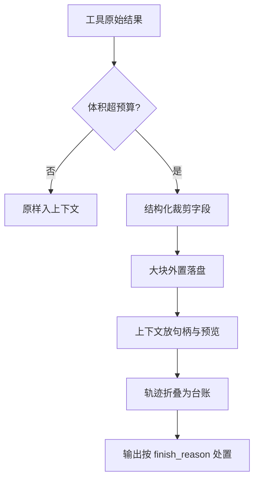
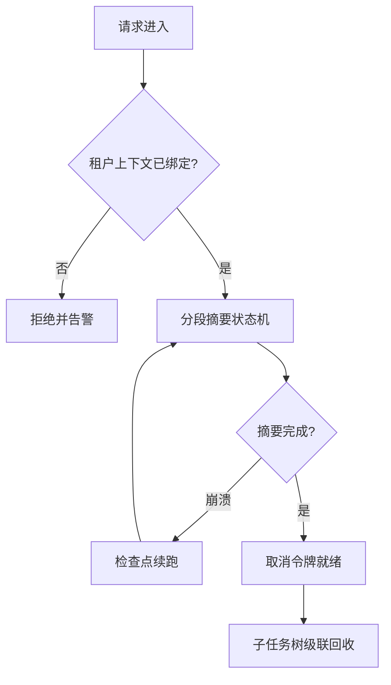
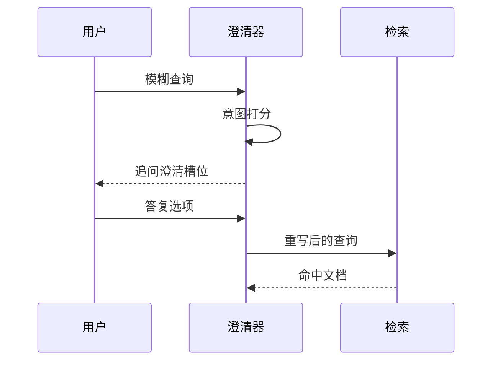
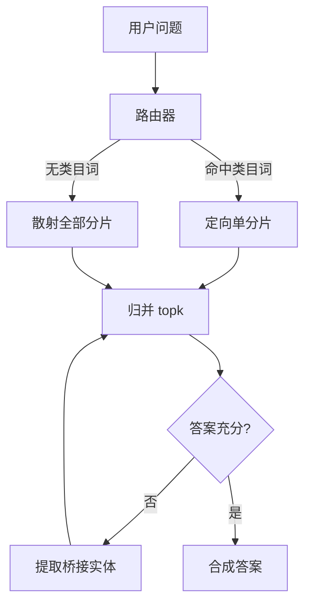
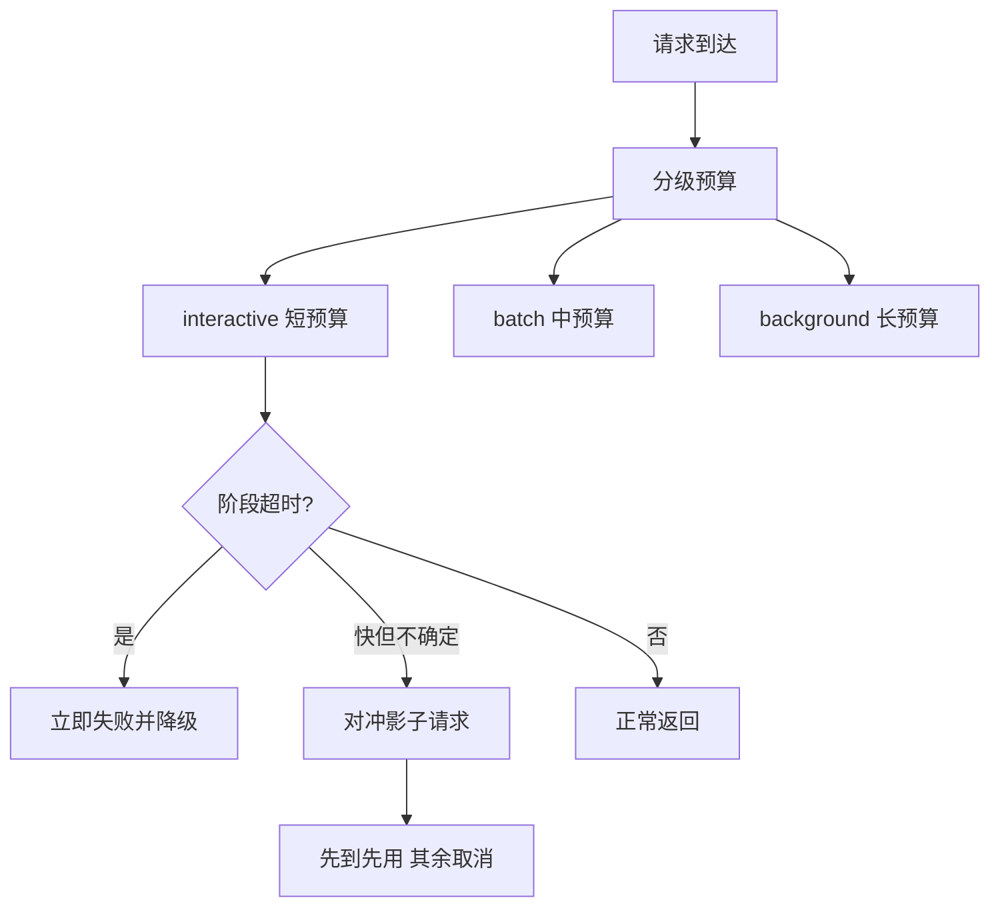
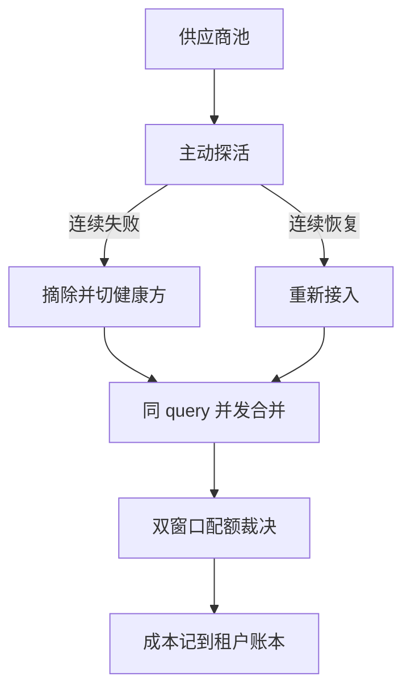
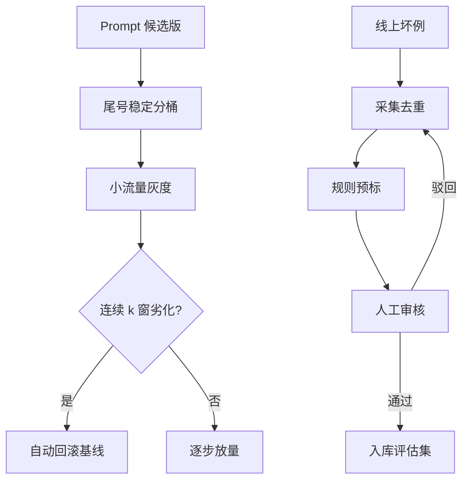
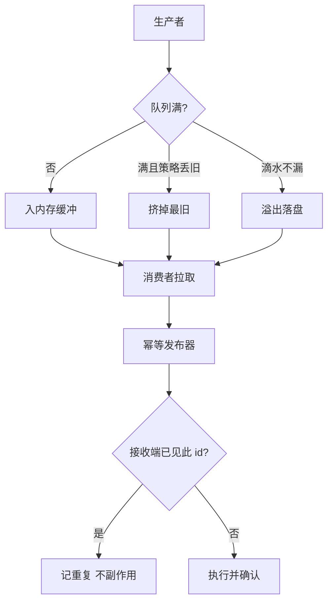
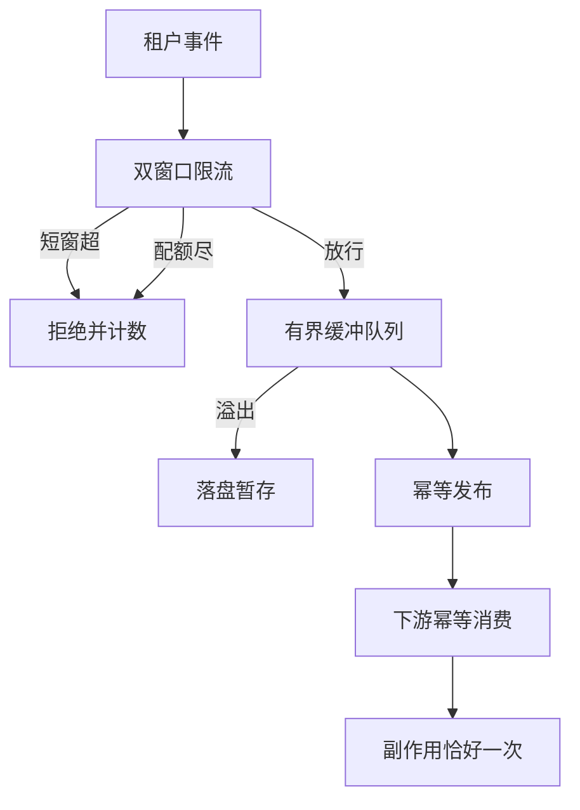

# 第 6 类 · Agent 与 LLM 及系统设计(夜间扩产二)

> 本篇是第 6 类的第二批夜间扩产(Q1751-Q1795 共 45 题),补齐四块工程短板:Agent 侧的工具结果裁剪与外置句柄、轨迹折叠、分段摘要状态机、指令优先级、取消传播与租户串号防护;RAG 侧的澄清追问流、多跳检索、表格检索、过滤前置、分片路由与冲突标注;LLM 运维侧的分级超时、对冲请求、健康度探测、singleflight 合并、双窗口配额、成本归因与 Prompt 灰度回滚、坏例回流;系统设计侧的幂等发布器、反压与落盘队列、滑动日志持久化与分桶近似、扫描任务去重、租约状态机、读修复与默克尔反熵。
> 全部代码仅标准库、可独立运行,LLM 一律用 FakeLLM/stub 桩,向量检索用假嵌入加余弦,时钟用假时钟推进,不联网不睡大觉。
> 学习建议:每题先说清"不这样做会出什么事故",再讲机制,最后落到可验证的断言——面试官要的不是名词,是行为证据。

### Q1751 · 工具结果结构化裁剪:字段优先级与预算感知

> 难度:★★★☆ | 标签:Agent, 上下文预算, 工具结果

**问**:工具返回一个很大的 JSON,直接塞给模型会撑爆上下文,你怎么裁剪才不会裁掉关键信息?

**答**:结构化结果要按字段裁剪而不是按字符硬砍。做法是给每类工具维护一张字段优先级表:标识类字段如 id、url 永远保留,摘要类次之,全文与扩展推荐这类体积大信息密度低的字段最后。裁剪时按优先级从高到低累加成本,预算内就保留,放不下就整字段丢弃,并把被丢字段名写进结果里的 _dropped 标记,让模型明确知道信息不完整,可以主动要求取回。这比文本截断好在对模型保留的是完整字段而不是被腰斩的半句话,而且丢弃决策可审计、可单测。

```python
# file: code/06_Agent与LLM及系统设计/q1751_tool_result_trim.py
"""工具结果结构化裁剪:按字段优先级在预算内保留,丢掉的字段登记进 _dropped。"""
import json

FIELD_PRIORITY = {
    "web_search": {"title": 0, "url": 0, "snippet": 1, "content": 2, "related": 3},
    "db_query": {"rows": 0, "count": 1, "schema": 2, "debug": 3},
}


def est_chars(value):
    return len(value) if isinstance(value, str) else len(json.dumps(value, ensure_ascii=False))


class ToolResultTrimmer:
    def __init__(self, budget):
        self.budget = budget

    def trim(self, tool, result):
        prio = FIELD_PRIORITY.get(tool, {})
        keys = sorted(result, key=lambda k: (prio.get(k, 9), k))
        kept, dropped, used = {}, [], 0
        for k in keys:
            cost = est_chars(result[k]) + len(k) + 2
            if used + cost <= self.budget:
                kept[k] = result[k]
                used += cost
            else:
                dropped.append(k)
        if dropped:
            kept["_dropped"] = dropped          # 截断标记:模型可感知信息不完整
        return kept, used


if __name__ == "__main__":
    raw = {"title": "退货政策", "url": "https://x/policy", "snippet": "7 天无理由",
           "content": "全文" * 200, "related": ["a", "b", "c", "d"]}

    kept, used = ToolResultTrimmer(budget=70).trim("web_search", raw)
    assert kept["title"] == "退货政策" and kept["snippet"] == "7 天无理由"
    assert kept["_dropped"] == ["content", "related"], "低优先级大字段先被丢"
    assert used <= 70, "预算必须被遵守"

    full, _ = ToolResultTrimmer(budget=4000).trim("web_search", raw)
    assert "_dropped" not in full, "预算充足时不应丢弃任何字段"

    loose, _ = ToolResultTrimmer(budget=70).trim("unknown_tool", {"x": "y"})
    assert loose == {"x": "y"}, "无优先级表时原样保留"
    print("结构化裁剪通过:预算内保高优字段,丢弃登记 _dropped,无表工具不误伤")
```

**追问**:
- 字段优先级表谁来维护? 答:跟工具注册表放一起,注册工具时必须声明字段分级,没声明的按未知处理只兜底不误裁。
- 被丢弃的字段还能找回吗? 答:能,配合外置句柄或游标分页,模型带着 _dropped 标记发起一次显式取回即可。

### Q1752 · 大结果外置句柄:落盘引用与按需取回

> 难度:★★★☆ | 标签:Agent, 外置存储, 上下文

**问**:工具动辄返回几十 KB 的明细,上下文里连塞几条就满了,有什么结构性办法?

**答**:把大结果整体外置:完整 payload 落到制品库,上下文里只放一个轻量句柄,含引用号、原始体积和一小段预览,让模型知道"这里有一份完整明细,需要时按引用取回"。取回必须带租户归属校验,防止用别人会话的句柄跨租户读数据;句柄有生命周期,会话结束统一回收,回收后再取要显式报错而不是静默给旧数据。这个模式把上下文体积从 O(结果大小) 降到 O(句柄大小),是 Agent 处理报表、日志、导出类工具的标准做法。

```python
# file: code/06_Agent与LLM及系统设计/q1752_result_handle.py
"""大结果外置句柄:完整结果落盘,上下文只放句柄与预览,按需取回并校验归属。"""
import hashlib
import json


class ArtifactStore:
    """外置存储桩:put 返回轻量句柄,fetch 按 ref 与租户归属取回片段。"""

    def __init__(self, preview_len=40):
        self.blobs = {}
        self.preview_len = preview_len

    def put(self, tenant, payload):
        raw = payload if isinstance(payload, str) else json.dumps(payload, ensure_ascii=False, sort_keys=True)
        ref = "art-" + hashlib.md5(raw.encode("utf-8")).hexdigest()[:8]
        self.blobs[ref] = {"tenant": tenant, "raw": raw}
        handle = {"ref": ref, "size": len(raw),
                  "preview": raw[:self.preview_len] + "...[已外置,按需取回]"}
        return handle

    def fetch(self, tenant, ref, offset=0, limit=80):
        blob = self.blobs.get(ref)
        if blob is None:
            raise KeyError(ref)
        if blob["tenant"] != tenant:
            raise PermissionError("跨租户取回被拒绝")
        return blob["raw"][offset:offset + limit]

    def cleanup(self, tenant):
        doomed = [r for r, b in self.blobs.items() if b["tenant"] == tenant]
        for r in doomed:
            del self.blobs[r]
        return len(doomed)


if __name__ == "__main__":
    store = ArtifactStore()
    big = "账单明细:" + ",".join("item-%04d" % i for i in range(300))
    handle = store.put("tenant-a", big)

    assert handle["size"] > 2000 and len(handle["preview"]) <= 60, "句柄必须足够轻"
    got = store.fetch("tenant-a", handle["ref"], offset=0, limit=20)
    assert got == big[:20], "按需取回与原文对齐"

    blocked = False
    try:
        store.fetch("tenant-b", handle["ref"])
    except PermissionError:
        blocked = True
    assert blocked, "跨租户取回必须被拒绝"

    assert store.cleanup("tenant-a") == 1
    gone = False
    try:
        store.fetch("tenant-a", handle["ref"])
    except KeyError:
        gone = True
    assert gone, "回收后句柄失效"
    print("外置句柄通过:大结果落盘只留句柄,取回校验租户,回收后句柄失效")
```

**追问**:
- 句柄会误导模型吗? 答:会,所以预览要写得像"指针"而不是"内容",并在预览尾部显式标注已外置,防止模型把预览当全文作答。
- 制品库放哪? 答:生产上放对象存储或数据库大字段,本机演示用内存字典,接口语义一致即可替换。

### Q1753 · Agent 执行轨迹折叠:近详远略台账

> 难度:★★★☆ | 标签:Agent, 轨迹压缩, 上下文

**问**:Agent 跑了几十步,每步的工具结果都要进上下文,越跑越胖,怎么压?

**答**:轨迹压缩用近详远略:最近 N 步保留完整原文,包括完整工具结果,因为模型正在基于它们推理;更早的步骤折叠成一行台账,只留步骤号、动作、参数和"已完成"标记,因为旧结果的信息已经被后续步骤消化。折叠后如果还超预算,再从最旧的台账行开始逐行丢弃,而最近 N 步永不折叠——牺牲最旧信息保最新推理材料。每一级都可独立验证:折了几行、保了几步、最终 token 数,全部进报告可断言。

```python
# file: code/06_Agent与LLM及系统设计/q1753_trajectory_fold.py
"""Agent 轨迹折叠:近 N 步保留原文,更早步骤折叠为一行台账,超预算再丢最旧行。"""
import json


def est_tokens(text):
    return max(1, len(text) // 2)            # 演示用粗估:2 字符 1 token


class TrajectoryFolder:
    """近详远略:verbatim 保留最近 keep_recent 步,旧步骤折叠成单行台账。"""

    def __init__(self, keep_recent=3, budget=10 ** 9):
        self.keep_recent = keep_recent
        self.budget = budget

    def fold(self, steps):
        """steps: [{action, args, result}] 按时间序,返回 (折叠文本, 报告)。"""
        old, recent = steps[:-self.keep_recent], steps[-self.keep_recent:]
        ledger = []
        for i, s in enumerate(old, 1):
            args = ",".join("%s=%s" % kv for kv in s["args"].items())
            ledger.append("步骤%d %s(%s) -> 已完成" % (i, s["action"], args))
        recent_text = [json.dumps(s, ensure_ascii=False) for s in recent]
        while ledger and est_tokens("\n".join(ledger + recent_text)) > self.budget:
            ledger = ledger[1:]                  # 超预算:从最旧的台账行开始丢
        text = "\n".join(ledger + recent_text)
        return text, {"ledger_lines": len(ledger), "verbatim_steps": len(recent)}


if __name__ == "__main__":
    steps = [{"action": "search", "args": {"q": "q%d" % i},
              "result": "结果" * 10} for i in range(8)]

    text, rep = TrajectoryFolder(keep_recent=3).fold(steps)
    assert rep == {"ledger_lines": 5, "verbatim_steps": 3}
    assert "步骤1 search(q=q0) -> 已完成" in text, "旧步骤折叠为台账行"
    assert '"result"' in text, "近 3 步保留完整工具结果"

    text2, rep2 = TrajectoryFolder(keep_recent=3, budget=130).fold(steps)
    assert rep2["ledger_lines"] < rep["ledger_lines"], "超预算时台账逐行丢弃"
    assert rep2["verbatim_steps"] == 3, "最近步骤永不折叠"
    assert est_tokens(text2) <= 130
    print("轨迹折叠通过:5 行台账加 3 步原文,紧预算再丢最旧行,近端永不折叠")
```

**追问**:
- 为什么不把最近几步也摘要掉? 答:最近几步的工具结果是模型当前推理的直接依据,摘要会丢数值与引用,宁丢旧不丢新。
- 台账和对话摘要的关系? 答:台账管工具步骤,对话摘要管自然语言轮次,两者通常在上下文装配器里各占一段预算。

### Q1754 · 多工具结果合并去重:实体归并与来源标记

> 难度:★★★☆ | 标签:Agent, 结果融合, 去重

**问**:同时调了网页搜索和内部知识库,两边返回了重叠甚至矛盾的条目,怎么合成一份干净列表?

**答**:合并的核心是找规范键:同一实体的两个来源往往 URL 只差 query 参数或尾部斜杠,先做 URL 规范化再归并。归并时保留合并来源列表,让下游知道这条结果被几个渠道佐证;分数字段择优保留,标题跟最高分走,保证展示一致性。归并后条目数下降、每个条目携带 sources 数组,既是去重也是置信度信号——多来源一致的条目排序时可以加权。

```python
# file: code/06_Agent与LLM及系统设计/q1754_merge_tool_results.py
"""多工具结果合并去重:按规范键归并实体,保留来源标记,分数字段择优。"""


def norm_url(url):
    return url.split("?")[0].rstrip("/").lower()


class ResultMerger:
    def __init__(self):
        self.by_key = {}
        self.order = []

    def add(self, source, items):
        """items: [{url, title, score}],按规范化 url 归并,同实体多来源合并。"""
        for it in items:
            key = norm_url(it["url"])
            if key not in self.by_key:
                self.by_key[key] = {"title": it["title"], "score": it["score"],
                                    "sources": [source]}
                self.order.append(key)
                continue
            merged = self.by_key[key]
            if source not in merged["sources"]:
                merged["sources"].append(source)
            if it["score"] > merged["score"]:
                merged["score"] = it["score"]
                merged["title"] = it["title"]
        return len(items)

    def merged(self):
        return [{"url": k, **self.by_key[k]} for k in self.order]


if __name__ == "__main__":
    web = [{"url": "https://a.com/doc?id=1", "title": "A 文档", "score": 0.9},
           {"url": "https://b.com/page/", "title": "B 页面", "score": 0.7}]
    kb = [{"url": "https://a.com/doc?id=1&from=kb", "title": "A 文档(知识库)", "score": 0.8},
          {"url": "https://c.com/note", "title": "C 笔记", "score": 0.6}]

    m = ResultMerger()
    m.add("web", web)
    m.add("kb", kb)
    out = m.merged()
    assert len(out) == 3, "4 条原始结果去重为 3 个实体"
    a = [x for x in out if x["url"] == "https://a.com/doc"][0]
    assert a["sources"] == ["web", "kb"], "同实体来源必须合并标记"
    assert a["title"] == "A 文档" and a["score"] == 0.9, "分数择优,标题跟最优走"
    assert "https://b.com/page" in [x["url"] for x in out], "尾部斜杠被规范化"
    print("多工具合并通过:4 条去重为 3 条,来源标记合并,分数与标题择优保留")
```

**追问**:
- 规范键不对怎么办,比如两边给的不是 URL? 答:换实体键,如标题归一化哈希或数据库主键,归并器只要求提供一个可比较的 key 函数。
- 矛盾内容怎么处理? 答:分数字段择优,语义字段冲突留给上层做冲突标注,合并器只负责归并不负责裁决。



### Q1755 · 输出长度截断策略:finish_reason 分级处置

> 难度:★★☆☆ | 标签:LLM, 输出截断, 降级

**问**:模型输出被 max_tokens 截断了,finish_reason 是 length,你怎么处理?

**答**:先分级:reason 是 stop 就直接用;是 length 则进入处置流程,首选带尾部上下文发续写请求,把片段拼回去,续写次数要有上限防止无限拼;续写预算花完仍是 length,就必须做安全截断——回退到最后一个句子边界,补一个明确的截断标记,而不是让句子断在半截被下游当完整答案消费。要点是"截断是可感知状态":调用方拿到 truncated 标记,可以决定重试、改问题或告知用户,而不是收到一份悄悄缺尾的答案。

```python
# file: code/06_Agent与LLM及系统设计/q1755_output_truncation.py
"""输出截断策略:finish_reason=length 时续写拼接,超续写预算后句子边界安全截断。"""


class FakeLLM:
    """续写桩:响应被拆成若干段,首段由调用方持有,可注入永远 length 的故障。"""

    def __init__(self, chunks, always_length=False):
        self.chunks = chunks
        self.calls = 0
        self.always_length = always_length

    def continue_(self, tail):
        idx = self.calls + 1                  # 段号:首段由调用方持有
        self.calls += 1
        if idx >= len(self.chunks):
            idx = len(self.chunks) - 1
        if self.always_length:
            reason = "length"
        else:
            reason = "stop" if idx == len(self.chunks) - 1 else "length"
        return {"text": self.chunks[idx], "finish_reason": reason}


class OutputPolicy:
    def __init__(self, llm, max_extra_calls=3):
        self.llm = llm
        self.max_extra_calls = max_extra_calls

    def resolve(self, first_text, first_reason):
        text, reason = first_text, first_reason
        extra = 0
        while reason == "length" and extra < self.max_extra_calls:
            nxt = self.llm.continue_(text[-20:])     # 带尾部上下文续写
            text += nxt["text"]
            reason = nxt["finish_reason"]
            extra += 1
        if reason == "length":                        # 续写预算耗尽仍不够
            return self._safe_cut(text) + "\n[输出因长度预算截断]", "truncated"
        return text, "complete"

    @staticmethod
    def _safe_cut(text):
        idx = max(text.rfind("。"), text.rfind("!"), text.rfind("\n"))
        return text[:idx + 1] if idx >= 0 else text


if __name__ == "__main__":
    llm1 = FakeLLM(["第一段。", "第二段完。"])
    out1, st1 = OutputPolicy(llm1).resolve("第一段。", "length")
    assert st1 == "complete" and out1 == "第一段。第二段完。"

    llm2 = FakeLLM(["x" * 50, "y" * 50, "z" * 50], always_length=True)
    out2, st2 = OutputPolicy(llm2, max_extra_calls=2).resolve("开头句。", "length")
    assert st2 == "truncated" and out2.endswith("[输出因长度预算截断]")
    assert out2.count("[输出因长度预算截断]") == 1
    assert out2.startswith("开头句。"), "安全截断停在句子边界"
    print("输出截断策略通过:续写拼接可完成,超预算走句子边界截断并带可感知标记")
```

**追问**:
- 为什么续写要带尾部 20 字? 答:续写请求不重发全文,只带尾部让模型衔接语气与未完成句,成本最低且足够对齐。
- 截断标记会不会污染下游? 答:标记是协议的一部分,下游解析器认识它并据此路由到重试或人工,不认识标记的旧下游也能看到不完整提示。

### Q1756 · 超长对话分段摘要状态机:可恢复滚动摘要

> 难度:★★★★ | 标签:Agent, 摘要, 状态机

**问**:一段几百轮的对话要做整体摘要,一次喂给模型塞不下,怎么工程化?

**答**:把它做成状态机驱动的分段流水线:idle、chunking、summarizing、merging、done 五个状态,chunking 把轮次切成固定窗,summarizing 逐窗调摘要并每完成一块就落检查点,merging 把各块摘要再合并成终稿。关键在检查点语义:崩溃后从 next_chunk 续跑,已完成的块绝不重算,所以 LLM 摘要调用总数恒等于块数,既省成本又保证幂等。状态字段随检查点一起持久化,任何时刻崩溃都能回答"我进行到哪了",这是长任务可靠性的最低要求。

```python
# file: code/06_Agent与LLM及系统设计/q1756_summary_state_machine.py
"""超长对话分段摘要状态机:分窗摘要逐块落检查点,崩溃后从断点续跑不重复。"""


class FakeLLM:
    """摘要桩:块摘要与合并都不联网;可注入故障模拟进程崩溃。"""

    def __init__(self, fail_after=None):
        self.summarize_calls = 0
        self.fail_after = fail_after

    def summarize(self, text):
        if self.fail_after is not None and self.summarize_calls >= self.fail_after:
            self.fail_after = None              # 一次性故障:崩溃重启后恢复
            raise RuntimeError("simulated crash")
        self.summarize_calls += 1               # 只计成功调用
        return "摘%d[%s]" % (self.summarize_calls, text[:6])

    def merge(self, parts):
        return "MERGE(" + "|".join(parts) + ")"


class SegmentedSummarizer:
    """状态机:idle -> chunking -> summarizing -> merging -> done,检查点贯穿始终。"""

    def __init__(self, llm, window=2, checkpoint=None):
        self.llm = llm
        self.window = window
        self.cp = checkpoint or {"state": "idle", "summaries": [], "next_chunk": 0}

    def run(self, turns):
        self.cp["state"] = "chunking"
        chunks = [",".join(turns[i:i + self.window])
                  for i in range(0, len(turns), self.window)]
        self.cp["state"] = "summarizing"
        while self.cp["next_chunk"] < len(chunks):
            i = self.cp["next_chunk"]
            summary = self.llm.summarize(chunks[i])   # 崩溃点:抛异常即中断
            self.cp["summaries"].append(summary)      # 成功即落盘,永不重算
            self.cp["next_chunk"] = i + 1
        self.cp["state"] = "merging"
        final = self.llm.merge(self.cp["summaries"])
        self.cp["state"] = "done"
        return final


if __name__ == "__main__":
    turns = ["用户问%d" % i for i in range(9)]        # 9 轮 -> 5 个窗口
    llm = FakeLLM(fail_after=2)
    sm = SegmentedSummarizer(llm, window=2)
    crashed = False
    try:
        sm.run(turns)
    except RuntimeError as e:
        crashed = str(e) == "simulated crash"
    assert crashed, "注入的崩溃必须原样抛出"
    assert sm.cp["state"] == "summarizing" and sm.cp["next_chunk"] == 2
    assert len(sm.cp["summaries"]) == 2, "已完成的 2 块已在检查点"

    final = sm.run(turns)                              # 同检查点续跑
    assert sm.cp["state"] == "done"
    assert llm.summarize_calls == 5, "总摘要调用数恰为块数,绝无重算"
    assert final.startswith("MERGE") and final.count("|") == 4

    fresh = SegmentedSummarizer(FakeLLM(), window=2).run(turns)
    assert fresh == final, "无故障路径与断点续跑结果一致"
    print("分段摘要状态机通过:崩溃停在 summarizing,续跑只补 3 块,结果一致")
```

**追问**:
- 检查点存哪里? 答:与任务记录同库同事务,摘要块和 next_chunk 必须原子更新,否则会出现"摘要写了但游标没走"的重复块。
- 窗口怎么定? 答:按 token 预算切窗而不是按轮数,留出系统提示与终稿合并的空间。

### Q1757 · 指令优先级冲突仲裁:三层裁决器

> 难度:★★★☆ | 标签:Agent, 指令系统, 治理

**问**:system prompt 说输出中文,用户偏要求英文,产品又有一层运营配置,听谁的?

**答**:把所有指令建模为带层级的条目:system 高于 developer 高于 user,同一语义标签 tag 下按层级裁决,低层级恒胜。同层冲突不抢占,保持先到并留痕,避免后注册的配置悄悄覆盖先注册的;每一次压制与覆盖都写进 overridden 列表,审计时能回答"为什么这条指令没生效"。裁决器产出的是最终生效指令表,模型上下文只装配胜出指令,被压制的根本不进上下文,而不是靠模型自己"听话"去忽略。

```python
# file: code/06_Agent与LLM及系统设计/q1757_instruction_priority.py
"""指令优先级冲突仲裁:system 覆盖 developer 覆盖 user,同层不抢占,冲突留痕。"""

LEVELS = {"system": 0, "developer": 1, "user": 2}


class InstructionResolver:
    """同 tag 的指令按层级裁决:低 level 恒胜,被压制的指令记入 overridden。"""

    def __init__(self):
        self.won = {}
        self.overridden = []

    def submit(self, level, tag, text):
        assert level in LEVELS, "未知指令层级"
        cand = {"level": level, "rank": LEVELS[level], "text": text}
        cur = self.won.get(tag)
        if cur is None:
            self.won[tag] = cand
            return "accepted"
        if cand["rank"] < cur["rank"]:
            self.overridden.append({"tag": tag, "loser": cur, "winner": cand})
            self.won[tag] = cand
            return "overrides"
        self.overridden.append({"tag": tag, "loser": cand, "winner": cur})
        return "suppressed"                      # 同层或更低:不抢占

    def resolve(self):
        return {t: c["text"] for t, c in self.won.items()}


if __name__ == "__main__":
    r = InstructionResolver()
    assert r.submit("system", "language", "全程使用中文") == "accepted"
    assert r.submit("user", "language", "请用英文回答") == "suppressed"
    assert r.submit("developer", "language", "输出面向开发者") == "suppressed"
    assert r.submit("user", "length", "回答尽量简短") == "accepted"
    assert r.submit("developer", "length", "长度按开发者规范") == "overrides"
    assert r.resolve() == {"language": "全程使用中文", "length": "长度按开发者规范"}
    assert len(r.overridden) == 3, "每次压制与覆盖都要留痕"
    assert all(i["winner"]["rank"] <= i["loser"]["rank"] for i in r.overridden)
    print("指令仲裁通过:system 恒胜 user,同层不抢占,全部裁决可审计")
```

**追问**:
- 为什么同层不抢占? 答:同层来自同一责任方,先后顺序代表配置加载序,抢占会让配置文件里两行的相对位置变成隐含语义,排查极难。
- tag 怎么定? 答:按意图定,如 language、tone、tool_policy,tag 粒度太细裁决不到冲突,太粗会误伤不相关指令。

### Q1758 · 任务取消的资源回收:取消令牌与登记簿

> 难度:★★☆☆ | 标签:Agent, 取消, 资源管理

**问**:用户中途取消了一个跑了一半的 Agent 任务,它开着的连接、临时文件谁来关?

**答**:两件套:协作式取消令牌加资源登记簿。令牌在任务每步循环前检查,取消后任务尽快自然退出而不是被硬杀;任务运行期每开一个资源就往登记簿注册一个关闭动作,函数无论从哪条路径退出——正常结束、检测到取消、工具抛异常——都在 finally 里触发登记簿逆序释放,后开先关符合资源依赖。令牌的 cancel 要幂等,首个取消原因保留,重复取消不改写原因,否则排查时看到的取消理由可能是最后一次而不是真实原因。

```python
# file: code/06_Agent与LLM及系统设计/q1758_cancel_cleanup.py
"""任务取消的资源回收:协作式取消令牌 + 资源登记簿,三条退出路径都兜底释放。"""


class CancelToken:
    def __init__(self):
        self._cancelled = False
        self.reason = None

    def cancel(self, reason="user requested"):
        if not self._cancelled:                  # 幂等:首个原因生效
            self._cancelled = True
            self.reason = reason

    @property
    def cancelled(self):
        return self._cancelled


class ResourceRegistry:
    """登记簿:逆序释放,后开先关,符合资源依赖顺序。"""

    def __init__(self):
        self.items = []

    def register(self, name, closer):
        self.items.append((name, closer))

    def close_all(self):
        closed = []
        while self.items:
            name, closer = self.items.pop()
            closer(name)
            closed.append(name)
        return closed


def run_task(token, registry, n_steps, cleanup_log, cancel_at=None, fail_at=None):
    try:
        for i in range(n_steps):
            if token.cancelled:                  # 协作式:每步前检查令牌
                break
            registry.register("res-%d" % i, lambda name: cleanup_log.append(name))
            if i == cancel_at:
                token.cancel("预算耗尽")
            if i == fail_at:
                raise RuntimeError("tool boom")
    finally:
        registry.close_all()
    return "cancelled" if token.cancelled else "done"


if __name__ == "__main__":
    tk, rg, log1 = CancelToken(), ResourceRegistry(), []
    assert run_task(tk, rg, 4, log1, cancel_at=2) == "cancelled"
    assert tk.reason == "预算耗尽"
    assert log1 == ["res-2", "res-1", "res-0"], "取消后已登记资源逆序全释放"
    tk.cancel("重复取消")
    assert tk.reason == "预算耗尽", "取消幂等:首个原因保留"

    tk2, rg2, log2 = CancelToken(), ResourceRegistry(), []
    blew = False
    try:
        run_task(tk2, rg2, 4, log2, fail_at=2)
    except RuntimeError:
        blew = True
    assert blew and log2 == ["res-2", "res-1", "res-0"], "异常路径同样释放全部资源"

    tk3, rg3, log3 = CancelToken(), ResourceRegistry(), []
    assert run_task(tk3, rg3, 3, log3) == "done"
    assert log3 == ["res-2", "res-1", "res-0"], "正常结束也统一释放"
    print("资源回收通过:取消 异常 正常三条路径都触发登记簿逆序释放")
```

**追问**:
- 为什么要协作式而不是直接杀线程? 答:硬杀发生在任意字节码边界,资源清理代码可能没跑到,协作式让任务在安全点自己退出。
- 登记簿和 try/finally 什么关系? 答:finally 是触发点,登记簿解决的是"开资源的代码散落在多层调用里,单一 finally 摸不到全部句柄"的问题。

### Q1759 · 取消的级联传播:子任务树协同终止

> 难度:★★★☆ | 标签:Agent, 取消传播, 多子任务

**问**:父任务取消了,它派生的多个子 Agent 还在跑,怎么保证整棵任务树一起停下来?

**答**:把任务建成树,取消沿树深度优先传播:父节点 cancel 先递归取消全部子节点,再回收自身资源,顺序保证叶子资源最先释放、根最后收尾,避免子任务还持着父级给它的句柄。取消必须幂等,重复 cancel 直接跳过,原因是编排层和业务层可能各触发一次;取消原因沿树传递,所有节点看到同一个终止原因,审计时整树对得上。子任务在运行循环里同样检查自己的 cancelled 标记,实现协作式停止。

```python
# file: code/06_Agent与LLM及系统设计/q1759_cascade_cancel.py
"""父任务取消级联传播:子任务树先于父级回收,取消原因沿树传递,取消幂等。"""


class TaskNode:
    def __init__(self, name, parent=None):
        self.name = name
        self.parent = parent
        self.children = []
        self.cancelled = False
        self.reason = None
        self.cleanups = []                       # 该节点持有的资源清理动作
        if parent is not None:
            parent.children.append(self)

    def cancel(self, reason="parent cancelled"):
        if self.cancelled:
            return False                         # 幂等:重复取消跳过
        self.cancelled = True
        self.reason = reason
        for child in self.children:              # 先孩子后自己
            child.cancel(reason)
        for fn in self.cleanups:
            fn(self.name)
        return True


if __name__ == "__main__":
    events = []
    root = TaskNode("root")
    sub_a = TaskNode("sub-a", parent=root)
    leaf1 = TaskNode("leaf-1", parent=sub_a)
    leaf2 = TaskNode("leaf-2", parent=sub_a)
    sub_b = TaskNode("sub-b", parent=root)
    for node in (root, sub_a, leaf1, leaf2, sub_b):
        node.cleanups.append(lambda name: events.append("cleanup:" + name))

    assert root.cancel("超时终止") is True
    assert root.cancel("重复取消") is False, "取消必须幂等"
    assert all(n.cancelled and n.reason == "超时终止"
               for n in (root, sub_a, sub_b)), "原因沿树传递到每个节点"
    assert events[0].startswith("cleanup:leaf"), "叶子资源最先回收"
    assert events[-1] == "cleanup:root", "根节点最后收尾"
    assert events.index("cleanup:leaf-1") < events.index("cleanup:sub-a") < events.index("cleanup:root")

    late = TaskNode("late-child", parent=root)   # 已取消父节点下新挂子任务
    assert late.cancelled is False, "级联只在取消时刻传播一次"
    late.cancel()
    assert late.cancelled
    print("级联取消通过:子树先回收 根最后 幂等重复取消被跳过")
```

**追问**:
- 取消时正在调用外部 API 怎么办? 答:API 调用不可中断,等它返回后在下一步循环检查点退出,同时该次调用的副作用由业务幂等键兜底。
- 新挂的子任务会不会漏? 答:会,所以编排器在派发前检查父级取消状态,已取消的父节点拒绝再派生新子任务。

### Q1760 · Agent 会话串号防护:租户上下文绑定

> 难度:★★★☆ | 标签:Agent, 多租户, 安全

**问**:一个服务同时服务多个租户的会话,怎么保证 A 租户的 Agent 绝对读不到 B 租户的会话?

**答**:串号防护的核心是把租户身份绑进执行上下文而不是靠参数传递:所有会话读写都从当前上下文取租户,存储键是租户加会话号二元组,取数时强制校验上下文租户与记录归属一致。上下文缺失视为致命错误直接拒绝,绝不默认成某个租户,因为"默认"正是串号事故的头号来源;上下文进入退出要支持嵌套并自动恢复外层值,中间件层层包裹也不漏。这样即使某个工具实现忘了传 tenant 参数,底层存储仍然拒绝放行。

```python
# file: code/06_Agent与LLM及系统设计/q1760_tenant_binding.py
"""Agent 会话串号防护:租户身份绑定执行上下文,跨租户访问会话一律拒绝。"""
import threading


class TenantContext:
    """基于线程局部量的租户上下文,with 进入退出,嵌套自动恢复。"""

    _local = threading.local()

    @classmethod
    def current(cls):
        return getattr(cls._local, "tenant", None)

    def __init__(self, tenant):
        self.tenant = tenant
        self._prev = None

    def __enter__(self):
        self._prev = getattr(TenantContext._local, "tenant", None)
        TenantContext._local.tenant = self.tenant
        return self

    def __exit__(self, *exc):
        TenantContext._local.tenant = self._prev
        return False


class SessionStore:
    """会话存储:键为 租户加会话号,读写强制要求并校验当前上下文租户。"""

    def __init__(self):
        self.data = {}

    def _must_tenant(self):
        tenant = TenantContext.current()
        assert tenant, "会话读写必须在租户上下文内"
        return tenant

    def put(self, session_id, value):
        self.data[(self._must_tenant(), session_id)] = value

    def get(self, session_id):
        key = (self._must_tenant(), session_id)
        if key not in self.data:
            raise KeyError(session_id)
        return self.data[key]


if __name__ == "__main__":
    store = SessionStore()
    with TenantContext("tenant-a"):
        store.put("s1", {"cart": ["book"]})
    with TenantContext("tenant-b"):
        store.put("s1", {"cart": ["pen"]})

    with TenantContext("tenant-a"):
        assert store.get("s1")["cart"] == ["book"], "A 读到的必须是 A 的会话"
    with TenantContext("tenant-b"):
        assert store.get("s1")["cart"] == ["pen"], "同键不同租户互不可见"

    blocked = False
    with TenantContext("tenant-b"):
        try:
            with TenantContext(None):            # 模拟中间件漏配租户
                store.get("s1")
        except AssertionError:
            blocked = True
    assert blocked, "无租户上下文的访问必须被拒绝,绝不默认"

    with TenantContext("tenant-a"):
        missing = False
        try:
            store.get("s-not-exist")
        except KeyError:
            missing = True
        assert missing
    print("租户绑定通过:同会话号按租户隔离,漏配租户直接拒绝,杜绝串号")
```

**追问**:
- 异步框架里 threading.local 失效怎么办? 答:换 contextvars.ContextVar,它跟随任务协程传播,接口语义与本例一致。
- 为什么不在每个工具函数里加 tenant 参数? 答:参数靠人传总会漏,上下文绑定是结构性防线,参数只是入口的一部分。



### Q1761 · 工具 mock 层设计:脚本化应答与调用断言

> 难度:★☆☆☆ | 标签:Agent, 测试, mock

**问**:测 Agent 逻辑时不想真调工具,怎么搭一个可靠的工具 mock 层?

**答**:mock 层只需要三件事:脚本化应答、调用记录、断言接口。given 按工具名预设一串响应,call 按序弹出,弹完再调就显式报错,防止测试悄悄偏离剧本;所有调用按工具名加参数记录,事后可以断言"搜索工具确实以这个 query 被调了一次";响应串里允许放异常实例,弹出时抛出,专门驱动 Agent 的降级分支。被测 Agent 只依赖工具层的 call 接口,mock 与真实实现可互换,这就是测试替身的全部价值。

```python
# file: code/06_Agent与LLM及系统设计/q1761_tool_mock.py
"""工具 mock 层:脚本化应答按序弹出,记录调用参数,支持计数断言与异常脚本。"""


class MockToolLayer:
    def __init__(self):
        self.scripts = {}                        # tool -> [response 或 Exception 实例]
        self.calls = []                          # 记录 (tool, args)

    def given(self, tool, responses):
        self.scripts[tool] = list(responses)

    def call(self, tool, args):
        self.calls.append((tool, dict(args)))
        if tool not in self.scripts or not self.scripts[tool]:
            raise AssertionError("mock 未配置脚本: " + tool)
        item = self.scripts[tool].pop(0)
        if isinstance(item, Exception):
            raise item
        return item

    def assert_called_with(self, tool, args):
        assert (tool, args) in self.calls, "工具 %s 未以 %s 被调用" % (tool, args)

    def call_count(self, tool):
        return sum(1 for t, _ in self.calls if t == tool)


class AgentStub:
    """被测 Agent:只依赖工具层接口,mock 与真实工具可互换。"""

    def __init__(self, tools):
        self.tools = tools

    def answer(self, q):
        try:
            hits = self.tools.call("search", {"q": q})
        except TimeoutError:
            return "搜索超时,请稍后再试"
        return "答案:" + hits["top"]


if __name__ == "__main__":
    mock = MockToolLayer()
    mock.given("search", [{"top": "北京 明 8 度"}, TimeoutError("slow"), {"top": "上海 雨"}])
    agent = AgentStub(mock)

    assert agent.answer("北京天气") == "答案:北京 明 8 度"
    assert agent.answer("北京天气") == "搜索超时,请稍后再试", "异常脚本驱动降级分支"
    mock.assert_called_with("search", {"q": "北京天气"})
    assert mock.call_count("search") == 2
    assert mock.scripts["search"] == [{"top": "上海 雨"}], "未消费的脚本保留"
    print("工具 mock 层通过:应答按序弹出 异常脚本可注入 计数与参数可断言")
```

**追问**:
- mock 脚本耗尽还该报错吗? 答:必须报错,静默返回会让测试在剧本之外继续跑出不可复现的假通过。
- 和录制回放什么关系? 答:mock 适合单元测试的精确剧本,录制回放适合集成测试还原真实工具行为,两者互补。

### Q1762 · 工具桩录制回放:真实响应录制与离线重放

> 难度:★★★☆ | 标签:Agent, 测试, 录制回放

**问**:想让集成测试用真实工具跑一遍然后离线复现,怎么做录制回放?

**答**:录制模式包裹真实工具,每次调用的工具名、规范化参数、结果都写进卡带;切换到回放模式后,同参数调用直接命中卡带返回录制结果,完全不再执行真实工具,副作用计数为零。参数要先做规范化排序哈希再作键,否则 dict 键序不同就命中失败;卡带未命中的调用必须显式报错,绝不能伪造一个结果糊弄过去,否则回放测试会给出错误置信。这套机制让依赖外部系统的集成测试可以离线重复跑,也是调试生产问题"先录一段回来本地复现"的基础。

```python
# file: code/06_Agent与LLM及系统设计/q1762_record_replay.py
"""工具录制回放:真实执行时写卡带,回放时同参数直接命中,不产生副作用。"""
import json


def canon(args):
    return json.dumps(args, sort_keys=True, ensure_ascii=False)


class ToolRecorder:
    def __init__(self, real_tools):
        self.real = real_tools
        self.cassette = {}
        self.mode = "record"
        self.executed = 0

    def call(self, tool, args):
        key = tool + "::" + canon(args)
        if self.mode == "replay":
            if key not in self.cassette:
                raise KeyError("卡带无此调用: " + key)
            return self.cassette[key]["result"]
        self.executed += 1
        result = self.real[tool](args)
        self.cassette[key] = {"tool": tool, "args": canon(args), "result": result}
        return result

    def to_replay(self):
        self.mode = "replay"


def real_tools():
    return {"query_db": lambda a: {"rows": [a["sql"]], "cost": 42}}


if __name__ == "__main__":
    live = ToolRecorder(real_tools())
    r1 = live.call("query_db", {"sql": "select 1"})
    r2 = live.call("query_db", {"sql": "select 2"})
    assert live.executed == 2 and live.mode == "record"
    assert r1 == {"rows": ["select 1"], "cost": 42}

    live.to_replay()                             # 切换为离线回放
    p1 = live.call("query_db", {"sql": "select 1"})
    p2 = live.call("query_db", {"sql": "select 2"})
    assert live.executed == 2, "回放绝不触发真实执行"
    assert p1 == r1 and p2 == r2, "回放结果与录制逐字段一致"
    assert len(live.cassette) == 2

    miss = False
    try:
        live.call("query_db", {"sql": "select 3"})
    except KeyError as e:
        miss = "卡带无此调用" in str(e)
    assert miss, "未录制过的调用必须显式失败而不是伪造"
    print("录制回放通过:2 次录制后切回放 0 次执行,未命中显式报错")
```

**追问**:
- 参数规范化做到什么程度? 答:至少排序键与去空白,时间戳类字段要剥掉,否则每次录制都命中不了。
- 真实工具行为变了怎么办? 答:卡带带录制时间戳,过期就重录;卡带也进版本管理,便于对比行为漂移。

### Q1763 · 失败处置路由器:重试 换路 放弃三路决策

> 难度:★★★★ | 标签:Agent, 失败处置, 路由

**问**:Agent 一次执行里工具失败有很多种,全都无脑重试显然不对,决策怎么做?

**答**:先分类再路由:瞬时类错误如超时判可重试,原路退避重试并受重试预算约束;配额、路由类错误判换路,立即切到下一个供应商或工具实现,不浪费重试;参数与政策类错误判放弃,直接终止并带原因上抛。未知错误保守处理先换路,换完还不行才放弃,这样把"重试同一条坏路"和"有路可换却放弃"两类常见浪费都挡住。整条链路的每次尝试都记录成 provider 加结局,事后能回答"为什么最终用了第二家"。

```python
# file: code/06_Agent与LLM及系统设计/q1763_failure_router.py
"""失败处置路由器:按错误类别决定 重试 换路 放弃,重试预算与换路序列双护栏。"""


class QuotaError(Exception):
    pass


RETRYABLE, SWITCH, FATAL = "retryable", "switch", "fatal"


def classify(exc):
    """错误分类:瞬时错误可重试,配额与路由错误应换路,参数错误直接放弃。"""
    if isinstance(exc, TimeoutError):
        return RETRYABLE
    if isinstance(exc, QuotaError):
        return SWITCH
    if isinstance(exc, ValueError):
        return FATAL
    return SWITCH                                # 未知错误保守处理:先换路


class FailureRouter:
    def __init__(self, providers, max_retries=2):
        self.providers = providers                # 有序换路候选
        self.max_retries = max_retries
        self.attempts = []                        # (provider, outcome)
        self.abandon_reason = None

    def run(self, task, payload):
        for provider in self.providers:
            retries = 0
            while True:
                try:
                    result = task(provider, payload)
                    self.attempts.append((provider, "ok"))
                    return {"result": result, "via": provider}
                except Exception as exc:
                    action = classify(exc)
                    self.attempts.append((provider, action))
                    if action == FATAL:
                        self.abandon_reason = "fatal: " + str(exc)
                        return None
                    if action == RETRYABLE:
                        if retries < self.max_retries:
                            retries += 1
                            continue              # 原路重试,受预算约束
                        self.abandon_reason = "retry budget spent on " + provider
                        return None
                    break                         # 换路:跳出 while 到下一家
        self.abandon_reason = "all providers exhausted"
        return None


def task_for(script):
    def task(provider, payload):
        act = script[provider].pop(0)
        if act == "ok":
            return "done@" + provider
        raise act
    return task


if __name__ == "__main__":
    router1 = FailureRouter(["p1"])
    s1 = {"p1": [TimeoutError("t"), TimeoutError("t"), "ok"]}
    assert router1.run(task_for(s1), {}) == {"result": "done@p1", "via": "p1"}
    assert router1.attempts == [("p1", "retryable"), ("p1", "retryable"), ("p1", "ok")]

    router2 = FailureRouter(["p1", "p2"], max_retries=2)
    s2 = {"p1": [QuotaError("quota")],
          "p2": [TimeoutError("t"), TimeoutError("t"), TimeoutError("t")]}
    assert router2.run(task_for(s2), {}) is None
    assert router2.abandon_reason == "retry budget spent on p2"
    assert router2.attempts == [("p1", "switch"), ("p2", "retryable"),
                                ("p2", "retryable"), ("p2", "retryable")]

    router3 = FailureRouter(["p1", "p2"])
    s3 = {"p1": [ValueError("bad param")], "p2": ["ok"]}
    assert router3.run(task_for(s3), {}) is None
    assert router3.abandon_reason == "fatal: bad param", "致命错误不重试不换路"

    router4 = FailureRouter(["p1", "p2"])
    s4 = {"p1": [RuntimeError("weird")], "p2": ["ok"]}
    assert router4.run(task_for(s4), {}) == {"result": "done@p2", "via": "p2"}
    print("失败路由通过:瞬时重试受预算约束 配额换路 致命放弃,决策全程留痕")
```

**追问**:
- 重试和换路的预算怎么配合? 答:每家供应商有独立重试预算,换路次数由候选列表长度天然限制,总尝试数就是两者乘积上界。
- 分类靠异常类型可靠吗? 答:类型是第一信号,生产上还要叠加错误码与响应体特征,分类器本身要有回归测试。

### Q1764 · 查询澄清追问流:歧义检测与澄清生成

> 难度:★★★☆ | 标签:RAG, 澄清, 对话

**问**:用户问"我想退换",检索到底该走退货还是换货?怎么决定要不要反问一句?

**答**:澄清的触发条件要量化:查询先过意图打分,拿到候选意图分值,如果最高分与次高分差距小于阈值,说明机器无法可靠裁决,与其赌一个错误意图去检索,不如生成一个列出候选选项的澄清问题反问用户;零命中的查询直接放行检索,让检索层自己说"没找到",不制造多余追问。用户答复澄清后,把所选意图作为槽位并入原查询重写,歧义解除再进检索。追问本身有成本,所以阈值宁可略严:猜错意图的检索是浪费两轮,问一句只多一轮。

```python
# file: code/06_Agent与LLM及系统设计/q1764_query_clarify.py
"""查询澄清追问流:意图分差过小视为歧义,生成澄清问题,答复后重写查询。"""

CORPUS_INTENTS = [
    {"intent": "refund", "kw": ["退货", "退款"], "score": 0.0},
    {"intent": "exchange", "kw": ["换货"], "score": 0.0},
]


def intent_scores(query):
    """意图打分桩:命中关键词计分,确定性可复现。"""
    for it in CORPUS_INTENTS:
        it["score"] = sum(1.0 for k in it["kw"] if k in query)
    return CORPUS_INTENTS


class ClarifyFlow:
    AMBIGUOUS_GAP = 1.0                          # top1 与 top2 分差小于该值视为歧义

    def start(self, query):
        cands = sorted(intent_scores(query), key=lambda x: -x["score"])
        top, second = cands[0], cands[1]
        if top["score"] == 0:
            return {"action": "search", "query": query}
        if top["score"] - second["score"] < self.AMBIGUOUS_GAP:
            options = [c["intent"] for c in cands if c["score"] > 0]
            return {"action": "clarify",
                    "question": "您想咨询的是 %s 还是 %s?" % (options[0], options[1]),
                    "options": options, "pending": query}
        return {"action": "search", "query": self.rewrite(query, top["intent"])}

    def resume(self, pending, choice):
        """用户答复澄清后:把所选意图并入查询,歧义解除。"""
        return {"action": "search", "query": self.rewrite(pending, choice)}

    @staticmethod
    def rewrite(query, intent):
        return "[%s] %s" % (intent, query)


if __name__ == "__main__":
    flow = ClarifyFlow()
    r1 = flow.start("我要退货")
    assert r1["action"] == "search" and "refund" in r1["query"], "意图明确直接检索"

    r2 = flow.start("这个能用吗")
    assert r2["action"] == "search" and r2["query"] == "这个能用吗", "零命中不追问"

    r3 = flow.start("退货还是换货好")
    assert r3["action"] == "clarify" and r3["options"] == ["refund", "exchange"]
    r4 = flow.resume(r3["pending"], "exchange")
    assert r4["action"] == "search" and r4["query"] == "[exchange] 退货还是换货好"
    print("澄清流通过:分差小触发追问,答复后槽位并入查询,零命中直接检索")
```

**追问**:
- 阈值怎么校准? 答:用历史会话里"追问后转化率"和"不追问错意图率"两条曲线找交点,阈值是业务参数不是拍脑袋常数。
- 用户答非所问怎么办? 答:答复先过意图打分,答非所问视为新查询重新走主流程,最多追问一轮防止循环。

### Q1765 · 澄清槽位融合:多轮追问的查询重写

> 难度:★★☆☆ | 标签:RAG, 槽位, 对话状态

**问**:一次澄清不够,机票查询要城市日期舱位三个信息,多轮追问的状态怎么管理?

**答**:用槽位表驱动:每个槽位声明追问话术和是否必填,每轮用户输入先过槽位抽取,抽到的填进槽位表且已填槽不覆盖,防止用户改口的中间态互相踩。每轮结束检查必填槽,缺哪个就追问哪个的既定话术,必填槽齐了才把全部槽位拼成完整查询进入检索,可选槽有值就带上、没值不阻塞。这样多轮追问的进度全部落在槽位表里,任何一轮中断都能从表恢复,追问顺序由缺失槽决定而不是写死的流程。

```python
# file: code/06_Agent与LLM及系统设计/q1765_slot_filling.py
"""澄清槽位融合:多轮追问按槽位表逐项填空,必填槽齐了才重写完整查询。"""

SLOT_TABLE = {
    "city": {"ask": "请问查询哪个城市?", "required": True},
    "date": {"ask": "哪一天?", "required": True},
    "grade": {"ask": "经济舱还是商务舱?", "required": False},
}


def extract_slot(turn, known):
    """槽位抽取桩:按 key=value 前缀识别,已填槽不覆盖。"""
    for key in SLOT_TABLE:
        if key in known:
            continue
        for token in turn.split():
            if token.startswith(key + "="):
                return key, token.split("=", 1)[1]
    return None, None


class SlotFillingFlow:
    def __init__(self):
        self.slots = {}

    def feed(self, turn):
        key, val = extract_slot(turn, self.slots)
        if key:
            self.slots[key] = val
        missing = [k for k, v in SLOT_TABLE.items()
                   if v["required"] and k not in self.slots]
        if missing:
            return {"action": "clarify", "question": SLOT_TABLE[missing[0]]["ask"],
                    "missing": missing}
        return {"action": "search", "query": self.full_query()}

    def full_query(self):
        parts = ["机票", self.slots["city"], self.slots["date"]]
        if "grade" in self.slots:
            parts.append(self.slots["grade"])
        return " ".join(parts)


if __name__ == "__main__":
    flow = SlotFillingFlow()
    r1 = flow.feed("city=上海")
    assert r1["action"] == "clarify" and r1["question"] == SLOT_TABLE["date"]["ask"]
    assert r1["missing"] == ["date"]
    r2 = flow.feed("date=周五")
    assert r2 == {"action": "search", "query": "机票 上海 周五"}, "必填槽齐即检索"
    r3 = flow.feed("grade=商务舱")
    assert r3["query"] == "机票 上海 周五 商务舱", "可选槽有值就并入查询"

    flow.feed("city=北京")                        # 已填槽不覆盖
    assert flow.full_query() == "机票 上海 周五 商务舱"
    print("槽位融合通过:必填槽逐项追问,槽齐才检索,可选槽与已填槽规则明确")
```

**追问**:
- 用户想改已填的槽怎么办? 答:改口要走显式更新指令,槽位表支持带版本覆盖并留变更历史,而不是静默覆盖。
- 抽取失败怎么办? 答:抽取不到就重发当前缺失槽的追问,连续失败两轮降级到人工或通用检索。



### Q1766 · 多跳检索编排:子问题分解与迭代召回

> 难度:★★★★ | 标签:RAG, 多跳, 编排

**问**:"Acme 创始人出生城市的人口是多少"这种问题,单次检索根本召不回答案,怎么办?

**答**:多跳检索把问题拆成跳链:第一跳用原查询召回种子文档,从命中句子里抽取桥接实体,比如创始人是谁;第二跳用桥接实体作为新查询继续召回,拿到出生城市;最后一跳用实体加目标属性作查询命中人口数据。编排器用已见集合防止跳回同一文档,跳数有上限,桥接实体抽不出来就提前终止避免空转。最终答案的每一段都来自链上某跳的命中文档,这就是多跳 RAG 的可追溯性优势:链路本身即引用链。

```python
# file: code/06_Agent与LLM及系统设计/q1766_multi_hop.py
"""多跳检索编排:第一跳找桥接实体,第二跳换查询继续召回,链路即引用链。"""
import hashlib
import math


def embed(text, dim=24):
    v = [0.0] * dim
    for tok in text.split():
        v[int(hashlib.md5(tok.encode()).hexdigest(), 16) % dim] += 1.0
    n = math.sqrt(sum(x * x for x in v)) or 1.0
    return [x / n for x in v]


def cosine(a, b):
    return sum(x * y for x, y in zip(a, b))


DOCS = [
    {"id": "d1", "text": "Acme 公司 创始人 是 张三"},
    {"id": "d2", "text": "张三 的 出生地 是 杭州"},
    {"id": "d3", "text": "杭州 的 人口 约 一千万"},
    {"id": "d4", "text": "北京 的 人口 约 两千万"},
    {"id": "d5", "text": "Acme 公司 主营 机器人"},
]


class FakeLLM:
    """桥接实体抽取桩:按句式抽取下一跳实体,离线确定。"""

    @staticmethod
    def extract_entity(text):
        if "创始人" in text:
            return "张三"
        if "出生地" in text:
            return "杭州"
        return None


class MultiHopRetriever:
    def __init__(self, docs, hops=2, topk=1):
        self.vecs = [(d, embed(d["text"])) for d in docs]
        self.hops = hops
        self.topk = topk

    def search(self, query, exclude):
        q = embed(query)
        cands = [(cosine(q, v), d) for d, v in self.vecs if d["id"] not in exclude]
        cands.sort(key=lambda p: -p[0])          # 只按分数排,平分时保序不比字典
        return [d for _, d in cands[:self.topk]]

    def retrieve(self, question):
        seen, chain = set(), []
        query = question
        for hop in range(self.hops):
            hits = self.search(query, seen)
            if not hits:
                break
            seen.add(hits[0]["id"])
            entity = FakeLLM.extract_entity(hits[0]["text"])
            if not entity:
                break
            chain.append({"hop": hop + 1, "query": query,
                          "hit": hits[0]["id"], "entity": entity})
            query = entity                       # 桥接实体成为下一跳查询
        return chain, seen


if __name__ == "__main__":
    retriever = MultiHopRetriever(DOCS, hops=2)
    chain, seen = retriever.retrieve("Acme 公司 创始人 出生 城市 人口")
    assert [c["hit"] for c in chain] == ["d1", "d2"], "链路 d1 创始人 d2 出生地"
    assert chain[0]["entity"] == "张三" and chain[1]["entity"] == "杭州"
    assert seen == {"d1", "d2"}, "已见集合防止跳回旧文档"

    final = retriever.search(chain[-1]["entity"] + " 人口", seen)
    assert final[0]["id"] == "d3", "第三跳命中杭州人口而非北京"
    assert "d4" not in [d["id"] for d in final]
    print("多跳检索通过:两跳拿到桥接实体,末跳命中目标属性,链路可追溯")
```

**追问**:
- 跳数上限怎么定? 答:按问题类型预设,事实型两到三跳,复杂推理类配 plan-and-execute,上限到了宁可返回部分链路并声明未完成。
- 中间跳错了怎么办? 答:链路各跳保留候选而不是只取 top1,后续跳发现召回质量骤降时回溯换候选。

### Q1767 · 表格切块:行级切块与表头继承

> 难度:★★★☆ | 标签:RAG, 表格, 切块

**问**:财报、统计表这种表格数据直接按文本切块,检索出来的行没有列名根本没法用,怎么切?

**答**:表格要按行切块,而且每个行块必须继承表头:块文本由表头行加若干数据行拼接而成,块元数据记录继承的列名与行号区间,这样检索单元自身就是可读的"列名 加 值"组合,嵌入才有语义。行块大小取两三行,既保证单块聚焦又避免一行一块把上下文撑碎;检索命中行块后,行号区间可以直接回指原表,引用时能精确到行。列名拼写归一化与数值列类型标注在切块前完成,否则同一列在检索和聚合时对不上。

```python
# file: code/06_Agent与LLM及系统设计/q1767_table_chunk.py
"""表格检索切块:行级成块,块内继承表头行,检索命中行级事实并可回指原表。"""
import hashlib
import math


def embed(text, dim=24):
    v = [0.0] * dim
    for tok in text.split():
        v[int(hashlib.md5(tok.encode()).hexdigest(), 16) % dim] += 1.0
    n = math.sqrt(sum(x * x for x in v)) or 1.0
    return [x / n for x in v]


def cosine(a, b):
    return sum(x * y for x, y in zip(a, b))


TABLE = {
    "header": ["年份", "季度", "营收"],
    "rows": [
        ["2023", "Q4", "1200 万"],
        ["2024", "Q1", "1500 万"],
        ["2024", "Q2", "1800 万"],
        ["2024", "Q3", "2100 万"],
    ],
}


def chunk_table(table, rows_per_chunk=2):
    header = " ".join(table["header"])
    chunks = []
    for i in range(0, len(table["rows"]), rows_per_chunk):
        part = table["rows"][i:i + rows_per_chunk]
        lines = [header] + [" ".join(r) for r in part]
        chunks.append({"text": "\n".join(lines),
                       "meta": {"header": table["header"],
                                "row_index": [i + j for j in range(len(part))],
                                "header_inherited": True}})
    return chunks


class TableIndex:
    def __init__(self, chunks):
        self.items = [(c, embed(c["text"])) for c in chunks]

    def search(self, query, topk=2):
        q = embed(query)
        ranked = sorted(((cosine(q, v), c) for c, v in self.items), reverse=True)
        return [c for _, c in ranked[:topk]]


if __name__ == "__main__":
    chunks = chunk_table(TABLE, rows_per_chunk=2)
    assert len(chunks) == 2
    assert chunks[1]["meta"]["row_index"] == [2, 3], "块元数据回指原表行号"
    assert chunks[1]["meta"]["header_inherited"] is True
    assert chunks[1]["text"].startswith("年份 季度 营收"), "每块继承表头"

    index = TableIndex(chunks)
    best = index.search("2024 Q3 营收", topk=2)
    assert "2024 Q3 2100 万" in best[0]["text"], "命中正确的行块"
    assert "1200 万" not in best[0]["text"], "不混入其他行的值"
    print("表格切块通过:4 行切成 2 块,块块带表头,检索精确命中行级事实")
```

**追问**:
- 跨行的问题怎么办,比如同比增长? 答:行块只负责召回,跨行计算交给结构化路径,检索层把命中的多行一起交给聚合器。
- 合并单元格怎么处理? 答:切块前做单元格展开,把合并值回填到每一行,元数据里记录来源行号。

### Q1768 · 表格查询路由:数值问题走结构化路径

> 难度:★★★☆ | 标签:RAG, 表格, 路由

**问**:用户问"2024 年营收总和多少",向量检索为什么答不对?该怎么办?

**答**:聚合类数值问题必须走结构化路径:查询里出现求和、平均、最高这类聚合词时,路由器把问题编译成过滤条件加聚合函数,直接在结构化行上做精确计算,数值分毫不差;叙述类问题才走向量检索。原因在于向量检索只会"找相似文本",它能把含 2100 万的那行找出来,但不会把四行加起来,硬让生成模型从检索片段里做算术,错一个数就是线上事故。路由不准宁可走结构化空结果,也不要让模型编数字。

```python
# file: code/06_Agent与LLM及系统设计/q1768_table_route.py
"""表格查询路由:聚合类数值问题走结构化计算,叙述类走向量检索,数值必须精确。"""
import re

ROWS = [
    {"year": "2024", "quarter": "Q1", "revenue": 1500.0},
    {"year": "2024", "quarter": "Q2", "revenue": 1800.0},
    {"year": "2024", "quarter": "Q3", "revenue": 2100.0},
    {"year": "2023", "quarter": "Q4", "revenue": 1200.0},
]

AGG_WORDS = {"总和": "sum", "合计": "sum", "平均": "avg", "均值": "avg",
             "最高": "max", "最低": "min"}


def classify_query(query):
    """含聚合词即路由结构化,年份可选提取;否则走向量检索。"""
    for word, fn in AGG_WORDS.items():
        if word in query:
            years = re.findall(r"20\d\d", query)
            return {"route": "structured", "agg": fn,
                    "year": years[0] if years else None}
    return {"route": "vector"}


def structured_answer(plan):
    rows = [r for r in ROWS if plan["year"] is None or r["year"] == plan["year"]]
    vals = [r["revenue"] for r in rows]
    if not vals:
        return "没有该年份的数据"
    label = plan["year"] + " 年" if plan["year"] else "全部年份"
    fn = plan["agg"]
    if fn == "sum":
        return "%s营收总和 %.0f 万" % (label, sum(vals))
    if fn == "avg":
        return "%s季度均营收 %.1f 万" % (label, sum(vals) / len(vals))
    if fn == "max":
        return "%s最高季度营收 %.0f 万" % (label, max(vals))
    return "%s最低季度营收 %.0f 万" % (label, min(vals))


def vector_answer_stub(query):
    """向量检索桩:只找得到相似行,不会算术——这正是要路由走开的原因。"""
    best = max(ROWS, key=lambda r: sum(1 for w in (r["year"], r["quarter"]) if w in query))
    return "最相关行: %s %s 营收 %s 万" % (best["year"], best["quarter"], best["revenue"])


if __name__ == "__main__":
    plan = classify_query("2024 年四个季度营收总和多少")
    assert plan["route"] == "structured" and plan["agg"] == "sum" and plan["year"] == "2024"
    assert structured_answer(plan) == "2024 年营收总和 5400 万"

    plan2 = classify_query("2024 年平均季度营收")
    assert structured_answer(plan2) == "2024 年季度均营收 1800.0 万"

    plan4 = classify_query("营收最高是多少")
    assert plan4["route"] == "structured" and plan4["year"] is None
    assert structured_answer(plan4) == "全部年份最高季度营收 2100 万"

    plan3 = classify_query("介绍一下 Q3 的业务背景")
    assert plan3["route"] == "vector"
    assert "Q3" in vector_answer_stub("介绍一下 Q3 的业务背景")
    print("表格路由通过:聚合词触发结构化精确计算,叙述类交给向量检索")
```

**追问**:
- 聚合词误伤怎么办,比如"背景介绍里提到平均值"? 答:路由加槽位校验,问题里能抽到合法列名与年份才走结构化,抽不到回退向量并在答案里声明是近似。
- 结构化路径的权限呢? 答:结构化查询同样走行级权限过滤,聚合前先过滤可见行,防止越权数字从聚合结果泄漏。

### Q1769 · 元数据过滤前置:先过滤后召回

> 难度:★★★☆ | 标签:RAG, 元数据, 检索策略

**问**:元数据过滤放在向量检索之前还是之后,有讲究吗?

**答**:讲究很大,核心是名额利用率。后置过滤是先全局召回 top-k 再按元数据丢弃,旧文档会挤占召回名额,用户要的"2024 年资料"可能一条都没进 top-k,返回结果大打折扣;前置过滤是先按元数据筛出候选池,再在池内做向量排序,每个召回名额都花在合格文档上。前置的前提是元数据准确且过滤条件来自查询理解,过滤后候选不足要有放宽次要条件的降级而不是直接空结果。判断标准可以量化:同样 top-k 下,前置的合格命中率显著高于后置。

```python
# file: code/06_Agent与LLM及系统设计/q1769_filter_first.py
"""元数据过滤前置 vs 后置:前置先过滤后排序,后置浪费召回名额,利用率可量化。"""
import math

_VOCAB = {}


def embed(text, dim=64):
    """词表登记式假嵌入:token 顺序登记,小词表内零碰撞,确定性可复现。"""
    v = [0.0] * dim
    for tok in text.split():
        if tok not in _VOCAB:
            _VOCAB[tok] = len(_VOCAB)
        v[_VOCAB[tok] % dim] += 1.0
    n = math.sqrt(sum(x * x for x in v)) or 1.0
    return [x / n for x in v]


def cosine(a, b):
    return sum(x * y for x, y in zip(a, b))


CORPUS = [
    {"id": "c1", "year": 2024, "text": "2024 退货 政策 七天"},
    {"id": "c2", "year": 2024, "text": "2024 保修 条款 两年"},
    {"id": "c3", "year": 2020, "text": "2020 退货 政策 旧版"},
    {"id": "c4", "year": 2019, "text": "2019 运费 规则"},
    {"id": "c5", "year": 2021, "text": "2021 退货 政策 过期"},
]


def pre_filter_search(query, year, topk=3):
    """前置:先按元数据筛候选池,再在池内向量排序,名额全花在合格文档上。"""
    pool = [c for c in CORPUS if c["year"] == year]
    q = embed(query)
    ranked = sorted(((cosine(q, embed(c["text"])), c) for c in pool),
                    key=lambda p: -p[0])
    return [c for _, c in ranked[:topk]]


def post_filter_search(query, year, topk=3):
    """后置:先全局召回 top-k 再按元数据丢弃,名额被旧文档占掉。"""
    q = embed(query)
    ranked = sorted(((cosine(q, embed(c["text"])), c) for c in CORPUS),
                    key=lambda p: -p[0])
    hits = [c for _, c in ranked[:topk]]
    return [c for c in hits if c["year"] == year]


if __name__ == "__main__":
    pre = pre_filter_search("退货 政策", 2024)
    post = post_filter_search("退货 政策", 2024)

    assert len(post) == 1, "后置 top3 里两条旧文档浪费了名额"
    assert len(pre) == 2 and all(c["year"] == 2024 for c in pre), "前置名额全部合格"
    assert "c3" not in [c["id"] for c in pre] and "c5" not in [c["id"] for c in pre]
    assert pre[0]["id"] == "c1", "前置不改变相关性排序"

    wasted = 3 - len(post)
    assert wasted == 2, "可量化:后置浪费 2 个召回名额"
    print("过滤前置通过:同 top3 下前置命中 2 条合格,后置仅 1 条,浪费名额可见")
```

**追问**:
- 前置过滤会不会漏掉该召回的? 答:只有元数据标注错误才会,所以入库标注质量要卡口,过滤条件解析失败时放宽而非猜错。
- 过滤池太大怎么优化? 答:池内再按向量做 ANN 而不是全量打分,或用支持过滤的向量索引把过滤下推进索引层。

### Q1770 · 索引分片与路由:类目分片与散射聚合

> 难度:★★★★ | 标签:RAG, 分片, 路由

**问**:索引上了千万级文档,单索引检索又慢又不稳,怎么拆?

**答**:按稳定业务维度拆分片,常见是类目或租户,路由器两级策略:查询带类目词时定向到单个分片,只扫一小片数据,延迟与成本都低;识别不出类目就散射到全部分片各自召回 top-k,再在路由层归并出全局 top-k,正确性不受分片影响。分片数与文档落片在写入时决定,查询路由错分片比散射更糟,所以路由词表要保守,没把握就散射。散射聚合的可观测点是每片命中数与归并后排序,能直接暴露"某个分片长期拖慢全局"的热点。

```python
# file: code/06_Agent与LLM及系统设计/q1770_shard_routing.py
"""索引分片与路由:类目词定向单分片,无类目散射全部分片再归并全局 topk。"""
import hashlib
import math


def embed(text, dim=24):
    v = [0.0] * dim
    for tok in text.split():
        v[int(hashlib.md5(tok.encode()).hexdigest(), 16) % dim] += 1.0
    n = math.sqrt(sum(x * x for x in v)) or 1.0
    return [x / n for x in v]


def cosine(a, b):
    return sum(x * y for x, y in zip(a, b))


class Shard:
    def __init__(self, name):
        self.name = name
        self.items = []                          # (text, vec)

    def add(self, text):
        self.items.append((text, embed(text)))

    def search(self, query, topk):
        q = embed(query)
        ranked = sorted(((cosine(q, v), t) for t, v in self.items), reverse=True)
        return ranked[:topk]


class ShardedIndex:
    ROUTE_WORDS = {"售后": "shard-support", "销售": "shard-sales", "研发": "shard-eng"}

    def __init__(self):
        self.shards = {}
        self.routed, self.scattered = 0, 0

    def add_shard(self, name):
        self.shards[name] = Shard(name)

    def add_doc(self, category, text):
        assert category in self.shards, "文档必须落在已存在分片"
        self.shards[category].add(text)

    def search(self, query, topk=3):
        target = None
        for word, shard in self.ROUTE_WORDS.items():
            if word in query:
                target = shard
                break
        if target and target in self.shards:
            self.routed += 1                     # 定向:只扫一个分片
            return self.shards[target].search(query, topk)
        self.scattered += 1                      # 散射:全分片召回后归并
        merged = []
        for shard in self.shards.values():
            merged.extend(shard.search(query, topk))
        merged.sort(reverse=True)
        return merged[:topk]


if __name__ == "__main__":
    idx = ShardedIndex()
    for name in ("shard-support", "shard-sales", "shard-eng"):
        idx.add_shard(name)
    idx.add_doc("shard-support", "售后 退货 流程 说明")
    idx.add_doc("shard-support", "售后 保修 政策")
    idx.add_doc("shard-sales", "销售 报价 单 说明")
    idx.add_doc("shard-sales", "销售 渠道 政策")
    idx.add_doc("shard-eng", "研发 发布 流程")

    hits = idx.search("售后 退货 怎么 办")
    assert len(hits) == 2 and hits[0][1].startswith("售后 退货")
    assert all(t.startswith("售后") for _, t in hits), "定向查询绝不混入其他分片"
    assert idx.routed == 1 and idx.scattered == 0

    hits2 = idx.search("政策 怎么 规定")
    assert idx.scattered == 1 and len(hits2) == 3
    texts = [t for _, t in hits2]
    assert "售后 保修 政策" in texts and "销售 渠道 政策" in texts, "散射归并返回全局最优"
    print("分片路由通过:定向查只扫 1 分片,散射查归并 3 分片全局 topk")
```

**追问**:
- 分片键选类目还是租户? 答:看查询分布,查询天然带类目就按类目,查询常限定租户身份就按租户,原则是路由词命中率高的维度优先。
- 某个分片热点怎么办? 答:热点分片内部再拆副本做负载均衡,路由层对热点散射请求做并行化与超时隔离。



### Q1771 · 冷启动语料引导:种子问题反向扩语料

> 难度:★★☆☆ | 标签:RAG, 冷启动, 数据构建

**问**:新产品上线,知识库空的,检索什么都命中不了,怎么破?

**答**:冷启动用种子问题反向引导:运营给出最有价值的种子问题清单,对每个种子用模板和生成桩扩出口语变体,再为每个变体合成标准答案,构成问答对语料灌入索引。评价指标就是命中率的前后对比:灌入前任意查询命中率为零,灌入后种子变体全部命中、无关查询仍然不命中——后者同样重要,说明引导没有制造虚假召回。这套流程让第一批语料直接对准真实用户问法,而不是先塞一堆文档再猜用户怎么问。

```python
# file: code/06_Agent与LLM及系统设计/q1771_coldstart_bootstrap.py
"""冷启动语料引导:从种子问题反向扩出变体与答案,灌入索引拉起命中率。"""
import math

_VOCAB = {}


def embed(text, dim=64):
    """词表登记式假嵌入:token 顺序登记,小词表内零碰撞,确定性可复现。"""
    v = [0.0] * dim
    for tok in text.split():
        if tok not in _VOCAB:
            _VOCAB[tok] = len(_VOCAB)
        v[_VOCAB[tok] % dim] += 1.0
    n = math.sqrt(sum(x * x for x in v)) or 1.0
    return [x / n for x in v]


def cosine(a, b):
    return sum(x * y for x, y in zip(a, b))


VARIANTS = {
    "退货": ["怎么退货", "退货流程是什么", "如何申请退货"],
    "发票": ["怎么开发票", "发票怎么开", "开票流程"],
}


class FakeLLM:
    """答案生成桩:种子词 -> 固定口径答案,离线可复现。"""

    @staticmethod
    def answer(seed):
        return "关于%s的标准答案" % seed


def bootstrap(seed_questions):
    """种子 -> 变体问题加答案,合成语料文档。"""
    docs = []
    for seed in seed_questions:
        for v in VARIANTS.get(seed, [seed]):
            docs.append({"q": v, "text": v + " " + FakeLLM.answer(seed)})
    return docs


class MiniIndex:
    def __init__(self):
        self.docs = []

    def add(self, doc):
        self.docs.append((doc, embed(doc["text"])))

    def hit(self, query, threshold=0.3):
        if not self.docs:
            return False
        q = embed(query)
        return max(cosine(q, v) for _, v in self.docs) >= threshold


if __name__ == "__main__":
    seeds = ["退货", "发票"]
    queries = [q for seed in seeds for q in VARIANTS[seed]]     # 模拟真实用户问法

    cold = MiniIndex()
    before = sum(cold.hit(q) for q in queries)
    assert before == 0, "冷启动索引命中率必须为零"

    for doc in bootstrap(seeds):
        cold.add(doc)
    after = sum(cold.hit(q) for q in queries)
    assert after == len(queries) == 6, "种子变体全部命中"

    assert not cold.hit("今天 天气 怎么样"), "无关查询仍然不命中,无虚假召回"
    assert len(cold.docs) == 6
    print("冷启动引导通过:2 个种子扩出 6 条问答对,命中率 0 到 6,无关查询不误伤")
```

**追问**:
- 生成的答案谁审? 答:种子阶段人工逐条审,量大后抽样审加来源标注,合成语料必须带"生成"标记与可信度分级。
- 变体怎么保证覆盖真实问法? 答:上线后用查询日志回填,零命中查询进下一轮种子清单,冷启动变成持续闭环。

### Q1772 · 多文档冲突标注:新旧与权威仲裁

> 难度:★★★★ | 标签:RAG, 冲突处理, 可信度

**问**:同一个事实,知识库里三个文档说的不一样,答案该信谁?

**答**:冲突要有显式仲裁规则并显式标注,而不是让生成模型随机挑一个。规则两轴:新鲜度优先,发布日期新的胜出,因为政策类内容通常新版本取代旧版本;同日期再看权威度,来源等级高的胜出。裁决结果产出结构化标注:胜出方、生效值、被压制方及各自压制原因,如"旧版本""同日期低权威",前端可以把"另有来源记载 7 天,已按 2024 年新政策取 15 天"这类提示带给用户。所有取值一致的文档不算冲突,避免标注噪音。

```python
# file: code/06_Agent与LLM及系统设计/q1772_conflict_annotate.py
"""多文档冲突标注:同一事实不同取值时按 新鲜度优先 权威次之 仲裁并标注落选方。"""

DOCS = [
    {"id": "d1", "fact": "退货期限", "value": "7 天", "date": "2023-05-01", "rank": 2},
    {"id": "d2", "fact": "退货期限", "value": "15 天", "date": "2024-01-01", "rank": 1},
    {"id": "d3", "fact": "退货期限", "value": "15 天", "date": "2024-02-01", "rank": 3},
    {"id": "d4", "fact": "保修期", "value": "1 年", "date": "2024-03-01", "rank": 1},
]


class ConflictAnnotator:
    def annotate(self, fact):
        docs = sorted([d for d in DOCS if d["fact"] == fact],
                      key=lambda d: (d["date"], d["rank"]), reverse=True)
        if not docs:
            return {"conflict": False, "note": "无来源"}
        winner = docs[0]
        values = {d["value"] for d in docs}
        suppressed = []
        for d in docs[1:]:
            if d["date"] < winner["date"]:
                suppressed.append({"id": d["id"], "reason": "旧版本", "value": d["value"]})
            elif d["date"] == winner["date"] and d["rank"] < winner["rank"]:
                suppressed.append({"id": d["id"], "reason": "同日期低权威", "value": d["value"]})
            else:
                suppressed.append({"id": d["id"], "reason": "与胜出方一致", "value": d["value"]})
        return {"conflict": len(values) > 1, "winner": winner["id"],
                "value": winner["value"], "suppressed": suppressed}


if __name__ == "__main__":
    r = ConflictAnnotator().annotate("退货期限")
    assert r["conflict"] is True, "7 天与 15 天取值不同即冲突"
    assert r["winner"] == "d3" and r["value"] == "15 天", "最新日期胜出"
    reasons = {s["id"]: s["reason"] for s in r["suppressed"]}
    assert reasons == {"d2": "旧版本", "d1": "旧版本"}, "落选方必须带压制原因"

    same = ConflictAnnotator().annotate("保修期")
    assert same["conflict"] is False and same["suppressed"] == [], "取值一致不算冲突"
    print("冲突标注通过:新旧裁决 最新胜出,落选方带原因,一致来源不误标")
```

**追问**:
- 新文档就一定对吗? 答:不一定,所以权威 rank 是第二轴,且被压制的旧版本仍保留在标注里供人工复核,而不是物理删除。
- 冲突检测靠什么对齐? 答:事实主键,入库时把"退货期限"这类归一化事实名作为对齐键,没有对齐键的文档谈不上冲突检测。

### Q1773 · 答案一致性自检:声明级交叉验证

> 难度:★★★★ | 标签:RAG, 一致性, 事实校验

**问**:答案生成完就直接返回吗?怎么在返回前发现答案和某些来源打架?

**答**:在返回前加一道声明级自检:先把答案拆成原子声明,每条声明去核对来源,判定是否被来源支持;再检查同一话题下其他来源有没有不同取值,有则该声明打上冲突标记,整份答案的一致性结论就是所有声明无冲突才通过。要点是声明粒度——"续航十二小时支持快充"是一条混合声明,必须拆开,否则一处矛盾会连累整句被弃。自检报告带每条声明的支持来源列表,冲突声明可以触发改写、补充来源或降级话术,而不是悄悄发给用户。

```python
# file: code/06_Agent与LLM及系统设计/q1773_claim_consistency.py
"""答案一致性自检:声明级拆解逐条对来源,与他源矛盾的声明打冲突标记。"""

SOURCES = [
    {"id": "s1", "text": "A 产品 续航 为 十二 小时 支持 快充"},
    {"id": "s2", "text": "A 产品 续航 为 十八 小时"},
    {"id": "s3", "text": "A 产品 支持 快充 与 防水"},
]

CLAIM_SPLIT_STUB = ["A 产品 续航 为 十二 小时", "A 产品 支持 快充"]


class FakeLLM:
    """声明拆解桩:按预设把答案切成原子声明,离线确定。"""

    @staticmethod
    def split_claims(answer):
        return CLAIM_SPLIT_STUB


def source_tokens(text):
    return set(text.split())


class ConsistencyChecker:
    NUM_WORDS = ["十二", "十八", "二十"]

    def __init__(self, sources):
        self.sources = sources

    def check(self, answer):
        claims = FakeLLM.split_claims(answer)
        report = []
        for claim in claims:
            ctoks = set(claim.split())
            hits = [s for s in self.sources if ctoks <= source_tokens(s["text"])]
            report.append({"claim": claim,
                           "supported_by": [s["id"] for s in hits],
                           "conflict": self._contradict(claim)})
        return {"claims": report,
                "consistent": all(not c["conflict"] for c in report)}

    def _contradict(self, claim):
        """数值型声明:同一话题存在他源不同取值即冲突。"""
        if "续航" not in claim:
            return False
        claim_val = next((w for w in self.NUM_WORDS if w in claim), None)
        if claim_val is None:
            return False
        for s in self.sources:
            if "续航" in s["text"]:
                other = next((w for w in self.NUM_WORDS if w in s["text"]), None)
                if other and other != claim_val:
                    return True
        return False


if __name__ == "__main__":
    checker = ConsistencyChecker(SOURCES)
    report = checker.check("A 产品续航十二小时,支持快充")
    c1, c2 = report["claims"]
    assert c1["supported_by"] == ["s1"], "续航声明仅被 s1 支持"
    assert c1["conflict"] is True, "s2 记载十八小时,构成冲突"
    assert c2["supported_by"] == ["s1", "s3"] and c2["conflict"] is False
    assert report["consistent"] is False, "存在冲突声明则整份答案不通过"

    clean = ConsistencyChecker([SOURCES[0], SOURCES[2]]).check("A 产品续航十二小时,支持快充")
    assert clean["consistent"] is True, "移除矛盾来源后自检通过"
    print("一致性自检通过:声明拆解 逐条溯源,冲突声明可定位到来源与取值")
```

**追问**:
- 声明拆解靠什么? 答:生产上用小模型做拆解加数值归一,规则兜底;拆解器本身要进评估集,拆错粒度会让自检失效。
- 冲突了就拒答吗? 答:不,冲突优先改写为带限定词的表述或列出分歧,除非话题敏感如医疗剂量才走拒答。

### Q1774 · 检索不足的拒答决策:分数门限与兜底

> 难度:★★☆☆ | 标签:RAG, 拒答, 兜底

**问**:检索回来的分数都很低,答案硬编风险很大,什么时候该直接说"我不知道"?

**答**:拒答要有量化门槛而不是凭感觉:候选数为零直接拒;最高分低于门限拒,门限按验证集上"正确答案分数分布的下界"标定;候选够但分数参差也拒,因为这说明知识库里没有一致支撑。拒答输出要带三件东西:触发原因、兜底话术、建议改写,让用户知道不是系统坏了而是资料没覆盖,并且给他一条更可能命中的问法。拒答率是健康指标——长期为零说明门限失效,忽高忽低说明语料有空洞,都要进监控。

```python
# file: code/06_Agent与LLM及系统设计/q1774_abstain.py
"""检索不足的拒答决策:分数门限加候选不足双门槛,拒答带原因与建议改写。"""
import math

_VOCAB = {}


def embed(text, dim=32):
    """词表登记式假嵌入:token 顺序登记,小词表内零碰撞,确定性可复现。"""
    v = [0.0] * dim
    for tok in text.split():
        if tok not in _VOCAB:
            _VOCAB[tok] = len(_VOCAB)
        v[_VOCAB[tok] % dim] += 1.0
    n = math.sqrt(sum(x * x for x in v)) or 1.0
    return [x / n for x in v]


def cosine(a, b):
    return sum(x * y for x, y in zip(a, b))


KNOWLEDGE = ["退货 政策 七天 无 理由", "发票 开具 流程"]


def top_scores(query, corpus, k=3):
    q = embed(query)
    scored = sorted((cosine(q, embed(t)) for t in corpus), reverse=True)
    return scored[:k]


class AbstainPolicy:
    def __init__(self, score_gate=0.35, min_docs=1):
        self.score_gate = score_gate
        self.min_docs = min_docs

    def decide(self, query, scores):
        best = max(scores, default=0.0)
        if len(scores) < self.min_docs or best < self.score_gate:
            return {"action": "abstain",
                    "reason": "候选不足或最高分 %.2f 低于门限 %.2f" % (best, self.score_gate),
                    "fallback": "这个问题我还没掌握可靠资料,先不猜;可换个说法或补充背景再问",
                    "suggest": "试试只问单一事实,例如: " + query[:6] + " 的官方规则是什么"}
        return {"action": "answer", "confidence": round(best, 3)}


if __name__ == "__main__":
    policy = AbstainPolicy()
    good = policy.decide("退货 政策 是 什么", top_scores("退货 政策 是 什么", KNOWLEDGE))
    assert good["action"] == "answer" and good["confidence"] >= 0.35

    bad = policy.decide("团建 报销 额度", top_scores("团建 报销 额度", KNOWLEDGE))
    assert bad["action"] == "abstain" and "低于门限" in bad["reason"]
    assert "换个说法" in bad["fallback"] and "官方规则" in bad["suggest"]

    empty = policy.decide("任意", [])
    assert empty["action"] == "abstain", "候选为零直接拒答"
    print("拒答决策通过:门限与候选数双门槛,拒答带原因 兜底话术 建议改写")
```

**追问**:
- 门限定多少合适? 答:看正确样本分数分布,取其百分位下界再留余量,并用坏例回归持续校准,不是全局拍一个数。
- 拒答太多影响体验怎么办? 答:拒答分流到人工或补充语料引导流程,并把高频拒答查询进语料缺口清单。

### Q1775 · 慢请求分级超时:按类型分配超时预算

> 难度:★★★☆ | 标签:LLM 运维, 超时, 优先级

**问**:交互式对话和后台批处理都走同一个网关,超时怎么定才合理?

**答**:超时按请求等级分预算:交互级最短、批处理居中、后台级最长,总预算再按阶段比例切分,比如检索三成生成六成留一成余量,每个阶段超预算立即失败,绝不允许一个慢阶段拖着整条请求。分级的关键是隔离效应:后台大请求再慢也只消耗自己的长预算,不会把交互请求的短预算池拖垮;阶段级超时要能被测试,用可注入的假时钟推进,超限立即抛 TimeoutError,而不是真睡几十秒验证一次。

```python
# file: code/06_Agent与LLM及系统设计/q1775_tiered_timeout.py
"""慢请求分级超时:按请求等级分配总预算,并按比例切给各阶段,阶段超限即时失败。"""

TIERS = {"interactive": 1.0, "batch": 3.0, "background": 10.0}
STAGE_SHARES = {"retrieve": 0.3, "generate": 0.6, "reserve": 0.1}


class TimeoutPolicy:
    def __init__(self, clock):
        self.clock = clock                       # 可注入假时钟:返回当前秒

    def plan(self, tier):
        assert tier in TIERS, "未知请求等级"
        total = TIERS[tier]
        return {"tier": tier, "total": total,
                "stages": {k: total * v for k, v in STAGE_SHARES.items()}}

    def run_stage(self, budget, stage_fn):
        start = self.clock()
        result = stage_fn()
        if self.clock() - start > budget:
            raise TimeoutError("stage exceeded %.2fs budget" % budget)
        return result


if __name__ == "__main__":
    t = [0.0]
    clock = lambda: t[0]
    policy = TimeoutPolicy(clock)

    plan = policy.plan("interactive")
    assert abs(plan["stages"]["generate"] - 0.6) < 1e-9, "generate 占总预算六成"
    assert plan["stages"]["retrieve"] < plan["stages"]["generate"] < plan["total"]
    assert policy.plan("background")["total"] > policy.plan("batch")["total"]

    def fast_stage():
        t[0] += 0.2
        return "ok"
    assert policy.run_stage(plan["stages"]["retrieve"], fast_stage) == "ok"

    def slow_stage():
        t[0] += 0.5                              # 预算 0.3,直接冲到超限
        return "slow result"
    blew = False
    try:
        policy.run_stage(plan["stages"]["retrieve"], slow_stage)
    except TimeoutError:
        blew = True
    assert blew, "阶段超预算必须抛 TimeoutError 而不是拖着整条请求"
    print("分级超时通过:三级预算切分阶段,阶段超限即时失败,假时钟可测")
```

**追问**:
- 等级怎么判定? 答:入口打标,渠道加用户身份决定等级,等级随请求头传播,下游各阶段读同一等级取同一预算。
- 阶段超时后请求怎么办? 答:走该等级的降级动作,交互级返回缓存或兜底话术,后台级转重试队列,绝不静默吞掉。

### Q1776 · 对冲请求:尾延迟的对冲重发

> 难度:★★★★ | 标签:LLM 运维, 尾延迟, 对冲

**问**:供应商偶尔慢得离谱,P99 延迟被少数长尾请求拖爆,怎么办?

**答**:对冲请求是对付尾延迟的经典手段:主请求发出后,若在对冲阈值内没有响应,就向备选通道影子重发一份,谁先返回用谁,其余全部取消。它把"等一个慢请求"变成"赛两个请求",多花的只是一份对冲后的重复算力,换来 P99 被显著压平;阈值要设得比 P50 高不少,否则对冲率过高成本翻倍,还要统计对冲率与取消数,对冲率异常上升往往预示上游在劣化。实现层面要点是竞速判定与取消必须原子,避免双写结果。

```python
# file: code/06_Agent与LLM及系统设计/q1776_hedged_request.py
"""对冲请求:主请求慢于对冲阈值时影子重发,先到先用其余取消,尾延迟被打掉。"""


class HedgedClient:
    """离散事件模拟:worker 为预设耗时列表,假时钟逐拍推进。"""

    def __init__(self, hedge_delay=1.0):
        self.hedge_delay = hedge_delay
        self.stats = {"hedged": 0, "cancelled": 0}

    def request(self, delays):
        launched = [{"delay": delays[0], "start": 0.0}]
        now = 0.0
        while True:
            now = round(now + 0.1, 2)
            if len(launched) < len(delays) and now >= self.hedge_delay:
                launched.append({"delay": delays[len(launched)], "start": now})
                self.stats["hedged"] += 1        # 对冲:影子请求上路
            done = [(now - l["start"], i) for i, l in enumerate(launched)
                    if now - l["start"] >= l["delay"]]
            if done:
                winner = min(done)               # 完成时刻最早者胜出
                self.stats["cancelled"] += len(launched) - 1
                return {"result": "resp", "at": now, "worker": winner[1]}


if __name__ == "__main__":
    c = HedgedClient(hedge_delay=1.0)
    r1 = c.request([0.3])
    assert r1 == {"result": "resp", "at": 0.3, "worker": 0}
    assert c.stats == {"hedged": 0, "cancelled": 0}, "主请求快,无需对冲"

    r2 = c.request([2.0, 0.5])
    assert r2["worker"] == 1 and r2["at"] == 1.5, "主慢:1.0 对冲,1.5 影子先回"
    assert c.stats["hedged"] == 1 and c.stats["cancelled"] == 1

    r3 = c.request([1.2, 1.5])
    assert r3["worker"] == 0 and r3["at"] == 1.2, "对冲已发但主请求先回"
    assert c.stats == {"hedged": 2, "cancelled": 2}, "在途对冲请求被取消"
    print("对冲请求通过:慢主请求被影子赛赢,快主请求取消在途对冲,尾延迟受控")
```

**追问**:
- 供应商支持对冲吗? 答:写类请求要防双写副作用,读请求随便对冲,写请求对冲必须配业务幂等键,这正好接回幂等发布器那套机制。
- 对冲率多少算异常? 答:基线对冲率加三个标准差告警,持续走高说明该降阈值或扩容,而不是继续靠对冲硬扛。



### Q1777 · 供应商健康度探测:主动探活与摘除切换

> 难度:★★★★ | 标签:LLM 运维, 健康探测, 熔断

**问**:供应商时好时坏,流量过去一半都失败才发现,怎么提前感知并切换?

**答**:健康度靠主动探测而不是等业务流量报错:探活按固定节奏跑,连续失败达到阈值立即摘除,流量自动切到健康供应商;摘除后仍继续探测,连续成功达到恢复阈值才重新接入——恢复条件比摘除更严,防止抖动供应商反复进出。全部供应商被摘除时必须显式失败并告警,而不是假装健康继续路由。摘除与恢复都写事件日志,事后能回放"供应商从劣化到摘除到恢复的完整时间线",这是容量规划与供应商谈判的硬证据。

```python
# file: code/06_Agent与LLM及系统设计/q1777_health_probe.py
"""供应商健康度探测:连续失败摘除流量,连续恢复才重新接入,切换对调用方无感。"""


class HealthMonitor:
    def __init__(self, providers, dead_after=2, alive_after=2):
        self.health = {p: {"fail": 0, "ok": 0, "alive": True} for p in providers}
        self.dead_after = dead_after
        self.alive_after = alive_after
        self.events = []

    def probe(self, provider, ok):
        h = self.health[provider]
        if ok:
            h["ok"] += 1
            h["fail"] = 0
            if not h["alive"] and h["ok"] >= self.alive_after:
                h["alive"] = True
                h["ok"] = 0
                self.events.append(("recover", provider))
        else:
            h["fail"] += 1
            h["ok"] = 0
            if h["alive"] and h["fail"] >= self.dead_after:
                h["alive"] = False
                self.events.append(("dead", provider))

    def route(self):
        alive = [p for p, h in self.health.items() if h["alive"]]
        if not alive:
            raise RuntimeError("全部供应商被摘除")
        return alive[0]


if __name__ == "__main__":
    m = HealthMonitor(["vendor-a", "vendor-b"])
    assert m.route() == "vendor-a"
    m.probe("vendor-a", True)
    m.probe("vendor-a", False)
    assert m.route() == "vendor-a", "单次失败只观察不摘除"
    m.probe("vendor-a", False)
    assert ("dead", "vendor-a") in m.events, "连续 2 次失败摘除"
    assert m.route() == "vendor-b", "流量切到健康供应商"

    m.probe("vendor-a", True)
    assert m.route() == "vendor-b", "恢复 1 次不够,保持摘除"
    m.probe("vendor-a", True)
    assert ("recover", "vendor-a") in m.events, "连续 2 次成功重新接入"
    assert m.route() == "vendor-a"

    solo = HealthMonitor(["solo"], dead_after=1)
    solo.probe("solo", False)
    blew = False
    try:
        solo.route()
    except RuntimeError:
        blew = True
    assert blew, "全摘除必须显式失败而不是假装健康"
    print("健康探测通过:连续失败摘除 连续恢复接入,切换对调用方无感")
```

**追问**:
- 探测打真实流量还是合成请求? 答:合成轻量请求探测可用性,业务流量的错误率做修正信号,两者结合避免探活通过但真实负载失败。
- 摘除阈值怎么定? 答:按供应商 SLA 与业务容忍度定,关键路径宁可敏感,弱依赖放宽阈值减少切换抖动。

### Q1778 · 同 query 并发合并:singleflight 去重

> 难度:★★★☆ | 标签:LLM 运维, 并发, 缓存击穿

**问**:热点问题瞬间来了几十个相同 query,全都打到模型,怎么合并?

**答**:singleflight 模式:相同 key 的并发请求,第一个到达者真正执行,其余注册为跟随者挂起等待,首到者完成后把结果或异常广播给全部跟随者。这样底层调用次数恒等于不同 key 数,而不是并发请求数,热点击穿被结构性消除;异常也要广播,跟随者拿到和首到者一致的失败,而不是各查各的。实现要点是注册与执行之间用锁保证原子,完成时先落结果再唤醒,等待要有超时,防止首到者崩溃把跟随者永久挂起。

```python
# file: code/06_Agent与LLM及系统设计/q1778_singleflight.py
"""同 query 并发合并:singleflight 让相同 key 的并发请求共享一次执行与结果。"""
import threading
import time


class Singleflight:
    def __init__(self):
        self._lock = threading.Lock()
        self._inflight = {}

    def do(self, key, fn):
        with self._lock:
            if key in self._inflight:
                event, box = self._inflight[key]     # 跟随者:共享首到者执行
                follower = True
            else:
                event, box = threading.Event(), {"result": None, "error": None}
                self._inflight[key] = (event, box)
                follower = False
        if follower:
            event.wait(timeout=5)
            if box["error"] is not None:
                raise box["error"]
            return box["result"]
        try:
            box["result"] = fn()                     # 只有首到者执行
            return box["result"]
        except Exception as e:
            box["error"] = e                         # 异常同样广播给跟随者
            raise
        finally:
            with self._lock:
                self._inflight.pop(key, None)
                event.set()


CALLS = {"n": 0}
CALL_LOCK = threading.Lock()


def slow_lookup(key):
    with CALL_LOCK:
        CALLS["n"] += 1
    time.sleep(0.15)                                 # 模拟慢调用,给并发窗口
    return "value:" + key


if __name__ == "__main__":
    sf = Singleflight()
    gate = threading.Barrier(4)
    results = []

    def worker(key):
        gate.wait(timeout=5)                         # 四线程同时对同一 key 发起
        results.append(sf.do(key, lambda: slow_lookup(key)))

    threads = [threading.Thread(target=worker, args=("q1",)) for _ in range(4)]
    for t in threads:
        t.start()
    for t in threads:
        t.join(timeout=5)

    assert len(results) == 4 and all(r == "value:q1" for r in results)
    assert CALLS["n"] == 1, "相同 key 的 4 个并发请求只执行 1 次底层调用"

    assert sf.do("q2", lambda: slow_lookup("q2")) == "value:q2"
    assert CALLS["n"] == 2, "不同 key 各自执行"
    print("singleflight 通过:同 key 并发合并执行共享结果,不同 key 互不影响")
```

**追问**:
- key 怎么定? 答:请求语义的规范化哈希,包括模型、参数与消息体,参数不同不能合并,否则返回错答案。
- 和语义缓存什么区别? 答:singleflight 合并进行中的并发请求,语义缓存命中已完成的相似请求,一个管瞬时风暴一个管历史重复。

### Q1779 · 配额双窗口:短窗限速与长窗配额联动

> 难度:★★★☆ | 标签:LLM 运维, 配额, 限流

**问**:光有每秒限流,租户一天把月配额打穿怎么办?光有月配额,瞬时突刺把服务打挂怎么办?

**答**:两道门联合裁决:短窗滑动限速管形状,窗口内超过上限直接拒绝,压掉瞬时突刺;长窗配额管总量,累计消耗达到配额即停,保证按合同额度公平分配。放行条件是两道门同时通过,拒绝原因要分开上报,因为处置动作不同——短窗拒绝建议客户端退避重试,配额拒绝要去扩容或购买额度。窗口滑出后短窗自动恢复,长窗配额要等周期重置,所以监控上这两个指标要分开看:短窗拒绝率高是突刺问题,配额耗尽早是容量问题。

```python
# file: code/06_Agent与LLM及系统设计/q1779_dual_window_quota.py
"""配额双窗口:短窗滑动限速防突刺,长窗管总配额,两道门全过才放行。"""


class DualWindowLimiter:
    def __init__(self, short_limit, short_window, long_quota):
        self.short_limit = short_limit           # 短窗内最多几次
        self.short_window = short_window         # 短窗长度 秒
        self.long_quota = long_quota             # 长窗总配额 次
        self.events = []                         # 放行时刻
        self.long_used = 0

    def allow(self, now):
        recent = [t for t in self.events if now - t < self.short_window]
        if len(recent) >= self.short_limit:
            return False, "short_window"
        if self.long_used >= self.long_quota:
            return False, "quota"
        self.events.append(now)
        self.long_used += 1
        return True, "ok"


if __name__ == "__main__":
    lim = DualWindowLimiter(short_limit=3, short_window=10.0, long_quota=5)
    ticks = [0.0, 1.0, 2.0, 3.0, 30.0, 31.0, 32.0]
    outcomes = [lim.allow(t) for t in ticks]

    assert outcomes[0] == (True, "ok") and outcomes[1] == (True, "ok") and outcomes[2] == (True, "ok")
    assert outcomes[3] == (False, "short_window"), "短窗第 4 次被限速"
    assert outcomes[4] == (True, "ok"), "短窗滑出后恢复"
    assert outcomes[6] == (False, "quota"), "长窗配额耗尽由第二道门拦截"
    assert lim.long_used == 5
    print("双窗口通过:短窗限突刺 长窗管总量,拒绝原因区分处置路径")
```

**追问**:
- 长窗配额按什么周期重置? 答:自然月或滚动 30 天按合同定,重置时刻要原子切换计数,避免重置瞬间双扣或漏扣。
- 两道门顺序有讲究吗? 答:先查短窗再查配额,短窗拒绝不消耗配额,避免被限速的请求还吃掉额度记账。

### Q1780 · 成本归因到租户:token 分账与账单聚合

> 难度:★★☆☆ | 标签:LLM 运维, 成本, 计量

**问**:模型成本月底对不上账,不知道哪个租户烧的钱,怎么把成本算清楚?

**答**:归因的本质是计量加聚合:每次调用在记账点记录租户、输入输出 token 数,按价目表即时算出行成本,写进流水;账单是流水的租户维度聚合,还有一道审计:所有租户分账之和必须等于总账,不等说明有调用漏记租户或记错租户。未登记租户的调用要当场拒绝而不是记到公共池,公共池是成本黑洞,出了差额没人认领。计价参数与流水分离,调价只影响增量,历史账单可复算。

```python
# file: code/06_Agent与LLM及系统设计/q1780_cost_attribution.py
"""成本归因到租户:每次调用记 token 流水,聚合成账单并校验分账总额守恒。"""

PRICE_IN = 0.002                                # 每千 token 输入价
PRICE_OUT = 0.006                               # 每千 token 输出价

KNOWN_TENANTS = {"tenant-a", "tenant-b", "tenant-c"}


class CostLedger:
    def __init__(self):
        self.rows = []

    def record(self, tenant, tokens_in, tokens_out):
        assert tenant in KNOWN_TENANTS, "未登记租户不允许记账,拒绝进公共池"
        cost = tokens_in / 1000.0 * PRICE_IN + tokens_out / 1000.0 * PRICE_OUT
        self.rows.append({"tenant": tenant, "tin": tokens_in, "tout": tokens_out,
                          "cost": round(cost, 6)})
        return cost

    def bill(self, tenant):
        rows = [r for r in self.rows if r["tenant"] == tenant]
        return {"calls": len(rows),
                "tokens": sum(r["tin"] + r["tout"] for r in rows),
                "cost": round(sum(r["cost"] for r in rows), 6)}

    def audit(self):
        """审计:分账之和必须等于总账,防止归因丢失。"""
        total = round(sum(r["cost"] for r in self.rows), 6)
        parts = round(sum(self.bill(t)["cost"] for t in KNOWN_TENANTS), 6)
        return {"total": total, "parts": parts, "balanced": total == parts}


if __name__ == "__main__":
    led = CostLedger()
    led.record("tenant-a", 1000, 500)            # 0.005
    led.record("tenant-a", 2000, 1000)           # 0.010
    led.record("tenant-b", 500, 1500)            # 0.010
    bill_a = led.bill("tenant-a")
    assert bill_a == {"calls": 2, "tokens": 4500, "cost": 0.015}
    assert led.bill("tenant-b")["cost"] == 0.01
    audit = led.audit()
    assert audit["balanced"] is True and audit["total"] == 0.025, "分账守恒"

    rejected = False
    try:
        led.record("tenant-x", 100, 100)
    except AssertionError:
        rejected = True
    assert rejected, "未登记租户记账必须被拒"
    print("成本归因通过:按租户流水记账 可聚合 总额守恒,未登记租户被拒")
```

**追问**:
- 记账点放哪? 答:放在网关响应侧,拿到 usage 后同步记账,失败的请求也要记已消耗的输入 token,漏记就是账差。
- 批处理任务怎么归因? 答:任务携带租户上下文一路传播到记账点,和会话串号防护用的是同一套上下文机制。



### Q1781 · Prompt 灰度:分流放量与效果对比

> 难度:★★★☆ | 标签:LLM 运维, Prompt 灰度, 实验

**问**:改了一版 prompt,怎么安全地验证它更好并逐步放量?

**答**:灰度三件套:稳定分桶、离线评估、放量门禁。分桶按用户标识确定性映射,同一用户永远同桶,保证实验可复现可回放,放量比例就是桶阈值;候选版先过离线评估集,主指标不回退、增量指标有提升才获得放量资格;放量后继续盯线上指标,达标进入下一档比例。所有对比基于同一评估集同一打分口径,否则"提升"可能只是打分口径漂移。灰度的本质是把不确定性切小份逐步承担,任何一档不合格都能退回基线而不伤存量用户。

```python
# file: code/06_Agent与LLM及系统设计/q1781_prompt_canary.py
"""Prompt 灰度:按用户标识稳定分桶到候选提示词,评估集对比达标才放量。"""

PROMPTS = {
    "baseline": "你是客服助手,回答保持简短",
    "candidate": "你是客服助手,回答保持简短并附一个跟进建议",
}

EVAL_SET = [
    {"q": "怎么改地址", "expect_key": "地址"},
    {"q": "怎么退款", "expect_key": "退款"},
]


def bucket(user_id, rollout_pct):
    """稳定分桶:同一用户永远同桶,可复现可回放。"""
    return int(user_id) % 100 < rollout_pct


def fake_generate(prompt, q):
    """生成桩:candidate 版本多附一句跟进建议,命中期望词。"""
    key = next(e["expect_key"] for e in EVAL_SET if e["expect_key"] in q)
    base = "已处理%s诉求" % key
    if "跟进建议" in prompt:
        base += " 需要跟进建议可再次咨询"
    return base


def eval_prompt(name):
    prompt = PROMPTS[name]
    hits = sum(1.0 for e in EVAL_SET
               if e["expect_key"] in fake_generate(prompt, e["q"]))
    aux = sum(1.0 for e in EVAL_SET
              if "跟进建议" in fake_generate(prompt, e["q"]))
    return {"hit_rate": hits / len(EVAL_SET), "aux_rate": aux / len(EVAL_SET)}


if __name__ == "__main__":
    users = [105, 115, 125, 135, 145, 155, 165, 175, 185, 195]
    canary_ids = [u for u in users if bucket(u, 20)]
    assert canary_ids == [105, 115], "放量 20% 精确命中 2 个用户"
    assert all(bucket(u, 20) == bucket(u, 20) for u in users), "分桶稳定可复现"

    base, cand = eval_prompt("baseline"), eval_prompt("candidate")
    assert base["hit_rate"] == 1.0 and cand["hit_rate"] == 1.0, "主指标不回退"
    assert cand["aux_rate"] == 1.0 > base["aux_rate"] == 0.0, "候选版带来增量收益"
    gate = cand["hit_rate"] >= base["hit_rate"] and cand["aux_rate"] > base["aux_rate"]
    assert gate, "达标才继续放量"
    print("Prompt 灰度通过:稳定分桶 20 命中 2 人,评估达标获准放量")
```

**追问**:
- 为什么不用随机分流? 答:随机分流同一用户每轮可能换桶,实验期用户体验来回跳,且无法按用户做前后对比。
- 灰度期间怎么归因指标? 答:按桶打标进日志,指标按桶聚合对比,与成本归因同一套租户标签机制。

### Q1782 · Prompt 自动回滚:劣化监测与版本回退

> 难度:★★★☆ | 标签:LLM 运维, 回滚, 监控

**问**:灰度放量后线上效果开始变差,靠人盯告警太慢,怎么自动兜底?

**答**:自动回滚器按窗口观察灰度版质量:单窗低于基线容差只记观察,连续 k 个窗口都低才触发回滚,防抖设计让偶发坏窗不会误杀好版本;任何一个健康窗口都把连坏计数清零,趋势性劣化才积累到阈值。触发后立即把流量切回基线版本并落回滚事件,此后即使再收到坏窗数据也不再响应,直到人工重新放量,避免回滚器自己来回振荡。回滚指标要和灰度指标同一口径,否则回滚器对着错误的尺子做决策。

```python
# file: code/06_Agent与LLM及系统设计/q1782_auto_rollback.py
"""Prompt 自动回滚:滑窗质量连续 k 窗低于基线容差,自动切回基线并防抖。"""


class AutoRollback:
    def __init__(self, baseline_score=0.90, drop=0.05, windows=3):
        self.baseline = baseline_score
        self.drop = drop
        self.need = windows
        self.bad_streak = 0
        self.active = "candidate"
        self.actions = []

    def observe(self, window_score):
        if self.active != "candidate":
            return "already_rolled_back"         # 回滚后不再振荡
        if window_score < self.baseline - self.drop:
            self.bad_streak += 1
            if self.bad_streak >= self.need:
                self.active = "baseline"
                self.actions.append("rollback")
                return "rolled_back"
            return "watching"
        self.bad_streak = 0                      # 健康窗清零,防偶发抖动误杀
        return "healthy"


if __name__ == "__main__":
    rb = AutoRollback(baseline_score=0.90, drop=0.05, windows=3)
    assert rb.observe(0.92) == "healthy"
    assert rb.observe(0.80) == "watching", "低 1 窗:观察"
    assert rb.observe(0.93) == "healthy", "好窗清零"
    seq = [rb.observe(s) for s in (0.83, 0.84, 0.82)]
    assert seq == ["watching", "watching", "rolled_back"], "连续 3 低窗触发回滚"
    assert rb.active == "baseline" and rb.actions == ["rollback"]
    assert rb.observe(0.50) == "already_rolled_back", "回滚后流量守在基线"
    print("自动回滚通过:连续 3 窗劣化才回滚,单窗好转清零防抖,回滚后守稳")
```

**追问**:
- k 取多少? 答:k 越大越稳但响应越慢,通常 2 到 3 个窗,窗口长度取小时级,让回滚在小时级完成而不是天级。
- 回滚要通知谁? 答:回滚事件进告警与值班群,附最后 k 窗指标明细,自动兜底加人工复盘双轨。

### Q1783 · 坏例回流标注流水线:采集 审核 入库

> 难度:★★★☆ | 标签:LLM 运维, 数据闭环, 评估

**问**:线上发现的坏回答,怎么让它变成下一版模型的训练与回归资产?

**答**:把坏例回流做成流水线而不是随手记录:采集阶段对坏例做指纹去重,同一样本不重复进队列;规则预标自动打类别,降低人工成本;人工审核决定进或退,审核通过的入评估集并触发回归门禁,从此每次改 prompt 或换模型都跑这批样本,坏例从事故变成防回归资产。审核动作要幂等可审计,已审样本不能再审;被拒样本同样留记录,它们代表规则预标的误差,用于校准预标规则。整条链路的统计口径——采集数、去重数、通过率——是数据闭环健康的仪表盘。

```python
# file: code/06_Agent与LLM及系统设计/q1783_badcase_pipeline.py
"""坏例回流流水线:采集去重 规则预标 人工审核 入库评估集,触发回归门禁。"""
import hashlib


def fingerprint(q, a):
    return hashlib.md5((q + "||" + a).encode("utf-8")).hexdigest()[:10]


RULES = [("错误答案", ["不对"]), ("内容缺失", ["略"]), ("幻觉引用", ["据不存在的资料"])]


def auto_tag(q, a):
    for tag, kws in RULES:
        if any(k in a for k in kws):
            return tag
    return "待定"


class BadcasePipeline:
    def __init__(self):
        self.seen = set()
        self.review_queue = []
        self.eval_set = []
        self.stats = {"collected": 0, "dup_dropped": 0, "approved": 0, "rejected": 0}

    def collect(self, q, a):
        self.stats["collected"] += 1
        fp = fingerprint(q, a)
        if fp in self.seen:
            self.stats["dup_dropped"] += 1
            return None                          # 指纹去重
        self.seen.add(fp)
        item = {"q": q, "a": a, "fp": fp, "tag": auto_tag(q, a), "status": "pending"}
        self.review_queue.append(item)
        return item

    def review(self, fp, approve):
        item = next((i for i in self.review_queue
                     if i["fp"] == fp and i["status"] == "pending"), None)
        if item is None:
            raise KeyError("无可审核样本: " + fp)
        item["status"] = "approved" if approve else "rejected"
        if approve:
            self.stats["approved"] += 1
            self.eval_set.append(item)           # 入库即进回归集
        else:
            self.stats["rejected"] += 1
        return item


if __name__ == "__main__":
    pipe = BadcasePipeline()
    a = pipe.collect("Q 怎么退款", "这个答案不对")
    b = pipe.collect("Q 发票怎么开", "细节略")
    c = pipe.collect("Q 保修多久", "答案引用了据不存在的资料")
    assert a["tag"] == "错误答案" and b["tag"] == "内容缺失" and c["tag"] == "幻觉引用"

    pipe.collect("Q 怎么退款", "这个答案不对")     # 完全相同样本:指纹去重
    assert pipe.stats["dup_dropped"] == 1 and len(pipe.review_queue) == 3

    pipe.review(a["fp"], True)
    pipe.review(b["fp"], False)
    pipe.review(c["fp"], True)
    assert pipe.stats["approved"] == 2 and pipe.stats["rejected"] == 1
    assert [i["q"] for i in pipe.eval_set] == ["Q 怎么退款", "Q 保修多久"]

    re_review = False
    try:
        pipe.review(a["fp"], True)               # 已审样本不能再审
    except KeyError:
        re_review = True
    assert re_review and len(pipe.eval_set) == 2, "审核幂等,入库即触发回归扩充"
    print("坏例回流通过:指纹去重 规则预标 审核分流,通过者进入回归评估集")
```

**追问**:
- 坏例从哪采集? 答:用户负反馈、评估抽样低分、人工巡检三路进同一队列,入口统一才能统一口径。
- 评估集会无限膨胀吗? 答:定期合并近重复样本并按 tag 控制配比,回归集贵精不贵多,跑得快才敢每次发布都跑。

### Q1784 · 双标注仲裁:不一致样本的裁决

> 难度:★★☆☆ | 标签:LLM 运维, 标注, 质检

**问**:评估集靠人工标注,两个标注员经常标得不一样,怎么定稿?

**答**:双标注加仲裁是最小可用配置:两人标注一致直接采纳,这是大多数样本;不一致的升级给资深标注员终审,终审结果即为定稿并记录"由资深裁决"。流程同时产出一致率报表,一致率是标注规范质量的核心指标——一致率低说明标注规范有歧义,该改规范而不是加人;升级样本要归类统计,集中在某类问题上说明规范对该类定义不清。仲裁输出三分支:一致采纳、资深裁定、升级挂起,挂起的样本不进评估集,宁缺毋滥。

```python
# file: code/06_Agent与LLM及系统设计/q1784_label_arbitration.py
"""双标注仲裁:两标注一致即采纳,不一致交资深终审,输出一致率报表。"""


def arbitrate(l1, l2, senior=None):
    if l1 == l2:
        return {"label": l1, "how": "agree"}
    if senior is None:
        return {"label": None, "how": "escalate"}   # 资深未表态:挂起
    return {"label": senior, "how": "senior_decides"}


class LabelingFlow:
    def __init__(self, senior_labels):
        self.senior = senior_labels                  # 资深仲裁预案:样本 -> 标签
        self.done = []
        self.agree = 0

    def process(self, sample_id, l1, l2):
        r = arbitrate(l1, l2, self.senior.get(sample_id))
        if r["how"] == "agree":
            self.agree += 1
        self.done.append(dict(r, sample_id=sample_id))
        return r

    def report(self):
        total = len(self.done)
        return {"total": total,
                "agreement_rate": self.agree / total if total else 0.0,
                "escalated": sum(1 for d in self.done if d["how"] == "senior_decides")}


if __name__ == "__main__":
    flow = LabelingFlow({"s2": "bad", "s4": "good"})
    flow.process("s1", "good", "good")               # 一致:直接采纳
    flow.process("s2", "good", "bad")                # 冲突:资深裁定
    flow.process("s3", "bad", "bad")
    flow.process("s4", "good", "bad")
    r5 = flow.process("s5", "good", "bad")           # 资深未表态:挂起
    assert r5 == {"label": None, "how": "escalate"}

    rep = flow.report()
    assert rep["total"] == 5 and rep["agreement_rate"] == 0.4
    assert rep["escalated"] == 2
    labels = {d["sample_id"]: d["label"] for d in flow.done}
    assert labels["s2"] == "bad" and labels["s4"] == "good"
    assert labels["s5"] is None, "挂起样本不入评估集"
    print("标注仲裁通过:一致即采纳 冲突交资深,一致率与升级数可量化")
```

**追问**:
- 资深也拿不准怎么办? 答:升级到规范讨论会修订定义,该样本标"待定"暂不进集,规范的修订记录与样本关联。
- 一致率多少算合格? 答:客观题九成以上,主观题八成左右,低于此先修规范再继续标,否则评估集本身不可信。

### Q1785 · 请求优先级调度:插队与饿死防护

> 难度:★★★★ | 标签:LLM 运维, 调度, 公平性

**问**:高优先级请求可以插队,但低优先级请求会不会永远排不上?怎么设计调度?

**答**:插队与防饿死要用老化机制统一:每个请求的有效优先级等于静态优先级加等待时间乘老化增益,高优请求凭静态分插队,低优请求等得越久有效分越高,最终必然被服务。增益为零就退化成纯插队,低优请求在持续高优到达下被饿死,这可以用同一模拟器验证;增益过大又会让高优失去意义,所以增益是个需要按到达率标定的参数。调度的可观测面是每个请求的等待时长分布,按优先级分层看 P99,饿死防护的目标就是低优层等待有上界。

```python
# file: code/06_Agent与LLM及系统设计/q1785_priority_scheduler.py
"""请求优先级调度:高优插队,等待老化防饿死,公平性可用模拟验证。"""


class AgingScheduler:
    def __init__(self, aging_gain=1.0):
        self.queue = []                          # [{id, pri, arrival}]
        self.now = 0
        self.served = []
        self.aging_gain = aging_gain

    def submit(self, req_id, pri):
        self.queue.append({"id": req_id, "pri": pri, "arrival": self.now})

    def effective(self, item):
        return item["pri"] + (self.now - item["arrival"]) * self.aging_gain

    def tick(self, capacity=1):
        """每拍按有效优先级服务 capacity 个,服务耗时 1 拍。"""
        picked = sorted(self.queue, key=lambda it: -self.effective(it))[:capacity]
        served_ids = []
        for it in picked:
            self.queue.remove(it)
            served_ids.append(it["id"])
            self.served.append({"id": it["id"], "pri": it["pri"],
                                "wait": self.now - it["arrival"]})
        self.now += 1
        return served_ids


if __name__ == "__main__":
    sched = AgingScheduler(aging_gain=2.0)
    sched.submit("L", 1)                         # 低优请求先到
    sched.submit("H1", 10)
    order = []
    for i in range(6):
        order += sched.tick()
        sched.submit("H%d" % (i + 2), 10)        # 高优请求持续到达
    assert order == ["H1", "H2", "H3", "H4", "H5", "L"], "老化让低优在 6 拍内被服务"
    assert sched.served[-1] == {"id": "L", "pri": 1, "wait": 5}, "低优等待有上界"

    starve = AgingScheduler(aging_gain=0.0)
    starve.submit("L", 1)
    starve.submit("H1", 10)
    got = []
    for i in range(8):
        got += starve.tick()
        starve.submit("H%d" % (i + 2), 10)
    assert "L" not in got, "无老化时低优被持续饿死"
    print("优先级调度通过:增益 2 时低优 6 拍内服务,增益 0 时可复现饿死")
```

**追问**:
- 增益怎么标定? 答:按高低优到达率比与低优可接受等待上限反解,让最坏等待恰好落在上限内,并随流量结构定期重标。
- 高优之间还分先后吗? 答:同优先级内部按到达序 FIFO,跨级才比较有效分,保证同级公平。



### Q1786 · 幂等发布器:发布去重与投递确认

> 难度:★★★☆ | 标签:系统设计, 幂等, 消息

**问**:事件发布这一侧,上游重试导致同一事件发两次,下游也重试,怎么保证副作用只发生一次?

**答**:两端各设一道防线。发布器维护去重窗口:窗口内同一 event_id 的重复发布直接拦截跳过;窗口滑出后旧 id 再次到达,发布器放行,由接收端按 event_id 幂等兜底,重复事件记为 duplicate 不执行副作用。窗口大小的意义是"发布侧拦截的概率",窗口外的漏网由接收端兜住,所以端到端语义是至少一次投递加接收端幂等,合并效果是副作用恰好一次。发布侧去重是优化,接收端幂等才是正确性保证,这个主次不能颠倒。

```python
# file: code/06_Agent与LLM及系统设计/q1786_idempotent_publisher.py
"""幂等发布器:发布侧窗口去重,接收端幂等确认,双端合力保证副作用恰好一次。"""


class Receiver:
    """接收端桩:按 event_id 幂等消费,重复事件记为 duplicate。"""

    def __init__(self):
        self.applied = []
        self.duplicates = 0

    def deliver(self, event):
        if event["event_id"] in self.applied:
            self.duplicates += 1
            return "duplicate"
        self.applied.append(event["event_id"])
        return "applied"


class IdempotentPublisher:
    def __init__(self, receiver, window=4):
        self.receiver = receiver
        self.window = window
        self.sent = []                           # 窗口内已发布 event_id
        self.skipped = 0

    def publish(self, event_id, payload):
        if event_id in self.sent:
            self.skipped += 1
            return "skipped"                     # 窗口内重复:发布侧拦截
        self.sent.append(event_id)
        if len(self.sent) > self.window:
            self.sent.pop(0)                     # 窗口滑动:老事件允许重发
        return self.receiver.deliver({"event_id": event_id, "payload": payload})


if __name__ == "__main__":
    rx = Receiver()
    pub = IdempotentPublisher(rx, window=4)

    assert pub.publish("evt-1", {"order": "o1"}) == "applied"
    assert pub.publish("evt-1", {"order": "o1"}) == "skipped", "窗口内重复被拦截"
    for i in range(2, 7):                        # 连发 5 个新事件,evt-1 滑出窗口
        pub.publish("evt-%d" % i, {"n": i})
    assert pub.publish("evt-1", {"order": "o1"}) == "duplicate", "窗口外靠接收端兜底"
    assert rx.duplicates == 1
    assert rx.applied == ["evt-1", "evt-2", "evt-3", "evt-4", "evt-5", "evt-6"]
    assert len(rx.applied) == len(set(rx.applied)), "副作用严格一次"
    print("幂等发布通过:窗口内发布侧拦截,窗口外接收端幂等兜底,副作用计数为 1")
```

**追问**:
- event_id 谁生成? 答:业务事件产生时生成并随事件全链路传播,重试路径复用同一 id,换了 id 幂等就失效。
- 窗口大小怎么权衡? 答:窗口大发布侧拦截率高但内存涨,窗口小依赖接收端兜底多,按重复事件的时间分布定,覆盖 99 分位重发间隔即可。

### Q1787 · 反压队列实现:有界阻塞与拒绝策略

> 难度:★★☆☆ | 标签:系统设计, 队列, 反压

**问**:生产者比消费者快,队列无界增长最后 OOM,有界队列满了之后怎么办?

**答**:有界是底线,满了之后的策略是语义选择:阻塞策略让 put 等待或立即返回失败,把压力原样传给上游,不丢数据,适合必须全量处理的任务;丢新策略保旧弃新,适合旧数据更有时效价值的场景;丢旧策略保新弃旧,适合最新状态最关键的监控类数据。无论哪种策略,队列长度永远不超过容量,同时丢 弃、阻塞次数都要进指标——反压不是失败,是可观测的流量控制动作。消费速率上不去时,正确路径是扩消费者或让上游降速,而不是偷偷扩队列。

```python
# file: code/06_Agent与LLM及系统设计/q1787_backpressure_queue.py
"""反压队列:有界容量,队满按策略阻塞 丢新 丢旧,压力可观测。"""
from collections import deque


class BackpressureQueue:
    def __init__(self, capacity, policy="block"):
        assert policy in ("block", "drop_newest", "drop_oldest")
        self.q = deque(maxlen=capacity if policy == "drop_oldest" else None)
        self.capacity = capacity
        self.policy = policy
        self.metrics = {"put": 0, "blocked": 0, "dropped": 0}

    def put(self, item):
        """返回 True 表示入队;block 策略演示中返回 False 表示向上游施压。"""
        self.metrics["put"] += 1
        if self.policy == "drop_oldest":
            if len(self.q) == self.capacity:
                self.metrics["dropped"] += 1     # 挤掉最旧
            self.q.append(item)
            return True
        if len(self.q) >= self.capacity:
            if self.policy == "drop_newest":
                self.metrics["dropped"] += 1
                return False
            self.metrics["blocked"] += 1         # 真实实现为阻塞等待,这里标记施压
            return False
        self.q.append(item)
        return True

    def get(self):
        return self.q.popleft() if self.q else None

    def __len__(self):
        return len(self.q)


if __name__ == "__main__":
    q1 = BackpressureQueue(capacity=3, policy="block")
    assert [q1.put(i) for i in range(5)] == [True, True, True, False, False]
    assert q1.metrics["blocked"] == 2 and len(q1) == 3
    assert [q1.get() for _ in range(3)] == [0, 1, 2], "施压不丢数据"

    q2 = BackpressureQueue(capacity=3, policy="drop_newest")
    assert [q2.put(i) for i in range(5)] == [True, True, True, False, False]
    assert q2.metrics["dropped"] == 2
    assert [q2.get() for _ in range(3)] == [0, 1, 2], "保旧弃新"

    q3 = BackpressureQueue(capacity=3, policy="drop_oldest")
    assert [q3.put(i) for i in range(5)] == [True] * 5
    assert q3.metrics["dropped"] == 2
    assert list(q3.q) == [2, 3, 4], "保新弃旧"
    print("反压队列通过:block 施压不丢数 drop_newest 保旧 drop_oldest 保新,容量恒有界")
```

**追问**:
- 生产上 block 策略等多久? 答:带超时的阻塞加全局并发上限,超时即向上抛,把"上游降速"做成显式协议而不是无限等待。
- 指标怎么用? 答:blocked 持续非零说明消费者容量不足,dropped 上升要区分策略语义,两者都是扩容的前置信号。

### Q1788 · 溢出落盘队列:内存满时落盘与回放

> 难度:★★★☆ | 标签:系统设计, 队列, 持久化

**问**:队列既要内存快,又不能在突发时丢数据,怎么办?

**答**:溢出落盘是内存与持久之间的折中:内存缓冲区只保留最新若干条,缓冲满后新条目追加写进落盘文件,一行一条 JSON;消费排空内存后按序回放落盘内容,顺序严格保持先入先出,读完后清理文件归还磁盘。内存段保证热数据低延迟,落盘段保证突发期间零丢失;落盘区本身也要有界,超过落盘上限才真正丢弃并计数,避免磁盘被慢消费者拖爆。落盘文件要带会话标识与创建时间,崩溃恢复时能找到未消费的溢出段续读。

```python
# file: code/06_Agent与LLM及系统设计/q1788_spill_queue.py
"""溢出落盘队列:内存缓冲满后溢出行落盘,内存排空后按序回放,顺序不乱。"""
import json
import os
import tempfile


class SpillQueue:
    def __init__(self, mem_limit=3):
        self.mem_limit = mem_limit
        self.mem = []
        self.spill_path = None
        self.spilled = 0

    def put(self, item):
        if len(self.mem) < self.mem_limit:
            self.mem.append(item)
            return "memory"
        if self.spill_path is None:              # 首次溢出:开落盘文件
            fd, self.spill_path = tempfile.mkstemp(prefix="spill-", suffix=".jsonl")
            os.close(fd)
        with open(self.spill_path, "a", encoding="utf-8") as f:
            f.write(json.dumps(item, ensure_ascii=False) + "\n")
        self.spilled += 1
        return "disk"

    def drain(self):
        """按序吐出全部:先内存后磁盘回放,结束时清理落盘文件。"""
        out = list(self.mem)
        self.mem = []
        if self.spill_path:
            with open(self.spill_path, encoding="utf-8") as f:
                out.extend(json.loads(line) for line in f)
            os.remove(self.spill_path)
            self.spill_path = None
        return out


if __name__ == "__main__":
    q = SpillQueue(mem_limit=3)
    routes = [q.put({"n": i}) for i in range(8)]
    assert routes == ["memory"] * 3 + ["disk"] * 5, "前 3 条进内存,后 5 条落盘"
    assert q.spilled == 5 and len(q.mem) == 3

    drained = q.drain()
    assert drained == [{"n": i} for i in range(8)], "内存加磁盘按序完整回放"
    assert q.spill_path is None and not os.path.exists(
        tempfile.gettempdir() + "/__never__"), "落盘文件已清理"
    assert q.drain() == [], "排空后再取为空"
    print("溢出落盘通过:8 条消息 3 内存 5 落盘,回放顺序与入队一致,文件已清理")
```

**追问**:
- 断了电怎么办? 答:落盘行是完整 JSON 行,恢复进程扫描未清理的 spill 文件续读,内存段丢失部分由上游重发兜底。
- 为什么不全程落盘? 答:全程落盘是 Kafka 这类专业队列的事,溢出落盘适合进程内队列的偶发突发,简单且不引入额外组件。

### Q1789 · 滑动日志限流持久化:快照恢复与窗口对齐

> 难度:★★★☆ | 标签:系统设计, 限流, 持久化

**问**:滑动日志限流器重启后计数全丢,攻击者赶在重启窗口刷量怎么办?

**答**:滑动日志的本质是时间戳列表,天然可持久化:定期把事件列表序列化成快照,重启后从快照恢复。恢复时要做窗口对齐——只保留相对当前时刻仍在窗口内的时间戳,远超窗口的旧事件直接裁掉,否则恢复出一个虚假已满的限流器;窗口内的历史事件完整保留,重启前后限流语义连续。判定逻辑与恢复逻辑共用同一套裁剪函数,保证"活的限流器"和"恢复的限流器"行为完全一致,这是持久化正确性的关键。

```python
# file: code/06_Agent与LLM及系统设计/q1789_sliding_log_persist.py
"""滑动日志限流持久化:事件时间戳快照落盘,重启恢复并按新窗口对齐裁剪。"""
import json


class SlidingLogLimiter:
    def __init__(self, limit, window, now=0.0):
        self.limit = limit
        self.window = window
        self.events = []
        self.now = now

    def allow(self, ts):
        self.now = ts
        self.events = [t for t in self.events if ts - t < self.window]
        if len(self.events) >= self.limit:
            return False
        self.events.append(ts)
        return True

    def snapshot(self):
        return json.dumps({"events": self.events})

    @classmethod
    def restore(cls, blob, limit, window, now):
        state = json.loads(blob)
        lim = cls(limit, window, now=now)
        lim.events = [t for t in state["events"] if now - t < window]   # 窗口对齐
        return lim


if __name__ == "__main__":
    lim = SlidingLogLimiter(limit=3, window=10.0)
    assert [lim.allow(t) for t in (1.0, 2.0, 3.0)] == [True, True, True]
    assert lim.allow(4.0) is False, "窗口内第 4 次拒绝"
    blob = lim.snapshot()

    rebooted = SlidingLogLimiter.restore(blob, limit=3, window=10.0, now=100.0)
    assert rebooted.events == [], "远超窗口的旧事件恢复时被裁掉"
    assert [rebooted.allow(t) for t in (100.0, 101.0, 102.0)] == [True, True, True]

    mid = SlidingLogLimiter.restore(lim.snapshot(), limit=3, window=10.0, now=9.0)
    assert mid.events == [1.0, 2.0, 3.0], "窗口内的历史事件完整恢复"
    assert mid.allow(9.0) is False, "恢复后限流语义连续,仍然拒绝"
    assert mid.allow(11.5) is True, "1.0 滑出窗口后放行"
    print("滑动日志持久化通过:快照恢复 窗口对齐裁剪,重启前后限流语义连续")
```

**追问**:
- 快照频率怎么定? 答:按每次 allow 后异步落或定时落,极端重启丢最近几条,丢的只是限流精度不是正确性,接收端还有配额兜底。
- 多实例共享怎么办? 答:快照进 Redis 加原子脚本,本例演示单进程语义,集群版是同一状态机加分布式存储。

### Q1790 · 滑动日志近似:分桶计数省内存

> 难度:★★★☆ | 标签:系统设计, 限流, 内存优化

**问**:滑动日志要存每个事件的时间戳,高频接口内存爆炸,怎么近似?

**答**:把窗口切成固定数量的桶,每桶只记计数不记明细:判定时把窗口内各桶计数求和与上限比较,写入落在当前桶。内存从 O(事件数) 降到 O(桶数) 且恒定,桶越少越省内存但边界误差越大——桶边界处一个旧事件可能被多算最多一个桶跨度的时间。稀疏负载下分桶与精确判定通常完全一致,高频负载下差距也可控,这是用一点精度换一个数量级内存的标准交易。选桶数时按可接受误差倒推,一般五到十个桶足够。

```python
# file: code/06_Agent与LLM及系统设计/q1790_bucketed_sliding.py
"""滑动日志近似:窗口切桶计数,内存从 O 事件数 降到 O 桶数,误差有界。"""


class ExactSlidingLog:
    def __init__(self, limit, window):
        self.limit, self.window = limit, window
        self.events = []

    def allow(self, ts):
        self.events = [t for t in self.events if ts - t < self.window]
        if len(self.events) >= self.limit:
            return False
        self.events.append(ts)
        return True

    def memory(self):
        return len(self.events)


class BucketedSlidingLog:
    def __init__(self, limit, window, buckets=5):
        self.limit, self.window, self.buckets = limit, window, buckets
        self.bucket_span = window / buckets
        self.counts = {}                         # 桶序号 -> 计数

    def _bucket_of(self, ts):
        return int(ts // self.bucket_span)

    def allow(self, ts):
        cur = self._bucket_of(ts)
        oldest = cur - self.buckets + 1
        used = sum(n for b, n in self.counts.items() if b >= oldest)
        if used >= self.limit:
            return False
        self.counts[cur] = self.counts.get(cur, 0) + 1
        for b in [b for b in self.counts if b < oldest]:
            del self.counts[b]                   # 老桶顺手清掉
        return True

    def memory(self):
        return len(self.counts)


if __name__ == "__main__":
    ex, bk = ExactSlidingLog(3, 10.0), BucketedSlidingLog(3, 10.0, buckets=5)
    seq = [1.0, 2.0, 3.0, 4.0, 12.0, 12.5, 13.0, 14.0]
    exact_decisions = [ex.allow(t) for t in seq]
    bucket_decisions = [bk.allow(t) for t in seq]
    assert exact_decisions == [True, True, True, False, True, True, True, False]
    assert bucket_decisions == exact_decisions, "稀疏负载下分桶与精确决策一致"
    assert bk.memory() <= 5 and ex.memory() == 3

    ex2, bk2 = ExactSlidingLog(10 ** 6, 10.0), BucketedSlidingLog(10 ** 6, 10.0, buckets=5)
    for i in range(200):
        ex2.allow(i * 0.1)
        bk2.allow(i * 0.1)
    assert bk2.memory() <= 5, "高频下分桶内存恒为桶数"
    assert ex2.memory() > bk2.memory() * 10, "精确日志内存比分桶高一个数量级"
    print("分桶近似通过:决策与精确一致,内存从事件数级降到桶数级")
```

**追问**:
- 误差方向是什么? 答:偏向多放行,窗口边缘的旧桶可能被计入,限流场景宁可略宽不可误杀,方向是安全的。
- 什么场景不能用分桶? 答:需要精确审计每个事件,比如计费级限流,那就要回到精确日志加持久化。



### Q1791 · 分布式扫描任务去重:分片认领与完成登记

> 难度:★★★☆ | 标签:系统设计, 任务调度, 去重

**问**:多个节点同时扫一个大表做数据校验,同一分片被扫两遍甚至互相覆盖,怎么去重?

**答**:扫描去重靠认领协议:分片先认领再扫描,认领写进协调器的认领表,已被他人持有的分片认领失败,自动跳到下一个;完成时只有认领者本人能登记完成,别人不能替登记,防止僵尸认领被误关。认领带租约时间戳,持有者崩溃后租约过期,分片可被其他节点安全重新认领——判断依据是时间差超过 TTL,而不是持有者说"我死了"。已完成的分片永久登记,重扫直接跳过。三个登记加一个超时,就能证明"每个分片恰好被有效扫描一次"。

```python
# file: code/06_Agent与LLM及系统设计/q1791_scan_dedup.py
"""分布式扫描去重:分片先认领再扫描,完成登记后重扫跳过,崩溃片租约过期回收重派。"""


class ScanCoordinator:
    def __init__(self, ranges, lease_ttl=3):
        self.ranges = list(ranges)
        self.claims = {}                         # range -> {owner, at}
        self.done = set()
        self.scanned = []                        # (worker, range)
        self.lease_ttl = lease_ttl
        self.now = 0

    def claim(self, worker):
        for r in self.ranges:
            if r in self.done:
                continue
            c = self.claims.get(r)
            if c is None or self.now - c["at"] > self.lease_ttl:
                self.claims[r] = {"owner": worker, "at": self.now}
                return r                         # 未认领或租约过期:认领成功
        return None

    def complete(self, worker, r):
        c = self.claims.get(r)
        if c is None or c["owner"] != worker:
            return False                         # 不是你的片,不能替登记
        self.done.add(r)
        self.scanned.append((worker, r))
        return True

    def tick(self):
        self.now += 1


if __name__ == "__main__":
    coord = ScanCoordinator(["r1", "r2", "r3", "r4", "r5", "r6"], lease_ttl=3)

    got = {}
    for w in ("w1", "w2", "w3"):
        got[w] = coord.claim(w)
    assert got == {"w1": "r1", "w2": "r2", "w3": "r3"}, "认领互斥,一人一片"
    assert coord.claim("w1") == "r4", "已持有的不再重复认领"

    assert coord.complete("w1", "r1") and coord.complete("w2", "r2")
    assert coord.complete("w1", "r4")
    assert coord.complete("w2", "r3") is False, "别人的分片不能替其登记完成"

    for _ in range(5):                           # w3 崩溃:不再认领也不再完成
        coord.tick()
    assert coord.claim("w4") == "r3", "租约过期后 r3 可被安全重新认领"
    coord.complete("w4", "r3")
    while True:
        r = coord.claim("w4")
        if r is None:
            break
        coord.complete("w4", r)

    assert coord.claim("w4") is None, "全部完成后再认领返回空"
    assert sorted(r for _, r in coord.scanned) == ["r1", "r2", "r3", "r4", "r5", "r6"]
    assert len(coord.scanned) == len(set(r for _, r in coord.scanned)), "每分片恰好有效扫描一次"
    print("扫描去重通过:认领互斥 租约过期回收重派,完成登记后绝不重扫")
```

**追问**:
- 认领表放哪? 答:分布式存储带 TTL 的键,如 Redis SETNX 加过期,本例用字典模拟语义,关键是原子认领。
- 扫了一半崩溃,重派后从哪继续? 答:分片内再设检查点,认领转移时携带进度,本例以分片为原子单位演示最小协议。

### Q1792 · 租约生命周期状态机:获取 心跳 接管

> 难度:★★★★★ | 标签:系统设计, 租约, fencing

**问**:把租约从获取到接管完整实现一遍,每个阶段有什么必须卡死的语义?

**答**:租约是状态机:free、held、expired、回到 held 或 free,转移有守卫条件。获取只在 free 态成功,held 期间他人获取返回失败;心跳续期只有当前持有者可调,且超过 TTL 未续自动转 expired,过期后续期失败;接管只在 expired 态允许,epoch 单调递增;释放只有持有者本人有效。配合受保护资源做 fencing:资源只接受当前 epoch 的写入,持有者崩溃后旧 epoch 的写入即使已经发出也会被拒——状态机管生命周期,fencing 管最后的写入防线,两者合起来才能证明不存在双主同时生效。

```python
# file: code/06_Agent与LLM及系统设计/q1792_lease_lifecycle.py
"""租约生命周期状态机:获取 心跳续期 过期 接管 释放,旧 epoch 写入被 fencing 拒绝。"""


class FencedResource:
    """被保护资源桩:记录见过的最大 epoch,旧 fencing token 的写入一律拒绝。"""

    def __init__(self):
        self.epoch = 0
        self.writes = []
        self.rejected = 0

    def write(self, epoch, who, value):
        if epoch < self.epoch:
            self.rejected += 1
            return False                         # 旧 epoch 拒绝
        self.epoch = epoch
        self.writes.append((who, value))
        return True


class LeaseStateMachine:
    """free -> held -> expired -> taken 或 free,epoch 全程单调递增。"""

    def __init__(self, resource, ttl=3):
        self.resource = resource
        self.ttl = ttl
        self.state = "free"
        self.holder = None
        self.epoch = 0
        self.last_renew = 0
        self.now = 0

    def acquire(self, who):
        if self.state == "held":
            return None                          # 别人持有:获取失败
        self.epoch += 1
        self.state = "held"
        self.holder = who
        self.last_renew = self.now
        self.resource.epoch = self.epoch         # epoch 注册进资源元数据
        return self.epoch

    def renew(self, who):
        if self.state != "held" or who != self.holder:
            return False                         # 非持有者不可续
        if self.now - self.last_renew > self.ttl:
            self.state = "expired"
            return False
        self.last_renew = self.now
        return True

    def takeover(self, who):
        if self.state != "expired":
            return None                          # 只有 expired 可接管
        self.epoch += 1
        self.state = "held"
        self.holder = who
        self.last_renew = self.now
        self.resource.epoch = self.epoch         # 接管记录进资源,旧 token 从此被拒
        return self.epoch

    def release(self, who):
        if self.state == "held" and who == self.holder:
            self.state = "free"
            self.holder = None
            return True
        return False

    def tick(self):
        self.now += 1
        if self.state == "held" and self.now - self.last_renew > self.ttl:
            self.state = "expired"               # 心跳停止:自动过期


if __name__ == "__main__":
    res = FencedResource()
    lease = LeaseStateMachine(res, ttl=3)

    e1 = lease.acquire("node-a")
    assert e1 == 1 and lease.state == "held"
    assert lease.acquire("node-b") is None, "持有期他人获取失败"
    assert res.write(e1, "node-a", "v1") is True

    for _ in range(4):                           # node-a 心跳停止
        lease.tick()
    assert lease.state == "expired", "超过 TTL 未续期自动过期"
    assert lease.renew("node-a") is False, "过期后续期失败"

    e2 = lease.takeover("node-b")
    assert e2 == 2 and lease.holder == "node-b", "expired 后接管成功"
    assert res.write(e1, "node-a", "stale") is False, "旧 epoch 写入被 fencing 拒绝"
    assert res.write(e2, "node-b", "v2") is True
    assert res.rejected == 1

    assert lease.renew("node-b") is True
    assert lease.release("node-b") is True and lease.state == "free"
    assert lease.release("node-a") is False, "非持有者不能释放"
    assert lease.acquire("node-a") == 3, "释放后重新获取,epoch 继续单调"
    print("租约状态机通过:获取 续期 过期 接管 释放全链路,旧 epoch 写入被拒")
```

**追问**:
- expired 瞬间原持有者还在写怎么办? 答:接管前的窗口内旧 epoch 写入仍被资源接受,这是已知宽限窗口,靠接管后 epoch 跳变把损失截断,窗口长短由 TTL 与探测节奏权衡。
- 为什么不用时钟只用相对差? 答:相对差基于同一状态机的 now 推进,不受墙钟漂移影响,真实系统用单调钟算相对差。

### Q1793 · 读修复:版本对账与修复回写

> 难度:★★★★ | 标签:系统设计, 复制, 一致性

**问**:多副本存储因为部分写失败出现版本分叉,读的时候发现旧版本,怎么办?

**答**:读修复是滞后副本最便宜的对齐时机:读请求按读法定数量访问副本,拿到各副本的版本号,取最高版本作为答案,同时把最高版本回写给所有落后副本——用户本来就要读这次,顺路把副本对齐,不额外花一次同步。修复要幂等:已是最新的副本跳过,旧写入永远不能覆盖新版本,版本号单调比较做仲裁。修复计数是健康指标,持续非零说明写入路径有不均衡,读修复是兜底而不是常态同步机制,常态要靠反熵对账。

```python
# file: code/06_Agent与LLM及系统设计/q1793_read_repair.py
"""读修复:读多副本对版本,取最新回写落后副本,修复计数可观测。"""


class Replica:
    def __init__(self, name):
        self.name = name
        self.data = {}                           # key -> (version, value)

    def put(self, key, version, value):
        cur = self.data.get(key)
        if cur is None or version > cur[0]:      # 旧版本写不覆盖新
            self.data[key] = (version, value)

    def get(self, key):
        return self.data.get(key)


class RepairableStore:
    """读 R 个副本,以最高版本为准,顺手把落后副本补齐。"""

    def __init__(self, replicas, read_quorum=2):
        self.replicas = replicas
        self.read_quorum = read_quorum
        self.repairs = 0

    def read(self, key):
        votes = []
        for r in self.replicas[:self.read_quorum]:
            v = r.get(key)
            if v is not None:
                votes.append((v[0], v[1], r))
        if not votes:
            return None
        best_version, value, _ = max(votes, key=lambda x: x[0])
        for r in self.replicas:                  # 全量回写:落后副本被修复
            cur = r.get(key)
            if cur is None or cur[0] < best_version:
                r.put(key, best_version, value)
                self.repairs += 1
        return {"value": value, "version": best_version}


if __name__ == "__main__":
    r0, r1, r2 = Replica("r0"), Replica("r1"), Replica("r2")
    r0.put("k", 3, "v3")                         # 写请求只落到部分副本
    r1.put("k", 2, "v2")
    r2.put("k", 1, "v1")
    store = RepairableStore([r0, r1, r2], read_quorum=2)

    got = store.read("k")
    assert got == {"value": "v3", "version": 3}, "读时以最高版本为准"
    assert store.repairs == 2, "两个落后副本被读路径顺手修复"
    assert r1.get("k") == (3, "v3") and r2.get("k") == (3, "v3")

    before = store.repairs
    store.read("k")
    assert store.repairs == before, "收敛后读不再产生修复,修复幂等"

    r1.put("k", 1, "ancient")                    # 旧版本写无法覆盖新版本
    assert r1.get("k") == (3, "v3")
    assert RepairableStore([Replica("r9")]).read("nope") is None
    print("读修复通过:读法定版本取新,落后副本回写收敛,旧写入不回退")
```

**追问**:
- 只读两个副本够吗? 答:读法定数量是可用性与一致性的权衡,本例 R=2 W=1 时最高版本一定在访问集合里的概率取决于写入分布,严格保证要 W+R>N。
- 修复会不会放大读延迟? 答:回写异步化,读路径只取答案,修复动作丢后台队列,延迟不受影响。

### Q1794 · 反熵对账:默克尔树差集同步

> 难度:★★★★★ | 标签:系统设计, 反熵, 默克尔树

**问**:两个副本的数据量上亿,怎么找出它们之间少的那几条,还不想全量传输?

**答**:反熵对账用默克尔树把"找差集"变成树上的对数级比对:叶子是每个键值对的哈希,两两向上聚合出根哈希;根相同则整树一致零传输,根不同则从根向下只走进哈希不一致的子树,直达叶子,得到精确差集。同步只传输差集键,同步后重建树二次对账,根一致且差异为零,传输量等于差集大小而不是全量。这依赖两副本键空间对齐——同一批键的不同取值对得上叶子;键集合本身不同的场景要先做键清单对齐。对账可周期跑也可变更触发,是副本最终一致的常态保障。

```python
# file: code/06_Agent与LLM及系统设计/q1794_anti_entropy.py
"""反熵对账:默克尔树逐层比对,根相同零传输,根不同下钻到差集最小同步。"""
import hashlib


def h(s):
    return hashlib.md5(s.encode()).hexdigest()


class MerkleTree:
    """叶子为 键加值 的哈希,两两向上聚合;奇数个叶子复制末位补齐。"""

    def __init__(self, items):
        self.keys = sorted(items)
        leaves = [h(k + "|" + items[k]) for k in self.keys]
        self.levels = [leaves]
        cur = leaves
        while len(cur) > 1:
            if len(cur) % 2 == 1:
                cur = cur + [cur[-1]]
            cur = [h(cur[i] + cur[i + 1]) for i in range(0, len(cur), 2)]
            self.levels.append(cur)

    def root(self):
        return self.levels[-1][0]

    def differing(self, other):
        """从根向下找叶子差异:每层只下钻哈希不同的子树。"""
        diffs = []
        self._walk(other, len(self.levels) - 1, 0, diffs)
        return sorted(diffs)

    def _walk(self, other, level, idx, diffs):
        if self.levels[level][idx] == other.levels[level][idx]:
            return                               # 子树一致:整棵跳过
        if level == 0:
            if idx < len(self.keys):
                diffs.append(self.keys[idx])
            return
        for child in (2 * idx, 2 * idx + 1):
            self._walk(other, level - 1, child, diffs)


if __name__ == "__main__":
    va = {"k%d" % i: "v%d" % i for i in range(1, 9)}
    vb = dict(va)
    vb["k3"], vb["k6"] = "stale3", "stale6"      # 两键取值分叉

    ta, tb = MerkleTree(va), MerkleTree(vb)
    assert ta.root() != tb.root(), "取值不同根必不同"
    assert ta.differing(tb) == ["k3", "k6"], "只下钻差异子树,精确到最小差集"

    transferred = 0
    for k in ta.differing(tb):
        vb[k] = va[k]
        transferred += 1
    tb2 = MerkleTree(vb)
    assert tb2.root() == ta.root(), "同步后根一致"
    assert ta.differing(tb2) == [], "二次对账零差异零传输"
    assert transferred == 2, "8 键对账只需传 2 个差异键"

    assert ta.differing(MerkleTree(dict(va))) == [], "同根子树整棵跳过"
    print("反熵对账通过:根不同下钻差集,仅同步 2 键,同步后根一致零传输")
```

**追问**:
- 键集合不同怎么办? 答:先按键哈希分桶对清单,再对共有键做值对账,多轮收敛;工业实现如 Dynamo 按键范围建树分程对账。
- 为什么用 md5 不用更强哈希? 答:对账哈希只要抗碰撞足够即可,演示用 md5,生产常用 sha1 以上或 xxhash 加长度,关键是两端算法一致。



### Q1795 · 综合设计:限流 队列 幂等一体骨架

> 难度:★★★★★ | 标签:系统设计, 综合设计, LLM 管道

**问**:把限流、缓冲、幂等消费串成一条事件管道,每类失败模式都要有对应防线,怎么设计并验证?

**答**:四层防线各管一种失败:入口双窗口限流拦突发与超额,拒绝原因分短窗与配额两路上报;有界缓冲队列吸收限流后的合法流量,内存满溢出暂存;下游按事件号幂等消费,重发与重复不产生新副作用;全程 LLM 调用走桩,副作用计数可断言"恰好等于唯一事件数"。验证要覆盖全部失败模式:突发被短窗拦截、总量被配额拦截、重复事件只消费一次、管道端到端副作用守恒。这四个组件单独都不难,难在语义衔接:限流放行的才入队,队列吐出的才消费,消费按幂等键裁决,任何一层都不能绕过下一层的防线。

```python
# file: code/06_Agent与LLM及系统设计/q1795_pipeline_capstone.py
"""综合设计:限流 反压队列 幂等消费串成事件管道,四类失败模式全部被拦。"""


class DualWindowLimiter:
    def __init__(self, short_limit, short_window, long_quota):
        self.short_limit, self.short_window = short_limit, short_window
        self.long_quota = long_quota
        self.events, self.long_used = [], 0

    def allow(self, now):
        recent = [t for t in self.events if now - t < self.short_window]
        if len(recent) >= self.short_limit:
            return False, "short_window"
        if self.long_used >= self.long_quota:
            return False, "quota"
        self.events.append(now)
        self.long_used += 1
        return True, "ok"

    def reset(self):
        """长窗周期重置:配额清零,短窗事件清空。"""
        self.long_used = 0
        self.events = []


class SpillQueue:
    def __init__(self, mem_limit):
        self.mem_limit = mem_limit
        self.mem, self.spill = [], []

    def put(self, item):
        if len(self.mem) < self.mem_limit:
            self.mem.append(item)
            return True
        self.spill.append(item)                  # 溢出暂存区
        return True

    def drain(self):
        out = self.mem + self.spill              # 顺序:先内存后溢出
        self.mem, self.spill = [], []
        return out


class IdempotentSink:
    """下游消费桩:按事件号幂等,LLM 调用用桩代替。"""

    def __init__(self):
        self.applied = set()
        self.llm_calls = 0

    def consume(self, event):
        if event["id"] in self.applied:
            return "duplicate"
        self.applied.add(event["id"])
        self.llm_calls += 1                      # FakeLLM 桩:不联网
        return "applied"


class Pipeline:
    def __init__(self):
        self.limiter = DualWindowLimiter(short_limit=3, short_window=4.0, long_quota=8)
        self.queue = SpillQueue(mem_limit=3)
        self.sink = IdempotentSink()
        self.rejected = []

    def submit(self, now, event):
        ok, reason = self.limiter.allow(now)
        if not ok:
            self.rejected.append((event["id"], reason))
            return "rejected"
        self.queue.put(event)
        return "queued"

    def flush(self):
        stats = {"applied": 0, "duplicate": 0}
        for event in self.queue.drain():
            stats[self.sink.consume(event)] += 1
        return stats


if __name__ == "__main__":
    p = Pipeline()
    wave1 = [{"id": "e%d" % (i % 6), "ts": float(i)} for i in range(8)]
    r1 = [p.submit(e["ts"], e) for e in wave1]
    assert r1.count("queued") == 6 and r1.count("rejected") == 2, "短窗拦下突发"
    assert [rid for rid, _ in p.rejected] == ["e3", "e1"]

    wave2 = [{"id": "e8", "ts": 20.0}, {"id": "e9", "ts": 21.0},
             {"id": "e10", "ts": 22.0}, {"id": "e11", "ts": 23.0}]
    r2 = [p.submit(e["ts"], e) for e in wave2]
    assert r2 == ["queued", "queued", "rejected", "rejected"]
    assert p.rejected[-1][1] == "quota", "长窗配额由第二道门拦截"

    stats = p.flush()
    assert stats == {"applied": 7, "duplicate": 1}, "重复 id 只消费一次"
    assert p.sink.llm_calls == 7, "桩调用次数等于唯一事件数"

    p.limiter.reset()                            # 长窗周期重置后重发
    assert p.submit(30.0, {"id": "e0", "ts": 30.0}) == "queued", "重发被放行"
    assert p.flush() == {"applied": 0, "duplicate": 1}, "下游幂等兜住重发"
    assert p.sink.llm_calls == 7, "端到端幂等:重发不产生新副作用"
    print("综合管道通过:限流两道门 队列缓冲 幂等消费,突发 超额 重发全被拦住")
```

**追问**:
- 每层防线的失效顺序是什么? 答:限流挡在入口,队列挡中间洪峰,幂等挡重复投递,三层独立失效互不依赖,任何一层挂掉只降级不放大故障。
- 这套骨架上生产还缺什么? 答:持久化与恢复语义、按租户的隔离与归因、可观测面板,分别对应本篇的落盘队列、租户绑定与成本归因几题。
