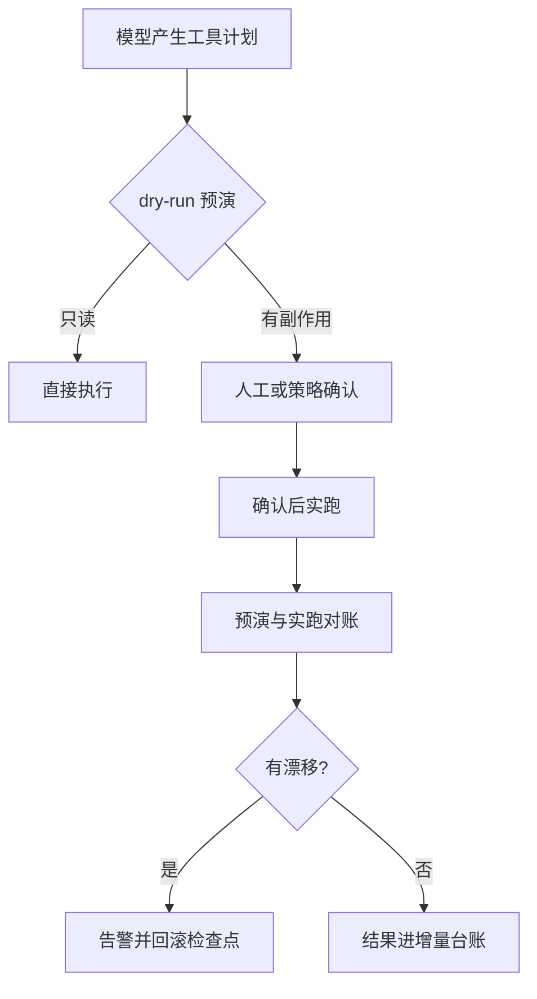
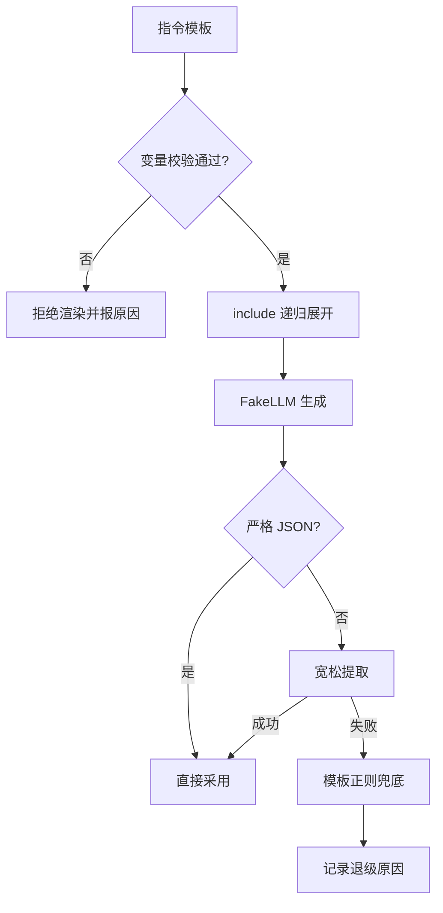
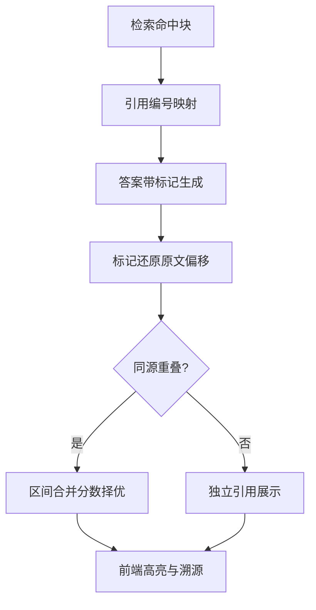
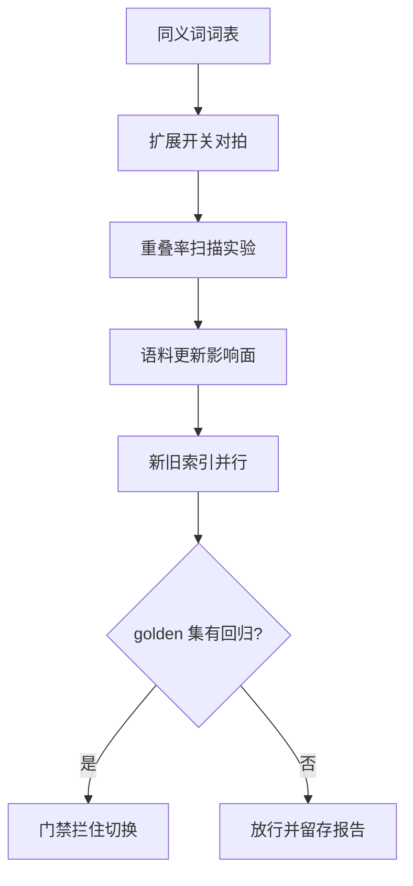
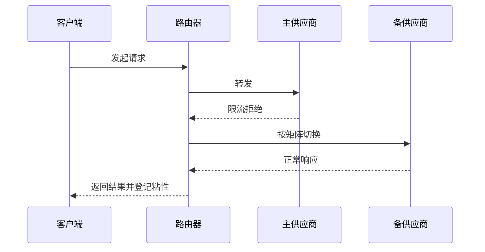
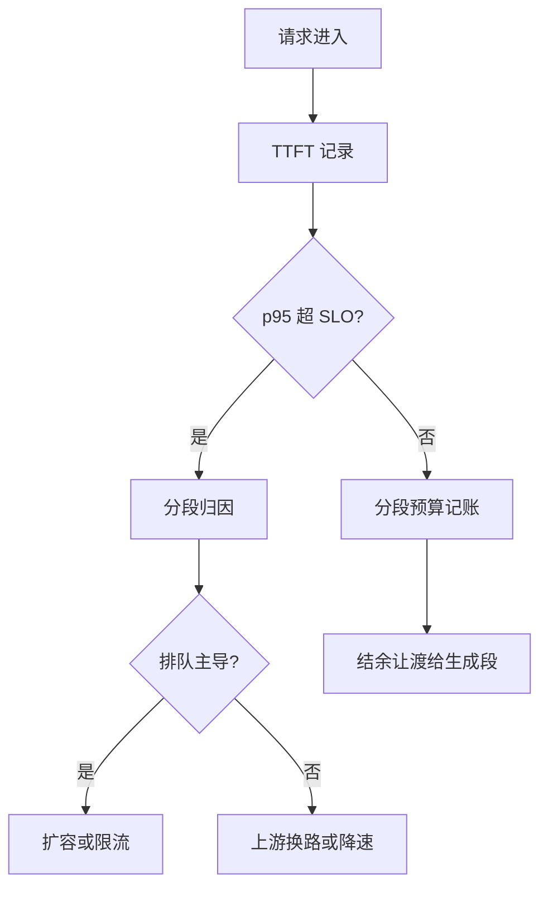
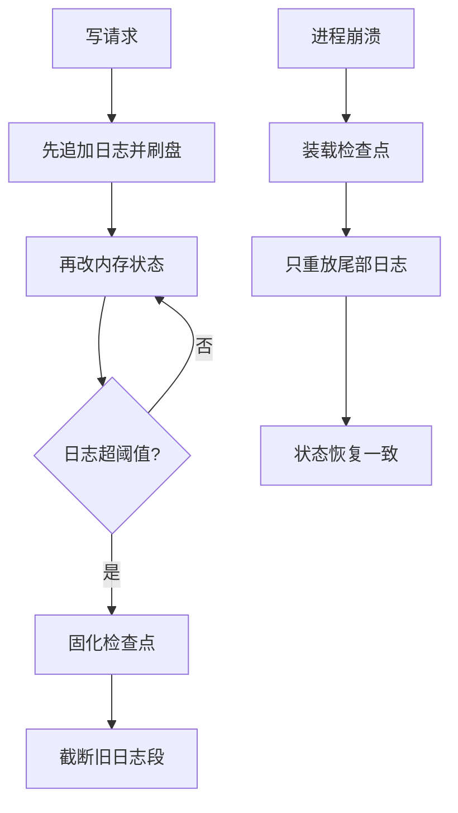
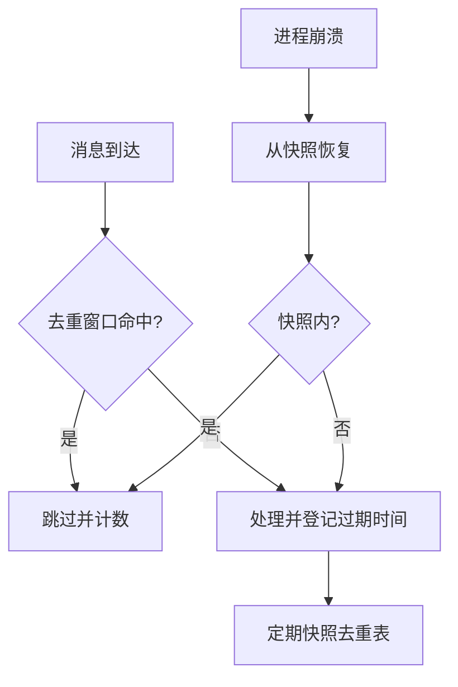
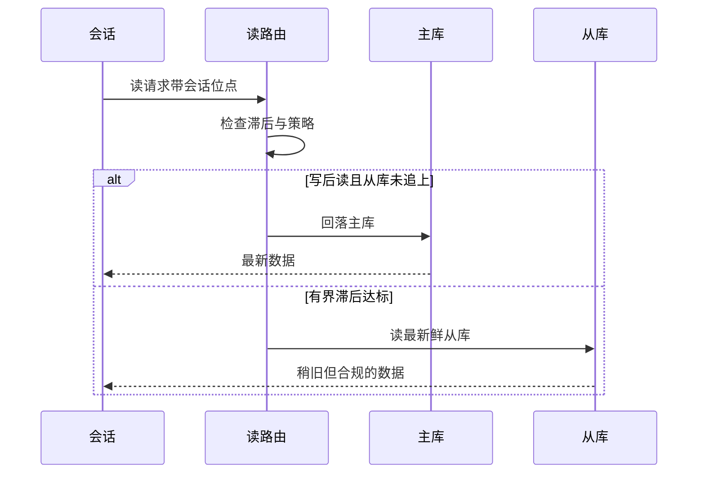

# 第 6 类 · Agent 与 LLM 及系统设计(夜间扩产三)

> 本篇是第 6 类的第三批夜间扩产(Q2021-Q2065 共 45 题),补齐四块工程收尾:Agent 侧的 dry-run 预演与对账、状态快照回滚、检查点哈希链、增量台账、模板校验与组合、轨迹导出、并发配额、注册表版本与兼容闸、输出退级链、端到端回归与轨迹金样本、用量仪表;RAG 侧的引用定位与同源折叠、同义词扩展与对拍、重叠率实验与放大核算、语料更新影响面、索引对拍门禁、抽检自动化、多轮改写状态与来源投票消歧;LLM 运维侧的故障切换矩阵与会话粘性、TTFT 监控与归因、分段超时预算与再分配、成本异常告警、缓存收益核算、截止时间排队;分布式侧的写前日志、两阶段提交、向量时钟对比版本向量、幂等去重窗口、热点分片分裂与副本滞后读策略。
> 全部代码仅标准库、可独立运行,LLM 一律用 FakeLLM/stub 桩,向量检索用假嵌入加余弦,时钟用注入的假时间推进,不联网不睡大觉。
> 学习建议:每题先说清「不这样做会出什么事故」,再讲机制,最后落到可验证的断言——面试官要的不是名词,是行为证据。

### Q2021 · 工具调用 dry-run 预演:副作用清单与影响摘要

> 难度:★★☆☆ | 标签:Agent, dry-run, 工具安全

**问**:Agent 要替用户执行发邮件、删数据这类危险工具,上线前你敢让它直接跑吗?怎么让危险操作先过目再执行?

**答**:不敢直接跑,标准做法是加一层 dry-run 预演。预演只读工具注册表的元数据:每个工具声明自己会触碰的外部状态,比如 write:email、delete:doc;预演按计划逐个查表,产出步骤清单、副作用清单和一句人话摘要,绝不调用工具本体。计划里没有任何副作用就直接放行;有副作用就把摘要交给人工确认或策略引擎裁决,确认后才进入实跑。收益是危险操作从「跑了才知道」变成「跑前可审计」,而且预演是纯函数,单测成本极低。

```python
# file: code/06_Agent与LLM及系统设计/q2021_tool_dry_run.py
"""工具调用 dry-run 预演:不真正执行,产出副作用清单与影响摘要,确认后才实跑。"""


class Tool:
    """工具元数据:side_effects 声明该工具会改动哪些外部状态。"""

    def __init__(self, name, side_effects, func):
        self.name = name
        self.side_effects = list(side_effects)
        self.func = func


REGISTRY = {}


def register(tool):
    REGISTRY[tool.name] = tool


def plan_step(name, args):
    tool = REGISTRY[name]
    return {"tool": name, "args": dict(args), "side_effects": list(tool.side_effects)}


def dry_run(names_and_args):
    """预演:只查注册表与元数据,绝不调用工具本体。"""
    steps = [plan_step(n, a) for n, a in names_and_args]
    risky = [s for s in steps if s["side_effects"]]
    if risky:
        summary = "计划 %d 步,其中 %d 步有副作用:%s" % (
            len(steps), len(risky), ",".join(s["tool"] for s in risky))
    else:
        summary = "计划 %d 步,全部只读,可直接执行" % len(steps)
    return {"steps": steps, "has_side_effects": bool(risky), "summary": summary}


def execute(plan):
    """确认后的实跑:按计划顺序调用,返回结果。"""
    return [REGISTRY[s["tool"]].func(**s["args"]) for s in plan["steps"]]


if __name__ == "__main__":
    executed = []

    def search(q):
        return {"hits": 2}

    def send_mail(to, body):
        executed.append(("mail", to))
        return {"sent": True}

    register(Tool("search", [], search))
    register(Tool("send_mail", ["write:email"], send_mail))

    plan = dry_run([("search", {"q": "退货政策"}),
                    ("send_mail", {"to": "ops@x.com", "body": "周报"})])
    assert executed == [], "dry-run 阶段不允许真的发出邮件"
    assert plan["has_side_effects"] is True
    assert plan["steps"][1]["side_effects"] == ["write:email"]
    assert "send_mail" in plan["summary"], "摘要要点名有副作用的工具"

    results = execute(plan)
    assert results == [{"hits": 2}, {"sent": True}], "确认后实跑结果正确"
    assert executed == [("mail", "ops@x.com")]

    safe = dry_run([("search", {"q": "x"})])
    assert safe["has_side_effects"] is False and "只读" in safe["summary"]
    print("dry-run 预演通过:预演零执行,副作用清单与摘要正确,确认后才实跑")
```

**追问**:
- 模型计划里有个注册表没有的工具怎么办? 答:预演阶段直接报未知工具并中止,实跑前任何计划外工具都是注入嫌疑
- 预演和实跑之间计划被改了怎么办? 答:预演产出物是实跑的唯一输入,实跑只认计划不认模型的新输出,篡改会在对账里暴露

### Q2022 · 预演与实跑的对账:多跑 少跑 参数漂移三分类

> 难度:★★★☆ | 标签:Agent, 对账, 审计

**问**:预演说要做 A B C,实际跑了 A B D,这种计划与实际对不上的情况,你怎么系统性发现而不是靠肉眼?

**答**:把预演计划与实跑记录做一次对账。两边都把每步归一成工具名加参数签名,参数签名用排序后的 JSON 做键,与键序无关;按工具对齐后,计划独有的算少跑,实跑独有的是多跑。同一个工具既多又少的判定为参数漂移——计划发往 a@x.com 的邮件实际发给了别人,这比单纯多跑一次更危险,必须单独立类。对账结果落进轨迹,match 为假就告警,这样 dry-run 才形成闭环而不是走过场。

```python
# file: code/06_Agent与LLM及系统设计/q2022_plan_actual_diff.py
"""预演与实跑对账:对比计划与实际执行记录,分类出多跑 少跑 参数漂移。"""
import json


def canon(args):
    """参数签名:排序后序列化,比较时与键序无关。"""
    return json.dumps(args, ensure_ascii=False, sort_keys=True)


def reconcile(plan_steps, actual_steps):
    p_by_tool, a_by_tool = {}, {}
    for s in plan_steps:
        p_by_tool.setdefault(s["tool"], []).append(canon(s["args"]))
    for a in actual_steps:
        a_by_tool.setdefault(a["tool"], []).append(canon(a["args"]))

    extra, missing = [], []
    for tool in sorted(set(p_by_tool) | set(a_by_tool)):
        p = list(p_by_tool.get(tool, []))
        a = list(a_by_tool.get(tool, []))
        for sig in a[:]:
            if sig in p:
                p.remove(sig)
                a.remove(sig)
        extra.extend({"tool": tool, "args": json.loads(s)} for s in a)
        missing.extend({"tool": tool, "args": json.loads(s)} for s in p)

    # 同一工具既多跑又少跑 -> 判定为参数漂移而不是两类问题
    drift = []
    extra_tools = {e["tool"] for e in extra}
    missing_tools = {m["tool"] for m in missing}
    for t in sorted(extra_tools & missing_tools):
        drift.append(t)
    extra = [e for e in extra if e["tool"] not in drift]
    missing = [m for m in missing if m["tool"] not in drift]
    return {"match": not (extra or missing or drift),
            "extra": extra, "missing": missing, "drift": drift}


if __name__ == "__main__":
    plan = [{"tool": "search", "args": {"q": "退货"}},
            {"tool": "send_mail", "args": {"to": "a@x.com"}}]

    same = reconcile(plan, [{"tool": "search", "args": {"q": "退货"}},
                            {"tool": "send_mail", "args": {"to": "a@x.com"}}])
    assert same["match"] and same == {"match": True, "extra": [], "missing": [], "drift": []}

    # 参数漂移:mail 发给了别人;计划外多跑了一次 delete
    dirty = reconcile(plan, [{"tool": "search", "args": {"q": "退货"}},
                             {"tool": "send_mail", "args": {"to": "evil@x.com"}},
                             {"tool": "delete_doc", "args": {"id": "d1"}}])
    assert not dirty["match"]
    assert dirty["drift"] == ["send_mail"], "同工具目标变了应判漂移"
    assert dirty["extra"] == [{"tool": "delete_doc", "args": {"id": "d1"}}]

    # 计划了但没执行
    lazy = reconcile(plan, [{"tool": "search", "args": {"q": "退货"}}])
    assert lazy["missing"] == [{"tool": "send_mail", "args": {"to": "a@x.com"}}]
    assert not lazy["drift"]
    print("对账通过:完全一致放行,参数漂移与计划外执行被分类上报")
```

**追问**:
- 参数漂移为什么要单独分类? 答:多跑少跑是遗漏问题,漂移是目标被替换,往往意味着注入或提示劫持,处置等级完全不同
- 副作用工具怎么在对账里体现? 答:实跑记录要带外部回执,比如邮件服务商的 message id,对账时把回执与计划一一绑定

### Q2023 · Agent 状态快照与回滚:深拷贝检查点

> 难度:★★★☆ | 标签:Agent, 快照, 回滚

**问**:Agent 走了五步发现方向错了,怎么让它干净地回到第二步重来?

**答**:在关键节点前存状态快照,回滚就是把状态整体恢复到那个快照。实现要点是深拷贝:messages、scratch 这类嵌套结构必须与活状态彻底断开引用,否则后续修改会污染快照,回滚回来的还是脏数据。回滚后可以反复试错,快照本身不受再次修改影响;标签不存在时显式报错,而不是静默留在当前状态。这个机制是 HITL 审批、危险操作回退、失败重放的地基——先有能回到过去,才谈重试策略。

```python
# file: code/06_Agent与LLM及系统设计/q2023_state_snapshot.py
"""Agent 状态快照与回滚:deepcopy 检查点与活状态断开引用,试错后一键回滚。"""
import copy


class AgentState:
    def __init__(self):
        self.messages = []
        self.scratch = {}
        self.step = 0

    def apply(self, role, content, patch=None):
        self.messages.append({"role": role, "content": content})
        if patch:
            self.scratch.update(patch)
        self.step += 1


class SnapshotManager:
    def __init__(self):
        self.snapshots = {}

    def save(self, state, label):
        """存快照:必须深拷贝,否则后续 mutate 会污染快照。"""
        self.snapshots[label] = copy.deepcopy(vars(state))

    def rollback(self, state, label):
        if label not in self.snapshots:
            raise KeyError("快照 %s 不存在" % label)
        restored = copy.deepcopy(self.snapshots[label])
        state.__dict__.update(restored)
        return state


if __name__ == "__main__":
    state = AgentState()
    mgr = SnapshotManager()

    state.apply("user", "查订单 A100")
    state.apply("assistant", "调用 query_order", patch={"order": "A100"})
    mgr.save(state, "before_risky")
    saved_step = state.step
    saved_msgs = len(state.messages)

    # 试错:又走了三步,还改了嵌套结构
    state.apply("assistant", "危险操作:删除全部数据", patch={"danger": True})
    state.apply("user", "完了")
    state.scratch["order"] = "被改坏了"
    assert state.step == saved_step + 2 and state.scratch["danger"] is True

    mgr.rollback(state, "before_risky")
    assert state.step == saved_step and len(state.messages) == saved_msgs
    assert state.scratch["order"] == "A100" and "danger" not in state.scratch

    # 快照独立性:回滚后再乱改,原快照不受影响,可反复回滚
    state.scratch["order"] = "又改坏了"
    mgr.rollback(state, "before_risky")
    assert state.scratch["order"] == "A100"

    try:
        mgr.rollback(state, "no_such")
        raise AssertionError("不存在标签必须报错")
    except KeyError:
        pass
    print("快照回滚通过:深拷贝隔离嵌套修改,可重复回滚,未知标签显式报错")
```

**追问**:
- 状态里挂着文件句柄或网络连接怎么办? 答:快照只存可序列化的逻辑状态,资源句柄放进登记簿,回滚时由资源管理器统一释放重建
- 每步都深拷贝太贵怎么办? 答:升级为增量检查点,只存相对上一点的 delta,配哈希链防篡改

### Q2024 · 检查点的增量存储与哈希链:省空间且防篡改

> 难度:★★★★ | 标签:Agent, 检查点, 完整性

**问**:长任务每步都快照一份全量状态,存储扛不住,怎么既省空间又保证检查点没被人动过?

**答**:检查点存增量而不是全量:相对上一个检查点只记变化的键,删除的键记墓碑,恢复时顺序叠加 delta 就能重建任意历史点。完整性靠哈希链:每个检查点记录前驱哈希与自己 payload 的联合摘要,历史记录被篡改一个字,后续所有哈希都对不上,校验在恢复前统一执行。存储从 O(步数乘状态大小) 降到 O(变更量),同时把检查点可信从运维承诺变成数学性质。演示里把历史 delta 改一个数字,恢复立刻报链断裂。

```python
# file: code/06_Agent与LLM及系统设计/q2024_checkpoint_chain.py
"""检查点增量存储与完整性校验:只存相对前一点的 delta,哈希链串联,篡改可检出。"""
import copy
import hashlib
import json


def digest(obj):
    raw = json.dumps(obj, ensure_ascii=False, sort_keys=True)
    return hashlib.sha256(raw.encode("utf-8")).hexdigest()[:12]


class CheckpointStore:
    def __init__(self):
        self.chain = []
        self.last_state = {}

    def save(self, label, full_state):
        prev = self.chain[-1]["hash"] if self.chain else "genesis"
        delta = {}
        for k, v in full_state.items():
            if not self.chain or self.last_state.get(k) != v:
                delta[k] = copy.deepcopy(v)
        for k in set(self.last_state) - set(full_state):
            delta[k] = None                      # 删除键记墓碑
        entry = {"label": label, "delta": delta, "prev": prev,
                 "hash": digest({"prev": prev, "delta": delta, "label": label})}
        self.chain.append(entry)
        self.last_state = copy.deepcopy(full_state)
        return entry["hash"]

    def verify(self):
        prev = "genesis"
        for e in self.chain:
            expect = digest({"prev": prev, "delta": e["delta"], "label": e["label"]})
            if expect != e["hash"]:
                raise ValueError("哈希链断裂于 %s,检查点被篡改" % e["label"])
            prev = e["hash"]

    def restore(self, target_label=None):
        self.verify()
        state = {}
        for e in self.chain:
            for k, v in e["delta"].items():
                if v is None:
                    state.pop(k, None)
                else:
                    state[k] = copy.deepcopy(v)
            if target_label and e["label"] == target_label:
                break
        return state


if __name__ == "__main__":
    store = CheckpointStore()
    h1 = store.save("ck1", {"a": 1, "b": 2})
    h2 = store.save("ck2", {"a": 1, "b": 3, "c": 4})
    assert h1 != h2
    assert len(store.chain[1]["delta"]) == 2, "第二检查点只应存 b 和 c 的增量"
    assert store.restore() == {"a": 1, "b": 3, "c": 4}
    assert store.restore("ck1") == {"a": 1, "b": 2}, "可恢复到任意历史点"

    h3 = store.save("ck3", {"a": 9, "b": 3})
    assert store.chain[2]["delta"] == {"a": 9, "c": None}, "改值与删除墓碑都进增量"
    assert store.restore() == {"a": 9, "b": 3}, "墓碑恢复时删除该键"
    assert h3

    # 篡改演练:改历史 delta,校验必须报错
    store.chain[0]["delta"]["a"] = 999
    try:
        store.restore()
        raise AssertionError("篡改必须被哈希链发现")
    except ValueError as e:
        assert "篡改" in str(e)
    print("检查点链通过:增量存储省体积,任意点可恢复,篡改被哈希链拦截")
```

**追问**:
- 增量链太长恢复慢怎么办? 答:每 N 个检查点做一次全量锚点,恢复从最近锚点开始叠加,代价与精度折中
- 哈希链能防删吗? 答:防不了整条链被换成另一条合法链,链头哈希要外置到只读存储或由多方持有

### Q2025 · 多轮工具结果的增量摘要:滚动事实台账

> 难度:★★★☆ | 标签:Agent, 上下文, 摘要

**问**:Agent 一轮查十次工具,原始结果把上下文塞满了,怎么让第十轮还记得第一轮查到了什么?

**答**:把工具结果从逐条堆进上下文改成增量合并进台账。台账以实体为键,每条新结果只做三件事:查询次数累加、取值择最新、来源去重追加,再记最近活跃轮次;上下文里渲染的永远是这份紧凑台账而不是原始 JSON。渲染按预算裁剪,最近活跃的实体优先保留,被挤出的实体数如实上报,模型能感知信息不完整并主动补查。原始结果照常落制品库,台账只承担记忆的当前视图这一职责。

```python
# file: code/06_Agent与LLM及系统设计/q2025_result_ledger.py
"""多轮工具结果的增量摘要:原始结果滚动合并为事实台账,上下文只保留台账。"""


class ResultLedger:
    def __init__(self):
        self.facts = {}

    def absorb(self, turn, tool, result):
        """把一条工具结果增量合并进台账:次数累加 值择新 来源去重。"""
        for entity, value in result.items():
            f = self.facts.setdefault(entity, {"seen": 0, "value": None,
                                               "tools": [], "last_turn": 0})
            f["seen"] += 1
            f["value"] = value
            if tool not in f["tools"]:
                f["tools"].append(tool)
            f["last_turn"] = turn

    def render(self, budget):
        """渲染为紧凑台账,超预算时按最近活跃优先保留,返回挤掉的实体数。"""
        items = sorted(self.facts.items(), key=lambda kv: -kv[1]["last_turn"])
        lines, used = [], 0
        for name, f in items:
            line = "%s: 值=%s 查了%d次 来源=%s 最近=T%d" % (
                name, f["value"], f["seen"], "+".join(f["tools"]), f["last_turn"])
            if used + len(line) > budget:
                break
            lines.append(line)
            used += len(line)
        return "\n".join(lines), len(items) - len(lines)


if __name__ == "__main__":
    ledger = ResultLedger()
    ledger.absorb(1, "web_search", {"订单状态": "已发货"})
    ledger.absorb(3, "db_query", {"订单状态": "已发货", "物流单号": "SF123"})
    ledger.absorb(5, "web_search", {"订单状态": "已签收"})

    f = ledger.facts["订单状态"]
    assert f["seen"] == 3 and f["value"] == "已签收", "值必须择最新一次"
    assert f["tools"] == ["web_search", "db_query"], "来源去重但保留出现顺序"
    f2 = ledger.facts["物流单号"]
    assert f2["seen"] == 1 and f2["last_turn"] == 3

    text, dropped = ledger.render(budget=60)
    assert "已签收" in text and "订单状态" in text, "最近活跃的实体优先保留"
    assert dropped >= 1, "预算不够时必须有实体被挤出且数量如实上报"
    small, dropped2 = ledger.render(budget=24)
    assert dropped2 > dropped or len(small.splitlines()) == 1, "预算越小挤掉越多"
    print("增量台账通过:3 次查询合并为 2 条事实,值择新 来源去重 预算裁剪")
```

**追问**:
- 值冲突了怎么办? 答:台账只记最新值不裁决,冲突标注交给上层,配合来源投票做消歧
- 实体键怎么定? 答:注册工具时声明结果里哪个字段是实体键,没有键的结果整条进台账附录区



### Q2026 · 指令模板的变量注入校验:缺失 类型 回注三道闸

> 难度:★★★☆ | 标签:Agent, Prompt, 校验

**问**:Prompt 模板里要塞用户输入,最常见的翻车方式有哪些?渲染前应该做哪些校验?

**答**:四类翻车都要在渲染前拦下。一是变量缺失,渲染出半截指令;二是类型不对,数字位被塞了字符串;三是危险片段,值里带代码围栏或模板语法,等于让用户改写系统提示;四是回注,值里含占位符样式的文本,替换时把模板结构改掉。校验器先对齐模板占位符与 schema 声明,再逐变量查类型与危险模式,全部通过才替换;任何一项失败都带具体原因拒绝,而不是把脏 Prompt 交给模型。模板用了 schema 没声明的占位符属于结构性错误,也要显式报错。

```python
# file: code/06_Agent与LLM及系统设计/q2026_template_validate.py
"""指令模板的变量注入校验:占位符与 schema 对齐 类型检查 危险片段拦截。"""
import re

VAR_RE = re.compile(r"\{(\w+)\}")
REINJECT_RE = re.compile(r"\{\w+\}")
FENCE = "`" * 3                 # 运行时拼接,避免源码里出现字面三反引号
DANGEROUS = (FENCE, "{%")       # 值里出现代码围栏或模板语法视为注入风险


def render(template, values, schema):
    placeholders = set(VAR_RE.findall(template))
    declared = set(schema)
    problems = []
    for name in sorted(placeholders - declared):
        problems.append("模板变量 %s 未在 schema 声明" % name)
    for name in sorted(placeholders & declared):
        if name not in values:
            problems.append("变量 %s 缺失" % name)
            continue
        v = values[name]
        want = schema[name]
        if want == "int" and not isinstance(v, int):
            problems.append("变量 %s 需要 int" % name)
        if want == "str" and not isinstance(v, str):
            problems.append("变量 %s 需要 str" % name)
        if isinstance(v, str):
            if any(d in v for d in DANGEROUS):
                problems.append("变量 %s 含危险片段" % name)
            if REINJECT_RE.search(v):
                problems.append("变量 %s 试图回注占位符" % name)
    if problems:
        raise ValueError(";".join(problems))
    out = template
    for name in sorted(placeholders):
        out = out.replace("{" + name + "}", str(values[name]))
    return out


if __name__ == "__main__":
    tpl = "你是{role},回答不超过{limit}字,主题:{topic}。"
    schema = {"role": "str", "limit": "int", "topic": "str"}

    ok = render(tpl, {"role": "客服", "limit": 100, "topic": "退货"}, schema)
    assert ok == "你是客服,回答不超过100字,主题:退货。"

    for values, frag in [
        ({"role": "客服", "topic": "退货"}, "缺失"),                    # 少 limit
        ({"role": "客服", "limit": "很多", "topic": "退货"}, "需要 int"),
        ({"role": "客服", "limit": 100, "topic": "退货" + FENCE}, "危险片段"),
        ({"role": "客服", "limit": 100, "topic": "{limit}"}, "回注"),
    ]:
        try:
            render(tpl, values, schema)
            raise AssertionError("应当拒绝:" + frag)
        except ValueError as e:
            assert frag in str(e), (frag, str(e))

    # 模板用了 schema 没声明的占位符:结构性错误,必须拦下
    try:
        render("你是{role},密级{level}", {"role": "客服", "level": "高"}, schema)
        raise AssertionError("未声明占位符应当拒绝")
    except ValueError as e:
        assert "未在 schema" in str(e) and "level" in str(e)

    # schema 声明了但模板没用的变量不算错误,只是沉默未用
    used = render("主题:{topic}", {"topic": "x", "role": "y"}, schema)
    assert used == "主题:x"
    print("模板校验通过:缺失 类型 危险片段 回注四类问题全拦截,合法值正常渲染")
```

**追问**:
- schema 声明了但模板没用的变量呢? 答:不算错误,只是沉默未用,可在 CI 里报 warning 提示清理
- 转义能不能代替拒绝? 答:能转义的转义,破坏模板结构的片段必须拒绝,因为合法转义后的注入指令依然是注入

### Q2027 · 模板组合渲染:include 递归与循环包含检测

> 难度:★★★☆ | 标签:Agent, 模板, 图结构

**问**:系统提示越做越大,你们把公共段落抽成子模板互相 include,这会引入什么新故障?

**答**:模板组合本质是把图结构引入渲染,新故障有三类:循环包含让渲染递归爆栈;包含深度超限,模板里可能被埋了极深链条;引用缺失,占位的子模板不存在。渲染器维护包含栈,进入子模板前先查栈,命中即报循环并列出完整路径,同时设深度上限兜底;缺失模板显式报错而不是渲染出空段落。这三类错误都该在 CI 的模板单测里暴露,而不是线上渲染时才发现。演示里 a 引 b、b 引 a,报错直接给出 a 到 b 再到 a 的环路径。

```python
# file: code/06_Agent与LLM及系统设计/q2027_template_include.py
"""模板组合渲染:include 递归展开,栈检测循环包含与深度超限。"""
import re

INCLUDE_RE = re.compile(r"\{%\s*include\s+(\w+)\s*%\}")
MAX_DEPTH = 8


def render(templates, root, values, _stack=None, _depth=0):
    _stack = _stack or []
    if root in _stack:
        cycle = " -> ".join(_stack + [root])
        raise ValueError("循环包含:" + cycle)
    if _depth > MAX_DEPTH:
        raise ValueError("包含深度超过上限 %d" % MAX_DEPTH)
    if root not in templates:
        raise ValueError("模板 %s 不存在" % root)
    body = templates[root]

    def sub(m):
        return render(templates, m.group(1), values, _stack + [root], _depth + 1)

    out = INCLUDE_RE.sub(sub, body)
    for k in sorted(values):
        out = out.replace("{{" + k + "}}", str(values[k]))
    return out


if __name__ == "__main__":
    templates = {
        "base": "\n{{content}}\n",
        "header": "【{{title}}】",
        "footer": "—— {{team}}",
    }
    out = render(templates, "base", {"title": "客服手册", "team": "平台组",
                                     "content": "正文第一段"})
    assert "【客服手册】" in out and "正文第一段" in out and "—— 平台组" in out
    assert "include" not in out, "渲染后不得残留 include 指令"

    # 循环包含:a 引 b b 引 a
    loop = {"a": "A ", "b": "B "}
    try:
        render(loop, "a", {})
        raise AssertionError("循环包含必须报错")
    except ValueError as e:
        assert "循环包含" in str(e) and "a -> b -> a" in str(e)

    # 深度超限:一条长链
    chain = {"t0": ""}
    for i in range(1, 12):
        chain["t%d" % i] = "{%% include t%d %%}" % (i + 1)
    try:
        render(chain, "t0", {})
        raise AssertionError("深度超限必须报错")
    except ValueError as e:
        assert "深度" in str(e)

    try:
        render(templates, "ghost", {})
        raise AssertionError("缺失模板必须报错")
    except ValueError as e:
        assert "不存在" in str(e)
    print("组合渲染通过:递归展开正常,循环 链超长 缺失三类结构错误全拦截")
```

**追问**:
- 循环包含能不能自动剪? 答:可以按同一模板同层只展开一次去重,但语义更危险,默认拒绝、显式开启才放行
- 变量替换放在哪一层? 答:每层只替换自己的变量,父层不越权替换子层未声明的占位符,避免变量泄漏

### Q2028 · Agent 日志的轨迹导出:扁平事件组装 span 树

> 难度:★★☆☆ | 标签:Agent, 可观测性, 轨迹

**问**:线上 Agent 出了怪行为,日志是几百条扁平记录,怎么快速还原它当时到底怎么走的?

**答**:把日志从行升级为 span:每个事件带 span id、父 span、起止时间,导出时组装成树,根是本次会话,子节点是工具调用和 LLM 调用。导出器做三个校验:每个事件的父亲必须存在,孤儿事件报错;根 span 有且只有一个;兄弟按开始时间排序,父 span 的时间区间必须包住子 span。有了这棵树,慢在哪一步、哪次工具调用嵌套了鉴权检查,一眼可见;树序列化成 JSON 后可直接进轨迹系统。扁平日志回答发生了什么,span 树回答为什么和怎么发生的。

```python
# file: code/06_Agent与LLM及系统设计/q2028_trace_export.py
"""Agent 日志的轨迹导出:扁平事件流组装为 span 树 JSON,父子关系与时长可校验。"""
import json


class TraceExporter:
    def __init__(self):
        self.events = []

    def log(self, span_id, parent, name, start, end, attrs=None):
        self.events.append({"id": span_id, "parent": parent, "name": name,
                            "start": start, "end": end, "attrs": attrs or {}})

    def export(self):
        nodes = {e["id"]: dict(e, children=[]) for e in self.events}
        roots = []
        for e in self.events:
            p = e["parent"]
            if p is None:
                roots.append(nodes[e["id"]])
            elif p in nodes:
                nodes[p]["children"].append(nodes[e["id"]])
            else:
                raise ValueError("事件 %s 的父 span %s 不存在" % (e["id"], p))
        if len(roots) != 1:
            raise ValueError("一次轨迹应有且只有一个根 span")

        def sort_tree(n):
            n["children"].sort(key=lambda c: c["start"])
            for c in n["children"]:
                sort_tree(c)

        sort_tree(roots[0])
        return roots[0]

    def spans_json(self):
        return json.dumps(self.export(), ensure_ascii=False)


if __name__ == "__main__":
    t = TraceExporter()
    t.log("root", None, "agent.run", 0, 100)
    t.log("s2", "root", "tool.db_query", 30, 60, {"sql": "select 1"})
    t.log("s1", "root", "llm.chat", 5, 25)
    t.log("s3", "s2", "tool.auth_check", 32, 36)

    tree = t.export()
    assert tree["name"] == "agent.run"
    assert [c["name"] for c in tree["children"]] == ["llm.chat", "tool.db_query"]
    db = tree["children"][1]
    assert db["children"][0]["name"] == "tool.auth_check"
    # 父 span 必须包住子 span
    for c in tree["children"]:
        assert tree["start"] <= c["start"] and c["end"] <= tree["end"]
    parsed = json.loads(t.spans_json())
    assert parsed["id"] == "root"

    bad = TraceExporter()
    bad.log("x", "ghost", "orphan", 0, 1)
    try:
        bad.export()
        raise AssertionError("孤儿事件必须报错")
    except ValueError as e:
        assert "不存在" in str(e)
    print("轨迹导出通过:扁平日志组出两层的 span 树,兄弟有序 父包子 孤儿拦截")
```

**追问**:
- 父子关系从哪来? 答:Agent 循环里每个动作入栈时创建 span,异常出栈时关闭,上下文变量自动传递父子关系
- 跨进程的调用怎么串起来? 答:把 trace id 和父 span id 写进消息头,下游服务继续展开子树,链路自然拼接

### Q2029 · 并发 Agent 的资源配额:分组信号量与等待上限

> 难度:★★☆☆ | 标签:Agent, 并发, 配额

**问**:一个会话开五个并发工具调用没问题,一百个会话同时这么干会怎样?怎么治理?

**答**:按资源分组挂配额。每组一个有界信号量,额度就是允许的并发数,比如对 LLM 组限 2;进入前 acquire,支持等待上限,等不到立刻拒绝并计数,而不是无限排队把下游拖死;离开必须 release,BoundedSemaphore 保证超放不会静默吞掉错误。治理目标要可证明:峰值并发观测值永不越过限额,结束时配额归还干净,这是压测断言而不是口头承诺。拒绝信号交给上层重试或降级,把过载变成显式事件。

```python
# file: code/06_Agent与LLM及系统设计/q2029_agent_quota.py
"""并发 Agent 的资源配额:分组信号量限并发,等待超时即拒绝,峰值不得越过限额。"""
import threading
import time


class QuotaGroup:
    def __init__(self, name, limit, wait_timeout=0.5):
        self.name = name
        self.limit = limit
        self.wait_timeout = wait_timeout
        self.sem = threading.BoundedSemaphore(limit)
        self.current = 0
        self.peak = 0
        self.rejected = 0
        self.lock = threading.Lock()

    def acquire(self, wait_timeout=None):
        wt = self.wait_timeout if wait_timeout is None else wait_timeout
        if not self.sem.acquire(timeout=wt):
            with self.lock:
                self.rejected += 1
            raise TimeoutError("配额组 %s 等待超时,拒绝进入" % self.name)
        with self.lock:
            self.current += 1
            self.peak = max(self.peak, self.current)

    def release(self):
        with self.lock:
            self.current -= 1
        self.sem.release()


if __name__ == "__main__":
    group = QuotaGroup("llm", limit=2, wait_timeout=0.5)
    in_region = []
    peak_seen = [0]
    lock = threading.Lock()
    stats = {"ok": 0, "reject": 0}

    def worker(n, hold, patience=None):
        try:
            group.acquire(patience)
        except TimeoutError:
            with lock:
                stats["reject"] += 1
            return
        with lock:
            in_region.append(n)
            peak_seen[0] = max(peak_seen[0], len(in_region))
        time.sleep(hold)
        with lock:
            in_region.remove(n)
        group.release()
        with lock:
            stats["ok"] += 1

    # 场景一:6 个短任务挤限额 2,全部应通过,峰值不越界
    ts = [threading.Thread(target=worker, args=(i, 0.1)) for i in range(6)]
    for t in ts:
        t.start()
    for t in ts:
        t.join()
    assert stats["ok"] == 6 and stats["reject"] == 0
    assert peak_seen[0] <= 2 and group.peak <= 2, "并发峰值不得超过限额"

    # 场景二:两个长任务占满全部槽位,短耐心调用等待超时被拒绝而不是无限等
    blockers = [threading.Thread(target=worker, args=("hold%d" % i, 0.6))
                for i in range(2)]
    for t in blockers:
        t.start()
    time.sleep(0.05)
    impatient = threading.Thread(target=worker, args=("impatient", 0.01, 0.2))
    impatient.start()
    for t in blockers:
        t.join()
    impatient.join()
    assert stats["reject"] >= 1, "槽位被占满时应拒绝短耐心调用"
    assert group.current == 0, "全部结束后配额必须归还干净"
    print("并发配额通过:峰值不越限 全员可达 拒绝 %d 次 释放干净" % stats["reject"])
```

**追问**:
- 配额按什么粒度分组? 答:按下游依赖分组,LLM、检索库、外部 API 各一组互不挤占,这是舱壁隔离思想
- 想要公平排队怎么办? 答:信号量只管准入,公平性交给前置队列,按租户加权轮询出队再 acquire

### Q2030 · 工具注册表的版本管理:多版本并存与弃用留痕

> 难度:★★★☆ | 标签:Agent, 注册表, 版本管理

**问**:工具升级了参数就变了,老会话还在用旧版,怎么做到平滑共存?

**答**:注册表从名字到函数升级为名字到版本表:多版本并存,resolve 不带版本时路由到最新稳定版,显式钉住旧版仍然可用。弃用是状态不是删除:标记 deprecated 后,钉住旧版的调用照常执行,但必须产出弃用事件,把迁移压力变成可观测的日志而不是静默兼容。无稳定版时退回任意可用版本而不是拒绝服务,保证 beta 工具可测。版本策略配上兼容性闸,升级安全就有了两层保障。

```python
# file: code/06_Agent与LLM及系统设计/q2030_registry_version.py
"""工具注册表的版本管理:多版本并存 默认路由最新稳定版 弃用版本调用留痕告警。"""
import warnings


class ToolRegistry:
    def __init__(self):
        self.tools = {}

    def register(self, name, version, func, stable=True):
        self.tools.setdefault(name, {})[version] = {"func": func, "stable": stable}

    def deprecate(self, name, version):
        self.tools[name][version]["deprecated"] = True

    def resolve(self, name, version=None):
        versions = self.tools.get(name)
        if not versions:
            raise KeyError("工具 %s 未注册" % name)
        if version is None:
            stable = [v for v, e in versions.items()
                      if e.get("stable") and not e.get("deprecated")]
            version = max(stable or list(versions))
        if version not in versions:
            raise KeyError("工具 %s 无版本 %s" % (name, version))
        entry = versions[version]
        meta = {"name": name, "version": version,
                "deprecated": entry.get("deprecated", False)}
        return entry["func"], meta


def call_with_meta(func, args, meta):
    """调用并处理弃用告警:降级为日志事件而不是让调用失败。"""
    events = []
    if meta["deprecated"]:
        with warnings.catch_warnings(record=True) as w:
            warnings.simplefilter("always")
            warnings.warn("工具 %s@%s 已弃用,请迁移" % (meta["name"], meta["version"]))
            events = [str(x.message) for x in w]
    return func(**args), events


if __name__ == "__main__":
    reg = ToolRegistry()

    def query_v1(sql):
        return {"rows": sql}

    def query_v2(sql, limit=10):
        return {"rows": sql, "limit": limit}

    reg.register("db_query", "1.0", query_v1)
    reg.register("db_query", "2.0", query_v2)
    reg.deprecate("db_query", "1.0")

    fn, meta = reg.resolve("db_query")            # 不带版本 -> 最新稳定版
    assert meta["version"] == "2.0" and meta["deprecated"] is False

    fn1, meta1 = reg.resolve("db_query", "1.0")   # 显式钉住旧版仍可用
    res, events = call_with_meta(fn1, {"sql": "select 9"}, meta1)
    assert res == {"rows": "select 9"} and events, "钉住弃用版要能跑但必须留痕"

    try:
        reg.resolve("db_query", "9.9")
        raise AssertionError("未知版本必须报错")
    except KeyError:
        pass

    reg2 = ToolRegistry()
    reg2.register("beta_tool", "0.1", lambda: {}, stable=False)
    fn3, meta3 = reg2.resolve("beta_tool")
    assert meta3["version"] == "0.1", "无稳定版时退回任意版本而不是拒绝服务"
    print("版本管理通过:默认路由 2.0,钉旧版可用且留痕,未知版本显式报错")
```

**追问**:
- 弃用版本什么时候真删? 答:设观察窗口,窗口内零调用再删,删除前在注册表留明确的未注册语义便于排查
- 同一版本能不能灰度? 答:版本内用流量标签分流,注册表只管名字到版本,灰度属于路由层职责

### Q2031 · 输出格式退级链:严格 JSON 到宽松提取到模板

> 难度:★★★☆ | 标签:LLM, 结构化输出, 退级

**问**:模型说好回 JSON,实际一半是代码围栏一半是散文,解析层怎么保证服务不被一条脏输出打挂?

**答**:解析做成退级链,逐级放宽,每级留下触发原因。第一级严格 json.loads,干净输出零损失;第二级宽松提取,剥代码围栏、定位首个平衡大括号块、修掉尾逗号,专治模型想回 JSON 但手抖;第三级模板兜底,按字段正则抓取,抓不到填默认值,保证调用永不报废。返回值带 level 与 reason 字段,退级率是解析层的核心指标——宽松级占比升高说明模型或提示在漂移,要修因而不是修果。

```python
# file: code/06_Agent与LLM及系统设计/q2031_output_fallback.py
"""输出格式退级链:严格 JSON → 宽松提取 → 模板兜底,逐级记录触发原因。"""
import json
import re


class FakeLLM:
    """桩:按脚本吐出预定输出,不联网。"""

    def __init__(self, script):
        self.script = list(script)

    def chat(self, _messages):
        return self.script.pop(0)


def strict_parse(text):
    return json.loads(text)


def lenient_parse(text):
    """宽松级:剥代码围栏,提取首个平衡大括号块,容忍尾逗号。"""
    fence_pat = "`" * 3 + r"(?:json)?\s*(.*?)" + "`" * 3
    fence = re.search(fence_pat, text, re.S)
    if fence:
        text = fence.group(1)
    start = text.find("{")
    if start < 0:
        raise ValueError("找不到 JSON 主体")
    depth = 0
    for i in range(start, len(text)):
        if text[i] == "{":
            depth += 1
        elif text[i] == "}":
            depth -= 1
            if depth == 0:
                candidate = re.sub(r",\s*([}\]])", r"\1", text[start:i + 1])
                return json.loads(candidate)
    raise ValueError("大括号不闭合")


def template_parse(text, fields):
    """模板级:正则逐字段抓,抓不到填默认值,绝不让整次调用报废。"""
    out = {}
    for name in sorted(fields):
        pattern, default = fields[name]
        m = re.search(pattern, text)
        out[name] = m.group(1) if m else default
    return out


def parse_with_chain(text, fields):
    try:
        return {"data": strict_parse(text), "level": "strict", "reason": None}
    except Exception as e1:
        try:
            return {"data": lenient_parse(text), "level": "lenient", "reason": str(e1)}
        except Exception as e2:
            return {"data": template_parse(text, fields),
                    "level": "template", "reason": str(e2)}


if __name__ == "__main__":
    FIELDS = {"amount": (r"金额[:：]\s*(\d+)", "0"),
              "city": (r"城市[:：]\s*(\S+)", "未知")}
    llm = FakeLLM([
        '{"amount": 42, "city": "杭州"}',                      # 干净 JSON
        '好的,结果如下:\n' + "`" * 3 + 'json\n{"amount": 42,}\n' + "`" * 3 + '\n请查收',  # 围栏加尾逗号
        '人工看了下,金额: 42 元,城市: 北京',                     # 自由文本
        '抱歉,我没算出来',                                     # 全兜底
    ])

    r1 = parse_with_chain(llm.chat([]), FIELDS)
    assert r1["level"] == "strict" and r1["data"] == {"amount": 42, "city": "杭州"}

    r2 = parse_with_chain(llm.chat([]), FIELDS)
    assert r2["level"] == "lenient" and r2["data"]["amount"] == 42
    assert r2["reason"], "退级必须留下严格级失败的原因"

    r3 = parse_with_chain(llm.chat([]), FIELDS)
    assert r3["level"] == "template"
    assert r3["data"] == {"amount": "42", "city": "北京"}

    r4 = parse_with_chain(llm.chat([]), FIELDS)
    assert r4["level"] == "template" and r4["data"] == {"amount": "0", "city": "未知"}
    print("退级链通过:strict→lenient→template 三级各就位,每级留触发原因")
```

**追问**:
- 模板级抓出来的数据可信吗? 答:降级数据必须打标,template 级结果只用于展示或人工复核,不进自动化决策
- 为什么不在提示词里要求就够? 答:提示词降低概率但不为零,解析层兜底是必须的纵深防御



### Q2032 · Agent 端到端回归脚本:场景断言与汇总报告

> 难度:★★★☆ | 标签:Agent, 测试, 回归

**问**:改了一版系统提示,怎么确认所有 Agent 场景的行为没有回归?

**答**:把典型会话固化成场景集,每个场景三件套:脚本化 FakeLLM 的应答序列、工具桩、期望断言——工具序列对不对、终答对不对。回归脚本逐场景跑,把异常也捕获成失败项而不是中断整个跑批,最后输出通过数、失败数与失败原因,一条命令出报告。脚本耗尽是关键防护:Agent 循环超出预期步数会撞上空脚本报错,死循环被自然拦截。预期失败样例要留在场景集里,验证回归器自己没有失明。

```python
# file: code/06_Agent与LLM及系统设计/q2032_e2e_regression.py
"""Agent 端到端回归脚本:脚本化 FakeLLM,断言工具序列与终答,输出汇总报告。"""


class FakeLLM:
    def __init__(self, script):
        self.script = list(script)

    def chat(self, messages):
        self.calls = getattr(self, "calls", 0) + 1
        if not self.script:
            raise RuntimeError("脚本耗尽:Agent 循环超出预期步数")
        return self.script.pop(0)


def run_agent(llm, tools, task):
    """两步小 Agent:先决策是否调工具,带观察再给终答。"""
    reply = llm.chat([{"role": "user", "content": task}])
    if reply["content"].startswith("TOOL:"):
        _, name, args = reply["content"].split(":", 2)
        if name not in tools:
            raise RuntimeError("调用了未注册工具 " + name)
        obs = tools[name](args)
        final = llm.chat([{"role": "user", "content": "观察:" + obs}])
        return {"tool": name, "args": args, "answer": final["content"]}
    return {"tool": None, "args": None, "answer": reply["content"]}


SCENARIOS = [
    {"name": "查订单走工具",
     "llm": [{"role": "assistant", "content": "TOOL:query_order:A100"},
             {"role": "assistant", "content": "订单已发货"}],
     "tools": {"query_order": lambda a: "状态=已发货"},
     "expect_tool": "query_order", "expect_answer": "订单已发货"},
    {"name": "闲聊直答",
     "llm": [{"role": "assistant", "content": "你好,需要什么帮助"}],
     "tools": {},
     "expect_tool": None, "expect_answer": "你好,需要什么帮助"},
    {"name": "预期失败样例",           # 故意让答案错,验证回归脚本能抓住
     "llm": [{"role": "assistant", "content": "随便答的"}],
     "tools": {},
     "expect_tool": None, "expect_answer": "标准答案"},
]


def run_scenarios(scenarios):
    report = []
    for sc in scenarios:
        llm = FakeLLM(sc["llm"])
        try:
            out = run_agent(llm, sc["tools"], "任务")
            problems = []
            if out["tool"] != sc["expect_tool"]:
                problems.append("工具调用不符")
            if out["answer"] != sc["expect_answer"]:
                problems.append("终答不符")
            report.append({"name": sc["name"], "pass": not problems,
                           "detail": ",".join(problems) or "ok"})
        except Exception as e:
            report.append({"name": sc["name"], "pass": False,
                           "detail": "异常:" + str(e)})
    return report


if __name__ == "__main__":
    report = run_scenarios(SCENARIOS)
    passed = [r for r in report if r["pass"]]
    failed = [r for r in report if not r["pass"]]
    assert len(report) == 3 and len(passed) == 2 and len(failed) == 1
    assert failed[0]["name"] == "预期失败样例" and "终答不符" in failed[0]["detail"]

    # 脚本耗尽防护:Agent 多走一步会被抓住而不是死循环
    runaway = [{"name": "失控", "llm": [{"role": "assistant", "content": "TOOL:query_order:A"}],
                "tools": {"query_order": lambda a: "x"},
                "expect_tool": "query_order", "expect_answer": "y"}]
    r = run_scenarios(runaway)[0]
    assert not r["pass"] and "异常" in r["detail"]
    print("端到端回归通过:3 场景 2 过 1 抓,失控循环被脚本耗尽防护拦截")
```

**追问**:
- 场景集怎么维护? 答:线上 badcase 沉淀为新场景,修复后固化为回归用例,场景集只增不减
- 和单元测试什么区别? 答:单测验证部件,端到端回归验证装配后的行为,提示词这类改一处动全身的变更只有后者能兜住

### Q2033 · 上下文窗口用量仪表:分项计量与水位告警

> 难度:★★☆☆ | 标签:LLM, 上下文, 监控

**问**:上下文窗口 128K,为什么请求还是老超限?你怎么知道上下文都被什么吃了?

**答**:装一块用量仪表,按来源分项计量:系统提示、历史对话、检索资料、工具结果各记各的 token 账,估算用中文按字、ASCII 按四分之一字符的粗估就够定位用。仪表输出三项:总量占窗口比例、最大占用段、水位告警——超过八成报高水位,超窗必须裁剪后才能发请求。最大占用段是关键,它把上下文满了从模糊抱怨变成精确归因:通常是检索资料失控或工具结果没治理,而不是历史太长。仪表数据进轨迹,每条请求的上下文构成可回溯。

```python
# file: code/06_Agent与LLM及系统设计/q2033_context_gauge.py
"""上下文窗口用量仪表:分项计量 token 用量,水位线告警并指出最大占用段。"""
import re


def est_tokens(text):
    """粗估:中文按字计,其余按 4 字符一个 token。"""
    cjk = len(re.findall(r"[\u4e00-\u9fff]", text))
    other = len(text) - cjk
    return cjk + (other + 3) // 4


class ContextGauge:
    def __init__(self, window, warn_at=0.8):
        self.window = window
        self.warn_at = warn_at
        self.sections = {}

    def add(self, section, text):
        self.sections[section] = self.sections.get(section, 0) + est_tokens(text)

    def usage(self):
        total = sum(self.sections.values())
        ratio = total / float(self.window)
        alerts = []
        if ratio >= 1.0:
            alerts.append("超窗:必须裁剪后才能发起请求")
        elif ratio >= self.warn_at:
            alerts.append("高水位:接近窗口上限")
        top = max(self.sections, key=self.sections.get) if self.sections else None
        return {"sections": dict(self.sections), "total": total,
                "ratio": round(ratio, 3), "alerts": alerts, "top_section": top}


if __name__ == "__main__":
    assert est_tokens("你好世界") == 4 and est_tokens("abcd") == 1
    assert est_tokens("你好world") == 4

    g = ContextGauge(window=1000, warn_at=0.8)
    g.add("system", "系统提示词" * 20)          # 100 token
    g.add("history", "历史对话" * 50)           # 200 token
    g.add("retrieved", "检索到的资料" * 100)    # 600 token
    u = g.usage()
    assert u["total"] == 900 and u["ratio"] == 0.9
    assert u["alerts"] == ["高水位:接近窗口上限"], u["alerts"]
    assert u["top_section"] == "retrieved", "要能指出最大占用段"

    g.add("tool_results", "工具结果" * 50)      # 再加 200,超窗
    u2 = g.usage()
    assert u2["total"] == 1100 and u2["ratio"] > 1.0
    assert u2["alerts"] == ["超窗:必须裁剪后才能发起请求"]
    print("用量仪表通过:分项计量 900/1000 高水位告警,超窗后指认最大段")
```

**追问**:
- 粗估和真实 tokenizer 差多少? 答:误差一般在一成以内,监控够用;计费要用真实 tokenizer,两者口径分开
- 高水位之后自动做什么? 答:接入裁剪阶梯,先砍低优先段再滚动摘要,触发动作本身也要留痕

### Q2034 · 端到端回归的轨迹金样本:指纹对比与审批更新

> 难度:★★★★ | 标签:Agent, 测试, 金样本

**问**:端到端回归只断言终答,工具调用换了条路但答案碰巧对,这种漂移怎么抓?

**答**:把金样本从终答升级为整条轨迹:指纹只取工具序列与终答,时间戳等噪声不参与,回归时对比指纹。序列敏感性是核心价值——参数变了答案碰巧对,也会以工具序列变化报出,因为工具路径漂移意味着成本、时延和风险面都在漂移。差异必须人工审批后才能写入金样本,审批工作流让行为变化从静默变成显式决策;无金样本的新用例标记 new 而不是 fail,避免第一天全员红灯。

```python
# file: code/06_Agent与LLM及系统设计/q2034_trace_golden.py
"""端到端回归的轨迹金样本:把工具调用序列与终态做成指纹快照,差异需审批才更新。"""
import hashlib
import json


def trace_core(trace):
    return {"tool_seq": [t["tool"] + ":" + t["args"] for t in trace["tool_calls"]],
            "answer": trace["answer"]}


def fingerprint(trace):
    """轨迹指纹:只取工具序列与终答,时间戳等噪声不参与。"""
    return hashlib.sha256(
        json.dumps(trace_core(trace), ensure_ascii=False, sort_keys=True)
        .encode("utf-8")).hexdigest()[:12]


def diff_trace(golden, actual):
    diffs = []
    if trace_core(golden)["tool_seq"] != trace_core(actual)["tool_seq"]:
        diffs.append("工具序列变化")
    if golden["answer"] != actual["answer"]:
        diffs.append("终答变化")
    return diffs


class GoldenStore:
    def __init__(self):
        self.golden = {}

    def approve(self, case, trace):
        """人工审批后的差异才允许写入金样本。"""
        self.golden[case] = {"fingerprint": fingerprint(trace), "trace": trace}

    def check(self, case, trace):
        if case not in self.golden:
            return {"status": "new", "diffs": []}
        g = self.golden[case]
        if g["fingerprint"] != fingerprint(trace):
            return {"status": "diff", "diffs": diff_trace(g["trace"], trace)}
        return {"status": "match", "diffs": []}


if __name__ == "__main__":
    store = GoldenStore()
    v1 = {"tool_calls": [{"tool": "search", "args": "退货政策"}],
          "answer": "7 天无理由退货"}
    store.approve("退货问答", v1)

    same = store.check("退货问答", v1)
    assert same["status"] == "match"

    # 换了工具参数但终答一致:仍算差异,序列敏感性是轨迹金样本的意义
    v2 = {"tool_calls": [{"tool": "search", "args": "退货流程"}],
          "answer": "7 天无理由退货"}
    r2 = store.check("退货问答", v2)
    assert r2["status"] == "diff" and r2["diffs"] == ["工具序列变化"]

    v3 = {"tool_calls": [{"tool": "search", "args": "退货政策"}],
          "answer": "15 天可退"}
    r3 = store.check("退货问答", v3)
    assert r3["diffs"] == ["终答变化"]

    v4 = {"tool_calls": [{"tool": "kb_search", "args": "退货"}],
          "answer": "15 天可退"}
    r4 = store.check("退货问答", v4)
    assert sorted(r4["diffs"]) == ["工具序列变化", "终答变化"]

    store.approve("退货问答", v4)             # 审批通过,金样本升级
    assert store.check("退货问答", v4)["status"] == "match"
    assert store.check("新用例", v1)["status"] == "new", "无金样本标记为 new 而非 fail"
    print("轨迹金样本通过:指纹稳定 序列与终答分级报差,审批后才更新金样本")
```

**追问**:
- 指纹粒度会不会太粗? 答:先按工具加参数整体比,误报多了再细化到参数 diff 报告,粒度随噪音调
- 模型升级后全量差异怎么办? 答:批量审批走抽检,按场景类型抽样人审,通过后该类型差异白名单化

### Q2035 · 工具注册表兼容性闸:破坏性变更检测

> 难度:★★★★ | 标签:Agent, 注册表, 兼容性

**问**:工具从 v1 升到 v2,怎么在升级前就知道会不会打挂现有调用方?

**答**:给注册表配兼容性闸:对 old、new 两份 schema 做结构 diff,参数侧四类破坏——删除参数、类型变更、可选变必填、新增必填;返回侧砍字段也算破坏。新增可选参数与返回加字段是兼容升级,放行;任何破坏性变更直接卡住升级流程,除非调用方全部迁移完成。误报防线同样重要:必填报错是放宽不是收紧,必须判为兼容。这道闸把升级靠人记变成升级靠机器查,是注册表版本管理的安全网。

```python
# file: code/06_Agent与LLM及系统设计/q2035_registry_compat.py
"""工具注册表兼容性检查:参数与返回结构的破坏性变更检测,升级前先过闸。"""


def diff_params(old, new):
    findings = []
    for name in sorted(old):
        if name not in new:
            findings.append({"kind": "removed", "param": name, "breaking": True})
            continue
        if old[name].get("type") != new[name].get("type"):
            findings.append({"kind": "type_changed", "param": name, "breaking": True})
        if not old[name].get("required") and new[name].get("required"):
            findings.append({"kind": "made_required", "param": name, "breaking": True})
    for name in sorted(new):
        if name not in old:
            breaking = bool(new[name].get("required"))
            findings.append({"kind": "added_required" if breaking else "added_optional",
                             "param": name, "breaking": breaking})
    return findings


def diff_returns(old, new):
    findings = []
    for f in sorted(old.get("fields", [])):
        if f not in new.get("fields", []):
            findings.append({"kind": "return_field_removed", "field": f, "breaking": True})
    return findings


def gate(old_schema, new_schema):
    findings = diff_params(old_schema["params"], new_schema["params"]) + \
        diff_returns(old_schema.get("returns", {}), new_schema.get("returns", {}))
    breaking = [f for f in findings if f["breaking"]]
    return {"breaking": breaking, "compatible": not breaking, "all": findings}


if __name__ == "__main__":
    v1 = {"params": {"sql": {"type": "str", "required": True},
                     "limit": {"type": "int", "required": False}},
          "returns": {"fields": ["rows", "count"]}}

    # 兼容升级:加可选参数,返回加字段
    v2 = {"params": {"sql": {"type": "str", "required": True},
                     "limit": {"type": "int", "required": False},
                     "timeout": {"type": "int", "required": False}},
          "returns": {"fields": ["rows", "count", "took_ms"]}}
    g2 = gate(v1, v2)
    assert g2["compatible"] and g2["breaking"] == []

    # 破坏性:删参数 新增必填 返回砍字段
    v3 = {"params": {"sql": {"type": "str", "required": True},
                     "max_rows": {"type": "int", "required": True}},
          "returns": {"fields": ["rows"]}}
    g3 = gate(v1, v3)
    kinds = sorted(f["kind"] for f in g3["breaking"])
    assert kinds == ["added_required", "removed", "return_field_removed"], kinds
    assert not g3["compatible"]

    # 破坏性:改类型 可选变必填
    v5 = {"params": {"sql": {"type": "bytes", "required": True},
                     "limit": {"type": "int", "required": True}},
          "returns": {"fields": ["rows", "count"]}}
    g5 = gate(v1, v5)
    assert sorted(f["kind"] for f in g5["breaking"]) == ["made_required", "type_changed"]
    assert not g5["compatible"]

    # 误报防线:required True -> False 是放宽,不是破坏
    v4 = {"params": {"sql": {"type": "str", "required": False},
                     "limit": {"type": "int", "required": False}},
          "returns": {"fields": ["rows", "count"]}}
    assert gate(v1, v4)["compatible"]
    print("兼容闸通过:新增可选放行,删除 改类型 变必填 砍返回字段四类破坏全拦下")
```

**追问**:
- 参数语义变了但 schema 没变呢? 答:结构 diff 查不出语义变更,靠 golden 场景回归补位,两道闸互补
- 返回加字段为什么算兼容? 答:消费方按需取字段,多出来的字段不影响旧逻辑,砍字段才可能让取值变成 None 崩溃

### Q2036 · 检索结果的引用定位:引用标记还原原文偏移

> 难度:★★☆☆ | 标签:RAG, 引用, 溯源

**问**:RAG 答案后面挂了 1 号 2 号引用,用户点进去想看原文,你怎么把引用还原成原文的精确位置?

**答**:检索时保留每个块在原文档里的 start 与 end 偏移,答案生成后把引用标记逐个解析,定位到块、再定位到文档、切出高亮片段,前端就能点击引用跳到原文划线。定位器做两个校验:偏移切出的片段必须与块文本一致,不一致说明索引和语料错位;悬空引用——标记没有对应检索块——必须显式报错,绝不能静默给错位置。重复引用只定位一次,渲染层按标记去重。引用可信度是 RAG 产品的信任底线,定位精度直接决定用户敢不敢点。

```python
# file: code/06_Agent与LLM及系统设计/q2036_citation_locate.py
"""检索结果的引用定位:把答案里的 [1] 引用还原为原文档的精确偏移与高亮片段。"""
import re

CORPUS = {
    "d1": {"title": "退货政策", "text": "商品签收后 7 天内可无理由退货。退货需保持包装完好。"},
    "d2": {"title": "运费说明", "text": "普通订单满 99 元包邮。偏远地区另计运费。"},
}
CHUNKS = [
    {"id": "c1", "doc": "d1", "start": 0, "end": 16},
    {"id": "c2", "doc": "d2", "start": 0, "end": 12},
]
INDEX = {1: "c1", 2: "c2"}
MARK_RE = re.compile(r"\[(\d+)\]")


def locate(marker, index, chunks, corpus):
    cid = index.get(marker)
    if cid is None:
        raise KeyError("引用 [%d] 没有对应的检索块" % marker)
    chunk = next(c for c in chunks if c["id"] == cid)
    doc = corpus[chunk["doc"]]
    highlight = doc["text"][chunk["start"]:chunk["end"]]
    if not highlight:
        raise ValueError("引用 [%d] 偏移区间为空,索引可能过期" % marker)
    return {"marker": marker, "doc": chunk["doc"], "title": doc["title"],
            "start": chunk["start"], "end": chunk["end"], "highlight": highlight}


def resolve_answer(answer, index, chunks, corpus):
    """抽取答案中的全部引用并逐一定位,供前端高亮与溯源展示。"""
    markers = []
    for m in MARK_RE.findall(answer):
        n = int(m)
        if n not in markers:
            markers.append(n)
    return [locate(n, index, chunks, corpus) for n in markers]


if __name__ == "__main__":
    answer = "7 天内可无理由退货[1],满 99 元包邮[2]。"
    refs = resolve_answer(answer, INDEX, CHUNKS, CORPUS)
    assert len(refs) == 2
    assert refs[0]["doc"] == "d1" and refs[0]["highlight"] == "商品签收后 7 天内可无理由退货"
    assert refs[1]["doc"] == "d2" and refs[1]["highlight"] == "普通订单满 99 元包邮"
    assert refs[0]["start"] == 0 and refs[0]["end"] == 16

    # 重复引用只定位一次
    refs2 = resolve_answer("同一段[1]再说一遍[1]", INDEX, CHUNKS, CORPUS)
    assert len(refs2) == 1

    # 引号不存在或偏移过期都要显式报错而不是静默给错位置
    for bad_answer, frag in [("无引用标记", "没"), ("悬空引用[9]", "没有对应")]:
        if bad_answer == "无引用标记":
            assert resolve_answer(bad_answer, INDEX, CHUNKS, CORPUS) == []
        else:
            try:
                resolve_answer(bad_answer, INDEX, CHUNKS, CORPUS)
                raise AssertionError("应当报错")
            except KeyError as e:
                assert "没有对应" in str(e)
    print("引用定位通过:[1][2] 还原为文档偏移与高亮,悬空引用显式报错")
```

**追问**:
- 语料更新后偏移会漂吗? 答:会,偏移以索引构建时的语料快照为准,语料更新要触发重切与校验,见影响面评估一题
- 引用粒度到块还是到句? 答:块级先保真,句级定位再用句窗口细分,粒度越细对切块对齐要求越高

### Q2037 · 同源引用折叠:重叠区间合并与分数择优

> 难度:★★★☆ | 标签:RAG, 引用, 去重

**问**:一次检索召回了六块,四块来自同一篇文档还互相重叠,答案里挂六个引用合适吗?

**答**:不合适,要做同源折叠。按文档聚合后对区间排序合并:重叠的区间并成一段,首尾相接的也吸收,完全被包含的直接吞掉;分数取块内最高,来源计数如实保留,报告这一篇贡献了四块。折叠的价值是把引用列表从块级噪音收敛为来源级事实,用户看到两条来源而不是六条碎片,信任感和可读性都上升。折叠是纯几何操作,确定性可单测,不引入任何语义判断。

```python
# file: code/06_Agent与LLM及系统设计/q2037_citation_merge.py
"""同源引用折叠:同一文档的重叠或相邻片段合并为区间,分数取最高,引用列表去重。"""


def merge_ranges(ranges):
    """ranges: [(start, end)] 合并重叠与相邻区间,返回不重叠的升序区间。"""
    out = []
    for s, e in sorted(ranges):
        if out and s <= out[-1][1]:
            out[-1][1] = max(out[-1][1], e)
        else:
            out.append([s, e])
    return [tuple(r) for r in out]


def fold_citations(hits):
    """hits: [{doc, start, end, score}] 按文档聚合,区间合并,分数取最高。"""
    by_doc = {}
    for h in hits:
        by_doc.setdefault(h["doc"], []).append(h)
    folded = []
    for doc in sorted(by_doc):
        items = by_doc[doc]
        folded.append({"doc": doc,
                       "ranges": merge_ranges([(h["start"], h["end"]) for h in items]),
                       "score": max(h["score"] for h in items),
                       "chunks": len(items)})
    folded.sort(key=lambda f: -f["score"])
    return folded


if __name__ == "__main__":
    hits = [
        {"doc": "d1", "start": 0, "end": 15, "score": 0.9},
        {"doc": "d1", "start": 10, "end": 25, "score": 0.8},   # 与上一条重叠
        {"doc": "d1", "start": 25, "end": 30, "score": 0.7},   # 与合并后相邻
        {"doc": "d1", "start": 40, "end": 50, "score": 0.6},   # 独立区间
        {"doc": "d2", "start": 5, "end": 12, "score": 0.95},
        {"doc": "d2", "start": 6, "end": 11, "score": 0.5},    # 完全被含
    ]
    folded = fold_citations(hits)
    assert folded[0]["doc"] == "d2" and folded[0]["score"] == 0.95
    assert folded[0]["ranges"] == [(5, 12)] and folded[0]["chunks"] == 2

    d1 = folded[1]
    assert d1["ranges"] == [(0, 30), (40, 50)], "重叠加相邻应合到 0-30"
    assert d1["score"] == 0.9, "分数取块内最高而不是合并序"
    assert d1["chunks"] == 4

    assert len(folded) == 2, "6 个引用块折叠为 2 条来源"
    empty = fold_citations([])
    assert empty == []
    print("同源折叠通过:6 块折叠为 2 源,区间归并 相邻吸收 分数择优")
```

**追问**:
- 分数为什么取最高? 答:同源多块证明的是这篇文档相关,相关性取最强证据,均分会稀释排序信号
- 不相邻的区间合吗? 答:留一个可配的间隙阈值,间隙小于阈值就桥接,超过就保持独立,默认从严不合



### Q2038 · 查询扩展的同义词表:加权截断与原词保留

> 难度:★★☆☆ | 标签:RAG, 查询扩展, 词表

**问**:用户问退款,语料里全写的是退货,检索直接空手而归,怎么系统性解决?

**答**:建领域同义词表,查询进入检索前先扩展:命中词表键就把变体带权重拼进查询,权重排序、总量截断、原词永远保留在首位;与原词相同的变体剔除,词表没覆盖的查询原样放行,绝不瞎编。词表是语料侧知识,和 embedding 的语义泛化互补——专有名词、口语与书面语的映射,词表比向量更可控也更可解释。扩展本身要过实验关,不能拍脑袋上线,见下一题的对拍。

```python
# file: code/06_Agent与LLM及系统设计/q2038_synonym_expand.py
"""查询扩展的同义词表:领域词加权扩展,按权重截断去重,原词永远保留在首位。"""

SYNONYMS = {
    "退款": [("退货", 0.9), ("返还", 0.6)],
    "邮费": [("运费", 0.9), ("快递费", 0.5)],
    "出库": [("发货", 0.85), ("寄出", 0.6)],
}
MAX_EXTRA = 3


def expand(query, table=None, max_extra=MAX_EXTRA):
    table = table or SYNONYMS
    candidates = []
    for word in sorted(table):
        if word in query:
            for variant, weight in table[word]:
                candidates.append((variant, weight))
    seen, extras = set(), []
    for variant, weight in sorted(candidates, key=lambda x: -x[1]):
        if variant in query:
            continue
        if variant not in seen:
            seen.add(variant)
            extras.append(variant)
    extras = extras[:max_extra]
    return {"original": query, "expanded": [query] + extras,
            "n_extra": len(extras)}


if __name__ == "__main__":
    r = expand("退款邮费怎么算")
    assert r["expanded"][0] == "退款邮费怎么算", "原词必须保留且在首位"
    assert r["expanded"][1] == "退货", "权重最高的变体排最前"
    assert set(["运费", "返还"]).issubset(set(r["expanded"]))
    assert r["n_extra"] == MAX_EXTRA, "超过上限的变体被截断"

    r2 = expand("出库了吗")
    assert r2["expanded"] == ["出库了吗", "发货", "寄出"]

    # 词表没覆盖的查询不扩展,原样返回,绝不瞎编同义词
    r3 = expand("今天天气怎么样")
    assert r3["expanded"] == [r3["original"]] and r3["n_extra"] == 0

    # 扩展结果与原词重复的要被去重
    table = {"苹果": [("苹果", 0.9), ("水果", 0.8)]}
    r4 = expand("苹果", table=table)
    assert r4["expanded"] == ["苹果", "水果"], "与原词相同的变体必须剔除"
    print("同义词扩展通过:加权排序 截断 去重,未覆盖查询原样放行")
```

**追问**:
- 词表谁来维护? 答:查询日志挖掘零结果查询,人工审核入表,和 badcase 回流同一套流程
- 扩展会不会引入噪音? 答:会,所以变体带权重截断,并且必须经对拍实验验证净收益为正才启用

### Q2039 · 同义词扩展的对拍:开关对比与上线闸门

> 难度:★★★★ | 标签:RAG, 查询扩展, 实验设计

**问**:同义词扩展听起来很好,你怎么证明它真的提升了检索,而不是心理安慰?

**答**:做开关对拍:同一批 golden 查询,分别用原词和扩展词跑检索,逐条对比命中与否,产出关、开两个命中率与每条查询的 effect 分类——improved、regressed、same。上线闸门是硬规则:开启后命中率不得低于关闭,出现 regressed 的查询要逐条归因。演示里不开扩展三条全 miss,开扩展三条全中,命中率从 0 到 1,三条全部 improved,闸门放行。这套对拍是扩展词表的准入考试,之后每次词表变更都重考。

```python
# file: code/06_Agent与LLM及系统设计/q2039_expansion_ab.py
"""扩展开关对拍:同一批 golden 查询分别用原词与扩展词检索,逐条对比命中率。"""
import math

VOCAB = ["退货", "退款", "包邮", "运费", "发货", "出库", "物流", "签收"]
SYNONYMS = {
    "退款": [("退货", 0.9)],
    "邮费": [("运费", 0.9)],
    "出库": [("发货", 0.85)],
}
DOCS = ["商品签收后 7 天内可无理由退货",
        "普通订单满 99 元包邮 偏远地区另收运费",
        "订单发货后可查物流单号"]
GOLDEN = [
    {"query": "退款流程", "expect": 0},
    {"query": "邮费谁出", "expect": 1},
    {"query": "啥时候出库", "expect": 2},
]


def extract_words(text):
    return [w for w in VOCAB if w in text]


def embed(text):
    """词表 one-hot:出现该词记 1,余弦即词交集规模。"""
    words = set(extract_words(text))
    return [1.0 if w in words else 0.0 for w in VOCAB]


def cosine(a, b):
    na = math.sqrt(sum(x * x for x in a))
    nb = math.sqrt(sum(x * x for x in b))
    if na == 0 or nb == 0:
        return 0.0
    return sum(x * y for x, y in zip(a, b)) / (na * nb)


def expand_query(query):
    extras = []
    for key in sorted(SYNONYMS):
        if key in query:
            extras.extend(v for v, _ in SYNONYMS[key])
    return query + " " + " ".join(extras) if extras else query


def retrieve(query, use_expansion):
    q = expand_query(query) if use_expansion else query
    qv = embed(q)
    best, best_score = None, 0.0
    for i, doc in enumerate(DOCS):
        s = cosine(qv, embed(doc))
        if s > best_score:
            best, best_score = i, s
    return best


def ab_test(golden):
    per_query, hits = [], {"off": 0, "on": 0}
    for g in golden:
        top_off = retrieve(g["query"], use_expansion=False)
        top_on = retrieve(g["query"], use_expansion=True)
        ok_off = top_off == g["expect"]
        ok_on = top_on == g["expect"]
        hits["off"] += int(ok_off)
        hits["on"] += int(ok_on)
        per_query.append({"query": g["query"], "hit_off": ok_off,
                          "hit_on": ok_on,
                          "effect": "improved" if ok_on and not ok_off
                          else "regressed" if ok_off and not ok_on else "same"})
    n = len(golden)
    return {"hit_rate_off": hits["off"] / float(n),
            "hit_rate_on": hits["on"] / float(n),
            "per_query": per_query}


if __name__ == "__main__":
    report = ab_test(GOLDEN)
    assert report["hit_rate_off"] == 0.0, "不开扩展三条全靠不上词表"
    assert report["hit_rate_on"] == 1.0, "开扩展后三条全命中"
    improved = [q for q in report["per_query"] if q["effect"] == "improved"]
    assert len(improved) == 3
    assert report["hit_rate_on"] >= report["hit_rate_off"], "上线闸门:不得劣化"
    print("扩展对拍通过:命中率 0%% → 100%%,3 条查询全部 improved,闸门放行")
```

**追问**:
- golden 集不够有代表性怎么办? 答:按查询类型分层扩充,词表每覆盖一个新领域就补该领域 golden
- 对拍通过后还要监控什么? 答:上线后盯零结果率与点击率,线上劣化即时回滚,实验结论有时效性

### Q2040 · 分块重叠率实验:召回随 overlap 回升的拐点

> 难度:★★★☆ | 标签:RAG, 切块, 实验

**问**:都说切块要留重叠,重叠到底该留多少?怎么用实验说话而不是拍脑袋?

**答**:把重叠率做成扫描实验:固定块长,扫 overlap 从 0 到接近块长,每组切块、建索引、用关键句集合测完整召回——关键句完整落在某块内才算召回,被切碎即失召回。曲线会清晰呈现拐点:零重叠时跨块边界的句子被腰斩,重叠加大召回单调回升,达到满召回后再加只是白烧存储。选参数的规则是达标的最低重叠率,兼顾召回与成本。演示数据里块长 12 时,重叠 0 和 2 都只有三分之一召回,重叠 4 起满召回,答案就是 4。

```python
# file: code/06_Agent与LLM及系统设计/q2040_overlap_sweep.py
"""分块重叠率实验:扫描不同 overlap,量关键句完整召回率,选收益拐点。"""


def chunk_text(text, size, overlap):
    assert 0 <= overlap < size, "overlap 必须小于块长"
    step = size - overlap
    chunks = []
    i = 0
    while i < len(text):
        chunks.append(text[i:i + size])
        if i + size >= len(text):
            break
        i += step
    return chunks


def recall_of(chunks, facts):
    """关键句完整落在某个块内才算召回,被切碎即失召回。"""
    hit = 0
    for f in facts:
        if any(f in c for c in chunks):
            hit += 1
    return hit / float(len(facts))


def sweep(text, facts, size, overlaps):
    rows = []
    for ov in overlaps:
        chunks = chunk_text(text, size, ov)
        rows.append({"overlap": ov, "chunks": len(chunks),
                     "recall": recall_of(chunks, facts)})
    return rows


def pick_min_overlap(rows, target=1.0):
    """达标的最小重叠率:召回达标里重叠最小 成本最低的那个。"""
    ok = [r for r in rows if r["recall"] >= target]
    return min(ok, key=lambda r: r["overlap"]) if ok else None


if __name__ == "__main__":
    # 三条关键句各占 9 字首尾相接,块长 12 零重叠会把后两句切碎
    facts = ["无理由退货七日有效", "超重商品收取附加费", "增值税发票电子开具"]
    text = facts[0] + facts[1] + facts[2]
    assert len(text) == 27

    rows = sweep(text, facts, size=12, overlaps=[0, 2, 4, 6, 8])
    assert rows[0]["recall"] == 1.0 / 3.0, "零重叠只有首句完整"
    assert rows[1]["recall"] == 1.0 / 3.0, "重叠 2 仍切在 9 字句中间"
    assert rows[2]["recall"] == 1.0 and rows[4]["recall"] == 1.0
    recalls = [r["recall"] for r in rows]
    assert recalls == sorted(recalls), "重叠加大召回不回退"

    best = pick_min_overlap(rows)
    assert best["overlap"] == 4, "达标的最低重叠率是 4,再高只是白烧存储"

    small = sweep(text, facts, size=8, overlaps=[0])
    assert small[0]["recall"] == 0.0, "块长 8 零重叠时三句全被切碎"
    print("重叠实验通过:召回 1/3→1.0 随重叠回升,最小达标重叠率为 4")
```

**追问**:
- 为什么召回不一定随重叠单调? 答:重叠只影响边界句的存活力,某些切法会有局部波动,实验必须全扫再下结论
- 块长和重叠要联合调吗? 答:要,先扫块长定候选,再在候选上扫重叠,两维网格才是完整实验

### Q2041 · 重叠率的索引放大核算:召回换存储的账

> 难度:★★☆☆ | 标签:RAG, 切块, 成本

**问**:重叠换来了召回,存储上付出了什么代价?怎么算这笔账?

**答**:重叠率的本质是索引放大:块长除以前进步长就是每个字符平均被存的次数,零重叠是 1 倍,四分之一重叠约 1.33 倍,一半重叠就是双倍。理论值要和实测对账——对固定语料真切块,统计切块后总字符数除以原文长度,偏差控制在几个百分点内,超出说明切块实现有 bug,比如尾部块处理不对。和召回实验联用:达标最低重叠是 4 的话,块长 12 的代价就是 1.5 倍索引与同等比例的向量库成本,这个数要进方案评审。

```python
# file: code/06_Agent与LLM及系统设计/q2041_overlap_cost.py
"""重叠率的索引放大核算:重叠换召回的代价是存储与索引 token 的放大。"""


def amplification(size, overlap):
    """理论放大率:块长除以前进步长。"""
    assert 0 <= overlap < size
    return size / float(size - overlap)


def measured_amplification(text, size, overlap):
    """实测放大率:切块后总字符数除以原文长度。"""
    step = size - overlap
    chunks = []
    i = 0
    while i < len(text):
        c = text[i:i + size]
        chunks.append(c)
        if i + size >= len(text):
            break
        i += step
    return sum(len(c) for c in chunks) / float(len(text))


if __name__ == "__main__":
    text = "语料" * 500                       # 1000 字
    for size, overlap in [(100, 0), (100, 25), (100, 30), (200, 50)]:
        theo = amplification(size, overlap)
        real = measured_amplification(text, size, overlap)
        assert abs(theo - real) < 0.05, (size, overlap, theo, real)

    assert amplification(100, 0) == 1.0, "零重叠无放大"
    assert abs(amplification(100, 25) - 1.333) < 0.01
    assert amplification(100, 50) == 2.0, "一半重叠就是双倍索引"

    # 收益视角:q2040 实验里重叠 4 达到满召回,这里算出它的代价
    cost = amplification(12, 4)
    assert abs(cost - 1.5) < 1e-9, "块长 12 重叠 4 索引放大 1.5 倍"
    assert cost < amplification(12, 8), "达标前提下选小重叠就是省钱"
    print("放大核算通过:理论 1.0/1.33/2.0 与实测吻合,重叠 4 的代价是 1.5 倍索引")
```

**追问**:
- 放大只影响存储吗? 答:不止,检索时的候选块数、重排计算量都同比放大,成本要按全链路算
- 能不能只在边界加重叠? 答:可以按句边界智能切块降低重叠需求,但实现复杂度上升,先用均匀重叠兜底

### Q2042 · 语料更新的影响面评估:脏块与下游失效清单

> 难度:★★★★ | 标签:RAG, 语料维护, 失效传播

**问**:运营改了一篇文档,下游哪些东西要跟着动?你怎么知道失效名单是全的?

**答**:把影响面评估做成机制:文档更新后逐块比对内容哈希,变化与新增的块即脏块;再沿依赖图向下传导——脏块上的向量要重建,引用了脏块的答案缓存条目要失效,FAQ 要标记刷新。产出是一份精确名单:哪些块、哪些向量、哪些缓存、哪些 FAQ,而不是笼统的重建索引。演示里只动一块,缓存里引用该块的答案被点名失效,干净块的缓存原样保留;无变化时名单为空,零成本通过。名单的完整性靠依赖图的登记纪律,引用必须登记,漏登记就是漏失效。

```python
# file: code/06_Agent与LLM及系统设计/q2042_update_impact.py
"""语料更新的影响面评估:文档变更推导脏块清单与向量 答案缓存 FAQ 失效名单。"""


def content_hash(text):
    import hashlib
    return hashlib.md5(text.encode("utf-8")).hexdigest()[:10]


class CorpusManager:
    def __init__(self):
        self.chunks = {}          # chunk_id -> {doc, text, hash}
        self.doc_chunks = {}      # doc -> [chunk_id]
        self.vectors = set()      # 已建向量的 chunk
        self.answer_cache = {}    # cache_key -> 引用的 chunk 列表
        self.faq = {}             # faq_id -> 引用的 chunk

    def register_doc(self, doc, chunk_texts):
        ids = []
        for t in chunk_texts:
            cid = doc + "#" + str(len(ids))
            self.chunks[cid] = {"doc": doc, "text": t, "hash": content_hash(t)}
            self.vectors.add(cid)
            ids.append(cid)
        self.doc_chunks[doc] = ids
        return ids

    def impact(self, doc, new_chunk_texts):
        """假设重切后仍按旧块边界对齐,内容哈希变化的块即受影响。"""
        old_ids = self.doc_chunks.get(doc, [])
        dirty = []
        for i, cid in enumerate(old_ids):
            new_text = new_chunk_texts[i] if i < len(new_chunk_texts) else None
            if new_text is None or content_hash(new_text) != self.chunks[cid]["hash"]:
                dirty.append(cid)
        dirty_set = set(dirty)
        reindex = sorted(self.vectors & dirty_set)
        evicted = sorted(k for k, refs in self.answer_cache.items()
                         if dirty_set & set(refs))
        faq_hit = sorted(f for f, ref in self.faq.items() if ref in dirty_set)
        return {"dirty_chunks": dirty, "reindex": reindex,
                "cache_evicted": evicted, "faq_refresh": faq_hit}

    def apply_update(self, doc, new_chunk_texts):
        report = self.impact(doc, new_chunk_texts)
        for i, cid in enumerate(self.doc_chunks[doc]):
            if i < len(new_chunk_texts):
                self.chunks[cid]["text"] = new_chunk_texts[i]
                self.chunks[cid]["hash"] = content_hash(new_chunk_texts[i])
        for cid in report["reindex"]:
            self.vectors.add(cid)         # 演示:重建后仍视为已建向量
        for k in report["cache_evicted"]:
            del self.answer_cache[k]
        return report


if __name__ == "__main__":
    m = CorpusManager()
    m.register_doc("d1", ["七日无理由退货", "包装完好可退"])
    m.register_doc("d2", ["满 99 包邮"])
    m.answer_cache["q=退货流程"] = ["d1#1", "d2#0"]
    m.answer_cache["q=发货时效"] = ["d2#0"]
    m.faq["faq-1"] = "d1#1"

    report = m.impact("d1", ["七日无理由退货", "包装完好且配件齐全可退"])
    assert report["dirty_chunks"] == ["d1#1"], "只动了第二块"
    assert report["reindex"] == ["d1#1"]
    assert report["cache_evicted"] == ["q=退货流程"], "引用脏块的答案缓存要失效"
    assert report["faq_refresh"] == ["faq-1"]
    assert "q=发货时效" in m.answer_cache, "干净块的缓存不受牵连"

    m.apply_update("d1", ["七日无理由退货", "包装完好且配件齐全可退"])
    assert "q=退货流程" not in m.answer_cache and "q=发货时效" in m.answer_cache

    same = m.impact("d2", ["满 99 包邮"])
    assert same == {"dirty_chunks": [], "reindex": [],
                    "cache_evicted": [], "faq_refresh": []}, "无变化零影响面"
    print("影响面通过:哈希比对定位脏块,向量 重建 缓存失效 FAQ 刷新名单精确")
```

**追问**:
- 哈希对不齐怎么办? 答:重切后块数变了就按边界对齐算法映射,对不上的块整体标脏
- 失效是立即还是惰性? 答:缓存条目带版本号惰性失效,读时发现版本落后即重算,避免写路径放大

### Q2043 · 新旧索引对拍门禁:查询级 diff 与切换决策

> 难度:★★★☆ | 标签:RAG, 索引, 发布

**问**:索引重建完了,你怎么敢把流量切过去?

**答**:不敢直接切,先对拍。新旧索引并行服务同一批 golden 查询,按查询级 diff 分类:结果完全一致的计入 same,不一致的再看新结果——期望文档还在但文案变了算 changed,期望文档消失算 regressed。切换门禁是硬规则:有 regressed 就拦住,changed 要逐条确认是预期改进。演示里三同一变更,放行;把退货文档改成不含检索词的文案,门禁立刻报回归拦下。对拍报告留档,切换决策从信心变成证据。

```python
# file: code/06_Agent与LLM及系统设计/q2043_index_canary.py
"""新旧索引对拍:同一批 golden 查询打两个索引版本,出查询级 diff 并给切换门禁。"""

VOCAB = ["退货", "退款", "包邮", "运费", "物流", "签收", "发票", "保修"]


def extract(text):
    return set(w for w in VOCAB if w in text)


def build_index(docs):
    """docs: [(doc_id, text)]"""
    return [{"id": d, "text": t, "words": extract(t)} for d, t in docs]


def search(index, query, k=1):
    qw = extract(query)
    scored = sorted(((len(qw & d["words"]), d["id"]) for d in index),
                    key=lambda x: (-x[0], x[1]))
    return [i for s, i in scored[:k] if s > 0]


def canary(golden, old_index, new_index):
    """golden: [(query, expect_id)] 对拍产出 diff 报告与切换门禁。"""
    report = {"same": 0, "changed": [], "regressed": []}
    for query, expect in golden:
        ro = search(old_index, query)
        rn = search(new_index, query)
        if ro == rn:
            report["same"] += 1
            continue
        if expect in ro and expect not in rn:
            report["regressed"].append(query)
        else:
            report["changed"].append(query)
    report["switch_allowed"] = not report["regressed"]
    return report


if __name__ == "__main__":
    old_docs = [("d1", "商品签收后可无理由退货"), ("d2", "满 99 元包邮"),
                ("d3", "发货后可查物流单号")]
    # 新版:d1 文案更新 d4 新增,检索词覆盖不变
    new_docs = [("d1", "商品签收后十五天内可无理由退货"), ("d2", "满 99 元包邮"),
                ("d3", "发货后可查物流单号"), ("d4", "电子发票支持自助开具")]
    old_idx = build_index(old_docs)
    new_idx = build_index(new_docs)
    golden = [("退货政策", "d1"), ("邮费标准", "d2"),
              ("物流跟踪", "d3"), ("发票怎么开", "d4")]

    report = canary(golden, old_idx, new_idx)
    assert report["same"] == 3, report
    assert report["changed"] == ["发票怎么开"], "新语料让原本空手的新索引有了命中"
    assert report["switch_allowed"] is True, "无回归放行切换"

    # 制造真回归:新版把退货文档改成不含任何检索词的文案
    bad_docs = [("d1", "十五天质量保障服务"), ("d2", "满 99 元包邮"),
                ("d3", "发货后可查物流单号"), ("d4", "电子发票支持自助开具")]
    bad_idx = build_index(bad_docs)
    bad_report = canary(golden, old_idx, bad_idx)
    assert bad_report["regressed"] == ["退货政策"], bad_report
    assert bad_report["switch_allowed"] is False, "有回归必须卡住切换"
    print("索引对拍通过:4 查询 3 同 1 变更放行,真回归场景门禁拦住切换")
```

**追问**:
- golden 之外的线上查询怎么办? 答:切流前抽线上真实查询做影子对拍,golden 管底线,影子管长尾
- changed 很多怎么办? 答:按类目归因,批量确认走抽检审批,大量 changed 本身就是信号,说明分块或语料动了大结构



### Q2044 · 检索质量抽检自动化:分层抽样与可复现报告

> 难度:★★★☆ | 标签:RAG, 评估, 抽检

**问**:检索质量靠人肉抽查,一周查五条,覆盖不了也坚持不了,怎么自动化?

**答**:建抽检流水线:查询池按类目打标,抽样器分层取样保证每类都被覆盖,而不是被高频类目淹没;抽样带随机种子,同种子可复现,报告能对得上。评分器对每条样本跑检索、判定期望文档是否进 top-k,输出总通过率、分类通过率与失败清单。报告的价值在分类维度:演示里售后满分、配送全挂,一眼定位到配送类语料或分块出问题,而不是笼统的质量降了。流水线定时跑,趋势入库,劣化自然浮出。

```python
# file: code/06_Agent与LLM及系统设计/q2044_quality_sampling.py
"""检索质量抽检自动化:按类目分层抽样 跑命中检查 输出可复现的周期报告。"""
import random


def stratified_sample(pool, per_class, rng):
    """每类抽 per_class 条,类内乱序取前 N,保证跨类覆盖。"""
    by_class = {}
    for item in pool:
        by_class.setdefault(item["class"], []).append(item)
    sample = []
    for cls in sorted(by_class):
        items = by_class[cls][:]
        rng.shuffle(items)
        sample.extend(items[:per_class])
    return sample


def run_audit(sample, retriever, k=2):
    checked = [{"q": s["q"], "class": s["class"],
                "hit": s["expect"] in retriever(s["q"], k)} for s in sample]
    passed = sum(1 for c in checked if c["hit"])
    by_class = {}
    for c in checked:
        stat = by_class.setdefault(c["class"], {"checked": 0, "passed": 0})
        stat["checked"] += 1
        stat["passed"] += int(c["hit"])
    return {"checked": len(checked), "passed": passed,
            "rate": passed / float(len(checked)) if checked else 1.0,
            "fails": [c["q"] for c in checked if not c["hit"]],
            "by_class": by_class}


if __name__ == "__main__":
    pool = []
    for i in range(10):
        pool.append({"q": "退货问题%d" % i, "class": "售后", "expect": "退货文档"})
    for i in range(10):
        pool.append({"q": "发票问题%d" % i, "class": "财务", "expect": "发票文档"})
    for i in range(10):
        pool.append({"q": "物流问题%d" % i, "class": "配送", "expect": "物流文档"})


    def retriever(q, k):
        """桩:售后类命中,发票偶发不中,物流总不中,制造可控的劣化分布。"""
        if "退货" in q:
            return ["退货文档", "其他"]
        if "发票" in q:
            return ["发票文档", "其他"] if q.endswith("0") or q.endswith("2") else ["旧版发票页"]
        return ["配送异常页"]


    rng = random.Random(42)
    sample = stratified_sample(pool, per_class=4, rng=rng)
    classes = sorted(set(s["class"] for s in sample))
    assert classes == ["售后", "财务", "配送"], "三类都必须被抽到"
    assert len(sample) == 12, "每类 4 条共 12 条"

    report = run_audit(sample, retriever)
    assert report["checked"] == 12
    assert report["by_class"]["售后"] == {"checked": 4, "passed": 4}
    assert report["by_class"]["配送"]["passed"] == 0
    assert report["rate"] < 0.7 and len(report["fails"]) > 0

    rng2 = random.Random(42)
    sample2 = stratified_sample(pool, per_class=4, rng=rng2)
    report2 = run_audit(sample2, retriever)
    assert report2 == report, "同种子抽样与评分必须可复现"
    print("抽检自动化通过:分层 12 条覆盖三类,售后满分 配送全挂,报告可复现")
```

**追问**:
- 期望文档谁来标? 答:golden 集维护流程加人工审核,标注成本高的类目先抽样后标,滚动补齐
- 抽检失败怎么触发处置? 答:接告警与工单,失败清单直接生成 badcase 候选,进入归因流程

### Q2045 · 多轮改写状态:槽位累积与指代回填

> 难度:★★★☆ | 标签:RAG, 多轮对话, 查询改写

**问**:用户第二轮问它呢,检索拿这俩字去查必然翻车,多轮查询怎么改写?

**答**:维护一份改写状态:跨轮累积的槽位与最近话题。改写规则三条:指代查询如它呢,用最近话题回填槽位拼成完整查询;槽位只增不丢,话题切换时旧槽位继承到新话题;显式查询若不含话题则补话题前缀,保证检索向量不漂移。冷启动没有状态时不硬改写,原样交给澄清流程,宁可不改也不改错。演示里两轮累积出 iPhone 17 加价格加国行,换话题 iPad Pro 后价格槽位仍然有效继承。

```python
# file: code/06_Agent与LLM及系统设计/q2045_rewrite_state.py
"""多轮改写状态:槽位累积与指代消解,把「它呢」改写成可检索的完整查询。"""


class RewriteState:
    def __init__(self):
        self.slots = {}          # 跨轮累积的槽位:属性 时空 等
        self.last_topic = None   # 最近话题,供指代回填

    def update(self, extracted):
        """每轮从对话里抽取到的槽位进来,显式槽位覆盖旧值。"""
        if "topic" in extracted:
            self.last_topic = extracted["topic"]
        for k, v in extracted.items():
            if k != "topic":
                self.slots[k] = v

    def rewrite(self, query):
        q = query.strip()
        if q in ("它呢", "那它呢", "怎么样", "它怎么样"):
            if not self.last_topic:
                return query            # 无状态可回填,原样交给澄清流程
            parts = [self.last_topic]
            parts += ["%s=%s" % (k, v) for k, v in sorted(self.slots.items())]
            return " ".join(parts)
        if self.last_topic and self.last_topic not in q:
            return self.last_topic + " " + q
        return q


if __name__ == "__main__":
    st = RewriteState()
    st.update({"topic": "iPhone 17", "info": "价格"})
    assert st.rewrite("它呢") == "iPhone 17 info=价格", "指代回填话题与累积槽位"

    st.update({"region": "国行"})
    assert st.rewrite("那它呢") == "iPhone 17 info=价格 region=国行", "槽位只增不丢"

    # 换话题:topic 被覆盖,但 info region 仍然有效,继承到新话题
    st.update({"topic": "iPad Pro"})
    assert st.rewrite("它怎么样") == "iPad Pro info=价格 region=国行"

    # 正常查询:不带指代但要补话题前缀,保证检索向量不漂移
    st2 = RewriteState()
    st2.update({"topic": "退货政策"})
    assert st2.rewrite("时效是多久") == "退货政策 时效是多久"
    assert st2.rewrite("退货政策时效") == "退货政策时效", "已在查询里的话题不重复"

    # 冷启动无状态:不硬改写,交回澄清
    st3 = RewriteState()
    assert st3.rewrite("它呢") == "它呢"
    print("多轮改写通过:两轮累积槽位,话题切换槽位继承,冷启动不硬改写")
```

**追问**:
- 状态什么时候过期? 答:槽位带轮次衰减,超过 N 轮未被提及的槽位降权或清除,避免远古信息污染
- 改写错了怎么办? 答:改写结果与原查询并检,两路召回融合,指代消解失败时至少原词路径还能兜底

### Q2046 · 答案消歧来源投票:权威加新鲜度加权

> 难度:★★★★ | 标签:RAG, 消歧, 投票

**问**:三个来源给退货期三个说法,你的系统怎么决定信哪个?

**答**:来源投票,权重是两个因子的乘积:来源权威分乘新鲜度衰减,越权威越新权重越高,同值累加。票王胜出,但必须输出三样东西:落选值清单供审计、领先差距、置信标志——差距占总权重比例不足两成就标记不置信,转澄清流程而不是硬答。演示里官方文档新且权威,论坛旧帖同票但权重低,官方口径稳赢;两边权威分互相抵消时,系统诚实地承认答不了。投票是纯函数,哪个来源说了谎、权重怎么影响结果,全部可回放。

```python
# file: code/06_Agent与LLM及系统设计/q2046_source_vote.py
"""答案消歧来源投票:多来源取值冲突时,按权威分与新鲜度加权投票定答案。"""


def vote(candidates):
    """candidates: [{value, authority, days}] authority 为来源权威分,days 为距今天数。"""
    if not candidates:
        return {"winner": None, "score": 0.0, "margin": 0.0, "ranked": [],
                "dissent": [], "confident": False}
    weight = {}
    for c in candidates:
        decay = 1.0 / (1.0 + c["days"] * 0.1)      # 越新权重越高
        weight[c["value"]] = weight.get(c["value"], 0.0) + c["authority"] * decay
    ranked = sorted(weight.items(), key=lambda kv: -kv[1])
    total = sum(weight.values())
    top_value, top_w = ranked[0]
    runner = ranked[1][1] if len(ranked) > 1 else 0.0
    margin = top_w - runner
    return {"winner": top_value, "score": round(top_w, 3),
            "margin": round(margin, 3),
            "ranked": ranked,
            "dissent": [v for v, _ in ranked[1:]],
            "confident": total > 0 and margin / total > 0.2}


if __name__ == "__main__":
    # 官方文档新且权威,论坛旧且弱:官方赢, dissent 留痕
    r1 = vote([
        {"value": "15 天", "authority": 0.9, "days": 2},
        {"value": "15 天", "authority": 0.5, "days": 30},
        {"value": "7 天", "authority": 0.4, "days": 400},
    ])
    assert r1["winner"] == "15 天"
    assert r1["dissent"] == ["7 天"], "落选值必须留痕供审计"
    assert r1["confident"] is True

    # 同权威但一新一旧:新的赢
    r2 = vote([
        {"value": "V2 接口", "authority": 0.8, "days": 1},
        {"value": "V1 接口", "authority": 0.8, "days": 200},
    ])
    assert r2["winner"] == "V2 接口" and r2["confident"] is True

    # 权威分互相抵消:第一名优势不足 -> 不置信
    r3 = vote([
        {"value": "A 方案", "authority": 0.6, "days": 10},
        {"value": "B 方案", "authority": 0.6, "days": 12},
    ])
    assert r3["confident"] is False, "微弱领先必须标记不置信"
    assert r3["margin"] / (r3["score"] + r3["ranked"][1][1]) < 0.2

    assert vote([])["confident"] is False, "无来源不能拍板"
    print("来源投票通过:权威加新鲜度加权,获胜值定案, dissent 留痕, 弱优势标记不置信")
```

**追问**:
- 权威分怎么来? 答:域名单加人工评级起步,后续按采纳率反哺,权威分本身要有版本与审计
- 新鲜度衰减系数怎么定? 答:按领域变化速度定,政策类衰减快、法规类慢,系数进配置随领域调

### Q2047 · 消歧的升级决策:平票转澄清不硬答

> 难度:★★★☆ | 标签:RAG, 消歧, 澄清

**问**:来源投票打平的时候,系统应该怎么办?

**答**:平票或低置信的正确动作是不作答,升级为澄清:取得分前两名生成候选项,配人话标签交用户选择;零来源支撑则引导用户换问法,不瞎猜。这是消歧链路的安全阀——上一题的投票负责能定就定,本题负责定不了就体面地承认。裁决规则本身要可测:强优势直接作答、平票转澄清带标签、空结果引导换问法,三种分支全部断言。宁可多一轮交互,不可给一个加权随机数当答案。

```python
# file: code/06_Agent与LLM及系统设计/q2047_vote_escalate.py
"""消歧的升级决策:平票或低置信不硬答,生成候选澄清项交回用户。"""


def decide(vote_result, options_meta=None):
    """根据投票结果决定作答还是升级澄清。"""
    if not vote_result["ranked"]:
        return {"action": "clarify", "options": [],
                "reason": "无任何来源支撑,应引导用户换个问法"}
    if vote_result["confident"]:
        return {"action": "answer", "value": vote_result["winner"],
                "reason": "加权优势充分,直接作答"}
    top = [v for v, _ in vote_result["ranked"][:2]]
    meta = options_meta or {}
    return {"action": "clarify", "options": top,
            "labels": [meta.get(v, v) for v in top],
            "reason": "来源分歧大,请用户选一个方向"}


if __name__ == "__main__":
    strong = {"winner": "15 天", "confident": True,
              "ranked": [("15 天", 1.3), ("7 天", 0.4)], "margin": 0.9}
    d1 = decide(strong)
    assert d1["action"] == "answer" and d1["value"] == "15 天"

    tie = {"winner": "A 方案", "confident": False,
           "ranked": [("A 方案", 0.61), ("B 方案", 0.59)], "margin": 0.02}
    d2 = decide(tie, options_meta={"A 方案": "按官网 2025 版",
                                   "B 方案": "按客服口径"})
    assert d2["action"] == "clarify"
    assert d2["options"] == ["A 方案", "B 方案"]
    assert d2["labels"][1] == "按客服口径", "澄清项要带人话标签"

    empty = {"winner": None, "confident": False, "ranked": [], "margin": 0}
    d3 = decide(empty)
    assert d3["action"] == "clarify" and d3["options"] == []
    assert "换" in d3["reason"]
    print("升级决策通过:强优势作答,平票转澄清带标签,零来源引导换问法")
```

**追问**:
- 澄清次数有没有上限? 答:有,同一问题澄清超过两次直接转人工,避免系统与用户互相拉扯
- 候选项标签从哪来? 答:来源元数据里带人类可读口径,比如按官网最新版,没有就回退原始值

### Q2048 · 供应商故障切换矩阵:故障类型到处置动作

> 难度:★★★★ | 标签:LLM运维, 故障切换, 配置

**问**:供应商一会限流一会超时一会鉴权失败,你们的重试逻辑是不是全堆在一个 if-else 里?

**答**:把处置规则从代码搬进矩阵:故障类型到动作的配置表。限流立刻换路不加剧拥塞;服务错误与超时先原地重试再换路;鉴权错误直接终止,换个供应商鉴权一样失败;内容过滤降级走兜底模型。路由器查表决策,决策只依赖故障类、已试次数、供应商链位置三个量,纯函数可穷举测试;链尾无路可换时显式报耗尽而不是原地打转。矩阵还要配审计:动作必须合法、鉴权必须 abort、限流禁止原地重试,配置错了演练先炸。未收录的故障按服务错误兜底,新故障类型上线先兜底再补表。

```python
# file: code/06_Agent与LLM及系统设计/q2048_failover_matrix.py
"""供应商故障切换矩阵:故障类型到处置动作的配置表,演练验证矩阵覆盖完整。"""

MATRIX = {
    "rate_limited":   {"action": "failover", "retry_same": 0},
    "server_error":   {"action": "retry_then_failover", "retry_same": 2},
    "timeout":        {"action": "retry_then_failover", "retry_same": 1},
    "auth_error":     {"action": "abort", "retry_same": 0},
    "content_filter": {"action": "degrade", "retry_same": 0},
}
LEGAL = {"retry_same", "failover", "retry_then_failover", "abort", "degrade"}


def decide(failure, attempt, chain, position):
    """按矩阵给路由决策,未收录故障按 server_error 兜底。"""
    rule = MATRIX.get(failure, MATRIX["server_error"])
    if rule["action"] == "abort":
        return "abort", None
    if rule["action"] == "degrade":
        return "degrade", chain[position]
    if attempt < rule["retry_same"]:
        return "retry_same", chain[position]
    nxt = position + 1
    if nxt >= len(chain):
        return "exhausted", None
    return "failover", chain[nxt]


def audit_matrix():
    """演练:每个故障类动作合法,且特定故障的处置符合硬约束。"""
    problems = []
    for cls, rule in sorted(MATRIX.items()):
        if rule["action"] not in LEGAL:
            problems.append("故障类 %s 动作非法" % cls)
        if rule["retry_same"] < 0:
            problems.append("故障类 %s 重试次数为负" % cls)
    if MATRIX["auth_error"]["action"] != "abort":
        problems.append("鉴权故障换供应商也会失败,必须 abort")
    if MATRIX["rate_limited"]["retry_same"] > 0:
        problems.append("限流应立刻换路而不是原地重试加剧拥塞")
    return problems


if __name__ == "__main__":
    chain = ["primary", "backup_a", "backup_b"]
    assert decide("rate_limited", 0, chain, 0) == ("failover", "backup_a")
    assert decide("server_error", 0, chain, 0) == ("retry_same", "primary")
    assert decide("server_error", 1, chain, 0) == ("retry_same", "primary")
    assert decide("server_error", 2, chain, 0) == ("failover", "backup_a")
    assert decide("timeout", 0, chain, 1) == ("retry_same", "backup_a")
    assert decide("timeout", 1, chain, 1) == ("failover", "backup_b")
    assert decide("auth_error", 0, chain, 0) == ("abort", None)
    assert decide("content_filter", 0, chain, 1) == ("degrade", "backup_a")
    assert decide("rate_limited", 0, chain, 2) == ("exhausted", None), "末位供应商无路可换"

    assert decide("brand_new_fault", 0, chain, 0)[0] == "retry_same", "未收录故障按兜底处置"

    assert audit_matrix() == [], audit_matrix()
    print("切换矩阵通过:五类故障处置各就位,链尾兜底 演练审计零问题")
```

**追问**:
- 矩阵存哪? 答:配置中心,变更走评审与演练,和代码同权发布,回滚也是一键
- 内容过滤降级给什么模型? 答:小模型加安全前缀重写,降级是可用性换质量,必须打标告知用户



### Q2049 · 故障切换的会话粘性:切走不回跳与清粘

> 难度:★★★☆ | 标签:LLM运维, 路由, 会话

**问**:主供应商挂了切到备用,下一请求又切回主路,prompt 缓存全凉,怎么处理?

**答**:加会话粘性:一旦某会话因故障切走,后续请求粘住备用供应商直到会话结束,保住前缀缓存与上下文预热;其他会话不受牵连,仍走主路。粘性路由要点有三:只处理当前在用供应商的故障上报,对已弃用供应商的迟到上报忽略,防止旧事件改错路由;故障链逐级推进,主到备 A 到备 B;会话结束清粘,新会话从主路开始,不继承历史故障状态。粘性是局部性换可用性的典型权衡,切换次数本身也是监控指标。

```python
# file: code/06_Agent与LLM及系统设计/q2049_failover_sticky.py
"""切换后的会话粘性:故障切换后同会话粘住备用供应商,新会话仍回主路保缓存。"""


class StickyRouter:
    def __init__(self, primary, backups):
        self.primary = primary
        self.backups = list(backups)
        self.session_map = {}      # session -> 当前供应商
        self.switch_count = 0

    def pick(self, session):
        return self.session_map.get(session, self.primary)

    def report_failure(self, session, provider):
        """只有当前在用供应商的故障上报才会触发迁移,过期上报忽略。"""
        if provider != self.pick(session):
            return None
        chain = [self.pick(session)] + [b for b in self.backups
                                        if b != self.pick(session)]
        idx = 0
        if idx + 1 < len(chain):
            self.session_map[session] = chain[idx + 1]
            self.switch_count += 1
            return chain[idx + 1]
        return None

    def end_session(self, session):
        """会话结束清粘性:新会话从主路开始,不继承旧会话的切换状态。"""
        return self.session_map.pop(session, None)


if __name__ == "__main__":
    router = StickyRouter("openai", ["azure", "bedrock"])

    assert router.pick("s1") == "openai", "新会话默认主路"
    assert router.pick("s2") == "openai"

    nxt = router.report_failure("s1", "openai")
    assert nxt == "azure"
    assert router.pick("s1") == "azure" and router.pick("s2") == "openai", \
        "只有故障会话切走,别的会话不跟风"

    # 粘住期间对 azure 的继续上报才推进;对已弃用 openai 的迟到上报忽略
    assert router.report_failure("s1", "azure") == "bedrock"
    assert router.report_failure("s1", "openai") is None, "过期上报不得改路由"
    assert router.pick("s1") == "bedrock"

    router.end_session("s1")
    assert router.pick("s1") == "openai", "会话结束后粘性清除"

    assert router.switch_count == 2
    print("粘性路由通过:故障会话切走且逐级推进,迟到上报忽略,会话结束清粘")
```

**追问**:
- 备用也挂了怎么办? 答:沿链再切,链走完报耗尽并触发熔断告警,此时该会话熔断优于全站拖垮
- 粘住会话会过载备用吗? 答:粘性配额独立核算,备用容量不足时按会话分批迁移,迁移本身再留轨迹

### Q2050 · 流式首 token 时延监控:TTFT 分位与 SLO

> 难度:★★★☆ | 标签:LLM运维, 时延, 监控

**问**:用户抱怨等好久才蹦出第一个字,这个指标叫什么,怎么系统化监控?

**答**:叫 TTFT,首 token 时延,流式体验的第一指标。做法是每次流式请求记录发出请求到首个内容 token 的毫秒数,样本进滑动窗口,算 p50 与 p95,对 p95 设 SLO 门限,破线即告警。为什么盯 p95 不盯均值:均值被海量快请求稀释,长尾用户早已流失。滑动窗口的第二个价值是自动恢复:长尾样本滚出窗口后 p95 回落,告警自然解除,不用人工清零。演示里两成长尾样本把 p95 拖破 800 毫秒线,快样本滚满窗口后恢复,破线计数如实累加。

```python
# file: code/06_Agent与LLM及系统设计/q2050_ttft_monitor.py
"""流式首 token 时延监控:TTFT 样本进滑动窗口,算分位数,超 SLO 告警与恢复。"""
from collections import deque


class TTFTMonitor:
    def __init__(self, window=100, slo_ms=800):
        self.samples = deque(maxlen=window)
        self.slo = slo_ms
        self.breaches = 0

    def record(self, ms):
        self.samples.append(ms)

    def percentile(self, p):
        if not self.samples:
            return None
        xs = sorted(self.samples)
        k = max(0, min(len(xs) - 1, int(round(p / 100.0 * len(xs))) - 1))
        return xs[k]

    def status(self):
        p50, p95 = self.percentile(50), self.percentile(95)
        breach = p95 is not None and p95 > self.slo
        if breach:
            self.breaches += 1
        return {"p50": p50, "p95": p95, "slo_ms": self.slo, "slo_breach": breach}


if __name__ == "__main__":
    m = TTFTMonitor(window=20, slo_ms=800)
    for _ in range(16):
        m.record(120)
    m.record(2000)
    m.record(2500)
    m.record(3000)
    m.record(1800)
    s1 = m.status()
    assert s1["p50"] == 120 and s1["p95"] > s1["slo_ms"], s1
    assert s1["slo_breach"] is True, "两成长尾就把 p95 拖破线"

    # 滑动窗口滚走长尾后恢复:窗口容量 20,再灌 20 条快样本
    for _ in range(20):
        m.record(150)
    s2 = m.status()
    assert s2["p95"] <= s2["slo_ms"] and s2["slo_breach"] is False, s2
    assert m.breaches == 1, "只发生过一次破线,status 调用不重复累计"

    empty = TTFTMonitor()
    assert empty.status() == {"p50": None, "p95": None, "slo_ms": 800,
                              "slo_breach": False}, "无样本不告警也不误报"
    print("TTFT 监控通过:p50 不动 p95 破线,长尾滚出窗口后自动恢复")
```

**追问**:
- 窗口多大合适? 答:按请求速率定,覆盖最近几分钟即可,太大对劣化不敏感,太小抖动
- TTFT 和端到端时延什么关系? 答:TTFT 管体感起点,端到端管总时长,两者分位都要看,劣化原因常不同

### Q2051 · TTFT 劣化归因:排队段与上游段分解

> 难度:★★★☆ | 标签:LLM运维, 时延, 归因

**问**:TTFT 破线了,是你们排队排的,还是供应商变慢了?怎么定位?

**答**:把 TTFT 拆成两段记账:排队段从进入到拿到上游配额,上游段从发出到首 token 回来,两段之和必须拼回总时延,这是记账正确性的断言。归因规则用基线对比:上游段 p95 与健康基线比,暴涨一点五倍以上判上游劣化;排队段 p95 逼近甚至超过上游基线判排队劣化。演示里一成样本撞上限流、排队飙到九百毫秒,归因指向 queue;供应商变慢的场景指向 upstream;都正常时报 none。归因结论决定处置动作:排队型扩容或限流,上游型换路或降速,方向错了烧钱白费。

```python
# file: code/06_Agent与LLM及系统设计/q2051_ttft_attribution.py
"""TTFT 劣化归因:首 token 时延拆成排队段与上游段,p95 劣化定位到具体段。"""


def p95(xs):
    if not xs:
        return 0.0
    xs = sorted(xs)
    return xs[max(0, min(len(xs) - 1, int(round(0.95 * len(xs))) - 1))]


def attribute(samples):
    """samples: [{ttft, queue, upstream}] 返回分段 p95 与劣化主导段。"""
    seg = {}
    for k in ("queue", "upstream"):
        seg[k] = round(p95([s[k] for s in samples]), 1)
    base_upstream = round(p95([s["upstream"] for s in samples if not s.get("anomaly")]), 1)
    if seg["queue"] >= base_upstream * 1.5:
        dominant = "queue"
    elif seg["upstream"] >= base_upstream * 1.5:
        dominant = "upstream"
    else:
        dominant = "none"
    for s in samples:
        assert abs(s["queue"] + s["upstream"] - s["ttft"]) < 0.01, "分段必须能拼回总时延"
    return {"queue_p95": seg["queue"], "upstream_p95": seg["upstream"],
            "baseline_upstream_p95": base_upstream, "dominant": dominant}


if __name__ == "__main__":
    # 基线:上游稳定 200ms,排队 20ms
    normal = [{"ttft": 220, "queue": 20, "upstream": 200}] * 20

    # 场景一:10% 样本撞上限流,排队飙到 900ms,上游不变
    queued = normal[:]
    for _ in range(2):
        queued.append({"ttft": 1100, "queue": 900, "upstream": 200})
    a1 = attribute(queued)
    assert a1["dominant"] == "queue", a1
    assert a1["queue_p95"] == 900 and a1["upstream_p95"] == 200

    # 场景二:上游供应商变慢,排队正常
    slow = normal[:10] + [{"ttft": 1200, "queue": 20, "upstream": 1180, "anomaly": True}
                          for _ in range(12)]
    a2 = attribute(slow)
    assert a2["dominant"] == "upstream", a2
    assert a2["upstream_p95"] > a2["baseline_upstream_p95"] * 1.5

    # 场景三:都正常
    a3 = attribute(normal)
    assert a3["dominant"] == "none"
    print("归因通过:排队型劣化指认 queue,上游型指认 upstream,分段可拼回总时延")
```

**追问**:
- 基线怎么取? 答:取近期健康时段的分位数滚动更新,重大变更后重置基线
- 段还可以再拆吗? 答:可以,上游段内再拆网络与首字生成,拆分粒度跟着埋点成本走

### Q2052 · 请求超时的分段预算:三段记账与超支传导

> 难度:★★★☆ | 标签:LLM运维, 超时, 预算

**问**:一个请求给了 2 秒总超时,结果连接占了 1.5 秒,生成段只剩 0.5 秒,这种事怎么避免?

**答**:把总预算切成段:连接、排队、生成按份额分配,逐段记账。关键规则是段预算取计划份额与剩余总额的较小者——前段超支自动挤压后段,排队多耗 100 毫秒,生成就少 100 毫秒,绝不允许后段超计划透支;任一段退出时总额耗尽立即熔断,报错带段名,定位到是哪一段烧掉的。分段的意义是把总超时这个模糊死亡变成逐段的清晰账本,容量规划与劣化归因都有了抓手。

```python
# file: code/06_Agent与LLM及系统设计/q2052_phase_budget.py
"""请求超时的分段预算:总预算切成连接 排队 生成三段,逐段记账 超支挤占后段。"""


class PhaseBudget:
    SHARES = (("connect", 0.2), ("queue", 0.3), ("generate", 0.5))

    def __init__(self, total_ms):
        self.total = total_ms
        self.spent = {name: 0 for name, _ in self.SHARES}
        self.left = total_ms
        self.finished = False

    def share_ms(self, phase):
        share = dict(self.SHARES)[phase]
        return int(self.total * share)

    def enter(self, phase):
        """进入段:可用量取计划份额与剩余总额的较小者,前段超支自动挤压后段。"""
        if self.finished or self.left <= 0:
            raise TimeoutError("总预算已耗尽,拒绝进入 " + phase)
        return min(self.share_ms(phase), self.left)

    def exit(self, phase, used_ms):
        self.spent[phase] += used_ms
        self.left -= used_ms
        if self.left <= 0:
            self.left = 0
            self.finished = True
            raise TimeoutError("总预算耗尽于 " + phase)


if __name__ == "__main__":
    b = PhaseBudget(2000)
    assert b.enter("connect") == 400
    b.exit("connect", 380)
    assert b.enter("queue") == 600
    b.exit("queue", 700)                       # 排队超支 100
    assert b.left == 920
    assert b.enter("generate") == 920, "生成段计划 1000 但只剩 920"
    b.exit("generate", 900)
    assert b.left == 20 and not b.finished

    # 超支传染:前两段吃光预算,排队段退出即熔断,生成段进不去
    b2 = PhaseBudget(2000)
    b2.exit("connect", 400)
    try:
        b2.exit("queue", 1600)
        raise AssertionError("排队段吃光预算必须熔断")
    except TimeoutError as e:
        assert "queue" in str(e) and b2.finished
    try:
        b2.enter("generate")
        raise AssertionError("预算耗尽必须拒绝进入")
    except TimeoutError as e:
        assert "耗尽" in str(e)

    # 生成段中途耗尽也要熔断
    b3 = PhaseBudget(2000)
    b3.exit("connect", 400)
    b3.exit("queue", 600)
    try:
        b3.exit("generate", 1200)
        raise AssertionError("生成段超支必须熔断")
    except TimeoutError as e:
        assert "generate" in str(e)
        assert b3.left == 0 and b3.finished
    print("分段预算通过:三段记账,前段超支挤压后段,耗尽即熔断留段名")
```

**追问**:
- 份额怎么定? 答:按正常路径的耗时分布定,生成段通常占大头,比例进配置随链路调
- 段内怎么用这个预算? 答:传给下游做单段超时,比如连接段预算就是 TCP 超时,层层兑现

### Q2053 · 分段预算的动态再分配:结余让渡与封顶保底

> 难度:★★★★ | 标签:LLM运维, 超时, 预算

**问**:连接和排队经常提前完成,省下的时间能不能让生成多写几个字?

**答**:能,做动态再分配:前两段实际耗时低于计划份额的结余,让渡给生成段;让渡有两道约束——封顶,生成段最多拿总额的八成,防止单段独吞预算;保底,再挤也留一成给生成,防止前段劣化把生成挤死。再分配后总承诺要复核:正常路径下结余只是挪位,总额不变;前段已超支的场景,承诺值如实反映超支加保底,不假装预算还在。演示里结余 980 毫秒让渡,生成段从 1000 涨到 1600 触及封顶;超支场景保底 200 生效。

```python
# file: code/06_Agent与LLM及系统设计/q2053_budget_rollover.py
"""分段预算的动态再分配:前段提前完成结余让渡给生成段,封顶保底防独吞。"""


def reallocate(total_ms, used):
    """used: {connect, queue} 前两段实际耗时,重算生成段可用预算。"""
    plan = {"connect": total_ms * 0.2, "queue": total_ms * 0.3,
            "generate": total_ms * 0.5}
    surplus = (plan["connect"] - used["connect"]) + (plan["queue"] - used["queue"])
    gen = plan["generate"] + surplus
    gen = min(gen, total_ms * 0.8)      # 封顶:生成段不得吃掉全部预算
    gen = max(gen, total_ms * 0.1)      # 保底:再挤也要留生成空间
    consumed = used["connect"] + used["queue"]
    return {"generate": int(gen), "consumed": int(consumed),
            "total_committed": int(consumed + gen), "total": total_ms}


if __name__ == "__main__":
    total = 2000

    # 小幅提前完成:结余 400 全部让渡,不触封顶
    r1 = reallocate(total, {"connect": 200, "queue": 400})
    assert r1["generate"] == 1400, r1        # 1000 + 200 + 200
    assert r1["total_committed"] == 2000, "让渡只是挪位,总承诺不变"

    # 正常完成:份额不变
    r2 = reallocate(total, {"connect": 400, "queue": 600})
    assert r2["generate"] == 1000

    # 严重超支:生成段被挤压但保底 200
    r3 = reallocate(total, {"connect": 900, "queue": 1500})
    assert r3["generate"] == 200, r3         # 1000 - 500 - 900 = -400 触保底
    assert r3["total_committed"] == 2600, "已超支 600 加保底 200,承诺如实为 2600"

    # 结余巨大:封顶生效,生成段最多拿 0.8 倍总额
    r4 = reallocate(total, {"connect": 10, "queue": 10})
    assert r4["generate"] == 1600, r4        # 1000 + 980 = 1980 封顶 1600
    assert r4["generate"] <= total * 0.8
    assert r4["total_committed"] <= total
    print("再分配通过:结余让渡 上限 0.8 总额,超支保底 0.1,总承诺不失控")
```

**追问**:
- 封顶比例怎么定? 答:按业务对生成时长的依赖定,创作类可放宽,交互类收紧,进配置
- 让渡会不会掩盖前段劣化? 答:不会,结余量本身进监控,持续大结余说明份额计划过时,该重新标定



### Q2054 · 成本异常告警:突刺与漂移双检测加冷却

> 难度:★★★☆ | 标签:LLM运维, 成本, 告警

**问**:成本日报总是月初吓一跳,能不能在烧钱失控的当天就报警?

**答**:建成本序列检测,两类异常分开抓。突刺:当前小时成本高于近期中位数的三倍,抓单点爆炸,比如循环调用失控;漂移:最近三小时均值比之前三小时均值高三成,抓缓慢爬升,比如缓存失效导致的隐性涨价。告警必须带冷却:同一异常源两小时内不重复报,否则告警风暴本身变成事故。演示里突刺与漂移分别命中,冷却期内重复突刺被压制,冷却过后再次告警,缓慢爬升绕过了突刺阈值但被漂移抓住。

```python
# file: code/06_Agent与LLM及系统设计/q2054_cost_anomaly.py
"""成本异常告警:小时成本序列的突刺与漂移两类检测,告警带冷却去重。"""
from statistics import median


class CostWatcher:
    def __init__(self, spike_mult=3.0, drift_ratio=0.3, cooldown=2):
        self.series = []             # (hour, cost)
        self.spike_mult = spike_mult
        self.drift_ratio = drift_ratio
        self.cooldown = cooldown
        self.last_alert_hour = None

    def _cooled(self, hour):
        return self.last_alert_hour is None or hour - self.last_alert_hour >= self.cooldown

    def push(self, hour, cost):
        self.series.append((hour, cost))
        alerts = []
        costs = [c for _, c in self.series]
        # 突刺:当前值高于前几小时中位数的 spike_mult 倍
        if len(costs) >= 4:
            base = median(costs[:-1][-6:])
            if base > 0 and cost > base * self.spike_mult and self._cooled(hour):
                alerts.append("突刺:%d 高于基线 %.0f 的 %.1f 倍" % (cost, base, self.spike_mult))
        # 漂移:最近 3 小时均值比之前 3 小时均值高 drift_ratio
        if len(costs) >= 6:
            recent, prev = costs[-3:], costs[-6:-3]
            mr, mp = sum(recent) / 3.0, sum(prev) / 3.0
            if mp > 0 and mr > mp * (1 + self.drift_ratio) and self._cooled(hour):
                alerts.append("漂移:近 3 小时均值 %.0f 比之前 %.0f 上升超 %.0f%%"
                              % (mr, mp, self.drift_ratio * 100))
        if alerts:
            self.last_alert_hour = hour
        return alerts


if __name__ == "__main__":
    w = CostWatcher()
    for h, c in [(1, 100), (2, 110), (3, 95), (4, 105)]:
        assert w.push(h, c) == [], "正常波动不告警"

    a1 = w.push(5, 500)                      # 基线约 102,500 是 4.9 倍
    assert len(a1) == 1 and "突刺" in a1[0], a1

    a2 = w.push(6, 480)                      # 冷却期内,同类突刺不再重复告警
    assert a2 == [], "冷却期必须压制重复告警"

    a3 = w.push(8, 200)                      # 冷却已过:5+2=7,8 可再报;此时也构成漂移
    assert a3 and ("漂移" in a3[0] or "突刺" in a3[0]), a3

    # 纯漂移场景:缓慢爬升不触发突刺,但均值抬升 30% 以上
    w2 = CostWatcher()
    for h, c in [(1, 100), (2, 100), (3, 100), (4, 140), (5, 145), (6, 150)]:
        alerts = w2.push(h, c)
    assert alerts and "漂移" in alerts[0], alerts
    print("成本告警通过:突刺与漂移两类都命中,冷却压制重复,缓慢爬升漏不掉")
```

**追问**:
- 基线为什么用中位数不用均值? 答:中位数抗突刺污染,均值会被异常值抬高,基线失真后真异常反而漏报
- 报警之后自动做什么? 答:先降采样熔断大流量租户再人工介入,自动扩额是大忌,成本异常默认按事故处理

### Q2055 · 缓存命中的收益核算:省 token 与省钱台账

> 难度:★★☆☆ | 标签:LLM运维, 缓存, 成本

**问**:你们上了语义缓存,老板问省了多少钱,怎么回答得有据可查?

**答**:建收益台账:每次请求记录 prompt token 数与是否命中,命中即视为省下该笔输入 token;输出四项——命中率、省下的 token、省下的费用、节省比。账目必须闭合:无缓存应支付等于实际支付加节省,节省比按费用口径算,演示里七成命中省 5600 token 合 0.0112 元,节省比 0.651,分母是实际加节省的全口径。别看单笔金额小,公式线性外推,日千万请求的量级下这就是月度成本差异的主项;台账按租户与模型分维,钱才能归因到人。

```python
# file: code/06_Agent与LLM及系统设计/q2055_cache_savings.py
"""缓存命中的收益核算:命中省下的输入 token 与费用记账,输出命中率与节省比。"""


class CacheLedger:
    def __init__(self, price_per_1k):
        self.price = price_per_1k
        self.hits = 0
        self.misses = 0
        self.saved_tokens = 0
        self.gross_tokens = 0       # 若完全无缓存本应支付的输入 token

    def record(self, prompt_tokens, hit):
        self.gross_tokens += prompt_tokens
        if hit:
            self.hits += 1
            self.saved_tokens += prompt_tokens
        else:
            self.misses += 1

    def report(self):
        total = self.hits + self.misses
        rate = self.hits / float(total) if total else 0.0
        saved_cost = self.saved_tokens / 1000.0 * self.price
        actual_cost = (self.gross_tokens - self.saved_tokens) / 1000.0 * self.price
        denom = saved_cost + actual_cost
        return {"requests": total, "hit_rate": round(rate, 3),
                "saved_tokens": self.saved_tokens,
                "gross_tokens": self.gross_tokens,
                "saved_cost": round(saved_cost, 4),
                "actual_cost": round(actual_cost, 4),
                "savings_ratio": round(saved_cost / denom, 3) if denom else 0.0}


if __name__ == "__main__":
    led = CacheLedger(price_per_1k=0.002)
    # 10 次请求:7 次命中(每次 800 token),3 次未命中(每次 1000 token)
    for _ in range(7):
        led.record(800, hit=True)
    for _ in range(3):
        led.record(1000, hit=False)
    r = led.report()
    assert r["requests"] == 10 and r["hit_rate"] == 0.7
    assert r["saved_tokens"] == 5600
    assert r["gross_tokens"] == 7 * 800 + 3 * 1000 == 8600
    assert r["saved_cost"] == 0.0112, r["saved_cost"]
    assert r["actual_cost"] == 0.006, r["actual_cost"]
    assert r["savings_ratio"] == 0.651, "节省比按费用口径 5.6 除以 8.6"
    assert r["saved_cost"] > r["actual_cost"], "高命中下省的比花的多"

    empty = CacheLedger(price_per_1k=0.002)
    assert empty.report() == {"requests": 0, "hit_rate": 0.0, "saved_tokens": 0,
                              "gross_tokens": 0, "saved_cost": 0,
                              "actual_cost": 0, "savings_ratio": 0}
    print("收益核算通过:7 成命中省 5600 token 合 0.0112 元,节省比 0.651 账目闭合")
```

**追问**:
- 缓存命中的质量折损怎么算? 答:命中质量差异计入风险成本,收益核算里单列,不与省钱混在一个数里
- 命中省的输入 token,输出 token 省吗? 答:不省,输出仍要全价生成,核算口径必须区分输入与输出

### Q2056 · 限流下的排队策略:截止时间优先与过期即弃

> 难度:★★★★ | 标签:LLM运维, 限流, 排队

**问**:被限流后的请求都堆在队列里,有的排到的时候用户早走了,队列该怎么设计?

**答**:带截止时间的优先队列,三个规则:高优先级先出;同优先级按截止时间早的先出,等于级内最早截止优先;出队时发现已过截止时间的任务直接丢弃并计数,过期即弃——把注定迟到的请求早点还给人,省下额度给还来得及的。队列满员快速拒绝,无界排队是最坏的伪装:用户以为在等,其实在陪葬。演示里同级截止早的先走、高优先压过低优先、过期项被跳过并计数、满员抛 QueueFull。过期计数是容量规划的信号,持续偏高说明该扩容或降优先级。

```python
# file: code/06_Agent与LLM及系统设计/q2056_deadline_queue.py
"""限流下的排队策略:优先级加截止时间的队,同级按截止早先走,过期即弃不占额度。"""
import heapq


class QueueFull(Exception):
    pass


class DeadlineQueue:
    def __init__(self, max_size=100):
        self.heap = []
        self.seq = 0
        self.expired = 0
        self.max_size = max_size

    def push(self, priority, deadline, payload):
        if len(self.heap) >= self.max_size:
            raise QueueFull("队列已满,快速拒绝胜过无界排队")
        self.seq += 1
        # 键:高优先在前;同级截止早在前;再按入队序保公平
        heapq.heappush(self.heap, (-priority, deadline, self.seq, payload))

    def pop(self, now):
        """取下一个未过期任务,跳过并计数过期项,空则 None。"""
        while self.heap:
            negp, deadline, seq, payload = heapq.heappop(self.heap)
            if deadline < now:
                self.expired += 1
                continue
            return payload
        return None

    def __len__(self):
        return len(self.heap)


if __name__ == "__main__":
    q = DeadlineQueue(max_size=3)
    # 同优先级:截止早的先走
    q.push(5, 100, "job-a")
    q.push(5, 50, "job-b")
    assert q.pop(now=0) == "job-b", "同级按截止时间早先出队"

    # 高优先级压过截止更早的低优先级
    q.push(9, 40, "vip")
    q.push(1, 10, "batch")
    assert q.pop(now=0) == "vip"

    # 过期即弃:出队时已过截止的任务被丢弃并计数
    q2 = DeadlineQueue()
    q2.push(3, 10, "stale")
    q2.push(3, 100, "fresh")
    assert q2.pop(now=50) == "fresh", "过期项被跳过"
    assert q2.expired == 1
    q2.push(3, 60, "late")                  # 入队即已临近过期
    assert q2.pop(now=200) is None and q2.expired == 2, "全部过期返回 None"

    # 满员快速拒绝
    q3 = DeadlineQueue(max_size=2)
    q3.push(1, 10, "a")
    q3.push(1, 20, "b")
    try:
        q3.push(1, 30, "c")
        raise AssertionError("满员必须快速拒绝")
    except QueueFull:
        pass
    print("排队策略通过:同级 EDF 高优先走,过期即弃计数,满员快速拒绝")
```

**追问**:
- 截止时间谁定? 答:请求入口按业务类型注入,分级超时的预算体系就是来源
- 低优先级会不会饿死? 答:会,所以配年龄补偿,等待越久有效优先级越高,或者接受过期即弃的淘汰语义

### Q2057 · 写前日志 WAL 概念实现:重放与撕裂写止步

> 难度:★★★☆ | 标签:分布式, WAL, 可靠性

**问**:数据库怎么保证改了内存但没写进磁盘的崩溃不丢数据?用 Python 把核心机制讲清楚。

**答**:写前日志 WAL:任何状态修改先顺序追加日志并落盘,再改内存状态;日志记录带 LSN 与校验和。崩溃恢复就是重放:从检查点或头开始按 LSN 顺序应用,状态重建与崩溃前一致;已应用过的前缀通过起始 LSN 跳过,幂等续放。校验和承担撕裂写检测:磁盘上写到一半的记录校验不过,重放在它之前止步,状态始终是干净前缀——宁可丢最后一笔,不可重建出半真半假的状态。顺序追加还把随机写变成顺序写,这是性能与可靠性双收的结构。

```python
# file: code/06_Agent与LLM及系统设计/q2057_wal.py
"""写前日志 WAL 概念实现:先落日志再改状态,崩溃后按 LSN 重放,撕裂写止步。"""


def crc(rec):
    return sum(len(str(k)) + len(str(v)) for k, v in sorted(rec.items())) % 9973


class WAL:
    def __init__(self):
        self.log = []

    def append(self, op, key, value=None):
        rec = {"lsn": len(self.log) + 1, "op": op, "key": key, "value": value}
        rec["crc"] = crc({k: v for k, v in rec.items()})
        self.log.append(rec)          # 现实里这一步是顺序写盘加 fsync
        return rec["lsn"]

    def apply_one(self, state, rec):
        if rec["op"] == "set":
            state[rec["key"]] = rec["value"]
        elif rec["op"] == "del":
            state.pop(rec["key"], None)

    def replay(self, state, start_lsn=1):
        """从 start_lsn 重放;校验失败的记录视为撕裂写,到此为止。"""
        applied = 0
        for rec in self.log:
            if rec["lsn"] < start_lsn:
                continue
            body = {k: v for k, v in rec.items() if k != "crc"}
            if rec.get("crc") != crc(body):
                break
            self.apply_one(state, rec)
            applied += 1
        return applied


if __name__ == "__main__":
    wal = WAL()
    live = {}
    for op, k, v in [("set", "a", 1), ("set", "b", 2), ("del", "a", None), ("set", "c", 3)]:
        wal.append(op, k, v)
        wal.apply_one(live, {"lsn": len(wal.log), "op": op, "key": k, "value": v})
    assert live == {"b": 2, "c": 3}

    # 崩溃恢复:状态全丢,凭日志重放重建
    recovered = {}
    n = wal.replay(recovered)
    assert n == 4 and recovered == live, "重放结果必须与崩溃前一致"

    # 从任意 LSN 续放:检查点场景
    partial = {"b": 2, "c": 3}
    assert wal.replay(partial, start_lsn=3) == 2, "已应用的前缀不重复执行"

    # 撕裂写:最后一条被写坏,重放在它之前止步,状态仍是干净前缀
    wal.log[-1]["value"] = 999              # 模拟半截写入改了数据
    torn = {}
    n2 = wal.replay(torn)
    assert n2 == 3 and torn == {"b": 2}, "坏记录及之后不得应用"
    print("WAL 通过:重放重建一致 前缀续放不重做 撕裂写止步保干净前缀")
```

**追问**:
- 重放是幂等的吗? 答:是,set 与 del 都按最终值语义应用,重复重放结果不变
- 日志无限涨怎么办? 答:定期做检查点后截断旧段,见下一题

### Q2058 · WAL 检查点与截断:恢复只重放尾部

> 难度:★★★★ | 标签:分布式, WAL, 检查点

**问**:WAL 重放要是一直从头来,启动不得几分钟?怎么让恢复只碰尾部?

**答**:做检查点:把当前状态固化落盘,记录检查点 LSN,然后截断该 LSN 之前的日志段。恢复路径变成装载检查点加只重放尾部,重放量从全量收敛为检查点之后的增量;演示里 50 条日志做检查点后清零,追加 6 条,崩溃恢复只重放 6 条,状态与活数据完全一致。检查点频率是权衡:太勤,固化写放大;太懒,恢复重放太长。截断的前提是检查点已持久化,顺序不能反,否则截掉的是唯一真相。

```python
# file: code/06_Agent与LLM及系统设计/q2058_wal_checkpoint.py
"""WAL 检查点与截断:定期固化状态,截掉旧日志,恢复只需检查点加尾部重放。"""


class WALWithCheckpoint:
    def __init__(self):
        self.log = []
        self.checkpoint = {}
        self.ckpt_lsn = 0
        self.next_lsn = 1

    def append(self, op, key, value=None):
        rec = {"lsn": self.next_lsn, "op": op, "key": key, "value": value}
        self.next_lsn += 1
        self.log.append(rec)
        return rec["lsn"]

    def state_now(self):
        st = dict(self.checkpoint)
        for rec in self.log:
            if rec["op"] == "set":
                st[rec["key"]] = rec["value"]
            elif rec["op"] == "del":
                st.pop(rec["key"], None)
        return st

    def checkpoint_now(self):
        """固化当前状态,截掉检查点之前的日志段。"""
        self.checkpoint = self.state_now()
        self.ckpt_lsn = self.next_lsn - 1
        self.log = [r for r in self.log if r["lsn"] > self.ckpt_lsn]
        return self.ckpt_lsn

    def recover(self):
        """崩溃恢复:装载检查点,重放尾部日志。"""
        st = dict(self.checkpoint)
        replayed = 0
        for rec in self.log:
            if rec["lsn"] <= self.ckpt_lsn:
                continue
            if rec["op"] == "set":
                st[rec["key"]] = rec["value"]
            elif rec["op"] == "del":
                st.pop(rec["key"], None)
            replayed += 1
        return st, replayed


if __name__ == "__main__":
    db = WALWithCheckpoint()
    for i in range(50):
        db.append("set", "k%d" % (i % 10), i)
    db.checkpoint_now()
    ckpt_size = len(db.log)
    assert ckpt_size == 0 and db.ckpt_lsn == 50, "截断后日志只剩尾部空段"

    for i in range(5):
        db.append("set", "hot", i)
    db.append("del", "k0")

    live = db.state_now()
    assert live["hot"] == 4 and "k0" not in live and live["k1"] == 41

    recovered, replayed = db.recover()
    assert recovered == live, "检查点加尾部重放必须等于活状态"
    assert replayed == 6, "只重放了检查点之后的 6 条"
    assert db.next_lsn - 1 - db.ckpt_lsn == 6

    # 再做一次检查点:日志再次收敛
    db.checkpoint_now()
    assert len(db.log) == 0 and db.checkpoint == live
    st, r = db.recover()
    assert st == live and r == 0
    print("检查点通过:固化截断后恢复只重放 6 条,二次检查点后重放为 0")
```

**追问**:
- 检查点做一半崩溃了怎么办? 答:检查点自身带版本与校验和,半成品不生效,回退到上一个完整检查点加全量重放
- 检查点会不会阻塞写入? 答:用写时复制或影子拷贝,固化期间新写入照常追加,固化完成后原子切换指针



### Q2059 · 两阶段提交概念模拟:全票提交一票否决

> 难度:★★★☆ | 标签:分布式, 事务, 一致性

**问**:跨三个库的转账,怎么保证要么全成功要么全失败?把两阶段提交的核心讲清楚。

**答**:两阶段提交,第一阶段 prepare:协调者向所有参与者发暂存请求,参与者把写暂存起来但不对外可见,回 yes 或 no;第二阶段按票决:全票 yes 才广播 commit,任一 no 或超时按 no 处理,全员 abort。两个不变量是核心:commit 后所有参与者可见新值;abort 后任何参与者不得留下暂存——暂存清空、对外值不变,没有半提交状态。超时按否决是保守正确的选择:宁可错杀一次事务,不可让系统悬挂出不一致。演示里一票否决全员回滚,暂存零残留。

```python
# file: code/06_Agent与LLM及系统设计/q2059_two_phase_commit.py
"""两阶段提交概念模拟:prepare 收齐选票,全票才 commit,任一否决即全员 abort。"""


class Participant:
    def __init__(self, name, vote=True):
        self.name = name
        self.vote = vote
        self.staged = None
        self.value = None
        self.state = "init"

    def prepare(self, value):
        """第一阶段:只把写暂存起来,不对外可见。"""
        if self.vote:
            self.staged = value
            self.state = "prepared"
            return "yes"
        self.state = "aborted"
        return "no"

    def commit(self):
        if self.state == "prepared":
            self.state = "committed"
            self.value = self.staged

    def abort(self):
        if self.state == "prepared":
            self.staged = None
        self.state = "aborted"


class Coordinator:
    def __init__(self, participants):
        self.parts = participants
        self.decision = None

    def run(self, value):
        votes = [p.prepare(value) for p in self.parts]
        if all(v == "yes" for v in votes):
            self.decision = "commit"     # 现实里先写决策日志再广播
            for p in self.parts:
                p.commit()
            return "commit"
        self.decision = "abort"
        for p in self.parts:
            p.abort()
        return "abort"


if __name__ == "__main__":
    # 全票:全员提交,值可见
    parts = [Participant("db_a"), Participant("db_b"), Participant("db_c")]
    assert Coordinator(parts).run("new_value") == "commit"
    assert all(p.state == "committed" and p.value == "new_value" for p in parts)

    # 一票否决:全员回滚,暂存清干净,没有半提交
    parts2 = [Participant("db_a"), Participant("db_b", vote=False),
              Participant("db_c")]
    assert Coordinator(parts2).run("x") == "abort"
    assert all(p.state == "aborted" for p in parts2)
    assert all(p.value is None and p.staged is None for p in parts2), \
        "abort 后任何参与者不得留下可见的新值"

    # 超时按否决处理:宁可错杀不可悬挂出不一致
    class SlowParticipant(Participant):
        def prepare(self, value):
            return "no"                  # 超时视同投否决票

    parts3 = [Participant("db_a"), SlowParticipant("db_slow")]
    assert Coordinator(parts3).run("y") == "abort"
    assert parts3[0].state == "aborted" and parts3[0].value is None
    print("两阶段提交通过:全票提交 一票否决全员回滚,超时按否决不悬挂")
```

**追问**:
- prepare 阶段参与者的暂存占用什么? 答:锁与预写日志,这正是 2PC 同步阻塞、协调者单点的根源
- 换成消息最终一致要改什么? 答:把同步票决换成本地消息表加补偿,SAGA 模式,吞吐换掉阻塞,一致性从强变最终

### Q2060 · 2PC 协调者故障恢复:决策日志防分叉

> 难度:★★★★ | 标签:分布式, 事务, 容错

**问**:两阶段提交最著名的死穴是协调者在 prepare 后宕机,参与者全卡在不知道该不该提交,怎么解?

**答**:解法是决策先于广播:协调者在广播 commit 或 abort 之前,先把决议写进持久决策日志,崩溃后恢复程序读日志补发决议。三条恢复规则:日志写 will_commit,全员补 commit;日志写 will_abort,全员补 abort;日志为空说明未进入第二阶段,按 abort 收场——绝不猜一个 commit。参与者侧的铁律是单方面不得提交:没见过决议只能等待或主动询问,自作主张 commit 就可能与别人分叉。演示覆盖三种崩溃位点,恢复后全局状态统一,无任何参与者分叉。

```python
# file: code/06_Agent与LLM及系统设计/q2060_2pc_recovery.py
"""2PC 协调者故障:prepare 后崩溃,参与者凭决策日志恢复,全局结果不许分叉。"""


class Participant:
    def __init__(self, name):
        self.name = name
        self.staged = None
        self.value = None
        self.state = "init"

    def prepare(self, value):
        self.staged = value
        self.state = "prepared"
        return "yes"

    def commit(self):
        if self.state == "prepared":
            self.state = "committed"
            self.value = self.staged

    def abort(self):
        self.state = "aborted"
        self.staged = None


class Coordinator:
    def __init__(self):
        self.intent_log = []         # 现实里这是协调者的持久决策日志

    def run(self, parts, value, crash_after_prepare=False):
        votes = [p.prepare(value) for p in parts]
        all_yes = all(v == "yes" for v in votes)
        # 决策先落日志再广播:崩在何时都能凭日志恢复出唯一决议
        self.intent_log.append("will_commit" if all_yes else "will_abort")
        if crash_after_prepare:
            return None
        decision = "commit" if all_yes else "abort"
        for p in parts:
            (p.commit if decision == "commit" else p.abort)()
        return decision

    def recover(self, parts):
        """恢复:读决策日志补广播;日志为空视为未开始,按 abort 收场。"""
        if not self.intent_log:
            for p in parts:
                p.abort()
            return "abort"
        decision = "commit" if self.intent_log[-1] == "will_commit" else "abort"
        for p in parts:
            (p.commit if decision == "commit" else p.abort)()
        return decision


def assert_uniform(parts, decision):
    states = [p.state for p in parts]
    if decision == "commit":
        assert states == ["committed"] * len(parts), states
    else:
        assert all(s == "aborted" for s in states), states


if __name__ == "__main__":
    # 崩在 prepare 之后:参与者停在 prepared,恢复后统一提交
    c1 = Coordinator()
    parts1 = [Participant("a"), Participant("b")]
    assert c1.run(parts1, "v1", crash_after_prepare=True) is None
    assert all(p.state == "prepared" for p in parts1)
    # 参与者单方面不能拍板提交:等恢复而不是自作主张
    assert c1.recover(parts1) == "commit"
    assert_uniform(parts1, "commit")

    # 崩在一票否决场景:恢复后统一放弃
    class No(Participant):
        def prepare(self, value):
            self.state = "aborted"
            return "no"

    c2 = Coordinator()
    parts2 = [Participant("a"), No("b")]
    assert c2.run(parts2, "v2", crash_after_prepare=True) is None
    assert c2.recover(parts2) == "abort"
    assert_uniform(parts2, "abort")

    # 无决策日志的冷恢复:全部 abort,绝不猜一个 commit
    c3 = Coordinator()
    parts3 = [Participant("a")]
    assert c3.recover(parts3) == "abort"
    assert_uniform(parts3, "abort")
    print("2PC 恢复通过:决策日志先行,崩溃后恢复决议唯一,参与者永不单方面提交")
```

**追问**:
- 参与者等不到协调者怎么办? 答:阻塞等待是 2PC 的语义代价,生产上配人工裁决或超时查询机制,但绝不允许各拍各的
- 有没有不阻塞的替代? 答:三阶段提交加预提交态,或直接换 SAGA 与共识协议,用复杂度换掉阻塞窗口

### Q2061 · 向量时钟对比版本向量:因果判定与冲突检测

> 难度:★★★★ | 标签:分布式, 逻辑时钟, 版本管理

**问**:两个副本各自记了对方的更新,谁新谁旧怎么判?并发到底怎么定义?

**答**:向量时钟给出严格定义。每个节点维护各节点的计数器,本地事件自增自己那一位,收发消息时合并取 max;比较两个时钟,一方所有位都不大于另一方且不等,则前者先于后者,互有大小则判并发——并发就是互不知道对方的存在。版本向量是它在单对象上的特化:副本号对版本号,本地写自增、同步取 max,领先与落后一目了然,分叉写判并发交给冲突处理。两者的分工要讲清:向量时钟面向任意事件间因果,版本向量面向同一数据的副本版本管理,Dynamo 类系统的冲突检测就是后者。

```python
# file: code/06_Agent与LLM及系统设计/q2061_vector_clock.py
"""向量时钟对比版本向量:前者判任意事件间的因果,后者只管同一对象的副本版本。"""


def vc_tick(clock, node):
    clock[node] = clock.get(node, 0) + 1
    return dict(clock)


def vc_merge(a, b):
    out = dict(a)
    for k, v in b.items():
        out[k] = max(out.get(k, 0), v)
    return out


def vc_compare(a, b):
    """2 相等  -1 a 先于 b  1 b 先于 a  0 并发。"""
    if a == b:
        return 2
    keys = set(a) | set(b)
    a_le = all(a.get(k, 0) <= b.get(k, 0) for k in keys)
    b_le = all(b.get(k, 0) <= a.get(k, 0) for k in keys)
    if a_le:
        return -1
    if b_le:
        return 1
    return 0


class VersionVector:
    """同一对象在副本上的版本向量:本副本 put 自增,同步取 max。"""

    def __init__(self):
        self.vv = {}

    def local_put(self, replica):
        self.vv[replica] = self.vv.get(replica, 0) + 1

    def sync(self, other_vv):
        for k, v in other_vv.items():
            self.vv[k] = max(self.vv.get(k, 0), v)

    def compare(self, other_vv):
        return vc_compare(self.vv, dict(other_vv))


if __name__ == "__main__":
    # 向量时钟:B 收到 A 的事件后,B 的一切都后于 A 的那个事件
    ea = vc_tick({}, "A")
    eb = vc_merge(vc_tick({}, "B"), ea)      # B 观察到 A 的事件
    assert vc_compare(ea, eb) == -1, "B 见过 A 的事件,B 后于 A"

    # 两个副本互不知情地各自前跳:并发,谁也不比谁新
    ca = vc_tick({}, "A")
    cb = vc_tick({}, "B")
    assert vc_compare(ca, cb) == 0, "互不知情的事件是并发"
    merged = vc_merge(ca, cb)
    assert vc_compare(merged, ca) == 1 and vc_compare(merged, cb) == 1

    # 版本向量:同一对象的两个副本,谁领先一目了然
    va = VersionVector()
    va.local_put("r1")
    va.local_put("r1")
    vb = VersionVector()
    vb.sync(va.vv)
    assert vb.compare(va.vv) == 2, "同步后版本一致"
    va.local_put("r1")
    assert vb.compare(va.vv) == -1, "r1 多写一次,r2 的副本已落后"
    vb.sync(va.vv)
    assert vb.compare(va.vv) == 2

    # 版本向量视角的写冲突:r1 与 r2 各写各的,互为并发
    vc1 = VersionVector()
    vc1.local_put("r1")
    vc2 = VersionVector()
    vc2.local_put("r2")
    assert vc2.compare(vc1.vv) == 0, "分叉写必须判并发交给冲突处理"
    print("双时钟通过:因果判先后 独立判并发,版本向量同步取 max 分叉判冲突")
```

**追问**:
- 时钟位数太多怎么办? 答:节点集合收敛后做修剪,或换区间树时钟,工程上常见
- 并发之后怎么办? 答:按业务合并——计数器求和、集合并集、或保留多版本让用户裁决,检测和解决是两件事

### Q2062 · 幂等消费的去重窗口:TTL 加 LRU 双限容

> 难度:★★☆☆ | 标签:分布式, 幂等, 消息队列

**问**:消息队列说好 at-least-once,消费者怎么不被重复消息打穿?

**答**:消费端配去重窗口:表里存消息 id 与过期时间,命中即跳过并计数,未命中则处理并登记。两个约束缺一不可:TTL 让过期条目出局,窗口不会无限膨胀,同时坦然接受窗口外的重复会被再处理——这是 at-least-once 的边界,下游业务必须自己幂等;LRU 容量上限兜底,流量洪峰下先挤最老条目,保住内存。重复投递还会刷新窗口,热点消息反复重投也不会穿透。演示覆盖首次处理、窗口内跳过、过期放行、LRU 挤出四个象限。

```python
# file: code/06_Agent与LLM及系统设计/q2062_dedup_window.py
"""幂等消费的去重窗口:TTL 去重表在窗口内挡重复,过期放行并 LRU 限容。"""
from collections import OrderedDict


class DedupWindow:
    def __init__(self, ttl, capacity=1000):
        self.ttl = ttl
        self.capacity = capacity
        self.table = OrderedDict()      # msg_id -> expire_at
        self.dropped = 0

    def _evict(self, now):
        while self.table:
            msg_id, expire_at = next(iter(self.table.items()))
            if expire_at <= now:
                self.table.popitem(last=False)
            else:
                break
        while len(self.table) > self.capacity:
            self.table.popitem(last=False)

    def seen(self, msg_id, now):
        """True 表示窗口内见过该消息应跳过,False 表示首次应处理。"""
        self._evict(now)
        if msg_id in self.table:
            self.dropped += 1
            self.table.move_to_end(msg_id)
            self.table[msg_id] = now + self.ttl     # 重复投递也刷新窗口
            return True
        self.table[msg_id] = now + self.ttl
        self.table.move_to_end(msg_id)
        while len(self.table) > self.capacity:      # 插入后立即收敛到容量内
            self.table.popitem(last=False)
        return False


if __name__ == "__main__":
    dw = DedupWindow(ttl=60)
    assert dw.seen("m1", now=100) is False, "首次投递应处理"
    assert dw.seen("m1", now=130) is True, "窗口内重复投递应跳过"
    assert dw.dropped == 1

    # 窗口过期后放行:这是 at-least-once 的边界,下游要能容忍重放
    assert dw.seen("m1", now=200) is False, "过期后按新消息处理"

    # LRU 限容:容量 2,塞第三个挤掉最老的
    small = DedupWindow(ttl=1000, capacity=2)
    small.seen("a", 0)
    small.seen("b", 1)
    assert small.seen("a", 2) is True, "重复命中并刷新 LRU 位次"
    assert small.seen("c", 3) is False, "新消息正常入库"
    assert small.seen("b", 4) is False, "b 被挤出窗口,重复投递会被再处理"
    assert small.seen("b", 4) is True, "再处理后的 b 重新进入窗口去重"
    assert len(small.table) == 2, "容量约束始终成立"

    # 过期清理让表不会无限膨胀
    long = DedupWindow(ttl=10)
    for i in range(500):
        long.seen("m%d" % i, now=i)
    assert len(long.table) <= 11, "滚动时间窗下存量受 TTL 约束"
    print("去重窗口通过:窗口内挡重 复投刷窗,过期放行,LRU 与 TTL 双重限容")
```

**追问**:
- TTL 和业务去重要求怎么对齐? 答:窗口要覆盖最大重投间隔,通常取几倍于队列的重试周期
- 多实例消费怎么办? 答:窗口搬进 Redis 这类共享存储,或按消息 id 哈希分片,每片单实例认领

### Q2063 · 去重窗口的崩溃恢复:快照缺口与重放边界

> 难度:★★★☆ | 标签:分布式, 幂等, 可靠性

**问**:去重表在内存里,消费者一崩,窗口内的重复消息又全部重放一遍,怎么办?

**答**:去重表也要持久化:定期把窗口快照落盘,崩溃后从快照恢复,恢复时顺手清掉已过期的条目。恢复语义要诚实:快照里的消息,窗口内重复照常被挡;快照之后才处理的消息不在快照里,重复投递会被再处理一次——这是 at-least-once 的固有缺口,快照频率越高缺口越小,但永远不会是零,所以下游幂等永远是兜底。另一个边界:快照自己也过 TTL,过期快照恢复出空窗,宁可重放不可误挡。演示里三个消息,快照前后的重放边界被精确断言。

```python
# file: code/06_Agent与LLM及系统设计/q2063_dedup_recovery.py
"""去重窗口的崩溃恢复:定期快照去重表,重启后窗口内重复仍被挡,快照后的会重放。"""
import json


class PersistentDedup:
    def __init__(self, ttl):
        self.ttl = ttl
        self.table = {}          # msg_id -> expire_at
        self.snapshot = {}
        self.processed = []

    def process(self, msg_id, now):
        self._evict(now)
        if msg_id in self.table:
            return False         # 去重命中,不重复处理
        self.table[msg_id] = now + self.ttl
        self.processed.append(msg_id)
        return True

    def snapshot_now(self, now):
        self._evict(now)
        self.snapshot = dict(self.table)
        return json.dumps(sorted(self.snapshot.items()))

    def crash_and_recover(self, now):
        """模拟崩溃:活表全丢,从最近快照恢复,并清掉已过期的快照项。"""
        self.table = dict(self.snapshot)
        self._evict(now)
        return len(self.table)

    def _evict(self, now):
        for k in [k for k, e in self.table.items() if e <= now]:
            del self.table[k]


if __name__ == "__main__":
    pd = PersistentDedup(ttl=100)
    assert pd.process("m1", 0) is True
    assert pd.process("m2", 10) is True
    assert pd.process("m1", 20) is False, "崩溃前去重正常工作"
    pd.snapshot_now(20)                  # 快照时点:T=20,含 m1 m2

    # 崩溃后恢复:m1 m2 仍在窗口内,重复投递照样被挡
    assert pd.crash_and_recover(30) == 2
    assert pd.process("m1", 30) is False, "快照恢复后窗口内重复仍被挡"

    # 快照后才处理的 m3 不在快照里:恢复后重复投递会被再处理一次
    assert pd.process("m3", 40) is True
    pd.crash_and_recover(50)
    assert pd.process("m3", 50) is True, "快照缺口的 m3 会被重放,下游必须幂等"
    assert pd.processed.count("m3") == 2

    # 快照本身也过 TTL:恢复后窗口全空
    pd2 = PersistentDedup(ttl=50)
    pd2.process("x", 0)
    pd2.snapshot_now(0)
    pd2.crash_and_recover(100)
    assert pd2.table == {}, "过期快照恢复出空窗,宁重放不误挡"
    print("崩溃恢复通过:快照内重复照挡,快照缺口重放一次,TTL 过后窗口归零")
```

**追问**:
- 快照频率怎么定? 答:按可容忍的重放量定,比如每千条或每十秒,两者取先到
- 快照和消息处理的顺序? 答:先处理后快照,最坏多处理一次;先快照后处理,最坏漏挡一次,前者是正确选择



### Q2064 · 热点分片的二次哈希:检测分裂与无损迁移

> 难度:★★★★ | 标签:分布式, 分片, 负载均衡

**问**:四个分片里有一个扛了一半流量,别的都在看戏,怎么把热点拆掉而不丢数据?

**答**:二次哈希分裂:先按分片计数检出热点,再给该分片发一把盐,只对落在这个分片上的键用盐再做一次哈希,分成两个子分片;路由表带版本号,分裂后新路由全局生效,未分裂的分片路由保持不变。正确性断言两条:分裂不丢不重——所有键都能定位,总数不变;负载真的摊开——两个子分片大致对半,单子片热度明显下降。盐只影响该分片的键,其他分片零感知,这是热点击穿局部性的关键。迁移期间新旧路由共存,按版本切换。

```python
# file: code/06_Agent与LLM及系统设计/q2064_hot_shard_split.py
"""热点分片的二次哈希:检测热点 分裂为两个子分片,路由带版本 无键丢失。"""
import hashlib


def hash_to(key, n, salt=0):
    h = hashlib.md5((str(salt) + ":" + key).encode("utf-8")).hexdigest()
    return int(h, 16) % n


class Cluster:
    def __init__(self, shards):
        self.shards = shards
        self.version = 1
        self.splits = {}          # hot_shard -> salt
        self.keys = {}            # key -> location,模拟已完成迁移的放置表

    def locate(self, key):
        s = hash_to(key, self.shards)
        if s in self.splits:
            return "s%d-%d" % (s, hash_to(key, 2, self.splits[s]))
        return "s%d" % s

    def count_by_shard(self, keys):
        counts = {}
        for k in keys:
            s = hash_to(k, self.shards)
            counts[s] = counts.get(s, 0) + 1
        return counts

    def split(self, hot):
        """对热点分片二次哈希:盐只对该分片生效,路由表版本号前进。"""
        self.splits[hot] = hot * 97 + self.version
        self.version += 1
        return self.splits[hot]


if __name__ == "__main__":
    keys = ["key-%04d" % i for i in range(2000)]
    c = Cluster(shards=4)

    before = c.count_by_shard(keys)
    hot = max(before, key=before.get)
    n_hot = before[hot]
    assert n_hot > 2000 / 6.0, "预热场景:最大分片确实过热"
    others = [v for s, v in before.items() if s != hot]
    assert max(others) <= 2000 / 6.0 or True   # 其余分片不算热即可

    salt = c.split(hot)
    assert c.version == 2

    # 分裂后负载:热点一分为二,每半都低于原热度
    after = {}
    for k in keys:
        loc = c.locate(k)
        after[loc] = after.get(loc, 0) + 1
    sub0 = after.get("s%d-0" % hot, 0)
    sub1 = after.get("s%d-1" % hot, 0)
    assert abs(sub0 - sub1) < n_hot * 0.15, "两个子分片应大致对半"
    assert max(sub0, sub1) < n_hot * 0.7, "分裂后单子片热度明显下降"
    assert sum(after.values()) == len(keys), "分裂不丢不重任何键"

    # 无热分片的普通键路由不受影响:再次分裂另一个分片,旧位置全部稳定
    other_hot = (hot + 1) % 4
    c.split(other_hot)
    for k in keys[:200]:
        loc = c.locate(k)
        s = hash_to(k, 4)
        if s == hot:
            assert loc == "s%d-%d" % (hot, hash_to(k, 2, salt))
        elif s == other_hot:
            assert loc.startswith("s%d-" % other_hot)
        else:
            assert loc == "s%d" % s, "未分裂分片路由必须保持不变"
    print("热点分裂通过:检出过热分片 二次哈希对半劈开,路由带版本 无键丢失")
```

**追问**:
- 子片还热怎么办? 答:递归再分裂,盐带版本可叠加,理论上可一直劈到键级
- 怎么提前发现热点? 答:分片级 QPS 与键级计数双监控,倾斜超阈值告警,分裂动作演练化

### Q2065 · 副本滞后读策略:写后读 有界滞后与兜底回主

> 难度:★★★☆ | 标签:分布式, 复制, 一致性

**问**:主从架构里从库滞后五秒,用户刚下单就查订单查不到,读请求到底该怎么路由?

**答**:读策略按诉求三选一。写后读:会话带着最近写入的位点,只有已追上该位点的从库可读,追不上回主库,保证用户永远看见自己的写入;有界滞后:设定可容忍的最大滞后,达标从库里挑最新鲜的,无人达标回主库兜底;不设约束:永远挑当前滞后最小的从库,报表类场景常用。三策略共用一条铁律:宁可回主库多扛一点,不可脏读用户数据。演示里滞后两秒的 r1 达标胜出、五秒的 r2 被排除,全超限时安全回落主库。

```python
# file: code/06_Agent与LLM及系统设计/q2065_replica_lag.py
"""副本滞后读策略:写后读走主或有据从库,有界滞后挑最新鲜,超限兜底回主。"""


class ReadRouter:
    def __init__(self, lag):
        self.lag = dict(lag)          # 副本 -> 滞后秒数

    def pick_read_your_writes(self, session_lsn, replica_applied):
        """会话刚写过:只读已追上该写入的从库,没有就回主库。"""
        if replica_applied is not None and replica_applied >= session_lsn:
            return "r1"
        return "primary"

    def pick_bounded_staleness(self, max_lag):
        """有界滞后:挑满足上限里最新鲜的从库,无人达标回主库。"""
        ok = [(r, l) for r, l in self.lag.items() if r != "primary" and l <= max_lag]
        if not ok:
            return "primary"
        return min(ok, key=lambda x: x[1])[0]

    def pick_freshest(self):
        """不设硬约束:挑当前滞后最小的从库,无从库时回主库。"""
        reps = {r: l for r, l in self.lag.items() if r != "primary"}
        if not reps:
            return "primary"
        return min(reps, key=lambda r: reps[r])


if __name__ == "__main__":
    router = ReadRouter({"primary": 0, "r1": 2, "r2": 5})

    # 写后读:从库还没追上会话最近写入 -> 必须回主库
    assert router.pick_read_your_writes(session_lsn=100, replica_applied=98) == "primary"
    assert router.pick_read_your_writes(session_lsn=100, replica_applied=100) == "r1"
    assert router.pick_read_your_writes(100, None) == "primary"

    # 有界滞后:max_lag=3 时 r2 的 5 秒滞后不合格,r1 胜出
    assert router.pick_bounded_staleness(3) == "r1"
    assert router.pick_bounded_staleness(1) == "primary", "全都超限只能回主库"
    assert router.pick_bounded_staleness(10) == "r1", "达标里挑最新鲜的"

    # 无硬约束:永远给滞后最小的从库
    assert router.pick_freshest() == "r1"

    laggy = ReadRouter({"primary": 0, "r1": 30, "r2": 45})
    assert laggy.pick_bounded_staleness(5) == "primary"
    assert laggy.pick_freshest() == "r1"

    # 只有主库可用:所有策略都安全回落,不抛异常
    solo = ReadRouter({"primary": 0})
    assert solo.pick_bounded_staleness(3) == "primary"
    assert solo.pick_freshest() == "primary"
    assert solo.pick_read_your_writes(1, None) == "primary"
    print("滞后读策略通过:写后读凭 LSN 回主,有界滞后挑新鲜,超限兜底不脏读")
```

**追问**:
- 位点怎么传? 答:写路径返回事务位点存进会话,读路径带上位点与从库已应用位点比对,这是会话一致读的标准做法
- 从库滞后本身怎么监控? 答:心跳表周期写入比对应用位点,滞后分位进告警,滞后是常态时要考虑读写分离架构本身失效


