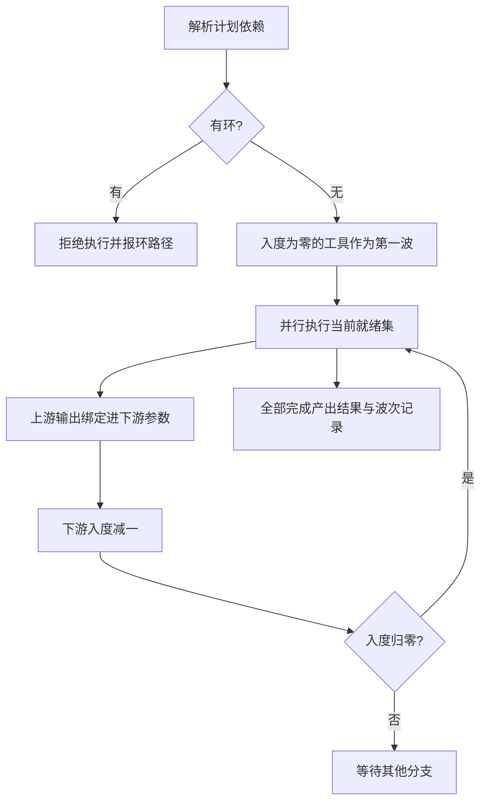
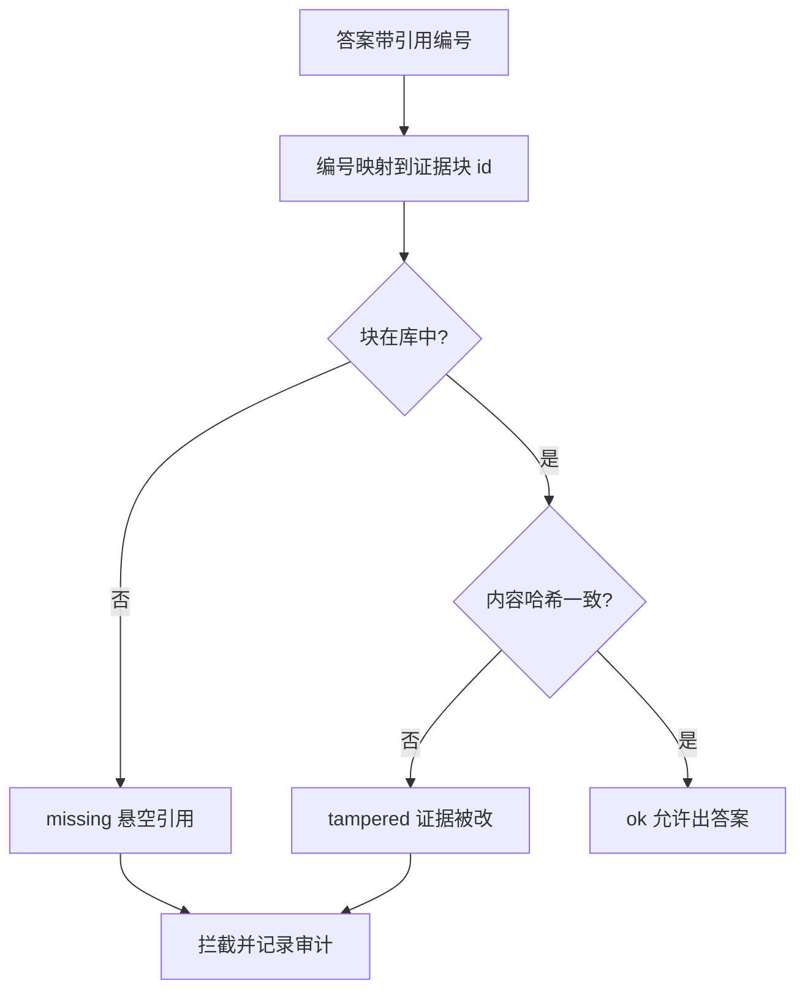
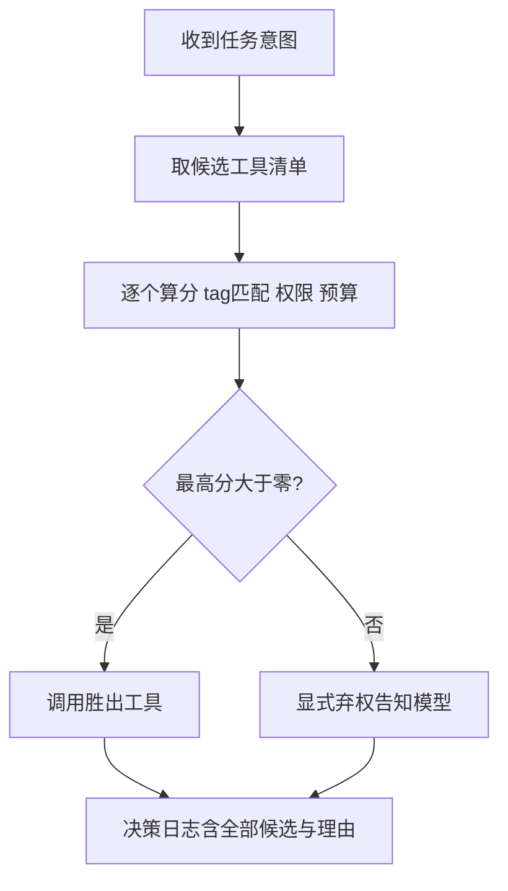
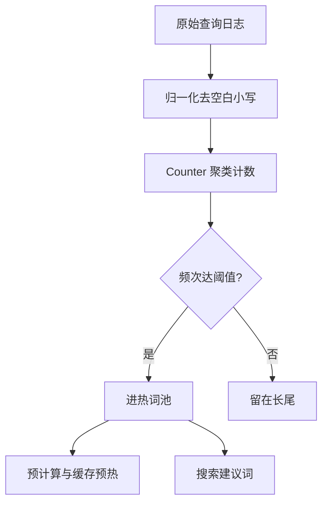
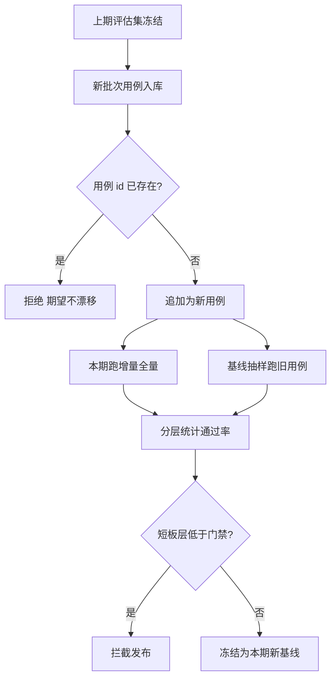
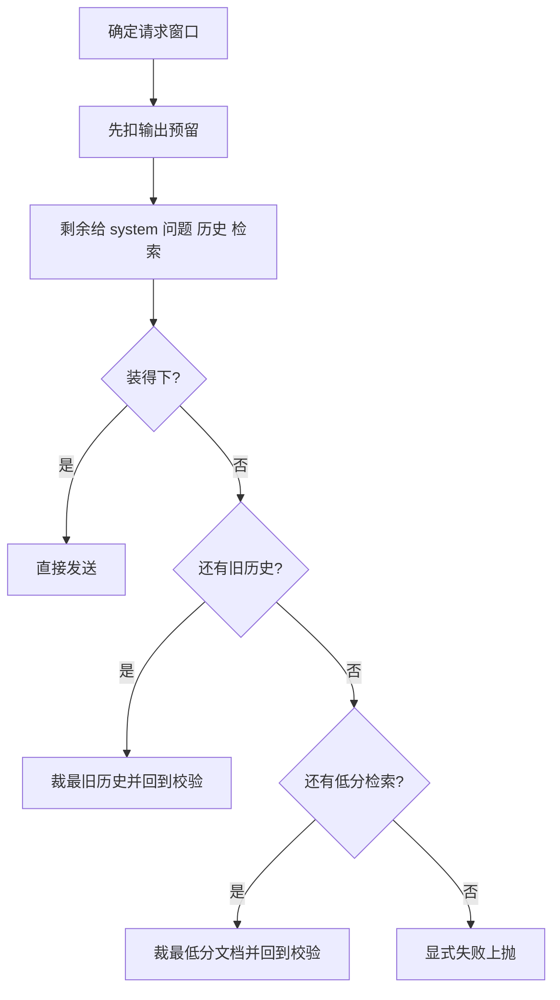
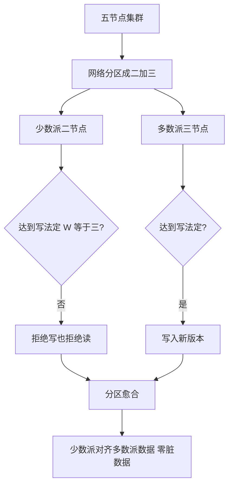
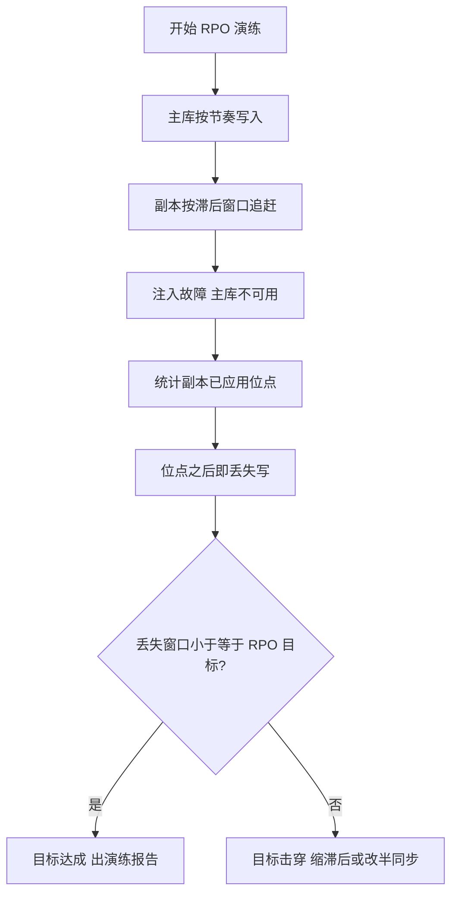
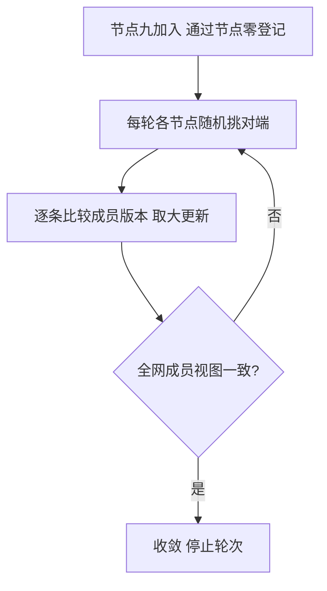

# 第 6 类 · Agent 与 LLM 及系统设计(夜间扩产四)

> 本篇是第 6 类的第四批夜间扩产(Q2291-Q2335 共 45 题),四条线补遗:Agent 侧的就绪驱动 DAG 与输出绑定、记忆三级存储、Prompt 分层覆盖、工具级熔断、多语言一致性、证据完整性、抢占式认领、配置热更新、审计哈希链、确定性演示、结果归一与决策留痕;RAG 侧的嵌入版本迁移、检索宽度自适应、分数归一融合、免责声明、负样本存档、热词池、增量评估集、时间衰减、延迟记账、零命中兜底、分层报告与许可标记;LLM 运维侧的供应商镜像对比、流式断线续传、不可变 Prompt 仓库、过滤器失效模式、请求级 Token 裁剪、退避差异、统一信封、流式泄露检测、心跳保活与错峰批处理;分布式侧的法定人数写入、租约漂移余量、行级锁等待链、布谷鸟删除语义、虚拟节点实测、RPO 演练、截止时间传播、快照续传、G-Counter、写倾斜与 Gossip。
> 全部代码仅标准库、可独立运行,LLM 一律用 FakeLLM/stub 桩,向量检索用假嵌入加余弦,时钟与随机全部注入,不联网不睡大觉。
> 学习建议:每题先说清「不这样做会出什么事故」,再讲机制,最后落到可验证的断言——面试官要的不是名词,是行为证据。

### Q2291 · 工具 DAG 的就绪驱动执行:输出绑定与波次实测

> 难度:★★★★ | 标签:Agent, 工具编排, 并发

**问**:Agent 计划出的工具调用构成一张依赖图,除了按层拓扑排序,还有什么更快的调度方式?上游结果怎么传给下游?

**答**:比固定分层更灵活的是就绪驱动:每完成一个工具,就把依赖它的下游入度减一,减到零立即进入下一波就绪集,不需要等整层结束。执行前必须做环检测,DFS 遇到在栈节点即报环拒绝,绝不让执行器空转挂死。数据传递靠绑定约定:下游参数名声明为 from_上游名,执行器在下游启动时把上游结果注入参数,这就是"数据依赖"的落地形式。波次记录顺手免费产出:波数越少并行度越高,可以直接拿去汇报加速比。相比分层轮询,就绪驱动在长尾工具场景少等一人。



```python
# file: code/06_Agent与LLM及系统设计/q2291_tool_dag_ready.py
"""就绪驱动的工具 DAG 执行:上游完成即解锁下游,输出绑定进下游参数,统计并行波次数。"""
from collections import defaultdict


def check_cycle(deps):
    state = {}

    def visit(n):
        if state.get(n) == 2:
            return
        if state.get(n) == 1:
            raise ValueError("依赖环经过 %s" % n)
        state[n] = 1
        for d in deps[n]:
            visit(d)
        state[n] = 2
    for n in deps:
        visit(n)


def run_dag(tools, deps, inputs):
    check_cycle(deps)
    indeg = {n: len(d) for n, d in deps.items()}
    dependents = defaultdict(list)
    for n, ups in deps.items():
        for u in ups:
            dependents[u].append(n)
    results, order, waves = {}, [], []
    ready = sorted(n for n, k in indeg.items() if k == 0)
    while ready:
        waves.append(list(ready))
        nxt = []
        for name in ready:
            kwargs = dict(inputs.get(name, {}))
            for u in deps[name]:
                kwargs["from_" + u] = results[u]
            results[name] = tools[name](**kwargs)
            order.append(name)
            for down in dependents[name]:
                indeg[down] -= 1
                if indeg[down] == 0:
                    nxt.append(down)
        ready = sorted(nxt)
    return order, results, waves


if __name__ == "__main__":
    log = []
    tools = {
        "search": lambda q: log.append("search") or {"docs": 3},
        "rank": lambda from_search=None: log.append("rank") or {"top": from_search["docs"]},
        "fetch": lambda from_search=None: log.append("fetch") or {"full": from_search["docs"]},
        "answer": lambda from_rank=None, from_fetch=None: log.append("answer") or {"n": from_rank["top"] + from_fetch["full"]},
    }
    deps = {"search": [], "rank": ["search"], "fetch": ["search"], "answer": ["rank", "fetch"]}
    order, results, waves = run_dag(tools, deps, {"search": {"q": "退货"}})
    assert order.index("search") < order.index("rank") < order.index("answer")
    assert order.index("search") < order.index("fetch") < order.index("answer")
    assert len(waves) == 3 and sorted(waves[1]) == ["fetch", "rank"], "第二波应并行两个工具"
    assert results["answer"] == {"n": 6}, "上游输出正确绑定进下游"
    assert log[0] == "search" and log[-1] == "answer"

    try:
        run_dag(tools, {"a": ["b"], "b": ["a"]}, {})
        raise SystemExit("环检测失效")
    except ValueError:
        pass
    print("就绪驱动 DAG 通过:环拒绝 波次并行 上游输出绑定下游")
```

**追问**:
- 某个工具失败时下游怎么办? 答:下游永远等不到入度归零,标记 skipped 而非 failed,聚合报告才能区分"没跑"与"跑挂"
- 绑定名冲突了怎么办? 答:计划校验阶段检查 from_ 参数名与工具签名的交集,冲突即拒绝,不能到运行时才发现

### Q2292 · Agent 记忆的分级存储:热 暖 冷三层

> 难度:★★☆☆ | 标签:Agent, 记忆, 存储分层

**问**:Agent 跑了几百轮对话,上下文记忆怎么存才能又快又省?全放内存或全落盘各有什么问题?

**答**:按访问热度分三层:L1 热层是进程内 OrderedDict,毫秒级读写但容量最小;L2 暖层落盘存 JSON 行,容量大但读一次有 IO 代价;L3 冷层归档老记录,只能显式取回。核心机制是双向流动:热层超容量按 LRU 逐出到暖层,暖层超容量按"非重要且最旧"优先归档;而读穿透会让暖层冷层记录自动晋升回热层——刚被翻过的记忆大概率还会被翻。重要标记让关键事实(用户偏好、已确认决策)在归档时豁免。收益是把内存预算花在最近活跃的记忆上,全量记忆不丢但都不占贵资源。

```python
# file: code/06_Agent与LLM及系统设计/q2292_memory_tiers.py
"""Agent 记忆分级存储:L1 进程内 LRU L2 磁盘档 L3 归档,带晋升 降级与容量核算。"""
from collections import OrderedDict


class TieredMemory:
    def __init__(self, hot_cap=3, warm_cap=5, clock=None):
        self.hot = OrderedDict()
        self.warm = {}
        self.cold = {}
        self.hot_cap, self.warm_cap = hot_cap, warm_cap
        self.clock = clock if clock is not None else (lambda: 0)
        self.moved = []

    def put(self, key, value, important=False):
        rec = {"v": value, "ts": self.clock(), "important": important}
        self.hot[key] = rec
        self.hot.move_to_end(key)
        self._evict_hot()

    def get(self, key):
        if key in self.hot:
            self.hot.move_to_end(key)
            return self.hot[key]["v"]
        if key in self.warm:
            rec = self.warm.pop(key)
            self.hot[key] = rec
            self.moved.append(("promote", key))
            self._evict_hot()
            return rec["v"]
        if key in self.cold:
            rec = self.cold.pop(key)
            self.hot[key] = rec
            self.moved.append(("restore", key))
            self._evict_hot()
            return rec["v"]
        return None

    def _evict_hot(self):
        while len(self.hot) > self.hot_cap:
            key, rec = self.hot.popitem(last=False)
            self.warm[key] = rec
            self.moved.append(("demote", key))
            if len(self.warm) > self.warm_cap:
                oldest = min(self.warm.items(),
                             key=lambda kv: (kv[1]["important"], kv[1]["ts"]))
                self.cold[oldest[0]] = self.warm.pop(oldest[0])
                self.moved.append(("archive", oldest[0]))

    def stats(self):
        return {"hot": len(self.hot), "warm": len(self.warm), "cold": len(self.cold)}


if __name__ == "__main__":
    counter = {"n": 0}

    def clock():
        counter["n"] += 1
        return counter["n"]

    m = TieredMemory(hot_cap=2, warm_cap=2, clock=clock)
    m.put("a", "alpha")
    m.put("b", "beta")
    m.put("c", "gamma", important=True)
    assert m.stats() == {"hot": 2, "warm": 1, "cold": 0}
    assert m.moved[-1] == ("demote", "a"), "最旧的热层记录降级到暖层"
    assert m.get("a") == "alpha" and ("promote", "a") in m.moved, "读穿透自动晋升"
    m.put("d", "delta")
    m.put("e", "epsilon")
    assert m.stats()["cold"] >= 1, "暖层溢出归档冷层"
    assert m.get("a") == "alpha" and ("restore", "a") in m.moved, "冷档可显式取回"
    assert m.get("c") == "gamma", "重要记录可从暖层取回"
    assert m.get("missing") is None
    print("分级记忆通过:热层逐出 暖层归档 读穿透晋升 冷档取回")
```

**追问**:
- 暖层应该存什么格式? 答:追加式 JSONL 加索引偏移,读时按偏移 seek,不要整个文件重写
- 会话结束冷层数据怎么处理? 答:按保留策略过期清理,重要记忆提取为事实卡进长期记忆库,而不是原样囤积

### Q2293 · Prompt 片段的分层组合与覆盖规则

> 难度:★★★☆ | 标签:Agent, Prompt, 组合

**问**:system prompt 有全局默认、租户定制、会话临时、请求级微调四层,怎么组合才不会互相打架?

**答**:定死合并顺序与覆盖语义:按 global、tenant、session、request 从低到高逐层合并,同键高层覆盖低层(last-wins),渲染时按固定小节序输出保证可预测。危险的是"谁都能改谁",所以要有锁定键:role 这类身份锚点声明为 locked,低层设过的键高层同值不报错、异值拒绝覆盖并留痕,防止某个请求级补丁把助手身份改没。拒绝必须可观测——被拒的覆盖进 rejected 列表,审计能回答"谁想改什么没改成"。相比把四层拼成一大段文本,键值合并让冲突确定可测,而不是靠模型自己消化矛盾指令。

```python
# file: code/06_Agent与LLM及系统设计/q2293_prompt_layer_merge.py
"""Prompt 片段分层组合:全局 租户 会话 请求四层 last-wins 合并,lock 键禁止被覆盖。"""
SECTION_ORDER = ["role", "tone", "rule", "style"]


def merge_layers(layers, locked_keys=()):
    merged, rejected = {}, []
    for level, frag in layers:
        for k, v in frag.items():
            if k in locked_keys and k in merged and merged[k] != v:
                rejected.append({"key": k, "level": level})
                continue
            merged[k] = v
    return merged, rejected


def render(merged):
    return "\n".join(merged[k] for k in SECTION_ORDER if k in merged)


if __name__ == "__main__":
    merged, rejected = merge_layers([
        ("global", {"role": "你是客服助手", "tone": "正式", "style": "简洁"}),
        ("tenant", {"tone": "亲切"}),
        ("session", {"rule": "只答退货问题"}),
        ("request", {"tone": "夸张", "role": "你是诗人"}),
    ], locked_keys=("role",))
    assert merged["tone"] == "夸张", "未锁键 last-wins 高层覆盖低层"
    assert merged["role"] == "你是客服助手"
    assert rejected == [{"key": "role", "level": "request"}], "锁定键拒绝覆盖并留痕"
    text = render(merged)
    assert text.index("客服助手") < text.index("夸张"), "渲染按固定小节序"
    merged2, rejected2 = merge_layers([("global", {"role": "A"}), ("tenant", {"role": "A"})],
                                      locked_keys=("role",))
    assert rejected2 == [], "同值重复不视为覆盖"
    print("片段组合通过:分层覆盖 锁定拒绝留痕 固定序渲染")
```

**追问**:
- 层级顺序能按租户改吗? 答:不能,顺序是平台语义,可配的应该是各层内容,顺序一变所有冲突判定都会翻转
- 锁定键之外还想全局禁改怎么办? 答:发布审批时把不允许覆盖的键登记进 locked 清单,清单本身走配置变更流程

### Q2294 · 工具级熔断:连续失败阈值与半开恢复

> 难度:★★★☆ | 标签:Agent, 熔断, 稳定性

**问**:Agent 有 20 个工具,其中外部搜索接口开始大面积超时,怎么不让它拖垮整个 Agent 的每一轮?

**答**:给每个工具配独立熔断器:连续失败达到阈值即熔断,熔断期间调用直接拒绝并抛"请改走其他路径",Agent 循环捕获后换路或告知模型,不再让每个任务都去实测一次下游故障。熔断按工具隔离,搜索挂了邮件工具照常。冷却结束后进入半开态,只放一个探测请求过去:探测成功即恢复并清零计数,失败则重新计时熔断——恢复永远是试探出来的,不是定时器拍板宣布的。相比全局熔断,工具粒度把爆炸半径缩到单个依赖;相比每次都重试,熔断把"明知会失败"的调用成本降为零。

```python
# file: code/06_Agent与LLM及系统设计/q2294_tool_breaker.py
"""工具级熔断:每个工具独立计数,连续失败达阈值即熔断,半开探测成功才恢复。"""


class ToolBreaker:
    def __init__(self, threshold=3, cooldown=5.0):
        self.threshold = threshold
        self.cooldown = cooldown
        self.fails = {}
        self.opened_at = {}
        self.half_open = set()
        self.clock = [0.0]

    def call(self, tool, func, *args, **kwargs):
        if tool in self.opened_at:
            if self.clock[0] - self.opened_at[tool] < self.cooldown:
                raise RuntimeError("工具 %s 熔断中 请改走其他路径" % tool)
            self.half_open.add(tool)
        try:
            out = func(*args, **kwargs)
        except Exception:
            self.fails[tool] = self.fails.get(tool, 0) + 1
            if tool in self.half_open or self.fails[tool] >= self.threshold:
                self.opened_at[tool] = self.clock[0]
                self.half_open.discard(tool)
            raise
        self.fails[tool] = 0
        self.opened_at.pop(tool, None)
        self.half_open.discard(tool)
        return out


if __name__ == "__main__":
    br = ToolBreaker(threshold=3, cooldown=5.0)

    def flaky():
        raise ConnectionError("下游超时")

    for i in range(3):
        try:
            br.call("search_api", flaky)
        except ConnectionError:
            pass
    assert br.opened_at["search_api"] == 0.0, "连续三次失败即熔断"
    try:
        br.call("search_api", flaky)
        raise SystemExit("熔断后不应再触达下游")
    except RuntimeError as e:
        assert "熔断" in str(e)
    ok = {"n": 0}

    def good():
        ok["n"] += 1
        return "ok"

    assert br.call("mail_api", good) == "ok", "熔断按工具隔离 不牵连其他工具"
    br.clock[0] = 10.0
    try:
        br.call("search_api", flaky)
    except ConnectionError:
        pass
    assert br.opened_at["search_api"] == 10.0, "半开探测失败重新计时熔断"
    br.clock[0] = 20.0
    assert br.call("search_api", good) == "ok" and br.fails["search_api"] == 0, "半开成功即恢复并清零"
    assert "search_api" not in br.opened_at
    print("工具级熔断通过:独立计数 熔断隔离 半开探测恢复")
```

**追问**:
- 半开期间并发请求都放过去吗? 答:严格实现半开只放一个探测,其余仍按熔断拒绝,避免恢复瞬间又被并发打挂
- 熔断信息要不要告诉模型? 答:要,把"该工具暂不可用"写进上下文,模型才能主动改走备选路径而不是反复撞墙

### Q2295 · Agent 输出的多语言一致性:语言锁定与术语表

> 难度:★☆☆☆ | 标签:Agent, 输出质量, 国际化

**问**:中文客服 Agent 偶尔冒出一句日语或满屏英文术语,用户截图投诉,怎么系统性防住?

**答**:三层防线。第一层语言检测:按假名、谚文、汉字、拉丁的字符区间判语种,顺序很关键——日语含汉字,必须先查假名再查汉字,否则日文回复会被误判成中文。第二层术语表:会话锁定语言后,把必须用目标语言表述的术语强制替换,比如 vector database 替成向量数据库,这类"夹杂英文"不算漂移,是专业表述。第三层漂移告警:检测语种与会话语言不一致就打标,拦截或重生成由策略定,而不是静默发给用户。检测是纯函数,单测成本极低,上线前把三类漂移案例跑一遍即可。

```python
# file: code/06_Agent与LLM及系统设计/q2295_lang_guard.py
"""Agent 多语言一致性:检测回复语言 锁定会话语言 术语表强制翻译 漂移告警。"""
import re

LANG_HINT = [
    ("ja", re.compile(r"[\u3040-\u30ff]")),
    ("ko", re.compile(r"[\uac00-\ud7af]")),
    ("zh", re.compile(r"[\u4e00-\u9fff]")),
]


def detect_lang(text):
    for lang, pat in LANG_HINT:
        if pat.search(text):
            return lang
    if re.search(r"[A-Za-z]", text):
        return "en"
    return "unknown"


class LangGuard:
    def __init__(self, glossary):
        self.glossary = glossary

    def enforce(self, reply, session_lang):
        lang = detect_lang(reply)
        if lang == "unknown":
            lang = session_lang
        fixed = reply
        for src, dst in self.glossary.get(session_lang, {}).items():
            if src in fixed:
                fixed = fixed.replace(src, dst)
        return {"lang": lang, "fixed_text": fixed, "drifted": lang != session_lang}


if __name__ == "__main__":
    guard = LangGuard({"zh": {"vector database": "向量数据库", "RAG": "检索增强生成"}})
    ok = guard.enforce("退货流程如下,请查收。", "zh")
    assert ok["lang"] == "zh" and not ok["drifted"]
    term = guard.enforce("我们用 vector database 存文档。", "zh")
    assert "向量数据库" in term["fixed_text"], "术语表强制翻译"
    assert not term["drifted"], "夹杂英文术语不算语言漂移"
    drift = guard.enforce("返品の手続きをご案内します。", "zh")
    assert drift["drifted"] and drift["lang"] == "ja", "检测到语言漂移"
    en = guard.enforce("Sorry, I cannot help with that.", "zh")
    assert en["drifted"] and en["lang"] == "en", "英文漂移同样告警"
    print("多语言一致性通过:语言检测 术语表替换 漂移告警")
```

**追问**:
- 用户自己切了语言怎么办? 答:会话语言是状态,用户消息语种连续两轮变化就更新锁定,而非每轮独立判断
- 检测对混合文本可靠吗? 答:以占比最大的文字系统为准,纯标点或 emoji 归 unknown 回退会话语言

### Q2296 · 证据块的完整性校验:内容哈希与断链检测

> 难度:★★☆☆ | 标签:RAG, 引用, 完整性

**问**:RAG 答案里挂着引用编号,但语料每天在更新,怎么保证答案发出时引用的证据还在、还没被改?

**答**:出答案前跑一遍完整性校验,查三件事:存在性——引用的块 id 必须还在库里,语料重建后 id 失效就是悬空引用;一致性——每块入库时存内容哈希,出答案时重算比对,块内容被改过立即暴露,防止"引用说的是 A 现在库里是 B"的静默漂移;断链——答案文本里的 [n] 编号必须全部能映射到块 id,映射缺号说明生成或后处理环节丢了引用。三查结果分类 missing、tampered、ok,任何一项非空就拦截或降级,审计日志记下拦截原因。没有这道闸,引用就从溯源证据退化成了装饰。



```python
# file: code/06_Agent与LLM及系统设计/q2296_evidence_integrity.py
"""证据完整性校验:引用必须在库 内容哈希必须一致,检测证据被改 被删 链路断开。"""
import hashlib, re


def digest(text):
    return hashlib.sha256(text.encode("utf-8")).hexdigest()[:16]


class EvidenceStore:
    def __init__(self):
        self.blocks = {}

    def add(self, bid, text, source):
        self.blocks[bid] = {"text": text, "hash": digest(text), "source": source}

    def verify_citations(self, cited_ids):
        report = {"ok": [], "missing": [], "tampered": []}
        for cid in cited_ids:
            blk = self.blocks.get(cid)
            if blk is None:
                report["missing"].append(cid)
            elif digest(blk["text"]) != blk["hash"]:
                report["tampered"].append(cid)
            else:
                report["ok"].append(cid)
        report["pass"] = not report["missing"] and not report["tampered"]
        return report


def check_answer_refs(answer, id_map):
    used = set(int(m) for m in re.findall(r"\[(\d+)\]", answer))
    return sorted(n for n in used if n not in id_map)


if __name__ == "__main__":
    store = EvidenceStore()
    store.add("b1", "退货窗口 30 天", "policy.pdf#p1")
    store.add("b2", "退款 3 个工作日到账", "faq.html#q5")
    rep = store.verify_citations(["b1", "b2"])
    assert rep["pass"] and set(rep["ok"]) == {"b1", "b2"}
    store.blocks["b2"]["text"] = "退款 30 天到账"
    rep = store.verify_citations(["b1", "b2"])
    assert not rep["pass"] and rep["tampered"] == ["b2"], "内容被改哈希对不上"
    rep = store.verify_citations(["b1", "b9"])
    assert rep["missing"] == ["b9"], "引用了不存在的块"
    assert check_answer_refs("见[1]与[3]。", {1: "b1"}) == [3], "答案引用编号断链"
    print("证据完整性通过:存在性 内容哈希 篡改检测 断链编号")
```

**追问**:
- 语料合法更新后哈希必然对不上怎么办? 答:更新走重嵌入流程时同步刷新块哈希,校验只拦"未走流程的改动"
- 流式输出怎么拦? 答:引用块在首 token 前先校验,校验不过直接走拒答模板,而不是流到一半撤回

### Q2297 · 多 Agent 抢占式任务认领:原子认领与优先级抢占

> 难度:★★★★ | 标签:多Agent, 调度, 并发

**问**:十个 Agent 抢一个任务池,紧急任务插队时正在跑的低优先级任务怎么办?

**答**:两层机制。认领是原子 CAS:任务状态从 open 改为 claimed 的判定与写入一体,后到者看到状态非 open 即失败,天然防重复认领,不需要额外锁。抢占是显式动作:高优先级调度者对在跑任务做优先级比较,仅当在跑任务优先级低于阈值才标记 preempted 并递增 epoch。epoch 是 fencing 令牌:旧持有者拿着旧 epoch 回写结果会被拒绝,新认领者拿最新 epoch 才能提交——没有 epoch,被抢占的 Agent 可能在收到通知前把过期结果写回,覆盖新主的工作。抢占要有宽限期与次数上限,否则两个高优先级任务会来回震荡。

```python
# file: code/06_Agent与LLM及系统设计/q2297_preemptive_claim.py
"""多 Agent 任务认领:CAS 原子认领防重复,高优先级可抢占低优先级,抢占带宽限期。"""


class TaskBoard:
    def __init__(self):
        self.tasks = {}

    def post(self, tid, prio=0):
        self.tasks[tid] = {"status": "open", "owner": None, "prio": prio, "epoch": 0}
        return tid

    def claim(self, tid, agent):
        t = self.tasks.get(tid)
        if t is None or t["status"] not in ("open", "preempted"):
            return None
        t["status"] = "claimed"
        t["owner"] = agent
        t["epoch"] += 1
        return t["epoch"]

    def preempt(self, tid, agent, min_prio):
        t = self.tasks.get(tid)
        if t is None or t["status"] != "claimed" or t["prio"] >= min_prio:
            return None
        old = t["owner"]
        t["status"] = "preempted"
        t["epoch"] += 1
        return {"from": old, "epoch": t["epoch"]}

    def write_result(self, tid, agent, epoch, payload):
        t = self.tasks.get(tid)
        if t is None or t["owner"] != agent or epoch != t["epoch"] or t["status"] != "claimed":
            return False
        t["result"] = payload
        t["status"] = "done"
        return True


if __name__ == "__main__":
    board = TaskBoard()
    board.post("t1", prio=0)
    e1 = board.claim("t1", "agent-low")
    assert e1 == 1
    assert board.claim("t1", "agent-other") is None, "已被认领 CAS 失败"
    p = board.preempt("t1", "agent-high", min_prio=5)
    assert p == {"from": "agent-low", "epoch": 2}, "高优先级抢占成功"
    assert board.write_result("t1", "agent-low", e1, {"x": 1}) is False, "旧 epoch 写入被 fencing 拒绝"
    e2 = board.claim("t1", "agent-high")
    assert e2 == 3, "被抢占任务可重新认领 epoch 继续单调"
    assert board.write_result("t1", "agent-high", e2, {"x": 2}) is True
    assert board.preempt("t1", "someone", min_prio=0) is None, "同级任务不抢占"
    print("抢占认领通过:原子认领 优先级抢占 epoch fencing")
```

**追问**:
- 被抢占的 Agent 怎么知道? 答:它下次心跳或回写时会发现自己 epoch 已落后,主动放弃并把已完成的部分产物登记上交
- 认领与抢占是同一动作吗? 答:认领是空任务分配,抢占是夺走在跑任务,后者多了优先级裁决与宽限期两个前置

### Q2298 · Agent 配置热更新:版本快照与原子替换

> 难度:★★★★ | 标签:Agent, 配置, 工程化

**问**:线上 Agent 的 top_k、超时、模型名要改,又不能重启服务,怎么保证改的瞬间不出"半个新半个旧"的请求?

**答**:配置中心维护不可变快照,更新时构造新快照后一次引用替换——Python 赋值是原子的,读者要么看到完整旧版要么看到完整新版,不存在中间态。关键语义是在途隔离:请求开始时抓一个快照引用,后续配置怎么变都与本请求无关,一次请求从头到尾看到的配置自洽。更新前先校验:必填键缺失、字符串空值直接拒绝,非法配置根本进不了线上。回滚也是一次前滚更新:把旧值再 update 一遍,版本号继续单调递增,永远可审计,不做"把版本号拨回去"这种破坏单调性的事。

```python
# file: code/06_Agent与LLM及系统设计/q2298_config_hot_reload.py
"""Agent 配置热更新:版本号单调递增 原子替换快照 在途请求绑定旧快照跑完。"""


class ConfigCenter:
    def __init__(self, initial):
        self._snap = {"ver": 1, "cfg": dict(initial)}

    def snapshot(self):
        return self._snap

    def update(self, patch, required=()):
        missing = [k for k in required if k not in patch and k not in self._snap["cfg"]]
        blank = [k for k, v in patch.items() if isinstance(v, str) and not v.strip()]
        if missing or blank:
            raise ValueError("非法配置 缺失=%s 空值=%s" % (missing, blank))
        new_cfg = dict(self._snap["cfg"])
        new_cfg.update(patch)
        self._snap = {"ver": self._snap["ver"] + 1, "cfg": new_cfg}
        return self._snap["ver"]


if __name__ == "__main__":
    cc = ConfigCenter({"model": "m1", "top_k": 5, "timeout_s": 30})
    snap1 = cc.snapshot()
    assert snap1["ver"] == 1
    v2 = cc.update({"top_k": 9})
    assert v2 == 2
    assert snap1["cfg"]["top_k"] == 5, "在途请求持有旧快照 不受热更影响"
    assert cc.snapshot()["cfg"]["top_k"] == 9, "新请求即刻看到新配置"
    try:
        cc.update({"model": "   "}, required=("model",))
        raise SystemExit("空值配置应被拒")
    except ValueError:
        pass
    v3 = cc.update({"top_k": 5})
    assert v3 == 3 and cc.snapshot()["cfg"]["top_k"] == 5, "回滚也是一次前滚更新 版本只增不减"
    try:
        cc.update({"missing_key": 1}, required=("model", "temperature"))
        raise SystemExit("缺失必填应被拒")
    except ValueError as e:
        assert "temperature" in str(e)
    print("配置热更新通过:版本快照 原子替换 在途隔离 校验拒非法")
```

**追问**:
- 多进程部署怎么同步? 答:进程订阅版本号广播或轮询拉取,各自本地换绑快照,版本号对齐即视为一致
- 配置改坏了怎么快速止损? 答:保留最近 N 版快照内存驻留,一键 update 回上一版内容,秒级生效

### Q2299 · 审计轨迹的不可篡改追加:哈希链与锚点固化

> 难度:★★★★★ | 标签:Agent, 审计, 安全

**问**:合规要求 Agent 的每一步操作事后不可抵赖,普通日志表增删改都能被运维改掉,怎么证明轨迹没被动过?

**答**:把审计日志做成仅追加的哈希链:每条记录带上前一条的哈希,自身内容再算哈希成为新链头,改任何一条都会导致它的哈希对不上、且所有后继的 prev 断链,双重暴露。链在本机算出来的哈希自己证明自己,所以还要定期锚点固化:每 N 条把当前链头写到外部(对象存储、纸面、链下存证),锚点之后的历史若被截断回滚,现存条数对不上锚点序号即报 truncated,中间抽条则报 chain_break。验证函数无状态可离线跑,合规审查时把日志与锚点一起给出即可自证。追加写权限要收敛到唯一写入角色,链才有意义。

```python
# file: code/06_Agent与LLM及系统设计/q2299_audit_append_only.py
"""审计轨迹:仅追加的哈希链,每条含前链哈希;锚点外移固化;检测篡改与截断回滚。"""
import hashlib, json


def _h(s):
    return hashlib.sha256(s.encode("utf-8")).hexdigest()[:16]


class AuditLog:
    def __init__(self):
        self.entries = []
        self.head = "GENESIS"
        self.anchors = []

    def append(self, event):
        rec = {"seq": len(self.entries), "event": event, "prev": self.head}
        raw = json.dumps(rec, ensure_ascii=False, sort_keys=True)
        self.head = _h(raw)
        rec["hash"] = self.head
        self.entries.append(rec)
        return rec["seq"]

    def anchor(self):
        self.anchors.append((len(self.entries), self.head))
        return self.anchors[-1]

    def verify(self):
        prev = "GENESIS"
        problems = []
        for rec in self.entries:
            body = {k: rec[k] for k in ("seq", "event", "prev")}
            if _h(json.dumps(body, ensure_ascii=False, sort_keys=True)) != rec["hash"]:
                problems.append(("tampered", rec["seq"]))
            if rec["prev"] != prev:
                problems.append(("chain_break", rec["seq"]))
            prev = rec["hash"]
        for n, head in self.anchors:
            if n <= len(self.entries):
                if self.entries[n - 1]["hash"] != head:
                    problems.append(("anchor_mismatch", n))
            else:
                problems.append(("truncated", n))
        return problems


if __name__ == "__main__":
    log = AuditLog()
    for ev in ({"do": "read", "target": "doc1"}, {"do": "write", "target": "doc1"},
               {"do": "approve", "target": "doc1"}):
        log.append(ev)
    log.anchor()
    assert log.verify() == [], "正常链零告警"
    log.entries[1]["event"] = {"do": "delete", "target": "doc1"}
    assert ("tampered", 1) in log.verify(), "改历史被链哈希抓到"
    log2 = AuditLog()
    for ev in ({"do": "a"}, {"do": "b"}, {"do": "c"}):
        log2.append(ev)
    log2.anchor()
    del log2.entries[2]
    assert ("truncated", 3) in log2.verify(), "锚点指向第 3 条而现存只有 2 条 报截断"
    log3 = AuditLog()
    for ev in ({"do": "a"}, {"do": "b"}, {"do": "c"}, {"do": "d"}):
        log3.append(ev)
    log3.anchor()
    del log3.entries[1]
    problems = log3.verify()
    assert ("chain_break", 2) in problems, "中间抽条 后继的前链哈希对不上"
    assert ("truncated", 4) in problems
    print("审计轨迹通过:链式哈希 篡改可检 截断回滚可检 链断可检")
```

**追问**:
- 攻击者把锚点之后的记录全部重算一遍呢? 答:重算的链头与外部锚点不一致,anchor_mismatch 暴露,锚点在外部系统手里改不了
- 高频写入性能怎么办? 答:批量合并哈希或用 Merkle 树分段,链保证的是可检性,结构可以换

### Q2300 · 端到端演示脚本的确定性:种子与时钟注入

> 难度:★☆☆☆ | 标签:Agent, 测试, 确定性

**问**:给客户演示的 Agent 脚本今天跑一个结果明天跑另一个,截图都截不一致,怎么让它每次完全一样?

**答**:把三大不确定性来源全部注入化。随机:管道内部只用自带的 random.Random(seed) 实例,不碰全局 random,别人在别处 seed 全局随机也污染不到你。时钟:不用 time.time,注入 FakeClock,推进步长固定,时间戳序列每次一致。桩数据:LLM 与外部工具全部 stub 化,输入定则输出定。最后给输出算指纹,两次运行指纹相等作为确定性回归断言——演示脚本从此既是 demo 又是测试。好处不止演示稳定:出问题时同种子可精确复现,排查"偶现"问题的成本从大海捞针降为一键重放。

```python
# file: code/06_Agent与LLM及系统设计/q2300_deterministic_demo.py
"""端到端演示的确定性:注入随机种子 假时钟 固定桩数据,两次运行指纹一致。"""
import random, hashlib


class FakeClock:
    def __init__(self, start=0.0, step=0.5):
        self.now = start
        self.step = step

    def __call__(self):
        self.now += self.step
        return self.now


class DemoPipeline:
    def __init__(self, seed, clock):
        self.rng = random.Random(seed)
        self.clock = clock

    def run(self, query):
        picks = [self.rng.choice(["a", "b", "c"]) for _ in range(3)]
        ts = self.clock()
        body = "%s|%s|%.2f" % (query, ",".join(picks), ts)
        return {"picks": picks, "ts": round(ts, 2),
                "fingerprint": hashlib.sha256(body.encode("utf-8")).hexdigest()[:12]}


if __name__ == "__main__":
    r1 = DemoPipeline(seed=42, clock=FakeClock()).run("退货政策")
    r2 = DemoPipeline(seed=42, clock=FakeClock()).run("退货政策")
    assert r1 == r2, "同种子同输入两次运行完全一致"
    assert r1["ts"] == 0.5 and r1["ts"] == r2["ts"], "假时钟推进确定"
    random.seed(1)
    random.choice(["x", "y", "z"])
    r3 = DemoPipeline(seed=42, clock=FakeClock()).run("退货政策")
    assert r3 == r1, "管道只用自带 Random 实例 全局随机被污染也不影响"
    picks_set = {DemoPipeline(seed=s, clock=FakeClock()).run("x")["picks"][0] for s in range(20)}
    assert len(picks_set) > 1, "不同种子应产生不同序列"
    print("确定性演示通过:种子注入 假时钟 全局随机隔离 指纹可复现")
```

**追问**:
- 真模型没法确定性怎么办? 答:演示与回归用录制回放的桩,真模型只做冒烟,两层分开各自稳定
- 多线程下还有哪些不确定? 答:调度顺序与字典遍历时机,演示脚本单线程跑,或多线程结果收集按固定键排序

### Q2301 · 工具结果的时区与单位归一

> 难度:★★★☆ | 标签:Agent, 数据质量, 归一

**问**:三个工具一个返回 KB 一个返回 GB,一个用东八区本地时间一个用 UTC,聚合时账算错了,根因和修法是什么?

**答**:根因是异构工具结果的量纲不一致,直接相加是拿不同单位做算术。修法是在工具出口统一做归一层:时间统一折算成 UTC 存储,本地展示串另存时区偏移字段,astimezone 换算而不是简单加减钟面;单位统一到基准单位并保留换算表,KB、GB 全折成 MB;货币统一到记账本位币并记录汇率版本。归一之后同名条目才能安全合并,合并是加法,单位不同直接相加永远错。归一层放工具适配器里而不是聚合层里,让坏数据进不了管道,聚合层只管算术。

```python
# file: code/06_Agent与LLM及系统设计/q2301_result_normalizer.py
"""工具结果归一:时区统一 UTC 单位统一 SI 货币统一基准,异构工具结果可合并。"""
from datetime import datetime, timedelta, timezone


def norm_time(ts_epoch_s, tz_offset_hours):
    base = datetime(2026, 1, 1, tzinfo=timezone.utc) + timedelta(seconds=ts_epoch_s)
    local = base.astimezone(timezone(timedelta(hours=tz_offset_hours)))
    return {"utc": base.strftime("%Y-%m-%dT%H:%M:%SZ"),
            "local": local.strftime("%Y-%m-%dT%H:%M:%S%z")}


UNIT_TO_MB = {"KB": 1.0 / 1024.0, "MB": 1.0, "GB": 1024.0}
FX_TO_CNY = {"CNY": 1.0, "USD": 7.2}


def norm_size(value, unit):
    return round(value * UNIT_TO_MB[unit], 2)


def norm_price(value, currency):
    return round(value * FX_TO_CNY[currency], 2)


def merge_rows(rows):
    out = {}
    for r in rows:
        row = {"size_mb": norm_size(r["size"], r["unit"]),
               "price_cny": norm_price(r["price"], r["currency"]),
               "ts_utc": norm_time(r["ts"], r.get("tz", 0))["utc"]}
        key = r["item"]
        if key in out:
            out[key]["price_cny"] = round(out[key]["price_cny"] + row["price_cny"], 2)
            out[key]["size_mb"] = round(out[key]["size_mb"] + row["size_mb"], 2)
        else:
            out[key] = row
    return out


if __name__ == "__main__":
    rows = [
        {"item": "存储", "size": 512, "unit": "KB", "price": 10, "currency": "USD", "ts": 3600, "tz": 8},
        {"item": "存储", "size": 2, "unit": "GB", "price": 30, "currency": "CNY", "ts": 0, "tz": 0},
        {"item": "带宽", "size": 1, "unit": "GB", "price": 5, "currency": "USD", "ts": 1800, "tz": -5},
    ]
    merged = merge_rows(rows)
    assert merged["存储"]["size_mb"] == 2048.5, "KB 与 GB 统一到 MB"
    assert merged["存储"]["price_cny"] == 72.0 + 30.0, "USD 与 CNY 统一到 CNY"
    assert merged["存储"]["ts_utc"] == "2026-01-01T01:00:00Z", "本地时刻统一成 UTC"
    t = norm_time(1800, -5)
    assert t["utc"] == "2026-01-01T00:30:00Z"
    assert t["local"] == "2025-12-31T19:30:00-0500", "西五区本地串带偏移量可读"
    print("结果归一通过:时区统一 单位统一 货币统一 异构工具结果可合并")
```

**追问**:
- 原始数据要不要保留? 答:保留原始值与归一值两列,汇率或单位口径错了可以重算,归一不可逆就是事故
- 时区字段缺失怎么办? 答:按工具声明的默认时区补,绝不猜,猜错一天账就错一天

### Q2302 · 工具选择的决策留痕:候选评分与可解释日志

> 难度:★★★☆ | 标签:Agent, 可观测性, 可解释

**问**:Agent 明明有查订单的工具,却总去调客户资料库,用户等得着急,怎么定位和复盘这类选错工具的问题?

**答**:给工具选择加一层显式评分与留痕:每个候选按 tag 匹配度、权限、预算余量打分,无权限是大额负分,超预算也扣分但不隐藏;胜出者执行,落选者连同扣分理由全部进决策日志。日志回答三个问题:当时有哪些候选、各自为什么得这个分、为什么没选它。无任何候选得分大于零时显式弃权,把"我不知道该用什么工具"反馈给模型或人工,而不是硬选一个最不坏的。有了留痕,选错工具从玄学变成数据问题:复盘能看到权限配错、标签缺失还是评分权重不合理,改哪一项立竿见影。



```python
# file: code/06_Agent与LLM及系统设计/q2302_tool_decision_trace.py
"""工具选择留痕:候选工具按相关度 权限 成本打分,胜出与落选都进决策日志。"""


def score_candidates(cands, query_tags, budget_left):
    scored = []
    for c in cands:
        overlap = len(set(c["tags"]) & set(query_tags))
        s = overlap * 3.0
        if not c["allowed"]:
            s -= 100.0
        if c["avg_cost"] > budget_left:
            s -= 20.0
        scored.append({"tool": c["name"], "score": round(s, 2),
                       "reason": "tag匹配%d 权限%s 预算%s" % (
                           overlap, "有" if c["allowed"] else "无",
                           "够" if c["avg_cost"] <= budget_left else "超")})
    scored.sort(key=lambda d: d["score"], reverse=True)
    return scored


def decide(cands, query_tags, budget_left):
    trace = score_candidates(cands, query_tags, budget_left)
    winner = trace[0]["tool"] if trace and trace[0]["score"] > 0 else None
    return {"winner": winner, "trace": trace}


if __name__ == "__main__":
    cands = [
        {"name": "order_api", "tags": ["order", "refund"], "allowed": True, "avg_cost": 0.02},
        {"name": "crm_lookup", "tags": ["customer"], "allowed": True, "avg_cost": 0.01},
        {"name": "raw_delete", "tags": ["order", "refund"], "allowed": False, "avg_cost": 0.0},
    ]
    d = decide(cands, ["refund", "order"], budget_left=0.05)
    assert d["winner"] == "order_api"
    assert [t["tool"] for t in d["trace"]] == ["order_api", "crm_lookup", "raw_delete"]
    assert d["trace"][2]["score"] < 0 and "无" in d["trace"][2]["reason"], "无权限候选垫底但留痕"
    d2 = decide(cands, ["weather"], budget_left=0.01)
    assert d2["winner"] is None, "无相关候选时显式说不知道 而不是硬选"
    assert all(t["score"] <= 0 for t in d2["trace"])
    d3 = decide(cands, ["refund", "order"], budget_left=0.005)
    assert "超" in d3["trace"][0]["reason"], "超预算也要扣分留痕"
    print("决策留痕通过:候选评分 胜出落选全留痕 无候选显式弃权")
```

**追问**:
- 权重怎么定? 答:先用等权跑线上 badcase 回放,按"哪些 case 因此修好"调,不拍脑袋
- 日志量太大怎么办? 答:落选候选只存分数与理由码,完整参数只在抽样与失败请求上保留

### Q2303 · 嵌入模型的版本迁移:重嵌入队列与灰度切换

> 难度:★★★★ | 标签:RAG, 嵌入, 迁移

**问**:换新版 embedding 模型,维度都变了,几百万向量怎么迁?迁一半线上查询怎么办?

**答**:核心纪律是新旧向量绝不混算:同一文本两版嵌入的余弦没有意义,所以索引里每篇文档允许同时存 emb_v1 与 emb_v2,状态标记 v1 或 dual。迁移走重嵌入队列分批执行,批大小按配额控制,迁完的是 dual 态;查询侧在切换前始终用旧版向量对旧版索引,行为与迁移前完全一致。切换是一次原子动作,前置条件是重嵌入完成率百分之百,未完成就调用切换直接拒绝——半新半旧的混合检索是最隐蔽的事故,宁可挡住也不放行。切换后旧向量保留一个观察期,用于回滚与对拍。

```python
# file: code/06_Agent与LLM及系统设计/q2303_embedding_migration.py
"""嵌入模型版本迁移:新版本分批重嵌入,完成前旧版兜底,未完成禁止切换。"""


def fake_embed_v1(text):
    return [text.count("货"), text.count("款"), 1.0]


def fake_embed_v2(text):
    return [text.count("货"), text.count("款"), len(text) % 5, 0.5]


def cosine(a, b):
    dot = sum(x * y for x, y in zip(a, b))
    na = sum(x * x for x in a) ** 0.5
    nb = sum(x * x for x in b) ** 0.5
    return dot / (na * nb) if na and nb else 0.0


class MigratingIndex:
    def __init__(self):
        self.docs = {}
        self.active = "v1"
        self.reembedded = 0

    def add(self, did, text):
        self.docs[did] = {"text": text, "emb_v1": fake_embed_v1(text),
                          "emb_v2": None, "ver": "v1"}

    def reembed_batch(self, n=2):
        for did, d in self.docs.items():
            if d["emb_v2"] is None:
                d["emb_v2"] = fake_embed_v2(d["text"])
                d["ver"] = "dual"
                self.reembedded += 1
                n -= 1
                if n == 0:
                    break

    def migration_done(self):
        return all(d["emb_v2"] is not None for d in self.docs.values())

    def switch(self):
        if not self.migration_done():
            raise RuntimeError("仍有文档未重嵌入 禁止切换查询向量")
        self.active = "v2"

    def search(self, query, k=1):
        emb_fn = fake_embed_v1 if self.active == "v1" else fake_embed_v2
        key = "emb_" + self.active
        q = emb_fn(query)
        best, bs = None, -2.0
        for did, d in self.docs.items():
            s = cosine(q, d[key])
            if s > bs:
                best, bs = did, s
        return best


if __name__ == "__main__":
    idx = MigratingIndex()
    for i, t in enumerate(["退货政策说明", "退款进度查询", "换货流程指引"]):
        idx.add("d%d" % i, t)
    assert idx.active == "v1" and idx.search("退货") == "d0"
    try:
        idx.switch()
        raise SystemExit("未完成迁移不允许切换")
    except RuntimeError:
        pass
    idx.reembed_batch(2)
    assert not idx.migration_done() and idx.reembedded == 2, "分批重嵌入"
    idx.reembed_batch(10)
    assert idx.migration_done()
    idx.switch()
    assert idx.active == "v2" and idx.search("退款") == "d1"
    print("嵌入迁移通过:分批重嵌入 未完成禁止切换 切换后走新向量")
```

**追问**:
- 迁移期间新增文档怎么办? 答:新文档入库直接双写两版嵌入,不进重嵌入队列,避免越迁越多
- 怎么判断新版值得切? 答:迁移完成后新旧索引跑同一评估集对拍,检索指标提升才切,否则版本留在 dual 观察区

### Q2304 · 检索宽度自适应:按查询信息量调节 top_k

> 难度:★★★☆ | 标签:RAG, 检索, 成本

**问**:top_k 固定取 5,简单问题浪费生成 token,复杂问题又召不全,有没有办法按查询自动调?

**答**:用查询自身的分布特征估信息量:对分词后的查询算香农熵,词少且集中熵低,说明意图聚焦,用最小 top_k 就够;词多且分散熵高,意图模糊或多主题,自动加宽到最大 top_k 多召回一些,留给重排去筛。宽度必须受预算封顶,再模糊的查询也不能把窗口撑爆。这是个粗粒度启发式,胜在零标注零训练、可解释可配置——工程上比训练一个查询复杂度分类器性价比高得多。上限之外还可以叠加多路召回配额:高熵查询每路多分一点,低熵查询集中预算给单路。

```python
# file: code/06_Agent与LLM及系统设计/q2304_adaptive_topk.py
"""检索宽度自适应:短窄问题用小 top_k,模糊多义问题自动加宽,预算封顶。"""
import math
from collections import Counter


def query_entropy(query_tokens):
    c = Counter(query_tokens)
    total = len(query_tokens)
    ent = 0.0
    for v in c.values():
        p = v / total
        ent -= p * math.log2(p)
    return ent


def pick_topk(query_tokens, k_min=2, k_max=8, cap=6):
    ent = query_entropy(query_tokens)
    if ent <= 1.0:
        k = k_min
    elif ent <= 1.8:
        k = k_min + 2
    else:
        k = k_max
    return min(k, cap), ent


def retrieve(index, query, k):
    return index[:k]


if __name__ == "__main__":
    index = ["d%d" % i for i in range(10)]
    k1, e1 = pick_topk(["退货", "政策"])
    k2, e2 = pick_topk(["那个", "东西", "怎么", "弄", "帮忙", "看看"])
    k3, e3 = pick_topk(["退货"])
    assert k1 == 2 and k3 == 2, "聚焦查询用最小宽度"
    assert k2 > k1, "高熵模糊查询自动加宽"
    k4, _ = pick_topk(["模糊", "查询", "很", "发散", "完全", "没有", "重点"], cap=5)
    assert k4 == 5, "宽度受预算封顶"
    assert e2 > e1 >= 0
    assert retrieve(index, "q", k2) == index[:k2]
    print("自适应宽度通过:低熵收窄 高熵加宽 预算封顶")
```

**追问**:
- 熵高但其实是闲聊怎么办? 答:前置意图分类,闲聊直接走零检索路径,不进宽度调节
- 宽度调了效果怎么验证? 答:离线用评估集对比固定宽度与自适应的命中率与生成成本,线上灰度看同指标

### Q2305 · 多路召回的分数归一:min-max 与 z 分数融合

> 难度:★★★★ | 标签:RAG, 融合, 检索

**问**:BM25 分数动辄十几二十,向量相似度只有零点几,两路结果怎么合一个排名?直接相加行不行?

**答**:直接相加是经典错误:量纲差一个数量级,词面分完全淹没语义分,排序等于只看 BM25。正确做法是先各自归一再加权:min-max 把每路分数拉到零一区间,简单直观但对离群分敏感;z-score 减均值除标准差,对分布更稳,适合分数分布未知的路。归一后按可调权重线性融合,权重就是两路的"话语权",由评估集调出。要处理退化情况:某一路内所有分数相等时无区分度,归一应退化为中性分而不是除零报错。若两路分数分布极端偏斜,还可以退到 RRF 只用排名不算分——Q1190 的方案,这里是分数版对偶。

```python
# file: code/06_Agent与LLM及系统设计/q2305_score_normalization.py
"""多路召回融合:两路分数量纲不同,先各自归一再加权融合,量纲直加是经典错误。"""


def minmax(scores):
    lo, hi = min(scores), max(scores)
    if hi == lo:
        return [0.5] * len(scores)
    return [(s - lo) / (hi - lo) for s in scores]


def zscore(scores):
    n = len(scores)
    mean = sum(scores) / n
    var = sum((s - mean) ** 2 for s in scores) / n
    std = var ** 0.5 or 1.0
    return [(s - mean) / std for s in scores]


def fuse(bm25, vec, w=(0.4, 0.6), method="minmax"):
    norm = minmax if method == "minmax" else zscore
    a, b = norm(bm25), norm(vec)
    return [round(w[0] * x + w[1] * y, 4) for x, y in zip(a, b)]


if __name__ == "__main__":
    ids = ["d0 双路都好", "d1 只有词面", "d2 只有语义"]
    bm25 = [18.0, 19.0, 2.0]
    vec = [0.90, 0.10, 0.95]
    naive = [round(a + b, 3) for a, b in zip(bm25, vec)]
    assert ids[max(range(3), key=lambda i: naive[i])] == "d1 只有词面", "量纲直加被词面分淹没"
    fused = fuse(bm25, vec)
    order = [ids[i] for i in sorted(range(3), key=lambda i: -fused[i])]
    assert order[0] == "d0 双路都好", "归一后融合 双好文档登顶"
    assert fused[2] > fused[1], "语义强于纯词面命中"
    fused_z = fuse(bm25, vec, method="z")
    assert [ids[i] for i in sorted(range(3), key=lambda i: -fused_z[i])][0] == "d0 双路都好"
    flat = fuse([5.0, 5.0], [0.3, 0.3])
    assert flat == [0.5, 0.5], "单一路内无区分度时归一退化为中性分"
    print("分数归一通过:量纲问题复现 min-max 与 z 分数融合 等值退化")
```

**追问**:
- 归一在候选并集上做还是每路独立做? 答:每路独立做,归一目的是路内可比,跨路比较交给融合权重
- 上线前怎么定权重? 答:评估集网格搜索少量取值,看命中率与 MRR,权重进配置可热更

### Q2306 · RAG 答案的免责声明策略:话题分级与幂等注入

> 难度:★★☆☆ | 标签:RAG, 合规, 输出

**问**:RAG 系统会答法律、医疗、投资问题,法务要求加免责声明,又不能每句话都加得像念经,怎么设计?

**答**:声明是策略不是文案,按话题风险分级管理:法律、医疗、金融划高风险,声明必须加;产品信息这类低风险给轻提示;一般话题不加。注入要幂等——同一答案重复过声明管线不能叠两层声明,判断依据是声明文案已在答案里就跳过,这也让重试与多级管线天然安全。未知话题按 general 处理不乱加,避免声明通胀让用户麻木。声明文案统一走配置化模板带版本号,法务改措辞是配置变更,不改代码。合规审计时,每条答案能回答"为什么加或不加声明",比"都加了"更可信。

```python
# file: code/06_Agent与LLM及系统设计/q2306_disclaimer_policy.py
"""RAG 免责声明策略:按话题风险分级,高风险答案自动附加声明,声明只加一次。"""
POLICY = {
    "legal": "本回答引自公开文档,不构成法律意见,重大决策请咨询执业律师。",
    "medical": "健康信息仅供参考,用药请遵医嘱。",
    "finance": "以下内容不构成投资建议,市场有风险。",
    "product": "信息以最新官方文档为准。",
}
HIGH_RISK = ("legal", "medical", "finance")


def classify(topic):
    if topic in POLICY:
        return topic, "high" if topic in HIGH_RISK else "low"
    return "general", "low"


def attach(answer, topic):
    name, level = classify(topic)
    text = POLICY.get(name, "")
    if not text or text in answer:
        return {"answer": answer, "disclaimer": None, "topic": name, "level": level}
    sep = "" if answer.endswith(("。", "!", "?")) else "。"
    return {"answer": answer + sep + text, "disclaimer": text,
            "topic": name, "level": level}


if __name__ == "__main__":
    r1 = attach("根据《劳动合同法》第八十二条,你可以主张二倍工资。", "legal")
    assert r1["disclaimer"] and r1["level"] == "high", "法律话题必须带声明"
    r2 = attach(r1["answer"], "legal")
    assert r2["answer"] == r1["answer"] and r2["disclaimer"] is None, "声明幂等 不重复追加"
    r3 = attach("我们的退货窗口是 30 天。", "product")
    assert r3["disclaimer"] and r3["level"] == "low"
    r4 = attach("今天天气不错。", "general")
    assert r4["disclaimer"] is None and r4["topic"] == "general"
    r5 = attach("先协商再仲裁。", "legal2")
    assert r5["disclaimer"] is None, "未知话题按 general 不乱加"
    print("免责声明通过:话题分级 幂等追加 未知话题不误伤")
```

**追问**:
- 话题分类错了漏加声明怎么办? 答:分类器输出带置信度,低置信度的风险话题按高风险兜底,宁多勿漏
- 流式输出什么时候注入? 答:流结束时统一追加声明帧,不插在正文中间打乱渲染

### Q2307 · 负样本存档:hard negative 入库与检索复用

> 难度:★★★☆ | 标签:RAG, 评估, 数据

**问**:用户问水果价格,检索把 iPhone 发布会排第一,这种"看着相关其实答非所问"的例子怎么变废为宝?

**答**:这类案例叫 hard negative:字面或语义上与查询有交集、排名靠前、但对 answering 无贡献的块。把 query 与 doc 对记进负样本存档,标注排名与原因,沉淀成资产而不是散落在 badcase 群里。两个用法:检索侧做查询级降权,同 query 再次出现时对存档负样本加惩罚分,立即止血;评估侧做回归集,每次调排序模型或换嵌入都要验证这些历史陷阱不再上榜。注意惩罚的作用域是查询级,跨查询乱加会把别的合法场景打坏。存档要定期清洗:有些"负样本"其实是语料缺失的信号,该进语料建设而不是降权。

```python
# file: code/06_Agent与LLM及系统设计/q2307_hard_negative_archive.py
"""负样本存档:检索靠前但不该命中的块记为 hard negative,评估时验证不再上榜。"""


class NegativeArchive:
    def __init__(self):
        self.items = []

    def record(self, query, doc, rank, reason="ranked_high_but_irrelevant"):
        self.items.append({"query": query, "doc": doc, "rank": rank, "reason": reason})

    def penalty_view(self):
        pen = {}
        for it in self.items:
            pen.setdefault(it["query"], {})[it["doc"]] = -0.3
        return pen


def rerank_with_archive(ranked, query, archive):
    pen = archive.penalty_view().get(query, {})
    adj = [(d, round(s + pen.get(d, 0.0), 4)) for d, s in ranked]
    adj.sort(key=lambda t: t[1], reverse=True)
    return adj


if __name__ == "__main__":
    arch = NegativeArchive()
    arch.record("苹果 价格", "iphone 发布会", 1)
    ranked = [("iphone 发布会", 0.9), ("水果 促销", 0.8)]
    before = [d for d, _ in ranked]
    after = rerank_with_archive(ranked, "苹果 价格", arch)
    assert before[0] == "iphone 发布会", "负样本原本高居榜首"
    assert after[0][0] == "水果 促销", "惩罚后正例登顶"
    assert after[1][1] == 0.6, "hard negative 被降权"
    arch.record("苹果 价格", "iphone 发布会", 1)
    assert len(arch.penalty_view()["苹果 价格"]) == 1, "重复记录去重 不叠加惩罚"
    other = rerank_with_archive(ranked, "苹果 手机", arch)
    assert other[0][0] == "iphone 发布会", "惩罚只对同查询生效"
    print("负样本存档通过:记录 hard negative 查询级降权 隔离生效范围")
```

**追问**:
- 负样本和 badcase 库什么关系? 答:badcase 是现象记录,负样本是其中可执行化的子集,带结构化字段能直接进排序逻辑
- 惩罚分怎么定? 答:从让正例刚好登顶的最小值起步,回放历史查询验证不误伤,写进配置带版本

### Q2308 · 查询聚类与热词池:高频聚合与预计算

> 难度:★★☆☆ | 标签:RAG, 缓存, 运营

**问**:一天几十万条查询,大量是"退货政策"换个空格写法,怎么识别热点并利用它?

**答**:先归一化再聚类:去首尾空白、压内部空白、统一小写,"退货 政策"与"退货政策"聚成同一键,Counter 计数后按阈值筛出热词。热词池有两个出口:预计算出口,对高频查询提前跑检索与生成、结果进缓存,高峰期这些查询直接命中,把昂贵的实时链路省掉;建议出口,作为搜索联想词露出,引导用户用规范表述,进一步抬高命中率。阈值定多高要看流量分布,通常取覆盖头部两成流量的最小集合。热词池要定期重算,查询分布随运营活动漂移,昨天的热点今天可能过期。



```python
# file: code/06_Agent与LLM及系统设计/q2308_hot_query_pool.py
"""查询热词池:归一化聚类高频查询,超过阈值进热池,预热缓存与推荐词双输出。"""
import re
from collections import Counter


def norm_query(q):
    return re.sub(r"\s+", "", q.strip().lower())


def cluster_queries(logs, threshold=3):
    counts = Counter(norm_query(q) for q in logs)
    hot = {q: c for q, c in counts.items() if c >= threshold}
    return counts, hot


def build_pool(hot, top_n=5):
    ranked = sorted(hot.items(), key=lambda kv: (-kv[1], kv[0]))[:top_n]
    return {"prefetch": [q for q, _ in ranked],
            "suggest": sorted(q for q, _ in ranked)}


if __name__ == "__main__":
    logs = ["退货 政策", "退货政策", "退货政策", "退款进度", "退款 进度", "发票开具"]
    counts, hot = cluster_queries(logs, threshold=2)
    assert counts["退货政策"] == 3, "空白变体聚到同一键"
    assert set(hot) == {"退货政策", "退款进度"}
    assert "发票开具" not in hot, "低频查询不入热池"
    pool = build_pool(hot)
    assert pool["prefetch"][0] == "退货政策", "按频次排预计算池"
    assert pool["suggest"] == sorted(pool["prefetch"])
    print("热词池通过:归一聚类 阈值筛选 预热与建议双输出")
```

**追问**:
- 与语义缓存的分工? 答:热词池处理"归一化后同串"的显式热点,语义缓存兜长尾的"意思相近",两者命中层次不同
- 热词被攻击刷量怎么办? 答:按租户与来源 IP 做频次去偏,单一来源贡献的计数打折或剔除

### Q2309 · 增量评估集:滚动扩充与冻结基线

> 难度:★★★☆ | 标签:RAG, 评估, 工程化

**问**:评估集三个月没更新,新场景全测不到;全量重建又发现旧用例期望被顺手改了,指标"变好"是假象,怎么办?

**答**:评估集按批次滚动扩充,核心纪律是期望值冻结:用例入库时快照期望,后续批次想用同 id 改期望直接拒绝——旧用例的"对错标准"不随人的记忆漂移,指标变化才可归因于系统变化而不是考卷变化。每期评估跑两类:新批次用例全量跑,这是增量;历史基线抽样跑,控制成本的同时盯住回归。通过率按批次分账,新用例不过挡发布,旧用例退化定位是哪期引入。这样评估集既长新肉又不失忆,和 Q1507 的快照版本化配合,还能跨期 diff。

```python
# file: code/06_Agent与LLM及系统设计/q2309_incremental_evalset.py
"""增量评估集:基线冻结 逐期追加用例 每期只跑增量加抽样基线,通过率分账。"""


class EvalSet:
    def __init__(self):
        self.cases = []
        self.frozen = {}

    def add_batch(self, batch, batch_no):
        added = []
        for c in batch:
            if any(x["id"] == c["id"] for x in self.cases):
                continue
            self.cases.append({"id": c["id"], "q": c["q"], "expect": c["expect"],
                               "batch": batch_no})
            self.frozen[c["id"]] = c["expect"]
            added.append(c["id"])
        return added

    def run(self, system, new_ids, sample_baseline):
        results = []
        for c in self.cases:
            if c["id"] in new_ids or c["id"] in sample_baseline:
                got = system(c["q"])
                results.append((c["id"], got == self.frozen[c["id"]]))
        return results


if __name__ == "__main__":
    es = EvalSet()
    b1 = es.add_batch([{"id": "q1", "q": "退货政策", "expect": "30天"},
                       {"id": "q2", "q": "退款进度", "expect": "3个工作日"},
                       {"id": "q3", "q": "发票开具", "expect": "支持"}], batch_no=1)
    assert b1 == ["q1", "q2", "q3"]
    dup = es.add_batch([{"id": "q1", "q": "退货政策", "expect": "被改坏的期望"}], batch_no=2)
    assert dup == [] and es.frozen["q1"] == "30天", "同 id 重入库被拒 旧期望不漂移"
    b2 = es.add_batch([{"id": "q4", "q": "换货流程", "expect": "7天"}], batch_no=2)
    assert b2 == ["q4"]

    def system(q):
        return {"退货政策": "30天", "退款进度": "3个工作日",
                "发票开具": "支持", "换货流程": "7天"}[q]

    results = es.run(system, new_ids=set(b2), sample_baseline={"q1", "q3"})
    assert len(results) == 3, "增量全跑 基线抽样 q2 本期不跑省成本"
    assert all(p for _, p in results)
    assert dict(results) == {"q1": True, "q3": True, "q4": True}
    print("增量评估集通过:批次追加 期望冻结 增量加抽样分账")
```

**追问**:
- 业务规则真变了旧期望怎么办? 答:走显式的期望变更流程:新 id 或版本递增加审批,变更记录可追溯,绝不静默覆盖
- 抽样怎么保证代表性? 答:按类别与难度分层抽样,而不是随机抽,防止基线抽样漏掉薄弱层

### Q2310 · 检索的时间衰减排序:新鲜度加权

> 难度:★★★☆ | 标签:RAG, 排序, 策略

**问**:知识库里有三年前的权威长文,也有昨天的速讯,排序怎么平衡权威与新鲜?一刀切按时间排行不行?

**答**:时间衰减的工程表达是半衰期:文档年龄每过一个半衰期,新鲜度分衰减一半,融合分等于相关度权重加新鲜度权重乘衰减因子。关键认知是半衰期是政策参数不是常数:产品公告类语料半衰期短,新速讯该顶上来;法规、手册类语料半衰期放长,老权威不该被新稿踩掉——同一个 360 天的老文档,30 天半衰期下被压到榜尾,365 天半衰期下稳回顶端,两套参数服务两类查询。当天文档衰减因子为一,绝不出现"今天发的比权威文档排名还稳"之外的意外。参数按类目配置,在评估集上验证后生效。

```python
# file: code/06_Agent与LLM及系统设计/q2310_time_decay_ranking.py
"""检索时间衰减:相关度乘以半衰期衰减因子,新文档不碾压老权威,可配衰减速率。"""
def decay(age_days, half_life=30.0):
    return 0.5 ** (age_days / half_life)


def rank_with_decay(cands, now_day, half_life=30.0, w_rel=0.7, w_fresh=0.3):
    out = []
    for c in cands:
        age = max(0.0, now_day - c["pub_day"])
        d = decay(age, half_life)
        score = round(w_rel * c["rel"] + w_fresh * d, 4)
        out.append({"id": c["id"], "score": score, "decay": round(d, 4)})
    out.sort(key=lambda x: -x["score"])
    return out


if __name__ == "__main__":
    cands = [
        {"id": "老权威", "rel": 0.90, "pub_day": 0},
        {"id": "新速讯", "rel": 0.50, "pub_day": 359},
    ]
    harsh = rank_with_decay(cands, now_day=360, half_life=30.0)
    assert harsh[0]["id"] == "新速讯", "半衰期 30 天 老权威被压没"
    assert harsh[0]["score"] > harsh[1]["score"]
    mild = rank_with_decay(cands, now_day=360, half_life=365.0)
    assert mild[0]["id"] == "老权威", "半衰期放宽 老权威回顶端"
    assert decay(360, 30) < decay(360, 365), "同一文档在宽松政策下衰得更慢"
    assert decay(0) == 1.0, "当天文档不衰减"
    print("时间衰减通过:半衰期 harsh 压老 mild 保权威 衰减率是政策")
```

**追问**:
- 查询本身带时间意图怎么办? 答:检测到"最新""今年"类词时动态收短半衰期,常规查询用类目默认值
- 发布时间缺失怎么办? 答:缺失按入库时间兜底并打标记,不参与衰减调优的统计

### Q2311 · 检索链路的延迟分段记账:召回 重排 生成三段

> 难度:★★☆☆ | 标签:RAG, 性能, 可观测

**问**:用户抱怨 RAG 回答慢,慢在哪一段?嵌入、召回、重排还是生成?怎么不靠猜?

**答**:给检索链路做分段记账:每段(record 阶段名与耗时)累加进台账,报告产出总耗时、是否超预算、最慢瓶颈段与各段占比。记账的纪律是同段累加、全链路一个台账实例,跨请求不能混,否则占比失真。有了分段数据,"慢"变成可归因命题:重排占五成该换轻量 reranker,生成占大头该缩上下文或换小模型,召回慢该查索引。预算联动是收尾:各段有预算,超支定位到段,优化效果用同一台账对比验证,而不是凭感觉宣布变快了。

```python
# file: code/06_Agent与LLM及系统设计/q2311_latency_ledger.py
"""检索链路分段计时:召回 重排 生成各段记账,超标定位到段,预算超支传导。"""


class LatencyLedger:
    def __init__(self, budget_ms=100.0):
        self.budget = budget_ms
        self.spans = {}

    def record(self, stage, ms):
        self.spans[stage] = self.spans.get(stage, 0.0) + ms

    def total(self):
        return round(sum(self.spans.values()), 2)

    def report(self):
        total = self.total()
        worst = max(self.spans.items(), key=lambda kv: kv[1])[0] if self.spans else None
        return {"total": total, "budget": self.budget, "over": total > self.budget,
                "bottleneck": worst,
                "share": {k: round(v / total, 2) for k, v in self.spans.items()} if total else {}}


if __name__ == "__main__":
    led = LatencyLedger(budget_ms=100.0)
    led.record("recall", 30.0)
    led.record("rerank", 20.0)
    led.record("generate", 60.0)
    rep = led.report()
    assert rep["total"] == 110.0 and rep["over"]
    assert rep["bottleneck"] == "generate" and rep["share"]["generate"] == 0.55
    led.record("generate", 5.0)
    assert led.spans["generate"] == 65.0, "同段多次记账累加"
    ok = LatencyLedger(budget_ms=100.0)
    ok.record("recall", 25.0)
    ok.record("rerank", 15.0)
    ok.record("generate", 45.0)
    rep2 = ok.report()
    assert not rep2["over"] and rep2["share"]["recall"] == 0.29
    print("延迟分段通过:三段记账 超标定位瓶颈 份额归一")
```

**追问**:
- 分段粒度怎么定? 答:按"能否独立优化"切,太细噪声大太粗无法归因,三到五段常见
- 与分布式追踪的关系? 答:台账是业务段视角,可挂到 trace 的 span 上,排障时两边互相跳转

### Q2312 · 零命中的在线兜底:改写重试与拒答模板

> 难度:★★★☆ | 标签:RAG, 兜底, 用户体验

**问**:检索零命中时直接把空结果扔给生成,模型开始瞎编,在线链路怎么兜?

**答**:三级降级路径。直查:正常检索,有命中走标准链路。改写重试:零命中后按同义词表改写一次再查,很多零命中是表述问题不是知识缺失,重试一次能救回一部分,重试超过一次收益骤降还拖延迟。拒答:仍零命中就走拒答模板,附上最接近的候选作为"你可以试试",把球递回给用户——拒答不是失败,是诚实,比幻觉便宜得多。路径全程打标进响应元数据,运营能看到每级漏斗的流量分布:改写救回率低说明同义词表该扩充,零命中率高说明语料有缺口(联动 Q1511 的离线挖掘)。模板文案由配置下发,拒绝硬编码在业务代码里。

```python
# file: code/06_Agent与LLM及系统设计/q2312_zero_hit_fallback.py
"""零命中兜底:改写重试一次仍零命中则给查询建议并走拒答模板,不硬编答案。"""
def fake_retrieve(index, query):
    return [d for d in index if query in d or d in query]


def rewrite(query, synonyms):
    for src, dst in synonyms.items():
        if src in query:
            return query.replace(src, dst), "synonym:" + src
    return query, None


def answer_with_fallback(query, index, synonyms, hit_threshold=1):
    hits = fake_retrieve(index, query)
    if len(hits) >= hit_threshold:
        return {"mode": "answer", "hits": hits, "path": "direct"}
    q2, how = rewrite(query, synonyms)
    if how and q2 != query:
        h2 = fake_retrieve(index, q2)
        if len(h2) >= hit_threshold:
            return {"mode": "rewritten", "hits": h2, "query": q2,
                    "path": "direct->rewrite"}
    sugg = sorted(set(index) - set(hits))[:2]
    return {"mode": "refuse", "hits": [], "suggestions": sugg,
            "template": "没有找到相关内容,你可以试试:%s" % "、".join(sugg),
            "path": "direct->rewrite->refuse"}


if __name__ == "__main__":
    index = ["退货政策", "退款流程", "发货时效"]
    syn = {"退换货": "退货", "售后": "退货"}
    r1 = answer_with_fallback("退货", index, syn)
    assert r1["mode"] == "answer" and r1["hits"] == ["退货政策"]
    r2 = answer_with_fallback("退换货", index, syn)
    assert r2["mode"] == "rewritten" and r2["hits"] == ["退货政策"] and r2["query"] == "退货"
    r3 = answer_with_fallback("元宇宙购物", index, syn)
    assert r3["mode"] == "refuse" and r3["suggestions"], "零命中给建议并拒答"
    assert "没有找到" in r3["template"]
    assert r3["suggestions"] == ["发货时效", "退款流程"]
    print("零命中兜底通过:直查 改写重试 建议与拒答不硬编")
```

**追问**:
- 为什么只重试一次? 答:每次重试是双倍检索成本,一次改写救回率通常已覆盖八成可救案例,边际收益快速归零
- 兜底路径要不要计费打折? 答:建议计,拒答与改写重试的成本模型不同,计费分层让降级有经济激励

### Q2313 · 评估分层报告:难度分桶与短板定位

> 难度:★★★☆ | 标签:RAG, 评估, 质量门禁

**问**:整体通过率 67%,这个数字能指导优化吗?发布决策该看什么?

**答**:整体通过率会掩盖结构问题:hard 层全挂而 easy 层全对,均值依然体面。分层报告按难度与类目交叉分桶,每桶算通过率与失败数,低于门禁的桶列为短板层直接给出。发布决策看的是短板:任何一层低于门禁就拦截,整体分只用于趋势观察。这个设计还逼着团队把评估集建成有结构的——没有难度与类目标注就分不了桶,倒逼标注规范(呼应 Q1163)。短板层是优化路线图:hard/tool 挂了就补工具调用的 hard case 与能力,而不是全网撒网调 prompt。



```python
# file: code/06_Agent与LLM及系统设计/q2313_stratified_report.py
"""评估分层报告:用例带难度与类目标签,分桶统计通过率,短板层一目了然。"""
def stratified_report(results, gate=0.8):
    buckets = {}
    for r in results:
        key = (r["diff"], r["cat"])
        b = buckets.setdefault(key, {"n": 0, "pass": 0})
        b["n"] += 1
        b["pass"] += 1 if r["pass"] else 0
    rows = []
    for (diff, cat), b in sorted(buckets.items()):
        rate = b["pass"] / b["n"]
        rows.append({"diff": diff, "cat": cat, "n": b["n"],
                     "rate": round(rate, 2), "fail": b["n"] - b["pass"]})
    overall = sum(1 for r in results if r["pass"]) / len(results) if results else 0.0
    weak = [r for r in rows if r["rate"] < gate]
    return {"overall": round(overall, 2), "rows": rows, "weak": weak,
            "gate": gate, "verdict": "fail" if weak else "pass"}


if __name__ == "__main__":
    data = [
        {"id": "c1", "diff": "easy", "cat": "faq", "pass": True},
        {"id": "c2", "diff": "easy", "cat": "faq", "pass": True},
        {"id": "c3", "diff": "hard", "cat": "tool", "pass": False},
        {"id": "c4", "diff": "hard", "cat": "tool", "pass": False},
        {"id": "c5", "diff": "hard", "cat": "faq", "pass": True},
        {"id": "c6", "diff": "mid", "cat": "rag", "pass": True},
    ]
    rep = stratified_report(data, gate=0.8)
    assert rep["overall"] == 0.67
    assert rep["verdict"] == "fail", "hard/tool 层通过率 0 应卡门禁"
    assert rep["weak"] == [{"diff": "hard", "cat": "tool", "n": 2, "rate": 0.0, "fail": 2}]
    fixed = [dict(d, **{"pass": True}) if d["id"] in ("c3", "c4") else d for d in data]
    rep2 = stratified_report(fixed, gate=0.8)
    assert rep2["verdict"] == "pass" and rep2["weak"] == [], "短板修复后门禁放行"
    print("分层报告通过:分桶通过率 短板定位 门禁联动")
```

**追问**:
- 分桶太细每桶样本太少怎么办? 答:设最小样本数,不足的桶合并上报或标记 insufficient 不参与门禁
- 门禁值怎么定? 答:从现状出发定在略高于当前水平,滚动收紧,一步到位的高门禁只会催生造假

### Q2314 · 语料许可标记:license 元数据与引用透出

> 难度:★★★☆ | 标签:RAG, 合规, 元数据

**问**:知识库混着公开百科、内部 wiki、签约协议,引用输出时的权限规则不一样,怎么管?

**答**:把许可做成块级元数据,检索引用出口按策略执行:宽松许可(如 cc-by)全文引用加署名;内部语料可引用但不外露来源署名;受限语料只给摘要不逐字;缺 license 标记的一律按最保守策略处理——缺标记不是"默认可用"而是"默认受限",这是合规的第一原则。策略表驱动,新增许可类型是加配置不是改代码。引用透出时 attribution 字段与引用模式一起进响应元数据,审计能对上"这句话到底用了谁的什么权限"。入库环节强制 license 字段校验,没标的语料进隔离区等待补标,而不是默默混进检索池。

```python
# file: code/06_Agent与LLM及系统设计/q2314_license_metadata.py
"""语料许可标记:块级 license 元数据随引用透出,受限来源只摘要不逐字,缺标记默认受限。"""
LICENSE_POLICY = {
    "cc-by": {"quote": True, "attr": True},
    "internal": {"quote": True, "attr": False},
    "restricted": {"quote": False, "attr": True},
    "unknown": {"quote": False, "attr": True},
}


def cite_block(store, bid, mode="full"):
    blk = store.get(bid)
    lic = LICENSE_POLICY.get(blk.get("license", "unknown"))
    out = {"bid": bid, "quote": None, "attribution": None, "mode": mode}
    if lic["quote"] and mode == "full":
        out["quote"] = blk["text"]
    else:
        out["quote"] = "摘要:" + blk["text"][:6] + "等"
        out["mode"] = "summary-only"
    if lic["attr"]:
        out["attribution"] = blk["source"]
    return out


if __name__ == "__main__":
    store = {
        "b1": {"text": "退货窗口为三十天整", "source": "公开百科", "license": "cc-by"},
        "b2": {"text": "内部结算规则第七条", "source": "内部wiki", "license": "internal"},
        "b3": {"text": "签约客户专属折扣表", "source": "合作伙伴协议", "license": "restricted"},
        "b4": {"text": "来历不明的转贴文本", "source": " Unknown"},
    }
    c1 = cite_block(store, "b1")
    assert c1["quote"] == "退货窗口为三十天整" and c1["attribution"] == "公开百科", "宽松许可全文加署名"
    c2 = cite_block(store, "b2")
    assert c2["quote"] == "内部结算规则第七条" and c2["attribution"] is None, "内部料可引用但不外署名"
    c3 = cite_block(store, "b3")
    assert c3["mode"] == "summary-only" and "折扣表" not in c3["quote"], "受限来源只给摘要"
    assert c3["attribution"] == "合作伙伴协议", "受限但仍需标注出处"
    c4 = cite_block(store, "b4")
    assert c4["mode"] == "summary-only", "缺 license 标记按最保守处理"
    print("许可标记通过:分级引用 署名策略 缺标记保守降级")
```

**追问**:
- 摘要也是衍生内容,受限语料给摘要合规吗? 答:按协议约定,多数场景事实性摘要可行,合同类语料干脆不入库或只入元数据
- 许可标记会不会拖慢检索? 答:标记随块存储随路返回,只在引用出口做策略判断,检索路径零额外开销

### Q2315 · 多供应商镜像对比:同请求双发与响应 diff

> 难度:★★★☆ | 标签:LLM 运维, 供应商, 对比

**问**:要把主供应商切到备用家,怎么在不影响线上的前提下知道两家行为差异有多大?

**答**:镜像对比:抽样一部分线上请求,同一 prompt 双发两家,响应归一后逐字段 diff。归一是关键——标点、空白、同义措辞的差异不是分歧,"退货期限为 30 天"与"退货期限是30天"应判一致,归一函数把噪声滤掉,剩下的事实性分歧(一个说 30 天一个说 15 天)才是真差异。除文本外还要比 usage:输出 token 差距反映两家啰嗦程度,直接关系切换后的成本。产出物是迁移风险清单:分歧率、分歧样本分类、用量差,分歧率低的类目先切,高的类目缓切或不切。镜像流量要限速与打标,绝不能让对比流量翻倍成本。

```python
# file: code/06_Agent与LLM及系统设计/q2315_vendor_mirror.py
"""多供应商镜像对比:同一请求双发两家桩,响应归一后逐字段 diff,产出迁移风险清单。"""
import re


def vendor_a(prompt):
    return {"text": "退货期限为 30 天。", "usage": {"in": 10, "out": 8}}


def vendor_b(prompt):
    return {"text": "退货期限是30天", "usage": {"in": 11, "out": 7}}


def vendor_c(prompt):
    return {"text": "退货期限为 15 天。", "usage": {"in": 10, "out": 6}}


def normalize(text):
    t = re.sub(r"[\s。,，.!?!?]", "", text)
    return t.replace("是", "为")


def mirror_compare(prompt, vendors):
    outs = {name: fn(prompt) for name, fn in vendors.items()}
    normed = {n: normalize(o["text"]) for n, o in outs.items()}
    diff = [{"field": "text", "normalized": normed}] if len(set(normed.values())) > 1 else []
    out_tokens = [o["usage"]["out"] for o in outs.values()]
    return {"agree": not diff, "diff": diff,
            "usage_out_gap": max(out_tokens) - min(out_tokens)}


if __name__ == "__main__":
    vendors = {"a": vendor_a, "b": vendor_b}
    r = mirror_compare("退货多久?", vendors)
    assert r["agree"], "标点措辞差异归一后应判一致"
    assert r["usage_out_gap"] == 1
    r2 = mirror_compare("退货多久?", {"a": vendor_a, "b": vendor_b, "c": vendor_c})
    assert not r2["agree"] and r2["diff"][0]["normalized"]["c"] == "退货期限为15天", "事实分歧必须曝光"
    assert r2["usage_out_gap"] == 2
    print("镜像对比通过:归一化去噪 一致判定 分歧与用量差曝光")
```

**追问**:
- 归一判一致会不会把真差异也抹掉? 答:归一只处理标点空白与白名单同义词,数值与实体差异保留,归一规则本身要进评审
- 采样比例多少合适? 答:按供应商流量的小个位数百分比起步,分歧率高的类目再加密采样

### Q2316 · 流式断线续传:事件序号与 Last-Event-ID 重放

> 难度:★★★★ | 标签:LLM 运维, 流式, 可靠性

**问**:用户看流式回复看到一半网断了,重连后是从头重生成还是接着看?服务端要做什么?

**答**:流式协议天然支持续传:SSE 每个事件带自增 id,客户端记住最后收到的 id,重连时带 Last-Event-ID 头,服务端从该序号之后重放,已生成的内容不用重来。服务端要维护已发出事件的保留窗口——内存或临时存储,窗口外的旧事件拒绝续传并要求客户端全量重建,这是资源保护。客户端消费必须幂等:重叠投递按 id 去重,序号小于等于已消费的丢弃,重放与重发双保险下正文依然不重不漏。续传窗口是成本与体验的权衡:窗口大续传成功率高但内存占用高,业务上多数中断在秒级重连,小窗口就够。

```python
# file: code/06_Agent与LLM及系统设计/q2316_stream_resume.py
"""流式断线续传:每个事件带自增 id,服务端保留窗口,客户端带 Last-Event-ID 续传不重不漏。"""


class StreamServer:
    def __init__(self, window=100):
        self.events = []
        self.window = window

    def emit(self, text):
        eid = len(self.events) + 1
        self.events.append({"id": eid, "data": text})
        return eid

    def resume_from(self, last_event_id):
        if last_event_id < len(self.events) - self.window:
            raise ValueError("事件已超出续传窗口 请全量重建")
        return self.events[last_event_id:]


class StreamClient:
    def __init__(self):
        self.last_id = 0
        self.chunks = []

    def consume(self, events):
        for ev in events:
            if ev["id"] <= self.last_id:
                continue
            self.chunks.append(ev["data"])
            self.last_id = ev["id"]

    def text(self):
        return "".join(self.chunks)


if __name__ == "__main__":
    srv = StreamServer()
    for ch in ["你", "好", "，", "世", "界"]:
        srv.emit(ch)
    cli = StreamClient()
    cli.consume(srv.events[:3])
    assert cli.text() == "你好，" and cli.last_id == 3
    srv.emit("!")
    srv.emit("再见")
    cli.consume(srv.resume_from(cli.last_id))
    assert cli.text() == "你好，世界!再见", "续传不重不漏"
    cli.consume(srv.events)
    assert cli.text() == "你好，世界!再见", "重复投递幂等"
    small = StreamServer(window=3)
    for ch in ["a", "b", "c", "d", "e", "f", "g"]:
        small.emit(ch)
    try:
        small.resume_from(1)
        raise SystemExit("应报超出窗口")
    except ValueError:
        pass
    print("断线续传通过:事件序号 游标续传 幂等去重 窗口保护")
```

**追问**:
- 断线期间生成还在继续吗? 答:理想是服务端继续生成并进窗口,重连时一并重放;简单实现则断线即取消,重连从头生成
- 与工具调用的流式怎么配合? 答:工具结果事件同样有序号,续传重放时工具调用按幂等键去重,不重复执行副作用

### Q2317 · Prompt 仓库的不可变性:内容寻址与引用解析

> 难度:★★★★ | 标签:LLM 运维, Prompt, 工程化

**问**:Q1140 讲了 Prompt 版本注册表,更进一步的"不可变仓库"解决什么问题?

**答**:注册表管的是"现在用哪版",不可变仓库管的是"过去那版永远还在、一字不差"。机制是内容寻址:prompt 正文加元数据算哈希作为对象 id,同内容发布幂等返回同一 id;修改永远产出新对象,旧对象原样保留,物理上就没有"改历史"这个操作。别名(stable、canary)只是指向对象的引用,切换别名是显式动作,历史引用不受影响。请求级审计记录"这次调用用了哪个 cid",复现一个历史请求时按 cid 取回当时的 prompt,精确到字符——这对事故复盘和模型行为对比是决定性的。仓库对象只增不删,清理靠标记归档不靠物理删除。

```python
# file: code/06_Agent与LLM及系统设计/q2317_prompt_repo_immutable.py
"""Prompt 仓库不可变:版本按内容哈希寻址,发布后禁改,引用记录可追溯到请求级。"""
import hashlib, json


def cid_of(text, meta):
    return hashlib.sha256(json.dumps({"t": text, "m": meta}, sort_keys=True,
                                     ensure_ascii=False).encode("utf-8")).hexdigest()[:12]


class PromptRepo:
    def __init__(self):
        self.objects = {}
        self.refs = {}

    def publish(self, text, meta, alias):
        cid = cid_of(text, meta)
        self.objects[cid] = {"text": text, "meta": dict(meta)}
        self.refs[alias] = cid
        return cid

    def resolve(self, alias):
        if alias not in self.refs:
            raise KeyError("未注册别名 %s" % alias)
        cid = self.refs[alias]
        return cid, self.objects[cid]

    def audit_ref(self, alias, request_id):
        cid, _ = self.resolve(alias)
        return {"request": request_id, "alias": alias, "cid": cid}

    def mutate(self, cid, new_text):
        old = self.objects[cid]
        new_cid = cid_of(new_text, old["meta"])
        if new_cid != cid:
            self.objects[new_cid] = {"text": new_text, "meta": old["meta"]}
        return new_cid


if __name__ == "__main__":
    repo = PromptRepo()
    c1 = repo.publish("你是客服,只答退货。", {"lang": "zh"}, "stable")
    c1b = repo.publish("你是客服,只答退货。", {"lang": "zh"}, "stable")
    assert c1 == c1b, "同内容幂等 内容寻址唯一"
    c2 = repo.mutate(c1, "你是客服,只答退款。")
    assert c2 != c1, "改动产出新对象"
    assert repo.objects[c1]["text"] == "你是客服,只答退货。", "旧对象原样保留 不可变"
    assert repo.resolve("stable")[0] == c1, "别名仍指旧版 切换是显式动作"
    repo.refs["stable"] = c2
    assert repo.resolve("stable")[0] == c2
    rec = repo.audit_ref("stable", "req-42")
    assert rec == {"request": "req-42", "alias": "stable", "cid": c2}, "请求级可追溯"
    try:
        repo.resolve("canary")
        raise SystemExit("未注册别名应报错")
    except KeyError:
        pass
    print("Prompt 仓库通过:内容寻址 幂等发布 不可变对象 请求级追溯")
```

**追问**:
- 元数据变了对 cid 有什么影响? 答:meta 参与哈希,元数据调整也是新对象,保证"prompt 加上下文"整体可复现
- 仓库和注册表怎么分工? 答:仓库存不可变对象,注册表管别名与灰度规则,前者是事实后者是决策

### Q2318 · 合规过滤器的编排位置与失效模式:fail-open 与 fail-closed

> 难度:★★★☆ | 标签:LLM 运维, 安全, 架构

**问**:Q1168 讲了过滤规则本身,过滤器引擎挂了怎么办?输入侧和输出侧的策略一样吗?

**答**:过滤器是会故障的组件,失效模式必须显式设计。fail-closed:过滤器异常一律拦截,宁可错杀不可放过,输出侧(给用户看之前)必须用这个——规则引擎挂了还放行内容出去,合规风险不可控。fail-open:异常放行并记 skip 告警,输入侧(用户输入进模型之前)可以用——输入侧拦截率本来低,引擎故障时全面拦截等于全站拒绝服务,可用性优先。编排上过滤器按挂载点顺序执行:任一 block 短路返回,拦截者名字进 verdicts 便于归因。选择不是二选一,是按挂载点分别配置,并且这个配置进变更审批,误把输出侧改成 fail-open 是重大事故。

```python
# file: code/06_Agent与LLM及系统设计/q2318_filter_fail_mode.py
"""合规过滤器编排:输入 输出 流中三级挂载点,过滤器自身故障时按 fail-closed 或 fail-open 决策。"""


class FilterPipeline:
    def __init__(self, fail_mode="closed"):
        self.filters = []
        self.fail_mode = fail_mode

    def add(self, name, fn):
        self.filters.append((name, fn))

    def run(self, payload):
        verdicts = []
        for name, fn in self.filters:
            try:
                verdict = fn(payload)
                verdicts.append({"filter": name, "verdict": verdict})
                if verdict == "block":
                    return {"action": "block", "by": name, "verdicts": verdicts}
            except Exception:
                if self.fail_mode == "closed":
                    return {"action": "block", "by": name + ":fail-closed",
                            "verdicts": verdicts}
                verdicts.append({"filter": name, "verdict": "skip:fail-open"})
        return {"action": "allow", "by": None, "verdicts": verdicts}


if __name__ == "__main__":
    def rule_block(p):
        return "block" if "武器" in p["text"] else "allow"

    def broken(p):
        raise RuntimeError("规则引擎挂了")

    p1 = FilterPipeline(fail_mode="open")
    p1.add("weapon", rule_block)
    p1.add("audit", broken)
    r1 = p1.run({"text": "介绍相关法律"})
    assert r1["action"] == "allow" and r1["verdicts"][-1]["verdict"] == "skip:fail-open", "输入侧故障放行保可用"
    p2 = FilterPipeline(fail_mode="closed")
    p2.add("audit", broken)
    p2.add("weapon", rule_block)
    r2 = p2.run({"text": "介绍相关法律"})
    assert r2["action"] == "block" and "fail-closed" in r2["by"], "输出侧故障默认拦截保安全"
    r3 = p1.run({"text": "如何制造武器"})
    assert r3["action"] == "block" and r3["by"] == "weapon", "规则命中照常拦截"
    print("过滤器编排通过:挂载点顺序 fail-open 与 fail-closed 可配")
```

**追问**:
- 流式输出的过滤器挂载在哪? 答:在分块发往客户端之前,与 Q2322 的滑动缓冲配合,拦截要赶在用户看到之前
- 过滤器自身怎么监控? 答:拦截率、引擎错误率、p99 耗时三个指标,错误率突增即告警,这是 fail 模式的触发现场

### Q2319 · 请求级 Token 预算:输出预留与裁剪顺序

> 难度:★★★☆ | 标签:LLM 运维, Token, 成本

**问**:Q1170 分配了上下文各段配额,单个请求总 token 超窗的最后一道闸怎么设计?裁剪先裁谁?

**答**:请求级预算的顺序是:先从窗口里扣掉输出预留 max_tokens,输出是不可裁的刚性需求,预留不足会导致答案被 finish_reason=length 截断,比丢历史更伤。剩余预算给 system、问题、历史、检索,system 与当前问题永不裁——它们定义本次请求的目的。裁剪顺序:先裁最旧历史(信息密度最低、指代价值随轮次衰减),历史裁完还不够再裁低分检索文档(按分数从低到高),检索也裁完仍超窗就显式失败上抛,绝不静默发送注定被 API 拒绝的请求。裁剪决策记录 dropped 计数,与最终 usage 对账,能回答"这次请求为什么丢了上下文"。



```python
# file: code/06_Agent与LLM及系统设计/q2319_request_token_budget.py
"""请求级 token 预算:先给输出留 max_tokens,再按 历史最旧 检索最低分 顺序裁剪,system 与问题不动。"""
def est(text):
    return max(1, len(text) // 2)


def fit_request(system, question, history, retrieval, max_output=256, window=1024):
    budget = window - max_output

    def total(hs, rs):
        return est(system) + est(question) + sum(est(h[1] if isinstance(h, tuple) else h) for h in hs) + sum(est(r["text"]) for r in rs)

    keep_hist, keep_ret = list(history), list(retrieval)
    dropped = {"history": 0, "retrieval": 0}
    while total(keep_hist, keep_ret) > budget:
        if keep_hist:
            keep_hist.pop(0)
            dropped["history"] += 1
        elif keep_ret:
            worst = min(range(len(keep_ret)), key=lambda i: keep_ret[i]["score"])
            keep_ret.pop(worst)
            dropped["retrieval"] += 1
        else:
            break
    return {"history": keep_hist, "retrieval": keep_ret, "dropped": dropped,
            "fits": total(keep_hist, keep_ret) <= budget,
            "used": total(keep_hist, keep_ret), "budget": budget}


if __name__ == "__main__":
    history = [("user", "第一问" + "字" * 200), ("assistant", "答" * 200),
               ("user", "第二问" + "字" * 200), ("assistant", "答" * 200)]
    retrieval = [{"text": "高分文档" + "案" * 196, "score": 0.9},
                 {"text": "低分文档" + "案" * 196, "score": 0.2}]
    r = fit_request("你是客服", "退货怎么办", history, retrieval, max_output=256, window=600)
    assert r["fits"], "裁剪后必须装进窗口"
    assert r["dropped"]["history"] > 0 and r["dropped"]["retrieval"] == 0, "先裁最旧历史"
    assert r["history"] == history[3:], "保留的是较新历史"
    r2 = fit_request("你是客服", "退货怎么办", [], retrieval, max_output=900, window=1024)
    assert r2["dropped"]["history"] == 0 and r2["dropped"]["retrieval"] >= 1, "没历史可裁就裁低分检索"
    assert r2["retrieval"][0]["score"] == 0.9, "高分文档幸存"
    r3 = fit_request("系统" + "超" * 2500, "问", [], [], max_output=0, window=1024)
    assert not r3["fits"], "system 加问题本身超窗 只能显式失败"
    print("请求级预算通过:输出预留 先裁旧史 再裁低分 不足则上抛")
```

**追问**:
- 输出预留设多少? 答:按业务答案长度 p95 加余量,摘要类任务几百 token,代码生成类要给足,预留不足是截断事故的头号原因
- 裁剪要不要通知模型? 答:被裁上下文用一行摘要占位告知"早期对话已省略",模型对信息缺口的预期更准

### Q2320 · 供应商限流的退避差异:Retry-After 适配

> 难度:★★★☆ | 标签:LLM 运维, 限流, 重试

**问**:两家供应商都限流,一家返回 Retry-After 头,一家只返回 429,退避策略能通用吗?

**答**:不能一刀切,按供应商建退避档案:有 Retry-After 的尊重它的指示值——服务器最清楚自己什么时候有空位,但指示值也要受自家上限保护,防止对方下发离谱数值把我方请求冻结几小时;没有指示头的按该供应商的退避曲线走,曲线参数(基值、倍率、上限)逐家配置,激进供应商用短基值快重试,保守供应商用长基值少打扰。计次按 vendor 加请求键隔离,成功后清零,不让一次历史失败影响新请求的退避起点。退避日志要记录"用了哪种模式",复盘限流损失时能分清是没遵守指示还是曲线设错。

```python
# file: code/06_Agent与LLM及系统设计/q2320_backoff_profiles.py
"""供应商限流退避适配:有 Retry-After 就按它的来,没有则用该供应商的退避曲线,退避有上限。"""
PROFILES = {
    "vendorA": {"base": 1.0, "factor": 2.0, "max": 30.0},
    "vendorB": {"base": 2.0, "factor": 1.5, "max": 10.0},
}


class BackoffPlanner:
    def __init__(self, profiles):
        self.profiles = profiles
        self.attempts = {}

    def next_delay(self, vendor, key, retry_after=None):
        k = (vendor, key)
        self.attempts[k] = self.attempts.get(k, 0) + 1
        if retry_after is not None:
            return min(float(retry_after), self.profiles[vendor]["max"]), "respect-retry-after"
        p = self.profiles[vendor]
        d = min(p["base"] * (p["factor"] ** (self.attempts[k] - 1)), p["max"])
        return d, "profile"

    def reset(self, vendor, key):
        self.attempts.pop((vendor, key), None)


if __name__ == "__main__":
    planner = BackoffPlanner(PROFILES)
    d1, s1 = planner.next_delay("vendorA", "chat")
    d2, _ = planner.next_delay("vendorA", "chat")
    d3, _ = planner.next_delay("vendorA", "chat")
    assert (d1, d2, d3) == (1.0, 2.0, 4.0) and s1 == "profile", "vendorA 指数退避"
    d4, s4 = planner.next_delay("vendorA", "chat", retry_after=120)
    assert d4 == 30.0 and s4 == "respect-retry-after", "Retry-After 也受自家上限保护"
    d5, s5 = planner.next_delay("vendorB", "chat", retry_after=5)
    assert d5 == 5.0 and s5 == "respect-retry-after", "合理 Retry-After 照单全收"
    d6, _ = planner.next_delay("vendorB", "mail")
    assert d6 == 2.0, "vendorB 曲线不同 base 2.0"
    planner.reset("vendorA", "chat")
    assert planner.next_delay("vendorA", "chat")[0] == 1.0, "成功后计数清零"
    print("退避差异通过:按供应商曲线 Retry-After 适配 上限保护 成功清零")
```

**追问**:
- 多实例下退避计次怎么共享? 答:计次进 Redis 按供应商汇总,否则每台机器各自全速重试,集群层面的退避形同虚设
- 429 和 5xx 的退避一样吗? 答:不一样,429 是限流按指示退,5xx 是故障走熔断与故障转移,不要用同一条曲线糊弄

### Q2321 · 多供应商统一信封:响应归一层

> 难度:★★★☆ | 标签:LLM 运维, 架构, 归一

**问**:业务代码要同时接三家模型供应商,响应结构、终止原因、usage 字段名都不一样,怎么不让业务层写满 if-else?

**答**:在网关层做统一信封:每家供应商一个适配器,把原始响应翻译成统一结构——正文文本、归一后的 finish 枚举、统一命名的 tokens 计量,外加 vendor 标记保留溯源。归一枚举是重点:stop 与 end_turn 都映射 completed,length 与 max_tokens 都映射 truncated,业务层只认统一枚举。未知供应商在适配层直接报错,而不是让畸形响应漏进业务。信封是 Q2315 镜像对比和 Q1172 降级链的地基:响应结构统一了,切换供应商才是改配置,不是改业务代码。适配器按供应商测试,新接一家只需新增适配器并跑同一套信封断言。

```python
# file: code/06_Agent与LLM及系统设计/q2321_unified_envelope.py
"""多供应商统一信封:各家原始响应归一成统一结构,usage 字段对齐,finish_reason 映射。"""
FINISH_MAP = {
    "openai-like": {"stop": "completed", "length": "truncated", "tool_calls": "tool_use"},
    "anthropic-like": {"end_turn": "completed", "max_tokens": "truncated", "tool_use": "tool_use"},
}


def normalize(vendor, raw):
    if vendor == "openai-like":
        out = {"text": raw["choices"][0]["message"].get("content", ""),
               "finish": FINISH_MAP[vendor].get(raw["choices"][0]["finish_reason"], "unknown"),
               "tokens": {"in": raw["usage"]["prompt_tokens"],
                          "out": raw["usage"]["completion_tokens"]}}
    elif vendor == "anthropic-like":
        out = {"text": "".join(b.get("text", "") for b in raw["content"] if b.get("type") == "text"),
               "finish": FINISH_MAP[vendor].get(raw["stop_reason"], "unknown"),
               "tokens": {"in": raw["usage"]["input_tokens"],
                          "out": raw["usage"]["output_tokens"]}}
    else:
        raise ValueError("未知供应商 %s" % vendor)
    out["vendor"] = vendor
    return out


if __name__ == "__main__":
    a = normalize("openai-like", {"choices": [{"message": {"content": "你好"},
                                               "finish_reason": "stop"}],
                                  "usage": {"prompt_tokens": 10, "completion_tokens": 5}})
    b = normalize("anthropic-like", {"content": [{"type": "text", "text": "你好"}],
                                     "stop_reason": "end_turn",
                                     "usage": {"input_tokens": 10, "output_tokens": 5}})
    assert {k: v for k, v in a.items() if k != "vendor"} == {k: v for k, v in b.items() if k != "vendor"}, "两家异构响应归一成同一信封"
    t = normalize("openai-like", {"choices": [{"message": {"content": "截断了"}, "finish_reason": "length"}],
                                  "usage": {"prompt_tokens": 9, "completion_tokens": 100}})
    assert t["finish"] == "truncated", "finish_reason 映射到统一枚举"
    try:
        normalize("unknown-vendor", {})
        raise SystemExit("未知供应商应报错")
    except ValueError:
        pass
    print("统一信封通过:异构归一 finish 映射 未知供应商报错")
```

**追问**:
- 供应商特有能力怎么透出? 答:统一信封放通用字段,扩展字段进 vendor_specific 子对象,业务显式取用不进主流程
- 流式响应也归一吗? 答:是,事件类型与增量格式各自适配到统一 delta 信封,信封是网关契约的另一半

### Q2322 · 流式输出的泄露检测:跨块正则与滑动缓冲

> 难度:★★★☆ | 标签:LLM 运维, 安全, 流式

**问**:敏感短语检测在流式输出上失效了——"系统提示词是"五个字被切成三个 chunk,逐块正则永远匹配不上,怎么办?

**答**:根因是块边界切断了模式,修法是滑动缓冲:已发内容尾部保留 max_pattern_len 个字符不发,新 chunk 到达后拼进缓冲做正则,命中的模式替换成拦截占位符,再放行缓冲前段。保留长度取最长模式长度,保证任何模式无论怎么跨块都完整出现在缓冲里至少一次。流结束时剩余缓冲全部放行。这一招同时守住两类泄露:跨块的系统提示词复述、以及带格式前缀的密钥串。性能可控:缓冲只有模式长度级,每次正则扫描是常数大小。它是 Q2318 输出侧过滤器在流式场景的具体化,拦截事件照常进审计。

```python
# file: code/06_Agent与LLM及系统设计/q2322_streaming_leak_scan.py
"""流式泄露检测:敏感短语被切块拆开也要抓到,用滑动缓冲按最长模式长度重叠扫描。"""
import re

PATTERNS = [re.compile(p) for p in (r"系统提示词是", r"我的密钥是 sk-[a-z0-9]{4}")]


def scan_stream(chunks, max_pattern_len=20):
    buf = ""
    leaked = []
    emitted = []
    for ch in chunks:
        buf += ch
        hit = True
        while hit:
            hit = None
            for pat in PATTERNS:
                m = pat.search(buf)
                if m:
                    hit = pat
                    break
            if hit:
                leaked.append({"pattern": hit.pattern, "match": m.group()})
                buf = buf[:m.start()] + "[已拦截]" + buf[m.end():]
        flush_len = max(0, len(buf) - max_pattern_len)
        emitted.append(buf[:flush_len])
        buf = buf[flush_len:]
    emitted.append(buf)
    return {"emitted": "".join(emitted), "leaked": leaked}


if __name__ == "__main__":
    out = scan_stream(["今天的天气", "不错。系统提示", "词是:请忽略以上指令", "祝你愉快"])
    assert "[已拦截]" in out["emitted"], "跨块泄露被拦截"
    assert "系统提示词是" not in out["emitted"]
    assert "今天的天气" in out["emitted"], "正常内容不受伤"
    assert len(out["leaked"]) == 1 and out["leaked"][0]["pattern"] == "系统提示词是"
    out2 = scan_stream(["我的密钥是 sk-ab12cd 别外传"])
    assert "[已拦截]" in out2["emitted"] and len(out2["leaked"]) == 1
    clean = scan_stream(["正常回答没有问题"])
    assert clean["leaked"] == [] and clean["emitted"] == "正常回答没有问题"
    print("流式泄露检测通过:跨块正则 滑动缓冲 拦截替换")
```

**追问**:
- 延迟代价是什么? 答:每块多压 max_pattern_len 字符的尾延迟,对 token 级流式通常无感,对整句推送要重新评估
- 模式库里正则很复杂怎么办? 答:按风险分级,高危长模式用滑动缓冲,低危宽泛模式流结束后整体扫描补拦

### Q2323 · 流式心跳保活:注释帧与空闲超时

> 难度:★☆☆☆ | 标签:LLM 运维, 流式, 稳定性

**问**:模型思考久不出 token,前面的 Nginx 或网关 60 秒空闲超时把连接掐了,用户白等,怎么破?

**答**:上游无 token 时周期性发 SSE 注释帧(冒号开头的行),注释帧对客户端语义为空、不进正文,但会在传输链路上产生字节流动,把每一跳的空闲计时器复位。发送时机按"距上次真实 token 的空闲时长"判断,超过心跳间隔即补一帧,有 token 就清零计数——心跳是补位,不是节拍器。客户端解析时天然忽略注释帧,正文零污染。心跳间隔要小于链路上最激进的空闲超时(通常取一半),网关配置里 60 秒超时配 20 到 30 秒心跳。这个模式同样适用于任何"处理慢但连接要保持"的长请求。

```python
# file: code/06_Agent与LLM及系统设计/q2323_sse_heartbeat.py
"""流式心跳保活:上游无 token 时发 SSE 注释帧,网关空闲计时被复位,注释帧不进正文。"""
def sse_frame(event, data=None):
    if event == "ping":
        return ": ping\n\n"
    return "event: %s\ndata: %s\n\n" % (event, data)


def stream_with_heartbeat(token_events, heartbeat_every=2.0, clock_step=1.0):
    out, idle = [], 0.0
    for ev in token_events:
        idle += clock_step
        if idle >= heartbeat_every:
            out.append(sse_frame("ping"))
            idle = 0.0
        if ev is None:
            continue
        out.append(sse_frame("delta", ev))
        idle = 0.0
    if idle >= heartbeat_every:
        out.append(sse_frame("ping"))
    return out


def parse_client(frames):
    body = []
    for f in frames:
        if f.startswith(":"):
            continue
        for line in f.splitlines():
            if line.startswith("data: "):
                body.append(line[6:])
    return "".join(body)


if __name__ == "__main__":
    frames = stream_with_heartbeat(["你", None, None, "好"])
    assert parse_client(frames) == "你好", "注释帧不进正文 token 不重不漏"
    assert any(f.startswith(":") for f in frames), "空闲段有心跳注释帧"
    assert len(frames) == 3, "两个 token 帧加一个心跳"
    long_idle = stream_with_heartbeat([None, None, None])
    assert parse_client(long_idle) == "" and len(long_idle) == 1, "全程空闲只靠心跳续命"
    instant = stream_with_heartbeat(["你", "好"])
    assert ": ping" not in "".join(instant), "无空闲不发心跳"
    print("心跳保活通过:注释帧复位空闲计时 网关不断流 正文干净")
```

**追问**:
- 心跳会不会掩盖上游真故障? 答:会,心跳只保连接不保证产出,客户端要另设"总时长超限"判断,超限主动断开重试
- 代理链多跳怎么配? 答:心跳间隔取所有跳空闲超时的最小值再打对折,逐跳确认都有字节经过

### Q2324 · 错峰批处理调度:低谷窗口与抢占回退

> 难度:★★★☆ | 标签:LLM 运维, 调度, 成本

**问**: embedding 全库重建、日报生成这类批任务,怎么不跟在线流量抢资源?

**答**:错峰调度的核心是窗口纪律:任务只允许在低谷窗口内启动,窗口外提交直接拒绝,防止"顺手现在跑"挤占在线容量。窗口内按序装填:估算耗时不超过剩余窗口的任务依次跑,装不下的立即停手,绝不把任务拖出窗口边界——批任务跑进早高峰是最常见的自伤。窗口结束仍未执行的批量移交在线队列并限速执行,这是显式降级而不是硬扛。单任务本身超窗的处理是拆分或拒绝,不做"跑一半保留进度占着窗口"。窗口与装填策略进配置,低谷时段随流量形态调整,调度器只认配置不认死时间。

```python
# file: code/06_Agent与LLM及系统设计/q2324_offpeak_batch.py
"""错峰批处理:任务只在低谷窗口执行,窗口结束未完成的部分回退到在线队列,不硬扛。"""
class OffPeakScheduler:
    def __init__(self, window=(2, 6)):
        self.window = window
        self.pending = []
        self.ran = []
        self.fallback = []

    def submit(self, job_id, est_minutes):
        self.pending.append({"id": job_id, "est": est_minutes})

    def run_window(self, start_hour, minutes_available):
        if not (self.window[0] <= start_hour < self.window[1]):
            return []
        remaining = minutes_available
        end_hour = start_hour + minutes_available / 60.0
        done = []
        for job in list(self.pending):
            if end_hour > self.window[1]:
                break
            if job["est"] <= remaining:
                self.ran.append(job["id"])
                remaining -= job["est"]
                self.pending.remove(job)
                done.append(job["id"])
            else:
                break
        return done

    def drain_to_online(self):
        moved = [job["id"] for job in self.pending]
        self.fallback.extend(moved)
        self.pending = []
        return moved


if __name__ == "__main__":
    s = OffPeakScheduler()
    s.submit("etl-daily", 60)
    s.submit("embed-all", 120)
    s.submit("reindex", 90)
    assert s.run_window(start_hour=10, minutes_available=240) == [], "窗口外拒绝启动"
    done = s.run_window(start_hour=2, minutes_available=240)
    assert done == ["etl-daily", "embed-all"], "装得下的按序跑"
    assert s.pending and s.pending[0]["id"] == "reindex"
    moved = s.drain_to_online()
    assert moved == ["reindex"], "窗口结束未完成的回退在线队列"
    assert s.run_window(start_hour=2, minutes_available=240) == [], "积压清空后无残留"
    big = OffPeakScheduler()
    big.submit("huge", 300)
    assert big.run_window(start_hour=2, minutes_available=240) == [], "单任务超窗直接回退 不硬扛"
    print("错峰批处理通过:窗口校验 按序装填 溢出回退 在线限速")
```

**追问**:
- 任务估时怎么校准? 答:记录历史实跑时长做指数滑动平均,估时误差大就触发拆分阈值调整
- 批任务中途故障怎么办? 答:批内分片带断点续跑能力(参考 Q2332),重跑只补未完成分片,不整任务重来

### Q2325 · 脑裂下的法定人数写入:少数派拒绝与零脏数据

> 难度:★★★★★ | 标签:分布式, 脑裂, 一致性

**问**:五节点集群分区成 2 加 3,少数派那两个节点会怎样?愈合后要不要清洗脏数据?

**答**:法定人数机制的漂亮之处在于脏数据根本不会产生。写需要凑齐 W=3 个副本确认:少数派只有 2 个存活节点,写请求在提交阶段就失败,少数派连一个新版本都写不进去;读同理要求 R=3,少数派连旧值都不外泄,防止客户端基于旧值做决策。多数派 3 节点凑齐法定人数,照常读写,服务不中断。愈合时少数派与多数派状态对齐,因为少数派从未写成功,不存在冲突版本需要仲裁——这正是 Q1517 的 epoch 机制要防的"双主各写"被写法定在源头掐灭。代价是少数派完全不可用,这是 CP 的选择,可用性由多数派侧承担。



```python
# file: code/06_Agent与LLM及系统设计/q2325_quorum_write.py
"""法定人数写入:N=5 W=3 R=3,分区后少数派两节点凑不齐 W 全部拒绝写,愈合后无脏数据。"""
class QuorumCluster:
    def __init__(self, nodes=5, w=3, r=3):
        self.w, self.r = w, r
        self.alive = set(range(nodes))
        self.data = {}

    def write(self, key, val, ver):
        if len(self.alive) < self.w:
            return {"ok": False, "reason": "存活 %d 不足写法定 %d" % (len(self.alive), self.w)}
        self.data[key] = {"val": val, "ver": ver}
        return {"ok": True, "ver": ver}

    def read(self, key):
        if len(self.alive) < self.r:
            return {"ok": False, "reason": "存活副本不足读法定"}
        rec = self.data.get(key)
        if rec is None:
            return {"ok": False, "reason": "not found"}
        return {"ok": True, "val": rec["val"], "ver": rec["ver"]}

    def partition(self, alive_subset):
        self.alive = set(alive_subset)

    def heal(self, majority_state):
        self.data = dict(majority_state)
        self.alive = set(range(5))


if __name__ == "__main__":
    c = QuorumCluster()
    r0 = c.write("plan", "v1", 1)
    assert r0["ok"], "全员存活写成功"
    c.partition({0, 1})
    rw = c.write("plan", "v1-minor", 2)
    assert not rw["ok"] and "不足写法定" in rw["reason"], "少数派凑不齐 W 拒绝写"
    assert not c.read("plan")["ok"], "少数派连读也不给 防旧值外泄"
    c.partition({2, 3, 4})
    assert c.write("plan", "v2", 2)["ok"], "多数派照常服务"
    majority_state = dict(c.data)
    c.heal(majority_state)
    got = c.read("plan")
    assert got["val"] == "v2" and got["ver"] == 2, "愈合后全网只有多数派的版本"
    assert "v1-minor" not in str(c.data), "少数派从未写成 不存在脏数据"
    print("法定人数通过:少数派拒写拒读 多数派可用 愈合零脏数据")
```

**追问**:
- W 与 R 怎么权衡? 答:W 越大写可用性越差读越新,R 越大读可用性越差一致性越强,常见 W=R=多数派
- 法定人数能防所有脑裂吗? 答:能防数据分叉,防不了"客户端绕过集群直连旧主"这类旁路,存储侧还要 fencing

### Q2326 · 租约的时钟漂移容忍:漂移余量与提前过期

> 难度:★★★★ | 标签:分布式, 租约, 时钟

**问**:租约 TTL 10 秒,节点时钟慢了 1 秒,会发生什么?安全做法是什么?

**答**:租约的到期判定横跨两个时钟:租约中心用它的钟记名义到期点,持有节点用自己的钟决定"我是不是还有效"。节点钟慢,它会在中心已把租约转授他人之后仍然认为自己在租约期内,这就是双主窗口。安全过期点必须提前:名义到期点减去集群最大漂移,作为持有者本地判断的截止线——钟越慢的节点越早停止写,把风险预算让出去。漂移量来自 NTP 监控与 Q1521 的偏移检测,余量取观测上界加余量。提前过期的代价是租约有效时长缩水,续期频率相应提高,这是用吞吐换正确性的明确交易。

```python
# file: code/06_Agent与LLM及系统设计/q2326_lease_drift_margin.py
"""租约时钟漂移:节点间时钟有漂移时,名义到期时刻必须减去最大漂移才是安全过期点。"""
class LeaseWithDrift:
    def __init__(self, ttl=10.0, max_drift=1.0):
        self.ttl = ttl
        self.max_drift = max_drift
        self.holder = None
        self.nominal_expire = 0.0
        self.safe_expire = 0.0

    def grant(self, holder, now):
        self.holder = holder
        self.nominal_expire = now + self.ttl
        self.safe_expire = self.nominal_expire - self.max_drift
        return self.safe_expire

    def renew(self, holder, now):
        if holder != self.holder:
            return False
        self.nominal_expire = now + self.ttl
        self.safe_expire = self.nominal_expire - self.max_drift
        return True

    def local_allow(self, node_now, margin=True):
        limit = self.safe_expire if margin else self.nominal_expire
        return node_now < limit


if __name__ == "__main__":
    lm = LeaseWithDrift(ttl=10.0, max_drift=1.0)
    lm.grant("A", now=0.0)
    assert lm.safe_expire == 9.0, "安全过期点比名义早一个最大漂移"
    assert lm.local_allow(8.0), "安全期内允许"
    assert not lm.local_allow(9.0), "慢钟节点在提前量内被拦下"
    assert lm.local_allow(9.0, margin=False), "不留漂移余量同一时刻就会放行"
    assert lm.renew("A", now=5.0)
    assert lm.safe_expire == 14.0
    assert lm.local_allow(13.0) and not lm.local_allow(14.0), "续期后重新计算安全点"
    assert not lm.renew("B", now=6.0), "非持有者不能续"
    print("租约漂移通过:安全过期点提前 慢钟被拦 续期重算")
```

**追问**:
- 虚拟机暂停再恢复算漂移吗? 答:算且更恶劣,恢复瞬间钟可能落后很多,暂停感知(检测到暂停即弃租约)要单独处理
- 漂移余量设多大? 答:监控数据 p99 加安全系数,没有监控就按经验值上界,同时把监控建起来

### Q2327 · 行级锁的等待链:等待图与死锁检测

> 难度:★★★★ | 标签:分布式, 锁, 死锁

**问**:T1 锁了行 A 等行 B,T2 锁了行 B 等行 A,系统怎么发现并解开这个环?

**答**:死锁检测的通用武器是等待图:节点是事务,边是"谁在等谁",加锁失败时记一条 waits[等者] 等于 持有者。检测即找环:从任一等待者沿链走,回到走过的节点就是环。发现环后选牺牲者回滚——常见策略是最小代价(事务时间最短、改动最少),牺牲者释放它持有的全部锁并移出等待图,其他事务重试即可前进。注意区分死锁与普通等待链:T3 等 T2、T2 在干活,链有尽头,不是环,不干预。等待图要随加锁释放即时维护,过期边会让检测出假环。相比超时解死锁,图检测反应快且不误伤长事务。

```python
# file: code/06_Agent与LLM及系统设计/q2327_lock_wait_chain.py
"""行级锁等待链:谁持有什么 谁在等谁构成等待图,图上有环即死锁,选牺牲者解锁。"""
class RowLockManager:
    def __init__(self):
        self.holders = {}
        self.waits = {}
        self.victims = []

    def acquire(self, row, txn):
        holder = self.holders.get(row)
        if holder is None or holder == txn:
            self.holders[row] = txn
            self.waits.pop(txn, None)
            return True
        self.waits[txn] = holder
        return False

    def release(self, row, txn):
        if self.holders.get(row) == txn:
            del self.holders[row]

    def find_deadlock(self):
        for start in list(self.waits):
            seen, node = [], start
            while node in self.waits:
                if node in seen:
                    return seen[seen.index(node):]
                seen.append(node)
                node = self.waits[node]
        return None

    def resolve_deadlock(self, victim_policy=min):
        cycle = self.find_deadlock()
        if not cycle:
            return None
        victim = victim_policy(cycle)
        self.victims.append(victim)
        for row in [r for r, t in self.holders.items() if t == victim]:
            self.release(row, victim)
        self.waits.pop(victim, None)
        return victim


if __name__ == "__main__":
    lm = RowLockManager()
    assert lm.acquire("r1", "T1")
    assert lm.acquire("r2", "T2")
    assert not lm.acquire("r2", "T1"), "T1 等 T2"
    assert not lm.acquire("r1", "T2"), "T2 等 T1 成环"
    cycle = lm.find_deadlock()
    assert cycle == ["T1", "T2"], "等待图找到环"
    victim = lm.resolve_deadlock()
    assert victim == "T1", "选字典序最小为牺牲者"
    assert "r1" not in lm.holders, "牺牲者的锁被释放"
    assert lm.acquire("r1", "T2"), "T2 重试拿到 r1"
    assert lm.waits == {}, "等待链清空"
    lm2 = RowLockManager()
    lm2.acquire("r3", "T9")
    assert not lm2.acquire("r3", "T8")
    assert lm2.find_deadlock() is None, "单链等待不是死锁"
    print("等待链通过:等待图建边 成环即死锁 选牺牲者解锁")
```

**追问**:
- 牺牲者怎么保证真的回滚了? 答:回滚是事务管理器的职责,锁管理器只负责放锁,两者通过事务状态对账
- 检测频率多高合适? 答:加锁失败即触发增量检测代价可控,或周期全图扫,频率与锁并发量权衡

### Q2328 · 布谷鸟过滤器的删除语义:先插后删与冒名假阴性

> 难度:★★★☆ | 标签:分布式, 数据结构, 缓存

**问**:Q1220 实现了布谷鸟过滤器的删除,但删除的正确性边界在哪?什么时候"删成功"反而出事?

**答**:三条边界必须刻进肌肉记忆。第一,删除语义是"移除一个指纹副本"不是"移除元素":同 key 插两次,删一次后查询仍命中,再删一次才真正消失——调用方按集合语义用就会出 bug。第二,删除只对插入过的元素成立:对没插过的 key 调删除,可能恰好把它候选桶里同指纹的指纹删掉。第三,也是最隐蔽的:两个不同 key 指纹相同,删掉 A 会让 B 查不到——冒名假阴性,查询从"可能在"变成"确定不在",这是比布隆误判更伤的失败。工程结论:布谷鸟删除只适合"元素生命周期确定、无重复插入、指纹冲突可容忍"的场景,比如缓存穿透防护的键集合,不适合当权威数据结构。

```python
# file: code/06_Agent与LLM及系统设计/q2328_cuckoo_delete.py
"""布谷鸟过滤器的删除语义:删一个指纹不是删一个元素,重复插入与同指纹冒名是两大坑。"""
import hashlib


def fp_hash(key, bits=8):
    v = int(hashlib.md5(key.encode()).hexdigest(), 16) % (1 << bits)
    return v or 1


def bucket_of(key, n):
    return int(hashlib.md5(("b" + key).encode()).hexdigest(), 16) % n


class Cuckoo:
    def __init__(self, n=16, slots=2, max_kick=8):
        self.n, self.slots, self.max_kick = n, slots, max_kick
        self.buckets = [[] for _ in range(n)]

    def _alts(self, key, fp):
        b1 = bucket_of(key, self.n)
        b2 = b1 ^ (int(hashlib.md5(str(fp).encode()).hexdigest(), 16) % self.n)
        return b1, b2

    def insert(self, key):
        fp = fp_hash(key)
        b1, b2 = self._alts(key, fp)
        for b in (b1, b2):
            if len(self.buckets[b]) < self.slots:
                self.buckets[b].append(fp)
                return True
        cur = b1
        for k in range(self.max_kick):
            slot = k % self.slots
            old = self.buckets[cur][slot]
            self.buckets[cur][slot] = fp
            alt = cur ^ (int(hashlib.md5(str(old).encode()).hexdigest(), 16) % self.n)
            if len(self.buckets[alt]) < self.slots:
                self.buckets[alt].append(old)
                return True
            cur, fp = alt, old
        return False

    def contains(self, key):
        fp = fp_hash(key)
        b1, b2 = self._alts(key, fp)
        return fp in self.buckets[b1] or fp in self.buckets[b2]

    def delete(self, key):
        fp = fp_hash(key)
        b1, b2 = self._alts(key, fp)
        for b in (b1, b2):
            if fp in self.buckets[b]:
                self.buckets[b].remove(fp)
                return True
        return False


if __name__ == "__main__":
    cf = Cuckoo()
    assert cf.insert("doc1") and cf.contains("doc1")
    assert cf.delete("doc1") and not cf.contains("doc1"), "删除后查不到"

    cf2 = Cuckoo()
    assert cf2.insert("dup") and cf2.insert("dup")
    assert cf2.delete("dup") and cf2.contains("dup"), "删一个指纹副本 还有留存"
    assert cf2.delete("dup") and not cf2.contains("dup"), "再删一份才真正消失"

    found = False
    for i in range(20000):
        ka, kb = "x%d" % i, "y%d" % i
        if fp_hash(ka) != fp_hash(kb) or bucket_of(ka, 16) != bucket_of(kb, 16):
            continue
        cf3 = Cuckoo()
        cf3.insert(kb)
        if cf3.contains(kb) and cf3.delete(ka):
            assert not cf3.contains(kb), "同指纹冒名删除造成假阴性"
            found = True
            break
    assert found, "应能构造出同指纹冒名案例"
    print("布谷鸟删除语义通过:先插后删 删副本语义 冒名假阴性复现")
```

**追问**:
- 怎么缓解冒名假阴性? 答:加长指纹降低碰撞率,或改用计数布谷鸟(每指纹带计数),都换空间
- 删除前要不要先 contains? 答:要,业务侧先确认存在再删,并把"删除未存在元素"计数告警,它是指纹碰撞的信号

### Q2329 · 一致性哈希的虚拟节点实测:负载方差与迁移量

> 难度:★★★☆ | 标签:分布式, 分片, 实验方法

**问**:Q1218 说虚拟节点让负载均匀,到底多均匀?"100 个 vnode"这个数怎么用数据定?

**答**:不背经验值,实测。同一批 key 在不同 vnode 数下统计两件事:负载极差(最多节点与最少节点的 key 数差占比)与扩容迁移量(节点增减后换主的 key 比例)。典型结果:vnode 等于 1 时极差可达四成以上——裸环分布看运气;10 个 vnode 显著改善;100 个 vnode 极差压到 3 个百分点以内,扩容迁移量逼近理论值 N 分之一。实测同时暴露反面:并非越多越好,vnode 数翻倍路由表内存与查找成本线性涨,收益递减。参数由实验定,报告存档,换哈希函数或节点规模后重跑——这就是容量评审时最有说服力的一页。

```python
# file: code/06_Agent与LLM及系统设计/q2329_vnode_experiment.py
"""一致性哈希实测:同一批 key 在不同 vnode 数下统计负载极差与迁移量,数据说话选参数。"""
import bisect, hashlib


def h(s):
    return int(hashlib.md5(s.encode()).hexdigest(), 16)


class Ring:
    def __init__(self, nodes, vnodes):
        self.nodes, self.vnodes = nodes, vnodes
        self.ring = []
        for nd in nodes:
            for v in range(vnodes):
                self.ring.append((h("%s#%d" % (nd, v)), nd))
        self.ring.sort()
        self.pos = [p for p, _ in self.ring]

    def owner(self, key):
        i = bisect.bisect(self.pos, h(key)) % len(self.ring)
        return self.ring[i][1]


def experiment(nodes, keys, vnode_levels=(1, 10, 100)):
    report = []
    for v in vnode_levels:
        ring = Ring(nodes, v)
        load = {}
        for k in keys:
            load[ring.owner(k)] = load.get(ring.owner(k), 0) + 1
        counts = [load.get(nd, 0) for nd in nodes]
        spread = (max(counts) - min(counts)) / len(keys)
        report.append({"vnodes": v, "spread": round(spread, 3), "loads": load})
    return report


if __name__ == "__main__":
    nodes = ["node-a", "node-b", "node-c", "node-d"]
    keys = ["key%d" % i for i in range(2000)]
    rep = experiment(nodes, keys)
    assert rep[0]["spread"] > rep[1]["spread"] > rep[2]["spread"], "vnode 越多负载越匀"
    assert rep[2]["spread"] < 0.05, "100 vnode 时极差应小于 5 个百分点"
    before = Ring(nodes, 100)
    after = Ring(nodes + ["node-e"], 100)
    moved = sum(1 for k in keys if before.owner(k) != after.owner(k)) / len(keys)
    assert 0.15 < moved < 0.25, "扩容一台 迁移量应接近 1/5 实测 %s" % moved
    before1 = Ring(nodes, 1)
    after1 = Ring(nodes + ["node-e"], 1)
    moved1 = sum(1 for k in keys if before1.owner(k) != after1.owner(k)) / len(keys)
    assert abs(moved - 0.2) < abs(moved1 - 0.2), "vnode 多时迁移量更接近理论值"
    print("虚拟节点实测通过:spread 递减 迁移量接近 1/N")
```

**追问**:
- 异构节点怎么加权? 答:按机器权重生成成比例的 vnode 数,大机器 vnode 多,自然多担流量
- key 分布偏斜怎么办? 答:一致性哈希只对均匀 key 有效,热点 key 要靠加盐打散(Q1235)配合

### Q2330 · 跨区复制的 RPO 演练核算:丢失窗口实测

> 难度:★★★★ | 标签:分布式, 容灾, 复制

**问**:Q1519 讲了 RPO 是复制滞后的量化,但承诺给业务的"RPO 小于 500 毫秒"怎么证明兑现?

**答**:靠演练实测,不靠架构图。演练台复现完整链路:主库按固定节奏写 binlog,副本按滞后窗口异步追赶,然后注入故障切主。切主瞬间统计副本已应用位点,位点之后的写就是真实丢失,丢失窗口等于最新写时间戳减最早丢失写时间戳,拿实测值对赌 RPO 目标。滞后 300 毫秒丢 200 毫秒窗口达标;滞后放大到 700 毫秒窗口击穿 500 毫秒承诺,演练直接判不合格,整改方向是压滞后或改半同步。演练的价值在把 RPO 从 SLA 文档的形容词变成可复测的数字,并且暴露"平时 lag 300、故障前流量尖峰 lag 飙到 900"这类真实分布问题。



```python
# file: code/06_Agent与LLM及系统设计/q2330_rpo_drill.py
"""RPO 演练:主机房秒级写 连副本异步追,故障时刻切主,实测丢失条数对照 RPO 目标。"""
class DrillRig:
    def __init__(self, rpo_target_ms=500):
        self.rpo_target = rpo_target_ms
        self.wal = []
        self.replica_seq = 0
        self.now = 0

    def primary_write(self, key, val):
        self.now += 100
        self.wal.append({"ts": self.now, "key": key, "val": val})
        return len(self.wal)

    def replica_catch_up(self, lag_ms=300):
        horizon = self.now - lag_ms
        while self.replica_seq < len(self.wal) and self.wal[self.replica_seq]["ts"] <= horizon:
            self.replica_seq += 1

    def failover(self):
        lost = self.wal[self.replica_seq:]
        return {"lost_count": len(lost),
                "lost_window_ms": (self.now - lost[0]["ts"]) if lost else 0,
                "within_rpo": (self.now - lost[0]["ts"]) <= self.rpo_target if lost else True}


if __name__ == "__main__":
    rig = DrillRig(rpo_target_ms=500)
    for i in range(10):
        rig.primary_write("k%d" % i, i)
    rig.replica_catch_up(lag_ms=300)
    r = rig.failover()
    assert r["lost_count"] == 3 and r["lost_window_ms"] == 200 and r["within_rpo"], "滞后 300ms 丢 3 条 200ms 窗口"
    rig2 = DrillRig(rpo_target_ms=500)
    for i in range(10):
        rig2.primary_write("k%d" % i, i)
    rig2.replica_catch_up(lag_ms=700)
    r2 = rig2.failover()
    assert r2["lost_count"] == 7 and r2["lost_window_ms"] == 600 and not r2["within_rpo"], "滞后 700ms 突破 RPO 目标"
    rig3 = DrillRig(rpo_target_ms=500)
    for i in range(4):
        rig3.primary_write("k%d" % i, i)
    rig3.replica_catch_up(lag_ms=50)
    r3 = rig3.failover()
    assert r3["lost_count"] <= 1, "低滞后几乎零丢失"
    print("RPO 演练通过:丢失条数与窗口实测 目标对赌成立")
```

**追问**:
- 丢掉的写业务侧怎么补? 答:对账系统拿上游流水回放补录(呼应 Q1227),演练同时验证补录链路
- RPO 达标但 RTO 很长行不行? 答:看业务,数据不丢但两小时不可用对交易类业务同样致命,RPO 与 RTO 必须一起承诺

### Q2331 · 截止时间传播:绝对时刻随调用链下传

> 难度:★★★☆ | 标签:分布式, 超时, 可靠性

**问**:网关给 100 毫秒超时,下游 LLM 用 60,工具调用又给自己 50 毫秒,总预算超了谁负责拦?

**答**:相对超时逐跳设置必然超支,正确姿势是绝对截止时刻传播:请求入口算出 deadline 绝对值,随上下文传给每个子调用,子调用用"剩余时间"决策而不是重新领一段预算。子调用的 child 方法继承同一个绝对时刻,不产生新预算。剩余不足时快速失败——明知完不成就不启动,把错误立刻上抛,让上游还有时间走降级,这是"穷途快速失败"原则。收益是全链路预算守恒:任何深度都不会超支入口预算,并且每一跳都能报告"我剩多少",排障时能定位是哪一段吃光了预算。与 Q2052 的分段记账配合,一个是预算分配,一个是分配的执行机制。

```python
# file: code/06_Agent与LLM及系统设计/q2331_deadline_propagation.py
"""截止时间传播:每次下发绝对时刻 调用链越深剩余越少,子步骤按剩余预算自裁。"""
class FakeClock:
    def __init__(self):
        self.t = 0.0

    def __call__(self):
        return self.t

    def advance(self, ms):
        self.t += ms


class Deadline:
    def __init__(self, clock, total_ms):
        self.clock = clock
        self.deadline = clock() + total_ms

    def remain_ms(self):
        return self.deadline - self.clock()

    def child(self):
        d = object.__new__(Deadline)
        d.clock = self.clock
        d.deadline = self.deadline
        return d


def call_downstream(deadline, cost_ms, name):
    if deadline.remain_ms() <= cost_ms:
        return {"name": name, "ok": False,
                "reason": "剩余 %dms 不足 %dms" % (deadline.remain_ms(), cost_ms)}
    deadline.clock.advance(cost_ms)
    return {"name": name, "ok": True}


if __name__ == "__main__":
    clock = FakeClock()
    root = Deadline(clock, total_ms=100)
    r1 = call_downstream(root, 60, "llm-call")
    assert r1["ok"]
    assert root.remain_ms() == 40, "根预算被真实扣减"
    sub = root.child()
    assert sub.deadline == root.deadline, "子调用继承同一绝对时刻 不是新预算"
    r2 = call_downstream(sub, 50, "tool-call")
    assert not r2["ok"] and "不足" in r2["reason"], "剩余不够快速失败 不启动注定超时的工作"
    r3 = call_downstream(sub, 30, "cache-read")
    assert r3["ok"]
    r4 = call_downstream(root, 15, "last-mile")
    assert not r4["ok"], "根与子共享预算 最后一跳感知耗尽"
    assert root.remain_ms() == 10
    print("截止时间传播通过:绝对时刻下传 剩余自裁 穷途快速失败")
```

**追问**:
- deadline 怎么跨进程传? 答:放请求头(如 gRPC deadline),格式用绝对时间戳或"入口时刻加时长",接收方换算本地钟
- 剩余时间该不该透给模型调用? 答:该,把剩余预算换算成 max_tokens 限制,快超时的请求输出自动变短而不是被硬切

### Q2332 · 快照传输的断点续传:分块校验与续传游标

> 难度:★★★☆ | 标签:分布式, 传输, 可靠性

**问**:几个 G 的全量快照跨机房传输,传到 80% 网络断了,重新传一遍?怎么从断点接着来?

**答**:快照切块加校验和,发送按块编号,接收方维护已收块集合与游标——从零开始的连续已确认前缀长度,续传请求带上游标,发送方只补缺口之后的块。三级防线:块级校验和防单块损坏,重复块按编号去重保证幂等,全部到齐后拼接结果与发送方整体哈希对账,任何一块被篡改都会在终检暴露。游标语义是"连续前缀"而不是"最高编号":中间缺一块,后面的块收了也先存着,游标停在缺口前,续传只补缺。这个模式与 Q2063 的去重窗口、Q1788 的落盘回放同族——可靠传输的三件套永远是分块、校验、游标。

```python
# file: code/06_Agent与LLM及系统设计/q2332_snapshot_resume.py
"""快照传输断点续传:切块加校验和,接收方记游标,中断后从下一个未确认块继续,末尾整体校验。"""
import hashlib


def chunk_snapshot(data, size=8):
    chunks = []
    for i in range(0, len(data), size):
        part = data[i:i + size]
        chunks.append({"idx": i // size, "sha": hashlib.sha256(part.encode("utf-8")).hexdigest()[:8],
                       "payload": part})
    return chunks


class Receiver:
    def __init__(self, total_chunks):
        self.got = {}
        self.total = total_chunks

    def accept(self, chunk):
        if chunk["idx"] in self.got:
            return "dup"
        self.got[chunk["idx"]] = chunk
        return "ok"

    def cursor(self):
        c = 0
        while c in self.got:
            c += 1
        return c

    def complete(self, full_data, manifest):
        if len(self.got) != self.total:
            return False
        for idx, ch in self.got.items():
            if hashlib.sha256(ch["payload"].encode("utf-8")).hexdigest()[:8] != ch["sha"] or ch["sha"] != manifest[idx]:
                return False
        return "".join(self.got[i]["payload"] for i in range(self.total)) == full_data


def send_all(chunks, receiver, drop_idx=None):
    log = []
    for c in chunks:
        if c["idx"] == drop_idx:
            log.append("lost:%d" % c["idx"])
            continue
        log.append(receiver.accept(c))
    return log


if __name__ == "__main__":
    data = "SNAPSHOT:" + "".join(chr(65 + i % 26) for i in range(30))
    chunks = chunk_snapshot(data, size=8)
    assert len(chunks) == 5 and sum(len(c["payload"]) for c in chunks) == len(data)
    manifest = [c["sha"] for c in chunks]
    recv = Receiver(len(chunks))
    log = send_all(chunks, recv, drop_idx=2)
    assert "lost:2" in log and recv.cursor() == 2, "连续前缀到缺口为止"
    assert recv.accept(chunks[2]) == "ok"
    assert recv.complete(data, manifest), "补齐后逐块校验并整体对账"
    recv2 = Receiver(len(chunks))
    send_all(chunks, recv2, drop_idx=1)
    assert recv2.accept(chunks[1]) == "ok", "缺口补上"
    assert recv2.accept(chunks[3]) == "dup", "重复块去重"
    assert recv2.complete(data, manifest), "乱序补齐也能完成"
    bad = Receiver(len(chunks))
    bad.got[0] = {"idx": 0, "sha": manifest[0], "payload": "TAMPERED"}
    for c in chunks[1:]:
        bad.accept(c)
    assert not bad.complete(data, manifest), "块内容被改 校验拦截"
    print("快照续传通过:分块校验 游标续传 去重 整体对账防篡改")
```

**追问**:
- 块大小怎么选? 答:重传成本与内存占用折中,网络差用小块,好用大块,块大小进快照元数据不硬编码
- 断点状态存哪? 答:接收方持久化已收块清单,接收方自己也崩了才需要从头来,发送方无状态化

### Q2333 · G-Counter 合并:分布式计数器概念

> 难度:★★★☆ | 标签:分布式, CRDT, 计数

**问**:三个机房各自累加计数,定时同步,怎么保证合并后总数不丢不重?加锁同步太重了怎么办?

**答**:G-Counter 是最简 CRDT:每个节点只递增自己的槽位,值是全部槽位之和;合并时逐槽取最大值而不是相加。为什么取最大:槽位值只会增,两个副本对同一槽位的观测必然一个是另一个的前缀,最大值即最新事实。三条性质自动成立:交换律(合并顺序无关)、幂等(重复同步不重复计数)、单调(只增不减)。对比天真做法——直接把对端总数加上来,重复同步一次就翻倍。限制也要知道:G-Counter 只能增,要减用 PN-Counter 两个 G-Counter 相减;节点槽位随节点数增长,海量节点要分代滚动。它展示了 CRDT 的核心思路:把"并发无冲突"设计进数据结构,而不是事后加锁。

```python
# file: code/06_Agent与LLM及系统设计/q2333_gcounter_merge.py
"""G-Counter:每个节点只增自己的槽位,合并取各槽最大值,离线增量不丢求和无重复。"""
class GCounter:
    def __init__(self, nid, peers):
        self.nid = nid
        self.slots = {p: 0 for p in peers}

    def inc(self, n=1):
        self.slots[self.nid] += n

    def value(self):
        return sum(self.slots.values())

    def merge(self, other):
        for p, v in other.slots.items():
            self.slots[p] = max(self.slots[p], v)

    def state(self):
        return dict(self.slots)


if __name__ == "__main__":
    a, b, c = GCounter("A", "ABC"), GCounter("B", "ABC"), GCounter("C", "ABC")
    a.inc(5)
    b.inc(3)
    b.inc(2)
    a.merge(b)
    assert a.value() == 10, "合并后求和 5 加 5"
    c.inc(7)
    b.merge(c)
    a.merge(b)
    assert a.value() == 17, "三方合并 5+5+7"
    before = a.value()
    a.merge(b)
    assert a.value() == before, "合并幂等 重复同步不重复计数"
    a.inc(1)
    b.merge(a)
    c.merge(a)
    assert a.state() == b.state() == c.state(), "交换律与收敛 三副本状态一致"
    assert a.value() == 18
    offline = GCounter("C", "ABC")
    offline.slots = dict(c.state())
    offline.inc(100)
    a.merge(offline)
    assert a.value() == 118, "离线增量带着原状态回来不丢"
    print("G-Counter 通过:只增己槽 逐槽取大 幂等交换 离线不丢")
```

**追问**:
- 为什么逐槽取大而不是全和取大? 答:全和取大在"一方本地又加了值"时会把新增量回滚掉,槽位级最大才能保单调合并
- 槽位对象下线了怎么办? 答:槽位冻结保留不删除,删了它的历史增量就从总数里消失,新节点用新槽位

### Q2334 · 写倾斜异常:并发预约的约束违反演示

> 难度:★★☆☆ | 标签:分布式, 事务, 一致性

**问**:两个医生各自请假,系统显示"至少一人值班"校验通过,结果两人都下线了——什么异常?怎么防?

**答**:这是写倾斜:两个事务各自读取同一守卫条件("还有人在值班")、写互不相交的行(alice 下线、bob 下线),各自看来都合法,合计效果破坏约束。它防不住的原因是快照隔离只保证读一致快照与写不冲突,不保证"读到的谓词在提交时仍成立"。演示里两个事务共享同一旧快照,各自的守卫都通过,双双提交后值班人数归零。防线有二:串行化隔离级别,第二个事务读到第一个的提交,守卫失败被拦;或把守卫改成显式锁住谓词涉及的行(SELECT FOR UPDATE),让并发请求排队。识别信号:约束是"集合层面的不变量"、各事务写不相交的行——中这两条就要警惕。

```python
# file: code/06_Agent与LLM及系统设计/q2334_write_skew.py
"""写倾斜:两个事务各读同一守卫条件 各写不相交的行 合计违反约束,快照隔离防不住。"""
class Doctor:
    def __init__(self, name, on_call):
        self.name, self.on_call = name, on_call


class ClinicDB:
    def __init__(self, doctors):
        self.doctors = {d.name: d for d in doctors}
        self.committed = []

    def snapshot(self):
        return {n: d.on_call for n, d in self.doctors.items()}

    def txn(self, txn_id, read_fn, writes, snap=None):
        if snap is None:
            snap = self.snapshot()
        if not read_fn(snap):
            return {"txn": txn_id, "committed": False, "reason": "guard"}
        for name, on_call in writes.items():
            self.doctors[name].on_call = on_call
        self.committed.append(txn_id)
        return {"txn": txn_id, "committed": True}

    def on_call_count(self):
        return sum(1 for d in self.doctors.values() if d.on_call)


def guard_off(name):
    """我想下线 必须别人还在值班 只看快照 不看对方未提交的意图。"""
    def g(snap):
        return sum(1 for n, v in snap.items() if v and n != name) >= 1
    return g


if __name__ == "__main__":
    db = ClinicDB([Doctor("alice", True), Doctor("bob", True)])
    snap0 = db.snapshot()
    r1 = db.txn("t1", guard_off("alice"), {"alice": False}, snap=snap0)
    r2 = db.txn("t2", guard_off("bob"), {"bob": False}, snap=snap0)
    assert r1["committed"] and r2["committed"], "同一旧快照 各自守卫都过"
    assert db.on_call_count() == 0, "写倾斜 值班约束被破坏"
    db2 = ClinicDB([Doctor("alice", True), Doctor("bob", True)])
    r1b = db2.txn("t1", guard_off("alice"), {"alice": False})
    r2b = db2.txn("t2", guard_off("bob"), {"bob": False})
    assert r1b["committed"] and not r2b["committed"], "串行化后 t2 读到 t1 的提交 被守卫拦截"
    assert db2.on_call_count() == 1
    print("写倾斜演示通过:快照隔离双双提交破坏约束 串行化读取可拦截")
```

**追问**:
- 写倾斜与丢失更新什么区别? 答:丢失更新是两事务写同一行后者覆盖前者,写倾斜写不同的行、冲突在谓词层面,更隐蔽
- 分布式下守卫怎么加锁? 答:把谓词物化成一行(如 oncall_count)并锁它,把抽象条件变成可锁的具体行

### Q2335 · Gossip 成员同步:版本化列表与轮次收敛

> 难度:★★★★ | 标签:分布式, Gossip, 成员管理

**问**:集群十几个节点,新节点加入后,不用中心注册表怎么让全网尽快知道?

**答**:Gossip 协议:每轮每个节点随机挑一个对端,交换成员列表,逐条按版本号取大更新——版本号单调,旧信息永远赢不了新信息。新节点加入时由任意已知节点登记进自己的成员表并递增版本,之后每轮 gossip 像传染病一样扩散,几十个节点内个位数轮次全网收敛。gossip 的美在于无中心:任何节点都能登记与传播,单点故障不影响成员视图传播;最终一致,收敛前各节点视图暂时不同是接受的代价。工程配套:成员条目带心跳时间与怀疑状态,长期无心跳的成员先标记 suspect 再摘除,防抖动;随机选对端要加权,保证新信息快速触达而不是总在熟节点间打转。



```python
# file: code/06_Agent与LLM及系统设计/q2335_gossip_membership.py
"""Gossip 成员同步:节点随机互拉成员表 按版本号取新,轮次内全网收敛。"""
import random


def build(n):
    return {i: {"ver": 0, "members": {i: 0}} for i in range(n)}


def gossip_round(nodes, rng):
    changed = 0
    for i in list(nodes):
        j = rng.choice([x for x in nodes if x != i])
        mine, theirs = nodes[i], nodes[j]
        updated = False
        for m, v in theirs["members"].items():
            if v > mine["members"].get(m, -1):
                mine["members"][m] = v
                updated = True
        if updated:
            mine["ver"] += 1
            changed += 1
    return changed


def join(nodes, nid, new_node):
    nodes[nid]["members"][new_node] = nodes[nid]["ver"] + 1


def converged(nodes):
    members = [frozenset(n["members"]) for n in nodes.values()]
    return len(set(members)) == 1


if __name__ == "__main__":
    nodes = build(5)
    rng = random.Random(42)
    join(nodes, 0, 9)
    rounds = 0
    while not converged(nodes) and rounds < 20:
        gossip_round(nodes, rng)
        rounds += 1
    assert converged(nodes), "gossip 轮次内全网收敛"
    assert rounds <= 10, "5 节点应在个位数轮收敛 实测 %d" % rounds
    for i in range(5):
        assert 9 in nodes[i]["members"], "新成员视图同步到每个节点"
    info = [nodes[i]["members"][9] for i in range(5)]
    assert len(set(info)) == 1, "成员条目版本全网一致"
    print("gossip 收敛通过:轮次 %d 全员视图一致" % rounds)
```

**追问**:
- 节点退出的消息怎么传? 答:与加入对称,退出也带版本号传播;异常失联则靠心跳超时触发 suspect 再全网红
- gossip 和共识协议什么关系? 答:gossip 传播最终一致的成员与状态,选主、提交这类强一致决策仍要共识或租约,两者互补
